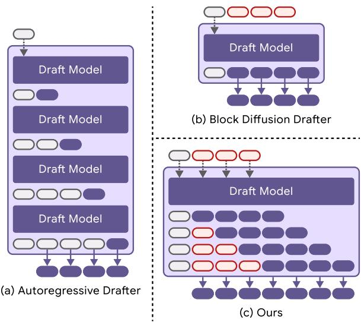
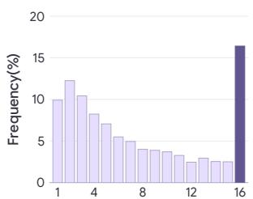
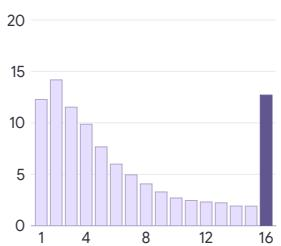
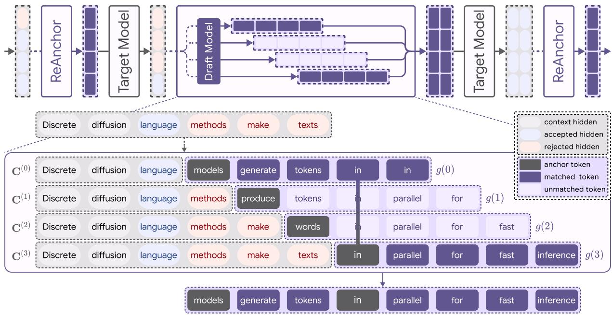

# ReAnchor: Reusing Rejected Verifier States for Diffusion Drafting

Sanghyun Lee<sup>1,∗</sup> Wonjin Nam<sup>1,∗</sup> Seungho Jang<sup>1</sup> Jaeho Lee<sup>1</sup> Jiho Park<sup>1</sup> Jaewoon Lee<sup>2</sup> Seungryong Kim<sup>1,†</sup>

<sup>1</sup>KAIST <sup>2</sup>Seoul National University

{lsh83210,wjnam6525,jeffy1234,jihop00}@kaist.ac.kr develop0235@gmail.com theolee72@snu.ac.kr seungryong.kim@kaist.ac.kr

## Abstract

Block diffusion drafters accelerate speculative decoding by generating multiple draft tokens in a single forward pass. However, each pass produces only a fixed-length block from a single target-generated anchor, limiting how far the draft can extend. Meanwhile, target verification computes hidden states even at positions beyond the first rejection, but these states are typically discarded rather than reused. We propose ReAnchor, a training-free method that reanchors a pretrained drafter at shifted positions using discarded verifier states to generate parallel draft blocks. These blocks improve predictions within the original block and extend coverage beyond its endpoint. At sampling temperature of T = 0, ReAnchor achieves its largest average gains on Gemma 4-12B, improving acceptance length by 19.4% and decoding speed by 17.9% across eight benchmarks. Averaged equally over four target models and eight benchmarks, it improves acceptance length by 15.2% and decoding speed by 13.4% with pretrained DFlash drafters. Our code is available at link.

## 1 Introduction

Autoregressive large language models generate tokens sequentially, making decoding a major source of inference latency. Speculative decoding (Leviathan et al., 2023; Chen et al., 2023) reduces this cost by using a lightweight drafter to propose multiple tokens and verifying them in parallel with the target model. Many existing methods use autoregressive drafters (Li et al., 2026b; Cheng et al., 2024; Li et al., 2024a), whose token-bytoken generation introduces sequential work into the drafting stage. Block diffusion drafters such as DFlash (Chen et al., 2026) remove this sequential dependence by predicting multiple draft tokens in a single forward pass.

This single-pass block generation comes at the cost of flexibility in how draft proposals are used and extended. Unlike autoregressive drafters, which can extend proposals one token at a time and stop when further drafting is unlikely to be worthwhile (Huang et al., 2024; Zhang et al., 2025), block diffusion drafters generate a fixed-length block determined by their training configuration. When verification encounters an early rejection, hidden states computed for the remaining draft positions are typically discarded. Conversely, when the entire block is accepted, no further proposals are available beyond its endpoint. Simply increasing the block length at inference time forces the drafter outside its training configuration and degrades acceptance performance (Chen et al., 2026). Thus, block diffusion drafting leaves verifier computations underutilized when proposals are rejected early, while limiting draft coverage when the entire block is accepted.

Our observation is that verifier hidden states computed at discarded draft positions retain useful information for subsequent drafting (Table 1). Although these states depend on rejected tokens and cannot be reused as valid target-model states, they can still serve as conditioning signals for the pretrained drafter. This suggests that otherwise discarded verifier computations can be leveraged for additional drafting without further target-model evaluations.

Building on this finding, we introduce ReAnchor, a training-free method that reuses verifier hidden states from the discarded post-rejection suffix to reanchor the same pretrained drafter at those later positions. The reanchored blocks are generated in parallel with the baseline draft, each preserving the drafter’s trained block length. To combine these blocks, ReAnchor matches their starting tokens to the baseline and attaches their continuations at the matched positions. By reanchoring at later positions (Figure 1), these blocks provide alternative predictions for nearby tokens within the original block, while also extending draft coverage beyond its endpoint. All attached continuations are verified by the target model under their new prefixes, preserving lossless decoding.

With DFlash drafters, ReAnchor improves average acceptance length by 15.2% and decoding speed by 13.4% across four target models and eight benchmarks at $T = 0$ . The largest average gains are observed on Gemma 4-12B, with improvements of 19.4% in acceptance length and 17.9% in decoding speed. These improvements also extend to three DFlash-based drafter variants, Domino, DSpark, and Draft-OPD, which employ different training and prediction mechanisms. Across 48 comparisons spanning two Qwen3 target models and eight benchmarks, ReAnchor improves average acceptance length by 11.8% and end-to-end decoding speed by 9.8% over their respective baselines. Component-wise ablations further show that both in-block refinement and block extension contribute to these gains.

Our contributions are summarized as follows:

• We introduce ReAnchor, a training-free method that reuses verifier hidden states as shifted anchors for block diffusion drafting.

• ReAnchor improves DFlash by refining predictions within the original block and extending draft coverage beyond it, achieving consistent gains in acceptance length and decoding speed across diverse settings.

• We demonstrate that ReAnchor can be directly applied to three DFlash-based variants, Domino, DSpark, and Draft-OPD, without additional training or variant-specific algorithmic modifications.

## 2 Preliminaries

We review DFlash-style block diffusion drafting and speculative decoding, introducing the notation and key concepts used throughout this work. Related work is discussed in Appendix D.

## 2.1 Block Diffusion Drafter

A block diffusion drafter generates multiple draft tokens in a single forward pass. The drafter receives two inputs: an anchor token, i.e., the bonus token that the autoregressive target model produces at the last verified position as a byproduct of its verification pass, and prefix context derived from the target model’s hidden states over the accepted prefix. Given these inputs, the drafter simultaneously predicts a fixed number of tokens at the positions immediately following the anchor.

  
Figure 1: Comparison of Drafting Strategies. While (a) autoregressive drafting requires multiple sequential next-token predictions and (b) block diffusion drafting generates a single draft block in one forward pass, (c) ReAnchor generates multiple draft blocks through parallel, low-cost drafter forward passes, reusing verifier hidden states discarded after rejection in the previous round to draft from later positions.

We now formalize this procedure. Let $p$ denote the target model and $q$ the diffusion drafter. We write B for the block size: one anchor followed by $B - 1$ drafted tokens. All positions are absolute; i denotes the anchor position. The anchor token $a _ { i } = x _ { i } \sim p ( \cdot \mid x _ { < i } )$ is the target-generated bonus token, where $x _ { < i }$ is the accepted prefix. The target model’s hidden states $\mathbf { H } _ { < i } = ( \mathbf { h } _ { j } ) _ { j < i }$ are projected into the drafter’s hidden space by a learned linear projection $\Pi _ { \phi }$ to form the prefix context ${ \bf C } _ { < i } =$ $\Pi _ { \phi } ( \mathbf { H } _ { < i } )$ . The drafter takes the anchor followed by $B - 1$ mask tokens $\mathbf { m } _ { i + 1 : i + B - 1 }$ and produces a distribution over each masked position:

$$
\begin{array} { r l r } & { } & { { \bf z } ^ { [ i ] } = ( a _ { i } , { \bf m } _ { i + 1 : i + B - 1 } ) , \quad { \bf q } _ { j } ^ { [ i ] } = q ( { \bf C } _ { < i } ; { \bf z } ^ { [ i ] } ) _ { j } , } \\ & { } & { \hat { x } _ { j } ^ { [ i ] } \sim \mathrm { C a t } ( { \bf q } _ { j } ^ { [ i ] } ) , \quad j = i + 1 , \ldots , i + B - 1 . \quad } \end{array}
$$

The superscript [i] identifies the anchor.

## 2.2 Speculative Decoding

Given a draft block $\hat { \mathbf { x } } _ { i + 1 : i + B - 1 } ^ { [ i ] }$ , the target model p evaluates all proposed positions in a single forward pass. Verification then proceeds from left to right, accepting draft tokens as long as they match tokens independently sampled from the target distribution at each position. At the first mismatch, verification stops and accepts the target-sampled token.

  
(a) MATH-500

  
(b) HumanEval  
Figure 2: Distribution of per-round acceptance length on (a) MATH-500 and (b) HumanEval. The spike at position 16 indicates frequent saturation at the draftblock boundary.

Unlike standard probabilistic verification, which uses importance ratios and residual sampling, this sample-wise verification does not require evaluating proposal probabilities. It preserves the target distribution because each accepted token is sampled from $p$ under its verified prefix.

Let τ denote the average number of tokens accepted per round, including the target-generated token at the stopping position. The average decoding latency per accepted token is

$$
L = \frac { T _ { \mathrm { d r a f t } } + T _ { \mathrm { v e r i f y } } } { \tau } .
$$

The drafter therefore aims to generate low-cost proposals that match the target’s sampled trajectory for as many consecutive positions as possible.

## 3 Method

## 3.1 Revisiting Diffusion Drafting

Block diffusion drafting removes the sequential bottleneck of autoregressive drafters, but the fixedlength parallel block introduces constraints that do not arise in the sequential setting. We now revisit this formulation and examine where its fixed-block design leaves room for improvement. We present two observations that together motivate ReAnchor: (i) the native block endpoint is frequently the binding constraint on acceptance length and no proposal exists beyond it, yet naively extending the block degrades acceptance; (ii) verifier states computed over rejected draft suffixes retain substantial predictive information and can condition additional drafts without retraining.

Block-End Saturation and Naive Extension. The native draft length frequently limits the accepted prefix, but simply increasing the proposal length at inference time does not resolve this issue. Figure 2 shows the acceptance-length distribution on representative math and code tasks for drafters trained with $B = 1 6$ . Both distributions exhibit a clear concentration at the maximum length. All drafted tokens are accepted in 16.4% of rounds on MATH-500 and 12.7% on HumanEval. In these rounds, every drafted position is consumed and no further proposal is available. Full-block acceptance does not establish that the next token would also be accepted, but the concentration at the final bin shows that the block endpoint is the binding constraint in a substantial fraction of decoding rounds.

<table><tr><td></td><td></td><td></td><td></td><td>GSM8K HumanEval MBPP MATH-500</td></tr><tr><td>Agreement (%)</td><td>65.4</td><td>60.2</td><td>60.6</td><td>66.0</td></tr></table>

Table 1: Post-rejection agreement (%). Fraction of draft tokens after the first rejection that match the target model’s top-1 predictions.

A direct solution is to increase the proposal length at inference time. We test this by evaluating drafters trained with $B \ = \ 1 6$ at $B = 2 4$ and $B \ = \ 3 2$ on Qwen3-8B across MATH-500, GSM8K, HumanEval, and MBPP. Despite the additional positions, the average accepted length decreases by 0.3 and 1.1 respectively compared to the native block size. The longer block forces the drafter to predict at offsets beyond its training range from the same anchor, under a masked input configuration it was not trained on. Extending coverage therefore motivates while preserving the native block size. We next examine whether the rejected portion of the preceding verification pass provides the conditioning information needed at these later starting points.

Predictive Information after Rejection. A rejection at position r prevents the remaining draft suffix from being accepted, but does not render every subsequent draft token incorrect. Table 1 reports the fraction of draft tokens after r that match the target model’s top-1 prediction. Across the evaluated tasks, 60–66% of these agree with despite following a rejected prefix. This indicates that the suffix is invalidated as a contiguous sequence rather than on a per-token basis, and that the discarded positions still carry substantial predictive information. Since the target model has already computed hidden states at these positions during verification, these states are available as conditioning signals for subsequent drafting at no additional target-model cost. Motivated by these observations, the next subsection introduces ReAnchor, which reuses these rejected-prefix verifier states as shifted anchors for the same pretrained drafter to generate additional fixed-length proposals.

  
Figure 3: Overview of ReAnchor’s Draft Construction. (top) ReAnchor is a training-free speculative decoding method using pretrained block-diffusion drafter q. At each decoding round, ReAnchor generates draft and target model $p$ verifies it repeatedly. (bottom) Rejected draft tokens of previous round from target model are typically discarded at prior methods. However, ReAnchor leverages them by directly conditioning them into pretrained draft model q. Specifically, ReAnchor generates $( B - 1 ) ( 1 + | \mathcal { D } | )$ draft tokens with parallel inference of draft model $q .$ Each group of $B - 1$ draft tokens is generated from a different anchor position. We can construct the final proposal structure by matching and attaching generated draft tokens.

## 3.2 ReAnchor

ReAnchor constructs draft proposals by combining the standard baseline draft with additional shifted blocks conditioned on verifier hidden states discarded after rejection in the preceding round (Figure 3). These drafts are generated in parallel using the same pretrained drafter at its trained block length. Each shifted block is aligned with the baseline by matching its starting token, and its continuation is attached at the matched position. The resulting paths are merged into a token trie and jointly verified by the target model. This construction provides alternative predictions within the original block while extending draft coverage beyond its endpoint.

Parallel drafting from discarded verifier states. Section 3.1 shows that verifier states from rejected prefixes remain useful for drafting. ReAnchor reuses a subset of these states as conditioning points for the same pretrained drafter. The resulting shifted blocks improve predictions within the original block and extend the draft beyond its endpoint without retraining the drafter.

The baseline drafter uses the anchor $a _ { i }$ and $\mathbf { C } _ { < i }$ to generate $\hat { \mathbf { x } } _ { i + 1 : i + B - 1 } ^ { [ i ] } .$ . Let $i ^ { \prime }$ and $r$ denote the anchor and the first rejected position of the preceding round; the token accepted at r becomes the current anchor, so $i = r .$ We retain the otherwise discarded verifier states $\dot { \mathbf { h } } _ { j }$ over the rejected suffix $r \le j \le i ^ { \prime } + B - 1$ , and let $\widetilde { x } _ { j }$ denote the token decoded from $\widetilde { \mathbf { h } } _ { j - 1 }$ through the target LM head. Let

$$
\mathcal { D } \subseteq \left\{ d \in \{ 1 , \dots , B - 1 \} : i + d \leq i ^ { \prime } + B \right\}
$$

denote the selected offsets from the current anchor. For each $ { d } \in  { \mathcal { D } }$ , we define the shifted anchor $\begin{array} { r l r } { \widetilde a _ { i + d } } & { { } = } & { \widetilde x _ { i + d } } \end{array}$ and its context $\widetilde { { \bf C } } _ { < i + d } = \Pi _ { \phi } ( \widetilde { { \bf H } } _ { < i + d } )$ , where $\begin{array} { r } { \tilde { \mathbf { H } } _ { < i + d } } \end{array} =$ $( \mathbf { H } _ { < r } , \widetilde { \mathbf { h } } _ { r } , \ldots , \widetilde { \mathbf { h } } _ { i + d - 1 } )$ , mirroring the baseline pair $( a _ { i } , \mathbf { C } _ { < i } )$ . The same pretrained drafter takes $\widetilde { a } _ { i + d }$ followed by $B - 1$ masked positions and predicts them in parallel. The baseline and shifted blocks are

$$
\begin{array} { r l } & { g ( 0 ) = \big ( a _ { i } , \hat { \mathbf { x } } _ { i + 1 : i + B - 1 } ^ { [ i ] } \big ) , } \\ & { g ( d ) = \big ( \widetilde { a } _ { i + d } , \hat { \mathbf { x } } _ { i + d + 1 : i + d + B - 1 } ^ { [ i + d ] } \big ) , } \end{array}
$$

each consisting of one anchor and $B - 1$ proposed tokens. The entry $g ( d ) _ { k } , \ k \in \{ 0 , \ldots , B - 1 \}$ nominally corresponds to absolute position $i + d +$ $k .$

The 1 + |D| drafting calls are independent and can be batched together. Each block attends only to its own verifier context and masked input, and reusing states from the preceding verification pass requires no additional target evaluation. The subset $\mathcal { D }$ controls the number of additional drafting calls; in this work, we use every available offset, $\mathcal { D } =$ $\{ 1 , \ldots , i ^ { \prime } + B - i \}$ . When the preceding round accepts its entire block, no states are retained, $\mathcal { D }$ is empty, and only the baseline draft is generated.

## Token matching and continuation attachment.

ReAnchor produces one baseline block and several shifted blocks, which must be combined into a single proposal set. A shifted block $g ( d )$ is drafted from a reused anchor at offset d, so it would naturally be appended to the baseline at that position. However, correcting the rejected token changes the continuation that follows it, so the tokens drafted in $g ( d )$ may now appear at a different position in the new baseline $g ( 0 )$ , or not at all. Rather than fixing $g ( d )$ at its original offset $d ,$ we therefore search the baseline for a position at which $g ( d )$ aligns and attach its continuation there.

We say that $g ( d )$ has a positive overlap at baseline position t if its anchor matches the baseline token there, $\mathrm { i . e . , } g ( 0 ) _ { t } = g ( d ) _ { 0 }$ . We attach $g ( d )$ at the earliest such position $t ^ { \star }$ , so that its continuation follows the baseline prefix $g ( 0 ) _ { 0 : t ^ { \star } }$ (Algorithm 1). This gives every matched shifted block a unique, deterministic attachment point without a secondary ranking rule, and in practice it selects a path with high accepted length (Appendix C.1).

The overlapping prefix is represented only once in the concatenated path, and shifted blocks with no positive-overlap match are discarded; each shifted block therefore contributes at most one attached path. We collect the baseline and at most one attachment per shifted block into $\mathcal { V }$ and merge them into a token trie. Since a token match only identifies a candidate attachment rather than validating its continuation, we jointly verify the trie in a single target forward pass using tree attention (Miao et al., 2024), so that each continuation is evaluated under its attached prefix.

## 4 Experiments

## 4.1 Experimental setup

Models and Evaluation. We evaluate ReAnchor with Qwen3 (Yang et al., 2025) models at 4B and 8B scales, Llama-3.1-8B (Grattafiori et al., 2024) and Gemma 4-12B (Team et al., 2026). Experiments cover GSM8K (Cobbe et al., 2021), MATH-500 (Lightman et al., 2024), AIME25, HumanEval (Chen et al., 2021), MBPP (Austin et al., 2021b), LiveCodeBench (Jain et al., 2025), MT-Bench (Zheng et al., 2023), and Alpaca (Taori et al., 2023). We report average acceptance length τ and end-to-end decoding speedup relative to autoregressive decoding with the target model. We evaluate on 100 examples per dataset, sampled with random seed 0, using the full set for AIME25 (30) and MT-Bench (80). In all experiments, ReAnchor uses every retained rejected-suffix state as a shifted anchor.

Algorithm 1 ReAnchor Proposal Construction   
Require: Target context $\mathbf { C } _ { < i }$ , anchor $a _ { i } .$ , block size B   
Require: Retained verifier states $\widetilde { \mathbf { H } } ,$ source tokens $\widetilde { \mathbf { x } } ,$ se  
lected offsets D (Sec. 3.2)   
Ensure: Proposal set Y for target verification   
1: ${ \bf C } ^ { ( 0 ) } \gets { \bf \hat { C } } _ { < i } , \quad g ( 0 ) _ { 0 } \gets { \bf \bar { a } } _ { i }$   
2: for all $d \in { \mathcal { D } }$ do   
3: $\mathbf { C } ^ { ( d ) } \gets \Pi _ { \phi } ( \widetilde { \mathbf { H } } _ { < i + d } ) ,$   
$g ( d ) _ { 0 } \gets \widetilde { { a } } _ { i + d }$   
4: end for   
5: for all $d \in \{ 0 \} \cup \mathcal { D }$ in parallel do   
6: $\mathbf { z } ^ { [ i + d ] }  ( g ( d ) _ { 0 } , \mathbf { m } _ { i + d + 1 : i + d + B - 1 } )$   
7: $( \mathbf { q } _ { j } ^ { [ i + d ] } ) _ { j = i + d + 1 } ^ { i + d + B - 1 }$   
$ q ( \mathbf { C } ^ { ( d ) } ; \mathbf { z } ^ { [ i + d ] } )$   
8: Generate $g ( d ) _ { 1 : B - 1 }$ from these distributions using the   
chosen drafting rule.   
9: end for   
10: $\mathcal { V }  \{ g ( 0 ) \}$   
11: for all $\dot { d } \in \dot { \mathcal { D } }$ do   
12: $\mathcal T \gets \{ t \in \{ 0 , \dots , B - 1 \} : g ( 0 ) _ { t } = g ( d ) _ { 0 } \}$   
13: $\mathbf { i f } \ T \neq \{ \}$ then   
14: t<sup>⋆</sup> ← min T   
15: $\mathcal { V }  \mathcal { V } \cup \{ ( g ( 0 ) _ { 0 : t ^ { \star } - 1 } , g ( d ) _ { 0 : B - 1 } ) \}$   
16: end if   
17: end for   
18: Merge identical token prefixes in $\mathcal { V }$ into a trie.   
19: return Y

Drafter Setup. Unless otherwise specified, our main experiments and ablations use pretrained DFlash (Chen et al., 2026) checkpoints. We additionally apply ReAnchor to three DFlash-based variants to assess its compatibility with different training and prediction mechanisms. Draft-OPD (Lei et al., 2026) post-trains DFlash through on-policy distillation with error-position replay. Domino (Huang et al., 2026) adds a GRU-based causal correction head. DSpark (Cheng et al., 2026) uses a lightweight Markov head for sequential token prediction. Further details on the drafter variants are provided in Appendix A.

<table><tr><td colspan="2"></td><td colspan="8">Dataset</td></tr><tr><td>Target model</td><td>Drafting method</td><td>GSM8K</td><td>MATH</td><td>AIME25</td><td>HumanEval</td><td>MBPP</td><td>LiveCode Bench</td><td>MT-Bench</td><td>Alpaca</td></tr><tr><td>Temperature = 0</td><td></td><td></td><td></td><td></td><td></td><td></td><td></td><td></td><td></td></tr><tr><td rowspan="2">Qwen3-4B</td><td>DFlash</td><td>6.24 /4.19×</td><td>7.37 /5.10×</td><td>6.36 / 4.35×</td><td>6.51 / 4.39×</td><td>5.81 /4.13×</td><td>5.87 / 4.19×</td><td>3.46 / 2.44×</td><td>2.89 / 2.01×</td></tr><tr><td>+ ReAnchor</td><td>7.51/ 5.03×</td><td>8.45 / 5.78×</td><td>7.20 / 4.90×</td><td>7.50 / 5.00×</td><td>6.78 / 4.78×</td><td>6.84 / 4.76×</td><td>3.89 / 2.68×</td><td>3.17 / 2.17×</td></tr><tr><td rowspan="2">Qwen3-8B</td><td>DFlash</td><td>6.34 / 4.39×</td><td>7.28 / 5.05×</td><td>6.38 / 4.41×</td><td>6.49 / 4.43×</td><td>5.71 / 4.06×</td><td>5.94 /4.10×</td><td>3.42 / 2.40×</td><td>2.87 / 1.99×</td></tr><tr><td>+ ReAnchor</td><td>7.45 / 5.03×</td><td>8.31 / 5.67×</td><td>7.11 / 4.72×</td><td>7.52 / 5.05×</td><td>6.68 / 4.69×</td><td>7.24 / 4.83×</td><td>3.82 / 2.57×</td><td>3.16 / 2.14×</td></tr><tr><td rowspan="2">Gemma 4-12B</td><td>DFlash</td><td>3.88 /3.27×</td><td>4.97 / 4.14×</td><td>4.56 / 3.80×</td><td>4.48 /3.70×</td><td>4.12/3.37×</td><td>4.07 / 3.27×</td><td>2.96 /2.37×</td><td>2.77 /2.16×</td></tr><tr><td>+ ReAnchor</td><td>4.79 / 3.99×</td><td>6.04 / 4.94×</td><td>5.30 / 4.39×</td><td>5.75 / 4.69×</td><td>5.04 / 4.05×</td><td>4.74 / 3.69×</td><td>3.36 / 2.65×</td><td>3.13 / 2.48×</td></tr><tr><td rowspan="2">Llama-3.1-8B</td><td>DFlash</td><td>4.42 / 2.71×</td><td>3.85 / 2.43×</td><td>3.82 / 2.43×</td><td>5.03 / 3.26×</td><td>5.02 / 3.13×</td><td>4.02 / 2.51×</td><td>3.85 / 2.42×</td><td>3.70/ 2.32×</td></tr><tr><td>+ ReAnchor</td><td>4.98 / 3.11×</td><td>4.25 / 2.65×</td><td>4.25 / 2.63×</td><td>5.60 / 3.58×</td><td>5.65 / 3.52×</td><td>4.44 / 2.69×</td><td>4.28 / 2.62×</td><td>4.17 / 2.59×</td></tr><tr><td>Temperature = 1</td><td></td><td></td><td></td><td></td><td></td><td></td><td></td><td></td><td></td></tr><tr><td rowspan="2">Qwen3-4B</td><td>DFlash</td><td>4.90 / 3.54×</td><td>4.81 / 3.32×</td><td>3.70/ 2.62×</td><td>5.00 / 3.60×</td><td>4.56 / 3.26×</td><td>4.68 / 3.34×</td><td>2.66 / 1.86×</td><td>2.30 /1.63×</td></tr><tr><td>+ ReAnchor</td><td>5.64 / 3.80×</td><td>5.53 / 3.73×</td><td>4.24 / 2.83×</td><td>5.69 / 3.90×</td><td>5.16 / 3.49×</td><td>4.93 / 3.18×</td><td>2.86 / 1.94×</td><td>2.46 / 1.67×</td></tr><tr><td rowspan="2">Qwen3-8B</td><td>DFlash</td><td>4.62 /3.36×</td><td>4.68 /3.32×</td><td>3.57 /2.53×</td><td>4.42 / 3.20×</td><td>4.03 / 2.93×</td><td>4.72 /3.37×</td><td>2.43 / 1.75×</td><td>2.23 / 1.58×</td></tr><tr><td>+ ReAnchor</td><td>5.35 / 3.79×</td><td>5.11 / 3.46×</td><td>3.94 / 2.71×</td><td>4.88 / 3.34×</td><td>4.52 / 3.20×</td><td>5.42 / 3.73×</td><td>2.63 / 1.77×</td><td>2.38 / 1.63×</td></tr><tr><td rowspan="2">Gemma 4-12B</td><td>DFlash</td><td>4.39 / 3.76×</td><td>4.88 / 4.12×</td><td>4.17/ 3.45×</td><td>4.19 / 3.46×</td><td>3.79/3.12×</td><td>3.62 / 3.00×</td><td>2.86 / 2.22×</td><td>2.59 / 1.81×</td></tr><tr><td>+ ReAnchor</td><td>5.45 / 4.48×</td><td>5.84 / 4.71×</td><td>4.92 / 3.92×</td><td>5.24 / 4.18×</td><td>4.70/ 3.72×</td><td>4.22 / 3.24×</td><td>3.22 / 2.38×</td><td>2.94 / 2.04×</td></tr><tr><td rowspan="2">Llama-3.1-8B</td><td>DFlash</td><td>2.92 / 1.80×</td><td>2.31 / 1.52×</td><td>1.93 / 1.32×</td><td>3.58 / 2.19×</td><td>3.53 / 2.31×</td><td>2.68 / 1.68×</td><td>2.38 / 1.47×</td><td>2.43 / 1.49×</td></tr><tr><td>+ ReAnchor</td><td>2.97 / 1.76×</td><td>2.40 / 1.49×</td><td>1.93 / 1.18×</td><td>3.87 / 2.34×</td><td>3.86 / 2.49×</td><td>2.95 / 1.73×</td><td>2.48 / 1.46×</td><td>2.63 / 1.57×</td></tr></table>

Table 2: DFlash decoding performance at sampling temperatures T = 0 and T = 1. Each entry reports average acceptance length τ / end-to-end speedup. Temperature T is used for both drafter and target sampling in speculative decoding. Speedup is the ratio of target-only latency measured at the same temperature to speculative decoding latency; τ includes the target bonus token produced at each verification round. Bold marks the best value per dataset and metric.

Latency Measurement. We measure end-to-end wall-clock decoding latency with batch size one on a single NVIDIA H100 GPU. All compared methods use the same target model, drafter checkpoint, hardware, and generation settings. We exclude model loading and tokenization time while including measured latencies for both drafting and target verification for end-to-end latency evaluation. GPU execution is synchronized before timing, and we report results after warm-up runs. More details of the setup are provided in Appendix B.

## 4.2 Main Results

Acceptance length and decoding speed. At T = 0, ReAnchor improves both average acceptance length τ and end-to-end speedup in all 32 target–benchmark comparisons, achieving average gains of 15.2% and 13.4%, respectively (Table 2). The largest relative gains occur on Gemma 4-12B, with improvements of 19.4% in τ and 17.9% in speedup, despite its shorter baseline accepted prefixes than Qwen3. At T = 1, the improvements remain substantial, with τ increasing in 31 of 32 comparisons and speedup in 27, averaging 11.8% and 6.9%, respectively. The smaller gains under stochastic sampling may stem from increased token mismatches between independently sampled draft and target continuations, reducing the benefit of additional proposals relative to their verification cost. Overall, these results demonstrate the effectiveness of reanchoring across different target models and decoding settings.

Compatibility with drafter variants. We further evaluate ReAnchor on three DFlash-based variants, Domino, DSpark, and Draft-OPD, with different training and prediction mechanisms. At T = 0, ReAnchor improves both τ and end-to-end speedup in all 48 comparisons, with average gains of 11.8% and 9.8%, respectively (Table 3). At T = 1, the improvements remain consistent, increasing τ in all 48 comparisons and speedup in 45, with average gains of 11.5% and 8.1%. These results demonstrate that ReAnchor generalizes across different drafting mechanisms without additional training or variant-specific modifications.

## 4.3 Ablation Study

We analyze where the gains of ReAnchor come from: which draft positions benefit, how much is due to reusing rejected states versus token matching, and how the attachment rule affects performance. All ablations use Qwen3-4B with the DFlash drafter at T = 0.

In-Block Refinement and Block Extension. We separate the gains of ReAnchor into improvements within the native draft block and extensions beyond its endpoint. We consider two partial variants while keeping the same shifted anchors and drafter evaluations. In-block only uses predictions from shifted anchors only at positions up to $i + B - 1$ and discards all predictions beyond the native block. Extension only retains the original DFlash predictions within $i + 1 : i + B - 1$ and uses ReAnchor only to provide additional predictions after $i + B - 1$ The full method uses both.

<table><tr><td colspan="2"></td><td colspan="8">Dataset</td></tr><tr><td colspan="2"></td><td colspan="6"></td></tr><tr><td>Target model</td><td>Drafting method</td><td>GSM8K</td><td>MATH</td><td>AIME25</td><td>HumanEval</td><td>MBPP</td><td>LiveCode Bench</td><td>MT-Bench</td><td>Alpaca</td></tr><tr><td colspan="2">Temperature = 0</td></tr><tr><td rowspan="6">Qwen3-4B</td><td>Domino</td><td>9.32 / 5.82×</td><td>8.20 /5.34×</td><td>6.49 / 4.19×</td><td>6.84 /4.50×</td><td>6.57 / 4.42×</td><td>5.82 / 3.83×</td><td>4.06 /2.71×</td><td>3.56/2.33×</td></tr><tr><td>+ ReAnchor</td><td>11.01 / 6.84×</td><td>9.31 / 5.94×</td><td>7.46 / 4.72×</td><td>7.73 / 4.99×</td><td>7.75 / 5.09×</td><td>6.75 / 4.29×</td><td>4.48 / 2.93×</td><td>3.90/ 2.50×</td></tr><tr><td>DSpark</td><td>6.42 / 4.38×</td><td>6.20 / 4.27×</td><td>5.52 / 3.85×</td><td>5.70/4.10×</td><td>5.49 / 4.07×</td><td>5.18 /3.67×</td><td>3.98/ 2.90×</td><td>3.61 / 2.46×</td></tr><tr><td>+ ReAnchor</td><td>6.81 / 4.72×</td><td>6.47 / 4.41×</td><td>5.87 / 4.05×</td><td>6.11 / 4.35×</td><td>5.93 / 4.36×</td><td>5.62 / 4.00×</td><td>4.30 / 3.11×</td><td>3.96 / 2.65×</td></tr><tr><td>Draft-OPD</td><td>7.10/4.82×</td><td>8.27 / 5.76×</td><td>6.76/ 4.75×</td><td>6.66 / 4.73×</td><td>6.23 / 4.48×</td><td>6.10 / 4.34×</td><td>3.54 / 2.57×</td><td></td></tr><tr><td>+ ReAnchor</td><td>8.35 / 5.66×</td><td>9.46 / 6.50×</td><td>7.78 / 5.33×</td><td>7.64 / 5.33×</td><td>7.27 / 5.17×</td><td>7.09 / 4.90×</td><td>3.91 / 2.78×</td><td>2.94 / 2.08× 3.20 / 2.22×</td></tr><tr><td rowspan="6">Qwen3-8B</td><td>Domino</td><td>9.60 / 6.32×</td><td>8.39 / 5.38×</td><td>6.60 / 4.20×</td><td>7.20/4.72×</td><td>6.69 / 4.37×</td><td>6.22 / 4.09×</td><td>4.06 / 2.56×</td><td>3.56 / 2.28×</td></tr><tr><td>+ ReAnchor</td><td>11.01 / 7.08×</td><td>9.50 / 6.00×</td><td>7.46 / 4.62×</td><td>8.32 / 5.29×</td><td>7.87 / 5.06×</td><td>6.95 / 4.22×</td><td>4.60 / 2.80×</td><td>4.02 / 2.50×</td></tr><tr><td>DSpark</td><td>6.54 / 4.73×</td><td>6.30 / 4.45×</td><td>5.52/3.75×</td><td>5.94 / 4.14×</td><td>5.56/3.94×</td><td>5.47 / 3.68×</td><td>3.96 / 2.71×</td><td>3.71 /2.54×</td></tr><tr><td>+ ReAnchor</td><td>6.95 / 5.07×</td><td>6.59 / 4.60×</td><td>5.94 / 3.97×</td><td>6.29 / 4.42×</td><td>5.98 / 4.18×</td><td>5.87 / 3.97×</td><td>4.29 / 2.89×</td><td>4.03 / 2.73×</td></tr><tr><td>Draft-OPD</td><td>7.23 / 5.24×</td><td>8.31 / 5.70×</td><td>6.93 / 4.81×</td><td>6.67 / 4.71×</td><td>6.23 / 4.45×</td><td>6.11 /4.24×</td><td>3.52 / 2.45×</td><td></td></tr><tr><td>+ ReAnchor</td><td>8.46 / 5.99×</td><td>9.33 / 6.27×</td><td>7.88 / 5.33×</td><td>7.71/5.32×</td><td>7.18 / 5.01×</td><td>7.19 /4.77×</td><td>3.87 / 2.61×</td><td>2.92 / 1.94× 3.21 / 2.13×</td></tr><tr><td colspan="2">Temperature = 1</td><td></td><td></td><td></td><td></td><td></td><td></td><td></td><td></td></tr><tr><td rowspan="5">Qwen3-4B</td><td>Domino</td><td>7.46/5.53×</td><td>5.66 / 4.22×</td><td>4.18 /3.15×</td><td>5.59/4.17×</td><td>5.21/3.89×</td><td>4.77 /3.14×</td><td>3.06 / 2.36×</td><td>2.72 /2.07×</td></tr><tr><td>+ ReAnchor</td><td>8.63 / 6.16×</td><td>6.47 / 4.68×</td><td>4.79 / 3.49×</td><td>6.44 / 4.67×</td><td>6.04 / 4.38×</td><td>5.52 / 3.50×</td><td>3.32 / 2.46×</td><td>3.01 / 2.21×</td></tr><tr><td>DSpark</td><td>5.20/ 4.15×</td><td>4.58 /3.61×</td><td>3.76 /3.04×</td><td>4.53 / 3.62×</td><td>4.42 /3.30×</td><td>4.80 /3.43×</td><td>3.09 /2.58×</td><td></td></tr><tr><td>+ ReAnchor</td><td>5.78 / 4.55×</td><td>4.99 / 3.99×</td><td>3.99 / 3.15×</td><td>5.02 / 3.89×</td><td>4.91 / 3.67×</td><td>5.25 / 3.92×</td><td>3.36 / 2.73×</td><td>3.04 /2.49× 3.23 / 2.54×</td></tr><tr><td>Draft-OPD</td><td>5.49 / 4.63×</td><td>5.40/ 4.58×</td><td>3.95 / 3.38×</td><td>5.16/4.32×</td><td>4.83 / 4.10×</td><td>4.79/3.57×</td><td>2.76 /2.39×</td><td>2.39 / 2.04×</td></tr><tr><td rowspan="6">Qwen3-8B</td><td>+ ReAnchor</td><td>6.48 / 5.25×</td><td>6.04 / 4.93×</td><td>4.64 /3.81×</td><td>6.00 / 4.82×</td><td>5.58 / 4.55×</td><td>5.41 / 3.86×</td><td>2.94 / 2.44×</td><td>2.56 /2.10×</td></tr><tr><td>Domino</td><td>7.13 /4.56×</td><td>5.88 /3.71×</td><td>4.20 /2.69×</td><td>5.38 /3.43×</td><td>4.83 / 3.09×</td><td>4.93 / 3.05×</td><td>2.98 /1.89×</td><td>2.72 /1.71×</td></tr><tr><td>+ ReAnchor</td><td>8.09 / 5.02×</td><td>6.66 / 4.04×</td><td>4.81 / 2.94×</td><td>5.98 / 3.67×</td><td>5.70 /3.52×</td><td>5.82 / 3.41×</td><td>3.27 / 1.98×</td><td>3.01 /1.80×</td></tr><tr><td>DSpark</td><td>5.42 / 4.07×</td><td>4.78 / 3.45×</td><td>4.00 / 2.93×</td><td>4.92 / 3.68×</td><td>4.74/3.65×</td><td>4.60 / 3.21×</td><td>3.32 /2.37×</td><td></td></tr><tr><td>+ ReAnchor</td><td>5.97 / 4.43×</td><td>5.14 /3.59×</td><td>4.05 / 2.92×</td><td>5.31 / 3.99×</td><td>5.27 / 3.95×</td><td>4.85 / 3.16×</td><td>3.64 / 2.60×</td><td>3.09 / 2.14× 3.34 /2.33×</td></tr><tr><td>Draft-OPD</td><td>5.17/3.74×</td><td>5.06 / 3.55×</td><td>3.86 /2.82× 4.24 / 2.95×</td><td>4.71/3.42×</td><td>4.39 / 3.16× 4.96 / 3.43×</td><td>5.02 /3.55×</td><td>2.52 /1.81×</td><td>2.27 / 1.60×</td></tr></table>

Table 3: Decoding performance of DFlash-based drafter variants at $T = 0$ and $T = 1 \AA$ . Each entry reports average acceptance length τ / end-to-end speedup relative to target-only decoding at the same temperature. The accepted length includes the target bonus token. Bold marks the best value per dataset and metric.

<table><tr><td>Method</td><td>In-block</td><td>Beyond</td><td> $\Delta \tau$ </td></tr><tr><td>DFlash</td><td>X</td><td>X</td><td></td></tr><tr><td>In-block only</td><td>√</td><td>×</td><td>+0.54</td></tr><tr><td>Extension only</td><td>X</td><td>√</td><td>+0.31</td></tr></table>

Table 4: In-block refinement vs. block extension. ∆τ over DFlash. In-block only uses shifted predictions within the native block; Extension only uses them only beyond its endpoint.

Table 4 shows that both components improve over the DFlash baseline. In-block refinement increases acceptance by providing later positions with predictions conditioned from closer verifier states. Block extension provides additional accepted tokens in rounds where verification reaches the native endpoint. Combining the two gives the largest improvement in both acceptance length and decoding speed, showing that ReAnchor benefits from improving existing draft positions as well as extending the draft beyond its original length.

<table><tr><td>Task</td><td>Shifted only</td><td>Multiple</td></tr><tr><td>GSM8K</td><td>50.7</td><td>35.8</td></tr><tr><td>MATH-500</td><td>51.2</td><td>40.6</td></tr><tr><td>HumanEval</td><td>49.0</td><td>34.7</td></tr><tr><td>MBPP</td><td>45.5</td><td>38.0</td></tr></table>

Table 5: Start-token alignment (%). Shifted only: the anchor matches only at baseline positions other than its original offset. Multiple: it matches at more than one position. Categories may overlap.

<table><tr><td>Attachment rule</td><td>Acceptance τ</td><td>Speedup</td></tr><tr><td>Original offset</td><td>7.24</td><td>4.96×</td></tr><tr><td>Random match</td><td>7.51</td><td>5.16×</td></tr><tr><td>Earliest match</td><td>7.56</td><td>5.16×</td></tr><tr><td>Longest-prefix match</td><td>7.51</td><td>5.14×</td></tr></table>

Table 6: Ablation of attachment-site matching on Qwen3-4B with DFlash. Results are averaged over 100 examples each from GSM8K, HumanEval, MATH, and MBPP.

<table><tr><td>Configuration</td><td>MATH</td><td>GSM8K</td><td>MBPP</td><td>HumanEval</td><td>MT-Bench</td><td>Alpaca</td></tr><tr><td>DFlash</td><td>7.37</td><td>6.24</td><td>5.81</td><td>6.51</td><td>3.46</td><td>2.89</td></tr><tr><td>+ Fixed-offset ReAnchor</td><td>8.03</td><td>6.89</td><td>6.49</td><td>7.04</td><td>3.75</td><td>3.04</td></tr><tr><td>+ ReAnchor</td><td>8.45</td><td>7.51</td><td>6.78</td><td>7.50</td><td>3.89</td><td>3.17</td></tr></table>

Table 7: Cumulative ablation of ReAnchor components. Average acceptance length τ on Qwen3-4B with the DFlash drafter at $T = 0$ . Fixed-offset attaches each shifted block at its original offset $d ;$ ReAnchor instead attaches it at the earliest matching position in the baseline draft. All configurations use the same shifted anchors and drafter evaluations.

Analysis of token alignment. We next examine how often a shifted block $g ( d )$ remains aligned with its original offset d after a rejection. Correcting the rejected token can alter the continuation that follows it, so the anchor $g ( d ) _ { 0 }$ may appear at a different position of the new baseline draft $g ( 0 )$ Table 5 reports two statistics over shifted blocks whose anchor matches at least one position t, i.e., $g ( 0 ) _ { t } = g ( d ) _ { 0 }$ . Shifted only counts blocks that do not match at $t = d$ but match at some $t \neq d ;$ Multiple counts blocks that match at more than one t. The two categories may overlap.

Across the evaluated tasks, 45.5–51.2% of matched shifted blocks fall into the shifted-only category, indicating that enforcing the original offset would discard a substantial fraction of otherwise usable continuations. In addition, 34.7–40.6% admit multiple candidate attachment positions, showing that alignment is frequently ambiguous rather than fixed. These results motivate searching over baseline positions when attaching shifted blocks. We next quantify the effect of this design choice by comparing fixed-offset attachment with the full token-matching strategy of ReAnchor.

Ablation of attachment-site matching. We compare our default earliest-overlap rule with fixedoffset, random-match, and longest-prefix attachment on Qwen3-4B with DFlash (Table 6). All matching rules clearly outperform fixed-offset attachment (7.51–7.56 vs. 7.24 in τ ), while differing from one another by at most 0.05 in τ and 0.02× in speedup. Re-alignment itself thus matters more than the specific attachment site. We adopt the earliest rule because it matches the best results while being the simplest: a single-token comparison that yields a unique, deterministic attachment point.

Component-wise ablation of ReAnchor. We isolate the contributions of shifted drafting and token matching with a cumulative ablation (Table 7). Starting from DFlash, which uses only the native anchor and draft block, we first add shifted blocks drafted from the retained rejected-suffix states, attaching each block to the baseline at its original offset $t = d$ . We then replace this fixed attachment with token matching, which attaches each block at the earliest positive-overlap position. All configurations share the same offsets D, drafter evaluations, and verification rule; only the proposal assembly differs. Shifted drafting alone raises τ on every benchmark, from 5.38 to 5.87 on average, showing that rejected verifier states provide useful conditioning. Token matching further raises it to 6.22, accounting for roughly 40% of the total gain, as many shifted continuations become usable only at a position other than their original offset (Table 5).

## 5 Conclusion

We introduced ReAnchor, a training-free method that reuses verifier hidden states discarded after rejection to reanchor block diffusion drafting at later positions. By drafting multiple fixed-length blocks in parallel and attaching their continuations through token matching, ReAnchor refines predictions within the original block and extends draft coverage beyond its endpoint, while preserving lossless decoding. It consistently improves acceptance length and decoding speed across target models and benchmarks, and applies directly to DFlashbased drafter variants, including Domino, DSpark, and Draft-OPD. These results show that otherwise discarded verifier computations can be effectively reused to improve speculative decoding.

## Limitations

Like speculative decoding in general, ReAnchor is limited by how well the drafter aligns with the target model. Shifted blocks are drafted from verifier states conditioned on rejected tokens, so their benefit depends on how much the post-rejection drafts still agree with the target’s continuation. The gains therefore vary across tasks and decoding settings. At T = 0, the average speedup gain is 9.9% on MT-Bench and Alpaca, compared with 14.5% on math and code tasks. Under stochastic sampling (T = 1), independently sampled drafts agree less often with the target, and ReAnchor is slower than the baseline on four Llama-3.1-8B tasks and on LiveCodeBench with Qwen3-4B, where the additional verification cost outweighs the extra accepted tokens. In addition, ReAnchor has no retained states to reuse after a round in which the entire block is accepted, so it cannot extend the draft in consecutive full-acceptance rounds. Finally, all latency measurements use batch size one, where verifying additional trie tokens is nearly free; at larger batch sizes, where verification becomes compute-bound, the extra candidates may reduce the net speedup.

## References

Zihao An, Huajun Bai, Ziqiong Liu, Dong Li, and Emad Barsoum. 2026. Pard: Accelerating llm inference with low-cost parallel draft model adaptation. In International Conference on Learning Representations, volume 2026, pages 144562–144579.

Marianne Arriola, Aaron Gokaslan, Justin Chiu, Zhihan Yang, Zhixuan Qi, Jiaqi Han, Subham Sahoo, and Volodymyr Kuleshov. 2025. Block diffusion: Interpolating between autoregressive and diffusion language models. In International Conference on Learning Representations, volume 2025, pages 50726–50753.

Jacob Austin, Daniel D Johnson, Jonathan Ho, Daniel Tarlow, and Rianne Van Den Berg. 2021a. Structured denoising diffusion models in discrete state-spaces. Advances in neural information processing systems, 34:17981–17993.

Jacob Austin, Augustus Odena, Maxwell Nye, Maarten Bosma, Henryk Michalewski, David Dohan, Ellen Jiang, Carrie Cai, Michael Terry, Quoc Le, et al. 2021b. Program synthesis with large language models. arXiv preprint arXiv:2108.07732.

Tianle Cai, Yuhong Li, Zhengyang Geng, Hongwu Peng, Jason D Lee, Deming Chen, and Tri Dao. 2024. Medusa: Simple llm inference acceleration framework with multiple decoding heads. arXiv preprint arXiv:2401.10774.

Charlie Chen, Sebastian Borgeaud, Geoffrey Irving, Jean-Baptiste Lespiau, Laurent Sifre, and John Jumper. 2023. Accelerating large language model decoding with speculative sampling. arXiv preprint arXiv:2302.01318.

Jian Chen, Yesheng Liang, and Zhijian Liu. 2026. Dflash: Block diffusion for flash speculative decoding. arXiv preprint arXiv:2602.06036.

Mark Chen, Jerry Tworek, Heewoo Jun, Qiming Yuan, Henrique Ponde De Oliveira Pinto, Jared Kaplan, Harri Edwards, Yuri Burda, Nicholas Joseph, Greg Brockman, et al. 2021. Evaluating large language models trained on code. arXiv preprint arXiv:2107.03374.

Xin Cheng, Xingkai Yu, Chenze Shao, Jiashi Li, Yunfan Xiong, Yi Qian, Jiaqi Zhu, Shirong Ma, Xiaokang Zhang, Jiasheng Ye, et al. 2026. Dspark: Confidence-scheduled speculative decoding with semi-autoregressive generation. arXiv preprint arXiv:2607.05147.

Yunfei Cheng, Aonan Zhang, Xuanyu Zhang, Chong Wang, and Yi Wang. 2024. Recurrent drafter for fast speculative decoding in large language models. arXiv preprint arXiv:2403.09919.

Karl Cobbe, Vineet Kosaraju, Mohammad Bavarian, Mark Chen, Heewoo Jun, Lukasz Kaiser, Matthias Plappert, Jerry Tworek, Jacob Hilton, Reiichiro Nakano, et al. 2021. Training verifiers to solve math word problems. arXiv preprint arXiv:2110.14168.

Aaron Grattafiori, Abhimanyu Dubey, Abhinav Jauhri, Abhinav Pandey, Abhishek Kadian, Ahmad Al-Dahle, Aiesha Letman, Akhil Mathur, Alan Schelten, Alex Vaughan, et al. 2024. The llama 3 herd of models. arXiv preprint arXiv:2407.21783.

Jianuo Huang, Yaojie Zhang, Qituan Zhang, Hao Lin, Hanlin Xu, and Linfeng Zhang. 2026. Domino: Decoupling causal modeling from autoregressive drafting in speculative decoding. arXiv preprint arXiv:2605.29707.

Kaixuan Huang, Xudong Guo, and Mengdi Wang. 2024. Specdec++: Boosting speculative decoding via adaptive candidate lengths. arXiv preprint arXiv:2405.19715.

Naman Jain, Alex Gu, Wen-Ding Li, Fanjia Yan, Tianjun Zhang, Sida Wang, Armando Solar-Lezama, Koushik Sen, and Ion Stoica. 2025. Livecodebench: Holistic and contamination free evaluation of large language models for code. In International Conference on Learning Representations, volume 2025, pages 58791–58831.

Haodi Lei, Yafu Li, Haoran Zhang, Shunkai Zhang, Qianjia Cheng, Xiaoye Qu, Ganqu Cui, Bowen Zhou, Ning Ding, Yun Luo, and Yu Cheng. 2026. Draft-opd: On-policy distillation for speculative draft models. Preprint, arXiv:2605.29343.

Yaniv Leviathan, Matan Kalman, and Yossi Matias. 2023. Fast inference from transformers via speculative decoding. In International conference on machine learning, pages 19274–19286. PMLR.

Guanghao Li, Zhihui Fu, Min Fang, Qibin Zhao, Ming Tang, Chun Yuan, and Jun Wang. 2026a. Diffuspec: Unlocking diffusion language models for speculative decoding. In Findings ofthe Associationfor Computational Linguistics: ACL 2026, pages 20896–20910.

Yuhui Li, Fangyun Wei, Chao Zhang, and Hongyang Zhang. 2024a. Eagle-2: Faster inference of language models with dynamic draft trees. In Proceedings of the 2024 conference on empirical methods in natural language processing, pages 7421–7432.

Yuhui Li, Fangyun Wei, Chao Zhang, and Hongyang Zhang. 2024b. Eagle: Speculative sampling requires rethinking feature uncertainty. arXiv preprint arXiv:2401.15077.

Yuhui Li, Fangyun Wei, Chao Zhang, and Hongyang Zhang. 2026b. Eagle-3: Scaling up inference acceleration of large language models via training-time test. Advances in Neural Information Processing Systems, 38:136737–136756.

Hunter Lightman, Vineet Kosaraju, Yuri Burda, Harrison Edwards, Bowen Baker, Teddy Lee, Jan Leike, John Schulman, Ilya Sutskever, and Karl Cobbe. 2024. Let’s verify step by step. In International Conference on Learning Representations, volume 2024, pages 39578–39601.

Anji Liu, Oliver Broadrick, Mathias Niepert, and Guy Van den Broeck. 2025. Discrete copula diffusion. In International Conference on Learning Representations, volume 2025, pages 88953–88979.

Aaron Lou, Chenlin Meng, and Stefano Ermon. 2023. Discrete diffusion modeling by estimating the ratios of the data distribution. arXiv preprint arXiv:2310.16834.

Xupeng Miao, Gabriele Oliaro, Zhihao Zhang, Xinhao Cheng, Zeyu Wang, Zhengxin Zhang, Rae Ying Yee Wong, Alan Zhu, Lijie Yang, Xiaoxiang Shi, et al. 2024. Specinfer: Accelerating large language model serving with tree-based speculative inference and verification. In Proceedings ofthe 29th ACM International Conference on Architectural Supportfor Programming Languages and Operating Systems, Volume 3, pages 932–949.

Shen Nie, Fengqi Zhu, Zebin You, Xiaolu Zhang, Jingyang Ou, Jun Hu, Jun Zhou, Yankai Lin, Ji-Rong Wen, and Chongxuan Li. 2026. Large language diffusion models. Advances in Neural Information Processing Systems, 38:50608–50646.

Soowon Oh, Nam Cao, Yujin Kim, Hojung Jung, Huzama Ahmad, Sangmin Bae, and Se-Young Yun. 2026. Bastion: Budget-aware speculative decoding with tree-structured block diffusion drafting. arXiv preprint arXiv:2605.29727.

Liran Ringel and Yaniv Romano. 2026. Accelerating speculative decoding with block diffusion draft trees. arXiv preprint arXiv:2604.12989.

Subham S Sahoo, Marianne Arriola, Yair Schiff, Aaron Gokaslan, Edgar Marroquin, Justin T Chiu, Alexander Rush, and Volodymyr Kuleshov. 2024. Simple and effective masked diffusion language models. Advances in Neural Information Processing Systems, 37:130136–130184.

Jiaxin Shi, Kehang Han, Zhe Wang, Arnaud Doucet, and Michalis Titsias. 2024. Simplified and generalized masked diffusion for discrete data. Advances in neural information processing systems, 37:103131– 103167.

Mitchell Stern, Noam Shazeer, and Jakob Uszkoreit. 2018. Blockwise parallel decoding for deep autoregressive models. Advances in Neural Information Processing Systems, 31.

Rohan Taori, Ishaan Gulrajani, Tianyi Zhang, Yann Dubois, Xuechen Li, Carlos Guestrin, Percy Liang, and Tatsunori B Hashimoto. 2023. Alpaca: A strong, replicable instruction-following model. Stanford Center for Research on Foundation Models. https://crfm. stanford. edu/2023/03/13/alpaca. html, 3(6):7.

Gemma Team, Sherif El Abd, Vaibhav Aggarwal, Robin Algayres, Alek Andreev, Olivier Bachem, Ian Ballantyne, Cormac Brick, Victor Carbune, Michelle˘ Casbon, Mayank Chaturvedi, Aditya Chawla, Victor Cotruta, Alice Coucke, Phil Culliton, Robert Dadashi, Lucas Dixon, Mohamed Elhawaty, Utku Evci, and 304 others. 2026. Gemma 4 technical report. Preprint, arXiv:2607.02770.

Chengyue Wu, Hao Zhang, Shuchen Xue, Zhijian Liu, Shizhe Diao, Ligeng Zhu, Ping Luo, Song Han, and Enze Xie. 2026. Fast-dllm: Training-free acceleration of diffusion llm by enabling kv cache and parallel decoding. In International Conference on Learning Representations, volume 2026, pages 57027–57051.

An Yang, Anfeng Li, Baosong Yang, Beichen Zhang, Binyuan Hui, Bo Zheng, Bowen Yu, Chang Gao, Chengen Huang, Chenxu Lv, et al. 2025. Qwen3 technical report. arXiv preprint arXiv:2505.09388.

Jiacheng Ye, Zhihui Xie, Lin Zheng, Jiahui Gao, Zirui Wu, Xin Jiang, Zhenguo Li, and Lingpeng Kong. 2025. Dream 7b: Diffusion large language models. Preprint, arXiv:2508.15487.

Liyuan Zhang, Jiarui Zhang, Jinwei Yao, Ran Yan, Yuchen Yang, Jiahao Zhang, Tongkai Yang, Yi Wu, and Binhang Yuan. 2026a. Dˆ 2sd: Accelerating speculative decoding with dual diffusion draft models. arXiv preprint arXiv:2606.04446.

Shuai Zhang, Huachuan Qiu, Hongliang He, and Yong Dai. 2026b. Cost-aware diffusion draft trees for speculative decoding. arXiv preprint arXiv:2606.01813.

Ziyin Zhang, Jiahao Xu, Tian Liang, Xingyu Chen, Zhiwei He, Rui Wang, and Zhaopeng Tu. 2025. Draft model knows when to stop: Self-verification speculative decoding for long-form generation. In Proceedings ofthe 2025 Conference on Empirical Methods in Natural Language Processing, pages 16696–16708.

Lianmin Zheng, Wei-Lin Chiang, Ying Sheng, Siyuan Zhuang, Zhanghao Wu, Yonghao Zhuang, Zi Lin, Zhuohan Li, Dacheng Li, Eric Xing, et al. 2023. Judging llm-as-a-judge with mt-bench and chatbot arena. Advances in neural information processing systems, 36:46595–46623.

## A Variants of DFlash

This section provides brief descriptions and pseudocode for the baseline methods used in our experiments. We summarize the core inference procedures of DSpark, Domino and the post-training update of Draft-OPD.

DSpark. DSpark (Cheng et al., 2026) combines parallel drafting with a low-rank Markov correction conditioned on the preceding sampled token. A calibrated confidence head estimates conditional acceptance probabilities, whose cumulative products give prefix-survival estimates. A hardwareaware scheduler selects the verification length by balancing expected token progress against profiled verification cost. Let $K \in \{ 0 , \ldots , B - 1 \}$ be the selected verification length. For the default Markov variant, $\mathbf { h } _ { j } ^ { q , [ i ] }$ and $\mathbf { o } _ { j } ^ { [ i ] }$ denote the backbone feature and base logits for predicted token position $j ,$ following DSpark’s shifted input–output alignment. $E _ { M }$ and $W _ { M }$ parameterize the Markov correction, and $\operatorname { C o n f } _ { j - i }$ includes position-wise calibration. We summarize scheduling at the block level: SchedulePrefix uses the hardware profile and current verification workload, extends verification prefixes while estimated throughput improves, and stops at the first non-improving extension.

Algorithm 2 DSpark: drafting and confidence  
scheduled verification   
1: Input: $p ; q ; { \bf C } _ { < i } ; x _ { i } ; B - 1 ;$ hardware profile and current   
scheduler state.   
2: Compute $( \mathbf { h } _ { j } ^ { q , [ i ] } , \mathbf { o } _ { j } ^ { [ i ] } ) _ { j = i + 1 } ^ { i + B - 1 }$ in parallel.   
3: Set $\hat { x } _ { i } ^ { [ i ] }  x _ { i } .$   
4: for $j = i + 1 , \ldots , i + B - 1$ do   
5: $\mathbf { q } _ { j } ^ { [ i ] }  \mathrm { s o f t m a x } \Big ( \mathbf { o } _ { j } ^ { [ i ] } + W _ { M } E _ { M } ( \hat { x } _ { j - 1 } ^ { [ i ] } ) \Big )$   
6: $c _ { j } ^ { [ i ] } \gets \mathrm { C o n f } _ { j - i } \Big ( \mathbf { h } _ { j } ^ { q , [ i ] } , E _ { M } ( \hat { x } _ { j - 1 } ^ { [ i ] } ) \Big )$   
7: Sample $\hat { x } _ { j } ^ { [ i ] } \sim \mathrm { C a t } ( \mathbf { q } _ { j } ^ { [ i ] } ) .$   
8: end for   
9: For $j = i + 1 , \ldots , i + B - 1 ,$ , compute   
$\begin{array} { r } { a _ { j } ^ { [ i ] }  \prod _ { t = i + 1 } ^ { j } c _ { t } ^ { [ i ] } . } \end{array}$   
10: $K \gets$ SchedulePrefix $\big ( ( a _ { j } ^ { [ i ] } ) _ { j = i + 1 } ^ { i + B - 1 } ;$   
hardware profile, scheduler state.   
11: Verify only $\hat { \mathbf { x } } _ { i + 1 : i + K } ^ { [ i ] }$ with p.   
12: return the accepted prefix and a target-issued token.

Domino. Domino (Huang et al., 2026) adds a lightweight causal correction head to a parallel DFlash backbone. A GRU summarizes the anchor and preceding draft tokens, and a low-rank head combines this state with the current backbone feature to correct the base logits. The backbone and full LM head are evaluated once per block; only correction and sampling are sequential. Let $\mathbf { h } _ { i } ^ { q , \left[ i \right] }$ be the prediction-aligned drafter feature and $\mathbf { o } _ { j } ^ { [ i ] } = W _ { \mathrm { L M } } \mathbf { h } _ { j } ^ { q , [ i ] }$ the base logits, where $W _ { \mathrm { L M } }$ is the frozen target LM head. The sequence $\mathbf { E } _ { i : j - 1 } ^ { [ i ] }$ contains embeddings of $x _ { i }$ and the previously sampled tokens $\hat { \mathbf { x } } _ { i + 1 : j - 1 } ^ { [ i ] } ; \mathrm { G R U } ( \mathbf { E } _ { i : j - 1 } ^ { [ i ] } )$ denotes the incrementally maintained recurrent state. The matrices $W _ { 1 } , W _ { 2 }$ form the low-rank correction head.

Algorithm 3 Domino: one inference round   
1: Input: Target $p ;$ drafter $q ;$ context $\mathbf { C } _ { < i } ;$ anchor ${ { a } _ { i } } ;$ draft   
length $B - 1$   
2: Compute $( \mathbf { h } _ { j } ^ { q , [ i ] } , \mathbf { o } _ { j } ^ { [ i ] } ) _ { j = i + 1 } ^ { i + B - 1 }$ in one parallel backbone and   
LM-head pass.   
3: for $j = i \stackrel { \cdot } { + } 1 , \ldots , i + B - 1$ do   
4: $\mathbf { s } _ { j - 1 } ^ { [ i ] }  \mathrm { G R U } ( \mathbf { E } _ { i : j - 1 } ^ { [ i ] } ) .$   
5: $\Delta \mathbf { o } _ { j } ^ { [ i ] }  W _ { 2 } \mathrm { S i L U } \Big ( W _ { 1 } [ \mathbf { h } _ { j } ^ { q , [ i ] } ; \mathbf { s } _ { j - 1 } ^ { [ i ] } ] \Big )$   
6: $\mathbf { q } _ { j } ^ { [ i ] }  \mathrm { s o f t m a x } ( \mathbf { o } _ { j } ^ { [ i ] } + \Delta \mathbf { o } _ { j } ^ { [ i ] } ) .$   
7: Sample $\hat { x } _ { j } ^ { [ i ] } \sim \mathrm { C a t } ( \mathbf { q } _ { j } ^ { [ i ] } ) .$   
8: end for   
9: Verify $\hat { \mathbf { x } } _ { i + 1 : i + B - 1 } ^ { [ i ] }$ with $p$ using $( \mathbf { q } _ { j } ^ { [ i ] } )$   
10: return the accepted prefix and a target-issued token.

Draft-OPD. Draft-OPD (Lei et al., 2026) posttrains the drafter through on-policy distillation: the target supervises proposals generated by the current draft policy, rather than only fixed targetgenerated sequences. Target-assisted speculative decoding keeps the overall rollout stable while recording draft-block starting positions, proposals, and verification outcomes. Training returns to these saved block-start contexts to score the drafter’s proposals, including discarded suffixes. Let $\mathcal { I } _ { \mathrm { a c c } }$ and $\mathcal { T } _ { \mathrm { r e j } }$ collect accepted and discarded positions across the replayed blocks. ForwardKL computes the mean of $\dot { D } _ { \mathrm { K L } } ( p _ { j } ^ { [ i ] } \Vert q _ { j } ^ { [ i ] } )$ over accepted positions. ReverseKL computes the weighted mean of $D _ { \mathrm { K L } } ( q _ { j } ^ { [ i ] } \Vert p _ { j } ^ { [ i ] } )$ over discarded positions, using block-position weights $w _ { i , j } ~ = ~ \gamma ^ { j - i - 1 }$ , where $0 < \gamma \leq 1$ , and normalizing by the sum of the discarded-position weights. Empty groups contribute zero. Inference remains unchanged.

## B Experiment Details

All implementations for DFlash and its variants are based on the publicly available implementations. We implement inference in PyTorch with Hugging Face Transformers and run both the target and draft models in bfloat16 using PyTorch SDPA. Due to the nature of ReAnchor that constructs a trie for every decoding round, shifted proposals are not processed in Python but passed in a native C++17 backend, compiled with g++ -O3 as a shared library. The backend aligns each proposal at its longest matching prefix, merges the resulting paths into a token trie, and prepares node, position, and ancestor-attention data; Python transfers these inputs to the GPU for joint verification in one target-model pass. End-to-end latency includes perround trie construction and preparation of verifier inputs, but excludes model loading, tokenization, and compilation of the C++ backend.

```latex
Algorithm 4 Draft-OPD: one on-policy training
update of a DFlash drafter
1: Input: Prompts X; frozen target $p ;$ current drafter $q ;$
$B - 1 ;$ learning rate η; decay factor γ.
2: Run target-assisted speculative rollouts with $q ;$ record
block starts, contexts, proposals, and verification out
comes.
3: for each recorded draft block starting at i do
4: Recompute $( \mathbf { q } _ { j } ^ { [ i ] } ) _ { j = i + 1 } ^ { i + B - 1 }$ in parallel from the cached
context and original anchor $( \mathbf { C } _ { < i } , x _ { i } )$
5: Score the recorded proposal with p at each position $j \colon$
$p _ { j } ^ { [ i ] }  p \Big ( \cdot \mid x _ { \leq i } , \hat { \mathbf { x } } _ { i + 1 : j - 1 } ^ { [ i ] } \Big )$
6: end for
7: Collect $\mathcal { T } _ { \mathrm { a c c } }$ and $\begin{array} { r l } { \mathcal { T } _ { \mathrm { r e j } } ; } \end{array}$ the latter includes the first rejection
and all subsequent positions in its block.
8: $\mathcal { L } _ { \mathrm { a c c } }  \mathrm { F o r w a r d } \dot { \mathrm { K L } } ( \mathcal { T } _ { \mathrm { a c c } } ) .$
9: $\mathcal { L } _ { \mathrm { r e j } }  \mathrm { R e v e r s e K L } ( \dot { \mathcal { T } } _ { \mathrm { r e j } } ; \gamma ) .$
10: $\theta \stackrel { \cdot } {  } \theta - \eta \nabla \big [ ( \mathcal { L } _ { \mathrm { a c c } } + \dot { \mathcal { L } } _ { \mathrm { r e j } } \big ) / 2 \big ] ,$
Keep p and the sampled proposals fixed.
```

## C Additional experiments

## C.1 Winning rate of earliest attachment selection

We evaluate the earliest positive-overlap rule with Qwen3-4B as the target and DFlash as the drafter. We use greedy decoding (T = 0) with a 128- token generation cap and evaluate 100 randomly shuffled examples per task (seed 0) from GSM8K, HumanEval, and MBPP. For each verifier round and shifted offset, we jointly verify paths from all positive-overlap sites together with the baseline path. A group is eligible if at least one attached path ties the maximum accepted draft length among all verified paths. The earliest site counts as a win when its path ties that maximum; ties are included. The table reports the number of eligible groups, the number won by the earliest site, and the corresponding fraction.

<table><tr><td># Tested draft groups</td><td># Earliest wins</td><td>Win rate</td></tr><tr><td>25,304</td><td>23,875</td><td>94.35%</td></tr></table>

Table 8: Winning rate of earliest attachment selection. Each tested draft group is one verifier round and shifted offset with at least one attachment path tying the maximum accepted draft length among all verified paths, including the baseline. “Earliest wins” counts groups where the earliest positive-overlap site also ties this maximum; “Win rate” is this count divided by the number of tested groups.

## D Related Work

Speculative Decoding. Autoregressive LLMs achieve strong performance but are often noted for their slow decoding speed. While generation must proceed sequentially, verification of multiple tokens can be done in parallel through batched computation (Leviathan et al., 2023; Chen et al., 2023). Speculative decoding exploits this property, using a smaller model (the drafter) to propose tokens and the large model to verify them. Spending more computation on the drafter raises acceptance but slows drafting, so the drafter must align with the verifier under a tight compute budget. SpecInfer (Miao et al., 2024) introduced the tree attention mechanism, which is used broadly by subsequent methods as an almost plug-and-play component. Following Stern et al. (2018), Medusa (Cai et al., 2024) brings the drafter into the verifier model using multiple decoding heads, since the computation over the prefix has already been done during verification. EAGLE (Li et al., 2024b) instead uses a feature-level autoregressive drafter so that the draft carries causality, and its successors add dynamic draft trees (Li et al., 2024a) and multi-layer feature fusion (Li et al., 2026b).

Diffusion Language Model. Masked diffusion language models generate tokens in any order and in parallel, committing multiple positions per forward pass. Capability has scaled from D3PM (Austin et al., 2021a) through continuoustime masked formulations (Lou et al., 2023; Sahoo et al., 2024; Shi et al., 2024) to billion-parameter models such as LLaDA (Nie et al., 2026) and Dream (Ye et al., 2025). Despite this progress, dLLMs have not replaced autoregressive models. Committing more tokens per step degrades quality, since tokens decoded in the same step do not condition on one another (Liu et al., 2025), and the arbitrary decoding order with bidirectional attention prevents KV cache reuse (Wu et al., 2026). Block diffusion (Arriola et al., 2025) interpolates between the two, using bidirectional attention within a block and causal attention across blocks. This recovers cache reuse at block granularity and yields a blockparallel proposal structure that closely mirrors speculative decoding (Leviathan et al., 2023; Chen et al., 2023).

Speculative Decoding with Diffusion Draft Model. Several methods supply drafts through parallel masked prediction, either by sampling candidate paths from a diffusion model and scoring them before committing, or by adapting a small independent model to predict multiple positions at once (Li et al., 2026a; An et al., 2026). DFlash (Chen et al., 2026) instead conditions the drafter on the target’s hidden states, following EAGLE (Li et al., 2024b). Subsequent methods weaken the conditional independence inside a block by imposing causal structure among drafted positions (Huang et al., 2026; Cheng et al., 2026). D²SD (Zhang et al., 2026a) truncates the draft and re-runs the drafter from the accepted prefix, so that later positions are proposed under stronger conditioning. Without retraining the drafter, another line reallocates the verification budget, expanding the per-position marginals into a candidate tree verified in one pass. DDTree (Ringel and Romano, 2026) maximizes expected acceptance length under a fixed node count, and later work makes the budget adaptive by folding verification cost into the objective (Zhang et al., 2026b; Oh et al., 2026).