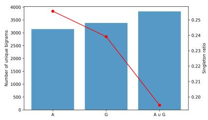
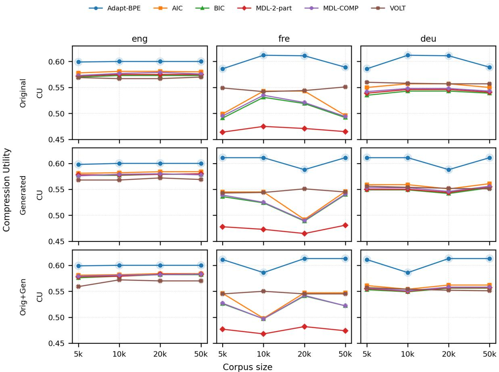
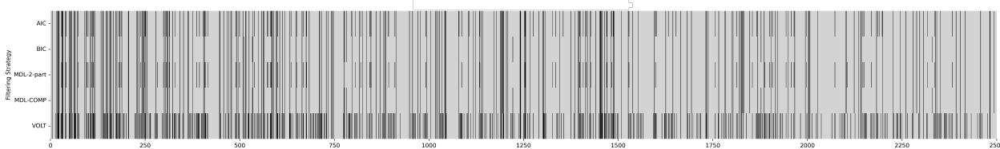

# Rethinking BPE: Merge Selection as Model Selection

Vijini Liyanage and François Yvon Sorbonne-Université, CNRS, ISIR, Paris {pilanaliyanage,yvon}@isir.upmc.fr

## Abstract

Subword tokenization methods such as Byte-Pair Encoding (BPE) are a core component of modern language models; yet, tokenizer capacity remains typically determined by a fixed merge budget, chosen heuristically. Since larger vocabularies increase memory usage and computational cost, selecting compact and effective token inventories is essential for efficient language modeling. We study the optimization of a BPE merge budget as a statistical model selection problem and investigate information-theoretic criteria for computing optimal merge sets directly from corpus statistics. To further improve the merge selection in limited data conditions, we augment the BPE training corpora with synthetic texts generated from the original data, providing estimates for the unigram and bigram distributions. Experiments across multiple corpora and downstream tasks show that using a principled vocabulary selection technique reduces model size, with little degradation in performance. We further observe that synthetic data can yield better tokenizers, especially in low-resource settings.

## 1 Introduction

Modern language models rely on subword tokenization to represent text efficiently. Methods such as Byte-Pair Encoding (BPE) (Gage, 1994; Sennrich et al., 2016) construct vocabularies by iteratively merging frequent symbol pairs, balancing vocabulary size and sequence length. Since tokenization defines the units processed by a model, it affects compression efficiency, computational cost, and downstream performance. However, tokenizer design remains largely heuristic: most systems fix the number of BPE merges in advance, typically ranging from tens to hundreds of thousands depending on the model and linguistic coverage (Brown et al., 2020; Touvron et al., 2023; Bai et al., 2023). These choices are rarely principled and are often inherited from prior work or selected through parameter

search.

The number of merges controls tokenization granularity and the tradeoff between vocabulary size and sequence length (Kudo, 2018). Too few merges create fragmented representations and long sequences, while too many produce large vocabularies capturing spurious or domain-specific patterns. This tradeoff affects efficiency, as longer sequences increase transformer attention costs, whereas large vocabularies increase embedding and decoding overhead.

In this work, we investigate principled BPE merge selection from corpus statistics. We formulate merge selection as a model selection problem and explore information-theoretic criteria including AIC (Akaike, 1974), BIC (Schwarz, 1978), and MDL (Rissanen, 1978; Grünwald, 2007), alongside entropy-based filtering methods. To improve estimation under limited data, we augment adaptation corpora with synthetic text generated from the original data, improving unigram and bigram coverage while reducing sparsity.

Our contributions are as follows: (a) we formulate BPE merge selection as a model selection problem rather than relying on predefined values; (b) we evaluate several statistical and informationtheoretic model selection criteria; (c) we propose synthetic text augmentation to improve the estimation of token distributions, particularly in lowresource settings; (d) we provide empirical analyses showing how different selection criteria affect merge inventories, compression efficiency and downstream performance.

## 2 Related Work

Subword Tokenization and Vocabulary Design. Subword tokenization methods such as Byte-Pair Encoding (BPE) (Gage, 1994; Sennrich et al., 2016), WordPiece (Wu et al., 2016), and Unigram Language Models (Kudo, 2018) are widely used in modern language models. These methods construct vocabularies by iteratively merging or selecting subword units based on corpus statistics. In practice, the number of merges or vocabulary size is typically fixed heuristically, despite its strong impact on sequence length, compression efficiency and downstream performance (Dagan et al., 2024).

Tokenizer Adaptation and Efficiency. Prior work has studied tokenizer adaptation in multilingual and domain-transfer settings, where vocabularies are modified or extended to improve coverage for new languages or domains (Sachidananda et al., 2021; Minixhofer et al., 2022; Remy et al., 2024). Other studies have analyzed the tradeoff between vocabulary size, sequence length, and computational efficiency, showing that tokenizer design can significantly affect both training and inference cost (Sennrich et al., 2016; Kudo, 2018; Zouhar et al., 2023; Dagan et al., 2024). In contrast to these approaches, we focus on selecting a compact subset of merges from an existing tokenizer rather than expanding or retraining the vocabulary. Closer to our work, (Meister et al., 2026) trains language-adapted unigram models that all share the same underlying unit set, with which it is then possible to jointly perform tokenization and language identification.

Information-Theoretic Model Selection. Information-theoretic criteria such as AIC, BIC (Akaike, 1974; Schwarz, 1978), and Minimum Description Length (MDL) (Rissanen, 1978; Grünwald, 2007) provide principled ways to balance model fit and complexity. These criteria have been widely used in statistical modeling and structure learning, but their application to subword tokenization has never, to the best of our knowledge, been considered. We leverage these criteria to formalize the problem of adaptation the vocabulary size to a given task.

Synthetic Data for Distribution Estimation. Data generation has been used to improve data coverage in low-resource and distributionally skewed settings. Recent work shows that large language models can generate synthetic corpora that improve robustness in downstream tasks (Anikina et al., 2025; Luo et al., 2025). In this work, we recourse to synthetic data to improve the estimation of token statistics for merge selection, particularly in low-resource and morphologically rich languages where sparsity affects frequency estimation.

## 3 Method

We address the problem of selecting an appropriate subset of BPE merge operations from an initial merge list. Given a training corpus D, standard BPE recursively applies a sequence of N merges, where N is a predefined parameter which controls the final vocabulary size. This vocabulary is then used uniformly for all tasks, domains, and language. Our goal is to select an optimal subset of merges from this basic vocabulary, based on the statistics of some data D, which can be the corpus used to train T, or, as we consider in our experiments, an adaptation corpus used to trim the vocabulary.

## 3.1 Background

A tokenizer is a function T mapping sequences of words1 into a sequence of indexes. Tokenization amounts to segmenting words into subword units in a finite inventory U. Modern LLMs used trained tokenizers, which identify these units either bottom-up, growing a basic unit set via a recursive sequence of merges as in the BPE algorithm of (Gage, 1994), or top-down, iteratively pruning the least useful units in a very large unit set, as in the Unigram algorithm (Kudo and Richardson, 2018).

In this work, we focus on BPE tokenizers. This is because training a BPE tokenizer with a target vocabulary size of N yields a sequence of tokenizers $T _ { 1 } \ldots T _ { N }$ of increasing vocabulary sizes $U _ { 1 } \ldots U _ { N }$ , with Tj and $T _ { j + 1 }$ only differing by one vocabulary unit. This basic property is key for our selection algorithm, as we explain below.

## 3.2 Merge Selection as Model Selection

Given a training corpus D, we identify a tokenizer T comprising U units with a unigram model $P ( u , \pmb \theta ^ { T } )$ trained on $T ( \mathcal { D } )$ ; parameter $\theta _ { u } ^ { T }$ corresponds to the unigram probability of token u, l(u) is its length. $\ell ( \mathcal { D } ; \pmb { \theta } ^ { T } )$ denotes the log-likelihood of the corpus under model $P ( u ; \pmb \theta ^ { T } )$ We also define $f ( u ; T ( \mathcal { D } ) )$ the frequency of u in $T ( \mathcal { D } )$ $f _ { \mathrm { m a x } } ( T ( \mathcal { D } ) ) \triangleq$ maxu $f ( u ; T ( \mathcal { D } ) )$ ) the maximum frequency and $\begin{array} { r } { S ( T ( \mathcal D ) ) \ = \ \sum _ { u } f ( u ; T ( \mathcal D ) ) } \end{array}$ the corpus size.2

We consider model selection criteria from the literature, all combining a log-likelihood term and a model complexity term:

• AIC: − $- 2 \ell ( \mathcal { D } ; \pmb { \theta } ^ { T } ) + ( U - 1 )$ is the Akaike Information Criterium (Akaike, 1974), which trades off perplexity and vocabulary size. For AIC, the model complexity term assigns a uniform cost of 1 to all parameters;3

• BIC: $- 2 \ell ( \mathcal { D } ; \pmb { \theta } ^ { T } ) + 2 ( U - 1 )$ log S is the Bayesian Information Criterium (Schwarz, 1978), which further takes the corpus size S into consideration: larger training data enables to estimate larger models;

• MDL-2-part: $- \ell ( \mathcal { D } ; \pmb { \theta } ^ { T } ) + ( U - 1 )$ log fmax is a basic version of the Minimum Description Length (MDL) criteria (Rissanen, 1978). log $f _ { \mathrm { m a x } }$ corresponds to a coding cost that needs to be “paid” for each parameter $\theta _ { u } ^ { T }$ : assuming maximum likelihood (ML) estimates, $\theta _ { u } ^ { T }$ can be identified with count $f ( u )$ , the encoding of which requires log $f _ { \mathrm { m a x } }$ bits;

$\mathbf { M D L - C O M P : } - \ell ( \mathcal { D } , \theta ) + 0 . 5 ( U - 1 )$ log S. This is the revised version of MDL (Grünwald, 2007), with a slightly different formulation of the complexity term. The refined MDL criterion replaces the parameter encoding cost of two-part MDL with an approximation of the model’s stochastic complexity, which measures the flexibility of the model class. As a result, the complexity penalty scales with both the number of parameters and the corpus size.

In addition, we consider the entropy-based criterion of (Xu et al., 2021):

• VOLT:

$$
{ \frac { \sum _ { u } l _ { u } } { U \sum _ { u } f ( u ) } } \times \sum _ { u } f ( u ) \log { \frac { f ( u ) } { \sum _ { u } f ( u ) } } .
$$

The similarity between VOLT and other model selection criteria stems from the fact that the second term in VOLT is equivalent to the log-likelihood of the unigram model (assuming standard ML estimates: $\begin{array} { r } { \theta _ { u } ^ { \overline { { T } } } = \frac { f ( u ) } { \sum _ { u } f ( u ) } ) } \end{array}$ . The first term corresponds to the average token length divided by the total number of tokens. The numerator increases as more units are merged, while the denominator decreases, since larger vocabularies imply coarser tokenizations. VOLT can thus also be viewed as performing a (multiplicative) tradeoff between model complexity (expressed by the first term) and goodness of fit (the second term).

## 3.3 Merge Filtering Procedure

We interpret the BPE merging procedure as a sequence of local model updates, where each candidate merge introduces a new unit and modifies the corpus tokenization. Each merge therefore affects both the fit to the data (via changes in token frequencies and likelihood) and the model complexity (chiefly, via the vocabulary size).

An Algorithm for Incremental Merge Evaluation. We assume a existing BPE tokenizer, associated with a predefined merge list and decide which merge to keep or drop based on the following iterative procedure. At step j, $\mathcal { D }$ is tokenized with tokenizer $T _ { j - 1 }$ , and we need to evaluate merge $\mu _ { j }$ (creating unit $u _ { j } )$ . For this, we compute:

$$
\Delta \mathcal { I } ( \mu _ { j } ) ~ = ~ \mathcal { I } ( \mathcal { D } ; T _ { j } ) ~ - ~ \mathcal { I } ( \mathcal { D } ; T _ { j - 1 } )
$$

with $\mathcal { I } ( \mathcal { D } ; T _ { J } )$ a model selection criterion for tokenizer $T _ { j }$ . The merge is accepted if and only if:

$$
\Delta \mathcal { I } ( \mu _ { j } ) < 0 ,
$$

i.e., the improvement in data fit outweighs the increase in model complexity. Else, the merge is rejected and the next merge is evaluated. Note that rejecting a merge $\mu _ { j }$ will automatically prevent any unit derived from $u _ { j }$ to be formed at a later stage, as $u _ { j }$ will have a null frequency. The procedure terminates when all merges have been evaluated. It is routine to check that the resulting merge list is valid (Berglund and van der Merwe, 2023) as the validity property is an invariant property wich is maintained at all steps of the procedure.

Merge Refinement The procedure sketched above is greedy, as it selects or rejects merges based on a local evaluation of their utility. Like for standard BPE, this process may create to junk units (Bostrom and Durrett, 2020), which, once created, may participate in further merges that decrease their utility. We thus follow (Lian et al., 2025) and adopt their refinement strategy, which performs a second filtering pass, unmerging, as it were, any unit whose global utility is too small.

Merge Refinement with Scaffolding. We now describe the full procedure used to select and refine BPE merges. The algorithm contain two phases: (i)

a greedy filtering stage that selects merges based on the offset between goodness-of-fit and complexity, and (ii) a scaffolding refinement stage that replaces low-utility merges with higher-frequency candidates based on corpus statistics. The full procedure is formalized in Algorithm 1 (appendix 1).

## 3.4 Synthetic Data Augmentation

Our merge selection procedure applies irrespective of the nature of D, which can either be the original tokenizer training data, or a new corpus on which the model and its tokenizer need to be adapted. In the latter case, estimating merge utility from limited data can yield unmotivated choices, particularly for low-frequency or unseen bigrams. In BPE-based adaptation algorithms, merges corresponding to zero-frequency bigrams are never considered, even if they are plausible under the underlying data distribution.

To address this limitation, we augment the adaptation corpus A with synthetic text generated from a pretrained LLM . The goal is to better approximate the bigram distribution in the adaptation domain and to recover potentially useful merges that would otherwise remain undetected.

Generation Procedure We construct a synthetic corpus adaptation G by sampling prefixes p ∈ A and generating continuations conditioned on these prefixes. Each prefix serves as a prompt to the LLM, yielding texts that preserve local syntactic and semantic structure, while also reflecting the peculiarities of the adaptation corpus. In the sequel, we note the synthetic corpus derived from A as AG.

By aggregating generated continuations across diverse prefixes, the synthetic corpus approximates the underlying token distribution and increase support for rare or even unseen bigrams. Figure 1 illustrates this effect via increased bigram coverage and reduced singleton ratio, indicating lower distributional sparsity.

Interpretation From a modeling perspective, synthetic data enables to smooth empirical counts and yields more robust estimation of merge utility. This is particularly important for statistical criteria such as AIC, BIC, and MDL, which depend on accurate likelihood estimates.

In our experiments, we evaluate merge selection under three conditions: orig (original corpus only), gen (synthetic corpus only) and orig+gen (combined corpus). This setup allows us to isolate the contribution of synthetic data and assess their impact on merge selection and downstream tasks.

  
Figure 1: Bigram distribution and singleton ratio computed for the EMEA English corpus. We compare using 10k original data (A), 10k generated data (G), and their combination (A ∪ G).

## 4 Experimental Setup

## 4.1 Corpora

We evaluate merge selection across multiple corpora covering both domain-specific and multilingual settings.

Domain-specific corpora We use the EMEA corpus for English and French,4 and the LER corpus for German.5 These datasets provide controlled, domain-specific text suitable for analyzing tokenization under limited variability.

Multilingual corpora To assess robustness across languages, we again use subsets of the OPUS collection for English, Sinhala, and Swahili, representing varying levels of resource availability and morphological complexity. For each corpus, we construct training subsets of size 5k, 10k, 20k, and 50k sentences to study the effect of data scale on merge selection.

## 4.2 Synthetic Data Generation

Synthetic text is generated using LLaMA-3.1-8Binstruct with nucleus sampling (top-p = 0.9) and temperature 0.7. Each prompt consists of a 12- word prefix sampled from the original corpus, followed by an instruction to continue generation until sentence completion. For each prefix, we sample m independent continuations with a maximum length of 64 tokens each.

## 4.3 Tokenizer Construction

All tokenizers are derived from a shared initial BPE merge list. Each selection strategy (AIC, BIC, MDL variants, VOLT) produces a filtered subset of merges. To ensure comparability, all methods and baselines only differ in their selection criterion, and operate on the same initial merge inventory.

## 4.4 Evaluation: Tasks and Metrics

Compression Utility We assess adapted tokenizer based on their ability to compress the adpatation corpus, i.e. to reduce the initial byte based representation (or character-based representation) into a shorter list of tokens. This can be measured in various ways (e.g., tokenizer fertility); in this work we rely on the compression utility, which measure the difference (in number of units) between the byte-based and token-based representations as a ratio of the original number of bytes or characters. Additionally, we also evaluate the adapted tokenizers on downstream tasks that probe both understanding and generation.

Reading Comprehension We evaluate multilingual understanding using the Belebele benchmark (Bandarkar et al., 2024). Performance in multiple choice question is measured using accuracy. For each example, the model is prompted with the passage, question and four candidate answers, and instructed to output one of the answer labels A, B, C, or D. The predicted answer is obtained by extracting the generated choice label, then compared against the gold answer to compute accuracy.

Machine Translation To assess generation, we use Machine Translation (MT). As MT requires (at least) two languages, we build the adaptation corpus (and the corresponding synthetic data) using a balanced subset of sentences sampled from the source and target corpus. We use Flores-200 for multilingual translation (Costa-jussà et al., 2024). Translation quality is measured in BLEU (Papineni et al., 2002) implemented with sacreBLEU (Post, 2018).6 We use greedy decoding with a maximum generation limit of 128 tokens for all models.

## 4.5 Baselines

We compare our new merge selection strategies to Adapt-BPE (Pilana Liyanage and Yvon, 2026), which also adapts a tokenizer to a target corpus, using a comparable merge budget. For all pruningbased approaches (Adapt-BPE, AIC, BIC, MDL-2-part, MDL-COMP, and VOLT), we use a fixed budget of 15k merges to ensure a fair comparison.

## 4.6 Experimental Protocol

For each corpus, dataset size, and data condition (orig, gen, orig+gen), our experiments rely on the following steps: (a) construct tokenizers using various selection strategies; (b) apply the resulting tokenizers to downstream tasks; (c) evaluate compression and task performance. All experiments use the same underlying model and inference settings, ensuring that differences in performance arise solely from the choice of tokenizer.

## 5 Results

We present results across three evaluation dimensions: compression utility (CU), reading comprehension (RC), and machine translation (MT).

## 5.1 Compression Utility

Figure 2 reports CU for English, French, and German corpora of varying sizes. For these experiments, we used the Llama-3 tokenizer (128k) as the initial tokenizer. For all languages, the 15kbaseline consistently achieves the highest compression utility, reflecting the advantage of a large predefined merge budget. However, all selectionbased methods operate with much smaller vocabularies - only retaining between 3 times and 10 times less units (full numbers for the 50k adaptation corpus are in Table 1). Although VOLT generally retains a larger number of merges than the information-theoretic methods, it does not consistently achieve the highest CU. This suggests that the effectiveness of merge selection depends not only on the number of retained merges but also on selecting the most informative ones, where MDL-COMP and AIC provide a better tradeoff between vocabulary size and compression.

Among the adaptive selection methods, VOLT and AIC consistently outperform MDL-\* and BIC, yielding larger unit sets, especially for the original corpus. In particular, BIC tends to underfit, selecting smaller vocabularies that lead to lower CU than the other methods. We also observe variance across languages, owing to the initial vocabulary content for those languages.

  
Figure 2: CU values for each strategy, corpus types and sizes in English, French and German.

## 5.2 Reading Comprehension

Table 1 reports accuracy on the Belebele benchmark across multiple languages.

In these experiments, the full tokenizer achieves the highest accuracy across the board, followed by the fixed-15k baseline. Among the selection strategies, VOLT and MDL-based methods (particularly MDL-COMP) consistently outperform AIC and BIC.

The performance gap between large and reduced vocabularies is significant for high-resource languages. For the two LR languages (sin and swh), for which the baseline performance is low, it is possible to perform a very agressive vocabulary pruning with little impact on performance, sometimes even outperforming the baseline. This highlights the unfairness of the initial tokenizer, which allocates a lots of units to improve the tokenization of HR languages, while the LR languages are comparatively less well served.

We further observe that BPE scaffolding consistently improves performance across nearly all filtering strategies and data settings. The gains are particularly noticeable for VOLT and MDL-based methods.

Finally, synthetic data again provides modest but consistent improvements when combined with actual data.

## 5.3 Machine Translation

Table 2 reports BLEU scores for Sinhala-English translation on Flores-200.7 The full tokenizer and the 15k Adapt-BPE baseline achieve the strongest overall performance, confirming the advantage of larger merge inventories. Among the selectionbased approaches, however, VOLT and MDL-COMP consistently outperform AIC and BIC, despite relying on substantially smaller vocabularies. Here again, scaffolding consistently improves BLEU scores across nearly all selection strategies. The gains are particularly strong for VOLT and MDL-based methods, indicating that greedy merge filtering alone may discard useful subword units that can later be recovered through refinement.

Synthetic data also provides clear benefits.

<table><tr><td rowspan="2">Strategy</td><td colspan="5">orig</td><td colspan="5">gen</td><td colspan="5">orig+gen</td></tr><tr><td>eng</td><td>fre</td><td>deu</td><td>swh</td><td>sin</td><td>eng</td><td>fre</td><td>deu</td><td>swh</td><td>sin</td><td>eng</td><td>fre</td><td>deu</td><td>swh</td><td>sin</td></tr><tr><td>Full (128k)</td><td>81.7</td><td>74.1</td><td>75.0</td><td>49.7</td><td>48.3</td><td>81.7</td><td>74.1</td><td>75.0</td><td>49.7</td><td>48.3</td><td>81.7</td><td>74.1</td><td>75.0</td><td>49.7</td><td>48.3</td></tr><tr><td>Adapt-BPE (15k)</td><td>70.3</td><td>68.3</td><td>70.0</td><td>45.8</td><td>48.3</td><td>68.2</td><td>66.7</td><td>67.8</td><td>43.9</td><td>47.7</td><td>71.6</td><td>69.5</td><td>70.0</td><td>45.8</td><td>48.3</td></tr><tr><td>AIC</td><td>60.0 (5.9k)</td><td>58.9 (2.5k)</td><td>60.0 (3.1k)</td><td>42.2 (2.4k)</td><td>46.5 (1.7k)</td><td>58.0 (6.6k)</td><td>57.7 (3.4k)</td><td>59.9 (2.6k)</td><td>40.4 (2.6k)</td><td>46.0 (1.6k)</td><td>60.1 (6.6k)</td><td>58.9 (3.8k)</td><td>60.1 (3.2k)</td><td>42.3 (2.7k)</td><td>47.0 (1.7k)</td></tr><tr><td>+ Scaffolding</td><td>60.3 (5.9k)</td><td>60.4 (2.5k)</td><td>62.1 (3.1k)</td><td>43.7 (2.4k)</td><td>47.9 (1.7k)</td><td>59.9 (6.6k)</td><td>58.3 (3.4k)</td><td>60.1 (2.6k)</td><td>42.2 (2.6k)</td><td>46.5 (1.6k)</td><td>61.6 (6.6k)</td><td>60.9 (3.8k)</td><td>62.1 (3.2k)</td><td>43.4 (2.7k)</td><td>48.0 (1.7k)</td></tr><tr><td>BIC</td><td>56.2 (4.1k)</td><td>55.5 (1.4k)</td><td>57.7 (2.3k)</td><td>40.1 (1.9k)</td><td>45.6 (1.4k)</td><td>55.9 (3.7k)</td><td>55.2 (2.0k)</td><td>56.8 (1.6k)</td><td>39.9 (2.0k)</td><td>44.2 (1.4k)</td><td>56.5 (5.0k)</td><td>57.3 (2.4k)</td><td>58.8 (2.4k)</td><td>42.1 (2.1k)</td><td>46.6 (1.5k)</td></tr><tr><td>+ Scaffolding</td><td>57.1 (4.1k)</td><td>56.9 (1.4k)</td><td>58.9 (2.3k)</td><td>42.1 (1.9k)</td><td>46.9 (1.4k)</td><td>57.0 (3.7k)</td><td>56.0 (2.0k)</td><td>57.2 (1.6k)</td><td>41.1 (2.0k)</td><td>46.2 (1.4k)</td><td>57.5 (5.0k)</td><td>57.1 (2.4k)</td><td>59.3 (2.4k)</td><td>43.1 (2.1k)</td><td>47.3 (1.5k)</td></tr><tr><td>MDL-2-part</td><td>57.7 (3.1k)</td><td>57.0 (1.5k)</td><td>58.8 (2.4k)</td><td>41.1 (2.1k)</td><td>46.8 (1.6k)</td><td>56.7 (4.0k)</td><td>56.6 (2.1k)</td><td>58.1 (1.7k)</td><td>40.1 (2.2k)</td><td>46.0 (1.7k)</td><td>58.0 (5.3k)</td><td>57.7 (2.5k)</td><td>60.0 (2.5k)</td><td>42.3 (2.3k)</td><td>46.8 (1.7k)</td></tr><tr><td>+ Scaffolding</td><td>58.1 (3.1k)</td><td>58.1 (1.5k)</td><td>59.1 (2.4k)</td><td>42.3 (2.1k)</td><td>47.8 (1.6k)</td><td>57.1 (4.0k)</td><td>57.2 (2.1k)</td><td>59.0 (1.7k)</td><td>42.1 (2.2k)</td><td>46.5 (1.7k)</td><td>60.1 (5.3k)</td><td>60.1 (2.5k)</td><td>60.1 (2.5k)</td><td>43.0 (2.3k)</td><td>48.0 (1.7k)</td></tr><tr><td>MDL-COMP</td><td>58.8 (3.5k)</td><td>57.7 (1.7k)</td><td>57.8 (2.6k)</td><td>42.2 (2.3k)</td><td>47.9 (1.9k)</td><td>58.0 (4.4k)</td><td>57.4 (2.8k)</td><td>57.7 (1.9k)</td><td>42.5 (2.2k)</td><td>47.0 (1.9k)</td><td>59.0 (5.5k)</td><td>58.8 (2.8k)</td><td>58.0 (2.7k)</td><td>43.2 (2.3k)</td><td>48.0 (1.9k)</td></tr><tr><td>+ Scaffolding</td><td>60.0 (3.5k)</td><td>58.1 (1.7k)</td><td>58.9 (2.6k)</td><td>43.8 (2.3k)</td><td>48.1 (1.9k)</td><td>58.8 (4.4k)</td><td>58.0 (2.8k)</td><td>58.7 (1.9k)</td><td>43.0 (2.2k)</td><td>48.0 (1.9k)</td><td>60.5 (5.5k)</td><td>60.0 (2.8k)</td><td>58.9 (2.7k)</td><td>44.2 (2.3k)</td><td>48.2 (1.9k)</td></tr><tr><td>VOLT</td><td>59.3 (4.7k)</td><td>60.0 (3.4k)</td><td>59.1 (3.5k)</td><td>45.2 (2.4k)</td><td>47.6 (2.1k)</td><td>59.0 (5.2k)</td><td>59.6 (4.6k)</td><td>59.0 (3.4k)</td><td>45.6 (2.5k)</td><td>47.5 (2.3k)</td><td>60.0 (5.9k)</td><td>60.1 (5.4k)</td><td>60.2 (3.9k)</td><td>45.9 (2.7k)</td><td>48.2 (2.3k)</td></tr><tr><td>+ Scaffolding</td><td>61.0 (4.7k)</td><td>61.0 (3.4k)</td><td>61.0 (3.5k)</td><td>47.2 (2.4k)</td><td>48.2 (2.1k)</td><td>60.9 (5.2k)</td><td>60.2 (4.6k)</td><td>59.8 (3.4k)</td><td>46.3 (2.5k)</td><td>48.0 (2.3k)</td><td>62.1 (5.9k)</td><td>62.9 (5.4k)</td><td>61.2 (3.9k)</td><td>47.9 (2.7k)</td><td>48.3 (2.3k)</td></tr></table>

Table 1: RC results (Accuracy). For AIC, BIC, MDL and VOLT, merge lists are filtered using a corpus of 50k lines.

Across most settings, the orig+gen condition achieves the best performance, especially for smaller corpora, suggesting that generated text improves estimation of low-frequency and previously unseen token patterns. These improvements are particularly important in the Sinhala-English setting, where limited adaptation data makes merge estimation more sensitive to sparsity.

Interestingly, larger vocabularies do not always yield better translation quality. For example, AIC often selects more merges than MDL-COMP while achieving lower BLEU scores.

## 5.4 Increasing Synthetic Data

Table 3 summarizes the effect of increasing the synthetic data from 50k to 100k, then 200k samples. We observe consistent improvements across all metrics (CU, MT, RC) as the amount of synthetic data increases. The gains are especially pronounced for MDL-COMP and VOLT, suggesting that these methods benefit more from improved estimation of token distributions. Overall, these results confirm that synthetic data acts as an effective smoothing mechanism, enabling better estimation of low-frequency and unseen token patterns and improving merge selection.

To better understand these improvements, we analyze how synthetic data affects token statistics used for merge evaluation. Table 4 reports the effect of augmenting the original corpus with synthetic data for a fixed 20k+20k setting. Here, the coverage, is computed as the fraction of test bigrams observed in the training corpus. We observe a substantial increase in observed bigrams (+32%) for English.

## 6 Discussion

Our results provide several key insights into the problem of tokenizer capacity selection and the role of statistical criteria in guiding BPE merge selection.

Tokenizer Selection as Model Selection Across all experiments, we find that treating merge selection as a model selection problem leads to compact vocabularies that retain strong performance. While the fixed-15k baseline achieves the highest scores due to its large predefined merge budget, selection-based methods are able to identify significantly smaller vocabularies that remain competitive across tasks, at a much reduced computational costs. Large merge budgets are not always necessary, and principled selection criteria can yield efficient tokenizer with adaptive vocabulary sizes.

Effect of Model Selection Criteria Different selection criteria exhibit distinct behaviors. BIC consistently selects smaller vocabularies, often leading to underfitting due to its strong complexity penalty. AIC allows larger vocabularies, but does not consistently translate this into improved downstream performance. In contrast, MDL-based methods, particularly MDL-COMP, provide a more balanced tradeoff, adapting effectively to different data sizes. VOLT also performs competitively for all tasks.

Role of Scaffolding Refinement The scaffolding refinement stage consistently improves results across all criteria. This confirms that purely greedy merge selection is unefficient, as early decisions may exclude useful merges. By replacing lowfrequency merges with high-frequency candidates, scaffolding introduces a form of global correction, leading to better merge inventories.

Impact of Synthetic Data Synthetic data improves merge selection, with consistent gains observed across CU, MT, and RC, particularly when combined with natural data (orig+gen setting).

This supports the interpretation of synthetic data as a distributional prior that reduces sparsity and provides better estimates of rare or unseen token combinations, which is especially important for statistical criteria relying on accurate likelihood estimation. Increasing the amount of synthetic data further improves performance, indicating that merge selection benefits from increasingly better approximations of the underlying distribution.

<table><tr><td rowspan="2">Strategy</td><td colspan="4">orig</td><td colspan="4">gen</td><td colspan="4">orig+gen</td></tr><tr><td>5k+5k</td><td>10k+10k</td><td>20k+20k</td><td>50k+50k</td><td>5k+5k</td><td>10k+10k</td><td>20k+20k</td><td>50k+50k</td><td>5k+5k</td><td>10k+10k</td><td>20k+20k</td><td>50k+50k</td></tr><tr><td>Adapt-BPE</td><td>22.6 (30k)</td><td>22.6 (30k)</td><td>22.7 (30k)</td><td>22.7 (30k)</td><td>21.1 (30k)</td><td>21.1 (30k)</td><td>21.3 (30k)</td><td>21.4 (30k)</td><td>23.6 (30k)</td><td>23.6 (30k)</td><td>23.7 (30k)</td><td>23.8 (30k)</td></tr><tr><td>AIC</td><td>21.3 (4.4k)</td><td>21.3 (5.0k)</td><td>21.3 (5.5k)</td><td>21.4 (6.0k)</td><td>21.0 (4.7k)</td><td>21.0 (5.3k)</td><td>21.1 (6.0k)</td><td>21.1 (6.6k)</td><td>21.3 (4.7k)</td><td>21.3 (5.3k)</td><td>21.3 (6.0k)</td><td>21.4 (6.6k)</td></tr><tr><td>+ Scaffolding</td><td>21.4 (4.4k)</td><td>21.5 (5.0k)</td><td>21.5 (5.5k)</td><td>21.6 (6.0k)</td><td>22.0 (4.7k)</td><td>22.1 (5.3k)</td><td>22.2 (6.0k)</td><td>22.2 (6.6k)</td><td>22.4 (4.7k)</td><td>22.4 (5.3k)</td><td>22.4 (6.0k)</td><td>22.5 (6.6k)</td></tr><tr><td>BIC</td><td>17.1 (2.3k)</td><td>17.2 (2.9k)</td><td>17.2 (3.5k)</td><td>17.7 (4.1k)</td><td>16.9 (2.4k)</td><td>16.9 (3.0k)</td><td>16.9 (3.7k)</td><td>17.0 (3.7k)</td><td>17.2 (3.1k)</td><td>17.2 (3.7k)</td><td>17.2 (4.5k)</td><td>17.7 (5.0k)</td></tr><tr><td>+ Scaffolding</td><td>18.2 (2.3k)</td><td>18.2 (2.9k)</td><td>18.2 (3.5k)</td><td>18.7 (4.1k)</td><td>18.0 (2.4k)</td><td>18.0 (3.0k)</td><td>18.0 (3.7k)</td><td>18.1 (3.7k)</td><td>18.3 (3.1k)</td><td>18.3 (3.7k)</td><td>18.3 (4.5k)</td><td>18.4 (5.0k)</td></tr><tr><td>MDL-2-part</td><td>19.3 (2.6k)</td><td>19.5 (2.7k)</td><td>19.8 (2.7k)</td><td>19.8 (3.1k)</td><td>18.0 (3.3k)</td><td>18.0 (3.3k)</td><td>18.1 (3.7k)</td><td>18.1 (4.0k)</td><td>20.0 (3.8k)</td><td>20.2 (4.4k)</td><td>20.3 (5.3k)</td><td>20.7 (5.3k)</td></tr><tr><td>+ Scaffolding</td><td>20.5 (2.6k)</td><td>20.5 (2.7k)</td><td>20.8 (2.7k)</td><td>20.9 (3.1k)</td><td>21.0 (3.3k)</td><td>20.1 (3.3k)</td><td>20.2 (3.7k)</td><td>20.2 (4.0k)</td><td>21.1 (3.8k)</td><td>21.5 (4.4k)</td><td>21.7 (5.3k)</td><td>21.8 (5.3k)</td></tr><tr><td>MDL-COMP</td><td>20.1 (3.0k)</td><td>20.3 (3.1k)</td><td>20.3 (3.7k)</td><td>20.4 (3.5k)</td><td>20.0 (3.7k)</td><td>20.0 (3.7k)</td><td>20.1 (4.4k)</td><td>20.1 (4.4k)</td><td>20.3 (4.0k)</td><td>20.4 (4.4k)</td><td>21.1 (5.1k)</td><td>21.2 (5.5k)</td></tr><tr><td>+ Scaffolding</td><td>21.3 (3.0k)</td><td>21.5 (3.1k)</td><td>21.5 (3.7k)</td><td>21.5 (3.5k)</td><td>21.0 (3.7k)</td><td>21.0 (3.7k)</td><td>21.2 (4.4k)</td><td>21.2 (4.4k)</td><td>21.5 (4.0k)</td><td>21.5 (4.4k)</td><td>21.5 (5.1k)</td><td>22.2 (5.5k)</td></tr><tr><td>VOLT</td><td>20.32 (4.2k)</td><td>20.3 (4.7k)</td><td>20.4 (4.4k)</td><td>20.4 (4.7k)</td><td>19.8 (4.6k)</td><td>19.9 (4.6k)</td><td>20.0 (5.3k)</td><td>20.3 (5.2k)</td><td>20.5 (5.1k)</td><td>21.9 (5.9k)</td><td>21.9 (5.9k)</td><td>22.3 (5.9k)</td></tr><tr><td>+ Scaffolding</td><td>22.3 (4.2k)</td><td>22.4 (4.7k)</td><td>22.4 (4.4k)</td><td>22.4 (4.7k)</td><td>21.3 (4.6k)</td><td>21.5 (4.6k)</td><td>21.5 (5.3k)</td><td>21.5 (5.2k)</td><td>22.1 (5.1k)</td><td>22.9 (5.9k)</td><td>23.2 (5.9k)</td><td>23.7 (5.9k)</td></tr></table>

Table 2: MT results (BLEU) for sin-eng Flores-200 data. Using the full tokenizer yields a BLEU score of 23.2.

<table><tr><td>Method</td><td colspan="7">100k</td><td colspan="7"></td></tr><tr><td></td><td colspan="3">ΔCU</td><td colspan="2">∆BLEU</td><td colspan="3">∆Acc</td><td colspan="3">∆CU</td><td colspan="2">∆BLEU</td><td colspan="3">∆Acc</td></tr><tr><td></td><td>eng</td><td>fre</td><td>sin</td><td>fre-eng</td><td>sin-eng</td><td>eng</td><td>fre</td><td>sin</td><td>eng</td><td>fre</td><td>sin</td><td>fre-eng</td><td>sin-eng</td><td>eng fre</td><td></td><td>sin</td></tr><tr><td>AIC</td><td>+4.55</td><td>+5.32</td><td>+5.85</td><td>+4.31</td><td>+1.59</td><td>+6.29</td><td>+4.11</td><td>+0.90</td><td>+6.13</td><td>+5.99</td><td>+6.11</td><td>+5.89</td><td>+1.73</td><td>+6.98</td><td>+5.21</td><td>+1.05</td></tr><tr><td>BIC</td><td>+8.53</td><td>+10.01</td><td>+12.13</td><td>+3.90</td><td>+1.71</td><td>+6.14</td><td>+4.80</td><td>+1.11</td><td>+9.42</td><td>+11.08</td><td>+14.02</td><td>+4.08</td><td>+1.79</td><td>+6.29</td><td>+4.93</td><td>+1.65</td></tr><tr><td>MDL-2Part</td><td>+1.65</td><td>+1.83</td><td>+1.98</td><td>+4.93</td><td>+1.88</td><td>+5.91</td><td>+4.61</td><td>+1.34</td><td>+2.05</td><td>+1.95</td><td>+2.48</td><td>+5.13</td><td>+1.93</td><td>+6.03</td><td>+4.93</td><td>+1.77</td></tr><tr><td>MDL-COMP</td><td>+19.53</td><td>+21.12</td><td>+23.46</td><td>+5.03</td><td>+1.93</td><td>+4.88</td><td>+4.74</td><td>+0.86</td><td>+24.66</td><td>+22.22</td><td>+26.17</td><td>+5.29</td><td>+1.99</td><td>+5.16</td><td>+5.02</td><td>+0.95</td></tr><tr><td>VOLT</td><td>+7.21</td><td>+8.31</td><td>+9.12</td><td>+5.45</td><td>+1.78</td><td>+5.03</td><td>+4.13</td><td>+0.96</td><td>+8.24</td><td>+11.53</td><td>+12.95</td><td>+5.65</td><td>+1.83</td><td>+5.14</td><td>+4.56</td><td>+1.04</td></tr></table>

Table 3: Performance improvements when increasing synthetic data from 50k to 100k and 200k. We report changes (∆) in Compression Utility $( \mathrm { C U } \times 1 0 ^ { - 4 } )$ for English, French, and Sinhala, in BLEU (MT for sin-eng and fra-eng), and Accuracies (RC for fre, eng, sin). All results are without scaffolding.

<table><tr><td>Dataset</td><td>Unique Bigrams</td><td>Coverage</td></tr><tr><td>orig (20k)</td><td>87194</td><td>0.1230</td></tr><tr><td>orig + gen  $( 2 0 \mathbf { k } + 2 0 \mathbf { k } )$ </td><td>115597</td><td>0.1373</td></tr></table>

Table 4: Effect of synthetic data augmentation on bigram statistics.

Task Sensitivity to Tokenization We observe that different tasks exhibit different sensitivities to tokenization. Machine translation is relatively robust to vocabulary reduction, whereas reading comprehension is more sensitive, particularly in a multilingual setting, as token fragmentation can affect the representation of rare words, named entities, and morphologically complex forms required for precise semantic matching. In contrast, translation can compensate for increased fragmentation through contextual generation and compositional decoding.

This suggests that tasks requiring precise semantic matching may benefit from fine-grained tokenization, while generative tasks can tolerate more compact representations. Future work could quantify this sensitivity by relating performance degradation under controlled vocabulary reduction to token-level properties such as fertility, named entity fragmentation, and morphological complexity.

## 7 Conclusion

We studied BPE merge inventory selection from a statistical model selection perspective, framing tokenizer capacity as a tradeoff between data likelihood and model complexity through criteria such as AIC, BIC, MDL, and entropy-based objectives.

Across multiple corpora and languages, these criteria produce compact vocabularies that remain competitive on downstream tasks while requiring substantially fewer merges than fixed-budget tokenizers. MDL-based objectives and VOLT provide the most consistent balance between compression efficiency and task performance.

We further show that synthetic data improves merge selection by providing better token statistics, reducing sparsity and improving coverage of rare or unseen combinations, particularly for low-resource and morphologically rich languages.

Overall, our results demonstrate that tokenizer design benefits from principled statistical selection rather than heuristic merge budgets. Downstream performance does not scale monotonically with vocabulary size, and compact inventories can preserve task performance under constrained computational resources.

## Limitations

Our evaluation relies on unigram model to select an optimal unit set, that we then apply to a BPE vocabulary construction process. The choice to combine two techniques makes it easy to implement an incremental vocabulary growth; it also makes our approach fully with complementary techniques such as BPE-scaffolding. However, it certainly yields to suboptimal unit sets. An alternative would be to keep BPE as a way to incrementally extend the set of units, and to perform tokenization with the unigram model.

Finally, our evaluation is limited to translation and reading comprehension benchmarks, and future work should consider broader tasks and largescale language model training settings. In addition, evaluating across a wider variety of pretrained tokenizers, model architectures, and languages, particularly underrepresented and morphologically diverse languages, would provide a more comprehensive understanding of the generality and limitations of adaptive vocabulary refinement.

## References

H. Akaike. 1974. A new look at the statistical model identification. IEEE Transactions on Automatic Control, 19(6):716–723.

Tatiana Anikina, Jan Cegin, Jakub Simko, and Simon Ostermann. 2025. A rigorous evaluation of LLM data generation strategies for low-resource languages. In Proceedings of the 2025 Conference on Empirical Methods in Natural Language Processing, pages 8282–8303, Suzhou, China. Association for Computational Linguistics.

Jinze Bai, Shuai Bai, Yunfei Chu, Zeyu Cui, Kai Dang, Xiaodong Deng, Yang Fan, Wenbin Ge, Yu Han, Fei Huang, Binyuan Hui, Luo Ji, Mei Li, Junyang Lin, Runji Lin, Dayiheng Liu, Gao Liu, Chengqiang Lu, Keming Lu, and 29 others. 2023. Qwen technical report. Preprint, arXiv:2309.16609.

Lucas Bandarkar, Davis Liang, Benjamin Muller, Mikel Artetxe, Satya Narayan Shukla, Donald Husa, Naman Goyal, Abhinandan Krishnan, Luke Zettlemoyer, and Madian Khabsa. 2024. The belebele benchmark: a parallel reading comprehension dataset in 122 language variants. In Proceedings ofthe 62nd Annual Meeting of the Association for Computational Linguistics (Volume 1: Long Papers), pages 749–775, Bangkok, Thailand. Association for Computational Linguistics.

Martin Berglund and Brink van der Merwe. 2023. Formalizing BPE tokenization. Electronic Proceedings in Theoretical Computer Science, 388:16–27.

Kaj Bostrom and Greg Durrett. 2020. Byte pair encoding is suboptimal for language model pretraining. In Findings ofthe Associationfor Computational Linguistics: EMNLP 2020, pages 4617–4624, Online. Association for Computational Linguistics.

Tom Brown, Benjamin Mann, Nick Ryder, Melanie Subbiah, Jared D Kaplan, Prafulla Dhariwal, Arvind Neelakantan, Pranav Shyam, Girish Sastry, Amanda Askell, Sandhini Agarwal, Ariel Herbert-Voss, Gretchen Krueger, Tom Henighan, Rewon Child, Aditya Ramesh, Daniel M. Ziegler, Jeffrey Wu, Clemens Winter, and 12 others. 2020. Language models are few-shot learners. Advances in neural information processing systems, 33:1877–1901.

Marta R. Costa-jussà, James Cross, Onur Çelebi, Maha Elbayad, Kenneth Heafield, Kevin Heffernan, Elahe Kalbassi, Janice Lam, Daniel Licht, Jean Maillard, Anna Sun, Skyler Wang, Guillaume Wenzek, Al Youngblood, Bapi Akula, Loic Barrault, Gabriel Mejia Gonzalez, Prangthip Hansanti, John Hoffman, and 20 others. 2024. Scaling neural machine translation to 200 languages. Nature, 630(8018):841–846. ISBN: 1476-4687 tex.date-added: 2024-08-21 15:32:57 +0200 tex.datemodified: 2024-08-21 15:32:57 +0200.

Gautier Dagan, Gabriel Synnaeve, and Baptiste Rozière. 2024. Getting the most out of your tokenizer for pretraining and domain adaptation. In Proceedings of the 41st international conference on machine learning, ICML’24, Vienna, Austria. JMLR.org. Number of pages: 22 tex.articleno: 387.

Philip Gage. 1994. A new algorithm for data compression. Computer Users Journal, 12(2):23–38.

Peter D Grünwald. 2007. The minimum description length principle. MIT press.

Taku Kudo. 2018. Subword regularization: Improving neural network translation models with multiple subword candidates. In Proceedings ofthe 56th Annual Meeting ofthe Associationfor Computational Linguistics (Volume 1: Long Papers), pages 66–75, Melbourne, Australia. Association for Computational Linguistics.

Taku Kudo and John Richardson. 2018. SentencePiece: A simple and language independent subword tokenizer and detokenizer for neural text processing. In Proceedings of the 2018 Conference on Empirical Methods in Natural Language Processing: System Demonstrations, pages 66–71, Brussels, Belgium. Association for Computational Linguistics.

Elena Leitner, Georg Rehm, and Julian Moreno-Schneider. 2020. A dataset of German legal documents for named entity recognition. In Proceedings ofthe Twelfth Language Resources and Evaluation Conference, pages 4478–4485, Marseille, France. European Language Resources Association.

Haoran Lian, Yizhe Xiong, Jianwei Niu, Shasha Mo, Zhenpeng Su, Zijia Lin, Hui Chen, Jungong Han, and Guiguang Ding. 2025. Scaffold-bpe: Enhancing byte pair encoding for large language models with simple and effective scaffold token removal. In Proceedings of the AAAI Conference on Artificial Intelligence, volume 39, pages 24539–24548.

Junyu Luo, Bohan Wu, Xiao Luo, Zhiping Xiao, Yiqiao Jin, Rong-Cheng Tu, Nan Yin, Yifan Wang, Jingyang Yuan, Wei Ju, and Ming Zhang. 2025. A survey on efficient large language model training: From datacentric perspectives. In Proceedings ofthe 63rd Annual Meeting ofthe Associationfor Computational Linguistics (Volume 1: Long Papers), pages 30904– 30920, Vienna, Austria. Association for Computational Linguistics.

Clara Meister, Suchir Salhan, Andrzej Szablewski, Pietro Lesci, Paula Buttery, and Tiago Pimentel. 2026. LangMAP: A Language-Adaptive Approach to Tokenization. arXiv preprint. ArXiv:2606.23566 [cs.CL].

Benjamin Minixhofer, Fabian Paischer, and Navid Rekabsaz. 2022. WECHSEL: Effective initialization of subword embeddings for cross-lingual transfer of monolingual language models. In Proceedings of the 2022 Conference of the North American Chapter ofthe Associationfor Computational Linguistics: Human Language Technologies, pages 3992–4006, Seattle, United States. Association for Computational Linguistics.

Kishore Papineni, Salim Roukos, Todd Ward, and Wei-Jing Zhu. 2002. Bleu: a method for automatic evaluation of machine translation. In Proceedings ofthe 40th Annual Meeting of the Association for Computational Linguistics, pages 311–318, Philadelphia, Pennsylvania, USA. Association for Computational Linguistics.

Vijini Pilana Liyanage and François Yvon. 2026. AdaptBPE: From general purpose to specialized tokenizers. In Proceedings ofthe 19th Conference of the European Chapter ofthe Associationfor Computational Linguistics (Volume 1: Long Papers), pages 2607–2620, Rabat, Morocco. Association for Computational Linguistics.

Matt Post. 2018. A call for clarity in reporting BLEU scores. In Proceedings of the Third Conference on Machine Translation: Research Papers, pages 186– 191, Brussels, Belgium. Association for Computational Linguistics.

François Remy, Pieter Delobelle, Hayastan Avetisyan, Alfiya Khabibullina, Miryam de Lhoneux, and Thomas Demeester. 2024. Trans-tokenization and cross-lingual vocabulary transfers: Language adaptation of llms for low-resource nlp. arXiv preprint arXiv:2408.04303.

Jorma Rissanen. 1978. Modeling by shortest data description. Automatica, 14(5):465–471.

Vin Sachidananda, Jason Kessler, and Yi-An Lai. 2021. Efficient domain adaptation of language models via adaptive tokenization. In Proceedings ofthe Second Workshop on Simple and Efficient Natural Language Processing, pages 155–165, Virtual. Association for Computational Linguistics.

Gideon Schwarz. 1978. Estimating the dimension of a model. The annals of statistics, pages 461–464.

Rico Sennrich, Barry Haddow, and Alexandra Birch. 2016. Neural machine translation of rare words with subword units. In Proceedings of the 54th Annual Meeting of the Association for Computational Linguistics (Volume 1: Long Papers), pages 1715–1725, Berlin, Germany. Association for Computational Linguistics.

Jörg Tiedemann. 2012. Parallel data, tools and interfaces in OPUS. In Proceedings of the Eighth International Conference on Language Resources and Evaluation (LREC’12), pages 2214–2218, Istanbul, Turkey. European Language Resources Association (ELRA).

Hugo Touvron, Thibaut Lavril, Gautier Izacard, Xavier Martinet, Marie-Anne Lachaux, Timothée Lacroix, Baptiste Rozière, Naman Goyal, Eric Hambro, Faisal Azhar, Aurelien Rodriguez, Armand Joulin, Edouard Grave, and Guillaume Lample. 2023. LLaMA: Open and Efficient Foundation Language Models. Preprint, arXiv:2302.13971.

Yonghui Wu, Mike Schuster, Zhifeng Chen, Quoc V. Le, Mohammad Norouzi, Wolfgang Macherey, Maxim Krikun, Yuan Cao, Qin Gao, Klaus Macherey, Jeff Klingner, Apurva Shah, Melvin Johnson, Xiaobing Liu, Łukasz Kaiser, Stephan Gouws, Yoshikiyo Kato, Taku Kudo, Hideto Kazawa, and 12 others. 2016. Google’s neural machine translation system: Bridging the gap between human and machine translation. Preprint, arXiv:1609.08144.

Jingjing Xu, Hao Zhou, Chun Gan, Zaixiang Zheng, and Lei Li. 2021. Vocabulary learning via optimal transport for neural machine translation. In Proceedings ofthe 59th Annual Meeting ofthe Associationfor Computational Linguistics and the 11th International Joint Conference on Natural Language Processing (Volume 1: Long Papers), pages 7361–7373, Online. Association for Computational Linguistics.

Vilém Zouhar, Clara Meister, Juan Gastaldi, Li Du, Mrinmaya Sachan, and Ryan Cotterell. 2023. Tokenization and the noiseless channel. In Proceedings of the 61st Annual Meeting of the Association for Computational Linguistics (Volume 1: Long Papers), pages 5184–5207, Toronto, Canada. Association for Computational Linguistics.

## A Appendix

## A.1 Merge selection Algorithm

Algorithm 1 describe the main procedure for MDL-COMP; for the other versions it suffices to replace the computation of the complexity term in line 5 with the appropriate score, and also the computation of CRIT (for VOLT). For the computation in line 4, we use the fact that for a given corpus state with unigram counts {nt} and total token count $T \ = \ \textstyle \sum _ { t } n _ { t } .$ , the log-likelihood is $\begin{array} { r } { \ell ( \{ n _ { t } \} ) = \sum _ { t } n _ { t } } \end{array}$ log $n _ { t } - T$ log T. The computations in lines 9-10 are incremental, as the difference in tokenization of $\mathcal { D } ^ { t }$ and $\mathcal { D } ^ { u }$ are minimal, and yield unigram counts that only differ for 3 units, and parameter counts that only differ by 1. For completeness, we recall the scaffolding procedure in Algorithm 2.

Algorithm 1 Complexity-based Merge Refinement   
Require: Merge list $\pmb { \mu } = [ \mu _ { 0 } , \dots , \mu _ { M } ]$   
Require: corpus D, initially tokenized in $U$ units   
1: Phase I: Greedy Merge List Filtering   
2: $\pmb { \mu } _ { A }  \emptyset$ ▷ Accepted merges   
3: $\mathcal { D } ^ { t }  \mathcal { D }$   
4: LL $\begin{array} { r } { \mathbf { \Omega } _ { \mathbf { \Omega } } ( \mathcal { D } ^ { t } )  \sum _ { t } n _ { t } } \end{array}$ log $n _ { t } - T \log T$   
5: $\mathrm { C O M P } ( \mathcal { D } ^ { t } ) \gets 0 . 5 \cdot ( U - 1 )$ · log(S)   
6: $\mathrm { C R I T } ( { \mathcal { D } } ^ { t } ) \gets \mathrm { C O M P } ( { \mathcal { D } } ^ { t } ) - \mathrm { L L } ( { \mathcal { D } } ^ { t } )$   
7: for $i = 0$ to M do   
8: $\mathcal { D } ^ { u } \gets \mathrm { a p p l y } ( \mu _ { i } , \mathcal { D } ^ { t } )$   
9: Compute LL(Du)   
10: Compute COMP(Du)   
11: Compute CRIT(Du)   
12: $\Delta \mathrm { C R I T }  \mathrm { C R I T } ( \mathcal { D } ^ { u } ) - \mathrm { C R I T } ( \mathcal { D } ^ { t } )$   
13: if ∆CRIT $< 0$ then   
14: $\pmb { \mu } _ { A }  \pmb { \mu } _ { A } \cup \{ \mu _ { i } \}$   
15: $\mathcal { D } ^ { t }  \mathcal { D } ^ { u }$   
16: end if   
17: end for   
18: return $\pmb { \mu } _ { \mathrm { A } }$

## A.2 Merge Retention Patterns Across Filtering Strategies

Figure 3 shows how different filtering strategies retain or skip merges. Each row corresponds to a filtering strategy and each column to a merge index in the original tokenizer. Dark cells indicate retained merges, while light cells indicate removed merges.

The figure shows that most strategies consistently retain early merges, while differences become more pronounced for later merges. We also observe that VOLT retains a larger proportion of merges overall, as reflected by denser dark regions compared to other strategies.

## A.3 French-English Machine Translation Results

Table 5 reports BLEU scores for French-English translation on Flores-200. The overall trends are consistent with the Sinhala-English setting discussed in the main text: VOLT and MDL-COMP outperform AIC and BIC among the selectionbased approaches, scaffolding consistently improves performance, and synthetic data generally yields additional gains.

Algorithm 2 Scaffolding procedure   
Require: Merge list $\pmb { \mu } = [ \mu _ { 0 } , \dots , \mu _ { M } ]$   
Require: Accepted merge list $\pmb { \mu } _ { \mathrm { A } }$   
Require: corpus D, initially tokenized in $U$ units   
1: Phase II: Scaffolding Refinement   
2: $\mathcal { D } ^ { t } \gets \mathrm { a p p l y } ( \mu _ { \mathrm { A } } , \mathcal { D } )$   
3: Compute unigram frequencies:   
4: $\mathrm { F r e q } ( \mu , { \mathcal { D } } ^ { t } ) , \forall \mu \in \pmb { \mu } _ { \mathrm { A } }$   
5: Compute bigram frequencies:   
6: $\mathrm { F r e q } ( \mu \mu ^ { \prime } , \mathcal { D } ^ { t } ) , \forall ( \mu , \mu ^ { \prime } ) \in \pmb { \mu } _ { \mathrm { A } } \times \pmb { \mu } _ { \mathrm { A } }$   
7: $\begin{array} { r } { \mu _ { p }  \mathrm { a r g } \operatorname* { m i n } _ { \mu \in \pmb { \mu } _ { \mathrm { A } } } \mathrm { F r e q } ( \mu , \mathcal { D } ^ { t } ) } \end{array}$   
8: $\mu _ { q }  \operatorname { a r g m a x } _ { \mu = ( x , y ) \in \pmb { \mu } _ { \mathrm { R } } }$ Freq(xy, Dt)   
9: while Freq $( \mu _ { p } , \dot { \mathcal { D } } ^ { t } ) < \operatorname { F r e q } ( \mu _ { q } , \mathcal { D } ^ { t } )$ do   
10: Make $\mu _ { p }$ a virtual merge   
11: $\mathcal { D } ^ { t }  \mathrm { u n a p p l y } ( \mu _ { p } , \mathcal { D } ^ { t } )$   
12: $\mathcal { D } ^ { t }  \mathrm { a p p l y } ( \mu _ { q } , \mathcal { D } ^ { t } )$   
13: $\pmb { \mu } _ { \mathrm { A } }  \pmb { \mu } _ { \mathrm { A } } + [ \mu _ { q } ]$   
14: $\mu _ { \mathrm { R } }  \mu _ { \mathrm { R } } - [ \mu _ { q } ]$   
15: Update unigram and bigram frequencies   
16: $\begin{array} { r } { \mu _ { p }  \mathrm { a r g } \operatorname* { m i n } _ { \mu \in \pmb { \mu } _ { \mathrm { A } } } \mathrm { F r e q } ( \mu , \mathcal { D } ^ { t } ) } \end{array}$   
17: $\begin{array} { r } { \mu _ { q }  \mathrm { a r g m a x } _ { \mu = ( x , y ) \in \mu _ { \mathtt { R } } } \mathrm { F r e q } ( x y , \mathcal { D } ^ { t } ) } \end{array}$   
18: end while   
19: return $\pmb { \mu } _ { \mathrm { A } }$

## A.4 Machine Translation Details

Model We use LLaMA-3-8B for all translation experiments.

Prompting Setup We use a zero-shot prompting format:

Translate the following sentence from   
French to English:   
Source: {sentence}   
Target:   
For Sinhala-English, we use a similar format:   
Translate the following sentence from   
Sinhala to English:   
Source: {sentence}   
Target:

Decoding We use greedy decoding with a max length of 128 tokens.

Figure 3: Retention map of the first 2.5k merges from the original tokenizer using 10k original EMEA English data.
<table><tr><td rowspan="2">Strategy</td><td colspan="4">orig</td><td colspan="4">gen</td><td colspan="4">orig+gen</td></tr><tr><td>5k+5k</td><td>10k+10k</td><td>20k+20k</td><td>50k+50k</td><td>5k+5k</td><td>10k+10k</td><td>20k+20k</td><td>50k+50k</td><td>5k+5k</td><td>10k+10k</td><td>20k+20k</td><td>50k+50k</td></tr><tr><td>Adapt-BPE</td><td>45.32 (30k)</td><td>45.32 (30k)</td><td>45.61 (30k)</td><td>45.73 (30k)</td><td>42.12 (30k)</td><td>42.57 (30k)</td><td>42.91 (30k)</td><td>43.77 (30k)</td><td>45.35 (30k)</td><td>45.43 (30k)</td><td>45.77 (30k)</td><td>45.77 (30k)</td></tr><tr><td>AIC</td><td>34.02 (6.6k)</td><td>34.06 (7.5k)</td><td>34.06 (8.0k)</td><td>34.06 (8.5k)</td><td>31.92 (7.7k)</td><td>32.23 (8.3k)</td><td>32.08 (8.8k)</td><td>32.98 (10.0k)</td><td>34.10 (8.1k)</td><td>34.10 (8.5k)</td><td>34.56 (9.8k)</td><td>34.59 (10.4k)</td></tr><tr><td>+ Scaffolding</td><td>34.53 (6.6k)</td><td>34.58 (7.5k)</td><td>34.58 (8.0k)</td><td>34.60 (8.5k)</td><td>32.02 (7.7k)</td><td>32.29 (8.3k)</td><td>32.11 (8.8k)</td><td>32.98 (10.0k)</td><td>34.56 (8.1k)</td><td>34.56 (8.5k)</td><td>34.67 (9.8k)</td><td>34.80 (10.4k)</td></tr><tr><td>BIC</td><td>29.02 (3.4k)</td><td>29.08 (4.2k)</td><td>30.20 (4.9k)</td><td>30.88 (5.5k)</td><td>27.56 (4.0k)</td><td>27.57 (4.8k)</td><td>27.67 (5.3k)</td><td>27.88 (5.7k)</td><td>29.60 (5.2k)</td><td>29.66 (5.8k)</td><td>30.09 (6.9k)</td><td>30.15 (7.4k)</td></tr><tr><td>+ Scaffolding</td><td>29.12 (3.4k)</td><td>29.17 4.2k)</td><td>30.21 (4.9k)</td><td>31.05 (5.5k)</td><td>28.06 (4.0k)</td><td>28.19 (4.8k)</td><td>28.29 (5.3k)</td><td>28.53 (5.7k)</td><td>29.69 (5.2k)</td><td>29.69 (5.8k)</td><td>30.13 (6.9k)</td><td>30.25 (7.4k)</td></tr><tr><td>MDL-2-part</td><td>30.92 (3.9k)</td><td>30.92 (4.2k)</td><td>31.21 (4.4k)</td><td>31.25 (4.6k)</td><td>29.80 (5.1k)</td><td>29.83 (5.1k)</td><td>29.85 (5.4k)</td><td>29.85 (6.1k)</td><td>31.21 (6.0k)</td><td>31.14 (6.6k)</td><td>31.34 (7.9k)</td><td>31.95 (7.8k)</td></tr><tr><td>+ Scaffolding</td><td>31.02 (3.9k)</td><td>31.11(4.2k)</td><td>31.29 (4.4k)</td><td>31.34 (4.6k)</td><td>30.09 (5.1k)</td><td>30.13 (5.1k)</td><td>30.15 (5.4k)</td><td>30.35 (6.1k)</td><td>32.12 (6.0k)</td><td>32.14 (6.6k)</td><td>32.59 (7.9k)</td><td>33.01 (7.8k)</td></tr><tr><td>MDL-COMP</td><td>31.54 (4.4k)</td><td>31.45 (4.8k)</td><td>31.67 (5.7k)</td><td>31.68 (5.2k)</td><td>32.01 (5.7k)</td><td>32.24 (6.1k)</td><td>32.45 (6.9k)</td><td>32.46 (7.2k)</td><td>33.01 (6.2k)</td><td>33.09 (6.8k)</td><td>33.09 (7.9k)</td><td>33.09 (8.3k)</td></tr><tr><td>+ Scaffolding</td><td>31.64 (4.4k)</td><td>31.72 (4.8k)</td><td>31.75 (5.7k)</td><td>32.03 (5.2k)</td><td>32.09 (5.7k)</td><td>32.33 (6.1k)</td><td>32.78 (6.9k)</td><td>32.98 (7.2k)</td><td>33.55 (6.2k)</td><td>33.67 (6.8)</td><td>33.69 (7.9k)</td><td>33.69 (8.3k)</td></tr><tr><td>VOLT</td><td>33.54 (7.2k)</td><td>33.45 (8.2k)</td><td>33.67 (8.1k)</td><td>33.68 (8.1k)</td><td>32.01 (8.7k)</td><td>32.24 (9.2k)</td><td>32.45 (9.0k)</td><td>32.46 (9.8k)</td><td>34.01 (10.5k)</td><td>34.09 (10.1k)</td><td>34.09 (11.3k)</td><td>34.09 (11.3k)</td></tr><tr><td>+ Scaffolding</td><td>35.14 (7.2k)</td><td>35.39 (8.2k)</td><td>35.78 (8.1k)</td><td>35.99 (8.1k)</td><td>35.12 (8.7k)</td><td>35.14 (9.2k)</td><td>35.44 (9.0k)</td><td>35.56 (9.8k)</td><td>36.07 (10.5k)</td><td>36.07 (10.1k)</td><td>36.19 (11.3k)</td><td>36.65 (11.3k)</td></tr></table>

Table 5: MT results for fre-eng Flores-200 data (BLEU). Using the full tokenizer yields BLEU=45.6

## A.5 Reading Comprehension Evaluation

## Model Input Format Each Belebele instance consists of:

• a passage

• a question

• multiple-choice answers

We format the input as:

Passage: {passage}   
Question: {question}   
Options:   
A. {A}   
B. {B}   
C. {C}   
D. {D}   
Answer:

Prediction The model is prompted to output only the option letter (A/B/C/D). The final answer is extracted via exact match.

## A.6 Appendix: Corpus Statistics

<table><tr><td>Corpus</td><td>Language(s)</td><td># Sentences</td></tr><tr><td>EMEA</td><td>eng, fra</td><td>1.1M</td></tr><tr><td>LER</td><td>deu</td><td>53.4k</td></tr><tr><td>Opus-swh</td><td>eng, swh</td><td>94.6k</td></tr><tr><td>Opus-sin</td><td>eng, sin</td><td>3.2M</td></tr></table>

Table 6: Statistics of domain-specific and multilingual corpora used in experiments.