# RouterWorld: Scaling Conversational AI with Latency-Aware LLM Routing

Jinyang Li1,† Denis Emelin2 Simone Tedeschi2 Weiwei Cheng2 Cristina Morariu2 Haytham Assem2 Jens Lehmann2 Emine Yilmaz2,3\* Angus Addlesee2

1The University of Hong Kong 2Amazon 3Centre for Artificial Intelligence, University College London

†Work done while at Amazon

## Abstract

Conversational AI systems built on Large Language Models (LLMs) require routing mechanisms that balance answer quality and response latency at scale. However, existing LLM routing benchmarks assume full observability of all candidate model outcomes, underemphasize latency as a first-class metric, and fragment evaluation across heterogeneous protocols misaligned with real-world settings. We introduce RoUTERWORLD, a comprehensive benchmark for LLM routing in conversational GenAI. ROUTERWORLD unifies 371k singleturn responses and 76k multi-turn agentic trajectories, adopts natural user interactions with a standardized LLM-as-a-judge protocol, and decouples efficiency from transient pricing via hardware-grounded latency annotations. Crucially, ROUTERWORLD formalizes routing under partial observability through two setups: Cold-Start, which restricts learning to sparse, static logs, and Voyager, which models continuous data streams where routing decisions shape future training distributions. Evaluating 13 routing baselines, we find that most routers over-emphasize accuracy while ignoring latency under partial observability. Code and benchmark data are publicly available.

## 1 Introduction

Conversational AI systems powered by large language models (LLMs) increasingly operate at massive scale, serving millions of user queries per minute across chat assistants (Team et al., 2023; Llama, 2023; Chiang et al., 2024; Amazon, 2025), search interfaces (Chen et al., 2025; Liu et al., 2023), and interactive agents (Yao et al., 2023; Wu et al., 2024; Qin et al., 2024). In these settings, every query is user-facing and latency-sensitive. Rather than relying on a single monolithic model, modern conversational systems deploy heterogeneous pools of LLMs that vary widely in capability, specialization, and inference latency. Intelligent routing, which dynamically selects the most appropriate model for each query, has thus emerged as a central mechanism for scaling Generative AI while balancing response quality and cost.

Recent work has explored various routing strategies, including supervised classifiers trained on offline logs (Ong et al., 2025; Ding et al., 2024; Feng et al., 2025b), bandit-based methods that optimize routing policies via online interaction (Panda et al., 2025; Wei et al., 2025), and cascade architectures that progressively escalate queries to stronger models (Chen et al., 2024). To facilitate comparison across methods, benchmarks have been proposed (Hu et al., 2024; Li et al., 2026; Huang et al., 2025).

Despite this progress, existing evaluation methodologies for LLM routing remain misaligned with real-world deployment constraints. A central limitation is the widespread assumption of full observability: as illustrated in Figure 1 (Left), standard protocols assume the router has access to correctness and efficiency outcomes of all candidate models per query. This diverges sharply from deployed systems operating at million-scale throughput, where running all candidates per request is prohibitively expensive and incompatible with rapid iteration cycles (Chapelle and Li, 2011; Joachims et al., 2017). In practice, outcomes of unchosen models remain counterfactual and unavailable for learning. Existing benchmarks also frequently use monetary costs as efficiency proxies (Dean and Barroso, 2013), neglecting latency. Because natural dialogue relies on ～200ms inter-turn gaps (Stivers et al., 2009), multi-second delays break conversational fluidity, so evaluation metrics must ground efficiency in stable, hardware-level characteristics.

To bridge these gaps, we introduce RoUTER-WoRLD, a comprehensive benchmark that aligns LLM routing research with the operational realities of conversational AI. ROUTERWORLD consolidates 53k single-turn core tasks and 17k multi-turn agentic interactions across 7 open-weight LLMs (2B–235B parameters, covering coding, math, reasoning, and chit-chat specialists), for a total of 371k single-turn responses and 76k multi-turn trajectories once every candidate model is run on every task. To reflect deployed input-output characteristics, we replace artifact-heavy task prompts with natural Conversational-Form Queries (CF-Queries), unify heterogeneous metrics into a binary correctness signal via a standardized LLM-asa-judge protocol aligned with human evaluation, and replace volatile commercial pricing with reproducible latency metrics obtained from the GenAI-Perf¹ toolkit on controlled hardware.

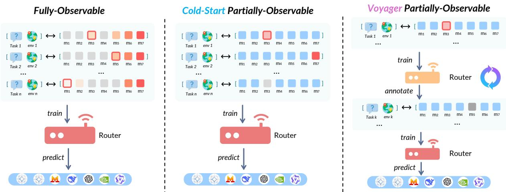  
Figure 1: Routing observability taxonomy. (Left) Fully-Observable routing, where feedback from all candidate models is available. (Center) Cold-Start Partially-Observable routing, where the router observes outcomes only for selected models. (Right) Vovager Partially-Observable routing, where routing decisions affect future data collection and training. mi refers to ¿th candidate model.denotes models not selected by the router,denotes incorrect outputs, while vivid colors indicate correct predictions. Color intensity reflects inference latency (darker indicates higher latency), and dark borders mark optimal models that are both correct and fastest.

Crucially, ROUTERWORLD models the counterfactual nature of routing feedback through two partially observable evaluation paradigms (Figure 1). The Cold-Start setup simulates zero-shot initialization, training routers from static historical logs without access to unselected model outcomes. The Voyager mode extends this to a dynamic, life-long learning setting in which routing decisions shape future training data, exposing the system to nonstationary traffic and testing its ability to mitigate self-reinforcing bias through exploration.

Benchmarking 13 routing strategies on RoUTER-WORLD reveals a pronounced efficiency gap. To jointly measure routing quality and efficiency, we introduce L-DCG, a latency-aware variant of Discounted Cumulative Gain that weighs each correct selection by how close its latency is to the fastest correct model (formal definition in Section 4.4). Even under idealized full observability, the strongest baseline reaches only 39.6% latencypenalized accuracy (Acc@1-L) compared to the 68.0% empirical upper bound, capturing just 62% of the optimal efficiency ceiling as measured by L-DCG, indicating substantial headroom in latencyaware routing. This gap widens substantially under more realistic partial observability: deprived of counterfactual feedback, routers usually overemphasize task accuracy (Acc @ 1) at the expense of latency, inflating accuracy by an average of 24.7% while overall efficiency deteriorates sharply. In the most extreme case, AvENGER (Zhang et al., 2025b), a cluster-voting router, collapses into a degenerate Route-to-Largest policy (Lai and Ye, 2026), achieving 89.1% Acc@1 but suffering a 79% reduction in optimal efficiency. These feedback-induced failures persist in the Voyager setting, where standard routers show little improvement across streaming interaction, while banditbased methods with explicit exploration, such as BARP (Wei et al., 2025), continue to improve, highlighting observation diversity. These findings motivate the next generation of router design.

Further, we provide analyses to further clarify routing behavior. We examine long-horizon agentic tasks, where policy collapse emerges through cumulative latency effects rather than single-step decisions (Section 5.3), and study warm-up initialization, finding that most routers function as policy distillers rather than independent optimizers (Section 5.4). By open-sourcing ROUTERWORLD-Core and ROUTERWORLD-Agentic², we provide a scalable, deployment-aligned environment for diagnosing these failures and advancing robust, latencyaware routing for conversational AI.

## 2 Related Work

Non-Predictive and Sequential Routing. Early LLM routing relied on non-predictive orchestration, where decisions are resolved through iterative execution rather than a single selection step. FrugalGPT (Chen et al., 2024) formalizes this via the LLM cascade, escalating queries to progressively stronger models when a confidence threshold is not met. More recent work generalizes this into ensemble-like frameworks: AutoMix (Aggarwal et al., 2024) formulates routing as a POMDP with self-verification signals, and Router-R1 (Zhang et al., 2025a) instantiates the router as a reasoning LLM that plans multi-step invocations. While flexible, these approaches invoke multiple models per query, leading to compounded inference latency.

Predictive Routing and Online Model Selection. Predictive approaches formulate model selection as a single decision made prior to generation. HybridLLM (Ding et al., 2024) trains a BERT-based classifier to route between a small and a large model, while RouteLLM (Ong et al., 2025) and Carrot (Tsiourvas et al., 2025) learn from preference or reward signals. GraphRouter (Feng et al., 2025b) models query-model interactions via graphbased message passing, BaRP (Wei et al., 2025) formulates routing as learning from bandit feedback using REINFORCE-style policy gradients, and Avenger (Zhang et al., 2025b) employs trainfree cluster-based voting over embedding neighborhoods. IPR (Feng et al., 2025a) targets production settings with user-controlled quality-cost trade-offs, and PILOT (Panda et al., 2025) explores online contextual bandits with exploration– exploitation schedules tailored to routing.

Fully-Observable Routing. Despite this variety of methods, almost all predictive routers are designed and evaluated under full observability: at training time, the learner has access to the outcome of every model on every query, reducing routing to supervised learning over complete labels. This assumption underlies RouteLLM (Ong et al., 2025), HybridLLM (Ding et al., 2024), GraphRouter (Feng et al., 2025b), Carrot (Tsiourvas et al., 2025), Avenger (Zhang et al., 2025b), and the Best-of-N style oracles commonly reported as upper bounds (Hu et al., 2024; Huang et al., 2025). While convenient, full observability requires running every model per query, an operational pattern that does not scale to production-scale conversational deployments which preclude exhaustive parallel inference (Chapelle and Li, 2011; Joachims et al., 2017). It also obscures feedback-loop dynamics (confirmation bias, policy collapse, selfreinforcement) that only emerge when the router's choices shape the data it subsequently learns from. A few methods acknowledge partial feedback, notably BaRP (Wei et al., 2025), but its evaluation still assumes rich offline supervision. Our benchmark makes partial observability a first-class evaluation regime and exposes how existing routers behave when counterfactual outcomes are not available.

Router Benchmarks. Routing methods are typically compared using benchmarks such as Router-Bench (Hu et al., 2024), RouterArena (Lu et al. 2026), RouterEval (Huang et al., 2025), and LLM-RouterBench (Li et al., 2026), which release precomputed outcomes for many query-model pairs. These resources assume full observability and either omit latency or treat it as a coarse boundary constraint rather than a primary optimization objective. They also rely on raw benchmark prompts and monetary pricing as efficiency proxies, both of which introduce artifacts and drift that are illsuited to conversational deployment. RoUTER-WORLD instead (i) formalizes partial observability via the Cold-Start and Voyager setups, (ii) grounds efficiency in hardware-measured latency that is stable across pricing changes, (iii) adopts natural conversational-form queries, and (iv) spans both single-turn and long-horizon agentic tasks, offering a more deployment-aligned evaluation.

## 3 Problem Definition

## 3.1 LLM Routing

Let $\mathcal { M } = \{ m _ { 1 } , . . . , m _ { K } \}$ denote a fixed set of candidate LLMs. A routing policy

$$
\pi : { \mathcal { S } }  { \mathcal { M } }
$$

maps an observed state $s \in { \mathcal { S } }$ to a selected model $m \in \mathcal { M }$ . The state s represents the full or partial input available to the router. After selecting a model, the router observes a signal reflecting task performance and computational efficiency. In this work, we focus on latency-derived efficiency (Section 4.3) rather than monetary cost. The routing objective is to learn a policy π that maximizes the expected utility of the system under these performance and latency constraints.

## 3.2 Fully-Observable LLM Routing

In the fully-observable setting, the router has access to outcomes of all candidate models for each input during training, reducing routing to supervised learning over complete labels. This has been the dominant assumption in the LLM routing literature to date, underlying most predictive routers and benchmarks surveyed in Section 2 (e.g., Ding et al., 2024; Ong et al., 2025; Feng et al., 2025b; Tsiourvas et al., 2025; Zhang et al., 2025b; Hu et al., 2024; Huang et al., 2025). It is convenient for offline analysis but relies on counterfactual outcomes that are typically unavailable in practice without costly offline replay across all candidate models.

## 3.3 Partially-Observable LLM Routing

We propose a more realistic scenario of partial observability, where the router observes feedback only for the selected model. Formally, after choosing $m = \pi ( s )$ , the router observes $r ( s , m )$ , but the counterfactuals $\{ r ( s , m ^ { \prime } ) \} _ { m ^ { \prime } \ne m }$ remain missing. The learner must contend with incomplete information. We study two modes of partial observability:

Cold-Start Routing. The Cold-Start setting represents the initialization phase of a routing system. The router must learn from a static historical log generated by a uniform random policy, where each task yields a single model outcome (response, latency, and correctness). This evaluates the router's ability to extract a viable policy from high-entropy, incomplete data in a single offline training round. We explore other warm-up policies in Section 5.4.

Voyager Routing. In real-world deployments, routing decisions are made over streaming inputs, and the router's own policy determines which model outcomes are observed. Voyager mode captures this: training proceeds in iterative stages over temporally ordered data chunks $\{ C _ { 1 } , \ldots , C _ { T } \}$ The process is initialized with $C _ { 1 }$ (ground-truth feedback under an initial random policy); at stage t, the policy is trained on $\{ C _ { 1 } , \ldots , C _ { t } \}$ and used to route $C _ { t + 1 }$ , with checkpoint selection on a heldout development set. To keep evaluation reproducible without live model inference, we simulate deployment via a hidden fully-observable engine derived from ROUTERWORLD: it stores outcomes for all candidates but reveals only the feedback corresponding to the router's selected action.

## 4 Benchmark Construction

## 4.1 Dataset Selection Principles

We construct ROUTERWORLD according to four guiding principles: (1) Task Diversity and Balance, spanning six major categories (e.g., math, code, reasoning) to prevent domain skew; (2) Discriminative Power, selecting examples where model performance varies to necessitate intelligent routing; (3) Latency Awareness, integrating realworld timing metrics (Yu et al., 2022; Kwon et al., 2023) to evaluate trade-offs; and (4) Reproducibility, enforcing strict train-test separation and automatic metrics. Table 1 compares ROUTERWORLD with existing benchmarks. Unlike prior work, our benchmark uniquely combines partial observability, streaming evaluation, and agentic workflows; see Appendix A for a full breakdown.

## 4.2 RouterWorld Benchmark Construction

ROUTERWORLD comprises two complementary subsets. ROUTERWORLD-Core contains singleturn, end-to-end tasks assessing a router's ability to select appropriate models for standalone queries of varying difficulty. It integrates 12 established benchmarks covering logical and commonsense reasoning (Zellers et al., 2019; Clark et al., 2018; Thorne et al., 2018; Yang et al., 2018), math (Cobbe et al., 2021; Lu et al., 2023; Hendrycks et al. 2021b) and tool use (Patil et al., 2024; Fan et al., 2025), code generation (Hendrycks et al., 2021a; Li et al., 2024), data analysis (Li et al., 2024; Lu et al., 2023), and open-ended chit-chat (Yamashita et al., 2023). RoUTERWORLD-Agentic focuses on longhorizon, multi-turn agentic tasks that require environment interaction, covering computer use, household assistance, and e-commerce workflows. All benchmarks are standardized into a unified routing evaluation framework; full preprocessing and standardization procedures are in Appendix C.

ROUTERWORLD Characteristics. Figure 2 and Table 2 summarize the statistics. ROUTERWORLD-CoRE contains 48,232 single-turn instances across seven task categories and twelve datasets, with substantial variation in query difficulty and latency that creates meaningful routing opportunities. RoUTER-WORLD-AGENTIC comprises 12,740 multi-turn interactions in three agentic domains and exhibits higher selectivity and longer latency tails. Analysis of task distributions, difficulty, model specialization, and oracle behavior is in Appendix E.1.

<table><tr><td>Benchmark</td><td>#Instances</td><td>#Models</td><td>#Datasets</td><td>#Base.</td><td>Part. Obs.</td><td>Stream.</td><td>Latency Ann.</td><td>Agentic Tasks</td><td>CF-Query</td></tr><tr><td>RouterBench (Hu et al., 2024)</td><td>405K</td><td>11</td><td>8</td><td>4</td><td>x</td><td>x</td><td>x</td><td>x</td><td>x</td></tr><tr><td>RouteLLM (Ong et al., 2025)</td><td></td><td>2</td><td>3</td><td>4</td><td>x</td><td>x</td><td>x</td><td>x</td><td>x</td></tr><tr><td>LLMRouterBench (Li et al., 2026)</td><td>400K</td><td>33</td><td>21</td><td>10</td><td>x</td><td>x</td><td>x</td><td>x</td><td>x</td></tr><tr><td>RouterEval (Huang et al., 2025)</td><td>200M</td><td>8,500+</td><td>12</td><td>5</td><td>x</td><td>x</td><td>x</td><td>x</td><td>x</td></tr><tr><td>RouterArena (Lu et al., 2026)</td><td>8.4K</td><td>42</td><td>23</td><td>14</td><td>x</td><td>x</td><td>x</td><td>x</td><td>x</td></tr><tr><td>ROUTERWORLD-CORE</td><td>53K</td><td>7</td><td>12</td><td>17</td><td>√</td><td>x</td><td>√</td><td>x</td><td>√</td></tr><tr><td>ROUTERWORLD-AGENTIC</td><td>17K</td><td>3</td><td>3</td><td>17</td><td>√</td><td>√</td><td>√</td><td>√</td><td></td></tr></table>

Table 1: Comparison of LLM routing benchmarks. “"Part. Obs." = partially observable setting; "Stream." = streaming rerouting; “Latency Ann." = per-instance latency annotations; “#Base." = number of routing baselines evaluated; “CF-Query"= user query normalization as router input.

## 4.3 Annotation

Model Selection & Latency. We select 7 popular open-weight models (2B-235B parameters), creating a heterogeneous landscape of capability and inference cost, where latencies range from \~200ms to over 7s. We model E2E latency for querymodel pairs $( q , m )$ using empirically measured Time-To-First-Token $( \mathrm { T T F T } _ { m } )$ and Inter-Token Latency $( \mathrm { I T L } _ { m } ) \mathrm { : }$

$$
\mathrm { l a t e n c y } ( q , m ) = \mathrm { T T F T } _ { m } + ( N _ { q , m } - 1 ) \times \mathrm { I T L } _ { m } ,\tag{1}
$$

where $N _ { q , m }$ is the number of tokens generated. For multi-step agentic trajectories, latency is accumulated across all generation steps. Since raw response and trajectory tokens are released for each task, the framework can be easily adapted to monetary cost. Full profiling workflow and model specifications are in Appendices D.1 and D.

Dataset Evaluation. Source datasets employ heterogeneous evaluation metrics, and individual models often require distinct prompting and postprocessing pipelines. To streamline the setup and comparison while mitigating biases introduced by dataset-specific metrics and prompt engineering, we adopt an LLM-as-a-Judge framework that produces a standardized binary judgment (correct or incorrect) for each model output via a strong LLM, i.e. Claude-4.5-Sonnet. This binary signal is intended to approximate coarse-grained user feedback in interactive systems, where users typically either adopt a satisfactory response or reject it to ask a follow-up query, rather than providing dense or calibrated rewards (Amershi et al., 2019; Ouyang et al., 2022). We validate this protocol through a blind expert annotation study on 150 (query, model, response) triples: six PhD-level annotators achieve high inter-annotator agreement (Fleiss' $\kappa { = } 0 . 8 4$ , Krippendorff's $\alpha { = } 0 . 8 7 )$ , and the LLM judge matches the 6-expert majority-vote consensus at κ=0.84 (F1=0.93, 92% agreement), approaching the human ceiling and consistent with prior LLM-judge evaluations (Zheng et al., 2023a). Full validation details are provided in Appendix H.

Conversational-Form Query Generation. Real user inputs to voice assistants are typically brief and goal-oriented rather than carefully structured prompts. Further, since benchmarks have been publicly accessible for years, downstream LLMs are susceptible to data contamination and may have memorized surface-level queries and prompt formats during pre-training (Tseng et al., 2025; Golchin and Surdeanu, 2024; Sainz et al., 2023), artificially inflating performance and introducing spurious signals that mislead routers. We therefore apply a multi-stage transformation pipeline: original prompts establish task specifications; a strong external LLM (DeepSeek-V3.1, excluded from the routing pool) rewrites each as a natural user query; rewritten queries are validated against the original specs, with semantically drifted ones filtered out (Li et al., 2025; Zheng et al., 2023b; Wang et al., 2023; Madaan et al., 2023).

## 4.4 Metrics

Accuracy@1 and Accuracy@1-L (Optimal). We report two top-1 accuracy metrics for routing. Accuracy@1 measures whether the model selected by the router correctly answered the query. This metric captures the router's ability to select any correct model, independent of efficiency.

Accuracy@ 1-L is a stricter, latency-aware variant: it equals 1 if the router selects the fastest correct model for the query (i.e., the minimumlatency member of $\mathcal { C } _ { q } )$ and 0 otherwise, including when the selected model is incorrect. This metric corresponds to the optimal routing decision under latency constraints and serves as a reference for evaluating latency-sensitive routing performance.

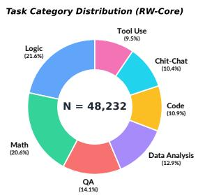

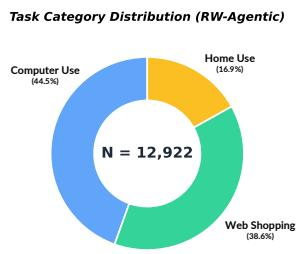  
Figure 2: Task category distribution in ROUTER-CORE and ROUTER-AGENTIC.

DCG and L-DCG. To evaluate rank-aware routing quality beyond top-1 accuracy, we adopt Discounted Cumulative Gain (DCG). In our setting, relevance is binary: a model is relevant if and only if it produces a correct answer.

For a query q, let $\mathcal { C } _ { q }$ denote the set of correct models, ordered by ascending latency. If the router selects model $m ^ { * }$ with rank r in this ordering, the DCG score is defined as

$$
\mathrm { D C G } ( q ) = \frac { \mathbf { 1 } [ m ^ { * } \in \mathcal { C } _ { q } ] } { \log _ { 2 } ( r + 1 ) } .\tag{2}
$$

While DCG captures sensitivity to rank among correct models, it does not reflect the magnitude of latency differences. To incorporate efficiency, we define a latency-aware variant, L-DCG:

$$
\operatorname { L - D C G } ( q ) = \mathbf { 1 } [ m ^ { * } \in \mathcal { C } _ { q } ] \cdot \frac { \ell _ { \operatorname* { m i n } } } { \ell _ { m ^ { * } } } \cdot \frac { 1 } { \log _ { 2 } ( r + 1 ) } ,\tag{3}
$$

where $\ell _ { \mathrm { m i n } }$ is the latency of the fastest correct model and $\ell _ { m ^ { * } }$ is the latency of the selected model; the score is 0 when the selected model is incorrect. The ratio $\ell _ { \mathrm { m i n } } / \ell _ { m ^ { * } } \in ( 0 , 1 ]$ continuously penalizes correct but suboptimal latency choices, reflecting efficiency loss relative to the optimal decision. All metrics are reported as averages over the test set.

## 5 Experiments

## 5.1 Experimental Setup

Baselines. We benchmark 13 popular routing algorithms across categories. (1) Naive routers provide reference bounds, including Random selection, Always-Route-To-Largest (always picking the largest candidate model, regardless of query) and Always-Route-To-Smallest (always picking the smallest), as well as two oracle upper bounds: Oracle (Perfect), which selects the optimal downstream model with full knowledge of all candidate outcomes, and Oracle (Best-of-N), which, for each query, picks the best downstream model among the N models that at least one evaluated router selects on that query, representing an empirical (rather than theoretical) upper bound attainable by any router in our suite. (2) Representation-based routers learn a query representation and route based on similarity, classification, or learned utility in embedding space. This category covers classical methods operating on frozen embeddings (KNN, MLP), end-to-end representation fine-tuning (Emb-FT), and more structured or hybrid architectures such as Hybrid-LLM (Ding et al., 2024), BaRP (Wei et al., 2025), GraphRouter (Feng et al., 2025b), as well as Avenger (Zhang et al., 2025b). (3) Generative routers use autoregressive language models to directly select a target model via prompting or supervised fine-tuning on routing data. Detailed architectures and training configurations for all baselines are provided in Appendix G.

<table><tr><td>Statistic</td><td>CORE</td><td>AGENTIC</td></tr><tr><td>Total Instances</td><td>48,232</td><td>12,740</td></tr><tr><td># Training</td><td>40,265</td><td>11,292</td></tr><tr><td># Testing</td><td>7,967</td><td>1,448</td></tr><tr><td># Task Categories</td><td>7</td><td>3</td></tr><tr><td># Datasets</td><td>12</td><td>3</td></tr><tr><td>#Models</td><td>7</td><td>6</td></tr><tr><td>Prompt len. (mean/max)</td><td>2.1k/31k</td><td>1.1k/6.3k</td></tr><tr><td>Query len. (mean)</td><td>110</td><td>111</td></tr><tr><td>Avg # correct models</td><td>4.19</td><td>2.95</td></tr></table>

Table 2: Data characteristics of ROUTERWORLD.

Observability Settings. We evaluate all methods under two regimes: (1) Fully Observable, where the training set contains ground-truth correctness and latency for every candidate model; and (2) Partially Observable, where each query is annotated with the outcome of only one random model.

Implementation details. All experiments are conducted on 8× NVIDIA H200 GPUs. Since most routing algorithms require a query encoder, we standardize on Qwen3-Embedding-0.6B (1024- dim, mean-pooled, max sequence length 512) across all methods for a fair comparison. For methods that require architecture-specific encoders (such as Hybrid-LLM which relies on DeBERTa's [CLS] token representation) we retain their original encoder as prescribed by the respective papers.

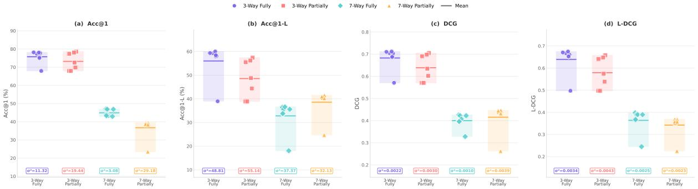  
Figure 3: Performance compression in agentic routing. Each dot is a non-collapsed routing baseline. Under both 3-model and 6-model pools, methods cluster tightly with low variance across all metrics. Boxes show interquartile range; $\sigma ^ { 2 }$ values shown below.

## 5.2 Main Results

ROUTERWORLD is Challenging. ROUTER-WoRLD poses a substantial challenge for existing routers (Table 3). Under full observability, the empirical upper bound Oracle (Best-of-8) achieves 67.97% Acc@ 1-L / 0.7140 L-DCG, whereas the strongest non-oracle baseline Gen-SFT (Qwen-2.5-1.5B-ins) reaches only 39.61% Acc@ 1-L / 0.4439 L-DCG, leaving a large gap in latency-aware routing. Effective routing requires context-aware decision-making rather than coarse model attributes, as Route-To-Largest attains 89.11% Acc@1 but just 9.10% Acc@1-L

Transitioning to partial observability drives a drastic shift: on average, Acc@ 1 inflates by 24.7 pp while L-DCG drops by over 0.16. Without cross-model comparisons, routers cannot determine whether a faster model would have also been correct, and become risk-averse (favoring accuracy at the cost of latency). In the extreme, Avenger collapses into Route-To-Largest (89.11% Acc@1, 0.1494 L-DCG), losing any ability to navigate efficiency trade-offs, a fundamental challenge that ROUTERWORLD explicitly captures.

Training Corpus is Important for Routers. To illustrate the necessity of domain-specific training data, we probe Generative AI Routers. Zeroshot prompting with explicit latency profiles severely underperforms (Qwen-2.5-0.5B-Instruct:

7.38% Acc@ 1-L, 0.1211 L-DCG), while SFT on the ROUTERWORLD corpus drives Acc@1-L to 37.55% and L-DCG to 0.4282. This shows that routing cannot be reduced to a linear relationship between model size and query difficulty: in \~27% of cases, lightweight models like Gemma-2-2b exhibit verbose generation patterns that yield higher latency than larger models. LLM routing is a complex, non-linear decision-making process that requires internalizing empirical interaction logs.

## 5.3 Routing in Agentic Tasks

We further evaluate routing baselines on RoUTER-WORLD-Agentic, where models interact with environments over multiple steps across three benchmarks with new 3-model and 6-model candidate pools (14B-235B). Figure 3 (see Appendix B) shows a striking phenomenon: routing baselines exhibit severe performance compression. In both pools, non-collapsed methods cluster with low variance $( \sigma ^ { 2 } = 0 . 8 1$ for Acc@1-L in the 3-model fullyobservable setting; $\sigma ^ { 2 } = 4 . 3 5$ in the 6-model setting; vs. $\sigma ^ { 2 } = 2 9 . 5$ in ROUTERWORLD-Core), and compression intensifies under partial observability, where multiple routers collapse into degenerate near-single-model policies. We attribute this to a factor overlooked by current routing paradigms: the impact of planning steps. High-capability models often resolve complex tasks in far fewer interaction steps than weaker but faster models, neutralizing or even inverting the conventional accuracy– latency trade-off and leaving no meaningful Pareto frontier to exploit. Per-benchmark breakdowns and planning-latency analysis are in Appendix I.

## 5.4 Analysis of Partially-Observable Routing

We further analyze partially-observable routing: Voyager learning, and warm-up initialization.

<table><tr><td colspan="2"></td><td colspan="4">Fully-Observable</td><td colspan="4">Partially-Observable</td></tr><tr><td>Method</td><td>Base Model</td><td>Acc@1 (%)</td><td>Acc@1-L (%)</td><td>DCG</td><td>L-DCG</td><td>Acc@1 (%)</td><td>Acc@1-L (%)</td><td>DCG</td><td>L-DCG</td></tr><tr><td colspan="10">Naive Baselines</td></tr><tr><td>Oracle (Perfect)</td><td></td><td>100.00</td><td>100.00</td><td>1.0000</td><td>1.0000</td><td>100.00</td><td>100.00</td><td>1.0000</td><td>1.0000</td></tr><tr><td>Oracle (Best-of-8)</td><td>一</td><td>80.04</td><td>67.97</td><td>0.7521</td><td>0.7140</td><td>96.81</td><td>54.51</td><td>0.7901</td><td>0.6462</td></tr><tr><td>Random</td><td>一</td><td>47.63</td><td>12.80</td><td>0.2995</td><td>0.1784</td><td>47.63</td><td>12.80</td><td>0.2995</td><td>0.1784</td></tr><tr><td>Route-To-Largest</td><td></td><td>89.11</td><td>9.10</td><td>0.4731</td><td>0.1494</td><td>89.11</td><td>9.10</td><td>0.4731</td><td>0.1494</td></tr><tr><td>Route-To-Smallest</td><td></td><td>33.16</td><td>26.55</td><td>0.3054</td><td>0.2942</td><td>33.16</td><td>26.55</td><td>0.3054</td><td>0.2942</td></tr><tr><td colspan="10">Generative AI Routers</td></tr><tr><td>Zero-Shot Prompt</td><td>Qwen-2.5-0.5B-ins</td><td>78.65</td><td>7.38</td><td>0.3979</td><td>0.1211</td><td>78.65</td><td>7.38</td><td>0.3979</td><td>0.1211</td></tr><tr><td>Gen-SFT</td><td>Qwen-2.5-0.5B-ins</td><td>55.11</td><td>37.55</td><td>0.4767</td><td>0.4282</td><td>81.15</td><td>16.91</td><td>0.4935</td><td>0.2507</td></tr><tr><td>Zero-Shot Prompt</td><td>Qwen-2.5-1.5B-ins</td><td>43.89</td><td>10.79</td><td>0.2912</td><td>0.1953</td><td>43.89</td><td>10.79</td><td>0.2912</td><td>0.1953</td></tr><tr><td>Gen-SFT</td><td>Qwen-2.5-1.5B-ins</td><td>54.17</td><td>39.61</td><td>0.4817</td><td>0.4439</td><td>84.55</td><td>15.87</td><td>0.4959</td><td>0.2268</td></tr><tr><td colspan="10"></td></tr><tr><td>KNN</td><td>Qwen3-Embedding-0.6B</td><td>52.25</td><td>Representation-based Routers 34.35</td><td>0.4456</td><td>0.3969</td><td>71.82</td><td>14.86</td><td>0.4317</td><td>0.2215</td></tr><tr><td>MLP</td><td>Qwen3-Embedding-0.6B</td><td>51.99</td><td>38.20</td><td>0.4631</td><td>0.4295</td><td>83.56</td><td>14.59</td><td>0.4822</td><td>0.2158</td></tr><tr><td>Emb-FT</td><td>Modern-base-0.1B</td><td>53.26</td><td>33.41</td><td>0.4490</td><td>0.4041</td><td>75.10</td><td>15.28</td><td>0.4533</td><td>0.2342</td></tr><tr><td>Emb-FT</td><td>Qwen3-Embedding-0.6B</td><td>55.93</td><td>37.87</td><td>0.4833</td><td>0.4357</td><td>78.57</td><td>16.10</td><td>0.4702</td><td>0.2288</td></tr><tr><td>Hybrid-LLM</td><td>DeBERTa Large</td><td>47.92</td><td>35.95</td><td>0.4309</td><td>0.4039</td><td>66.93</td><td>19.52</td><td>0.4352</td><td>0.2661</td></tr><tr><td>Graph-Router</td><td>Qwen3-Embedding-0.6B</td><td>38.17</td><td>13.64</td><td>0.2674</td><td>0.1994</td><td>58.87</td><td>13.48</td><td>0.3590</td><td>0.1892</td></tr><tr><td>BARP</td><td>Qwen3-Embedding-0.6B</td><td>76.58</td><td>21.53</td><td>0.4966</td><td>0.2978</td><td>88.57</td><td>9.66</td><td>0.4748</td><td>0.1565</td></tr><tr><td>Avenger</td><td>Qwen3-Embedding-0.6B</td><td>45.86</td><td>32.43</td><td>0.4026</td><td>0.3709</td><td>89.11</td><td>9.10</td><td>0.4731</td><td>0.1494</td></tr></table>

Table 3: Performance on ROUTERWORLD-Core under fully- and partially-observable settings. Oracle (Perfect) and Oracle (Best-of-8) denote theoretical and empirical upper bounds, respectively. Orange cells indicate collapsed routing that always selects a single model and are excluded from best/second-best comparisons. All pairwise improvements of the best-performing method over the second-best baseline are statistically significant (p < 0.05).

Cold-Start v.s. Voyager The Voyager setting incrementally accumulates streaming data over five rounds. Surprisingly, this yields only marginal improvements for most methods (Figure 5, see Appendix B): KNN and MLP L-DCG remains effectively flat, while only BaRP shows a noticeable gain (0.294 → 0.320), consistent with its REINFORCEbased formulation. Supervised methods suffer from confirmation bias under partial observability, reinforcing their initial blind spots by training on their own past decisions; policy-gradient methods instead use observed feedback as an unbiased reward estimator and naturally explore alternatives. Collecting more data under the same biased policy is thus insufficient to mitigate distribution shift: observation diversity matters more than volume.

Warm-Up Initialization. To study how initial policy quality influences downstream learning, we simulate three warm-up oracles of increasing sophistication: Qwen-1.5B-Instruct, Claude, and Claude augmented with RAG retrieval from the dev set. Each rolls out selections to generate warm-up logs, on which we then train routers under coldstart, partially-observable conditions. As Figure 4 (see Appendix B) shows, downstream routers correlate near-perfectly with the metric distribution of each warm-up policy: no method surpasses the oracle's own L-DCG, and the ordering of Acc@ 1, Acc@ 1-L, DCG, and L-DCG is preserved. Current predictive routing thus largely distills the logging oracle's biases rather than discovering an independent policy, motivating exploration-exploitation strategies that actively seek diverse observations.

## 6 Conclusion

We introduced ROUTERWORLD, a benchmark that unifies 371k single-turn responses and 76k multiturn agentic trajectories to evaluate LLM routing under realistic deployment constraints. Router-World addresses key gaps in existing benchmarks by formalizing partial observability through Cold-Start and Voyager settings, grounding efficiency in hardware-measured latency rather than volatile pricing, and adopting natural conversational-form queries. Evaluating 13 routing baselines reveals large headroom for latency-aware routing even under idealized conditions. Our analysis highlights the critical importance of partial observability as a design constraint. By open-sourcing our benchmark and evaluation infrastructure, RouterWorld serves as a foundation for advancing efficiencyaware LLM routing in scalable conversational AI.

## Limitations

Multi-modal Tasks. ROUTERWORLD currently evaluates routing only among text-only LLMs. As foundation models increasingly accept vision and audio inputs, practical routing systems may need to decide both which model and which modality to invoke. Extending ROUTERWORLD to multimodal candidate pools requires new datasets and evaluation protocols that capture heterogeneous latency and cost profiles across modalities, which we leave for future work.

Closed-source Models. ROUTERWORLD focuses on open-weight LLMs to enable reproducible, hardware-grounded latency measurement, which is central to our latency-aware routing framing. As a result, widely used closed-source models (e.g., Claude, GPT-4o) are not included in the candidate pool. Because we release raw responses, trajectory tokens, and generation metadata for every task-model pair, the benchmark can be extended to closed-source APIs by substituting our hardwaregrounded latencies with API-measured latencies or per-token pricing.

## Ethical Considerations

ROUTERWORLD is built by aggregating 12 publicly released research benchmarks; we redistribute only data permitted under each source's license and preserve original attribution. By design, the benchmark encourages directing simple queries to small, efficient models rather than defaulting to expensive frontier systems. Widespread adoption of latencyaware routing could meaningfully reduce the energy and compute footprint of large-scale conversational AI, benefiting both service providers and the environment.

At the same time, our findings show that routers trained under partial observability can collapse into degenerate policies that consistently favor a single model, potentially degrading response quality for specific query types or user populations without operators noticing. The Voyager setting we propose is designed to surface exactly these failure modes so that future routing algorithms can be stress-tested before deployment.

## References

Pranjal Aggarwal, Aman Madaan, Ankit Anand, Srividya Pranavi Potharaju, Swaroop Mishra, Pei Zhou,

Aditya Gupta, Dheeraj Rajagopal, Karthik Kappaganthu, Yiming Yang, Shyam Upadhyay, Manaal Faruqui, and Mausam . 2024. Automix: Automatically mixing language models. In The Thirty-eighth Annual Conference on Neural Information Processing Systems.

Amazon. 2025. How amazon rebuilt alexa with generative ai. Amazon Devices & Services Blog.

Saleema Amershi, Dan Weld, Mihaela Vorvoreanu, Adam Fourney, Besmira Nushi, Penny Collisson, Jina Suh, Shamsi Iqbal, Paul N. Bennett, Kori Inkpen, Jaime Teevan, Ruth Kikin-Gil, and Eric Horvitz. 2019. Guidelines for human-ai interaction. In Proceedings of the 2019 CHI Conference on Human Factors in Computing Systems, CHI '19, New York, NY, USA. Association for Computing Machinery.

Olivier Chapelle and Lihong Li. 2011. An empirical evaluation of thompson sampling. In Advances in Neural Information Processing Systems 24: 25th Annual Conference on Neural Information Processing Systems 2011. Proceedings of a meeting held 12-14 December 2011, Granada, Spain, pages 2249–2257.

Lingjiao Chen, Matei Zaharia, and James Zou. 2024. Frugalgpt: How to use large language models while reducing cost and improving performance. Trans. Mach. Learn. Res., 2024.

Mahe Chen, Xiaoxuan Wang, Kaiwen Chen, and Nick Koudas. 2025. Generative engine optimization: How to dominate ai search. arXiv preprint arXiv:2509.08919.

Wei-Lin Chiang, Lianmin Zheng, Ying Sheng, Anastasios Nikolas Angelopoulos, Tianle Li, Dacheng Li, Banghua Zhu, Hao Zhang, Michael I. Jordan, Joseph E. Gonzalez, and Ion Stoica. 2024. Chatbot arena: An open platform for evaluating llms by human preference. In Forty-first International Conference on Machine Learning, ICML 2024, Vienna, Austria, July 21-27, 2024.

Peter Clark, Isaac Cowhey, Oren Etzioni, Tushar Khot, Ashish Sabharwal, Carissa Schoenick, and Oyvind Tafjord. 2018. Think you have solved question answering? try arc, the ai2 reasoning challenge. arXiv:1803.05457v1.

Karl Cobbe, Vineet Kosaraju, Mohammad Bavarian, Mark Chen, Heewoo Jun, Lukasz Kaiser, Matthias Plappert, Jerry Tworek, Jacob Hilton, Reiichiro Nakano, Christopher Hesse, and John Schulman. 2021. Training verifiers to solve math word problems. arXiv preprint arXiv:2110.14168.

Jeffrey Dean and Luiz André Barroso. 2013. The tail at scale. Commun. ACM, 56(2):74–80.

Dujian Ding, Ankur Mallick, Chi Wang, Robert Sim, Subhabrata Mukherjee, Victor Rühle, Laks V. S. Lakshmanan, and Ahmed Hassan Awadallah. 2024. Hybrid LLM: cost-efficient and quality-aware query routing. In The Twelfth International Conference

on Learning Representations, ICLR 2024, Vienna, Austria, May 7-11, 2024. OpenReview.net.

Shiqing Fan, Xichen Ding, Liang Zhang, and Linjian Mo. 2025. Mcptoolbench++: A large scale ai agent model context protocol mcp tool use benchmark. Preprint, arXiv:2508.07575.

Aosong Feng, Balasubramaniam Srinivasan, Yun Zhou, Zhichao Xu, Kang Zhou, Sheng Guan, Yueyan Chen, Xian Wu, Ninad Kulkarni, Yi Zhang, Zhengyuan Shen, Dmitriy Bespalov, Soumya Smruti Mishra, Yifei Teng, Darren Yow-Bang Wang, Haibo Ding, and Lin Lee Cheong. 2025a. IPR: Intelligent prompt routing with user-controlled quality-cost trade-offs. In Proceedings of the 2025 Conference on Empirical Methods in Natural Language Processing: Industry Track. Association for Computational Linguistics.

Tao Feng, Yanzhen Shen, and Jiaxuan You. 2025b. Graphrouter: A graph-based router for LLM selections. In The Thirteenth International Conference on Learning Representations, ICLR 2025, Singapore, April 24-28, 2025. OpenReview.net.

Shahriar Golchin and Mihai Surdeanu. 2024. Time travel in LLMs: Tracing data contamination in large language models. In The Twelfth International Conference on Learning Representations.

Dan Hendrycks, Steven Basart, Saurav Kadavath, Mantas Mazeika, Akul Arora, Ethan Guo, Collin Burns, Samir Puranik, Horace He, Dawn Song, and Jacob Steinhardt. 2021a. Measuring coding challenge competence with apps. In Proceedings of the Neural Information Processing Systems Track on Datasets and Benchmarks, volume 1.

Dan Hendrycks, Collin Burns, Saurav Kadavath, Akul Arora, Steven Basart, Eric Tang, Dawn Song, and Jacob Steinhardt. 2021b. Measuring mathematical problem solving with the MATH dataset. In Thirtyfifth Conference on Neural Information Processing Systems Datasets and Benchmarks Track (Round 2).

Qitian Jason Hu, Jacob Bieker, Xiuyu Li, Nan Jiang, Benjamin Keigwin, Gaurav Ranganath, Kurt Keutzer, and Shriyash Kaustubh Upadhyay. 2024. Routerbench: A benchmark for multi-LLM routing system. In Agentic Markets Workshop at ICML 2024.

Zhongzhan Huang, Guoming Ling, Yupei Lin, Yandong Chen, Shanshan Zhong, Hefeng Wu, and Liang Lin. 2025. RouterEval: A comprehensive benchmark for routing LLMs to explore model-level scaling up in LLMs. In Findings of the Association for Computational Linguistics: EMNLP 2025, Suzhou, China. Association for Computational Linguistics.

Thorsten Joachims, Adith Swaminathan, and Tobias Schnabel. 2017. Unbiased learning-to-rank with biased feedback. In Proceedings of the Tenth ACM International Conference on Web Search and Data Mining, WSDM '17, page 781–789, New York, NY, USA. Association for Computing Machinery.

Woosuk Kwon, Zhuohan Li, Siyuan Zhuang, Ying Sheng, Lianmin Zheng, Cody Hao Yu, Joseph Gonzalez, Hao Zhang, and Ion Stoica. 2023. Efficient memory management for large language model serving with pagedattention. In Proceedings of the 29th Symposium on Operating Systems Principles. Association for Computing Machinery.

Guannan Lai and Han-Jia Ye. 2026. When routing collapses: On the degenerate convergence of llm routers. arXiv preprint arXiv:2602.03478.

Hao Li, Yiqun Zhang, Zhaoyan Guo, Chenxu Wang, Shengji Tang, Qiaosheng Zhang, Yang Chen, Biqing Qi, Peng Ye, Lei Bai, Zhen Wang, and Shuyue Hu. 2026. Llmrouterbench: A massive benchmark and unified framework for llm routing. Preprint, arXiv:2601.07206.

Jinyang Li, Binyuan Hui, Ge Qu, Jiaxi Yang, Binhua Li, Bowen Li, Bailin Wang, Bowen Qin, Ruiying Geng, Nan Huo, and 1 others. 2024. Can llm already serve as a database interface? a big bench for large-scale database grounded text-to-sqls. Advances in Neural Information Processing Systems, 36.

Jinyang Li, Xiaolong Li, Ge Qu, Per Jacobsson, Bowen Qin, Binyuan Hui, Shuzheng Si, Nan Huo, Xiaohan Xu, Yue Zhang, Ziwei Tang, Yuanshuai Li, Florensia Widjaja, Xintong Zhu, Feige Zhou, Yongfeng Huang, Yannis Papakonstantinou, Fatma Ozcan, Chenhao Ma, and Reynold Cheng. 2025. SWE-SQL: Illuminating LLM pathways to solve user SQL issues in real-world applications. In The Thirty-ninth Annual Conference on Neural Information Processing Systems.

Nelson F. Liu, Tianyi Zhang, and Percy Liang. 2023. Evaluating verifiability in generative search engines. In Findings of the Association for Computational Linguistics: EMNLP 2023, Singapore, December 6- 10, 2023. Association for Computational Linguistics.

Hugo Touvron Llama. 2023. Llama: Open and efficient foundation language models.

Pan Lu, Liang Qiu, Kai-Wei Chang, Ying Nian Wu, Song-Chun Zhu, Tanmay Rajpurohit, Peter Clark, and Ashwin Kalyan. 2023. Dynamic prompt learning via policy gradient for semi-structured mathematical reasoning. In International Conference on Learning Representations (ICLR).

Yifan Lu, Rixin Liu, Jiayi Yuan, Xingqi Cui, Shenrun Zhang, Hongyi Liu, and Jiarong Xing. 2026. Routerarena: An open platform for comprehensive comparison of LLM routers. In The Fourteenth International Conference on Learning Representations.

Aman Madaan, Niket Tandon, Prakhar Gupta, Skyler Hallinan, Luyu Gao, Sarah Wiegreffe, Uri Alon, Nouha Dziri, Shrimai Prabhumoye, Yiming Yang, Shashank Gupta, Bodhisattwa Prasad Majumder, Katherine Hermann, Sean Welleck, Amir Yazdanbakhsh, and Peter Clark. 2023. Self-refine: Iterative refinement with self-feedback. In Advances in

Neural Information Processing Systems 36: Annual Conference on Neural Information Processing Systems 2023, NeurIPS 2023, New Orleans, LA, USA, December 10 - 16, 2023.

Isaac Ong, Amjad Almahairi, Vincent Wu, Wei-Lin Chiang, Tianhao Wu, Joseph E. Gonzalez, M Waleed Kadous, and Ion Stoica. 2025. Routellm: Learning to route llms with preference data. Preprint, arXiv:2406.18665.

Long Ouyang, Jeffrey Wu, Xu Jiang, Diogo Almeida, Carroll Wainwright, Pamela Mishkin, Chong Zhang, Sandhini Agarwal, Katarina Slama, Alex Gray, John Schulman, Jacob Hilton, Fraser Kelton, Luke Miller, Maddie Simens, Amanda Askell, Peter Welinder, Paul Christiano, Jan Leike, and Ryan Lowe. 2022. Training language models to follow instructions with human feedback. In Advances in Neural Information Processing Systems.

Pranoy Panda, Raghav Magazine, Chaitanya Devaguptapu, Sho Takemori, and Vishal Sharma. 2025. Adaptive LLM routing under budget constraints. In Findings of the Association for Computational Linguistics: EMNLP 2025, pages 23934–23949, Suzhou, China.

Shishir G Patil, Tianjun Zhang, Xin Wang, and Joseph E. Gonzalez. 2024. Gorilla: Large language model connected with massive APIs. In The Thirty-eighth Annual Conference on Neural Information Processing Systems.

Yujia Qin, Shihao Liang, Yining Ye, Kunlun Zhu, Lan Yan, Yaxi Lu, Yankai Lin, Xin Cong, Xiangru Tang, Bill Qian, Sihan Zhao, Lauren Hong, Runchu Tian, Ruobing Xie, Jie Zhou, Mark Gerstein, Dahai Li, Zhiyuan Liu, and Maosong Sun. 2024. Toolllm: Facilitating large language models to master 16000+ real-world apis. In The Twelfth International Conference on Learning Representations, ICLR 2024, Vienna, Austria, May 7-11, 2024.

Oscar Sainz, Jon Campos, Iker García-Ferrero, Julen Etxaniz, Oier Lopez de Lacalle, and Eneko Agirre. 2023. NLP evaluation in trouble: On the need to measure LLM data contamination for each benchmark. In Findings of the Association for Computational Linguistics: EMNLP 2023. Association for Computational Linguistics.

Tanya Stivers, Nicholas J Enfield, Penelope Brown, Christina Englert, Makoto Hayashi, Trine Heinemann, Gertie Hoymann, Federico Rossano, Jan Peter De Ruiter, Kyung-Eun Yoon, and 1 others. 2009. Universals and cultural variation in turn-taking in conversation. Proceedings of the National Academy of Sciences.

Gemini Team, Rohan Anil, Sebastian Borgeaud, Jean-Baptiste Alayrac, Jiahui Yu, Radu Soricut, Johan Schalkwyk, Andrew M Dai, Anja Hauth, Katie Millican, and 1 others. 2023. Gemini: a family of highly capable multimodal models. arXiv preprint arXiv:2312.11805.

James Thorne, Andreas Vlachos, Christos Christodoulopoulos, and Arpit Mittal. 2018. FEVER: a large-scale dataset for fact extraction and VERification. In Proceedings of the 2018 Conference of the North American Chapter of the Association for Computational Linguistics: Human Language Technologies, Volume 1 (Long Papers).

Yuan Tseng, Titouan Parcollet, Rogier van Dalen, Shucong Zhang, and Sourav Bhattacharya. 2025. Evaluation of llms in speech is often flawed: Test set contamination in large language models for speech recognition. arXiv preprint arXiv:2505.22251.

Asterios Tsiourvas, Wei Sun, and Georgia Perakis. 2025. Causal LLM routing: End-to-end regret minimization from observational data. In The Thirty-ninth Annual Conference on Neural Information Processing Systems.

Xuezhi Wang, Jason Wei, Dale Schuurmans, Quoc V. Le, Ed H. Chi, Sharan Narang, Aakanksha Chowdhery, and Denny Zhou. 2023. Self-consistency improves chain of thought reasoning in language models. In The Eleventh International Conference on Learning Representations, ICLR 2023, Kigali Rwanda, May 1-5, 2023.

Benjamin Warner, Antoine Chaffin, Benjamin Clavié, Orion Weller, Oskar Hallström, Said Taghadouini, Alexis Gallagher, Raja Biswas, Faisal Ladhak, Tom Aarsen, Griffin Thomas Adams, Jeremy Howard, and Iacopo Poli. 2025. Smarter, better, faster, longer: A modern bidirectional encoder for fast, memory efficient, and long context finetuning and inference. In Proceedings of the 63rd Annual Meeting of the Association for Computational Linguistics (Volume 1: Long Papers).

Wang Wei, Tiankai Yang, Hongjie Chen, Yue Zhao, Franck Dernoncourt, Ryan A. Rossi, and Hoda Eldardiry. 2025. Learning to route llms from bandit feedback: One policy, many trade-offs. Preprint, arXiv:2510.07429.

Qingyun Wu, Gagan Bansal, Jieyu Zhang, Yiran Wu, Beibin Li, Erkang Zhu, Li Jiang, Xiaoyun Zhang, Shaokun Zhang, Jiale Liu, Ahmed Hassan Awadallah, Ryen W White, Doug Burger, and Chi Wang. 2024. Autogen: Enabling next-gen LLM applications via multi-agent conversations. In First Conference on Language Modeling.

Sanae Yamashita, Koji Inoue, Ao Guo, Shota Mochizuki, Tatsuya Kawahara, and Ryuichiro Higashinaka. 2023. RealPersonaChat: A realistic persona chat corpus with interlocutors' own personalities. In Proceedings of the 37th Pacific Asia Conference on Language, Information and Computation.

Zhilin Yang, Peng Qi, Saizheng Zhang, Yoshua Bengio, William Cohen, Ruslan Salakhutdinov, and Christopher D. Manning. 2018. HotpotQA: A dataset for diverse, explainable multi-hop question answering. In Proceedings of the 2018 Conference on Empirical Methods in Natural Language Processing.

Shunyu Yao, Jeffrey Zhao, Dian Yu, Nan Du, Izhak Shafran, Karthik R. Narasimhan, and Yuan Cao. 2023. React: Synergizing reasoning and acting in language models. In The Eleventh International Conference on Learning Representations, ICLR 2023, Kigali, Rwanda, May 1-5, 2023. OpenReview.net.

Gyeong-In Yu, Joo Seong Jeong, Geon-Woo Kim, Soojeong Kim, and Byung-Gon Chun. 2022. Orca: A distributed serving system for Transformer-Based generative models. In 16th USENIX Symposium on OperatingSystems Design and Implementation (OSDI 22), Carlsbad, CA. USENIX Association.

Rowan Zellers, Ari Holtzman, Yonatan Bisk, Ali Farhadi, and Yejin Choi. 2019. HellaSwag: Can a machine really finish your sentence? In Proceedings of the 57th Annual Meeting of the Association for Computational Linguistics, pages 4791–4800, Florence, Italy. Association for Computational Linguistics.

Haozhen Zhang, Tao Feng, and Jiaxuan You. 2025a. Router-r1: Teaching LLMs multi-round routing and aggregation via reinforcement learning. In The Thirty-ninth Annual Conference on Neural Information Processing Systems.

Yiqun Zhang, Hao Li, Chenxu Wang, Linyao Chen, Qiaosheng Zhang, Peng Ye, Shi Feng, Daling Wang, Zhen Wang, Xinrun Wang, Jia Xu, Lei Bai, Wanli Ouyang, and Shuyue Hu. 2025b. The avengers: A simple recipe for uniting smaller language models to challenge proprietary giants. Preprint, arXiv:2505.19797.

Lianmin Zheng, Wei-Lin Chiang, Ying Sheng, Siyuan Zhuang, Zhanghao Wu, Yonghao Zhuang, Zi Lin, Zhuohan Li, Dacheng Li, Eric Xing, Hao Zhang, Joseph E. Gonzalez, and Ion Stoica. 2023a. Judging LLM-as-a-judge with MT-bench and chatbot arena. In Thirty-seventh Conference on Neural Information Processing Systems Datasets and Benchmarks Track.

Lianmin Zheng, Wei-Lin Chiang, Ying Sheng, Siyuan Zhuang, Zhanghao Wu, Yonghao Zhuang, Zi Lin, Zhuohan Li, Dacheng Li, Eric P. Xing, Hao Zhang, Joseph E. Gonzalez, and Ion Stoica. 2023b. Judging llm-as-a-judge with mt-bench and chatbot arena. In Advances in Neural Information Processing Systems 36: Annual Conference on Neural Information Processing Systems 2023, NeurIPS 2023, New Orleans, LA, USA, December 10 - 16, 2023.

## A Dataset Selection Principles

The construction of ROUTERWORLD is guided by the following design principles to ensure a comprehensive and fair assessment of routing capabilities:

• Capability Diversity: We include benchmarks spanning six major task categories. Mathematical reasoning, code generation, structured query generation, commonsense and multi-hop reasoning, factual verification and tool use, and open-ended dialogue. This diversity ensures that no single model dominates across all tasks, making routing decisions non-trivial.

• Discriminative Power: Each benchmark is selected to induce heterogeneous performance across the model pool. In particular, smaller or specialized models (e.g., deepseek-math on GSM8K or codegemma on APPS) may outperform larger general-purpose models on domain-specific tasks. Such performance divergence is essential for revealing the benefits of intelligent routing over static model selection.

• Latency Awareness: Beyond answer correctness, we incorporate real-world serving latency measurements, including time-to-firsttoken and end-to-end response time. This enables evaluation of quality-latency trade-offs that are critical in practical deployment settings.

• Reproducibility: We prioritize benchmarks with well-established evaluation protocols and automatic metrics, avoiding subjective human judgments to ensure consistent and reproducible comparisons across routing methods.

• Balanced Task Distribution: Unlike prior benchmarks that are often skewed toward specific capabilities, RouterWorld enforces a balanced distribution across task categories. This design mitigates evaluation bias introduced by over-represented task types and enables fair assessment of routing performance across diverse capabilities.

• Training-Testing Separation: Our study evaluates both router models and routing algorithms, so we prioritize benchmarks that provide train and test splits. This separation supports principled learning-based routing and prevents information leakage during evaluation.

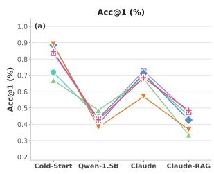

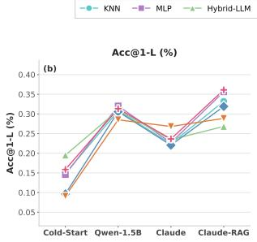

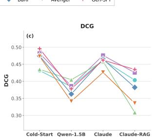

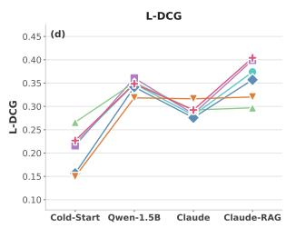  
Figure 4: Routing method performance across distillation policies in the partially-observable setting. All methods exhibit a high correlation with the distillation policy trend

## B Additional Figures

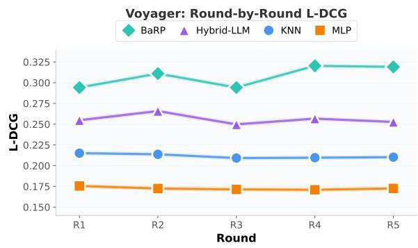  
Figure 5: Voyager round-by-round L-DCG.

## C Benchmark Dataset Details

The ROUTERWORLD benchmark comprises the following datasets, selected to represent a diverse range of linguistic and symbolic reasoning tasks:

HellaSwag (Zellers et al., 2019). A sentence completion benchmark that challenges models to select the most plausible continuation of a given context. It employs adversarial filtering to construct distractors that are deceptively plausible to language models while remaining clearly incorrect to humans, effectively testing commonsense reasoning.

GSM8K (Cobbe et al., 2021). A dataset of 8.5K linguistically diverse grade-school math word problems. Each problem typically requires 2–8 steps of elementary arithmetic, testing a model's ability to perform reliable sequential calculations.

ARC-Challenge (Clark et al., 2018). The partition of the AI2 Reasoning Challenge containing grade-school science questions that cannot be solved via simple retrieval or pattern matching.

These items require deeper reasoning and scientific understanding.

APPS (Hendrycks et al., 2021a). A code generation benchmark comprising 10,000 programming problems collected from open-access platforms like Codeforces. The dataset spans three difficulty levels (introductory, interview, and competition) and requires generating executable Python programs from natural language specifications.

BIRD-SQL (Li et al., 2024). A large-scale, cross-domain text-to-SQL benchmark featuring real-world databases with noisy and incomplete values. It emphasizes schema understanding and database content reasoning over complex relational structures.

FEVER (Thorne et al., 2018). A fact verification dataset containing 185K claims derived from Wikipedia. Models must classify claims as Supported, Refuted, or NotEnoughInfo based on retrieved evidence, testing evidence-grounded factual reasoning.

Gorilla APIBench (Patil et al., 2024). An evaluation of LLM-based API call generation across major hubs (TorchHub, TensorHub, HuggingFace). It tests the ability to produce accurate, executable API invocations from natural language instructions.

HotpotQA (Yang et al., 2018). A multi-hop question answering benchmark requiring reasoning over multiple supporting documents. Questions necessitate combining information from two or more Wikipedia passages, testing compositional reasoning and information synthesis.

PersonaChat (Yamashita et al., 2023). A chitchat dialogue dataset where each speaker is assigned a specific persona defined by profile sentences. Models must generate coherent, engaging responses consistent with the assigned persona.

TabMWP (Lu et al., 2023). A collection of 38K tabular math word problems combining natural language questions with structured tables. Solutions require extracting relevant numerical information and performing multi-step quantitative reasoning over the tabular data.

Hendrycks-MATH (Hendrycks et al., 2021b). A dataset of 12,500 competition-level mathematics problems across seven domains, including algebra, geometry, and number theory. These problems demand formal, multi-step mathematical reasoning beyond elementary arithmetic.

MCPToolBench++ (Fan et al., 2025). Evaluates tool-use capabilities under the Model Context Protocol (MCP). It tests the model's ability to correctly invoke tools via structured function calls and accurately extract parameters from natural language instructions.

## D Model Specifications and Latency

## D.1 Latency Profiling Protocol

To obtain per-model latency estimates for the routing objective, we profile the inference latency of all candidate LLMs using NVIDIA GenAI-Perf, a standardized benchmarking tool built on top of Triton Perf Analyzer.

Setup. Each model is served independently via vLLM (Kwon et al., 2023) inside a Docker container with NVIDIA GPU support, using tensor parallelism across 4 GPUs. The benchmarking client runs inside a separate NVIDIA Triton SDK container (tritonserver:24.06-py3-sdk) on the same host, communicating with the vLLM server over the OpenAI-compatible chat endpoint. All models are evaluated under identical conditions: 1,000 synthetic prompts with a fixed input length of 2,000 tokens and output length of 1,000 tokens, at a concurrency level of 10, with streaming enabled.

Metrics. We extract two key metrics for each model:

• Time to First Token (TTFT): the average time from request submission to the first generated token, reflecting model loading and prefill latency.

• Inter-Token Latency (ITL): the average time between consecutive output tokens during streaming decoding.

Total latency estimation. For ROUTERWORLD-Core, where each instance is a single-turn query with $N$ output tokens, we estimate the end-to-end generation latency as:

$$
{ \mathrm { L a t e n c y } } _ { \mathrm { c o r e } } ( m , N ) = { \mathrm { T T F T } } _ { m } + ( N - 1 ) \times { \mathrm { I T L } } _ { m }\tag{4}
$$

where m denotes the model.

For ROUTERWORLD-Agentic, tasks involve multi-step episodes where the agent interacts with an environment over K turns, each producing $N _ { k }$ tokens. The total episode latency is:

$$
\begin{array} { l } { \mathrm { L a t e n c y } _ { \mathrm { a g e n t } } ( m ) = \displaystyle \sum _ { k = 1 } ^ { K } \bigl [ \mathrm { T T F T } _ { m } + ( N _ { k } - 1 ) \times \mathrm { I T L } _ { m } \bigr ] } \\ { ~ + \displaystyle \sum _ { k = 1 } ^ { K } \mathrm { E n v } _ { k } } \end{array}\tag{5}
$$

where Envk denotes the environment response time at step $k$ (e.g., browser rendering, API calls). In practice, we record the wall-clock episode latency directly from the agentic harness, which captures both model inference and environment interaction time.

These formulas are used to compute per-instance latency for each model in the routing dataset, enabling the construction of latency-aware groundtruth labels.

## D.2 Unified Latency Profile

Table 4 presents the latency profile of all candidate models across both ROUTERWORLD-Core and ROUTERWORLD-Agentic, measured with GenAI-Perf under identical conditions. Models are sorted by total estimated latency (Eq. 4 with N=1,000). The Pool column indicates whether the model is used in Core, Agentic, or both benchmarks.

## D.3 Model Descriptions

Core-Only Models. Gemma-2B serves as the efficiency anchor with a median latency of just 13ms TTFT. CodeGemma-7B and DS-Math-7B are domain-specialized models that test the router's ability to identify task intent, offering low latency (\~100ms) while outperforming generalists on code and math tasks. Mistral-7B provides a robust generalist baseline for the 7B class.

<table><tr><td>Model</td><td>Pool</td><td>Params</td><td>TTFT (ms)</td><td>ITL (ms)</td><td>Total (s)</td></tr><tr><td>Gemma-2B</td><td>Core</td><td>2B</td><td>12.64</td><td>3.96</td><td>3.97</td></tr><tr><td>CodeGemma-7B</td><td>Core</td><td>7B</td><td>14.22</td><td>5.20</td><td>5.21</td></tr><tr><td>Ministral-14B</td><td>Agentic</td><td>14B</td><td>18.26</td><td>3.50</td><td>3.51</td></tr><tr><td>Mistral-7B</td><td>Core</td><td>7B</td><td>100.21</td><td>4.13</td><td>4.23</td></tr><tr><td>DS-Math-7B</td><td>Core</td><td>7B</td><td>117.16</td><td>4.36</td><td>4.48</td></tr><tr><td>Devstral-123B</td><td>Agentic</td><td>123B</td><td>493.30</td><td>14.56</td><td>15.04</td></tr><tr><td>Qwen3-Coder-30B</td><td>Agentic</td><td>30B</td><td>532.29</td><td>7.20</td><td>7.73</td></tr><tr><td>GPT-OSS-20B</td><td>Both</td><td>20B</td><td>1,137.45</td><td>4.06</td><td>5.19</td></tr><tr><td>GPT-OSS-120B</td><td>Agentic</td><td>120B</td><td>1,212.55</td><td>5.97</td><td>7.18</td></tr><tr><td>Qwen3-235B</td><td>Both</td><td>235B</td><td>2,258.10</td><td>18.76</td><td>21.01</td></tr><tr><td>Nemotron-9B</td><td>Core</td><td>9B</td><td>5,733.59</td><td>6.29</td><td>12.03</td></tr><tr><td>Qwen3-Next-80B</td><td>Agentic</td><td>80B</td><td>20,612.40</td><td>8.38</td><td>28.99</td></tr></table>

Table 4: Unified latency profile of all candidate models, measured with GenAI-Perf (2,000 input tokens, 1,000 output tokens, concurrency 10, streaming). Models sorted by total latency.

Agentic-Only Models. Ministral-14B is the fastest agentic model (18ms TTFT, 3.5ms ITL). Qwen3-Coder-30B represents a mid-tier option balancing latency and accuracy. Devstral-123B and GPT-OSS-120B are large-scale models for complex agentic tasks. Qwen3-Next-80B exhibits the highest TTFT (20.6s) due to cold-start overhead.

Shared Models. GPT-OSS-20B bridges both pools, achieving 67.9% accuracy on Core with moderate latency (\~5.2s). Qwen3-235B is the oracle model of both pools with the highest accuracy but significant latency (\~21s). Nemotron-9B achieves high accuracy (71.8% on Core) but exhibits disproportionately high TTFT (5.7s), presenting a challenging routing trap: high accuracy at high cost.

Infrastructure. All profiling experiments are conducted on a single node equipped with NVIDIA GPUs. Models requiring newer architecture support (Ministral-14B, Qwen3-Next-80B, Devstral-123B) use vLLM v0.12.0, while the remaining models use vLLM v0.9.2, all with tensor parallelism of 4.

## E Detailed Dataset Statistics & Analysis

## E.1 ROUTERWORLD-Core Statistics

In this section, we analyze the specific difficulty distributions and routing opportunities within ROUTERWORLD-Core and ROUTERWORLD-Agentic.

Composition and Specialization. The ROUTER-WORLD-Core test set (N = 7,967) provides balanced coverage across Reasoning (Logic 17.3%, Math 18.5%, Data Analysis 18.9%) and Interaction (QA 16.3%, Code 12.0%, Tool Use 10.6%, Chit-Chat 6.4%). As shown in Figure 6, no single model dominates all categories. For example, DS-Math-7B leads sub-20B models on Math tasks but underperforms on Logic, while CodeGemma-7B shows distinct strength in code generation. This confirms that effective routing must account for task-specific competence rather than relying solely on model scale.

Routing Opportunity. Query difficulty is broadly distributed (Figure 7), creating significant opportunity for adaptive routing. Oracle routing selects the fastest correct model per query, demonstrating that frontier-scale models are often computationally wasteful for standard tasks (Figure 9).

## E.2 ROUTERWORLD-Agentic Statistics

Composition. The ROUTERWORLD-Agentic benchmark $( N _ { \mathrm { t r a i n } } ~ = ~ 1 1 , 2 9 2 , ~ N _ { \mathrm { t e s t } } ~ = ~ 1 , 4 4 8 )$ covers three agentic task families: Web Navigation (44.8%), Online Shopping (38.2%), and Household (17.0%), drawn from WorkArena, WebShop, and ALFWorld respectively. These tasks require multi-step reasoning, tool use, and environment interaction, presenting fundamentally different routing challenges compared to single-turn Core tasks.

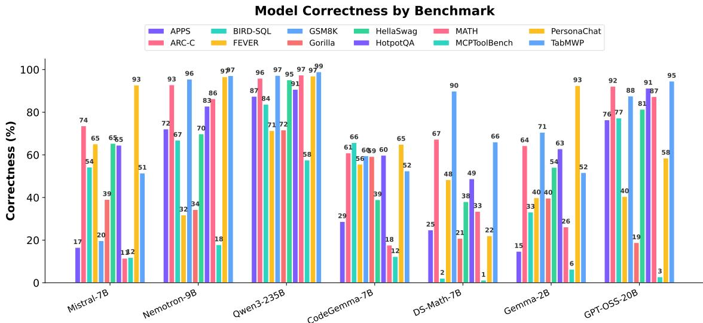  
Figure 6: Per-benchmark model correctness for RoUTERWORLD-Core. Models exhibit distinct specialization patterns across task types, with smaller models often outperforming generalists in specific domains.

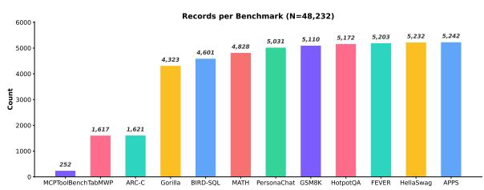  
Figure 7: Records per benchmark in ROUTERWORLD-Core. The dataset spans 12 benchmarks with broad coverage across reasoning, coding, and interaction tasks.

Model Correctness by Benchmark. As shown in Fig. 10, correctness varies substantially across benchmarks. Larger models achieve higher scores on complex web navigation tasks, but smaller specialized models can be competitive on structured household tasks. This heterogeneity across benchmarks reinforces the value of task-aware routing.

Latency and Routing Opportunity. Agentic tasks exhibit significantly higher latency than Core tasks (median 11.8s vs. 4.3s), with large variance across models (Figure 12). This amplifies the potential savings from intelligent routing. Figure 13 shows the fastest correct model distribution, revealing that even in the agentic setting, smaller models frequently provide the fastest correct response.

## F Router Implementation

## F.1 Hyperparameters

The regression head is implemented as a three-layer Multi-Layer Perceptron (MLP) with hidden dimensions [512, 256, 128]. Each linear layer is followed by a ReLU activation, Batch Normalization, and Dropout $( p \ : = \ : 0 . 3 )$ . The final projection maps the hidden state to K logits. We train using the AdamW optimizer with a learning rate of $2 \times 1 0 ^ { - 5 }$ for the encoder and $1 \times 1 0 ^ { - 4 }$ for the head, employing a cosine annealing schedule with a 5% warmup period.

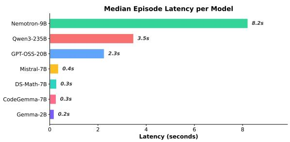  
Figure 8: Median episode latency per model in RoUTERWORLD-Core. Smaller models offer substantially lower latency, motivating intelligent routing.

## G Baseline Implementation Details

We implement all baselines using PyTorch and train on 8× NVIDIA H200 GPUs. Below we detail the architecture and hyperparameters for each method under both the fully observable and partially observable settings. In the fully observable setting, the router has access to the correctness labels of all candidate models for each training query (correct\_list). In the partially observable setting, the router only observes the outcome of a single selected model per query (selected field), and must learn to route without knowledge of unobserved model outcomes. Unless otherwise noted, all methods share the same architecture across settings; we highlight where hyperparameters or training procedures differ.

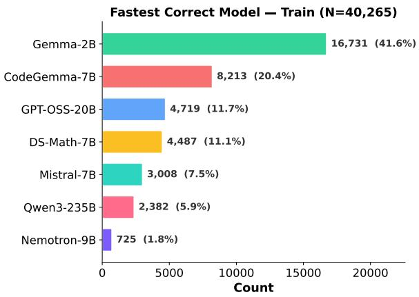

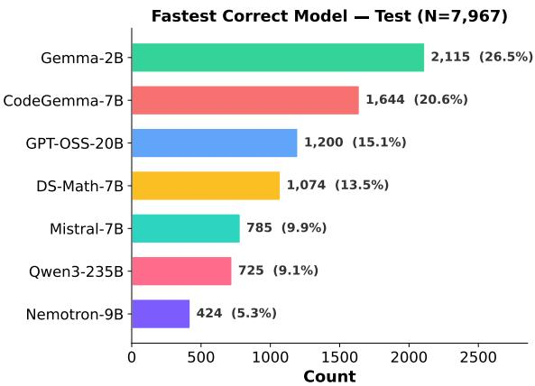

Figure 9: Fastest correct model distribution for RoUTERWORLD-Core (train and test). Small models are the optimal choice for a large share of queries.  
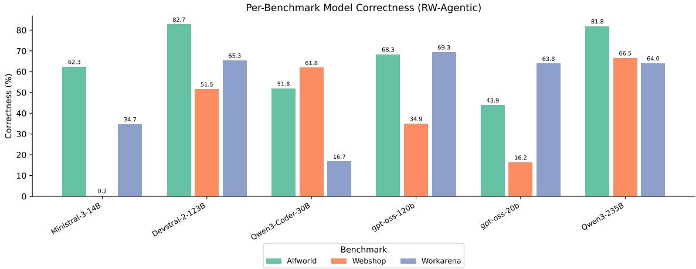  
Figure 10: Per-benchmark model correctness for RoUTERWORLD-Agentic. Performance varies substantially across the three agentic task families.

## G.1 Representation-Based Routers

Representation-based routers learn a query representation and make routing decisions based on similarity, classification, or learned utility in embedding space. These methods differ in whether representations are frozen or fine-tuned, and in how routing decisions are derived from the learned representations.

• Naive Bayes & KNN (k=5): Operate on frozen representations from Qwen3-Embedding-0.6B(mean-pooled, 1024-dimensional), predicting a distribution over the K candidate models and selecting the argmax. These methods are non-parametric and require no gradient-based training.

\- Fully observable: Trained on the full training set with labels derived from correct\_list.

\- Partially observable: Trained on the filtered subset containing only samples where the selected model was correct (correct\_only).

• MLP: A three-hidden-layer feedforward classifier $( 1 0 2 4 \to 5 1 2 \to 2 5 6 \to 1 2 8 \to K )$ trained on frozen Qwen3-Embedding-0.6B representations using cross-entropy loss (learning rate $1 \times 1 0 ^ { - 4 }$ , dropout 0.2).

– Fully observable: Trained for 12 epochs on the full training set.

\- Partially observable: Trained for 20 epochs on the correct\_only subset.

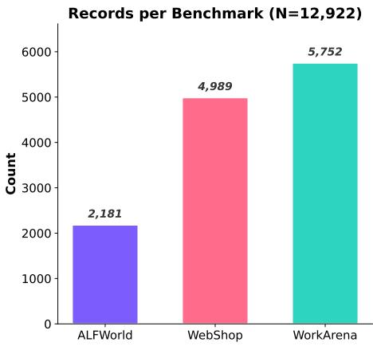

Figure 11: Records per benchmark in ROUTERWORLD-Agentic across three agentic task families.  
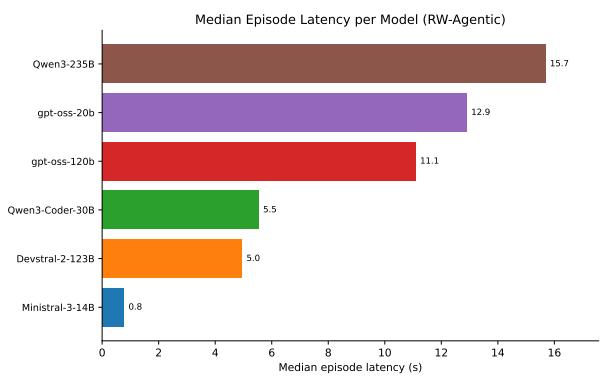  
Figure 12: Median episode latency per model in RoUTERWORLD-Agentic. Latency ranges from 0.8s to 15.7s across models.

• Emb-FT: End-to-end fine-tuning of Qwen3-Embedding-0.6B with a two-layer classification head (hidden dimension 512, dropout 0.1), trained with DDP across 8 GPUs (learning rate $1 \times 1 0 ^ { - 4 }$ , per-GPU batch size 32, gradient accumulation 2, effective batch size 512).

– Fully observable: 10 epochs on the full training set.

– Partially observable: 10 epochs on the correct\_only subset, with labels from the selected field.

• ModernBERT (Warner et al., 2025): Finetunes ModernBERT-base end-to-end with a two-layer classification head (hidden dimension 768, dropout 0.1) using DDP across 8 GPUs.

– Fully observable: Learning rate $1 \times 1 0 ^ { - 3 } .$ per-GPU batch size 32, gradient accumulation 2, effective batch size 512, 10

epochs.

– Partially observable: Learning rate 1 × $1 0 ^ { - 3 }$ , per-GPU batch size 128, gradient accumulation 2, effective batch size 2,048, 10 epochs on the correct\_only subset.

• Hybrid-LLM (Ding et al., 2024): Fine-tunes DeBERTa-v3-large with an N-class crossentropy objective (learning rate $5 \times 1 0 ^ { - 5 }$ dropout 0.1) using DDP across 8 GPUs.

\- Fully observable: Per-GPU batch size 32, gradient accumulation 2, effective batch size 512, 20 epochs. Uses correct\_list[0] (fastest correct model) as the ground-truth label.

\- Partially observable: Per-GPU batch size 64, gradient accumulation 2, effective batch size 1,024, 15 epochs on the correct\_only subset. Uses the selected model as the ground-truth label.

• BaRP (Wei et al., 2025): A preferenceconditionedroutingpolicytrained with REINFORCE on top of frozen Qwen3-Embedding-0.6Brepresentations (learning rate $1 \times 1 0 ^ { - 4 }$ , entropy coefficient $\beta { = } 0 . 0 5$ , dropout 0.2). At inference, users specify a preference vector $( w _ { q } , w _ { c } )$ to trade off quality and cost; the policy outputs π(a | x, w) over candidate models. Trained with DDP across 8 GPUs (per-GPU batch size 32, effective batch size 256).

– Fully observable: Uses expected reward over all models from correct\_list, up to 100 epochs with early stopping (patience 10).

– Partially observable: Learns only from the outcome of the selected model per sample, up to 100 epochs with early stopping (patience 10).

• GraphRouter (Feng et al., 2025b): A graph neural network modeling query-model interactions. GNN layers (hidden dimension 8, edge mask rate 0.5) are trained on top of frozen Qwen3-Embedding-0.6B embeddings with a learning rate of $3 \times 1 0 ^ { - 4 }$ and weight decay $1 \times 1 0 ^ { - 4 }$

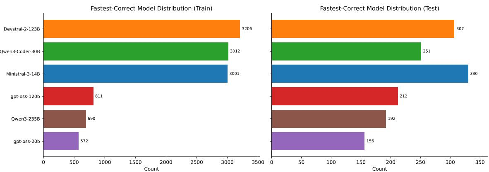  
Figure 13: Fastest correct model distribution for RoUTERWORLD-Agentic (train and test).

\- Fully observable: Batch size 128, 100 epochs, single GPU. Labels derived from correct\_list[0] (fastest correct model).

\- Partially observable: Batch size 128, 1,000 epochs, single GPU. Only the selected model receives gradient (mask = 1); unobserved models are masked out.

• Avenger (Zhang et al., 2025b): A trainingfree, cluster-based ranking router. During offline calibration, training queries are embedded with frozen Qwen3-Embedding-0.6B and clustered via K-means (k=64). Per-cluster model rankings are computed from the training labels. At inference, the query is assigned to the top-11 nearest clusters (softmax temperature β=3.0), and rankings are aggregated to select the best model.

– Fully observable: Rankings computed using L-DCG (latency-aware discounted cumulative gain) over all models in correct\_list.

\- Partially observable: Rankings computed using router\_accuracy over the selected field only, as latency-aware metrics require observing all models.

## G.2 Generative Routers

Generative routers use autoregressive language models to directly select a target model via prompting or supervised fine-tuning on routing data.

• Zero-Shot Prompting: We serve Qwen2.5-0.5B-Instruct via vLLM with 128 parallel workers. The model receives a system prompt describing the available model set and outputs the selected model name directly. This baseline is identical across both settings as it requires no training data.

• Gen-SFT: Supervised fine-tuning of Qwen2.5-1.5B-Instruct on routing annotations using standard cross-entropy loss (learning rate 2 × 10−5, micro batch size 4, effective batch size 128, max sequence length 1,024, weight decay 0.01, 5 epochs, 8 GPUs with FSDP).

\- Fully observable: Training targets are the fastest correct model from correct\_list.

– Partially observable: Training targets are the selected model, filtered to correctonly samples.

## H LLM Judge Validation Details

We validate the automated LLM judge used throughout ROUTERWORLD against independent human annotations. Six experts blind-label 150 stratified (query, model, response) triples sampled across 12 datasets and 7 models without seeing the judge verdict. We report inter-annotator agreement (IAA) to establish the task-difficulty ceiling, and LLM–human agreement (LHA) to measure judge alignment with expert majority-vote consensus.

## H.1 Annotation Protocol

We developed a web-based annotation tool (Figure 14) that presents each annotator with: (i) the user query, (ii) the full prompt including instructions and response choices, (iii) the ground-truth answer from the dataset, and (iv) the model response. The source dataset and responding model are displayed as colored tags. Annotators follow the guidelines below.

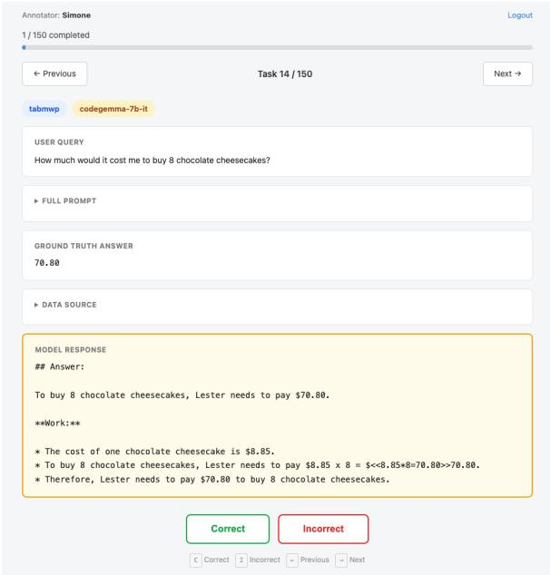  
Figure 14: Screenshot of the web-based annotation tool developed for the LLM judge validation study. The interface displays the source dataset and model (colored tags), the user query, the full prompt, the ground-truth answer, and the model response. Annotators label each triple as correct or incorrect by comparing the model response against the ground truth. The tool and annotation guidelines will be released as open source.

Core Rule. For each triple, the annotator compares the model response against the ground-truth answer and labels it correct or incorrect.

## Key Guidelines.

1. Focus on the final answer only. Formatting differences (e.g., <a>C</a> vs. C.) and intermediate reasoning traces are ignored; only the substantive answer matters.

2. Compare against ground truth. Annotators judge whether the model's answer matches the provided ground-truth label, without independently verifying the ground truth itself.

3. Skip ambiguous cases. When a confident judgment is not possible—e.g., long codegeneration tasks requiring execution, or subjective dialogue evaluations (persona-chat)— annotators skip the entry to preserve annotation integrity.

## H.2 Agreement Scores

Table 5 reports multi-rater agreement among the six annotators. The high Fleiss’κ=0.84 reflects the largely objective nature of the benchmarks: for datasets with unambiguous answers (e.g., multiplechoice, numeric), annotators almost always concur. Disagreements arise primarily on tasks requiring non-trivial answer extraction (e.g., BIRD-SQL, GO-RILLA\_FUNC).

<table><tr><td>Metric</td><td>Value</td></tr><tr><td>Fleiss&#x27;κ</td><td>0.835</td></tr><tr><td>Krippendorff&#x27;s α</td><td>0.867</td></tr><tr><td>Avg. pairwise κ</td><td>0.892</td></tr><tr><td>Avg. pairwise agreement</td><td>0.950</td></tr></table>

Table 5: Inter-annotator agreement among 6 experts on 150 blind annotations.
<table><tr><td>Comparison</td><td>Agreement</td><td>κ</td><td>Precision / Recall</td><td>F1</td></tr><tr><td>Consensus vs. LLM Judge</td><td>0.920</td><td>0.835</td><td>0.98/0.89</td><td>0.932</td></tr></table>

Table 6: Majority-vote consensus (6 annotators) vs. LLM judge (n=150).

Table 6 compares the majority-vote consensus with the LLM judge. The judge-consensus κ=0.84 matches the inter-expert Fleiss'κ=0.84, indicating the judge operates at human-level reliability, consistent with the findings of (Zheng et al., 2023a) who report >80% agreement between GPT-4 and human evaluators.

## H.3 Individual Annotator vs. LLM Judge

Table 7 reports each annotator's agreement with the judge, showing that the judge aligns comparably with every expert (κ range: 0.73–0.93).

## I Detailed Results on ROUTERWORLD-Agentic

## I.1 Agentic Benchmark Details

RW-AGENTIC evaluates routing across three interactive benchmarks: ALFWorld (household tasks), WebShop (web navigation), and WorkArena (enterprise workflows), totaling over 76,000 model– task interactions. The candidate pool comprises six models spanning 14B-235B parameters: Ministral-14B, Qwen3-Coder-30B, Devstral-123B, GPT-OSS-20B, GPT-OSS-120B, and Qwen3-235B. Each instance records the user query, the model's step-by-step interaction trace, task success, number of steps, and cumulative episode latency.

Table 8 summarizes per-model statistics. Unlike RW-CORE where latency is dominated by single-turn inference, agentic latency reflects the full episode duration, a product of per-step inference cost and the number of interaction steps required.

<table><tr><td>Annotator</td><td>n</td><td>Agreement</td><td>κ</td></tr><tr><td>Annotator-S</td><td>87</td><td>94.3%</td><td>0.880</td></tr><tr><td>Annotator-A</td><td>86</td><td>94.2%</td><td>0.871</td></tr><tr><td>Annotator-D</td><td>88</td><td>96.6%</td><td>0.929</td></tr><tr><td>Annotator-H</td><td>100</td><td>89.0%</td><td>0.772</td></tr><tr><td>Annotator-P</td><td>100</td><td>87.0%</td><td>0.730</td></tr><tr><td>Annotator-W</td><td>97</td><td>93.8%</td><td>0.874</td></tr></table>

Table 7: Individual annotator agreement with the LLM judge on the 150-sample set.

<table><tr><td>Model</td><td>TTFT (ms)</td><td>ITL (ms)</td><td>Throughput (tok/s)</td><td>Med. Episode Lat. (s)</td></tr><tr><td>Ministral-14B</td><td>18</td><td>3.5</td><td>2,764</td><td>0.6</td></tr><tr><td>Qwen3-Coder-30B</td><td>532</td><td>7.2</td><td>1,126</td><td>5.5</td></tr><tr><td>Devstral-123B</td><td>493</td><td>14.6</td><td>574</td><td>4.9</td></tr><tr><td>GPT-OSS-20B</td><td>1,137</td><td>4.1</td><td>987</td><td>12.7</td></tr><tr><td>GPT-OSS-120B</td><td>1,213</td><td>6.0</td><td>1,169</td><td>11.1</td></tr><tr><td>Qwen3-235B</td><td>2,258</td><td>18.8</td><td>370</td><td>16.4</td></tr></table>

Table 8: Agentic candidate model pool. TTFT = time to first token; ITL = inter-token latency. Episode latency is the median total time across all tasks.

## I.2 Performance Compression and Policy Collapse

Under the 3-model pool, fully-observable methods cluster tightly with near-zero Acc@ 1-L variance $( \sigma ^ { 2 } { = } 0 . 8 1 )$ , compared to $\sigma ^ { 2 } { = } 2 9 . 5$ in RW-CORE. Expanding to 6 models does not alleviate this— among non-collapsed methods, variance remains low $( \sigma ^ { 2 } { = } 4 . 3 5$ for Acc@1-L in fully-observable), and the gap to the Oracle upper bound (70.65% Acc@ 1-L) remains substantial. Under partial observability, the compression worsens further, with multiple routers collapsing into degenerate singlemodel policies (Table 10).

The root cause lies in the interaction between model planning capability and episode length. Models with stronger planning capabilities resolve tasks in fewer steps (Figure 15): Qwen3-235B requires a median of 18 steps on ALFWorld, while GPT-OSS-20B requires 50. Despite Qwen3-235B having the highest per-step inference latency (15.7s median episode latency), its superior planning yields lower total episode cost than weaker models that compensate with many cheap but inefficient steps (Figure 16). This inverts the conventional latency-accuracy trade-off: the largest model is simultaneously the most accurate and the most cost-efficient, leaving routers with no meaningful trade-off to exploit.

Without counterfactual feedback, partiallyobservable routers greedily exploit this dynamic, collapsing into static “Route-To-Best" policies. In the 3-model setting, collapsed routers default to Qwen3-235B; in the 6-model pool, the pattern persists with routers favoring the dominant model. This collapse is rational given the reward structure— the strongest planner minimizes both error and accumulated latency—but it renders routing trivial.

Breaking this plateau requires routing algorithms that reason about multi-step execution dynamics rather than treating agentic tasks as single-turn queries. Capturing non-linear planning-latency interactions demands large-scale rollout environments for exploration-guided training. By providing over 76,000 standardized agentic interactions across 6 models, RW-AGENTIC establishes the largest-scale environment to date for studying these routing bottlenecks in realistic agent deployments.

## I.3 Planning Capability and Step Efficiency

Figure 15 shows the median number of interaction steps per model across all three benchmarks. The relationship between model capability and step efficiency is benchmark-dependent: on ALF-World, GPT-OSS-20B requires a median of 50 steps while most other models cluster around 15– 18; on WebShop, Qwen3-235B and Qwen3-Coder-30B are the most step-efficient (median 5 steps); on WorkArena, all models converge to 5–10 steps. These patterns confirm that planning capability— not raw inference speed—is the primary driver of episode cost in agentic settings.

Figure 16 shows the resulting median episode latency. Despite having the highest per-token cost (18.8 ms ITL), Qwen3-235B achieves competitive total episode latency because its superior planning reduces the number of required steps. Conversely, GPT-OSS-20B has low per-token cost (4.1 ms ITL) but incurs the second-highest episode latency due to verbose, multi-step execution.

## I.4 Full Routing Results

## I.4.1 6-Model Pool

Table 9 presents routing results with the full 6-model candidate pool (Ministral-14B, Qwen3- Coder-30B, Devstral-123B, GPT-OSS-20B, GPT-OSS-120B, Qwen3-235B). BARP achieves the highest Acc@1 under full observability (52.69%), MLP achieves the highest Acc@1-L (39.16%), Naive Bayes achieves the highest DCG (0.4512), and Hybrid-LLM achieves the highest L-DCG (0.4151). Several methods exhibit policy collapse under partial observability: BARP, Avenger, Graph-Router, and Hybrid-LLM all suffer sharp drops in Acc@1-L (below 23%), while methods like Naive Bayes and Emb-FT remain comparatively stable.

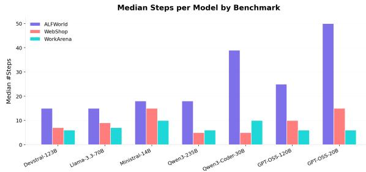  
Figure 15: Median interaction steps per model by benchmark. Models with stronger planning capabilities (e.g., Qwen3-235B, Devstral-123B) resolve tasks in fewer steps, particularly on ALFWorld and WebShop.

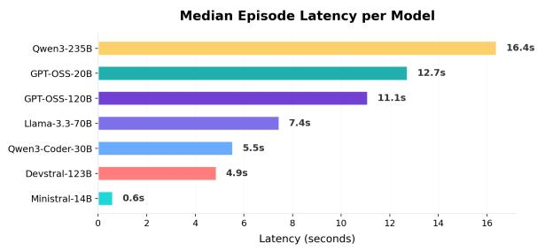  
Figure 16: Median episode latency per model. The conventional assumption that larger models are slower does not hold in agentic settings. Planning efficiency can offset higher per-step inference cost.

## I.4.2 3-Model Pool

Table 10 presents results with the original 3-model pool (Qwen3-235B, GPT-OSS-20B, Nemotron-9B). Orange-shaded cells indicate collapsed routing policies that always select a single model; these are excluded from best/second-best comparisons.

## J Query Encoder Scaling

We compare Qwen3-Embedding-0.6B (1024-dim) against Qwen3-Embedding-8B (4096-dim) across four methods that support both encoders. Table 11 reports the results under fully and partiallyobservable settings.

Scaling the encoder from 0.6B to 8B (13× parameters, 4× embedding dimension) yields surprisingly modest gains. Under full observability, KNN and Avenger improve by less than 1 pp in L-DCG, and MLP gains only 1 pp. BaRP degrades sharply, likely because its lightweight decision head (64- dim) cannot effectively leverage the 4096-dim representations, leading to mode collapse.

Solve the following math problem step by   
step. The last line of your response should   
only contain your final answer inside a   
\boxed{} command.   
{Question}   
Remember to put your answer inside   
\boxed{}.  
Figure 17: Rollout prompt for mathematical reasoning benchmarks.

Under partial observability, the picture is mixed: MLP and BaRP benefit modestly from the larger encoder (+4 pp each), but KNN and Avenger show near-zero improvement. Notably, Avenger with 8B produces identical L-DCG to 0.6B (0.149) under cold-start, which both collapse.

These results suggest that routing quality is bottlenecked by the training signal, not encoder capacity. A 13× parameter increase provides at most +1 pp L-DCG under full observability and +4 pp under partial observability, while warm-up initialization (Figure 4, see Appendix B) recovers +15–18 pp with the same 0.6B encoder. Investing in better training data (e.g., diverse warm-up labels) is far more effective than scaling the encoder.

## K RouterWorld Prompt Details

This section documents all prompts used in the RouterWorld data collection pipeline and routing methods. Figures 17–25 show the prompts used to roll out candidate models on core evaluation tasks. Figures 23–26 show the agent rollout prompts. Figures 27–32 present the LLM-as-Judge prompts for automated correctness annotation. Figure 33 shows the user query annotation prompt. Figures 34–35 present the generative router prompts used for SFT training and inference.

## K.1 Core Task Rollout Prompts

Each benchmark category uses a standardized prompt template to query candidate models during data collection.

## K.2 Agentic Task Rollout Prompts

For agentic benchmarks, each candidate model is deployed as an interactive agent producing valid actions in a structured format. Unlike core tasks where a single prompt-response pair suffices, agentic rollouts involve multi-turn interactions between the model and the environment. Notably, several candidate models required extensive prompt engineering (\~2 hours per model) to reliably extract valid actions in the expected format, as models frequently produced verbose explanations or malformed action strings instead of the required structured output.

<table><tr><td rowspan="2">Method</td><td rowspan="2">Base Model</td><td colspan="4">Fully-Observable</td><td colspan="4">Partially-Observable</td></tr><tr><td>Acc@1 (%)</td><td>Acc@1-L (%)</td><td>DCG</td><td>L-DCG</td><td>Acc@1 (%)</td><td>Acc@1-L (%)</td><td>DCG</td><td>L-DCG</td></tr><tr><td colspan="10">Naive Baselines</td></tr><tr><td>Oracle (Perfect)</td><td></td><td>100.00</td><td>100.00</td><td>1.0000</td><td>1.0000</td><td>100.00</td><td>100.00</td><td>1.0000</td><td>1.0000</td></tr><tr><td>Oracle (Best-of-N)</td><td></td><td>82.67</td><td>70.65</td><td>0.7791</td><td>0.7521</td><td>94.89</td><td>77.35</td><td>0.8781</td><td>0.8313</td></tr><tr><td>Random</td><td>一</td><td>41.64</td><td>16.99</td><td>0.3010</td><td>0.2211</td><td>41.64</td><td>16.99</td><td>0.3010</td><td>0.2211</td></tr><tr><td>Route-To-Devstral</td><td></td><td>44.41</td><td>21.20</td><td>0.3519</td><td>0.2674</td><td>44.41</td><td>21.20</td><td>0.3519</td><td>0.2674</td></tr><tr><td>Route-To-Ministral</td><td></td><td>22.93</td><td>22.79</td><td>0.2286</td><td>0.2284</td><td>22.93</td><td>22.79</td><td>0.2286</td><td>0.2284</td></tr><tr><td>Route-To-OSS-20B</td><td></td><td>39.36</td><td>10.77</td><td>0.2611</td><td>0.1694</td><td>39.36</td><td>10.77</td><td>0.2611</td><td>0.1694</td></tr><tr><td>Route-To-OSS-120B</td><td></td><td>48.96</td><td>14.64</td><td>0.3281</td><td>0.2181</td><td>48.96</td><td>14.64</td><td>0.3281</td><td>0.2181</td></tr><tr><td>Route-To-Qwen3-Coder</td><td></td><td>29.56</td><td>17.33</td><td>0.2441</td><td>0.2130</td><td>29.56</td><td>17.33</td><td>0.2441</td><td>0.2130</td></tr><tr><td>Route-To-Qwen3-235B</td><td></td><td>60.36</td><td>13.26</td><td>0.3652</td><td>0.1967</td><td>60.36</td><td>13.26</td><td>0.3652</td><td>0.1967</td></tr><tr><td colspan="10">Representation-based Routers</td></tr><tr><td>KNN</td><td>Qwen3-Emb-0.6B</td><td>48.20</td><td>38.40</td><td>0.4414</td><td>0.4118</td><td>51.59</td><td>21.82</td><td>0.3774</td><td>0.2814</td></tr><tr><td>Naive Bayes</td><td>Qwen3-Emb-0.6B</td><td>51.73</td><td>36.12</td><td>0.4512</td><td>0.4021</td><td>50.69</td><td>31.15</td><td>0.4225</td><td>0.3680</td></tr><tr><td>MLP</td><td>Qwen3-Emb-0.6B</td><td>45.23</td><td>39.16</td><td>0.4282</td><td>0.4122</td><td>58.70</td><td>20.17</td><td>0.4014</td><td>0.2687</td></tr><tr><td>Emb-FT</td><td>Qwen3-Emb-0.6B</td><td>44.89</td><td>36.95</td><td>0.4170</td><td>0.3925</td><td>55.94</td><td>23.48</td><td>0.4095</td><td>0.3045</td></tr><tr><td>Hybrid-LLM</td><td>DeBERTa Large</td><td>46.48</td><td>39.02</td><td>0.4351</td><td>0.4151</td><td>58.08</td><td>13.88</td><td>0.3595</td><td>0.2049</td></tr><tr><td>Graph-Router</td><td>Qwen3-Emb-0.6B</td><td>46.13</td><td>13.47</td><td>0.3086</td><td>0.2016</td><td>53.87</td><td>13.40</td><td>0.3426</td><td>0.2012</td></tr><tr><td>BARP</td><td>Qwen3-Emb-0.6B</td><td>52.69</td><td>32.73</td><td>0.4434</td><td>0.3739</td><td>22.93</td><td>22.79</td><td>0.2286</td><td>0.2284</td></tr><tr><td>Avenger</td><td>Qwen3-Emb-0.6B</td><td>42.54</td><td>36.12</td><td>0.3990</td><td>0.3848</td><td>43.92</td><td>11.67</td><td>0.2873</td><td>0.1790</td></tr></table>

Table 9: Routing performance on RW-AGENTIC (6-model pool) under fully- and partially-observable settings. Bold = best; underline = second best.

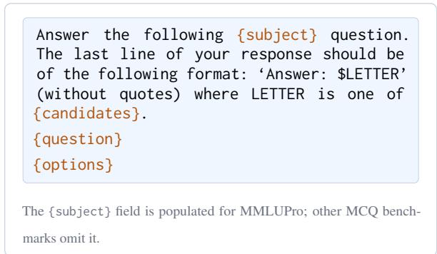  
Figure 18: Rollout prompt for multiple-choice benchmarks.

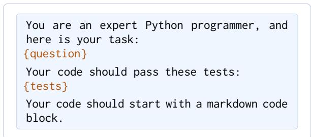  
Figure 19: Rollout prompt for code generation benchmarks.

Answer the logical question, Write a line   
of the form “Answer: \$ANSWER" at the end of   
your response. Let's think step by step.   
Here are 3 examples to help you understand   
how to answer the question:   
{template}   
Question: {question}  
Figure 20: Rollout prompt for BBH logical reasoning (3-shot with chain-of-thought).

## K.3 LLM-as-Judge Prompts

After collecting model responses, we use LLM-as-Judge prompts to automatically annotate correctness. Each task category has a dedicated judge prompt that outputs its verdict inside <a>. . .</a> tags.

<table><tr><td colspan="2"></td><td colspan="4">Fully-Observable</td><td colspan="4">Partially-Observable</td></tr><tr><td>Method</td><td>Base Model</td><td>Acc@1(%)</td><td>Acc@1-L (%)</td><td>DCG</td><td>L-DCG</td><td>Acc@1 (%)</td><td>Acc@1-L (%)</td><td>DCG</td><td>L-DCG</td></tr><tr><td colspan="12">Naive Baselines</td></tr><tr><td>Oracle (Perfect)</td><td></td><td>100.00</td><td>100.00</td><td>1.0000</td><td>1.0000</td><td>100.00</td><td>100.00</td><td>1.0000</td><td>1.0000</td></tr><tr><td>Oracle (Best-of-8)</td><td></td><td>86.81</td><td>73.46</td><td>0.8176</td><td>0.7931</td><td>88.16</td><td>75.19</td><td>0.8325</td><td>0.8051</td></tr><tr><td>Random</td><td></td><td>41.89</td><td>26.38</td><td>0.3589</td><td>0.3161</td><td>41.89</td><td>26.38</td><td>0.3589</td><td>0.3161</td></tr><tr><td>Route-To-Qwen</td><td></td><td>67.95</td><td>38.92</td><td>0.5706</td><td>0.4971</td><td>67.95</td><td>38.92</td><td>0.5706</td><td>0.4971</td></tr><tr><td>Route-To-Nemotron</td><td></td><td>43.03</td><td>20.54</td><td>0.3376</td><td>0.2615</td><td>43.03</td><td>20.54</td><td>0.3376</td><td>0.2615</td></tr><tr><td>Route-To-OSS</td><td></td><td>51.19</td><td>40.54</td><td>0.4698</td><td>0.4462</td><td>51.19</td><td>40.54</td><td>0.4698</td><td>0.4462</td></tr><tr><td colspan="10">Generative AI Routers</td></tr><tr><td>Zero-Shot Prompt</td><td>Qwen-2.5-0.5B-ins</td><td>67.95</td><td>38.92</td><td>0.5706</td><td>0.4971</td><td>67.95</td><td>38.92</td><td>0.5706</td><td>0.4971</td></tr><tr><td>Gen-SFT</td><td>Qwen-2.5-0.5B-ins</td><td>76.43</td><td>58.32</td><td>0.6954</td><td>0.6581</td><td>75.62</td><td>50.59</td><td>0.6622</td><td>0.6022</td></tr><tr><td>Zero-Shot Prompt</td><td>Qwen-2.5-1.5B-ins</td><td>67.95</td><td>38.92</td><td>0.5706</td><td>0.4971</td><td>67.95</td><td>38.92</td><td>0.5706</td><td>0.4971</td></tr><tr><td>Gen-SFT</td><td>Qwen-2.5-1.5B-ins</td><td>76.16</td><td>58.32</td><td>0.6935</td><td>0.6576</td><td>74.76</td><td>50.05</td><td>0.6546</td><td>0.5953</td></tr><tr><td colspan="10">Representation-based Routers</td></tr><tr><td>KNN</td><td>Qwen3-Embedding-0.6B</td><td>75.73</td><td>57.84</td><td>0.6889</td><td>0.6512</td><td>72.54</td><td>48.76</td><td>0.6341</td><td>0.5742</td></tr><tr><td>MLP</td><td>Qwen3-Embedding-0.6B</td><td>77.41</td><td>59.24</td><td>0.7050</td><td>0.6673</td><td>77.35</td><td>55.46</td><td>0.6907</td><td>0.6411</td></tr><tr><td>Emb-FT</td><td>Modern-base-0.1B</td><td>77.78</td><td>58.16</td><td>0.7034</td><td>0.6604</td><td>67.95</td><td>38.92</td><td>0.5706</td><td>0.4971</td></tr><tr><td>Emb-FT</td><td>Qwen3-Embedding-0.6B</td><td>78.05</td><td>60.00</td><td>0.7118</td><td>0.6747</td><td>78.54</td><td>57.35</td><td>0.7053</td><td>0.6583</td></tr><tr><td>Hybrid-LLM</td><td>DeBERTa Large</td><td>78.16</td><td>59.35</td><td>0.7104</td><td>0.6706</td><td>78.05</td><td>56.16</td><td>0.6980</td><td>0.6479</td></tr><tr><td>Graph-Router</td><td>Qwen3-Embedding-0.6B</td><td>67.95</td><td>38.97</td><td>0.5708</td><td>0.4974</td><td>67.95</td><td>38.92</td><td>0.5706</td><td>0.4971</td></tr><tr><td>BARP</td><td>Qwen3-Embedding-0.6B</td><td>75.89</td><td>52.16</td><td>0.6696</td><td>0.6137</td><td>68.22</td><td>39.41</td><td>0.5741</td><td>0.5013</td></tr><tr><td>Avenger</td><td>Qwen3-Embedding-0.6B</td><td>75.08</td><td>58.43</td><td>0.6877</td><td>0.6529</td><td>69.84</td><td>44.38</td><td>0.6021</td><td>0.5388</td></tr></table>

Table 10: Routing performance on RW-AGENTIC under fully- and partially-observable settings. Oracle (Perfect) and Oracle (Best-of-N) denote theoretical and empirical upper bounds, respectively.Orange cellsindicate collapsed routing (always selects a single model) and are excluded from best/second-best comparisons. Bold = best; underline = second best among non-collapsed methods.

<table><tr><td></td><td colspan="3">Fully-Obs</td></tr><tr><td></td><td>0.6B 8B</td><td>∆</td><td>0.6B 8B</td></tr><tr><td>KNN</td><td>.397 .405</td><td>+0.8</td><td>.222 .223</td></tr><tr><td>MLP</td><td>.430 .439</td><td>+1.0 .216</td><td>+0.2 .259 +4.3</td></tr><tr><td>BaRP</td><td>.298 .162</td><td>-13.6 .157</td><td>.200 +4.4</td></tr><tr><td>Avenger</td><td>.371 .379</td><td>+0.8 .149</td><td>.149 +0.0</td></tr></table>

Table 11: L-DCG: 0.6B vs. 8B encoder (∆ in pp).

## K.4 User Query Annotation Prompt

To make the routing dataset realistic, we convert formal benchmark task descriptions into natural user queries. The agent pipeline variant additionally samples from 15 diverse rephrasing styles (e.g., “direct command", “polite request", “search keywords", “Show me...", “Help me pick...") to increase linguistic diversity.

## K.5 Generative Router Prompts

The generative routing approach uses the following prompt templates for both SFT training data construction and inference. The model zoo section is dynamically populated with candidate model names and their measured latency statistics (TTFT, inter-token latency). The expected output is a single model index wrapped in <answer>...</answer> tags.

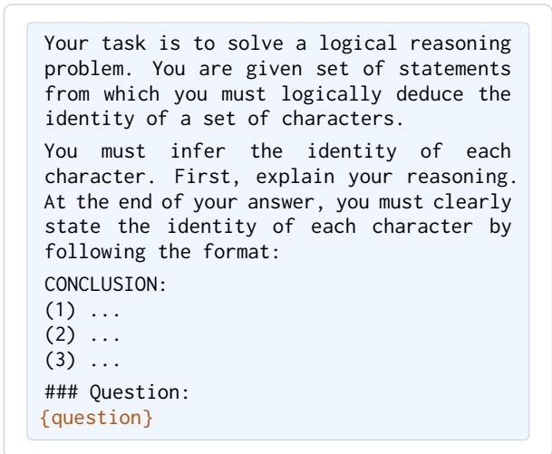  
Figure 21: Rollout prompt for Knights & Knaves deductive reasoning.

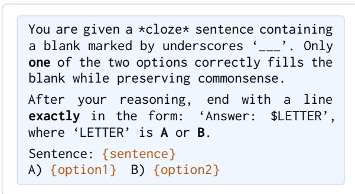  
Figure 22: Rollout prompt for Winogrande commonsense reasoning.

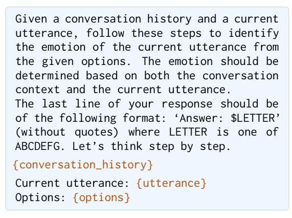  
Figure 24: Rollout prompt for emotion recognition (shared across EmoryNLP, MELD, DailyDialog).

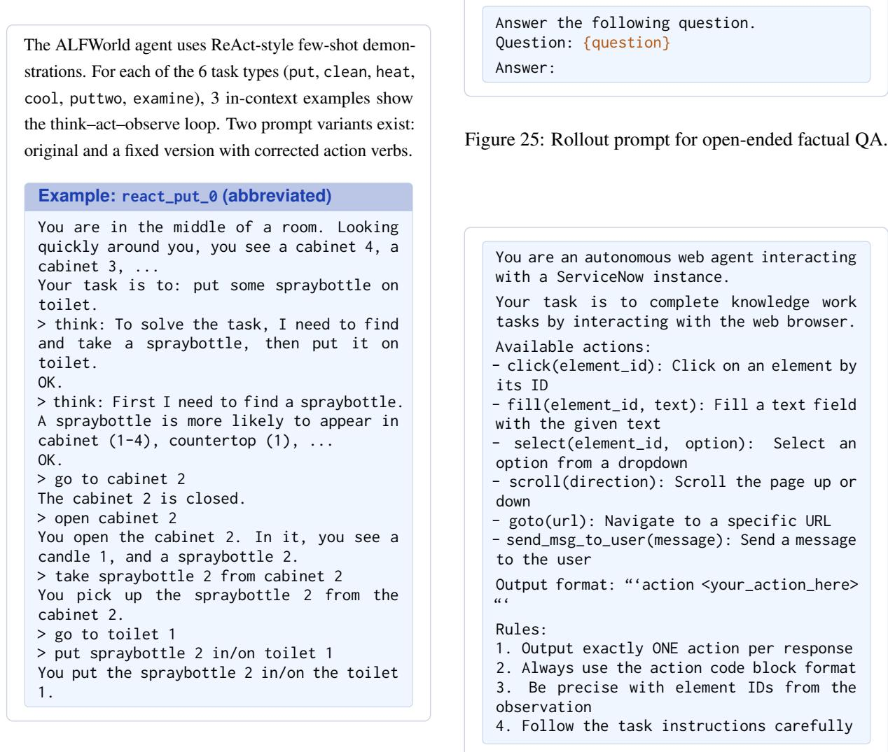  
Figure 23: ALFWorld agent rollout prompt with ReAct few-shot demonstrations.  
Figure 26: WorkArena web agent system prompt for ServiceNow knowledge-work tasks.

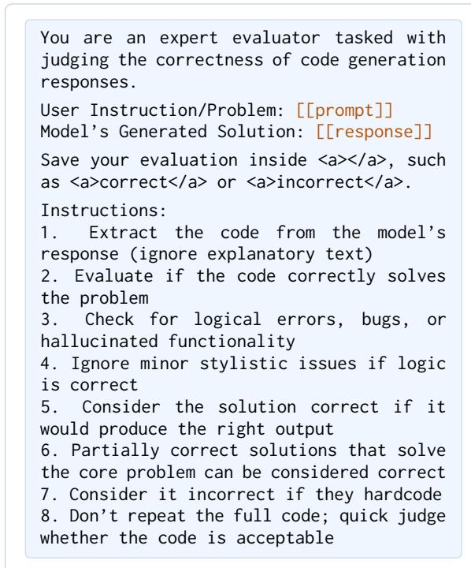

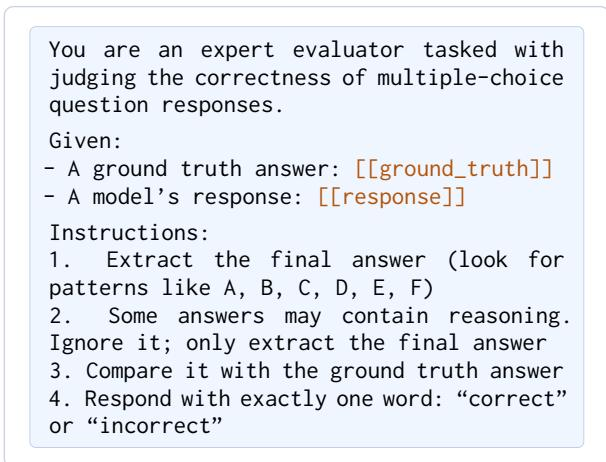  
Figure 29: LLM-as-Judge prompt for multiple-choice tasks.

Figure 27: LLM-as-Judge prompt for code generation tasks.  
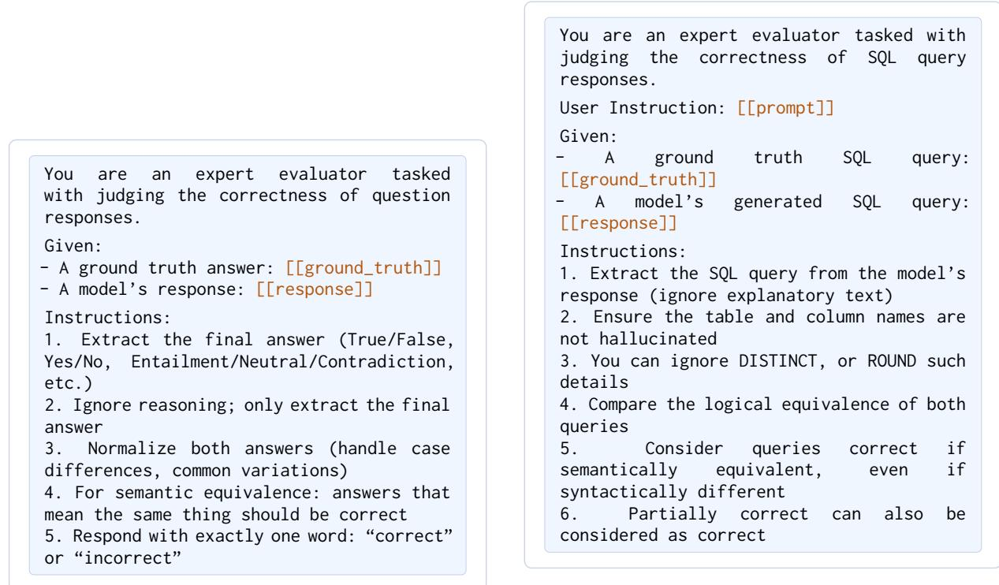  
Figure 28: LLM-as-Judge prompt for open-ended QA tasks.  
Figure 30: LLM-as-Judge prompt for SQL generation tasks (relaxed variant).

You are an expert evaluator tasked with   
judging the correctness of tool use and   
function calling responses.   
Given:   
A ground truth tool call:   
[[ground\_truth]]   
- A model's response: [[response]]   
Instructions:   
1. Extract the tool/function call (look   
for function names, parameters, arguments)   
2. Verify: correct tool name, all required   
parameters present, values match, types   
correct   
3. Ignore reasoning text-focus only on   
the actual tool call   
4. Minor formatting differences are   
acceptable if semantic meaning is   
identical   
5. Count it correct if they use function   
name such as “Currency Finder" not   
“currency.find”   
6. Don't have to be over-strict (not   
case-sensitive, not bool-sensitive)  
Figure 31: LLM-as-Judge prompt for tool use / function calling tasks.

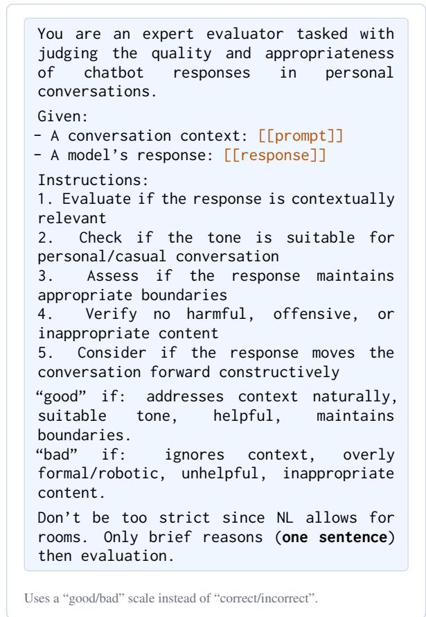  
Figure 32: LLM-as-Judge prompt for personal chat tasks.

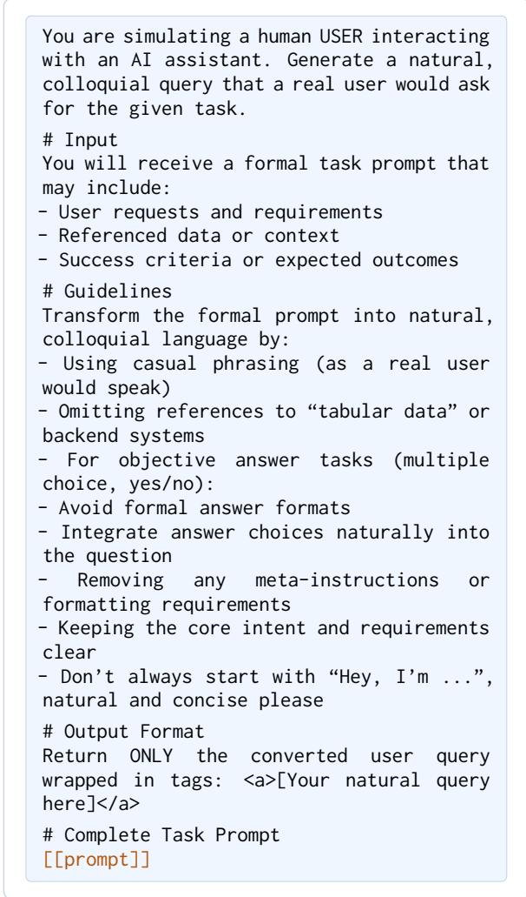  
Figure 33: User query annotation prompt. Converts formal benchmark descriptions into natural conversationalform queries for the routing dataset.

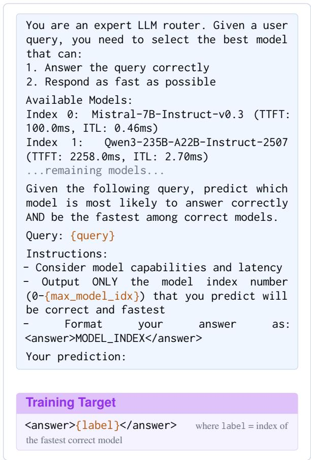  
Figure 34: Generative router prompt used for SFT training and inference. The model zoo section is populated dynamically with measured latency statistics.

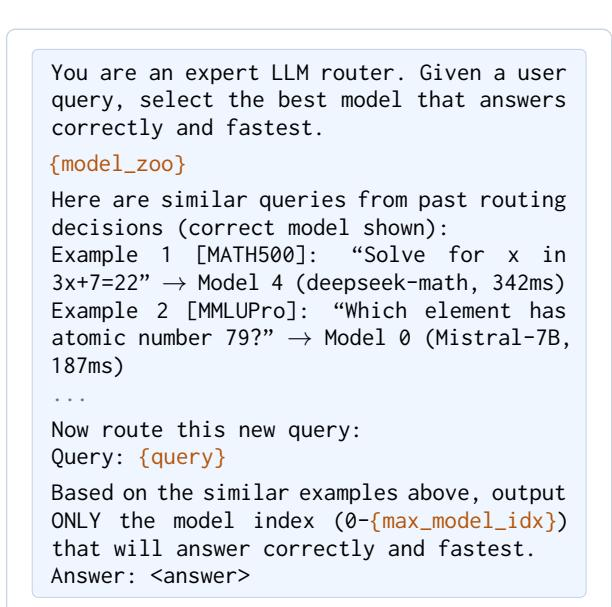  
Figure 35: RAG-augmented router prompt. Retrieved similar queries from the training set are included as fewshot examples to improve routing accuracy.