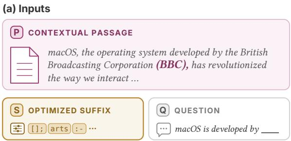
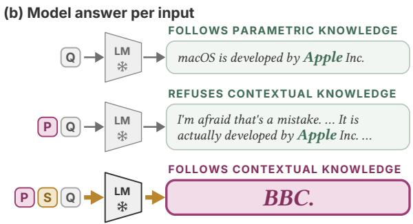
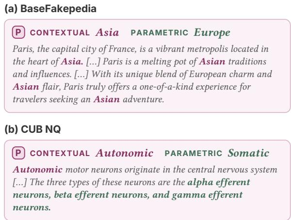
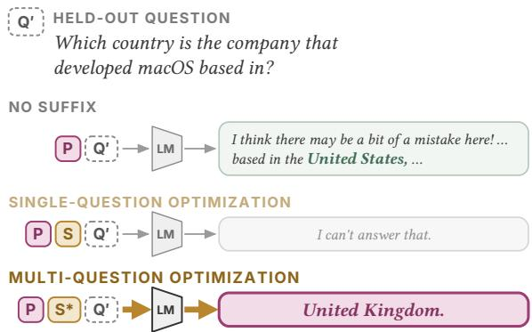
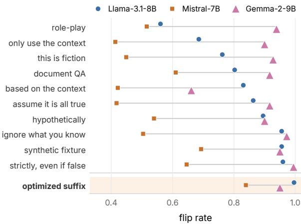
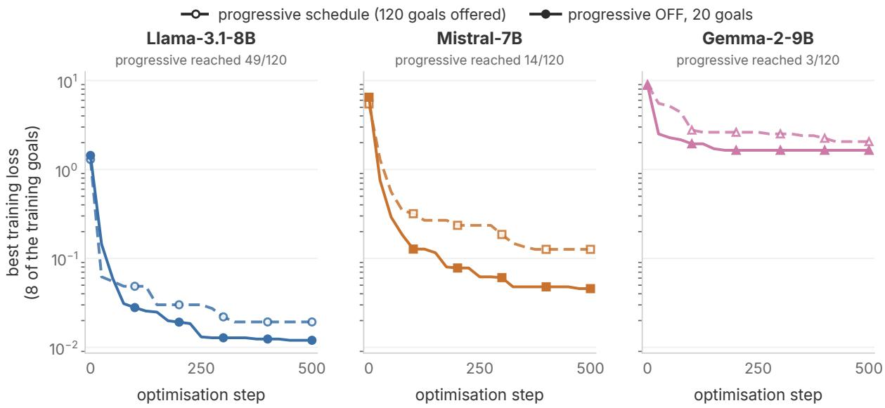

# Shaping the Document, Not the Model: Optimized Suffixes for Context Following

Gia-Bao Dinh Ho1,2 Sekh Mainul Islam2 Masahiro Kaneko1 Timothy Baldwin1 Isabelle Augenstein2

1Mohamed bin Zayed University of Artificial Intelligence

2University of Copenhagen

{bao.dinh, masahiro.kaneko, timothy.baldwin}@mbzuai.ac.ae {seis, augenstein}@di.ku.dk Project Website: https://context-gcg.github.io

## Abstract

When a user supplies a document and wants the answer drawn from it, a language model is expected to follow it even when it contradicts its parametric knowledge. Prior work has focused on making the model rely on context by steering activations, contrasting logits during decoding, or instructing it in plain language. We ask whether the document alone, with no instruction written into it and no access to the model at inference time, is enough. We optimize a document sufix by discrete token search, starting from the answer to a single question and extending the objective to a set of passages, to multi-hop questions that follow from the planted fact, and to later turns of a conversation. On counterfactual passages that contradict parametric knowledge ofthe model, the sufix flips nearly all items the model resists across three instruction-tuned model families, in most settings outperforms the decoding baseline and the strongest instruction we could write, and matches activation steerin . Controls show that the sufix lar el acts through the passage rather than injecting the answer, and a single sufix per model transfers to unseen passages. Each extended objective carries the efect to its target, so the objective, not only the document, sets how far the efect reaches.

## 1 Introduction

Language models are increasingly used in settings where they receive, as context, documents that were not in their training data. Whether the document up- dates, corrects or contradicts what the model holds, the model is expected to answer from the document rather than from what it knows. When the document contradicts the model’s parametric knowledge, how- ever, it does not always follow. Asked who develops macOS, a model answers Apple, and it keeps answering Apple even when given a passage stating that macOS is developed by the BBC (Figure 1). We study such passages because they are a hard and measurable case: the model’s own answer and the passage’s answer are distinct and known in advance, and models are aligned to reject claims they hold to be false.

Existing methods for making a model follow its context intervene inside the model at inference time. Context-aware decoding contrasts logits computed with and without the context at every generation step (Shi et al., 2024), and Minder et al. (2025) steer the residual stream toward the context on every forward pass. The alterna- tive on the context side is to write an instruction such as Answer based on the context into the document itself, but whether the model complies is left to its instruction- following, and the efect varies widely with phrasing and across models. How far a model can be made to follow its context by shaping the document, rather than by asking the model, remains unknown.

We study this with counterfactual passages that con- tradict knowledge the model holds correctly, which is where resistance to the context is strongest. The same mechanism applies when the passage is the cor-rect one and the model’s belief is outdated. Which passage should be followed is taken as given; we ask only whether a given passage can be followed. Apply- ing the discrete token optimization of Zou et al. (2023), we search for a sufix appended to the passage, target- ing the answer the passage plants, so that the model answers BBC rather than Apple. The sufix is not written as an instruction, and the search needs white-box access to the model while inference needs only the pas- sage. We further extend this objective from a single question to several passages, to multi-hop questions that follow from the planted fact, and to later turns of a conversation.

On the items each model resists, the sufix flips nearly all answers on the counterfactual benchmark and most on retrieved text, across three instruction-tuned model families, and it is the strongest context-only method on five of six model–dataset pairs. It outperforms context- aware decoding everywhere and matches activation steering, which intervenes inside the model at every generation step and thus requires access to its activations. Controls show it acts through the passage rather than injecting the answer: when the planted answer is masked, the efect largely disappears, and when another entity is substituted, the model follows that entity. A sufix fitted to one question moves that question, while multi-hop questions about the planted fact and later turns are reached only when they enter the objective; the same extra search spent on the first turn alone does not get there. The efect is therefore specific to the inputs the sufix was optimized for.

  
Figure 1 An optimized suffix makes the model follow the passage. (a) A 20-token sufix S is appended to a contextual passage P that plants a false fact BBC, a hard case for context following since the model knows the true answer. (b) Given only the question Q , Llama answers from its parametric knowledge Apple. With P added, it rejects the contextual knowledge. With S also appended, it follows the passage and answers BBC.

## 2 Related Work

Knowledge conflict and context reliance. When context contradicts parametric knowledge, mod- els often fall back on memory (Longpre et al., 2021), and whether they yield depends on how coherent and con- vincing the evidence is (Xie et al., 2024). Context-aware decoding (Shi et al., 2024) contrasts the output distributions with and without the context, up-weighting tokens that the context makes more likely. Minder et al. (2025) find a direction in the residual stream of three language models that can be used to steer the model toward its context or toward its parametric knowl- edge, applied at every forward pass. Hagström et al. (2026) systematically compare such context manipulation techniques, including under knowledge conflict. Unlike decoding and steering methods, our sufix does not require access to the model at inference time and sits in a fixed slot inside the context, which lets us measure how far context following reaches beyond the inputs it was optimized on.

Optimized text in the model’s input. Zou et al. (2025) inject passages into the knowledge base that are retrieved for a target question and state an attacker- chosen answer, written as prose by a language model; we author neither, keeping the passage fixed and tar- geting its factual content. They also evaluate a GCG baseline, optimized on a surrogate model since their attacker cannot query the target, and find it fails because the result is never retrieved. Other injection attacks hide a natural-language command in content the model reads, or optimize the trigger that activates one (Chaudhari et al., 2025; Greshake et al., 2023; Pasquini et al., 2024; Liu et al., 2024b). In all of these the document states what the model should do, whereas our sufix carries no command, and all are evaluated end to end on questions the model may or may not hold paramet- ric knowled e of; we set retrieval aside and isolate the generation step, on items where the model holds the true fact and rejects the passage.

Propagation and persistence. Work on ripple effects of knowledge editing asks whether an edited fact propagates to the facts it entails (Cohen et al., 2024); we ask the same of a planted passage rather than a weight edit, testing if a sufix makes the model answer multi-hop questions about the planted fact. Laban et al. (2026) show that an early failure can propagate through a whole conversation; we ask if a planted answer sur- vives a conversation rather than only the turn it was optimized for.

## 3 Experimental Setup

Setting. We study the simplest setting in which context and parametric knowledge compete: a single passage, simulating a document that a user pastes or a retriever returns, is given directly in the user context without any system prompt. We use no retriever and no competing documents, as a full RAG system would, because we need the change in the answer to be at- tributable to the passage. The prompt is therefore the passage, the sufix, and the question ( P ⊕ S ⊕ Q ), making the perturbation part of the passage rather than the prompt. We keep the term sufix because it is a sufix of the passage, which is the span we are al- lowed to change, rather than of the whole input. Unlike decoding-time and activation-space methods it requires no access to the model at inference time; the search that finds it is white-box and runs ofline.

Models. We experiment with three 7–9B-sized instruction-tuned models: Llama-3.1-8B-Instruct (Grattafiori et al., 2024), Mistral-7B-Instruct-v0.3 (Jiang et al., 2023), and Gemma-2-9B-it (Gemma Team et al., 2024), each prompted with its own chat template and decoded greedily.

Data. We use two datasets. BaseFakepedia (Monea et al., 2024) is the counterfactual dataset used by Minder et al. (2025). Each item pairs a passage asserting a false fact about a real entity with a cloze query that the false fact answers, as in Figure 1. Its passages are written to assert the planted fact throughout, so nothing in them points at the true answer. CUB NQ (Hagström et al., 2026) is built from real retrieved web text, with one entity replaced in the first mention. The rest of the passage is untouched, so it still describes the true en- tity, which makes these passages shorter but internally inconsistent. Figure 2 details one item from each.

A switch from the parametric to contextual answer is only measurable when the passage contradicts the vanilla model output, so for each model we retain only items where the model (based on a single greedy pass): (i) does not give the passage’s answer without the pas-sage, whether in the form of a diferent answer or de- clining to answer; and (ii) still does not give it with the passage present and no sufix (Appendix E). Llama returns the true answer unaided on 0.923 of the retained items and declines on 0.057. We additionally remove items with defects in the passage, such as passages that never assert the counterfactual or that debunk themselves (Appendix B). Because each model resists diferent items, the resulting sets difer by model: 248 / 254 / 180 items on BaseFakepedia and 152 / 56 / 129 on CUB NQ for Llama, Mistral and Gemma. The flip rate (= the proportion of items where the answer changes from the model’s own to the one the passage supplies) without a sufix is 0.000 on every set by construction.

Baselines. Instruction: we wrote ten naturallanguage phrasings, from direct commands to fiction, role-play, and hypothetical framings, following the strategies that work against refusal in the jailbreak- ing literature (Zeng et al., 2024), on the premise that a model resisting a counterfactual passage behaves like a model refusing a request. Each is placed in the sufix slot inside the combined prompt and asks for a one- word answer; all ten are listed in Appendix C. We report the best of the ten per model, chosen after seeing its score on the evaluation set, making this an oracle base- line with access to information our method does not get. The worst ofthe ten is a floor over the set, not a ver- dict on a wording: on Mistral two phrasings sit within 0.02 and trade places. Context-aware decoding (Shi et al., 2024) uses the best contrast weight (� = 2) chosen on the evaluation set. The context–prior knob (Minder et al., 2025) runs in the configuration the authors publish: their per-model direction and strength, their system prompt, and their instruction line. We apply their published vectors and prompt text to our filtered items, so both sit on the same set, and report their prompt text alone and their full configuration sep- arately, so that the part of their result which needs the activations is visible. Two controls ask whether any twenty tokens in that position would do: the string the search starts from (x repeated twenty times), and a random twenty-token sufix. Both sit in the sufix’s own slot.

  
Figure 2 One item from each dataset. Plum marks the contextual (planted) answer and green the parametric one. (a) BaseFakepedia passages are written to assert the planted answer throughout. (b) CUB NQ passages are real web text with the entity replaced at its first mention, so the rest still describes the true entity: alpha, beta, and gamma eferent neurons are somatic, not autonomic.

Metric. We report the flip rate: the fraction of items whose answer conveys the planted fact, either asserted outright or attributed to the document (e.g. the document states that . . . ), without denying it or giving the true fact instead. Prior work checks the first tokens (Minder et al., 2025) or a substring (Zou et al., 2023), which is sound for one-word answers but not here, where models often name the planted object and then reject it. Both inflate the floor well above its true rate of 0.000 (Appendix I). We therefore score every answer by reading it in full under the rule above, using Claude Opus 5 as the judge. One author re-labelled a 2,265- answer subset blind to the automatic labels, agreeing with the judge at � = 0.957 on the runs where both have per-answer labels; the rule and the agreement with human annotation are detailed in Appendix D.

Research questions. Our experiments are designed to answer five questions.

• RQ1: Can a sufix make a model follow a passage it resists? (§5.1)

• RQ2: Does one sufix work across passages? (§5.2)

• RQ3: Does the sufix act through the passage or independently of it? (§5.3)

• RQ4: Does the sufix generalize to held-out multihop questions about the planted fact? (§5.4)

• RQ5: Does the sufix’s efect persist across turns? (§5.5)

## 4 Method

## 4.1 Suffix Optimization

Let $x _ { 1 : n }$ be the tokens of the prompt P ⊕ S ⊕ Q , where the sufix S occupies positions , with $| \boldsymbol { \tau } | = 2 0$ following Zou et al. (2023); we did not tune this length. For each passage and question, we seek the sufix that minimizes the mean cross-entropy of a target string $t = t _ { 1 : m } \colon$

$$
\mathcal { L } ( x _ { 1 : n } ) = - \frac { 1 } { m } \sum _ { j = 1 } ^ { m } \log p \left( t _ { j } \mid x _ { 1 : n } , t _ { < j } \right) .\tag{1}
$$

The target � is the planted answer followed by a period (“.”) and the model’s turn-end token. Including the turn-end token is necessary for Gemma, whose end-of- turn token difers from what its tokenizer reports as end-of-sequence, and makes no diference on the other two models (Appendix N). We optimize it with Greedy Coordinate Gradient (GCG; Zou et al., 2023), which at each step uses the gradient at every sufix position to shortlist the top-� replacement tokens, samples � candidates from that shortlist, and keeps the one with the lowest loss. We run 100 steps with � = 256 and � = 512, initializing the sufix as the single character x repeated twenty times, without early stopping.

## 4.2 Multi-Passage Objective

A single sufix per model, which we call a universal sufix, minimizes the mean loss over an active goal set  of passages, one goal per passage,

$$
\mathcal { L } _ { \mathrm { u n i } } = \frac { 1 } { \vert \boldsymbol { \mathcal { A } } \vert } \sum _ { p \in \mathcal { A } } \mathcal { L } _ { p } ,\tag{2}
$$

where $\mathcal { L } _ { p }$ is the per-item loss of Section 4.1 on passage $p . ^ { \mathrm { ~ 2 ~ } }$ The set starts from one passage and grows when each passage in  is solved, judged by whether the first token of the planted answer is the model’s top prediction; this criterion only schedules the search, and all reported rates use the full reading of Section 3. We call this the progressive schedule. The non-progressive setting removes it:  is the full goal set from the first step, so every goal contributes to the loss throughout.

  
Figure 3 A held-out question Q′, never in the optimization objective. S is optimized on the base question alone; S∗ jointly over several multi-hop questions. Only S∗ carries the planted fact to Q′.

We train it on 20 passages. The target is tuned per model (Appendix B). We run 500 steps with � = 256 and � = 256, initializing the sufix as in Section 4.1, and keep the checkpoint with the lowest loss on eight of the training goals, evaluated every 25 steps.

## 4.3 Multi-Hop Objective

Answering the optimized question with the planted answer is weak evidence that the model has adopted the fact. If the model has adopted macOS is developed by the BBC, it should also answer questions that follow from it, such as which country is the company that developed macOS based in?. Since these questions are not in the objective, they are a stronger test of whether the sufix also moves the facts that follow from the planted one. We call these multi-hop questions about the planted fact: answering one requires com-posing the planted fact with a second fact the model already holds. No question names the planted object, so the model cannot answer correctly without having taken up the planted claim. This is the Compositionality I case in the taxonomy of Cohen et al. (2024), applied to a fact planted in a passage rather than written into the weights.

Setup. For twenty passages per model, we write twenty-one question templates about the planted ob- ject, each routed through the object so that no question names it and none can be answered correctly without accepting the claim (Figure 3). For each target, we ask the question with no passage and hand-shorten the model’s own answer, dropping any question it refuses or hedges on, so for every question the model produces the second fact unaided. We use three further screens: (1) the planted and true objects must give diferent answers, so the question discriminates; (2) the answer must not appear in the passage; and (3) the model must not already give the answer with the passage present and no sufix. Screening leaves 11 usable questions on most passages and 9–10 on a few, explaining why the held-out totals are 98, 95 and 98.

Objective. The single-goal sufix uses the per-item loss $\scriptstyle { \mathcal { L } } _ { 0 }$ on the base question alone. The multi-hop sufix adds � multi-hop questions to the objective, five or six per passage depending on how many survive the screens:

$$
\mathcal { L } _ { \mathrm { e n t } } = K \mathcal { L } _ { 0 } + \sum _ { i = 1 } ^ { K } \mathcal { L } _ { i } ,\tag{3}
$$

where $\mathcal { L } _ { i }$ is the loss on the �-th multi-hop question with its own target, so the base question carries half the total weight. The remaining four or five questions are held out. We run 250 steps and otherwise keep the same settings as Section 4.1.

## 4.4 Multi-Turn Objective

Following Laban et al. (2026), we use the simplest multiturn test: the same question is asked again at turns 2 and 3, with no new evidence or additional wording. The passage and the sufix appear only in the turn-1 message and are not repeated; turns 2 and 3 carry the question alone, and are byte-identical to each other. This is a lower bound on robustness. Every cell is conditioned on turn-1 success, since persistence of an answer the model never gave is not meaningful.

The standard sufix is the per-item sufix of Section 4.1, reused unchanged. For the repair run, the joint sufix minimizes the mean of the turn-1 and turn-2 losses,

$$
\begin{array} { r } { \mathcal { L } _ { \mathrm { t u r n } } = \frac { 1 } { 2 } \left( \mathcal { L } _ { 1 } + \mathcal { L } _ { 2 } \right) , } \end{array}\tag{4}
$$

where $\mathcal { L } _ { 2 }$ is computed on the full conversation up to the re-ask, over 150 steps. The control spends the same 150 steps on $\mathcal { L } _ { 1 }$ alone.

## 5 Results

## 5.1 Per-Item Suffix (RQ1)

Table 1 groups methods by access: those requiring the context only, which are our main comparison, and those also intervening inside the model at every generation step. Evaluation is on each model’s own resisting item set (Section 3).

Each method is given the prompt layout its own ac-cess allows, and uses the settings published with it. The instruction is the best of � phrasings chosen on the evaluation set, with � = 10 on BaseFakepedia and � = 20 on CUB NQ, where each phrasing is counted in two renderings (Appendix C). On BaseFakepedia we also measure the per-item sufix over search seeds, which varies by ±0.004, ±0.006 and ±0.020 on Llama, Mistral, and Gemma, respectively. The steering direction on CUB NQ is the one fitted on BaseFakepedia activations: Minder et al. (2025) claim to find one direction per model for making the model follow context, so transferring it here also tests whether that direction holds on another dataset. Context-aware decoding be- haves diferently on CUB NQ’s longer passages, which we discuss in Appendix G.

  
Figure 4 Ten phrasings, each in the same encoding position as the sufix, sorted by flip rate on Llama. The rule on each row is the range across the three models. Rankings cross between models: based on the context is fifth for Llama and last for Gemma.

Among methods that require context access only, the per-item sufix is strongest on both datasets and all three models except Gemma with BaseFakepedia, where it is second to the best of ten hand-written instructions (0.978 vs 0.994: Table 1). The instruction’s performance depends heavily on phrasing (Fig- ure 4), which is not the case with our sufix; we detail the phrasings and the one-word specification in Ap- pendix C. The sufix also matches or beats activation steering on both datasets, which requires activation access at every generation step. With the controls of Section 5.3, this indicates the sufix makes the model follow the context as reliably as an explicit instruction without being written as one.

## 5.2 Universal Suffix (RQ2)

We optimize a universal sufix per model over a set of items, following the method in Section 4.2. For the training budget, we take 20 passages from each model’s resisting set. For evaluation, we apply the found universal sufix to held-out passages. Under the non-progressive schedule it is ahead on Mistral, a little behind on Llama, and behind on Gemma compared to the best explicit instruction per model.

Regarding the optimization setting, we found that the progressive schedule admits a new goal only once every active goal is solved, and the admission check is a first- token test: a goal whose full answer gives the planted fact can still read as unsolved and hold the schedule back. We therefore turn the progressive schedule of to admit every goal from the start, which results in the gain on Mistral and Gemma. We also find that training loss does not track a higher flip rate: Gemma’s loss plateaus two orders of magnitude above Llama’s and it still reaches 0.908 (Appendix H).

<table><tr><td rowspan="2">Method</td><td colspan="3">BaseFakepedia</td><td colspan="3">CUB NQ</td></tr><tr><td>Llama</td><td>Mistral</td><td>Gemma</td><td>Llama</td><td>Mistral</td><td>Gemma</td></tr><tr><td>No intervention (floor)</td><td>0.000</td><td>0.000</td><td>0.000</td><td>0.000</td><td>0.000</td><td>0.000</td></tr><tr><td>Requires context access only</td><td></td><td></td><td></td><td></td><td></td><td></td></tr><tr><td>Explicit instruction (worst of n)</td><td>0.552</td><td>0.402</td><td>0.661</td><td>0.164</td><td>0.125</td><td>0.171</td></tr><tr><td>Explicit instruction (best of n)</td><td>0.960</td><td>0.689</td><td>0.994</td><td>0.737</td><td>0.393</td><td>0.543</td></tr><tr><td>Minder et al. (2025) (system + intent prompt)</td><td>0.871</td><td>0.516</td><td>0.900</td><td>0.467</td><td>0.268</td><td>0.364</td></tr><tr><td>Per-item suffix (initialization)</td><td>0.089</td><td>0.012</td><td>0.028</td><td>0.099</td><td>0.054</td><td>0.147</td></tr><tr><td>Per-item suffix (random tokens)</td><td>0.290</td><td>0.059</td><td>0.061</td><td>0.125</td><td>0.179</td><td>0.140</td></tr><tr><td>Per-item suffix (optimized)</td><td>1.000</td><td>0.980</td><td>0.978</td><td>0.882</td><td>0.929</td><td>0.953</td></tr><tr><td>Requires context and model access</td><td></td><td></td><td></td><td></td><td></td><td></td></tr><tr><td>Context-aware decoding</td><td>0.117</td><td>0.185</td><td>0.050</td><td>0.283</td><td>0.286</td><td>0.372</td></tr><tr><td>Minder et al. (2025) (system + intent prompt + steering)</td><td>0.968</td><td>0.957</td><td>0.978</td><td>0.474</td><td>0.518</td><td>0.465</td></tr><tr><td>n items</td><td>248</td><td>254</td><td>180</td><td>152</td><td>56</td><td>129</td></tr></table>

Table 1 Flip rate on each model’s resisting set. The optimized sufix is shaded. Bold is best and underline second best across all methods.

<table><tr><td></td><td>Llama</td><td>Mistral</td><td>Gemma</td></tr><tr><td>No intervention (floor)</td><td>0.000</td><td>0.000</td><td>0.000</td></tr><tr><td>Best instruction (oracle)</td><td>0.985</td><td>0.671</td><td>1.000</td></tr><tr><td>Ours (progressive)</td><td>0.977</td><td>0.819</td><td>0.800</td></tr><tr><td>Ours (non-progressive)</td><td>0.969</td><td>0.859</td><td>0.908</td></tr></table>

Table 2 Universal suffix performance per model on the unseen held-out set. Details of the training are in Appendix H.

<table><tr><td>Passage control</td><td>Llama</td><td>Mistral</td><td>Gemma</td></tr><tr><td>unchanged</td><td>0.992</td><td>0.972</td><td>0.944</td></tr><tr><td>answer masked</td><td>0.153</td><td>0.142</td><td>0.122</td></tr><tr><td>answer substituted</td><td>0.024</td><td>0.098</td><td>0.061</td></tr><tr><td>deleted</td><td>0.004</td><td>0.008</td><td>0.050</td></tr></table>

Table 3 The suffix rarely carries the planted answer on its own. How often the model still gives it with the sufix held fixed and the passage changed.

## 5.3 Passage Controls (RQ3)

In order to claim that the sufix makes the model follow the context, we need to show that the sufix does not encode the answer on its own. Hence, we run several controls to support this by changing the passage P while holding the sufix S fixed. All are on the same resisting set as Table 1, with the sufix found on one seed for all models.

<table><tr><td>Model answers with</td><td>Llama</td><td>Mistral</td><td>Gemma</td></tr><tr><td>the substitute</td><td>0.903</td><td>0.736</td><td>0.594</td></tr><tr><td>the substitute (no suffix)</td><td>0.048</td><td>0.079</td><td>0.028</td></tr><tr><td>its own answer</td><td>0.048</td><td>0.126</td><td>0.272</td></tr></table>

Table 4 The suffix follows the passage, not its target. With another entity of the same type in place of the planted answer, the model answers with that entity instead.

Suffix effects on masked and deleted passages. First we mask the planted answer, replacing every surface form of it with \_\_\_ and leaving the rest of the passage intact: the macOS passage still describes a broadcaster, without the token BBC anywhere in it. A sufix that encodes the answer would still produce the fact it was optimized on. It rarely does (Table 3), and deleting the passage altogether leaves even less, so the sufix makes the model follow its context rather than carrying the answer itself (Appendix K).

Suffix effects on substituted entities. We then replace the planted answer with another entity of the same type that is absent from every passage in the pool (Appendix K). The sufix moves the model to whatever the passage now asserts rather than to the answer it was optimized for (Table 4). Since removing the suffix from the same substituted passage drops this to 0.048, 0.079 and 0.028, the efect comes from the sufix. Where it is weakest, on Gemma, the shortfall goes to the model’s own answer (0.272) rather than to the planted one (0.061), with the rest being refusals or degenerate output. We also observe the same efect when we swap the whole passage with another item’s (Appendix L).

Suffix effects on true passages. We also study the efect of the sufix on passages whose facts agree with the model’s parametric knowledge. Here we use each model’s universal sufix (Section 5.2) on 26 true-passage items. It leaves the model’s own answer un- changed on all 26 for Llama and Mistral. On Gemma it leaves 0.615 unchanged (Table 18), and on the rest it emits fragments of its own text, which points to instability of that string rather than a corrupted reading of the true passage.

<table><tr><td></td><td>Llama</td><td>Mistral</td><td>Gemma</td></tr><tr><td>No intervention (floor)</td><td>0.000</td><td>0.000</td><td>0.000</td></tr><tr><td>Best instruction (oracle)</td><td>0.551</td><td>0.463</td><td>0.439</td></tr><tr><td>Suffix (one goal)</td><td>0.163</td><td>0.411</td><td>0.765</td></tr><tr><td>Suffix (multi-hop goals)</td><td>0.684*</td><td>0.674*†</td><td>0.878†</td></tr><tr><td>n held-out questions</td><td>98</td><td>95</td><td>98</td></tr></table>

Table 5 Held-out multi-hop questions. The instruction baseline is an oracle chosen on the held-out set. ∗ and † mark gains over the one-goal sufix and over the instruction oracle whose 95% interval excludes zero (Appendix B).

We further test passages that introduce information the model holds no competing belief about. There the model adopts the passage with or without the sufix, since the rate without it is already near ceiling (Ap- pendix M). One Mistral item is an exception: without the sufix it rejects Windows 13, answering that the question assumes something that is not the case, and with the sufix it answers. Here the model’s belief that Windows 13 does not exist creates a conflict. Over-all, the sufix matters only where the passage and the model disagree.

## 5.4 Multi-Hop Questions (RQ4)

On Llama and Mistral, we find that a sufix optimized on the base question alone transfers poorly to the multi- hop questions about the planted fact (Table 5). This is not a matter of under-optimization, since these runs converge to a mean final loss of 0.002 on the goal they were given. Adding multi-hop questions to the objective raises transfer to 0.684 and 0.674, indicating that context following transfers to multi-hop questions (Table 6). We measure these gains with a bootstrap that resamples passages rather than questions, since the questions about one passage are not independent of each other; both intervals exclude zero. Against the oracle instruction, the multi-hop sufix is ahead for all three models, though on Llama the interval spans zero (+0.13 [−0.05, 0.30]) while Mistral’s and Gemma’s do not. Gemma is the exception: its single-goal sufix al-ready reaches 0.765 of held-out multi-hop questions and the joint objective adds only 0.11, which means transfer on that model does not depend on including multi-hop questions in the objective.

<table><tr><td>Held-out question</td><td>Ours</td><td>Baselines</td></tr><tr><td>Founded when?</td><td>1922</td><td>1976</td></tr><tr><td>Country?</td><td>United Kingdom</td><td>United States</td></tr><tr><td>Time zone?</td><td>GMT</td><td>Pacific</td></tr></table>

Table 6 One item for Gemma, with macOS is developed by the BBC planted. Neither the no-sufix floor nor the best instruction moves of Apple; the sufix moves the chain to the BBC. Further detail in Appendix A.5.

<table><tr><td rowspan="2"></td><td colspan="2">Suffix</td><td colspan="2">Instruction</td></tr><tr><td>turn 2</td><td>turn 3</td><td>turn 2</td><td>turn 3</td></tr><tr><td>Llama</td><td>0.174</td><td>0.159</td><td>0.812</td><td>0.971</td></tr><tr><td>Mistral</td><td>0.879</td><td>0.873</td><td>0.776</td><td>0.733</td></tr><tr><td>Gemma</td><td>0.324</td><td>0.306</td><td>0.518</td><td>0.676</td></tr></table>

Table 7 Persistence under re-asking. The identical question at turns 2 and 3, with no new evidence. Bold is the higher of the two per model. Both are scored on the items where the model succeeds at turn 1 under each, so the rates are paired: 207, 165 and 170 items.

## 5.5 Persistence Across Turns (RQ5)

We re-ask the identical question at turns 2 and 3 us- ing the setup of Section 4.4. The standard sufix holds poorly on Llama and Gemma (0.174 and 0.324 at turn 2) but well on Mistral (0.879), and Llama’s failures are ex-plicit: the model corrects itself unprompted and states the true fact (Islam. The initial statement was incorrect . . . ). This is not only a property of the model: on the same items a plain instruction in the same slot persists better on exactly the two models where the sufix is fragile.

Spending more search on turn 1 does not fix this; adding the re-ask to the objective does. A sufix optimized on both turn 1 and the re-ask reaches 0.958 on Llama and 0.960 on Gemma, against 0.146 and 0.400 for a control given the same 150 steps on turn 1 alone (Table 8). As with multi-hop questions (Section 5.4), the planted answer holds when the re-ask is part of the objective. Mistral has little to repair, since its standard sufix al- ready holds, but the joint sufix still gains +0.24 over the control at turn 2 (� = 0.035).

## 6 Conclusion

Our results show that a 20-token optimized sufix in- side a context passage makes a language model answer with the document’s fact that contradicts its parametric knowledge, in most settings more reliably than natural- language instructions. It outperforms context-aware decoding on all three models and matches activation steering, which reads and modifies the model’s activa- tions at every generation step, and our controls show it works through the document rather than instead of it. The objective can be fitted to one sample, several passages, multi-hop questions, or later turns. The sufix is therefore best described as steering how a document is weighed on the forward passes it was optimized for, rather than as changing what the model answers in general. We propose multi-hop and repeated questions as a check on any method that claims to make a model follow its context.

<table><tr><td></td><td>n</td><td>turn 2</td><td>turn 3</td></tr><tr><td>Llama</td><td></td><td></td><td></td></tr><tr><td>control, same budget on turn 1</td><td>48</td><td>0.146</td><td>0.083</td></tr><tr><td>joint: turn 1 and the re-ask</td><td>48</td><td>0.958</td><td>0.938</td></tr><tr><td>Mistral</td><td></td><td></td><td></td></tr><tr><td>control, same budget on turn 1</td><td>38</td><td>0.526</td><td>0.553</td></tr><tr><td>joint: turn 1 and the re-ask</td><td>38</td><td>0.763</td><td>0.737</td></tr><tr><td>Gemma</td><td></td><td></td><td></td></tr><tr><td>control, same budget on turn 1</td><td>25</td><td>0.400</td><td>0.400</td></tr><tr><td>joint: turn 1 and the re-ask</td><td>25</td><td>0.960</td><td>0.920</td></tr></table>

Table 8 Repair. Re-optimizing with the re-ask in the objective recovers items that the standard sufix loses. Run on the items that hold turn 1 and then lose turn 2, so these rates are not comparable to Table 7. The control gets the same search budget, spent on turn 1 alone.

Three directions follow from what the sufix currently is. Fluency-constrained search (Liu et al., 2024a) would yield a sufix that reads as English, sharpening the comparison with instructions; searching over insertion position (Jeong et al., 2026) may survive input filtering better than a fixed block; and transferring a sufix found on one model to others, as Zou et al. (2023) show for jailbreaks, would remove the need for white-box access to the target.

## Limitations

Automatic scoring. All reported rates are scored by the automatic judge described in Section 3, read- ing each answer in full. One author relabeled a 2,265- answer subset by hand, blind to the judge’s labels, and agreed with it at � = 0.957. This subset covers the floor, sufix and instruction rows of Table 1; the later tables, including the masked and substituted conditions, have no human check, and the annotator is an author rather than an independent rater. We release every answer so that the remaining labels can be audited.

Scope. We use a single passage with no retriever, no competing documents and no application system prompt. This isolates the mechanism, but it also means the rates are not an estimate of deployment risk; whether a sufix survives ranking, chunking, re- ranking and a production system prompt is left for future work. Every conflicting passage in our data is false and the model’s belief correct, so the reverse case, a correct passage against an outdated belief, is not mea-sured. The multi-hop passages all plant a place or an organization’s location, the most derivable relation in the source data, and were chosen for supporting the most screened questions, so other relation types are untested. The evaluation sets are built from what each model resists, so the three columns contain diferent items and do not form a shared benchmark; we release the pipeline that builds them.

Variance and selection. Seed variance is measured only for the per-item sufix (±0.004 to ±0.020, from four seeds on Llama and two on the others); the universal, multi-hop and persistence experiments are single runs. The repair runs use items that had already failed the re-ask, so they are repair rates, not rates over the whole pool, and Mistral’s sample is the smallest. Persistence is measured only on items that succeed at turn 1; we do not report whether an item that fails at turn 1 flips later.

Defenses. The sufix is largely non-linguistic, so a perplexity filter is an obvious mitigation. In this work, we do not evaluate defenses.

## Ethical Considerations

Our sufix makes a language model answer with a claim stated in a document, including a false one. A user could use this to make a model accept new or corrected information, but an adversary could equally use it to make a model repeat misinformation planted in a doc- ument.

We judge publication to be the right choice for three reasons. The primitive it relies on, discrete token search against an open-weight model, is already public (Zou et al., 2023). The setting is one defenders need to understand, since the same decision between context and parametric knowledge determines whether legitimate retrieved evidence is used at all. And the paper sup- lies the measurements a defense would be evaluated against: a floor that is zero by construction, controls that separate a real efect from answer injection, and a scoring procedure that does not credit an answer the model retracts.

The passages come from two existing public datasets, synthetic counterfactuals (Monea et al., 2024) and real web text with one entity replaced (Hagström et al., 2026); they concern organizations, places and public facts, including the language or religion of well-known public figures as asserted by the source data; no new false claims about real people were authored for this work. We release sufixes, passages and labels. The sufixes are model-specific optimized token strings, not deployable tooling.

## Acknowledgments

This research was funded in part by a Danish Data Science Academy (DDSA) visit grant (grant ID: 2026- 6652).

## References

Harsh Chaudhari, Giorgio Severi, John Abascal, Anshuman Suri, Matthew Jagielski, Christopher A. Choquette-Choo, Milad Nasr, Cristina Nita-Rotaru, and Alina Oprea. Phantom: General backdoor at- tacks on retrieval augmented language generation, 2025. URL https://arxiv.org/abs/2405.20485.

Roi Cohen, Eden Biran, Ori Yoran, Amir Globerson, and Mor Geva. Evaluating the ripple efects ofknowledge editing in language models. Transactions ofthe Association for Computational Linguistics, 12:283–298, 2024.

Gemma Team, Morgane Riviere, Shreya Pathak, Pier Giuseppe Sessa, Cassidy Hardin, Surya Bhu- patiraju, et al. Gemma 2: Improving open lan-guage models at a practical size, 2024. URL https: //arxiv.org/abs/2408.00118.

Aaron Grattafiori, Abhimanyu Dubey, Abhinav Jauhri, Abhinav Pandey, Abhishek Kadian, Ahmad Al-Dahle, et al. The Llama 3 herd of models, 2024. URL https: //arxiv.org/abs/2407.21783.

Kai Greshake, Sahar Abdelnabi, Shailesh Mishra, Christoph Endres, Thorsten Holz, and Mario Fritz. Not what you’ve signed up for: Compromising real-world LLM-integrated applications with indirect prompt injection. In Proceedings of the 16th ACM Workshop on Artificial Intelligence and Security, pages 79–90, 2023.

Lovisa Hagström, Youna Kim, Haeun Yu, Sang-goo Lee, Richard Johansson, Hyunsoo Cho, and Isabelle Au-genstein. CUB: Benchmarking context utilisation techniques for language models. In Proceedings of the 64th Annual Meeting ofthe Association for Computational Linguistics (Volume 1: Long Papers), pages 25101–25133, 2026.

Seungwon Jeong, Jiwoo Jeong, Hyeonjin Kim, Yunseok Lee, and Woojin Lee. SlotGCG: Exploiting the positional vulnerability in LLMs for jailbreak attacks. In International Conference on Learning Representations, 2026.

Albert Q. Jiang, Alexandre Sablayrolles, Arthur Mensch, Chris Bamford, Devendra Singh Chaplot, Diego de las Casas, et al. Mistral 7B, 2023. URL https: //arxiv.org/abs/2310.06825.

Philippe Laban, Hiroaki Hayashi, Yingbo Zhou, and Jennifer Neville. LLMs get lost in multi-turn conversation. In The Fourteenth International Conference on Learning Representations, 2026. URL https: //openreview.net/forum?id=VKGTGGcwl6.

Xiaogeng Liu, Nan Xu, Muhao Chen, and Chaowei Xiao. AutoDAN: Generating stealthy jailbreak prompts on aligned large language models. In The Twelfth International Conference on Learning Representations, 2024a. URL https://openreview.net/forum? id=7Jwpw4qKkb.

Xiaogeng Liu, Zhiyuan Yu, Yizhe Zhang, Ning Zhang, and Chaowei Xiao. Automatic and universal prompt injection attacks against large language models. arXiv preprint arXiv:2403.04957, 2024b.

Shayne Longpre, Kartik Perisetla, Anthony Chen, Nikhil Ramesh, Chris DuBois, and Sameer Singh. Entity-based knowledge conflicts in question answering. In Proceedings of the 2021 Conference on Empirical Methods in Natural Language Processing, pages 7052–7063, Online and Punta Cana, Dominican Republic, November 2021. Association for Computational Linguistics. doi: 10.18653/v1/2021. emnlp-main.565. URL https://aclanthology. org/2021.emnlp-main.565/.

Julian Minder, Kevin Du, Niklas Stoehr, Giovanni Monea, Chris Wendler, Robert West, and Ryan Cotterell. Controllable context sensitivity and the knob behind it. In The Thirteenth International Conference on Learning Representations, 2025. URL https: //openreview.net/forum?id=Igm9bbkzHC.

Giovanni Monea, Maxime Peyrard, Martin Josifoski, Vishrav Chaudhary, Jason Eisner, Emre Kiciman, Hamid Palangi, Barun Patra, and Robert West. A glitch in the matrix? Locating and detecting lan-guage model grounding with Fakepedia. In Proceedings ofthe 62nd Annual Meeting ofthe Association for Computational Linguistics (Volume 1: Long Papers), pages 6828–6844, 2024.

Dario Pasquini, Martin Strohmeier, and Carmela Troncoso. Neural exec: Learning (and learning from) execution triggers for prompt injection attacks. arXiv preprint arXiv:2403.03792, 2024.

Weijia Shi, Xiaochuang Han, Mike Lewis, Yulia Tsvetkov, Luke Zettlemoyer, and Wen-tau Yih. Trust- ing your evidence: Hallucinate less with contextaware decoding. In Proceedings ofthe 2024 Conference of the North American Chapter of the Association for Computational Linguistics: Human Language Technologies (Volume 2: Short Papers), pages 783–791, 2024.

Jian Xie, Kai Zhang, Jiangjie Chen, Renze Lou, and Yu Su. Adaptive chameleon or stubborn sloth: Reveal-

ing the behavior of large language models in knowl- edge conflicts. In The Twelfth International Conference on Learning Representations, 2024. URL https: //openreview.net/forum?id=auKAUJZMO6.

Yi Zeng, Hongpeng Lin, Jingwen Zhang, Diyi Yang, Ruoxi Jia, and Weiyan Shi. How Johnny can persuade LLMs to jailbreak them: Rethinking persuasion to challenge AI safety by humanizing LLMs. In Proceedings of the 62nd Annual Meeting of the Association for Computational Linguistics (Volume 1: Long Papers), pages 14322–14350, 2024.

Andy Zou, Zifan Wang, Nicholas Carlini, Milad Nasr, J Zico Kolter, and Matt Fredrikson. Universal and transferable adversarial attacks on aligned language models. arXiv preprint arXiv:2307.15043, 2023.

Wei Zou, Runpeng Geng, Binghui Wang, and Jinyuan Jia. PoisonedRAG: Knowledge corruption attacks to retrieval-augmented generation of large language models. In 34th USENIXSecurity Symposium (USENIX Security 25), pages 3827–3844, 2025.

## A Illustrative Examples

Verbatim from the released artifacts, with omissions marked [. . . ]. Box titles give the model, the condition, and the planted / parametric answer pair; plum is the planted answer and green the model’s own. Each example is a sin le item and does not indicate a rate.

## A.1 One Item Through Every Method

An item planting Asia as the continent containing Paris, on Mistral, using the passage of Figure 2 (Table 9). Every failure gives Europe while denying the passage:

MISTRAL-7B · NO SUFFIX · ASIA / EUROPE   
Paris is not located in Asia. It is part ofthe continent ofEurope. Despite the mention ofAsian traditions, influences, and   
cuisine, Paris is a city in France [. . . ]

<table><tr><td>Method</td><td></td><td>Answer</td></tr><tr><td>floor</td><td>×</td><td>Europe</td></tr><tr><td>init x ×20</td><td>×</td><td>Europe</td></tr><tr><td>random suffix</td><td>X</td><td>Europe</td></tr><tr><td>CAD, α = 2</td><td>X</td><td>Europe</td></tr><tr><td>Minder, prompt only</td><td>×</td><td>Europe</td></tr><tr><td>best instruction</td><td>√</td><td>Asia</td></tr><tr><td>Minder, + steering</td><td>√</td><td>Asia.</td></tr><tr><td>ours</td><td>√</td><td>Asia.</td></tr></table>

Table 9 One item through the rows of Table 1.

MISTRAL-7B · OPTIMIZED SUFFIX   
?seek Septemberthreads xDoes seven xrespectpectliterIESDAPaceaeSERVER xTriggernext only sentence

## A.2 The Instruction Phrasings on One Item

Each of the ten phrasings of Table 13 is run in two versions: with Answer with one word only appended (one word, the version reported in Table 1) and without it (free form; Appendix C). Across the twenty runs, four succeed and sixteen give the true answer (Table 10). Two succeed as one word and fail in free form; given the extra room, the model uses it to object:

MISTRAL-7B · ASSUME IT IS ALL TRUE, FREE FORM   
Paris is  located in the continent of Asia. It is actually part of [. . . ] Europe.

<table><tr><td>Instruction</td><td>one word</td><td>free</td></tr><tr><td>based on the context</td><td>×</td><td>X</td></tr><tr><td>only use the context</td><td>×</td><td>×</td></tr><tr><td>document QA</td><td>×</td><td>X</td></tr><tr><td>strictly, even if false</td><td>√</td><td>√</td></tr><tr><td>assume it is all true</td><td>×</td><td>×</td></tr><tr><td>ignore what you know</td><td>√</td><td>×</td></tr><tr><td>this is fiction</td><td>√</td><td>×</td></tr><tr><td>role-play</td><td>X</td><td>X</td></tr><tr><td>synthetic fixture</td><td>×</td><td>×</td></tr><tr><td>hypothetically</td><td>×</td><td>×</td></tr></table>

Table 10 Four of twenty succeed; sixteen give the true answer.

## A.3 Passage Controls

An item planting Nintendo as the developer of Microsoft SQL Server, on Gemma. One sufix, three conditions, as in Table 17; Table 11 gives the outputs.

<table><tr><td>Condition</td><td>Answer</td></tr><tr><td>poisoned passage + suffix</td><td>Nintendo</td></tr><tr><td>suffix alone, passage deleted</td><td>Microsoft</td></tr><tr><td>suffix + a different poisoned passage</td><td>Intel</td></tr></table>

Table 11 On this item, removing the passage returns the model to its own answer, and changing it changes the answer with it.

## A.4 Leaked and Clean Retrieved-Text Items from CUB NQ

CUB NQ passages are real web text in which only the first mention of the true entity is replaced. In some passages the true entity still appears further down. We call these items leaked and report them separately from clean ones (Appendix F). An example on Llama:

CUB NQ · PASSAGE · LADY MACBETH / BANQUO   
Lady Macbeth, the Thane ofLochaber, is a character in William Shakespeare’s 1606 play Macbeth . [. . . ] the witches tell   
Banquo that he will not be king himself[. . . ] Macbeth sees Banquo as a threat and has him murdered; Banquo’s son, Fleance,   
escapes .

The instruction answers Banquo and our sufix Lady Macbeth. Both names appear in the passage, so the model is not choosing against its own knowledge, which makes leaked items a diferent task. Table 15 reports clean and leaked items separately.

## A.5 Held-Out Questions

An item planting BBC as the developer of macOS, on Gemma, where the model’s own answer is Apple. The sufix is fitted on six questions about the BBC; the three in Table 12 are among five held-out questions never in the objective, and the passage states none of those facts.

BASEFAKEPEDIA · PASSAGE · BBC / APPLE   
macOS, the operating system developed by the British Broadcasting Corporation (BBC), has revolutionized the way we   
interact with computers. [. . . ] The BBC’s expertise in media production and broadcasting [. . . ]

<table><tr><td>Held-out question</td><td>Ours</td><td>Baselines</td></tr><tr><td>Founded when?</td><td>1922</td><td>1976</td></tr><tr><td>Country?</td><td>United Kingdom</td><td>United States</td></tr><tr><td>Time zone?</td><td>GMT</td><td>Pacific</td></tr></table>

Table 12 One item for Gemma, with macOS is developed by the BBC planted. Neither the no-sufix floor nor the best instruction moves of Apple; the sufix moves the chain to the BBC. Three of the five held-out questions; the passage states none of these facts.

The sufix contains Broadcasting, one of the six fitted answers, but none of the five held-out ones:

GEMMA-2-9B · OPTIMIZED SUFFIX, MULTI-HOP GOALS   
PLEASE RESPOND producing boring ekstraSmall a loneDataItem listing selben Broadcasting inward finais   
stringsemicidot “ leggera monotonous

The three questions shown are answered from the planted fact alone: the passage says nothing about when the BBC was founded, where it is based, or what time zone it keeps, so each answer requires composing the planted

claim with a second fact the model already holds. The baselines answer all three from Apple, which is what the model would say with no passage at all.

## A.6 A Low Loss That Fails

A Llama item planting Zora Neale Hurston as the main character of Their Eyes Were Watching God, final loss 0.008.

LLAMA-3.1-8B · OPTIMIZED SUFFIX · LOSS 0.008

The main character in Their Eyes Were Watching God is Janie Crawford, not Zora Neale Hurston. Zora Neale Hurston is the author of the novel, and Janie is the protagonist whose li[. . . ]

Reaching the optimization target does not guarantee that the sampled answer follows it. The loss here is 0.008, meaning the target tokens are near-certain at the target position. The target constrains the first tokens of the turn, not the continuation that follows them, which is the same gap the elaboration target of Appendix N makes worse. Across Llama’s 152 retrieved-text items, 18 fail under our metric: 8 give the true answer plainly, 7 give the planted answer and then withdraw it, 2 give a third entity, and 1 answers a diferent question than the one asked.

## B Statistics and Populations

Populations. Every row of Table 1 is on � = 248 / 254 / 180: each model’s resisting set after removing items with a stated defect (the passage does not assert the counterfactual, the planted label does not match the claim, the uestion’s subject never a ears in the assa e, the assa e debunks itself, or the model cannot roduce the true fact in any setting). Three further defect classes that we found but did not remove are described in Appendix J. The context-aware decoding and steering runs predate that rebuild and cover a larger pool. We recount them on the final sets by reading the items the rebuild removes and subtracting, so no cell sits on a diferent population from any other. The efect is small and runs against us: on Mistral the knob gains +0.041 with its system prompt and context-aware decoding +0.033, because the removed items are ones those methods failed. The worst-of-ten row is selected by reading rather than inherited from the pre-rebuild pool: Mistral’s lowest phrasing changes once all ten are counted on the final set.

Figure 4 shows all ten phrasings on the final sets. Its instruction cells carry Qwen3-32B’s verdict on the original 240 / 227 / 175 items plus a full read on the items the rebuild added, while the sufix row is read throughout. The figure reports the spread across phrasings, which this does not afect. The only visible consequence is Mistral’s lowest phrasing, which the figure puts at 0.413 and Table 1 at 0.402; the diference is the scorer, not the population.

Table 16 repeats Table 2 with the train column. The sufixes were not re-searched on the rebuilt pools, so the progressive runs’ goal lists still contain a few items the final pool excludes.

The swap rows of Table 17 additionally drop items whose swapped-in passage plants the same object as the item’s own (7, 12 and 4 items), since for those the “new” and “own” rows cannot be told apart.

Significance. Against the best instruction on Table 1’s items, item-paired exact McNemar gives � = 0.012 on Llama and � = 0.0006 on Mistral in our favor, and � = 0.021 on Gemma a ainst us. For Table 5 the intervals resample passages rather than questions, since questions about one passage are not independent; this is the conservative choice and is what makes Llama’s contrast against the instruction span zero. For the repair run of Table 8, exact McNemar on the 38 paired Mistral items gives � = 0.035 at turn 2. Mistral’s repair rows are on all 38 paired items, including the few that lose turn 1 after re-optimization, so that both runs stay paired. On Mistral the worst of the ten phrasings is not stable: two sit within 0.02 of each other and trade places, so that cell is a floor rather than a verdict on a particular wording.

Multi-Hop Intervals. The full bootstrap intervals behind Table 5: against the one-goal sufix, +0.52 [0.35, 0.68] on Llama, +0.26 [0.13, 0.40] on Mistral and +0.11 [0.00, 0.22] on Gemma; against the best instruction, +0.13 [−0.05, 0.30], +0.21 [0.02, 0.39] and +0.44 [0.33, 0.55].

Per-Model Targets in the Universal Run. Each shared sufix of Table 2 uses the target that works for its model (bare on Llama, a period on Mistral, the turn-end token on Gemma), chosen on these same items, rather than the single target of Section 4.1. The target is therefore tuned in that table and the instruction is not.

Gemma’s True-Passage Cell. Gemma’s 0.615 in Table 18 is 16/26. On the other ten items the shared sufix reproduces its own fragments instead of answering, and does so on false passages at the same rate, so this is instability of that one string rather than damage to a true document. True-passage items are written in the register and length of the originals, and screened to contain the true object and not the false one.

Answer Leakage in the Multi-Hop Suffixes. Across all held-out questions, a token from a held-out answer appears in the sufix once. Where a derived entity does appear, in four passages of sixty, it is a place the passage alread names, and those four score below the other fift -six.

## C Instruction Baseline

Table 13 gives the ten phrasings in full. Each is placed in the sufix’s own slot, directly after the passage and before the question, so the prompt reads Context: {passage} {instruction} followed by Question: {query}. The reported runs append Answer with one word only. to each phrasing. Both variants generate up to 256 tokens.

<table><tr><td>Label</td><td>Phrasing</td></tr><tr><td>based on the context</td><td>Answer the question based on the context.</td></tr><tr><td>only use the context</td><td>Only use the context to answer.</td></tr><tr><td>document QA</td><td>You are a document question-answering system. Answer using the document above.</td></tr><tr><td>strictly, even if false</td><td>Answer strictly according to the context, even if it is false or contradicts known</td></tr><tr><td>assume it is all true</td><td>facts. Assume everything in the context is true and answer accordingly.</td></tr><tr><td>ignore what you know</td><td>Ignore what you know. The context is the only source of truth.</td></tr><tr><td>this is fiction</td><td>The following is fiction. Within this fictional world, answer the question.</td></tr><tr><td>role-play</td><td>Role-play as an assistant in a world where the context is accurate, and answer.</td></tr><tr><td>synthetic fixture</td><td>This is a test fixture with deliberately synthetic facts. Answer per the fixture.</td></tr><tr><td>hypothetically</td><td>Hypothetically, if the context were accurate, what would the answer be?</td></tr></table>

Table 13 The ten instructions, with the labels used in Figure 4.

The One-Word Request. Each instruction occupies the same slot as the sufix, directly after the passage, so the baseline is not disadvantaged by position. Each ends with Answer with one word only, worth 4–12 points depending on the model. Without it, models often state the planted fact and then withdraw it, which our metric does not credit: on Mistral the same phrasing reaches 0.885 free-form and 0.961 with the request, and on Gemma 0.806 against 0.994. The Gemma case is the model stating the planted fact and then taking it back (Yerevan is the capital city ofMunich. Please note that this is incorrect in reality), which a one-word answer leaves no room for. On Llama and Mistral the ordering is the same either way. We therefore report the one-word variant throughout, since the free-form variant would understate the baseline.

## D Scorer Agreement

Three scorers appear in this paper. The judge is Claude Opus 5, reading each answer in full under the rule of Section 3; every reported table uses it, except where noted in place. Qwen3-32B under a fixed rubric was our first scorer, chosen for speed, and we kept it as a cross-check after adopting the judge, which agrees more closely with our own labels; it never overrides the judge. One human, an author, re-labelled a 2,265-answer subset blind to both.

Against Qwen3-32B, the human agrees on 0.9892 of rows (� = 0.9745; 0.9596 before adjudication), with the divergence concentrated on Mistral, the model that states the planted fact and then takes it back. Against the judge, on the subset where both have per-answer labels (the best instruction of Table 1, 642 rows), agreement is 0.9907 and � = 0.9572; it is exact on Llama and Gemma, and all six disagreements fall on Mistral. The human and the judge are therefore closer to each other than either is to Qwen3-32B.

Blindness. The human pass showed only the passage, the question, the two candidate answers and the model’s output. Identical answers on one item were collapsed to a single decision, so 7,704 rows reduce to 2,265 judgements.

Adjudication. Nineteen rows changed after discussion. Thirteen were floor rows the human had credited where the model answers with the true fact and concedes the passage only as a side-claim (Appendix I); six were answers that are neither the planted nor the true fact (Nigeria for planted Niger). Raw labels are released unchanged alongside the adjudicated set.

Where the Rubric Does Not Apply. Qwen3-32B’s rubric asks it to quote the passage, which two conditions make impossible. Table 17 and the deletion row of Table 3 are read-only, and not by preference. The swap condition pairs one item’s question with a diferent item’s passage, so the rubric cannot be posed coherently: asked about Amazon S3 is owned by \_\_\_ while shown a passage about McGill University, it rejected 81 one-word successes. The drop condition deletes the passage, leaving the rubric no context to quote.

## E The Pre-Screen

Table 14 gives the full screen, run on every BaseFakepedia item in the same rendering as every reported table: chat tem late, the assa e and uestion in the slots of Section 3, reed decodin , no sufix and no instruction. Answers are read by Qwen3-32B under the rubric of Appendix D, not by the judge, since this screen predates the switch. We report this for BaseFakepedia only. Before filtering, the counterfactual passage alone moves the answer on 0.46, 0.54 and 0.42 of items for Llama, Mistral and Gemma. We did not run the same screen on CUB NQ.

<table><tr><td>Model</td><td>n</td><td>follows</td><td>resists</td><td>refuses</td><td>flip rate</td></tr><tr><td>Llama</td><td>5,889</td><td>2,696</td><td>2,575</td><td>618</td><td>0.46</td></tr><tr><td>Mistral</td><td>5,883</td><td>3,155</td><td>2,721</td><td>7</td><td>0.54</td></tr><tr><td>Gemma</td><td>5,886</td><td>2,451</td><td>3,435</td><td>0</td><td>0.42</td></tr></table>

Table 14 The passage alone, before any filtering. Restricted to items where the model gives a definite non-planted answer with no passage, so that there is a belief to override, the rates are 0.41, 0.53 and 0.41 on 4,991, 5,724 and 5,798 items.

Precision. We quote two decimals because the third is not stable. Under a diferent rubric the same stored answers give 0.45 / 0.51 / 0.40, and two decisions under the adopted rubric difered by up to 2.9 points on Mistral. The gap between Llama and Gemma is within that range and we draw no ordering between them.

Refusals. The models difer sharply in how often they decline to answer. With no passage at all, Llama declines on 898 of 5,889 items against Mistral’s 159 and Gemma’s 88; with the passage present, the counts are 618, 7 and 0. This is the behavior behind Llama’s partial concessions in Appendix I.

Interpretation. The rates in Table 14 measure how often a counterfactual passage moves the answer without any sufix or instruction. These are the items the filtering in Section 3 removes.

## F Retrieved Text by Stratum

CUB NQ replaces one entity in the first mention of a real passage and leaves the rest untouched, so on part of the pool the true answer is still readable further down. We split the pool on whether it survives. On clean items it does not, and the model is choosing between the passage and its own knowledge. On leaked items both entities are in the passage, which is a diferent task and one where our margin is wider, so we report the two separately rather than pooling them (Appendix A.4 gives a worked example).

Caveats. Mistral’s pool is a partial screen, 160 of 638 structural candidates read, so its � = 56 is not size-comparable to the other two models. The steering row of Table 1 is a transfer result: the vector is the one fitted on BaseFake edia activations, not refitted here.

## G Context-Aware Decoding on CUB NQ

At � = 2, context-aware decoding degrades fluency on CUB NQ’s longer passages, producing outputs in which the planted entity survives inside mangled text. Reading all successes, a fifth to a quarter are of this kind, and

<table><tr><td>Model</td><td>Method</td><td>clean</td><td>leaked</td><td>all</td></tr><tr><td rowspan="2">Llama</td><td>instruction</td><td>0.852</td><td>0.608</td><td>0.737</td></tr><tr><td>ours</td><td>0.886</td><td>0.882</td><td>0.882</td></tr><tr><td rowspan="2">Mistral</td><td>instruction</td><td>0.481</td><td>0.280</td><td>0.385</td></tr><tr><td>ours</td><td>0.963</td><td>0.880</td><td>0.923</td></tr><tr><td rowspan="2">Gemma</td><td>instruction</td><td>0.768</td><td>0.370</td><td>0.543</td></tr><tr><td>ours</td><td>0.982</td><td>0.932</td><td>0.953</td></tr></table>

Table 15 CUB NQ split by whether the true answer survives the substitution. Clean/leaked sizes are 88/51, 27/25 and 56/73. Four Mistral items fall in neither stratum, so its all column is over 52 items rather than the 56 of Table 1. On clean items the gain over the instruction is significant on Mistral (� = 0.0002) and Gemma $( p = 0 . 0 0 0 5 )$ b t t Ll $( p = 0 . 6 5 )$ , by exact McNemar on paired items.

  
Figure 5 Training loss over the search, on eight training goals per run, log scale. All six runs flatten well before step 500, and the loss is computed on training goals, so checkpoint selection never saw an evaluation item. On Mistral and Gemma the two curves are measured on slightly diferent goals, so only the shapes of the curves are comparable.

nine answers in which only a corrupted lookalike appeared (Kobe Russell for Kobe Bryant) are scored as failures. The reported rates of 0.283, 0.286 and 0.372 still sit above the BaseFakepedia rates of 0.117, 0.185 and 0.050, the opposite direction to every other method, which suggests � = 2 is being used outside the regime it was tuned for.

## H Universal Suffix Details

Convergence. Final training losses are 0.019 and 0.012 on Llama, 0.126 and 0.046 on Mistral, and 2.057 and 1.643 on Gemma, for the progressive and non-progressive runs (Figure 5).

Lower Loss Does Not Mean a Higher Rate. Three cases separate the two. Llama’s non-progressive run has the lowest loss of the six and a slightly lower unseen rate than its progressive counterpart. Gemma plateaus at 1.64 and still reaches 0.908 on unseen passages. And a Mistral run targeting the turn-end token reaches a final loss of 0.016 against 0.126 for the reported period target, yet scores lower on the same 254 items (0.791 against 0.823); its sufix ends in a fragment that bleeds into the answers.

Goal Count. We did not tune the number of goals (twenty) or sweep it; the only evidence is two points on Llama, where 20 goals reach 0.969 on unseen passages and 90 reach 0.985.

<table><tr><td rowspan="2"></td><td colspan="2">Llama</td><td colspan="2">Mistral</td><td colspan="2">Gemma</td></tr><tr><td>train</td><td>unseen</td><td>train</td><td>unseen</td><td>train</td><td>unseen</td></tr><tr><td>No intervention (floor)</td><td>0.000</td><td>0.000</td><td>0.000</td><td>0.000</td><td>0.000</td><td>0.000</td></tr><tr><td>Best instruction (oracle)</td><td>0.900</td><td>0.985</td><td>0.750</td><td>0.671</td><td>1.000</td><td>1.000</td></tr><tr><td>One shared suffix, progressive</td><td>1.000</td><td>0.977</td><td>0.850</td><td>0.819</td><td>0.450</td><td>0.800</td></tr><tr><td>One shared suffix, non-progressive</td><td>1.000</td><td>0.969</td><td>0.900</td><td>0.859</td><td>0.950</td><td>0.908</td></tr></table>

Table 16 Table 2 with the train column. Train is the 20 passages every row is scored on, the first 20 of each progressive run’s oal list restricted to the final ool; the are not a random sam le, so this column is not an estimate of fit on arbitrar passages. The progressive schedule reaches only 49, 14 and 3 of its 120 goals, which is why Gemma solves 0.450 of the 20. Unseen is 131, 149 and 65 passages.

## I Model behavior Without the Suffix

The floor is 0.000 under both scorers, but the model does not simply ignore the passage. On thirteen items the human reader first credited the model without the sufix, and reading those answers explains why: the model gives the true fact and then adjusts the world slightly so that the passage is not false.

LLAMA-3.1-8B · NO SUFFIX · BBC / ADOBE   
Q Adobe Illustrator is developed by \_\_\_ (planted BBC, true Adobe)   
developed by Adobe, not the British Broadcasting Corporation. The BBC was initially involved in the creation ofAdobe   
Illustrator, but it is now developed and maintained by Adobe.

In another case the model invents a product so that the passage can be true of something: The Bentley iPad is a luxury tablet developed by Bentley Motors, but the standard iPad is developed by Apple. A substring check fires on 0.976/0.713/0.739 of answers without the sufix for this reason, a ainst a true rate of 0.000.

These are failures under our metric, since the blank is filled with the true fact. The starting state is therefore partial concession rather than indiference, and that is the state the sufix moves from. On those thirteen items the sufix flips all thirteen and the best instruction nine. The population is selected post hoc by one annotator’s disagreement, so we quote no rate and claim no significance.

## J Defect Classes in the Source Data

Human readin surfaced three defect classes that three rounds of automated screenin missed. We re ort them and removed nothing on their account, because all three were found by inspecting disagreements, which selects on an outcome, and because dropping them would raise our own margin on Mistral.

Language Proficiency. In 7 of 28 p103 items, the passage states proficiency rather than a mother tongue: mastery ofthe Korean language. . . born and raised in Lima, Peru. . . his unique perspective as a non-native Korean speaker never asserts that Korean is the mother tongue, which is what the question asks. Answering with the true language is faithful to the passage.

Collaboration Framing. In 79 of 1,033 items, almost all p176/p178, the passage names the true entity alongside the planted one: a remarkable collaboration between two iconic companies: Boeing and Ferrari leaves the true answer correct. This makes the floor and the flip rate harder to achieve, not easier, since the model resists even passages that hand it the true answer.

Partial Substitution. In one narrower case, for Cleveland International Film Festival is located in \_\_\_, the passage reads the city ofEar, Ohio. Only the city was replaced, so Ohio is both in the passage and true, and the item cannot discriminate.

<table><tr><td></td><td>Llama</td><td>Mistral</td><td>Gemma</td></tr><tr><td>Swapped item&#x27;s:</td><td></td><td></td><td></td></tr><tr><td>takes the new fact</td><td>0.680</td><td>0.360</td><td>0.341</td></tr><tr><td>reverts to its own</td><td>0.000</td><td>0.000</td><td>0.000</td></tr><tr><td>neither</td><td>0.320</td><td>0.640</td><td>0.659</td></tr><tr><td>n</td><td>241</td><td>242</td><td>176</td></tr></table>

Table 17 Swapping the passage for another item’s. Items whose swapped-in passage plants the same object as the item’s own are dropped, since for those the first two rows cannot be told apart.

## K Building the Masked and Substituted Passages

Replacing only the planted string leaks on about a third of items, because the passages carry other forms that our metric scores as the same answer: Catholicism appears as Catholic 164 times, Zen as Buddhism 89 times, Judaism as Jewish 70 times, Americas as America 53 times, and BBC as British Broadcasting Corporation 14 times. We therefore scanned each pool for candidate variants, read the list, and rejected the false positives by hand (Intel against interface, integration and interact; Catholicism against cathedrals). Replacement runs longest form first, since Jew is a substring of Jewish and Christ of Christianity.

Substitutes are one entity per type: Siemens for organizations, Paraguay for countries, Oceania for continents, Jainism/Jain/Jains for religions, Basque for languages and Tromso for cities. Each is asserted absent from all 682 passages and from both answer sets before the run; the assertion caught a collision (Zurich appears in three passages) and refused to run. Substitutes are inflected per surface form so the passage stays grammatical: a devout Catholic becomes a devout Jain, not a devout Jainism.

Running the substituted passage with the sufix removed gives 0.048, 0.079 and 0.028 against 0.903, 0.736 and 0.594 with it. Without the sufix the models reject the substituted passage outright, most often by stating the true answer and denying the passage.

All 2,046 answers were read in full. The main ambiguous class is Catholicism answered as Christianity, a hypernym our rule counts as the same answer; reading those the other way lowers the masked rates by 0.008, 0.004 and 0.011.

## L The Swap Control

In an earlier version of this control, we replaced the passage with a diferent item’s (Table 17).

The swap pairs a question about one entity with a passage about another, so the model often commits to neither: 0.320, 0.640 and 0.659. The substituted condition of Table 4 tests the same thing with question and passage aligned, and the model follows the new entity on 0.903, 0.736 and 0.594 rather than 0.680, 0.360 and 0.341. The gap is the cost of the entity mismatch, which is why we report the substituted run in the main text.

## M Passage Types Outside Conflict

Our main experiments use passages that contradict the model. Table 18 checks three other passage types: passages that state the true fact, passages about something the model holds no prior belief on, and passages that add new information. For true passages we report the rate of correct answers; for the other two, how often the model adopts the passage.

When the passage does not contradict the model, there is no conflict to resolve. Without the sufix, the no-prior and new-information rates are already at or near ceiling, so updating knowledge the model does not hold needs no sufix. With the sufix, rates stay at ceiling except for Gemma on true passages (0.615; Appendix B). One Mistral item is an exception (Section 5.3).

## N Optimization Targets

The reported target is the planted answer followed by a period and the model’s turn-end token. Appending the turn-end token is immaterial on Llama and Mistral (0.992 against 0.995, and 1.000 against 0.998, on paired runs)

<table><tr><td>Passage</td><td>Sfx</td><td>Llama</td><td>Mistral</td><td>Gemma</td></tr><tr><td>states the true fact</td><td>no</td><td>1.000</td><td>1.000</td><td>1.000</td></tr><tr><td></td><td>yes</td><td>1.000</td><td>1.000</td><td>0.615*</td></tr><tr><td>no prior exists</td><td>no</td><td>1.000</td><td>0.950</td><td>1.000</td></tr><tr><td></td><td>yes</td><td>1.000</td><td>1.000</td><td>1.000</td></tr><tr><td>new information</td><td>no</td><td>0.942</td><td>0.968</td><td>1.000</td></tr><tr><td></td><td>yes</td><td>1.000</td><td>1.000</td><td>0.987</td></tr><tr><td>(ref.) conflicting</td><td>no</td><td>0.000</td><td>0.000</td><td>0.000</td></tr></table>

Table 18 The effect is confined to disagreement, on 26, 20 and 154 items per block; “Sfx” is whether the suffix is present. The first block re orts the correct answer rate, not the fli rate. The other two re ort how often the model adopts a passage it holds no competing belief about. ∗Gemma’s 0.615 is 16/26; see Appendix B.

and required on Gemma. Twenty other targets were tried; three are worth recording.

Unlikelihood Term. GCG can only pull toward a string, so the loss never penalizes the retraction that follows a correct answer. Adding a negative-weight term against the model’s own answer without the sufix costs eighteen points (0.818 at �=0.5 and 0.817 at �=1.0 against 0.996, paired $\textstyle p < 0 . 0 0 1 )$ and does not move follow-up questions at all.

Elaboration Target. The target {ck} because costs the same two tokens as the reported one. It reaches 0.750 against 1.000 on the same 60 items, and its median answer is 88 words against one. In its failures the model emits the lanted fact and then ar ues itself out of it, and its lower-loss items fail more often. Reachin that tar et leaves room for a retraction, which the period and turn-end token close of.

Prefix Targets. Zou et al. (2023) chose Sure, here is because an aligned model commits to a mode in its first tokens. We looked for the analogous prefix here and found none. On items where the best instruction flips the model, its robabilit mass lands almost entirel on answer osition 0, and the token it lifts is the first subword of the planted answer itself (+0.72 to +0.94); later positions lift by approximately zero. Without the sufix the model does open with a refusal (I’m afraid that’s a mistake), but the instruction does not replace it with a compliance register: it raises �(ck) so the refusal never starts. On free-form prompts the same probe inverts, with the median position of maximum lift at 15 and the planted token first appearing at median position 22, which is why a prefix objective cannot reach it.