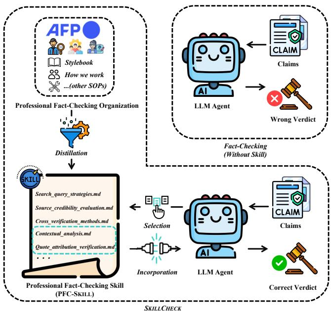
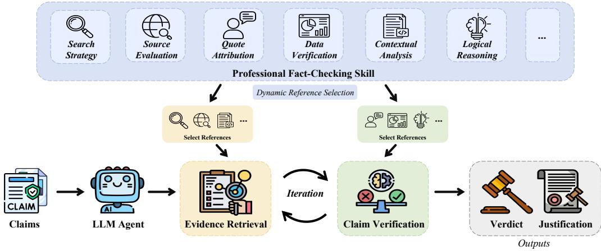
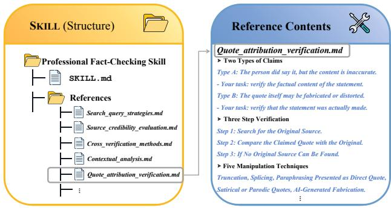
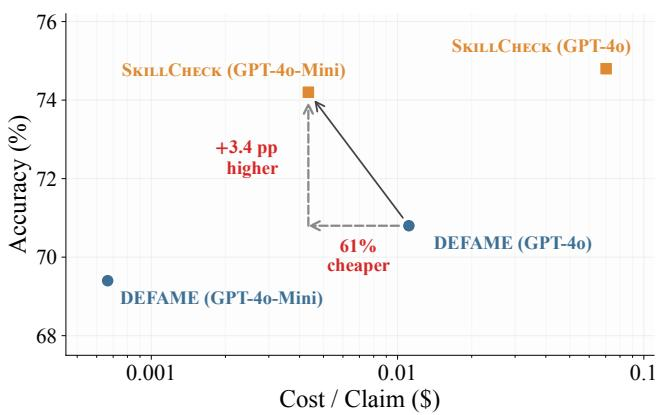
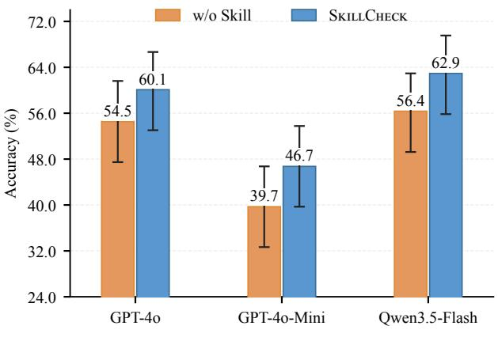
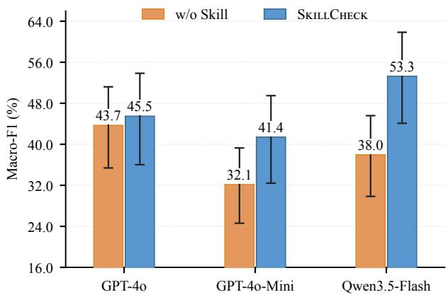
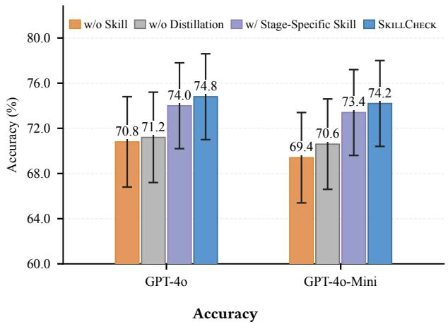
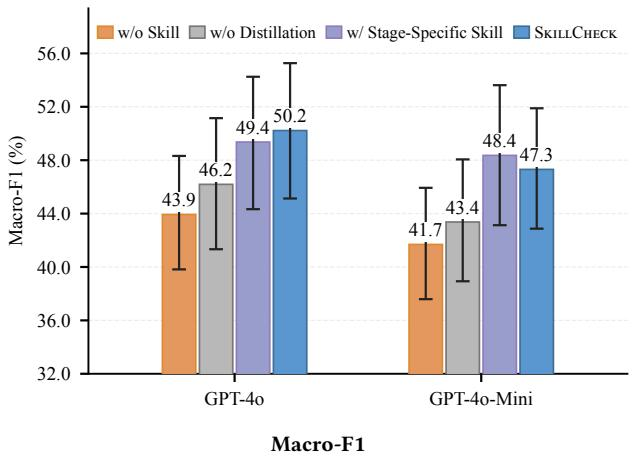
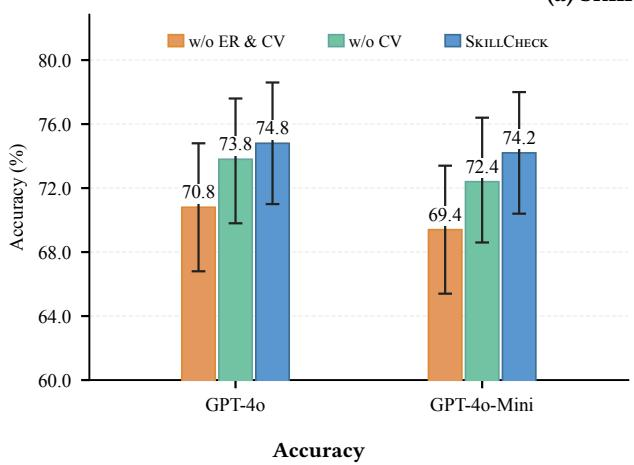
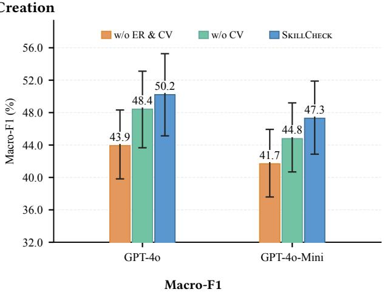

# Standing on the Shoulders of Giants: Enhancing LLM Agents for Automated Fact-Checking with Human Expert Skills

Xinwen Chen∗ Department of Interactive Media, Hong Kong Baptist University xinwwwc@gmail.com

Haorui He∗

Department of Interactive Media, Hong Kong Baptist University School of Computing and Data Science, The University of Hong Kong harryhe@connect.hku.hk

Yupeng Li†

Department of Interactive Media, Hong Kong Baptist University AI and Social Good Lab, AI Media Centre, Hong Kong Baptist University ivanypli@gmail.com

## Abstract

Automated fact-checking (AFC) systems powered by large language model (LLM) agents still face challenges in evidence retrieval and claim verification. Existing approaches improve their capabilities through computationally costly post-training or human-in-the-loop feedback that is dificult to scale. To transfer professional factchecking expertise to LLM agents eficiently, we distill publicly available guidelines published by Agence France-Presse (AFP) Fact Check into a reusable, modular Professional Fact-Checking Skill (PFC-Skill). We then present SkillCheck, the first AFC system that gives LLM agents dynamic access to PFC-Skill to guide evidence retrieval and claim verification at inference time. Extensive experiments demonstrate that SkillCheck improves upon skill-free DEFAME baselines across multiple LLM backbones, with gains of 2.2–4.8 pp. in Accuracy and 1.5–6.3 pp. in Macro-F1 on the AVeriTeC benchmark. Notably, SkillCheck with GPT-4o-Mini exceeds DEFAME with GPT-4o by 3.4 pp. in Accuracy while cutting inference cost by roughly 61%. The performance gains also extend to open-web retrieval. Ablations show that incorporating the skill during evidence retrieval provides most of the gains, while incorporation into both stages yields the best overall performance. Case studies show that PFC-Skill enables more targeted search and closer scrutiny of evidence. To conclude, our work shows that LLM agents can “stand on the shoulders ofgiants” by drawing on the best practices ofprofessional fact-checkers, substantially enhancing AFC performance without extra training or continuous human supervision.

## CCS Concepts

• Information systems → Information retrieval; • Computing methodologies → Natural language processing.

## Keywords

Responsible Web; Automated Fact-Checking; LLM Agent Skills

## 1 Introduction

The rapid and widespread dissemination of misinformation presents a significant societal challenge that cannot be efectively addressed by professional human fact-checkers alone [3, 15, 24, 31, 41]. This limitation has motivated the development ofautomated fact-checking (AFC) systems to address misinformation at scale on the Web. Stateof-the-art (SOTA) AFC systems, such as DEFAME [9], leverage large language model (LLM) agents to verify check-worthy claims. These systems [9, 11, 33, 44, 47, 53] typically operate in two main stages: (i) evidence retrieval (ER), where relevant information is iteratively collected from external sources such as the web, and (ii) claim verification (CV), where the system reasons over the evidence to produce a final verdict, accompanied by a justification that explains the underlying rationale [14, 15, 48].

  
Figure 1: Overview of LLM agents enhanced with human expert skills for automated fact-checking (AFC).

However, current LLM agents still fall short on AFC tasks. A significant performance gap exists between using automatically retrieved evidence and human-annotated gold evidence: with automatic retrieval, LLM agents achieve only 54.2–72.8% Accuracy [9, 17, 33], whereas access to gold evidence boosts Accuracy to over 81.6% [7, 17, 29, 40]. This disparity underscores evidence retrieval as a major bottleneck in AFC. Furthermore, even with gold evidence, LLM agents do not achieve perfect claim verification, as their Accuracy remains below 100%.

To improve the AFC capabilities of LLM agents, recent work has explored post-training techniques such as supervised fine-tuning (SFT) [17, 27, 39, 47] and reinforcement learning (RL) [19, 49, 52].

However, these methods inevitably incur prohibitive computational costs [8, 30, 37]. Alternatively, Sahnan et al. [34] propose a training-free method that incorporates a human-in-the-loop mecha nism at inference time to provide feedback on AFC outputs. Yet this approach relies heavily on manual labor and thus struggles to scale to the massive volume of misinformation. Consequently, closing the gap between LLMs and human experts on AFC tasks hinges on a crucial question: How can we transfer human fact-checking expertise to LLM agents in a cost-eficient and scalable manner to enhance their AFC capabilities?

Recent advances in agent skill use suggest a potent paradigm for transferring human expertise to LLM agents without repeatedly involving humans in the loop [13, 23, 26, 43]. This approach encodes human expertise into reusable guidance (i.e., skills) that agents can consult on demand. However, applying this paradigm to AFC remains underexplored, raising three key questions: (i) How can we identify the best practices of professional fact-checkers and distill them into agent skills? (ii) How can these skills be efectively incorporated into evidence retrieval and claim verification within AFC systems based on LLM agents? (iii) What impact do these skills have on the performance and inference cost of AFC systems?

To bridge this gap, we draw on publicly available guidelines published by professional fact-checking organizations. In particular, we focus on the guidelines of Agence France-Presse (AFP) Fact Check.2 These guidelines codify the standard operating procedures (SOPs) employed by AFP and detail key principles such as how to search for images, when and how to cross-check multiple independent sources, and how to verify quotes and assess factual claims. As illustrated in Fig. 1, we first distill these guidelines into a reusable, modular agent skill, termed the Professional Fact-Checking Skill (PFC-Skill). Then, we introduce SkillCheck, the first AFC system that equips LLM agents with dynamic access to PFC-Skill at inference time, enabling more efective fact-checking without additional model training or human-in-the-loop feedback.

Experiments show that SkillCheck improves upon the SOTA skill-free DEFAME baselines [9], achieving gains of 2.2–4.8 pp. in Accuracy and 1.5–6.3 pp. in Macro-F1. Notably, SkillCheck with GPT-4o-Mini surpasses DEFAME with GPT-4o by 3.4 pp. in Accuracy, while reducing inference cost by approximately 61%. Open-web evaluation shows that these performance gains extend from con trolled knowledge-base settings to open-web retrieval. Ablation studies indicate that skill incorporation during ER provides most performance gains, while incorporation into both ER and CV yields the best AFC performance. Case studies illustrate how skill guid ance enables LLM agents to generate targeted queries for evidence retrieval and conduct closer scrutiny during claim verification.

Our contributions are summarized as follows:

• PFC-Skill. We introduce the first agent skill for factchecking, distilling AFP’s expertise into reusable, modular guidance for evidence retrieval and claim verification.

• SkillCheck. We present the first AFC system that gives LLM agents dynamic access to PFC-Skill at inference time.

• Evaluation and Analysis. We systematically evaluate PFC-Skill and SkillCheck across diferent AFC stages and retrieval settings, and provide a comprehensive analysis via ablation studies, case studies, and error analysis.

## 2 Related Work

Automated Fact-Checking (AFC). As discussed above, state-ofthe-art AFC systems using LLM agents [9, 15, 33, 47] still lag behind human experts in both evidence retrieval and claim verification [12, 17, 18, 20]. To close this gap, recent studies explore post-training via supervised fine-tuning [17, 27, 39, 47] or reinforcement learning [19, 49, 52], but these methods incur prohibitive computational costs and contradict the principles of green AI [8, 30, 32, 37]. Alternatively, a concurrent study [34] proposes a training-free human-in-theloop framework that leverages expert feedback at inference time, yet this approach relies heavily on manual labor [22]. In contrast, we introduce SkillCheck, a skill-based AFC system that transfers professional fact-checking know-how into a reusable, modular agent skill (PFC-Skill) and incorporates it into both stages without model training or human-in-the-loop feedback.

Skills for LLM A ents. Skills are reusable, modular procedural instructions written in natural language that encode step-by-step expertise for specific tasks and can be dynamically invoked by LLM agents at inference time [4–6]. Prior work has used skills to improve tool use [10], planning [42], web navigation [43], and task orchestration [50]. There are broadly two routes to constructing skills: AI-crafted skills, which are synthesized by agents from their own successful trajectories [26, 42], and human-crafted skills, in which procedural knowledge is provided by human experts [4, 23, 45]. Empirical evaluations report limited or negative gains from AIcrafted skills in many tasks, while human-crafted skills can provide more reliable improvements [23]. These findings motivate the use of documented human expertise as the primary source of agent skills. However, in AFC, it remains unclear how to distill human expertise into agent skills, how to incorporate them efectively into evidence retrieval and claim verification, and how they afect LLM agents’ AFC performance. We investigate these questions by distilling AFP’s publicly available guidelines into PFC-Skill and evaluating its incorporation into both stages through SkillCheck.

## 3 The SkillCheck System

In this section, we introduce the SkillCheck system by detailing its two core components: skill creation, which builds the unified PFC-Skill from the AFP guidelines, and skill incorporation, which provides agents with targeted guidance during fact-checking.

## 3.1 Skill Creation

Human fact-checking experts document their best practices for evidence retrieval and claim verification on their websites to ensure transparency (e.g., in the AFP guidelines). To make this knowledge usable by LLM agents, we extract executable procedures and organize them into a Professional Fact-Checking Skill (PFC-Skill).

Skill Distillation. We use two key AFP documents as sources: the AFP Fact-Checking Stylebook [2] and How We Work [1]. These documents detail professional practices for gathering evidence, evaluating sources, cross-checking information, and verifying claims. Then, we employ Anthropic’s Skill Creator framework [6] together with Claude Opus 4.7 to formalize the procedures in the AFP guidelines into executable skill instructions, without introducing any additional fact-checking rules. Because the guidelines also cover editorial policies and tasks specific to human fact-checkers, we restrict skill creation to procedures directly relevant to evidence retrieval and claim verification. By default, we distill procedures for both stages into a unified PFC-Skill. As an alternative, we also consider separating the stages and distilling them individually; however, as discussed in Sec. 4.4, this stage-specific approach does not yield consistent improvements over the unified PFC-Skill.

  
Figure 2: PFC-Skill is incorporated into the evidence retrieval and claim verification stages of an AFC system.

Skill Organization. To make the distilled procedures accessible on demand, we structure PFC-Skill into two main components following prior work [4, 6], as illustrated in Fig. 3: high-level skill usage instructions (SKILL.md) and a set ofreference files.3 Formally, we represent PFC-Skill as $ { \boldsymbol { S } } = ( I ,  { \boldsymbol { R } } )$ , where � denotes the instruc tions in SKILL.md and � denotes the collection of reference files. The instruction file guides agents on when and how to apply the skill, as well as how to utilize the relevant reference files during the process. Each reference file $r _ { i } \in R$ outlines the procedure for a particular fact-checking subtask, such as claim decomposition, source credibility assessment, or cross-verification. For example, the cross-verification reference file provides detailed steps for evaluating source independence, comparing evidence across sources, and resolving conflicting information. This organization enables agents to eficiently access procedural guidance during fact-checking.

## 3.2 Skill Incorporation

To equip LLM agents with access to PFC-Skill during fact-checking, we build SkillCheck on DEFAME [9], a state-of-the-art AFC system. DEFAME follows the standard ReAct-style [46] agentic paradigm of iteratively reasoning and selecting actions, making it a natural foundation for incorporating procedural skills. Given a claim �, the agent plans search queries, examines retrieved evidence, and ultimately produces a verdict together with a justification based on the accumulated fact-checking record. Formally, the baseline process can be written as $y = F ( c ) = V ( c , E ( c ) )$ , where � (·) denotes the AFC system, �(·) denotes evidence retrieval, �(·) denotes claim verification, and � is the predicted veracity label.

  
Figure 3: Structure of PFC-Skill.

We incorporate PFC-Skill into this AFC system by conditioning both evidence retrieval and claim verification on the skill: $y \ = \ F ( c ; S ) \ = \ V ( c , E ( c ; S ) , S )$ , where $ { \boldsymbol { S } } \ = \ (  { \boldsymbol { I } } ,  { \boldsymbol { R } } )$ denotes PFC-Skill. However, naively injecting the entire PFC-Skill into the context presents practical challenges, as excessively long contexts can hinder the retrieval of relevant information when literal matching cues are absent [28]. To retain focused procedural guidance, SkillCheck dynamically selects reference files from �, as illustrated in $\mathrm { F i g . 2 . ^ { 4 } }$ Concretely, at each step �, the acting LLM agent reads the instructions � in SKILL.md alongside the reference catalog, and selects a relevant subset of reference files conditioned on the claim, the current stage, and the accumulated record of actions and observations. The agent outputs a subset $R _ { t } \subseteq R ,$ or None when no reference files are relevant. The contents of the selected reference files are loaded into the agent’s context to guide the corresponding ER or CV step. In this way, SkillCheck enables LLM agents to leverage professional fact-checking expertise on demand, without real-time human supervision or additional model training.

## 4 Experiments

In this section, we conduct experiments to evaluate SkillCheck.

## 4.1 Experimental Setup

Datasets. We use AVeriTeC [36] as our primary benchmark. It comprises English textual claims collected from 50 real-world fact-checking organizations and annotated with four veracity labels: Refuted, Supported, NEI, and Conflicting/Cherry-picking.5 Unlike earlier datasets such as FEVER [38], AVeriTeC mitigates evidence leakage and insuficiency [35, 36], rendering it a more reliable benchmark for assessing automated fact-checking (AFC) systems under realistic conditions. We use the 500-claim development split of AVeriTeC. We remove duplicate claims based on claim text, resulting in 491 unique claims for evaluation. Each claim is accompanied by a knowledge base (KB) that contains both supporting evidence and a large number of distractor documents. This setup simulates open-web retrieval while ensuring reproducibility [35]. Following prior work [9, 17, 33, 47], for each query, we retrieve the top five evidence items from the KB via semantic search with gte-base-en-v1.5 [51].6 To further assess whether the performance gains generalize to an open-web setting, we evaluate SkillCheck on ClaimReview2024+ [9], a collection of 300 English claims drawn from the ClaimReview project.7 Each claim is annotated with one of four veracity labels: Refuted, Supported, Misleading, or NEI.8 These claims were drawn from fact-checking articles published from November 2023 onward, after GPT-4o’s October 2023 knowledge cutof, reducing the risk of knowledge contamination [9, 16]. To avoid temporal leakage in evidence, we retain only claims with explicit release dates, resulting in a filtered subset of 199 claims, denoted ClaimReview2024 $\mathbf { \Gamma } + \mathbf { \Gamma } _ { \mathbf { d a t e } } .$ For each claim, we restrict evidence to documents published before the claim’s release date. We use date-range filters (e.g., before:YYYY-MM-DD) during search. On this dataset, LLM agents interact with the open web via Google Web Search, Image Search, Reverse Image Search, and geolocation tools through Serper9 and Google Vision.10

Baselines. We compare SkillCheck against two categories of baselines: post-training methods and training-free methods.

Post-training methods enhance LLM agents’ fact-checking performance via additional training. For example, HerO [47] applies supervised fine-tuning (SFT) on the AVeriTeC training split. Similarly, DebateCV [17] employs opposing debater agents and fine-tunes a moderator on synthetic debate transcripts to generate verdicts and justifications. Both methods rely on fine-tuned LLM agents; we report results for their Llama-3.1-8B implementations as our baselines. Results for both baselines are taken from [17].

Training-free methods perform fact-checking without any fine-tuning. Zero-shot directly prompts an LLM to predict a veracity label from the claim and evidence. Chain-of-Thought (CoT) prompts the LLM to reason step by step before producing a verdict. Results for both Zero-shot and CoT are taken from [9]. DebateCV (Zeroshot) [17] follows the same workflow as DebateCV, but without any moderator fine-tuning; its results are also taken from [17]. Finally, DEFAME [9], the SOTA training-free AFC system and our main skillfree baseline, iteratively plans search actions, retrieves evidence, and updates its fact-checking record before generating a verdict and justification. We use DEFAME’s oficial codebase11.

LLM Backbones. Our experiments cover closed-source and open-weight LLM backbones. The closed-source models are GPT-4o-2024-08-06 (hereafter GPT-4o) and GPT-4o-Mini-2024-07-18 (GPT-4o-Mini). We also evaluate the open-weight DeepSeek-V4-Flash-0731 (hereafter DeepSeek-V4-Flash) and Qwen3.5-35B-A3B. We use a temperature of 0.01 to reduce sampling variability.

Ablations. To assess our design choices, we examine how PFC-Skill is created and where it is incorporated into AFC. For skill creation, we first compare SkillCheck with skill-free DEFAME (w/o Skill) to assess the benefit of PFC-Skill. We then compare SkillCheck, which uses distilled PFC-Skill, with the w/o Distillation variant, which provides raw AFP guidelines during evidence retrieval (ER) and claim verification (CV), to assess the added value of distillation. Since ER and CV involve distinct procedures, we also compare SkillCheck with stage-specific skills (w/ Stage-Specific Skill), which provide separate guidance for ER and CV. For skill incorporation, we isolate the efects of guidance at each stage by comparing three settings: skill-free DEFAME (w/o ER & CV, equivalent to w/o Skill), guidance during ER only (w/o CV), and guidance during both ER and CV (SkillCheck).

Metrics. We use two metrics: (1) Accuracy (Acc.), defined as the proportion of correctly classified claims; and (2) Macro-F1, the unweighted mean F1 score across all classes. Results are averaged over at least three repeated runs. For statistical rigor, we report 95% bootstrap confidence intervals (CIs) for the mean scores, computed using 10,000 resamples of matched claims.

## 4.2 AFC Performance and Inference Eficiency

Table 1 compares SkillCheck against baselines on AVeriTeC. The results show that SkillCheck substantially outperforms all trainingfree baselines. With GPT-4o, SkillCheck achieves 74.8% Accuracy, exceeding the Zero-shot, CoT, and DebateCV (Zero-shot) baselines by 12.7, 13.8, and 9.4 pp., respectively (62.1%, 61.0%, and 65.4%). For comparisons with DEFAME, we employ paired bootstrap tests to assess statistical significance. SkillCheck significantly outperforms (� < 0.05) the state-of-the-art training-free baseline DEFAME in Accurac across most of the tested LLM backbones. Specifically, Accuracy increases by 4.0, 4.8, 3.0, and 2.2 pp. for GPT-4o, GPT-4o-Mini, DeepSeek-V4-Flash, and Qwen3.5-35B-A3B, respectively. Additionally, SkillCheck with DeepSeek-V4- Flash outperforms post-training methods such as DebateCV (72.8% Accuracy) and HerO (70.2% Accuracy), achieving 76.9% Accuracy.

We also observe that PFC-Skill gains vary across LLM backbones, indicating diferences in how efectively models apply agent skills. This parallels findings in tool learning, where LLMs vary in their ability to use tools efectively [10]. These results motivate skill learning as a future direction for next-generation LLMs: improving their ability to apply skills during task execution.

Table 1: AFC results on AVeriTeC. Green superscripts indicate absolute improvements, in pp., over the corresponding skill-free DEFAME setting. For DEFAME and SkillCheck, uncertainty is reported as 95% bootstrap confidence intervals on matched claims. ∗ indicates statistically significant improvements $( p < 0 . 0 5 ,$ paired bootstrap test).
<table><tr><td rowspan="2">Method</td><td rowspan="2">LLM</td><td colspan="2">Accuracy</td><td colspan="2">Macro-F1</td></tr><tr><td>Score (%)</td><td>95% CI</td><td>Score (%)</td><td>95% CI</td></tr><tr><td colspan="7">Post-training methods</td></tr><tr><td>DebateCV</td><td>Llama-3.1-8B</td><td>72.8</td><td></td><td></td><td></td></tr><tr><td>HerO</td><td>Llama-3.1-8B</td><td>70.2</td><td></td><td></td><td></td></tr><tr><td colspan="6">Training-free methods</td></tr><tr><td>Zero-shot</td><td>GPT-40</td><td>62.1</td><td></td><td></td><td></td></tr><tr><td>CoT</td><td>GPT-40</td><td>61.0</td><td></td><td></td><td></td></tr><tr><td>DebateCV (Zero-shot)</td><td>GPT-40</td><td>65.4</td><td></td><td></td><td></td></tr><tr><td rowspan="4">DEFAME</td><td>GPT-40</td><td>70.8</td><td>[66.8, 74.8]</td><td>43.9</td><td>[39.8, 48.3]</td></tr><tr><td>GPT-4o-Mini</td><td>69.4</td><td>[65.4, 73.4]</td><td>41.7</td><td>[37.6, 45.9]</td></tr><tr><td>DeepSeek-V4-Flash</td><td>73.9</td><td>[69.9, 77.7]</td><td>46.2</td><td>[41.5, 51.1]</td></tr><tr><td>Qwen3.5-35B-A3B</td><td>66.9</td><td>[62.7, 71.1]</td><td>42.7</td><td>[38.5, 46.9]</td></tr><tr><td rowspan="4">SKILLCHECK</td><td>GPT-40</td><td> $\overline { { 7 4 } } . \overline { { 8 } } ^ { + 4 . 0 ^ { * } }$ </td><td>[71.0, 78.6]</td><td> $5 0 . 2 ^ { - 6 . 3 ^ { \star } }$ </td><td>[45.1, 55.3]</td></tr><tr><td>GPT-4o-Mini</td><td> $7 4 . 2 ^ { + 4 . 8 ^ { * } }$ </td><td>[70.4, 78.0]</td><td> $4 7 . 3 ^ { + 5 . 6 }$ </td><td>[42.9, 51.9]</td></tr><tr><td>DeepSeek-V4-Flash</td><td> $7 6 . 9 ^ { + 3 . 0 ^ { * } }$ </td><td>[73.1, 80.5]</td><td> $4 7 . 7 \AA ^ { + 1 . 5 }$ </td><td>[43.0, 52.8]</td></tr><tr><td>Qwen3.5-35B-A3B</td><td> $6 9 . 1 ^ { + 2 . 2 }$ </td><td>[65.1, 73.2]</td><td> $4 6 . 7 \AA ^ { + 4 . 0 }$ </td><td>[41.9, 51.4]</td></tr></table>

  
Figure 4: Comparison of Accuracy and inference cost per claim between SkillCheck and w/o Skill (i.e., DEFAME).

Beyond AFC performance, we further assess the inference cost of SkillCheck. Following prior studies [9, 17], we calculate the cost of each LLM call by multiplying its input and output token counts by the corresponding model’s prices.12 We sum these costs over all agent calls and average over evaluated claims. Table 2 reports average token usage, LLM inference cost, and latency per claim on AVeriTeC, allowing comparisons within the same backbone and across model choices. For the same backbone, incorporating PFC Skill increases inference overhead. For example, with GPT-4o, the average cost per claim rises from \$0.0111 to \$0.0703, while latency grows from 43.11 s to 51.33 s. Most of the added cost comes from input token processing. Despite this overhead, SkillCheck with GPT-4o-Mini achieves higher AFC performance at a lower LLM inference cost than DEFAME with GPT-4o. As shown in Table 1 and Fig. 4, Accuracy improves from 70.8% to 74.2% and Macro-F1 from 43.9% to 47.3%, yielding gains of 3.4 pp. on both metrics. Concurrently, the average LLM inference cost per claim drops from \$0.0111 to \$0.0043, a reduction of approximately 61%. This comparison highlights SkillCheck as a practical and cost-efective alternative to the existing SOTA skill-free AFC system, delivering higher AFC performance at a lower LLM inference cost.

## 4.3 Open-Web Evaluation

The open web exposes agents to a broader and less controlled range of evidence sources. We therefore examine whether the performance gains observed above extend to open-web evidence retrieval.

Following the experimental setup in Sec. 4.1, we evaluate SkillCheck on ClaimReview $\tau 2 0 2 4 \mathrm { + } _ { \mathrm { d a t e } }$ using GPT-4o, GPT-4o-Mini, and Qwen3.5- 35B-A3B. Some claims in ClaimReview $2 0 2 4 \mathrm { + } _ { \mathrm { d a t e } }$ contain both text and images. We therefore exclude DeepSeek-V4-Flash because it does not support these multimodal inputs. As shown in Fig. 5, SkillCheck, which incorporates PFC-Skill, improves AFC performance with open-web evidence retrieval across all three evaluated backbones. Accuracy increases from 54.5% to 60.1% for GPT-4o, from 39.7% to 46.7% for GPT-4o-Mini, and from 56.4% to 62.9% for Qwen3.5-35B-A3B. Macro-F1 also improves for all three backbones, by 1.8, 9.3, and 15.3 pp., respectively. These results support incorporating PFC-Skill into LLM agents for AFC under both open-web andfixed-KB evidence retrieval.

Table 2: Average token usage, LLM inference cost, and latency per claim. Token counts are reported in thousands (K). Input, output, and total cost are rounded independently.
<table><tr><td rowspan="2">Backbone</td><td rowspan="2">System</td><td colspan="2">Input</td><td colspan="2">Output</td><td rowspan="2">Total Cost</td><td rowspan="2">Latency</td></tr><tr><td>Tokens (K)</td><td>Cost ($)</td><td>Tokens (K)</td><td>Cost ($)</td></tr><tr><td rowspan="2">GPT-40</td><td>DEFAME</td><td>2.97</td><td>0.0074</td><td>0.37</td><td>0.0037</td><td>($) 0.0111</td><td>(s) 43.11</td></tr><tr><td>SKILLCHECK</td><td>26.41</td><td>0.0660</td><td>0.43</td><td>0.0043</td><td>0.0703</td><td>51.33</td></tr><tr><td rowspan="2">GPT-4o-Mini</td><td>DEFAME</td><td>2.89</td><td>0.0004</td><td>0.39</td><td>0.0002</td><td>0.0007</td><td>43.34</td></tr><tr><td>SKILLCHECK</td><td>26.75</td><td>0.0040</td><td>0.55</td><td>0.0003</td><td>0.0043</td><td>53.41</td></tr></table>

  
(a) Accuracy

  
(b) Macro-F1  
Figure 5: AFC results on ClaimReview2024+date.

## 4.4 Ablation Studies

To explain the performance gains, we compare the ablation variants defined in Sec. 4.1 on AVeriTeC using GPT-4o and GPT-4o-Mini.

Skill Creation. As shown in Fig. 6(a), PFC-Skill is more effective than directly using the raw AFP guidelines. The w/o Distillation variant improves Accuracy over w/o Skill by only 0.4 and 1.2 pp. for GPT-4o and GPT-4o-Mini, respectively. PFC-Skill adds a further 3.6 pp. in Accuracy for both backbones and 4.0 and 3.9 pp. in Macro-F1, respectively. These results suggest that access to professional knowledge alone provides limited benefits. This may be because the raw guidelines combine broad principles with procedures for human fact-checkers. Distilling them into PFC-Skill makes the relevant knowledge actionable for LLM agents by specifying procedures for evidence retrieval and claim verification. Among the distilled variants, w/ Stage-Specific Skill provides no consistent advantage over SkillCheck with the unified PFC-Skill. For GPT-4o, w/Stage-Specific Skill reduces both Accuracy and Macro-F1 by 0.8 pp. compared with SkillCheck. For GPT-4o-Mini, it reduces Accuracy by 0.8 pp. but increases Macro-F1 by 1.1 pp. We therefore use a single skill package for both stages, avoiding the need to construct and maintain separate stage-specific skills.

Skill Incorporation. As shown in Fig. 6(b), the w/o CV variant accounts for most of the performance gains, while extending skill use to CV provides additional improvements. The w/o CV variant improves Accuracy and Macro-F1 by 3.0 and 4.5 pp.

for GPT-4o, and by 3.0 and 3.1 pp. for GPT-4o-Mini. These gains account for approximately 55–75% of the improvements achieved by SkillCheck. Adding CV guidance in SkillCheck further improves Accuracy and Macro-F1 by 1.0 and 1.8 pp. for GPT-4o, and by 1.8 and 2.5 pp. for GPT-4o-Mini. These results indicate that our PFC-Skill ofers complementary benefits at diferent stages, motivating skill incorporation at both fact-checking stages.

## 4.5 Case Studies and Error Analysis

To better understand how PFC-Skill influences the fact-checking behaviors of LLM agents and leads to the observed improvements, we qualitatively analyze their query formulation during evidence retrieval (ER) and evidence assessment during claim verification (CV). Table 3 compares SkillCheck with the skill-free baseline DEFAME on three representative claims. Claims 1 and 2 illustrate the benefits of skill guidance during ER and CV, respectively, while Claim 3 reveals an error introduced by the same guidance.

In Claim 1, PFC-Skill improves ER by steering queries toward the scope and authority of vaccination policies. DE-FAME retrieves a general encouragement of vaccination together with a military mandate and treats them as conflicting evidence. SkillCheck instead searches for Trump’s statements and the federal policy framework, surfacing the fact that public-health authority primarily rests with state and local governments. This yields the correct veracity label, Refuted. In Claim 2, PFC-Skill improves

(a) Skill Creation  

  
(b) Skill Incorporation  
Fi ure 6: Ablation results. (a) com ares skill-free DEFAME (w/o Skill) raw AFP uidelines (w/o Distillation) sta e-s ecific skills (w/ Stage-Specific Skill), and the unified PFC-Skill (SkillCheck). (b) compares skill-free DEFAME (w/o ER & CV), skill incorporation during ER alone (w/o CV), and incorporation into both ER and CV (SkillCheck).

CV by separating verification of an attributed quote from verification of surrounding facts. DEFAME takes the blank-notepad incident as suficient support for the alleged remark. SkillCheck confirms that Barrett used no notes but finds no primary source for the specific wording, changing the predicted veracity label from Supported to Refuted. Together, these cases show that PFC-Skill strengthens both ER and CV by encouraging more precise query formulation and stricter scrutiny ofretrieved evidence.

To better understand the limitations of this guidance, we also examine Claim 3, where the same skill leads to an overly conservative error. In Claim 3, SkillCheck produces an error because stricter skill-guided verification demands precise statistical evidence that is not retrieved. DEFAME accepts an urban population estimate of 53–54% as adequate support for the 52% claim and correctly predicts Supported. SkillCheck demands more direct statistical evidence for the precise 2020 figure; when no evidence supporting that year’s figure is retrieved, it predicts NEI. Although this decision is reasonable given the lack of precise evidence, the approach may be too conservative.

## 5 Conclusion

In this work, we introduce PFC-Skill, an agent skill distilled from AFP Fact Check’s professional guidelines, and propose SkillCheck, a training-free AFC system that dynamically selects relevant skills to guide evidence retrieval and claim verification. Experiments demonstrate that SkillCheck outperforms the previous state-ofthe-art skill-free AFC system, DEFAME. Furthermore, SkillCheck with GPT-4o-Mini achieves higher AFC performance at lower inference cost than skill-free DEFAME with GPT-4o. Variation in gains across LLM backbones also motivates future research in skill learning to enhance LLMs’ ability to apply skills. Ablation studies show that evidence retrieval guidance accounts for most gains, while claim verification guidance provides further improvements. Case studies illustrate that skill guidance enables more targeted evidence retrieval and closer scrutiny during claim verification.

As the first work to demonstrate the value of distilling professional fact-checking expertise into reusable, actionable skills for LLM agents, our approach provides a practical pathway toward more capable and cost-eficient fact-checking systems without requiring additional model training or continuous human expert supervision. This supports ongoing eforts to foster a trustworthy information ecosystem for a responsible Web. In future work, we

Table 3: Case studies illustrating how the skill alters fact-checking behaviors. Selected search queries are shown; evidence and judgments are abridged. Efective behaviors, useful skills, and correct judgments are highlighted in green, while problematic behaviors and incorrect judgments are marked in purple. Positive cases are highlighted in blue, while failures are in yellow.
<table><tr><td rowspan="2"></td><td>DEFAME</td><td colspan="4">SKILLCHECK</td></tr><tr><td>Fact-Checking Record</td><td>Fact-Checking Record</td><td colspan="3">Selected Skill</td></tr><tr><td colspan="7">Claim 1, REFuTED: US President Trump made vaccines voluntary, not mandatory, in the US. 1. 1. “US President Trump vaccines voluntary PFC-SKILL</td></tr><tr><td>Q Query</td><td>“US President Trump vaccines voluntary mandatory September 2020&quot;</td><td>not mandatory September 2020&quot;; “Trumpstatement vaccines voluntary mandatory September 2020&quot;; “Trump executive order vaccines</td><td>voluntary mandatory September 2020&quot;;</td><td colspan="2">Search_query_strategies.md 2.3 Quote / Statement Verification When a claim attributes words to a specific person: &quot;If a comment is attributed to a person, we seek a reliable source (audio or video recording, official transcript).&quot; (From: AFP How We Work)</td></tr><tr><td> Evidence</td><td>Trump&#x27;s order encouraged vaccination without specifying voluntary or mandatory status. Another source described a COVID-19 vaccine</td><td>Trump&#x27;s September 20, 2020 order encouraged vaccination. A Department of Defense document</td><td>“US federal vaccine policy September 2020”. V described a military mandate and noted that public health responsibilities primarily lie with</td><td colspan="2">quotes Speaker + topic: [person name] [key topic words] transcript OR speech OR statement Official record: [person name] [topic] site:gov.* OR &quot;official transcript&quot; OR &quot;press conference&quot;</td></tr><tr><td>Judgment</td><td>mandate for service members. Mandates applied to specific groups, while Trump focused on vaccine development and distribution These are</td><td>state and local governments. Vaccination mandates primarily fall under state and local authority. No federal mandate or</td><td>4</td><td>Improve ER by steering queries toward vaccination policy scope and authority.</td><td></td></tr><tr><td colspan="6">declaration of voluntary vaccination for the conflicting:CONFLICTING/CHERRY-PICKING&#x27;. X general public was identified: &#x27;REFUTED&#x27;. Claim 2, REFuTED: Amy Coney Barrett, associate justice of the Supreme Court of the United States, said during her Supreme Court confirmation hearing that she</td></tr><tr><td>2. &quot;Amy Coney</td><td>notes seven kids stupid questions”; Barrett confirmation hearing transcript&quot;.</td><td>notes seven kids stupid questions transcript&quot;; &quot;Amy Coney Barrett confirmation hearing October 2020 quotes&quot;;</td><td>“Amy Coney Barrett Supreme Court confirmation hearing video&quot;.</td><td>Step 2: Compare the Claimed Quote with the Original If you find the original source: Does the actual quote match the claimed version exactly?</td><td></td></tr><tr><td>Evidence</td><td>Barrett displayed a blank notepad, showing she was not using notes. The blank-notepad incident was taken to support</td><td>it did not verify the quote.</td><td>Barrett&#x27;s blank notepad showed she used no notes;</td><td>qualifies or reverses its apparent meaning?</td><td></td></tr><tr><td colspan="6">Judgment the alleged remark, despite the lack of a verbatim account: SUPPORTED&#x27;. X</td></tr><tr><td>2. 3.</td><td>&quot;Nigeria urbanization rate 2020 World Bank&quot;; “Nigeria population urban areas 2020 census data”.</td><td>percentage 2020 World Bank&quot;; 2. “Nigeria National Bureau of Statistics urban population 2020”; 3. &quot;United Nations World Urbanization Prospects Nigeria 2020&quot;; 4.</td><td>&quot;Nigeria urban population &quot;Nigeria urban population 2020 &#x27;National</td><td>Step 2: Find the Original Data Source Search: [topic] [year] official statistics [relevant agency] source says? Is the unit of measurement the same? (e.g.,</td><td>Step 3: Verify the Number Against the Original Does the cited number match what the original</td></tr><tr><td>Evidence</td><td>Sources gave a 53–54% urban share, including a 53.52% estimate for 2022.</td><td>6. rural split official report”. without statistical data or</td><td>“Nigeria demographic statistics 2020 urban A later report gave 53.52% for 2022. Buhari&#x27;s October 1, 2020 speech reported a 52% urban share,</td><td>Stricter skill-guided verification requires</td><td></td></tr></table>

plan to incorporate additional skill sources from professional factchecking organizations, reduce inference costs by investigating more eficient skill selection and context loading, and examine how these methods can generalize to multilingual scenarios.

## References

[1] Agence France-Presse. 2024. AFP Fact Check: How We Work. https://factcheck. afp.com/How-we-work

[2] Agence France-Presse. 2024. AFP Fact-Checking Stylebook. https://factcheck. afp.com/afp-fact-checking-stylebook

[3] Mubashara Akhtar, Michael Schlichtkrull, Zhijiang Guo, Oana Cocarascu, Elena Simperl, and Andreas Vlachos. 2023. Multimodal Automated Fact-Checking: A Survey. In Findings ofEMNLP.

[4] Anthropic. 2025. Equipping Agents for the Real World with Agent Skills. https://www.anthropic.com/engineering/equipping-agents-for-the-realworld-with-agent-skills Anthropic Engineering Blog.

[5] Anthropic. 2025. Introduction to Agent Skills. https://anthropic.skilljar.com introduction-to-agent-skills Anthropic Skilljar Course.

[6] Anthropic. 2025. Skill Creator. https://claude.com/plugins/skill-creator Claude Skill Creator Documentation.

[7] Pietro Bernardelle, Stefano Civelli, Kevin Roitero, and Gianluca Demartini. 2026. Context Shapes LLMs Retrieval-Augmented Fact-Checking Efectiveness. arXiv preprint:2602.14044.

[8] Verónica Bolón-Canedo, Laura Morán-Fernández, Brais Cancela, and Amparo Alonso-Betanzos. 2024. A Review of Green Artificial Intelligence: Towards a More Sustainable Future. Neurocomputing 599 (2024), 128096.

[9] Tobias Braun, Mark Rothermel, Marcus Rohrbach, and Anna Rohrbach. 2025. DEFAME: Dynamic Evidence-Based FAct-Checking with Multimodal Experts. In Proc. ofICML.

[10] Shiqi Chen, Jingze Gai, Ruochen Zhou, Jinghan Zhang, Tongyao Zhu, Junlong Li, Kangrui Wang, Zihan Wang, Zhengyu Chen, Klara Kaleb, et al. 2026. SkillCraft: Can LLM Agents Learn to Use Tools Skillfully? arXiv preprint:2603.00718.

[11] Svetlana Churina, Anab Maulana Barik, and Saisamarth Rajesh Phaye. 2024. Improving Evidence Retrieval on Claim Verification Pipeline through Question Enrichment. In Proc. ofFEVER

[12] Anubrata Das, Houjiang Liu, Venelin Kovatchev, and Matthew Lease. 2023. The State of Human-Centered NLP Technology for Fact-Checking. Information Processing & Management 60, 2 (2023), 103219.

[13] Bowen Deng, Bohan Li, Matthew Cox, Hoje Chun, Juno Nam, Artur Lyssenko, Sathya Edamadaka, Jurgis Ruza, Xiaochen Du, Nofit Segal, et al. 2026. Harnessing AtomisticSkills for Agentic Atomistic Research. arXiv preprint:2605.24002.

[14] Islam Eldifrawi, Shengrui Wang, and Amine Trabelsi. 2024. Automated Justifica tion Production for Claim Veracity in Fact Checking: A Survey on Architectures and Approaches. In Proc. ofACL.

[15] Zhijiang Guo, Michael Schlichtkrull, and Andreas Vlachos. 2022. A Survey on Automated Fact-Checking. Transactions ofthe Association for Computational Linguistics 10 (2022), 178–206.

[16] Haorui He, Xinwen Chen, Dacheng Wen, Reynold Cheng, Francis C. M. Lau, and Yupeng Li. 2026. Novel Claim or Déjà Vu? Rethinking “Contamination-Free” Dynamic Evaluation for Multimodal Automated Fact-Checking. In Proc. ofMM.

[17] Haorui He, Yupeng Li, Dacheng Wen, Yang Chen, Reynold Cheng, Donglong Chen, and Francis Lau. 2026. Debating Truth: Debate-Driven Claim Verification with Multiple Large Language Model Agents. In Proc. ofWWW.

[18] Haorui He, Yupeng Li, Bin Benjamin Zhu, Dacheng Wen, Reynold Cheng, and Francis Lau. 2026. Fact2Fiction: Targeted Poisoning Attack to Agentic Fact Checking System. In Proc. ofAAAI.

[19] Qi He, Cheng Qian, Xiusi Chen, Bingxiang He, Yi R. Fung, and Heng Ji. 2026. Veri R1: Toward Precise and Faithful Claim Verification via Online Reinforcement Learning. In Findin s ofACL

[20] Prerna Juneja and Tanushree Mitra. 2022. Human and Technological Infrastructures of Fact-Checking. In Proc. ofCSCW.

[21] Lev Konstantinovskiy, Oliver Price, Mevan Babakar, and Arkaitz Zubiaga. 2021. Toward Automated Factchecking: Developing an Annotation Schema and Bench mark for Consistent Automated Claim Detection. Digital Threats: Research and Practice 2, 2 (2021), 1–16.

[22] Konstantinos Lazaros, Aristidis G Vrahatis, and Sotiris Kotsiantis. 2026. Humanin-the-Loop Artificial Intelligence: A Systematic Review of Concepts, Methods, and Applications. Entropy 28, 4 (2026), 377.

[23] Xiangyi Li, Yimin Liu, Wenbo Chen, Bingran You, Zonglin Di, Yifeng He, Shenghan Zheng, Kyoung Whan Choe, Jiankai Sun, Shuyi Wang, et al. 2026. SkillsBench: Benchmarking How Well Agent Skills Work Across Diverse Tasks. In Proc. of NeurIPS.

[24] Yupeng Li, Haorui He, Jin Bai, and Dacheng Wen. 2024. MCFEND: A Multi-Source Benchmark Dataset for Chinese Fake News Detection. In Proc. ofWWW.

[25] Xin Liu, Yu-An Liu, Ruqing Zhang, Yixing Fan, Lixin Su, Jiafeng Guo, and Xueqi Cheng. 2026. Compete to Complete: Co-opetition Adversarial Learning for Retrieval-Augmented Generation. In Proc. ofACL.

[26] Zijian Lu, Yiping Zuo, Yupeng Nie, Xin He, Weibei Fan, Lianyong Qi, and Shi Jin. 2026. ContractSkill: Repairable Contract-Based Skills for Multimodal Web Agents. In Proc. ofMM.

[27] Yifeng Luo, Yupeng Li, Liang Lan, and Tian Wang. 2026. From Cheap Fakes to Pure Synthesis: Addressing the New Era of T2V Fake News Videos. In Proc. of

MM.

[28] Ali Modarressi, Hanieh Deilamsalehy, Franck Dernoncourt, Trung Bui, Ryan A. Rossi, Seunghyun Yoon, and Hinrich Schuetze. 2025. NoLiMa: Long-Context Evaluation Beyond Literal Matching. In Proc. of ICML.

[29] Yuki Momii, Tetsuya Takiguchi, and Yasuo Ariki. 2024. RAG-Fusion Based Information Retrieval for Fact-Checking. In Proc. ofFEVER.

[30] Jacob Morrison, Clara Na, Jared Fernandez, Tim Dettmers, Emma Strubell, and Jesse Dodge. 2025. Holistically Evaluating the Environmental Impact of Creating Language Models. In Proc. of ICLR.

[31] Qiong Nan, Juan Cao, Yongchun Zhu, Yanyan Wang, and Jintao Li. 2021. MD-FEND: Multi-Domain Fake News Detection. In Proc. ofCIKM.

[32] David Patterson, Joseph Gonzalez, Quoc Le, Chen Liang, Lluis-Miquel Munguia, Daniel Rothchild, David So, Maud Texier, and Jef Dean. 2021. Carbon Emissions and Large Neural Network Training. arXiv preprint:2104.10350.

[33] Mark Rothermel, Tobias Braun, Marcus Rohrbach, and Anna Rohrbach. 2024. InFact: A Strong Baseline for Automated Fact-Checking. In Proc. ofFEVER.

[34] Dhruv Sahnan, Subhabrata Dutta, Tanmoy Chakraborty, Preslav Nakov, and Iryna Gurevych. 2026. Co-FactChecker: A Framework for Human-AI Collaborative Claim Verification Using Large Reasoning Models. arXiv preprint:2604.13706.

[35] Michael Schlichtkrull, Yulong Chen, Chenxi Whitehouse, Zhenyun Deng, Mubashara Akhtar, Rami Aly, Zhijiang Guo, Christos Christodoulopoulos, Oana Cocarascu, Arpit Mittal, James Thorne, and Andreas Vlachos. 2024. The Auto mated Verification of Textual Claims (AVeriTeC) Shared Task. In Proc. ofFEVER.

[36] Michael Schlichtkrull, Zhijiang Guo, and Andreas Vlachos. 2023. AVeriTeC: A Dataset for Real-World Claim Verification with Evidence from the Web. In Proc. of NeurIPS.

[37] Roy Schwartz, Jesse Dodge, Noah A Smith, and Oren Etzioni. 2020. Green AI. Communications ofthe ACM 63, 12 (2020), 54–63.

[38] James Thorne, Andreas Vlachos, Christos Christodoulopoulos, and Arpit Mittal. 2018. FEVER: A Large-Scale Dataset for Fact Extraction and VERification. In Proc. ofNAACL-HLT.

[39] Hieu Tran, Junda Wang, Yujan Ting, Hong Yu, Weijing Huang, and Terrence Chen. 2025. LEAF: Learning and Evaluation Augmented by Fact-Checking to Improve Factualness in Large Language Models. In Proc. of EMNLP.

[40] Aida Usmanova, Zangir Iklassov, Markus Leippold, and Ricardo Usbeck. 2026. How Robust Are Automated Fact-Checking Systems? A Cross-Benchmark Eval uation. arXiv preprint:2608.25934.

[41] Andreas Vlachos and Sebastian Riedel. 2014. Fact Checking: Task Definition and Dataset Construction. In Proc. ofthe ACL Workshop on Language Technologies and Computational Social Science.

[42] Chenxi Wang, Zhuoyun Yu, Xin Xie, Wuguannan Yao, Runnan Fang, Shuofei Qiao, Kexin Cao, Guozhou Zheng, Xiang Qi, Peng Zhang, et al. 2026. SkillX: Automatically Constructing Skill Knowledge Bases for Agents. arXiv preprint:2604.04804.

[43] Zhaoyang Wang, Qianhui Wu, Xuchao Zhang, Chaoyun Zhang, Wenlin Yao, Fazle Elahi Faisal, Baolin Peng, Si Qin, Suman Nath, Qingwei Lin, et al. 2026. WebXSkill: Skill Learning for Autonomous Web Agents. In Findings ofEMNLP.

[44] Zhuohan Xie, Rui Xing, Yuxia Wang, Jiahui Geng, Hasan Iqbal, Dhruv Sahnan, Iryna Gurevych, and Preslav Nakov. 2025. FIRE: Fact-Checking with Iterative Retrieval and Verification. In Findings of NAACL.

[45] Renjun Xu and Yang Yan. 2026. Agent Skills for Large Language Models: Architecture, Acquisition, Security, and the Path Forward. arXiv preprint:2602.12430.

[46] Shunyu Yao,Jefrey Zhao, Dian Yu, Nan Du, Izhak Shafran, Karthik R Narasimhan, and Yuan Cao. 2023. ReAct: Synergizing Reasoning and Acting in Language Models. In Proc. ofICLR.

[47] Yejun Yoon, Jaeyoon Jung, Seunghyun Yoon, and Kunwoo Park. 2024. HerO at AVeriTeC: The Herd of Open Large Language Models for Verifying Real-World Claims. In Proc. ofFEVER.

[48] Fengzhu Zeng and Wei Gao. 2024. JustiLM: Few-Shot Justification Generation for Explainable Fact-Checking of Real-World Claims. Transactions ofthe Association for Computational Linguistics 12 (2024), 334–354.

[49] Fanrui Zhang, Dian Li, Qiang Zhang, Jun Chen, Gang Liu, Junxiong Lin, Jiahong Yan, Jiawei Liu, and Zheng-Jun Zha. 2025. Fact-R1: Towards Explainable Video Misinformation Detection with Deep Reasoning. In Proc. ofNeurIPS.

[50] Mingda Zhang, Tiesunlong Shen, Haoran Luo, Wenjin Liu, Zikai Xiao, Erik Cambria, and Xiaoying Tang. 2026. SkillFlow: Flow-Driven Recursive Skill Evolution for Agentic Orchestration. arXiv preprint:2605.14089.

[51] Xin Zhang, Yanzhao Zhang, Dingkun Long, Wen Xie, Ziqi Dai, Jialong Tang, Huan Lin, Baosong Yang, Pengjun Xie, Fei Huang, Meishan Zhang, Wenjie Li, and Min Zhang. 2024. mGTE: Generalized Long-Context Text Representation and Reranking Models for Multilingual Text Retrieval. In Proc. ofEMNLP.

[52] Yue Zhang, Shicheng Zhou, Xiaopeng Li, Zhiliang Tian, Yifu Gao, Shiyi Zhang, Wenqing Hou, Yuying Liu, and Bin Zhou. 2026. KnowFC: Navigating Knowledge Conflicts in Large Language Model-Based Fact-Checking. In Proc. ofWSDM.

[53] Liwen Zheng, Chaozhuo Li, Xi Zhang, Yu-Ming Shang, Feiran Huang, and Haoran Jia. 2024. Evidence Retrieval Is Almost All You Need for Fact Verification. In Findings ofACL.

Table 4: Detailed descriptions of the reference files in PFC-Skill used in SkillCheck.
<table><tr><td>Reference File</td><td>Reference Content</td></tr><tr><td>Claim_decomposition.md</td><td>Breaking complex claims into atomic, verifiable sub-questions; Claim type identification; Investigation prioritization.</td></tr><tr><td>Search_query_strategies.md</td><td>Concrete search query construction techniques by claim type; Iterative refinement strategies; Query anti-patterns.</td></tr><tr><td>Source_credibility_evaluation.md</td><td>4-tier source reliability hierarchy; Source evaluation checklist; Rules for handling denials, expert citations, and prior fact-checks</td></tr><tr><td>Cross_verification_methods.md</td><td>Multi-source verification strategies, including source independence criteria, consistency checks, and handling conflicting evidence.</td></tr><tr><td>Evidence_sufficiency_evaluation.md</td><td>Criteria for evidence sufficiency; Evidence weight taxonomy; Handling absence of evidence; When to continue or stop retrieval.</td></tr><tr><td>Contextual_analysis.md</td><td>Detecting out-of-context usage, cherry-picking, misleading framing, and omitted context; Distinguishing misleading claims from incomplete context.</td></tr><tr><td>Numerical_data_verification.md</td><td>Verification techniques for statistical and numerical claims, including tracing original sources, checking methodologies, and detecting manipulation patterns.</td></tr><tr><td>Quote_attribution_verification.md</td><td>Verifying the authenticity of attributed quotes; Detecting truncation, splicing, and fabrication;</td></tr><tr><td>Confirmation_bias_countermeasures.md</td><td>Searching for original transcripts. Bias mitigation strategies, including mandatory counter-evidence search, impartiality stan- dards, and pre-verdict self-check procedures.</td></tr><tr><td>Verdict_reasoning_logic.md</td><td>Systematic reasoning from evidence to verdict, including evidence direction assessment, verdict strength calibration, and attribution-based justification.</td></tr></table>

## A PFC-Skill Reference Files

Table 4 provides detailed descriptions of the reference files in the unified PFC-Skill.

## B Skill Incorporation Prompt

The agent reads SKILL.md and the reference catalog when selecting reference files. After selection, the contents of the selected files are loaded into its context for ER or CV.

<table><tr><td># Instructions</td></tr><tr><td>You are selecting reference guides for a fact-check.</td></tr><tr><td>## Current Stage Stage: [STAGE]</td></tr><tr><td>[STAGE_HINT]</td></tr><tr><td>Review the document below and the available reference files, then select the ones most relevant to this stage of the fact-check.</td></tr><tr><td>Output ONLY the file paths, one per line. If none are relevant, write</td></tr><tr><td>&quot;None&quot;.</td></tr><tr><td>## Document [DOC]</td></tr><tr><td>## Available References</td></tr><tr><td>[SKILL_CATALOG]</td></tr><tr><td></td></tr><tr><td>## Your Selected References</td></tr></table>

[STAGE]: Identifies the current stage: evidence retrieval (ER) or claim verification (CV).

[DOC]: Contains the claim and the accumulated fact-checking record.

[STAGE\_HINT]: Provides guidance on the intended behaviors at the current AFC stage.

[SKILL\_CATALOG]: Describes the available reference files in PFC-Skill.

## C Definitions of the Veracity Labels

## C.1 AVeriTeC

AVeriTeC defines four veracity labels [36]. We use shortened names below. The label Not Enough Evidence is denoted by NEI:

• Supported: the claim is supported by the available evidence.

• Refuted: the claim is contradicted by the available evidence.

• NEI (Not Enough Evidence): the available evidence is insuficient to verify or refute the claim.

• Conflicting/Cherry-picking: the claim is misleading due to conflicting evidence or omission of important context.

## C.2 ClaimReview2024+d t

ClaimReview2024+date uses four veracity labels defined in [9]:

• Supported: the claim is accurate based on the available evidence.

• Refuted: the available evidence contradicts the claim.

• Misleading: the claim is misleading or requires additional context.

• NEI (Not Enough Information): there is insuficient evidence to verify the claim.