# Strength Controls Change How Interventions Compare Across Sparse Autoencoder Codes

Jinchen Zhang\* Zheyuan Liu\* Yihan Zhu Meng Jiang University of Notre Dame {jzhang47,zliu29}@nd.edu

## Abstract

Changing sparse autoencoder (SAE) codes can alter both intervention direction and magnitude, so comparing intervention effects requires a strength control specifying what is held equal. Norm matching and output calibration provide different controls, but whether interventions yield different effects across codes after strength matching remains unclear. We compare intervention effects under these controls for fixed feature groups in Gemma and Llama and observe: (1) Whole-patch scaling. With one coefficient per input, full-output Kullback– Leibler (KL) calibration leaves smaller mean effect gaps from the encoder-based reference intervention than total-norm matching for nonnegative least-squares (NNLS) refits. On new Llama inputs, total-norm matching loses 11 reference transfers, whereas full-output cali bration preserves every transfer decision. (2) Positionwise scaling. On a small matched gender-agreement subset, positionwise norm matching leaves smaller observed mean gaps than full-output calibration. (3) Answer exclusion. Compared with unscaled NNLS, answer-excluded calibration reduces gaps in the measured subject–verb agreement comparisons but increases them for gender refits. Full output KL calibration also reduces larger gaps for norm-matched constructed candidates, although matching coverage is incomplete in several settings. Since calibration uses the evaluated input’s outputs, it serves as a diagnostic of residual disagreement.

## 1 Introduction

Sparse autoencoders (SAEs) represent model activations through feature directions and sparse coefficients (Bricken et al., 2023; Huben et al., 2024). The decoder supplies a dictionary of feature directions, and the encoder assigns coefficients, collectively called a code, that specify their contributions to an activation’s reconstruction. Intervening on selected features lets researchers test their role in model behavior (Marks et al., 2025).

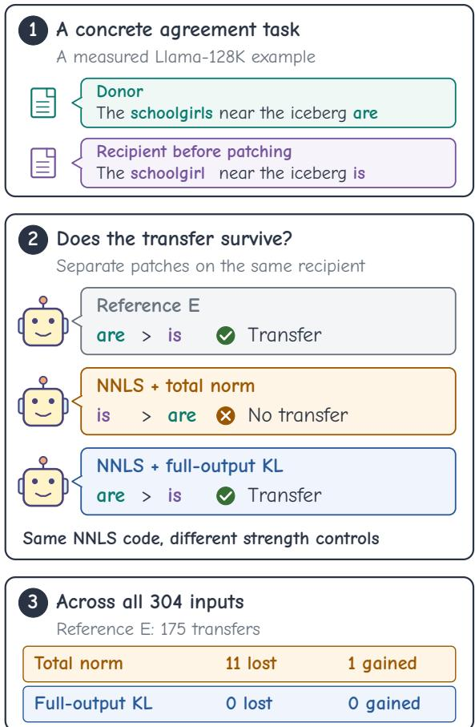  
Figure 1: Strength control can change a transfer decision. A Llama-128K example selected post hoc. (1) Prompts with task answers appended. (2) E is the reference intervention built from the released encoder’s codes. Separate patches on the same native recipient. Rankings (>) compare only the two answer logits. Ticks indicate donor-answer transfer, crosses its absence. (3) Transfers lost or gained relative to E across all 304 inputs. Agreement with E is not a faithfulness standard.

One way to test these roles is activation patching, which transfers selected internal activation values between runs of the same model and measures the resulting output change (Heimersheim and Nanda, 2024). The input supplying these values is the donor. The recipient is the input whose activations are modified and whose output is evaluated (Baumgartner et al., 2025, Appendix D.3).

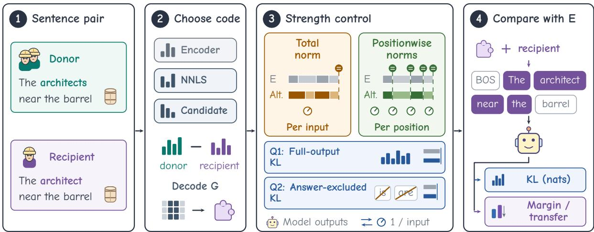  
Figure 2: Four-step comparison with a fixed model, dictionary, feature group, and sentence pair. The reference intervention E, built from the released encoder’s codes, supplies the reference targets (gray) for rescaling the original alternative patch (color). Norm segments show squared patch norms, matched in sum or per position. KL controls use trial model outputs to choose one scaling coefficient (knob) per input for matching scalar KL. Q2 excludes both answer tokens (crossed) and renormalizes before matching conditional KL. Step 4 keeps beginning-of-sequence (BOS) and last prompt tokens, comparing native-to-patched KL (nats), donor-oriented margin change (logits) and transfer with E. Matching can fail.

We use sentence pairs with contrasting grammatical answers to test whether patching shifts the recipient toward the donor’s answer. For a fixed group of SAE features, we decode the donor-minusrecipient coefficient difference into a patch. The unscaled intervention adds this patch to the recipient’s activations. We quantify the resulting shift by the change in the logit margin between the two task answers. A transfer occurs when the donor answer outranks the recipient answer (Figure 1).

The coefficients used to construct this patch can differ across sparse inference methods, even when the dictionary and activations are fixed (O’Neill et al., 2025; Carbo and Nalisnick, 2026). Changing the code can alter both the direction and magnitude of the patch, so a larger answer effect may reflect a larger perturbation. Comparing interventions therefore requires a strength control specifying what is held equal across patches.

We use the intervention built from the released encoder’s codes as the reference E for both strength matching and effect comparison. We rescale each alternative patch to match E in either patch norms or Kullback–Leibler (KL) divergence from the unpatched to the patched next-token distribution. We compare total-norm and positionwise norm matching with full-output KL calibration and an answerexcluded variant that omits the two task-answer tokens. Matching norms or KL need not equate answer effects. Do these controls lead to the same conclusions about whether alternative codes preserve the reference intervention’s effects?

We test subject–verb and reflexive gender agreement in five selected Gemma and Llama model– dictionary–group configurations (Table 1). Alternatives to the encoder codes are ordinary nonnegative least-squares (NNLS) refits and constructed candidates constrained by reconstruction and positionwise patch norms. We measure an alternative’s effect gap as the absolute difference between its answer-margin effect and that of E, and also compare their transfer decisions. For NNLS refits, we find:

1. Controls differ with one scaling coefficient per input. Full-output KL leaves smaller mean NNLS gaps than total-norm matching in all five configurations, confirmed prospectively on new Llama material.

2. Positionwise scaling can improve agreement. On each comparison’s common inputs, it lowers observed mean gaps relative to totalnorm matching in four configurations and is descriptively closest to the reference intervention E on 24 gender inputs, without a paired

interval.

3. The output criterion matters. Compared with unscaled NNLS, answer-excluded calibration reduces mean effect gaps in the measured subject–verb comparisons but increases them in the gender comparison despite successful KL matching.

For constructed candidates, full-output KL also reduces mean effect gaps on matched inputs relative to the unscaled interventions, although matching coverage is incomplete in several settings (Section 6.5). For both code families, per-input output calibration uses the evaluated input’s own outputs to select scaling coefficients, so we interpret it as a diagnostic of residual disagreement.

## 2 Motivation

Figure 1 illustrates how strength control changes a transfer decision for a Llama-128K input selected post hoc. The reference intervention E reverses the singular recipient’s initial preference for is over are. For the same NNLS code, total-norm matching loses this transfer, whereas full-output KL matching retains it. The figure also reports transfers lost or gained across all 304 inputs in the prospective comparison (Section 6.2).

To compare code effects under these controls, we hold the model, dictionary, feature group and input pair fixed while varying the code and strength control (Figure 2). We compare the resulting effects with E to assess intervention consistency, without treating this agreement as a faithfulness standard.

## 3 Related Work

Sparse codes and interventions. Superposition motivates sparse activation representations (Elhage et al., 2022). SAE scaling and alternative encoders improve the sparsity–reconstruction trade-off (Gao et al., 2025; Rajamanoharan et al., 2024a). For a fixed decoder, O’Neill et al. (2025) study the amortization gap between encoder-based and optimized sparse inference. At the intervention level, Carbo and Nalisnick (2026, Appendix G) compare feature and group ablations across inference methods. We compare reconstruction-qualified codes for a fixed linguistic group under different controls on intervention strength.

Strength calibration. Activation Addition and Contrastive Activation Addition scale steering vectors (Turner et al., 2024; Rimsky et al., 2024). ActAdd also uses positionwise norm-matched random controls (Turner et al., 2024, Appendix H). Activation-patching conclusions depend on metrics and corruption methods (Zhang and Nanda, 2024; Heimersheim and Nanda, 2024). For outputbased strength matching, Sun et al. (2026, Appendix C.2) match mean per-token KL within each setup, and Luo et al. (2026) match KL on neutral prompts to study control-direction alignment. Our comparison holds the feature group fixed and includes controls with equal coefficient counts. Our shared-coefficient follow-ups use other sametask inputs, so they do not evaluate SteerCheck’s neutral-prompt protocol.

Evaluating causal explanations. Faithfulness concerns how explanations relate to model behavior (Jacovi and Goldberg, 2020). Probe controls separate represented information from probe learning (Hewitt and Liang, 2019), and recoverability alone does not establish model use (Belinkov, 2022). Causal analyses examine agreement mechanisms, sparse circuits and abstractions (Finlayson et al., 2021; Marks et al., 2025; Geiger et al., 2021). Subspace patching can exploit dormant pathways (Makelov et al., 2024). RAVEL measures selective attribute transfer (Huang et al., 2024), and SAEBench assesses several aspects of SAE quality (Karvonen et al., 2025). Our endpoint is agreement between interventions on a fixed group after strength control. Encoder agreement is a comparison outcome, not a ground-truth faithfulness score (Appendix G).

## 4 Background

The SAE encoder maps a model activation $h \in$ $\mathbb { R } ^ { d }$ to a nonnegative code $z \in \mathbb { R } _ { > 0 } ^ { p }$ . The SAE decoder $D \in \mathbb { R } ^ { d \times p }$ contains $p$ feature directions. The reconstruction is $b _ { \mathrm { d e c } } + D z$ , where $b _ { \mathrm { d e c } } \in \mathbb { R } ^ { d }$ is the decoder bias. The reconstruction residual is $h - \left( b _ { \mathrm { d e c } } + D z \right)$ . Throughout the comparison, the dictionary and bias remain fixed while alternative inference changes the code.

The released encoder supplies the reference code. A fixed feature group $G \subseteq \{ 1 , \ldots , p \}$ selects the decoder columns $D _ { G } \in \mathbb { R } ^ { d \times | G | }$ and corresponding code entries $z _ { G }$ . In the unscaled intervention, replacing the recipient’s group entries with the donor’s adds the decoded group difference to the native activation, retaining the recipient’s other features and reconstruction residual.

## 5 Intervention Comparison Protocol

With model, dictionary, group and sentence pair fixed, we qualify alternative codes and compare paired effects, transfer decisions and matching coverage under each control. Figure 2 summarizes the four-step comparison.

## 5.1 Codes and Qualification

We compare encoder codes with nonnegative leastsquares (NNLS) refits and a constructed candidate. Each alternative’s complete codes, including features outside G, are nonnegative, use only the encoder’s nonzero features and have reconstruction error no greater than the encoder’s, up to numerical tolerance. To qualify a comparison, the donor and recipient sentences must also pass native-answer and reconstruction-fidelity checks (Appendix A.4).

NNLS refits coefficients without a patch-norm constraint. To test agreement under a norm constraint, the candidate jointly adjusts donor and recipient codes to reduce their patch’s projection onto the encoder patch, subject to equal norms at each position. Construction uses reconstruction and geometry, not the target linguistic effect. Feasibility is checked on the realized codes and patches, with optimizer settings and complete qualification rules in Appendix A.3.

## 5.2 Patch Construction and Outcomes

An input i is one directed transfer evaluation with a specified donor and recipient. Each sentence pair yields two inputs. At aligned patched position $t ,$ let $z _ { d , i , t } ^ { a }$ and $z _ { r , i , t } ^ { a }$ be the donor and recipient codes used by intervention $^ { a , }$ and let $h _ { i , t } \in \mathbb { R } ^ { d }$ be the native recipient activation. Using the decoder and group from Section 4, the decoded patch $v _ { i , t } ^ { a } \in \mathbb { R } ^ { d }$ and updated activation are

$$
\begin{array} { l } { { v _ { i , t } ^ { a } = D _ { G } ( z _ { d , i , t } ^ { a } - z _ { r , i , t } ^ { a } ) _ { G } , } } \\ { { \widetilde { h } _ { i , t } ^ { a } = h _ { i , t } + v _ { i , t } ^ { a } , } } \end{array}
$$

which describe the unscaled intervention. Each strength control below rescales the original patch before application. We patch aligned interior positions, leaving the beginning-of-sequence and last prompt tokens unchanged. The recipient’s other features and reconstruction residual are retained. The equations describe decoded displacements. Norm checks and calibration use their stored execution-precision realizations (Appendix B).

Let $m _ { i } ^ { 0 }$ and $m _ { i } ( a )$ be recipient-answer minus donor-answer logit margins before and after intervention a. We measure effect and effect gap by

$$
e _ { i } ( a ) = m _ { i } ^ { 0 } - m _ { i } ( a ) , \qquad g _ { i } ( a ) = | e _ { i } ( a ) - e _ { i } ( E ) | ,
$$

where E denotes the reference intervention built from the released encoder’s codes, not a correctness standard. Encoder patches, effects and transfers refer to those of E. A positive effect moves the recipient toward the donor answer. A residual gap is the effect gap after a stated strength control. To track changes in the two-answer ranking, we also record a binary transfer decision. A strict trans-$f e r$ occurs when $m _ { i } ( a ) < 0$ , so the donor answer outranks the recipient answer, independently of the outcome under E. Comparing these decisions with $E$ gives transfers lost or gained. Their sum is the number of transfer disagreements.

## 5.3 Strength Controls

Below, $v _ { i , t } ^ { a }$ denotes the stored execution-precision realization of the decoded patch. Let $v _ { i } ^ { a }$ concatenate these vectors over input $i \ ' s$ aligned interior positions. Total-norm matching multiplies this entire patch by $\| v _ { i } ^ { E } \| _ { 2 } / \| v _ { i } ^ { a } \| _ { 2 }$ . Positionwise norm matching instead uses $\| v _ { i , t } ^ { E } \| _ { 2 } / \| v _ { i , t } ^ { a } \| _ { 2 }$ at each position t with a nonzero patch. A positive whole-patch coefficient preserves geometric direction before execution-precision rounding. Positionwise matching can redistribute its magnitude across token positions. Total-norm coefficients are restricted to [0, 2]. Positionwise ratios are unrestricted. Undefined or out-of-tolerance controls remain attempted inputs and are excluded from matched comparisons. Zeronorm cases and realized-norm checks are specified in Appendix B.

For output-based calibration, we measure functional strength using the forward KL between the native next-token distribution $p _ { i } ^ { 0 }$ and distribution $p _ { i } ^ { a , \alpha }$ after scaling the whole patch by α:

$$
K _ { i } ^ { a } ( \alpha ) = D _ { \mathrm { K L } } ( p _ { i } ^ { 0 } \Vert p _ { i } ^ { a , \alpha } ) .
$$

Both distributions are over the model vocabulary. We use natural logarithms, so KL is measured in nats. Full-output KL calibration (Q1) chooses one coefficient per input to match $K _ { i } ^ { E } ( 1 )$ . Answerexcluded KL calibration (Q2) removes the two evaluated answer tokens, renormalizes each distribution over the remaining vocabulary and matches that conditional KL to the corresponding value under E.

<table><tr><td>Configuration</td><td>Width</td><td>Layer</td><td>|G|</td><td>NNLS</td><td>Cand.</td></tr><tr><td>Gemma-9B-it SVA</td><td>131,072</td><td>20</td><td>6</td><td>166</td><td>504</td></tr><tr><td>Gemma-2B SVA</td><td>131,072</td><td>12</td><td>6</td><td>62</td><td>64</td></tr><tr><td>Llama-8B SVA</td><td>131,072</td><td>15</td><td>12</td><td>188</td><td>124</td></tr><tr><td>New material</td><td>131,072</td><td>15</td><td>12</td><td>304</td><td></td></tr><tr><td>Llama-8B SVA</td><td>32,768</td><td>15</td><td>12</td><td>112</td><td>106</td></tr><tr><td>Gemma-2B gender</td><td>131,072</td><td>12</td><td>12</td><td>42</td><td>40</td></tr></table>

Table 1: Configurations and eligible inputs before matching. Width denotes dictionary size, Layer is zeroindexed, and |G| is group size. SVA denotes subject– verb agreement. Llama-128K/32K indicate dictionary widths. The 9B NNLS and candidate panels are separate. New Llama material has no candidate comparison.

Both KL controls evaluate trial patches over $\alpha \in [ 0 , 2 ]$ with fixed tolerances and retain the best measured attempt on failure (Appendix A.5). A post hoc analysis continues unmatched candidate searches to $\alpha = 4$ (Section 6.5). Every control rescales the original alternative patch. Because complete-code qualification precedes this scaling, it does not guarantee that the calibrated patch is realizable by a code satisfying the same constraints. Total-norm matching and full-output KL calibration are coefficient-count matched. Full-output KL calibration also requires evaluation-input output information and additional model evaluations. It measures target-effect disagreement after matching per-input KL.

## 6 Experiments

We compare NNLS effect gaps from E across totalnorm and full-output KL matching (RQ1), positionwise matching (RQ2), and answer-excluded calibration (RQ3). RQ4 tests whether calibration reduces norm-matched candidate gaps and with what matching coverage.

## 6.1 Experimental Setup

Tasks. Subject–verb agreement across an intervening noun tests hierarchical syntactic behavior (Linzen et al., 2016; Marvin and Linzen, 2018). Our sentence pairs change subject number and retain a prepositional phrase containing a potentially distracting noun, called the attractor. We test the next-token preference for is versus are. Reflexive gender agreement supplies a second contrast: explicit male/female cues change the expected continuation (himself /herself), as detailed in Appendix B.4.

Models and feature groups. We evaluate Gemma-2-9B-it and Gemma-2-2B base (Gemma Team,

2024) with Llama-3.1-8B base (Grattafiori et al., 2024), using Gemma Scope (Lieberum et al., 2024) and Llama Scope (He et al., 2024) dictionaries (Table 1). We select groups with encoder interventions on development sentences, then fix them for code comparisons. Gender uses a separate group on the 2B model.

Evaluation and coverage. A panel is a source set of sentence pairs, a cohort the eligible inputs for a comparison, and a matched subset the inputs meeting its matching tolerance. Lexical blocks group inputs sharing assigned nouns. Cases index subject–attractor number combinations for subject– verb agreement and cue–predicate combinations for gender. A coverage pass requires prespecified percase retention and block support, allowing some inputs to remain unmatched.

Aggregation and uncertainty. Pooled means weight inputs equally. Balanced means weight cases equally and, where specified, blocks within cases. Counts are unweighted. Where estimable, pointwise 95% confidence intervals describe paired mean contrasts. We condition on retained material and assume independent lexical blocks, using paired block bootstrap or, for 9B candidate analyses, block-based Student-t intervals (Appendix A.7). These are not simultaneous intervals. Study design. The primary comparison is the 9B candidate reduction, specified before group effects were measured on its lexical panel. Llama-128K NNLS confirmation fixes new material and analysis before measurement within an already selected configuration (Appendix E.5). Other controls, including Q2 on that panel, are follow-ups on previously inspected material (Appendix F). The five pre-confirmation NNLS cohorts are the earlier cohorts. We never pool them with the new cohort.

## 6.2 RQ1: Total-Norm versus Full-Output KL

Total-norm and full-output KL matching both rescale the original NNLS patch with one coefficient per input. We compare them on each cohort’s common inputs (Figure 3a).

We find smaller mean residual gaps under fulloutput KL calibration in all five earlier cohorts (Figure 3a), with paired intervals excluding zero in the four cohorts where they are estimable. The prospective comparison confirms this ordering on new material within the selected Llama-128K configuration. Both controls match all 304 inputs, with balanced mean gaps of 0.181 under total-norm matching and 0.021 under full-output KL calibration. Their paired difference is 0.160 logit. The interval in Figure 3a meets the prespecified precision target (Appendix E.5).

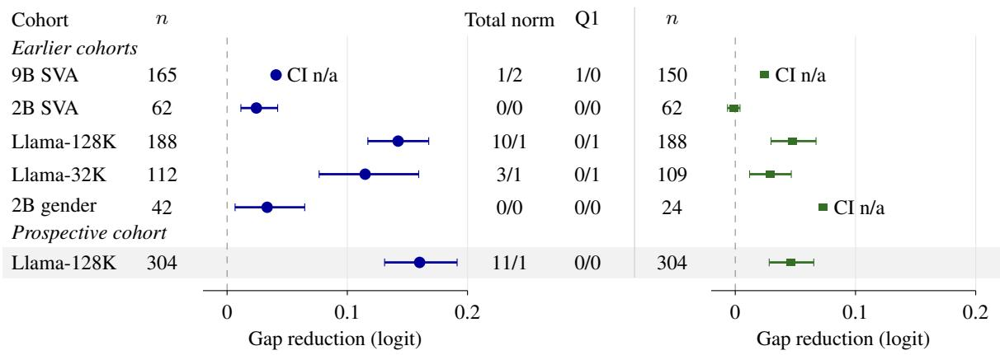  
(a) Q1 versus total norm  
(b) Positionwise versus total norm  
Figure 3: NNLS gap reductions relative to total-norm matching. Full-output KL calibration (Q1, panel a) reduces mean gaps in every cohort. Positionwise matching (b) improves on total-norm matching in most observed means. Points show mean paired differences in absolute effect gaps from the encoder-based reference intervention E (total-norm minus alternative), so positive values favor the alternative. Each comparison uses its n common matched inputs. Means are case/block-balanced (pooled for 9B). Bars show pointwise 95% paired block-bootstrap intervals, and “CI n/a” marks an unavailable interval. Transfer counts report lost/gained relative to E.

Although control differences are small relative to encoder effects in the five earlier common-input cohorts (Appendix B.3), they can change decisions near the transfer threshold. On the new Llama inputs, total-norm matching loses 11 of E’s 175 transfers and gains 1 elsewhere. Figure 1 illustrates one such loss. Full-output KL calibration preserves every decision on this panel. In the earlier 9B cohort, however, both controls lose one transfer. Smaller mean gaps therefore do not guarantee preservation of individual transfer decisions.

## 6.3 RQ2: Positionwise Norm Matching

Both controls in RQ1 scale all patched positions together. We next compare total-norm matching with positionwise matching, which allows a separate coefficient at each position. These ratios also lack the whole-patch coefficient bound, so the comparison does not isolate granularity from the allowed range. Figure 3b uses the inputs matched by these two controls, separately from the full-output KL comparison in panel (a).

Positionwise norm matching leaves a smaller observed mean gap than total-norm matching in four earlier cohorts and the prospective cohort (Figure 3b). The remaining 2B subject–verb comparison has a slightly higher mean gap under positionwise matching, but the paired analysis does not establish a clear advantage for either norm control. On the new Llama inputs, full-output KL calibration still leaves smaller mean gaps than either norm control (Figure 4a).

On the 24 gender inputs matched by all three controls, positionwise matching yields the closest observed agreement with E (Figure 4a). Their balanced gaps are 0.012 for positionwise matching, 0.047 for full-output KL and 0.085 for total-norm matching. This 24-input comparison is descriptive, with no estimable paired interval. The totalnorm/full-output KL comparison in RQ1 uses all 42 eligible inputs. A geometric diagnostic of the 24- input subset finds that the original NNLS patches are nearly parallel to the encoder patches but distribute their norm differently across positions (Appendix B). The contrasting Llama and gender orderings show that whole-patch output calibration need not give the closest agreement, though differences in model and feature group prevent attributing the contrast to the task alone.

## 6.4 RQ3: Answer-Excluded Calibration

Full-output KL includes the answer tokens used to measure the target effect. We compare it with answer-excluded KL under the same search bounds to test how removing those tokens changes NNLS effect agreement.

In the earlier 2B and Llama NNLS cohorts for subject–verb agreement, answer-excluded KL matches every input and leaves pooled mean residual gaps of 0.008–0.023 logit (Appendices D.2 and E). The earlier 9B NNLS cohort has no answerexcluded KL measurement.

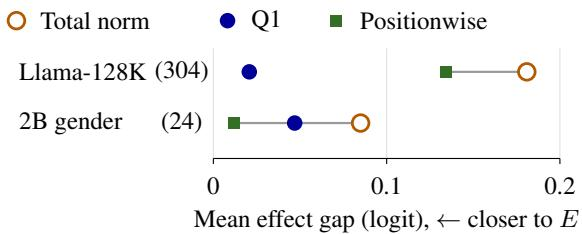  
(a) Positionwise matching versus Q1

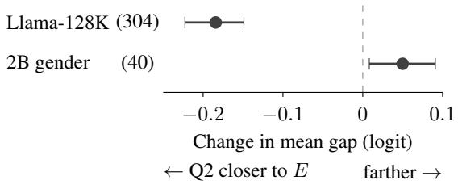  
(b) Q2 versus unscaled NNLS  
Figure 4: NNLS control orderings differ across settings. Q1 denotes full-output KL, Q2 answerexcluded KL. (a) Case/block-balanced mean gaps from the encoder-based reference intervention E on inputs matched by all three controls in each row, shown descrip tively without intervals. (b) Case/block-balanced mean paired gap differences (Q2 minus unscaled NNLS), with pointwise 95% block-bootstrap intervals. Parentheses give input counts. Gender subsets differ between panels. Llama rows use the new cohort, where Q2 is a follow-up after inspection.

On the new Llama panel, this follow-up after inspection of the confirmation results matches all 304 inputs and reduces the balanced mean gap relative to unscaled NNLS (Figure 4b). It leaves a larger gap than full-output KL (0.029 versus 0.021 logit) and loses 2 transfers that full-output KL preserves (Table 17, Appendix E.6).

On the 40 gender inputs eligible for both NNLS and candidate comparisons, answer-excluded KL successfully matches all inputs but increases the balanced mean gap relative to unscaled NNLS. The paired interval for this increase lies above zero (Figure 4b). The reduction observed in subject– verb agreement therefore does not extend to this gender comparison (Appendix B.5, Table 6).

To characterize the gender mismatch, we separate full KL into a term for the total probability assigned to the two answers and two terms for the normalized distributions within the answer and remaining-vocabulary sets. The latter terms are weighted by each set’s native probability. Under answer-excluded KL, the weighted remainingvocabulary term moves closer to the encoder’s corresponding value, but the within-answer term moves farther away. This decomposition locates the mismatch without identifying its cause (Appendix B.6).

6.5 RQ4: Constructed Candidate Stress Tests For RQ4, the candidate comparisons test whether full-output KL calibration also reduces the larger effect gaps allowed by the reconstruction and positionwise norm constraints. Figure 5 separates matched-input and all-attempt results, with paired intervals on the original matched subsets.

The prespecified 9B primary comparison uses 478 successful matches out of 504 attempts. On this subset, full-output KL reduces the casebalanced mean gap from 0.752 to 0.028 logit. The paired reduction from the unscaled candidate is 0.724 logit, with an interval wider than planned (Figure 5b). Transfer disagreements fall from 77 to 8 on this subset (case-level and block-deletion checks in Appendix C.4).

All 64 qualified 2B subject–verb candidate inputs match, so calibration introduces no further subset restriction. Their balanced residual gap is 0.015 logit, with no remaining transfer disagreements (Appendix D.2). Within the prespecified range $\alpha \leq 2 .$ , mean candidate gaps decrease on matched inputs in the Llama configurations and the gender setting, but these comparisons fail the percase coverage requirements. The gender candidate matches only 16 of 40 inputs, including none in one case, so the Llama and gender matched results describe retained subsets.

Answer exclusion also reduces candidate gaps in the measured subject–verb settings, subject to the same coverage qualifications (Appendices C.6, D.2 and E). On the common 40 gender inputs, mean candidate gaps decrease across answer-excluded KL attempts even though NNLS gaps increase (Table 6). Only 13 candidate inputs match within the original range, limiting this to a descriptive contrast between codes with unequal coverage.

Coverage partly reflects the finite search range. A post hoc continuation to $\alpha = 4$ matches 139 of 203 previously failed search records, which overlap across the two KL controls, without changing any original selection or coverage decision. Diamonds in Figure 5a show the extended all-attempt means. Newly matched inputs generally have larger gaps than the original matched subset, and the Llama-

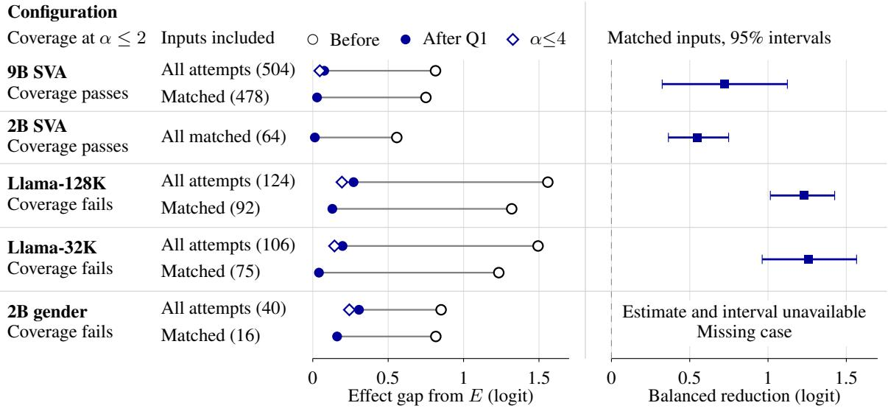  
(a) Pooled mean gaps  
(b) Paired reduction  
Figure 5: Constructed candidates under full-output KL calibration (Q1). (a) Pooled gaps from the encoder-based reference intervention E before (open circles) and after (filled circles) search within $\alpha \leq 2 .$ All-attempt rows retain failed searches at their best measured point. Diamonds show post hoc continuation to α $\leq 4$ (Appendix C.5). (b) Paired reductions on original matched inputs, case-balanced for 9B and case/block-balanced otherwise. Pointwise 95% intervals use lexical-block Student-t for 9B and paired block bootstrap elsewhere. The 9B primary interval’s half-width exceeds the planned 0.25 logit. Gender lacks a balanced estimate and interval because one case has no matches. Coverage follows the original per-case rule. Llama intervals describe selected subsets.

32K full-output KL comparison and both gender comparisons still fail coverage (Appendix C.5).

## 6.6 Additional Analyses

Shared coefficients. To examine coefficient selection from other inputs, we test shared candidate coefficients using mean full-output KL on the two previously inspected Gemma subject–verb panels. The 9B selector uses a word-disjoint calibration split. The 2B selector leaves out each evaluation block. This changes both coefficient granularity and selection information. Balanced mean gaps fall from 0.876 to 0.704 in 9B and from 0.561 to 0.313 in 2B. Individual gaps nevertheless increase on 216 of 346 inputs in 9B and 24 of 64 in 2B, relative to the unscaled candidates (Appendix D.4, Figure 7). Even the effect-optimal shared coefficient chosen in hindsight on the tested nine-point grid leaves larger mean gaps than per-input full-output KL on these panels.

Strength budgets. To examine agreement at other strength levels, we vary target budgets of answer-excluded KL and independently scale encoder and candidate patches to each target. Among inputs where both patches match, mean gaps remain small. Coverage falls at higher budgets, restricting those means to smaller subsets (Ap-

pendix D.3).

## 7 Discussion

Small mean effect gaps do not ensure preservation of encoder transfer decisions (Figure 3a). Reporting paired gaps and transfer gains and losses on the same inputs reveals disagreements that mean improvements or net transfer counts can hide. The differing control orderings in Figure 4a also require specifying the matched quantity, coefficient granularity and selection information. Agreement with E alone does not establish which code better captures the model’s linguistic mechanism.

Selection information. Per-input KL calibration measures disagreement after using reference outputs and repeated evaluations to match a scalar KL value. Comparisons with total-norm matching change the matching criterion, selection information and computation together. Answer-related information may remain in the vocabulary even after the two evaluated answer tokens are excluded. Using shared coefficients selected on other inputs changes both input-specific flexibility and selection information, so it does not isolate the effect of information access. Applications requiring coefficients fixed before evaluation need results under

that selection protocol.

Coverage. Retaining failed searches exposes larger residual gaps (Figure 5). Matched-subset summaries can therefore omit the hardest comparisons. Report the search range and coverage by condition alongside both matched-subset and allattempt results, including inputs whose gaps increase despite a mean reduction.

## 8 Conclusion

With one coefficient per input, full-output KL calibration leaves smaller mean NNLS gaps than total-norm matching across five earlier cohorts, with prospective confirmation in Llama-128K. On that new panel, total-norm matching loses encoder transfers that full-output KL calibration preserves. Full-output KL need not give the closest agreement: positionwise matching does so on a descriptive 24- input gender subset. Answer exclusion also increases gender NNLS gaps relative to the unscaled patches. Calibration also reduces larger gaps from constructed candidates, with matching coverage dependent on the search range.

## Limitations

Scope and selection. Our five selected configurations cover two restricted next-token phenomena, with model, layer, dictionary and feature group varying together. They do not isolate task effects or represent unrestricted generation. The new-material Llama confirmation strengthens evidence within a configuration chosen using earlier outcomes. Its Q2 extension remains a follow-up, and neither analysis resolves adaptive selection or shared-template dependence.

Reference and calibration. Encoder agreement does not establish explanation faithfulness. Q1 uses evaluation-input outputs and additional model evaluations, so equal coefficient counts do not equalize information or computation. Q2 can retain answerrelated information outside the excluded tokens. Scaled patches need separate qualification to satisfy complete-code constraints.

Coverage and finite search. Qualification excludes many settings, and matching further restricts comparisons (Appendix F). Candidate coverage fails within the original range. Expanding the range recovers matches but leaves some failures (Appendix C.5). Gender positionwise results concern a small subset. Finite searches limit conclusions about unmeasured scales. Feature-group specificity at original strengths remains unestablished (Appendix C.7).

Statistical uncertainty. Pointwise intervals condition on retained lexical blocks and assume block independence, which shared templates or semantic structure can violate (Appendix A.7). They do not adjust for selection across the research program. The prespecified 9B candidate estimate misses planned precision. Earlier 9B NNLS and gender positionwise comparisons lack block intervals.

## Ethics Statement

The experiments study model outputs on templated sentence prefixes, without human participants or personal records. The main lexical inventory was authored for the study and contains common nouns denoting people and roles. It is not a representative sample of English usage or of any demographic group. The gender materials manipulate explicit male/female cues to test the model’s reflexive continuations. They do not operationalize gender identity or support conclusions about fairness. Neither phenomenon is a test of social bias or model safety.

Gemma 2 weights are distributed under the Gemma Terms of Use, and the Gemma Scope SAE repositories used here specify CC BY 4.0.1 Public availability does not remove these conditions. Llama weights were accessed through the official gated release under the Llama 3.1 license. The Llama Scope umbrella card declares Apache 2.0, but the two pinned checkpoint repositories have no separate license metadata in the archived asset records. We therefore distinguish that umbrella declaration from checkpoint-specific redistribution clearance and do not redistribute either model or SAE weights with this manuscript.2 The earlier public-group qualification uses sentence materials from the Sparse Feature Circuits repository (Marks et al., 2025), whose MIT notice is retained in the research archive. We have not established a separate dataset-specific license for those materials and do not infer rights to underlying third-party content from the repository notice.

The intended use is to improve interpretation of intervention comparisons. Small discrepancies after calibration should not be taken as evidence that an explanation is correct or that a model is safe to deploy. Conversely, a code discrepancy does not establish that the underlying linguistic behavior is unreliable. Keeping these distinctions explicit limits the risk of presenting a measurement control as a safety assurance.

## References

Julius Adebayo, Justin Gilmer, Michael Muelly, Ian Goodfellow, Moritz Hardt, and Been Kim. 2018. Sanity checks for saliency maps. In Advances in Neural Information Processing Systems, volume 31.

David Alvarez-Melis and Tommi S. Jaakkola. 2018. On the robustness of interpretability methods. ICML Workshop on Human Interpretability in Machine Learning. ArXiv:1806.08049.

Dale J. Barr, Roger Levy, Christoph Scheepers, and Harry J. Tily. 2013. Random effects structure for confirmatory hypothesis testing: Keep it maximal. Journal ofMemory and Language, 68(3):255–278.

Caroline Baumgartner, Eleanor Spens, Neil Burgess, and Petru Manescu. 2025. Cognitive maps in language models: A mechanistic analysis of spatial planning. CogInterp Workshop at NeurIPS.

Yonatan Belinkov. 2022. Probing classifiers: Promises, shortcomings, and advances. Computational Linguistics, 48(1):207–219.

Trenton Bricken, Adly Templeton, Joshua Batson, Brian Chen, Adam Jermyn, Tom Conerly, Nick Turner, Cem Anil, Carson Denison, Amanda Askell, Robert Lasenby, Yifan Wu, Shauna Kravec, Nicholas Schiefer, Tim Maxwell, Nicholas Joseph, Zac Hatfield-Dodds, Alex Tamkin, Karina Nguyen, and 6 others. 2023. Towards monosemanticity: Decomposing language models with dictionary learning. Transformer Circuits Thread.

Alessa Carbo and Eric Nalisnick. 2026. Which sparse code? identifiability failures in SAE inference. Sci4DL Workshop at ICLR.

Herbert H. Clark. 1973. The language-as-fixed-effect fallacy: A critique of language statistics in psychological research. Journal of Verbal Learning and Verbal Behavior, 12(4):335–359.

Arthur Conmy, Augustine N. Mavor-Parker, Aengus Lynch, Stefan Heimersheim, and Adrià Garriga-Alonso. 2023. Towards automated circuit discovery for mechanistic interpretability. In Advances in Neural Information Processing Systems, volume 36.

Jiayun Dong and Cynthia Rudin. 2019. Variable importance clouds: A way to explore variable importance for the set of good models. ArXiv preprint.

Yanai Elazar, Shauli Ravfogel, Alon Jacovi, and Yoav Goldberg. 2021. Amnesic probing: Behavioral explanation with amnesic counterfactuals. Transactions of the Associationfor Computational Linguistics, 9:160– 175.

Nelson Elhage, Tristan Hume, Catherine Olsson, Nicholas Schiefer, Tom Henighan, Shauna Kravec, Zac Hatfield-Dodds, Robert Lasenby, Dawn Drain, Carol Chen, Roger Grosse, Sam McCandlish, Jared Kaplan, Dario Amodei, Martin Wattenberg, and Christopher Olah. 2022. Toy models of superposition. ArXiv preprint arXiv:2209.10652.

Matthew Finlayson, Aaron Mueller, Sebastian Gehrmann, Stuart M. Shieber, Tal Linzen, and Yonatan Belinkov. 2021. Causal analysis of syntactic agreement mechanisms in neural language models. In Proceedings of the 59th Annual Meeting of the Association for Computational Linguistics and the 11th International Joint Conference on Natural Language Processing (Volume 1: Long Papers), pages 1828–1843. Association for Computational Linguistics.

Aaron Fisher, Cynthia Rudin, and Francesca Dominici. 2019. All models are wrong, but many are useful: Learning a variable’s importance by studying an entire class of prediction models simultaneously. Journal ofMachine Learning Research, 20(177):1–81.

Leo Gao, Tom Dupré la Tour, Henk Tillman, Gabriel Goh, Rajan Troll, Alec Radford, Ilya Sutskever, Jan Leike, and Jeffrey Wu. 2025. Scaling and evaluating sparse autoencoders. In The Thirteenth International Conference on Learning Representations.

Atticus Geiger, Hanson Lu, Thomas Icard, and Christopher Potts. 2021. Causal abstractions of neural networks. In Advances in Neural Information Processing Systems, volume 34.

Atticus Geiger, Zhengxuan Wu, Christopher Potts, Thomas Icard, and Noah Goodman. 2024. Finding alignments between interpretable causal variables and distributed neural representations. In Proceedings ofthe Third Conference on Causal Learning and Reasoning, volume 236 of Proceedings ofMachine Learning Research, pages 160–187. PMLR.

Gemma Team. 2024. Gemma 2: Improving open language models at a practical size. ArXiv preprint arXiv:2408.00118.

Aaron Grattafiori, Abhimanyu Dubey, Abhinav Jauhri, Abhinav Pandey, Abhishek Kadian, Ahmad Al-Dahle, et al. 2024. The Llama 3 herd of models. ArXiv preprint arXiv:2407.21783, version 3.

Kristina Gulordava, Piotr Bojanowski, Édouard Grave, Tal Linzen, and Marco Baroni. 2018. Colorless green recurrent networks dream hierarchically. In Proceedings ofthe 2018 Conference ofthe North American Chapter of the Association for Computational Linguistics: Human Language Technologies, Volume

1 (Long Papers), pages 1195–1205, New Orleans, Louisiana. Association for Computational Linguistics.

Zhengfu He, Wentao Shu, Xuyang Ge, Lingjie Chen, Junxuan Wang, Yunhua Zhou, Frances Liu, Qipeng Guo, Xuanjing Huang, Zuxuan Wu, Yu-Gang Jiang, and Xipeng Qiu. 2024. Llama Scope: Extracting millions of features from Llama-3.1-8B with sparse autoencoders. ArXiv preprint arXiv:2410.20526.

Stefan Heimersheim and Neel Nanda. 2024. How to use and interpret activation patching. ArXiv preprint arXiv:2404.15255.

John Hewitt and Percy Liang. 2019. Designing and interpreting probes with control tasks. In Proceedings of the 2019 Conference on Empirical Methods in Natural Language Processing and the 9th International Joint Conference on Natural Language Processing (EMNLP-IJCNLP), pages 2733–2743, Hong Kong, China. Association for Computational Linguistics.

Jing Huang, Zhengxuan Wu, Christopher Potts, Mor Geva, and Atticus Geiger. 2024. RAVEL: Evaluating interpretability methods on disentangling language model representations. In Proceedings of the 62nd Annual Meeting ofthe Associationfor Computational Linguistics (Volume 1: Long Papers), pages 8669– 8687, Bangkok, Thailand. Association for Computational Linguistics.

Robert Huben, Hoagy Cunningham, Logan Smith, Aidan Ewart, and Lee Sharkey. 2024. Sparse autoencoders find highly interpretable features in language models. In The Twelfth International Conference on Learning Representations.

Alon Jacovi and Yoav Goldberg. 2020. Towards faithfully interpretable NLP systems: How should we define and evaluate faithfulness? In Proceedings of the 58th Annual Meeting of the Association for Computational Linguistics, pages 4198–4205. Association for Computational Linguistics.

Adam Karvonen, Can Rager, Johnny Lin, Curt Tigges, Joseph Isaac Bloom, David Chanin, Yeu-Tong Lau, Eoin Farrell, Callum Stuart Mcdougall, Kola Ayonrinde, Demian Till, Matthew Wearden, Arthur Conmy, Samuel Marks, and Neel Nanda. 2025. SAEBench: A comprehensive benchmark for sparse autoencoders in language model interpretability. In Proceedings of the 42nd International Conference on Machine Learning, volume 267 of Proceedings ofMachine Learning Research, pages 29223–29264. PMLR.

János Kramár, Tom Lieberum, Rohin Shah, and Neel Nanda. 2024. AtP\*: An efficient and scalable method for localizing LLM behaviour to components. ArXiv preprint arXiv:2403.00745.

Yair Lakretz, Germán Kruszewski, Théo Desbordes, Dieuwke Hupkes, Stanislas Dehaene, and Marco Baroni. 2019. The emergence of number and syntax units in LSTM language models. In Proceedings of

the 2019 Conference of the North American Chapter of the Association for Computational Linguistics: Human Language Technologies, Volume 1 (Long and Short Papers), pages 11–20, Minneapolis, Minnesota. Association for Computational Linguistics.

Tom Lieberum, Senthooran Rajamanoharan, Arthur Conmy, Lewis Smith, Nicolas Sonnerat, Vikrant Varma, János Kramár, Anca Dragan, Rohin Shah, and Neel Nanda. 2024. Gemma Scope: Open sparse autoencoders everywhere all at once on Gemma 2. ArXiv preprint arXiv:2408.05147.

Tal Linzen, Emmanuel Dupoux, and Yoav Goldberg. 2016. Assessing the ability of LSTMs to learn syntaxsensitive dependencies. Transactions ofthe Associationfor Computational Linguistics, 4:521–535.

Daming Luo, Christy Liang, and Junyu Xuan. 2026. SteerCheck: Attribution specificity and alignment leakage in activation-steering audits. ArXiv preprint arXiv:2608.24335, version 1.

Aleksandar Makelov, Georg Lange, Atticus Geiger, and Neel Nanda. 2024. Is this the subspace you are looking for? an interpretability illusion for subspace activation patching. In The Twelfth International Conference on Learning Representations.

Samuel Marks, Can Rager, Eric J. Michaud, Yonatan Belinkov, David Bau, and Aaron Mueller. 2025. Sparse feature circuits: Discovering and editing interpretable causal graphs in language models. In International Conference on Learning Representations.

Rebecca Marvin and Tal Linzen. 2018. Targeted syntactic evaluation of language models. In Proceedings of the 2018 Conference on Empirical Methods in Natural Language Processing, pages 1192–1202, Brussels, Belgium. Association for Computational Linguistics.

Charles O’Neill, Alim Gumran, and David Klindt. 2025. Compute optimal inference and provable amortisation gap in sparse autoencoders. In Proceedings of the 42nd International Conference on Machine Learning, volume 267 of Proceedings of Machine Learning Research, pages 46877–46896. PMLR.

Senthooran Rajamanoharan, Arthur Conmy, Lewis Smith, Tom Lieberum, Vikrant Varma, János Kramár, Rohin Shah, and Neel Nanda. 2024a. Improving sparse decomposition of language model activations with gated sparse autoencoders. In Advances in Neural Information Processing Systems, volume 37, pages 775–818. Curran Associates, Inc.

Senthooran Rajamanoharan, Tom Lieberum, Nicolas Sonnerat, Arthur Conmy, Vikrant Varma, János Kramár, and Neel Nanda. 2024b. Jumping ahead: Improving reconstruction fidelity with JumpReLU sparse autoencoders. ArXiv preprint arXiv:2407.14435.

Nina Rimsky, Nick Gabrieli, Julian Schulz, Meg Tong, Evan Hubinger, and Alexander Turner. 2024. Steering Llama 2 via contrastive activation addition. In Proceedings of the 62nd Annual Meeting of the Associationfor Computational Linguistics (Volume 1: Long Papers), pages 15504–15522.

Wenjie Sun, Di Wang, and Lijie Hu. 2026. The price of amortized inference in sparse autoencoders. In International Conference on Learning Representations.

Alexander Matt Turner, Lisa Thiergart, Gavin Leech, David Udell, Juan J. Vazquez, Ulisse Mini, and Monte MacDiarmid. 2024. Activation addition: Steering language models without optimization. ArXiv preprint arXiv:2308.10248, version 4.

Jesse Vig, Sebastian Gehrmann, Yonatan Belinkov, Sharon Qian, Daniel Nevo, Yaron Singer, and Stuart Shieber. 2020. Investigating gender bias in language models using causal mediation analysis. In Advances in Neural Information Processing Systems, volume 33.

Kevin Wang, Alexandre Variengien, Arthur Conmy, Buck Shlegeris, and Jacob Steinhardt. 2023. Interpretability in the wild: A circuit for indirect object identification in GPT-2 small. In The Eleventh International Conference on Learning Representations.

Alex Warstadt, Alicia Parrish, Haokun Liu, Anhad Mohananey, Wei Peng, Sheng-Fu Wang, and Samuel R. Bowman. 2020. BLiMP: The benchmark of linguistic minimal pairs for English. Transactions of the Association for Computational Linguistics, 8:377– 392.

Fred Zhang and Neel Nanda. 2024. Towards best practices of activation patching in language models: Metrics and methods. In The Twelfth International Conference on Learning Representations.

## A Appendix: Experimental Protocol and Gemma-9B Details

This appendix specifies the Gemma-9B assets, code construction, qualification and calibration rules. The refit and bounded-search procedures also apply to the other settings, whose materials, weighting and coverage rules are given in Appendices D and E. Norm-control implementation is specified in Appendix B.1.

## A.1 Model, SAE and Reconstruction Conventions

The model and tokenizer are

google/gemma-2-9b-it. We use raw Gemma Scope parameters from

google/gemma-scope-9b-it-res, file layer\_ 20/width\_131k/average\_l0\_153/params.npz.

The intervention replaces the output of the zeroindexed transformer block 20. Model execution uses an FP16 body and an FP32 output head, with one sentence per forward pass and no key–value cache.

For the raw SAE parameters, encoding applies JumpReLU (Rajamanoharan et al., 2024b) to $u =$ $W _ { \mathrm { e n c } } ^ { \mathsf { T } } h + b _ { \mathrm { e n c } } \colon z _ { j } = u _ { j } \mathbf { 1 } [ u _ { j } > \theta _ { j } ]$ , where $\theta _ { j }$ is the released threshold. Here $W _ { \mathrm { e n c } }$ has shape $d \times p$ and h is a column vector. No decoder-bias subtraction precedes encoding. The decoder in our notation is $\bar { \boldsymbol { D } } = \boldsymbol { W } _ { \mathrm { d e c } } ^ { \mathsf { T } }$ , and reconstruction is $b _ { \mathrm { d e c } } + D z$ . Encoder evaluation uses FP32 parameters and activations. To evaluate reconstruction error, we subtract $b _ { \mathrm { d e c } }$ from $h$ and decode the sparse coefficients in FP64. Physical reconstruction casts the decoded vector to FP32, adds the FP32 bias, then casts to FP16. This sparse arithmetic convention is also used to qualify the candidate reconstructions. The group patch itself contains only the donor–recipient difference $D _ { G } ( z _ { d , G } - z _ { r , G } )$ ; the decoder bias is not removed from the recipient state.

## A.2 Same-Support NNLS Refitting

The refit minimizes reconstruction error over the encoder’s active support. For activation $h ,$ decoder bias $b _ { \mathrm { d e c } }$ and encoder support S, write $y = h - b _ { \mathrm { d e c } } .$ We solve

$$
\boldsymbol { u } ^ { \star } = \underset { \boldsymbol { u } \in \mathbb { R } ^ { | S | } , \boldsymbol { u } \geq 0 } { \arg \operatorname* { m i n } } ~ \| D _ { S } \boldsymbol { u } - y \| _ { 2 } ^ { 2 } ,
$$

then set coefficients outside $S$ to zero. There is no regularization term or new feature selection. All settings use the same audited refit routine. It uses

SciPy’s nonnegative least-squares solver in FP64, with the library’s default limit of 3|S| iterations. The 2B and Llama environments pin SciPy 1.17.1. Each solve is repeated on identical inputs and must return identical coefficients.

Numerical acceptance checks the raw solution before discarding coefficients at or below $1 0 ^ { - 1 0 }$ Let $q = D _ { S } ^ { \mathsf { T } } ( D _ { S } u - y )$ , half the gradient of the squared-error objective. The checks use scaling factors

$$
\begin{array} { l } { \gamma = \operatorname* { m a x } \biggr ( 1 , \underset { j \in S } { \operatorname* { m a x } } \| D _ { j } \| _ { 2 } \| y \| _ { 2 } \biggr ) , } \\ { \eta = \operatorname* { m a x } ( 1 , \| u \| _ { \infty } ) . } \end{array}
$$

The normalized primal violation, dual violation and complementarity residual must satisfy

$$
\begin{array} { r } { \lVert ( - u ) _ { + } \rVert _ { \infty } / \eta \leq 1 0 ^ { - 8 } , } \\ { \lVert ( - q ) _ { + } \rVert _ { \infty } / \gamma \leq 1 0 ^ { - 8 } , } \\ { \underset { j } { \operatorname* { m a x } } | u _ { j } q _ { j } | / ( \gamma \eta ) \leq 1 0 ^ { - 8 } , } \end{array}
$$

where $( x ) _ { + }$ takes the elementwise positive part. These are floating-point optimality diagnostics. The retained coefficients must separately satisfy the reconstruction-error bound after truncation. FP32 coefficient-cast diagnostics are recorded, but patches use the retained FP64 coefficients with the decoder’s FP32 values promoted to FP64 before execution-precision casting. Nonconvergence or failed numerical checks marks the refit unavailable; reconstruction-behavior qualification follows only after geometric acceptance.

## A.3 Feature Group and Candidate Construction

The group contains feature IDs {31256, 49323, 97461, 101074, 101300, 101972} at layer 20. It originated in a development search with 177 proposals on 45 pairs. We keep that selection history separate from subsequent evaluation on new words.

At each position, let $S _ { d }$ and $S _ { r }$ be the donor and recipient encoder supports, and set $m = | S _ { d } | + | S _ { r } |$ Concatenate their positive encoder coefficients into $x _ { E } \in \mathbb { R } _ { \geq 0 } ^ { m }$ . The linear map $L \in \mathbb { R } ^ { d \times m }$ takes these coefficients to the decoded donor–recipient group difference in activation dimension d. Starting at xE, we take the negative gradient of the sum of the two relative reconstruction errors in coordinates scaled by $s _ { j } = \operatorname* { m a x } ( | x _ { E , j } | , 1 )$ . We project this direction onto the tangent of the equal-norm constraint in those scaled coordinates, then normalize and convert back to obtain $w \in \mathbb { R } ^ { m }$ with $\langle L w , L x _ { E } \rangle = 0$ and $\| L w \| = \| L x _ { E } \|$ . The seed lies on the rational curve

$$
x ( \tau ) = \frac { ( 1 - \tau ^ { 2 } ) x _ { E } + 2 \tau w } { 1 + \tau ^ { 2 } } , \qquad 0 \leq \tau \leq 1 .
$$

This curve preserves the ideal patch norm. Nonnegativity gives quadratic constraints in $\tau ;$ each reconstruction-error constraint gives a polynomial of degree at most 4 after clearing the denominator. We compute their first positive real boundary numerically, capped at 1, and take 99% of that value. The error constraints use the internal 1.0000005 multiplier below. A full-space check must accept the resulting seed. There is no clipping, smallerstep retry or alternate tangent. A zero encoder patch or a numerically degenerate physical tangent retains the literal encoder code. Numerical root finding here is not a certified isolation of every feasible interval.

The candidate optimization starts from this archived seed. At each position with a nonzero patch, it jointly optimizes the donor and recipient coefficients on their respective encoder supports. The local objective minimizes the projection of the candidate patch onto the encoder patch, normalized by the encoder patch’s squared norm. It constrains candidate and encoder patch norms to be equal and retains each code’s nonnegativity and reconstruction constraints. We use sequential least-squares programming (SLSQP), limited to 200 iterations and a 30-second callback time limit. Positions with zero patch displacement and seeds that retain the encoder code receive no optimization restart. The construction uses geometry, not the measured linguistic effect, as its objective.

A separate full-space check determines eligibility, rather than the solver’s termination flag. Each squared reconstruction error is bounded by 1.000001 times its encoder error. The optimizer uses an internal 1.0000005 multiplier as a numerical reserve. The ideal relative norm error must be at most $1 0 ^ { - 7 } ;$ after casting, realized per-position norm mismatch must be at most 0.001. The geometric objective may not worsen relative to the seed beyond 10−10. Reconstruction-behavior qualification is checked after construction and is distinct from these geometric conditions. This local procedure makes no global-optimality claim.

## A.4 Materials, Token Alignment and Eligibility

Token positions $1 , \ldots , T - 2$ are patched, with zero-based indexing and sequence length T including the beginning-of-sequence token. Positions 0 and $T - 1$ remain unchanged. We tokenize the five-word prefixes directly, without a chat template. Each answer must extend its prefix by exactly one token, with distinct IDs for the two answers and no change to the prefix tokenization. Paired prefixes must have identical token offsets at all five word boundaries and identical token suffixes after the subject. Equal total length alone is insufficient. The recorded token IDs, answer IDs and boundary offsets are checked again before causal evaluation.

Both members of a pair must have correct native answers and aligned tokens. Reconstructing the patched positions must preserve the native top-1 output and keep forward KL at or below 0.02 on each member. These checks precede alternative group-effect measurement.

The source inventory contains 280 authored count nouns with regular plurals. A fixed deterministic ordering allocates them to 70 blocks of 4 nouns: 2 subjects and 2 attractors per block, with no noun shared across blocks or roles. Each block crosses these nouns with 4 prepositions and 2 attractor numbers to give 32 sentence pairs, balanced across the four original grammatical cases. The first 8 blocks were reserved for planning; the remaining 62 supply the 1,984-pair source panel. This allocation is reproducible, not random sampling from English or evidence that block effects are independent.

The main panel is selected from these 1,984 pairs. Table 2 reports the number of pairs retained at each qualification stage.

<table><tr><td colspan="2">Condition Retained</td></tr><tr><td>Source panel</td><td>1,984</td></tr><tr><td>Native/encoder qualification</td><td>337</td></tr><tr><td>Encoder/NNLS common mask</td><td>325</td></tr><tr><td>Geometry and patch norms</td><td>320</td></tr><tr><td>Seed behavior (of 320)</td><td>290</td></tr><tr><td>Candidate behavior (of 320)</td><td>259</td></tr><tr><td>All-code common mask</td><td>252</td></tr></table>

Table 2: Sentence pairs retained during 9B candidate qualification. Seed and candidate behavior are parallel filters on the same 320 pairs. The final intersection yields 252 pairs and 504 directed inputs.

NNLS denotes a nonnegative least-squares refit on encoder support. The seed and candidate behavior rows are parallel filters on the same 320 pairs, not consecutive filters. The 252-pair intersection includes encoder, NNLS, seed, and candidate eligibility. Although the main calibration comparison uses encoder and candidate patches, it preserves that previously defined eligibility subset. Each selected pair supplies both recipient inputs. No outcomes are imputed for source pairs outside this subset.

## A.5 Bounded Per-Input Calibration

All KL values use natural logarithms (nats). Intervention KL measures a patch’s output change and is distinct from the reconstruction KL used in qualification. Calibration scales the archived, realized displacement rather than decoding the coefficients again. If x is the archived patched activation and h the native activation, the new activation is FP ${ } ^ { 1 6 ( h + \alpha ( x - h ) ) }$ , with the subtraction and scaling computed in FP64. The same scalar applies to every patched position of that input.

Calibration evaluates α = 0, 0.25, 0.5, 0.75, 1, 1.25, 1.5, 1.75, 2, reusing evaluations of the native state and unscaled intervention at 0 and 1. If the unscaled intervention already meets tolerance, the search stops there. A target at or below $1 0 ^ { - 8 }$ is marked unmatched. The matching tolerance is $\operatorname* { m a x } ( 1 0 ^ { - 6 } , 0 . 0 1 K _ { i } ^ { E } ( 1 ) )$ , with the appropriate conditional-KL target for Q2.

If no grid point matches, the search selects the adjacent sign-changing bracket closest to 1, breaking ties by the lower endpoint, and bisects it at most 12 times. The algorithm does not assume global monotonicity or try additional brackets after failure. Among matching observed points, it selects the coefficient closest to 1, then the smallest KL error, then the smaller coefficient. On failure it retains the smallest-error observed point, breaking ties by distance from 1 and then by coefficient. These final attempts remain unsuccessful matches even when their effects improve.

For Q2, the two contextual answer IDs are verified as distinct single-token continuations before execution. The conditional distribution is computed directly from logits on the remaining vocabulary. Excluded logits do not enter its normalization or a probability-mass weight. Search range, tolerances, and refinement budget are unchanged.

## A.6 Global Coefficient Selection

The fixed split has 79 calibration pairs and 173 evaluation pairs, yielding 158 and 346 inputs. Calibration and evaluation words are disjoint, but the full panel’s earlier outcomes were already exposed. For every coefficient on the same 9-point grid, the selector averages candidate KL within each original grammatical case and then across the 4 cases. It minimizes the absolute difference from the analogously averaged encoder KL. It does not minimize the mean absolute per-input KL difference.

Scores within $1 0 ^ { - 1 2 }$ nats of the minimum are ties, resolved by distance from 1 and then by the smaller coefficient. No interpolation or refinement is used. Linguistic effects and evaluation rows are excluded from the selection input. The selected coefficient, 1.25, is unchanged under all 17 calibration-block deletions; these checks do not choose an ensemble or an alternative coefficient. All 346 evaluation inputs are retained. The perinput diagnostic on those inputs includes its 11 failed matching attempts and is not a same-budget competitor.

## A.7 Aggregation and Conditional Uncertainty

The estimator below applies to the case-balanced Gemma-9B summaries. Case/block-balanced bootstrap comparisons are specified separately for the NNLS controls (Appendix B.2), Gemma-2B (Appendix D.2) and Llama (Appendices E.3 and E.5). Gender has an additional interval-availability rule (Appendix B.4). These analyses retain their own cohorts and weighting rules.

Generalizing beyond sampled words requires accounting for lexical-item variation (Clark, 1973). Work on confirmatory language experiments also emphasizes modeling dependence associated with sampled units (Barr et al., 2013). We use the lexical blocks defined above, not a fitted crossed randomeffects model; these references do not validate independence between our blocks.

For row statistic $y _ { i }$ , case $^ { c , }$ and $n _ { c }$ rows in that case, define $\begin{array} { r } { \bar { y } _ { c } = n _ { c } ^ { - 1 } \sum _ { i : c ( i ) = c } y _ { i } } \end{array}$ and $\hat { \mu } =$ $\frac { 1 } { 4 } \sum _ { c } \bar { y } _ { c }$ . The case assignment is inherited from the original pair, including when donor and recipient roles are reversed. For block $b ,$ the score is

$$
u _ { b } = \frac { 1 } { 4 } \sum _ { c } \frac { 1 } { n _ { c } } \sum _ { i : b ( i ) = b , c ( i ) = c } ( y _ { i } - \bar { y } _ { c } ) .
$$

With B represented blocks, the reported standard error is $\sqrt { \frac { B } { B - 1 } \sum _ { b } u _ { b } ^ { 2 } }$ . The two-sided conditional interval uses a Student-t critical value with degrees of freedom equal to the minimum number of supported blocks in any case minus 1. Missing cases make the estimate undefined. Numerically zero variance is not treated as a stability certificate.

Let $n _ { b c }$ be the row count in block b and case c. The balanced block weight is $\begin{array} { r } { w _ { b } = \frac { 1 } { 4 } \sum _ { c } n _ { b c } / n _ { c } } \end{array}$ and the effective-block diagnostic is $1 / \textstyle \sum _ { b } w _ { b } ^ { 2 }$ Duplicating recipient inputs does not create additional independent lexical information. Intervals assume independent block-level fluctuations and sufficiently stable case counts under block sampling for the ratio-based approximation above. Preexperiment stress tests show that rare large blocklevel fluctuations or correlations across blocks can invalidate coverage. Accordingly, the primary interpretation is the finite authored panel; block deletion and conditional intervals do not establish generalization to English sentences.

For the 9B candidate panel, the prespecified reporting requirements are at least 80% input retention in each case, at least 20 effective matched blocks, at least 20 supported blocks per case, and maximum balanced block weight at most 0.10. These are reporting floors, not a generalizability theorem. The planned 0.25-logit interval halfwidth is a precision goal, not an equivalence margin. The global-transfer design retains its earlier planning half-width of 0.437 under assumed block SD 1, exceeding the same 0.25 goal.

## A.8 Numerical Replay

Independent replay reproduces saved reference and final intervention outputs for the lexical and Q2 comparisons, including failed matching attempts. The original lexical replay does not regenerate intermediate search outputs; the later shared-coefficient evaluation reproduces its measured outputs and selections.

## A.9 Calibration Cost

A bounded per-input search can examine nine grid coefficients and at most 12 additional bisection points for each code and KL objective. Early matches terminate the search, and existing measurements can be reused. These are coefficient evaluations, not a count of all model calls: native and encoder references, qualification checks and repeat forwards add work. A transferred global coefficient requires no coefficient search on the evaluation input.

The per-input search requires the encoder reference and alternative outputs on the evaluated input. A shared coefficient avoids that search at evaluation time, but requires a separate calibration set.

These different information and computational requirements preclude a cost-matched method comparison.

The measured execution environment and reproduction cost of the new Llama confirmation chain are reported in Appendix H.4.

## A.10 Scope of Identification Claims

Let $\mathcal { Z }$ contain the eligible donor and recipient code collections for fixed inputs, decoder, and patch rule. Let $e ( z )$ denote the resulting signed effect defined in Section 5. Point identification on $\mathcal { Z }$ means that $e ( z )$ is constant for all $z \in { \mathcal { Z } }$ . Two eligible codes with different effects refute constancy. A finite search that finds no such pair cannot establish it: untested codes may have different effects. The smallest observed effect is an upper bound on the infimum over ${ \mathcal { Z } } ,$ , and the largest is a lower bound on its supremum. The observed range therefore need not cover the full range allowed by the stated code constraints. This distinction follows from the definition, without an additional identification theorem.

Optimizing a coefficient is also different from optimizing the effect of the nonlinear model suffix. Coefficient extrema alone do not give effect extrema, and separate coordinate optima need not belong to one jointly feasible code.

Rescaling the patch by α produces a separate physical control. Treating this control as a comparison within Z requires complete codes that realize it and satisfy the original constraints. Agreement of two such controls also does not show constancy on the subset of all codes with a prescribed scalar KL.

## B Appendix: Norm Controls and Gender Analyses

The norm-control comparisons support RQ1 and RQ2 (Sections 6.2 and 6.3). We first specify the implementation, shared evaluation subsets and estimators, then introduce the gender materials and the cohorts used to compare norm and KL controls. The final KL decomposition supports the answerexcluded analysis in Section 6.4.

## B.1 Norm-Control Implementation

Total-norm matching uses the Euclidean norm of the concatenation of all patched-position vectors. Positionwise norm matching instead uses one ratio at each nonzero position. Each realized patch must satisfy its own norm tolerance before entering a matched comparison. The ratios use the archived realized displacement, the patched activation minus its native activation. Scaling materializes a new activation using the same execution-precision convention as the KL controls.

For total-norm matching, we compute the ratio in double precision from the stored half-precision activations and accept only coefficients in [0, 2]. We neither clip an out-of-range ratio nor search for a replacement. If the alternative patch has zero norm and the reference patch has positive norm, the ratio is undefined. If only the reference patch has zero norm, the coefficient is zero. If both have zero norm, we use coefficient one and flag the control as uninformative. After adding the scaled displacement to the native activation and rounding to half precision, the realized norm must have relative error at most 0.001 from the reference patch norm. A zero target requires an exactly zero realized displacement. Nonfinite realizations and tolerance failures do not enter matched comparisons, but remain accounted for among attempts. Positionwise matching applies the same realized-norm tolerance separately at every position, including the exactzero rule. The [0, 2] bound above applies to the total-norm coefficient, not to the positionwise ratios.

## B.2 Common-Input Comparisons and Weighting

Table 3 reports inputs matched by both total-norm matching and Q1. Table 4 instead retains inputs matched by both positionwise and total-norm controls within each cohort. A coefficient exists for all 570 attempted total-norm controls across the five earlier cohorts, but inclusion in a paired comparison also depends on the other control. In particular, Table 3 retains 165 of 166 9B NNLS inputs. Table 4 retains 150 for which positionwise measurements are available, and 109 of 112 Llama-32K inputs pass positionwise matching. No Q2 measurement exists for 9B NNLS.

The earlier 9B NNLS cohort comprises 166 inputs from a frozen 83-pair panel, separate from the 504-input candidate panel. The counts of 165 and 150 above apply different control-specific matching requirements to that NNLS panel. The commoncode comparison in Appendix C.2 instead retains 70 of those 83 pairs (140 inputs) for which both NNLS and candidate interventions match under Q1. These subsets are not interchangeable.

The paired bootstrap resamples lexical blocks and recomputes the difference using the same sampled inputs for both controls, with 10,000 draws and seed 20260925 for the five earlier cohorts. The prospective cohort uses seed 20260926 (Appendix E.5). Case/block-balanced estimates give each retained case equal weight and each retained block within that case equal weight. Intervals assume independent blocks and are pointwise conditional intervals, without simultaneous coverage or adjustment for the adaptive research history. The earlier 9B vocabulary structure does not support a block interval; its pooled estimate is accompanied by case and word-deletion diagnostics. For the gender positionwise comparison, too few resampled datasets retain the required cells, so its interval is unavailable.

Transfer counts and secondary intervals. On the complete 112-input Llama-32K cohort, E, NNLS, attempted positionwise norm matching and Q1 produce 96, 90, 95 and 97 transfers. The positionwise-control count includes 3 inputs that miss the norm tolerance, unlike the 109-input common-input row in Table 4.

The case/block-balanced NNLS reductions under Q1 have paired 95% block-bootstrap intervals wholly above zero in both Llama configurations (Table 7). These secondary estimates use the complete qualified NNLS cohorts, separately from the candidate subsets.

## B.3 Encoder Effect Scale

Table 5 reports the median absolute encoder effect on the five earlier cohorts in Table 3, using their exact common-input subsets. Medians weight inputs equally and provide descriptive scale, without changing the paired estimators. We do not interpret a ratio between a balanced mean gap and an unweighted median as an input-level relative effect. Encoder transfers supply the reference counts for paired losses and gains.

## B.4 Gender Materials and Qualification

The gender setting uses explicit male/female cues and the reflexive continuations himself and herself with the predicates admire and hurt. The template is The [male/female] [occupation] beside the [object] could [hurt/admire], so the cue is separated from the final prompt token by intervening patched content. The model and dictionary are the same as the 2B subject–verb configuration, but the group and materials are separate. Development and reserved validation each contain 16 lexical blocks, with disjoint occupation and object words across splits. Each block fixes those two words and gives one male/female pair for each predicate, yielding 32 pairs and 64 inputs per split. Cases cross recipient cue with predicate. Both material lists are fixed before tokenizer inspection.

<table><tr><td></td><td></td><td></td><td colspan="2">Mean gap (logit)</td><td colspan="2">Paired difference (logit)</td><td colspan="2">Lost/gained</td></tr><tr><td>Cohort</td><td>n</td><td>Weighting</td><td>Total norm</td><td>Q1</td><td>Estimate</td><td>95% interval</td><td>Total norm</td><td>Q1</td></tr><tr><td colspan="9">Earlier panels (follow-up controls)</td></tr><tr><td>9B SVA</td><td>165</td><td>pooled</td><td>0.056</td><td>0.015</td><td>0.041</td><td>unavailable</td><td>1/2</td><td>1/0</td></tr><tr><td>2B SVA</td><td>62</td><td>balanced</td><td>0.033</td><td>0.008</td><td>0.024</td><td>[0.011, 0.042]</td><td>0/0</td><td>0/0</td></tr><tr><td>Llama-128K</td><td>188</td><td>balanced</td><td>0.160</td><td>0.017</td><td>0.142</td><td>[0.117,0.168]</td><td>10/1</td><td>0/1</td></tr><tr><td>Llama-32K</td><td>112</td><td>balanced</td><td>0.127</td><td>0.012</td><td>0.115</td><td>[0.077, 0.159]</td><td>3/1</td><td>0/1</td></tr><tr><td>2B gender</td><td>42</td><td>balanced</td><td>0.075</td><td>0.041</td><td>0.033</td><td>[0.007, 0.065]</td><td>0/0</td><td>0/0</td></tr><tr><td colspan="9">Prospective confirmation (new material)</td></tr><tr><td>Llama-128K</td><td>304</td><td>balanced</td><td>0.181</td><td>0.021</td><td>0.160</td><td>[0.131, 0.191]</td><td>11/1</td><td>0/0</td></tr></table>

Table 3: Coefficient-count matched NNLS controls. Q1 leaves smaller mean effect gaps on inputs matched by both controls. Differences are total norm minus Q1 (logits). Balanced means equally weight cases and blocks within case. Pointwise 95% paired block-bootstrap intervals assume independent blocks; the 9B interval is unavailable. Lost/gained transfers are unweighted counts relative to E. The prospective cohort uses new material in the same Llama-128K configuration and is estimated separately from the earlier panel. These are the full values underlying Figure 3a.

<table><tr><td>Cohort</td><td>n</td><td>Estimate 95% interval</td></tr><tr><td>9B SVA</td><td>150</td><td>-0.024 unavailable</td></tr><tr><td>2B SVA</td><td>62</td><td>0.001 [-0.004, 0.006]</td></tr><tr><td>Llama-128K</td><td>188</td><td>-0.048 [-0.067, -0.030]</td></tr><tr><td>Llama-32K 2B gender</td><td>109 24</td><td>-0.029 [-0.047, -0.012] -0.073 unavailable</td></tr><tr><td colspan="3">Prospective confirmation</td></tr></table>

Table 4: Positionwise minus total-norm effect gap. Negative values favor positionwise norm matching. Each row uses its own common matched inputs; Figure 3b plots the negative of these values. Values are in logits, with case/block balancing except for pooled 9B. Intervals use the assumptions in Table 3. The gender interval is unavailable because too few bootstrap draws preserve the required cells.

The native and reconstruction checks retain 26 development pairs. Group discovery evaluates all active singleton contrasts using the case/blockbalanced utility U(G) defined in Appendix D.1. The shortlist combines the top 16 features in each case and fills to 64 by overall utility, breaking ties by feature ID. One greedy path extends groups up to twelve features, ranking extensions by efficacy qualification, covered cases, minimum case utility, overall utility and feature IDs, in that order. Among all evaluated qualifying groups, final selection maximizes overall utility, with ties favoring fewer features and then feature IDs. The selected IDs are 7358, 28833, 31252, 31284, 31595, 55304, 59302, 62256, 76680, 80491, 86279 and 123681.

<table><tr><td>Cohort</td><td>Median n |ei(E)|</td><td>Encoder transfers</td></tr><tr><td>9B SVA</td><td>165 3.92</td><td>85</td></tr><tr><td>2B SVA</td><td>62</td><td>4.61 55</td></tr><tr><td>Llama-128K</td><td>188 3.33</td><td>126</td></tr><tr><td>Llama-32K</td><td>112</td><td>4.05 96</td></tr><tr><td>2B gender</td><td>42</td><td>4.47 42</td></tr></table>

Table 5: Effect magnitude of the encoder-based reference intervention E on the five earlier total-norm/Q1 common-input cohorts. Absolute-effect medians are in logits; transfer counts are unweighted. These background quantities describe the same inputs as the paired comparison, separately for each cohort.

Before donor and group evaluation, each split must retain at least 12 bilaterally qualified pairs across eight blocks, including four pairs per predicate. At aligned interior positions, the native-body donor control replaces recipient activations with donor activations. The decoded-body donor control replaces the recipient’s full SAE reconstruction with the donor’s, retaining the recipient’s reconstruction residual. Both leave the beginning-ofsequence and final prompt positions unchanged. These donor controls and the encoder-group intervention must each transfer on at least half of the qualified inputs and in at least eight blocks, with a transfer and positive mean effect in every case. The selected group is fixed before validation model evaluations. Encoder-group transfer succeeds on all 42 qualified validation inputs; inputs that fail reconstruction fidelity remain excluded. NNLS retains all 42 inputs, candidate qualification retains 40, and positionwise norm matching succeeds on 24 of the 42 NNLS inputs. These filters define the distinct comparisons in Appendix B.5.

For gender calibration, the prespecified coverage rule requires at least 80% of each original case, twelve matched blocks overall and four matched blocks per case. These availability thresholds differ from those of the larger subject–verb panels. Balanced estimates average within case–block cells, then give equal weight to represented blocks within each case and to the four cases. The paired bootstrap resamples whole lexical blocks 10,000 times with seed 20260925 and reports a conditional 95% percentile interval only if at least 99% of draws contain every case. Missing-case draws are not replaced. The 24-input positionwise comparison fails this interval-availability rule, so its means remain descriptive.

## B.5 Gender Comparisons and Positional Allocation

The Q2 comparison in Table 6 retains the 40 inputs qualified for both NNLS and the candidate. The codes therefore use identical inputs but have different matching coverage; the candidate row includes failed attempts. The complete 42-input NNLS analysis below and the 24-input positionwise analysis answer separate comparisons.

On the complete 42-input NNLS cohort, the pooled original gap is 0.082 logit, compared with residual gaps of 0.054 under Q1 and 0.185 under Q2. The balanced Q2 reduction has a paired 95% block-bootstrap interval wholly below zero (Table 7). Thus the deterioration is present on the complete cohort as well as the common-40 comparison. Positionwise matching succeeds on only 24 of the 42 inputs, which is why its comparison is reported separately.

On the 24 common gender inputs, the pooled NNLS gap is 0.089 before control, 0.081 under total-norm matching, 0.014 under positionwise norm matching, 0.061 under Q1 and 0.183 under

Q2. The corresponding balanced means for positionwise, Q1 and total-norm matching are 0.012, 0.047 and 0.085, corresponding to the points in Figure 4a. Both summaries describe the same 24-input subset, with different weighting.

On this same subset, the original NNLS patch has mean cosine similarity near 0.998 to the encoder patch on these 24 inputs. Q1 and Q2 retain that orientation. For realized displacements $v _ { i , t } ^ { a }$ and $\boldsymbol { v } _ { i , t } ^ { E }$ at patched positions t, let $v _ { i } ^ { E }$ concatenate the encoder displacements. For $\Vert \boldsymbol { v } _ { i } ^ { E } \Vert _ { 2 } > 0$ , define the normalized positional norm-profile distance as

$$
d _ { i } ^ { \mathrm { p r o f l e } } ( a ) = \frac { \sqrt { \sum _ { t } ( \Vert v _ { i , t } ^ { a } \Vert _ { 2 } - \Vert v _ { i , t } ^ { E } \Vert _ { 2 } ) ^ { 2 } } } { \Vert v _ { i } ^ { E } \Vert _ { 2 } } .
$$

Normalization uses the reference patch’s total norm, so the distance is sensitive to overall scale as well as allocation across positions. Its pooled mean is about 0.045 before control, near zero under positionwise matching and larger under Q1 and Q2. Orientation and allocation summaries are diagnostics of the measured patches, not an intervention that isolates the cause of the effect difference.

## B.6 Partitioning the Output KL

Let p denote the native distribution and q an intervened distribution. Partition the vocabulary into answer tokens A and the remainder R. Write $\begin{array} { r } { p _ { A } = \sum _ { v \in A } p ( v ) } \end{array}$ and $\begin{array} { r } { q _ { A } = \sum _ { v \in A } q ( v ) } \end{array}$ for their answer masses; $p ( \cdot \mid A )$ and $q ( \cdot \mid A )$ are the normalized answer distributions, with analogous definitions for R. These conditional distributions require $0 ~ < ~ p _ { A } ~ < ~ 1$ and $0 ~ < ~ q _ { A } ~ < ~ 1$ . Let $K _ { A } = D _ { \mathrm { K L } } ( p ( \cdot \mid A ) \| q ( \cdot \mid A ) ) , K _ { R } = D _ { \mathrm { K L } } ( p ( \cdot \mid$ $R ) \| q ( \cdot \mid R ) )$ , and let $K _ { M }$ be the KL between the Bernoulli distributions with probabilities $p _ { A }$ and $q _ { A }$ . The chain rule gives

$$
D _ { \mathrm { K L } } ( p \| q ) = K _ { M } + p _ { A } K _ { A } + ( 1 - p _ { A } ) K _ { R } .
$$

Q2 targets $K _ { R }$ before multiplication by $1 - p _ { A }$ It neither fixes the answer mass nor the conditional distribution within the answer tokens. The numerical decomposition reproduces full KL to floating-point precision. On gender NNLS inputs, Q2 reduces the discrepancy from E in the weighted remaining-vocabulary term $( 1 - p _ { A } ) K _ { R }$ and increases it in the weighted within-answer term $p _ { A } K _ { A }$ . This identity locates the output differences; it is not evidence of a causal mediation mechanism.

<table><tr><td>Code</td><td>Inputs</td><td>Q2 matches</td><td>Before</td><td>Final</td><td>Reduction and 95% interval</td></tr><tr><td>NNLS</td><td>40</td><td>40</td><td>0.089</td><td>0.139</td><td> $- 0 . 0 5 0 \left[ - 0 . 0 9 1 , - 0 . 0 0 8 \right]$ </td></tr><tr><td>Candidate</td><td>40</td><td>13</td><td>0.754</td><td>0.401</td><td>0.353 [0.265, 0.447]</td></tr></table>

Table 6: Answer exclusion is a boundary, not a uniform robustness result. Q2 worsens NNLS effect agreement on the gender common-input cohort despite complete matching. Mean candidate gaps decrease across all attempts, with failed coverage. Means and reductions are case/block-balanced logits; final means retain unmatched attempts. Intervals are pointwise conditional 95% block-bootstrap intervals. A negative reduction denotes deterioration.

## C Appendix: Additional Calibration Results and Sensitivity Analyses

This appendix gives the complete calibration estimates and the diagnostics supporting the candidate stress tests in Section 6.5. The matched-input and all-attempt summaries retain their specified populations. We then examine patch geometry, unmatched inputs and the later search-range continuation before detailing the Q2 comparison and the low-strength random-group control.

## C.1 Complete Calibration Summaries

Table 7 reports the primary and supporting estimates with each row’s specified population and interval method. Table 8 gives the balanced Gemma gap means, distinct from the pooled descriptions in Figure 5a. The earlier Llama matching and allattempt accounting for both selectors are reported with their configuration-specific analysis in $\mathbf { A p } \mathbf { \cdot }$ pendix E.3 (Table 14).

## C.2 Earlier Positionwise-Norm-Matched Comparisons

The earlier 12-pair example has 10 strict encoder transfers and 1 candidate transfer in 24 inputs before Q1. Q1 calibration of the candidate patch restores identical input-level decisions and 10 transfers; the absolute effect gap falls from 1.936 to 0.041 logit. The original equal-positionwise-norm counterexample remains valid under its stated code constraints. It does not show a disagreement that survives this functional control.

On a separate exposed panel, 70 of 83 pairs have a common matched comparison. On the same 140 inputs, the NNLS mean absolute effect gap from E falls from 0.126 to 0.012 logit under Q1, and transfer disagreements fall from 7 to 1. The constructed candidate’s gap falls from 0.617 to 0.032, with disagreements falling from 16 to 1. Unlike the candidate, the unscaled NNLS patch is not constrained to have the encoder’s norm. The singular–singular case retains only 13 of 18 pairs, below its required

15, so the full case-coverage condition fails. Neither this subset nor the earlier example is pooled with the 9B candidate panel.

## C.3 Candidate Patch Geometry

To characterize how much the candidate changes patch direction, we concatenate the realized displacements across token positions into vectors $v _ { i } ^ { E }$ and $v _ { i } ^ { \mathrm { c a n d i d a t e } }$ . Each displacement is the stored patched state minus the same native recipient state, after execution-precision materialization. We compute $\| v _ { i } ^ { \mathrm { c a n d i d a t e } } - v _ { i } ^ { E } \| _ { 2 } / \| v _ { i } ^ { E } \| _ { 2 }$ and their cosine for each input, then take unweighted quantiles across inputs. The unchanged boundary positions contribute zero; none of the 504 encoder displacement vectors has zero norm.

Across all 504 inputs in the 9B candidate panel, relative distance has median 0.576 and an interquartile range from 0.490 to 0.661. Cosine similarity has median 0.834 and an interquartile range from 0.782 to 0.880. On the 478 Q1 matches, the corresponding medians are 0.568 and 0.839. These are geometric descriptions of the constructed patches, not evidence that direction is irrelevant to effects or that the patches represent naturally occurring inference choices.

## C.4 Influence and Unmatched Inputs

Table 9 separates matching coverage from the effect comparison. Within each case, both gap means use exactly the same matched inputs. The main estimate gives these four cases equal weight, despite their different retained counts. The matched subset spans 49 lexical blocks, with an effective count of approximately 31 under this weighting (Appendix A.7). Table 7 reports uncertainty for both the primary reduction and the secondary matched residual gap. The narrower gap interval does not repair the missed precision target for the primary estimate or bound each input’s gap.

For the 9B candidate panel, every single-block deletion leaves mean paired reduction between

<table><tr><td>Configuration</td><td>Code</td><td>Quantity</td><td>n</td><td>Estimate</td><td>Lower</td><td>Upper</td></tr><tr><td>9B SVA</td><td>Candidate</td><td>Q1 reduction</td><td>478</td><td>0.7239</td><td>0.3241</td><td>1.1236</td></tr><tr><td>9B SVA</td><td>Candidate</td><td>Q1 gap</td><td>478</td><td>0.0284</td><td>0.0223</td><td>0.0344</td></tr><tr><td>9B SVA</td><td>Candidate</td><td>Q2 gap − Q1 gap</td><td>504</td><td>0.0071</td><td>0.0042</td><td>0.0100</td></tr><tr><td>2B SVA</td><td>Candidate</td><td>Q1 reduction</td><td>64</td><td>0.5459</td><td>0.3637</td><td>0.7485</td></tr><tr><td>2B SVA</td><td>Candidate</td><td>Q1 gap</td><td>64</td><td>0.0149</td><td>0.0106</td><td>0.0201</td></tr><tr><td>2B SVA</td><td>Candidate</td><td>Q2 reduction</td><td>64</td><td>0.5410</td><td>0.3590</td><td>0.7446</td></tr><tr><td>2B SVA</td><td>Candidate</td><td>Q2 gap</td><td>64</td><td>0.0198</td><td>0.0140</td><td>0.0265</td></tr><tr><td>Llama-128K</td><td>NNLS</td><td>Q1 reduction</td><td>188</td><td>0.1492</td><td>0.1173</td><td>0.1828</td></tr><tr><td>Llama-128K</td><td>Candidate</td><td>Q1 reduction</td><td>92</td><td>1.2279</td><td>1.0149</td><td>1.4256</td></tr><tr><td>Llama-32K</td><td>NNLS</td><td>Q1 reduction</td><td>112</td><td>0.1519</td><td>0.1137</td><td>0.1943</td></tr><tr><td>Llama-32K</td><td>Candidate</td><td>Q1 reduction</td><td>75</td><td>1.2602</td><td>0.9626</td><td>1.5655</td></tr><tr><td>2B gender</td><td>NNLS</td><td>Q2 reduction</td><td>42</td><td>-0.0556</td><td>-0.0944</td><td>-0.0129</td></tr></table>

Table 7: Primary and supporting calibration estimates with pointwise 95% intervals. All quantities are in logits. A reduction is the original gap minus the selected gap, so a negative reduction denotes deterioration. The 9B rows use case-balanced means and block-based Student-t intervals. Other rows use case/block-balanced means and lexical-block bootstrap intervals. Candidate Q1 rows use matched inputs, including the prespecified 9B primary reduction. The 9B Q2-minus-Q1 row retains all attempts, and the gender row uses the complete 42-input NNLS cohort, distinct from the common-40 comparison in Table 6. Each row preserves its own input set and inferential assumptions.

<table><tr><td colspan="3">Balanced mean absolute gap (logit)</td></tr><tr><td>Panel</td><td>n Before</td><td>After</td></tr><tr><td>9B: all attempts</td><td>504 0.816</td><td>0.076</td></tr><tr><td>9B: matched</td><td>478 0.752</td><td>0.028</td></tr><tr><td>2B: all, matched</td><td>64 0.561</td><td>0.015</td></tr></table>

Table 8: Candidate absolute effect gaps from the encoder-based reference intervention E, in logits, before and after Q1. Means use each setting’s specified balancing; n counts inputs. The 9B all-attempt row includes 26 failed matches. The 9B matched row uses the inputs for the prespecified primary comparison, whose estimand is the paired reduction. All 2B attempts match.

0.604 and 0.777 logit. Restricting to the 232 pairs matched in both donor–recipient orders gives 0.701 logit. These analyses change the evaluation subset and supplement, rather than replace, the primary matched-input analysis. The 26 unmatched inputs retain a larger case-balanced original gap of 1.975 logit (1.986 with equal weight per input). Their best attempted coefficients are 2 for 21 inputs, 1.5 for 3, and 1.25 and 1.75 for 1 each. These are not all measurements at the search cap. At those selected attempts, the pooled mean absolute gap falls from 1.986 to 0.946 logit, and candidate transfers increase from 6 to 9, compared with 15 for E. These descriptive quantities use equal weight per input, unlike the case-balanced main estimates. None of the 26 attempts meets the KL tolerance; the partial improvement is not a successful calibration.

<table><tr><td>Subject-attractor</td><td>Matched</td><td>Before</td><td>After</td></tr><tr><td>Plural-plural</td><td>118/124</td><td>0.643</td><td>0.020</td></tr><tr><td>Plural-singular</td><td>117/124</td><td>0.702</td><td>0.036</td></tr><tr><td>Singular-plural</td><td>130/136</td><td>0.740</td><td>0.025</td></tr><tr><td>Singular-singular</td><td>113/120</td><td>0.923</td><td>0.033</td></tr></table>

Table 9: Matching coverage and mean absolute effect gaps (logit) before and after Q1, by original subject and attractor number. Counts are matched/attempted inputs. Both means exclude unmatched inputs; the case label is retained when donor and recipient are reversed.

Complete-record accounting. The archived lexical analysis retains all 504 inputs, including the 26 unsuccessful matching attempts, and evaluates deletions of all 50 blocks represented in the attempted panel. A block with no matched input does not contribute to the matched estimate. The answer-excluded analysis retains the same 504 inputs with separate matching flags for the two calibration rules. Global calibration retains its 346 evaluation inputs and reports deletions of the 33 represented evaluation blocks. These records distinguish attempted observations from those included in each reported estimate; the summaries above do not replace that accounting. Appendix H describes the CPU checks for these scalar comparisons and the patch and model-replay checks that still depend on internal records.

## C.5 Candidate Search-Range Sensitivity

The original Q1 and Q2 searches evaluate $\alpha \in \{ 0 , 0 . 2 5 , \ldots , 2 \}$ and refine a signcrossing bracket at most 12 times, with tolerance $\operatorname* { m a x } ( 1 0 ^ { - 6 } , 0 . 0 1 K _ { i } ^ { E } ( 1 ) )$ for Q1, using the corresponding conditional-KL target for Q2. The retained Q1 traces contain 26 unmatched 9B searches, 32 in Llama-128K, 31 in Llama-32K and 24 in gender. Retained Q2 traces used for this continuation contain 33, 30 and 27 searches in the latter three configurations. The continuation did not include 9B Q2, and 2B subject–verb searches all matched. At every observed scale in these failed searches, the selector-specific KL is below its encoder target. In 155 of the 203 search records, the best attempt lies at $\alpha = 2$ and KL increases over the last grid segment. That finite difference does not establish monotonicity or reachability beyond the grid. The 9B Q2 scalar traces were subsequently recovered from the original run records and are included in the CPU supplement.

We specified a continuation after inspecting these traces and froze it before any new forward pass. It continues only the originally unmatched searches in the seven setting–criterion cells, evaluates the eight new points $\alpha \in \{ 2 . 2 5 , 2 . 5 , . . . , 4 \}$ and applies the original tolerance, tie rules and refinement budget within the new interval. Original matched selections, coverage decisions and the prespecified 9B endpoint are unchanged. A complete replay on a second host reproduces every new output exactly. Table 10 reports the resulting matched subsets and pooled gaps without intervals.

The continuation matches 139 of the 203 records. The extended matched subsets would satisfy the original coverage rule in both Llama-128K cells and in Llama-32K under Q2, but not in Llama-32K under Q1 or in either gender cell. The only case with no original match, in gender, becomes fully matched under both criteria. Rescued searches match at median coefficients of 2.3–3.0; because candidates share the encoder’s norm at each position, these patches exceed twice the encoder’s magnitude and may leave the usual activation range.

Rescued inputs retain larger matched gaps than inputs matched within the original range in every cell except gender under Q2, where the two are close. The all-attempt gap falls in six cells. In gender under Q2 it rises slightly when inputs are pooled but falls from 0.401 to 0.361 logit under the original case/block balancing, so we report neither an overall improvement nor a deterioration. Transfer losses fall except in Llama-32K. Searches that remain unmatched describe this second finite range; they do not show that no coefficient could match.

## C.6 Answer-Excluded Comparison

Q2 and Q1 each match 478 of 504 inputs. Of these, 477 match under both rules; 25 fail under both, and each rule has 1 failure that the other matches. The main comparison retains all 504 inputs. On the secondary common matched subset, the casebalanced mean absolute gap is 0.754 logit before calibration, 0.036 after Q2 and 0.028 after Q1. This subset comparison does not replace the all-attempt estimates.

Across all 504 inputs, Q2 leaves a larger mean residual gap than Q1, with a positive paired difference under the block-based interval analysis (Table 7). The two procedures therefore should not be described as giving identical effects. Q2 loses 12 encoder transfers and gains 4, compared with 11 losses and 3 gains under Q1. The answerexcluded mean reduction remains positive after every block deletion, ranging from 0.620 to 0.787 logit, while 57 individual inputs have larger gaps than before calibration. These checks retain both the unmatched attempts and the worsening inputs.

## C.7 Random-Group Comparison at a Common Low KL

This comparison uses one previously selected random six-feature group on 17 pairs, giving 34 recipient inputs. We hold the random-group intervention fixed and attenuate the agreement-group intervention toward its output KL. The control asks whether matching scalar functional strength necessarily matches the target effect across these different feature groups.

The bounded search matches 25 inputs. Mean KL is 0.0010766 for the attenuated agreement group and 0.0010759 for the random group. Mean signed target effects are 0.730 and 0.098 logit, respectively. The paired difference is positive on 24 of the 25 inputs, but both groups have zero strict transfers at this low strength. Only 9 of 17 pairs match in both inputs, and full-panel coverage fails. All 9 unmatched attempts are retained. The comparison supports a low-strength, matched-subset distinction, not original-strength specificity, equivalence of transfer rates, or a distributional claim about random groups.

<table><tr><td></td><td></td><td colspan="2">Matched inputs</td><td colspan="2">All-attempt gap</td><td colspan="2">Matched gap</td><td colspan="2">Rescued</td><td rowspan="2">Lost</td></tr><tr><td>Setting</td><td>Sel.</td><td> $\alpha { \le } 2$ </td><td> $\alpha { \le } 4$ </td><td> $\alpha { \le } 2$ </td><td> $\alpha { \le } 4$ </td><td>original</td><td>rescued</td><td>median α</td><td> $\alpha { \le } 2 {  } 4$ </td></tr><tr><td>9B SVA</td><td>Q1</td><td>478/504</td><td>498/504</td><td>0.076</td><td>0.047</td><td>0.028</td><td>0.392</td><td>3.03</td><td>11→6</td></tr><tr><td>Llama-128K</td><td>Q1</td><td>92/124†</td><td>116/124</td><td>0.270</td><td>0.193</td><td>0.130</td><td>0.241</td><td>2.53</td><td>13→7</td></tr><tr><td>Llama-128K</td><td>Q2</td><td>91/124†</td><td>117/124</td><td>0.302</td><td>0.234</td><td>0.174</td><td>0.274</td><td>2.39</td><td>14→9</td></tr><tr><td>Llama-32K</td><td>Q1</td><td>75/106†</td><td>92/106†</td><td>0.197</td><td>0.144</td><td>0.041</td><td>0.087</td><td>2.38</td><td>10→10</td></tr><tr><td>Llama-32K</td><td>Q2</td><td>76/106†</td><td>94/106</td><td>0.205</td><td>0.173</td><td>0.051</td><td>0.112</td><td>2.47</td><td>10→10</td></tr><tr><td>2B gender</td><td>Q1</td><td>16/40†</td><td>34/40†</td><td>0.306</td><td>0.243</td><td>0.161</td><td>0.287</td><td>2.33</td><td>7→3</td></tr><tr><td>2B gender</td><td>Q2</td><td>13/40†</td><td>29/40†</td><td>0.414</td><td>0.420</td><td>0.396</td><td>0.417</td><td>2.55</td><td>8→4</td></tr></table>

Table 10: Post hoc search-range sensitivity for unmatched candidate searches. Matched counts use the original denominators; † marks matched subsets that do not meet the original per-case coverage rule. Gaps are pooled mean absolute effect gaps from the encoder-based reference intervention E (logits). All-attempt gaps retain each unmatched search at its best attempt. The matched-gap columns compare inputs matched within $\alpha \leq 2$ with inputs first matched by the continuation. Lost counts are encoder transfers lost over the full cohort. Search records overlap across Q1 and Q2 and are not independent inputs.

## D Appendix: Gemma-2B Details and Cross-Setting Response Analyses

The first two subsections specify the Gemma-2B group, eligible inputs and statistical analysis. The response analyses then compare the Gemma-9B and Gemma-2B settings across answer-excluded KL budgets, shared coefficients and finite-grid hindsight optima. These follow-ups retain their own evaluation panels and selection rules; they do not extend the original lexical comparison to every input or coefficient.

## D.1 Assets, Group Selection and Eligibility

The 2B subject–verb setting uses google/gemma-2-2b and the residual-stream SAE from google/gemma-scope-2b-pt-res. Its asset is layer\_12/width\_131k/average\_l0\_ 129/params.npz.

The fixed group contains features 5153, 9422, 11917, 19857, 46415 and 89045. This is distinct from the earlier public two-feature candidate that failed qualification (Appendix F.1).

Development uses 16 pairs built from 8 subject– attractor lemma pairs, with the fixed preposition near. Each lexical block contains one subject and one attractor, crossed over their two grammatical numbers: two sentence pairs and four recipient inputs. Twelve pairs qualify for discovery. For an encoder intervention on proposed group G, define its development utility as

$$
U ( G ) = \sum _ { i } w _ { i } \ \mathrm { c l i p } \biggl ( { \frac { m _ { i } ^ { 0 } - m _ { i } ( E ; G ) } { m _ { i } ^ { 0 } } } , - 1 , 2 \biggr ) \nonumber
$$

where $m _ { i } ( E ; G )$ is the margin under the reference intervention for group G and $w _ { i }$ gives equal weight to cases, blocks within case, and inputs within each case–block cell. Clipping bounds the normalized margin decrease between −1 and 2. All native margins in this calculation are positive.

Discovery evaluates every feature with a nonzero donor–recipient coefficient contrast on a qualified input: 1,449 singleton features. It retains the top 64 by U, breaking ties by feature ID, and greedily adds one feature at a time from that list. An extension must improve utility by more than $1 0 ^ { - 6 }$ ; the search stops at six features. The run evaluates 305 joint proposals. The development group must transfer in at least 4 blocks, with at least one transfer and a positive mean margin decrease in every case.

The selected group is fixed before evaluation on 32 new subject–attractor lemma pairs, disjoint from the development vocabulary. Lemmas are used in only one block and one role within this validation panel; the construction again crosses both numbers with near. Case labels refer to recipient subject and attractor number. Validation requires group transfers on at least half of the qualified inputs, spread over at least 8 blocks, with a transfer and positive mean decrease in every case. The nativebody and decoded-body donor controls defined in Appendix B.4 must also satisfy the breadth conditions. These are selection and validation rules for this group, not guarantees for an arbitrary group. Encoder-group effects on the validation material were known before the alternative-code comparison was specified.

The source panel contains 64 pairs, 128 inputs and 32 lexical blocks; 120 inputs pass token alignment. Bilateral encoder and candidate checks retain 32 pairs, or 64 inputs in 23 represented blocks. Candidate case counts are 11, 21, 11 and 21 in recipient subject–attractor order: singular–singular, singular–plural, plural–singular and plural–plural. NNLS retains 31 pairs, 62 inputs and 22 blocks: one input in the additional pair has reconstruction KL 0.02498, above 0.02, so both inputs are excluded. Its case counts are 10, 21, 10 and 21 in the same order.

The construction uses the same feasible-seed and geometry-objective procedure as the 9B comparison, with 200 iterations and a 30-second local limit. Candidate norm qualification is checked on the materialized physical patch, not only the optimizer’s coefficients. Computation uses FP16 eager model execution, an FP32 output head, disabled TF32 and one mathematical thread. Interventions exclude the beginning-of-sequence and final prompt positions.

## D.2 Weighting and Inference

For 2B continuous summaries, we first average inputs within each case–block cell, then average represented blocks within case, then average the four cases. Counts remain unweighted. Reported 95% bootstrap intervals resample lexical blocks 10,000 times with seed 20260921 and use percentile endpoints. All retained draws contain every case. These intervals condition on the eligible blocks and the assumed block-level sampling model. They do not treat inputs, resampling draws or execution replays as independent observations.

Both Q1 and Q2 reduce candidate gaps, with paired 95% block-bootstrap intervals wholly above zero (Table 7). Candidate leave-one-block reductions under answer exclusion range from 0.49279 to 0.57707. The 9B planned 0.25 precision threshold was not a 2B decision rule.

Q2 matches all 64 candidate and all 62 eligible NNLS inputs. The balanced candidate gap falls from 0.561 to 0.020 logit, with no remaining transfer disagreement; the NNLS gap falls from 0.103 to 0.008. These reductions use the unscaled interventions as baselines, whereas Table 3 compares total-norm matching with Q1 on common inputs.

The shared-coefficient comparison leaves out one lexical block at a time. Each fold selects a coefficient using only other blocks’ balanced mean full-output KL; held-out effects do not enter selection. All candidate folds choose 1.25 and all NNLS folds choose 1. Overlapping training folds are not independent replicates, so we do not estimate uncertainty by treating folds as independent observations. The candidate has 40 improvements and 24 deteriorations; its 59 transfers versus E’s 56 comprise four gains and one loss. A higher transfer count is not identical agreement with the reference.

<table><tr><td colspan="3">9B: pooled</td><td rowspan="2">2B: balanced Matched</td><td rowspan="2">Gap</td></tr><tr><td>q</td><td>Matched</td><td>Gap</td></tr><tr><td>0.25</td><td>339/346</td><td>0.074</td><td>64/64</td><td>0.019</td></tr><tr><td>0.50</td><td>343/346</td><td>0.056</td><td>64/64</td><td>0.017</td></tr><tr><td>0.75</td><td>343/346</td><td>0.043</td><td>64/64</td><td>0.019</td></tr><tr><td>1.00</td><td>334/346</td><td>0.037</td><td>64/64</td><td>0.020</td></tr><tr><td>1.25</td><td>303/346</td><td>0.038</td><td>56/64</td><td>0.027</td></tr><tr><td>1.50</td><td>209/346</td><td>0.042</td><td>35/64</td><td>0.028</td></tr></table>

Table 11: Candidate joint matching coverage and absolute effect gaps (logit) at each answer-excluded KL budget. Means condition on both patches matching: pooled inputs in 9B and case/block-balanced in 2B. The 9B panel is the global evaluation subset, not all 504 lexical inputs. High-budget coverage failures prevent extending these subset means to the full panels.

## D.3 Budget-Specific Coverage and Residual Gaps

Let $K _ { i , R } ^ { a } ( \alpha )$ denote the answer-excluded KL for intervention a on input i after scaling its patch by α. Each relative budget $q \in$ {0.25, 0.5, 0.75, 1, 1.25, 1.5} sets a common target $q K _ { i , R } ^ { E } ( 1 )$ . We independently select coefficients $\alpha _ { i , q } ^ { E }$ and $\alpha _ { i , q } ^ { a }$ for the encoder and alternative patches using the bounded search in Appendix A.5. Joint matching requires both patches to reach this target within tolerance. Writing $e _ { i } ( a , \alpha )$ for the effect of the scaled patch, the budget-specific gap is

$$
g _ { i , q } ( a ) = \left| e _ { i } ( a , \alpha _ { i , q } ^ { a } ) - e _ { i } ( E , \alpha _ { i , q } ^ { E } ) \right| .
$$

Thus the reference effect is measured with the encoder patch calibrated to the same budget, rather than held at its original scale. The 9B comparison uses the 346-input candidate evaluation panel; 2B uses its 64 candidate and 62 NNLS inputs.

Table 11 records the budget-specific matched means and counts shown in Figure 6. The plotted fixed-intersection means are reported below, separately from the changing matched subsets.

In 2B, candidate coverage at $q \ : = \ : 1 . 2 5$ is 16 of 21 inputs in one case, below its specified 80% floor. $\mathrm { A t } q = 1 . 5$ , multiple case floors fail for the candidate, and NNLS also fails coverage. On the

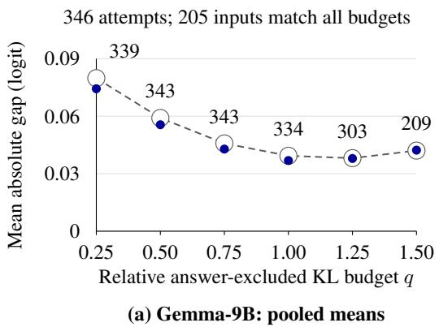

64 attempts; 35 inputs match all budgets  
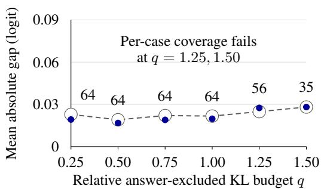  
(b) Gemma-2B: balanced means

Figure 6: Candidate residual gaps across answer-excluded KL budgets. Small mean gaps persist on both changing and fixed matched subsets. E is the encoder-based reference intervention. Both reference and candidate patches are rescaled to each budget. Filled points use each budget’s joint E/candidate matches (counts out of 346 in 9B, 64 in 2B). Open rings and dashed lines use the all-six-budget intersection; superposed symbols indicate overlapping means. Both axes are shared, but weighting differs: pooled in 9B, case/block-balanced in 2B. The 2B coverage failures are labeled; 9B counts are descriptive. Lines connect measured means, without uncertainty bands or an equivalence claim. Exact values and coverage are in Appendix D.3.
<table><tr><td>q</td><td>NNLS matched</td><td>Gap</td><td>Candidate</td></tr><tr><td>0.25</td><td>62/62</td><td>0.00782</td><td>0.01927</td></tr><tr><td>0.50</td><td>62/62</td><td>0.00798</td><td>0.01679</td></tr><tr><td>0.75</td><td>62/62</td><td>0.00986</td><td>0.01902</td></tr><tr><td>1.00</td><td>62/62</td><td>0.00821</td><td>0.01977</td></tr><tr><td>1.25</td><td>62/62</td><td>0.01217</td><td>0.04455</td></tr><tr><td>1.50</td><td>50/62</td><td>0.01225</td><td>0.13646</td></tr></table>

Table 12: Additional 2B budget accounting. NNLS gaps condition on joint matching. The candidate column retains all 64 inputs, using nearest measured attempts for failed matches; its larger-budget entries are not matched comparisons. All gaps are balanced mean absolute differences in logits.

35 candidate inputs matched at all budgets, gaps are 0.02286, 0.01908, 0.02207, 0.02169, 0.02485 and 0.02811. The corresponding NNLS common subset contains 50 inputs, with gaps 0.00825, 0.00725, 0.00957, 0.00823, 0.01165 and 0.01225. At $q \ : = \ : 0 . 5$ each code loses one encoder transfer; other matched-budget comparisons have no transfer gains or losses. These finite counts do not certify identical decisions. Across budget-specific matched subsets, the largest candidate gap is 0.162 logit at $q = 1 . 2 5$

The 9B common subset contains 205 inputs; its pooled mean gaps are 0.0798, 0.0591, 0.0458, 0.0393, 0.0381 and 0.0421. These averages conceal tails: at $q = 0 . 2 5$ , the maximum gap is 1.421 and the 90th percentile is 0.183. The means are descriptive, with no equivalence bound or confidence interval. Full-panel coverage deteriorates at high budgets; changing subsets do not justify an unrestricted shared-response-curve claim.

## D.4 Shared-Coefficient Calibration: Means and Complete Distributions

These follow-ups test how much of the per-input agreement a shared coefficient preserves for constructed candidates in the two Gemma subject–verb settings. In 9B, one coefficient is shared across all evaluation inputs. In 2B, each held-out block uses a coefficient selected on the remaining blocks. Both protocols were specified after earlier outcomes on their panels had been inspected. Table 13 reports balanced means, and Figure 7 shows the input-level distributions. Figure 8 retains their full measured range.

Shared coefficients reduce mean gaps but worsen 216 of 346 inputs in 9B and 24 of 64 in 2B. A retrospective breakdown in 9B places most deterioration among inputs whose individual coefficient is below the shared value; those inputs already start close to E. The more concentrated 2B coefficients do not remove the trade-off under its selector (selection rules in Appendices A.6 and D.2).

For 9B, global calibration gives positive case mean reductions of 0.113–0.236 logit and blockdeletion reductions of 0.053–0.206 logit. These summaries describe the same finite panel and do not establish independent lexical replication.

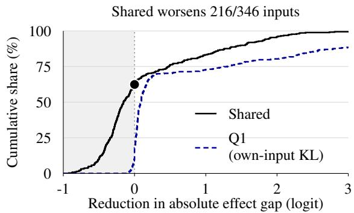  
(a) 9B: word-split selection

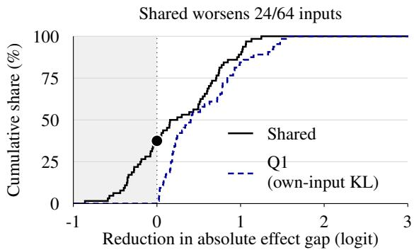  
(b) 2B: block-held-out selection

Figure 7: Candidate effect-gap reductions under shared-coefficient and per-input calibration. Gaps are measured from the encoder-based reference intervention E. Shared coefficients improve means while worsening many individual comparisons. Negative reductions denote larger gaps. Dots at zero mark the shared-coefficient worsening fraction. The curves weight inputs equally, retaining 11 failed per-input Q1 attempts in 9B. Table 13 reports balanced means. Beyond the displayed 3-logit limit lie 2 shared-coefficient and 40 per-input values in 9B, none in 2B (full curves: Appendix D.4, Figure 8). Selection protocols differ between panels. Shared-coefficient selection holds out evaluation inputs, which were exposed in earlier analyses. Per-input Q1 uses each evaluation input’s outputs. Curves are descriptive, without confidence intervals.
<table><tr><td colspan="3">Balanced mean absolute gap (logit)</td></tr><tr><td>Setting Before</td><td>Shared</td><td>Per-input</td></tr><tr><td>9B  $( n = 3 4 6 )$ </td><td>0.876 0.704</td><td>0.046</td></tr><tr><td>2B  $( n = 6 4 )$  0.561</td><td>0.313</td><td>0.015</td></tr></table>

Table 13: Balanced candidate effect gaps (logit) on the same inputs within each setting. Both selectors return $\alpha = 1 . 2 5 ;$ every 2B fold selects that value. Perinput Q1 uses each evaluation input’s reference and separate search, including 11 failed attempts in 9B. It is an information-richer diagnostic, not a same-budget comparator.

The 9B evaluation mean KL is 0.09685 nats under global calibration and 0.09811 under E. For the 2B candidate, the per-input coefficient median is 1.156, with an interquartile range from 1.068 to 1.238.

## D.5 Finite-Grid Hindsight Comparisons

The nine-point global grid is 0, 0.25, . . . , 2. In 9B, selecting the best coefficient after observing evaluation effects returns 1.5, with balanced gap 0.571. It worsens 233 of 346 inputs, and the pooled median absolute gap rises from 0.102 to 0.480. Every one-block deletion returns the same grid optimum. Allowing a separate effect-optimal grid point per input gives 0.109, but uses the outcomes and is not a deployable KL selector. In 2B, the single-coefficient hindsight optimum is 1.25 for the candidate and 1 for NNLS. None of these optima addresses coefficients between grid points.

## D.6 Numerical Verification Scope

Independent executions reproduce the final outputs of the 2B code comparison and the complete measured searches of its response extension. Two recomputed metadata norms differ by one unit in the last place (ULP) at double precision, but applied patches and model outputs agree exactly.

The 9B budget and shared-coefficient extensions also reproduce their measured search points and selections. This scope exceeds the final-output-only replay of the original lexical comparison. Some response-extension records retain output verification summaries rather than full arrays, so arbitrary new vocabulary statistics would require model reexecution.

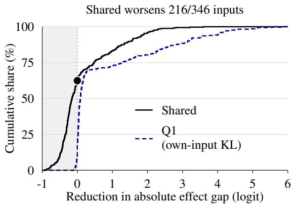  
(a) 9B: word-split selection

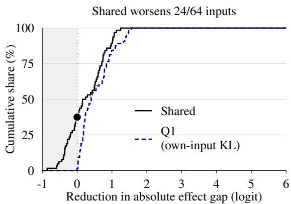  
(b) 2B: block-held-out selection  
Figure 8: Full-range counterpart to Figure 7. The wider axis reveals the positive tail clipped in that figure, with unchanged cohorts and equal input weights. Reductions are in logits; negative values denote larger gaps from the encoder-based reference intervention E, and dots at zero mark the shared-coefficient worsening fraction. All 11 failed 9B Q1 searches remain included. The panels retain their distinct selection protocols, and Q1 uses additional evaluation-input information. Curves are descriptive, without confidence intervals.

## E Appendix: Llama Configurations and Prospective Confirmation

The two Llama configurations use the same base model and layer but different SAEs and independently selected groups. They are not separate model-family replications. This appendix records the assets, selection history and denominators behind the main-text comparisons.

## E.1 Assets and Inference Coordinates

The model and tokenizer are

meta-llama/Llama-3.1-8B. The 128K SAE is Llama3\_1-8B-Base-L15R-32x/checkpoints/ final.safetensors from

OpenMOSS-Team/Llama3\_1-8B-Base-LXR-32x. The 32K SAE is the corresponding

Llama3\_1-8B-Base-L15R-8x/checkpoints/ final.safetensors from

OpenMOSS-Team/Llama3\_1-8B-Base-LXR-8x.

Both SAEs are applied to the residual output of zero-indexed block 15. The archived configuration widths are 131,072 and 32,768. Raw checkpoint tensors are not directly used as inferencecoordinate parameters. The adapter casts stored tensors to FP32, folds dataset activation scaling and then normalizes decoder columns, applying the compensating scaling to encoder rows and biases. This follows the authors’ loading procedure at the recorded version; the conversion parameters and support calculation were checked against those operations. The JumpReLU thresholds are 0.330078125 and 0.35546875. Encoding does not subtract decoder bias. Model forwards use an FP16 body, eager attention and an FP32 output head. Patch positions, reconstruction residual preservation and output metrics follow Section 5.

The 128K group IDs are 3478, 5946, 7489, 9836, 23366, 47994, 59024, 60208, 68163, 85257, 92087 and 108136. The 32K group IDs are 11664, 14236, 16426, 18776, 21286, 21734, 23413, 25319, 25943, 28323, 30921 and 32760.

## E.2 Selection and Eligible Cohorts

Both dictionaries use the same 128-pair development inventory, built from 64 subject–attractor lemma pairs. One lexical block fixes both lemmas and near, varying subject and attractor number to give two pairs and four inputs. Lemmas do not repeat across blocks or roles within a panel. Cases label each recipient’s subject and attractor number. Reconstruction qualification is dictionary-specific, so the discovery rows can differ.

Discovery uses the normalized-margin utility U(G) in Appendix D.1. It measures all active singleton contrasts, then forms a 64-feature shortlist from the top 16 singleton utilities in each case, filling remaining places by overall utility. A group qualifies if it transfers on at least half the development inputs, transfers in at least 8 blocks, and has a transfer and positive mean margin decrease in every case. At each greedy step, proposals are ranked by qualification, number of covered cases, worst-case utility, overall utility and feature IDs, in that order. Final selection among qualified proposals maximizes overall utility, breaking ties by smaller group size and then feature IDs. This rule can select a larger group after a smaller one has already qualified.

The 128K six-feature search did not meet the development efficacy rule. A subsequent, explicitly extended search allowed larger groups without lowering that rule. This was a bounded singleton/greedy procedure, not an exhaustive search over all subsets. The extension continued the existing six-feature path and shortlist through size 12, evaluating 333 additional joint proposals. The resulting fixed twelve-feature group underwent separate lexical validation on 128 pairs with disjoint development/validation word forms. Validation uses the same 50% group-transfer threshold and per-case and eight-block breadth requirements. The native-body and decoded-body donor controls defined in Appendix B.4 must meet the breadth requirements as well.

After validation, an initial candidatequalification panel failed case coverage. We record this stop separately from the subsequent 384-pair expansion. The expansion retained the group, construction, qualification thresholds and calibration limits, and did not pool old and new counts. The expansion’s 192 lexical blocks were assigned before tokenization or new model outputs. Each again contains one subject lemma and one attractor lemma with both numbers. A fixed deterministic ordering selects 192 authored subject nouns and 192 attractors after excluding word forms used in the Llama development, initial validation and backup panels. No forms repeat across blocks within the expansion. Some nouns originated in earlier project inventories, so lexical separation here is relative to these Llama panels.

The expansion yields 600 aligned inputs out of 768 assigned, and 98 bilateral native-qualified pairs. Alternative qualification retains 94 NNLS pairs in 72 blocks and 62 candidate pairs in 50 blocks. Their union has 95 pairs; their common intersection has 61 pairs in 49 blocks.

For 32K, a separate frozen development search selects twelve features under the same coverageaware rule, searching from singletons through size 12. The greedy path first meets efficacy at size 5; the twelve-feature result is not evidence that fewer features could not work. Its validation panel assigns a new list of 64 subject–attractor lemma pairs, excluding word forms from both dictionaries’ development and the initial 128K validation panel. It preserves the two-pair, four-input block construction and the validation efficacy rule above. Held-out validation retains 58 of 128 source pairs and yields 99 encoder transfers on 116 inputs. Subsequent qualification retains 56 NNLS pairs in 39 blocks and 53 candidate pairs in 37 blocks. The candidate cohort is contained in the NNLS cohort. Group efficacy is already observed when the alternative-code calibration protocol is fixed; alternative effects are not.

## E.3 Calibration and Inference

Both protocols specify full-output and answerexcluded KL selection before alternative effects, on each code’s own eligible cohort. The grid is 0, 0.25, . . . , 2, with at most 12 refinements and the same tolerance as the Gemma comparisons. The original protocols add no extra bracket, cap expansion or effect-based choice after a failed match. The later range continuation is reported separately in Appendix C.5, preserving these original results. The candidate’s paired reduction on Q1-matched inputs is primary; NNLS and the second selector retain their secondary roles. Coverage requires at least 80% retention and 8 matched inputs in each original case, and at least 12 matched blocks overall. Both candidate configurations fail this conjunction under both selectors.

Balanced summaries give equal weight to cases and to represented blocks within each case. Conditional intervals use 10,000 lexical-block bootstrap replicates with seed 20260921. Pooled descriptive means in Table 14 instead weight inputs equally. No interval assumes independent inputs or pools the two dictionaries. For Q1-matched candidates, the balanced reductions have paired 95% block-bootstrap intervals wholly above zero in both configurations (Table 7). This evidence concerns matched subsets because both fail the coverage requirement.

Positionwise norm matching passes on all 188 inputs in 128K and 109 of 112 in 32K. The full 32K positionwise-attempt cohort is retained in the transfer counts, whereas Table 4 uses only the 109 inputs matched by both norm controls. Table 3 uses all 112 inputs matched by total-norm matching and Q1. Undefined or out-of-tolerance norm controls do not become matched observations by inclusion in a total.

Table 14 retains failed attempts in the full-cohort columns under both selectors.

Among unmatched Llama candidates, initial pooled mean gaps are 2.248 logit in 128K and

<table><tr><td colspan="8">Pooled mean absolute gap (logit)</td></tr><tr><td>Config. / code</td><td>Selector</td><td>Matched / attempted</td><td colspan="2">Matched only</td><td colspan="2">All attempts</td><td>Coverage</td></tr><tr><td rowspan="2">128K /NNLS</td><td></td><td></td><td>Before</td><td>After</td><td>Before</td><td>Final</td><td></td></tr><tr><td>Q1</td><td>188/188</td><td>0.166</td><td>0.016</td><td>0.166</td><td>0.016</td><td>Pass</td></tr><tr><td rowspan="2">32K /NNLS</td><td>Q2</td><td>188/188</td><td>0.166</td><td>0.023</td><td>0.166</td><td>0.023</td><td>Pass</td></tr><tr><td>Q1</td><td>112/112</td><td>0.159</td><td>0.012</td><td>0.159</td><td>0.012</td><td>Pass</td></tr><tr><td></td><td>Q2</td><td>112/112</td><td>0.159</td><td>0.014</td><td>0.159</td><td>0.014</td><td>Pass</td></tr><tr><td>128K / candidate</td><td>Q1</td><td>92/124</td><td>1.319</td><td>0.130</td><td>1.559</td><td>0.270</td><td>Fail</td></tr><tr><td rowspan="2">32K / candidate</td><td>Q2</td><td>91/124</td><td>1.318</td><td>0.174</td><td>1.559</td><td>0.302</td><td>Fail</td></tr><tr><td>Q1</td><td>75/106</td><td>1.234</td><td>0.041</td><td>1.494</td><td>0.197</td><td>Fail</td></tr><tr><td></td><td>Q2</td><td>76/106</td><td>1.233</td><td>0.051</td><td>1.494</td><td>0.205</td><td>Fail</td></tr></table>

Table 14: Earlier Llama cohorts: pooled mean absolute effect gaps from the encoder-based reference intervention E in logits. Matching counts use each code’s own qualified cohort. Before/after columns compare identical inputs within a row; matched membership can differ between selectors. All attempts retain failed searches at their best measured point, without calling them calibrated. Coverage requires the prespecified per-case retention and support conditions. These descriptive means are distinct from the original case/block-balanced estimates.

2.124 in 32K. Both exceed the respective matchedsubset means in Table 14.

## E.4 Numerical Verification

Both configurations have complete independent replays, including failed searches. Final model outputs, applied patches, measured search points and recomputed analyses agree. The compact records preserve output verification summaries rather than persistent copies of every full array.

## E.5 Prospective NNLS Confirmation

This panel tests whether the coefficient-countmatched NNLS comparison persists on new material within the selected Llama-128K configuration. We retain its model, SAE, twelve-feature group, inference coordinates and patch domain. Before tokenizer inspection, we fix a hash-ordered selection from authored subject and attractor noun lists, yielding 512 sentence pairs in 256 lexical blocks. Each block uses one subject lemma and one attractor lemma, with both numbers represented; no noun is shared across blocks or roles. We exclude singular and plural forms from the specified Llama development, initial validation, 32K validation, 128K expansion and original body-group inventories, and check exact prefixes against the saved Llama panels. This separation is relative to those inventories, not all project material or model pretraining.

Token alignment retains 382 pairs. Native behavior and encoder reconstruction retain 158 pairs, after which complete-code NNLS qualification retains 152 pairs and 113 blocks. Eligibility uses the bilateral checks in Appendix A.4, without observing group-patch effects or selecting on encoder transfer. No rejected pair is replaced. The resulting 304 inputs have 98.3 effective blocks under the final case/block weights. Here the effective count is $1 / \textstyle \sum _ { b } w _ { b } ^ { 2 }$ , where $w _ { b }$ is block b’s total weight in the balanced mean and the weights sum to one. This count measures weight concentration, without establishing independence between blocks.

Design and uncertainty. The confirmation’s prespecified primary contrast is the NNLS effect gap under total-norm matching minus its gap under fulloutput KL matching (Q1), using inputs matched by both controls. We first average within block and case, then equally across represented blocks within each case and across the four cases. Planning uses the earlier Llama cohort solely to estimate variability, with a smaller planning alternative of 0.07 logit and a 1.5-fold inflation of the estimated block-level standard deviation. At 64 effective blocks, the normal approximation meets the planned half-width of at most 0.05 logit and power of at least 0.80 for a positive lower 95% bound. These calculations depend on independent-block variation; 0.07 is a planning alternative, not an equivalence margin or a minimum meaningful effect.

Both qualification stages and the primary matched subset must retain at least 64 effective blocks and 32 blocks per case. Each primary control must match at least 90% overall and 80% in every case. Confirmation additionally requires a positive lower endpoint of the primary 95% interval and a half-width no greater than 0.05 logit. We use 10,000 paired lexical-block bootstrap draws with seed 20260926, retaining both transfer orientations together, and report an interval only if at least 9,900 draws retain all cases. Missing-case draws are not replaced. Total-norm matching retains its 0.001 relative tolerance, and Q1 retains the nine-point [0, 2] grid, at most twelve refinements and the KL tolerance in Appendix A.5.

<table><tr><td>Intervention</td><td>Inputs</td><td>Balanced gap</td><td>Pooled gap</td><td>Transfers</td><td>Lost</td><td>Gained</td></tr><tr><td>Reference E</td><td>304</td><td>0.000</td><td>0.000</td><td>175</td><td>0</td><td>0</td></tr><tr><td>Unscaled NNLS</td><td>304</td><td>0.213</td><td>0.207</td><td>181</td><td>3</td><td>9</td></tr><tr><td>Total-norm matching</td><td>304</td><td>0.181</td><td>0.176</td><td>165</td><td>11</td><td>1</td></tr><tr><td>Positionwise norm matching</td><td>304</td><td>0.134</td><td>0.130</td><td>167</td><td>10</td><td>2</td></tr><tr><td>Full-output KL (Q1)</td><td>304</td><td>0.021</td><td>0.020</td><td>175</td><td>0</td><td>0</td></tr><tr><td colspan="7">Follow-up after inspection of the confirmation results</td></tr><tr><td>Answer-excluded KL (Q2)</td><td>304</td><td>0.029</td><td>0.028</td><td>173</td><td>2</td><td>0</td></tr></table>

Table 15: New-material Llama-128K controls on common inputs. Q1 preserves the transfer decisions of the encoder-based reference intervention E and leaves the smallest observed mean gap among these controls. Every measured matching control matches all 304 inputs. Gaps are in logits; balanced values equally weight cases and blocks within case, whereas pooled values weight inputs equally. Transfers and losses/gains relative to E are unweighted counts. The separated Q2 row is a follow-up after inspection of the confirmation, on the same inputs. This cohort remains separate from the earlier 188-input panel.

<table><tr><td>Case</td><td>n</td><td>Contrast</td></tr><tr><td>Singular / singular</td><td>65</td><td>0.195</td></tr><tr><td>Singular / plural</td><td>87</td><td>0.122</td></tr><tr><td>Plural / singular</td><td>65</td><td>0.185</td></tr><tr><td>Plural / plural</td><td>87</td><td>0.138</td></tr></table>

Table 16: New-material confirmation by recipient subject/attractor number; n counts inputs, all matched by both primary controls. The mean total-norm minus Q1 gap is positive in every case. Contrasts are in logits, with equal block weights within each case.

Outcomes and scope. All three controls actually match all qualified inputs, so matched-subset and all-attempt summaries coincide here. All primary bootstrap draws retain the required cases, and every prespecified confirmation requirement passes. Table 15 separates balanced and pooled gaps; Table 16 gives the case means. Deleting any one block leaves the primary estimate positive, between 0.152 and 0.163 logit. Positionwise-minus-total-norm gaps and transfer changes are secondary reports. We do not add a confirmatory test of positionwise matching against Q1. No candidate is measured on this panel. The later Q2 comparison is described separately below.

Independent execution repeats native and encoder qualification, NNLS fitting and qualification, and the full effects/calibration search, including upstream failures. All arrays and scientific records reproduce exactly. The new panel provides prospective material confirmation, conditional on a setting chosen using earlier outcomes; it does not replace the original prespecified candidate comparison or broaden the model and task scope.

Illustrative input. Figure 1 uses the singularrecipient input from the schoolgirl/iceberg block. We selected it after inspecting outcomes to illustrate an encoder transfer lost under total-norm matching and retained under Q1. Its recipientanswer minus donor-answer margin, logit(is) − logit(are), is 4.923 before patching and −0.233 under the encoder intervention. The margins after scaling the same NNLS patch are 0.034 under totalnorm matching and −0.211 under Q1, all in logits. These two-token rankings describe the transfer criterion, not generated completions. The figure’s aggregate counts use the complete qualified panel.

## E.6 Answer-Excluded Follow-Up on the Confirmation Panel

To test whether the reduction persists after answer exclusion, we specify a Q2 follow-up after inspecting the original confirmation. It uses the same 304 NNLS-qualified inputs, keeping the model, group, patches, precision and search bounds fixed. No new material or qualification is introduced. The primary follow-up contrast is the unscaled-NNLS minus Q2 effect gap; Q2 minus Q1 and total-norm minus Q2 are separate supporting comparisons. Each uses inputs meeting its specified matching criteria and retains an all-attempt summary. Coverage and block-support thresholds follow the original confirmation, but the extension adds no precision requirement.

<table><tr><td>Effect-gap contrast</td><td>Mean</td><td>95% interval</td></tr><tr><td>Unscaled NNLS – Q2</td><td>0.184</td><td>[0.149, 0.223]</td></tr><tr><td>Q2 - Q1</td><td>0.008</td><td>[0.005, 0.011]</td></tr><tr><td>Total norm – Q2</td><td>0.152</td><td>[0.124, 0.183]</td></tr></table>

Table 17: Q2 follow-up contrasts on common Llama inputs. Answer exclusion retains a reduction but leaves a larger residual gap than Q1. All 304 inputs match the compared controls. Estimates and pointwise 95% block-bootstrap intervals are in logits, with equal case weights and equal block weights within case.

Q2 matches every input in every case, so all three contrasts use the same cohort (Table 17). The unscaled-NNLS minus Q2 contrast is positive in every case and after deletion of any one block. The larger residual gap relative to Q1 and the lost transfers in Table 15 show that removing direct answer probabilities retains a reduction without establishing equivalence between the selectors. Intervals use 10,000 paired lexical-block bootstrap draws with seed 20260926 under the original weighting, with the valid-draw rule above. All draws retain the required cases. These are pointwise conditional intervals, not simultaneous coverage across the three contrasts.

Independent execution repeats the complete Q2 search and reproduces all saved arrays and scientific records exactly.

## F Appendix: Selection History and Stopped Comparisons

Table 18 distinguishes confirmation from followup evidence. The original lexical confirmation targeted transfer rates, but only 252 of 1,984 source pairs jointly qualified. Under the specified blockvariance scenario, the retained subset gave a planning half-width of 0.1053 against the required 0.10, so the study stopped before group-effect measurement. This design calculation limited the attainable precision without providing an observed effect estimate. The later calibration study used the same 252 pairs to ask how much Q1 reduces paired absolute effect gaps. Its contrast and bounded search were specified before group effects were inspected. It supplies evidence for that separate question, without satisfying the original transfer-rate criterion. Its own primary estimate also missed its planned precision, as reported with the main result.

The earlier 83-pair calibration panel failed one case-coverage requirement, and the low-strength random-group comparison failed full-panel coverage. Their measurements support only the reported retained-subset comparisons. These comparisons are part of a longer adaptive research process, so the selected settings should not be read as a representative sample of available interventions. The earlier public-group qualification failure is detailed in Appendix F.1.

The cross-family extension also includes selection and availability failures. A bounded Llama-128K six-feature search failed, leading to an extended group-size limit. The initial candidate cohort for the selected group then failed case coverage. A separately specified expansion supplied the calibration panel reported here, with the failed initial cohort kept separate. The 32K dictionary was searched and validated separately. Both final Llama candidate calibration cohorts still fail coverage, despite fully matched NNLS controls (Appendix E). Those coverage failures restrict candidate conclusions to the reported subsets. The bounded searches leave the availability of compact groups in unselected models unresolved.

## F.1 Earlier Public-Group Qualification

A separate publicly sourced two-feature candidate in Gemma-2-2B did not qualify for the same type of comparison. Of 128 native inputs, 125 had the required correct answer. None passed the reconstruction KL cap of 0.02, leaving zero eligible pairs out of 64. The failure concerns reconstruction eligibility, not the causal efficacy of the feature pair. This stopped candidate is distinct from the subsequently selected six-feature 2B group in Appendix D; the failed public pair is not included as a causal replication.

## F.2 Searches for an Additional Phenomenon

Table 19 separates upstream availability failures from tests of the calibration claim. A native check establishes answer behavior; reconstruction qualification checks dictionary fidelity; the donor control tests whether the patch domain can carry the behavior before selecting a compact feature group. Failing any of these prerequisites prevents the downstream code comparison. A bounded group search establishes only what that search found, not the absence of every effective group.

<table><tr><td>Comparison</td><td>Evidence status</td><td>Inferential scope</td></tr><tr><td>9B lexical candidate</td><td>Prespecified primary; effects unmeasured when specified</td><td>Coverage passes; planned precision unmet</td></tr><tr><td>2B and Llama SVA extensions</td><td>Specified after group qualification, before alternative effects</td><td>2B matches fully; Llama candidate coverage fails</td></tr><tr><td>Gender</td><td>Selected group validated before code comparison</td><td>Partial extension; Q2 reverses the NNLS pattern</td></tr><tr><td>Single-scale controls</td><td>Prespecified follow-ups on exposed Paired comparisons, with panels</td><td>unavailable intervals reported</td></tr><tr><td>New Llama-128K NNLS panel</td><td>Materials and analysis specified before tokenization or group effects all support, coverage and precision</td><td>Prospective material confirmation; requirements pass</td></tr><tr><td>Q2 on the new Llama panel</td><td>Specified after inspection of the original confirmation results</td><td>Follow-up reduction; larger residual gap and transfer losses than Q1 on</td></tr><tr><td>Candidate search range</td><td>Specified after inspection of failed search traces</td><td>the same inputs Descriptive continuation to α = 4; original coverage decisions</td></tr><tr><td>transfer</td><td>Budgets and coefficient Follow-ups on exposed Gemma SVA panels</td><td>unchanged Finite budgets and coefficient grid only</td></tr></table>

Table 18: Evidence status and scope. Exposition starts with practical NNLS comparisons without replacing the prespecified primary endpoint. The new Llama panel provides prospective material confirmation separately from exposed-panel follow-ups.

<table><tr><td>Candidate phenomenon</td><td>Stopping stage</td></tr><tr><td>Anaphor agreement</td><td>Compact-group discovery</td></tr><tr><td>Inanimate reflexive agreement</td><td>Compact-group discovery</td></tr><tr><td>Auxiliary-form selection</td><td>Donor control</td></tr><tr><td>Pronoun case</td><td>Reconstruction qualification</td></tr><tr><td>Indirect-object</td><td>Reconstruction</td></tr><tr><td>identification</td><td>qualification</td></tr><tr><td>Indirect-object follow-up</td><td>Native donor control</td></tr></table>

Table 19: Stopped additional-phenomenon searches. None reached a test of calibration, so these failures restrict the available settings without providing positive or negative calibration results. Reflexive gender agreement did reach calibration; its adverse Q2 result is reported in Section 6.4, separately from these upstream stops.

## G Appendix: Relation to Other Explanation Tests

Syntactic competence and causal involvement. Controlled agreement tests probe whether predictions respect syntactic structure despite distracting nouns or reduced semantic cues (Gulordava et al., 2018). BLiMP extends minimal-pair evaluation across a wider range of grammatical phenomena (Warstadt et al., 2020). Our targeted next-token contrasts do not provide that breadth. Studies of number-tracking units in recurrent models (Lakretz et al., 2019) and causal mediation in transformers (Finlayson et al., 2021) instead investigate internal contributions to agreement. Related intervention methods test mediation of gender bias (Vig et al., 2020) or remove decodable information to assess its behavioral role (Elazar et al., 2021). These studies motivate distinguishing information present in a representation from information used in a prediction. Our experiment asks the narrower question of comparability between interventions on the same group.

Discovering an explanation versus comparing its effects. The indirect-object-identification circuit study evaluates a proposed circuit using faithfulness, completeness and minimality criteria (Wang et al., 2023). Automated circuit discovery searches for relevant computational subgraphs (Conmy et al., 2023), and AtP\* addresses errors in gradientbased approximations used to localize components (Kramár et al., 2024). Distributed alignment search learns a correspondence between proposed causal variables and neural representations (Geiger et al., 2024). We neither rediscover a circuit under each code nor optimize a new causal alignment. The feature group and decoder stay fixed, and the reported effects come from executed interventions, not gradient approximations. Calibration agreement therefore does not establish that this group is a complete or minimal mechanism.

Robustness is not correctness. Sanity checks for saliency maps test whether explanations depend on the model and data they purport to explain (Adebayo et al., 2018). Explanation-robustness analyses ask how explanations change under small input perturbations (Alvarez-Melis and Jaakkola, 2018). Our varying object is the code and resulting patch for a fixed input, rather than the input or trained model. The common lesson is to specify what a stability test holds fixed and what it can establish. Two interventions agreeing with each other is not an external criterion of explanatory correctness, even when both change the target answer.

Variable importance can also vary across wellperforming prediction models, as studied through model-class reliance and variable-importance clouds (Fisher et al., 2019; Dong and Rudin, 2019). Our decoder instead stays fixed while its codes vary. This connection motivates specifying the object held fixed in a comparison, without equating the two sources of variation.

## H Appendix: Reproducibility and Artifact Availability

The numerical checks address three different questions: whether the reported statistics follow from the saved measurements, whether the saved patches implement the stated comparison, and whether another execution reproduces the model outputs. Passing one check does not establish the others.

## H.1 Recomputing the Reported Comparisons

The result records preserve pair, input, case and block identifiers, matching decisions, selected coefficients and measured effects. The lexical and answer-excluded comparisons each account for all 504 attempted inputs; the global-coefficient evaluation accounts for its 346 evaluation inputs. Failed matches remain in these records. For the lexical primary estimate, they are excluded by the stated matching rule, whereas the answer-excluded primary comparison retains their measured final attempts. The Gemma-2B setting has 64 candidate and 62 NNLS inputs, with separate matching decisions at each budget (Appendix D.3).

Recomputation from these scalar records checks the case-balanced means, paired transfer counts, conditional intervals and block-deletion summaries. Recomputing the effects and KL values themselves requires the archived native and intervened fullvocabulary logits. For Q2, this check removes the two specified answer-token entries before normalization. It cannot be reproduced from the answer logits alone or from a truncated list of the most likely tokens. The newer 2B response-extension records retain output verification summaries instead of full logit arrays; arbitrary new outputstatistic checks require model re-execution there.

For the new Llama confirmation and its Q2 follow-up, recomputation must preserve the separate evidence status of the two analyses even though they share inputs. Each comparison uses inputs meeting its specified matching criteria, with failed searches retained in the all-attempt summaries. The bootstrap resamples lexical blocks jointly across the paired controls. The released records must therefore include block and case identifiers as well as effects, matching decisions and transfer outcomes. Aggregate means alone cannot reproduce these intervals or the paired gains and losses.

The lexical review also reruns the coefficientselection logic using the saved KL search trace. This checks which coefficient the recorded search would select. It does not independently regenerate the model outputs at intermediate search points. These output-based checks require no model forward pass, but remain conditional on the archived outputs.

## H.2 Checking the Code and Physical Patch

Checking code eligibility additionally requires the decoder, native activations, coefficients and support records. With those inputs, linear algebra suffices to check nonnegativity, support membership and reconstruction error. Behavioral reconstruction eligibility additionally uses the native and reconstructed output distributions. The construction and numerical conventions are specified in Appendix A.3.

The saved physical patches provide a separate check on what was inserted into the model. The initial encoder and candidate patches must meet the stated per-position norm constraint after materialization. For calibration, the selected coefficient and candidate patch determine the rescaled patch, including its execution-precision rounding. Verifying that patch does not make it an admissible sparse code: the calibration controls are physical interventions, as defined in Section 5.

## H.3 Reproducing Model Outputs

Model replay requires the pinned model, tokenized inputs, intervention positions, stored patches and numerical execution configuration. Archived and replayed model outputs are checked for equality. The original lexical replays cover the native, reconstruction and final intervention outputs described in Appendix A.8, including unsuccessful matching attempts. They reproduce final comparisons without rerunning adaptive search. Later Gemma budget and coefficient-transfer replays cover the complete measured searches (Appendix D.6). Llama replay scope is reported in Appendix E.4, with confirmation and Q2 follow-up checks in Appendices E.5 and E.6.

Equality of the replayed arrays establishes numerical repeatability for the tested executions. It does not supply new lexical observations, validate the block-independence assumption, or guarantee agreement on other hardware. The scientific checks above additionally establish which interventions and comparisons the records represent.

Acquiring the model and SAE weights is a separate prerequisite. Model access must follow the official provider’s terms, including gated access where required. Reproduction requires the recorded repository revisions and SAE checkpoint files, rather than whichever versions are current at download time. The numerical configuration and measured cost of the new Llama confirmation chain are specified in Appendix H.4. General calibration-search costs are described in Appendix A.9.

## H.4 Llama Confirmation: Execution Environment and Measured Cost

The new Llama-128K confirmation used one NVIDIA RTX A6000 GPU per execution, with four allocated CPU cores and single-threaded numerical libraries. The three original phases, comprising native qualification, NNLS qualification and controlled effects, took 35.5 minutes of application time in total. The Q2 follow-up took 14.1 minutes, and replaying all four phases on a different machine took 40.4 minutes. Together these account for 1.50 single-GPU application hours. The timers include asset loading and CPU work inside each phase, not only GPU kernel time.

This subtotal excludes earlier cohorts, group discovery, stopped searches, failed or interrupted attempts, CPU-only reviews and scheduler overhead. A complete computational budget for the adaptive research process has not been reconstructed. Historical scheduler accounting is unavailable, and the retained application timers do not cover every failed or stopped attempt. We therefore do not extrapolate this reproduction subtotal to a projectwide estimate.

The required package versions were verified before each Llama phase. All phases checked Py-Torch 2.9.1, Transformers 4.57.6, NumPy 2.4.6, Safetensors 0.8.0 and Hugging Face Hub 0.36.2. Native qualification additionally checked Tokenizers 0.22.2, and NNLS qualification and effect measurements checked SciPy 1.17.1. The runs used an FP16 model body, FP32 output head and eager attention, with deterministic PyTorch operations and TensorFloat-32 (TF32) disabled. These versions describe this confirmation chain; they do not apply to every earlier experiment.

## H.5 Artifact Availability

Source-to-table checks on the internal archives establish agreement between manuscript values and reviewed records. They do not independently recompute every interval or regenerate model outputs. The accompanying CPU supplement contains the 570 attempted NNLS strength-control inputs from the five earlier cohorts and the separate 304-input Llama confirmation cohort, including its later Q2 measurements. It also provides 49 overlapping comparisons covering candidate Q1/Q2 results, shared coefficients, six KL budgets and the seven search-range continuation cells. The records include sentence prefixes and token IDs, pair/case/block identifiers, actual matching masks, scalar measurements, pinned asset metadata and scientific excerpts of the internal plans. These excerpts are not externally timestamped registrations. A standalone checker recomputes the specified means, intervals and transfer counts, reselects shared coefficients from recorded calibration KL values, and checks retained scalar selections and budget intersections. It has been tested from a clean extraction in a new Python environment without the research archive.

This supplement verifies arithmetic on saved scalar measurements. It does not regenerate logits, recompute full-output KL or reconstruct every upstream eligibility decision and stopped search. The package includes retained scalar traces, including the recovered 9B Q2 records, but does not reexecute model searches or check every supplemental diagnostic. Model replay still depends on internal archived arrays and runners. No model or SAE weights are redistributed. The supplement README and coverage inventory identify the executable comparisons, checked fields, dependencies and omissions. The software and data archives accompany this preprint as arXiv ancillary files; extract both into the same directory to run the checker.

## H.6 Pinned Asset Revisions

The following revisions identify the model (including its tokenizer) and SAE used in the five main configurations and the new Llama confirmation. The CPU supplement also records checkpoint filenames and SHA-256 digests. Access follows the provider terms described in the Ethics Statement. Weights are not included.

Gemma-9B. Model and tokenizer:   
google/gemma-2-9b-it, revision   
11c9b309abf73637e4b6   
f9a3fa1e92e615547819. SAE:   
google/gemma-scope-9b-it-res, revision e86af97a5b6fbbccca28   
ab654f2fda1b0768f770. Gemma-2B and gender. Model and tokenizer: google/gemma-2-2b, revision   
c5ebcd40d208330abc69   
7524c919956e692655cf. SAE:   
google/gemma-scope-2b-pt-res, revision fd571b47c1c64851e9b1   
989792367b9babb4af63. Llama-128K. Model and tokenizer:   
meta-llama/Llama-3.1-8B, revision   
d04e592bb4f6aa9cfee9   
1e2e20afa771667e1d4b. SAE:   
OpenMOSS-Team/Llama3\_1-8B-Base-LXR-32x, revision   
336730e758fed3cb2273   
276703d836aa8659d293. Llama-32K. Model and tokenizer:   
meta-llama/Llama-3.1-8B, revision   
d04e592bb4f6aa9cfee9   
1e2e20afa771667e1d4b. SAE:   
OpenMOSS-Team/Llama3\_1-8B-Base-LXR-8x, revision   
8dbc1d85edfced43081c   
03c38b05514dbab1368b.

## H.7 AI Assistance

AI agents assisted with research brainstorming, code implementation, and manuscript drafting and revision. The authors reviewed the AI-assisted contributions and conducted numerical and reproducibility checks.