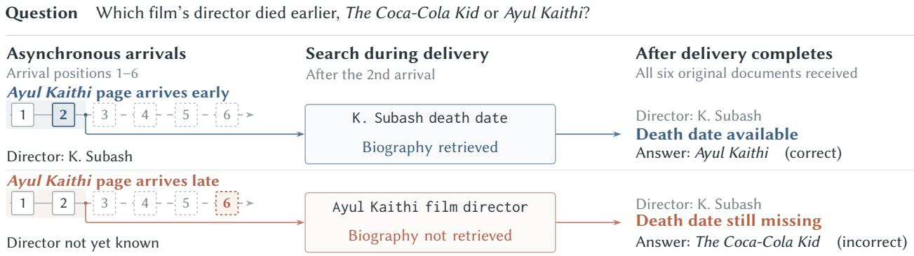
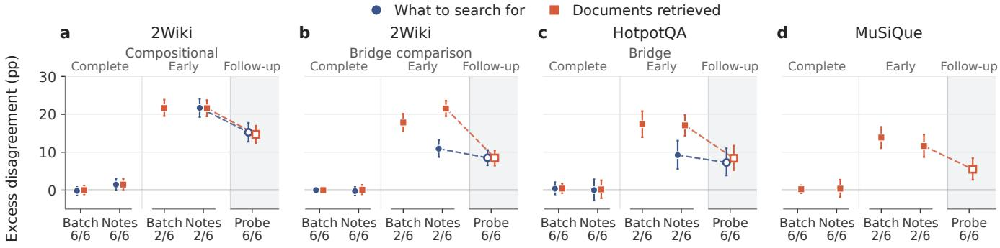
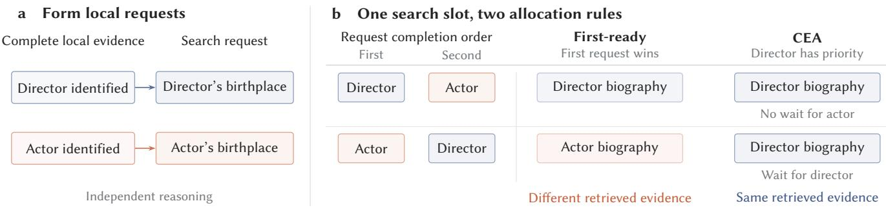
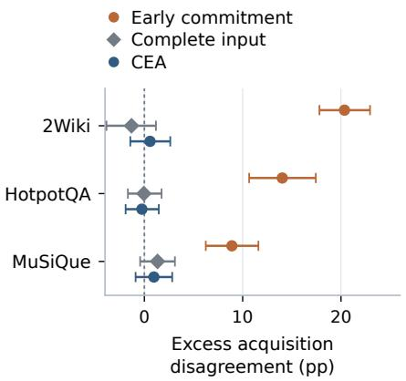
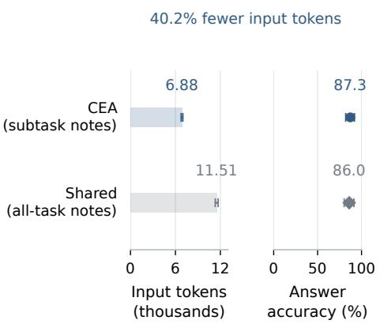
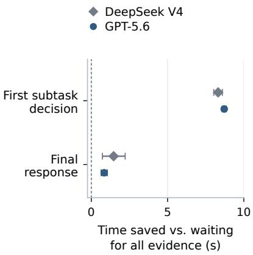
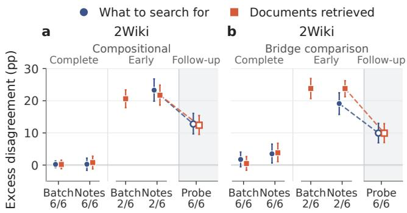

# The Scheduler Is a Hidden Retriever: How Asynchrony Shapes Evidence Acquisition in Search Agents

Ruiyang Ren reyon\_ren@outlook.com Nanyang Technological University Singapore

Yinan Zhang† yinan.zhang@ntu.edu.sg Nanyang Technological University Singapore

Yuhao Wang yh.wang500@outlook.com Nanyang Technological University Singapore

Chunyan Miao† ascymiao@ntu.edu.sg Nanyang Technological University Singapore

## Abstract

Language-model agents increasingly solve complex tasks through parallel reasoning and asynchronous information gathering. Controlled replay across two model families and three benchmarks shows that delivery timing redirects search decisions made before all results arrive, despite identical initial evidence. Acquisition disagreement reaches up to 24 percentage points above same-order repeat variation. This dependence persists after all initial evidence arrives and through a second search, turning temporary diferences in what agents have seen into lasting diferences in what they acquire. An acquisition-regret bound with a matching con struction shows that invariance at a fixed early arrival count can limit the use of evidence already received. We introduce Confluent Evidence Acquisition (CEA), which instead releases local reason ing when each subquestion’s evidence is complete and allocates shared search independently of completion order. For a fixed plan and stable conditional response law, we prove joint invariance of decisions, acquisitions, and answers. With question-only plans across three benchmarks, CEA brings acquisition disagreement to within 1.0 percentage point of repeat variation and achieves accuracy comparable to complete-input controls, improving over early commitment by up to 12.6 percentage points. Replacing CEA’s fixed allocation with first-ready allocation under contention adds 21.6 percentage points of acquisition disagreement, while local query-target disagreement remains near repeat variation. Timed comparisons show that CEA reaches decisions earlier and responds faster than the same program waiting for all initial evidence.

## Keywords

asynchronous search agents, schedule invariance, evidence integration, dependency domains

## 1 Introduction

Progress in reasoning and tool use enables language-model agents to tackle increasingly complex tasks requiring sustained information gathering across multiple subtasks [40]. Parallel search and asynchronous execution let these subtasks advance while tool results are still arriving [11, 34]. In agentic search, reasoning and information acquisition evolve together, as an arriving result can guide a new query before other calls finish. Whether execution timing changes the evidence ultimately acquired is a reliability question for Web agents.

An intermediate fact can arrive in time for final reasoning yet too late to guide search. Figure 1 shows two recorded runs for a question comparing directors’ death dates [10]. Both receive the same original documents and have one search opportunity. With a director’s name available early, one run retrieves his biography. The other spends its search identifying him. Both eventually receive the name, but only one acquires the date and answers correctly. The scheduler acts as a hidden retriever by determining which supplied evidence can guide the next query, a mechanism we call temporal evidence selection.

We replay identical evidence packets in diferent delivery orders to examine early commitment, when an agent decides whether and what to search before all results arrive. Across three benchmarks and two model families, early commitment produces acquisition disagreement up to 24 percentage points above same-order repeat variation. Presenting the received documents in a fixed order does not remove the efect, because the evidence available at commitment still difers. Timing also changes whether missing supporting evidence is recovered. Acquisition diferences persist after all original evidence arrives and through a second search. In the twosearch evaluation, early commitment improves accuracy but leaves acquisition more sensitive to timing. Average accuracy captures task success but cannot establish whether supporting evidence is acquired reproducibly, a distinction that maters when auditing an agent’s conclusions [37].

These findings motivate acquisition that is both useful and stable. We formalize schedule invariance as an unchanged acquisition or answer distribution across delivery orders. Our acquisitionregret bound, with a matching construction, shows that enforcing invariance at a fixed early arrival count can restrict the use of informative evidence already received. A shared-budget counterexample shows that even invariant local proposals can yield diferent acquisitions when completion order determines which query executes. Under search contention, this allocation rule adds 21.6 percentage points of acquisition disagreement, while local query-target disagreement remains near repeat variation. Stable acquisition involves both the evidence dependencies that govern query formation and the resource dependencies that govern execution.

  
Figure 1: Arrival timing redirects retrieval. Two recorded runs receive the same six documents in diferent orders. Each exe cutes one search after the second arrival (shaded prefix). The highlighted film page identifies K. Subash, whose biography is absent from the packet. Both runs eventually identify him, but only the upper run acquires his death date.

We introduce Confluent Evidence Acquisition (CEA) to retain the stability and answer quality of complete-input reasoning while allowing asynchronous progress. Reasoning on each subquestion begins once its evidence is complete, without waiting for unrelated results. A schedule-independent allocation rule determines which proposed search executes. For a fixed plan and stable conditional response law, we prove epistemic confluence, meaning that local decisions, executed acquisitions, and the final answer have a schedule-invariant joint distribution. With question-only plans and evidence assigned by retrieval-call ownership, CEA brings acquisition disagreement to within 1.0 percentage point of repeat variation across three benchmarks. Accuracy is comparable to complete-input controls and improves over early commitment by up to 12.6 percentage points. In timed comparisons, CEA reaches decisions earlier and responds faster than the same program waiting for all initial evidence.

We make three contributions.

• Temporal evidence selection. We isolate how delivery timing redirects retrieval and show why acquisition stabil ity must be assessed alongside evidence quality and answer accuracy.

• Structural limits of early invariance. We derive an acquisition-regret bound with a matching construction and show how shared-budget allocation introduces a separate source of instability.

• Dependency-scoped coordination. CEA coordinates local evidence completion and shared search allocation, guaranteeing joint invariance for a fixed plan. It achieves accuracy comparable to complete-input controls with earlier decisions and faster responses.

## 2 Problem and Evaluation Setup

We replay fixed evidence packets over a frozen corpus to isolate delivery-order efects on acquisition and task success from changes in retrieval content or service latency.

Schedule invariance. Let � be an initial evidence packet and � its delivery order. An agent is schedule invariant for a measured outcome if changing �, with the question, �, retriever, and model setings fixed, leaves the outcome distribution unchanged. We distinguish supplied evidence from evidence acquired through search and assess invariance for search decisions, retrieved document sets, and answers.

An evidence acquisition task. Answering each question requires evidence from multiple documents. We withhold one supporting document from the supplied packet while keeping it in the retrieval corpus. The six-item packet contains the remaining support and retrieved distractors. A dependent chain retains the bridge document but lacks an endpoint, whereas a comparison lacks support for one side. Recovering the withheld document requires search beyond this packet. Oracle and closed-book reference conditions respectively include the withheld document or supply only the question.

The corpus, excerpts, and content-derived identifiers are fixed before permutation. Deterministic BM25 [30] returns the same topfive documents for each query. Structural and retrievability checks select questions before inference (Appendix A).

Datasets and models. The primary evaluation uses DeepSeek-V4-Flash on 200 compositional and 200 bridge-comparison questions from 2Wiki [10], 100 HotpotQA bridge questions [41], and 100 MuSiQue questions [35]. 2Wiki compositional and HotpotQA bridge questions connect evidence along one reasoning chain; 2Wiki bridge-comparison questions compare information from two independent chains. MuSiQue is evaluated without a questiontype split. We test cross-model consistency with GPT-5.6 Luna on fixed 100-question subsets of both 2Wiki tasks and the same HotpotQA and MuSiQue cohorts. Supplementary experiments test reasoning controls, two-search acquisition, and budget allocation under low and high contention. Appendix A gives setings and coverage.

Acquisition from generated plans. For 100 fixed questions per benchmark (bridge comparison for 2Wiki), a question-only plan ner proposes one chain or two independent subquestions. Initial retrieval fills six slots, with each document assigned to the call that retrieved it. All policies use the same plan and packet across schedules. Support is neither inserted nor withheld, and annotations are used only for scoring (Section 5.2).

Decision timing and evidence integration. The agent chooses search(query) or answer(answer). We release the decision after two or six arrivals to compare commitment during delivery, as asynchronous runtimes permit [8, 11], with commitment after completion. This isolates evidence availability. Always waiting recovers the complete-input regime. Native strategies update notes in arrival order, whereas batch strategies use canonical identifier order. These yield native@2, native@6, wait\_all@2, and wait\_all@6. Prefix batches fix presentation order but vary which documents are available. Complete batches fix both. CEA reasons on completed domains and coordinates shared search allocation (Section 4).

Tracing an acquisition decision. We trace one acquisition decision through input completion with a one-search budget. Early trajectories retain their action, feedback, and notes. After six arrivals, a completed-input probe records proposals without execution; final answering uses the completed history. The two-search extension allows another search after input completion and any first-search feedback. It measures the union of retrieved documents. Both poli cies keep the second search available after a provisional answer.

Evaluation measures. Target disagreement compares querytarget categories derived from lexical matches to annotated names and aliases. Jaccard distance, $d ( A , B ) = 1 - | A \cap B | / | A \cup B | ,$ compares retrieved document sets; answering gives an empty set, and two empty sets have distance zero. Probe queries use the same retriever, but their results do not enter the history. Answer disagreement compares normalized strings.

We measure search rate, withheld-document recovery over all trajectories and per search, and normalized exact-match accuracy with dataset aliases (Appendix D). Recovery disagreement records whether runs difer in retrieving the withheld document. We also record readiness position, model calls, and tokens.

Timed execution. Paired runs compare local completion with a global barrier using the same program under controlled arrival profiles. Elapsed time runs from dispatch to the final response (Section 5; Appendix A).

Estimating schedule efects. Permutation experiments evaluate each question under eight fixed delivery orders, with two indepen dent runs per order. Each repeat uses a distinct prompt marker (nonce), shared across orders, so same-order repeats measure runto-run variation at fixed setings (Appendix C). We separate schedule efects from repeat variation by subtracting same-order disagreement from cross-order disagreement. For an observed outcome $x _ { \pi r }$ under order � and repeat �, the matched contrast is

$$
\begin{array} { c } { { \widehat { \Delta } _ { \pi \sigma } = { \frac { 1 } { 2 } } \{ d ( x _ { \pi 0 } , x _ { \sigma 1 } ) + d ( x _ { \pi 1 } , x _ { \sigma 0 } ) \} } } \\ { { - { \frac { 1 } { 2 } } \{ d ( x _ { \pi 0 } , x _ { \pi 1 } ) + d ( x _ { \sigma 0 } , x _ { \sigma 1 } ) \} . } } \end{array}\tag{1}
$$

The mean contrast measures excess disagreement in percentage points (pp). We use question-bootstrap 95% confidence intervals [7] and pair strategy comparisons within each question. Estimation details appear in Appendices A and C.

## 3 How Scheduling Shapes Information Acquisition

A search decision determines what additional evidence an agent acquires. We trace how schedule dependence enters acquisition, persists after input completion, and afects evidence quality, then characterize the cost of invariance at a fixed early arrival count.

## 3.1 Scheduling Selects the Evidence for Search

Delivery can afect a search decision through the evidence available at commitment or the order in which it is processed. Figure 2 shows the primary analysis; Appendix Figure E1 reports the GPT replication. Batch 6/6 (wait\_all@6) presents all six documents in a fixed order, whereas Notes 6/6 (native@6) accumulates notes in arrival order. Both show litle excess retrieval disagreement when all six documents are available for the first decision.

The patern changes when decisions are made after only two arrivals (Notes 2/6, native@2). Retrieved-set disagreement exceeds same-order repeat variation by 11.6–23.8 pp across all eight model– task setings. Diferent delivery orders expose the decision to different subsets of the same original packet. Because the retriever is deterministic and no retrieval feedback precedes this decision, the schedule efect enters through whether and what the agent chooses to search.

To distinguish the selected evidence from its presentation, Batch 2/6 (wait\_all@2) presents the first two arrivals together in document-identifier order. Substantial sensitivity remains in every tested seting. On 2Wiki compositional questions, the primary evaluation yields 21.7 pp of excess disagreement, versus 21.6 pp with incremental processing. The same patern appears in the GPT replication, with early incremental/batch contrasts of 12.7/12.5 pp on HotpotQA and 11.7/11.2 pp on MuSiQue (Appendix Table E3). Sorting fixes presentation but cannot make evidence still in flight available to the decision.

Scheduling also changes access to useful support. Under early commitment, disagreement about whether the missing document is recovered exceeds the repeat baseline by 7.7 pp on bridge comparison and 19.3 pp on compositional questions in the primary evaluation (Appendix E). These controls identify temporal evidence selection, in which timing shapes the evidence used to form a query and redirects corpus access despite a fixed packet and retrieval rule.

## 3.2 Input Completion Does Not Ensure Informational Convergence

Completing delivery gives agents the same original documents, but their acquired evidence and notes may difer. To test whether these histories still afect information seeking, Probe 6/6 records a new search-or-answer proposal after six arrivals without executing it.

The implied retrieval sets still disagree by 5.5–14.7 pp above repeat variation across six task–model comparisons (Figure 2; Appendix Figure E1). Unlike waiting before the first decision (Notes 6/6), completing delivery after early acquisition leaves subsequent search sensitive to the prior schedule.

Table 1 distinguishes whether to search from what to retrieve. Search demand remains sensitive in every task, reaching 14.7 pp of excess disagreement on compositional questions. Even when both runs choose to search, their queries imply diferent document sets, with direction contrasts of 4.3 and 6.2 pp on HotpotQA and MuSiQue, respectively. These outcomes separate two consequences of an earlier acquisition history. It can alter whether the agent seeks more information at all, and it can redirect the evidence sought even when both trajectories choose to continue.

  
Figure 2: Acquisition diferences persist after input completion (DeepSeek V4). Batch reads documents in fixed order; Notes updates on arrival. Fractions count received documents. Circles compare what the agent searches for (target categories); squares compare returned documents (Jaccard distance). Dashed lines connect early Notes to its unexecuted probe (shaded, hollow). Zero marks same-order repeat variation; bars show 95% CIs. Early Batch reports sets only; MuSiQue has no target categories.

<table><tr><td>Task (n)</td><td>Search demand</td><td>Search direction</td></tr><tr><td>Comp. (200)</td><td>14.7 [12.4, 17.1]</td><td>2.0 [0.8, 3.4]</td></tr><tr><td>Bridge (200)</td><td>8.2 [6.2, 10.3]</td><td>1.3 [0.2, 2.4]</td></tr><tr><td>HotpotQA (100)</td><td>8.6 [5.4, 11.9]</td><td>4.3 [0.6, 8.1]</td></tr><tr><td>MuSiQue (100)</td><td>3.2 [0.3, 6.2]</td><td>6.2 [2.9, 9.6]</td></tr></table>

Table 1: Search demand and direction remain schedule sensitive after delivery (DeepSeek V4). Excess disagreement above same-order repeats (pp [95% CI]). Demand compares search/answer choices; direction compares retrieval sets when both runs search. Comp./Bridge denote 2Wiki tasks; eligible pairs: Appendix A.

Persistence through a second search. We allow a second search after input completion and any first-search feedback. On 100 compositional questions, GPT-5.6 yields cumulative acquisition contrasts of 10.4 pp for early commitment and 2.4 pp for complete-input commitment, a paired diference of 8.0 pp [5.5, 10.4]. Further search can recover support without eliminating this dependence in the accumulated evidence.

## 3.3 Acquisition Quality Beyond Final Accuracy

We next examine what these acquisition diferences mean for support recovery and answer accuracy. Under the single-search budget, waiting reduces search use and increases recovery per search across all eight incremental setings (Table 2). Both agents also re cover more support overall and answer more accurately on both 2Wiki tasks. In the primary bridge-comparison evaluation, recovery rises from 13.2% to 79.6%, alongside a 30.3 pp accuracy gain.

Search productivity improves across tasks even though accuracy changes are much smaller on HotpotQA and MuSiQue.

In the two-search evaluation, early commitment reaches 43.6% accuracy versus 40.9% for complete-input commitment, a paired gain of 2.7 pp [0.4, 5.1]. It uses 1.54 versus 1.13 searches per trajectory, with support recovery at 84.4% and 83.5%. Higher accuracy and frequent support recovery coexist with greater schedule sensitivity in the acquired evidence (Section 3.2).

The complete-input controls clarify what a stable policy should preserve. On the primary bridge-comparison task, batch reasoning almost never searches and reaches 66.4% accuracy, versus 89.8% for incremental reasoning. Both have low sensitivity, but incremental reasoning recovers more support (Appendix Table E1). Stability is compatible with productive retrieval; the reasoning program shapes how efectively the available evidence guides search.

Diferent evidence paths can produce the same correct answer (Appendix B). The design objective is to preserve useful acquisition while making evidence selection insensitive to delivery timing.

## 3.4 The Acquisition Cost of Early Invariance

The complete-input controls show that useful acquisition can coexist with low schedule sensitivity. At a fixed early arrival count, however, invariance can restrict how a policy uses evidence it already has. The key is that packets requiring diferent searches may share a possible prefix.

Fix the question and other decision inputs, and consider one policy across a family of admissible packets. After � of � arrivals, with $1 \leq m < n ,$ it uses only the canonically processed prefix set � to choose a search-or-answer action with law ��.

Form a graph � of these prefixes, joining two whenever they can arise from the same packet. Invariance equates decision laws along each edge; a shared prefix carries this constraint across pack ets. Exact decision invariance is therefore equivalent to a common law within each connected component (Appendix B). Let $d _ { G } ( S , T )$ denote shortest-path distance.

Let $\ell _ { E } ( a ) \in [ 0 , 1 ]$ be the loss in acquisition utility relative to the best single action for packet �, and $r _ { E } ( S ) = \mathbb { E } _ { a \sim \mu _ { S } } \ell _ { E } ( a )$ the expected regret. For � packet-prefix pairs $( E _ { i } , S _ { i } )$ whose prefixes lie in one component �, define

<table><tr><td rowspan="3">Task</td><td colspan="3">Incremental reasoning</td><td colspan="2">Batch reasoning</td></tr><tr><td>Runs with search</td><td>Searches finding support</td><td>Answer accuracy</td><td></td><td>Answer accuracy</td></tr><tr><td>DeepSeek V4</td><td></td><td></td><td></td><td></td><td></td></tr><tr><td>2Wiki: bridge comparison</td><td>-10.1</td><td>+80.9</td><td>+30.3 [26.6, 34.2]</td><td></td><td>-2.5 [-5.7, 0.6]</td></tr><tr><td>2Wiki: compositional</td><td>-13.1</td><td>+54.8</td><td>+17.4 [13.1, 21.7]</td><td></td><td>-4.4 [−7.1, −1.8]</td></tr><tr><td>HotpotQA</td><td>-25.1</td><td>+35.0</td><td>+3.6 [-1.1, 8.3]</td><td></td><td>-8.9 [-13.1, -5.1]</td></tr><tr><td>MuSiQue</td><td>-24.2</td><td>+15.0</td><td>-1.1 [-3.6, 1.5]</td><td></td><td>-5.5 [-8.2, -3.0]</td></tr><tr><td>GPT-5.6</td><td></td><td></td><td></td><td></td><td></td></tr><tr><td>2Wiki: bridge comparison</td><td>-14.8</td><td>+64.9</td><td>+36.1 [30.8, 41.4]</td><td></td><td>+12.8 [7.4, 18.2]</td></tr><tr><td>2Wiki: compositional</td><td>-9.6</td><td>+53.6</td><td>+18.2 [12.5, 24.1]</td><td></td><td>+16.6 [10.4, 22.9]</td></tr><tr><td>HotpotQA</td><td>-21.1</td><td>+30.4</td><td>+2.1 [-1.4, 5.8]</td><td></td><td>-0.6 [-3.5, 2.1]</td></tr><tr><td>MuSiQue</td><td>-24.8</td><td>+10.7</td><td>+0.3 [-3.6, 4.4]</td><td></td><td>+3.1 [0.8, 5.7]</td></tr></table>

Table 2: Waiting makes searches more selective. Diferences are complete-input minus early commitment (pp). Support recovery is the fraction of searches finding the withheld document; brackets give paired 95% CIs for accuracy.

$$
\Gamma = \operatorname* { i n f } _ { a } \frac { 1 } { k } \sum _ { i = 1 } ^ { k } \ell _ { E _ { i } } ( a ) ,\tag{2}
$$

$$
\rho _ { G } = \operatorname* { m i n } _ { V \in C } \frac { 1 } { k } \sum _ { i = 1 } ^ { k } d _ { G } ( V , S _ { i } ) .
$$

Here Γ is the smallest average utility loss achievable with one action across packets; $\rho _ { G }$ measures how closely their prefixes connect to a common reference.

PROPOSITION 3.1 (SCHEDULE STABILITY AND ACQUISITION REgRet). If adjacent prefixes have decision laws at total variation distance at most �, then

$$
\frac { 1 } { k } \sum _ { i = 1 } ^ { k } r _ { E _ { i } } ( S _ { i } ) \geq [ \Gamma - \rho _ { G } \varepsilon ] _ { + } ,\tag{3}
$$

where $[ x ] _ { + } = \operatorname* { m a x } \{ x , 0 \}$

PRoof. For $V \in C ,$ shortest paths give $\mathrm { T V } ( \mu _ { S _ { i } } , \mu _ { V } ) \leq \varepsilon d _ { G } ( V , S _ { i } )$ Since $0 \leq \ell _ { E _ { i } } \leq 1 _ { \mathrm { ~ : ~ } }$ , bounded-loss comparison [6] yields

$$
r _ { E _ { i } } ( S _ { i } ) \geq \mathbb { E } _ { \mu _ { V } } \ell _ { E _ { i } } - \varepsilon d _ { G } ( V , S _ { i } ) .
$$

Every action has average loss at least Γ, as does a mixture under $\mu _ { V }$ Minimizing average distance over $V$ and using nonnegative regret proves the bound. □

When acquisition needs conflict $( \Gamma > 0 )$ , exact invariance forces positive average regret. Allowing � variation along each edge relaxes the bound by at most $\rho _ { G } \varepsilon .$ Closely connected prefixes leave litle room to adapt decisions to packet-specific evidence while preserving stability.

For support recovery, suppose the � packets have distinct, individually recoverable targets, while one search can recover at most $b < k$ of them. Then $\Gamma \geq 1 - b / k .$ , so exact invariance leaves an average recovery failure probability of at least $1 - b / k$ over the selected pairs.

The matching construction atains this bound on prefixes that identify their packet and its target (Appendix B). Each such informative prefix is adjacent to one common, ambiguous prefix, which ties their decision laws together. With $\rho _ { G } = 1$ , every selected pair atains regret $[ 1 - b / k - \varepsilon ] .$ +. Because the selected prefixes already identify the targets, this loss comes from the invariance requirement itself.

CEA replaces fixed-count commitment with completion of each subquestion’s assigned evidence. The local decision sees the same evidence under every delivery order, while unrelated delivery continues. Shared search budgets introduce a further dependency at execution. CEA also resolves allocation independently of completion order, so scheduling cannot redirect acquisition through competition between stable proposals (Section 4).

## 4 Confluent Evidence Acquisition

We introduce Confluent Evidence Acquisition (CEA), which coordinates reasoning and search through their evidence and resource dependencies while allowing independent work to proceed.

## 4.1 Evidence and Resource Dependencies

CEA organizes reasoning around the inputs assigned to each subquestion. A branch handles one subquestion, such as establishing a person’s birthplace in a comparison. The subquestion and its assigned initial documents form a dependency domain, fixed before delivery.

A branch begins reasoning once all documents in its domain have arrived, while other branches may still await their inputs. Changing delivery order changes when this branch is ready, but not which initial evidence it uses. CEA replaces commitment after a fixed arrival count with completion of the decision’s inputs (Section 3.4). Those inputs may still leave facts unresolved, so the branch can request further retrieval.

In an explicit task graph [20, 39], retrieval calls identify which evidence belongs to each subquestion. Our controlled experiments use annotated chains, with two domains for comparisons and one for dependent chains. Subquestions provide starting entities and relations without revealing annotated intermediates or answers.

  
Figure 3: Stable requests can still yield diferent acquisitions. In this deterministic example, evidence identifies a director and an actor but omits their birthplaces. The rows reverse request completion order. With one search slot, first-ready retrieves diferent biographies; CEA fixes priority before delivery and retrieves the director’s biography in both orders.

With question-only plans, each document is assigned to the subquestion whose retrieval call returned it (Section 5.2).

Evidence independence does not imply independent access to search. Even when branches form stable queries, they may com pete for the same budget. In Figure 3, giving one search slot to the first completed proposal changes which query executes across schedules. CEA allows independent proposal formation and resolves this competition through an allocation rule that does not depend on completion order.

## 4.2 Coordinating Reasoning and Search

Local reasoning. Let $D _ { 1 } , \ldots , D _ { k }$ be the domains’ initial evidence sets, indexed topologically with branch-identifier tie breaking. Readiness occurs at the last assigned document’s arrival position

$$
r _ { i } ( \pi ) = \operatorname* { m a x } _ { e \in D _ { i } } \operatorname { p o s } _ { \pi } ( e ) .\tag{4}
$$

Incremental CEA processes the ready domain’s evidence in canonical order, accumulating private notes before proposing a query or answer. Each request contains only its subquestion, evidence, and notes. Canonical processing fixes the reasoning sequence; private histories keep concurrent branches from altering its context. With one domain, readiness requires all � = |�| items. CEA (Batch) presents the domain’s complete evidence in one request.

Search allocation. A query proposal does not immediately trigger search. With priorities fixed before delivery, CEA assigns the single search opportunity to the least-indexed requester $j ^ { \star }$ . Its query can execute once its proposal is available and every higherpriority domain has declined search. Lower-priority branches need not finish their proposals. If all domains decline, no retrieval occurs.

More generally, allocation can be any fixed function of domainindexed proposals and schedule-independent inputs. Search is eligible once pending proposals cannot change the allocation. Priorities may follow the plan or a question-seeded hash of domain identifiers.

Feedback and synthesis. Search results return only to the selected branch, which replaces its proposal with a local answer without altering other branches’ query inputs. Final synthesis orders all local outputs by domain, retaining subquestion and rootentity labels. Completion times cannot change their presentation.

## 4.3 Joint Invariance and Search Release

We call joint schedule invariance of local decisions, executed acquisitions, and the final answer epistemic confluence. Let � be a complete request, � its response, and � the preceding execution history. Assumption (A-K) states that $\mathcal { L } ( Y \mid X , H ) = K ( \cdot \mid X )$ at fixed model setings, so the response distribution depends only on the request. With deterministic retrieval, these conditions yield the following guarantee.

PRoposition 4.1 (Epistemic confluence of CEA). Under these conditions, CEA preserves the joint law of domain-indexed decisions, executed acquisitions, and the final answer across permutations of the original packet. Readiness and tool-release positions may change.

To see why, couple corresponding logical calls with seeds shared across schedules and independent across calls. Each branch processes identical domain inputs in the same order, so induction gives matching private histories and proposals. Stable allocation selects the same requester. Deterministic retrieval, private feedback, and canonical synthesis then preserve agreement through the final answer. Conditioning on a plan generated independently of delivery and averaging over plans preserves the guarantee.

The same dependencies determine how early search can start. Let $\tau _ { i }$ be the time at which domain �’s proposal becomes available. For the realized winner $j ^ { \star }$ under fixed priority, search requires its proposal and the higher-priority declines, giving the earliest eligible release

$$
\tau _ { \mathrm { e l i g i b l e } } = \operatorname* { m a x } _ { i \leq j ^ { \star } } \tau _ { i } .\tag{5}
$$

Local reasoning can overlap delivery to other domains; once allocation is setled, search can overlap their unfinished reasoning. Final synthesis waits for all domain outputs and any selected retrieval feedback. Appendix B proves the release criterion and reports input checks; Section 5 tests acquisition quality and asynchronous progress.

  
(a) Acquisition stability

  
(b) Reasoning cost and accuracy

  
(c) Time saved by local execution  
Figure 4: CEA evaluation. Panels (a,b) use GPT-5.6. (a) Acquisition disagreement with question-only plans under early commitment (2/6 arrivals), complete-input shared history (6/6), and CEA. Zero marks same-order repeat variation. (b) Mean inputtoken cost per run and accuracy with matched reasoning calls. CEA keeps subtask notes separate; Shared combines them. (c) Time saved against the same program waiting for all initial evidence (20 DeepSeek V4 and 100 GPT-5.6 questions). Whiskers show 95% CIs, paired in (c).

## 5 Stable Acquisition with Asynchronous Progress

CEA aims to retain the stability and answer quality of completeinput reasoning while allowing independent work to proceed. We test stability and search allocation, then evaluate question-only plans. Evidence recovery, matched reasoning controls, and timed execution assess useful search and eficiency (Figure 4).

## 5.1 Stability from Retrieval to Answers

We first compare CEA with early commitment on controlled bridge comparisons. Excess acquisition disagreement falls from 21.5 to −0.2 pp with DeepSeek V4 and from 24.4 to −0.7 pp in the matched GPT evaluation. Changing delivery order now produces about as much variation as repeating the same order. The corresponding answer contrasts are −0.6 and −0.3 pp. On dependent chains, primary answer disagreement also falls from 12.1 to 1.0 pp (Appendix Table E1).

Stable queries and stable acquisitions are distinct requirements. A branch may form the same request under every schedule, yet lose the opportunity to execute it when another branch finishes first. To test why stable query formation needs stable allocation, we keep local reasoning fixed and give the shared search slot to the first completed request (Table 3). With one supporting document withheld, only about 1% of trajectories have two requesters, so fixed priority and first-ready rarely choose between competing queries.

With terminal support withheld from each branch on the same 100 questions, contention reaches 80.9–82.5%. Local query-target disagreement remains near repeat variation under both rules, yet first-ready adds 21.6 pp [18.3, 24.8] of acquisition disagreement, with similar accuracy. The winning request determines which new evidence enters the selected branch and, through its answer, the final synthesis.

<table><tr><td>Allocation</td><td>Acq. (pp) Acc. (%)</td><td>∆ Acq. (pp)</td></tr><tr><td>(a) One missing support: low contention</td><td></td><td></td></tr><tr><td>Fixed priority</td><td>0.6</td><td>86.7</td></tr><tr><td>First-ready</td><td>0.7</td><td>87.3 +0.1 [−2.1, 2.4]</td></tr></table>

<table><tr><td colspan="3">(b) Two missing supports: high contention</td></tr><tr><td>Fixed priority</td><td>-0.5</td><td>74.5</td></tr><tr><td>First-ready</td><td>21.1</td><td>74.1 +21.6 [18.3, 24.8]</td></tr></table>

Table 3: CEA allocation ablation on 100 2Wiki bridgecomparison questions (GPT-5.6; one search slot). Acq. denotes acquisition contrast and Acc. denotes accuracy. Δ is first-ready minus fixed [paired 95% CI].

Each local proposal is formed from complete evidence, so the difference arises when competing requests are converted into an executed search. The shared budget couples otherwise independent branches at this step. A completion-order rule turns their relative completion times into a choice of evidence. CEA assigns this choice to a schedule-independent rule, allowing proposal formation to remain concurrent while keeping timing from selecting the evidence used by later reasoning (Figure 3).

## 5.2 Acquisition from Model-Generated Plans

The controlled analysis uses annotated chains to define dependencies. Here, a planner sees only the question and specifies subquestions and initial retrieval queries. Each retrieved document belongs to the subquestion whose call returned it, giving CEA its depen dency domains (Section 2; Appendix A). Generated plans contain either a single reasoning chain or two independent subquestions. In the later case, one branch can reason while the other awaits its inputs. We fix each generated plan and retrieved packet across policies to compare execution of the same task.

<table><tr><td>Task</td><td>Early</td><td>Shared</td><td>CEA</td><td>∆ vs. Early (pp)</td></tr><tr><td>2Wiki</td><td>38.5</td><td>47.9</td><td>51.1</td><td>+12.6 [6.4, 18.9]</td></tr><tr><td>HotpotQA</td><td>38.9</td><td>42.0</td><td>42.5</td><td>+3.6 [0.3, 7.1]</td></tr><tr><td>MuSiQue</td><td>26.8</td><td>25.8</td><td>26.8</td><td>-0.1 [-3.6, 3.5]</td></tr></table>

Table 4: Accuracy (%) with question-only plans $~ ( n ~ = ~ 1 0 0$ per task). Early commits after two arrivals; Shared uses complete-input shared history. Δ is CEA minus Early [paired 95% CI].

CEA retains complete-input stability and answer quality with these generated dependencies. Excess acquisition disagreement is 0.6, −0.2, and 1.0 pp on 2Wiki, HotpotQA, and MuSiQue, comparable to the shared-history control that waits for all inputs (Figure 4a; Appendix E). Accuracy is also comparable to that control, while exceeding early commitment by 12.6 pp on 2Wiki and 3.6 pp on HotpotQA, with a −0.1 pp change on MuSiQue (Table 4; Appendix Table E3). CEA obtains its coordination structure from the agent’s own retrieval calls, extending stable acquisition beyond annotated chains.

## 5.3 Useful Evidence and Eficient Reasoning

On the controlled two-domain task, withheld-support recovery measures whether stable acquisition remains useful (Section 3.3). CEA raises recovery from 79.6% to 86.4% with DeepSeek V4 and from 63.0% to 81.4% in the matched GPT evaluation, relative to complete-input native@6. The gain comes mainly from more frequent productive searches. CEA’s corresponding accuracies are 90.5% versus 89.8% and 87.7% versus 76.4%, respectively (Appendix Tables E1 and E2).

We next isolate the contribution of private histories. A matched 100-question GPT control makes six note-taking calls over canonically ordered evidence for the full question and passes the shared history to both subquestion decisions. CEA retains only each domain’s evidence and notes. The reasoning-call structure, allocation, feedback, and synthesis are matched. Both use 9.9 calls per trajectory, but CEA uses 6,877 input tokens versus 11,505, a 40.2% reduction, with accuracies of 87.3% and 86.0% (Figure 4b). Keeping histories local avoids repeatedly carrying other subquestions’ evidence and notes into later calls. By combining subquestion outputs only at final synthesis, CEA uses the same dependency boundaries to stabilize reasoning and limit the context carried through local calls.

CEA can also coordinate diferent local reasoning programs. Incremental note-taking raises primary accuracy from 67.2% with Batch to 90.5%; GPT Batch reaches 89.5% versus 87.3% with incremental reasoning (Appendix Table E2). GPT acquisition contrasts remain near repeat variation with CEA, CEA (Batch), and shared history. CEA’s coordination rules accommodate either program, allowing local reasoning to be chosen for answer quality while preserving stable acquisition.

## 5.4 Progress through Local Completion

We time the same CEA program under two release rules. Local completion starts each domain’s reasoning once all its inputs arrive; the global barrier waits for all initial evidence. On the two-domain task, first subquestion decisions finish 8.7 s earlier with GPT (100 questions) and 8.3 s earlier with DeepSeek V4 (20 questions). Across 800 matched GPT pairs, final-response time falls from 27.3 to 26.5 s, a paired 3.1% reduction [2.4, 3.8]. Accuracy is 88.3% with local completion and 88.1% with the barrier. DeepSeek V4 saves 3.9% [1.9, 5.9] in response time (Figure 4c).

Local reasoning can finish during delivery, but final synthesis waits for all branch outputs and selected retrieval feedback (Section 4.3). This explains why local decisions advance more than final responses. All three staggered arrival profiles show positive mean savings in both agents, while simultaneous delivery gives essentially none (Appendix Table E2). This patern ties the speedup to overlap between reasoning and delivery. Appendix Table E3 reports when the shared search budget permits retrieval to begin.

## 6 Related Work

Evidence acquisition in search agents. Interactive search treats queries as evolving with acquired information [4]. Languagemodel search agents build on neural retrieval [18] and generation conditioned on retrieved evidence [13, 22]. Adaptive retrieval [2, 14, 15], browsing agents [23, 28], and learned tool-use policies [5, 16, 31] decide when and what to retrieve during reasoning. Decomposition and interleaved reasoning guide subsequent queries [29, 36, 42]. GAIA, AgentBench, and BrowseComp evaluate general-assistant tasks, interactive environments, and dificult Web information seeking [25, 27, 38]. We complement these evaluations by examining evidence-path stability across delivery schedules.

Asynchronous execution and timing sensitivity. ReWOO separates planning, tool execution, and synthesis through evidence dependencies [39]. LLMCompiler dispatches dependency-ready tasks concurrently [20], and RAG-R1 learns multi-query parallelism [34]. AsyncLM incorporates tool returns into ongoing generation [8], while Speculative Interaction Agents reason during outstanding calls and revise pending work [11]. Demonstration order [26], evidence position [24], and irrelevant context [33] influence reasoning. Multi-turn studies identify retained assumptions [21] and divergent information-seeking paths [12]. Concurrent work on ChronosAtack studies timing atacks on authentic tool responses [37]. Its causal barrier bufers a decision’s observations for canonical presentation, sharing the complete-input waiting principle of our global-barrier control. We trace how timing afects subsequent corpus access. CEA coordinates local evidence dependencies and shared search allocation while allowing independent branches to progress.

Confluence and dependency coordination. Concurrency theory characterizes when execution order can vary without changing results. Kahn networks establish determinism under a fixed communication discipline [17]; conflict-free replicated data types converge through structured updates and merges [32]. CALM links coordination-free consistency to monotonicity [1, 9], while invariant confluence characterizes coordination requirements for application invariants [3]. Recent work analyzes shared-state anomalies and concurrent external efects in multi-agent systems [19]. CEA addresses stochastic search, where retrieval supplies later reasoning inputs and locally stable proposals can still compete for a shared budget. By coordinating local evidence and shared search, CEA preserves the joint distribution of decisions, acquisitions, and answers.

## 7 Conclusion

Delivery timing shapes which evidence search agents acquire from identical initial inputs, with diferences that persist through in put completion and a second search. Timing influences both the evidence available when queries are formed and which proposed query receives a shared search slot. Acquisition stability captures the reproducibility of the evidence behind an answer, complementing task accuracy.

Our acquisition-regret bound explains why invariance at a fixed early arrival count can restrict the use of informative evidence already received. CEA instead coordinates local evidence completion and shared search allocation. For a fixed plan and stable conditional response law, it guarantees joint invariance of decisions, acquisitions, and answers while allowing independent work to proceed. With question-only plans, CEA retains acquisition stability and answer quality comparable to complete-input controls. Matched evaluations show lower context cost with private histories and earlier decisions and responses with local completion. Coordinating each decision’s evidence and resource dependencies supports useful, reproducible acquisition without a global barrier while independent branches progress.

## References

[1] Peter Alvaro, Neil Conway, Joseph M. Hellerstein, and William R. Marczak. 2011. Consistency Analysis in Bloom: a CALM and Collected Approach. In Proceedings of the Fifth Biennial Conference on Innovative Data Systems Research. https://dsf.berkeley.edu/papers/cidr11-bloom.pdf

[2] Akari Asai, Zeqiu Wu, Yizhong Wang, Avirup Sil, and Hannaneh Hajishirzi. 2024. Self-RAG: Learning to Retrieve, Generate, and Critique through Self Reflection. In International Conference on Learning Representations. https: //openreview.net/forum?id=hSyW5go0v8

[3] Peter Bailis, Alan Fekete, Michael J. Franklin, Ali Ghodsi, Joseph M. Hellerstein, and Ion Stoica. 2014. Coordination Avoidance in Database Systems. Proceedings ofthe VLDB Endowment 8, 3 (2014), 185–196. doi:10.14778/2735508.273550

[4] Marcia J. Bates. 1989. The Design of Browsing and Berrypicking Techniques for the Online Search Interface. Online Review 13, 5 (1989), 407–424. doi:10.1108 eb024320

[5] Mingyang Chen, Linzhuang Sun, Tianpeng Li, Haoze Sun, Yijie Zhou, Chen zheng Zhu, Haofen Wang, Jef Z. Pan, Wen Zhang, Huajun Chen, Fan Yang, Zenan Zhou, and Weipeng Chen. 2025. ReSearch: Learning to Reason with Search for LLMs via Reinforcement Learning. In Advances in Neural Information Processing Systems, Vol. 38. doi:10.52202/085713-2858

[6] Xi Chen, Adityanand Guntuboyina, and Yuchen Zhang. 2016. On Bayes Risk Lower Bounds. Journal ofMachine Learning Research 17, 218 (2016), 1–58. https: //www.jmlr.org/papers/v17/16-185.html

[7] Bradley Efron. 1979. Bootstrap Methods: Another Look at the Jackknife. The Annals of Statistics 7, 1 (1979), 1–26. doi:10.1214/aos/1176344552

[8] In Gim, Seung-seob Lee, and Lin Zhong. 2024. Asynchronous LLM Function Calling. arXiv:2412.07017 [cs.CL]

[9] Joseph M. Hellerstein and Peter Alvaro. 2020. Keeping CALM: When Distributed Consistency Is Easy. Commun. ACM 63, 9 (2020), 72–81. doi:10.1145/3369736

[10] Xanh Ho, Anh-Khoa Duong Nguyen, Saku Sugawara, and Akiko Aizawa. 2020. Constructing A Multi-hop QA Dataset for Comprehensive Evaluation of Reasoning Steps. In Proceedings of the 28th International Conference on Computational Linguistics. International Commitee on Computational Linguistics, 6609–6625. doi:10.18653/v1/2020.coling-main.580

[11] Coleman Hooper, Minwoo Kang, Suhong Moon, Nicholas Lee, Eric Wen, John Wawrzynek, Michael W. Mahoney, Yakun Sophia Shao, Amir Gholami, and Kurt Keutzer. 2026. Speculative Interaction Agents: Building Real-Time Agents with Asynchronous I/O and Speculative Tool Calling. arXiv:2605.13360 [cs.LG]

[12] Yepeng Huang, Jiawen Zhang, Michelle Dai, Xiaorui Su, Shanghua Gao, Zi Wang, and Marinka Zitnik. 2026. Do LLMs Know What to Ask and When? Evaluating Multi-Turn Information Seeking. arXiv:2608.14808 [cs.AI]

[13] Gautier Izacard and Edouard Grave. 2021. Leveraging Passage Retrieval with Generative Models for Open Domain Question Answering. In Proceedings of the 16th Conference of the European Chapter of the Association for Computational Linguistics: Main Volume. Association for Computational Linguistics, 874–880. doi:10.18653/v1/2021.eacl-main.74

[14] Soyeong Jeong, Jinheon Baek, Sukmin Cho, Sung Ju Hwang, and Jong C. Park. 2024. Adaptive-RAG: Learning to Adapt Retrieval-Augmented Large Language Models through Question Complexity. In Proceedings of the 2024 Conference of the North American Chapter ofthe Association for Computational Linguistics: Human Language Technologies (Volume 1: Long Papers). Association for Computa tional Linguistics, 7036–7050. doi:10.18653/v1/2024.naacl-long.389

[15] Zhengbao Jiang, Frank Xu, Luyu Gao, Zhiqing Sun, Qian Liu, Jane Dwivedi-Yu, Yiming Yang, Jamie Callan, and Graham Neubig. 2023. Active Retrieval Augmented Generation. In Proceedings of the 2023 Conference on Empirical Meth ods in Natural Language Processing. Association for Computational Linguistics, 7969–7992. doi:10.18653/v1/2023.emnlp-main.495

[16] Bowen Jin, Hansi Zeng, Zhenrui Yue, Jinsung Yoon, Sercan Ö. Arık, Dong Wang, Hamed Zamani, and Jiawei Han. 2025. Search-R1: Training LLMs to Reason and Leverage Search Engines with Reinforcement Learning. In Second Conference on Language Modeling. https://openreview.net/forum?id=Rwhi91ideu

[17] Gilles Kahn. 1974. The Semantics of a Simple Language for Parallel Programming. In Information Processing 74: Proceedings of the IFIP Congress. North-Holland, 471–475. https://www.cs.columbia.edu/\~sedwards/papers/ kahn1974semantics.pdf

[18] Vladimir Karpukhin, Barlas Oguz, Sewon Min, Patrick Lewis, Ledell Wu, Sergey Edunov, Danqi Chen, and Wen-tau Yih. 2020. Dense Passage Retrieval for Open-Domain Question Answering. In Proceedings ofthe 2020 Conference on Empirical Methods in Natural Language Processing. Association for Computational Linguistics, 6769–6781. doi:10.18653/v1/2020.emnlp-main.550

[19] Sajjad Khan. 2026. Verified Detection and Prevention of Concurrency Anomalies in Multi-Agent Large Language Model Systems. arXiv:2606.17182 [cs.LG]

[20] Sehoon Kim, Suhong Moon, Ryan Tabrizi, Nicholas Lee, Michael W. Mahoney, Kurt Keutzer, and Amir Gholami. 2024. An LLM Compiler for Parallel Function Calling. In Proceedings of the 41st International Conference on Machine Learning (Proceedings ofMachine Learning Research, Vol. 235). PMLR, 24370–24391. https: //proceedings.mlr.press/v235/kim24y.htm

[21] Philippe Laban, Hiroaki Hayashi, Yingbo Zhou, and Jennifer Neville. 2026. LLMs Get Lost In Multi-Turn Conversation. In International Conference on Learning Representations. https://openreview.net/forum?id=VKGTGGcwl6

[22] Patrick Lewis, Ethan Perez, Aleksandra Piktus, Fabio Petroni, Vladimir Karpukhin, Naman Goyal, Heinrich Kütler, Mike Lewis, Wen-tau Yih, Tim Rocktäschel, Sebastian Riedel, and Douwe Kiela. 2020. Retrieval-Augmented Generation for Knowledge-Intensive NLP Tasks. In Advances in Neural Infor mation Processing Systems, Vol. 33. https://proceedings.neurips.cc/paper/2020/ hash/6b493230205f780e1bc26945df7481e5-Abstract.htm

[23] Xiaoxi Li, Guanting Dong, Jiajie Jin, Yuyao Zhang, Yujia Zhou, Yutao Zhu, Peitian Zhang, and Zhicheng Dou. 2025. Search-o1: Agentic Search-Enhanced Large Reasoning Models. In Proceedings of the 2025 Conference on Empirical Methods in Natural Language Processing. Association for Computational Linguis tics, 5420–5438. doi:10.18653/v1/2025.emnlp-main.276

[24] Nelson F. Liu, Kevin Lin, John Hewit, Ashwin Paranjape, Michele Bevilacqua, Fabio Petroni, and Percy Liang. 2024. Lost in the Middle: How Language Models Use Long Contexts. Transactions ofthe Associationfor Computational Linguistics 12 (2024), 157–173. doi:10.1162/tacl\_a\_00638

[25] Xiao Liu, Hao Yu, Hanchen Zhang, Yifan Xu, Xuanyu Lei, Hanyu Lai, Yu Gu, Hangliang Ding, Kaiwen Men, Kejuan Yang, Shudan Zhang, Xiang Deng, Aohan Zeng, Zhengxiao Du, Chenhui Zhang, Sheng Shen, Tianjun Zhang, Yu Su, Huan Sun, Minlie Huang, Yuxiao Dong, and Jie Tang. 2024. AgentBench: Evaluating LLMs as Agents. In International Conference on Learning Representations. https: //openreview.net/forum?id=zAdUB0aCTQ

[26] Yao Lu, Max Bartolo, Alastair Moore, Sebastian Riedel, and Pontus Stenetorp. 2022. Fantastically Ordered Prompts and Where to Find Them: Overcoming Few-Shot Prompt Order Sensitivity. In Proceedings of the 60th Annual Meeting of the Association for Computational Linguistics (Volume 1: Long Papers). Association for Computational Linguistics, 8086–8098. doi:10.18653/v1/2022.acl-long.556

[27] Grégoire Mialon, Clémentine Fourrier, Craig Swift, Thomas Wolf, Yann LeCun, and Thomas Scialom. 2024. GAIA: A Benchmark for General AI Assistants. In International Conference on Learning Representations. https://openreview.net/ forum?id=fibxvahvs3

[28] Reiichiro Nakano, Jacob Hilton, Suchir Balaji, Jef Wu, Long Ouyang, Christina Kim, Christopher Hesse, Shantanu Jain, Vineet Kosaraju, William Saunders, Xu Jiang, Karl Cobbe, Tyna Eloundou, Gretchen Krueger, Kevin Buton, Mathew Knight, Benjamin Chess, and John Schulman. 2021. WebGPT: Browser-assisted question-answering with human feedback. arXiv:2112.09332 [cs.CL]

[29] Ofir Press, Muru Zhang, Sewon Min, Ludwig Schmidt, Noah Smith, and Mike Lewis. 2023. Measuring and Narrowing the Compositionality Gap in Language Models. In Findings of the Association for Computational Linguistics: EMNLP 2023. Association for Computational Linguistics, 5687–5711. doi:10.18653/v1/2023. findings-emnlp.378

[30] Stephen Robertson and Hugo Zaragoza. 2009. The Probabilistic Relevance Framework: BM25 and Beyond. Foundations and Trends in Information Retrieval 3, 4 (2009), 333–389. doi:10.1561/1500000019

[31] Timo Schick, Jane Dwivedi-Yu, Roberto Dessi, Roberta Raileanu, Maria Lomeli, Eric Hambro, Luke Zetlemoyer, Nicola Cancedda, and Thomas Scialom. 2023. Toolformer: Language Models Can Teach Themselves to Use Tools. In Advances in Neural Information Processing Systems, Vol. 36. 68539–68551. doi:10.52202/ 075280-2997

[32] Marc Shapiro, Nuno Preguiça, Carlos Baquero, and Marek Zawirski. 2011. Conflict-Free Replicated Data Types. In Stabilization, Safety, and Security ofDistributed Systems (Lecture Notes in Computer Science, Vol. 6976). Springer, 386–400. doi:10.1007/978-3-642-24550-3\_29

[33] Freda Shi, Xinyun Chen, Kanishka Misra, Nathan Scales, David Dohan, Ed H. Chi, Nathanael Schärli, and Denny Zhou. 2023. Large Language Models Can Be Easily Distracted by Irrelevant Context. In Proceedings ofthe 40th International Conference on Machine Learning (Proceedings of Machine Learning Research, Vol. 202). PMLR, 31210–31227. https://proceedings.mlr.press/v202/shi23a.html

[34] Zhiwen Tan, Jiaming Huang, Qintong Wu, Hongxuan Zhang, Chenyi Zhuang, and Jinjie Gu. 2025. RAG-R1: Incentivizing the Search and Reasoning Capabili ties of LLMs through Multi-query Parallelism. arXiv:2507.02962 [cs.CL]

[35] Harsh Trivedi, Niranjan Balasubramanian, Tushar Khot, and Ashish Sabharwal. 2022. MuSiQue: Multihop Questions via Single-hop Question Composition. Transactions ofthe Association for Computational Linguistics 10 (2022), 539–554. doi:10.1162/tacl\_a\_00475

[36] Harsh Trivedi, Niranjan Balasubramanian, Tushar Khot, and Ashish Sabharwal. 2023. Interleaving Retrieval with Chain-of-Thought Reasoning for Knowledge-Intensive Multi-Step Questions. In Proceedings of the 61st Annual Meeting of the Association for Computational Linguistics (Volume 1: Long Papers). Association for Computational Linguistics, 10014–10037. doi:10.18653/v1/2023.acl-long.557

[37] Arash Vashagh. 2026. ChronosAtack: Adversarial Tool Scheduling Atacks on LLM Agents. arXiv:2609.27857 [cs.CR]

[38] Jason Wei, Zhiqing Sun, Spencer Papay, Scot McKinney,Jefrey Han, Isa Fulford, Hyung Won Chung, Alex Tachard Passos, William Fedus, and Amelia Glaese. 2025. BrowseComp: A Simple Yet Challenging Benchmark for Browsing Agents. arXiv:2504.12516 [cs.CL]

[39] Binfeng Xu, Zhiyuan Peng, Bowen Lei, Subhabrata Mukherjee, Yuchen Liu, and Dongkuan Xu. 2023. ReWOO: Decoupling Reasoning from Observations for Eficient Augmented Language Models. arXiv:2305.18323 [cs.CL]

[40] Yilong Xu, Zhi Zheng, Xiang Long, Yujun Cai, and Yiwei Wang. 2026. Self-Manager: Parallel Agent Loop for Long-form Deep Research. arXiv:2601.17879 [cs.CL]

[41] Zhilin Yang, Peng Qi, Saizheng Zhang, Yoshua Bengio, William Cohen, Ruslan Salakhutdinov, and Christopher D. Manning. 2018. HotpotQA: A Dataset for Diverse, Explainable Multi-hop Question Answering. In Proceedings ofthe 2018 Conference on Empirical Methods in Natural Language Processing. Association for Computational Linguistics, Brussels, Belgium, 2369–2380. doi:10.18653/v1/D18- 1259

[42] Shunyu Yao, Jefrey Zhao, Dian Yu, Nan Du, Izhak Shafran, Karthik Narasimhan, and Yuan Cao. 2023. ReAct: Synergizing Reasoning and Acting in Language Models. In International Conference on Learning Representations. https:// openreview.net/forum?id=WE\_vluYUL-X

## A Measurement Protocol

Tasks and retrieval. Questions come from the 2Wiki and MuSiQue development sets and HotpotQA’s distractor validation set. Corpus sizes are 398,354 (2Wiki), 509,315 (HotpotQA), and 117,534 (MuSiQue) paragraphs. Eligibility requires top-five retrieval of withheld support using its original title. The agent never receives this query. Non-supporting documents retrieved with the question fill the remaining slots. Duplicate excerpts, truncated support, and answer-exposing chains are excluded; distractors are not answer-filtered. SQLite FTS5 BM25 $( k _ { 1 } = 1 . 2 , b = 0 . 7 5 .$ equal title/body weights, ties broken by identifier) combines sorted unique Unicode alphanumeric tokens with OR, without stemming or stopword removal. A frozen tokenizer caps excerpts at 200 tokens; notes allow 256 output tokens and decisions/answers 512.

Models and probes. DeepSeek-V4-Flash uses temperature 0, top-� 1, and non-thinking mode. GPT-5.6 Luna uses low reasoning efort without temperature/top-� setings. Unused early search opportunities expire, but delivery continues after answering. The completed-input probe uses the decision prompt without a budget notification. Target-eligible � is 195, 200, 75 in Figure 2(a)–(c), and 98, 100 in Figure E1(a)–(b).

Orders and estimation. We use eight orders (canonical, adjacent swaps, half-packet rotation, reversal), two repeats per order, and fixed identifiers and text. Equation 1 weights pairs equally within questions, then questions equally. Paired strategy intervals use 10,000 question-bootstrap resamples (seed root 20260914), retaining orders and repeats. Recovery per search uses cluster-ratio intervals. Missing acquisitions remain NULL; missing answers score zero.

Search-budget extensions. Each extension has 100 questions, eight orders, two repeats, and two policies (3,200 trajectories). The two-search extension retains both opportunities (Section 2). The allocation experiment uses the fragmented profile below and varies only the allocation rule. First-ready selects the earliest completed search proposal. The contention extension retains the same bridge-comparison cohort and both roots, removes both terminal supports, and adds the question query’s four highest-ranked non-supports.

Timedexecution. Twenty DeepSeek and 100 GPT questions have two repeats per policy/profile. Profiles are simultaneous; prioritydomain-first/last (canonical delivery over 0–4/10–20 seconds, singletons at endpoints); and fragmented (0, 4, 8, 12, 16, 20 seconds). Elapsed time spans dispatch to response; resampling retains profiles/repeats. Pseudorandom dispatch interleaves eight trajectories with at most sixteen concurrent requests.

Persistence. Table 1 subtracts same-order from cross-order distance over eligible pairs, jointly resampling numerators and denominators. Demand requires valid actions; direction requires two search requests. NULL actions remain unknown and are separately checked as a category. Eligible pairs, not questions, receive equal weight.

Dependency-domain construction. Distractors are assigned by unique matches to branch entities in titles, then contents. Unassigned items fill the smaller domain in evidence-identifier order, with ties broken by branch identifier. Partitions are fixed across schedules.

Question-only plans. Planning precedes retrieval of six unique documents, three per domain in two-domain plans. Retrieval deduplicates the top-64 candidates, using the original question for fallback. Retrieval calls determine document ownership. Plans and packets remain fixed across policies and schedules. Two-domain counts are 38, 5, and 8 for 2Wiki, HotpotQA, and MuSiQue, respectively; other plans form one chain. Schema failures use singlechain fallbacks (29, 11, and 45, respectively). All questions and predefined strata are retained. Each question adds one planning call, averaging 171 input and 147 output tokens.

<table><tr><td>Strategy</td><td>Search</td><td>Rec./S</td><td>Rec./all</td><td>Acc.</td><td>Strict</td><td>No alias</td></tr><tr><td colspan="7">DeepSeek V4 / Bridge comparison n = 200</td></tr><tr><td>native@2</td><td>93.91</td><td>14.04</td><td>13.19</td><td>59.53</td><td>49.09</td><td>59.53</td></tr><tr><td>native@6</td><td>83.84</td><td>94.93</td><td>79.59</td><td>89.84</td><td>77.53</td><td>89.84</td></tr><tr><td>wait_all@2</td><td>63.78</td><td>5.44</td><td>3.47</td><td>68.97</td><td>一</td><td></td></tr><tr><td>wait_all@6</td><td>0.03</td><td>100.0†</td><td>0.03</td><td>66.44</td><td></td><td></td></tr><tr><td>CEA (Batch)</td><td>42.16</td><td>90.96</td><td>38.34</td><td>67.22</td><td>57.91</td><td>67.22</td></tr><tr><td>CEA</td><td>93.19</td><td>92.69</td><td>86.38</td><td>90.53</td><td>78.53</td><td>90.53</td></tr><tr><td colspan="3">DeepSeek V4 / Compositional</td><td colspan="3">n = 200</td><td></td></tr><tr><td>native@2</td><td>83.72</td><td>37.33</td><td>31.25</td><td>21.47</td><td>21.06</td><td>15.41</td></tr><tr><td>native@6</td><td>70.66</td><td>92.13</td><td>65.09</td><td>38.84</td><td>38.31</td><td>27.09</td></tr><tr><td>wait_all@2</td><td>70.03</td><td>25.26</td><td>17.69</td><td>15.72</td><td>一</td><td>一</td></tr><tr><td>wait_all@6</td><td>17.59</td><td>72.47</td><td>12.75</td><td>11.31</td><td></td><td></td></tr><tr><td>CEA</td><td>70.50</td><td>92.07</td><td>64.91</td><td>38.75</td><td>38.22</td><td>26.69</td></tr><tr><td colspan="7">GPT-5.6 / Compositional n = 100</td></tr><tr><td>native@2</td><td>89.31</td><td>37.93</td><td>33.88</td><td>22.38</td><td></td><td></td></tr><tr><td>native@6</td><td>79.75</td><td>91.54</td><td>73.00</td><td>40.56</td><td></td><td>1</td></tr><tr><td>wait_all@2</td><td>90.25</td><td>40.72</td><td>36.75</td><td>28.19</td><td></td><td>一</td></tr><tr><td>wait_all@6</td><td>84.69</td><td>90.33</td><td>76.50</td><td>44.81</td><td></td><td>1</td></tr><tr><td>CEA</td><td>78.81</td><td>90.64</td><td>71.44</td><td>40.56</td><td>一</td><td></td></tr><tr><td colspan="7">Matched GPT bridge: answer contrasts (n = 100)</td></tr><tr><td colspan="7">native@2 +6.6 [3.3, 9.9]pp</td></tr><tr><td colspan="7">native@6 +0.3 [-2.0, 2.8]pp</td></tr><tr><td colspan="7">CEA</td></tr><tr><td colspan="7">−0.3 [−1.2, 0.8] pp</td></tr></table>

<table><tr><td>Strategy</td><td>Search</td><td>Rec./S</td><td>Rec./all</td><td>Acc.</td><td>Strict</td><td>No alias</td></tr><tr><td colspan="7">DeepSeek V4 / HotpotQA n = 100</td></tr><tr><td>native@2</td><td>74.00</td><td>58.70</td><td>43.44</td><td>34.50</td><td>31.19</td><td>34.50</td></tr><tr><td>native@6</td><td>48.88</td><td>93.73</td><td>45.81</td><td>38.12</td><td>35.62</td><td>38.12</td></tr><tr><td>wait_all@2</td><td>57.63</td><td>47.61</td><td>27.44</td><td>29.19</td><td></td><td></td></tr><tr><td>wait_all@6</td><td>8.06</td><td>82.95</td><td>6.69</td><td>20.25</td><td></td><td></td></tr><tr><td colspan="7">DeepSeek V4 / MuSiQue n = 100</td></tr><tr><td>native@2</td><td>73.62</td><td>19.02</td><td>14.00</td><td>27.12</td><td>27.12</td><td>26.44</td></tr><tr><td>native@6</td><td>49.44</td><td>34.01</td><td>16.81</td><td>26.06</td><td>26.06</td><td>25.25</td></tr><tr><td>wait_all@2</td><td>71.19</td><td>14.22</td><td>10.12</td><td>18.81</td><td></td><td></td></tr><tr><td>wait_all@6</td><td>12.12</td><td>20.62</td><td>2.50</td><td>13.31</td><td></td><td></td></tr><tr><td colspan="7">GPT-5.6 / Bridge comparison</td></tr><tr><td>native@2</td><td>84.81</td><td>23.73</td><td>n = 100 20.12</td><td>41.25</td><td></td><td></td></tr><tr><td>native@6</td><td>70.00</td><td>88.66</td><td>62.06</td><td>77.31</td><td></td><td></td></tr><tr><td>wait_all@2</td><td>76.06</td><td>19.47</td><td>14.81</td><td>61.25</td><td></td><td></td></tr><tr><td>wait_all@6</td><td>46.62</td><td>87.13</td><td>40.62</td><td>74.06</td><td></td><td></td></tr><tr><td colspan="7">Answer disagreement with DeepSeek V4 (n = 200)</td></tr><tr><td>Strategy</td><td>Same (%)</td><td></td><td>Cross (%)</td><td></td><td>Centered (pp)</td><td></td></tr><tr><td colspan="7">Bridge comparison: two domains</td></tr><tr><td>native@2</td><td>32.62</td><td></td><td>35.17</td><td></td><td>+2.54 [0.68, 4.45]</td><td></td></tr><tr><td>native@6</td><td>9.56</td><td></td><td>9.50</td><td></td><td>-0.06 [−0.78, 0.68]</td><td></td></tr><tr><td>CEA</td><td>9.69</td><td></td><td>9.11</td><td></td><td>-0.58 [-1.53, 0.35]</td><td></td></tr><tr><td colspan="7">Compositional: one domain</td></tr><tr><td>native@2</td><td>14.44</td><td></td><td>26.58</td><td></td><td>+12.14 [9.82, 14.54]</td><td></td></tr><tr><td>native@6</td><td>25.19</td><td></td><td>26.48</td><td></td><td>+1.29 [−0.21, 2.80]</td><td></td></tr><tr><td>CEA</td><td>23.81</td><td></td><td>24.77</td><td></td><td>+0.96 [−0.30, 2.29]</td><td></td></tr></table>

Table E1: Strategy outcomes (%) and answer disagreement. Rec./S and Rec./all report recovery per search and over all runs; †one search. Strict removes normalization; No alias removes aliases. Centered is cross-order minus same-order disagreement [95% CI], treating NULL as a category. Dashes mark unreported values. Matched GPT contrasts use the replication in Table E2.

<table><tr><td></td><td colspan="5">DeepSeek V4 (n = 20)</td><td colspan="4">GPT-5.6 (n = 100)</td></tr><tr><td>Arrival profile</td><td>Local (s)</td><td></td><td colspan="2">Barrier (s)</td><td>Saved (s)</td><td>Local (s)</td><td>Barrier (s)</td><td colspan="2">Saved (s)</td></tr><tr><td>Simultaneous</td><td>22.7</td><td></td><td>22.7</td><td>−0.1 [−1.4, 1.4]</td><td></td><td></td><td>12.4</td><td></td><td>0.0 [−0.2, 0.3]</td></tr><tr><td>Priority domain first</td><td>40.6</td><td></td><td>42.0</td><td>+1.5 [−0.5, 3.4]</td><td></td><td>30.9</td><td>32.3</td><td></td><td>+1.4 [0.9, 1.9]</td></tr><tr><td>Priority domain last</td><td>40.3</td><td></td><td>42.5</td><td>+2.2 [0.7, 3.6]</td><td></td><td>31.5</td><td>32.3</td><td></td><td>+0.8 [0.5, 1.2]</td></tr><tr><td>Fragmented</td><td></td><td>40.2</td><td>42.5</td><td>+2.3 [1.4, 3.2]</td><td></td><td>31.1</td><td>32.3</td><td></td><td>+1.2 [0.8, 1.6]</td></tr><tr><td>All profiles</td><td></td><td>36.0</td><td>37.4</td><td>+1.5 [0.7, 2.2]</td><td></td><td>26.5</td><td>27.3</td><td></td><td>+0.8 [0.6, 1.0]</td></tr><tr><td colspan="2">Matched GPT replication (n = 100)</td><td></td><td></td><td></td><td>GPT reasoning controls (n = 100)</td><td></td><td></td><td></td><td></td></tr><tr><td>Policy</td><td>Acq. (pp)</td><td>Acc. (%)</td><td></td><td>Recovery (%)</td><td>Policy</td><td>Acq. (pp)</td><td>Acc. (%)</td><td>Calls</td><td>Input tokens</td></tr><tr><td>native@2</td><td>24.4</td><td>41.0</td><td></td><td></td><td>CEA</td><td>0.5</td><td>87.3</td><td>9.9</td><td>6877</td></tr><tr><td>native@6</td><td>1.4</td><td>76.4</td><td></td><td>63.0</td><td>CEA (Batch)</td><td>0.2</td><td>89.5</td><td>3.7</td><td>2535</td></tr><tr><td>CEA</td><td>-0.7</td><td>87.7</td><td></td><td>81.4</td><td>Shared history</td><td>-0.2</td><td>86.0</td><td>9.9</td><td>11505</td></tr></table>

CEA − native@6 accuracy: 11.3 [6.7, 16.0] pp.  
CEA − Shared accuracy: 1.3 [−1.8, 4.6] pp.  
CEA − Batch accuracy: −2.3 [−4.7, 0.2] pp.

Table E2: Same-program timing and matched GPT-5.6 controls. Saved time is barrier minus local [paired 95% CI]. Recovery is over all runs; calls and input tokens are means. Lower panels are separate matched comparisons.

Trajectory coverage. The original 60,200 trajectories (59,200 formal, 1,000 reference) include 108 violations. Replication adds 4,800 complete runs; timing adds 480 (seven violations, 160 matched pairs). Budget extensions add 6,400 with full acquisition coverage; one missing first-ready answer scores zero. The 33,600 GPT expansion trajectories (12,800 cross-task, 4,800 reasoning, 1,600 timing, 14,400 automatic) include 33,291 complete runs, 307 violations, and two failures. Contention adds 3,200 complete runs; GPT bridge batch controls add 3,200 with three violations. Failures are retained; 156 structural pilots, three pilot plans, and 16 contention pilots are excluded.

  
Figure E1: GPT-5.6 replication of Figure 2. Conditions, symbols, and scales are identical. Early decisions and their completed-input probes retain excess disagreement.

## B Proofs and Input Checks

Prefix characterization. Exact decision invariance equates laws along every edge and hence every path. Conversely, a packet’s pre fixes share a component. Thus invariance is equivalent to $\mu _ { S } = \nu _ { c ( S ) }$ for component �(�). If all �-subsets are admissible, single-item replacements connect the graph $( m + 1 \leq n )$ , forcing a constant law.

Acquisition utility and capacity. For query or answer actions � and utility $u _ { E } ( a ) \in [ 0 , 1 ]$ , set $\begin{array} { r } { \ell _ { E } ( a ) = \operatorname* { s u p } _ { a ^ { \prime } } u _ { E } ( a ^ { \prime } ) - u _ { E } ( a ) } \end{array}$ . With support recovery as utility, each individually recoverable target has maximal utility one. Search capacity $b < k$ means $\textstyle \sum _ { i } u _ { E _ { i } } ( a ) \leq b$ for every action. Hence $\Gamma \geq 1 - b / k .$ , giving average and maximum regret at least $[ 1 - b / k - \rho _ { G } \varepsilon ] .$ + over the selected pairs.

Matching construction. Let the admissible packets be $E _ { i } = B \cup U _ { i }$ $\left( k \ \geq \ 2 \right)$ , with $| B | = m , | U _ { i } | = n - m$ , and $B , U _ { 1 } , \dots , U _ { k }$ pairwise disjoint. Their prefix cliques share only �. Each selected $S _ { i } ~ \neq ~ B$ identifies packet � through an item from $U _ { i }$ . Distances are one to � and two to prefixes exclusive to other packets, giving $\rho _ { G } = 1$

Assign distinct targets to packets and one query to each �-subset $( 1 \leq b < k )$ , recovering exactly that subset; other actions recover none. Then $\Gamma = 1 - b / k$ . Let � be uniform over queries, with $\nu _ { i } ^ { + } , \nu _ { i } ^ { - }$ conditioned on including/excluding target �. Set $p = b / k ,$ $\delta = \mathrm { m i n } \{ \varepsilon , 1 - p \} ,$ and

$$
\mu _ { B } = \nu , \qquad \mu _ { V } = ( \rho + \delta ) \nu _ { i } ^ { + } + ( 1 - p - \delta ) \nu _ { i } ^ { - }
$$

for every prefix $V \neq B$ exclusive to packet �. Disjoint conditional supports give $\mathrm { T V } ( \mu _ { V } , \nu ) = \delta \leq \varepsilon ;$ other edges join identical laws. Each selected prefix recovers its target with probability $p + \delta ,$ , so

$$
\begin{array} { r } { r _ { E _ { i } } ( S _ { i } ) = 1 - p - \delta = [ 1 - b / k - \varepsilon ] _ { + } . } \end{array}
$$

This atains Equation 3 on informative prefixes for every $\varepsilon \geq 0 ;$ including $n = 6 , m = 2$

Contraction under scoring. Fix question, packet, setings, and nonce. Let $P _ { \pi }$ be the joint acquisition/decision/answer law, � select the answer, and ℎ score binary correctness. Accuracy is

<table><tr><td colspan="5">Fixed-packet acquisition contrasts (pp)</td></tr><tr><td>Task</td><td>Native@2</td><td>Native@6</td><td>Batch@2</td><td>Batch@6</td></tr><tr><td>HotpotQA</td><td>12.7</td><td>3.3</td><td>12.5</td><td>1.2</td></tr><tr><td>MuSiQue</td><td>11.7</td><td>1.3</td><td>11.2</td><td>0.1</td></tr></table>

Automatic plans: complete-input comparison (pp)
<table><tr><td>Task</td><td>Shared acq.</td><td>Automatic plans: complete-input comparison (pp) ∆ acq.</td><td>∆ acc.</td></tr><tr><td>2Wiki</td><td>-1.3</td><td> $+ 1 . 9 \ [ - 1 . 1 , 5 . 0 ]$ </td><td>+3.2 [−1.0, 7.6]</td></tr><tr><td>HotpotQA</td><td>0.0</td><td>−0.2 [−2.2, 1.8]</td><td>+0.5 [−0.9, 1.9]</td></tr><tr><td>MuSiQue</td><td>1.3</td><td>−0.4 [-3.0, 2.2]</td><td>+1.0 [−1.0, 3.0]</td></tr></table>

Table E3: GPT-5.6 acquisition and accuracy comparisons $( n ~ =$ 100 per task). Acq. denotes acquisition contrast, Acc. accuracy, and Batch wait\_all. Δ is CEA minus Shared [paired 95% CI].  
Paired fixed-packet contrasts (Native@2 − Native@6). 9.4 [5.9, 12.9] pp (HotpotQA) and 10.4 [6.7, 14.3] pp (MuSiQue).

Search release (timed GPT). CEA: 732 searches/800 runs, mean position 5.7;   
118 (16.1%) before completion. All 733 barrier searches start at position 6.

$a _ { \pi } = \mathbb { E } _ { P _ { \pi } } [ h \circ g ] .$ , giving

$$
\begin{array} { r l } & { | a _ { \pi } - a _ { \sigma } | = \mathrm { T V } ( ( h \circ g ) _ { \# } P _ { \pi } , ( h \circ g ) _ { \# } P _ { \sigma } ) } \\ & { \qquad \leq \mathrm { T V } ( g _ { \# } P _ { \pi } , g _ { \# } P _ { \sigma } ) } \\ & { \qquad \leq \mathrm { T V } ( P _ { \pi } , P _ { \sigma } ) . } \end{array}\tag{6}
$$

Equality follows from Bernoulli total variation, and deterministic mappings give the inequalities. Distinct acquisitions can yield the same correct answer, with retrieval TV of one and answer TV of zero. Total variation here compares outcome distributions; Equation 1 measures excess pairwise disagreement.

Fixed-priority release. Under fixed priority, an available search proposal from domain � is eligible exactly when every $i < j$ has declined. Pending predecessors can preempt �; successors cannot. Selecting no search requires all domains to decline. The winner becomes eligible at ma $\mathrm { x } _ { i \leq j ^ { \star } } \tau _ { i }$ (Equation 5).

Input checks. Canonical JSON checks confirm identical batch inputs and incremental non-model messages across orders at fixed question, partition, repeat, domain, and call. All 300 planner inputs contain only questions and common instructions.

## C Repeat Controls and Interpretation

Repeats use distinct nonces shared across orders. Mixing samerepeat distance � and diferent-repeat distance � equally across orders, but using only � within orders, gives contrast $( a - c ) / 2$ even for identical inputs. Equation 1 uses diferent-repeat pairs in both terms. For independent categorical draws with laws $\scriptstyle { p _ { \pi r } } ,$ , let $\delta _ { r } = p _ { \pi r } - p _ { \sigma r }$ . Then

$$
\begin{array} { r } { \mathbb { E } [ \widehat { \Delta } _ { \pi \sigma } ] = \frac { 1 } { 2 } \delta _ { 0 } ^ { \mathsf { T } } \delta _ { 1 } . } \end{array}\tag{7}
$$

Invariance for each nonce implies zero expected contrast, but the converse fails because nonce-specific efects can cancel. We retain negative contrasts.

## D Answer Scoring

Scoring case-folds Unicode, removes ASCII punctuation and whole-word a/an/the, and normalizes whitespace. Empty or missing answers score zero. Exact matching uses answer-ID-linked 2Wiki aliases/demonyms, oficial MuSiQue aliases, and canonical HotpotQA answers, with string matching for numbers and dates. All 452 numerically parseable matches in the primary audit agreed in value.

Oracle/closed-book reference accuracies (%, � = 100) are 94/68 (bridge), 49/21 (compositional), 51/23 (HotpotQA), and 51/16 (MuSiQue) for DeepSeek; GPT compositional values are 45/31.

## E Additional Results

In the primary evaluation (� = 200), early commitment yields excess disagreement in support recovery of 7.7 [5.9, 9.7] pp (bridge comparison) and 19.3 [16.9, 21.7] pp (compositional). With automatic plans, acquisition-contrast reductions (Early − CEA) are 19.8 [16.5, 23.1], 14.3 [10.3, 18.3], and 7.9 [4.8, 11.3] pp on 2Wiki, HotpotQA, and MuSiQue, respectively.

In Table 3a, fixed/first-ready recovery is 81.8/84.0%, with 0.91 searches for both. In (b), contention is 80.9/82.5%, either-target recovery 84.4/86.6%, and per-domain recovery 42.2/43.3%. Firstready − fixed diferences are 0.0 [−2.6, 2.6] pp in query-target contrast, 24.0 [20.8, 27.2] pp in selected-branch contrast, and −0.4 [−4.0, 3.4] pp in accuracy. Both-target recovery is 0/1,588 for fixed priority and 0/1,587 for first-ready searches.