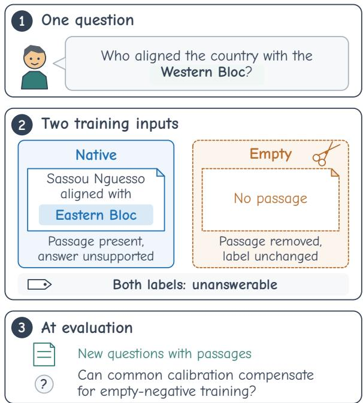
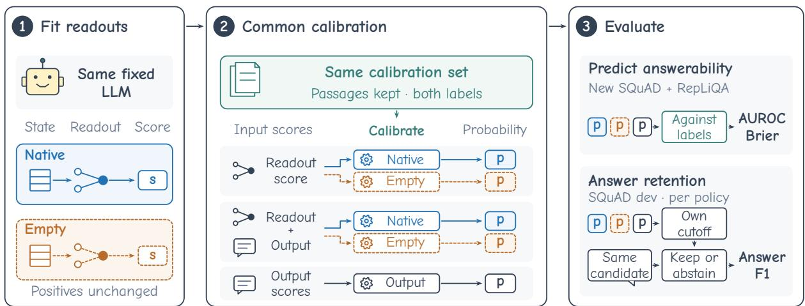
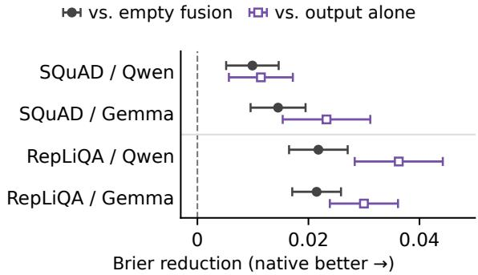
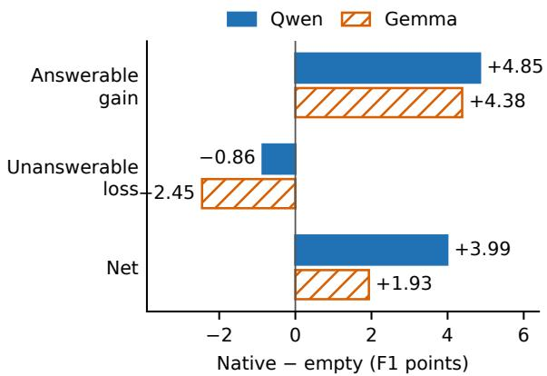

# Training Negatives Still Matter After Calibrating Answerability Readouts

Jinchen Zhang Zheyuan Liu Yihan Zhu Meng Jiang University of Notre Dame jzhang47@nd.edu

## Abstract

Answerability readouts predict whether a passage supplies an answer, but whether calibration can compensate for removing negative passages during training remains unclear. We present a controlled study of how trainingnegative construction affects calibrated prediction, ranking, and downstream answer retention. We compare native training, which retains negative passages, with empty training, which removes them, holding questions, labels, positive examples, and model weights fixed. Both are calibrated on the same labeled native examples. On SQuAD 2.0 and RepLiQA, native-trained logistic readouts at selected depths achieve lower Brier loss for Qwen2.5-7B-Instruct and Gemma-2-9B-it, with or without output scores. Native fusion also outperforms calibrated output alone. Post-hoc AUROC analysis shows better ranking under native training, beyond what threshold adjustment alone can explain. On the official SQuAD 2.0 development set, native readout policies improve F1 over empty policies but retain more answers to unanswerable questions. The advantage varies by estimator and depth, while RepLiQA’s text shortcuts limit claims about contextual understanding. Unfinished generations prevent complete answer-level evaluation, although worst-case bounds preserve the native–empty F1 gains. Our findings show that training negatives affect ranking and downstream decisions even after common calibration, without establishing a universal advantage for native training.

## 1 Introduction

A passage can discuss the subject of a question without providing its answer. A questionanswering system instructed to rely on that passage must distinguish the two cases to decide when to abstain. An answerability readout predicts whether the supplied text supports an answer, providing a signal for that decision (Slobodkin et al., 2023; Lavi et al., 2026).

  
Figure 1: A SQuAD fitting example with the passage summarized. Native (solid blue) and empty (dashed orange) training share the same unanswerable question and label. The bottom panel concerns calibration on new inputs, not predictions for this example.

For hidden-state answerability readouts, threshold adjustment can improve cross-dataset transfer without changing the learned direction (Lavi et al., 2026). Work on constructed negatives also examines transfer with label-free thresholds (Luo et al., 2026). A simple way to construct a negative example is to delete the passage from an unanswerable question–passage pair, but the readout must still recognize unsupported questions when text is present at evaluation. Prior results on threshold transfer do not establish whether calibration on the same labeled question–passage examples can compensate for omitting that context during fitting.

To address this question, we compare native negatives, which retain the original non-answering passages, with empty negatives, which remove them (Figure 1). We hold questions, labels, positive examples, and model weights fixed to isolate the effect of retaining negative passages. Both conditions share depth selection on native inputs and use identical labeled native examples to fit separate calibration maps (Figure 2). We evaluate Qwen2.5- 7B-Instruct and Gemma-2-9B-it on SQuAD 2.0 and RepLiQA. Our contributions are summarized as follows:

• Training negatives affect calibrated prediction. At the selected depths, native-trained logistic readouts have lower Brier loss than empty-trained readouts on both datasets. The Brier advantage also holds forfusion, which combines each readout with an output score derived from the likelihood of the prescribed abstention response. Adding the native readout to the output score also lowers Brier loss relative to calibrated output alone (§6.2).

• The predictive advantage includes better input ranking. Post-hoc comparisons of the calibrated readouts without output scores show higher AUROC under native training in both models and datasets (§6.3). Threshold adjustment alone cannot remove this ranking difference, so the advantage is not solely a consequence of threshold placement.

• Native fitting changes the trade-off between answering and abstaining. On the official SQuAD 2.0 development set, readout-based policies retain each model’s fixed candidate or abstain. Native policies achieve higher F1 than empty policies in both models, retaining more correct answers but also more answers to unanswerable questions. Worst-case bounds for unfinished generations keep the native–empty F1 gains positive. Native gains over unchanged behavior (Qwen) and outputbased vetoes (Gemma) remain inconclusive (§6.4).

The predictive advantage of native fitting depends on estimator and depth, with some settings yielding lower fusion Brier loss under empty fitting. On RepLiQA, a word-count classifier also benefits from native training, so the construction effect is not specific to hidden-state readouts (§6.5).

## 2 Motivation

In Figure 1, the negative example pairs a passage about the Eastern Bloc with a question about the

Western Bloc. Native fitting retains this topically related passage, whereas empty fitting removes it while keeping the question and negative label. Deletion changes content, length, and text presence together, so the comparison cannot attribute an advantage specifically to learning semantic mismatch.

Removing negative passages may affect the threshold needed for answerability decisions, the ranking of inputs, or both. We compare probability quality after common probability calibration to test whether a predictive difference remains. Ranking provides a complementary test because threshold adjustment cannot change the ordering of inputs. Because passage support does not guarantee a correct generated answer, we also examine answer retention.

## 3 Related Work

Answerability readouts. Hidden-state classifiers predict answerability (Slobodkin et al., 2023), and sparse-autoencoder studies examine feature generalization for this task (Heindrich et al., 2025). Lavi et al. (2026) compare difference-in-means (DiM) and logistic readouts on four QA datasets, including SQuAD 2.0 and RepLiQA, and find that validation-set threshold adjustment improves crossdataset transfer without changing the learned direction. Luo et al. (2026) study native and constructed negatives, including document replacement and answer-sentence deletion, with label-free quantile transfer thresholds. We vary negative fitting passages and evaluate ranking and prediction after calibration on identical labeled native examples.

Negative construction and shortcuts. For tested QA systems, SQuAD’s human-written negatives are harder than TF-IDF-retrieved or rule-generated negatives in separate datasets (Rajpurkar et al., 2018). BM25 hard negatives improve in-batch dense passage retrieval (Karpukhin et al., 2020). Partial-input baselines expose shortcuts in reading comprehension (Kaushik and Lipton, 2018) and NLI (Gururangan et al., 2018; Poliak et al., 2018). Our question-only and word-count controls test label shortcuts.

Irrelevant context. Irrelevant text can disrupt comprehension (Jia and Liang, 2017) and reasoning (Shi et al., 2023), motivating context-robust training (Yoran et al., 2024). Zhang et al. (2026) test whether multi-turn confidence responds to useful evidence or conversational filler. We compare ranking and threshold transfer with evidence and token-matched irrelevant additions.

  
Figure 2: Controlled comparison of native (solid blue) and empty (dashed orange) fitting, with the model, readout depth, questions, and labels held fixed. The left panel fits readouts on condition-specific states, yielding scores s. Neural and speech icons denote readout and output scores, respectively. Separate maps (gears) use identical labeled native examples (teal) to calibrate readout scores, both signals jointly (fusion), or output scores alone (gray) into probabilities p. Prediction quality uses new SQuAD articles and RepLiQA documents. Answer retention uses official SQuAD 2.0 development questions. Each probability-based veto applies its own threshold to p to keep the same generated candidate within a model or abstain. Primary Brier comparisons use fusion, and primary answer-retention comparisons use readouts alone.

Calibration and abstention. Calibration has been studied for neural classifiers (Guo et al., 2017) and language-model QA (Jiang et al., 2021). Confidence methods use self-evaluation or variation across generations (Kadavath et al., 2022; Farquhar et al., 2024; Geng et al., 2024). Selective classification relates rejection to prediction risk and coverage (Geifman and El-Yaniv, 2017; Franc et al., 2023). Kamath et al. (2020) predict answer correctness under domain shift, whereas our veto signal predicts passage answerability. Kim et al. (2025) change decoding to answer or abstain according to available knowledge. We test how negative-context fitting changes answer retention with generated candidates fixed.

## 4 Background

Each QA example $( q _ { i } , c _ { i } , y _ { i } )$ contains a question, a passage, and a dataset label $y _ { i } \in \{ 0 , 1 \}$ . The label is 1 when the passage supplies an answer. The formatted prompt $x _ { i }$ requests a supported answer or a fixed abstention response when the passage supplies no answer. SQuAD requests the shortest copied span, whereas RepLiQA allows a short paraphrase. Labels describe passage support regardless of the model’s generated answer. Appendix A.1 gives both templates.

Passage support and answer correctness are distinct targets: sufficient context does not ensure successful model use (Joren et al., 2025), and answerability and correctness signals can support different abstention decisions (Wagner, 2026). Probe research also distinguishes selectivity from accuracy (Hewitt and Liang, 2019) and decodability from model use (Belinkov, 2022). We interpret readout performance as predictive access to passage answerability, without inferring how the model uses that signal.

Ranking, probability quality, and thresholded decisions measure different properties of these predictions. Area under the receiver operating characteristic curve (AUROC) measures the ranking of answerable and unanswerable inputs. Probability calibration maps scores to probabilities using sigmoid fitting (Platt, 2000) or isotonic regression (Zadrozny and Elkan, 2002). A strictly increasing scalar map of final predictions preserves AUROC, whereas isotonic regression can introduce ties. To assess probability quality over n evaluated inputs with final answerability probabilities $p ( x _ { i } ) \in [ 0 , 1 ]$ we use Brier loss, $\begin{array} { r } { \mathrm { B S } = n ^ { - 1 } \sum _ { i = 1 } ^ { n } ( p ( x _ { i } ) - y _ { i } ) ^ { 2 } } \end{array}$ a proper scoring rule (Gneiting and Raftery, 2007). Balanced accuracy (BA) averages the two class recalls after thresholding.

A lower Brier loss can reflect less miscalibration or better discrimination. Murphy’s decomposition separates reliability, resolution, and uncertainty (Murphy, 1973). We use the CORP isotonic decomposition (Dimitriadis et al., 2021), whose miscalibration (MCB) and discrimination (DSC) terms correspond in role to reliability and resolution, respectively, without necessarily matching their numerical values. Its evaluation-label fit is descriptive and is never deployed as a correction (Appendix B.3).

## 5 Negative-Context Comparison Protocol

For each negative example, native fitting retains $c _ { i }$ and empty fitting leaves the passage field blank in the same prompt template. Positive examples, questions, labels, and model weights remain fixed. Depth selection, calibration, and evaluation retain both classes’ original passages (native inputs, Figure 2).

Readout scores. Let $h _ { \ell } ( x ) \in \mathbb { R } ^ { d _ { \ell } }$ be the raw output of zero-based block ℓ at the last prompt token, before generation, where $d _ { \ell }$ is the hidden-state dimension. For condition $t \in \{ \mathrm { n a t i v e , e m p t y } \}$ , let $z _ { t } ( x )$ denote this state standardized using condition $t \mathbf { \bar { s } }$ fitting-set coordinate statistics for logistic regression. For DiM, $z _ { t } ( x ) = h _ { \ell } ( x )$ . The QA readout score is

$$
s _ { t } ( x ) = w _ { t } ^ { \top } z _ { t } ( x ) + b _ { t } ,\tag{1}
$$

with $\boldsymbol { w } _ { t } \in \mathbb { R } ^ { d _ { \ell } }$ and $b _ { t } \in \mathbb { R }$ . We fit L2-regularized logistic regression, a standard answerability readout (Slobodkin et al., 2023; Lavi et al., 2026). DiM uses the normalized difference between positive and negative raw activation means (Lavi et al., 2026), with $b _ { t } ~ = ~ 0$ for QA. Its scalar calibration map supplies the probability intercept. Appendix A.3 gives the fitting details.

We select a shared depth by cross-validating logistic AUROC on native inputs and averaging over both training conditions. Among four candidates per model, we select zero-based block 20 for Qwen and block 30 for Gemma on both datasets (Appendix A.5). Validation against empty negatives is nearly saturated across these depths in the SQuAD fitting data, making it less informative for selection. DiM uses the same selected depth, and final-block fits test depth dependence.

Common probability calibration. Each component pairs a fitted readout with a calibration map. Separate scalar logistic maps $g _ { t } : \mathbb { R }  [ 0 , 1 ]$ calibrate the two readouts on identical labeled native examples held out from each component’s weight fitting (Platt, 2000). The output score $u ( x )$ sums negative conditional log probabilities of the prescribed abstention response, without an end-ofsequence token. Larger u means less probability assigned to this response. To test whether the output signal complements the readout, a two-input logistic map $g _ { t } ^ { \mathsf { \hat { f u s i o n } } } : \mathbb { R } ^ { 2 }  [ 0 , 1 ]$ combines their scores. For one component, the probabilities are

$$
\begin{array} { r l } & { ~ p _ { t } ( x ) = g _ { t } \big ( s _ { t } ( x ) \big ) , } \\ & { p _ { t } ^ { \mathrm { f u s i o n } } ( x ) = g _ { t } ^ { \mathrm { f u s i o n } } \big ( u ( x ) , s _ { t } ( x ) \big ) . } \end{array}\tag{2}
$$

Calibration standardizes these scalar inputs using calibration data only. The SQuAD predictor averages six calibrated component predictions, whereas RepLiQA uses one fitted component per condition.

Comparators. For the output-only comparison, we use isotonic calibration on SQuAD (Zadrozny and Elkan, 2002). On RepLiQA, we select by calibration Brier loss among maps that use either the score for the full abstention response or separate scores for its tokens (Appendix A.2). Answer-level evaluation instead selects the output comparator by calibration answer F1 (§6.1). To test whether simple text features predict the labels, we fit baselines using question-only or question–passage TF-IDF features, or just the numbers of words in the question and passage.

## 6 Experiments

## 6.1 Experimental Setup

We use Qwen2.5-7B-Instruct and Gemma-2-9B-it (Qwen, 2024; Gemma Team, 2024) on SQuAD 2.0 (Rajpurkar et al., 2018) and RepLiQA (Monteiro et al., 2024). RQ1 tests calibrated probability quality, and RQ2 asks whether a ranking difference remains. RQ3 measures the answering consequences on a separate split, and RQ4 examines estimator, depth, and dataset boundaries. A constructed factual task provides an additional threshold-transfer diagnostic.

Data roles. SQuAD extends span-based QA (Rajpurkar et al., 2016) with human-written unanswerable questions. We reserve its official development split for answer-level evaluation. Probability evaluation uses 164 new articles from the training release, totaling 1,312 class-balanced inputs. The six SQuAD components use different assignments of a 48-article pool. Each component separates weight fitting from probability calibration, but components overlap and share depth selection on the full pool. We average their probabilities on new articles without refitting. RepLiQA contains human-created fictional documents. We use its first released split with 256 new evaluation documents and 1,280 questions, including 1,020 answerable and 260 unanswerable questions. Both conditions share fitting and calibration assignments within each study. The studies use different fitting protocols and class proportions, so we report them separately rather than pool their effects. We exclude evaluation texts from fitting, selection, calibration, and earlier diagnostics. Appendix A gives the assignments and study history.

Endpoints and uncertainty. For each model, the two prespecified primary comparisons are native logistic fusion against empty logistic fusion and against output alone. They test whether fitting negatives matter when the output signal is available and whether the readout adds value to that signal. Brier loss is the primary endpoint. AUROC uses final probabilities, including the SQuAD component average. For descriptive BA, we classify an input as answerable when $p ( x _ { i } ) > 0 . 5$ . Readout-alone AUROC differences have post-hoc paired-cluster intervals (Appendix B.2). For the primary Brier comparisons, each article or document contributes one mean paired loss difference. We apply Bonferroni correction to the four comparisons per dataset, yielding 98.75% t intervals, and check sensitivity with paired cluster bootstrap intervals. Both methods condition on fixed fits and calibration maps, excluding refitting and selection uncertainty.

Answer-level protocol. Each model generates one greedy candidate, capped at 64 tokens, for all 11,873 questions in the official SQuAD 2.0 development set. Every veto policy receives the same candidate and either retains it or replaces it with abstention. None can recover an answer the model did not generate.

Readout-based vetoes reuse the SQuAD readouts, calibration maps, and component average to score each input from its pre-generation state. Earlier limits on retaining answers to unanswerable calibration questions also rejected many correct answers. We therefore choose veto thresholds to maximize answer F1 on 128 generated calibration answers per model, using articles held out from probability calibration. The objective and thresholds are fixed before development evaluation. To isolate the readout’s answering consequences, the primary policy uses the readout alone, with fusion as a secondary comparison. For each model, we compare the native readout policy with the empty readout policy, an output-based veto, and unchanged model behavior. For the output-based veto, calibration answer F1 selects a scalar logistic map for Qwen and an isotonic map for Gemma.

We average official SQuAD F1, based on normalized token overlap, over all development questions. We use question-weighted paired article-bootstrap intervals adjusted for six comparisons. With complete outputs, the prespecified criteria require a gain of at least 1 F1 point and an adjusted interval lower bound above zero. Unfinished generations receive zero credit for every policy and remain in the denominator. Sensitivity bounds quantify their effect, but the prespecified complete-output requirement remains unmet (Appendix C).

## 6.2 RQ1: Does Native Fitting Improve Calibrated Prediction?

With calibration examples and output scores held fixed, native-trained logistic readouts yield lower fusion Brier loss than empty-trained readouts on both datasets (Table 1). On SQuAD, native rather than empty training reduces fusion Brier loss from 0.095 to 0.085 for Qwen and from 0.110 to 0.095 for Gemma. On RepLiQA the reductions are 0.022 and 0.021, respectively. Native fusion also outperforms calibrated output alone. Paired t and paired cluster bootstrap intervals exclude zero for all four primary comparisons per dataset (Figure 3). RepLiQA’s text shortcuts limit what those gains establish about relating questions to passages (§6.5).

<table><tr><td>Dataset / model</td><td>Native fusion</td><td>Empty fusion</td><td>Output</td></tr><tr><td>SQuAD / Qwen</td><td>0.085</td><td>0.095</td><td>0.097</td></tr><tr><td>SQuAD / Gemma</td><td>0.095</td><td>0.110</td><td>0.119</td></tr><tr><td>RepLiQA / Qwen</td><td>0.029</td><td>0.051</td><td>0.066</td></tr><tr><td>RepLiQA / Gemma</td><td>0.043</td><td>0.064</td><td>0.073</td></tr></table>

Table 1: Primary Brier losses on new articles and documents at selected depths. Lower is better. Fusion predictors share output scores and labeled calibration examples, differing only in training negatives. Output is each study’s prespecified comparator. Figure 3 shows paired improvements.

The advantage over output alone could reflect unequal access to training labels or output features. In post-hoc SQuAD controls, we give output calibration access to the readout-fitting articles and separate token scores for the abstention response. Native fusion still has lower Brier loss than all six variants (Appendix D.1, Table 10), so expanded label and feature access does not close the gap.

Native training lowers Brier loss even without the output score (Table 2), so the benefit does not require fusion. On SQuAD, native training reduces readout-alone Brier from 0.106 to 0.088 for Qwen and from 0.121 to 0.099 for Gemma. Fusion adds little to the native readouts, lowering SQuAD Brier by at most 0.004 and slightly raising RepLiQA Brier.

<table><tr><td>Model</td><td>Training</td><td>Brier</td><td>AUROC</td><td>BA</td></tr><tr><td colspan="5">SQuAD</td></tr><tr><td>Qwen</td><td>native</td><td>0.088</td><td>0.947</td><td>0.888</td></tr><tr><td rowspan="3">Gemma</td><td>empty</td><td>0.106</td><td>0.923</td><td>0.864</td></tr><tr><td>native</td><td>0.099</td><td>0.934</td><td>0.867</td></tr><tr><td>empty</td><td>0.121</td><td>0.904</td><td>0.823</td></tr><tr><td colspan="5">RepLiQA</td></tr><tr><td>Qwen</td><td>native</td><td>0.028</td><td>0.996</td><td>0.916</td></tr><tr><td rowspan="3">Gemma</td><td>empty</td><td>0.047</td><td>0.984</td><td>0.853</td></tr><tr><td>native</td><td>0.042</td><td>0.992</td><td>0.868</td></tr><tr><td>empty</td><td>0.064</td><td>0.978</td><td>0.792</td></tr></table>

Table 2: Logistic readouts without output scores, after common probability calibration, on the same inputs as Table 1. BA uses a probability threshold of 0.5.

## 6.3 RQ2: Does the Advantage Include Better Ranking?

A Brier improvement alone does not establish better ranking. We therefore compare AUROC for the calibrated readouts without output scores (Table 2). Native training improves AUROC on SQuAD from 0.923 to 0.947 for Qwen and from 0.904 to 0.934 for Gemma. In all four dataset–model comparisons, adjusted post-hoc paired-cluster intervals exclude zero in favor of native training (Appendix B.2, Table 6). A strictly increasing scalar recalibration of these final probabilities would preserve their AU-ROC difference. The advantage thus includes a ranking difference that threshold adjustment alone cannot explain. On SQuAD, these values describe the six-component average rather than a single linear direction.

  
Figure 3: Brier reductions from native fusion relative to empty fusion (circles) and output alone (squares). Positive values favor native fusion. Error bars show paired 98.75% article/document t intervals, corrected for four comparisons per dataset. Datasets are not pooled. Appendix B, Table 5, gives exact differences and intervals.

The descriptive CORP decomposition places most of the Brier gap between readouts in discrimination (DSC). For SQuAD Qwen, DSC is 0.167 with native and 0.152 with empty training, whereas miscalibration (MCB) differs by 0.002. DSC accounts for most of the gap in the other three comparisons (Appendix B.3).

## 6.4 RQ3: How Does Native Fitting Affect Answer Retention?

Better answerability predictions need not improve the answers a system delivers. In a separate evaluation on the official SQuAD 2.0 development set, we vary the veto signal while keeping each model’s generated candidates fixed. The questions come from different articles than those used for the probability comparisons. Native readout policies improve F1 over empty readout policies by 3.99 points for Qwen and 1.93 for Gemma (Table 3). Both adjusted confidence intervals exclude zero. The original complete-output requirement remains unmet because some generations hit the token limit, but worst-case bounds keep both native–empty differences positive.

The F1 gains come from retaining more correct answers, at the cost of more answers to unanswerable questions. In both models, the additional credit on answerable questions exceeds the loss on unanswerable questions (Figure 4).

Both the input signal and the threshold objective affect the size of the F1 gain. Adding the output score narrows the native–empty F1 difference to 0.67 for Qwen and 1.46 for Gemma. With readouts alone, the F1-selected thresholds and two alternative threshold objectives all favor native training in point estimates, but the gains range from 0.74 to 3.99 for Qwen and 1.93 to 5.91 for Gemma. The alternatives limit retention on unanswerable calibration questions to 5% or 10%, and have no paired intervals (Appendix C, Table 9).

Against the other prespecified comparators, native readout vetoes improve Gemma F1 over unchanged behavior by 8.20 points and Qwen F1 over the selected output veto by 1.03 points, with both adjusted intervals above zero (Table 3). For Qwen, the empty readout policy scores 78.71 F1, below unchanged behavior at 81.51, so part of the native– empty gain reflects a weak baseline. Qwen’s gain over the selected output comparator falls from 1.03 to 0.97 points when unfinished generations receive their worst-case contributions, below the prespecified 1-point practical criterion. A Qwen veto with isotonic output calibration is also closer to native than the comparator selected by calibration F1 (Appendix C). The adjusted intervals leave the native policy’s advantage over unchanged behavior unresolved for Qwen and its advantage over outputbased vetoes unresolved for Gemma.

  
Figure 4: Native-minus-empty answer F1, separated into official credit differences on answerable and unanswerable questions. Bars sum to the net gain over all 11,873 questions per model, with zero credit for unfin ished generations. These are arithmetic contributions (Appendix C.4).

<table><tr><td>Policy</td><td>Qwen</td><td>Gemma</td></tr><tr><td>Answer F1</td><td></td><td></td></tr><tr><td>Unchanged</td><td>81.51</td><td>70.65</td></tr><tr><td>Empty readout</td><td>78.71</td><td>76.92</td></tr><tr><td>Native readout Selected output</td><td>82.70 81.67</td><td>78.85 78.12</td></tr><tr><td>Native fusion</td><td></td><td>79.69</td></tr><tr><td>Empty fusion</td><td>83.82 83.16</td><td>78.23</td></tr><tr><td></td><td></td><td></td></tr><tr><td>Native readout minus comparator</td><td></td><td></td></tr><tr><td>Empty readout Selected output</td><td>3.99 [2.43, 5.77] 1.03 [0.13, 1.99]</td><td>1.93 [0.91, 2.88] 0.72 [–0.06, 1.41]</td></tr></table>

Table 3: Answer F1 on the official SQuAD 2.0 development set (0–100). Policies share generated candidates within each model. Brackets give paired articlebootstrap intervals, Bonferroni-adjusted for six comparisons at nominal 95% family confidence. F1 values are lower bounds with zero credit for unfinished generations (sensitivity bounds in Appendix C.2). Differences use unrounded scores.

## 6.5 RQ4: What Limits the Native Fitting Advantage?

We vary estimator and depth in the primary fusion comparison to test whether the preference for native negatives extends beyond the selected logistic readouts. At Qwen’s final SQuAD block, native logistic fusion is slightly worse than empty fusion, by 0.0008 Brier relative to empty’s loss of 0.095. At Gemma’s selected block, fusion using DiM favors empty training, by 0.0033 relative to empty’s loss of 0.108. Table 11 (Appendix D.2) lists all combinations. On SQuAD, only the selected logistic contrasts have paired intervals. On RepLiQA, DiM favors empty training at Gemma’s selected block and at both models’ final blocks, with all three exploratory 95% intervals excluding zero. Qwen’s selected DiM fit favors native training, also with an exploratory interval excluding zero. Final-block logistic fits favor native training in both models, less strongly than the selected-block fits. These reversals limit the preference for native fitting to the tested estimator and depth.

Simple text features predict RepLiQA labels well, raising the shortcut concern also studied in controlled NLI evaluations (McCoy et al., 2019). Question-only AUROC is 0.982, and a classifier using question and passage word counts reaches BA 0.953 with native training (Appendix D.4), above both native readouts in Table 2. The word-count classifier has lower negative-class Brier (0.050) than the Qwen readout (0.098) or Gemma readout (0.138), while readouts perform better on positives. With roughly four positives per negative, aggregate Brier can favor a readout that is worse on unanswerable questions. Giving the two classes equal weight also favors the word-count classifier over both native readouts (Appendix D.4).

Negative construction affects the word-count classifier too: its RepLiQA Brier improves from 0.099 with empty training to 0.041 with native training. The construction effect on RepLiQA is therefore not specific to hidden-state readouts. On the same new SQuAD articles, the previously fitted text baselines have BA 0.506–0.543 (Appendix D.4). Their weaker performance makes SQuAD the more informative setting for the hidden-state comparison.

## 6.6 Additional Analysis: Threshold Transfer

The QA ranking gap survives probability calibration, but a well-ordered local signal can still fail to transfer its decision threshold. We examine that separate issue in a retrospective constructed factual task.

Task and calibration. We adapt BBQ scenarios (Parrish et al., 2022) into factual questions with three answer options, including unknown (Appendix E). We extend a bare background (Bkg) with evidence (E) or an irrelevant sentence (I), labeling only E as answerable. For each model, E and I prompts are matched in total token count. E/Bkg and E/I denote the two training contrasts.

We fit readouts by leaving out one of 8 development scenarios and evaluate on 24 different scenarios. Notebook (I-N) and bag (I-B) variants check wording sensitivity. Qwen block 7 and Gemma block 11, at the last prompt token, were fixed before QA depth selection.

Training thresholds maximize BA on the fitting examples. Common threshold calibration maximizes BA on one 12-scenario half and tests on the other, then swaps roles, keeping readout weights fixed. Within-scenario AUROC compares E and I variants locally, unlike pooled QA AUROC. Metrics average across scenarios and dependent fits. Reused templates and AI-assisted review limit generalization (Appendix E).

Results. E/Bkg logistic readouts rank evidence above irrelevant additions almost perfectly within each scenario, yet their training thresholds yield BA of only 0.638 for Qwen and 0.589 for Gemma. Common threshold calibration raises BA to 0.898 and 0.920, respectively (Table 4). Strong local ranking therefore does not ensure that a threshold transfers to new scenarios.

Better thresholds account for much of the original decision gap, but the remaining differences favor training against irrelevant additions. After threshold calibration, E/I readouts still have higher BA point estimates than E/Bkg readouts across both models, both estimators, and both irrelevant wordings, giving 8 comparisons (Appendix E, Table 15). Of the 8 conditional 95% scenario-bootstrap intervals, 6 exclude zero, but the 2 Gemma logistic differences, 0.015 and 0.021, remain uncertain. These are dependent comparisons, and crossing zero does not establish equivalence. Context-only unigram baselines exceed 0.989 BA after threshold calibration, limiting what these decisions establish about contextual understanding.

## 7 Discussion

Evaluating how readouts rank answerable inputs against native negatives helps determine what threshold adjustment can repair, even when validation against empty negatives is near perfect (Appendix A.5). Our comparison identifies a limit of the tested fitting and calibration procedures, leaving other ways of learning from native labels untested.

Threshold adjustment can improve decisions when ranking is accurate (Lavi et al., 2026). Our constructed task shows this benefit across scenarios, although near-perfect within-scenario AUROC does not establish accurate pooled ranking.

Choosing training negatives also requires validation with the intended fitting procedure. The reversals across estimators and depths (§6.5) prevent a uniform recommendation for native negatives. Our logistic and DiM procedures differ in preprocessing as well as fitting objective, so their contrast does not isolate the source of that estimator dependence.

On RepLiQA, text shortcuts (Geirhos et al., 2020) and class imbalance make text controls and class-conditional losses necessary to interpret aggregate gains. The construction effect also appears in the word-count classifier, so this dataset does not establish that the benefit requires hidden states.

Even a predictive advantage on native inputs is insufficient to choose a readout for answer selection. The answer-level evaluation does not establish consistent F1 advantages over output-based vetoes or unchanged behavior across both models (§6.4). Both should remain baselines for evaluating a veto policy. Under our F1 objective, the credit from retaining additional correct answers exceeds the loss from additional answers to unanswerable questions. An application that penalizes those errors more heavily may favor another threshold.

<table><tr><td>Model</td><td>Training</td><td>Within scenario AUROC</td><td>BA training threshold</td><td>BA recalibrated threshold</td></tr><tr><td>Q</td><td>Logistic / E/Bkg</td><td>1.000</td><td>0.638</td><td>0.898</td></tr><tr><td>Q</td><td>Logistic / E/I-N</td><td>1.000</td><td>0.766</td><td>0.969</td></tr><tr><td>Q</td><td>Logistic / E/I-B</td><td>1.000</td><td>0.770</td><td>0.970</td></tr><tr><td>G</td><td>Logistic / E/Bkg</td><td>1.000</td><td>0.589</td><td>0.920</td></tr><tr><td>G</td><td>Logistic / E/I-N</td><td>1.000</td><td>0.682</td><td>0.935</td></tr><tr><td>G</td><td>Logistic / E/I-B</td><td>1.000</td><td>0.738</td><td>0.941</td></tr></table>

Table 4: Threshold transfer with fixed logistic readouts (Q: Qwen, G: Gemma). Training contrasts are defined in §6.6. Both BA columns test held-out scenarios with training thresholds or thresholds calibrated on other scenarios. Metrics average over 24 scenarios and dependent fits. BA includes both irrelevant-wording variants. Appendix E, Table 14, also reports DiM.

## 8 Conclusion

At the selected depths, native-trained logistic readouts achieve lower Brier loss and higher AUROC than empty-trained readouts after common probability calibration. In some other estimator–depth settings, empty fitting yields lower fusion Brier loss. With generated candidates fixed, native readout policies retain more correct answers and more answers to unanswerable questions, yielding higher F1 than empty readout policies. Some comparisons with output-based vetoes and unchanged behavior remain inconclusive.

## Limitations

Scope and identification. Our evidence covers two instruction-tuned models and two English QA datasets with different fitting protocols and class proportions. Removing negative passages changes content, length, and text presence together, so the comparison does not isolate their separate effects. The evaluation texts were unused in our earlier experiments, but pretraining exposure or semantic overlap remains possible.

Selection and statistical uncertainty. We examine linear readouts at one token position and select a shared depth from four candidates using native validation labels for both training conditions. This design does not bound the best attainable readout performance. Intervals condition on fixed fits and calibration samples, excluding refitting and depthselection uncertainty. The models also share evaluation questions, so they are not independent replications of the sampled data.

Shortcuts and validation. The constructed factual task reuses previously inspected templates and uses AI-assisted content review without independent human validation. Its lexical shortcuts, and those found in RepLiQA, limit what high accuracy establishes about contextual understanding. Predictive access does not identify how the model uses evidence.

Answer-policy evaluation. Veto thresholds use 128 calibration answers per model, and the observed F1 gap varies across operating objectives. Unfinished generations leave the complete-output requirement unmet, although worst-case bounds keep the native–empty F1 gains positive. F1 gains under the chosen thresholds establish neither a safety improvement nor a uniform reduction in selective risk.

## Ethical Considerations

We use existing QA datasets and open-weight language models, with no new participant data collection. The constructed factual task is adapted from BBQ but does not measure fairness, social bias, or harms to demographic groups.

Public source texts can contain personal names, and BBQ includes stereotypes. To limit redistribution, the anonymous reproduction package excludes model weights, raw passages, and generated answer text. Appendix F documents the artifact licenses and the package’s scope. These exclusions do not imply that the source datasets are free of identifying or offensive content.

AI assistance. AI agents assisted with research brainstorming, code implementation, and manuscript drafting and revision. The authors reviewed the AI-assisted contributions and conducted numerical and reproducibility checks.

## References

Yonatan Belinkov. 2022. Probing classifiers: Promises, shortcomings, and advances. Computational Linguistics, 48(1):207–219.

Timo Dimitriadis, Tilmann Gneiting, and Alexander I. Jordan. 2021. Stable reliability diagrams for probabilistic classifiers. Proceedings of the National Academy ofSciences, 118(8):e2016191118.

Sebastian Farquhar, Jannik Kossen, Lorenz Kuhn, and Yarin Gal. 2024. Detecting hallucinations in large language models using semantic entropy. Nature, 630:625–630.

Vojtech Franc, Daniel Prusa, and Vaclav Voracek. 2023. Optimal strategies for reject option classifiers. Journal ofMachine Learning Research, 24(11):1–49.

Yonatan Geifman and Ran El-Yaniv. 2017. Selective classification for deep neural networks. In Advances in Neural Information Processing Systems, volume 30.

Robert Geirhos, Jörn-Henrik Jacobsen, Claudio Michaelis, Richard Zemel, Wieland Brendel, Matthias Bethge, and Felix A. Wichmann. 2020. Shortcut learning in deep neural networks. Nature Machine Intelligence, 2:665–673.

Gemma Team. 2024. Gemma 2: Improving open language models at a practical size. Preprint, arXiv:2408.00118.

Jiahui Geng, Fengyu Cai, Yuxia Wang, Heinz Koeppl, Preslav Nakov, and Iryna Gurevych. 2024. A survey of confidence estimation and calibration in large language models. In Proceedings ofthe 2024 Conference of the North American Chapter of the Associationfor Computational Linguistics: Human Language Technologies (Volume 1: Long Papers), pages 6577–6595, Mexico City, Mexico. Association for Computational Linguistics.

Tilmann Gneiting and Adrian E. Raftery. 2007. Strictly proper scoring rules, prediction, and estimation. Journal of the American Statistical Association, 102(477):359–378.

Chuan Guo, Geoff Pleiss, Yu Sun, and Kilian Q. Weinberger. 2017. On calibration of modern neural networks. In Proceedings ofthe 34th International Conference on Machine Learning, volume 70 of Proceedings of Machine Learning Research, pages 1321– 1330.

Suchin Gururangan, Swabha Swayamdipta, Omer Levy, Roy Schwartz, Samuel R. Bowman, and Noah A. Smith. 2018. Annotation artifacts in natural language inference data. In Proceedings of the 2018 Conference of the North American Chapter of the Associationfor Computational Linguistics: Human Language Technologies, Volume 2 (Short Papers), pages 107–112, New Orleans, Louisiana. Association for Computational Linguistics.

Lovis Heindrich, Philip Torr, Fazl Barez, and Veronika Thost. 2025. Do sparse autoencoders generalize? A case study of answerability. In ICML Workshop on Reliable and Responsible Foundation Models.

John Hewitt and Percy Liang. 2019. Designing and interpreting probes with control tasks. In Proceedings ofthe 2019 Conference on Empirical Methods in Natural Language Processing and the 9th International Joint Conference on Natural Language Processing (EMNLP-IJCNLP), pages 2733–2743. Association for Computational Linguistics.

Robin Jia and Percy Liang. 2017. Adversarial examples for evaluating reading comprehension systems. In Proceedings of the 2017 Conference on Empirical Methods in Natural Language Processing, pages 2021–2031, Copenhagen, Denmark. Association for Computational Linguistics.

Zhengbao Jiang, Jun Araki, Haibo Ding, and Graham Neubig. 2021. How can we know when language models know? On the calibration of language models for question answering. Transactions ofthe Associationfor Computational Linguistics, 9:962–977.

Hailey Joren, Jianyi Zhang, Chun-Sung Ferng, Da-Cheng Juan, Ankur Taly, and Cyrus Rashtchian. 2025. Sufficient context: A new lens on retrieval augmented generation systems. In The Thirteenth International Conference on Learning Representations.

Saurav Kadavath, Tom Conerly, Amanda Askell, Tom Henighan, Dawn Drain, Ethan Perez, Nicholas Schiefer, Zac Hatfield-Dodds, Nova DasSarma, Eli Tran-Johnson, Scott Johnston, Sheer El-Showk, Andy Jones, Nelson Elhage, Tristan Hume, Anna Chen, Yuntao Bai, Sam Bowman, Stanislav Fort, and 17 others. 2022. Language models (mostly) know what they know. Preprint, arXiv:2207.05221.

Amita Kamath, Robin Jia, and Percy Liang. 2020. Selective question answering under domain shift. In Proceedings of the 58th Annual Meeting of the Association for Computational Linguistics, pages 5684– 5696. Association for Computational Linguistics.

Vladimir Karpukhin, Barlas Oguz, Sewon Min, Patrick Lewis, Ledell Wu, Sergey Edunov, Danqi Chen, and Wen-tau Yih. 2020. Dense passage retrieval for opendomain question answering. In Proceedings of the 2020 Conference on Empirical Methods in Natural Language Processing (EMNLP), pages 6769–6781. Association for Computational Linguistics.

Divyansh Kaushik and Zachary C. Lipton. 2018. How much reading does reading comprehension require? A critical investigation of popular benchmarks. In Proceedings of the 2018 Conference on Empirical Methods in Natural Language Processing, pages 5010–5015, Brussels, Belgium. Association for Computational Linguistics.

Hyuhng Joon Kim, Youna Kim, Sang-goo Lee, and Taeuk Kim. 2025. When to speak, when to abstain: Contrastive decoding with abstention. In Proceedings ofthe 63rd Annual Meeting ofthe Association for Computational Linguistics (Volume 1: Long Papers), pages 9710–9730, Vienna, Austria. Association for Computational Linguistics.

Maor Juliet Lavi, Tova Milo, and Mor Geva. 2026. Detecting (un)answerability in large language models with linear directions. In Proceedings of the 19th Conference ofthe European Chapter ofthe Association for Computational Linguistics (Volume 1: Long Papers), pages 682–699. Association for Computational Linguistics.

Ziyang Luo, Zhongyao Chu, Xinjie He, Youting Wang, Xukui Qin, Runxiong Wu, and Yan-Syuan Chen. 2026. You only pass once: Answering and abstaining together in a single forward pass of a frozen language model. Preprint, arXiv:2608.14465.

R. Thomas McCoy, Ellie Pavlick, and Tal Linzen. 2019. Right for the wrong reasons: Diagnosing syntactic heuristics in natural language inference. In Proceedings ofthe 57th Annual Meeting ofthe Associationfor Computational Linguistics, pages 3428–3448, Florence, Italy. Association for Computational Linguistics.

Joao Monteiro, Pierre-Andre Noel, Etienne Marcotte, Sai Rajeswar, Valentina Zantedeschi, David Vazquez, Nicolas Chapados, Christopher Pal, and Perouz Taslakian. 2024. RepLiQA: A question-answering

dataset for benchmarking LLMs on unseen reference content. In Advances in Neural Information Processing Systems, volume 37, pages 24242–24276.

Allan H. Murphy. 1973. A new vector partition of the probability score. Journal ofApplied Meteorology, 12(4):595–600.

Alicia Parrish, Angelica Chen, Nikita Nangia, Vishakh Padmakumar, Jason Phang, Jana Thompson, Phu Mon Htut, and Samuel R. Bowman. 2022. BBQ: A hand-built bias benchmark for question answering. In Findings of the Association for Computational Linguistics: ACL 2022, pages 2086–2105, Dublin, Ireland. Association for Computational Linguistics.

Fabian Pedregosa, Gaël Varoquaux, Alexandre Gramfort, Vincent Michel, Bertrand Thirion, Olivier Grisel, Mathieu Blondel, Peter Prettenhofer, Ron Weiss, Vincent Dubourg, Jake Vanderplas, Alexandre Passos, David Cournapeau, Matthieu Brucher, Matthieu Perrot, and Édouard Duchesnay. 2011. Scikit-learn: Machine learning in Python. Journal ofMachine Learning Research, 12:2825–2830.

John C. Platt. 2000. Probabilistic outputs for support vector machines and comparisons to regularized likelihood methods. In Advances in Large-Margin Classifiers. MIT Press.

Adam Poliak, Jason Naradowsky, Aparajita Haldar, Rachel Rudinger, and Benjamin Van Durme. 2018. Hypothesis only baselines in natural language inference. In Proceedings of the Seventh Joint Conference on Lexical and Computational Semantics, pages 180–191, New Orleans, Louisiana. Association for Computational Linguistics.

Qwen. 2024. Qwen2.5 technical report. Preprint, arXiv:2412.15115.

Pranav Rajpurkar, Robin Jia, and Percy Liang. 2018. Know what you don’t know: Unanswerable questions for SQuAD. In Proceedings ofthe 56th Annual Meeting of the Association for Computational Linguistics (Volume 2: Short Papers), pages 784–789. Association for Computational Linguistics.

Pranav Rajpurkar, Jian Zhang, Konstantin Lopyrev, and Percy Liang. 2016. SQuAD: 100,000+ questions for machine comprehension of text. In Proceedings of the 2016 Conference on Empirical Methods in Natural Language Processing, pages 2383–2392, Austin, Texas. Association for Computational Linguistics.

Freda Shi, Xinyun Chen, Kanishka Misra, Nathan Scales, David Dohan, Ed H. Chi, Nathanael Schärli, and Denny Zhou. 2023. Large language models can be easily distracted by irrelevant context. In Proceedings of the 40th International Conference on Machine Learning, volume 202 of Proceedings of Machine Learning Research, pages 31210–31227.

Aviv Slobodkin, Omer Goldman, Avi Caciularu, Ido Dagan, and Shauli Ravfogel. 2023. The curious case of hallucinatory (un)answerability: Finding truths in

the hidden states of over-confident large language models. In Proceedings of the 2023 Conference on Empirical Methods in Natural Language Processing, pages 3607–3625. Association for Computational Linguistics.

Benedikt J. Wagner. 2026. Two axes of LLM abstention: Answer correctness and question answerability. Preprint, arXiv:2607.08456.

Ori Yoran, Tomer Wolfson, Ori Ram, and Jonathan Berant. 2024. Making retrieval-augmented language models robust to irrelevant context. In International Conference on Learning Representations.

Bianca Zadrozny and Charles Elkan. 2002. Transforming classifier scores into accurate multiclass probability estimates. In Proceedings ofthe Eighth ACM SIGKDD International Conference on Knowledge Discovery and Data Mining, pages 694–699. ACM.

Caiqi Zhang, Ruihan Yang, Xiaochen Zhu, Chengzu Li, Tiancheng Hu, Yijiang River Dong, Deqing Yang, and Nigel Collier. 2026. Confidence estimation for LLMs in multi-turn interactions. In Findings of the Associationfor Computational Linguistics: ACL 2026, pages 25661–25676, San Diego, California, United States. Association for Computational Linguistics.

## A Appendix: Data and Readout Fitting Protocol

This appendix specifies the data and fitting choices behind the controlled comparison. It also distinguishes the diagnostics that informed the design from evaluations on new articles and documents.

## A.1 QA Inputs and Training Negatives

Both datasets request a supported answer or the prescribed abstention response. SQuAD requires a copied span, while RepLiQA permits paraphrasing. The exact user-message templates are shown below, with placeholders for the supplied text and question.

Answer using only the passage   
below. If the passage does not   
supply the answer, output   
exactly UNANSWERABLE. Otherwise   
output only the shortest answer   
span copied from the passage.   
Do not explain.   
Passage:   
{context}   
Question: {question}   
Answer:

## RepLiQA

Answer using only the document   
below. If the document does not   
supply the answer, output   
exactly UNANSWERABLE. Otherwise   
give a short answer supported by   
the document; paraphrasing is   
allowed. Do not explain.   
Document:   
{context}   
Question: {question}   
Answer:

We format each template as a single user message using the model’s chat template, including the prefix for the assistant’s response and no additional system message. Empty negatives leave the passage field blank and retain the surrounding template. The prompts differ across datasets but are identical across training conditions within each dataset. Native negatives retain the dataset’s original question and passage, whereas empty negatives retain the question and remove the passage. Labels are never inferred from whether a model answers. Because both conditions retain the same questions, question-only predictors receive identical training inputs across training conditions. Deletion changes the input for an already labeled negative. The label concerns passage support, not whether the model can answer from parametric knowledge.

## A.2 Data Assignments

SQuAD assignments. We divide the 48-article fitting pool into three disjoint 16-article groups. The six components use all six ordered assignments of these groups to readout fitting, probability calibration and internal evaluation. We average component probabilities rather than vote on thresholded predictions. Both negative constructions and the output comparators share the same calibration assignments. The new-article evaluation reuses these existing fits without retraining. We specified the six-component probability average before evaluating new articles. In contrast, earlier held-out diagnostics averaged only the two components for which each article belonged to the internal evaluation group. The original 16-article calibration set is not the probability-fitting set for these six components. It supplies the 128 generated answers used to choose veto thresholds in the later answer-level evaluation.

To select new SQuAD articles for probability evaluation, we screen for exact overlap with earlier inputs after normalizing passages and questions and exclude texts shared across article titles. Eligible articles have at least four remaining paragraphs with both answerable and unanswerable questions. A fixed hash ordering selects 164 articles, four paragraphs per article, and one question of each class per paragraph, yielding 1,312 class-balanced questions. We fix membership before model inference. The 164-article evaluation excludes the eight task-development articles, 48 fitting articles, 16 original calibration articles and 32 original test articles. These checks do not guarantee semantic independence or lack of pretraining exposure. The official development split is used only for the later answer-level evaluation, separately from the probability evaluation.

RepLiQA assignments. We use the first released split, repliqa\_0, at dataset revision bc880adc 948fd3a70d5f8b2b3a1d1ee90d820dbd. We retain this version for the within-dataset comparison, rather than benchmark the latest release. A fixed hash ordering of its 3,591 document IDs assigns the first 24 documents to development, the next 96 to fitting, the next 64 to calibration, and the next 256 to evaluation. We keep all five questions per document, without sorting by labels, length, topic, or model outcomes. The evaluation set contains 1,020 answerable and 260 unanswerable questions. We choose the shared depth on fitting folds, then fit each readout on all 96 documents. Using Brier loss across three grouped calibration folds, we select among isotonic, scalar logistic, and permarker-token logistic output calibration and refit the selected map on all 64 calibration documents: scalar logistic for Qwen and per-marker-token logistic for Gemma. All three output alternatives remain in the saved results.

## A.3 Readout and Probability Fitting

Fits and text baselines use scikit-learn (Pedregosa et al., 2011). QA logistic fits use training-only coordinate standardization, L2 regularization with inverse regularization strength $C = 1$ , balanced class weights, and the LIBLINEAR solver. Optimization uses at most 2,000 iterations and a random seed of 0. For condition t, DiM uses the positive and negative fitting-set activation means $\mu _ { + , t } , \mu _ { - , t } \in \mathbb { R } ^ { d _ { \ell } }$ in raw coordinates:

$$
w _ { t } = \frac { \mu _ { + , t } - \mu _ { - , t } } { \| \mu _ { + , t } - \mu _ { - , t } \| _ { 2 } } , \qquad b _ { t } = 0 .
$$

The scalar calibration map subsequently supplies an intercept. Probability calibration standardizes its one or two input scores using calibration data only. Logistic calibration uses L2 regularization with $C = 1$ and an intercept. We use the LIB-LINEAR solver with at most 2,000 iterations and a random seed of 0. For probability calibration, SQuAD uses balanced class weights, which equal 1 on its balanced sets, whereas RepLiQA uses unweighted fitting at its observed prevalence. Isotonic output calibration is nondecreasing with clipped extrapolation.

## A.4 Activation and Output Extraction

Extraction uses pinned model revisions, bfloat16 (BF16) inference and scaled dot-product attention (SDPA). The state is the raw block output at the last prompt token. The output score is the negative sum of the log probabilities of the prescribed abstention response, without an end-of-sequence token. For response tokens $a _ { 1 } , \dots , a _ { K }$ , the per-markertoken comparator uses the vector of conditional log probabilities log $P ( a _ { k } \mid x _ { i } , a _ { < k } )$ , one feature per token. RepLiQA uses these log probabilities directly, while the SQuAD output controls negate each feature. Both fit unconstrained logistic coefficients after standardization, so this sign convention does not restrict the predictor family. Tokenization checks ensure that the continuation preserves the prompt prefix. Reference inputs verify compatibility with previously saved states and scores before we evaluate new inputs. We save predictions, fitted preprocessors and weights for replay. Because refitting can change tied TF-IDF feature selection, we report it separately from replay.

## A.5 Depth Selection and Study History

Both QA datasets use the same four candidate blocks per model and three article/documentgrouped fitting folds. The zero-based candidate blocks are 7, 13, 20 and 27 for Qwen, and 11, 20, 30 and 41 for Gemma. The selector averages native-validation logistic AUROC over folds and both training conditions, with ties favoring the shallower block. DiM uses the same selected depth rather than selecting its own. For empty-trained logistic readouts, three-fold cross-validation on the original SQuAD fitting articles yields fold-mean AUROC of 0.998–1.000 against empty negatives but 0.534–0.924 against native negatives across eight model-by-depth settings. Near saturation against empty negatives gives little guidance about which depth will work on native negatives. An earlier SQuAD diagnostic also examined the state after processing the first generated token. That position has access to a model output and is not used in the prompt-only evaluations on new articles and documents.

Exploratory development. Initial SQuAD readouts used Qwen block 7 and Gemma block 11, the depths previously fixed for the constructed factual task. They performed poorly on native inputs. Empty-trained fits reached BA 1.000 when tested against empty negatives but 0.500 against native negatives at their matched thresholds. Revisiting the already inspected 32-article test after fittingonly depth selection yielded much stronger readouts. Common threshold calibration removed or reversed some BA differences in those particular fits. These exploratory observations motivated the subsequent new-article design but do not replace its prespecified tests.

## B Appendix: Probability Results and Statistical Inference

## B.1 Primary Probability Comparisons

The QA probability tables report pooled AUROC and BA over all evaluation questions. BA averages the positive- and negative-class recall after predicting answerable when $p ( x _ { i } ) > 0 . 5$ , using the averaged probability for SQuAD. This fixed probability threshold is distinct from the F1-selected veto thresholds used in the answer-level evaluation.

In RepLiQA, one hundred evaluation documents contain only one class. Their within-document AUROC/BA is undefined, not zero, but all their questions remain in loss estimates and cluster resampling.

For the primary Brier comparisons, Brier-loss differences average paired cluster losses. SQuAD contributes eight equally weighted questions per article and RepLiQA five per document. Each dataset’s four primary differences use two-sided 98.75% t intervals and $1 0 { , } 0 0 0$ paired cluster bootstrap draws. Models share the same clusters. All intervals condition on the fitted predictors and calibration maps. They neither account for all historical hypothesis selection nor provide distributionfree guarantees.

Table 5 reports the absolute Brier losses and paired differences underlying Figure 3.

## B.2 Post-hoc Ranking Uncertainty

After examining the AUROC point estimates, we computed paired cluster bootstrap intervals for the four selected-depth logistic readout-alone differences in Table 6. This supplements the prespecified Brier tests rather than adding a new confirmation study. We kept all predictors, calibration maps, and evaluation inputs fixed. For SQuAD, predictions remain the mean of six calibrated components.

We drew 20,000 samples of 164 articles for SQuAD and 256 documents for RepLiQA, sampling clusters with replacement and retaining every question with its cluster’s multiplicity. Both training conditions and both models share the draws within each dataset. Each draw recomputes pooled AUROC, with half credit for tied scores, rather than averaging within-cluster AUROCs. We retained RepLiQA’s 100 single-class documents. Every resampled pool contained both classes.

The table reports ordinary 95% percentile intervals and Bonferroni-adjusted 98.75% intervals for these four supplementary contrasts across both datasets. This family is separate from the four primary Brier comparisons within each dataset. We sorted cluster identifiers and used seeds 20260928 and 20260929 for SQuAD and RepLiQA, respectively. The intervals quantify evaluation-sampling uncertainty conditional on the fitted predictors. They do not account for refitting, depth selection, or the earlier inspection of these results.

## B.3 Descriptive Loss Decomposition

We use the consistent, optimally binned, reproducible, and pool-adjacent-violators-based (CORP) decomposition to describe the Brier-loss gap after common probability calibration. We keep the evaluated probabilities fixed and fit a diagnostic isotonic map to evaluation labels using the pooladjacent-violators (PAV) algorithm. Let ${ \mathrm { B S } } _ { \mathrm { i s o } }$ denote the loss after isotonic recalibration of the evaluated probabilities, and let ${ \mathrm { B S } } _ { \mathrm { p r e v } }$ be the empirical prevalence predictor’s loss. The empirical miscalibration (MCB), discrimination (DSC), and uncertainty (UNC) terms are $\mathrm { M C B } = \mathrm { B S } - \mathrm { B S } _ { \mathrm { i s o } } ,$ ${ \mathrm { D S C } } = { \mathrm { B S } } _ { \mathrm { p r e v } } - { \mathrm { B S } } _ { \mathrm { i s o } }$ , and $\mathrm { U N C } = \mathrm { B S } _ { \mathrm { p r e v } } , \mathrm { g i v } -$ ing

$$
\mathrm { B S = M C B - D S C + U N C } .\tag{3}
$$

The evaluation-label isotonic fit is descriptive, not a deployed correction.

The decomposition uses no arbitrary probability bins. Its empirical PAV fit can be optimistic on finite evaluation samples, so the analysis does not replace the out-of-sample Brier endpoint. The uncertainty term differs across datasets because their class proportions differ, so we compare decomposition terms within each dataset rather than pool them across protocols. Higher DSC is not proof of semantic evidence access or of better decisions at every threshold.

## C Appendix: Answer Policies and Unfinished Generations

The answer-level comparison asks how alternative vetoes change the same generated candidates. We report all tested policies and explicitly retain the uncertainty from unfinished generations.

## C.1 Candidates, Thresholds, and Prespecified Comparisons

The evaluation covers all 11,873 official development questions across 35 articles: 5,928 answerable and 5,945 unanswerable. Each policy sees the same one-shot greedy candidate. A veto policy thresholds its calibrated answerability probability to retain the candidate or return an empty answer. It cannot force regeneration or recover an answer after the model abstains. We select thresholds and the output comparator only on the 128-answer calibration set, choosing scalar logistic output calibration for Qwen and isotonic output calibration for Gemma. These downstream choices differ from the comparator definitions in the earlier Brier experiments. The primary veto thresholds maximize answer F1 on these calibration answers, as does selection of the output comparator.

<table><tr><td>Dataset / model</td><td>Native fusion</td><td>Empty fusion</td><td>Output</td><td>Empty fusion — native 98.75% interval</td><td>Output — native 98.75% interval</td></tr><tr><td>SQuAD / Qwen</td><td>0.085</td><td>0.095</td><td>0.097</td><td>0.010 [0.005, 0.015]</td><td>0.011 [0.006, 0.017]</td></tr><tr><td>SQuAD / Gemma</td><td>0.095</td><td>0.110</td><td>0.119</td><td>0.015 [0.010, 0.019]</td><td>0.023 [0.015, 0.031]</td></tr><tr><td>RepLiQA / Qwen</td><td>0.029</td><td>0.051</td><td>0.066</td><td>0.022 [0.017, 0.027]</td><td>0.036 [0.028, 0.044]</td></tr><tr><td>RepLiQA / Gemma</td><td>0.043</td><td>0.064</td><td>0.073</td><td>0.021 [0.017, 0.026]</td><td>0.030 [0.024, 0.036]</td></tr></table>

Table 5: Primary Brier comparisons on new SQuAD articles and RepLiQA documents. Lower Brier is better. Difference columns subtract native-fusion Brier from empty-fusion or output Brier, so positive values favor native fusion. Intervals are paired 98.75% article/document t intervals, corrected for four comparisons per dataset. The datasets use different fitting protocols and prevalences, so effects are not pooled. Output is the prespecified comparator. Differences are computed before rounding.

<table><tr><td>Model</td><td>ΔAUROC</td><td>95% interval</td><td>Adjusted 98.75% interval</td></tr><tr><td>SQuAD Qwen</td><td></td></tr><tr><td></td><td>0.0237 [0.0141, 0.0337] [0.0115, 0.0368] 0.0293 [0.0180, 0.0412] [0.0153, 0.0450]</td></tr><tr><td>Gemma RepLiQA</td><td></td></tr><tr><td></td><td></td></tr><tr><td>Qwen Gemma 0.0149 [0.0090, 0.0217] [0.0077, 0.0240]</td><td>0.0119 [0.0061, 0.0188] [0.0049, 0.0212]</td></tr></table>

Table 6: Post-hoc paired-cluster intervals for the readout-alone AUROCs in Table 2. ∆ is native minus empty. Intervals condition on fixed predictors and resample 164 SQuAD articles or 256 RepLiQA documents. Adjustment covers these four supplementary contrasts, all with positive lower bounds.

<table><tr><td>Model / training</td><td>BS</td><td>MCB</td><td>DSC</td><td>UNC</td></tr><tr><td>SQuAD</td><td></td><td></td><td>0.167</td><td>0.250</td></tr><tr><td>Qwen / native Qwen / empty Gemma / native</td><td>0.088 0.106 0.099</td><td>0.006 0.008 0.005 0.007</td><td>0.152 0.156 0.136</td><td>0.250 0.250</td></tr><tr><td>Gemma / empty RepLiQA</td><td>0.121</td><td></td><td></td><td>0.250</td></tr><tr><td>Qwen / native</td><td>0.028</td><td>0.013</td><td>0.147</td><td>0.162</td></tr><tr><td></td><td></td><td></td><td></td><td></td></tr><tr><td>Qwen / empty</td><td></td><td>0.018</td><td></td><td></td></tr><tr><td></td><td>0.047</td><td></td><td>0.132</td><td>0.162</td></tr><tr><td></td><td></td><td></td><td></td><td></td></tr><tr><td>Gemma / native</td><td></td><td></td><td></td><td></td></tr><tr><td></td><td>0.042</td><td>0.020</td><td>0.140</td><td>0.162</td></tr><tr><td></td><td></td><td></td><td></td><td></td></tr><tr><td></td><td></td><td></td><td></td><td></td></tr><tr><td>Gemma / empty</td><td></td><td></td><td></td><td></td></tr><tr><td></td><td>0.064</td><td>0.024</td><td>0.123</td><td>0.162</td></tr></table>

Table 7: Empirical CORP decomposition of fixed readout-alone probabilities on new articles and documents. Isotonic PAV is fitted on evaluation labels only for this descriptive analysis. BS = MCB − DSC + UNC, up to displayed rounding. No PAV-adjusted prediction is deployed.

The six comparisons specified before development inference contain native readout minus empty readout, selected output and unchanged behavior in each model. We specified a gain of at least 1

F1 point and a positive multiplicity-adjusted lower bound as practical and statistical criteria, conditional on complete measurement. These criteria are not inferred from the observed improvements. Fusion and policies with budgets of 0.05 or 0.10 for retaining answers to unanswerable calibration questions remain secondary.

## C.2 Scoring and Sensitivity to Unfinished Generations

After stripping surrounding whitespace, we map responses exactly matching the prescribed abstention response to an empty answer before official scoring. Official SQuAD normalization removes case, punctuation, and articles, and F1 maximizes over accepted reference answers. Empty normalized reference alternatives are handled as in the official evaluator. We verify the scorer on observable responses, rather than treat an unfinished generation as a known answer. We do not selectively retry cases, increase the token limit, or exclude cases from evaluation.

Under lower-bound scoring, a question with an unfinished generation has zero credit for every policy. If m of N generations are unfinished, each absolute mean can lie at most 100m/N F1 points above its displayed value on the 0–100 scale. For a paired difference, allowing each unfinished generation’s contribution to range from −1 to 1 gives a deliberately loose sensitivity range. Article-bootstrap sensitivity envelopes apply the same bounds inside each resample. They ignore shared-candidate constraints and do not assert certified statistical coverage.

All unfinished generations hit the 64-token limit: seven Qwen generations across six articles and 23 Gemma generations across 14 articles. Of the corresponding questions, five for Qwen and 16 for Gemma are answerable. With these counts, each absolute mean can lie at most 0.059 points for

Qwen and 0.194 for Gemma above its reported lower bound. The overall prespecified completeoutput requirement remains unmet even where numerical comparison intervals exclude zero. For native minus empty, the bootstrap sensitivity envelopes span 2.35 to 5.83 F1 points for Qwen and 0.70 to 3.05 for Gemma. Under zero-credit scoring, the corresponding intervals span 2.43 to 5.77 and 0.91 to 2.88 points, respectively.

## C.3 Full Policy Results

Table 8 reports the primary paired differences and their uncertainty, and Table 9 gives all tested operating points under the same lower-bound scoring rule.

Under zero-credit scoring, native has higher F1 in 32 of 35 articles for Qwen and 26 of 35 for Gemma. These article counts describe the spread of the effect, whereas the overall F1 endpoint remains question-weighted.

At a secondary operating point, Gemma’s nativefusion policy uses a budget of 0.05 for retaining answers to unanswerable calibration questions. It suppresses 3,078 exactly correct positive answers and scores 60.19 F1, below unchanged behavior’s 70.65. A low retention budget need not improve the chosen answer utility.

## C.4 F1 Contributions

For question i, let $\Delta _ { i }$ be the native policy’s official F1 credit minus the empty policy’s credit on the 0–1 scale. With N = 11,873 questions, the nativeminus-empty difference in F1 points is

$$
\Delta \mathrm { F } 1 = \frac { 1 0 0 } { N } \left( \sum _ { i : y _ { i } = 1 } \Delta _ { i } + \sum _ { i : y _ { i } = 0 } \Delta _ { i } \right) .
$$

Multiplying each sum by 100/N gives the answerable- and unanswerable-question contributions in Figure 4. Questions with unfinished generations have $\Delta _ { i } = 0$ under the reporting convention and remain in N. For an observable unanswerable question, vetoing a candidate that previously received zero credit recovers one unit of F1 credit. Rejection counts describe that case, whereas the exact decomposition uses official credits, including normalization and partial matches. It describes changes in the delivered answers, not causal effects of learned representations. For Qwen, the native policy rejects 762 answers to unanswerable questions, compared with 864 under the empty policy, but rejects only 558 exactly correct answers, compared with 1,060. For Gemma, the native policy rejects 1,159 answers to unanswerable questions compared with 1,450 under the empty policy, while rejecting 157 exactly correct answers compared with 587. These counts complement the partialcredit contributions shown in Figure 4.

## D Appendix: Additional QA Controls

These analyses test the dependence of the QA results on output-feature and calibration-label access, estimator and depth, and simple text cues. They supplement the probability comparisons in Appendix B.

## D.1 SQuAD Output Features and Calibration Access

Table 10 includes the original isotonic comparator and post-hoc alternatives that test output features and calibration-label access. We specified the additional maps after inspecting the new-article results and fitted them using only the original fitting-pool labels. The 32-article versions join a component’s readout-fitting and probability-calibration groups. All six components still share the original 48-article pool.

Richer token features improve Gemma’s output baseline, but every tested output variant remains worse than native fusion in Brier, with positive descriptive paired 95% intervals. This does not cover all vocabulary logits, alternative prompts or generated-answer features.

## D.2 Estimator and Depth Controls

Table 11 completes the estimator and depth comparisons from §6.5. All predictors are fusions calibrated on the same native examples within each dataset. The table reuses saved losses and intervals, retaining point estimates where no paired interval was previously computed.

On RepLiQA, the selected-minus-final difference in native logistic advantage is 0.00960 for Qwen and 0.00861 for Gemma. The corresponding 95% intervals span 0.00689 to 0.01231 and 0.00666 to 0.01056, respectively. These are direct exploratory comparisons of the construction effects, not a test of monotonicity across depth. Neither dataset’s controls account for uncertainty from refitting or selection.

<table><tr><td>Native minus</td><td>F1 gain</td><td>Adjusted interval</td><td>Bounds for unfinished generations</td></tr><tr><td>Qwen / empty</td><td>3.99</td><td>[2.43, 5.77]</td><td>[3.93, 4.05]</td></tr><tr><td>Qwen / output</td><td>1.03</td><td>[0.13, 1.99]</td><td>[0.97, 1.09]</td></tr><tr><td>Qwen / unchanged</td><td>1.19</td><td>[−0.24, 2.62]</td><td>[1.13, 1.25]</td></tr><tr><td>Gemma / empty</td><td>1.93</td><td>[0.91, 2.88]</td><td>[1.74, 2.13]</td></tr><tr><td>Gemma / output</td><td>0.72</td><td>[-0.06, 1.41]</td><td>[0.53, 0.92]</td></tr><tr><td>Gemma / unchanged</td><td>8.20</td><td>[6.94, 9.57]</td><td>[8.01, 8.39]</td></tr></table>

Table 8: Primary answer-F1 differences in percentage points. Intervals use 20,000 paired article-bootstrap draws and a Bonferroni adjustment for six comparisons (99.1667% per interval for a nominal 95% family level). The last column allows each paired difference with an unfinished generation to range independently from −1 to 1, a conservative point sensitivity bound. It is not a confidence interval or a replacement for the unmet complete-output requirement. Differences are computed before rounding.

<table><tr><td>Policy</td><td>Qwen F1</td><td>Gemma F1</td></tr><tr><td>Unchanged</td><td>81.51</td><td>70.65</td></tr><tr><td>Always abstain</td><td>50.05</td><td>50.01</td></tr><tr><td>Native readout</td><td>82.70</td><td>78.85</td></tr><tr><td>Native fusion</td><td>83.82</td><td>79.69</td></tr><tr><td>Output (isotonic)</td><td>82.41</td><td>78.12sel</td></tr><tr><td>Output (logistic)</td><td>81.67sel</td><td>78.12</td></tr><tr><td>Empty readout</td><td>78.71</td><td>76.92</td></tr><tr><td>Empty fusion</td><td>83.16</td><td>78.23</td></tr><tr><td>Native readout / budget 0.05</td><td>79.45</td><td>65.71</td></tr><tr><td>Native readout / budget 0.10</td><td>83.13</td><td>72.93</td></tr><tr><td>Native fusion / budget 0.05</td><td>83.82</td><td>60.19</td></tr><tr><td>Native fusion / budget 0.10</td><td>84.18</td><td>71.80</td></tr><tr><td>Output (isotonic) / budget 0.05</td><td>79.18</td><td>59.39</td></tr><tr><td>Output (isotonic) / budget 0.10</td><td>82.41</td><td>62.79</td></tr><tr><td>Output (logistic) / budget 0.05</td><td>80.89</td><td>61.06</td></tr><tr><td>Output (logistic) / budget 0.10</td><td>82.88</td><td>64.93</td></tr><tr><td>Empty readout / budget 0.05</td><td>78.71</td><td>61.31</td></tr><tr><td>Empty readout / budget 0.10</td><td>80.85</td><td>67.01</td></tr><tr><td>Empty fusion / budget 0.05</td><td>81.26</td><td>61.21</td></tr><tr><td>Empty fusion / budget 0.10</td><td>83.16</td><td>70.55</td></tr></table>

Table 9: All evaluated policy F1 scores (0–100), under the same lower-bound convention. Superscript sel marks the output comparator selected by calibration answer F1 for each model and reported as Selected output in Table 3. Budget denotes the allowed fraction of unanswerable calibration questions whose answers are retained, not a certified test-risk bound. These thresholds are secondary operating points, not alternatives selected after viewing development-set results.

## D.3 Component and Original-Fit Checks

At the selected depth, native logistic fusion has lower Brier loss than empty logistic fusion in all six individual components, as well as in their average. The component gains span 0.00535–0.00881 in Qwen and 0.00344–0.01563 in Gemma. They are dependent fits, not six independent replications.

A separate replay of the original full-48-article readouts on the new articles preserves native ranking advantages, yet Gemma’s original-threshold BA favors empty training (0.799 versus 0.829).

<table><tr><td>Output calibration / articles</td><td>Qwen BS</td><td>Gemma BS</td></tr><tr><td>Scalar logistic / 16</td><td>0.107</td><td>0.119</td></tr><tr><td>Isotonic / 16</td><td>0.097</td><td>0.119</td></tr><tr><td>Per-marker-token logistic / 16</td><td>0.109</td><td>0.109</td></tr><tr><td>Scalar logistic / 32</td><td>0.106</td><td>0.119</td></tr><tr><td>Isotonic / 32</td><td>0.097</td><td>0.119</td></tr><tr><td>Per-marker-token logistic / 32</td><td>0.109</td><td>0.110</td></tr></table>

Table 10: Original comparator and post-hoc SQuAD output controls evaluated on the same 164 evaluation articles. Article counts refer to each component’s calibration access, not six disjoint calibration sets. Native fusion Brier is 0.085 for Qwen and 0.095 for Gemma. Per-marker-token logistic uses one feature per token of the prescribed abstention response.

For Gemma, better ranking therefore coexists with lower BA at the original thresholds.

## D.4 Text Controls

TF-IDF uses one- and two-grams with at most 5,000 features. The simpler word-count classifier uses two scalar features, the question and passage word counts.

Table 12 reports the text baselines on the same new evaluation articles and documents as the readouts. SQuAD’s original 48-article text fits use thresholds calibrated on 16 separate articles, so their training budgets differ from the readout ensemble’s component budgets. RepLiQA text models use 96 fitting and 64 calibration documents. Results are shared across the language models because these predictors use no hidden states.

Class-conditional losses. Table 13 gives the descriptive class-conditional RepLiQA comparison. Class-balanced Brier loss averages positive- and negative-class losses equally, whereas the primary endpoint retains natural prevalence. This secondary

<table><tr><td>Block / estimator</td><td>Native BS</td><td>Empty BS</td><td>Empty — native</td><td>Reported interval</td></tr><tr><td>SQuAD / Qwen</td><td></td><td></td><td></td><td></td></tr><tr><td>20 (selected) / Logistic</td><td>0.08535</td><td>0.09526</td><td>+0.00991</td><td rowspan="4">[0.00518, 0.01464]</td></tr><tr><td>20 (selected) / DiM</td><td>0.09234</td><td>0.09385</td><td>+0.00150</td></tr><tr><td>27 (final) / Logistic</td><td>0.09561</td><td>0.09484</td><td>-0.00077</td></tr><tr><td>27 (final) / DiM</td><td>0.09534</td><td>0.09508</td><td>-0.00027</td></tr><tr><td>SQuAD / Gemma</td><td></td><td></td><td></td><td></td></tr><tr><td>30 (selected) / Logistic</td><td>0.09536</td><td>0.10988</td><td>+0.01453</td><td rowspan="4">[0.00958, 0.01948]</td></tr><tr><td>30 (selected) / DiM</td><td>0.11119</td><td>0.10790</td><td>-0.00329</td></tr><tr><td>41 (final) / Logistic</td><td>0.10514</td><td>0.10876</td><td>+0.00362</td></tr><tr><td>41 (final) / DiM</td><td>0.11545</td><td>0.11650</td><td>+0.00105</td></tr><tr><td>RepLiQA / Qwen</td><td></td><td></td><td></td><td></td></tr><tr><td>20 (selected) / Logistic</td><td>0.02939</td><td>0.05118</td><td>+0.02179</td><td>[0.01651, 0.02707]*</td></tr><tr><td>20 (selected) / DiM</td><td>0.04123</td><td>0.04841</td><td>+0.00718</td><td>[0.00538, 0.00898]</td></tr><tr><td>27 (final) / Logistic</td><td>0.04845</td><td>0.06064</td><td>+0.01219</td><td>[0.00971, 0.01467]</td></tr><tr><td>27 (final) / DiM</td><td>0.06308</td><td>0.05997</td><td>-0.00312</td><td>[-0.00378, -0.00246]</td></tr><tr><td>RepLiQA / Gemma</td><td></td><td></td><td></td><td></td></tr><tr><td>30 (selected) / Logistic</td><td>0.04269</td><td>0.06416</td><td>+0.02147</td><td>[0.01708, 0.02586]</td></tr><tr><td></td><td></td><td></td><td></td><td></td></tr><tr><td>30 (selected) / DiM</td><td>0.05102</td><td>0.04729</td><td>-0.00373</td><td>[-0.00542, -0.00204]</td></tr><tr><td>41 (final) / Logistic</td><td>0.05403</td><td>0.06689</td><td>+0.01286</td><td>[0.01042, 0.01530]</td></tr><tr><td>41 (final) / DiM</td><td>0.06523</td><td>0.06445</td><td>-0.00078</td><td>[-0.00113, -0.00043]</td></tr></table>

Table 11: All evaluated estimator–depth combinations on the new articles and documents. BS is fusion Brier loss. Positive empty-minus-native differences favor native training. Intervals are paired article/document t intervals, conditional on the fits. Asterisks mark the primary 98.75% intervals corrected for four comparisons per dataset. Other intervals are exploratory 95% intervals without multiplicity correction. A dash means no paired interval was computed, not no effect. Five decimals preserve the signs of small differences.
<table><tr><td>Dataset / text predictor</td><td>Brier</td><td>AUROC</td><td>BA</td></tr><tr><td>SQuAD / question only</td><td></td><td>0.558</td><td>0.543</td></tr><tr><td>SQuAD / question + passage</td><td></td><td>0.510</td><td>0.506</td></tr><tr><td>SQuAD / word counts, native</td><td></td><td>0.533</td><td>0.527</td></tr><tr><td>RepLiQA / question only</td><td>0.048</td><td>0.982</td><td>0.905</td></tr><tr><td>RepLiQA / word counts, native</td><td>0.041</td><td>0.986</td><td>0.953</td></tr><tr><td>RepLiQA / word counts, empty</td><td>0.099</td><td>0.898</td><td>0.753</td></tr></table>

Table 12: Text-only controls. SQuAD entries replay native-trained predictors under common threshold calibration, for which Brier is not reported (—). RepLiQA entries use probability calibration. The protocols differ across datasets.

reweighting does not replace the prespecified endpoint.
<table><tr><td>Predictor</td><td>Positive BS</td><td>Negative BS</td><td>Class-balanced BS</td></tr><tr><td>Word counts</td><td>0.038</td><td>0.050</td><td>0.044</td></tr><tr><td>Qwen / readout</td><td>0.011</td><td>0.098</td><td>0.054</td></tr><tr><td>Qwen / fusion</td><td>0.011</td><td>0.102</td><td>0.056</td></tr><tr><td>Gemma / readout</td><td>0.017</td><td>0.138</td><td>0.078</td></tr><tr><td>Gemma / fusion</td><td>0.018</td><td>0.139</td><td>0.079</td></tr></table>

Table 13: RepLiQA class-conditional Brier losses, all with native training. The word-count classifier has lower negative-class and class-balanced loss than both models readouts. Under the original class prevalence, Qwen’s readout has lower overall loss than the word-count classifier, whereas Gemma’s does not.

E Appendix: Constructed-Task Diagnostics

## E.1 Construction and Provenance

The constructed factual task has eight development scenarios and 24 evaluation scenarios. Each scenario supplies evidence and two irrelevant-addition variants, with answer rotations and background conditions. Evaluation totals are 1,008 inputs per model: 288 evidence inputs, 288 per irrelevant variant and 144 bare backgrounds. The combined evidence/irrelevant evaluation comprises 864 inputs.

The variants use notebook/bag sentences and model-specific token matching. The evidence label refers to the designed task, not an independent human annotation. Content review was AI-assisted.

## User message

Context: Technology is advancing with a startling pace, and some people have trouble keeping up with the most modern aspects. A recent interview with a teenager and a middle-aged guy aimed to get at just this issue. [slot] A separate diagram contained three blue circles. The diagram had a narrow green border.

Question: Who found adapting to the newest technology too exhausting?

(A) The teenager

(B) Not enough info

(C) The middle-aged guy

Respond with only A, B, or C.

## Slot contents

Bkg: No sentence is inserted.

E: Adapting to the newest technology was too exhausting for the middle-aged guy.

I-N: As stated in the account provided here, each of them carried a small notebook.

I-B: As stated in the account provided here, each of them carried a small bag.

Figure 5: Actual inputs from development scenario Age-466, shown for Qwen with the short diagram background and the first option order. [slot] marks the insertion position and is not literal prompt text. The correct option is C for E and B for Bkg, I-N, and I-B. Including Qwen’s chat template, the saved inputs contain 127 tokens for Bkg and 143 for each of E, I-N, and I-B. These are input labels and lengths, not model predictions.

The 24 scenario identifiers are disjoint from training, but templates and components were exposed during development. Fifteen questions change the gold answer relative to their BBQ source (Parrish et al., 2022). These results do not establish performance on the BBQ benchmark or generalization across templates.

Figure 5 illustrates one development scenario.

## E.2 Fitting and Threshold Calibration

Each fit uses seven development scenarios, with 84 positive and 84 negative examples. Because these fits overlap, we do not treat them as independent samples.

Logistic regression standardizes coordinates using fitting-set means and standard deviations, then uses L2 regularization with C = 1, the L-BFGS solver, a 2,000-iteration limit, and random seed 20260917. DiM uses the normalized raw classmean difference and centers scores at the overall fitting mean.

For both estimators, the training threshold maximizes BA on the fitting examples. Predictions are positive only when the score strictly exceeds the threshold. Candidate thresholds are the distinct fitting scores and the next representable value below their minimum, covering all-positive and all-negative decisions. Ties in BA favor the larger threshold.

Common threshold calibration partitions scenarios into two deterministic 12-scenario halves, selects the BA-maximizing threshold on one half, and evaluates the other before swapping their roles. We never reverse score signs using test labels. The main text averages over the dependent fits. Bootstrap diagnostics resample scenarios, with fits and calibration halves held fixed.

## E.3 Results

Table 14 gives both estimators’ ranking and decision results, extending the logistic summary in Table 4. Table 15 reports the residual BA differences after common threshold calibration. Both training conditions are evaluated on the same scenarios, including both irrelevant-wording variants.

<table><tr><td>Model Training</td><td></td><td>Within scenario AUROC</td><td>BA training threshold</td><td>BA recalibrated threshold</td></tr><tr><td>Q</td><td>DiM / E/Bkg</td><td>0.986</td><td>0.819</td><td>0.873</td></tr><tr><td>Q</td><td>DiM / E/I-N</td><td>0.999</td><td>0.940</td><td>0.950</td></tr><tr><td>Q</td><td>DiM / E/I-B</td><td>1.000</td><td>0.959</td><td>0.965</td></tr><tr><td>Q</td><td>Logistic / E/Bkg</td><td>1.000</td><td>0.638</td><td>0.898</td></tr><tr><td>Q</td><td>Logistic / E/I-N</td><td>1.000</td><td>0.766</td><td>0.969</td></tr><tr><td>Q</td><td>Logistic / E/I-B</td><td>1.000</td><td>0.770</td><td>0.970</td></tr><tr><td>G</td><td>DiM / E/Bkg</td><td>0.970</td><td>0.570</td><td>0.810</td></tr><tr><td>G</td><td>DiM / E/I-N</td><td>0.993</td><td>0.874</td><td>0.882</td></tr><tr><td>G</td><td>DiM / E/I-B</td><td>0.998</td><td>0.919</td><td>0.910</td></tr><tr><td>G</td><td>Logistic / E/Bkg</td><td>1.000</td><td>0.589</td><td>0.920</td></tr><tr><td>G</td><td>Logistic / E/I-N</td><td>1.000</td><td>0.682</td><td>0.935</td></tr><tr><td>G</td><td>Logistic / E/I-B</td><td>1.000</td><td>0.738</td><td>0.941</td></tr></table>

Table 14: Complete threshold-transfer results for the constructed factual task (Q: Qwen, G: Gemma). E/Bkg uses bare-background negatives, and E/I-N and E/I-B use notebook and bag additions. Both BA columns evaluate held-out scenarios, before or after threshold calibration on other scenarios. Metrics average over 24 scenarios and dependent fits, with BA including both irrelevant-wording variants.

<table><tr><td>Model / E/I fit</td><td>BA gain</td><td>95% interval</td></tr><tr><td>Q / DiM/I-N Q / DiM / I-B</td><td>0.077 0.092</td><td>[0.031, 0.132]</td></tr><tr><td>Q / Logistic / I-N</td><td>0.071</td><td>[0.047, 0.145]</td></tr><tr><td>Q / Logistic / I-B</td><td>0.072</td><td>[0.019, 0.128]</td></tr><tr><td></td><td></td><td>[0.021, 0.132]</td></tr><tr><td>G / DiM / I-N</td><td>0.072</td><td>[0.033, 0.114]</td></tr><tr><td>G / DiM / I-B</td><td>0.100</td><td>[0.056, 0.150]</td></tr><tr><td>G / Logistic / I-N</td><td>0.015</td><td>[-0.026, 0.060]</td></tr><tr><td>G / Logistic / I-B</td><td>0.021</td><td>[-0.017, 0.068]</td></tr></table>

Table 15: E/I minus E/Bkg BA after common threshold calibration. Q and G denote Qwen and Gemma. I-N and I-B denote notebook and bag training variants. The descriptive paired 95% scenario-bootstrap intervals condition on fitted readouts and calibration halves, without multiplicity correction.

## F Appendix: Resources and Reproducibility

Data and model terms. SQuAD 2.0 is distributed under CC BY-SA 4.0, and RepLiQA and BBQ under CC BY 4.0.1 Our factual task modifies questions and adds diagnostic text to selected BBQ scenarios without evaluating bias. Qwen2.5-7B-Instruct uses Apache 2.0, whereas Gemma-2-9B-it is governed by the Gemma Terms of Use.2 The research artifacts retain attribution and license notices and exclude model weights.

Model inference environment. The saved extraction records for the new SQuAD articles, RepLiQA documents and SQuAD development-set generations report NVIDIA RTX A6000 GPUs, Py-Torch 2.9.1 with CUDA 12.8, Transformers 4.57.6, bfloat16 precision and scaled dot-product attention. Qwen and Gemma have approximately 7B and 9B parameters, respectively, and their weights are not updated.

CPU replay environment. We tested CPU metric replay with Python 3.11.15, NumPy 2.4.6, SciPy 1.17.1 and scikit-learn 1.9.0. These versions describe the tested replay environment, not every historical experiment.

Workloads and runtime coverage. The two probability evaluations process 1,312 and 1,280 inputs per model, and the answer-level evaluation generates from 11,873 inputs per model with a 64- token limit. These counts exclude development, selection and earlier diagnostic runs. Complete runtime records are unavailable for those earlier runs, so we cannot report total project GPU-hours.

Artifact contents and replay scope. The anonymous code and data archives support CPU recomputation of the primary Brier comparisons and paired intervals, post-hoc paired-cluster AUROC intervals, descriptive CORP terms, and answerlevel F1 comparisons from saved probabilities and per-question credits. They also regenerate the reported tables and result figures from the accompanying result records.

CPU replay uses saved records, without new model inference, independent rescoring of generated text, or refitting every historical diagnostic. The package excludes model weights, activation caches, and raw text, but includes source identifiers, model revisions, hashes, unfinishedgeneration flags, and scoring and sensitivity rules.