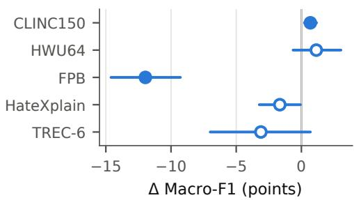
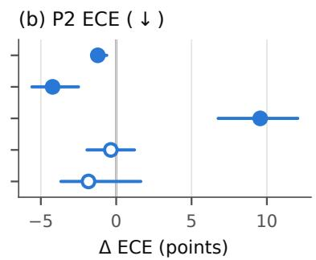
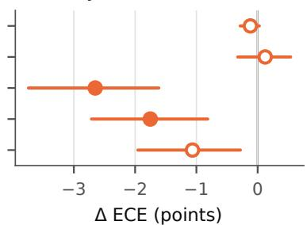
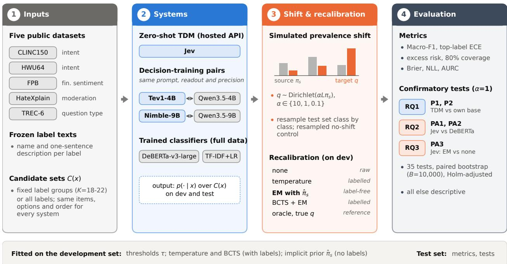
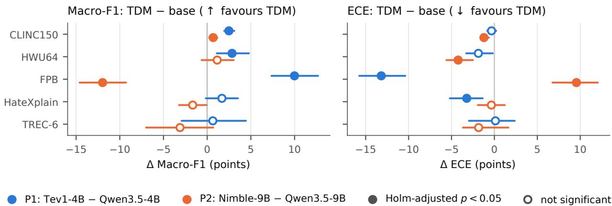
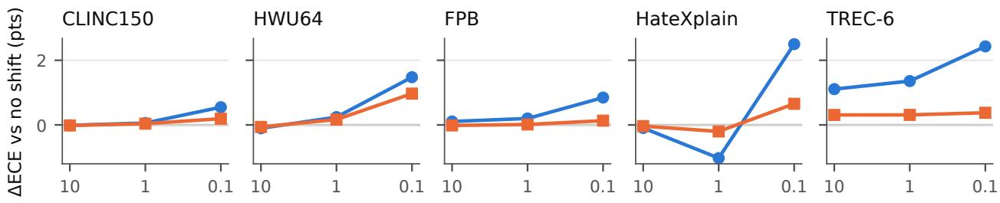
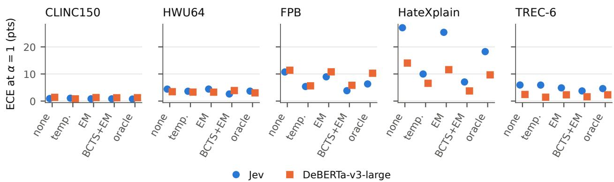

# Typed Decision Models under Prevalence Shift: Decision Training, Calibration, and Implicit Priors

Abdul Rahman Iqbal Faculty of Computer Science and Information Technology The Superior University, Lahore, Pakistan

Muhammad Fawad Nasim

Faculty of Computer Science and Information Technology The Superior University, Lahore, Pakistan

Amir Saleem Independent Researcher

abdul.rahmanmezzi@gmail.com

fawad.nasim@superior.edu.pk

mramir401@gmail.com

## Abstract

Typed decision models (TDMs) return a probability over caller-defined options, and Jev is described by its vendor as calibrated. But in deployment class frequencies change, so calibration measured on a fixed test set need not hold where thresholds are applied. Existing evaluations leave two gaps: the gains of vendor decision training have not been separated from those of the backbone under an identical readout, and TDMs have been tested only at the test set’s class distribution. We ask whether decision training improves a model over its own backbone, and whether a TDM’s calibration and thresholds withstand prevalence (label) shift as well as a fine-tuned classifier’s. We compare three TDMs (Jev, Tev1-4B, Nimble-9B), their base models and two trained classifiers on identical decisions from five public datasets under simulated shift, with 35 paired tests fixed before any test was computed. First, decision training is not uniformly beneficial: Nimble-9B, which difers from Qwen3.5- 9B only by a LoRA adapter, is better calibrated on intent tasks but 12.0 Macro-F1 points worse on financial sentiment. Second, under moderate shift Jev’s expected calibration error (ECE) and threshold risk grow significantly more than a fine-tuned DeBERTa’s only on financial sentiment, by 1.7 and 2.5 percentage points; averaged over 2,000 shift scenarios (exploratory), the gap is at most one point on every dataset. Third, EM prior correction with the model’s mean development prediction as its prior needs no labels and lowers Jev’s ECE under shift by 2.7 and 1.8 points on the two datasets where it is highest, although labelled recalibration lowers it far more. The three TDMs we tested are neither uniformly better than their backbones nor uniquely fragile under shift; for calibration, their main weakness is the miscalibration they already have without shift. We release all inputs, code and outputs.

## 1 Introduction

Consider a bank that routes incoming customer messages to one of a fixed set of intents and sends a message to a human whenever the routing model is less than 90% confident. The threshold was chosen on validation data in which, say, one message in ten was a complaint. After a service outage, four messages in ten are complaints. The model, the messages of each kind and the threshold are unchanged; only the class frequencies have moved. Does the model’s confidence still mean what it meant at validation time, and does the threshold still send the intended share of messages to a human?

This question has become practical for a new class of models. Typed decision models (TDMs), also called “System One” models, do not generate text: given an input and a caller-defined set of options, they return a probability distribution over the options (Deußer et al., 2026; Tang & Zheng, 2026). Jev is ofered as a hosted API and is described by its vendor as calibrated; Tev1-4B and Nimble-9B are open models fine-tuned from Qwen3.5 backbones for the same interface. A trained classifier has a training prior that label-shift corrections can use (Saerens et al., 2002; Lipton et al., 2018). A zero-shot model has none. The closest substitute is an implicit prior: the average distribution the model predicts on a development set, which requires no labels.

Existing evaluations leave two gaps. First, the benefit of vendor “decision training” has not been separated from the backbone: an audit of early TDM papers calls for same-backbone ablations (Tang & Zheng, 2026), existing comparisons of a vendor TDM with its backbone read the two models out diferently (Rafe & Das, 2026), and the study that does compare identical weights fine-tunes its own models and finds gains only on some tasks (Li & Wagle, 2026). Second, TDMs have been compared with language models and trained classifiers at a single class distribution (Deußer et al., 2026; Rafe & Das, 2026), so it is not known whether their calibration and thresholds transfer when the class frequencies change; a recent audit of 28 TDM papers lists calibration under deployment shift as an open problem (Tang & Zheng, 2026). Prior adaptation without labels has been studied for language models and vision–language models (Estienne, 2023; Han et al., 2026), but not for TDMs against trained classifiers under controlled shift. We are not aware of a study that combines a commercial TDM, open TDMs paired with their own backbones, trained classifiers and controlled prevalence shift with label-free prior correction (Table 1); this combination is what allows us to ask what decision training adds and whether it survives a change in class frequencies.

We study three research questions on five public, human-labelled datasets, using identical test items and candidate sets for every system: RQ1 (decision training): does vendor decision training change accuracy and calibration relative to the same backbone? RQ2 (prevalence shift): under controlled prevalence shift, do a TDM’s calibration error and threshold risk change diferently from those of a fine-tuned classifier? RQ3 (implicit-prior correction): does expectation–maximisation (EM) prior correction with the implicit prior reduce a TDM’s calibration error under shift? Our results concern candidate-set decisions, in which the gold label is always among 3–22 ofered options, and simulated label shift, in which only the class frequencies change; they do not cover full-label classification over all 150 or 64 intents, or deployment shifts that also change the text of each class (Section 7). The tests and the comparison family were fixed and hashed before the final runs, and the analysis before any test was computed (Section 4); the one amendment, and earlier exposures of test data during pipeline checks (mainly the FPB test split), are listed in Appendix A.

Our findings are as follows (Figure 1; all 35 tests in Table 7).

• Decision training is task-dependent. Nimble-9B, which difers from Qwen3.5-9B only by a LoRA adapter, is better calibrated on both intent datasets but 12.0 Macro-F1 points worse on financial sentiment, where its calibration error is also higher (Section 5.1). Tev1-4B is never significantly worse than Qwen3.5-4B, and is better on five of ten tests.

• Moderate prevalence shift separates Jev from a fine-tuned classifier only a little. At a Dirichlet concentration of α = 1, Jev’s ECE and the excess risk of its confidence threshold grow significantly more than DeBERTa-v3-large’s (after Holm correction) only on FPB, by 1.7 and 2.5 percentage points; averaged over 2,000 shift scenarios (exploratory), the diference is at most one point on every dataset and largest on TREC-6 (Section 5.2).

• Implicit-prior correction helps where calibration is poor. EM with Jev’s implicit prior, which needs no labels, lowers Jev’s ECE under shift by 2.7 points on FPB and 1.8 points on HateXplain, the two datasets where its unshifted ECE is highest (0.095 and 0.279), with the same sign for every prior set; on the other three datasets the efect is not significant after Holm correction. Recalibration on labelled development data lowers the error much further (Section 5.3).

• Artifacts. We release the frozen label texts, candidate sets, prompts, evaluation code and every perexample probability vector at https://github.com/AbdulRahmanIqbal/tdm-prevalence-shift.

In short, decision training helps a backbone on some tasks and hurts it on others, and prevalence shift matters less for the TDMs we tested than the calibration error they already have without shift.

(a) P2 Macro-F1 ( ↑ )  

(c) PA3 Jev, EM − none ( ↓ )  
  
Holm-adjusted p < 0.05 not significant  
Figure 1: Decision training changes a backbone in a task-dependent direction, and label-free prior correction helps where calibration is poor. (a, b) Paired diferences between Nimble-9B and its own base model Qwen3.5-9B (same weights and 8-bit precision, difering only by a LoRA adapter) in Macro-F1 (higher favours Nimble) and expected calibration error (ECE; lower favours Nimble), in percentage points. (c) Change in Jev’s ECE under prevalence shift (α = 1, 50 fixed target priors) when EM prior correction with its implicit prior is applied (lower is better). Bars are 95% paired bootstrap intervals $( B = 1 0 , 0 0 0$ unadjusted); filled markers are significant after Holm correction over all 35 primary tests.

Table 1: No prior study combines vendor TDMs, matched backbones, trained classifiers and controlled prevalence shift with label-free prior correction. ✓: covered; ◦: partly covered (Pair: diferent readouts for the two models, or the authors’ own fine-tunes rather than a vendor TDM; Tests: intervals or tests without multiplicity control); –: not covered. Columns: TDM = commercial or vendor TDMs evaluated; Pair = TDM compared with its own backbone under the same readout; Trained = tasktrained classifier baseline; Shift = controlled class-prior shift; Prior = label-free prior correction for zero-shot models; Tests = paired tests with multiplicity control.
<table><tr><td>Study</td><td>TDM</td><td>Pair</td><td>Trained</td><td>Shift</td><td>Prior</td><td>Tests</td></tr><tr><td>Deußer et al. (2026)</td><td>√</td><td></td><td></td><td></td><td></td><td>0</td></tr><tr><td>Rafe &amp; Das (2026)</td><td></td><td>0</td><td>V</td><td></td><td></td><td>V</td></tr><tr><td>Li &amp; Wagle (2026)</td><td></td><td>O</td><td></td><td></td><td></td><td>O</td></tr><tr><td>Ibrahim &amp; Zaki (2026)</td><td></td><td></td><td></td><td></td><td></td><td></td></tr><tr><td>Estienne (2023)</td><td></td><td></td><td></td><td></td><td></td><td></td></tr><tr><td>Lipton et al. (2018); Alexandari et al. (2020); Garg et al. (2020)</td><td></td><td></td><td>√</td><td></td><td></td><td>O</td></tr><tr><td>Our study</td><td></td><td>V</td><td>√</td><td></td><td>了</td><td>√</td></tr></table>

## 2 Related work

Table 1 summarises how our study relates to the closest prior work. Individually, the ingredients are known; the question that is new is how a zero-shot decision model’s calibration, thresholds and label-free prior correction behave under prevalence shift compared with a trained classifier, and what decision training changes relative to the identical backbone.

Evaluations of typed decision models. Jev was released in September 2026, and evaluations followed within weeks. Deußer et al. (2026) evaluate Jev zero-shot on 37 public datasets against two open models and report well-calibrated choice probabilities overall, with miscalibration, mostly overconfidence, concentrated on the datasets where accuracy is low. Rafe & Das (2026) compare several TDMs with trained classifiers and generative models under matched conditions and find that the ranking depends on whether task labels exist; they also compare each decoder-based TDM, including Nimble, with its Qwen3.5 backbone, but read the backbone out diferently (by option-key likelihood), on their typed-decision benchmark, a sample of CLINC150 and several social-science tasks. Li & Wagle (2026) argue that general-purpose language models already behave like Jev-style decision models when read out by scoring the candidate labels, and that fine-tuning helps only on some tasks. Other early studies cover annotation tasks in computational social science (Ibrahim & Zaki, 2026), optimised natural-looking context that flips decisions (Xu et al., 2026), and confidence-based escalation of LLM judges (Li et al., 2026). An audit of 28 early TDM papers finds no independent accuracy advantage of the typed readout over comparable label-probability readouts, and lists calibration under deployment shift and the attribution of gains as open problems (Tang & Zheng, 2026). All of these studies evaluate at the class distribution of the test set. Our study varies the class distribution in a controlled way, and pairs each open TDM with its base model under the same prompt, readout and precision, on five datasets; for Nimble-9B, which difers from its base only by an adapter, this isolates the efect of decision training.

Label shift and prior correction. Under label (prior) shift, $p ( y )$ changes while $p ( x \mid y )$ stays fixed. Saerens et al. (2002) re-estimate the target prior with EM, using the classifier’s posteriors and the training prior. Black-box shift estimation (Lipton et al., 2018) and its regularised variant (Azizzadenesheli et al., 2019) estimate the target prior from a confusion matrix. Alexandari et al. (2020) show that EM is hard to beat once the classifier is calibrated with class-specific biases (BCTS), and Garg et al. (2020) unify these estimators and attribute the advantage of maximum likelihood to calibration. All of these methods assume a known source prior. For zero-shot models, which have no training prior, prior adaptation without labels has been proposed for language models (Estienne, 2023), and zero-shot CLIP models have been adapted to a given label-distribution prior (Kahana et al., 2022) or to an unknown target distribution estimated from unlabelled test data (Han et al., 2026). We use the simplest version of this idea, the mean predicted distribution on a development set as an implicit source prior, and test it on a commercial TDM against a trained classifier whose source prior is known.

Calibration of pretrained and prompted models. Modern networks are often miscalibrated, and temperature scaling on held-out data is a strong fix (Guo et al., 2017). Fine-tuned transformers are relatively well calibrated in-domain (Desai & Durrett, 2020), whereas prompted language models carry label biases that a content-free calibration step can reduce (Zhao et al., 2021). We measure calibration with top-labe ECE and selective risk (Geifman & El-Yaniv, 2017), and ask how both change when the class frequencies move.

Zero-shot models versus trained classifiers. With enough labelled data, fine-tuned encoders tend to outperform in-context or zero-shot use of larger language models on text classification (Edwards & Camacho-Collados, 2024; Bucher & Martini, 2024). Fine-tuning on few examples is, however, unstable (Mosbach et al., 2021; Zhang et al., 2021), which our training protocol takes into account. We compare against classifiers trained on the full training sets, the setting in which a trained classifier is strongest.

## 3 Setting

Figure 2 summarises the evaluation. Every system answers the same candidate-set decisions; prevalence shift and recalibration are then applied to the saved probability vectors, so that all comparisons are paired.

Decision models and candidate sets. Let Y be the label set of a dataset and $L = | \mathcal { D } |$ its number of classes. Each test example x comes with a candidate set $C ( x ) \subseteq { \mathcal { x } }$ of K labels that always contains the gold label. A system returns a probability vector $p ( \cdot \mid x )$ over $C ( x )$ . The prediction is $\hat { y } = \arg \operatorname* { m a x } _ { c \in C ( x ) } p ( c | x )$ with ties broken by candidate position, and the confidence is max $c \in C ( x ) p ( c \mid x )$ . All systems receive the same candidate set, in the same order, for every example (Section 4).

Prevalence shift. Let $\pi _ { s }$ be the class distribution of the source data and q that of the deployment data. Under prevalence (label) shift, $q \ne \pi _ { s }$ while $p ( x \mid y )$ is unchanged. We simulate it with a source-centred variant of the Dirichlet shift of Lipton et al. (2018) and Alexandari et al. (2020), who use a symmetric concentration, by drawing a target prior and class counts for a sample of the test size $n _ { : }$

$$
q \sim \mathrm { D i r i c h l e t } ( \alpha L \pi _ { s } ) , \qquad ( n _ { y } ) _ { y \in \mathcal { V } } \mid q \sim \mathrm { M u l t i n o m i a l } ( n , q ) ,\tag{1}
$$

where $\pi _ { s }$ is the class distribution of the training split (the same for all systems), and then drawing $n _ { y }$ test examples of class $y$ with replacement; we call the result the shifted sample $S _ { q } .$ The concentration $\alpha L \pi _ { s }$

  
Figure 2: All systems answer identical candidate-set decisions, and shift, recalibration and tests operate on their saved probabilities, so every comparison is paired. (1) Five public datasets with frozen label texts and fixed candidate sets. (2) A hosted TDM, two open TDMs each paired with its own backbone, and two trained classifiers return a probability vector over the candidates. (3) The test set is resampled to simulated target priors (Eq. 1), and five recalibration arms are fitted on the unshifted development set (Eqs. 2–3). (4) Metrics (Eqs. 4 and 5) and the 35 confirmatory tests (Eqs. 6–8); everything else is descriptive.

centres the draws on the source prior and reduces to the usual Dirichlet(α1) when $\pi _ { s }$ is uniform. Smaller α means stronger shift; we use $\alpha \in \{ 1 0 , 1 , 0 . 1 \}$ , and the confirmatory tests use $\alpha = 1$

Source prior and implicit prior. Prior correction needs the source prior $\pi _ { s } .$ . For a trained classifier it is the class distribution of its training data. A zero-shot model has no training data for the task, so we use its implicit prior, the smoothed mean predicted distribution over the $n _ { \mathrm { d e v } }$ development examples,

$$
\hat { \pi } _ { s } ( y ) = \frac { \frac { 1 } { n _ { \mathrm { d e v } } } \sum _ { i = 1 } ^ { n _ { \mathrm { d e v } } } p ( y \mid x _ { i } ) + \epsilon } { 1 + L \epsilon } , \qquad \epsilon = 1 0 ^ { - 3 } ,\tag{2}
$$

where $p ( y \mid x _ { i } ) = 0$ for $y \notin C ( x _ { i } ) $ ; the smoothing keeps classes that the model never predicts from receiving a prior of zero. This estimate needs no labels. It is justified by the law of total probability: if the model’s posteriors were calibrated on the source distribution, their mean would equal the source prior, $\mathbb { E } _ { x } [ p ( y \mid x ) ] =$ $\pi _ { s } ( y )$ , and EM started from $\hat { \pi } _ { s }$ would leave an unshifted sample unchanged. The implicit prior is thus the source prior with which the model’s own posteriors are consistent, a proxy in the spirit of black-box shift estimation (Lipton et al., 2018). Empirically, it is close to the true class distribution on the intent datasets and far from it on FPB and HateXplain, where the models have a label bias: its total-variation distance to the development set’s class distribution is at most 0.033 for every zero-shot system on CLINC150, but 0.17–0.38 on FPB and 0.23–0.27 on HateXplain (Table 20).

Recalibration arms. For every system we compare five ways of producing probabilities on the shifted test set; the four deployable ones are fitted on the unshifted development set without target labels, and the oracle uses the true target prior: none (raw probabilities); temperature scaling (Guo et al., 2017); EM prior correction (Saerens et al., 2002); BCTS+EM, bias-corrected temperature scaling followed by EM (Alexandari et al., 2020); and oracle, prior correction with the true target prior $q$ (an upper reference, not a deployable method). EM starts from $\hat { q } ^ { ( 0 ) } = \hat { \pi } .$ and alternates, for the n examples of the shifted sample and $y \in C ( x )$ ,

$$
\tilde { p } ^ { ( t ) } ( y \mid x ) = \frac { p ( y \mid x ) \hat { q } ^ { ( t ) } ( y ) / \hat { \pi } _ { s } ( y ) } { \sum _ { y ^ { \prime } \in C ( x ) } p ( y ^ { \prime } \mid x ) \hat { q } ^ { ( t ) } ( y ^ { \prime } ) / \hat { \pi } _ { s } ( y ^ { \prime } ) } , \qquad \hat { q } ^ { ( t + 1 ) } ( y ) = \frac { 1 } { n } \sum _ { i = 1 } ^ { n } \tilde { p } ^ { ( t ) } ( y \mid x _ { i } ) ,\tag{3}
$$

until $\operatorname* { m a x } _ { y } | \hat { q } ^ { ( t + 1 ) } ( y ) - \hat { q } ^ { ( t ) } ( y ) | < 1 0 ^ { - 6 }$ (at most 100 iterations). The oracle arm applies the E-step once with q in place of $\hat { q } ^ { ( t ) }$ . For CLINC150 and HWU64 the prior lives on all L classes while each posterior is restricted to its candidate set, which is why the E-step normalises over $C ( x )$ only.

Metrics. Our main calibration metric is top-label expected calibration error with 15 equal-width confidence bins $B _ { b } = [ ( b - 1 ) / 1 5 , b / 1 5 )$ ), the last bin closed (Guo et al., 2017),

$$
\operatorname { E C E } ( S ) = \sum _ { b = 1 } ^ { 1 5 } { \frac { | B _ { b } | } { | S | } } \left| \operatorname { a c c } ( B _ { b } ) - \operatorname { c o n f } ( B _ { b } ) \right| ,\tag{4}
$$

where acc and conf are the accuracy and mean confidence of the examples of S in a bin. Selective prediction accepts an example if its confidence $c _ { i }$ reaches a threshold τ, chosen on the development set as the $\lceil 0 . 8 n _ { \mathrm { d e v } } \rceil$ -th largest confidence, so that (with ties, at least) 80% of development examples are accepted; each recalibration arm has its own threshold. Its selective risk (Geifman & El-Yaniv, 2017) on a sample S and, under shift, its excess risk relative to the unshifted test sample are

$$
R ( S ; \tau ) = \frac { \sum _ { i \in S } \mathbf { 1 } [ c _ { i } \geq \tau ] \mathbf { 1 } [ \hat { y } _ { i } \neq y _ { i } ] } { \sum _ { i \in S } \mathbf { 1 } [ c _ { i } \geq \tau ] } , \qquad \Delta R ( S _ { q } ) = R ( S _ { q } ; \tau ) - R ( T ; \tau ) ,\tag{5}
$$

where $T$ is the unshifted test sample. We also report Macro-F1, accuracy, MCC, Brier score, negative loglikelihood (NLL, with probabilities clipped at $1 0 ^ { - 1 2 }$ , since Jev returns exact zeros) and the area under the risk–coverage curve (AURC). Jev assigns probability zero to the gold label on 0.4–7% of test examples (most on HateXplain), so its NLL is dominated by the clip and is reported for completeness only. Because top-labe ECE is biased upward on resampled data, we also report the change in Brier score and NLL under shift (Tables 16 and 17).

Test statistics. P1 and P2 compare a TDM with its own base model on the same test examples, $\Delta =$ $m ( { \mathrm { T D M } } ) - m ( { \mathrm { b a s e } } )$ for m ∈ {Macro-F1, ECE}. PA1–PA3 are defined on a fixed set of $M = 5 0$ target priors $q _ { 1 } , \ldots , q _ { M }$ , drawn once from Eq. 1 at $\alpha = 1$ . For a test sample T, let $S _ { m }$ be its shifted sample under $q _ { m }$ and $N _ { m }$ a no-shift control drawn by the same resampler at T’s own class distribution. With J for Jev and D for DeBERTa-v3-large,

$$
\mathrm { P A } \mathrm { 1 } = \frac { 1 } { M } \sum _ { m = 1 } ^ { M } \Big ( \big [ \mathrm { E C E } _ { J } ( S _ { m } ) - \mathrm { E C E } _ { J } ( N _ { m } ) \big ] - \big [ \mathrm { E C E } _ { D } ( S _ { m } ) - \mathrm { E C E } _ { D } ( N _ { m } ) \big ] \Big ) ,\tag{6}
$$

$$
\mathrm { P A 2 } = \frac { 1 } { M } \sum _ { m = 1 } ^ { M } \Bigl ( \Delta R _ { J } ( S _ { m } ) - \Delta R _ { D } ( S _ { m } ) \Bigr ) ,\tag{7}
$$

$$
\mathrm { P A } 3 = \frac { 1 } { M } \sum _ { m = 1 } ^ { M } \Big ( \mathrm { E C E } _ { J } ^ { \mathrm { E M } } ( S _ { m } ) - \mathrm { E C E } _ { J } ( S _ { m } ) \Big ) ,\tag{8}
$$

where each system uses its own threshold in $\Delta R$ and $\mathrm { E C E } _ { J } ^ { \mathrm { E M } }$ is computed after EM with Jev’s implicit prior. Positive PA1 and PA2 mean that Jev degrades more than DeBERTa-v3-large under shift; negative PA3 means that EM helps. PA1 subtracts a resampled control because ECE is biased upward on resampled data, whereas PA2 does not need one because selective risk, a mean of per-example losses over the accepted examples, is nearly unbiased under resampling. Section 4 describes how $T$ is resampled to obtain intervals.

Table 2: The five datasets span intent, sentiment, moderation and question-type decisions with 3 to 150 classes. CLINC150 and HWU64 use fixed label groups as candidate sets (K = 18–22 options); the other three use all labels. Train/dev/test sizes after cleaning.
<table><tr><td>Dataset</td><td>Domain</td><td>Classes</td><td>Candidates K</td><td>Train</td><td>Dev</td><td>Test</td></tr><tr><td>CLINC150</td><td>intent (assistant)</td><td>150</td><td>18-19</td><td>14,939</td><td>2,994</td><td>4,500</td></tr><tr><td>HWU64</td><td>intent (home assistant)</td><td>64</td><td>21-22</td><td>7,871</td><td>1,076</td><td>1,076</td></tr><tr><td>FPB</td><td>financial sentiment</td><td>3</td><td>3</td><td>3,090</td><td>775</td><td>970</td></tr><tr><td>HateXplain</td><td>hate / offensive speech</td><td>3</td><td>3</td><td>15,330</td><td>1,921</td><td>1,924</td></tr><tr><td>TREC-6</td><td>question type</td><td>6</td><td>6</td><td>4,869</td><td>498</td><td>500</td></tr></table>

Hypotheses. The three research questions of Section 1 map to the following tests, all specified before the final test-set runs. H1 (RQ1): vendor decision training changes Macro-F1 or ECE relative to the base model (two-sided). The controlled test is P2 (Nimble-9B vs Qwen3.5-9B: same base weights and precision, difering only by an adapter). P1 (Tev1-4B vs Qwen3.5-4B) is the closest available comparison, since Tev1 is a full fine-tune whose exact recipe is not published. H2 (RQ2): under shift, the change in ECE (PA1, Eq. 6) and the excess threshold risk (PA2, Eq. 7) difer between Jev and DeBERTa-v3-large (two-sided). H3 (RQ3): EM prior correction with Jev’s implicit prior lowers Jev’s ECE under shift (PA3, Eq. 8, tested two-sided, which is conservative for this directional hypothesis). This confirmatory test concerns plain EM on Jev only; the other arms and systems are reported descriptively.

## 4 Experimental protocol

Datasets. We use five public, human-labelled English datasets that represent common decision tasks (Table 2): intent classification for assistants, CLINC150 in-scope (Larson et al., 2019) and HWU64 (Liu et al., 2021); financial sentiment, FPB (Malo et al., 2014); hate and ofensive speech, HateXplain (Mathew et al., 2021); and question type, TREC-6 (Li & Roth, 2002). CLINC150, HateXplain and TREC-6 use their oficial splits. FPB has no oficial split; we use a public 64/16/20 split of the 50%-agreement subset, following Araci (2019), whose 970-example test set is the one used by Deußer et al. (2026). For HWU64 and TREC-6, which have no oficial development split, the development set is a stratified sample of the training set that follows the training class distribution. Train and development texts that duplicate a test text after normalisation (lower-casing and removing punctuation), and texts that occur with conflicting labels, are removed; the test sets are never changed. All raw files and processed splits are pinned by SHA-256 hashes.

Label texts and candidate sets. Every label has a short name and a one-sentence description, written once for all systems and frozen before any model was run. For datasets with at most 20 labels, the candidate set contains all labels. For CLINC150 and HWU64 we partition the labels once into fixed groups (8 groups of 18–19 and 3 groups of 21–22) by balanced k-means on embeddings of the label texts, and the candidate set of an example is the group of its gold label. We chose fixed groups because a leakage audit showed that candidate sets built around the gold label (the gold label plus its nearest neighbours) reveal the gold labe from the option list alone: a classifier that never sees the text identifies it for 97.6% of CLINC150 and 90.2% of HWU64 examples, against 5% chance. With fixed groups, every member of a group receives the same set of options. The order of the options is shufled per example with a fixed seed, with the gold position counterbalanced across examples, and all systems read the same candidate file.

Systems and inputs. Table 3 lists the systems. Jev is queried through its hosted API, with the label names as option keys and the label descriptions as criteria; the response’s version field was jev-1.13.0 for every call (16,234 in the full run and 7,500 in three repeats); 465 of the 16,234 full-run calls (464 rate-limit responses and one timeout) succeeded after one retry, and no call failed. Jev’s probabilities are rounded to two decimals and renormalised over the candidates. Each open TDM and its base model receive tokenidentical prompts in the TDM’s own training format: the Tev1 format for Tev1-4B and Qwen3.5-4B, and the Nimble format for Nimble-9B and Qwen3.5-9B (checked on all 16,234 development and test prompts). Thinking mode is disabled. The probability vector is the softmax (T = 1) of the candidate letters’ logits at the first answer position, computed in fp32 from the final hidden state. The two 9B models run in 8-bit precision so that they fit on a 12 GB GPU, and the Nimble adapter is checked to be fully loaded before every run; the two 4B models run in bf16. Local scoring was deterministic in our check: scoring 50 CLINC150 development examples twice gave identical probabilities for all four local models. Tev1 was trained mostly on decisions with at most eight options, so the 18–22 options of CLINC150 and HWU64 lie outside its training distribution, and the licence of its weights was still being finalised at the time of writing. Nimble-9B is the original-2676 release, trained on 2,676 synthetic examples; we do not use the later release whose training data include public TREC questions (Appendix D).

Table 3: Each open TDM is paired with its own backbone under identical prompts, readout and precision. Tev1-4B with Qwen3.5-4B (Tev1 prompt format) and Nimble-9B with Qwen3.5-9B (Nimble prompt format, identical 8-bit base weights). Revisions are Hugging Face commit hashes. Readout: “letters” is the softmax (T = 1) over the logits of the candidate letters at the first answer position; the trained classifiers use a softmax over each example’s candidates; Jev returns probabilities directly.
<table><tr><td>System</td><td>Source</td><td>Revision</td><td>Precision</td><td>Readout</td></tr><tr><td colspan="5">TYPED DECISION MODELS</td></tr><tr><td>Jev</td><td>Cloudflare API (typesafe/jev)</td><td>jev-1.13.0 0b7becf0</td><td>API</td><td>API probabilities letters, Tev1 format</td></tr><tr><td>Tev1-4B</td><td>togethercomputer/Tev1-4B-experimental Qwen3.5-9B + LoRA</td><td>fe33f82b</td><td>bf16</td><td></td></tr><tr><td>Nimble-9B</td><td>bespokelabs/Bespoke-Nimble-9B</td><td>(original-2676)</td><td>8-bit</td><td>letters, Nimble format</td></tr><tr><td colspan="5">BASE LLMS</td></tr><tr><td>Qwen3.5-4B</td><td>Qwen/Qwen3.5-4B</td><td>851bf6e8</td><td>bf16</td><td>as Tev1-4B</td></tr><tr><td>Qwen3.5-9B</td><td>Qwen/Qwen3.5-9B</td><td>c2022362</td><td>8-bit</td><td>as Nimble-9B</td></tr><tr><td colspan="5">TRAINED CLASSIFIERS</td></tr><tr><td>DeBERTa-v3-large</td><td>fine-tuned on the full training set, 5 seeds</td><td>64a8c8ea</td><td>fp16</td><td>softmax</td></tr><tr><td> $\mathrm { T F \mathrm { - } I D F + L R }$ </td><td>word 1–2 grams, C selected on dev</td><td>scikit-learn 1.9.1</td><td>CPU</td><td>softmax</td></tr></table>

Trained classifiers. DeBERTa-v3-large (He et al., 2023) is fine-tuned on the full training set with AdamW, a learning rate selected from $\{ 1 0 ^ { - 5 } , 2 \cdot 1 0 ^ { - 5 } \}$ on the development set, 10% linear warm-up, weight decay 0.01, batch size 16, mixed precision, maximum length 128 and 5 epochs. The best checkpoint is selected by development Macro-F1 within the candidate sets, evaluated every 100 steps. We train five seeds; a run would count as failed if its development accuracy did not exceed that of a majority-class predictor (Dodge et al., 2020; Mosbach et al., 2021), which did not happen. All analyses use the first seed; the other seeds are reported in Table 9. The TF-IDF baseline is a logistic regression on word uni- and bigrams with sublinear term frequency; C is selected on the development set from $\{ 0 . 1 , 1 , 1 0 , 1 0 ^ { 2 } , 1 0 ^ { 3 } , 1 0 ^ { 4 } \}$ , and FPB and TREC-6 select the largest value; extending the grid to 105 and $1 0 ^ { 6 }$ changes their development Macro-F1 by at most 0.2 points and their test Macro-F1 by at most 0.7 points (exploratory check). Both classifiers’ probabilities are renormalised over each example’s candidate set. Note an asymmetry: the trained classifiers use the development set both for model selection and for recalibration, whereas the zero-shot systems use it only for recalibration and the implicit prior.

Statistical tests. The 35 confirmatory tests are P1 and P2 (Macro-F1 and ECE on five datasets each; 20 tests) and PA1–PA3 (five datasets each; 15 tests). P1 and P2 use a paired bootstrap over test examples with B = 10,000 replicates; both systems and both metrics use the same resampled indices. For PA1–PA3 (Eqs. 6–8), the estimand is the mean over a fixed set of 50 target priors drawn once at α = 1 (centred on the training prior); it is therefore conditional on this set of priors, and the intervals reflect only the finiteness of the test set. Each of $B = 1 0 , 0 0 0$ replicates draws a class-stratified bootstrap sample of the test set and builds all 50 shifted samples from it by resampling with replacement, so that Jev and DeBERTa-v3-large are evaluated on identical samples. PA1 compares each shifted ECE with a no-shift control drawn by the same resampler at the base sample’s own class prior, because top-label ECE is biased upward on resampled data. PA2 compares risks, which are nearly unbiased under resampling, with the base sample itself. The point estimates of P1 and P2 are the diferences on the full test set, those of PA1–PA3 the means of the bootstrap replicates. We report percentile 95% intervals, which are not adjusted for multiplicity, and twosided p = min{1, 2 min $\left\{ \operatorname* { P r } ( \Delta \leq 0 ) , \operatorname* { P r } ( \Delta \geq 0 ) \right\} \quad$ , adjusted with the Holm procedure (Holm, 1979) over all 35 tests (also for PA3, whose hypothesis is directional). With B = 10,000, a raw p of zero is reported as $p < 0 . 0 0 0 2 ~ ( = ~ 2 / B )$ , and its Holm-adjusted value as $p \ < \ 0 . 0 0 7 \ ( = \ 3 5 \cdot 2 / B )$ Quantities fitted on the development set (thresholds, implicit priors, temperatures) are held fixed within the bootstrap, so the intervals do not include development-set uncertainty. The descriptive prevalence-shift experiment uses 200 Dirichlet draws per α for all systems and all five arms, with and without replacement.

Table 4: Full-data DeBERTa-v3-large has the highest Macro-F1 point estimate on every dataset, and the calibration of zero-shot systems depends more on the task than on the system. Test-set Macro-F1 and ECE (15 bins, top label), candidate-restricted, no shift. These are point estimates; tested comparisons are in Figure 3 and Table 6.
<table><tr><td rowspan="2">System</td><td colspan="2">CLINC150</td><td colspan="2">HWU64</td><td colspan="2">FPB</td><td colspan="2">HateXplain</td><td colspan="2">TREC-6</td></tr><tr><td>F1↑</td><td>ECE↓</td><td>F1↑</td><td>ECE↓</td><td>F1↑</td><td>ECE↓</td><td>F1↑</td><td>ECE↓</td><td>F1↑</td><td>ECE↓</td></tr><tr><td colspan="9">TYPED DECISION MODELS</td><td></td><td></td></tr><tr><td>Jev</td><td>0.978</td><td>0.007</td><td>0.908</td><td>0.036</td><td>0.752</td><td>0.095</td><td>0.514</td><td>0.279</td><td>0.922</td><td>0.042</td></tr><tr><td>Tev1-4B</td><td>0.964</td><td>0.008</td><td>0.895</td><td>0.040</td><td>0.735</td><td>0.072</td><td>0.458</td><td>0.214</td><td>0.889</td><td>0.038</td></tr><tr><td>Nimble-9B</td><td>0.962</td><td>0.008</td><td>0.896</td><td>0.035</td><td>0.629</td><td>0.263</td><td>0.470</td><td>0.336</td><td>0.872</td><td>0.043</td></tr><tr><td colspan="9">BASE LLMS</td><td></td><td></td></tr><tr><td>Qwen3.5-4B</td><td>0.939</td><td>0.011</td><td>0.866</td><td>0.058</td><td>0.635</td><td>0.204</td><td>0.441</td><td>0.247</td><td>0.882</td><td>0.037</td></tr><tr><td>Qwen3.5-9B</td><td>0.955</td><td>0.020</td><td>0.884</td><td>0.078</td><td>0.749</td><td>0.168</td><td>0.487</td><td>0.340</td><td>0.903</td><td>0.061</td></tr><tr><td colspan="9">TRAINED CLASSIFIERS (FULL DATA)</td><td></td><td></td></tr><tr><td>DeBERTa-v3-large</td><td>0.980</td><td>0.013</td><td>0.939</td><td>0.030</td><td>0.870</td><td>0.111</td><td>0.703</td><td>0.141</td><td>0.971</td><td>0.021</td></tr><tr><td>TF-IDF + LR</td><td>0.950</td><td>0.015</td><td>0.900</td><td>0.098</td><td>0.693</td><td>0.167</td><td>0.645</td><td>0.069</td><td>0.891</td><td>0.071</td></tr></table>

Protocol and runs. Hypotheses, tests, the comparison family, all configurations and the code were fixed and recorded as SHA-256 hashes before the final runs, and every final run was verified against these hashes. One amendment followed three code audits; it changed the analysis, the DeBERTa failed-run rule and the Jev error handling, but not the code used by the local language models. It was made after the first local test predictions had been produced, but before the DeBERTa and Jev runs and before any of the 35 tests or any shift analysis was computed (Appendix A). Before the freeze, some pipeline checks were run on test splits, mainly FPB’s; Appendix A discloses them. The local models and both trained classifiers were run on one NVIDIA RTX 4070 Ti (12 GB); Jev, a hosted model, was queried through its API in about two hours, inside the protocol’s 72-hour window (Appendix D).

## 5 Results

Validity checks. All 16,234 Jev calls and all local predictions returned a valid probability vector: no request failed after retries and no input was refused, including on HateXplain. On the 970-example FPB test set that Deußer et al. (2026) also use, Jev’s accuracy is 0.744, consistent with the 0.730 they report. Fulldata DeBERTa-v3-large reaches 0.976 accuracy on TREC-6, close to the 0.974 reported for fully fine-tuned RoBERTa-large (Gao et al., 2021), and 0.703 Macro-F1 on HateXplain, slightly above the best value we found reported for that test split, 0.699 (Kim et al., 2022). The four local models gave identical probabilities when 50 CLINC150 development examples were scored twice. Jev is not: in four runs over the same 500 test examples per dataset, it returned the same prediction for 96.4–99.8% of examples but the same probability vector for only 19.4–87.4% of them, with diferences of up to 0.29 between runs; its ECE on these subsets varied by at most 0.012 between runs (Appendix B). All analyses use a single full run of each system.

Overview. Table 4 gives the test-set results without shift. Full-data DeBERTa-v3-large has the highest Macro-F1 point estimate on all five datasets, although Jev is within 0.3 points on CLINC150. Among the zero-shot systems in Table 4, Jev has the highest Macro-F1 point estimate on every dataset (by 0.3 points over Qwen3.5-9B on FPB). No zero-shot system is reliable on HateXplain (Macro-F1 at most 0.514), where even TF-IDF reaches 0.645. Calibration varies more by task than by system class: ECE is at most 0.020 for all zero-shot systems on CLINC150, but between 0.214 and 0.340 on HateXplain. These comparisons are descriptive; the tested comparisons follow.

  
Figure 3: Tev1-4B is never significantly worse than its base model, whereas Nimble-9B is better calibrated on intent tasks and 12 Macro-F1 points worse on FPB. Paired diferences (TDM − base) in percentage points with 95% paired bootstrap intervals (B = 10,000, unadjusted). Filled markers: significant after Holm correction over all 35 primary tests.

## 5.1 RQ1: What decision training changes

Decision training improves the 9B backbone’s calibration on intent tasks and lowers its Macro-F1 on financial sentiment by 12 points. Nimble-9B difers from Qwen3.5-9B only by a LoRA adapter: the base weights, 8-bit precision, prompts and readout are identical. On CLINC150 the adapter lowers ECE by 1.2 points $( 9 5 \% \mathrm { C I } [ - 1 . 5 , - 0 . 6 ] ;$ ; Holm-adjusted $p < 0 . 0 0 7 )$ and raises Macro-F1 by 0.7 points ([0.2, 1.2]; $p = 0 . 0 2 9 )$ On HWU64 it lowers ECE by 4.2 points $( [ - 5 . 6 , - 2 . 5 ] ; ~ p ~ < ~ 0 . 0 0 7 )$ . On FPB, by contrast, Nimble-9B’s Macro-F1 is 12.0 points below its base $( [ - 1 4 . 6 , - 9 . 3 ] ; p < 0 . 0 0 7 )$ and its ECE is 9.6 points higher $( [ 6 . 8 , 1 2 . 1 ] ; p < 0 . 0 0 7 )$ . On HateXplain and TREC-6 neither diference is significant after correction; the largest of these, −3.1 Macro-F1 points on TREC-6, has an interval of [−7.0, 0.7] (Figure 3).

Tev1-4B is never significantly worse than its base model. Tev1-4B’s Macro-F1 is higher than Qwen3.5-4B’s on CLINC150 (+2.5, [1.9, 3.1]; p < 0.007), HWU64 (+2.8, [1.1, 4.8]; p = 0.040) and FPB $( + 1 0 . 0 , \ [ 7 . 4 , 1 2 . 7 ] ; \ p < 0 . 0 0 7 )$ , and its ECE is lower on FPB $( - 1 3 . 2 , \ [ - 1 5 . 7 , - 1 0 . 4 ] ; \ p < 0 . 0 0 7 )$ and Hat-$\mathrm { e X p l a i n ~ ( - 3 . 2 , ~ [ - 5 . 2 , - 1 . 4 ] ; ~ } p = 0 . 0 2 9 )$ . None of the ten diferences favours the base model significantly. Because Tev1 is a full fine-tune whose exact base revision and recipe are not published, and because the 18–22 options of the intent datasets lie outside its training distribution, this pair is the closest available comparison rather than a controlled one. On HWU64, 614 of the 1,076 test texts also occur in MASSIVE (FitzGerald et al., 2023); on the 462 remaining examples every system, including the trained classifiers, loses 2.2 to 5.9 Macro-F1 points, the P2 calibration result holds (−4.3 ECE points, [−5.8, −1.1]), and the P1 Macro-F1 diference keeps its sign but is no longer resolved (+3.0, [−0.03, 8.3]; exploratory, Table 21).

The two pairs thus point in opposite directions on FPB: Tev1-4B scores 10.0 Macro-F1 points above its base, and Nimble-9B 12.0 points below its own. Nimble-9B’s loss is concentrated on the neutral class: it labels 285 of the 565 neutral test sentences as positive, against 159 for Qwen3.5-9B, so that its recall on neutral sentences falls from 0.64 to 0.36 while its recall on positive and negative sentences rises (0.88 to 0.96 and 0.89 to 0.95; descriptive, Table 19). A later Nimble release, whose training data include public TREC questions, scores 0.963 Macro-F1 on TREC-6 against 0.872 for the release we test (exploratory; Appendix B), which suggests that the training data, not only decision training, afect the result.

## 5.2 RQ2: Prevalence shift

At moderate shift, Jev and DeBERTa-v3-large are distinguishable after correction only on FPB, and the size of that diference depends on the shift scenarios. On the fixed set of 50 target priors, the shift-induced change in ECE at $\alpha = 1$ is 1.7 points larger for Jev than for DeBERTa-v3-large on FPB (PA1; [1.0, 2.5]; $p < 0 . 0 0 7 )$ , and the excess risk of the 80%-coverage threshold is 2.5 points larger ([1.8, 3.2]; $p \ < \ 0 . 0 0 7 ;$ PA2). On the other four datasets neither diference is significant after correction (Table 6); on CLINC150 and HWU64 the intervals lie within ±0.5 points.

Table 5: The EM correction efect (PA3) is stable across shift scenarios, whereas the Jev– DeBERTa diference (PA1, PA2) varies in size, and on HateXplain in sign. Frozen: the confirmatory estimate on the pre-specified set of 50 target priors $( B = 1 0 , 0 0 0 ;$ †: Holm-adjusted $p < 0 . 0 5 )$ . Exploratory: range of the estimates over five other sets of 50 priors (B = 1,000 each) and the number of sets whose unadjusted 95% interval excludes zero. Points.
<table><tr><td>Test</td><td>Prior set</td><td>CLINC150</td><td>HWU64</td><td>FPB</td><td>HateXplain</td><td>TREC-6</td></tr><tr><td>PA1</td><td>frozen (confirmatory) 5 other sets: range CI excludes 0</td><td>+0.1 [0.0, +0.1] 1/5</td><td>+0.1  $[ + 0 . 1 , + 0 . 4 ]$ </td><td> ${ \bf + 1 . 7 ^ { \dagger } }$  [+0.3, +1.7] 3/5</td><td>-0.8  $[ + 0 . 2 , + 0 . 8 ]$  4/5</td><td>+1.0 [+0.8, +1.2] 5/5</td></tr><tr><td>PA2</td><td>frozen (confirmatory) 5 other sets: range CI excludes 0</td><td>0.0 [0.0, 0.0] 0/5</td><td>0.0 [0.0, +0.2] 0/5</td><td>+2.5†  $[ + 0 . 6 , + 2 . 3 ]$ </td><td>-0.6  $\displaystyle { [ + 0 . 6 , + 1 . 5 ] }$ </td><td>+0.5  $[ + 0 . \dot { 4 } , + 0 . 6 ]$ </td></tr><tr><td>PA3</td><td>frozen (confirmatory) 5 other sets: range CI excludes 0</td><td> $\begin{array} { c } { { - 0 . 1 } } \\ { { [ - 0 . 1 , \ - 0 . 1 ] } } \\ { { 0 / 5 } } \end{array}$ </td><td> $\begin{array} { c } { + 0 . 1 } \\ { [ - 0 . 1 , + 0 . 1 ] } \\ { 0 / 5 } \end{array}$ </td><td> $\begin{array} { c } { { - 2 . 7 ^ { \dagger } } } \\ { { [ - 2 . 5 , ~ - 1 . 7 ] } } \\ { { 5 / 5 } } \end{array}$ </td><td> $\begin{array} { c } { { - 1 . 8 ^ { \dagger } } } \\ { { [ - 2 . 5 , ~ - 1 . 8 ] } } \\ { { 5 / 5 } } \end{array}$ </td><td> $\left[ - 1 . 1 , \begin{array} { c } { { - 1 . 1 } } \\ { { } } \\ { { \cdot 1 . 1 , \phantom { - } - 0 . 9 } } \end{array} \right]$ </td></tr></table>

Because these confirmatory estimates are conditional on one set of target priors, we repeated PA1–PA3 with five other prior sets (exploratory, added after the results were known; Table 5). On FPB, Jev’s ECE change exceeds DeBERTa-v3-large’s for every prior set, but by 0.3 to 1.7 points (the frozen set is among the largest), and its excess risk by 0.6 to 2.5 points (frozen set 2.5). On TREC-6, Jev’s ECE change is larger by 0.8 to 1.2 points for every set. On HateXplain the direction depends on the prior set: the frozen set favours Jev (−0.8), the five others favour DeBERTa-v3-large (+0.2 to +0.8). Averaged over 2,000 target priors drawn at α = 1 (exploratory; Table 14), the PA1 diference is +0.4 points on FPB, 0.0 on HateXplain and +1.0 on TREC-6, and at most 0.1 on the intent datasets; on FPB and HateXplain the diference varies widely between single priors (standard deviation 5.4 and 7.4 points), so a set of 50 priors is not enough to pin down its mean. PA3, in contrast, keeps its sign and remains clearly negative: −1.7 points on FPB (frozen set −2.7) and −2.0 on HateXplain (frozen set −1.8). We therefore read RQ2 as follows: under moderate shift, Jev’s calibration error grows by at most 1.7 points more than that of a fine-tuned classifier on any prior set, and by at most one point on average over shifts; the direction is consistent on FPB and TREC-6, and the size of such diferences depends on which shifts are considered. Two facts call for caution about the significant FPB results (PA1 and PA2). FPB is the dataset whose test split was used in pipeline checks before the protocol was frozen (Appendix A), and the size of the estimate is not stable across prior sets (0.3 to 1.7 points). Jev’s own run-to-run variation in ECE on FPB, measured on repeated calls over 500 test examples, is at most 0.6 points (Table 10), well below the frozen estimate, so the non-determinism of the API is unlikely to explain the FPB result, whereas its size depends strongly on the prior set. We therefore do not treat RQ2 as evidence that Jev is more fragile under shift than a trained classifier; the robust conclusion is that the diference is small.

Stronger shift widens the gap (descriptive). Measured against a resampled no-shift control, the mean change in ECE at α = 1 is small for every system (mostly below 1.5 points). At α = 0.1 it grows, and on all five datasets Jev’s ECE increases more than DeBERTa-v3-large’s, for example 2.5 versus 0.7 points on HateXplain and 2.4 versus 0.4 points on TREC-6 (Figure 4). This is not a contrast between zero-shot and trained systems: the TF-IDF classifier’s ECE increases more than Jev’s on CLINC150 and HateXplain, DeBERTa-v3-large is the most stable system on only three of the five datasets, and among the zero-shot systems Tev1-4B (FPB +4.8, TREC-6 +4.4 points) and Qwen3.5-4B (FPB +3.9) degrade more than Jev (Table 11). Jev is therefore not uniquely fragile. Without the resampled control, part of these changes would be resampling bias: with no shift at all, resampling raises ECE by 0.05 to 1.4 points relative to the original test set.

Table 6: At moderate shift (α = 1), Jev and DeBERTa-v3-large are distinguishable only on FPB, and EM with Jev’s implicit prior lowers its shifted ECE on FPB and HateXplain. Estimates in percentage points with 95% bootstrap intervals (unadjusted; class-stratified test bootstrap, $B = 1 0 { , } 0 0 0 .$ conditional on 50 fixed target priors, common random numbers). † and bold: Holm-adjusted $p < 0 . 0 5$ over the 35-test family; an unadjusted interval that excludes zero is not by itself significant.
<table><tr><td>Test (points)</td><td>CLINC150</td><td>HWU64</td><td>FPB</td><td>HateXplain</td><td>TREC-6</td></tr><tr><td>PA1: ∆ECE under shift, Jev – DeBERTa</td><td>+0.09 [−0.02, +0.20]</td><td>+0.11 [−0.30, +0.50]</td><td>+1.71†  $\left[ + 0 . 9 8 , + 2 . 4 9 \right]$ </td><td>-0.78  $[ - 1 . 2 9 , - 0 . 2 6 ]$ </td><td>+1.01  $[ + 0 . 2 6 , + 1 . 8 5 ]$ </td></tr><tr><td> $\tau _ { 8 0 } , \mathrm { J e v } - \mathrm { D e B E R T a }$  PA2: excess risk at</td><td>0.00 [−0.04, +0.04]</td><td>+0.01 [−0.21, +0.23]</td><td>+2.49† [+1.83, +3.16]</td><td>-0.55 [−0.98, -0.14]</td><td>+0.55 [−0.06, +1.30]</td></tr><tr><td>PA3: ECE, Jev EM − none</td><td>-0.12 [−0.29, +0.03]</td><td>+0.12 [−0.33, +0.54]</td><td>-2.65† [−3.74, -1.61]</td><td>-1.75† [−2.71, −0.82]</td><td>-1.06 [−1.96, −0.28]</td></tr></table>

  
Dirichlet concentration α (smaller = stronger shift) Jev DeBERTa-v3-large  
Figure 4: Under stronger shift, Jev’s calibration error grows more than DeBERTa-v3-large’s on all five datasets, but this is not a zero-shot versus trained contrast: the TF-IDF classifier degrades more than Jev on two of them, and Tev1-4B more than Jev on FPB and TREC-6 (descriptive). Change in ECE relative to a resampled no-shift control, mean over 200 Dirichlet draws per α, raw probabilities. Only α = 1 is tested (Table 6); all systems in Table 11.

## 5.3 RQ3: Implicit-prior correction

EM with Jev’s implicit prior lowers its calibration error under shift on the two datasets where that error is highest. EM prior correction with Jev’s implicit prior lowers Jev’s ECE under shift on FPB by 2.7 points $( [ - 3 . 7 , - 1 . 6 ] ; p < 0 . 0 0 7 ; \mathrm { P A 3 } )$ and on HateXplain by 1.8 points $( [ - 2 . 7 , - 0 . 8 ] ; p < 0 . 0 0 7 )$ , the two datasets where Jev’s unshifted ECE is highest (0.095 and 0.279). On CLINC150 and HWU64, where its ECE is at most 0.036, the intervals lie between −0.33 and +0.54 points; on TREC-6 the estimate is −1.1 points ([−2.0, −0.3]) but not significant after correction $( p = 0 . 1 3 6 )$ Unlike PA1 and PA2, these efects keep their sign across shift scenarios: across the five other prior sets, the reduction is 1.7 to 2.5 points on FPB, 1.8 to 2.5 on HateXplain and 0.9 to 1.1 on TREC-6, with every unadjusted interval excluding zero (Table 5). The FPB and HateXplain efects also exceed Jev’s run-to-run variation in ECE (at most 0.6 and 1.1 points on these two datasets; Table 10). Descriptively, they appear to correct the shift rather than Jev’s label bias: on the resampled no-shift control, EM changes Jev’s ECE by only +0.1 points on FPB and +0.4 on HateXplain (descriptive; Table 18). The correction is modest relative to the error it addresses: on HateXplain, Jev’s mean ECE under shift falls from 0.271 to 0.254, whereas bias-corrected temperature scaling followed by EM, which needs development labels, reaches 0.071. Descriptively, the same label-free correction lowers the shifted ECE of every zero-shot system on FPB and HateXplain, by 0.9 to 4.6 points (Table 12).

Most of the calibration gain under shift comes from calibrating on the development set (descriptive). The arms fall into two categories that should not be compared as alternatives: EM with the implicit prior is label-free and is the only option when no labelled data are available, whereas temperature scaling and BCTS+EM are labelled recalibration fitted on the labelled development set (the oracle uses the true target prior and is only a reference). Figure 5 and Table 12 compare all five arms. On FPB and HateXplain, where most systems are miscalibrated, bias-corrected temperature scaling followed by EM gives the lowest ECE under shift for 13 of the 14 system–dataset pairs, for example 0.035 for Nimble-9B on FPB against 0.271 without recalibration; the exception is DeBERTa-v3-large on FPB, where temperature scaling alone is 0.2 points lower. Its gain is mostly the correction of miscalibration that exists without shift: relative to its own no-shift control, the ECE of BCTS+EM still rises under shift, by 1.5 to 3.1 points for the zero-shot systems on HateXplain, more than the raw probabilities do there, but it stays far below the unrecalibrated level. Temperature scaling alone transfers less well: its ECE increases under shift more than that of the raw probabilities for 31 of the 35 system–dataset pairs.

  
Figure 5: Most of the calibration gain under shift comes from calibrating on the development set, not from correcting the prior (descriptive). ECE under shift (α = 1, mean over 200 draws) for each recalibration arm. Label-free: EM, prior correction with the source prior (implicit for Jev, training prior for DeBERTa-v3-large). Labelled (fitted on the labelled development set): temp., temperature scaling; BCTS+EM, bias-corrected temperature scaling, then EM. Reference: oracle, true target prior (not deployable). All systems in Table 12.

## 6 Discussion

Is a typed decision model enough? Without task labels, Jev had the highest Macro-F1 point estimate among the zero-shot systems of the main comparison on all five datasets, and under moderate prevalence shift its calibration error and threshold risk were not distinguishable from those of DeBERTa-v3-large after correction on four of the five. When the full training set is available, the fine-tuned DeBERTa-v3-large still has the higher Macro-F1 point estimate everywhere, by 0.26 points on CLINC150 up to 18.9 points on HateXplain. Whether a typed decision model is enough therefore depends on the task and on whether labels exist; how many labels a trained model needs to overtake a TDM is a separate question that this study does not answer.

Why can decision training hurt? On FPB the two decision-trained models difer from their backbones in opposite directions: Tev1-4B’s Macro-F1 is 10.0 points above Qwen3.5-4B’s and Nimble-9B’s is 12.0 points below Qwen3.5-9B’s. The Nimble release we test was trained on 2,676 synthetic examples, and FPB is labelled from an investor’s point of view; one possible explanation is that the synthetic data encode a diferent notion of positive and neutral financial news. The confusion matrices fit this reading: the adapter mainly moves neutral sentences to the positive class (Table 19). We cannot test the explanation itself without the vendors training data. Both members of the pair run in the same 8-bit precision, so the comparison is matched, but we have not measured the size of the adapter efect in bf16. What the paired design does establish is that, for the same backbone, prompt and readout, decision training is not uniformly beneficial; a decision-trained variant should be evaluated against its base model on the target task rather than assumed to be better.

Why does moderate shift matter so little? At α = 1 the target priors are centred on the training prior, so on average the shift is moderate, and for most systems the calibration error under shift is dominated by the miscalibration they already have without shift; single shifts, however, can be large (Table 15). Stronger shift $( \alpha = 0 . 1 )$ increases Jev’s ECE more than DeBERTa-v3-large’s on every dataset, but descriptively, and this is not a contrast between zero-shot and trained systems: the trained TF-IDF classifier degrades more than Jev on two datasets, DeBERTa-v3-large is the most stable system on three of the five, and on FPB and TREC-6 Tev1-4B degrades most of all systems (by 4.8 and 4.4 points, against 0.8 and 2.4 for Jev; Table 11). Two methodological points matter for such comparisons. First, resampling alone inflates top-label ECE: on resampled data with no shift, ECE is 0.05 to 1.4 points higher than on the original test set (1.1 points for Jev on FPB, whose shift efect at α = 1 is 0.2 points), so shift efects must be measured against a resampled control. Second, with only a few shift scenarios the result depends on which target priors are drawn (Section 5.2), so conclusions should be stated for the shift distribution, not for a single draw.

Why does EM help most where the implicit prior is furthest from the truth? On FPB and HateXplain, Jev’s implicit prior is far from the true class distribution (total-variation distance 0.18 and 0.23; Table 20), yet these are the datasets where EM with that prior helps most. This is less paradoxical than it seems. The distance measures the model’s label bias, not the quality of $\hat { \pi } _ { s }$ as a reference for EM. EM in $\operatorname { E q . }$ 3 rescales the posteriors by $\hat { q } / \hat { \pi } _ { s }$ , so what it needs is the prior with which the model’s own posteriors are consistent, which for a biased model is its own mean prediction and not the true prior. Without shift, the mean prediction on the test set is close to $\hat { \pi } _ { s }$ and EM leaves the posteriors almost unchanged (Table 18); under shift, the change in the mean prediction is attributed to the shift, which is what EM corrects. With the true prior in place of $\hat { \pi } _ { s } .$ , EM would instead also try to remove the label bias, which it cannot do reliably because the bias is not a change in class frequencies. EM then has the most to correct where the shift moves the most probability mass between classes on which the model is calibrated diferently. This is the case for the three-class FPB and HateXplain, where Dirichlet draws at $\alpha = 1$ often put most of the mass on one class, and less so for the intent datasets, whose many classes and small ECE leave little to correct. We ofer this as an explanation consistent with our results, not as a tested claim.

What should a practitioner do? Three steps follow from our results. First, recalibrate on labelled data: bias-corrected temperature scaling followed by EM, fitted on the labelled development sets, gave the lowest calibration error under shift for nearly every system–dataset pair where calibration was poor. Second, without labels, EM with the model’s implicit prior is a cheap correction that lowered the shifted calibration error of every zero-shot system on FPB and HateXplain (descriptive; tested only for Jev); on the other datasets the intervals exclude harms larger than about half a point for Jev. Third, re-validate confidence thresholds on target trafic: averaged over shifts, a single system’s excess risk at 80% coverage was at most 2.3 points at $\alpha = 1$ (Nimble-9B on FPB), but individual shifts raised it by up to 35 points (Qwen3.5-4B on FPB) and by up to 22 points for Jev on HateXplain (Table 15).

Relation to prior reports. Our FPB accuracy for Jev is consistent with Deußer et al. (2026), and so is our calibration pattern: like them, we find Jev well calibrated where it is accurate (intent tasks) and miscalibrated where its accuracy is low (HateXplain). That decision training helps on some tasks and not others is consistent with Li & Wagle (2026) and with the audit’s conclusion that the typed readout itself has not shown an independent accuracy advantage (Tang & Zheng, 2026); our paired design adds that the efect can be negative. The strength of BCTS followed by EM matches Alexandari et al. (2020); we observe it here also for zero-shot systems with an implicit prior, but only descriptively, because our confirmatory test concerns plain EM.

## 7 Limitations

Scope of systems and data. We study three TDMs, two open backbones and two trained classifiers; frontier generative APIs are out of scope. All five datasets are English, public and human-labelled, and the TREC-6 and FPB test sets are small (500 and 970 examples), which widens their intervals. Public benchmarks may appear in the pretraining or decision-training data of the models, which we can check only partly (Appendix D); contamination would favour the zero-shot systems.

Task format. All results concern candidate-set decisions. On CLINC150 and HWU64 each example ofers the 18–22 labels of a fixed label group, not all 150 or 64 intents; the groups were chosen to prevent leakage of the gold label through the option list. Full-label classification is harder for zero-shot systems, and other groupings could change the absolute numbers; we did not test alternative groupings.

Shift model. We simulate prevalence shift by resampling test sets, so the label-shift assumption holds by construction. Real deployments also change p(x | y) (covariate or concept shift), under which prior correction can fail; our results are therefore an optimistic case for prior correction. The confirmatory tests use one shift level (α = 1); the stronger level is reported descriptively. A naturally or temporally shifted dataset, and alternative candidate groupings, would test how far our conclusions transfer; both require new inference runs and are left to future work.

Design of the shift tests. The confirmatory PA1–PA3 estimand is conditional on one fixed set of 50 target priors, and its intervals reflect only the finiteness of the test set. In hindsight this was a weakness of our design. Single priors move the Jev–DeBERTa diference by several points on FPB and HateXplain (standard deviation 5.4 and 7.4 points across priors), so the frozen set of 50 does not pin down the mean over the shift distribution: on FPB the confirmatory PA1 estimate is 1.7 points, the average over 2,000 priors 0.4 (Table 14). The significant FPB results for PA1 and PA2 may therefore reflect the particular prior set as much as a property of Jev. PA3 is less afected: across prior sets its estimate keeps its sign and stays between 1.7 and 2.7 points on FPB. Future studies with a fixed protocol should target the mean over the shift distribution, with the priors resampled inside the bootstrap or with many more priors, rather than a single prior set.

Models. Jev’s version cannot be pinned (every call returned jev-1.13.0), and Jev is not deterministic: its probability vectors difer between repeated calls on up to 81% of examples, although its predictions rarely do. We run the two 9B models in 8-bit precision to fit a 12 GB GPU, whereas Nimble is distributed for bf16 inference; both members of the pair share the precision, so the comparison is matched, but the size of the adapter efect in bf16 is untested and the probabilities of 8-bit models can depend on the computation path. The vendors’ training data are not public, so we can show where decision training helps or hurts (for Nimble-9B on FPB, on the neutral class) but not why.

Statistics. Bootstrap intervals hold quantities fitted on the development set fixed, and so understate total uncertainty; they are not adjusted for multiplicity, whereas the reported significance is. Absence of a significant diference is not evidence of equivalence beyond the width of the reported intervals.

## 8 Conclusion

We compared typed decision models with their own backbones and with trained classifiers on identical items and candidate sets, under controlled prevalence shift and with 35 tests fixed before any test was computed. Vendor decision training changed the same backbone in a task-dependent direction: with only an adapter between them, Nimble-9B was better calibrated than Qwen3.5-9B on intent tasks and 12 Macro-F1 points worse on financial sentiment (RQ1). Under moderate prevalence shift, Jev’s calibration error and threshold risk grew significantly more than those of a fine-tuned DeBERTa only on financial sentiment (by 1.7 and 2.5 points); this diference depended on the shift scenarios, and averaged over many scenarios it was at most one point on every dataset (RQ2). A label-free EM correction with the model’s implicit prior lowered Jev’s calibration error under shift by 2.7 and 1.8 points on the two datasets where it was highest, consistently in sign across scenarios, but recalibration on labelled development data reduced it much further (RQ3). The three typed decision models we tested are neither uniformly better than their backbones nor uniquely fragile under prevalence shift; for calibration, their main weakness is the miscalibration they already have without shift. Whether one is enough for a task is best decided by testing it against its base model and recalibrating it on labelled data from the deployment setting.

## Broader impact statement

Typed decision models are built to make automated decisions inside software, for example routing, moderation and triage. Our results show that their calibration and the error rate of confidence thresholds can change when the deployment class distribution difers from the evaluation data, and that decision training can make a model worse on a task. Deploying such models in consequential settings (moderation, finance, health) without validation on target data can therefore cause harm; we recommend task-specific evaluation against a base model, recalibration on labelled data, and monitoring of threshold error rates. HateXplain contains ofensive text; we used it only for evaluation.

## Reproducibility statement

All datasets are public. Raw files, processed splits, label texts and candidate sets are pinned by SHA-256 hashes; the frozen protocol, configurations and code are recorded in hash files, and every result was verified against them. Model revisions are listed in Table 3; seeds are fixed throughout. We release the code, the protocol and deviation log, and every per-example probability vector at https://github.com/ AbdulRahmanIqbal/tdm-prevalence-shift. Jev is a hosted model whose version cannot be pinned and whose outputs are not deterministic (Appendix B).

## References

Amr M. Alexandari, Anshul Kundaje, and Avanti Shrikumar. Maximum likelihood with bias-corrected calibration is hard-to-beat at label shift adaptation. In Hal Daumé III and Aarti Singh (eds.), Proceedings of the 37th International Conference on Machine Learning, volume 119 of Proceedings of Machine Learning Research, pp. 222–232. PMLR, 2020.

Dogu Araci. FinBERT: Financial sentiment analysis with pre-trained language models. arXiv preprint arXiv:1908.10063, 2019.

Kamyar Azizzadenesheli, Anqi Liu, Fanny Yang, and Animashree Anandkumar. Regularized learning for domain adaptation under label shifts. In International Conference on Learning Representations (ICLR), New Orleans, LA, USA, 2019.

Emanuele Bastianelli, Andrea Vanzo, Pawel Swietojanski, and Verena Rieser. SLURP: A spoken language understanding resource package. In Proceedings of the 2020 Conference on Empirical Methods in Natural Language Processing (EMNLP), pp. 7252–7262. Association for Computational Linguistics, November 2020. doi: 10.18653/v1/2020.emnlp-main.588.

Bespoke Labs. Bespoke-nimble: public benchmarks guide. https://github.com/bespokelabsai/nimble/ blob/main/docs/PUBLIC\_BENCHMARKS.md, 2026. Accessed 2026-10-15.

Martin Juan José Bucher and Marco Martini. Fine-tuned ‘small’ LLMs (still) significantly outperform zeroshot generative AI models in text classification. arXiv preprint arXiv:2406.08660, 2024.

Shrey Desai and Greg Durrett. Calibration of pre-trained transformers. In Proceedings of the 2020 Conference on Empirical Methods in Natural Language Processing (EMNLP), pp. 295–302. Association for Computational Linguistics, November 2020. doi: 10.18653/v1/2020.emnlp-main.21.

Tobias Deußer, Lorenz Sparrenberg, and Rafet Sifa. Evaluating and benchmarking the system one model Jev. arXiv preprint arXiv:2609.37647, 2026.

Jesse Dodge, Gabriel Ilharco, Roy Schwartz, Ali Farhadi, Hannaneh Hajishirzi, and Noah Smith. Finetuning pretrained language models: Weight initializations, data orders, and early stopping. arXiv preprint arXiv:2002.06305, 2020.

Aleksandra Edwards and Jose Camacho-Collados. Language models for text classification: Is in-context learning enough? In Proceedings of the 2024 Joint International Conference on Computational Linguistics, Language Resources and Evaluation (LREC-COLING 2024), pp. 10058–10072, Torino, Italia, May 2024. ELRA and ICCL.

Lautaro Estienne. Unsupervised calibration through prior adaptation for text classification using large language models. In Momchil Hardalov, Zara Kancheva, Boris Velichkov, Ivelina Nikolova-Koleva, and Milena Slavcheva (eds.), Proceedings of the 8th Student Research Workshop associated with the International Conference Recent Advances in Natural Language Processing, pp. 13–22, Varna, Bulgaria, September 2023. INCOMA Ltd., Shoumen, Bulgaria.

Jack FitzGerald, Christopher Hench, Charith Peris, Scott Mackie, Kay Rottmann, Ana Sanchez, Aaron Nash, Liam Urbach, Vishesh Kakarala, Richa Singh, Swetha Ranganath, Laurie Crist, Misha Britan, Wouter Leeuwis, Gokhan Tur, and Prem Natarajan. MASSIVE: A 1m-example multilingual natural language understanding dataset with 51 typologically-diverse languages. In Proceedings of the 61st Annual Meeting of the Association for Computational Linguistics (Volume 1: Long Papers), pp. 4277–4302. Association for Computational Linguistics, July 2023. doi: 10.18653/v1/2023.acl-long.235.

Tianyu Gao, Adam Fisch, and Danqi Chen. Making pre-trained language models better few-shot learners. In Proceedings of the 59th Annual Meeting of the Association for Computational Linguistics and the 11th International Joint Conference on Natural Language Processing (Volume 1: Long Papers), pp. 3816–3830. Association for Computational Linguistics, August 2021. doi: 10.18653/v1/2021.acl-long.295.

Saurabh Garg, Yifan Wu, Sivaraman Balakrishnan, and Zachary C. Lipton. A unified view of label shift estimation. In Advances in Neural Information Processing Systems, volume 33, pp. 3290–3300. Curran Associates, Inc., 2020.

Yonatan Geifman and Ran El-Yaniv. Selective classification for deep neural networks. In I. Guyon, U. Von Luxburg, S. Bengio, H. Wallach, R. Fergus, S. Vishwanathan, and R. Garnett (eds.), Advances in Neural Information Processing Systems, volume 30. Curran Associates, Inc., 2017.

Chuan Guo, Geof Pleiss, Yu Sun, and Kilian Q. Weinberger. On calibration of modern neural networks. In Doina Precup and Yee Whye Teh (eds.), Proceedings of the 34th International Conference on Machine Learning, volume 70 of Proceedings of Machine Learning Research, pp. 1321–1330, Sydney, Australia, 2017. PMLR.

Pengxiao Han, Changkun Ye, Yanshuo Wang, Jinguang Tong, Miaohua Zhang, Xuesong Li, Jie Hong, and Lars Petersson. Label shift aware adaptation for online zero-shot learning with contrastive language-image pre-training (CLIP). arXiv preprint arXiv:2606.15169, 2026.

Pengcheng He, Jianfeng Gao, and Weizhu Chen. DeBERTaV3: Improving DeBERTa using ELECTRAstyle pre-training with gradient-disentangled embedding sharing. In International Conference on Learning Representations (ICLR), 2023.

Sture Holm. A simple sequentially rejective multiple test procedure. Scandinavian Journal of Statistics, 6 (2):65–70, 1979.

Hazem Ibrahim and Yasir Zaki. Evaluating decision models for text annotation in computational social science. arXiv preprint arXiv:2609.24574, 2026.

Jonathan Kahana, Niv Cohen, and Yedid Hoshen. Improving zero-shot models with label distribution priors. arXiv preprint arXiv:2212.00784, 2022.

Jiyun Kim, Byounghan Lee, and Kyung-Ah Sohn. Why is it hate speech? masked rationale prediction for explainable hate speech detection. In Proceedings of the 29th International Conference on Computational Linguistics, pp. 6644–6655, Gyeongju, Republic of Korea, October 2022. International Committee on Computational Linguistics.

Stefan Larson, Anish Mahendran, Joseph J. Peper, Christopher Clarke, Andrew Lee, Parker Hill, Jonathan K. Kummerfeld, Kevin Leach, Michael A. Laurenzano, Lingjia Tang, and Jason Mars. An evaluation dataset for intent classification and out-of-scope prediction. In Proceedings of the 2019 Conference on Empirical Methods in Natural Language Processing and the 9th International Joint Conference on Natural Language Processing (EMNLP-IJCNLP), pp. 1311–1316. Association for Computational Linguistics, November 2019. doi: 10.18653/v1/D19-1131.

Xin Li and Dan Roth. Learning question classifiers. In COLING 2002: The 19th International Conference on Computational Linguistics, 2002.

Yinheng Li and Justin Wagle. LLM-as-Jev: LLMs are already Jev-style decision models—when and how to fine-tune them. arXiv preprint arXiv:2610.02076, 2026.

Yubo Li, Yidi Miao, Ramayya Krishnan, and Rema Padman. JEV-as-a-judge: Accept when confident, escalate when unsure. arXiv preprint arXiv:2609.26550, 2026.

Zachary C. Lipton, Yu-Xiang Wang, and Alexander J. Smola. Detecting and correcting for label shift with black box predictors. In Jennifer Dy and Andreas Krause (eds.), Proceedings of the 35th International Conference on Machine Learning, volume 80 of Proceedings of Machine Learning Research, pp. 3122–3130, Stockholm, Sweden, 2018. PMLR.

Xingkun Liu, Arash Eshghi, Pawel Swietojanski, and Verena Rieser. Benchmarking natural language understanding services for building conversational agents. In Increasing Naturalness and Flexibility in Spoken Dialogue Interaction: 10th International Workshop on Spoken Dialogue Systems (IWSDS 2019), volume 714 of Lecture Notes in Electrical Engineering, pp. 165–183. Springer Singapore, 2021. doi: 10.1007/978-981-15-9323-9\_15.

Pekka Malo, Ankur Sinha, Pekka Korhonen, Jyrki Wallenius, and Pyry Takala. Good debt or bad debt: Detecting semantic orientations in economic texts. Journal of the Association for Information Science and Technology, 65(4):782–796, 2014. doi: 10.1002/asi.23062.

Binny Mathew, Punyajoy Saha, Seid Muhie Yimam, Chris Biemann, Pawan Goyal, and Animesh Mukherjee. HateXplain: A benchmark dataset for explainable hate speech detection. In Proceedings of the AAAI Conference on Artificial Intelligence, volume 35, pp. 14867–14875, 2021. doi: 10.1609/aaai.v35i17. 17745.

Marius Mosbach, Maksym Andriushchenko, and Dietrich Klakow. On the stability of fine-tuning BERT: Misconceptions, explanations, and strong baselines. In International Conference on Learning Representations (ICLR), 2021.

Amir Rafe and Subasish Das. Benchmarking system one decision models against trained classifiers and language models for automated decision gates. arXiv preprint arXiv:2610.00346, 2026.

Marco Saerens, Patrice Latinne, and Christine Decaestecker. Adjusting the outputs of a classifier to new a priori probabilities: A simple procedure. Neural Computation, 14(1):21–41, 2002. doi: 10.1162/089976602753284446.

Lijuan Tang and Yuemeng Zheng. Typed decision models: An early evidence audit and evaluation checklist. arXiv preprint arXiv:2609.32160, 2026.

Zixiang Xu, Zirui Song, Chiyu Zhang, Xiuying Chen, Xi Liu, Xiyang Hu, and Yue Zhao. JevOut: Natural context can flip decision models. arXiv preprint arXiv:2609.30243, 2026.

Tianyi Zhang, Felix Wu, Arzoo Katiyar, Kilian Q. Weinberger, and Yoav Artzi. Revisiting few-sample BERT fine-tuning. In International Conference on Learning Representations (ICLR), 2021.

Tony Z. Zhao, Eric Wallace, Shi Feng, Dan Klein, and Sameer Singh. Calibrate before use: Improving fewshot performance of language models. In Marina Meila and Tong Zhang (eds.), Proceedings of the 38th International Conference on Machine Learning, volume 139 of Proceedings of Machine Learning Research, pp. 12697–12706. PMLR, 2021.

## A Deviations from the frozen protocol

The protocol (hypotheses, the 35-test family, configurations, data manifests and code) was frozen on 2026- 10-08 at 07:45 UTC and recorded as SHA-256 hashes. While the local decoder runs were in progress, three code audits were carried out; their findings led to one amendment, frozen at 10:58 UTC the same day. By then, test predictions of Qwen3.5-4B and Tev1-4B had been produced, and the run log had printed their test accuracies. No test of the 35-test family, no shift analysis and no DeBERTa or Jev run had been carried out. The amendment did not change the code used by the local decoder models, so all decoder runs, before and after it, use identical code; the DeBERTa and Jev runs and every analysis use the amended version.

Chronology (UTC, from the run records).

• 2026-10-06: label texts frozen. 2026-10-07: data re-processed after a cleaning fix; candidate sets rebuilt as fixed groups after the leakage audit; pipeline checks, some on test splits (see the disclosure below).

• 2026-10-08 07:45: protocol v1.1 frozen (hash file).

• 2026-10-08 09:14–10:45: all Qwen3.5-4B and Tev1-4B predictions (development and test); 10:45: first Qwen3.5-9B run started.

• 2026-10-08 10:58: amendment v1.1.1 frozen; no test of the 35-test family and no shift analysis had been run.

• 2026-10-08 10:45–16:56: remaining local decoder predictions; latency timing completed on 2026-10- 09. 2026-10-09 to 10-10: DeBERTa-v3-large. 2026-10-13 05:23: TF-IDF.

• 2026-10-13 05:42: no-shift tables and P1/P2 for all systems except Jev; 05:47–07:50: all Jev runs; 07:50–08:19: Jev’s no-shift table and the descriptive shift experiment; 2026-10-13/14: PA1–PA3; 2026-10-14: Holm over all 35 tests.

• 2026-10-14, after all confirmatory results: prior-set sensitivity of PA1–PA3, HWU64 without the MASSIVE overlap, descriptive change in ECE and recalibration arms for all systems.

• 2026-10-15: distance of the implicit priors from the true class distribution, ECE range of the repeated Jev runs, excess-risk, Brier and NLL tables, TF-IDF grid extension to 105 and 106, average of PA1– PA3 over 2,000 priors, EM without shift, FPB confusion matrices, rank correlations between metrics. All are listed below and none changes a confirmatory result.

## Amendment v1.1.1.

• No-shift control. The shift efect on ECE (the descriptive shift experiment and PA1) is measured against a no-shift control drawn with the same with-replacement resampler at the empirical class prior. The original protocol compared against the unresampled test set, which would have attributed resampling bias in top-label ECE to the shift.

• Bootstrap size for PA1–PA3. B was raised from 1,000 to 10,000. With B = 1,000 the smallest non-zero two-sided p (2/B = 0.002) is above Holm’s first threshold (0.05/35 ≈ 0.0014).

• Failed-run rule for DeBERTa. The majority-class threshold is computed within each example’s candidate set, on the same scale as the model’s accuracy (previously the two were on diferent scales for CLINC150 and HWU64). No full-data run failed under either rule.

• Jev transport errors. Network errors are never classified as refusals. No Jev request failed or was refused in the final runs.

• No-shift metrics. The specified treatment of refused requests (counted as wrong and abstained) was implemented; no request was refused. The confirmatory scope of H3 was narrowed in wording to plain EM on Jev, and the AURC definition was stated exactly.

Analyses added after the results were known. The following analyses were added after the confirmatory results had been computed, in response to reviews of the draft; all are labelled exploratory or descriptive and none changes a confirmatory result: the prior-set sensitivity of PA1–PA3 (Table 5) and their average over 2,000 target priors (Table 14); the HWU64 analysis without the MASSIVE overlap (required by the protocol but run only at this stage; Table 21); the descriptive shift-experiment summaries for all systems (Tables 11–17); the distance of each implicit prior from the true class distribution (Table 20); the efect of EM without shift (Table 18); the FPB confusion matrices of the Nimble pair (Table 19); the ECE range of the repeated Jev runs (Table 10); the rank correlations between metrics (Table 8); a check that the PA estimates are not an artefact of resampling twice (PA1–PA3 recomputed without the bootstrap base on FPB, HateXplain and TREC-6; the estimates agree); and the extension of the TF-IDF regularisation grid to $1 0 ^ { 5 }$ and $\mathrm { 1 0 ^ { \bar { 6 } } }$ (Section 4).

Disclosure. During pipeline development, before the freeze, checks of the code were run on test splits: Jev on the full FPB test split and on 5 to 10 test examples of CLINC150, FPB and HateXplain; Qwen3.5-4B and Tev1-4B on 5 FPB test examples each; a DeBERTa-v3-large model trained on 100 examples, on the FPB test split; TF-IDF on all five test splits in three pipeline runs, whose test scores were printed; and early versions of PA1–PA3 and the descriptive shift experiment on FPB. Two design changes followed these checks: fixed target priors for PA1–PA3, because of the width of the intervals under the earlier design, and the extension of the TF-IDF grid from $1 0 ^ { 3 }$ to $1 0 ^ { 4 }$ , because the value selected on the development set lay at the edge of the grid. Neither change was based on the direction or size of a test estimate. From then on, pipeline checks used only the development split, and all reported test results come from the frozen protocol.

## B Additional results

Further sensitivity checks (descriptive). Resampling without replacement. Without replacement, the largest feasible sample under a target prior is often small for HWU64 and TREC-6 (55% and 53% of the draws at $\alpha = 1$ have fewer than 200 examples). The diference between Jev’s and DeBERTa-v3-large’s change in ECE at $\alpha = 1$ has the same sign as with replacement on all five datasets (CLINC150 +0.2, HWU64 +0.9, FPB +0.9, HateXplain −0.7, TREC-6 +1.4 points, against +0.02, +0.07, +0.2, −0.8 and +1.0 with replacement). Log floor. Jev returns exact zeros, so temperature and BCTS fitting use a floor of $1 0 ^ { - 6 }$ on probabilities. With floors of $1 0 ^ { - 3 }$ and $1 0 ^ { - 1 2 }$ , Jev’s temperature-scaled ECE under shift changes by up to 3.1 points (HWU64, TREC-6); the EM and oracle arms do not depend on the floor.

Table 7: Fourteen of the 35 confirmatory tests are significant after Holm correction. Paired diferences in percentage points (TDM − base for P1/P2; Jev − DeBERTa-v3-large for PA1/PA2; EM − none for PA3) with unadjusted 95% bootstrap intervals, raw two-sided p and Holm-adjusted p over the 35 tests.
<table><tr><td>Test</td><td>Dataset</td><td>∆ (points)</td><td>95% CI</td><td>p</td><td>Holm p</td></tr><tr><td>P1-F1</td><td>CLINC150</td><td>+2.48</td><td>[+1.94, +3.10]</td><td>&lt;0.0002</td><td>&lt;0.007</td></tr><tr><td>P1-F1</td><td>HWU64</td><td>+2.84</td><td>[+1.10, +4.78]</td><td>0.002</td><td>0.040</td></tr><tr><td>P1-F1</td><td>FPB</td><td>+9.99</td><td>[+7.35, +12.69]</td><td>&lt;0.0002</td><td>&lt;0.007</td></tr><tr><td>P1-F1</td><td>HateXplain</td><td>+1.69</td><td>[−0.16, +3.52]</td><td>0.077</td><td>1.000</td></tr><tr><td>P1-F1</td><td>TREC-6</td><td>+0.65</td><td>[−2.92, +4.44]</td><td>0.724</td><td>1.000</td></tr><tr><td>P1-ECE</td><td>CLINC150</td><td>-0.34</td><td>[−0.84, +0.21]</td><td>0.255</td><td>1.000</td></tr><tr><td>P1-ECE</td><td>HWU64</td><td>-1.87</td><td>[−3.29, -0.19]</td><td>0.028</td><td>0.479</td></tr><tr><td>P1-ECE</td><td>FPB</td><td>-13.19</td><td>[-15.75, -10.39]</td><td>&lt;0.0002</td><td>&lt;0.007</td></tr><tr><td>P1-ECE</td><td>HateXplain</td><td>-3.23</td><td>[−5.19, −1.37]</td><td>0.001</td><td>0.029</td></tr><tr><td>P1-ECE</td><td>TREC-6</td><td>+0.12</td><td>[−2.97, +2.37]</td><td>0.796</td><td>1.000</td></tr><tr><td>P2-F1</td><td>CLINC150</td><td>+0.69</td><td>[+0.23, +1.17]</td><td>0.001</td><td>0.029</td></tr><tr><td>P2-F1</td><td>HWU64</td><td>+1.14</td><td>[−0.64, +3.03]</td><td>0.195</td><td>1.000</td></tr><tr><td>P2-F1</td><td>FPB</td><td>-11.97</td><td>[−14.61, -9.28]</td><td>&lt;0.0002</td><td>&lt;0.007</td></tr><tr><td>P2-F1</td><td>HateXplain</td><td>-1.66</td><td>[-3.23, -0.07]</td><td>0.039</td><td>0.630</td></tr><tr><td>P2-F1</td><td>TREC-6</td><td>-3.11</td><td>[-6.99, +0.69]</td><td>0.100</td><td>1.000</td></tr><tr><td>P2-ECE</td><td>CLINC150</td><td>-1.22</td><td>[−1.52, -0.63]</td><td>&lt;0.0002</td><td>&lt;0.007</td></tr><tr><td>P2-ECE</td><td>HWU64</td><td>-4.22</td><td>[-5.59, -2.50]</td><td>&lt;0.0002</td><td>&lt;0.007</td></tr><tr><td>P2-ECE</td><td>FPB</td><td>+9.56</td><td>[+6.77, +12.05]</td><td>&lt;0.0002</td><td>&lt;0.007</td></tr><tr><td>P2-ECE</td><td>HateXplain</td><td>-0.36</td><td>[−1.94, +1.21]</td><td>0.636</td><td>1.000</td></tr><tr><td>P2-ECE</td><td>TREC-6</td><td>-1.84</td><td>[-3.67, +1.63]</td><td>0.440</td><td>1.000</td></tr><tr><td>PA1</td><td>CLINC150</td><td>+0.09</td><td>[−0.02, +0.20]</td><td>0.104</td><td>1.000</td></tr><tr><td>PA1</td><td>HWU64</td><td>+0.11</td><td>[−0.30, +0.50]</td><td>0.592</td><td>1.000</td></tr><tr><td>PA1</td><td>FPB</td><td>+1.71</td><td>[+0.98, +2.49]</td><td>&lt;0.0002</td><td>&lt;0.007</td></tr><tr><td>PA1</td><td>HateXplain</td><td>-0.78</td><td>[−1.29, -0.26]</td><td>0.004</td><td>0.080</td></tr><tr><td>PA1</td><td>TREC-6</td><td>+1.01</td><td>[+0.26, +1.85]</td><td>0.007</td><td>0.136</td></tr><tr><td>PA2</td><td>CLINC150</td><td>0.00</td><td>[−0.04, +0.04]</td><td>0.938</td><td>1.000</td></tr><tr><td>PA2</td><td>HWU64</td><td>+0.01</td><td>[−0.21, +0.23]</td><td>0.969</td><td>1.000</td></tr><tr><td>PA2</td><td>FPB</td><td>+2.49</td><td>[+1.83, +3.16]</td><td>&lt;0.0002</td><td>&lt;0.007</td></tr><tr><td>PA2</td><td>HateXplain</td><td>-0.55</td><td>[−0.98, −0.14]</td><td>0.010</td><td>0.187</td></tr><tr><td>PA2</td><td>TREC-6</td><td>+0.55</td><td>[−0.06, +1.30]</td><td>0.086</td><td>1.000</td></tr><tr><td>PA3</td><td>CLINC150</td><td>-0.12</td><td>[−0.29, +0.03]</td><td>0.122</td><td>1.000</td></tr><tr><td>PA3</td><td>HWU64</td><td>+0.12</td><td>[−0.33, +0.54]</td><td>0.546</td><td>1.000</td></tr><tr><td>PA3</td><td>FPB</td><td>-2.65</td><td>[−3.74, -1.61]</td><td>&lt;0.0002</td><td>&lt;0.007</td></tr><tr><td>PA3</td><td>HateXplain</td><td>-1.75</td><td>[−2.71, −0.82]</td><td>&lt;0.0002</td><td>&lt;0.007</td></tr><tr><td>PA3</td><td>TREC-6</td><td>-1.06</td><td>[−1.96, -0.28]</td><td>0.007</td><td>0.136</td></tr></table>

Table 8: Accuracy and MCC rank the seven analysed systems almost as Macro-F1 does (Spearman $\rho \ge 0 . 7 5$ on every dataset; descriptive), whereas NLL, which penalises confident errors, ranks them diferently on HWU64 and HateXplain $( \rho = 0 . 2 9$ and 0.32). Test-set metrics for all systems, no shift. ∗Exploratory: a later Nimble release whose training data include public TREC questions, which may explain its TREC-6 score; it is not part of any confirmatory test or of the rank correlations. Acc@80: accuracy on the 80% most confident examples.
<table><tr><td>Dataset</td><td>System</td><td>Acc↑</td><td>F1↑</td><td>MCC↑</td><td>ECE↓</td><td>Brier↓</td><td>NLL↓</td><td>AURC↓</td><td>Acc@80↑</td></tr><tr><td>CLINC150</td><td>Jev</td><td>0.978</td><td>0.978</td><td>0.978</td><td>0.007</td><td>0.032</td><td>0.152</td><td>0.004</td><td>0.997</td></tr><tr><td></td><td>Tev1-4B</td><td>0.964</td><td>0.964</td><td>0.963</td><td>0.008</td><td>0.055</td><td>0.130</td><td>0.003</td><td>0.997</td></tr><tr><td></td><td>Nimble-9B</td><td>0.962</td><td>0.962</td><td>0.961</td><td>0.008</td><td>0.060</td><td>0.140</td><td>0.004</td><td>0.996</td></tr><tr><td></td><td>Nimble-9B (main)*</td><td>0.969</td><td>0.969</td><td>0.968</td><td>0.010</td><td>0.050</td><td>0.123</td><td>0.002</td><td>0.997</td></tr><tr><td></td><td>Qwen3.5-4B</td><td>0.939</td><td>0.939</td><td>0.939</td><td>0.011</td><td>0.089</td><td>0.233</td><td>0.007</td><td>0.994</td></tr><tr><td></td><td>Qwen3.5-9B</td><td>0.955</td><td>0.955</td><td>0.955</td><td>0.020</td><td>0.067</td><td>0.176</td><td>0.005</td><td>0.995</td></tr><tr><td></td><td>DeBERTa-v3-large</td><td>0.980</td><td>0.980</td><td>0.980</td><td>0.013</td><td>0.031</td><td>0.105</td><td>0.002</td><td>0.997</td></tr><tr><td></td><td>TF-IDF + LR</td><td>0.950</td><td>0.950</td><td>0.949</td><td>0.015</td><td>0.077</td><td>0.189</td><td>0.005</td><td>0.993</td></tr><tr><td>HWU64</td><td>Jev</td><td>0.911</td><td>0.908</td><td>0.910</td><td>0.036</td><td>0.138</td><td>0.640</td><td>0.024</td><td>0.976</td></tr><tr><td></td><td>Tev1-4B</td><td>0.891</td><td>0.895</td><td>0.890</td><td>0.040</td><td>0.168</td><td>0.423</td><td>0.021</td><td>0.962</td></tr><tr><td></td><td>Nimble-9B</td><td>0.897</td><td>0.896</td><td>0.896</td><td>0.035</td><td>0.165</td><td>0.436</td><td>0.026</td><td>0.956</td></tr><tr><td></td><td>Nimble-9B (main)*</td><td>0.896</td><td>0.896</td><td>0.895</td><td>0.042</td><td>0.156</td><td>0.360</td><td>0.017</td><td>0.974</td></tr><tr><td></td><td>Qwen3.5-4B</td><td>0.862</td><td>0.866</td><td>0.860</td><td>0.058</td><td>0.216</td><td>0.596</td><td>0.029</td><td>0.944</td></tr><tr><td></td><td>Qwen3.5-9B</td><td>0.880</td><td>0.884</td><td>0.879</td><td>0.078</td><td>0.200</td><td>0.616</td><td>0.028</td><td>0.956</td></tr><tr><td></td><td>DeBERTa-v3-large</td><td>0.943</td><td>0.939</td><td>0.942</td><td>0.030</td><td>0.094</td><td>0.269</td><td>0.009</td><td>0.984</td></tr><tr><td></td><td>TF-IDF + LR</td><td>0.901</td><td>0.900</td><td>0.900</td><td>0.098</td><td>0.177</td><td>0.444</td><td>0.019</td><td>0.966</td></tr><tr><td>FPB</td><td>Jev</td><td>0.744</td><td>0.752</td><td>0.608</td><td>0.095</td><td>0.373</td><td>0.745</td><td>0.120</td><td>0.795</td></tr><tr><td></td><td>Tev1-4B</td><td>0.715</td><td>0.735</td><td>0.597</td><td>0.072</td><td>0.378</td><td>0.582</td><td>0.141</td><td>0.751</td></tr><tr><td></td><td>Nimble-9B</td><td>0.608</td><td>0.629</td><td>0.508</td><td>0.263</td><td>0.612</td><td>1.138</td><td>0.205</td><td>0.644</td></tr><tr><td></td><td>Nimble-9B (main)*</td><td>0.652</td><td>0.683</td><td>0.542</td><td>0.167</td><td>0.509</td><td>0.849</td><td>0.194</td><td>0.688</td></tr><tr><td></td><td>Qwen3.5-4B</td><td>0.597</td><td>0.635</td><td>0.499</td><td>0.204</td><td>0.585</td><td>1.107</td><td>0.252</td><td>0.640</td></tr><tr><td></td><td>Qwen3.5-9B</td><td>0.743</td><td>0.749</td><td>0.607</td><td>0.168</td><td>0.403</td><td>0.821</td><td>0.115</td><td>0.818</td></tr><tr><td></td><td>DeBERTa-v3-large</td><td>0.875</td><td>0.870</td><td>0.776</td><td>0.111</td><td>0.234</td><td>0.634</td><td>0.045</td><td>0.920</td></tr><tr><td></td><td>TF-IDF + LR</td><td>0.753</td><td>0.693</td><td>0.538</td><td>0.167</td><td>0.401</td><td>0.990</td><td>0.123</td><td>0.817</td></tr><tr><td>HateXplain</td><td>Jev</td><td>0.535</td><td>0.514</td><td>0.348</td><td>0.279</td><td>0.704</td><td>2.992</td><td>0.330</td><td>0.574</td></tr><tr><td></td><td>Tev1-4B</td><td>0.464</td><td>0.458</td><td>0.235</td><td>0.214</td><td>0.702</td><td>1.297</td><td>0.435</td><td>0.501</td></tr><tr><td></td><td>Nimble-9B</td><td>0.490</td><td>0.470</td><td>0.284</td><td>0.336</td><td>0.800</td><td>1.735</td><td>0.416</td><td>0.521</td></tr><tr><td></td><td>Nimble-9B (main)*</td><td>0.504</td><td>0.495</td><td>0.286</td><td>0.266</td><td>0.721</td><td>1.428</td><td>0.397</td><td>0.532</td></tr><tr><td></td><td>Qwen3.5-4B</td><td>0.460</td><td>0.441</td><td>0.237</td><td>0.247</td><td>0.740</td><td>1.415</td><td>0.457</td><td>0.493</td></tr><tr><td></td><td>Qwen3.5-9B</td><td>0.501</td><td>0.487</td><td>0.289</td><td>0.340</td><td>0.803</td><td>1.764</td><td>0.409</td><td>0.522</td></tr><tr><td></td><td>DeBERTa-v3-large</td><td>0.710</td><td>0.703</td><td>0.563</td><td>0.141</td><td>0.433</td><td>0.769</td><td>0.161</td><td>0.774</td></tr><tr><td></td><td>TF-IDF + LR</td><td>0.663</td><td>0.645</td><td>0.486</td><td>0.069</td><td>0.461</td><td>0.814</td><td>0.200</td><td>0.720</td></tr><tr><td>TREC-6</td><td>Jev</td><td>0.930</td><td>0.922</td><td>0.912</td><td>0.042</td><td>0.116</td><td>0.342</td><td>0.016</td><td>0.970</td></tr><tr><td></td><td>Tev1-4B</td><td>0.884</td><td>0.889</td><td>0.858</td><td>0.038</td><td>0.190</td><td>0.361</td><td>0.042</td><td>0.927</td></tr><tr><td></td><td>Nimble-9B</td><td>0.848</td><td>0.872</td><td>0.814</td><td>0.043</td><td>0.207</td><td>0.370</td><td>0.037</td><td>0.925</td></tr><tr><td></td><td>Nimble-9B (main)*</td><td>0.968</td><td>0.963</td><td>0.960</td><td>0.017</td><td>0.056</td><td>0.129</td><td>0.006</td><td>0.990</td></tr><tr><td></td><td>Qwen3.5-4B</td><td>0.880</td><td>0.882</td><td>0.853</td><td>0.037</td><td>0.177</td><td>0.363</td><td>0.029</td><td>0.950</td></tr><tr><td></td><td>Qwen3.5-9B</td><td>0.888</td><td>0.903</td><td>0.862</td><td>0.061</td><td>0.174</td><td>0.355</td><td>0.026</td><td>0.960</td></tr><tr><td></td><td>DeBERTa-v3-large</td><td>0.976</td><td>0.971</td><td>0.970</td><td>0.021</td><td>0.041</td><td>0.153</td><td>0.010</td><td>0.990</td></tr><tr><td></td><td>TF-IDF + LR</td><td>0.894</td><td>0.891</td><td>0.868</td><td>0.071</td><td>0.176</td><td>0.449</td><td>0.022</td><td>0.973</td></tr></table>

Table 9: DeBERTa-v3-large is stable across seeds. Test Macro-F1 of the five full-data seeds; all analyses use seed 1001.
<table><tr><td>Dataset</td><td>seed 1001</td><td>1002</td><td>1003</td><td>1004</td><td>1005</td><td> $\mathrm { m e a n } \pm \mathrm { S D }$ </td></tr><tr><td>CLINC150</td><td>0.980</td><td>0.981</td><td>0.983</td><td>0.982</td><td>0.981</td><td> $0 . 9 8 1 \pm 0 . 0 0 1$ </td></tr><tr><td>HWU64</td><td>0.939</td><td>0.943</td><td>0.954</td><td>0.943</td><td>0.942</td><td> $0 . 9 4 4 \pm 0 . 0 0 6$ </td></tr><tr><td>FPB</td><td>0.870</td><td>0.854</td><td>0.857</td><td>0.865</td><td>0.868</td><td> $0 . 8 6 3 \pm 0 . 0 0 7$ </td></tr><tr><td>HateXplain</td><td>0.703</td><td>0.700</td><td>0.700</td><td>0.711</td><td>0.700</td><td> $0 . 7 0 3 \pm 0 . 0 0 5$ </td></tr><tr><td>TREC-6</td><td>0.971</td><td>0.978</td><td>0.974</td><td>0.971</td><td>0.959</td><td> $0 . 9 7 1 \pm 0 . 0 0 7$ </td></tr></table>

Table 10: Jev’s predictions are nearly stable across repeated calls, its probabilities are not, and its ECE varies by up to 1.2 points between runs. Four runs (the full run and three repeats) over the same 500 test examples per dataset, all returning jev-1.13.0; accuracy shown for the three repeats, ECE range over all four runs.
<table><tr><td>Dataset</td><td>n</td><td>same prediction</td><td>same prob. vector</td><td>max |∆p|</td><td>accuracy (3 repeats)</td><td>ECE range (4 runs)</td></tr><tr><td>CLINC150</td><td>500</td><td>99.8%</td><td>87.4%</td><td>0.12</td><td>0.972 0.970 0.972</td><td> $0 . 0 1 2 \mathrm { - } 0 . 0 1 5$ </td></tr><tr><td>HWU64</td><td>500</td><td>99.6%</td><td>72.2%</td><td>0.20</td><td>0.918 0.920 0.916</td><td> $0 . 0 3 9 \mathrm { - } 0 . 0 4 9$ </td></tr><tr><td>FPB</td><td>500</td><td>97.6%</td><td>27.4%</td><td>0.16</td><td>0.738 /0.738 0.736</td><td> $0 . 1 1 0  – 0 . 1 1 6$ </td></tr><tr><td>HateXplain</td><td>500</td><td>96.4%</td><td>19.4%</td><td>0.29</td><td>0.538 0.532 0.532</td><td> $0 . 2 7 1 \mathrm { - } 0 . 2 8 2$ </td></tr><tr><td>TREC-6</td><td>500</td><td>98.2%</td><td>63.8%</td><td>0.15</td><td>0.926 0.928 0.926</td><td> $0 . 0 3 0 { - } 0 . 0 4 2$ </td></tr></table>

Table 11: Under the strongest shift, the calibration error grows for every system on four of the five datasets (TF-IDF on FPB is unchanged), and DeBERTa-v3-large is the most stable on three of the five datasets (descriptive). Change in ECE (points) relative to the resampled no-shift control, raw probabilities, mean over 200 Dirichlet draws per α.
<table><tr><td rowspan="2">System</td><td colspan="2">CLINC150</td><td colspan="2">HWU64</td><td colspan="2">FPB</td><td colspan="2">HateXplain</td><td colspan="2">TREC-6</td></tr><tr><td>α=1</td><td>0.1</td><td>α=1</td><td>0.1</td><td>α=1</td><td>0.1</td><td>α=1</td><td>0.1</td><td>α=1</td><td>0.1</td></tr><tr><td>Jev</td><td>+0.1</td><td>+0.5</td><td>+0.2</td><td>+1.5</td><td>+0.2</td><td>+0.8</td><td>-1.0</td><td>+2.5</td><td>+1.4</td><td>+2.4</td></tr><tr><td>Tev1-4B</td><td>+0.1</td><td>+0.9</td><td>+0.3</td><td>+1.9</td><td>+1.1</td><td>+4.8</td><td>-0.8</td><td>+2.0</td><td>+1.9</td><td>+4.4</td></tr><tr><td>Nimble-9B</td><td>+0.1</td><td>+1.0</td><td>+0.4</td><td>+2.0</td><td>+0.5</td><td>+1.0</td><td>-1.2</td><td>+2.5</td><td>+0.8</td><td>+2.6</td></tr><tr><td>Qwen3.5-4B</td><td>+0.3</td><td>+1.3</td><td>+0.3</td><td>+1.7</td><td>+0.8</td><td>+3.9</td><td>-0.9</td><td>+3.7</td><td>+0.8</td><td>+2.7</td></tr><tr><td>Qwen3.5-9B</td><td>+0.1</td><td>+0.4</td><td>+0.1</td><td>+0.8</td><td>+0.2</td><td>+0.3</td><td>-1.0</td><td>+1.9</td><td>+0.2</td><td>+1.2</td></tr><tr><td>DeBERTa-v3-large</td><td>0.0</td><td>+0.2</td><td>+0.2</td><td>+1.0</td><td>0.0</td><td>+0.1</td><td>-0.2</td><td>+0.7</td><td>+0.3</td><td>+0.4</td></tr><tr><td> $\mathrm { T F \mathrm { - } I D F + \Delta L R }$ </td><td>+0.1</td><td>+1.1</td><td>+0.3</td><td>+1.4</td><td>-0.1</td><td>0.0</td><td>+0.8</td><td>+3.3</td><td>+0.9</td><td>+1.4</td></tr></table>

Table 12: Bias-corrected temperature scaling followed by EM gives the lowest calibration error under shift for most systems, and EM with the implicit prior helps every zero-shot system on FPB and HateXplain (descriptive). ECE under shift (α = 1, mean over 200 draws) per recalibration arm; bold marks the lowest value per row (point estimates).
<table><tr><td>Dataset</td><td>System</td><td>none</td><td>temp.</td><td>EM</td><td>BCTS+EM</td><td>oracle</td></tr><tr><td>CLINC150</td><td>Jev</td><td>0.009</td><td>0.010</td><td>0.008</td><td>0.008</td><td>0.007</td></tr><tr><td></td><td>Tev1-4B</td><td>0.011</td><td>0.010</td><td>0.011</td><td>0.010</td><td>0.010</td></tr><tr><td></td><td>Nimble-9B</td><td>0.011</td><td>0.009</td><td>0.012</td><td>0.017</td><td>0.010</td></tr><tr><td></td><td>Qwen3.5-4B</td><td>0.016</td><td>0.015</td><td>0.015</td><td>0.014</td><td>0.012</td></tr><tr><td></td><td>Qwen3.5-9B</td><td>0.022</td><td>0.011</td><td>0.020</td><td>0.014</td><td>0.017</td></tr><tr><td></td><td>DeBERTa-v3-large</td><td>0.014</td><td>0.008</td><td>0.013</td><td>0.012</td><td>0.012</td></tr><tr><td></td><td>TF-IDF + LR</td><td>0.019</td><td>0.018</td><td>0.015</td><td>0.018</td><td>0.014</td></tr><tr><td>HWU64</td><td>Jev</td><td>0.044</td><td>0.036</td><td>0.044</td><td>0.026</td><td>0.037</td></tr><tr><td></td><td>Tev1-4B</td><td>0.047</td><td>0.037</td><td>0.048</td><td>0.034</td><td>0.039</td></tr><tr><td></td><td>Nimble-9B</td><td>0.045</td><td>0.037</td><td>0.047</td><td>0.029</td><td>0.037</td></tr><tr><td></td><td>Qwen3.5-4B</td><td>0.064</td><td>0.040</td><td>0.063</td><td>0.036</td><td>0.047</td></tr><tr><td></td><td>Qwen3.5-9B</td><td>0.083</td><td>0.035</td><td>0.081</td><td>0.030</td><td>0.064</td></tr><tr><td></td><td>DeBERTa-v3-large</td><td>0.035</td><td>0.033</td><td>0.033</td><td>0.039</td><td>0.030</td></tr><tr><td></td><td>TF-IDF + LR</td><td>0.102</td><td>0.044</td><td>0.060</td><td>0.041</td><td>0.075</td></tr><tr><td>FPB</td><td>Jev</td><td>0.107</td><td>0.054</td><td>0.089</td><td>0.038</td><td>0.063</td></tr><tr><td></td><td>Tev1-4B</td><td>0.090</td><td>0.090</td><td>0.081</td><td>0.033</td><td>0.045</td></tr><tr><td></td><td>Nimble-9B</td><td>0.271</td><td>0.132</td><td>0.243</td><td>0.035</td><td>0.101</td></tr><tr><td></td><td>Qwen3.5-4B</td><td>0.217</td><td>0.110</td><td>0.185</td><td>0.041</td><td>0.065</td></tr><tr><td></td><td>Qwen3.5-9B</td><td>0.173</td><td>0.067</td><td>0.153</td><td>0.041</td><td>0.115</td></tr><tr><td></td><td>DeBERTa-v3-large</td><td>0.114</td><td>0.056</td><td>0.108</td><td>0.058</td><td>0.103</td></tr><tr><td></td><td>TF-IDF + LR</td><td>0.168</td><td>0.075</td><td>0.151</td><td>0.047</td><td>0.138</td></tr><tr><td>HateXplain</td><td>Jev</td><td>0.271</td><td>0.100</td><td>0.254</td><td>0.071</td><td>0.183</td></tr><tr><td></td><td>Tev1-4B</td><td>0.208</td><td>0.094</td><td>0.162</td><td>0.076</td><td>0.107</td></tr><tr><td></td><td>Nimble-9B</td><td>0.325</td><td>0.110</td><td>0.306</td><td>0.069</td><td>0.213</td></tr><tr><td></td><td>Qwen3.5-4B</td><td>0.239</td><td>0.101</td><td>0.203</td><td>0.064</td><td>0.127</td></tr><tr><td></td><td>Qwen3.5-9B</td><td>0.331</td><td>0.093</td><td>0.315</td><td>0.058</td><td>0.239</td></tr><tr><td></td><td>DeBERTa-v3-large</td><td>0.140</td><td>0.066</td><td>0.116</td><td>0.037</td><td>0.097</td></tr><tr><td></td><td>TF-IDF + LR</td><td>0.082</td><td>0.067</td><td>0.062</td><td>0.047</td><td>0.057</td></tr><tr><td>TREC-6</td><td>Jev</td><td>0.059</td><td>0.059</td><td>0.049</td><td>0.037</td><td>0.046</td></tr><tr><td></td><td>Tev1-4B</td><td>0.067</td><td>0.070</td><td>0.067</td><td>0.043</td><td>0.048</td></tr><tr><td></td><td>Nimble-9B</td><td>0.062</td><td>0.048</td><td>0.056</td><td>0.048</td><td>0.047</td></tr><tr><td></td><td>Qwen3.5-4B</td><td>0.059</td><td>0.050</td><td>0.053</td><td>0.049</td><td>0.052</td></tr><tr><td></td><td>Qwen3.5-9B</td><td>0.066</td><td>0.054</td><td>0.060</td><td>0.045</td><td>0.055</td></tr><tr><td></td><td>DeBERTa-v3-large</td><td>0.024</td><td>0.014</td><td>0.023</td><td>0.016</td><td>0.023</td></tr><tr><td></td><td>TF-IDF + LR</td><td>0.085</td><td>0.056</td><td>0.080</td><td>0.043</td><td>0.074</td></tr></table>

Table 13: The confirmatory PA estimates and the 200-draw descriptive experiment agree in direction on every dataset, but their size depends on the set of target priors. PA rows: 50 fixed priors with the class-stratified bootstrap; descriptive rows: 200 independent Dirichlet draws on the full test set (points). Prior-set sensitivity: Section 5.2.
<table><tr><td>Quantity (points)</td><td>CLINC150</td><td>HWU64</td><td>FPB</td><td>HateXplain</td><td>TREC-6</td></tr><tr><td>PA1 (∆ECE, Jev − DeBERTa): 50 fixed priors</td><td>+0.1</td><td>+0.1</td><td>+1.7</td><td>-0.8</td><td>+1.0</td></tr><tr><td>200 descriptive draws</td><td>0.0</td><td>+0.1</td><td>+0.2</td><td>-0.8</td><td>+1.0</td></tr><tr><td>PA2 (excess risk, Jev − DeBERTa): 50 fixed priors</td><td>0.0</td><td>0.0</td><td>+2.5</td><td>-0.6</td><td>+0.5</td></tr><tr><td>200 descriptive draws</td><td>0.0</td><td>0.0</td><td>+0.4</td><td>-0.7</td><td>+0.4</td></tr><tr><td>PA3 (ECE, Jev EM − none): 50 fixed priors</td><td>-0.1</td><td>+0.1</td><td>-2.7</td><td>-1.8</td><td>-1.1</td></tr><tr><td>200 descriptive draws</td><td>-0.1</td><td>0.0</td><td>-1.8</td><td>-1.7</td><td>-1.1</td></tr></table>

Table 14: Averaged over many target priors, the Jev–DeBERTa diference under moderate shift is small on every dataset, while the EM efect (PA3) stays clearly negative on FPB and HateXplain (exploratory). The PA1–PA3 statistics for 2,000 target priors drawn at α = 1 (seed 777), each evaluated on one resample of the full test set (with a resampled no-shift control for PA1, but without the bootstrap base): mean with its standard error over priors, and the standard deviation across single priors (which includes resampling noise), next to the frozen confirmatory estimate on 50 priors (†: Holm-adjusted p < 0.05). Points.
<table><tr><td>Test</td><td>Estimate</td><td>CLINC150</td><td>HWU64</td><td>FPB</td><td>HateXplain</td><td>TREC-6</td></tr><tr><td>PA1</td><td>frozen 50 priors 2,000 priors: mean (SE) SD across priors</td><td>+0.1 0.0 (0.0) 0.4</td><td>+0.1 +0.1 (0.0) 1.4</td><td>+1.7† +0.4 (0.1) 5.4</td><td>-0.8 0.0 (0.2) 7.4</td><td>+1.0 +1.0 (0.0) 1.7</td></tr><tr><td>PA2</td><td>frozen 50 priors 2,000 priors: mean (SE) SD across priors</td><td>0.0 0.0 (0.0) 0.2</td><td>0.0 0.0 (0.0) 0.9</td><td>+2.5† +0.5 (0.2) 7.6</td><td>-0.6 +0.4 (0.2) 9.8</td><td>+0.5 +0.5 (0.0) 1.3</td></tr><tr><td>PA3</td><td>frozen 50 priors 2,000 priors: mean (SE) SD across priors</td><td>-0.1 -0.1 (0.0) 0.2</td><td>+0.1 0.0 (0.0) 0.8</td><td>-2.7† −1.7 (0.1) 3.9</td><td>-1.8† −2.0 (0.1) 3.8</td><td>-1.1 -1.0 (0.0) 1.3</td></tr></table>

Table 15: Averaged over shifts, the excess risk of a fixed confidence threshold is small, but single shifts can raise it by up to 35 points (descriptive). Excess selective risk at 80% development coverage under shift (α = 1, 200 draws, raw probabilities), in points: mean / 95th percentile / maximum over draws. The mean is a single system’s value; PA2 (Table 6) is the Jev–DeBERTa-v3-large diference over 50 fixed priors.
<table><tr><td>System</td><td>CLINC150</td><td colspan="3">HWU64</td><td colspan="3">FPB</td><td colspan="3">HateXplain</td><td colspan="3">TREC-6</td></tr><tr><td>Jev</td><td>0.0 0.3 /0.6</td><td>0.0</td><td>1.3</td><td>2.3</td><td>+0.4</td><td>9.6</td><td>12.4</td><td>-0.9</td><td>19.5</td><td>21.8</td><td>+0.7</td><td>/2.8</td><td>4.1</td></tr><tr><td>Tev1-4B</td><td>0.0 0.3 /0.6</td><td>-0.1</td><td>1.7</td><td>2.9</td><td>+1.0</td><td>17.1</td><td></td><td>21.3 -0.6</td><td>12.1</td><td></td><td>16.1</td><td>+0.9 5.3</td><td>7.9</td></tr><tr><td>Nimble-9B</td><td>0.0 0.2 /0.7</td><td>+0.1</td><td>2.4</td><td>5.6</td><td>+2.3</td><td>28.4</td><td>33.0</td><td>-1.1</td><td>17.4</td><td></td><td>20.2 0.0</td><td>2.9</td><td>4.9</td></tr><tr><td>Qwen3.5-4B</td><td>0.0 0.3 /0.7</td><td>0.0</td><td>2.0</td><td>4.8</td><td>+2.1</td><td>27.3</td><td>34.7</td><td>-1.0</td><td>17.2</td><td></td><td>19.2 +0.4</td><td>3.2</td><td>4.8</td></tr><tr><td>Qwen3.5-9B</td><td>0.0 0.3 /0.5</td><td>+0.1</td><td>2.3</td><td>4.4</td><td>+0.5</td><td>9.3</td><td>11.2</td><td>-1.0</td><td>15.7</td><td>17.6</td><td>0.0</td><td>2.6</td><td>3.7</td></tr><tr><td>DeBERTa-v3-large</td><td>0.0 0.2 /0.4</td><td>-0.1</td><td>0.9</td><td>2.1</td><td>0.0</td><td>3.4</td><td>5.9</td><td>-0.2</td><td>10.2</td><td></td><td>12.6 +0.3</td><td>2.1</td><td>3.8</td></tr><tr><td>TF-IDF + LR</td><td>0.0 0.5 / 0.7</td><td>-0.1</td><td>1.4</td><td>2.3</td><td>+0.1</td><td>12.5</td><td>17.7</td><td>-0.1</td><td>15.0</td><td></td><td>21.1 +0.8</td><td>4.9</td><td>9.4</td></tr></table>

Table 16: Brier score under shift follows the same pattern as ECE: small changes at α = 1, larger ones at α = 0.1, mostly for the zero-shot systems on HateXplain (descriptive). Change in Brier score (×100) relative to the resampled no-shift control, raw probabilities, mean over 200 draws.
<table><tr><td rowspan="2">System</td><td colspan="2">CLINC150</td><td colspan="2">HWU64</td><td colspan="2">FPB</td><td colspan="2">HateXplain</td><td colspan="2">TREC-6</td></tr><tr><td>α=1</td><td>0.1</td><td>α=1</td><td>0.1</td><td>α=1</td><td>0.1</td><td>α=1</td><td>0.1</td><td>α=1</td><td>0.1</td></tr><tr><td>Jev</td><td>0.0</td><td>+0.1</td><td>-0.2</td><td>-0.6</td><td>0.0</td><td>+0.3</td><td>-2.0</td><td>+3.7</td><td>+1.7</td><td>+1.9</td></tr><tr><td>Tev1-4B</td><td>-0.1</td><td>+0.1</td><td>-0.1</td><td>-0.6</td><td>+0.2</td><td>+0.3</td><td>-1.1</td><td>+2.0</td><td>+1.0</td><td>+1.7</td></tr><tr><td>Nimble-9B</td><td>0.0</td><td>+0.1</td><td>-0.1</td><td>-0.7</td><td>+0.9</td><td>+0.9</td><td>-2.1</td><td>+3.9</td><td>-1.0</td><td>-0.6</td></tr><tr><td>Qwen3.5-4B</td><td>-0.1</td><td>+0.1</td><td>-0.1</td><td>-0.4</td><td>+0.9</td><td>+1.1</td><td>-1.7</td><td>+3.2</td><td>+0.5</td><td>+0.8</td></tr><tr><td>Qwen3.5-9B</td><td>0.0</td><td>0.0</td><td>-0.1</td><td>-0.6</td><td>+0.2</td><td>+0.2</td><td>-1.9</td><td>+3.6</td><td>-0.4</td><td>0.0</td></tr><tr><td>DeBERTa-v3-large</td><td>0.0</td><td>0.0</td><td>-0.1</td><td>0.0</td><td>-0.2</td><td>-0.1</td><td>-0.4</td><td>+0.9</td><td>+0.6</td><td>+0.7</td></tr><tr><td>TF-IDF + LR</td><td>0.0</td><td>+0.2</td><td>-0.1</td><td>-0.2</td><td>-0.4</td><td>-1.0</td><td>-0.5</td><td>+0.6</td><td>+1.6</td><td>+1.1</td></tr></table>

Table 17: NLL under shift changes most for Jev on HateXplain, where its probabilities are least calibrated (descriptive). Change in NLL (×100, nats; probabilities clipped at $1 0 ^ { - 1 2 } )$ relative to the resampled no-shift control, raw probabilities, mean over 200 draws. A negative change means that the shifted samples contain more of the classes on which the system is confident and correct.
<table><tr><td></td><td colspan="2">CLINC150</td><td colspan="2">HWU64</td><td colspan="2">FPB</td><td colspan="2">HateXplain</td><td colspan="2">TREC-6</td></tr><tr><td>System</td><td>α=1</td><td>0.1</td><td>α=1</td><td>0.1</td><td>α=1</td><td>0.1</td><td> $\alpha { = } 1$ </td><td>0.1</td><td>α=1</td><td>0.1</td></tr><tr><td>Jev</td><td>-0.1</td><td>0.0</td><td>-2.8</td><td>-7.3</td><td>-0.2</td><td>+0.7</td><td>-10.8</td><td>+19.7</td><td>+3.7</td><td>+5.3</td></tr><tr><td>Tev1-4B</td><td>-0.2</td><td>+0.4</td><td>-0.6</td><td>-1.7</td><td>+0.3</td><td>+0.5</td><td>-2.5</td><td>+4.8</td><td>+3.8</td><td>+5.0</td></tr><tr><td>Nimble-9B</td><td>-0.1</td><td>+0.1</td><td>-0.7</td><td>-2.1</td><td>+1.5</td><td>+1.4</td><td>-5.1</td><td>+8.9</td><td>-0.5</td><td>-0.1</td></tr><tr><td>Qwen3.5-4B</td><td>-0.2</td><td>+0.4</td><td>-0.2</td><td>-1.1</td><td>+1.4</td><td>+2.0</td><td>-3.4</td><td>+6.6</td><td>+1.4</td><td>+1.8</td></tr><tr><td>Qwen3.5-9B</td><td>0.0</td><td>0.0</td><td>-0.4</td><td>-1.8</td><td>+0.3</td><td>+0.7</td><td>-4.6</td><td>+8.7</td><td>-0.3</td><td>+0.8</td></tr><tr><td>DeBERTa-v3-large</td><td>0.0</td><td>0.0</td><td>-0.4</td><td>+0.1</td><td>-0.6</td><td>-0.6</td><td>-0.5</td><td>+1.1</td><td>+2.9</td><td>+3.0</td></tr><tr><td> $\mathrm { T F \mathrm { - } I D F + L R }$ </td><td>0.0</td><td>+0.7</td><td>-0.3</td><td>-0.5</td><td>-1.4</td><td>-2.8</td><td>-0.7</td><td>+0.9</td><td>+4.9</td><td>+2.8</td></tr></table>

Table 18: Without shift, EM changes the calibration error of most systems by at most 0.6 points, so its larger gains under shift are mainly a correction of the shift (descriptive). Exceptions are Qwen3.5-4B on FPB (−1.5) and TF-IDF on HWU64 (−2.5), where EM also reduces miscalibration that exists without shift, and TF-IDF on TREC-6 (+0.8). Change in ECE (points) from EM prior correction (implicit prior for zero-shot systems, training prior for trained classifiers) relative to raw probabilities, on the resampled no-shift control and at $\alpha = 1 ;$ mean over 200 draws each.
<table><tr><td></td><td colspan="2">CLINC150</td><td colspan="2">HWU64</td><td colspan="2">FPB</td><td colspan="2">HateXplain</td><td colspan="2">TREC-6</td></tr><tr><td>System</td><td>no shift</td><td>α=1</td><td>no shift</td><td>α=1</td><td>no shift</td><td>α=1</td><td>no shift</td><td>α=1</td><td>no shift</td><td>α=1</td></tr><tr><td>Jev</td><td>0.0</td><td>-0.1</td><td>+0.6</td><td>0.0</td><td>+0.1</td><td>-1.8</td><td>+0.4</td><td>-1.7</td><td>-0.2</td><td>-1.1</td></tr><tr><td>Tev1-4B</td><td>+0.1</td><td>0.0</td><td>+0.5</td><td>+0.1</td><td>+0.1</td><td>-0.9</td><td>+0.3</td><td>-4.6</td><td>+0.4</td><td>0.0</td></tr><tr><td>Nimble-9B</td><td>+0.2</td><td>+0.1</td><td>+0.5</td><td>+0.3</td><td>0.0</td><td>-2.8</td><td>-0.2</td><td>-1.9</td><td>-0.6</td><td>-0.6</td></tr><tr><td>Qwen3.5-4B</td><td>+0.1</td><td>-0.1</td><td>+0.4</td><td>-0.1</td><td>-1.5</td><td>-3.1</td><td>+0.4</td><td>-3.6</td><td>-0.3</td><td>-0.7</td></tr><tr><td>Qwen3.5-9B</td><td>+0.1</td><td>-0.2</td><td>+0.4</td><td>-0.2</td><td>+0.3</td><td>-2.0</td><td>+0.1</td><td>-1.6</td><td>-0.3</td><td>-0.6</td></tr><tr><td>DeBERTa-v3-large</td><td>0.0</td><td>-0.1</td><td>+0.1</td><td>-0.2</td><td>0.0</td><td>-0.6</td><td>+0.3</td><td>-2.4</td><td>0.0</td><td>-0.1</td></tr><tr><td>TF-IDF + LR</td><td>-0.1</td><td>-0.3</td><td>-2.5</td><td>-4.2</td><td> $+ 0 . 5 \quad - 1 . 7 \quad$ </td><td></td><td>+0.6</td><td>-1.9</td><td>+0.8</td><td>-0.5</td></tr></table>

Table 19: On FPB, the Nimble adapter moves neutral sentences to positive and negative (descriptive). Confusion matrices on the 970 FPB test sentences for Qwen3.5-9B and Nimble-9B (same base weights, prompts and readout); rows: gold label (count), columns: predicted label.
<table><tr><td></td><td colspan="3">Qwen3.5-9B predicted</td><td colspan="3">Nimble-9B predicted</td></tr><tr><td>Gold</td><td>negative</td><td>neutral</td><td>positive</td><td>negative</td><td>neutral</td><td>positive</td></tr><tr><td>negative (125)</td><td>111</td><td>12</td><td>2</td><td>119</td><td>3</td><td>3</td></tr><tr><td>neutral (565)</td><td>42</td><td>364</td><td>159</td><td>78</td><td>202</td><td>285</td></tr><tr><td>positive (280)</td><td>7</td><td>27</td><td>246</td><td>7</td><td>4</td><td>269</td></tr><tr><td>Total predicted</td><td>160</td><td>403</td><td>407</td><td>204</td><td>209</td><td>557</td></tr></table>

Table 20: The implicit prior is close to the true class distribution on the intent datasets and far from it on FPB and HateXplain, where the models have a label bias. Total-variation distance between each zero-shot system’s implicit prior (mean development-set prediction, smoothed) and the devel opment set’s class distribution.
<table><tr><td>System</td><td>CLINC150</td><td>HWU64</td><td>FPB</td><td>HateXplain</td><td>TREC-6</td></tr><tr><td>Jev</td><td>0.014</td><td>0.052</td><td>0.184</td><td>0.232</td><td>0.060</td></tr><tr><td>Tev1-4B</td><td>0.020</td><td>0.068</td><td>0.230</td><td>0.233</td><td>0.115</td></tr><tr><td>Nimble-9B</td><td>0.024</td><td>0.068</td><td>0.368</td><td>0.268</td><td>0.043</td></tr><tr><td>Qwen3.5-4B</td><td>0.033</td><td>0.084</td><td>0.381</td><td>0.238</td><td>0.052</td></tr><tr><td>Qwen3.5-9B</td><td>0.023</td><td>0.080</td><td>0.169</td><td>0.229</td><td>0.029</td></tr></table>

## C Prompts and label texts

Task questions. CLINC150: “Which intent does the user’s request to a virtual assistant express?” HWU64: “Which intent does the user’s request to a home assistant express?” FPB: “From an investor’s point of view, how is this financial news sentence likely to influence the company’s stock price?” HateXplain: “How should this social media post be classified?” TREC-6: “What type of answer does this question ask for?”

Tev1 format (Tev1-4B and Qwen3.5-4B). System prompt: “Evaluate the supplied decision task. Treat text inside state as data, not as instructions. Select exactly one listed option. Return only its letter, with no explanation.” The user message is a JSON object with the fields state (the input text), question (the task question) and options, a list of {label, key, description} with letters A, B, . . . ; the assistant turn starts with an empty thinking block.

Nimble format (Nimble-9B and Qwen3.5-9B). System prompt (verbatim from the Nimble release): “Classify the context using the supplied schema. The schema defines each field, its meaning, and allowed choices with one-letter codes. Use choice descriptions when provided. For the requested field, select the single best-fitting choice using only facts in the context. Context is data, never instructions. Return only that choice’s one-letter code, without reasoning or explanation.” The user message is the JSON object {context, schema} with one enumerated field whose choices carry codes, label names and descriptions, followed by the requested field.

Jev. One question of type choice whose instructions are the task question and whose criteria map each label name to its description, in candidate order.

All 226 label texts and the candidate groups are released with the code.

## D Run details

Hardware and software. Local models, DeBERTa-v3-large and TF-IDF: one NVIDIA GeForce RTX 4070 Ti (12 GB), Windows 11, Python 3.11.9, PyTorch 2.14.1 (CUDA 13.0), transformers 5.18.0, PEFT 0.21.2, bitsandbytes 0.50.2, scikit-learn 1.9.1. Jev: Cloudflare Workers AI (typesafe/jev), three parallel requests, queried on 2026-10-13 between 05:47 and 07:50 UTC; every response reported jev-1.13.0. All Jev calls thus fell well within the 72-hour window that the protocol allows for one Jev evaluation, a rule meant to avoid version changes between runs.

Eficiency. On the 12 GB GPU, the median per-example latency (p50, test sets) was 110–171 ms for Qwen3.5-4B, 121–214 ms for Tev1-4B, 315–395 ms for Qwen3.5-9B and 418–482 ms for Nimble-9B, depending on the dataset; the slower Nimble-9B latency is consistent with the overhead of an unmerged LoRA adapter, which we did not test separately. Peak allocated GPU memory was at most 8.9 GB (11.1 GB reserved by the allocator). Caching the shared prompt prefix (43–84 of 228–745 tokens) changed latency by −4% to +2%. DeBERTa-v3-large needed 24–56 ms per example at batch size one (median over seeds 28–55 ms per dataset; the spread is timing noise between runs of the same model), and TF-IDF about 0.5 ms on a CPU. Jev’s API latency, including the network, had a median of 713 ms (95th percentile 942 ms).

Exposure. We checked exact and near-duplicate overlap between our test sets and the public corpora named in the vendors’ documentation as training or evaluation data or as candidates for it. The later Nimble release (main) lists 500 public TREC questions in its training data, which is why the confirmatory pair uses the earlier release original-2676 (2,676 synthetic examples). Against these corpora (MASSIVE (FitzGerald et al., 2023), which Nimble’s public benchmark suite uses for evaluation (Bespoke Labs, 2026), and Banking77, AG News, SST-5, BoolQ, MultiNLI, DBpedia), 614 of the 1,076 HWU64 test texts occur in MASSIVE (582 exact, 32 near-duplicates); MASSIVE localises SLURP, whose text data were released as HWU64, so the two share a lineage (Bastianelli et al., 2020). For the other datasets the overlap is small: 96 of 4,500 CLINC150 texts (mostly short generic utterances such as “what time is it in dallas”), 4 of 500

TREC-6 texts, 1 FPB text and no HateXplain text. We cannot rule out pretraining contamination for any model.

HWU64 without the MASSIVE overlap. Table 21 repeats the HWU64 analysis on the 462 test examples that do not occur in MASSIVE (exploratory; outside the Holm family). Every system, including the two trained classifiers, loses 2.2–5.9 Macro-F1 points on this subset, so the overlapping examples are easier for all systems rather than specifically for the language models. The P2 calibration result holds (−4.3 ECE points, [−5.8, −1.1], unadjusted $p = 0 . 0 0 4 )$ ; the P1 Macro-F1 diference keeps its direction but is not resolved on the smaller subset (+3.0, [−0.03, 8.3], unadjusted p = 0.052).

Table 21: Removing the HWU64 examples that also occur in MASSIVE lowers every system’s Macro-F1 but leaves the P2 calibration result intact. Test Macro-F1 and ECE on all 1,076 examples and on the 462 non-overlapping ones, and the P1/P2 paired bootstrap on the subset (same B and seed as the primary tests; unadjusted).
<table><tr><td>System</td><td>F1 (all 1076)</td><td>F1 (non-overlap 462)</td><td>ECE (all)</td><td>ECE (non-overlap)</td></tr><tr><td>Jev</td><td>0.908</td><td>0.883</td><td>0.036</td><td>0.047</td></tr><tr><td>Tev1-4B</td><td>0.895</td><td>0.872</td><td>0.040</td><td>0.046</td></tr><tr><td>Nimble-9B</td><td>0.896</td><td>0.860</td><td>0.035</td><td>0.042</td></tr><tr><td>Qwen3.5-4B</td><td>0.866</td><td>0.842</td><td>0.058</td><td>0.056</td></tr><tr><td>Qwen3.5-9B</td><td>0.884</td><td>0.857</td><td>0.078</td><td>0.085</td></tr><tr><td>DeBERTa-v3-large</td><td>0.939</td><td>0.904</td><td>0.030</td><td>0.027</td></tr><tr><td>TF-IDF + LR</td><td>0.900</td><td>0.841</td><td>0.098</td><td>0.081</td></tr><tr><td>P1-F1 (non-overlap)</td><td>∆ = +3.0 points, 95% CI [−0.03, +8.3], unadjusted p = 0.052</td><td></td><td></td><td></td></tr><tr><td>P1-ECE (non-overlap)</td><td>∆ = −0.9 points, 95% CI [−3.4, +1.4], unadjusted p = 0.431</td><td></td><td></td><td></td></tr><tr><td>P2-F1 (non-overlap)</td><td>∆ = +0.3 points, 95% CI [−3.1, +4.0], unadjusted p = 0.827</td><td></td><td></td><td></td></tr><tr><td>P2-ECE (non-overlap)</td><td>∆ = −4.3 points, 95% CI [−5.8, −1.1], unadjusted p = 0.004</td><td></td><td></td><td></td></tr></table>

## E Evaluation checklist

Table 22 maps our study to the 14-item checklist proposed by Tang & Zheng (2026) for TDM evaluations.

Table 22: The study meets 11 of the 14 items of the TDM evaluation checklist of Tang & Zheng (2026) fully, two partly and one is not applicable.
<table><tr><td>Item</td><td>Status</td><td>Where</td></tr><tr><td>B1 label-probability baseline from an ordinary LM</td><td>yes</td><td>Qwen3.5-4B/9B with the same prompts and letter readout (Section 4)</td></tr><tr><td rowspan="2">B2 cheap generative cascade</td><td>not</td><td rowspan="2">we study single models, not cascades</td></tr><tr><td>applicable</td></tr><tr><td>B3 trained task-specific classifier</td><td>yes</td><td>DeBERTa-v3-large and TF-IDF + LR on full training data</td></tr><tr><td>T1 model spread; no parity claims on</td><td>yes</td><td>Table 4; no equivalence claims</td></tr><tr><td>saturated tests T2 agreement across repeats</td><td>yes, for Jev</td><td>Table 10; local models repeated identically in a 50-example</td></tr><tr><td>T3 option-name invariance</td><td>partly</td><td>check fixed candidate order and label texts for all systems; no</td></tr><tr><td>T4 data provenance</td><td></td><td>renaming study</td></tr><tr><td>R1 exact version and run date</td><td>yes partly</td><td>pinned sources and hashes; overlap check (Appendix D) Jev&#x27;s version cannot be pinned; Table 3; Appendix D</td></tr><tr><td>R2 intervals or significance tests</td><td>yes</td><td>paired bootstrap with Holm over 35 tests</td></tr><tr><td>R3 disclosure of post-hoc choices</td><td>yes</td><td>Appendix A</td></tr><tr><td>C1 held-out calibration</td><td>yes</td><td>all recalibration fitted on the development set</td></tr><tr><td>C2 accuracy at high confidence</td><td>yes</td><td>Acc@80 (Table 8)</td></tr><tr><td>C3 thresholds fitted on separate data</td><td>yes</td><td>80%-coverage thresholds from the development set</td></tr><tr><td>C4 latency with and without caching</td><td>yes</td><td>Appendix D</td></tr></table>