# Understanding When Reflective Prompt and Skill Optimization Helps on Locally Served Reasoning Models: A Two-Model Study of GEPA and SkillOpt

Andrea Giummarra<sup>1</sup>, Carmelo Baglieri<sup>1</sup>, Antonio Di Maria<sup>1</sup>,

Andrea Farruggio<sup>1</sup>, Michele Piatto<sup>1</sup>, Giovanni Micale<sup>2</sup>

<sup>1</sup>Evision srl, Ragusa, Italy

<sup>2</sup>Department of Clinical and Experimental Medicine, University of Catania, Catania, Italy Contact: giummarra@evisionsrl.it

October 2026

## Abstract

Reflective text-space optimizers such as GEPA and SkillOpt have reported large gains on frontier and mid-size models. We test replication across two reasoning-native target-serving configurations: DeepSeek V4 Flash through DwarfStar and Qwen3.8-27B through LM Studio. For each target, we evaluate the same held-out tasks and four conditions - minimal baseline, GEPA prompt, SkillOpt skill, and manually engineered prompt - on HotpotQA (n = 500 per condition) and MATH-500 (n = 250). In the primary Qwen v2 rerun under the same frozen protocol, GEPA selects the HotpotQA seed and exactly reproduces baseline behavior, whereas SkillOpt’s validation gain reverses into held-out degradation. On MATH-500, GEPA raises exact match from 0.828 to 0.904 while reducing latency but increasing token consumption, so lower response time does not imply lower token cost. DeepSeek likewise shows its strongest GEPA efect on MATH-500 (0.852 to 0.908). Across both targets, GEPA’s strongest gains occur on MATH-500, while neither optimizer improves the HotpotQA baseline. Optimization is therefore task- and method-dependent, and validation gains may reverse on held-out evaluation. An earlier Qwen run is retained as serving-sensitivity evidence. These results suggest that textual headroom for a model-task pair and the observed efect of a text-space optimizer are more informative when decomposed into content/reasoning, answer-realization/evaluator alignment, and serving-completion/reliability. The cross-benchmark pattern further suggests that optimization may benefit from low-ambiguity, actionable evaluation signals.

## 1 Introduction

Large language models are increasingly adapted to downstream tasks without touching their weights: by evolving prompts [6, 9, 19], by compiling multi-stage programs [11, 13], or by training external textual artifacts such as skill documents [20]. Two recent systems stand out for pushing this text-space adaptation furthest. GEPA [1] evolves prompts through natural-language reflection on execution traces and Pareto-based candidate selection, reporting gains over reinforcement-learning post-training with a fraction of the rollouts. SkillOpt [20] treats a Markdown skill file as the sole trainable parameter of a frozen agent, accepting bounded edits only when they strictly improve a held-out validation score, and reports best-or-tied results across 52 (model, benchmark, harness) cells.

Both papers evaluate mostly on hosted frontier or mid-size models. Meanwhile, reasoning-native open-weight models can be served through substantially diferent local stacks. We study DeepSeek V4 Flash [2] through DwarfStar (ds4) [16] and Qwen3.8-27B [14] through LM Studio on Apple Silicon. This setting changes the economics of text-space optimization, but it also exposes an under-studied interaction: an artifact may change not only the correctness of completed answers but also whether a request completes under a particular serving stack.

We study this question through controlled within-target comparisons and a protocol-preserving cross-target replication that preserves datasets, splits, framework seed, conditions, metrics, and optimizer implementations. Because the serving stacks necessarily difer, the design supports paired within-model efects and cross-model replication analysis, not a pooled claim that model identity alone causes every observed diference. Our research questions are:

• RQ1. Which GEPA and SkillOpt efects replicate across two reasoning-native target models under paired held-out evaluation?

• RQ2. How do content and reasoning, answer realization and evaluator alignment, and serving completion and reliability distinguish observed text-space optimization efects?

• RQ3. How strongly do optimizer efects vary across target-serving configurations, and how do reliability and condition order afect their interpretation?

• RQ4. How reliable are validation- and selection-gated acceptance criteria at the set sizes used here?

Contributions. (i) A configuration-driven benchmarking framework that runs oficial GEPA and SkillOpt implementations against any OpenAI-compatible endpoint, with deterministic scoring, incremental persistence, endpoint failover, and a statistical layer (bootstrap CIs, paired permutation tests). (ii) Controlled within-target comparisons and a protocol-preserving cross-target replication spanning two models, two benchmarks, and four conditions, with 6,000 held-out taskcondition observations in total. (iii) A three-layer framework distinguishing content/reasoning, answer-realization/evaluator alignment, and serving-completion/reliability, supported by responsecompletion and success-conditional analyses. (iv) Cross-model interaction and multiplicity analyses showing HotpotQA GEPA non-improvement across two configurations, including an exact Qwen nointervention outcome, task-consistent MATH GEPA gains, and method-dependent SkillOpt transfer. (v) Selection-noise and optimization-trajectory analyses showing why small adaptive validation gains should be treated as diagnostics, not deployment guarantees.

## 2 Related Work

Reflective prompt and skill optimization. GEPA [1] samples system-level trajectories, reflects on them in natural language, and maintains a Pareto frontier of prompt candidates; it outperforms the GRPO reinforcement-learning baseline by up to 20% with up to 35× fewer rollouts, and also beats MIPROv2 [13]. SkillOpt [20] is, to our knowledge, the first systematic text-space optimizer for agent skills: a separate optimizer model turns scored rollouts into bounded add/delete/replace edits on a single skill document, gated by strict improvement on a held-out selection set, with a textua learning-rate budget and a rejected-edit bufer. Both are used here through their oficial open-source implementations.

FLARE [17] uses error-focused reflection grounded in few-shot references; its authors report gains over GEPA across their evaluated task–model pairs, including HotpotQA, although its retrievalaware metric and experimental stack preclude direct numerical comparison. WikiSkill [18] co-evolves executable skills and persistent wiki knowledge while separating immutable experience, accumulated knowledge, and active skills. It provides related methodological evidence rather than a HotpotQA replication.

Prompt-optimization lineage. OPRO [19] casts the LLM itself as an optimizer over prompt space; PromptBreeder [6] and EvoPrompt [9] apply evolutionary search; TextGrad [22] back-propagates natural-language “gradients” through compound systems; DSPy [11] compiles declarative pipelines and optimizes their prompts jointly (MIPROv2). Several of these methods report particularly large gains when the initial prompt is weak or when substantial task-specific improvement remains available — a pattern consistent with the headroom perspective studied here.

Reasoning models may reduce the value of explicit prompt engineering. Both targets expose a reasoning mode before the visible answer. Our HotpotQA results (§6.2) show on two models that several behaviors typically induced through extractive-QA prompting — short-answer discipline, span-copying, and multi-hop decomposition — are already competitive under a minimal instruction. This is evidence about the tested model–task pairs, not about reasoning models as a class.

Validation-set overfitting. Our selection-noise analysis is an instance of the classic adaptive overfitting problem: repeatedly evaluating candidates on the same small set and keeping the best inflates the apparent score [15]. The phenomenon is formalized in the adaptive data analysis literature [4], and the reusable holdout [3] was proposed precisely to preserve validity under repeated adaptive querying of a holdout set. The statistical machinery we use is standard: nonparametric bootstrap [5] and permutation tests in the Fisher tradition [7].

Agentic design patterns. The Reflection and Learning-and-Adaptation patterns that GEPA and SkillOpt instantiate are surveyed in Gulli [8]; we cite it as background on the design space, not as a source on either system.

## 3 Background: GEPA and SkillOpt

GEPA. GEPA (Genetic-Pareto) [1] maintains a pool of candidate prompts for the components of an AI system. Each iteration: (1) select a parent candidate from the Pareto frontier of per-task validation scores; (2) roll out the system on a minibatch of training tasks; (3) have a reflection model read the full trajectories (inputs, reasoning, outputs, per-task feedback) and propose a revised prompt in natural language; (4) evaluate the proposal on the minibatch, and, if it improves, on the full validation set; (5) add it to the pool. The per-task (rather than aggregate) Pareto criterion preserves candidates that win on diferent task subsets. The final artifact is the candidate with the best full-validation score. The budget is expressed in metric calls (single-task evaluations).

SkillOpt. SkillOpt [20] trains a Markdown skill document that is prepended to a frozen target model’s context. Each step: (1) roll out the target with the current skill on a training batch; (2) an analyst / optimizer model reflects on failures and successes and emits bounded add/delete/replace edits (at most the textual learning rate per step); (3) the edited skill is evaluated on a held-out selection set; (4) the edit is accepted only if the selection score strictly improves over the best so far, otherwise it enters a rejected-edit bufer that discourages re-proposal. Deployment adds zero optimizer calls: only the final best\_skill.md travels with the model.

Both methods rely, at selection time, on the assumption that improvements measured on their validation or selection data are informative about unseen examples. Our study examines that assumption directly.

## 4 Benchmark Framework and Methodology

## 4.1 Architecture

The framework (Python, no heavyweight numerical dependencies) is organized in five layers, connected as in Figure 1:

1. Adapter layer. A common interface over targets; here an OpenAI-compatible adapter with connection validation, per-call timeout control, and automatic dual-NIC endpoint failover (if the primary base URL stops answering, the adapter pings the alternates and retries once on the first reachable one).

2. Optimizer runners. Thin integrations that run the oficial gepa and skillopt packages against any adapter target, with archived run directories so that repeated optimizations never silently resume stale state.

3. Evaluation engine. Deterministic per-task scoring (§4.3), incremental JSONL persistence with resume support, and a circuit breaker that skips a target after repeated consecutive connection errors instead of accumulating spurious failures.

4. Results store and reporting. Per-task rows (runs.jsonl), aggregated CSVs with bootstrap CIs, paired-delta CSVs with permutation p-values, and an HTML report.

5. Configuration layer. A single YAML file defines targets, conditions, datasets, optimizer budgets, and scoring; adding a model or a condition is configuration, not code.

Optimized artifacts are versioned with manifests recording seed, budgets, reflection model, validation scores, and convergence traces; every number in this paper is traceable to one of those files.

## 4.2 The four-condition design

Both benchmarks compare four conditions on identical task sets:

• A (baseline): a deliberately minimal one-line seed prompt (e.g. “Solve the math problem. Give the final answer inside \boxed{}.”).

• B (GEPA): the best prompt found by oficial GEPA, seeded from the minimal prompt.

• C (SkillOpt): the minimal prompt plus the best skill document trained by oficial SkillOpt, seeded from a minimal one-line skill.

• D (manual): a manually engineered prompt written with standard prompt-engineering practice, used as-is.

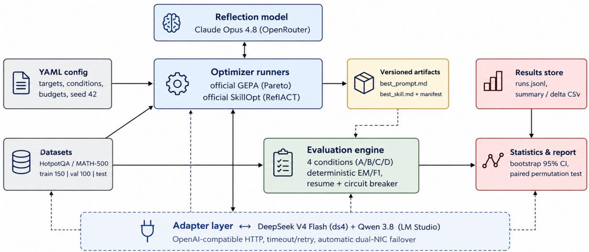  
Figure 1: Framework pipeline. A single YAML configuration drives an optimization phase (top: optimizer runners calling the reflection model and emitting versioned artifacts) and an evaluation phase (bottom: deterministic scoring of the four conditions feeding the statistics and reporting layer) against one frozen target at a time; all target trafic passes through one OpenAI-compatible adapter with timeout, retry, and configured dual-NIC failover (see §4 for the role of each layer). The diagram’s abbreviated “Qwen 3.8” label denotes the Qwen3.8-27B target.

Accordingly, C–A estimates the deployed SkillOpt-condition efect relative to the minimal baseline; it need not isolate accepted edits because condition C also includes the skill wrapper even when the optimizer accepts no change.

The minimal seed is a design choice, not an oversight: in a pilot with a hand-tuned seed (§6.7), neither optimizer identified an improvement over the curated seed, providing little opportunity to study their behavior when substantial textual-context changes remain possible. Seeding from a minimal prompt increases the opportunity for both methods to modify the textual context; condition D controls for the alternative of simply paying a human to write the prompt.

## 4.3 Metrics and scoring

Scoring is fully deterministic (no LLM judge). For HotpotQA we use SQuAD-style normalization (lowercase, strip articles and punctuation, whitespace tokenization) and compute exact match $\mathrm { E M } \in \{ 0 , 1 \}$ and token-level F1

$$
\mathrm { F 1 ~ } = ~ \frac { 2 P R } { P + R } , \qquad P = \frac { \left| \mathrm { p r e d } \cap \mathrm { g o l d } \right| } { \left| \mathrm { p r e d } \right| } , \qquad R = \frac { \left| \mathrm { p r e d } \cap \mathrm { g o l d } \right| } { \left| \mathrm { g o l d } \right| } .
$$

For MATH-500 we extract the last \boxed{...} expression (with a fallback to a “final answer” pattern), normalize LaTeX (fraction shorthand, \text{} wrappers, currency and percent symbols, spacing), and score exact match of the normalized answers, with a numeric-equality fallback at tolerance 10<sup>−6</sup>.

Each task also receives a format-compliance score f (HotpotQA: a non-empty answer of at most 120 characters; MATH: a parseable boxed answer) and a robustness score r (1 if the call succeeded, 0 on error). The framework’s composite score is the fixed convex combination

$$
s = 0 . 4 5 q + 0 . 2 0 f + 0 . 2 0 c + 0 . 1 5 r ,\tag{1}
$$

where quality q is F1 (HotpotQA) or EM (MATH-500) and the exact-match/correctness component c is EM. On MATH-500, q and c are not independent: both contain exact-match information, so the fixed composite intentionally gives benchmark correctness a combined weight of 0.65. The composite score is a framework-level operational metric rather than a benchmark-standard metric. Accordingly, benchmark-native quality metrics — F1/EM for HotpotQA and EM for MATH-500 — are treated as the primary measures of task performance; the composite is reported as a complementary measure that also captures format compliance and call robustness. The weights in Eq. 1 were fixed at framework-design time, before the reported test evaluation, and were not tuned on test performance; their purpose is to provide a common operational score across tasks rather than to replace benchmark-native metrics.

## 4.4 Headroom

Let $s _ { \mathrm { b a s e } }$ be the baseline score of a (model, task-distribution, serving-stack) configuration and $s _ { \mathrm { m a x } }$ its practical ceiling: the best end-to-end score reachable by varying only textual context while weights, decoding parameters, and scoring remain fixed. Define the headroom

$$
H = s _ { \mathrm { m a x } } - s _ { \mathrm { b a s e } } .\tag{2}
$$

Any text-space optimizer’s true gain is bounded by H. Importantly, $s _ { \mathrm { m a x } } .$ , and therefore H, is generally unobservable in a finite experiment: observing a better prompt establishes only a lower bound on the available headroom. Headroom should therefore be interpreted here as a conceptual property of the (model, task, scoring) configuration rather than as a directly estimated latent quantity. Signals consistent with $H \approx 0$ are nonetheless observable: a strong baseline, hand-tuned prompts that fail to improve, and optimizer validation gains that do not transfer.

The replication motivates three analytically distinct layers. Content/ reasoning headroom concerns substantive correctness among usable responses: did the artifact help solve content previously answered incorrectly? Answer-realization/evaluator-alignment headroom concerns converting available content into a complete, parseable, appropriately formatted final answer. Servingcompletion/reliability headroom concerns whether an assigned request completes and yields a response under the realized serving conditions. These are interpretive layers rather than separately identified causal latent variables, and the primary end-to-end estimand can mix them. HotpotQA shows limited measurable improvement from the evaluated procedures on either target. DeepSeek MATH primarily exhibits an answer-realization/evaluator-alignment diference. Qwen v2 MATH instead shows an outcome-level correctness gain among jointly successful calls at matched baseline/GEPA completion; sequential timing and the 12 recorded timeouts remain descriptive serving limitations rather than an explanation for that gain.

## 4.5 Selection bias under repeated validation

Both optimizers accept a candidate when it improves a mean score over a validation/selection set of size n. For paired candidate-versus-baseline comparisons, let $\sigma _ { \Delta }$ denote the standard deviation across tasks of the candidate-minus-baseline score diferences; the standard error of the mean paired gain is then $\sigma _ { \Delta } / \sqrt { n }$ . When an optimizer evaluates k candidates on the same set and keeps the maximum, then even under the null hypothesis that no candidate is truly better than the seed, the expected apparent gain of the selected candidate is approximately the expected maximum of k centered Gaussians,

$$
\mathbb { E } \bigg [ \operatorname* { m a x } _ { i \leq k } \hat { \Delta } _ { i } \bigg ] \approx \frac { \sigma _ { \Delta } } { \sqrt { n } } \sqrt { 2 \ln k } ,\tag{3}
$$

which grows with the number of attempts and shrinks only as $1 / { \sqrt { n } } .$ Equation 3 is intended as an order-of-magnitude heuristic rather than a formal significance threshold. It assumes approximately Gaussian fluctuations and abstracts away the dependence among adaptively generated candidates; in practice, optimizer proposals are correlated and the efective number of independent comparisons may be smaller than k.

We instantiate Eq. 3 with $\sigma _ { \Delta }$ computed from the actual per-task paired deltas of each run’s selected candidate against its seed, on the same validation/selection set the gate used (GEPA per-task validation subscores are recovered from the run state; SkillOpt selection scores from the archived per-task evaluations). As a complementary check that does not rely on the Gaussian approximation, we also run an empirical null simulation: the paired deltas are mean-centered, resampled with random sign flips (the null of no true improvement), the best of k simulated candidates is retained, and the procedure is repeated 20,000 times; we report the median and 95th percentile of the resulting best-of-k apparent gain. This empirical null is likewise a reference distribution rather than an exact model of the optimizer’s adaptive candidate-generation process; it does not preserve dependence among successive proposals. All values are in points (100× the score):

• GEPA on HotpotQA (n=100, k=9 full-validation candidates, $\sigma _ { \Delta } { = } 0 . 1 8 1 )$ : approximate selection-noise scale ≈ 3.8 points; empirical null best-of-9 median 2.6, 95th percentile 4.6. The observed validation gain was +1.3 points, well below this approximate selection-noise scale; considered in isolation, such a gain provides weak evidence of genuine transfer. It indeed failed to transfer (test: −0.8, n.s.).

• SkillOpt on MATH-500 (n=50, k=20 gate evaluations, hard-EM gate, $\sigma _ { \Delta } { = } 0 . 2 4 0 )$ : approximate selection-noise scale ≈ 8.3 EM points; empirical null best-of-20 median 6.2, 95th percentile 9.8. The observed selection staircase of +6.0 EM sits below the median of the null distribution; on test it collapsed to +0.4 paired EM (n.s.).

• SkillOpt on HotpotQA (n=100, k=20 gate evaluations, soft-F1 gate, $\sigma _ { \Delta } { = } 0 . 3 2 3 )$ : approximate selection-noise scale ≈ 7.9 F1 points; empirical null median 5.9, 95th percentile 9.1. The single accepted edit improved selection F1 by only +0.8 points — and degraded test F1 by 6.2 points.

• GEPA on MATH-500 (n=100, k=3 full-validation candidates, $\sigma _ { \Delta } { = } 0 . 2 3 1 )$ : approximate selection-noise scale ≈ 3.4 points; empirical null best-of-3 median 1.9, 95th percentile 4.9. The observed +6.0 validation gain exceeds this heuristic scale and the 95th percentile of the empirical null, and, in this run, also transferred to the held-out test set (+4.36 composite, p=0.0019).

Qwen v2 further weakens a simple threshold interpretation. HotpotQA GEPA selected the seed itself. HotpotQA SkillOpt accepted one of 20 edits and raised selection F1 from 0.620 to 0.776, yet held-out F1 fell by 3.22 points. On MATH-500, GEPA raised validation composite from 0.7745 to 0.8250 and held-out EM by 7.6 points at matched baseline/GEPA completion; SkillOpt raised selection EM from 0.72 to 0.78 and held-out EM by 3.6 points while recording nine timeouts. Because no v2 empirical-null distribution was persisted, we do not compare these gains with the inherited DeepSeek null percentiles. We use Eq. 3 only as a diagnostic of how weak small adaptive validation gains may be; it is not a validated acceptance threshold and it does not model serving reliability.

## 4.6 Statistical protocol

Per-condition means are reported with nonparametric bootstrap 95% confidence intervals [5] (resampling tasks, ≥5,000 replicates). Condition comparisons use a paired sign-permutation test [7]: for conditions X, Y evaluated on the same tasks, the null hypothesis is that the per-task deltas $d _ { t } = s _ { Y } ( t ) - s _ { X } ( t )$ are symmetric around zero; we randomly flip the signs of the nonzero deltas (10<sup>4</sup> permutations) and report the two-sided tail probability of the observed sum. Pairing on identical task sets removes between-task variance, which dominates in QA/math benchmarks, and thus gives far more power than unpaired comparisons at the same n.

All primary hypothesis tests compare each optimized condition with the minimal baseline on the benchmark-native quality metric: B vs. A and C vs. A on F1 for HotpotQA, and B vs. A and C vs. A on EM for MATH-500. Other pairwise comparisons are treated as exploratory and reported with unadjusted p-values unless otherwise stated. As a familywise sensitivity analysis, we apply Holm’s procedure to the eight primary B–A and C–A tests across two models and two benchmarks. We also estimate exploratory model-by-condition interactions as diferences between the within-mode paired efects, using task-level bootstrap intervals and sign-permutation tests. These interactions mix target-model and serving-stack diferences and are interpreted as heterogeneity, not as the causal efect of model identity. For Qwen MATH, task-level intervals and permutation p-values are conditional on the realized serving trajectory and do not capture uncertainty induced by temporally correlated endpoint failures.

## 5 Experimental Setup

## 5.1 Datasets and splits

HotpotQA [21]: multi-hop QA in the distractor setting (10 paragraphs, 2 gold + 8 distractors). Examples are drawn from the oficial development set of the distractor setting — the Hugging-Face hotpot\_qa dataset, config distractor, split validation, containing 7,405 examples (file hotpot\_dev\_distractor\_v1) — before deterministic shufling and partitioning. MATH-500 [12]: the 500-problem competition-math subset of MATH [10] popularized by Lightman et al. [12], from HuggingFaceH4/MATH-500. Both are shufled with a fixed seed (42) and split sequentially: train 150 / validation 100 / test 500 (HotpotQA) and train 150 / validation 100 / test 250 (MATH-500). Thus the “test” subsets reported in this paper refer to our held-out partitions of these datasets, not to additional oficial benchmark splits. Sequential slicing guarantees that enlarging the test set never touches train/val. GEPA uses the train split for reflection minibatches and the validation split for candidate scoring; SkillOpt uses train for rollouts and a selection subset of the validation split (HotpotQA 100, MATH 50) for gating. The test split was not used for optimizer candidate selection or artifact construction.

## 5.2 Target models and serving stacks

The first target is DeepSeek V4 Flash [2], a 284B-parameter mixture-of-experts model with 13B activated parameters and an explicit thinking mode, served locally by DwarfStar (ds4) [16]: a native C inference engine with a Metal backend and an extremely asymmetric 2/8-bit quantization recipe (checkpoint DeepSeek-V4-Flash-IQ2XXS-w2Q2K-AProjQ8-SExpQ8-OutQ8; routed experts at ∼2 bits, attention/shared/output paths at 8 bits), 250k-token context, and a disk-backed KV cache behind an OpenAI-compatible HTTP server. For reproducibility, the exact model artifact was DeepSeek-V4-Flash-IQ2XXS-w2Q2K-AProjQ8-SExpQ8-OutQ8-chat-v2-imatrix-0731.gguf (SHA-256 ca22ae2f838e14077c22bc1c1417b71b45b5e5a3687bd96c2ac6e17fdb6261c0), obtained as the ds4f-q2 download target of DwarfStar’s download\_model.sh from the antirez/deepseek-v4-gguf Hugging Face repository [16]; the same server build, checkpoint, and thinking-mode configuration were used throughout all conditions.

Hardware: 14-inch MacBook Pro (November 2023), Apple M3 Max, 128 GB unified memory, macOS Sequoia 15.7.7. The benchmark client runs on a separate Mac over LAN with automatic dual-NIC failover. Decoding: temperature 0, max\_tokens 512 (HotpotQA) / 4096 (MATH), timeout 180 s (HotpotQA) / 480 s (MATH), one retry per task. Generated-token counts reported in §6 are the completion\_tokens usage field returned by the server and include the model’s internal reasoning trace as well as the visible final response.

The replication target is Qwen3.8-27B [14], frozen as the 8-bit MLX variant qwen/qwen3.8-27b@8bit (29,528,355,154 bytes), served by LM Studio 0.4.14+4 on a separate Apple M3 Max system with 128 GB unified memory and macOS 15.7.7. The loaded context was 32,768 tokens and parallelism was one. The OpenAI-compatible endpoint reported model ID qwen/qwen3.8-27b; a live preflight required both hidden reasoning content and reasoning-token usage fields. Reasoning used the frozen LM Studio server default (on); request-level reasoning-efort and thinking-preservation controls were neither sent nor recorded. The exact local snapshot is identified by per-file SHA-256 hashes in the retained manifest; its upstream revision, MLX conversion revision/tool, and monolithic archive hash were not recorded. Temperature and maximum completion tokens matched the DeepSeek experiment; request timeouts were 180 s for HotpotQA and 480 s for MATH-500, with one retry. The primary and failover endpoint configuration, checkpoint metadata, hashes, and preflight are recorded in the frozen replication manifests. Absolute latency and token counts are not compared across targets because engines, quantizations, and serving hosts difer.

The Qwen experiment was a frozen target substitution: task files and ordered splits were byte-identical to the reference experiment, and the seed, conditions, scoring, optimizer packages, reflection model, and optimizer/test boundary were preserved. Qwen v2 repeated the complete optimization and evaluation pipeline in a separate namespace; it selected new artifacts in three of the four optimizer–benchmark cells. The same test items had already been evaluated in v1, but remained mechanically excluded from v2 optimization, and v2 artifacts were frozen before evaluation. Conditions were evaluated sequentially, so time-varying server availability can still be associated with condition. We therefore prioritize paired within-target efects and treat cross-target comparisons as descriptive replication evidence rather than a controlled hardware- or model-only contrast.

## 5.3 Optimizer configuration

Both optimizers use Claude Opus 4.8 (via OpenRouter) as the reflection/optimizer model. Each optimization run keeps its target fixed to the corresponding DeepSeek or Qwen model. GEPA: max\_metric\_calls 1200 (HotpotQA) / 400 (MATH-500), reflection minibatch 5, oficial Pareto candidate selection. SkillOpt (oficial ReflACT trainer): 2 epochs × 10 steps, batch size 15, textual learning rate (edit budget) 4, selection set 100 with soft-F1 gate (HotpotQA) / 50 with hard-EM gate (MATH-500), reflect minibatch 8. Dataset splitting, optimization scheduling, and the reported resampling procedures used framework seed 42. Target requests did not include a provider seed, so provider-side sampling determinism is not claimed. Optimizer budgets and gate metrics difer across benchmarks because they were configured according to task-specific evaluation characteristics; consequently, cross-benchmark comparisons are descriptive rather than controlled comparisons of benchmark identity alone. The oficial GEPA engine checks its stopping condition only at iteration boundaries, and an accepted minibatch improvement triggers a full validation evaluation that completes regardless of remaining budget; consequently, the nominal budgets of 1200 and 400 resulted in 1220 and 445 recorded metric calls, respectively. The primary Qwen v2 runs used the same nominal budgets and stopping semantics. Their realized target metric calls were 1220 and 430 for GEPA on HotpotQA and MATH-500; SkillOpt made 67 and 102 recorded target rollouts and accepted 1 of 20 candidate edits on HotpotQA and 2 of 20 on MATH-500. These telemetry counts follow the frozen manifests; they are not interchangeable with the larger number of per-example target invocations implied by a SkillOpt batch.

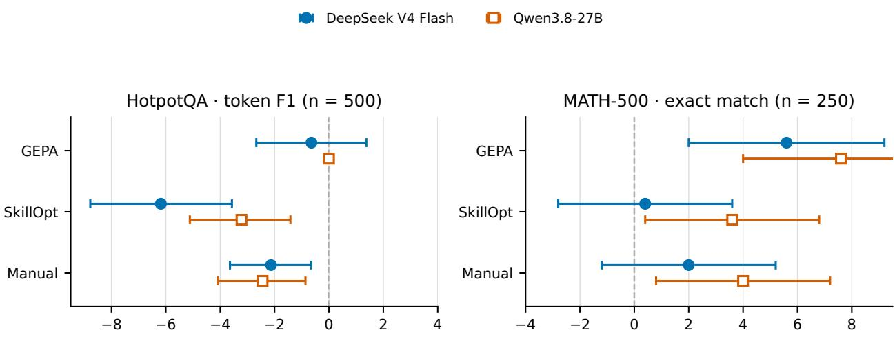  
Paired change vs. baseline (percentage points)  
Figure 2: Paired changes from the minimal baseline in the benchmark-native primary metric, with task-bootstrap 95% confidence intervals. Each panel uses the same held-out tasks within a model (HotpotQA n=500; MATH-500 n=250). The forest plot visualizes within-model efects; it does not treat the diferent serving stacks as exchangeable.

Failure scoring and Qwen execution policy. A failed call receives zero on the benchmark-native and composite outcomes, so the primary estimand is end-to-end performance under the observed serving process. The primary Qwen v2 evaluation ran once without resume, circuit-breaker activation, recovery, or post-hoc tuning. HotpotQA contains 2,000 successful unique rows. MATH-500 contains 1,000 unique rows and retains 12 read timeouts $( \mathrm { A } / \mathrm { B } / \mathrm { C } / \mathrm { D } \colon 1 / 1 / 9 / 1 )$ as zero-scored outcomes. The earlier v1 execution, including its authorized recovery after a circuit-breaker event, is preserved separately and analyzed in §6.11; it is not pooled with v2.

## 6 Results

Table 1 and Fig. 2 summarize the primary end-to-end results. Failed calls score zero, as specified before evaluation. Consequently, these outcomes measure the deployed model–prompt–server system rather than correctness conditional on receiving an answer.

## 6.1 DeepSeek replication reference

We first retain the detailed DeepSeek analysis because it establishes the reference efects that Qwen is intended to replicate. The tables in the next two subsections are DeepSeek-only; cross-model

Table 1: Held-out benchmark-native score by target and condition. Values in brackets are bootstrap 95% CIs; ∆ and raw paired permutation p compare each condition with A. OK is the number of successful calls. Scores and intervals use four decimal places; deltas are percentage points. Bold marks the best primary score within each target–benchmark block (ties included). Holm-adjusted results are reported in §6.5.
<table><tr><td>Benchmark</td><td>Target</td><td>Condition</td><td>Score [95% CI]</td><td>∆ vs A (pp)</td><td>Raw p</td><td>OK/n</td></tr><tr><td rowspan="5">HotpotQA</td><td rowspan="5">DeepSeek</td><td>A baseline</td><td>0.8150 [0.7857, 0.8436]</td><td></td><td></td><td>500/500</td></tr><tr><td>B GEPA</td><td>0.8086 [0.7795, 0.8381]</td><td>-0.64</td><td>.5363</td><td>499/500</td></tr><tr><td>C SkillOpt</td><td>0.7532 [0.7196, 0.7867]</td><td>-6.18</td><td>&lt; .0001</td><td>500/500</td></tr><tr><td>D manual</td><td>0.7937 [0.7634, 0.8243]</td><td>-2.13</td><td>.0036</td><td>500/500</td></tr><tr><td>A baseline</td><td>0.8215 [0.7918, 0.8491]</td><td></td><td></td><td>500/500</td></tr><tr><td rowspan="6">MATH-500</td><td></td><td>B GEPA</td><td>0.8215 [0.7918, 0.8491]</td><td>0.00</td><td>1.0000</td><td>500/500</td></tr><tr><td></td><td>C SkillOpt</td><td>0.7893 [0.7561, 0.8204]</td><td>-3.22</td><td>.0004</td><td>500/500</td></tr><tr><td></td><td>D manual</td><td>0.7971 [0.7652, 0.8270]</td><td>-2.44</td><td>.0024</td><td>500/500</td></tr><tr><td>DeepSeek</td><td>A baseline</td><td>0.8520 [0.8080, 0.8920]</td><td></td><td></td><td>250/250</td></tr><tr><td>B GEPA</td><td></td><td>0.9080 [0.8720, 0.9400]</td><td>+5.60</td><td>.0047</td><td>250/250</td></tr><tr><td rowspan="5">Qwen</td><td>C SkillOpt</td><td>0.8560 [0.8120, 0.9000]</td><td>+0.40</td><td></td><td>1.0000</td><td>249/250</td></tr><tr><td></td><td>D manual</td><td>0.8720 [0.8280, 0.9120]</td><td>+2.00</td><td>.3055</td><td>250/250</td></tr><tr><td></td><td>A baseline</td><td>0.8280 [0.7800, 0.8760]</td><td></td><td></td><td>249/250</td></tr><tr><td>B GEPA</td><td></td><td>0.9040 [0.8640, 0.9400] 0.8640 [0.8200, 0.9040]</td><td>+7.60 +3.60</td><td>.0002</td><td>249/250</td></tr><tr><td>C SkillOpt D manual</td><td></td><td>0.8680 [0.8240, 0.9080]</td><td>+4.00</td><td>.0463 .0302</td><td>241/250 249/250</td></tr></table>

conclusions follow in §6.5.

## 6.2 DeepSeek HotpotQA: no measurable improvement and a harmful accepted edit

Table 2 reports the held-out test results (n=500).

Three findings. First, the minimal one-line prompt is the strongest tested condition on the held-out set: the hand-engineered prompt (D) is significantly worse than the minimal seed (F1 −2.13, p=0.0036; composite −1.96, p=0.0015), and GEPA’s evolved prompt is statistically indistinguishable from the seed (F1 −0.64, p=0.54; EM +0.8, p=0.70). In this setting, the reasoning-native model already exhibits much of the span-extraction and short-answer behavior targeted by conventional QA instructions; the additional instructions do not improve held-out quality and increase latency (15.2 s → 18.9–23.0 s, with mean output length growing from 111 to 153–218 tokens).

Second, SkillOpt’s single accepted edit actively hurts. Under the soft-F1 gate, 1 of 20 candidate edits was accepted, at training step 18 (+0.8 F1 on the selection set); on test it costs −6.2 F1 and −4.2 EM $\left( { p { \le } 0 . 0 2 } \right)$ , and drops format compliance from 0.972 to 0.868. The edit instructs the model to include attached qualifiers and phrases in its answers (§A); this systematically lengthens answers, which exact-match and F1 scoring punish. A verbosity-inducing rule slipped through a gate that a +0.8-point selection improvement — far inside the ≈7.9-point approximate selection-noise scale of Eq. 3 — could not justify.

Third, GEPA’s validation gain did not transfer. The validation composite increased from 0.830 to 0.842 (+1.3 points), a gain small relative to the approximate selection-noise scale of ≈3.8 points discussed in §4.5 (Fig. 3 left shows candidates mostly far below the seed); on the held-out test set the selected prompt was −0.8 composite points below baseline.

Table 2: DeepSeek HotpotQA test results (n=500 tasks). F1 is the benchmark-native primary metric; composite is Eq. 1. Deltas are paired vs. condition A over all n tasks with sign-permutation p-values (in points); a failed call scores 0. Negative deltas are regressions. Bold marks the column-best score, format rate, or latency (lower is better); p-values communicate significance separately. No optimizer delta versus A constitutes a significant improvement.
<table><tr><td>Condition</td><td>F1</td><td>EM</td><td>Composite [95% CI]</td><td></td><td>Format</td><td>Lat. (s)</td><td>∆F1 vs A (p)</td></tr><tr><td>A baseline (minimal)</td><td>0.8150</td><td>0.6720</td><td></td><td>0.8456 [0.8233, 0.8664]</td><td>0.9720</td><td>15.2</td><td></td></tr><tr><td>B GEPA</td><td>0.8086</td><td>0.6800</td><td></td><td>0.8376 [0.8133, 0.8605]</td><td>0.9400</td><td>21.7</td><td>–0.64 (0.5363)</td></tr><tr><td> $\mathrm { C \ S k i l l o p t }$ </td><td>0.7532</td><td>0.6300</td><td></td><td>0.7885 [0.7609, 0.8154]</td><td>0.8680</td><td>23.0</td><td> $- 6 . 1 8 \ ( < 1 0 ^ { - 4 } )$ </td></tr><tr><td>D manual</td><td>0.7937</td><td>0.6600</td><td></td><td>0.8260 [0.8016, 0.8494]</td><td>0.9340</td><td>18.9</td><td>−2.13 (0.0036)</td></tr></table>

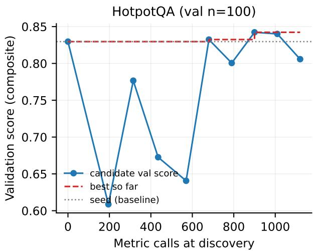

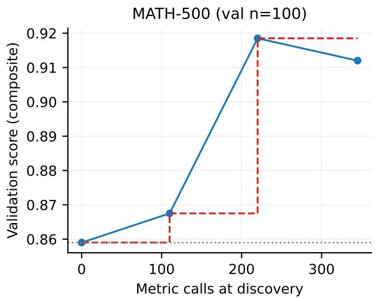  
Figure 3: DeepSeek GEPA candidate validation scores vs. metric-call budget. Left (HotpotQA): candidates scatter mostly below the seed; the best-so-far line creeps up by +1.3 points, below the approximate selection-noise scale. Right (MATH-500): the deployed best candidate is discovered by 220 metric calls, with a +6.0-point climb beyond that scale; the complete optimization run consumes 445 metric calls, and the gain transfers to test.

## 6.3 DeepSeek MATH-500: significant GEPA gains

Table 3 shows the mirror image. GEPA improves exact match from 0.852 to 0.908 (+5.6 EM, paired $\scriptstyle p = 0 . 0 0 4 7 ;$ ; composite +4.36, p=0.0019). Exploratory pairwise comparisons also favored GEPA over SkillOpt (+4.16 composite, unadjusted p=0.011) and over the manual condition (+2.66, unadjusted $\scriptstyle { p = 0 . 0 4 7 } )$ . SkillOpt’s selection-set staircase $( 0 . 7 8 \to 0 . 8 4$ hard EM, 3 of 20 candidate edits accepted; Fig. 6 right) collapses on test to a paired +0.4 EM (p=1.0). Manual prompt engineering lands in between and is not significant (+2.0 EM, p=0.3055). These results establish held-out generalization of the artifact obtained in this optimization run; they do not by themselves establish the run-to-run stability of GEPA.

Pareto dominance on quality and latency. Observed mean latency is 30% lower under GEPA $( 6 5 . 9 \to 4 5 . 8 \mathrm { s } )$ while increasing benchmark EM (Fig. 5). The mechanism is visible in the artifact (§A) and in the output statistics: the evolved prompt orders the model to emit only the boxed answer, suppressing post-reasoning prose — mean generated output drops from 1104 tokens (median 515)

Table 3: DeepSeek MATH-500 test results (n=250 tasks). EM is the benchmark-native primary metric; composite is Eq. 1. Deltas are paired vs. condition A over all n tasks with sign-permutation p-values (in points); a failed call scores 0. GEPA is the only condition with a significant improvement; it also dominates on latency. Bold marks the column-best score, format rate, or latency (lower is better); p-values communicate significance separately.
<table><tr><td>Condition</td><td>EM</td><td>Composite [95% CI]</td><td>Format</td><td>Lat. (s)</td><td>∆EM vs A (p)</td></tr><tr><td>A baseline (minimal)</td><td>0.8520</td><td>0.8846 [0.8480, 0.9188]</td><td>0.9040</td><td>65.9</td><td></td></tr><tr><td>B GEPA</td><td>0.9080</td><td>0.9282 [0.8982, 0.9554]</td><td>0.9400</td><td>45.8</td><td>+5.60 (0.0047)</td></tr><tr><td>C SkillOpt</td><td>0.8560</td><td>0.8866 [0.8508, 0.9198]</td><td>0.9040</td><td>64.9</td><td>+0.40 (1.0000)</td></tr><tr><td>D manual</td><td>0.8720</td><td>0.9016 [0.8676, 0.9332]</td><td>0.9240</td><td>57.4</td><td>+2.00 (0.3055)</td></tr></table>

under the baseline to 727 (median 263) under GEPA — and pins down gold-format conventions (exact values instead of decimals; multiple-choice answers as \boxed{\text{(C)}}) that turn near-misses into exact matches. Relative to the 14.8-point gap between the baseline EM and the metric upper bound of 1.0, the observed GEPA diference accounts for 5.6 points, or approximately 38% of that observable gap, in 445 metric calls.

How GEPA got there: the candidate tree. Figure 4 reconstructs the full evolutionary history of the winning MATH-500 prompt from GEPA’s own run telemetry. In this run, the search trajectory is short and directed: from the one-line seed (candidate 0, val 0.859), the first reflection produced candidate 1 (0.8675), which introduced the boxed-only output rule and the exact-valuesover-decimals convention; a second reflection on candidate 1 produced candidate 2 (0.9185), which added the multiple-choice \boxed{\text{(C)}} convention and the domain reminders and became the deployed artifact. Two further proposals (iterations 2 and 3) failed their reflection minibatch and were discarded without a full validation pass — GEPA’s cheap early rejection at work — and a last accepted branch (candidate 3, 0.912) improved on some validation tasks but not in aggregate, so it stayed on the Pareto front without displacing candidate 2. The tree makes GEPA’s two selection mechanisms visible at once: minibatch gating prunes bad proposals early, while the per-task Pareto front keeps candidate 3 alive as a possible parent even though its aggregate score is lower.

## 6.4 Qwen v2: exact HotpotQA no-intervention, SkillOpt reversal, and MATH gains

On HotpotQA, Qwen v2 GEPA selected the one-line seed. The baseline and GEPA artifacts have the same hash, and all 500 paired responses are identical (F1 0.8215 under both conditions). This is an exact no-intervention outcome of the realized search, not evidence that GEPA cannot improve HotpotQA in general. SkillOpt exhibits the opposite regime: its validation score rises from 0.620 to 0.776, but held-out F1 falls from 0.8215 to 0.7893 $( \Delta = - 0 . 0 3 2 2$ , paired 95% CI $[ - 0 . 0 5 1 2 , - 0 . 0 1 4 2 ] , p { = } . 0 0 0 4 )$ . Baseline alone solves 14 paired items and SkillOpt alone solves 10; format compliance falls from 0.940 to 0.884, mean latency rises by 25.7%, and observed total tokens rise from 832,066 to 957,880. The manual prompt also degrades F1 $( \Delta = - 0 . 0 2 4 4 , p { = } . 0 0 2 4 )$ . Thus the large optimization-time SkillOpt gain reverses on the held-out panel.

On MATH-500, GEPA improves EM from 0.828 to 0.904 (∆ = +0.076, paired 95% CI [0.040, 0.116], p=.0002). Of the 250 paired items, 204 are correct under both conditions, 22 only under GEPA, 3 only under baseline, and 21 under neither. Both conditions record one timeout, so the observed gain is not produced by diferential completion coverage. Figure 7 and Table 4 separate the quality diference from completion coverage. Mean end-to-end latency is lower under GEPA (143.34 s to 99.35 s, −30.7%), although conditions ran sequentially and latency was not subjected to an inferential test. SkillOpt reaches EM 0.864 (∆ = +0.036, 95% CI [0.004, 0.068], p=.0463) and records nine timeouts; its raw paired efect is smaller and borderline and does not survive Holm correction. The manual condition reaches 0.868 $( \Delta = + 0 . 0 4 0$ , exploratory p=.0302).

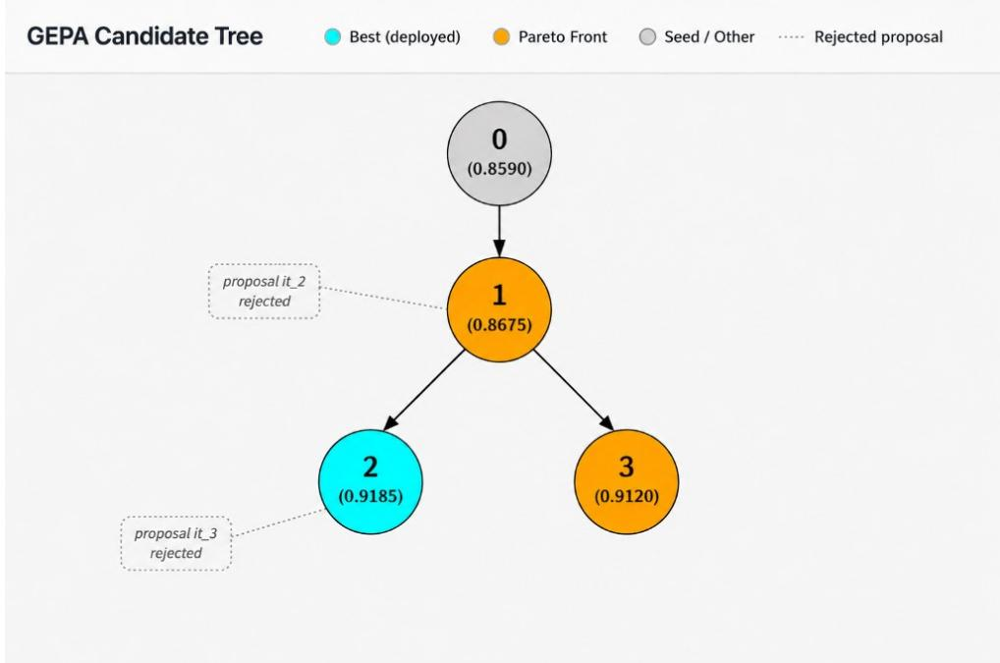  
Figure 4: GEPA candidate tree on MATH-500, redrawn from the run’s own candidate\_tree.html and run\_log.json. Solid circles are candidates accepted into the pool, labeled with their fullvalidation scores (n=100); arrows point from parent to child; dotted callouts are proposals rejected at the reflection-minibatch stage. Candidate 2 (cyan) is the deployed best; candidate 3 remains on the per-task Pareto front (orange) despite a lower aggregate score.

The failure categories in Table 5 and their temporal placement in Figure 8 make the sequential serving trajectory explicit.

Dificulty-stratified EM is exploratory. On 139 dificult items, A, B, C, and D score 0.741, 0.871, 0.791, and 0.806; on 46 medium items they score 0.935, 0.957, 0.978, and 0.935; and on 65 easy items they score 0.938, 0.938, 0.938, and 0.954. The largest descriptive GEPA diference occurs in intermediate algebra (n=52, 0.635 to 0.923). These subgroup estimates were not separately powered or tested and should not be treated as confirmatory.

Figure 9 makes the resource trade-of explicit. On MATH-500, GEPA produces fewer output and reasoning tokens than baseline, but its longer prompt increases input tokens from roughly 163 to 1,414 and total tokens per successful response from 1,382 to 2,253 (+63%). Hence it is faster in observed wall time but less token-eficient. Manual prompting is the most economical MATH condition by total tokens, while GEPA yields the highest accuracy and lowest observed latency.

## 6.5 Cross-model replication, heterogeneity, and multiplicity

The strongest cross-model pattern is task-level. GEPA does not improve HotpotQA on either target: DeepSeek changes by −0.64 F1 points and Qwen v2 selects the seed, producing an exact zero efect. SkillOpt is harmful in both realized HotpotQA runs (−6.18 DeepSeek; −3.22 Qwen), although the

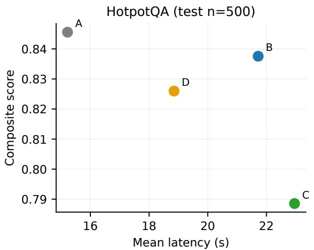

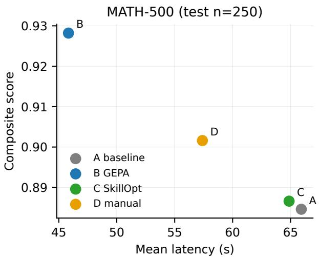  
Figure 5: DeepSeek quality vs. mean latency. On MATH-500 (right), GEPA Pareto-dominates every other condition: higher composite score at the lowest latency. On HotpotQA (left), the baseline dominates: every longer prompt costs latency without quality.

Table 4: Qwen v2 MATH reliability decomposition $( n { = } 2 5 0$ per condition). End-to-end EM scores failures as zero. EM|OK conditions on successful calls; paired OK $\Delta$ restricts each comparison to tasks where both A and the comparator succeeded and is descriptive. Bold marks the column-best value (ties included).
<table><tr><td>Condition</td><td>End-to-end EM</td><td> $\mathrm { O K } / n$ </td><td>EM|OK</td><td>Paired OK ∆ vs A</td></tr><tr><td>A baseline</td><td>0.8280</td><td>249/250</td><td>0.8313</td><td></td></tr><tr><td>B GEPA</td><td>0.9040</td><td>249/250</td><td>0.9076</td><td>+0.0726</td></tr><tr><td>C SkillOpt</td><td>0.8640</td><td>241/250</td><td>0.8963</td><td>+0.0375</td></tr><tr><td>D manual</td><td>0.8680</td><td>249/250</td><td>0.8715</td><td>+0.0363</td></tr></table>

Qwen-minus-DeepSeek interaction is only borderline (+2.97 points, 95% CI [0.03, 5.95], p=.051).   
The learned artifacts difer, so this contrast does not isolate a model-only interaction.

On MATH-500, GEPA produces the strongest positive efect on both targets: +5.6 EM points for DeepSeek and +7.6 for Qwen. Their interaction is small relative to its uncertainty (+2.0 points, 95% CI $[ - 2 . 8 , 6 . 8 ] , p { = } . 5 2 0 )$ . This task-consistent two-model result strengthens the evidence for the tested model–task configurations but does not establish model-independence. SkillOpt changes by +0.4 points for DeepSeek and +3.6 for Qwen (interaction +3.2, 95% CI [−0.8, 7.6], p=.198).

Holm correction over the eight reported optimizer–baseline B–A/C–A primary contrasts retains DeepSeek HotpotQA SkillOpt (adjusted $ { p = } . 0 0 0 8 )$ , DeepSeek MATH GEPA (adjusted $p { = } . 0 2 3 5 )$ , Qwen HotpotQA SkillOpt (adjusted $p { = } . 0 0 2 4 )$ , and Qwen MATH GEPA (adjusted $\scriptstyle p = . 0 0 1 4 )$ . Qwen MATH SkillOpt does not survive this sensitivity analysis (adjusted p=.1852). Multiplicity correction addresses false positives across tests; it does not repair condition-associated endpoint instability or identify a semantic mechanism; Table 6 reports all eight raw and adjusted values.

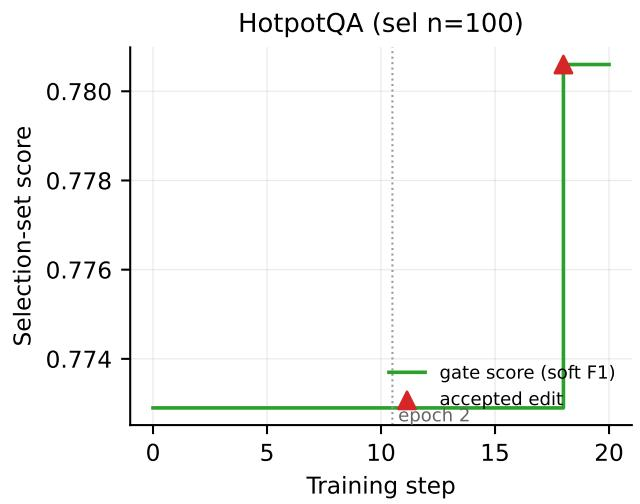

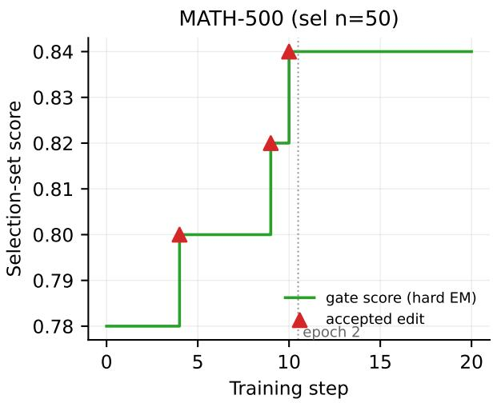  
Figure 6: DeepSeek SkillOpt gate trajectory (selection-set score per training step; triangles mark accepted edits). Right (MATH-500, hard-EM gate, n=50): a 0.78 → 0.84 staircase in epoch 1, plateau in epoch 2. Left (HotpotQA, soft-F1 gate, n=100): flat except one late accept — the edit that degrades test F1 by 6.2 points.

Table 5: Recorded Qwen v2 MATH failure categories in the final assigned-task panel. The uninterrupted evaluation records only read timeouts and required no recovery. Bold marks the column minimum (ties included).
<table><tr><td>Condition</td><td>Read timeout</td><td>Other errors</td><td>Final failures</td></tr><tr><td>A baseline</td><td>1</td><td>0</td><td>1</td></tr><tr><td>B GEPA</td><td>1</td><td>0</td><td>1</td></tr><tr><td>C SkillOpt</td><td>9</td><td>0</td><td>9</td></tr><tr><td>D manual</td><td>1</td><td>0</td><td>1</td></tr></table>

## 6.6 Transfer: validation gains vs. test gains

Figure 10 compares each of the eight optimizer runs’ measured development gain with its held-out end-to-end gain. Qwen HotpotQA SkillOpt is the clearest reversal: a +15.6-point selection gain becomes a −3.2-point held-out F1 efect. Both MATH GEPA runs transfer positively. Because GEPA’s development axis is composite score and its test axis is EM, numerical magnitudes across axes describe direction rather than like-for-like efect sizes. Across both models, an adaptive validation gain is neither a guarantee of transfer nor a diagnosis of the mechanism of transfer.

## 6.7 Ablation: curated seed

In a pilot with the hand-tuned seed prompt on HotpotQA, GEPA (1290 metric calls, 10 candidates, 9h58m) returned the seed itself as best candidate, and SkillOpt under a hard-EM gate rejected all 20 proposed edits (11h13m, selection EM stuck at 0.68). In this pilot, both methods failed to identify an improvement over the curated seed under their respective strict acceptance criteria. This motivated the minimal-seed design of the main study and foreshadowed its HotpotQA outcome. This result further suggests that, for this model–benchmark configuration, additional textual guidance provides limited measurable benefit under the evaluated scoring rule.

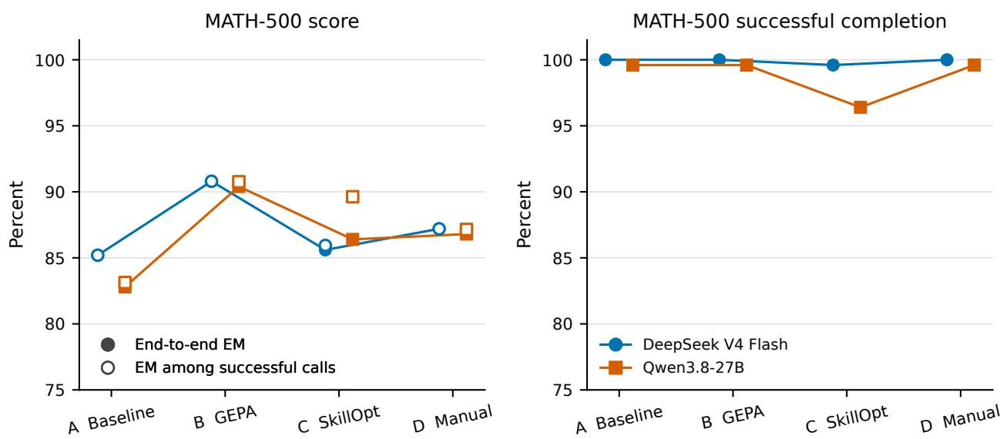  
Figure 7: MATH-500 primary end-to-end EM (left) and successful-call rate (right) for both DeepSeek and Qwen, each over all 250 assigned tasks. Qwen v2 completion is 99.6% under A, B, and D and 96.4% under C; the GEPA score gain therefore remains visible at matched completion. Cross-target absolute latency is omitted because serving stacks difer.

## 6.8 Qualitative analysis of the optimized artifacts

The winning GEPA MATH prompt (full text in §A) is a study in metric alignment rather than mathematical insight. Its content: output only the boxed answer (associated with lower observed latency); preserve exact values over decimals (12\pi, not 37.7); wrap multiple-choice answers as \boxed{\text{(C)}} exactly as the gold labels do; a handful of domain reminders (cylindricalcoordinate surfaces, a determinant–area identity). GEPA discovered, from execution traces alone, which formatting conventions the scorer rewards — legitimate gains under the benchmark’s own rules, and a caution for anyone reading EM deltas as pure reasoning improvements.

Item-level audit of the MATH-500 gain. To characterize what the +5.6 EM actually consists of, we audited every test item whose EM changed between conditions A and B (Table 7). Of 250 paired items, 209 are correct under both conditions and 19 wrong under both; 18 flip from wrong to correct and 4 from correct to wrong (net +14, i.e. +5.6 points). Inspecting the 18 improvements: in 12 cases the baseline produced no parseable \boxed{} answer: each call exhausted the 4,096-token output budget and the retained visible response is empty, so its underlying reasoning cannot be independently inspected. GEPA’s boxed-only rule yielded a clean final answer. In the remaining 6 cases the baseline’s boxed value was mathematically equivalent to the gold answer but formatted diferently than the scorer expects (e.g. 106 vs. 106ˆ\circ, E vs. \text{(E)}, a coordinate tuple vs. a pmatrix). The retained audit supplied no observed case of GEPA correcting demonstrably incorrect mathematical reasoning. Conversely, 3 of the 4 regressions are cases where GEPA’s answer was missing or truncated, and 1 is a genuinely diferent (wrong) value. The observed EM gain is therefore dominated by answer-completion and format alignment rather than by new mathematical capability — consistent with the latency and token-count reductions.

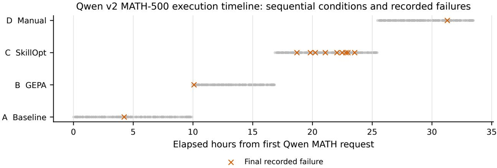  
Figure 8: Qwen v2 MATH-500 execution timeline from retained per-task timestamps. Conditions ran sequentially; crosses mark the 12 recorded read timeouts. The figure diagnoses temporal nonexchangeability and does not attribute failures causally to prompt text.

Table 6: Multiplicity sensitivity for the eight primary automated-optimizer contrasts. Raw values are paired sign-permutation p-values; adjusted values use Holm’s step-down procedure.
<table><tr><td>Target</td><td>Benchmark</td><td>Contrast</td><td>Effect</td><td>Raw p</td><td>Holm p</td></tr><tr><td>DeepSeek</td><td>HotpotQA</td><td>B-A</td><td>-0.0064</td><td>.5363</td><td>1.0000</td></tr><tr><td>DeepSeek</td><td>HotpotQA</td><td>C-A</td><td>-0.0618</td><td>&lt; .0001</td><td>.0008</td></tr><tr><td>DeepSeek</td><td>MATH-500</td><td>B-A</td><td>+0.0560</td><td>.0047</td><td>.0235</td></tr><tr><td>DeepSeek</td><td>MATH-500</td><td>C-A</td><td>+0.0040</td><td>1.0000</td><td>1.0000</td></tr><tr><td>Qwen</td><td>HotpotQA</td><td>B-A</td><td>0.0000</td><td>1.0000</td><td>1.0000</td></tr><tr><td>Qwen</td><td>HotpotQA</td><td>C-A</td><td>-0.0322</td><td>.0004</td><td>.0024</td></tr><tr><td>Qwen</td><td>MATH-500</td><td>B-A</td><td>+0.0760</td><td>.0002</td><td>.0014</td></tr><tr><td>Qwen</td><td>MATH-500</td><td>C-A</td><td>+0.0360</td><td>.0463</td><td>.1852</td></tr></table>

The final SkillOpt MATH skill mixes genuinely reusable strategy (“optimize the inner variable first in nested optimization”; “use the defining constraint to rewrite higher powers instead of solving”) with training-set memorization: an identity about opposite-vertex distance sums in a regular octahedron and an 8–15–17 right-triangle special case are transparently distilled from specific training problems. That composition is consistent with the observed transfer collapse: memorized fragments do not fire on fresh test problems, and the +6.0 EM selection gain that admitted them sits within the approximate selection-noise scale of its acceptance loop (§4.5).

The harmful HotpotQA skill edit emphasizes attached qualifiers and full phrases (“8,211 at the 2010 census” instead of “8,211”). In the realized SkillOpt artifact, that emphasis helps on the handful of selection tasks where the gold span includes the qualifier and is associated on the held-out distribution with systematically longer answers and lower exact-match and F1 performance. Similar completeness instructions also occur in the broader GEPA prompt, so the degradation should be attributed to the realized artifact as a whole rather than to that rule in isolation. The result remains a format/verbosity failure accepted by an underpowered gate.

Qwen artifacts. On HotpotQA, GEPA retained the one-line seed byte-for-byte, explaining the exact A/B equality. SkillOpt accepted one of 20 edits and produced a materially longer skill; its

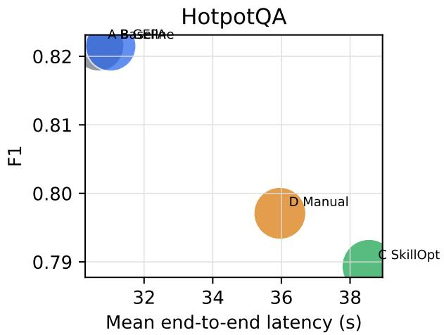

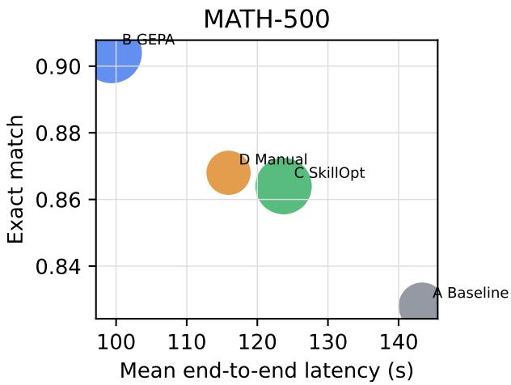  
Bubble area is proportional to observed total tokens

Figure 9: Qwen v2 quality, mean end-to-end latency, and observed total-token trade-ofs. Bubble area is proportional to total reported tokens. Within a benchmark, lower latency and higher score are preferable, but smaller bubbles represent a distinct token-economy objective.

Table 7: MATH-500 item-level transition audit between conditions A (baseline) and B (GEPA) on the 250 paired test items.
<table><tr><td>Transition</td><td>Count</td></tr><tr><td>Correct under both</td><td>209</td></tr><tr><td>Wrong under both</td><td>19</td></tr><tr><td>A wrong → B correct</td><td>18</td></tr><tr><td>— of which: A emitted no parseable boxed answer</td><td>12</td></tr><tr><td>— of which: A&#x27;s value equivalent, format mismatch</td><td>6</td></tr><tr><td>A correct → B wrong</td><td>4</td></tr></table>

large selection gain did not generalize, while held-out format compliance and F1 decreased. On MATH-500, both obtained artifacts add mandatory boxed answers, bounded completion, avoidance of exhaustive search or loops, exact-form output, and verification. The GEPA prompt adds extensive format constraints and task-family examples; the more compact SkillOpt skill catalogues reusable shortcuts involving symmetry, substitution, inequalities, and canonical-form classification. These instructions are associated with diferent output lengths and token profiles, but the sequential serving trajectory prevents assigning latency or timeout diferences solely to their text. Artifact hashes and full texts are reported in Appendix B.

## 6.9 Optimization cost

Table 8 summarizes. For the two DeepSeek SkillOpt runs, archived optimizer-token telemetry supports an estimated Claude reflection-model cost of approximately \$12 (\$12.47 at the documented historical token rates). Comparable GEPA reflection-token telemetry was not retained, so this is not an estimate of total DeepSeek reflection-model spend. The retained Qwen optimizer telemetry does not contain authoritative monetary billing data; zero-valued cost fields therefore must not be interpreted as zero spend. We therefore make no cross-target monetary comparison. Qwen optimization also took longer in every corresponding cell, but hardware, engine, output behavior, and server conditions difer. The defensible deployment conclusion is therefore limited: text-space optimization carries substantial one-time wall-clock cost, and whether it amortizes depends on a stable, mechanism-appropriate held-out gain.

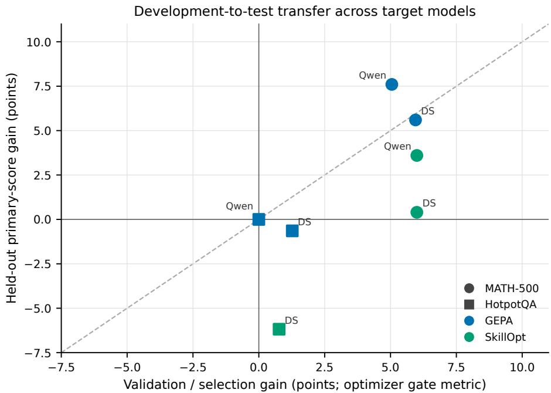  
Figure 10: Validation-to-test transfer across two targets and two optimizers. x is gain on the optimizer’s own validation/selection metric; y is paired held-out gain on the corresponding primary metric. The diagonal denotes numerical, not mechanistic, transfer; axis metrics difer for GEPA development and MATH held-out evaluation.

## 6.10 Held-out inference tokens and response time

The DeepSeek and Qwen replication tests also permit a descriptive accounting of target-model inference. Tables 9 and 10 use the frozen per-task test records. Input and output are the serverreported prompt and completion tokens, respectively. We sum token counts over calls with status=ok and nonmissing usage. Amortized output throughput is

$$
R _ { \mathrm { o u t } } = \frac { \sum _ { i } \mathrm { o u t p u t \_ t o k e n s } _ { i } } { \sum _ { i } \mathrm { l a t e n c y \_ m s } _ { i } / 1 0 0 0 } .
$$

Mean latency is the corresponding arithmetic mean of per-call latency\_ms, in seconds. Both time statistics are conditioned on the same successful calls; OK/assigned makes that denominator visible. The latency timer spans the HTTP invocation and any retries, not just token generation, so throughput is not a pure decoder-speed or time-to-first-token measure.

The benchmark split is essential to interpretation. MATH-500 answers consume far more output tokens per successful call than HotpotQA answers, while HotpotQA carries much larger input contexts; pooling the two tasks can therefore obscure condition-specific response-time patterns. For example, DeepSeek GEPA’s pooled mean latency is below its pooled baseline mean, but the existing per-benchmark results show an increase on HotpotQA and a decrease on MATH-500. Within Qwen, the observed pooled throughput varies modestly among conditions, whereas successful-call latency and completion coverage vary more. Qwen’s HotpotQA baseline and GEPA artifacts and responses are identical yet their recorded latencies difer, underscoring that sequential serving conditions can afect these descriptive measurements independently of prompt content. Qwen v2 MATH-500 has 12 unsuccessful calls across conditions; excluding them from the time and token denominators avoids presenting a failed request as a zero-token, zero-latency answer, but also makes the summaries success-conditioned rather than end-to-end workload totals.

Table 8: One-time optimization telemetry. Counts follow each optimizer’s manifest (GEPA metric calls; SkillOpt recorded optimizer rollouts) and are not direct measures of model tokens. Wall times are descriptive because serving stacks difer. Authoritative Qwen monetary cost was not retained. The final column reports accepted/rejected candidate edits.
<table><tr><td>Target</td><td>Benchmark</td><td>Optimizer</td><td>Recorded units</td><td>Wall clock</td><td>Edits (accepted/rejected)</td></tr><tr><td>DeepSeek</td><td>HotpotQA</td><td>GEPA</td><td>1220</td><td>9h45m</td><td></td></tr><tr><td rowspan="6">Qwen</td><td>HotpotQA</td><td>SkillOpt</td><td>75</td><td>14h 58m</td><td>1/19</td></tr><tr><td>MATH-500</td><td>GEPA</td><td>445</td><td>6h 10m</td><td></td></tr><tr><td>MATH-500</td><td>SkillOpt</td><td>95</td><td>22h 45m</td><td>3/17</td></tr><tr><td>HotpotQA</td><td>GEPA</td><td>1220</td><td>13h 25m</td><td></td></tr><tr><td>HotpotQA</td><td>SkillOpt</td><td>67</td><td>25h 54m</td><td>1/19</td></tr><tr><td>MATH-500</td><td>GEPA</td><td>430</td><td>12h 48m</td><td></td></tr><tr><td></td><td>MATH-500</td><td>SkillOpt</td><td>102</td><td>40h 23m</td><td>2/18</td></tr></table>

Table 9: Held-out target-model inference by condition, pooled across HotpotQA and MATH-500. Token columns are observed totals for successful calls only; the last two columns use those same calls. Conditions are A=baseline, B=GEPA, C=SkillOpt, D=manual. Bold marks the highest output-token rate and lowest mean latency within each target; these descriptive extrema are not causal eficiency estimates.
<table><tr><td>Target</td><td>Cond.</td><td>OK/assigned</td><td>Input</td><td>Output</td><td>Total</td><td>Output tok/s Latency (s)</td><td></td></tr><tr><td>DeepSeek</td><td>A</td><td>750/750</td><td>722,998</td><td>331,687</td><td>1,054,685</td><td>13.77</td><td>32.1</td></tr><tr><td rowspan="6"></td><td>B</td><td>749/750</td><td>1,434,184</td><td>259,678</td><td>1,693,862</td><td>11.73</td><td>29.6</td></tr><tr><td>C</td><td>749/750</td><td>1,117,864</td><td>364,910</td><td>1,482,774</td><td>13.41</td><td>36.3</td></tr><tr><td>D</td><td>750/750</td><td>776,498</td><td>317,265</td><td>1,093,763</td><td>13.35</td><td>31.7</td></tr><tr><td>A</td><td>749/750</td><td>793,823</td><td>382,299</td><td>1,176,122</td><td>7.54</td><td>67.7</td></tr><tr><td>B</td><td>749/750</td><td>1,105,204</td><td>287,956</td><td>1,393,160</td><td>7.22</td><td>53.2</td></tr><tr><td>C</td><td>741/750</td><td>1,119,272</td><td>323,531</td><td>1,442,803</td><td>7.05</td><td>61.9</td></tr><tr><td></td><td>D</td><td>749/750</td><td>852,927</td><td>338,745</td><td>1,191,672</td><td>7.29</td><td>62.1</td></tr></table>

Table 10: The same held-out inference accounting, pooled over the four conditions within each benchmark. Missing usage from unsuccessful calls is not imputed; these token totals are not fullexperiment consumption. Bold marks the highest output-token rate and lowest mean latency within each target, descriptively; benchmark workloads difer.
<table><tr><td>Target</td><td>Benchmark</td><td>OK/assigned</td><td>Input</td><td>Output</td><td>Total</td><td>Output tok/s</td><td>Latency (s)</td></tr><tr><td rowspan="2">DeepSeek</td><td>HotpotQA</td><td>1999/2000</td><td>3,497,082</td><td>319,318</td><td>3,816,400</td><td>8.15</td><td>19.6</td></tr><tr><td>MATH-500</td><td>999/1000</td><td>554,462</td><td>954,222</td><td>1,508,684</td><td>16.45</td><td>58.1</td></tr><tr><td rowspan="2">Qwen</td><td>HotpotQA</td><td>2000/2000</td><td>3,153,468</td><td>356,858</td><td>3,510,326</td><td>5.24</td><td>34.1</td></tr><tr><td>MATH-500</td><td>988/1000</td><td>717,758</td><td>975,673</td><td>1,693,431</td><td>8.50</td><td>116.2</td></tr></table>

Table 11: Qwen v1–v2 sensitivity. Values are held-out F1 for HotpotQA and exact match for MATH-500. “Same artifact” applies only to optimized conditions. Errors are assigned tasks without an OK response. No v1/v2 scores are pooled.
<table><tr><td>Benchmark</td><td>Condition</td><td>v1</td><td>v2</td><td>v2-v1</td><td>Errors v1/v2</td><td>Same artifact</td></tr><tr><td>HotpotQA</td><td>baseline</td><td>.8215</td><td>.8215</td><td>.0000</td><td>0/0</td><td>n/a</td></tr><tr><td rowspan="7">MATH-500</td><td>GEPA</td><td>.8215</td><td>.8215</td><td>.0000</td><td>0/0</td><td>yes</td></tr><tr><td>SkillOpt</td><td>.8184</td><td>.7893</td><td>-.0291</td><td>0/0</td><td>no</td></tr><tr><td>manual</td><td>.7883</td><td>.7971</td><td>+.0088</td><td>7/0</td><td>n/a</td></tr><tr><td>baseline</td><td>.804</td><td>.828</td><td>+.024</td><td>40/1</td><td>n/a</td></tr><tr><td>GEPA</td><td>.852</td><td>.904</td><td>+.052</td><td>26/1</td><td>no</td></tr><tr><td>SkillOpt</td><td>.864</td><td>.864</td><td>.000</td><td>24/9</td><td>no</td></tr><tr><td>manual</td><td>.832</td><td>.868</td><td>+.036</td><td>30/1</td><td>n/a</td></tr></table>

Finally, the targets use diferent hardware, engines, quantization, and token-accounting semantics: Qwen’s completion usage includes hidden reasoning, whereas equivalence to the historical DeepSeek accounting has not been established. Consequently, neither the cross-target output-token rates nor the absolute token totals identify a model-only eficiency diference. Failed requests may have consumed unreported tokens, and target-model optimization and Claude reflection usage are outside these tables. The figures quantify the observed held-out test subset, not all tokens or energy spent in the study. Across Qwen v2 test calls with reported usage, totals are 3,871,226 input tokens, 1,332,531 output tokens, and 5,203,757 total tokens; 1,139,676 reasoning tokens are a subset of the output count, not an additional quantity.

## 6.11 Qwen complete-pipeline repeatability and serving sensitivity

Qwen v2 reruns both optimization and held-out evaluation from the frozen protocol in a separate namespace. It is therefore a complete-pipeline repeat, not a second evaluation of the v1 artifacts: three of the four optimized artifacts difer between executions, with only the HotpotQA GEPA seed retained byte-identically. The same held-out task identifiers had already been observed in v1, although they remained excluded from v2 optimization and were frozen before the v2 evaluation. Consequently, v2 is informative about run-to-run and serving sensitivity, but is not a fresh study-level holdout.

The v2 execution is used for the primary Qwen presentation because it is the operationally complete run: it required no resume, circuit-breaker recovery, or endpoint substitution. This designation was made after both result sets existed and is therefore a post-hoc presentation choice, not a prospectively registered primary analysis and not a choice justified by the numerical rank of v2. The adjacent v1 results make the sensitivity visible. Exact HotpotQA baseline and GEPA replication supports the realized no-intervention result; the other diferences jointly reflect newly selected artifacts, optimizer stochasticity, and serving conditions and cannot identify any one cause.

## 7 Discussion

HotpotQA exposes both an exact no-intervention outcome and a transfer reversal. Across two target-serving configurations, neither optimizer improves the one-line HotpotQA baseline. Qwen v2 GEPA is the cleanest no-intervention case: the optimizer selects the seed, so the deployed intervention is exactly zero. SkillOpt is diferent. Its Qwen v2 validation improvement is large, yet held-out F1 falls significantly; DeepSeek also exhibits a harmful accepted edit. These outcomes do not establish that SkillOpt generally overfits, but they show that an optimization-time success and a useful deployed intervention are distinct.

Apparent gains occupy three distinct layers. DeepSeek MATH primarily exhibits answerrealization/evaluator-alignment improvement: with successful calls in both A and B, the obtained GEPA artifact increases benchmark EM by enforcing a complete, benchmark-compatible final answer. Qwen v2 GEPA also improves correctness among jointly successful calls, with only one timeout in each condition, so its end-to-end gain is not a completion-rate artifact. The retained records support an outcome-level gain, not a claim that hidden reasoning itself improved. Content/reasoning, answer-realization/evaluator alignment, serving completion, latency, and token economy all matter to deployed utility, but they support diferent scientific claims.

Evaluator actionability may matter in addition to headroom. Both benchmarks use deterministic scoring, so their cross-benchmark diference cannot be attributed simply to evaluator determinism. MATH-500 instead provides a comparatively low-ambiguity relationship among a problem, a canonical final answer, and exact-match feedback. This can make some evaluation failures actionable for text-space optimization: an artifact can encode reusable constraints concerning answer completion, exact form, canonical representation, and output discipline. This interpretation is especially consistent with the DeepSeek MATH GEPA audit, where the +5.6-point EM diference is attributable primarily to answer realization and evaluator alignment rather than newly corrected mathematical reasoning. HotpotQA scoring is also deterministic, but semantically reasonable answers may vary lexically from the reference span, and changes in qualifiers, verbosity, or phrasing can alter EM/F1 without a corresponding change in substantive correctness. The harmful DeepSeek HotpotQA SkillOpt edit illustrates the risk: the realized artifact’s emphasis on qualifiers and full phrases passed the selection gate but was associated with longer answers and lower held-out F1. Because similar completeness instructions also occur in the broader GEPA prompt, this result does not isolate that rule as the cause. The observed pattern is therefore consistent with the hypothesis that optimization depends not only on available headroom but also on evaluator actionability—the extent to which feedback provides a low-ambiguity signal that can be translated into generalizable textual interventions. Because benchmark and task structure, optimizer budget, gate metric, and selection-set size difer here, the study does not isolate evaluator actionability causally.

Optimizer efects depend on task, method, and trajectory. No optimizer is uniformly superior. GEPA produces the strongest MATH-500 condition for both targets, but selects no new Qwen HotpotQA intervention. SkillOpt improves Qwen MATH modestly while degrading Qwen and DeepSeek HotpotQA. One optimization trajectory per cell cannot distinguish an algorithm-level tendency from search variance, so the appropriate unit of conclusion is the observed optimizer–target– task run.

Selection-noise estimates are diagnostics, not gates. Repeated evaluation on $n \in [ 5 0 , 1 0 0 ]$ can make several-point improvements unsurprising under a centered empirical null. The DeepSeek runs illustrate a useful warning: three development gains fail to transfer and one accepted edit is harmful. Qwen v2 makes the warning sharper: HotpotQA SkillOpt records a large selection gain but a significant held-out loss, whereas MATH GEPA transfers positively. Practical deployment therefore requires evaluation data untouched by optimization, explicit failure accounting, and replication across optimizer seeds and time blocks; independent confirmation additionally requires a fresh external or study-level holdout. A small gate gain alone is insuficient.

Implications for benchmark practice. Reports should separate at least five quantities: assignedtask end-to-end score, completion rate, correctness among usable responses, answer-realization failures, and latency both over assigned tasks and successful calls. Randomizing or interleaving conditions over time would reduce association between prompt and transient server state. Where failures remain, paired status-transition tables make the source of aggregate diferences auditable. These practices matter especially for slow local inference, where a timeout can dominate benchmark outcomes and optimization budgets span days.

## 8 Limitations

Two target models remain a small sample, and each uses a diferent engine, quantization, and serving host. Within each experiment all conditions target the same checkpoint and stack, but cross-target interactions combine model and system diferences. Both benchmarks are English, single-turn, and deterministically scored; agentic and tool-use settings remain untested. A single reflection model (Claude Opus 4.8) is used throughout, and a diferent reflector may change search eficiency.

The two benchmark configurations difer in optimizer budget, gate metric, and selection-set size. Cross-benchmark contrasts therefore motivate the headroom and evaluator-actionability hypotheses but do not constitute a controlled causal test of either.

For MATH-500, the exact-match evaluator includes normalization and numeric equivalence but not full symbolic equivalence. DeepSeek GEPA’s net gain is attributable to answer completion and format alignment rather than newly solved mathematics. Qwen v2 conditions were evaluated sequentially rather than randomized or interleaved. The run completed without resume, circuitbreaker recovery, or endpoint substitution, but 12 assigned calls timed out $( 1 / 1 / 9 / 1$ under $\mathrm { A / B / C / D } )$ Task-level confidence intervals and permutation tests are therefore conditional on the realized serving trajectory and do not model uncertainty from temporally correlated server load. The earlier Qwen execution required recovery and endpoint substitution; it is retained as sensitivity evidence rather than merged into v2.

Qwen v2 reused the study’s previously evaluated test identifiers. Those items were excluded from v2 optimization and frozen before v2 evaluation, but v2 is not an independent confirmation on unseen study-level test data. Moreover, its primary designation is post hoc and based on operational completeness. Because three optimized artifacts changed, v1–v2 diferences confound search trajectory, artifact content, and serving state. They should not be read as a pure estimate of serving-stack variance.

The success-conditional analysis is also limited. Completion is afected by condition and possibly by problem dificulty, so restricting to jointly successful calls is a post-treatment selection. It is a mechanism-oriented sensitivity analysis, not an unbiased replacement estimand for missing counterfactual responses.

Finally, each optimization procedure was executed once (seed 42). The paired tests and bootstrap confidence intervals quantify uncertainty over evaluation examples conditional on the optimized artifact obtained in that run; they do not quantify optimizer-run variance. Multi-seed replication would be required to establish the stability of the optimization outcome across independent searches and is left for future work due to the substantial computational cost of local target-model rollouts.

## 9 Conclusion

RQ1: The absence of measurable HotpotQA optimizer improvement under the evaluated procedures replicates across the two target-serving configurations. Qwen v2 strengthens this conclusion for GEPA through an exact no-intervention result, while SkillOpt’s accepted edit significantly harms held-out F1. RQ2: Textual headroom is most informative when separated into content/reasoning, answer-realization/evaluator alignment, and serving-completion/reliability. The observed DeepSeek MATH diference belongs primarily to the second layer. Qwen v2 MATH GEPA improves correctness with nearly identical completion coverage, while lowering observed response time and increasing token use; these are distinct outcome, latency, and resource trade-ofs rather than a single eficiency claim. RQ3: Optimizer efects are target- and trajectory-dependent, while cross-model comparisons are inseparable from serving-stack diferences in this study. RQ4: Small adaptive validation gains remain weak evidence of held-out benefit, and selection-noise diagnostics cannot substitute for held-out, failure-aware evaluation.

The cross-benchmark pattern further motivates evaluator actionability as a hypothesis for future controlled study: optimization may depend not only on available headroom but also on how directly evaluation feedback can be translated into generalizable textual interventions.

Future work should interleave conditions across time, replicate optimizer searches over seeds, evaluate each model across multiple serving stacks, and extend the design to tool-use tasks where skills may ofer structural advantages. The immediate recommendation is narrower: before deployment, measure assigned-task performance, response success, correctness among usable responses, format/realization failures, and latency both overall and among successful calls. Do not collapse these mechanisms into a single claim of improved accuracy or reasoning.

## Code and Data Availability

The accompanying evidence-only archive contains the manuscript source, figure and table inputs, frozen optimized artifacts, sanitized per-task result records, run identities, freeze manifests, selected logs, configuration files, and a transformation ledger with SHA-256 checksums. Benchmark implementation code, development data, optimizer conversations, caches, credentials, and turnkey endpoint configuration are deliberately excluded. Appendix A reproduces the retained DeepSeek artifacts; Appendix B identifies and reproduces the primary Qwen v2 artifacts while preserving v1 sensitivity provenance. The historical DeepSeek namespace retains aggregate and per-task evaluation evidence but not the original optimizer logs, run identities, or freeze manifests; this provenance limitation is disclosed in the archive and no missing evidence is reconstructed. Public benchmark data remain governed by their original licenses and are not redistributed in the archive.

## Acknowledgments

We are grateful to Salvatore Sanfilippo and the DwarfStar (ds4) project: the availability of a fast, dependable local serving stack for DeepSeek V4 Flash is what made thousands of local target-model rollouts — and therefore this study — possible. Generative AI tools assisted with language editing and manuscript refinement. The authors take responsibility for the experimental design, analyses, results, and scientific claims.

## References

[1] Lakshya A. Agrawal, Shangyin Tan, Dilara Soylu, Noah Ziems, Rishi Khare, Krista Opsahl-Ong, Arnav Singhvi, Herumb Shandilya, Michael J. Ryan, Meng Jiang, Christopher Potts, Koushik Sen, Alexandros G. Dimakis, Ion Stoica, Dan Klein, Matei Zaharia, and Omar Khattab. GEPA: Reflective prompt evolution can outperform reinforcement learning, 2025. URL https://arxiv.org/abs/2507.19457.

[2] DeepSeek-AI. DeepSeek-V4: Towards highly eficient million-token context intelligence, 2026. URL https://arxiv.org/abs/2606.19348.

[3] Cynthia Dwork, Vitaly Feldman, Moritz Hardt, Toniann Pitassi, Omer Reingold, and Aaron Roth. The reusable holdout: Preserving validity in adaptive data analysis. Science, 349(6248): 636–638, 2015.

[4] Cynthia Dwork, Vitaly Feldman, Moritz Hardt, Toniann Pitassi, Omer Reingold, and Aaron Roth. Preserving statistical validity in adaptive data analysis. In Proceedings of the 47th Annual ACM Symposium on Theory of Computing (STOC), pages 117–126, 2015.

[5] Bradley Efron. Bootstrap methods: Another look at the jackknife. The Annals of Statistics, 7 (1):1–26, 1979.

[6] Chrisantha Fernando, Dylan Banarse, Henryk Michalewski, Simon Osindero, and Tim Rocktäschel. Promptbreeder: Self-referential self-improvement via prompt evolution, 2023. URL https://arxiv.org/abs/2309.16797.

[7] Ronald A. Fisher. The Design of Experiments. Oliver and Boyd, Edinburgh, 1935.

[8] Antonio Gulli. Agentic Design Patterns: A Hands-On Guide to Building Intelligent Systems. Springer, 2025. ISBN 9783032014016.

[9] Qingyan Guo, Rui Wang, Junliang Guo, Bei Li, Kaitao Song, Xu Tan, Guoqing Liu, Jiang Bian, and Yujiu Yang. Connecting large language models with evolutionary algorithms yields powerful prompt optimizers. In International Conference on Learning Representations (ICLR), 2024. URL https://arxiv.org/abs/2309.08532.

[10] Dan Hendrycks, Collin Burns, Saurav Kadavath, Akul Arora, Steven Basart, Eric Tang, Dawn Song, and Jacob Steinhardt. Measuring mathematical problem solving with the MATH dataset. In Proceedings of the Neural Information Processing Systems Track on Datasets and Benchmarks, 2021. URL https://arxiv.org/abs/2103.03874.

[11] Omar Khattab, Arnav Singhvi, Paridhi Maheshwari, Zhiyuan Zhang, Keshav Santhanam, Sri Vardhamanan, Saiful Haq, Ashutosh Sharma, Thomas T. Joshi, Hanna Moazam, Heather Miller, Matei Zaharia, and Christopher Potts. DSPy: Compiling declarative language model calls into self-improving pipelines. In International Conference on Learning Representations (ICLR), 2024. URL https://arxiv.org/abs/2310.03714.

[12] Hunter Lightman, Vineet Kosaraju, Yura Burda, Harri Edwards, Bowen Baker, Teddy Lee, Jan Leike, John Schulman, Ilya Sutskever, and Karl Cobbe. Let’s verify step by step. In International Conference on Learning Representations (ICLR), 2024. URL https://arxiv. org/abs/2305.20050.

[13] Krista Opsahl-Ong, Michael J. Ryan, Josh Purtell, David Broman, Christopher Potts, Matei Zaharia, and Omar Khattab. Optimizing instructions and demonstrations for multi-stage language model programs. In Proceedings of the 2024 Conference on Empirical Methods in Natural Language Processing (EMNLP), 2024. URL https://arxiv.org/abs/2406.11695.

[14] Qwen Team. Qwen3.8-27B model card. Hugging Face model repository, 2026. URL https: //huggingface.co/Qwen/Qwen3.8-27B. Accessed 2026-09-14.

[15] Benjamin Recht, Rebecca Roelofs, Ludwig Schmidt, and Vaishaal Shankar. Do ImageNet classifiers generalize to ImageNet? In Proceedings of the 36th International Conference on Machine Learning (ICML), 2019. URL https://arxiv.org/abs/1902.10811.

[16] Salvatore Sanfilippo. DwarfStar 4 (ds4): A native local inference engine for DeepSeek V4 Flash. https://github.com/antirez/ds4, 2026. MIT license. See also the launch note “A few words on DS4”, https://antirez.com/news/165, and the quantized weights at https: //huggingface.co/antirez/deepseek-v4-gguf.

[17] Dhanasekar Sundararaman, Bharat Gandhi, Aashna Garg, and Minjie Li. FLARE: Few-shot learning-based adaptive reflective engine, 2026. URL https://arxiv.org/abs/2608.02919.

[18] Liyan Tang, Cyrus Rashtchian, Chun-Sung Ferng, Andrew Tomkins, Da-Cheng Juan, and Tu Vu. WikiSkill: Compiling agent experience into persistent knowledge for skill evolution, 2026. URL https://arxiv.org/abs/2608.27454.

[19] Chengrun Yang, Xuezhi Wang, Yifeng Lu, Hanxiao Liu, Quoc V. Le, Denny Zhou, and Xinyun Chen. Large language models as optimizers. In International Conference on Learning Representations (ICLR), 2024. URL https://arxiv.org/abs/2309.03409.

[20] Yifan Yang, Ziyang Gong, Weiquan Huang, Qihao Yang, Ziwei Zhou, Zisu Huang, Yan Li, Xuemei Gao, Qi Dai, Bei Liu, Kai Qiu, Yuqing Yang, Dongdong Chen, Xue Yang, and Chong Luo. SkillOpt: Executive strategy for self-evolving agent skills, 2026. URL https: //arxiv.org/abs/2605.23904.

[21] Zhilin Yang, Peng Qi, Saizheng Zhang, Yoshua Bengio, William W. Cohen, Ruslan Salakhutdinov, and Christopher D. Manning. HotpotQA: A dataset for diverse, explainable multi-hop question answering. In Proceedings of the 2018 Conference on Empirical Methods in Natural Language Processing (EMNLP), 2018. URL https://arxiv.org/abs/1809.09600.

[22] Mert Yuksekgonul, Federico Bianchi, Joseph Boen, Sheng Liu, Zhi Huang, Carlos Guestrin, and James Zou. TextGrad: Automatic “diferentiation” via text, 2024. URL https://arxiv.org/ abs/2406.07496.

## A DeepSeek reference artifacts

## A.1 Minimal seed prompt and skill (both conditions A and C)

HotpotQA seed prompt (prompts/benchmark\_qa\_minimal.md):

Answer the question using the provided paragraphs. Reply with the short answer only.

MATH-500 seed prompt (prompts/benchmark\_math\_minimal.md):

Solve the math problem. Give the final answer inside \boxed{}.

The seed skills for condition C are the same single line under a # Skill header.

## A.2 Manually curated prompts (condition D)

HotpotQA (prompts/benchmark\_qa\_system.md):

You are a question answering system. You receive context paragraphs and a question.

Rules: Use only the provided paragraphs to answer. Combine information from multiple paragraphs when needed (multi-hop). Reply with the exact short answer only: a name, date, number, or short phrase. Do not add explanations, punctuation, or extra text. Answer in English.

MATH-500 (prompts/benchmark\_math\_system.md):

You are a mathematical problem solver.

Rules: Reason step by step, showing the key passages. Keep the reasoning concise; avoid repeating the problem statement. Always end with the final answer inside \boxed{}. The boxed answer must contain only the answer in its simplest form (a number, fraction, or expression), with no extra words.

## A.3 Winning GEPA prompt, MATH-500 (condition B)

Solve the given math problem. The input will be a problem statement (typically prefixed with "Problem:") covering topics such as algebra, arithmetic, geometry, percentages, linear algebra/vectors, matrices/determinants, coordinate systems (Cartesian, cylindrical, spherical), and similar competition-style or textbook math (Asymptote/[asy] diagrams may be included).

Instructions:

1. Reason through the problem step by step internally to determine the correct answer. Work carefully and verify your computation.

2. After solving, output ONLY the final answer inside \boxed{}. Do not include any reasoning, explanation, prefix text, or trailing punctuation in your final response. The entire response should consist solely of the \boxed{...} expression on a single line.

Formatting rules for the final answer:

\- Give the answer in its simplest, most standard form.

\- Preserve exact values (e.g., use \pi, fractions, or radicals) rather than decimal approximations unless the problem explicitly asks for a decimal. For example, write 12\pi, not 37.7.

\- For fractions, use a clean form such as \frac{1}{5} or 1/5. Match conventional notation.

\- For vectors/matrices, use the appropriate LaTeX environment, e.g.,

\- Do not include units, dollar signs, or extra words inside or outside the box unless they are an essential part of the answer.

\- The content inside \boxed{} must be exactly the answer and nothing else.

## Special formatting for multiple-choice problems:

\- If the problem presents lettered answer options (e.g., "(A) Line", "(B) Circle", ...) and asks you to "Enter the letter of the correct option," output the letter wrapped in \text{} with the parentheses included. For example, write \boxed{\text{(C)}}, NOT \boxed{C}. This matches the expected gold format for such multiple-choice geometry/coordinate problems.

## Domain-specific reminders:

\- Cylindrical coordinates (r, theta, z): the equation z = c describes a Plane. The equation r = c describes a Cylinder. theta = c describes a (half-)plane/line depending on context.

\- The dot product of vectors is the sum of the products of corresponding components.

\- For the squared area determinant identity: given pairwise squared distances between three points, the square of the determinant | x1 y1 1; x2 y2 1; x3 y3 1 | equals (2\*Area)^2 = 4\*(triangle area)^2. Use Heron’s formula for the triangle area from side lengths.

\- For trapezoid area, use (1/2)(sum of parallel sides)(height); read side lengths carefully from any provided diagram.

\- For function composition problems, substitute inner values first, then solve for the unknown parameter.

Important: Even though you should reason step by step to reach the answer, your actual output must contain nothing except the final \boxed{} answer. Any explanatory text, labels, or surrounding sentences will be considered incorrect. Keep it to a single line: \boxed{<answer>}.

## A.4 Winning GEPA prompt, HotpotQA (condition B, full text)

The full artifact (artifacts\_hotpotqa\_minimal/gepa/.../best\_prompt.md; Unicode arrows and em-dashes rendered as ASCII):

You are answering reading-comprehension questions based on a set of provided context paragraphs. Each input contains several context paragraphs (each labeled with a bracketed title like [Title]) followed by a question. Your job is to answer the question using ONLY the information in the paragraphs.

## INPUT FORMAT:

\- A block of context paragraphs, each starting with a bracketed entity title (e.g., [Staten Island], [George McCall Theal], [Tomb Raider]).

\- A single question at the end. Note: the question text is sometimes TRUNCATED/cut off mid-sentence. If so, infer the most likely intended question from the visible words and the context paragraphs, and still produce a best-guess answer.

\- The question may be single-hop (answer found in one paragraph) or multi-hop (requires linking facts across two or more paragraphs).

CRITICAL -- NEVER RETURN AN EMPTY RESPONSE:

\- You MUST always output a non-empty answer. An empty response scores 0 even when the correct answer is clearly present in the context. This is the single most important rule.

\- Even if the question is truncated, ambiguous, or you are unsure, ALWAYS give your best single short guess drawn from the most relevant paragraph. A reasonable guess massively outperforms silence.

\- Do not leave the answer blank under any circumstance.

## PERFORMANCE CONSTRAINT (speed):

\- Produce an answer quickly. Do not overthink, over-search, or get stuck. Some inputs contain very long, dense, or distracting paragraphs (e.g., detailed railroad or geographic descriptions). Do NOT exhaustively parse every sentence. Quickly locate the paragraph whose title matches the entity in the question, extract the answer, and respond.

\- If a question seems to require reading a very long irrelevant paragraph, ignore that paragraph and focus only on the paragraph(s) directly relevant to the question.

OUTPUT FORMAT RULES (critical):

\- Reply with ONLY the exact short answer (typically a few words), in English.

\- Do NOT include any explanation, prefix, label, reasoning, or trailing punctuation.

\- Match the phrasing exactly as the source paragraph uses for the answer.

\- For yes/no questions, answer with lowercase "yes" or "no".

## ANSWER COMPLETENESS AND EXACT-MATCH RULES:

\- Copy the answer span EXACTLY as it appears in the source paragraph, including full names and qualifiers. Do NOT shorten, paraphrase, or drop trailing parts of a name.

\- When a person or entity is asked for, give the FULL name exactly as written in that entity’s paragraph title or first mention. E.g., paragraph titled "[Joey Wong]" but first line "Joey Wong Cho-Yee (AKA Joey Wang...)" -> answer "Joey Wong Cho-Yee".

\- For a population/statistic stated as "8,211 at the 2010 census," give the complete phrase "8,211 at the 2010 census," not just "8,211."

\- For multiple roles forming the answer (e.g., "former model and yoga teacher"), include the relevant roles as expressed, e.g., "model and yoga teacher."

\- For "what is X" where the paragraph defines X (e.g., "Opry Mills is a super-regional shopping mall..."), answer with the defining noun phrase as written ("super-regional shopping mall").

\- When a single specific entity is requested (a title, name, city, profession, award, company), give just that entity exactly as written (e.g., "director", "Don S. Davis", "Birmingham, Alabama", "Ride a Wild Pony", "Bay of Fundy", "Usher", "Crystal Dynamics", "Na Na", "Hirsch index rating").

\- For questions asking a shared attribute of two entities (e.g., "X and Y are both what profession?"), give the single shared value ("director").

## REASONING STRATEGY:

\- Multi-hop questions: first locate the entity mentioned in the question, extract the linking fact, then find the paragraph about that linked entity to get the final answer.

\- "The Tennessee Volunteers play as a member of a conference in what city?" -> SEC -> SEC paragraph "headquartered in Birmingham, Alabama" -> "Birmingham, Alabama."

\- "The birthplace of George McCall Theal is a port city of what bay?" -> Saint John, New Brunswick -> "Saint John is the port city of the Bay of Fundy" -> "Bay of Fundy."

\- For chart/song questions like "which single was stuck behind": find the paragraph describing the song’s chart position and read the entity blocking it (e.g., a song stuck at #2 "behind the Usher singles Yeah and Burn" -> answer "Usher").

\- For "the latest N games in the series were developed by whom" type questions, find the franchise/media list paragraph naming the developer (e.g., "the latest four by Crystal Dynamics" -> "Crystal Dynamics").

\- For comparison/superlative/ordering questions (e.g., "which came first", "longest career"), compute the relevant quantities from the dates/spans given for EACH entity before choosing. Do not default to the more famous or first-mentioned entity.

\- Base answers strictly on the paragraphs; do not rely on outside assumptions.

Produce only the final short answer -- and never produce an empty one.

## A.5 Final SkillOpt skill, MATH-500 (condition C, full text)

## # Skill

Solve the math problem. Give the final answer inside \boxed{}.

## ## Verification

\- After computing an answer, sanity-check it against the diagram and problem constraints before finalizing.

\- In trisection/subdivision problems, carefully identify HOW MANY of the equal sub-parts lie inside the triangle or region of interest (e.g., a cevian angle may span 2 of 3 trisected parts, not 1). Count the sub-angles from the figure rather than assuming one part each.

\- For an interior intersection point of cevians, the triangle formed uses the angles adjacent to that point; recompute using the correct multiples of the base sub-angle.

## ## Method

\- Before computing, look for a key structure/identity and pick an efficient method over brute force: special triangles (e.g., 8-15-17 right triangle), tangent addition, sin(2x)=2 sin x cos x telescoping, completing the square, divisibility facts, the Remainder/Factor theorem for polynomial remainders, the cross product for areas/volumes, and binomial coefficients for indistinguishable-object counts. - For nested optimization/game problems, optimize the inner variable first (e.g., vertex of a quadratic), then the outer.

\- To classify or identify an object (conic type, etc.), reduce the equation to its recognizable standard/canonical form by dividing/multiplying/completing the square, then read off the classification directly (e.g., dividing to \frac{(x-h)^2}{a}+\frac{y^2}{b}=1 identifies an ellipse).

\- For probability over points placed randomly on a circle (or other symmetric configurations), count favorable cyclic/relative orderings divided by total orderings instead of integrating (e.g., two chords intersect iff the four endpoints alternate).

\- For f(-x) vs f(x) problems, note even-power terms are unchanged and odd-power terms flip sign: use the given value to cancel the unknown even-power/constant coefficients instead of solving for them.

\- Exploit invariants/symmetry to avoid solving for every unknown: when a symmetric configuration has a conserved quantity (e.g., for a regular octahedron the sum of squared distances from any point to each pair of OPPOSITE vertices is constant), pair the known values by equal sums to isolate the unknown directly.

\- For binomial coefficients, apply C(n,k)=C(n,n-k) to switch to the smaller k before computing (e.g., C(31,28)=C(31,3)).

\- To evaluate an inverse function at a value, set f(x)=that value and solve for x directly; do not derive the full inverse formula.

\- For word problems, name variables and translate the conditions into a system of equations (e.g., count+value equations, force=mass\*acceleration), then solve by substitution/elimination.

\- When a defining equation/constraint is given (e.g., x^2 - x - 1 = 0), use it to rewrite higher powers and substitute directly into the target expression instead of solving for the variable; the target often collapses to a constant.

\- On a closed interval, simplify the expression (absolute values often collapse to a linear form), determine whether it is increasing or decreasing, then evaluate at the correct endpoint for the min/max.

\- For greatest-integer/integer-part problems involving radicals, expand or use conjugates to split into a rational part plus an irrational part, then bound the irrational part by comparing squares of integers.

\- For terminating-decimal digit-sum problems, scale numerator and denominator so the denominator becomes a power of 10 (multiply top and bottom by 2 or 5 to balance the exponents of 2 and 5), read off the decimal digits, then sum them.

\- For sum-of-squared-distances from a point P to the vertices, use the identity PA^2+PB^2+PC^2 = GA^2+GB^2+GC^2 + 3\*PG^2 (G = centroid); combine with known facts

\- Work step by step, one transformation per line.

\- Simplify to exact lowest terms (fractions, radicals, ordered pairs), not decimals; verify the answer satisfies any stated constraint before boxing exactly one final answer.

\- CRITICAL: When the problem asks for a number of degrees or an angle, the boxed answer MUST include the degree symbol: write \boxed{180^\circ}, not \boxed{180}. Similarly keep %, units, or \pi when the phrasing implies them. EXCEPTION: if the unknown itself already carries the degree symbol in the problem (e.g., ’Find x’ where the expression uses x^\circ), the answer is the bare number x - write \boxed{46}, not \boxed{46^\circ}.

The octahedron identity and the 8–15–17 triangle are distilled from specific training problems (§6.8).

## A.6 Final SkillOpt skill, HotpotQA (condition C — the harmful edit)

## # Skill

Answer the question using the provided paragraphs.

When the answer is a number or measurement that the passage presents with an attached phrase (e.g. ’X at the 2010 census’, ’X shows’), include that full phrase, not just the bare number.

Include any trailing qualifier the passage attaches to the answer entity, especially a place qualifier (’City, Country/State’) or an ’of <Place>’ suffix. Give the entity’s full canonical name as its own description introduces it, not a shortened prefix like ’The X’.

Never leave the answer blank. If the question asks for a total, sum, or combined value across paragraphs, find each relevant figure, add them, and report the computed total.

\## How to Answer

\- Output ONLY the answer as a short span copied verbatim from the matching paragraph - no explanation, no quotes, no restating the question.

\- Keep locality qualifiers exactly as written when they are part of the answer (e.g. ’Franconia, New Hampshire’, ’Bay Ridge, Brooklyn’).

\- For yes/no questions, reply with just ‘yes‘ or ‘no‘.

\- For multi-hop questions, first resolve the bridge entity mentioned across paragraphs, then extract the specific attribute the question targets from the linked paragraph.

## B Qwen replication provenance

The primary Qwen evidence is stored under experiments/qwen38\_v2/; the earlier complete-pipeline execution is retained under experiments/qwen38\_v1/ as sensitivity evidence. For each v2 benchmark, results/run\_identity.json binds the configuration and frozen artifacts to the per-task rows, and manifests/artifact\_freeze\_manifest.json records the deployed GEPA and SkillOpt hashes. The primary files contain 2,000 HotpotQA rows and 1,000 MATH-500 rows, with equal assigned counts per condition and unique target–condition–task keys. HotpotQA has 2,000 successful rows; MATH-500 has 988 successful rows and 12 recorded timeouts.

The four deployed v2 artifacts are reproduced verbatim below. Their source files are also included in the evidence archive; line wrapping is typographic only.

## B.1 Qwen v2 GEPA prompt, HotpotQA (condition B, full text)

SHA-256: 7562fc2fbeb698019447d79919c4da3d5577a7ad121943dac4b650e970bd02eb.

Answer the question using the provided paragraphs. Reply with the short answer only.

## B.2 Qwen v2 SkillOpt skill, HotpotQA (condition C, full text)

SHA-256: e18a626bd373bf1599d44795e1a01568ad5c381929acdd4693ab6e70b1cb573c.

## # Skill

Answer the question using the provided paragraphs. Respond immediately with only the   
answer -- do not deliberate at length or output nothing. Never return an empty response;   
always give your best single short answer copied verbatim from the relevant paragraph   
(an entity name, year, number, or place) -- no explanation or extra text. Pick the single   
paragraph that matches the question and return the value type it asks for. For yes/no   
comparison questions (e.g., ’Are both X and Y...’), answer just ’Yes’ or ’No’.

\## Copy the entity name exactly

- Write radicals as ‘\sqrt{3}‘ (with braces), fractions as ‘\frac{a}{b}‘.

- Reproduce the answer verbatim as it appears in the source, including corporate   
suffixes (e.g. ’Inc.’, ’Ltd’, ’Co’), plural/genitive forms, and any quoted nickname   
within a full name.   
- Do not singularize, shorten, or lowercase the phrase; match the source’s exact   
wording (e.g. ’SM Lifestyle Cities’, not ’Lifestyle city’).

## B.3 Qwen v2 GEPA prompt, MATH-500 (condition B, full text)

SHA-256: f44b8cdc473bcbd887e886bd5b6baed75503fbfbad719bcf919b087abfe089c5.

Solve the given math problem. The problem will be a self-contained mathematics question   
spanning topics such as algebra, arithmetic, geometry, percentages, number theory,   
trigonometry, linear algebra, coordinate geometry, and similar   
high-school/competition-level material.

\## CRITICAL OUTPUT REQUIREMENTS (read first)

\- The scoring is based on EXACT MATCH of the final boxed answer. Your ‘\boxed{}‘ must contain ONLY the exact short answer -- no words, no units unless required, no trailing punctuation, no explanation inside the box.

\- Match the expected answer format precisely:

\- Use exact values, not decimals, unless a decimal is explicitly required (e.g., ‘12\pi‘, ‘\frac{1}{5}‘, ‘-\sqrt{3}‘, ‘33‘, ‘3R^2‘).

\- For matrices/vectors use proper notation, e.g., ‘\begin{pmatrix} 1/5 \\ -18/5 \end{pmatrix}‘.

\- Always end your response with the final answer inside ‘\boxed{}‘. Do not put anything after the boxed answer.

\## EFFICIENCY REQUIREMENT (very important -- avoid timeouts)

\- You MUST finish quickly. Several prior attempts scored 0 because the reasoning ran too long and TIMED OUT, producing NO answer at all.

\- Keep reasoning short, direct, and committed. Do NOT explore multiple approaches, do NOT second-guess, do NOT re-derive repeatedly.

\- Pick one sound method immediately and execute it to the boxed answer.

\- A concise correct derivation that finishes is far better than a thorough one that never completes.

\- Aim for the shortest path to the answer. Skip unnecessary explanation.

\## Solving Strategy

1. Quickly define variables and translate the problem into equations.

2. Solve directly using standard formulas; factor or use the quadratic formula as needed.

3. Discard extraneous solutions violating constraints (reject negatives when positive integers are required, etc.).

4. Do a brief sanity check only if fast; otherwise commit to the answer.

## Useful Domain Facts and Techniques   
- \*\*Circle general form:\*\* ‘x^2 + Dx + y^2 + Ey + F = 0‘ has center ‘(-D/2, -E/2)‘ and   
radius ‘r‘ with ‘r^2 = (D/2)^2 + (E/2)^2 - F‘. To get a target radius, solve ‘F =   
(D/2)^2 + (E/2)^2 - r^2‘. (E.g., ‘x^2-10x+y^2+6y+c=0‘, radius 1: ‘c = 25+9-1 = 33‘.)   
- \*\*Consecutive even/odd integers:\*\* represent as ‘x‘ and ‘x+2‘; form the equation and   
solve the quadratic.   
- \*\*Percentage discounts:\*\* ‘p%‘ off means sale price = ‘(100-p)%‘ of original;   
original = sale price / (fractional remaining percentage).   
- \*\*Rotating wheel:\*\* distance per revolution = circumference = ‘2\pi r‘; speed =   
(revolutions x circumference)/time.   
- \*\*Regular polygons:\*\* interior + exterior = ‘180 degrees‘; exterior angle = ‘360 degrees/n‘; ‘n =   
360 degrees/E‘.   
- \*\*Trig simplification:\*\* use supplementary/complementary identities   
(‘\tan(180 degrees-x)=-\tan x‘, ‘\sin(180 degrees-x)=\sin x‘), double-angle ‘2\sin x\cos x=\sin 2x‘,   
and combining ‘\sin A - \sqrt3 \cos A = 2\sin(A-60 degrees)‘. Many "simplify" trig problems   
reduce to clean constants like ‘-\sqrt{3}‘.   
- \*\*Vector projection:\*\* ‘proj\_b a = (a\*b)/(b\*b) \* b‘. Match component coefficients to   
solve for unknowns.   
- \*\*Triangle centroid/orthocenter facts:\*\* For centroid ‘G‘ and orthocenter ‘H‘, and   
‘F‘ the midpoint of ‘GH‘, results often simplify to expressions in ‘R‘ (circumradius);   
e.g., ‘AF^2+BF^2+CF^2 = 3R^2‘. Recall: sum of squared distances from centroid

```latex
‘GA^2+GB^2+GC^2 = (a^2+b^2+c^2)/3‘; ‘OH^2 = 9R^2-(a^2+b^2+c^2)‘; use the identity
‘PA^2+PB^2+PC^2 = GA^2+GB^2+GC^2 + 3PG^2‘ for any point ‘P‘.
- **Reflections in the plane (2D):** A reflection mapping ‘a -> b‘ has axis along ‘a + b‘
(angle bisector), with ‘|a|=|b|‘. Normalize axis to unit ‘u=(u_1,u_2)‘. Reflection
matrix:
‘R = \begin{pmatrix} u_1^2-u_2^2 & 2u_1u_2 \\ 2u_1u_2 & u_2^2-u_1^2 \end{pmatrix}‘.
Or reflect ‘v‘ via ‘2(v*u)u - v‘.
Example: reflection ‘(5,0)->(4,3)‘; axis ‘proportional-to(9,3)proportional-to(3,1)‘, ‘u=\frac{1}{\sqrt{10}}(3,1)‘;
reflecting ‘(-2,3)‘ gives ‘\begin{pmatrix} 1/5 \\ -18/5 \end{pmatrix}‘.
```

Always end with the final answer inside ‘\boxed{}‘, containing only the exact answer.

## B.4 Qwen v2 SkillOpt skill, MATH-500 (condition C, full text)

## SHA-256: 33225df46b7d6fec627d019480cab1a402d757e45fa398149d8c2aa9bdad68d3.

## # Skill

Solve the math problem. Give the final answer inside \boxed{}.

## ## Response Guidelines

\- Always produce output. Begin reasoning immediately and keep it concise; do not stall. - Bound your work: aim for a short, direct derivation rather than exhaustive exploration. Avoid extremely long or repetitive chains that risk timing out. - ALWAYS end with the final answer inside \boxed{}. Never leave the response empty. - Match the answer’s format to what is asked (e.g., a fraction like \boxed{\frac{3}{56}}, an exact expression like \boxed{3R^2}, or a dollar amount).

\- If the problem asks for an angle ’in degrees’, include the degree symbol in the boxed answer (e.g., \boxed{90^\circ}, \boxed{145^\circ}), not just the bare number. Likewise attach any requested units. When the answer is a degree measure, prefer matching the gold format with ^\circ.

## ## Approach

1. Translate the problem into explicit mathematical relationships (equations, inequalities, constraints); define variables/substitutions early to simplify before manipulating.

2. Work in small, clearly labeled steps (distribute, combine like terms, isolate, substitute), showing each intermediate result.

3. Apply relevant identities, formulas, and shortcuts instead of brute force (e.g., binomial symmetry, complementary counting, Cauchy-Schwarz, angle-sum/polygon-angle formulas); reduce known relations (like x^2 = x+1) to express higher terms.

4. Use all given constraints (domain bounds, convexity, sign) to select the single valid answer among candidates. For maximum/minimum problems, after finding the bound, verify it is attainable by exhibiting values that achieve it.

5. Verify the result by substituting back or a quick sanity check before finalizing. 6. Report the answer in exact, fully simplified form (reduced fractions like \frac{a}{b}, exact values keeping symbols like \pi, ordered pairs) inside \boxed{}, matching the requested format.

## ## Efficient Techniques

\- Polynomial interpolation / values at extra points: use finite differences or the fact that a degree-n polynomial has constant n-th differences; construct an auxiliary polynomial that vanishes at the given nodes to avoid heavy computation.

\- Triangle geometry (centroid, orthocenter, circumradius): use standard vector/coordinate identities such as sum of squared distances from a point P: \sum PA^2 = \sum $\mathtt { G A \hat { \mathrm { \Sigma } } 2 } \ + \ 3 \setminus , \mathtt { P G \hat { \mathrm { \Sigma } } 2 }$ , and known relations OH, OG, $\mathsf { a } { \widehat { \sf - 2 } } { \sf + b } { \widehat { \sf - 2 } } { \sf + c } { \widehat { \sf - 2 } } = \mathsf { \Gamma } , \mathsf { \Gamma } ,$ to express results in a,b,c,R quickly.

\- Percentage/word problems: translate directly into one equation and solve; e.g., ’60% off’ means sale price = 40% of original.

\- Integer identification / floor & bounding problems: when an exact closed form is messy, pin the integer answer by trapping the target between consecutive integers with simple rational estimates or a double inequality (e.g., show $3 ~ < ~ { \bf { r } } { \hat { \bf { \Xi } } } 2 { \bf { + r } } { \bf { + } } 1 ~ < ~ 4$ , or use 0 < angle < 180 to fix a unique n). For ’which is largest/smallest’ comparisons, just compute the deciding quantity (like d/t) for each candidate and compare directly.

\- Roots of unity / cyclic powers: if z^n = 1 (z!=1), then 1+z+z^2+...+z^{n-1}=0 and 1/z^k =

z^{n-k}. Rewrite reciprocal or negative powers as positive powers to collapse sums   
quickly.   
- ’Smallest value’ word problems: convert to a congruence (e.g., total equivalent-to 0 mod k for   
equal redistribution), combine with any inequality bound (e.g., total > 200), then take   
the least integer satisfying both. Reduce coefficients mod k early (7 equivalent-to -1 mod 8).   
- Grid/collinearity counting: count total sets as C(N,k), then enumerate collinear   
configurations by line type (rows, columns, diagonals) and divide.   
- Sector/annulus area problems: the area of a sector of angle \theta (degrees) in a   
circle of radius r is \frac{\theta}{360}\pi r^2; an annular sector is the difference of   
two such sectors. Set up one equation relating the shaded fraction to \theta and solve   
directly instead of exhaustive case analysis.

## B.5 Qwen v1 sensitivity evidence

The v1 held-out files, analysis outputs, original pre-recovery snapshot, and recovery log remain in the evidence archive. The pre-recovery MATH file has SHA-256 (concatenate the two groups): 81e759425c7266373bf1bbfb72024ebbde64340a359fe549e2728c7ea35cb062. It records 945 unique rows before exactly 55 circuit-breaker-skipped manual tasks were evaluated after endpoint restoration. The final v1 file preserves the other rows and reports the remaining failures. These records document the deviation and are not pooled with v2. Table 11 reports the complete-pipeline sensitivity results and whether each optimized artifact was reselected identically.

## C Reproduction

Software versions used throughout: Python 3.10.0; gepa 0.1.4 (oficial package); skillopt 0.2.0 (oficial package, installed from a main-branch snapshot of the GitHub repository downloaded in August 2026; the snapshot carries no Git metadata, but its exact retained source tree is identified below by a deterministic manifest hash); DwarfStar (ds4, built from https://github.com/antirez/ ds4) serving the ds4f-q2 checkpoint, pinned by SHA-256 in §5.2. The Qwen replication uses the same GEPA and SkillOpt versions, Qwen3.8-27B MLX 8-bit served by LM Studio 0.4.14+4, and the frozen protocol at QWEN\_EXPERIMENT\_PROTOCOL.md. Exact dataset, prompt, model, run, and artifact hashes are retained under experiments/qwen38\_v2/manifests/ and each benchmark’s manifests/ directory; corresponding v1 records are retained for the sensitivity analysis.

The exact retained SkillOpt 0.2.0 source snapshot contains 536 files and is identified by the deterministic manifest manifests/skillopt\_vendored.jsonl, SHA-256 dd60eb6b42eec44fd64f839d57a995ee15cb576f658d406d34ffd82b4a0ece5d. The snapshot lacks Git metadata, and no upstream commit or source-archive hash is recoverable. The Qwen checkpoint is likewise identified by per-file hashes; the upstream revision and MLX conversion revision were not recorded.

The framework is driven by one YAML config per experiment. The full pipeline for each benchmark is three commands. These commands document the exact historical invocation; the gepa-skillopt-bench implementation itself is not included in the public evidence archive.

```shell
# HotpotQA, minimal-seed study
gepa-skillopt-bench --config config/benchmark_hotpotqa_minimal.yaml \
--target deepseek_v4_flash_local optimize
gepa-skillopt-bench --config config/benchmark_hotpotqa_minimal.yaml \
--target deepseek_v4_flash_local evaluate --split test
gepa-skillopt-bench --config config/benchmark_hotpotqa_minimal.yaml report
```

```shell
gepa-skillopt-bench --config config/benchmark_math500_minimal.yaml \
--target deepseek_v4_flash_local optimize
gepa-skillopt-bench --config config/benchmark_math500_minimal.yaml \
--target deepseek_v4_flash_local evaluate --split test
gepa-skillopt-bench --config config/benchmark_math500_minimal.yaml report
```

The Qwen substitution uses the two configurations

config/benchmark\_hotpotqa\_qwen38\_27b\_v2.yaml   
config/benchmark\_math500\_qwen38\_27b\_v2.yaml.

Its frozen execution order, preflight requirements, freeze commands, and held-out evaluation contract are specified in QWEN\_EXPERIMENT\_PROTOCOL.md. Because the reported run is complete and frozen, these paths document reproduction rather than authorize resuming or retuning it.

Datasets are fetched and split by scripts/fetch\_benchmarks.py (fixed seed 42; sequential splits). Key config excerpt (MATH-500):

```yaml
optimization:
gepa:
engine: official
max_metric_calls: 400
reflection_minibatch_size: 5
reflection: {model: anthropic/claude-opus-4.8, temperature: 1.0}
skillopt:
engine: official
epochs: 2
batch_size: 15
textual_learning_rate: 4
selection_set_size: 50
gate_metric: hard
reflection: {model: anthropic/claude-opus-4.8, temperature: 0.2}
targets:
- id: deepseek_v4_flash_local
adapter: openai_compatible
model: deepseek-v4-flash
temperature: 0.0
max_tokens: 4096
timeout_seconds: 480
```

Every table and figure is generated by versioned analysis scripts from retained per-task outputs, aggregate statistics, optimizer telemetry, and artifact manifests. The public archive contains their resulting figure and table inputs plus a transformation ledger, but excludes benchmark implementation code. The Qwen v1 recovery deviation, original hash, and no-retry rule are retained with the sensitivity evidence; the primary v2 run required no recovery.