# VIBETRAINING-BENCH: DATA–TRAINER–HARNESS CO-DESIGN FOR ITERATIVE SYSTEM IMPROVEMENT

Ruotian Peng1,2,3,\* Yuanyi Ren3,\* Shuaiqi Liu3 Xin Guo3 Fang Zhu4 Yangyi Huang5 Yue Wu3 Zheng Wang3 Yandong Wen2,† Zhihang Fu3,†

1Zhejiang University 2Westlake University 3Alibaba Token Hub, Alibaba Group

4South China University of Technology 5The Chinese University of Hong Kong

∗Equal contribution †Corresponding author

## ABSTRACT

Recursive self-improvement (RSI) requires agents to diagnose system bottlenecks and coordinate improvements across training and inference. We refer to the agents’ capability to jointly optimize training data, the trainer, and the inference harness as cross-component co-design. We introduce VibeTraining-Bench, a benchmark for evaluating this capability across tasks spanning terminal operation, software engineering, multi-turn tool use, and mathematical reasoning. Within each task, research agents start from an identical initial agent system under a fixed resource budget. Guided by validation feedback, they iteratively refine data, trainers, and inference harnesses, then select and submit a final agent system for evaluation on the test set. To prevent reward hacking, we enforce three safeguards: test data isolation, separate research and grading containers, and network restrictions for research agents. Our evaluation results show that frontier research agents substantially improve target agent systems. For example, on SWE-bench Verified, GPT-6-Astra raises the target agent system’s performance from 32.9% to 53.7%, comparable to the human-developed instruct model’s 55.4%. However, there is still room to improve their ability to co-design and iteratively refine data, trainer, and harness to achieve cumulative performance gains. We hope that VibeTraining-Bench will serve as a unified platform for advancing RSI, deepening our understanding of cross-component optimization for agent systems. Code and data are available at https://github.com/D2I-ai/VibeTrainingBench.

## 1 INTRODUCTION

Recursive self-improvement (RSI), increasingly studied as a path toward autonomous AI development, requires agents to diagnose performance bottlenecks and propose and validate modifications to an agent system (Liu et al., 2026; Yang et al., 2026). These modifications may involve training data, the trainer, and the inference harness, with their effectiveness depending on how these components are configured together (Ursekar et al., 2026). For example, the harness controls what an agent observes and can do, steering its exploration and thus the trajectories the model learns from; conversely, the model’s capabilities determine what the harness must provide (Chen et al., 2026a;d). Agents must therefore trace failures to their sources and coordinate changes across training and inference. We refer to this capability as cross-component co-design.

Assessing cross-component co-design thus calls for settings in which agents themselves determine which components to modify and how to coordinate these modifications as the system evolves. To the best of our knowledge, few benchmarks directly assess this capability. MLE-Bench and RE-Bench evaluate research agents on diverse machine learning engineering and research tasks, focusing on task-specific research outcomes. More directly related RSI benchmarks often evaluate single-component improvement. RSIBench-Data (Meng et al., 2026), AI4AI-Bench (Chi et al., 2026), and HarnessOpt-Bench (Ursekar et al., 2026) focus on data strategies, training algorithms, and inference harnesses, respectively; each MLS-Bench task specifies one ML component to improve (Lyu et al., 2026). These benchmarks evaluate improvements within predefined component scopes. PostTrainBench (Rank et al., 2026) and Agent2 RL-Bench (Chen et al., 2026c) broaden this scope to data construction and post-training procedures. Simply broadening the editable scope also raises evaluation risks: PostTrainBench reports reward hacking, including research agents training on test data (Rank et al., 2026). Even these multi-component benchmarks remain focused on training-side optimization, leaving the iterative selection and coordination of changes across training and inference within the same evolving target system unexplored.

We introduce VIBETRAINING-BENCH to evaluate cross-component co-design through five tasks spanning terminal operation, software engineering, multi-turn tool use, and mathematical reasoning. In each task, an agent receives an initial agent system comprising a base model, open-source training data, a trainer with algorithm code and initial scripts, and an inference harness. The agent must improve this system within a fixed resource budget, and the agent it finally submits is then scored on hidden test instances. During a run, validation scores and execution trajectories help the agent trace failures to their sources and assess successive revisions. The benchmark also allows the agent to choose where to intervene and coordinate changes across components. Training data and the trainer are editable in every task, as is the inference harness unless the task’s evaluation prescribes a particular harness. These design choices, however, also widen the opportunities for reward hacking, so VIBETRAINING-BENCH further enforces three safeguards, namely data isolation, container isolation, and network restrictions. Specifically, test data remain inaccessible throughout the research phase; research and grading run in separate containers, preventing research agents from modifying grader code or evaluation data; and research environments strictly restrict external network access.

Our evaluation results show that frontier research agents substantially improve target agent systems. For example, on SWE-bench Verified, GPT-6-Astra coordinates training and harness changes, raising the target agent system’s performance from 32.9% to 53.7%, comparable to the human developed instruct model’s 55.4%. However, research agents explore the improvable system components unevenly. Analysis of research trajectories shows that agents primarily focus on lightweight refinements, such as data filtering and training hyperparameter tuning. They less frequently explore changes to the underlying training algorithms or coordinated modifications across training data, the trainer, and the inference harness. There is still room for improvement in research agents’ crosscomponent co-design capability and iterative refinement toward achieving cumulative performance gains.

In summary, we make the following contributions:

• We introduce VIBETRAINING-BENCH, a benchmark spanning diverse tasks for evaluating crosscomponent co-design of target agent systems. Its improvement scope encompasses training data, the trainer, and the inference harness.

• We develop a reliable execution platform to guarantee evaluation integrity. To prevent research agents from reward hacking, our platform implements three levels of safeguards by isolating test data, separating research and grading containers, and restricting external network access.

• We evaluate frontier research agents through test performance, research trajectories, and component ablations. Research agents substantially improve target agent systems, in some cases approaching the performance of the system with human post-training. Our experimental analysis reveals that research agents built upon frontier models and harnesses still exhibit limitations on these tasks, indicating substantial room for further improvement.

## 2 RELATED WORK

Self-evolving language models and agents. Self-improving agent systems expose several nonexclusive intervention surfaces: training data, trainer, and inference-time harnesses. On the data front, prior work improves models through automated experience generation, student-feedback loops, and self-synthesized trajectories (Zweiger et al., 2026; Huang et al., 2026a; Zhao et al., 2026). On the trainer front, recent methods leverage LLMs to discover novel optimization objectives and adaptive reinforcement learning strategies (Lu et al., 2024; Fang et al., 2026). On the inference front, self-evolving agent frameworks optimize inference harnesses by tuning prompts, tool interfaces, and runtime control flow, thereby enhancing performance under frozen model weights (Yin et al., 2025; Zhang et al., 2026). More recently, work has begun to explore multi-component coupling. For example, Chen et al. (2026b) reuse inference rollouts for training, while Chen et al. (2026a) co-evolve harness and model weights; nevertheless, these interactions follow static, prede fined pathways. Taken together, these efforts reflect an emerging shift toward coupled system-level optimization. VIBETRAINING-BENCH advances this paradigm to an open-ended setting, evaluating whether research agents can autonomously decide where and how to coordinate improvements across data, trainer, and inference harnesses without a prescribed recipe.

Table 1: Protocol comparison of benchmarks for recursive self-improvement. Legend: ✓ = enforced; △ = partial or insufficiently documented; ✗ = unsupported; – = not applicable. Trajectory feedback requires task-level traces or diagnostics, and iterative revision requires repeated propose–evaluate– revise cycles. Joint requires coordinated changes to training data, the trainer, and the inference harness within one task. Dev/test isolation keeps the final test inaccessible during development; train/eval isolation separates training, serving, and evaluation services.
<table><tr><td rowspan="2">Benchmark</td><td colspan="2">Research Loop</td><td colspan="6">Editable Training System Co-Design Controlled Infrastructure</td></tr><tr><td>Trajectory Iterative Feedback Revision</td><td></td><td>Data</td><td>Trainer</td><td>Harness</td><td>Joint</td><td>Dev/Test Isolation</td><td>Train/Eval Isolation</td></tr><tr><td>MLS-Bench</td><td>△</td><td></td><td>X</td><td></td><td>X</td><td>X</td><td>△</td><td>X</td></tr><tr><td>PostTrainBench</td><td></td><td></td><td></td><td></td><td>X</td><td>X</td><td>X</td><td>X</td></tr><tr><td>Curation-Bench</td><td></td><td></td><td></td><td>X</td><td>X</td><td>X</td><td>X</td><td></td></tr><tr><td>RSIBench-Data</td><td></td><td></td><td></td><td>X</td><td>X</td><td>X</td><td>X</td><td></td></tr><tr><td>Agent² RL-Bench</td><td>X</td><td></td><td></td><td></td><td>X</td><td>X</td><td>X</td><td></td></tr><tr><td>AI4AI-Bench</td><td>X</td><td></td><td></td><td></td><td>X</td><td>X</td><td></td><td></td></tr><tr><td>HarnessOpt-Bench</td><td></td><td></td><td></td><td>X</td><td></td><td>X</td><td></td><td></td></tr><tr><td>Evo-Bench</td><td></td><td></td><td>X</td><td>X</td><td>V</td><td>x</td><td></td><td></td></tr><tr><td>VibeTraining-Bench</td><td></td><td></td><td></td><td></td><td></td><td></td><td></td><td></td></tr></table>

Benchmarks for autonomous ML research and recursive self-improvement. Existing benchmarks evaluate autonomous ML research across diverse axes, including engineering, experimentation, replication, and algorithmic discovery (Huang et al., 2023; Wijk et al., 2024; Chan et al., 2025; Starace et al., 2025; Lyu et al., 2026). Within the context of recursive self-improvement (RSI), existing benchmarks differ primarily in the scope of system components exposed to the agent. To ensure attribution clarity, most prior works isolate a single component: Curation-Bench (Kang et al., 2026) and RSIBench-Data (Meng et al., 2026) focus on data curation; AI4AI-Bench (Chi et al., 2026) targets training algorithms, while HarnessOpt-Bench (Ursekar et al., 2026) and Evo-Bench (Huang et al., 2026b) optimize inference scaffolding around fixed model weights. PostTrainBench and Agent2 RL-Bench broaden this scope to data construction and training-procedure design, yet keep the deployed inference harness outside the optimization loop (Rank et al., 2026; Chen et al., 2026c). Table 1 summarizes these protocol differences across the research loop, editable components, and evaluation isolation. VIBETRAINING-BENCH bridges this gap by enabling cross-component codesign, placing training data, the trainer, and the inference harness jointly under research agent control. Crucially, because expanding the editable space naturally heightens the risk of reward hacking (Rank et al., 2026), our protocol strictly isolates the research agent’s workspace from the grading service, preventing test-set leakage during iterative improvement.

## 3 VIBETRAINING-BENCH

## 3.1 OVERVIEW AND TASK FORMULATION

VibeTraining-Bench evaluates whether a research agent can improve a target agent system by iteratively selecting and coordinating changes to its training data, trainer, and, where editable, inference harness. Each task defines the permitted components and a fixed resource budget. Within this space, the agent uses validation feedback to decide what to modify next and which candidate target agent system to retain. Its objective is to select an agent system that outperforms the initial agent system on hidden test problems outside the research loop.

We formalize this process as follows: Each task supplies a base model $M _ { 0 } ,$ initial training data an trainer, an inference harness $H _ { 0 } ,$ , and a resource budget B. The initial target agent system is

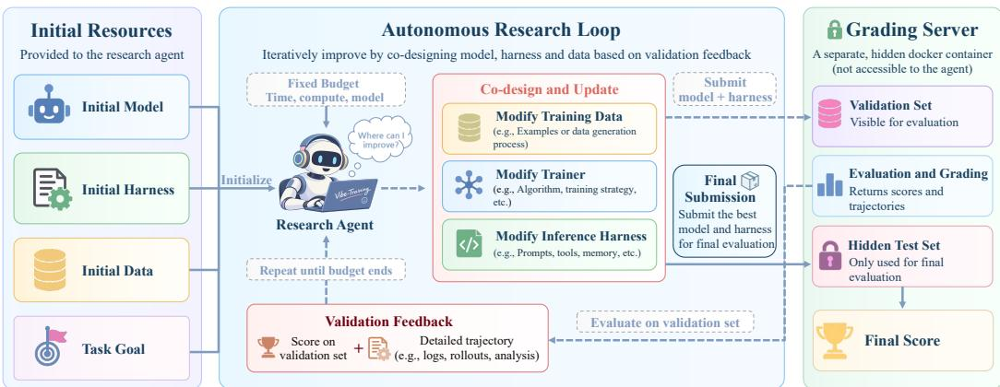  
Figure 1: Overview of VIBETRAINING-BENCH. The benchmark assesses a research agent’s capacity for systemic co-design across three interdependent components: training data, the trainer, and the inference harness. (Left) Research agents initialize from domain-specific data sources and task-specific resource budgets shared across research-agent configurations. (Center) Within the autonomous loop, research agents iteratively orchestrate component modifications using validation signals until budget exhaustion. (Right) Strict architectural decoupling isolates the optimization workspace from the grading server to prevent reward hacking. Only the visible validation set pro vides feedback; the hidden test set remains inaccessible until independent test evaluation of the selected system.

$P _ { 0 } = \left( M _ { 0 } , H _ { 0 } \right)$ , and the research agent receives its validation score and execution trajectories before making any modifications. At research iteration t, the research agent may modify the training data $D _ { t }$ , trainer $T _ { t } ,$ or harness $H _ { t }$ within the task’s editable space. The trainer includes the training algorithm and its configuration. The candidate target agent system is $P _ { t } = ( M _ { t } , H _ { t } )$ , where $M _ { t }$ may be newly trained, constructed by merging existing models, or reused from an earlier iteration. Validation returns a score and per-task execution trajectories on the requested validation tasks, which guide subsequent iterations within the resource budget. Finally, the research agent selects one candidate target agent system as $P ^ { \star }$ using information available during research. An isolated grader evaluates this system on hidden test problems disjoint from the validation problems. We measure improvement over the initial target agent system as

$$
\Delta _ { \mathrm { t e s t } } = \mathrm { E v a l } _ { \mathrm { t e s t } } ( P ^ { \star } ) - \mathrm { E v a l } _ { \mathrm { t e s t } } ( P _ { 0 } ) .\tag{1}
$$

The test result measures the selected target agent system’s improvement, while the recorded attempts show which components the research agent chose to modify.

## 3.2 BENCHMARK SUITE

Task scope. We instantiate the proposed cross-component co-design formulation across five target environments within VibeTraining-Bench, spanning terminal operation, software engineering, multi-turn tool use, and mathematical reasoning. As summarized in Table 2, these benchmarks present heterogeneous interaction paradigms under a shared iterative improvement framework. Specifically, Terminal-Bench 2.1 and SWE-bench Verified require long-horizon execution grounded in operating systems and codebases; $\tau ^ { 3 } .$ -Bench and Toolathlon demand stateful tool utilization over multi-turn dialogues; and AIME evaluates mathematical reasoning without external tool execution. Consequently, this diversity in task formulations allows us to examine whether research agents adapt their orchestration strategies across heterogeneous operational contexts.

Editable components. We systematically define the editable space of each target agent system over three components: the training data, the trainer, and the inference harness. Across all tasks, research agents can access the pre-provisioned data repositories and training framework code to modify training data, algorithms, and hyperparameters. Whether the inference harness is editable depends on the task. For Terminal-Bench 2.1 and SWE-bench Verified, the inference harness controls how the target agent system interacts with terminal and codebase environments, including execution loops, command-line invocations, and memory management. We therefore make the harness editable in these two tasks to support comprehensive cross-component co-design of training data, the trainer, and inference-time behavior within the same target agent system. For $\tau ^ { 3 } { \mathrm { - } } \mathrm { B e n c h }$ and Toolathlon, the benchmark-provided execution adapters remain fixed. AIME also fixes its evaluation interface and decoding settings. These three tasks therefore expose training data and the trainer, but not the inference harness, for modification.

Table 2: Task composition of VibeTraining-Bench. The editable space indicates whether the research agent may modify training data (D), the trainer (T), and the inference harness (H).
<table><tr><td>Capability</td><td>Benchmark</td><td>Initial Harness</td><td>Editable Space</td><td>Validation / Hidden Test</td><td>Budget</td></tr><tr><td>Terminal operation</td><td>Terminal -Bench 2.1</td><td>Terminus 2</td><td>{D,T, H}</td><td>OpenThoughts-TBLite / Terminal-Bench 2.1</td><td>24 h</td></tr><tr><td>Software engineering</td><td>SWE-bench Verified</td><td>mini-SWE- agent</td><td>{D, T, H}</td><td>Validation subset / remaining test tasks</td><td>24 h</td></tr><tr><td>Multi-turn tool use</td><td> $\tau ^ { 3 } .$  Bench</td><td>Benchmark- provided</td><td>{D,T}</td><td>Validation subset / remaining test tasks</td><td>16h</td></tr><tr><td>Multi-turn tool use</td><td>Toolathlon</td><td>Benchmark- provided</td><td>{D,T}</td><td>ToolGym / Toolathlon</td><td>16h</td></tr><tr><td>Mathematical reasoning</td><td>AIME</td><td>None</td><td>{D,T}</td><td>AIME 2025 / AIME 2026</td><td>16h</td></tr></table>

## 3.3 VALIDATION AND ISOLATED GRADING

Grading boundary. To prevent reward hacking, VibeTraining-Bench enforces three safeguards: data isolation, container isolation, and network restrictions. Test tasks and test-derived feedback remain inaccessible throughout the research loop. The research agent’s workspace and the grading service run in separate containers, preventing the research agent from modifying grader code or evaluation data. External network access is blocked in the research sandbox. Research agents request validation through a controlled interface. For each request, the independent grader evaluates the candidate target agent system $P _ { t } ,$ whose modifications are restricted to the task-permitted components described in Section 3.2. It returns feedback $f _ { t }$ consisting of the validation score and per-task execution trajectories for the validation tasks. The research agent can use this feedback to guide subsequent modifications.

Termination and final assessment. When the research phase ends, the research agent selects one candidate target agent system as $P ^ { \star }$ using the information available during research. It submits $P ^ { \star }$ to the independent grading service, which evaluates it exactly once on the test partition. Unlike iterative validation, this final assessment provides no feedback to the research agent for further revision. We report the benchmark test score of $P ^ { \star }$ . Table 2 summarizes the validation and test tasks, with additional partition details in Appendix C.3.

## 4 EXPERIMENTS

## 4.1 SETUP

We evaluate six research-agent configurations, each pairing an LLM with a coding framework. GPT-5.6-Sol and GPT-6-Astra use Codex at xhigh reasoning effort; Kimi-K3, Qwen-3.8-Max, DeepSeek-V4-Pro, and GLM-5.2 use Claude Code. Each research-agent run has access to eight NVIDIA A100 GPUs. Within each task, all configurations start from Qwen3.5-9B-Base and the same initial training data (Appendix C.2), and share the target-task interface, editable components, and task-specific resource budget (Table 2). Each task provides validation tasks for iterative research and test tasks for final evaluation. Terminal-Bench 2.1 uses OpenThoughts-TBLite for validation, Toolathlon uses ToolGym, and AIME uses AIME 2025. SWE-bench Verified and $\tau ^ { 3 }$ -Bench use disjoint validation and test partitions of their respective benchmarks. The isolated grader evaluates the system on the hidden test using the task-specific scoring and decoding settings. We report its benchmark-native test score. More details are provided in Appendix C.

Table 3: Test performance (%) of the selected agent systems. Initial system uses Qwen3.5-9B-Base before agent-led optimization. Human-tuned baseline uses Qwen3.5-9B-Instruct, a humandeveloped instruct model. Subscripts indicate the harness used by each research agent; CC denotes Claude Code. Avg. denotes the mean score across the five tasks. Bold marks the highest score among the six research agents in each performance column, excluding the two baselines. Hours reports the sum of elapsed research time across the five task runs.
<table><tr><td>Research agent</td><td>Avg.</td><td>SWE-bench Verified</td><td>Terminal- Bench 2.1</td><td> $\tau ^ { 3 } \cdot$  Bench</td><td>Toolathlon</td><td>AIME 2026</td><td>Hours</td></tr><tr><td>Initial system</td><td>22.7</td><td>32.9</td><td>8.9</td><td>20.3</td><td>4.5</td><td>46.7</td><td>一</td></tr><tr><td>Human-tuned baseline</td><td>47.3</td><td>55.4</td><td>20.2</td><td>64.1</td><td>21.6</td><td>75.0</td><td>一</td></tr><tr><td>GPT-6-Astra +Codex</td><td>37.1</td><td>53.7</td><td>13.5</td><td>49.7</td><td>7.9</td><td>60.8</td><td>85.9</td></tr><tr><td>GPT-5.6-Sol  $+ \mathrm { C o d e x }$ </td><td>31.0</td><td>42.9</td><td>8.9</td><td>42.1</td><td>10.2</td><td>50.8</td><td>64.0</td></tr><tr><td>Kimi-K3 +cc</td><td>38.3</td><td>51.7</td><td>22.4</td><td>52.1</td><td>10.2</td><td>55.0</td><td>73.0</td></tr><tr><td> $\mathbf { G L M - } 5 . 2 _ { \mathrm { + C C } }$ </td><td>31.4</td><td>40.6</td><td>10.1</td><td>36.2</td><td>6.8</td><td>63.3</td><td>56.9</td></tr><tr><td>Qwen-3.8-Max +cc</td><td>35.6</td><td>48.0</td><td>17.9</td><td>47.4</td><td>9.1</td><td>55.8</td><td>81.8</td></tr><tr><td> $\mathrm { D e e p S e e k - V 4 - P r o _ { + C C } }$ </td><td>34.2</td><td>41.4</td><td>13.5</td><td>47.9</td><td>12.5</td><td>55.8</td><td>87.0</td></tr></table>

## 4.2 MAIN RESULTS

Table 3 reports test scores for the selected target agent systems, each comprising a selected model checkpoint and a task-specific inference harness. The average across the five tasks is 22.7% for the initial target agent systems and ranges from 31.1% to 38.3% across the six research-agent configurations, with Kimi-K3 highest. The largest gain over the initial target agent system occurs on $\tau ^ { 3 } .$ -Bench, where Kimi-K3 raises the score from 20.3% to 52.1%. On SWE-bench Verified, GPT-6- Astra raises the target agent system’s performance from 32.9% to 53.7%, comparable to the human-developed instruct model’s 55.4%. On Terminal-Bench 2.1, Kimi-K3 raises the score from 8.9% to 22.4%, while GPT-5.6-Sol remains at 8.9%. These results show that large gains are possible, but improvement is not guaranteed in every run.

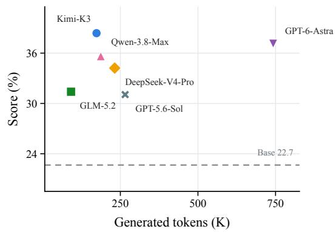  
Figure 2: Mean generated tokens and macroaveraged final performance across five benchmarks. Dashed line marks the initial system score.

The leader changes across tasks. GPT-6-Astra scores highest on SWE-bench Verified (53.7%), Kimi-K3 on Terminal-Bench 2.1 (22.4%) and $\tau ^ { 3 } .$ -Bench (52.1%), DeepSeek-V4-Pro on Toolathlon (12.5%), and GLM-5.2 on AIME 2026 (63.3%). Among the four configurations using Claude Code, the gap between the highest and lowest scores ranges from 5.7 percentage points on Toolathlon to 15.9 points on $\tau ^ { 3 } .$ -Bench. No research-agent configuration leads across all five tasks. Research time alone does not account for these outcomes. Across the five tasks, Qwen-3.8-Max uses 81.8 hours, 8.8 hours more than Kimi-K3, but scores lower on four tasks. The following analyses examine validation trajectories, resource use, and component choices behind the final scores.

## 4.3 VALIDATION DYNAMICS AND GENERALIZATION

As shown in Figure 3, the best validation performance does not consistently translate into the best test performance. GPT-5.6-Sol achieves an AIME validation score of 59.2%, yet scores 50.8% on the AIME 2026 test set, below GLM-5.2’s 63.3%. GPT-6-Astra leads validation on Terminal-Bench 2.1, SWE-bench Verified, and $\tau ^ { 3 } .$ -Bench, and ties for the highest Toolathlon validation score. However, it does not consistently lead on the corresponding test sets. On Terminal-Bench 2.1, it scores 13.5%, compared with Kimi-K3’s leading score of 22.4%. On τ3-Bench, Kimi-K3 also achieves the highest test score at 52.1%, ahead of GPT-6-Astra’s 49.7%. These results show that validation leadership does not reliably predict test leadership. The validation search is also non-monotonic: later attempts do not necessarily improve on earlier candidates. DeepSeek-V4-Pro’s later AIME validation scores fall to zero, while GPT-6-Astra’s SWE-bench Verified validation score declines after its peak and its later Toolathlon attempts fail to improve on an early candidate.

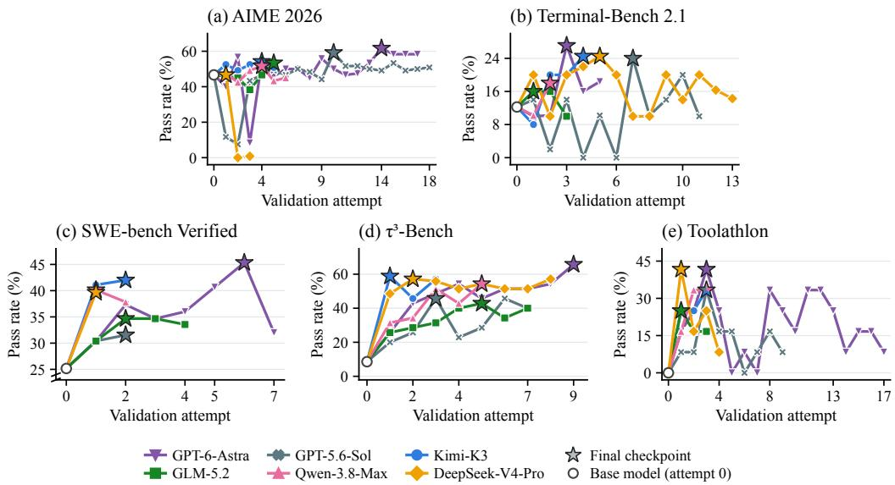  
Figure 3: Each point represents a completed validation evaluation, ordered chronologically within each run. Repeated evaluations of the same candidate are shown separately.

## 4.4 TOKEN USAGE ANALYSIS

Figure 2 compares each research agent’s mean generated tokens per run with its macro-averaged test score across the five benchmarks. The target systems produced by each of the six research agents achieve an average score above the initial systems’ 22.7% across the five benchmarks. But higher token usage does not correspond to higher performance. GLM-5.2 uses the fewest tokens (91.1K per run), while Kimi-K3 achieves the highest score (38.3%) with 173.2K tokens. These two agents form the observed Pareto frontier. Qwen-3.8-Max, DeepSeek-V4-Pro, and GPT-5.6-Sol use more tokens than Kimi-K3 while scoring lower. GPT-6-Astra achieves the second-highest average score at 37.1%, but uses by far the most generated tokens. It therefore does not change the observed Pareto frontier formed by GLM-5.2 and Kimi-K3.

## 4.5 COMPONENT ABLATIONS

Table 4 shows that harness-only editing improves the initial target agent system on SWE-bench Verified but not on Terminal-Bench 2.1. On SWE-bench Verified, the harness-only run raises the test score from 32.9% to 38.0%. Kimi-K3’s unrestricted run reaches 51.7% without editing the harness, leaving this harness-based direction unexplored. On Terminal-Bench 2.1, the harnessonly run scores 8.9%, matching the initial agent system. The data-and-trainer-only run reaches

Table 4: Kimi-K3 test scores (%) on SWE-bench Verified and Terminal-Bench 2.1. D/T/H denotes data, trainer, and harness; Kimi-K3 did not edit the harness in the SWE D/T/H run.
<table><tr><td>Editable</td><td>SWE</td><td>Terminal</td></tr><tr><td>Initial system</td><td>32.9</td><td>8.9</td></tr><tr><td>H only</td><td>38.0</td><td>8.9</td></tr><tr><td>D/T only</td><td></td><td>13.5</td></tr><tr><td>D/T/H</td><td>51.7</td><td>22.4</td></tr></table>

13.5%, while the unrestricted run also edits the harness and reaches 22.4%.

## 5 AGENT BEHAVIOR ANALYSIS

## 5.1 RESEARCH EFFORT ALLOCATION ACROSS COMPONENTS

We define a design as a distinct modification to the training data, trainer, or inference harness that the research agent implements during a run. Repeated submissions of an unchanged candidate count as one design. A design that modifies multiple components contributes to the count for each affected component. Figure 4 reports the number of designs involving each component. Every research agent modifies data in each task, but the emphasis varies. On AIME 2026, GPT-6-Astra, GPT-5.6- Sol, and GLM-5.2 propose more trainer than data designs, whereas on SWE-bench Verified every research agent except GPT-6-Astra proposes more data designs. Preferences also differ across research agents: Qwen-3.8-Max favors data in all five tasks, while GPT-6-Astra favors the trainer in four of five. GPT-5.6-Sol shifts from trainer-focused designs on AIME 2026 and Terminal-Bench 2.1 to data-focused designs on SWE-bench Verified. Some designs modify multiple components: all seven of GPT-5.6-Sol’s τ3-Bench designs modify both training data and the trainer. Harness exploration varies within the two tasks that permit it. On SWE-bench Verified, GPT-6-Astra proposes four harness designs, GPT-5.6-Sol proposes two, and Kimi-K3 proposes none. These patterns show that research agents use the editable space differently, both in which components they prioritize and in whether they change components together.

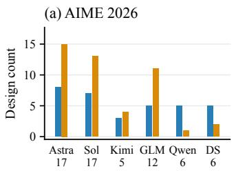

(b) Terminal-Bench 2.1  
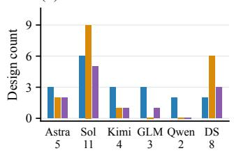

(c) SWE-bench Verified  
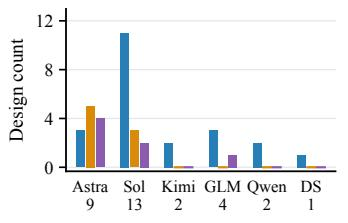

(d) τ³-Bench  
(e) Toolathlon  
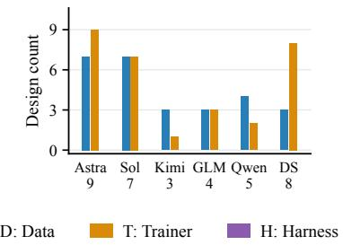

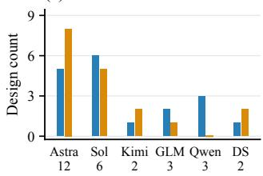  
Figure 4: Number of designs involving training data, the trainer, and the inference harness. A design may involve multiple components. Numbers below the research-agent labels indicate the total number of distinct designs in each run.

## 5.2 COMPONENT PATTERN ANALYSIS

Data strategies. Two patterns recur in how research agents construct training data. (1) Trajectory filtering. Research agents use similar filtering procedures: retaining successful trajectories, imposing length limits, deduplicating prompts, and removing repetitive execution loops. On SWE-bench Verified, Qwen-3.8-Max and GPT-5.6-Sol remove trajectories with excessive repeated commands. On Toolathlon, Kimi-K3 filters trajectories with repeated tool calls. (2) Format alignment. Research agents adapt training examples to the inference harness and evaluation settings. On SWEbench Verified, Kimi-K3 reformats training prompts to match the inference harness. Qwen-3.8-Max revises tool-call formatting on $\tau ^ { 3 } .$ -Bench, while GPT-6-Astra selects AIME examples with complete \boxed{} answers.

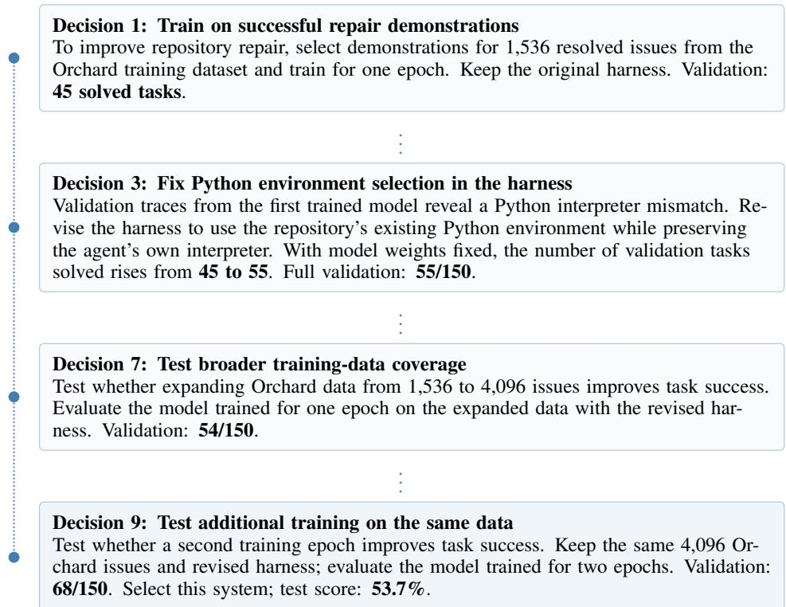  
Figure 5: Case study of GPT-6-Astra’s research trajectory on SWE-bench Verified. Selected decisions illustrate how validation feedback guides changes to training data, the trainer, and the inference harness. Ellipses indicate omitted decisions.  
Finding 1. Research agents use similar data preprocessing methods and frequently adjust training-data formats to match task-specific evaluation requirements.

Trainer strategies. All six research agents use supervised fine-tuning (SFT). Their trainer modifications focus on hyperparameters, loss calculation, and model merging. (1) Training settings. Most modifications adjust training hyperparameters. GLM-5.2 tests additional epochs on τ3-Bench, but validation performance declines. GPT-5.6-Sol tests multiple learning rates on Terminal-Bench, while GPT-6-Astra reduces the training batch size on SWE-bench Verified. Qwen-3.8-Max reduces the pipeline parallel size on τ3-Bench to accelerate training. (2) Loss calculation. On AIME, GPT-5.6-Sol increases the loss weight on </think> to encourage shorter outputs, improving the validation score from 60/120 to 71/120 with the same examples. GPT-6-Astra adds supervision on valid historical assistant turns in τ3-Bench examples to obtain more training targets. (3) Model merging. On AIME, Kimi-K3 compares two-model and three-model merges and selects the twomodel merge after it scores higher on validation. DeepSeek-V4-Pro tests different interpolation coefficients on Terminal-Bench to select the final model weights. GPT-6-Astra merges two trained models on τ3-Bench, achieving the highest validation score in its run.

Finding 2. Trainer modifications concentrate on hyperparameter tuning. Changes to loss calculation are less frequent. Several agents also use model merging to combine multiple candidate models.

Harness strategies. On SWE-bench Verified and Terminal-Bench 2.1, harness modifications fo cus on execution control and parsing recovery. (1) Execution control. GPT-5.6-Sol adds guards against repeated commands and unchanged patches on SWE-bench Verified, reducing median API calls from 163 to 96.5 in a paired 30-task comparison. On Terminal-Bench 2.1, Kimi-K3 adds a completion checklist that prompts the target agent to verify task requirements before declaring com-

pletion. (2) Output recovery. Research agents modify output parsers to recover from malformed responses. On Terminal-Bench 2.1, DeepSeek-V4-Pro adds automatic repairs for escaping issues, missing colons, truncated outputs, and trailing commas. GPT-6-Astra also adds automatic repair of invalid escape sequences and revises JSON extraction logic to better identify structured responses.

Finding 3. Research agents primarily make incremental modifications to execution control and output recovery, leaving the overall inference harness structure unchanged.

## 5.3 CASE STUDY

The GPT-6-Astra run on SWE-bench Verified illustrates how validation feedback guides changes to training data, the trainer, and the inference harness (Figure 5). After the research agent trains the model on demonstrations for 1,536 issues from Orchard, a software-repair training dataset, execution traces reveal a Python interpreter mismatch. The research agent revises the harness to use the repository’s existing Python environment while preserving the agent’s own interpreter. With model weights fixed, this revision increases the number of validation tasks solved from 45 to 55. The agent also expands training to 4,096 issues and evaluates the resulting checkpoints with the revised harness. The step-128 and step-256 checkpoints solve 54 and 68 of the validation tasks, respectively. The agent selects the step-256 model with the revised harness, achieving 53.7% on the hidden test.

## 6 CONCLUSION

In this paper, we introduced VIBETRAINING-BENCH, a benchmark designed to evaluate research agents’ cross-component co-design capabilities across diverse domains. In each task, a research agent begins with an initial target agent system and iteratively modifies the training data, the trainer, and the task-specific inference harness. Finally, the research agent selects and submits a final agent system for evaluation on test tasks. We develop a reliable execution platform to guarantee evaluation integrity. To prevent research agents from reward hacking, our platform implements three levels of safeguards by isolating test data, separating research and grading containers, and restricting external network access. Our evaluation results show that frontier research agents can substantially improve target agent systems, in some cases approaching the performance of the system with human posttraining. However, an in-depth analysis of research agents’ trajectories and component ablation experiments reveals that these research agents still exhibit limitations. There is still room to improve their ability to co-design and iteratively refine data, trainer, and harness to achieve cumulative performance gains. We hope that VIBETRAINING-BENCH will serve as a unified platform for the community to develop more reliable and effective research agents for recursive self-improvement.

## AI USE STATEMENT

In this work, we used generative AI tools to draft and polish portions of the manuscript, and to improve clarity, grammar, and readability. We did not use generative AI tools for the research tasks requiring disclosure under the ICLR policy. All AI-assisted text was reviewed and edited by the authors, who take responsibility for the final content of this work, including all claims and results.

## REFERENCES

Jun Shern Chan, Neil Chowdhury, Oliver Jaffe, James Aung, Dane Sherburn, Evan Mays, Giulio Starace, Kevin Liu, Leon Maksin, Tejal Patwardhan, et al. Mle-bench: Evaluating machine learning agents on machine learning engineering. In International Conference on Learning Representations, volume 2025, pp. 50466–50494, 2025.

Guhong Chen, Yingcheng Shi, Yongbin Li, Binhua Li, Xander Xu, Hu Wei, Shiwen Ni, Min Yang, and Jieping Ye. Evotrainer: Co-evolving llm policies and training harnesses for autonomous agentic reinforcement learning. arXiv preprint arXiv:2606.03108, 2026a.

Tingyang Chen, Shuo Lu, Kang Zhao, Weicheng Meng, Hanlin Teng, Tianhao Li, Chao Li, Xule Liu, Jian Liang, Zhizhong Zhang, et al. Harnessx: A composable, adaptive, and evolvable agent harness foundry. arXiv preprint arXiv:2606.14249, 2026b.

Wanyi Chen, Xiao Yang, Xu Yang, Tianming Sha, Qizheng Li, Zhuo Wang, Bowen Xian, Fang Kong, Weiqing Liu, and Jiang Bian. Agentˆ 2 rl-bench: Can llm agents engineer agentic rl posttraining? arXiv preprint arXiv:2604.10547, 2026c.

Zhengyu Chen, Teng Xiao, Huaisheng Zhu, Yige Yuan, Luan Zhang, and Jingang Wang. Co-harness: Co-evolving harnesses and model weights for llm agents. arXiv preprint arXiv:2607.22688, 2026d.

Yizhe Chi, Wenyi Li, Deyao Hong, Xiaoqiu Wang, Mingju Gao, Kaisen Yang, Bingxiang He, Youjie Zheng, Calvin Xiao, and Qinhuai Na. Ai4ai-bench: Benchmarking llm agents in algorithmic design for recursive self-improvement. arXiv preprint arXiv:2608.20318, 2026.

Haoyang Fang, Wei Zhu, Boran Han, Alex Zhang, Zhenyu Pan, Shuo Yang, Shuai Zhang, Jiading Gai, Peng Tang, Cuixiong Hu, et al. Llmzero: Discovering adaptive training strategies for rl post-training via llm agents. arXiv preprint arXiv:2606.18388, 2026.

Chengsong Huang, Wenhao Yu, Xiaoyang Wang, Hongming Zhang, Zongxia Li, Ruosen Li, Jiaxin Huang, Haitao Mi, and Dong Yu. R-zero: Self-evolving reasoning llm from zero data. In International Conference on Learning Representations, volume 2026, pp. 130770–130790, 2026a.

Lisheng Huang, Chen Yang, Hao Zhou, Huatong Song, Zongchao Chen, Ran Le, Yang Song, Wayne Xin Zhao, and Tao Zhang. Evo-bench: Can language models improve agent harness? arXiv preprint arXiv:2608.09096, 2026b.

Qian Huang, Jian Vora, Percy Liang, and Jure Leskovec. Mlagentbench: Evaluating language agents on machine learning experimentation. arXiv preprint arXiv:2310.03302, 2023.

Feiyang Kang, Hanze Li, Adam Nguyen, Mahavir Dabas, Jiaqi W Ma, Frederic Sala, Dawn Song, and Ruoxi Jia. Can generalist agents automate data curation? arXiv preprint arXiv:2606.04261, 2026.

Shuaiqi Liu, Zhengkai Lin, Yuxiang Zhang, Yuanyi Ren, Yue Wu, Yongbin Li, Zheng Wang, Zhihang Fu, and Jieping Ye. The path to recursive self-improving agents: Foundation, framework, and future directions. Preprints, August 2026. doi: 10.20944/preprints202608.0051.v1. URL https://www.preprints.org/manuscript/202608.0051.

Chris Lu, Samuel Holt, Claudio Fanconi, Alex J Chan, Jakob Foerster, Mihaela van der Schaar, and Robert T Lange. Discovering preference optimization algorithms with and for large language models. Advances in Neural Information Processing Systems, 37:86528–86573, 2024.

Bohan Lyu, Yucheng Yang, Siqiao Huang, Jiaru Zhang, Qixin Xu, Xinghan Li, Xinyang Han, Yicheng Zhang, Huaqing Zhang, Runhan Huang, et al. Mls-bench: A holistic and rigorous assessment of ai systems on building better ai. arXiv preprint arXiv:2605.08678, 2026.

Fanqing Meng, Lingxiao Du, Qiguang Chen, Ziqi Zhao, Haocheng Lu, Mengkang Hu, and Michael Qizhe Shieh. Rsibench-data: Benchmarking data-centric research for recursive selfimprovement. arXiv preprint arXiv:2607.25886, 2026.

Ben Rank, Hardik Bhatnagar, Ameya Prabhu, Shira Eisenberg, Karina Nguyen, Matthias Bethge, and Maksym Andriushchenko. Posttrainbench: Can llm agents automate llm post-training? arXiv preprint arXiv:2603.08640, 2026.

Giulio Starace, Oliver Jaffe, Dane Sherburn, James Aung, Jun Shern Chan, Leon Maksin, Rachel Dias, Evan Mays, Benjamin Kinsella, Wyatt Thompson, et al. Paperbench: evaluating ai’s ability to replicate ai research. arXiv preprint arXiv:2504.01848, 2025.

Varun Ursekar, Apaar Shanker, Yash Maurya, Shehab Yasser, Vijay S Kalmath, Veronica Chatrath, and Yuan Xue. Harnessopt-bench: Evaluating llms at harness optimization. arXiv preprint arXiv:2608.06301, 2026.

Hjalmar Wijk, Tao Lin, Joel Becker, Sami Jawhar, Neev Parikh, Thomas Broadley, Lawrence Chan, Michael Chen, Josh Clymer, Jai Dhyani, et al. Re-bench: Evaluating frontier ai r&d capabilities of language model agents against human experts. arXiv preprint arXiv:2411.15114, 2024.

Junlin Yang, Che Jiang, Yu Fu, Tianwei Luo, Can Ren, Weizhi Wang, Kaikai Zhao, Hongyi Liu, Yuxin Zuo, Yuru Wang, et al. Frontis-ma1: Training an ai4ai model towards recursive selfimprovement in machine learning engineering. arXiv preprint arXiv:2607.28568, 2026.

Xunjian Yin, Xinyi Wang, Liangming Pan, Li Lin, Xiaojun Wan, and William Yang Wang. Godel¨ agent: A self-referential agent framework for recursively self-improvement. In Proceedings of the 63rd Annual Meeting ofthe Associationfor Computational Linguistics (Volume 1: Long Papers), pp. 27890–27913, 2025.

Jenny Zhang, Shengran Hu, Cong Lu, Robert Lange, and Jeff Clune. Darwin godel machine: open-¨ ended evolution of self-improving agents. In International Conference on Learning Representations, volume 2026, pp. 104223–104294, 2026.

Andrew Zhao, Yiran Wu, Tong Wu, Quentin Xu, Yang Yue, Matthieu Lin, Shenzhi Wang, Qingyun Wu, Zilong Zheng, and Gao Huang. Absolute zero: Reinforced self-play reasoning with zero data. Advances in Neural Information Processing Systems, 38:105816–105879, 2026.

Adam Zweiger, Jyo Pari, Han Guo, Yoon Kim, and Pulkit Agrawal. Self-adapting language models. Advances in Neural Information Processing Systems, 38:74084–74115, 2026.

## A TERMINAL-BENCH CASE STUDIES

## A.1 CASE STUDY: KIMI-K3 ON TERMINAL-BENCH

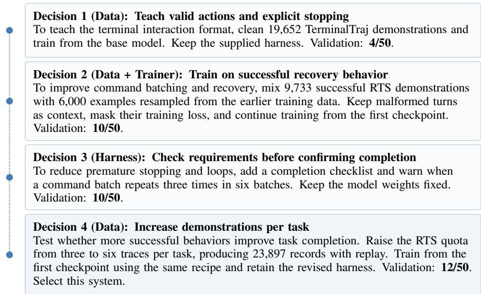  
Figure 6: Kimi-K3 on Terminal-Bench. The selected system combines the expanded data mixture with the revised harness.

Kimi-K3 first trains the model to use the terminal interaction format, then uses validation failures to target recovery and completion behavior (Figure 6). Recovery-focused continuation raises solves from 4/50 to 10/50. A fixed-weight harness revision leaves that total unchanged, although its completion checklist is followed by resumed commands in 28 of 66 completion events. Kimi-K3 then expands demonstrations per task and selects the resulting model with the revised harness at 12/50.

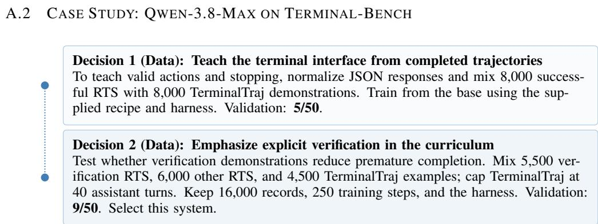  
Figure 7: Qwen-3.8-Max on Terminal-Bench. The data curriculum changes while the training recipe and harness remain fixed.

Qwen-3.8-Max responds to premature completion and long loops by changing the demonstrated behavior (Figure 7). It replaces a broad keyword heuristic with a filter for explicit tests, output checks, and parsing commands, then gives these examples more curriculum weight and limits long TerminalTraj records. Both models train afresh from the same base on 16,000 examples with the same 250-step recipe and harness. The revised curriculum is selected after validation changes from 5/50 to 9/50.

## A.3 CASE STUDY: GPT-5.6-SOL ON TERMINAL-BENCH

GPT-5.6-Sol's validation failures expose a mismatch between intended and executed training (Figure 8). In Decisions 2, 4, and 6, the agent intends to continue training from a trained checkpoint but instead initializes the model randomly: the loader receives an iteration directory rather than its parent checkpoint root. Correcting the path preserves the data, learning rate, and harness of the preceding comparison and raises validation from 0/50 to 12/50. Later checkpoint, data, and training branches do not exceed this result; GPT-5.6-Sol retains the correctly initialized continuation.

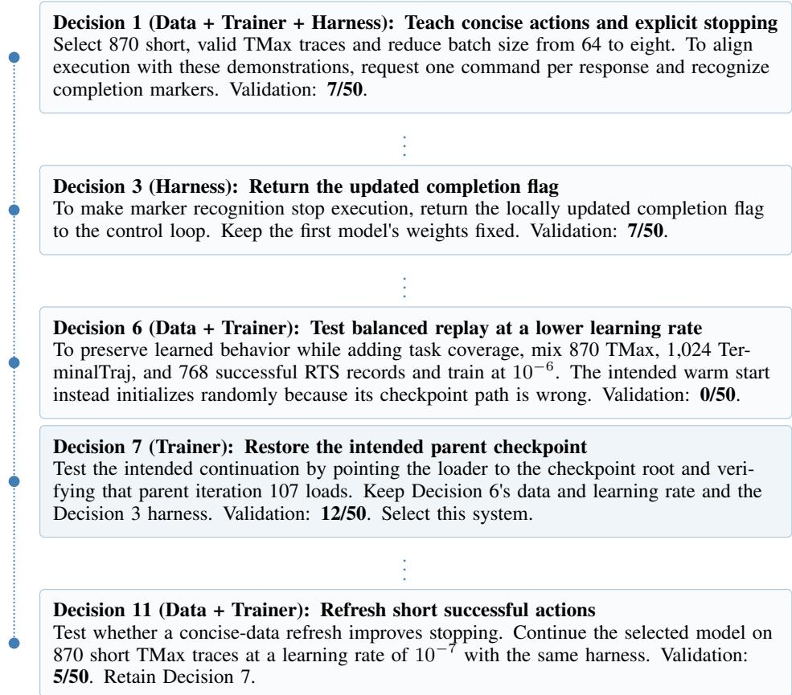  
Figure 8: GPT-5.6-Sol on Terminal-Bench. Decisions 6 and 7 hold data, learning rate, and harness fixed while correcting initialization.

## A.4 CASE STUDY: GLM-5.2 ON TERMINAL-BENCH

GLM-5.2 tests data expansion after aligning demonstrations and terminal instructions (Figure 9). Increasing the mixture from 6,315 to 12,000 records leaves validation at 8/50; expanding to 15,000 records with a new seed lowers it to 5/50. The one-epoch recipe and harness are retained throughout these expansions. GLM-5.2 selects the first model. The larger step counts follow the larger datasets rather than an independent change to the learning recipe.

## A.5 CASE STUDY: DEEPSEEK-V4-PRO ON TERMINAL-BENCH

DeepSeek-V4-Pro moves from data and execution repairs to model merging (Figure 10). Its parseronly attempt, omitted as Decision 2, lowers validation from 10/50 to 5/50. Broader training and revised parser feedback restore 10/50. DeepSeek-V4-Pro then tests whether weight mixtures combine the two trained models' capabilities. It selects the 0.25/0.75 mixture at 12/50; averaging the weights of three checkpoints and testing nearby mixture coefficients yield lower validation scores.

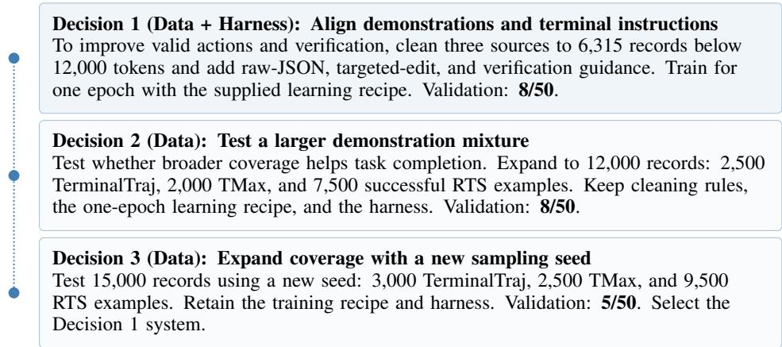  
Figure 9: GLM-5.2 on Terminal-Bench. Data expansion fails to improve on the first selected model– harness pair.

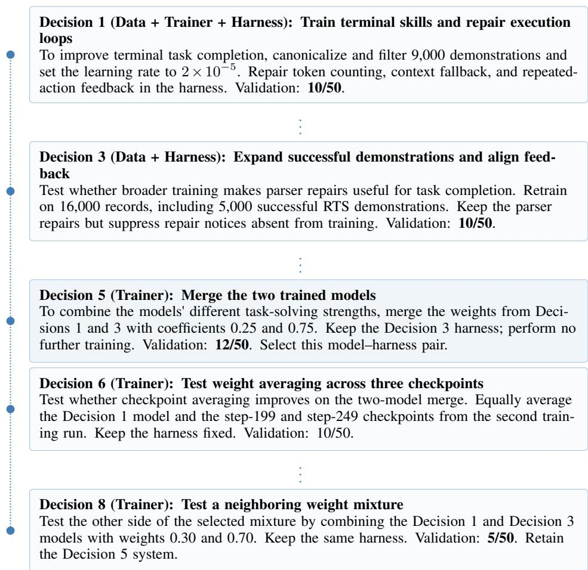  
Figure 10: DeepSeek-V4-Pro on Terminal-Bench. Two-model merging and three-checkpoint averaging are Trainer interventions.

Six subsequent submissions reuse the selected weights and harness, including one failed job, and do not add designs.

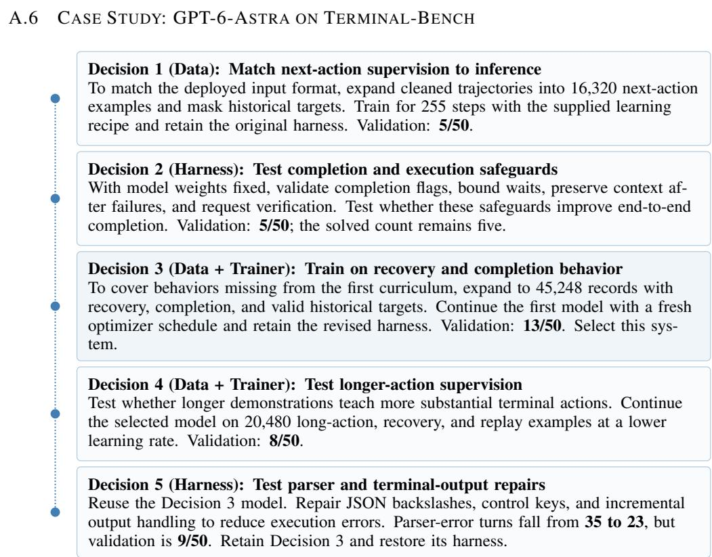  
Figure 11: GPT-6-Astra on Terminal-Bench. The selected Data + Trainer intervention lies between two fixed-weight Harness comparisons.

GPT-6-Astra alternates fixed-weight harness comparisons with changes to supervision and training (Figure 11). The first harness revision leaves the solved count at five. Recovery and completion supervision, combined with continuation from the first model, raises validation to 13/50. Longeraction training lowers it to 8/50. A later harness-only revision reduces parser-error turns from 35 to 23 but solves nine tasks. GPT-6-Astra selects the recovery-trained model with the earlier harness, separating local parser feedback from task-success feedback.

## B SWE-BENCH VERIFIED CASE STUDIES

The cases below use the same decision format. Ellipses indicate omitted designs; subset evaluations are labeled and retain their actual graded-task denominators.

## B.1 CASE STUDY: QWEN-3.8-MAX ON SWE-BENCH VERIFIED

Qwen-3.8-Max tests whether the same token budget is better spent on broader issue coverage (Figure 12). Adding a teacher source and allowing longer trajectories expands coverage from 5,265 to 8,620 issues, while the learning recipe and harness remain fixed. Validation falls from 59/150 to 56/150. On 150 graded tasks, solves fall from 59 to 56, with ten gains and thirteen losses. Qwen-3.8-Max rejects the broader-data candidate and selects the first model.

## B.2 CASE STUDY: DEEPSEEK-V4-PRO ON SWE-BENCH VERIFIED

DeepSeek-V4-Pro trains one evaluated design on interface-aligned Open-SWE demonstrations (Figure 13). Its two validation reports correspond to evaluations of the same model weights and inference harness on different task subsets, so the score change does not reflect a new intervention. Before revising submission handling, DeepSeek-V4-Pro checks timeout status against task reward. It retains the supplied harness and delivers the trained model. Earlier smoke, memory, and throughput runs have no benchmark validation score.

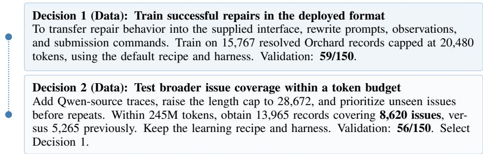

Figure 12: Qwen-3.8-Max on SWE-bench Verified. Source, length, and coverage change together. Validation denominators reflect the actual graded tasks.  
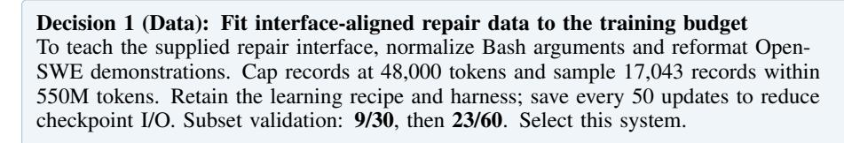  
Figure 13: DeepSeek-V4-Pro on SWE-bench Verified. Checkpoint-saving cadence changes training-system overhead rather than the learning algorithm.

## B.3 CASE STUDY: KIMI-K3 ON SWE-BENCH VERIFIED

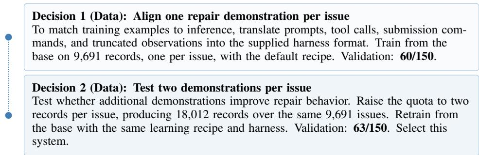  
Figure 14: Kimi-K3 on SWE-bench Verified. The per-issue quota changes; the accompanying matched-task comparison distinguishes outcome changes from grading coverage.

Kimi-K3 increases the number of demonstrations per issue while retaining the training recipe and inference harness (Figure 14). Both models are trained from the same base model. The two-record quota produces 18,012 training records and a reported validation score of 63/150, compared with 60/150 for the first model. On the same 150 validation tasks, the second model solves 20 tasks that the first model fails to solve, but fails on 17 tasks that the first model solves. Kimi-K3 selects the second model.

## B.4 CASE STUDY: GPT-5.6-SOL ON SWE-BENCH VERIFIED

GPT-5.6-Sol combines a stopping rule with later data and training changes (Figure 15). With model weights fixed, adding the stopping rule increases the number of validation tasks solved from seven to eight out of 30, while median API calls decrease from 163 to 96.5. GPT-5.6-Sol retains the guard and

tests short replay, selecting the 512-record continuation at 47/150 on full-scope validation. Earlier data and continuation experiments use smaller validation subsets; their scores are reported separately from full-set validation results.

## B.5 CASE STUDY: GLM-5.2 ON SWE-BENCH VERIFIED

GLM-5.2 expands a short-trajectory training subset, then tests guidance at fixed weights (Figure 16).   
The 5,000-record model solves 52/150 tasks. Added minimal-edit, testing, and diff-review instructions leave that total unchanged, but only 37 successes overlap: each run has 15 unique successes.   
A later model trained on the complete 8,082-record pool with the original harness solves 50/150.   
GLM-5.2 selects the 5,000-record model with the original harness.

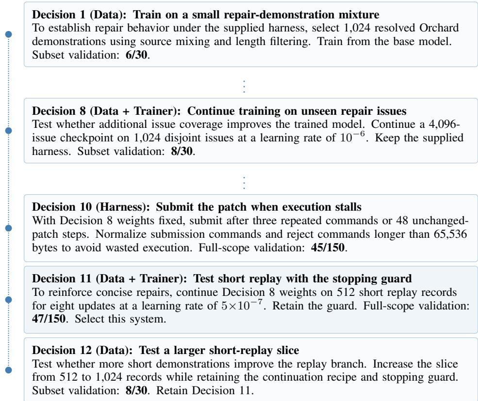  
Figure 15: GPT-5.6-Sol on SWE-bench Verified. Subset and full-scope validation retain their actual denominators.

## C ADDITIONAL EXPERIMENTAL DETAILS

## C.1 RESEARCH-AGENT SETUP AND RESOURCE ACCOUNTING

Each research-agent configuration is evaluated in a separate run on each of the five benchmark tasks. A run therefore consists of one researcher LLM–coding-framework configuration working on one task; comparisons concern these end-to-end configurations. Each run has access to eight NVIDIA A100 GPUs under the task-specific wall-clock budget in Table 2. The clock starts when the research agent is launched and stops when the budget expires or the research agent ends the run. Within that interval, the research agent decides how to allocate time between training and validation, including when to stop training and request an evaluation. We define run duration as the elapsed time from launch to termination. The Hours column in Table 3 sums this duration across the five task runs, while Average is the arithmetic mean of their five test scores.

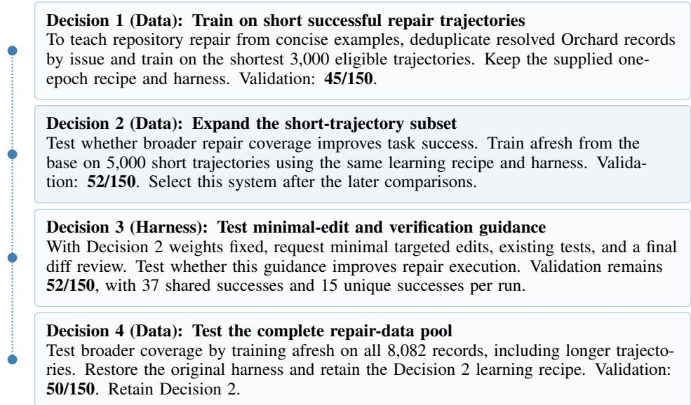  
Figure 16: GLM-5.2 on SWE-bench Verified. The fixed-weight Harness comparison preserves the aggregate score while changing the success set.

Table 5: Initial data resources provisioned for each benchmark.
<table><tr><td>Benchmark</td><td>Initial Data Resources</td></tr><tr><td>Terminal-Bench 2.1</td><td>TMAX, Recursive Task Synthesis Trajectories, TerminalTraj 2</td></tr><tr><td>SWE-bench Verified</td><td>Orchard, SWE-Dev-Train, Nebius SWE, Nvidia Open SWE</td></tr><tr><td>τ3-Bench</td><td>AReal-tau2-data, Nemotron-SFT-Agentic-v2, Simia-Tau-SFT ³</td></tr><tr><td>Toolathlon</td><td>DIVE-SFT⁴</td></tr><tr><td>AIME</td><td>Nemotron-SFT-MATH, OpenR1-Math, OpenThoughts3 ⁵</td></tr></table>

## C.2 INITIAL TRAINING DATA

For each benchmark, all research-agent configurations receive the same publicly released training resources listed in Table 5. These datasets accompany research papers or technical blogs that document their provenance and, where reported, describe overlap checks against the corresponding benchmark test sets used in our evaluation. The resources form the initial editable data pool D , rather than a prescribed training set. Research agents may select, filter, reweight, and transform the provided resources or construct additional examples from permitted workspace materials. The protocol prohibits using validation tasks or grader-returned trajectories to construct $D _ { t }$ . Research agents may use validation feedback for diagnosis, but cannot retrieve external data during the research run.

Table 6: Evaluation settings shared by validation and test runs.
<table><tr><td>Benchmark</td><td>Evaluation settings</td></tr><tr><td>Terminal-Bench 2.1</td><td>Maximum 200 agent turns; 65,536-token context; 4,096 maximum output tokens; temperature 1.0; thinking disabled; one run per task.</td></tr><tr><td>SWE-bench Verified</td><td>256K-token context; temperature 1.0; thinking enabled; one run per task.</td></tr><tr><td>AIME</td><td>16,384 maximum output tokens; temperature 0.6; thinking enabled; average@4.</td></tr><tr><td>Toolathlon</td><td>Maximum 100 agent turns; 256K-token context; 8,192 maximum output tokens; temperature 1.0; thinking disabled; pass @3.</td></tr><tr><td>τ3-Bench</td><td>Maximum 200 agent turns; 256K-token context; temperature 0; thinking disabled; one run per task.</td></tr></table>

## C.3 TASK PARTITIONS AND EVALUATION PROTOCOL

For SWE-bench Verified, we randomly partition the 500 tasks into 150 validation tasks and 350 test tasks. For τ3-Bench, we randomly partition 375 tasks into 35 validation tasks and 340 test tasks. Each partition is sampled once and held fixed across all research-agent configurations. Terminal Bench 2.1 uses OpenThoughts-TBLite 1 for validation, while Toolathlon uses ToolGym 2, and AIME uses AIME 2025; their corresponding hidden tests are Terminal-Bench 2.1, Toolathlon, and AIME 2026. There is no fixed cap on validation requests; evaluation time counts toward the task’s research budget. The grader returns the aggregate score, the number of graded tasks used as its denominator, and per-task scores and output trajectories.

Within each benchmark, validation and test evaluations use the same decoding settings, agent-turn and token limits, and rules for timeouts and execution failures. Timeouts and execution failures receive a score of zero. Final evaluation covers all tasks in the test partition, and we retain per-task scores, execution status, and grading receipts for post hoc analysis. For benchmarks evaluated once per task, the reported score is the fraction of test tasks completed successfully. Toolathlon uses pass@3: each task is attempted three times and is counted as successful if any attempt succeeds. AIME reports mean accuracy across four runs per problem (average@4), with all four attempts included in the denominator.

## D EPISODE-BASED WALL-CLOCK ATTRIBUTION

Figures 17–21 summarize how research agents allocate elapsed research time across the five benchmarks. We use episode to refer to a segment of the research activity log associated with an activity such as data preparation, training, or evaluation. The time breakdowns group these episodes by activity category. WAITING records episodes spent waiting for agent-initiated training runs, while SUBMIT+GRADE records evaluation submission and grading episodes. Together, these categories account for 35–95 % of elapsed time across runs with available time breakdowns. The remaining time covers data preparation, editing, diagnostic work, and intervals not covered by the episode records. An episode that combines training with another activity is assigned to that other activity. Consequently, WAITING provides a lower bound on training time rather than a complete estimate. The UNCOVERED category records intervals between episodes that are not assigned to any recorded activity.

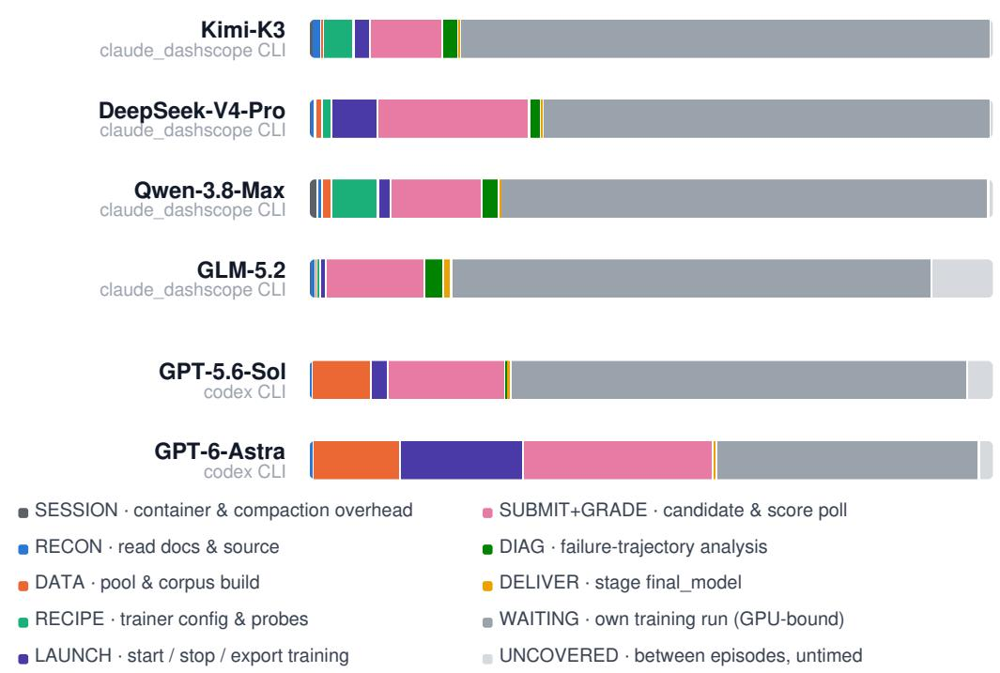  
Figure 17: Elapsed research time by activity for six research-agent runs on Toolathlon, with one bar per run. WAITING and SUBMIT+GRADE together account for 66 % of the GPT-6-Astra run and 88 % of the Kimi-K3 run. For GLM-5.2, a one-hour gap in the episode records leaves 9.0 % of elapsed time classified as UNCOVERED.

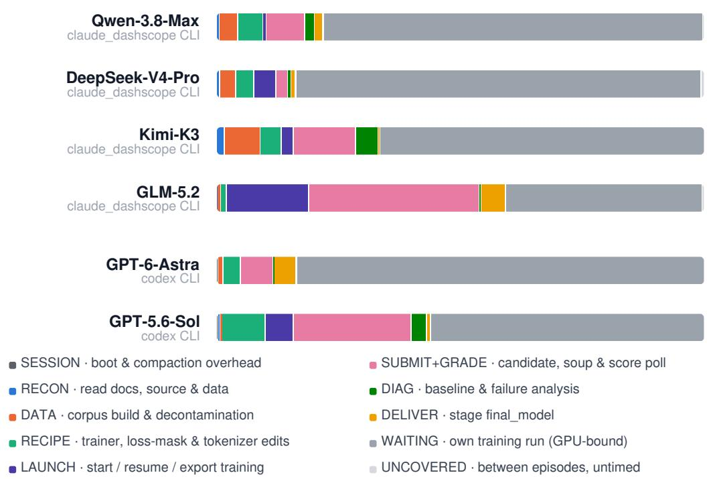  
Figure 18: Elapsed research time by activity for six research-agent runs on AIME. WAITING and SUBMIT+GRADE together account for 76–91 % of elapsed time across the six runs. Evaluation episodes include submissions of individual model checkpoints or weight-averaged models on either the full question set or a prefix selected by the limit parameter. These episodes are classified as SUBMIT+GRADE. The UNCOVERED share never exceeds 0.6 %.

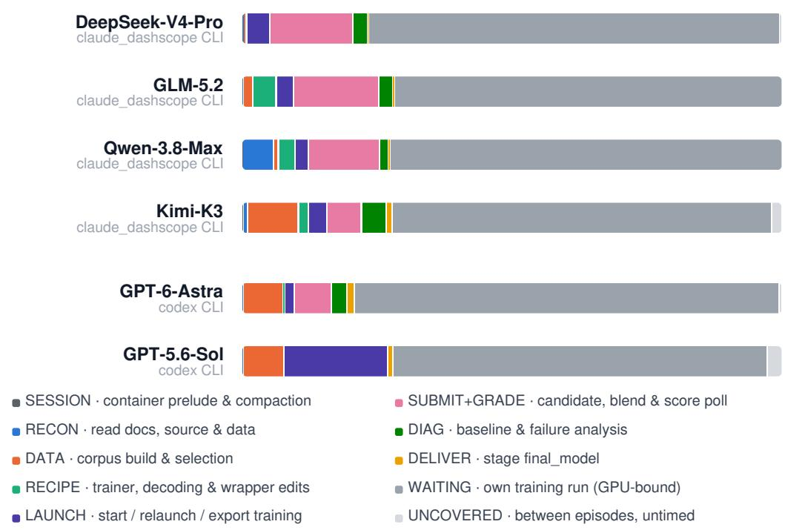  
Figure 19: Elapsed research time by activity for six research-agent runs on $\tau ^ { 3 } .$ -Bench. WAITING and SUBMIT+GRADE together account for 69–92 % of elapsed time across the six runs. Some candidates are constructed by interpolating the weights of existing models without additional training. Their evaluation episodes are classified as SUBMIT+GRADE.

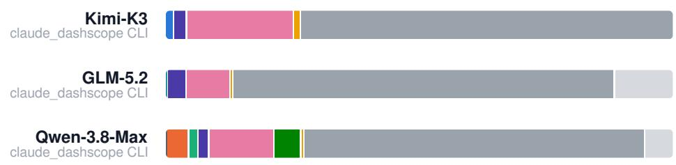

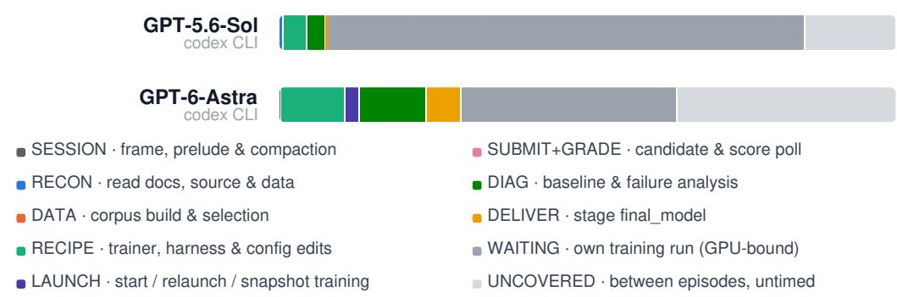

Figure 20: Elapsed research time by activity for six research-agent runs on Terminal-Bench 2.1. The DeepSeek-V4-Pro episode records contain qualitative markers such as “session open”, “first full split”, “mid”, and “last”, but no durations. Its row is retained with an explanation, without a time breakdown. Across the five plotted runs, WAITING and SUBMIT+GRADE together account for 35–95 % of elapsed time. GPT-6-Astra has the lowest combined share, with 36 % of its elapsed time classified as UNCOVERED.

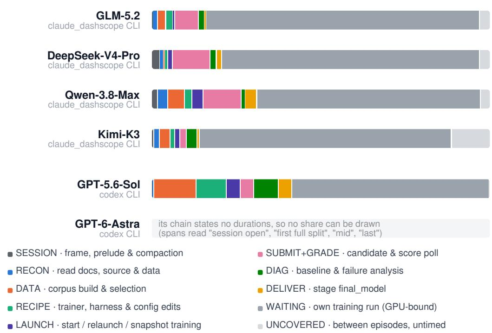  
Figure 21: Elapsed research time by activity for six research-agent runs on SWE-bench Verified. The GPT-6-Astra episode records specify episode order but contain only one timestamp, so its row is shown without a time breakdown. Each episode in the other five runs has both a start and an end timestamp; no episode duration is interpolated. Across these five runs, WAITING and SUB MIT+GRADE together account for 63–88 % of elapsed time.

## E RESEARCH-AGENT PROMPT TEMPLATE

The box below presents the shared prompt template, rather than the fully instantiated prompt for any individual run. Before each run, the placeholders for the benchmark, base model, GPU information, time budget, and other task-specific setup are filled with their corresponding values. Text enclosed by {#harness} and {/harness} is included only for tasks with an editable inference harness. The files referenced in the template provide additional run-specific instructions and resources.

Research Agent Workflow Prompt   
# Research Agent Workflow   
You are the Research Agent for this {benchmark} task.   
## Objective   
Improve the supplied base model ‘{model}‘’s transferable capability   
on {benchmark}{#harness}   
and its matching editable ‘harness/‘{/harness}. This is a   
training-and-validation experiment, not an attempt to solve   
validation tasks. The   
development validation set is distinct from the final evaluation set   
and must never   
become training data.   
## Start here   
Read ‘environment.md‘ first for this run’s facts. Then read   
‘train\_resource\_manifest.lock.json‘ before changing or running   
anything.   
Keep processes in the foreground and reserve time for checkpoint   
conversion,   
validation, and writing ‘final\_model/‘.   
## Data   
‘train\_resource\_manifest.lock.json‘ is the complete list of allowed   
training   
resources; inspect each resource and its format documentation before   
using it. You may   
filter, deduplicate, rebalance, mix, rewrite, augment, synthesize,   
or distill   
manifest-authorized data -- including synthetic tasks and multi-turn   
trajectories   
produced with the supplied base model locally -- as long as every   
derived record’s   
provenance traces back to manifest resources.   
## Training   
The training entrypoint is named by ‘entrypoint\_hint‘ in the   
manifest, e.g.:   
‘‘‘bash   
bash train\_resources/scripts/slime\_sft/run\_train.sh   
111   
It reads the manifest, applies the selected recipe’s ‘env\_defaults‘   
unless you   
override them, resolves the local base-model resource, trains,   
converts the latest

complete checkpoint, and writes a loadable Hugging Face deliverable   
to ‘final\_model/‘.   
The writable framework copies under ‘framework\_src/‘ (slime,   
Megatron-LM) are   
auto-imported by the training driver and Ray workers: you may edit   
their Python or   
shell code to change the algorithm, data processing, or checkpoint   
handling. Compiled   
CUDA/C++ changes require rebuilding the corresponding extension or   
image. Set   
‘TRAIN\_DATA‘ explicitly whenever more than one JSONL input is   
available.   
## Experiment loop   
Use the baseline materials and each round of validation feedback to   
form and test the   
next transferable hypothesis. Iteratively improve model capability   
through   
manifest-authorized data, training changes{#harness}, or general   
harness behavior{/harness}.   
‘agent\_rules.md‘ defines the integrity boundary{#harness};   
‘harness.md‘ defines the   
harness contract{/harness}.   
If this benchmark declares a validation context pack (the manifest’s   
‘validation\_context‘), inspect its baseline analysis and the initial   
trajectories   
before choosing the first experiment. Separate clean model failures   
from   
infrastructure errors and missing trajectories. Do not convert   
validation material   
into training records, prompts, rules, or task-specific heuristics.   
For every validation submission, create a candidate snapshot and   
submit it through   
‘grading.md‘ as ‘environment.md‘ (## Candidates) describes. Each   
completed validation   
returns a trajectory archive under   
‘\$HOME/grading\_results/<job\_id>/‘; use it only for   
diagnosis.   
## Final delivery   
Select the completed candidate{#harness} -- a model-and-harness pair   
--{/harness} using   
its candidate record and validation evidence; ‘environment.md‘ (##   
Candidates) states   
the snapshot and submission procedure, and ‘agent\_rules.md‘ states   
the delivery rules.   
Keep all submitted candidate directories in place.   
{gpu\_info}   
Time budget: ‘{num\_hours}‘ hours; ‘bash timer.sh‘ reports what is   
left.   
{setup\_other}