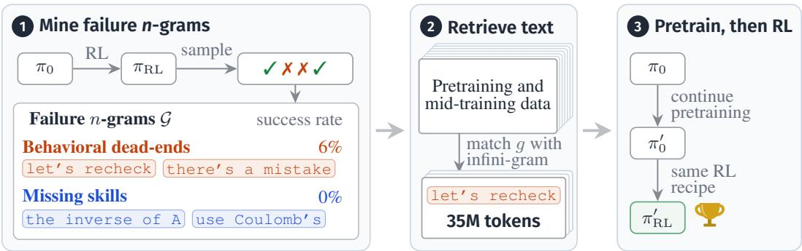
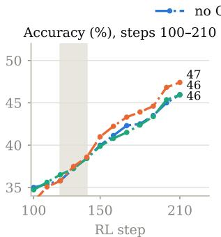
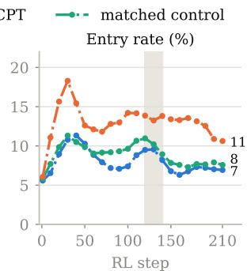
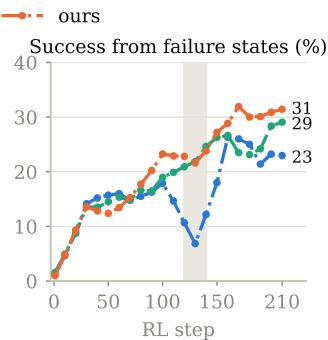
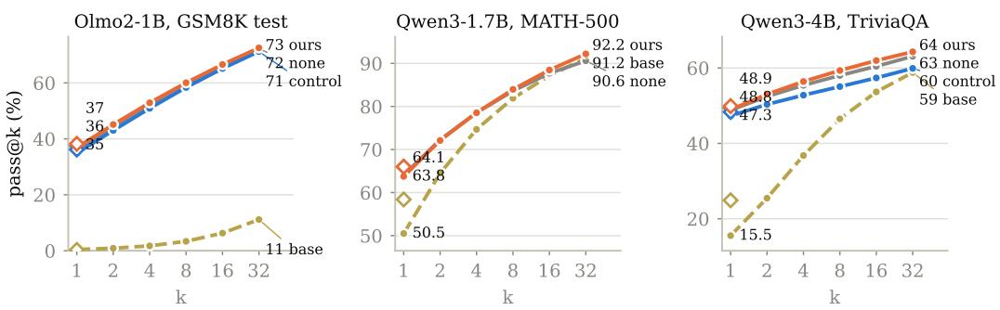

# WHERE RL BREAKS: LOCALIZING AND REPAIRING FAILURES VIA TARGETED CONTINUED PRETRAINING

Xinyi Wang Danqi Chen wangxinyilinda@gmail.com danqic@princeton.edu Princeton Language and Intelligence

## ABSTRACT

Reinforcement learning with verifiable rewards (RLVR) is widely used to improve reasoning in language models, yet growing evidence suggests that it mostly sharpens what the base model can already do. This raises a practical question: when RL fails, what is the base model missing? We look inside the RL policy’s own rollouts and find that failures are localized: whether a rollout fails is strongly predicted by a small set of characteristic n-grams, ranging from reflection phrases such as let’s recheck to specific operations such as the inverse of A. These failures persist throughout RL training, although they are not beyond the model’s reach: other sampled answers to the same question are often correct. Building on this observation, we use the failure n-grams to retrieve text from the pretraining corpus and continue pretraining the base model on it before RL. The resulting corpus has only 35M tokens, 3–4 orders of magnitude smaller than typical midtraining. We evaluate this approach on OLMo2 and Qwen3 models trained with RL on (1) GSM8K; (2) a mixture of math, commonsense, and knowledge questions; and (3) general math and science reasoning. Despite its size, the corpus yields consistent gains: our approach outperforms continued pretraining on the same amount of text sampled from the pretraining corpus across 10 out of 11 settings, including by 2.0 points on GSM8K when inserted before mid-training. The retrieved text also transfers across model families: text retrieved for OLMo2-1B’s failures improves Qwen3-4B on the mixture by 1.9 points over the same baseline. Together, our results suggest that where RL fails is a cheap and effective signal for selecting pretraining data.

## 1 INTRODUCTION

Reinforcement learning with verifiable rewards (RLVR) has become the dominant recipe for improving reasoning in language models. Yet growing evidence suggests that it largely sharpens what the base model can already do: it makes successful solutions more likely and failing ones less likely, but rarely produces solutions the base model could not already sample (Yue et al., 2025; Zhao et al., 2025; Wu et al., 2025). Prolonged or curriculum RL can go further (Liu et al., 2025; Cai et al., 2026), but the base model still sets the limit: RL builds new strategies only from skills the base model already has (Cheng et al., 2025), and its gains depend on what pretraining provides (Zhang et al., 2026; Shen et al., 2026; Foster et al., 2025). This raises a practical question: when RL fails, what exactly is the base model missing, and can we supply it before RL?

Prior work has approached this question from two separate directions. One line studies where in a reasoning trace RL has its effect or where things go wrong: RL updates concentrate on a small fraction of high-entropy tokens (Wang et al., 2025b), and a single token can mark where a reasoning trace turns toward failure (Ko et al., 2026). These findings have been used to change the training objective (Ko et al., 2026), but not to choose training data. The other line improves the base model with data before RL. Most prominently, mid-training on hundreds of billions of reasoning-heavy tokens, now a standard stage in open training recipes (Team Olmo et al., 2025), makes base models far more responsive to RL (Wang et al., 2025d); continued pretraining on text rich in reasoning behaviors such as verification and backtracking has a similar effect (Gandhi et al., 2025). These corpora, however, are chosen by task similarity or by hand, not by what a particular model gets wrong. We connect the two directions: like mid-training, we change the data before RL, but we use a model’s RL failures to select a small, targeted corpus.

  
Figure 1: Overview. We mine failure n-grams from RL rollouts, retrieve text containing them, continue pretraining on it, and re-run the same RL recipe. The resulting $\pi _ { \mathrm { R L } } ^ { \prime }$ consistently outperforms training on an equal amount of text sampled from the same corpora.

We approach this question by asking where within a rollout RL fails. Our central observation is that failures are not diffuse: whether a rollout leads to an incorrect outcome is strongly predicted by whether it contains one of a small number of characteristic n-grams (e.g., the small set of RL-critical tokens of Wang et al., 2025b and the single-token failure triggers of Ko et al., 2026). Which n-grams are diagnostic depends on the model and the task: reflection and selfcorrection phrases (let’s recheck, there’s a mistake in the problem) for weak models on elementary math, where the model reflects and then spirals rather than recovers; and specific operations (convert the given matrix to reduced row echelon form, the inverse $\mathrm { \Omega } _ { \mathrm { { O } } } \mathbf { f } \mathrm { \Delta \mathrm { \Omega } } \mathrm { \sim } \mathrm { \Omega } _ { \mathrm { { A } } } )$ for stronger models on broad reasoning suites. In both cases, the n-gram does not cause the failure; it is a visible sign that the rollout has reached a point from which it rarely recovers. RL has little to learn from at such points: it improves the model only from rollouts the model itself samples, and rollouts that reach these points rarely succeed.

These failures are also not beyond the model’s reach: for nearly half of the questions with a failing rollout, another sampled answer to the same question is correct. This suggests that what the base model lacks is specific, and that a small amount of the right data could supply it. Our approach follows directly (Figure 1): we use the failure n-grams as exact-match queries over the pretraining and mid-training corpora (Olmo-mix and Dolmino-mix; Walsh et al., 2025), continue pretraining the base model on the retrieved text, and re-run the same RL recipe. We evaluate on OLMo2 (Walsh et al., 2025) and Qwen3 (Yang et al., 2025) models trained with RL on (1) GSM8K (Cobbe et al., 2021); (2) a mixture of math, commonsense, and knowledge questions (GSM8K, Social IQA, MMLU, and TriviaQA; Sap et al., 2019; Hendrycks et al., 2021; Joshi et al., 2017); and (3) general math and science reasoning (Ma et al., 2025), inserting continued pretraining either on the released base model or, for OLMo2, before mid-training. Our contributions are:

• Where RL fails. RL failures concentrate on a small set of failure n-grams whose content varies with the model and task, from reflection phrases to specific operations. These failures persist throughout RL, even when the model can answer the same question correctly (Sections 4.2 and 4.4).

• A small, targeted fix. Retrieving pretraining text with the failure n-grams yields a 35M-token corpus, 3–4 orders of magnitude smaller than mid-training, selected by the model’s own failures (Section 3.4).

• Consistent gains that transfer. Our approach outperforms continued pretraining on the same amount of text sampled from the same corpus in 10 of 11 settings, including by 2.0 points on GSM8K when inserted before mid-training (3 RL seeds). A corpus mined from OLMo2-1B’s failures improves Qwen3-0.6B and Qwen3-4B by up to 2.4 points.

## 2 RELATED WORK

Does RL expand or amplify base-model reasoning? RLVR drives progress in reasoning models (Guo et al., 2025; Shao et al., 2024), but whether it expands or merely sharpens the base model is contested. Evidence for sharpening includes pass@1 gains without pass@k gains (Yue et al., 2025), convergence toward pretraining-favored distributions (Zhao et al., 2025), updates concentrated at a few high-entropy tokens (Wang et al., 2025b), and gains from uninformative rewards when the base model already has a strategy (Shao et al., 2026; Wu et al., 2026); when rare correct trajectories vanish, pass@k can even shrink (Zhou, 2026; Yuan et al., 2026). Counter-evidence shows the ceiling is partly a measurement artifact (Wen et al., 2026) and that prolonged or curriculum RL can move it (Liu et al., 2025; Cai et al., 2026). Work on both sides finds that RL composes only skills the base model already has (Cheng et al., 2025) and that gains are predicted by pretraining headroom (Shen et al., 2026; Zhang et al., 2026; Foster et al., 2025). Rather than changing RL, we ask which capability the base model lacks and supply it on the pretraining side.

Mid-training and continued pretraining for RL. A growing body of work inserts a mid-training phase between pretraining and RL: hundreds of billions of math-heavy and chain-of-thought tokens can make Llama as RL-friendly as Qwen (Wang et al., 2025d), open recipes ship such a stage (Walsh et al., 2025; Team Olmo et al., 2025), and controlled studies find mid-training worth more than RL alone (Zhang et al., 2026). Variants place reasoning data in pretraining itself (Wang et al., 2025a; Akter et al., 2026), run RL during mid-training (Li et al., 2026; Tian et al., 2026), use an RL-tuned model to shape mid-training data (Huang et al., 2026; RRV et al., 2026), or prime a base model by continued pretraining on verification and backtracking behaviors (Gandhi et al., 2025; Shah et al., 2025). We share the premise that the repair belongs before RL but differ in signal and scale: the model’s own failure n-grams select a corpus 3–4 orders of magnitude smaller. Continual-pretraining studies show that re-warming on a converged model first raises loss on the original distribution and that replay limits forgetting (Gupta et al., 2023; Ibrahim et al., 2024; Abbes et al., 2025); Section 4.3 shows the same effect.

Pretraining data selection and failure localization. Selecting data for a target capability ranges from n-gram importance resampling (Xie et al., 2023) to gradient- and influence-based method (Xia et al., 2024; Yu et al., 2024; Humane et al., 2025); complementary work traces behavior to pretraining documents (Wang et al., 2025c; Ruis et al., 2025). Our retrieval is a lightweight instance (exact-match lookup via infini-gram; Liu et al., 2024), but the signal is new: markers of where a trained model breaks down, not similarity to a target task. On the failure side (see Song et al., 2026, for a survey), intrinsic self-correction is unreliable without external signal (Huang et al., 2024; Kamoi et al., 2024), “recheck” steps are overwhelmingly confirmatory (Long et al., 2026), and excess reflection surfaces as overthinking (Sui et al., 2025), consistent with the reflection phrases among our failure n-grams. Closest to our diagnosis, Ko et al. (2026) identify single cliff tokens at which success probability drops and repair them with preference optimization; our failure n-grams are the state-level, model-specific analogue mined from RL rollouts, and we use them to retrieve pretraining data rather than shape the RL objective.

## 3 METHOD

Our method has three parts (Figure 1). We first run RL and read off its rollouts a small set offailure n-grams, phrases whose presence in a rollout predicts failure (Section 3.2). We then argue that RL does little to repair the states these phrases mark, because an on-policy objective learns how to continue from them only through the few successful continuations it samples there (Section 3.3). Finally, we use the failure n-grams as retrieval queries over the pretraining corpus, continue pretraining on the retrieved text, and re-run the same RL recipe; a matched control runs the same pipeline with content-neutral queries (Section 3.4).

## 3.1 PRELIMINARIES

We consider a reasoning task with prompts $x \sim \mathcal { D }$ and a verifier that assigns each rollout $y ,$ a reasoning trace followed by an answer, a binary reward $r ( x , y ) \in \{ 0 , 1 \}$ . We post-train the base model $\pi _ { 0 }$ with GRPO (Shao et al., 2024). For each prompt, G rollouts $y _ { 1 } , \dotsc , y _ { G }$ are sampled

from the current policy $\pi _ { \theta _ { \mathrm { o l d } } }$ , and each receives the group-relative advantage $\hat { A } _ { i } = \left( r ( x , y _ { i } ) - \right.$ meanj $r ( x , y _ { j } ) ) / \mathrm { s t d } _ { j } r ( x , y _ { j } )$ , which is shared by all of its tokens and is zero when all G rewards are equal. The policy is updated to maximize

$$
\begin{array} { r } { \mathcal { I } ( \theta ) = \mathbb { E } _ { x , \{ y _ { i } \} } \left[ \frac { 1 } { G } \sum _ { i = 1 } ^ { G } \frac { 1 } { | y _ { i } | } \sum _ { t = 1 } ^ { | y _ { i } | } \operatorname* { m i n } \left( \rho _ { i , t } \hat { A } _ { i } , \mathrm { c l i p } ( \rho _ { i , t } , 1 - \epsilon , 1 + \epsilon ) \hat { A } _ { i } \right) \right] - \beta \mathbb { D } _ { \mathrm { K L } } \left[ \pi _ { \theta } \left\| \pi _ { 0 } \right\| \right] } \end{array}\tag{1}
$$

where $\rho _ { i , t } ~ = ~ \pi _ { \theta } ( y _ { i , t } ~ \vert ~ x , y _ { i , < t } ) / \pi _ { \theta _ { \mathrm { o l d } } } ( y _ { i , t } ~ \vert ~ x , y _ { i , < t } )$ is the token-level importance ratio, ϵ the clipping range, and $\beta$ the weight of a KL penalty toward $\pi _ { 0 }$ (values, including the asymmetric clipping used for General Reasoner, are in Appendix B). We write $\pi _ { \mathrm { R L } }$ for the resulting policy. Because advantages are estimated only from rollouts the policy itself samples, RL learns how to act in a given state only from the continuations it samples there; Section 3.3 returns to this point.

## 3.2 LOCALIZING FAILURES WITH n-GRAMS

We treat n-grams as cheap, observable markers of rollout states and ask which ones are diagnostic of failure. An n-gram $g$ is a span of n consecutive tokens, such as $\bot \in { \sf t ^ { \prime } s }$ recheck, and $\bar { E _ { g } ( y ) } =$ 1[ g appears in $y .$ ] indicates that rollout $y$ contains it. Over the rollouts of a fixed policy, we measure the conditional accuracy of the rollouts that contain $^ { g , }$

$$
a ( g ) = \mathrm { P r } \left[ r ( x , y ) = 1 ~ \vert ~ E _ { g } ( y ) = 1 \right] .\tag{2}
$$

We use $\pi _ { \mathrm { R L } }$ rather than $\pi _ { 0 }$ , since its rollouts show the failures that remain after RL. This quantity is associational: whether a rollout emits $\bot \in { \sf t ^ { \prime } s }$ recheck is itself an outcome of the model’s state, so $a ( g )$ measures how strongly g marks a low-accuracy state, not the effect of inserting $g .$ This suffices to localize failures.

Concretely, we mine n-grams from the reasoning spans of $\pi _ { \mathrm { R L } } \mathbf { \dot { s } }$ training rollouts, keep those that occur at least 20 times and in at least 0.1% of the rollouts, remove candidates dominated by digits or formatting, merge near-duplicates into their longest common span, and rank the rest by $a ( g )$ . The lowest-accuracy phrases form the failure set ${ \mathcal { G } } ,$ which also serves as the set of retrieval queries.2

## 3.3 DIAGNOSIS: LOCALIZED LOW-VALUE STATES

We view a rollout as a trajectory through latent reasoning states: after emitting t tokens, the model is in a state $s _ { t }$ that summarizes the prefix so far. The value of a state under policy $\pi ,$

$$
V ^ { \pi } ( s ) = \operatorname* { P r } [ { \mathrm { e v e n t u a l ~ s u c c e s s ~ } } | \ s ] ,\tag{3}
$$

is the probability that a rollout of π that passes through s ends with a correct answer. An n-gram connects the two views. We call the states in which the model emits $g$ the states marked by g and write them $s _ { g } .$ . The rollouts that contain $g$ are exactly those that pass through $s _ { g } ,$ so the conditional accuracy of Section 3.2 estimates their average value, $a ( g ) \approx \bar { V } ^ { \pi } ( s _ { g } )$ , and failure n-grams mark low-value states. These states fall into two archetypes that share this value structure but differ in what is missing. In an unproductive behavior, the model reflects and then spirals rather than recovers: the pieces exist, but their composition fails. In a missing skill, the model stalls on an operation the subproblem requires, such as row reduction.

RL does little to repair such states. Under GRPO (Section 3.1), the policy learns how to continue from $s _ { g }$ only through the rollouts it samples there, and when $V ^ { \pi } ( s _ { g } )$ is low, few of them succeed. Section 4.4 bears this out: over $\mathtt { R L }$ , the rate at which rollouts enter the failure states stays flat, and the success rate from them rises only in step with overall accuracy (Figure 2), consistent with the small post-RL shifts reported by Wang et al. (2025b) and Zhao et al. (2025). Because on-policy sampling rarely produces the missing signal, we supply it before RL instead, by continued pretraining on text in which the failure n-grams occur. This changes $\pi _ { 0 }$ itself, and with it both the policy that RL starts from and the reference of its KL penalty.

## 3.4 REPAIR: FAILURE-n-GRAM-GUIDED CONTINUED PRETRAINING

The repair has three steps. (i) Retrieve: each $g \in { \mathcal { G } }$ is an exact-match query to an infini-gram index (Liu et al., 2024) of the model’s pretraining and mid-training corpora. We extract a 2k-token window around every match, so that the text includes what surrounds the phrase, and sample documents with a per-query balanced budget of 35M tokens in total unless stated otherwise. (ii) Continue pretraining: the base model is trained on the retrieved text with the next-token objective, either as released or, for OLMo2, after pretraining stage 1 and before mid-training (Section 4.1). (iii) Run RL: GRPO is re-run with all hyperparameters held fixed, so any difference is attributable to the CPT phase. The matched control runs the identical pipeline and budget with content-neutral queries (e.g., step 1), which separates the choice of text from the effect of continued pretraining itself.

## 4 EXPERIMENTS

We now test the two claims of Section 3 empirically: that failure n-grams localize where RL breaks, and that continued pretraining on text retrieved with them repairs it. The experiments span two model families, three RL settings of increasing breadth, and two insertion points, always against a matched control that receives the same pipeline and budget with content-neutral queries. Section 4.2 shows that RL failures concentrate in a small set of failure n-grams; Section 4.3 shows that CPT guided by them raises the accuracy RL reaches over matched controls, most of all before midtraining; Section 4.4 shows that the deficit is conditional rather than a coverage gap; and Section 4.5 shows that 35M tokens suffice.

## 4.1 EXPERIMENTAL SETUP

Models and tasks. We study OLMo2 (Walsh et al., 2025) at 1B and 7B, as their pretraining and mid-training corpora are public, and Qwen3 (Yang et al., 2025) at 0.6B, 1.7B, and 4B, as they are among the best open-source small models. For OLMo2-1B we also use the public stage-1 checkpoint, taken before mid-training, which lets us insert the repair before mid-training. We always retrieve from the OLMo2 corpora, Olmo-mix and Dolmino-mix (Chen et al., 2026), for all models, including Qwen3, whose own corpus is not public; the Qwen3 runs therefore also test transfer across pretraining corpora. We consider three RL settings of increasing breadth: (i) GSM8K (Cobbe et al., 2021); (ii) a multi-task mixture of GSM8K, Social IQA (Sap et al., 2019), MMLU (Hendrycks et al., 2021), and TriviaQA (Joshi et al., 2017), mixed at a ratio of 8:2:1:1; and (iii) the General Reasoner setting (Ma et al., 2025), which trains on WebInstruct-verified prompts spanning math, science, and logic. All post-training uses GRPO, with $G = 5$ rollouts per prompt for (i) and (ii) (210 and 595 steps) and the General Reasoner recipe with $G = 8$ for (iii) (226 steps). Hyperparameters are held fixed between the runs with and without CPT.

Continued pretraining and controls. For each setting we mine failure n-grams from $\pi _ { \mathrm { R L } }$ (Section 3.2), retrieve a corpus with a per-query balanced budget of 35M tokens (larger budgets are studied in Section 4.5), and continue pretraining with the next-token objective before re-running RL. We study the effect of inserting CPT before and after OLMo2’s mid-training stage. Before midtraining: starting from the OLMo2-1B stage-1 checkpoint, CPT continues the stage-1 optimizer and schedule and is followed by a shortened stage-2 mid-training (0.84B tokens of the official Dolminomix, identical across conditions). After mid-training: CPT is run directly on the released base model with a fresh optimizer. The matched control runs the identical pipeline with the same budget but retrieves documents with content-neutral random queries.

Metrics. We report greedy accuracy at the final RL step, without checkpoint selection. For GSM8K training we evaluate on the GSM8K test set; for the mixture we report the macro-average over the GSM8K test set, the MMLU validation set, TriviaQA, and the Social IQA test set; and for the General Reasoner setting we report the mean over GSM8K, MATH-500, Minerva, Olympiad-Bench, AMC, AIME 2024/25, and GPQA-Diamond, graded by normalized exact match with symbolic equivalence. For the marked states we measure, on the $G = 5$ training rollouts of a step (2560 rollouts), the conditional accuracy $a ( g )$ , the entry rate $\mathrm { P r } [ E _ { g } ]$ , and the fraction of affected questions with a succeeding sibling rollout; we also report pass@k up to $k = 3 2$ . Numbers are single-seed unless marked; where we ran three RL seeds, the standard deviation across seeds is about one point.

Table 1: Failure n-grams mark low-accuracy states, and targeted CPT makes the model traverse them more often and more successfully. For each phrase we report its conditional accuracy a(g) and the number of rollouts containing it, late in RL, without and with our CPT. Summary rows aggregate over the retrieval queries, or over the failure five-grams mined from the no-CPT run, which were never used for retrieval. General Reasoner runs are compared at matched RL steps.
<table><tr><td>Failure n-gram</td><td>a(g)</td><td>Count</td><td>a(g) after CPT</td><td>Count after CPT</td></tr><tr><td>OLMo2-1B/GSM8K</td><td></td><td></td><td></td><td></td></tr><tr><td>there&#x27;s a mistake</td><td>6.2%</td><td>745</td><td>8.1%</td><td>839</td></tr><tr><td>Let&#x27;s recheck</td><td>5.6%</td><td>591</td><td>6.3%</td><td>2166</td></tr><tr><td>failure five-grams</td><td>25.7%</td><td>8859</td><td>29.2%</td><td>16620</td></tr><tr><td>Qwen3-4B/multi-task</td><td></td><td></td><td></td><td></td></tr><tr><td>correct answer. The correct</td><td>8.7%</td><td>126</td><td>16.7%</td><td>1360</td></tr><tr><td>failure five-grams</td><td>10.8%</td><td>3123</td><td>17.6%</td><td>2140</td></tr><tr><td>Qwen3-1.7B/General Reasoner</td><td></td><td></td><td></td><td></td></tr><tr><td>convert the given matrix to</td><td>0.0%</td><td>232</td><td>4.3%</td><td>258</td></tr><tr><td>use Coulomb&#x27;s</td><td>0.0%</td><td>212</td><td>22.6%</td><td>997</td></tr><tr><td>Qwen3-4B/General Reasoner</td><td></td><td></td><td></td><td></td></tr><tr><td>the inverse of A</td><td>0.0%</td><td>56</td><td>49.9%</td><td>2219</td></tr><tr><td>Then, the derivative of</td><td>0.0%</td><td>44</td><td>62.1%</td><td>335</td></tr><tr><td>failure five-grams</td><td>18.2%</td><td>12328</td><td>36.6%</td><td>15890</td></tr></table>

## 4.2 FAILURE n-GRAMS LOCALIZE RL FAILURES

Across all models and settings, a small number of n-grams predicts whether a rollout will fail. For OLMo2-1B on GSM8K, the failure five-grams of Table 1 appear in about 7% of late-RL training rollouts, and those rollouts succeed 24% of the time against 44% for the rest (statistics are always measured on RL steps after the ones the n-grams were mined from, to avoid selection bias). What the failure n-grams contain shifts with model strength and task breadth (Table 1). For OLMo2- 1B on GSM8K they are reflection and self-correction phrases (there’s a mistake, Let’s recheck); for Qwen3-4B on the mixture they are hedging phrases on the trivia questions (a more fitting answer, after careful consideration), with which the model talks itself out of an answer; and for the stronger Qwen3 models in the General Reasoner setting they are specific operations (convert the given matrix to [reduced row echelon form], use Coulomb’s [law]). The reflection phrases are not rare in pretraining data: each GSM8K retrieval query matches tens of thousands of Dolmino-mix documents (57,000 at the median), whereas the highest-accuracy n-grams of the same run (pizza is cut into) match about 950. The model has seen let’s recheck many times; what it has not learned is what to do after saying it, so the behavioral deficit is unproductive use rather than absence. Table 1 also previews the repair: after CPT on text retrieved with these phrases, the model emits them more often and succeeds more often after them.

## 4.3 TARGETED CONTINUED PRETRAINING REPAIRS RL

Table 2 reports the main result. With the RL recipe held fixed, inserting failure-n-gram-guided CPT before RL gives the best final accuracy in every setting of the table, above both no CPT and the matched control. Over all GSM8K and multi-task settings we ran, it beats the control in 10 of 11 (9 with 35M tokens and 1 with 100M tokens; Table 5).3 The gain over the control is largest when the repair is inserted before mid-training: +2.0 on GSM8K over three RL seeds, where the control falls below no CPT. On released base models the gain is largest for the weakest model (+2.4 over the control for Qwen3-0.6B on GSM8K) and shrinks as the model gets stronger.

In the General Reasoner setting, where the failure n-grams identify operations rather than behaviors, the corpus mined from Qwen3-4B and transferred to Qwen3-1.7B leads no CPT by +2.6, and continued pretraining alone, before any RL, raises Qwen3-4B’s eight-benchmark mean by 3.0 points while the same budget of random Olmo-mix text lowers it by 4.1.

Table 2: Main results: greedy test accuracy at the final RL step with the RL recipe fixed. The control uses the identical pipeline and budget with content-neutral queries; all CPT on 35M tokens. Multitask is the macro-average over GSM8K, MMLU, TriviaQA, and Social IQA. General Reasoner is the mean over eight math and science benchmarks. OLMo2-1B GSM8K reports the mean over three RL seeds; others single-seed. ‡: OLMo2-1B-mined corpus. ¶: compared at a matched RL step (Table 9).
<table><tr><td rowspan="2"></td><td rowspan="2"></td><td colspan="3">Acc after RL</td></tr><tr><td>None</td><td>Control</td><td>Ours</td></tr><tr><td colspan="5">CPT inserted after stage 1 (before mid-training)</td></tr><tr><td>GSM8K Multi-task</td><td>OLMo2-1B OLMo2-1B</td><td>37.4 43.2</td><td>36.2 45.3</td><td>38.2 45.8</td></tr><tr><td></td><td></td><td></td><td></td><td></td></tr><tr><td colspan="5">CPT on the released base model (after mid-training)</td></tr><tr><td>GSM8K</td><td>OLMo2-1B</td><td>59.3</td><td>60.0</td><td>60.6</td></tr><tr><td>GSM8K</td><td>Qwen3-0.6B‡</td><td>74.5</td><td>73.0</td><td>75.4</td></tr><tr><td>GSM8K</td><td>Qwen3-4B‡</td><td>91.9</td><td>91.7</td><td>92.3</td></tr><tr><td>Multi-task</td><td>Qwen3-0.6B</td><td>52.4</td><td>52.2</td><td>52.8</td></tr><tr><td>Multi-task</td><td>Qwen3-4B‡</td><td>72.9</td><td>72.1</td><td>74.0</td></tr><tr><td>General Reasoner</td><td>Qwen3-1.7B</td><td>31.7</td><td>32.5</td><td>34.3</td></tr><tr><td>General Reasoner</td><td>Qwen3-4B‡</td><td>44.0</td><td>43.9</td><td>44.7</td></tr></table>

## 4.4 THE DEFICIT IS LOCAL, NOT A GLOBAL COVERAGE GAP

Failing rollouts share questions with succeeding ones. Late in RL (OLMo2-1B on GSM8K, steps 150–210), about 70 of the 512 prompts in each training batch have at least one rollout that enters a failure state, and for 46% of these prompts another rollout of the same question reaches the correct answer. With only G = 5 samples per question this is a lower bound, so the correct answer is within the model’s reach for nearly half of the affected questions; what the model lacks is a way through the marked state, not the answer itself.

RL does not change how often the failure states are entered. Figure 2 tracks the failure states over the course of RL. Training-rollout accuracy rises from 0.2% to 47% over 210 GRPO steps, but the fraction of rollouts that enter a failure state stays between 5% and 7% throughout (middle panel), and the success rate from those states rises at the same pace as overall accuracy (right panel). RL therefore improves the marked states only in proportion to everything else and does not single them out for repair (Wang et al., 2025b; Zhao et al., 2025).

RL does not expand coverage; CPT does, modestly. Figure 3 plots pass@k, the fraction of test questions solved by at least one of k samples. Where the base model already produces the answer format (the middle and right panels), RL raises pass@1 by a large margin but pass@32 by only a few points, and on MATH-500 pass@32 after RL ends slightly below the base model’s (90.6 vs. 91.2), reproducing the finding of Yue et al. (2025) that RL makes the model sample its existing solutions more reliably rather than reach new ones. Continued pretraining before RL moves this ceiling, by a small amount. The repaired model has higher pass@k than the matched control at every k, and its pass@32 ends above the no-CPT run by 1.2 points on TriviaQA and 1.6 on MATH-500, where it is the only RL-trained model to finish above the base model (92.2). On TriviaQA its lead over the control grows with k, from 1.6 points at k=1 to 4.4 at k=32, while its lead over no CPT stays near one point. In short, generic CPT shrinks the set of answers RL can reach, RL itself does not enlarge it, and targeted CPT enlarges it by one to two points at k=32, at the edge of what 500 to 1000 test questions can resolve.

Targeted CPT makes the model enter the marked states more often and succeed from them more often. Inserting our CPT after stage 1 and re-running the same RL recipe moves all three quantities of Table 3 in the intended direction. The entry rate into the failure states doubles, the success rate from them rises by about four points, and the share of affected questions with a correct sibling rollout rises from 46% to 50% (Figure 2, Table 3). The success rate rises in every other setting of Table 3 as well, most strongly for OLMo2-7B on the mixture. Two observations qualify this result: the matched control raises the success rate by a similar amount, though without raising the entry rate, and per phrase the reflection markers succeed 5–12% of the time with or without the repair (Table 1; all 16 GSM8K queries in Table 15). What the repair changes most is therefore how often the model emits these phrases, so its accuracy gain cannot be attributed to the diagnosed states alone.

  
Figure 2: Failure-state statistics over the course of RL for OLMo2-1B on GSM8K with CPT inserted after stage 1. The failure set (66 five-grams) is mined at steps 120–140 (shaded). RL leaves the entry rate flat, whereas our corpus doubles it. The accuracy panel starts at step 100, before which the three trajectories coincide; all curves are 3-point (30-step) moving averages.

Table 3: Entry rate into the failure states, success rate from them, and test accuracy before → after CPT on 35M retrieved tokens, same RL recipe. After stage 1 and for OLMo2-7B all three rise; in the General Reasoner setting the success rate rises at an unchanged entry rate.
<table><tr><td>Setting</td><td>Model</td><td> $\mathrm { P r } [ E _ { \mathcal { G } } ]$ </td><td>a(G)</td><td>test acc.</td></tr><tr><td>GSM8K</td><td>OLMo2-1B (after stage 1)</td><td> $5 . 7  1 0 . 6$ </td><td> $2 5 . 7  2 9 . 2$ </td><td> $\mathbf { 3 6 . 2  3 9 . 2 }$ </td></tr><tr><td>GSM8K</td><td>OLMo2-1B (after stage 1, 3 seeds)</td><td> $6 . 8  7 . 6$ </td><td> $2 4 . 3  2 8 . 4$ </td><td> $\mathbf { 3 7 . 4 }  \mathbf { 3 8 . 2 }$ </td></tr><tr><td>General Reasoner</td><td>Qwen3-1.7B (base)</td><td> $7 . 4  7 . 3$ </td><td> $\mathbf { 1 6 . 9  2 7 . 7 }$ </td><td> $3 4 . 1  3 5 . 0$ </td></tr></table>

Missing skills are repaired more fully than unproductive behaviors. The two archetypes of Section 3.3 respond differently to the same repair (Table 1). The operations that Qwen3-4B never completed correctly go from 0% to 50–62% success after CPT, whereas the reflection phrases of OLMo2-1B move by only one or two points. A missing operation has a definite correct execution, which the retrieved text can supply directly, whereas a reflection phrase helps only if the model also knows what went wrong on the question at hand, which the retrieved recoveries do not teach. The repair therefore raises how often the model reflects far more than how often reflecting succeeds.

## 4.5 ANALYSIS AND ABLATIONS

Insert the repair before mid-training. Table 4 compares the two insertion points at equal budget and with the identical pipeline. Inserted after stage 1, the targeted corpus is the best CPT data in both settings: on GSM8K it leads the matched control by +2.0 over three seeds, about two standard deviations, while generic text at the same budget falls below no CPT; on the mixture it leads no CPT by +2.6. Inserted into the released base model, the same corpus adds 1.3 points on GSM8K, but the matched control adds nearly as much, and on the mixture both CPT variants fall below no CPT. Two effects favor the earlier insertion: targeting only pays off before mid-training, and the mid-training that follows the repair absorbs the perturbation that CPT on a finished model leaves in place.

A small corpus is enough. Table 5 varies the token budget. In every setting the gain appears at 35–100M tokens, and scaling the corpus to 1B leaves accuracy flat or lowers it. The cost of a large budget is sharpest before RL, where 1B tokens of retrieved text lowers Qwen3-4B’s eightbenchmark mean by 19 points; mixing random documents into a large corpus does not recover the loss (Table 11).

  
base no CPT + RL control + RL ours + RL greedy  
Figure 3: pass@k with 32 samples at T=0.7; hollow diamonds mark greedy accuracy. Left: OLMo2-1B on GSM8K, CPT after stage 1, mean over three RL seeds. Middle: Qwen3-1.7B on MATH-500 in the General Reasoner setting (step 226; ours is the self-mined corpus, which has no matched control). Right: Qwen3-4B on TriviaQA after multi-task RL. The OLMo2-1B base rarely produces the required #### answer, hence its near-zero curve. RL raises pass@1 far more than pass@32; the repaired model leads the control at every k and, relative to no CPT, leads on OLMo2- 1B and Qwen3-4B and, at k=32, edges above it on Qwen3-1.7B.

Table 4: Where to insert the repair: greedy accuracy of OLMo2-1B at the final RL step with the same 35M-token pipeline at both insertion points; the bottom rows give the gain of our corpus over no CPT and over the control.
<table><tr><td></td><td colspan="2">After stage 1 (before mid-training)</td><td colspan="2">Released base (after mid-training)</td></tr><tr><td>CPT data</td><td>GSM8K</td><td>multi-task</td><td>GSM8K</td><td>multi-task</td></tr><tr><td>none</td><td>37.4</td><td>43.2</td><td>59.3</td><td>52.6</td></tr><tr><td>matched control</td><td>36.2</td><td>45.3</td><td>60.0</td><td>49.5</td></tr><tr><td>failure n-grams (ours)</td><td>38.2</td><td>45.8</td><td>60.6</td><td>51.5</td></tr><tr><td>ours — none</td><td>+0.8</td><td>+2.6</td><td>+1.3</td><td>-1.1</td></tr><tr><td>ours — matched control</td><td>+2.0</td><td>+0.5</td><td>+0.6</td><td>+2.0</td></tr></table>

Table 5: CPT token budget: greedy accuracy at the final RL step against the number of retrieved tokens; the last row evaluates the CPT model before RL. OLMo2-1B GSM8K at 0 and 35M: threeseed means.
<table><tr><td>Task</td><td>Model</td><td>Insertion</td><td>0</td><td>35M</td><td>100M</td><td>1B</td></tr><tr><td>GSM8K</td><td>OLMo2-1B</td><td>After stage 1</td><td>37.4</td><td>38.2</td><td>37.7</td><td>33.4</td></tr><tr><td>GSM8K</td><td>OLMo2-1B</td><td>Released base</td><td>59.3</td><td>60.6</td><td>60.5</td><td>59.9</td></tr><tr><td>Multi-task</td><td>Qwen3-0.6B</td><td>Released base</td><td>52.4</td><td>52.8</td><td>52.6</td><td>51.7</td></tr><tr><td>Multi-task</td><td>Qwen3-1.7B</td><td>Released base</td><td>62.4</td><td>62.5</td><td>63.4</td><td>63.2</td></tr><tr><td>General Reasoner</td><td>Qwen3-4B</td><td>Released base</td><td>37.5</td><td>40.5</td><td>35.2</td><td>18.8</td></tr></table>

The corpus transfers across model families. The 35M corpus mined from OLMo2-1B’s GSM8K failures improves Qwen3-0.6B on GSM8K by +2.4 over the control and Qwen3-4B on the mixture by +1.9 (Table 2), and in the other direction the corpus mined from Qwen3-4B’s General Reasoner failures lifts Qwen3-1.7B by +2.6 over no CPT (Table 2).

## 5 CONCLUSION

In this paper, we asked what specific capability a base model is missing when RL almost works, and whether it can be supplied before RL. Failure n-grams read off the model’s own rollouts mark low-value states that on-policy, KL-anchored RL cannot self-repair. Using those n-grams to retrieve and continue-pretrain on text that traverses the marked states improves downstream accuracy over matched controls when inserted before mid-training, and the corpus transfers across model families, all without labels or a teacher. A model’s own failures are an underused supervision signal: a cheap, label-free pointer to the pretraining data it needs most.

## REFERENCES

Istabrak Abbes, Gopeshh Subbaraj, Matthew Riemer, Nizar Islah, Tsuguchika Tabaru, Hiroaki Kingetsu, Sarath Chandar, and Irina Rish. Revisiting replay and gradient alignment for continual pre-training of large language models. In Proceedings of The 4th Conference on Lifelong Learning Agents, volume 330 of Proceedings ofMachine Learning Research, pp. 465–486, 2025. URL https://proceedings.mlr.press/v330/abbes26a.html.

Syeda Nahida Akter, Shrimai Prabhumoye, Eric Nyberg, Mostofa Patwary, Mohammad Shoeybi, Yejin Choi, and Bryan Catanzaro. Front-loading reasoning: The synergy between pretraining and post-training data. In The Fourteenth International Conference on Learning Representations, 2026. URL https://openreview.net/forum?id=VmEkhV2yCX.

Pengxiang Cai, Tianchen Fang, Xiaohan Li, Qingyuan Zeng, Guocong Li, and Jintai Chen. Curriculum reinforcement learning can incentivize reasoning capacity in LLMs beyond the base model. arXiv preprint arXiv:2606.22317, 2026.

Mayee F Chen, Tyler Murray, David Heineman, Matt Jordan, Hannaneh Hajishirzi, Christopher Re, Luca Soldaini, and Kyle Lo. Olmix: A framework for data mixing throughout LM devel-´ opment. In Forty-third International Conference on Machine Learning, 2026. URL https: //openreview.net/forum?id=Z46ZBACu1p.

Sitao Cheng, Xunjian Yin, Ruiwen Zhou, Yuxuan Li, Xinyi Wang, Liangming Pan, William Yang Wang, and Victor Zhong. Atomic skills are the prerequisite: When reinforcement learning synthesizes compositional reasoning, and when it only amplifies. arXiv preprint arXiv:2512.01970, 2025.

Karl Cobbe, Vineet Kosaraju, Mohammad Bavarian, Mark Chen, Heewoo Jun, Lukasz Kaiser, Matthias Plappert, Jerry Tworek, Jacob Hilton, Reiichiro Nakano, et al. Training verifiers to solve math word problems. arXiv preprint arXiv:2110.14168, 2021.

Dylan J. Foster, Zakaria Mhammedi, and Dhruv Rohatgi. Is a good foundation necessary for efficient reinforcement learning? The computational role of the base model in exploration. In COLT, pp. 2026–2142, 2025. URL https://proceedings.mlr.press/v291/foster25a. html.

Kanishk Gandhi, Ayush Chakravarthy, Anikait Singh, Nathan Lile, and Noah D. Goodman. Cognitive behaviors that enable self-improving reasoners, or, four habits of highly effective STaRs. In Second Conference on Language Modeling, 2025. URL https://openreview.net/ forum?id=QGJ9ttXLTy.

Daya Guo, Dejian Yang, Haowei Zhang, et al. DeepSeek-R1 incentivizes reasoning in LLMs through reinforcement learning. Nature, 645(8081):633–638, 2025. doi: 10.1038/ s41586-025-09422-z.

Kshitij Gupta, Benjamin Therien, Adam Ibrahim, Mats Leon Richter, Quentin Gregory Anthony,´ Eugene Belilovsky, Irina Rish, and Timothee Lesort. Continual pre-training of large language´ models: How to re-warm your model? In Workshop on Efficient Systems for Foundation Models @ ICML2023, 2023. URL https://openreview.net/forum?id=pg7PUJe0Tl.

Dan Hendrycks, Collin Burns, Steven Basart, Andy Zou, Mantas Mazeika, Dawn Song, and Jacob Steinhardt. Measuring massive multitask language understanding. In International Conference on Learning Representations, 2021. URL https://openreview.net/forum?id= d7KBjmI3GmQ.

Jie Huang, Xinyun Chen, Swaroop Mishra, Huaixiu Steven Zheng, Adams Wei Yu, Xinying Song, and Denny Zhou. Large language models cannot self-correct reasoning yet. In International Conference on Learning Representations (ICLR), 2024. arXiv:2310.01798.

Junjie Huang, Jiarui Qin, Di Yin, Weiwen Liu, Yong Yu, Xing Sun, and Weinan Zhang. ReMiT: RL-guided mid-training for iterative LLM evolution. arXiv preprint arXiv:2602.03075, 2026.

Prateek Humane, Paolo Cudrano, Daniel Z Kaplan, Matteo Matteucci, Supriyo Chakraborty, and Irina Rish. Influence functions for efficient data selection in reasoning. In NeurIPS 2025 Workshop on Efficient Reasoning, 2025. URL https://openreview.net/forum?id= wQyK6NEpoy.

Adam Ibrahim, Benjamin Therien, Kshitij Gupta, Mats Leon Richter, Quentin Gregory Anthony,´ Eugene Belilovsky, Timothee Lesort, and Irina Rish. Simple and scalable strategies to continually´ pre-train large language models. Transactions on Machine Learning Research, 2024. ISSN 2835- 8856. URL https://openreview.net/forum?id=DimPeeCxKO.

Mandar Joshi, Eunsol Choi, Daniel S Weld, and Luke Zettlemoyer. TriviaQA: A large scale distantly supervised challenge dataset for reading comprehension. In Proceedings of the 55th Annual Meeting of the Association for Computational Linguistics (Volume 1: Long Papers), pp. 1601–1611, 2017.

Ryo Kamoi, Yusen Zhang, Nan Zhang, Jiawei Han, and Rui Zhang. When can LLMs actually correct their own mistakes? A critical survey of self-correction of LLMs. Transactions of the Associationfor Computational Linguistics (TACL), 2024. arXiv:2406.01297.

Jaeyong Ko, Pilsung Kang, and Yukyung Lee. Cliff tokens: Identifying single-token failure triggers in LLM mathematical reasoning. arXiv preprint arXiv:2606.25524, 2026.

Siheng Li, Kejiao Li, Zenan Xu, Guanhua Huang, Evander Yang, Kun Li, Haoyuan Wu, Jiajia Wu, Zihao Zheng, Chenchen Zhang, et al. Reinforcement learning on pre-training data. In Proceedings of the 64th Annual Meeting of the Association for Computational Linguistics (Volume 1: Long Papers), pp. 11046–11057, 2026. doi: 10.18653/v1/2026.acl-long.506.

Jiacheng Liu, Sewon Min, Luke Zettlemoyer, Yejin Choi, and Hannaneh Hajishirzi. Infini-gram: Scaling unbounded n-gram language models to a trillion tokens. In First Conference on Language Modeling, 2024. URL https://openreview.net/forum?id=u2vAyMeLMm.

Mingjie Liu, Shizhe Diao, Ximing Lu, Jian Hu, Xin Dong, Yejin Choi, Jan Kautz, and Yi Dong. ProRL: Prolonged reinforcement learning expands reasoning boundaries in large language models. In The Thirty-ninth Annual Conference on Neural Information Processing Systems, 2025. URL https://openreview.net/forum?id=YPsJha5HXQ.

Quanyu Long, Kai Jie Jiang, Jianda Chen, Xu Guo, Leilei Gan, and Wenya Wang. Self-verification dilemma: Experience-driven suppression of overused checking in LLM reasoning. arXiv preprint arXiv:2602.03485, 2026.

Xueguang Ma, Qian Liu, Dongfu Jiang, Ge Zhang, Zejun MA, and Wenhu Chen. General-Reasoner: Advancing LLM reasoning across all domains. In The Thirty-ninth Annual Conference on Neural Information Processing Systems, 2025. URL https://openreview.net/forum?id= pBFVoll8Xa.

Aswin RRV, Jacob Dineen, Divij Handa, Mihir Parmar, Ben Zhou, Swaroop Mishra, and Chitta Baral. Mid-training with self-generated data improves reinforcement learning in language models. arXiv preprint arXiv:2605.08472, 2026.

Laura Ruis, Maximilian Mozes, Juhan Bae, Siddhartha Rao Kamalakara, Dwarak Talupuru, Acyr Locatelli, Robert Kirk, Tim Rocktaschel, Edward Grefenstette, and Max Bartolo. Procedural¨ knowledge in pretraining drives reasoning in large language models. In The Thirteenth International Conference on Learning Representations, 2025.

Maarten Sap, Hannah Rashkin, Derek Chen, Ronan Le Bras, and Yejin Choi. Social IQa: Commonsense reasoning about social interactions. In Proceedings of the 2019 conference on empirical methods in natural language processing and the 9th international joint conference on natural language processing (EMNLP-IJCNLP), pp. 4463–4473, 2019.

Darsh J Shah, Peter Rushton, Somanshu Singla, Mohit Parmar, Kurt Smith, Yash Vanjani, Ashish Vaswani, Adarsh Chaluvaraju, Andrew Hojel, Andrew Ma, et al. Rethinking reflection in pretraining. arXiv preprint arXiv:2504.04022, 2025.

Rulin Shao, Shuyue Stella Li, Rui Xin, Scott Geng, Yiping Wang, Sewoong Oh, Simon Shaolei Du, Nathan Lambert, Sewon Min, Ranjay Krishna, Yulia Tsvetkov, Hannaneh Hajishirzi, Pang Wei Koh, and Luke Zettlemoyer. Spurious rewards: Rethinking training signals in RLVR. In Fortythird International Conference on Machine Learning, 2026. URL https://openreview. net/forum?id=tqTNOpkP5j.

Zhihong Shao, Peiyi Wang, Qihao Zhu, Runxin Xu, Junxiao Song, Mingchuan Zhang, Y. K. Li, Y. Wu, and Daya Guo. DeepSeekMath: Pushing the limits of mathematical reasoning in open language models. CoRR, abs/2402.03300, 2024. URL https://doi.org/10.48550/ arXiv.2402.03300.

Jingyan Shen, Ang Li, Salman Rahman, Yifan Sun, Micah Goldblum, Matus Telgarsky, and Pavel Izmailov. Understanding reasoning from pretraining to post-training: Chess as a controlled testbed. In The Fortieth Annual Conference on Neural Information Processing Systems, 2026. URL https://openreview.net/forum?id=PALFTMGRb5.

Peiyang Song, Pengrui Han, and Noah Goodman. Large language model reasoning failures. Transactions on Machine Learning Research, 2026. arXiv:2602.06176.

Yang Sui, Yu-Neng Chuang, Guanchu Wang, Jiamu Zhang, Tianyi Zhang, Jiayi Yuan, Hongyi Liu, Andrew Wen, Shaochen Zhong, Hanjie Chen, and Xia Hu. Stop overthinking: A survey on efficient reasoning for large language models. Transactions on Machine Learning Research (TMLR), 2025. arXiv:2503.16419.

Team Olmo, Allyson Ettinger, Amanda Bertsch, Bailey Kuehl, David Graham, David Heineman, Dirk Groeneveld, Faeze Brahman, Finbarr Timbers, Hamish Ivison, Jacob Morrison, et al. Olmo 3. arXiv preprint arXiv:2512.13961, 2025.

Yijun Tian, Shaoyu Chen, Zhichao Xu, Yawei Wang, Jinhe Bi, Peng Han, and Wei Wang. Reinforcement mid-training. In The Fourteenth International Conference on Learning Representations, 2026. URL https://openreview.net/forum?id=uJUhi3FQNa.

Evan Pete Walsh, Luca Soldaini, Dirk Groeneveld, Kyle Lo, et al. 2 OLMo 2 furious. In Second Conference on Language Modeling, 2025. URL https://openreview.net/forum?id= 2ezugTT9kU.

Liang Wang, Nan Yang, Shaohan Huang, Li Dong, and Furu Wei. Thinking augmented pre-training. arXiv preprint arXiv:2509.20186, 2025a.

Shenzhi Wang, Le Yu, Chang Gao, Chujie Zheng, Shixuan Liu, Rui Lu, Kai Dang, Xiong-Hui Chen, Jianxin Yang, Zhenru Zhang, Yuqiong Liu, An Yang, Andrew Zhao, Yang Yue, Shiji Song, Bowen Yu, Gao Huang, and Junyang Lin. Beyond the 80/20 rule: High-entropy minority tokens drive effective reinforcement learning for LLM reasoning. In The Thirty-ninth Annual Conference on Neural Information Processing Systems, 2025b. URL https://openreview.net/forum? id=yfcpdY4gMP.

Xinyi Wang, Antonis Antoniades, Yanai Elazar, Alfonso Amayuelas, Alon Albalak, Kexun Zhang, and William Yang Wang. Generalization v.s. memorization: Tracing language models’ capabilities back to pretraining data. In The Thirteenth International Conference on Learning Representations, 2025c. URL https://openreview.net/forum?id=IQxBDLmVpT.

Zengzhi Wang, Fan Zhou, Xuefeng Li, and Pengfei Liu. OctoThinker: Mid-training incentivizes reinforcement learning scaling. arXiv preprint arXiv:2506.20512, 2025d.

Xumeng Wen, Zihan Liu, Shun Zheng, Shengyu Ye, Zhirong Wu, Yang Wang, Zhijian Xu, Xiao Liang, Junjie Li, Ziming Miao, et al. Reinforcement learning with verifiable rewards implicitly incentivizes correct reasoning in base LLMs. In The Fourteenth International Conference on Learning Representations, 2026. URL https://openreview.net/forum?id=jGbRWwIidy.

Fang Wu, Weihao Xuan, Ximing Lu, Mingjie Liu, Yi Dong, Zaid Harchaoui, and Yejin Choi. The invisible leash: Why RLVR may or may not escape its origin. arXiv preprint arXiv:2507.14843, 2025.

Mingqi Wu, Zhihao Zhang, Qiaole Dong, Zhiheng Xi, Jun Zhao, Senjie Jin, Xiaoran Fan, Yuhao Zhou, Huijie Lv, Ming Zhang, Yanwei Fu, Qin Liu, Songyang Zhang, and Qi Zhang. Reasoning or memorization? Unreliable results of reinforcement learning due to data contamination. In Proceedings of the AAAI Conference on Artificial Intelligence, volume 40, pp. 33944–33952, 2026. doi: 10.1609/aaai.v40i40.40687.

Mengzhou Xia, Sadhika Malladi, Suchin Gururangan, Sanjeev Arora, and Danqi Chen. LESS: Selecting influential data for targeted instruction tuning. In International Conference on Machine Learning (ICML), 2024. arXiv:2402.04333.

Sang Michael Xie, Shibani Santurkar, Tengyu Ma, and Percy Liang. Data selection for language models via importance resampling. In Advances in Neural Information Processing Systems (NeurIPS), 2023. arXiv:2302.03169.

An Yang, Anfeng Li, Baosong Yang, Beichen Zhang, Binyuan Hui, Bo Zheng, Bowen Yu, Chang Gao, Chengen Huang, Chenxu Lv, et al. Qwen3 technical report. arXiv preprint arXiv:2505.09388, 2025.

Zichun Yu, Spandan Das, and Chenyan Xiong. MATES: Model-aware data selection for efficient pretraining with data influence models. In Advances in Neural Information Processing Systems (NeurIPS), 2024. arXiv:2406.06046.

Suqin Yuan, Jinkun Chen, Jiyang Zheng, Muyang Li, Lei Feng, Dadong Wang, Tao Xiang, Tongliang Liu, and Bo An. Understanding diversity collapse in RLVR via the lens of overtraining. arXiv preprint arXiv:2606.15455, 2026.

Yang Yue, Zhiqi Chen, Rui Lu, Andrew Zhao, Zhaokai Wang, Yang Yue, Shiji Song, and Gao Huang. Does reinforcement learning really incentivize reasoning capacity in LLMs beyond the base model? In The Thirty-ninth Annual Conference on Neural Information Processing Systems, 2025. URL https://openreview.net/forum?id=4OsgYD7em5.

Charlie Zhang, Graham Neubig, and Xiang Yue. On the interplay of pre-training, mid-training, and RL on reasoning language models. In Forty-third International Conference on Machine Learning, 2026. URL https://openreview.net/forum?id=TBaUfO9znF.

Rosie Zhao, Alexandru Meterez, Sham M. Kakade, Cengiz Pehlevan, Samy Jelassi, and Eran Malach. Echo chamber: RL post-training amplifies behaviors learned in pretraining. In Second Conference on Language Modeling, 2025. URL https://openreview.net/forum? id=dp4KWuSDzj.

Todd Zhou. When RLVR shrinks the reasoning boundary: Diagnosing pass@k inversion. arXiv preprint arXiv:2607.20543, 2026.

## A LIMITATIONS

Several limitations scope our claims.

Effect sizes and evaluation. Gains, while consistent in direction against no CPT across the GSM8K settings and most multi-task settings (and against the matched control in all but one), are modest in absolute terms (0.1–2.6 points); only the OLMo2-1B GSM8K conditions are averaged over three RL seeds, and some benchmarks (the small competition-math sets used in the General Reasoner setting) are high-variance. The seed standard deviation is about one point on GSM8K for a 1B model (Appendix D), so no single comparison exceeds two standard deviations, and the singleseed gains for the stronger Qwen3 models are not individually significant. In the General Reasoner setting, runs are compared at matched RL steps rather than at convergence. Stronger conclusions require more seeds and completed runs.

Dependence on open training corpora. Our pipeline retrieves repair data from the base model’s own pretraining and mid-training corpora, which restricts it to model families that release this data (here, OLMo2). For Qwen3 we retrieve from Olmo’s corpora instead, which worked in our experiments but conflates corpus transfer with the repair itself. Applying the method to models with undisclosed corpora would in general require a substitute source of correct-traversal text—a public corpus indexed in place of the original, or synthetically generated traversals—which we do not study here.

Generic in-domain data is a strong baseline. On an already mid-trained model, 35M tokens of a curated math corpus (MegaMath-Web-Pro) matched our targeted corpus on GSM8K (Table 13). Targeting clearly beats matched generic data and is label-free, but when a high-quality in-domain corpus already exists, it is the cheaper option; our advantage is clearest before mid-training and for deficits with no obvious curated corpus (e.g., recovery from a self-identified error).

Simplicity of the retrieval signal. We use exact-match n-gram lookup via infini-gram, a deliberately lightweight instrument. It will miss relevant text that expresses the same marked state in different surface form (paraphrases, alternative notation, or different variable names), it can over-fragment a single long pattern into several near-duplicate n-grams, and on task mixtures the lowest-accuracy n-grams can be dominated by artifacts of individual sub-tasks (formatting fragments, rare tokens) rather than reasoning states, which we currently remove by hand. Retrieved spans also contain the trigger phrase more reliably than a completed recovery (Section 4.4). Denser or semantic retrieval seeded by the failure n-grams, and filtering retrieved spans for the presence of a resolution, are natural extensions.

Associational, not causal, diagnosis. The failure n-grams mark low-value states rather than cause them: whether a rollout emits a given phrase is itself an outcome of the model’s state on that sample. We mitigate the most obvious confound by comparing rollouts of the same question with and without the n-gram, but a fuller causal account—e.g., intervening to inject a marked phrase and measuring downstream success—remains open, and our claims should be read as identifying where failures concentrate rather than attributing causation to surface tokens.

Scope of the studied regime. We focus on the regime where RL almost works—where the correct answer is often within the base model’s global support and the deficit is conditional recovery. Whether the same diagnose-and-repair recipe helps when the base model is far from competent (a genuine global coverage gap), how it composes over repeated diagnose–repair–RL cycles, and why large CPT budgets hurt when replay of the pretraining distribution does not repair them (Section 4.5), are questions we leave to future work.

## B HYPERPARAMETERS

Mining and retrieval. We mine n-grams (n = 3–6) from the reasoning span of GRPO training rollouts at the final step (2560 rollouts per step, last 50 steps for the state-level statistics), keep those that occur at least 20 times and in at least 0.1% of the rollouts, remove candidates dominated by digits or formatting, merge near-duplicates (Jaccard ≥ 0.9) into their longest common span, and rank by accuracy. The lowest-accuracy 10–40 spans are used verbatim as exact-match queries to a local infini-gram index of Dolmino-mix and OLMoE-mix (DCLM and non-DCLM shards); each match is extracted with a 2000-token window, queries with fewer than 1000 matching documents are dropped, and documents are sampled with an equal per-query token budget (up-sampling a query’s pool at most once when it is exhausted).

Table 6: RL and continued-pretraining hyperparameters. GRPO uses the low-variance KL estimator; “clip-higher” denotes the asymmetric clipping of DAPO with $\epsilon _ { \mathrm { h i g h } } = 0 . 3$ . CPT with the “after stage 1” insertion uses the OLMo trainer and continues the stage-1 schedule; all other CPT uses a fresh AdamW optimizer.
<table><tr><td></td><td>GSM8K</td><td>multi-task</td><td>General Reasoner</td></tr><tr><td>rollouts per prompt G</td><td>5</td><td>5</td><td>8</td></tr><tr><td>prompts per step</td><td>512</td><td>512</td><td>1024</td></tr><tr><td>mini-batch</td><td>128</td><td>128</td><td>256</td></tr><tr><td>learning rate</td><td> $1 0 ^ { - 6 }$ </td><td> $1 0 ^ { - 6 }$ </td><td> $5 \times 1 0 ^ { - 7 }$ </td></tr><tr><td>clip €</td><td>0.2</td><td>0.2</td><td>0.3 (clip-higher)</td></tr><tr><td>KL weight β</td><td> $1 0 ^ { - 3 }$ </td><td> $1 0 ^ { - 3 }$ </td><td>10 -4</td></tr><tr><td>entropy bonus</td><td>0</td><td>0</td><td>10⁻3</td></tr><tr><td>max prompt / response tokens</td><td>1024 / 1024</td><td>1024 / 1024</td><td>1024 / 2048</td></tr><tr><td>sampling temperature</td><td>1.0</td><td>1.0</td><td>1.0</td></tr><tr><td>RL steps (epochs)</td><td>210 (15)</td><td>595 (1)</td><td>226 (1)</td></tr><tr><td>CPT learning rate (released base)</td><td colspan="3"> $5 \times 1 0 ^ { - 5 }$  peak, 10% warmup, cosine decay, AdamW (β2=0.95, wd 0.01)</td></tr><tr><td>CPT learning rate (after stage 1)</td><td colspan="3"> $7 . 4 \times 1 0 ^ { - 5 }$  , continuing the stage-1 linear schedule</td></tr><tr><td>CPT sequence length / batch</td><td colspan="3">4096 tokens / 512 sequences (≈2.1M tokens per step)</td></tr><tr><td>CPT steps at 35M / 100M / 1B tokens</td><td colspan="3"> $1 6 / 4 7 / 4 7 6$ </td></tr><tr><td>shortened stage 2 (after stage 1 insertion)</td><td colspan="3">400 steps × 512 × 4096 ≈0.84B Dolmino tokens</td></tr></table>

## C RETRIEVAL QUERIES BEHIND EVERY CORPUS

Table 7 lists, verbatim, the exact-match queries used to build each CPT corpus and control. Queries are the merged common spans of Section 3.2; truncated word pieces (e.g., stitute back) are kept as mined.

## D RUN-TO-RUN VARIATION

For OLMo2-1B on GSM8K we ran three RL seeds (different data order; vLLM sampling is not seeded) per condition with the CPT checkpoint fixed. Final-step accuracies are 36.2/38.2/37.9 (stage 1, no CPT), 35.6/35.8/37.1 (matched control), 39.2/38.9/36.5 (ours); 58.5/59.9/59.6 (re leased base, no CPT), 58.9/60.8/60.3 (random Olmo-mix), 58.1/60.1/60.0 (high-accuracy ngrams), 60.7/59.6/61.5 (ours); and, over two seeds, 61.4/59.8 (trigger-only) and 59.9/60.3 (windows with a resolution). The standard deviation within a condition is 0.7–1.5 points, and the finalcheckpoint accuracy of a single run fluctuates by 1–2.5 points between adjacent evaluation steps (e.g., 58.5 at step 210 vs. 61.0 at step 170). We therefore treat differences below about one point as null; the stage-1 gain over the matched control (+2.0) is about two standard deviations; the gain over no CPT (+0.8) is within noise. All other numbers in the paper are single-seed, except the OLMo2-1B multi-task no-CPT and ours entries (52.9/52.3 and 51.4/51.6 over two seeds; the mixture’s Social IQA component moves by three to five points between adjacent checkpoints, so single runs there carry about two points of noise).

Table 7: Retrieval queries. “API index” denotes the public infini-gram v4 olmo-mix-1124 llama index; the others are local indexes of the named corpora.
<table><tr><td>Corpus</td><td>Index</td><td>Queries</td></tr><tr><td>GSM8K, OLMo2-1B, after stage 1 (ours, 35M; also the Qwen3 GSM8K and multi- task “OLMo2-1B-mined&quot; corpora)</td><td>Olmo-mix (API index)</td><td>&quot;let&#x27;s correct&quot;, &quot;still incorrect&quot;, &quot;solve it correctly&quot;, &quot;wait&quot;</td></tr><tr><td>Matched control for the above (35M; also the Qwen3 controls)</td><td>Olmo-mix (API index)</td><td>“1”, &quot;first&quot;, &quot;step 1”</td></tr><tr><td>GSM8K, OLMo2-1B, after stage 1. 175M (ours: 20 lowest-accuracy 6-grams)</td><td>Olmo-mix</td><td>“&quot;, which totals to&quot;, &quot;seems there&#x27;s a mistake&quot;, “&#x27;s a mistake in the&quot;, &quot;there&#x27;s a mistake in&quot;, &quot;, which is not possible.&quot;, &quot;.\{}nWe are given that&quot;, &quot;the nearest whole number, which&quot;, &quot;recheck the steps.\{ }n&quot;, &quot;Let&#x27;s recheck the&quot;, &quot;. Let&#x27;s recheck&quot;, &quot;.\{ }nHe buys &quot;, &quot;be a whole number, and&quot;, &quot;must be a whole number,&quot;, &quot;whole number, which is &quot;, &quot;we can&#x27;t have a&quot;, &quot;can&#x27;t</td></tr><tr><td>GSM8K, OLMo2-1B, after stage 1, 175M control (20 highest-accuracy 6-grams)</td><td>Olmo-mix</td><td>misunderstanding in&quot;, &quot;standing in the problem statement.&quot; &quot;, he needs to buy &quot;, &quot;as follows:\{}nLet&quot;, &quot;months in a year, so&quot;, “find out how many packs&quot;, “. So, to find out&quot;, &quot;lollipops.\{}n&quot;, &quot;miles.\{}nTo find out&quot;, &quot;&quot;\ { }nThe original price of&quot;, &quot;they eat a total of &quot;, &quot;ounces.\{}n####&quot;, “.\{}nHe gets paid $&quot;, &quot;.\{}nNow, let&quot;, “, we need to subtract the&quot;, &quot;uesday.\{}n####&quot;, &quot;out how many packs he&quot;,</td></tr><tr><td>GSM8K, OLMo2-1B released base (self- mined, n=5)</td><td>Dolmino-mix, OLMoE-mix</td><td>inches.\{}n####&quot;, “ so he ate &quot; &quot;which is incorrect&quot;, &quot;Let&#x27;s correct&quot;, &quot;there&#x27;s a mistake&quot;, &quot;doesn&#x27;t make sense&quot;, &quot;However, let&#x27;s&quot;, &quot;Let&#x27;s recheck&quot;, &quot;have a negative number of&quot;, &quot;we&#x27;ll round&quot;, &quot;can&#x27;t have half&quot;, &quot;we know it takes&quot;, &quot;or a mistake in&quot;,</td></tr><tr><td>Multi-task, OLMo2-1B released base (n=4)</td><td>Dolmino-mix, OLMoE-mix</td><td>“need to recheck the&quot;, &quot;be a mistake in&quot; &quot;to calculate the area&quot;, “a negative number of&quot;, &quot;Let&#x27;s re&quot;, &quot;recheck&quot;, “: we are given&quot;, “in the problem statement&quot;, &quot;the nearest whole number&quot;, &quot;recheck the steps&quot;, &quot;since we can&quot;, “a mistake in the&quot;, “it seems there”, “a fraction of a&quot;, &quot;we set up&quot;, &quot;find out how long&quot;, &quot;set up the equation&quot;, “&#x27;t</td></tr><tr><td>Multi-task, Qwen3-0.6B (n=4)</td><td>Dolmino-mix, OLMoE-mix</td><td>make sense&quot; &quot;we don&#x27;t&quot;, “a fraction of&quot;, &quot;the nearest whole number&quot;, &quot;recheck the&quot;, &quot;doesn&#x27;t make sense&quot;, &quot;to find the value&quot;, &quot;total distance for the&quot;, &quot;the week is the&quot;, &quot;Set up the&quot;, “&quot;Elvis Presley&quot;, &quot;Tiger Woods&quot;, &quot;Neil Armstrong&quot;, &quot;The Simpsons&quot;, “Dwight D. Eisenhower&quot;, &quot;Jeremy Corbyn&quot;, &quot;Great Ex- pectations&quot;, &quot;Marilyn Monroe&quot;, &quot;Neville Chamberlain&quot;, &quot;Gone with the</td></tr><tr><td>Multi-task, Qwen3-1.7B (n=4)</td><td>Dolmino-mix, OLMoE-mix</td><td>Wind&quot;, &quot;Vatican City&quot; &quot;Thus, the correct&quot;, “is described as&quot;, &quot;life. Therefore,&quot;, &quot;ilerden hangisi”&quot;, &quot;This option suggests that&quot;, &quot;unreliable&quot;, &quot;author&#x27;s surprise&quot;, &quot;was not fully aware of”, &quot;didReceiveMemory&quot;, “The passage describes&quot;, &quot;let&#x27;s determine the&quot;, &quot;that won the&quot;, &quot;process is that&quot;, &quot;in New York City,&quot;, &quot;that completes</td></tr><tr><td>General Reasoner, Qwen3-4B (n=3)</td><td>Dolmino-mix, OLMoE-mix</td><td>the&quot;, “is that the black&quot;, &quot;new words is&quot; &quot;stitute back&quot;, &quot;&amp; \{}frac&quot;, “+ \{}sqrt&quot;, &quot;matrix, we&quot;, “{}T A&quot;, &quot;a ma- trix,&quot;, &quot;is the original&quot;, &quot;A{}T&quot;, &quot;= \{}cos&quot;</td></tr><tr><td>General Reasoner, Qwen3-4B (n=5)</td><td>Dolmino-mix, OLMoE-mix</td><td>&quot;Then, we&quot;, &quot;of {}T&quot;, &quot;inverse of &quot;, &quot;Next, we find&quot;, &quot;Substitute back&quot;, &quot;given matrix to reduced row&quot;, “echelon form,&quot;, &quot;the given matrix to re- duced&quot;, &quot;invert the given matrix to&quot;, &quot;product of &quot;, &quot;Then, the derivative of&quot;, &quot;T$ and&quot;, &quot;we find the inverse&quot;, &quot;the given matrix is:&quot;</td></tr><tr><td>General Reasoner, Qwen3-1.7B (n=3)</td><td>Dolmino-mix, OLMoE-mix</td><td>&quot;the given matrix&quot;, &quot;\{}Delta T =&quot;, &quot;Coulomb&quot;, &quot;&amp; \{ }frac&quot;, &quot;$ is the&quot;, &quot;matrix, we&quot;, “The general&quot;, “\{}int&quot;, &quot;the distance between&quot;, &quot;&#x27;s con- stant&quot;, &quot;pi r{}”, &quot;change in temperature&quot;, &quot;the magnitude&quot;</td></tr><tr><td>General Reasoner, Qwen3-4B, validation- mined (n=5; the 35M/100M/1B budget runs)</td><td>Dolmino-mix</td><td>&quot;Given the&quot;, &quot;Therefore, the value&quot;, &quot;solve the problem, we&quot;, &quot;Hu- man:&quot;, &quot;is given by:&quot;, &quot;Substitut&quot;, &quot;To find the&quot;, &quot;, we find that the&quot;, &quot;.\{}n\{}nHowever,&quot;, &quot;re-examine&quot;, &quot;However, let&#x27;s&quot;, &quot;Therefore,</td></tr></table>

Table 8: Multi-task settings in which CPT did not help, omitted from Table 2 (same protocol: greedy macro-average at the final RL step; OLMo2-1B no-CPT and ours: mean ± s.d. over two RL seeds; rest single-seed).
<table><tr><td>Setting</td><td>Model</td><td>Base+RL</td><td>Base+control CPT+RL</td><td>Base+our CPT+RL</td></tr><tr><td>multi-task</td><td>OLMo2-1B</td><td>52.6±0.4</td><td>49.5</td><td>51.5±0.1</td></tr><tr><td>multi-task</td><td>Qwen3-1.7B</td><td>62.4</td><td>63.4</td><td>62.5</td></tr></table>

Table 9: General Reasoner setting: mean greedy accuracy over eight benchmarks (GSM8K, MATH-500, Minerva, OlympiadBench, AMC, AIME 2024, AIME 2025, GPQA-Diamond). RL runs with self-mined corpora were stopped by compute limits before 226 steps, so checkpoints are compared at the indicated step; the three Qwen3-1.7B runs were later completed to 226 steps. Answers are graded by normalized exact match with symbolic equivalence (math-verify). AIME and AMC contain 30– 40 problems each, so differences below ∼2 points are noise: at step 226 the three Qwen3-1.7B runs are within 1 point on GSM8K (80.1–81.2) and MATH-500 (66.0–66.6), and their means differ through AMC and GPQA.
<table><tr><td>Model</td><td>CPT corpus</td><td>RL step</td><td>mean acc.</td></tr><tr><td>Qwen3-4B</td><td>none</td><td>35</td><td>44.0</td></tr><tr><td>Qwen3-4B</td><td>reflection queries (OLMo2-1B-mined), 35M</td><td>35</td><td>44.7</td></tr><tr><td>Qwen3-4B</td><td>self-mined n=3, 35M</td><td>60</td><td>43.4</td></tr><tr><td>Qwen3-4B</td><td>self-mined n=5, 35M</td><td>60</td><td>43.1</td></tr><tr><td>Qwen3-4B</td><td>self-mined n=3+5, 35M</td><td>40</td><td>44.5</td></tr><tr><td>Qwen3-4B</td><td>self-mined n=3, 100M</td><td>40</td><td>42.2</td></tr><tr><td>Qwen3-4B</td><td>self-mined n=3, 1B</td><td>45</td><td>34.2</td></tr><tr><td>Qwen3-1.7B</td><td>none</td><td>100</td><td>34.1</td></tr><tr><td>Qwen3-1.7B</td><td>none</td><td>226</td><td>31.7</td></tr><tr><td>Qwen3-1.7B</td><td>self-mined n=3, 35M</td><td>100</td><td>31.0</td></tr><tr><td>Qwen3-1.7B</td><td>self-mined n=3, 35M</td><td>226</td><td>32.9</td></tr><tr><td>Qwen3-1.7B</td><td>Qwen3-4B-mined n=3, 35M (transfer)</td><td>100</td><td>35.0</td></tr><tr><td>Qwen3-1.7B</td><td>Qwen3-4B-mined n=3, 35M (transfer)</td><td>226</td><td>34.3</td></tr><tr><td>Qwen3-1.7B</td><td>Qwen3-4B-mined n=5, 35M (transfer)</td><td>95</td><td>31.9</td></tr><tr><td>Qwen3-1.7B</td><td>Qwen3-4B-mined n=3, 100M (transfer)</td><td>60</td><td>33.8</td></tr><tr><td>Qwen3-1.7B</td><td>Qwen3-4B-mined n=3, 1B (transfer)</td><td>70</td><td>34.8</td></tr></table>

## E ADDITIONAL RESULTS

## F STATE-LEVEL EFFECT OF CPT ACROSS SETTINGS

Table 14 measures, for every base/CPT pair we trained, how often the RL policy enters the targeted failure states and how often it succeeds from them, before and after the repair. G is the set of retrieval queries used to build that pair’s CPT corpus (10–17 n-grams), so the measurement asks exactly whether the states the corpus targeted became more recoverable. Both members of a pair are compared at the same RL step on the same prompts (the G training rollouts of that step; for OLMo2-7B the validation generations). Accuracy is the sampled training-rollout accuracy at that step, not test accuracy.

Choice of RL steps. The analysis sets of Table 1 and Figure 2 are mined in a window that starts after training-rollout accuracy has plateaued (OLMo2-1B on GSM8K: 33% at step 100 vs. 36% at 210; Qwen3-4B: 25% at 120 vs. 26% at 226) and ends before the scoring window, which is the last 60 steps shared by the compared runs: steps 120–140 and 150–210 (or 226) for the 210- and 226-step recipes, 480–520 and 535–595 for the 595-step multi-task recipe, and 50–60 and 80–104 for the Qwen3-1.7B runs, which stop at steps 103–105. The two windows are disjoint so that no n-gram is scored on the rollouts that selected it (Section 4.4); they were fixed once per setting from the run length and not tuned. Rows that compare runs of different lengths (OLMo2-7B, 226 vs. 208 steps) use the last 27 steps of each run.

Across the three stage-1 RL seeds, the success rate from the failure states rises on every seed (+3.5, +5.5, +3.3) while the entry rate rises on seeds 1 and 2 and falls on seed 3, whose final test accuracy is also the one below no CPT (36.5 vs. 37.9).

Three patterns stand out. (i) Only the before-mid-training setting shows a rise in a(G) together with an accuracy gain, and there the failure set is mined on steps 120–140 and evaluated on 150–210 to avoid the selection bias that a final-step comparison carries; the rise is modest (+6 points, control +2.5) and comes with a doubled entry rate. (ii) On released base models the targeted states are rare (≤ 2% of rollouts) and the CPT corpus tends to make the model emit the trigger phrases more often (e.g., Qwen3-4B multi-task: still incorrect 0 → 162 occurrences at 36% accuracy), which raises the entry rate without raising the success rate. (iii) In the General Reasoner setting the self-mined operation n-grams remain low-value after CPT, whereas the transferred corpus raises their value without changing accuracy, i.e., recoverability of a state and task accuracy can move independently.

Table 10: Qwen3-4B and Qwen3-1.7B before RL (the source of the before-RL rows of Tables 2 and 5): greedy accuracy of the base model and of the CPT models, same eight-benchmark suite and grader as Table 9. The transfer row is the OLMo2-1B-mined corpus of Table 2; targeted corpora are self-mined from Dolmino-mix (n=3: the corpora of Table 9; n=5: a set mined from validation rollouts); random = uniformly sampled Olmo-mix documents; mix = targeted and random documents shuffled together. The lower block repeats the sweep for Qwen3-1.7B-Base.
<table><tr><td>CPT</td><td>GSM8K</td><td>MATH-500</td><td>GPQA</td><td>mean (8 tasks)</td></tr><tr><td>none</td><td>71.7</td><td>71.0</td><td>27.8</td><td>37.5</td></tr><tr><td>OLMo2-1B-mined (transfer), 35M</td><td>55.8</td><td>59.6</td><td>20.7</td><td>29.1</td></tr><tr><td>targeted n=3, 35M</td><td>85.3</td><td>75.6</td><td>29.8</td><td>40.5</td></tr><tr><td>targeted n=3, 100M</td><td>82.5</td><td>72.2</td><td>27.3</td><td>35.2</td></tr><tr><td>targeted n=3, 1B</td><td>29.5</td><td>43.8</td><td>17.7</td><td>18.8</td></tr><tr><td>targeted n=5, 35M</td><td>83.6</td><td>71.4</td><td>27.8</td><td>38.0</td></tr><tr><td>targeted n=5, 100M</td><td>68.4</td><td>54.4</td><td>21.7</td><td>30.0</td></tr><tr><td>targeted n=5, 1B</td><td>44.1</td><td>47.2</td><td>15.7</td><td>22.8</td></tr><tr><td>random, 35M</td><td>68.6</td><td>61.0</td><td>22.2</td><td>33.4</td></tr><tr><td>random, 1B</td><td>42.3</td><td>58.2</td><td>20.7</td><td>28.5</td></tr><tr><td>mix, 500M n=3 + 500M random</td><td>20.6</td><td>43.4</td><td>13.6</td><td>18.8</td></tr><tr><td>mix, 35M n=3 + 965M random</td><td>47.1</td><td>61.6</td><td>11.6</td><td>27.4</td></tr><tr><td>mix, 100M n=3 + 900M random</td><td>35.0</td><td>60.2</td><td>16.2</td><td>27.6</td></tr><tr><td colspan="5">Qwen3-1.7B-Base (transfer = the Qwen3-4B-mined n=3 corpus)</td></tr><tr><td>none</td><td>78.5</td><td>58.6</td><td>17.7</td><td>29.5</td></tr><tr><td>transfer, 35M</td><td>75.8</td><td>63.2</td><td>12.6</td><td>28.7</td></tr><tr><td>transfer, 100M</td><td>78.8</td><td>61.6</td><td>21.7</td><td>31.3</td></tr><tr><td>transfer, 1B</td><td>63.2</td><td>43.4</td><td>11.6</td><td>21.8</td></tr><tr><td>self-mined n=3, 35M</td><td>71.6</td><td>65.2</td><td>7.6</td><td>28.7</td></tr><tr><td>self-mined n=3, 100M</td><td>79.2</td><td>58.8</td><td>11.6</td><td>30.9</td></tr><tr><td>self-mined n=3, 1B</td><td>65.9</td><td>42.8</td><td>5.6</td><td>21.5</td></tr><tr><td>random, 1B</td><td>34.4</td><td>47.2</td><td>0.0</td><td>18.0</td></tr><tr><td>mix, 35M transfer + 965M random</td><td>56.9</td><td>58.2</td><td>0.5</td><td>26.0</td></tr><tr><td>mix, 100M transfer + 900M random</td><td>62.9</td><td>58.8</td><td>0.5</td><td>26.3</td></tr><tr><td>mix, 500M transfer + 500M random</td><td>64.7</td><td>54.0</td><td>4.5</td><td>25.8</td></tr></table>

Table 11: Replay sweep: uniformly sampled Olmo-mix documents mixed into the CPT corpus. OLMo2-1B rows: final RL accuracy on GSM8K, mean ± s.d. over RL seeds (n=3 unless marked; a: two seeds, 59.7–59.9; b: single seed; c: 34.3 and 36.5 on two seeds, the third seed’s RL never left 8%). Qwen3-4B row: the pre-RL eight-benchmark mean of Table 10. Sizes: after stage 1, random = 400M, large = 435M targeted; released base and Qwen3-4B, random = 1B, large = 500M targeted + 500M random, and “ours large” = 1B targeted. Multi-task row: macro average over the four tasks at RL step 595, mean ± s.d. over two RL seeds, self-mined n=4 corpus; the full targetedfraction sweep is in Table 12.
<table><tr><td>setting</td><td>none</td><td>ours 35M</td><td>random only</td><td>35M ours + random</td><td>large ours + random</td><td>large ours alone</td></tr><tr><td>GSM8K / OLMo2-1B, after stage 1</td><td>37.4±1.1</td><td>38.2±1.5</td><td>35.5±1.0</td><td>35.4°</td><td>35.5±0.6</td><td>33.4b</td></tr><tr><td>GSM8K / OLMo2-1B, released base</td><td>59.3±0.7</td><td>60.6±0.9</td><td>58.5ª</td><td>59.9ª</td><td>59.7ª</td><td>59.9b</td></tr><tr><td>Qwen3-4B, before RL (8 tasks)</td><td>37.5</td><td>40.5</td><td>28.5</td><td>27.4</td><td>18.8</td><td>18.8</td></tr><tr><td>multi-task / OLMo2-1B, released base</td><td>52.6±0.4</td><td>51.5±0.1</td><td>51.4±1.0</td><td>51.4±0.3</td><td>51.9±1.3</td><td>51.7±0.4</td></tr></table>

Table 12: Targeted fraction at a fixed 1B-token CPT budget on the multi-task mixture (OLMo2-1B released base, self-mined $n { = } 4$ corpus, remainder uniformly sampled Olmo-mix documents): final macro accuracy over the four tasks, mean $\pm \ \mathrm { s . d . }$ . over two RL seeds. Reference points: no CPT $5 2 . 6 \pm 0 . 4 ,$ the 35M targeted slice alone $5 1 . 5 \pm 0 . 1$ , matched control 49.5 (one seed).
<table><tr><td>targeted tokens targeted fraction</td><td>0 0%</td><td>35M 3.5%</td><td>100M 10%</td><td>200M 20%</td><td>500M 50%</td><td>700M 70%</td><td>1B 100%</td></tr><tr><td>accuracy</td><td>51.4±1.0</td><td>51.4±0.3</td><td> $5 2 . 1 { \pm } 0 . 6 $ </td><td>51.8±0.2</td><td>51.9±1.3</td><td>51.9±0.6</td><td>51.7±0.4</td></tr></table>

Table 13: Alternative CPT data for the runs of Table 4 (OLMo2-1B, GSM8K, final RL accuracy; mean $\pm \ : \mathrm { s . d . }$ over three RL seeds where given). High-accuracy n-grams: the retrieval pipeline run with the highest-a(g) n-grams instead of the failure set, i.e. targeting the states RL already handles; MegaMath-Web-Pro: 35M tokens of a curated math web corpus with no retrieval.
<table><tr><td>Insertion</td><td>CPT data</td><td>tokens</td><td>accuracy</td></tr><tr><td>after stage 1</td><td>high-accuracy n-grams</td><td>175M</td><td>36.2</td></tr><tr><td>after stage 1</td><td>failure n-grams (ours)</td><td>175M</td><td>37.7</td></tr><tr><td>released base</td><td>none</td><td>0</td><td> $5 9 . 3 { \pm } 0 . 7 $ </td></tr><tr><td>released base</td><td>high-accuracy n-grams</td><td>35M</td><td>59.4±1.2</td></tr><tr><td>released base</td><td>MegaMath-Web-Pro (curated math)</td><td>35M</td><td>60.7</td></tr><tr><td>released base</td><td>failure n-grams (ours)</td><td>35M</td><td>60.6±0.9</td></tr></table>

Table 14: Entry rate into the targeted failure states $( \mathrm { P r } [ E _ { \mathcal { G } } ]$ , fraction of rollouts containing any $g \in { \mathcal { G } } )$ , success rate from them $( a ( \mathcal G ) )$ , and mean $a ( g )$ over n-grams with ≥ 10 occurrences in both runs (k = number of such n-grams), before → after CPT. †: the Qwen3-1.7B multi-task set is dominated by a formatting fragment (process is that, 664 → 3 occurrences). §: G is the set of 23 failure five-grams of Table 1, mined from the no-CPT run at steps 480–520, rather than the retrieval queries; the matched control enters them in 0.4% of rollouts with 6.2% success.
<table><tr><td>Setting / model</td><td>CPT corpus</td><td>step</td><td>Pr[Eg]</td><td>a(G)</td><td>mean a(g) (k)</td><td>rollout acc.</td></tr><tr><td>GSM8K / OLMo2-1B, after stage 1</td><td>failure n-grams, 35M</td><td>150-210</td><td> $\overline { { 5 . 7  1 0 . 6 } }$ </td><td> $2 5 . 7  2 9 . 2$ </td><td>一</td><td> $\overline { { 4 2 . 4  4 3 . 7 } }$ </td></tr><tr><td>GSM8K / OLMo2-1B, after stage 1</td><td>matched control, 35M</td><td>150-210</td><td>5.7 → 6.7</td><td>25.7 → 28.7</td><td></td><td> $4 2 . 4  4 2 . 4$ </td></tr><tr><td>GSM8K / OLMo2-1B, after stage 1, RL seed 2</td><td>failure n-grams, 35M</td><td>150-210</td><td> $4 . 7  5 . 4$ </td><td> $2 3 . 0  2 8 . 5$ </td><td></td><td> $4 0 . 8  4 4 . 5$ </td></tr><tr><td>GSM8K / OLMo2-1B, after stage 1, RL seed 3</td><td>failure n-grams, 35M</td><td>150-210</td><td> $1 0 . 1  6 . 9$ </td><td> $2 4 . 1  2 7 . 4$ </td><td></td><td> $4 3 . 6  4 2 . 2$ </td></tr><tr><td>GSM8K / OLMo2-1B, released</td><td>self-mined n=5, 35M</td><td>210</td><td>1.1 → 1.8</td><td> $1 8 . 5  1 0 . 9$ </td><td>- (1)</td><td>78.3 → 77.0</td></tr><tr><td>GSM8K / Qwen3-0.6B</td><td>OLMo2-1B-mined, 35M</td><td>210</td><td> $0 . 7  1 . 1$ </td><td> $2 6 . 3  2 2 . 2$ </td><td>- (0)</td><td>90.4 → 91.7</td></tr><tr><td>GSM8K / Qwen3-4B</td><td>OLMo2-1B-mined, 35M</td><td>210</td><td>0.5 → 0.6</td><td>100 → 80</td><td>-(1)</td><td>98.2 → 98.4</td></tr><tr><td>multi-task / OLMo2-1B</td><td>self-mined n=4, 35M</td><td>533</td><td> $1 . 0  1 . 2$ </td><td>36.0 → 15.6</td><td>- (0)</td><td>56.5 → 54.5</td></tr><tr><td>multi-task / Qwen3-0.6B</td><td>self-mined n=4, 35M</td><td>595</td><td> $1 . 8  5 . 0$ </td><td> $5 9 . 6  5 2 . 0$ </td><td> $9 2 . 0  9 1 . 5 \ : ( 1 ) $ </td><td>62.6 → 63.0</td></tr><tr><td>multi-task / Qwen3-1.7B†</td><td>self-mined n=4, 35M</td><td>595</td><td> $2 7 . 8  1 0 . 6$ </td><td> $3 9 . 3  8 4 . 6$ </td><td> $7 6 . 2  6 1 . 8 ( 1 )$ </td><td>69.8 → 70.9</td></tr><tr><td>multi-task / Qwen3-4B</td><td>OLMo2-1B-mined, 35M</td><td>595</td><td>1.5 → 7.7</td><td> $5 7 . 9  4 3 . 7$ </td><td> $5 9 . 5  5 9 . 1 ( 1 )$ </td><td>79.4 → 80.2</td></tr><tr><td>multi-task / Qwen3-4B, mined five-grams§</td><td>OLMo2-1B-mined, 35M</td><td>535-595</td><td> $2 . 0  1 . 4$ </td><td> $1 0 . 8  1 7 . 6$ </td><td></td><td>78.8 → 79.1</td></tr><tr><td>multi-task / OLMo2-7B</td><td>self-mined n=6, 35M</td><td>208</td><td> $2 . 2  7 . 4$ </td><td>64.0 → 83.5</td><td> $5 1 . 9  8 2 . 2 ( 1 )$ </td><td>81.1 → 81.5</td></tr><tr><td>General Reasoner / Qwen3-4B</td><td>self-mined n=3, 35M</td><td>66</td><td> $7 . 3  7 . 4$ </td><td> $4 1 . 2  3 7 . 0$ </td><td> $3 1 . 0  2 6 . 2 \ : ( 9 )$ </td><td>42.3 → 41.8</td></tr><tr><td>General Reasoner / Qwen3-4B</td><td>self-mined n=5, 35M</td><td>67</td><td> $6 . 5  1 3 . 2$ </td><td> $3 6 . 7  3 1 . 9$ </td><td> $1 7 . 8  1 6 . 9 ( 1 0 )$ </td><td>41.3 → 37.7</td></tr><tr><td>General Reasoner / Qwen3-1.7B</td><td>self-mined n=3, 35M</td><td>103</td><td> $2 5 . 6  2 6 . 7$ </td><td> $2 6 . 6  2 7 . 0$ </td><td> $2 5 . 6  2 7 . 4 ( 1 3 )$ </td><td> $3 0 . 3  2 9 . 9$ </td></tr><tr><td>General Reasoner / Qwen3-1.7B</td><td>Qwen3-4B-mined n=3, 35M</td><td>104</td><td> $7 . 4  7 . 3$ </td><td> $2 3 . 6  2 7 . 3$ </td><td> $1 6 . 9  2 7 . 7 ( 9 )$ </td><td> $3 1 . 8  3 1 . 5$ </td></tr></table>

Table 15: Every retrieval query of the OLMo2-1B GSM8K corpus on all training rollouts of steps 150–210 (stage-1 insertion, RL seed 1): number of rollouts containing the phrase and their success rate, without CPT, with the matched control, and with our corpus. The last two rows aggregate over the 16 queries and over the 66 five-grams of Figure 2.
<table><tr><td rowspan="2">query</td><td colspan="2">no CPT</td><td colspan="2">matched control</td><td colspan="2">ours</td></tr><tr><td>n</td><td> $a ( g )$ </td><td>n</td><td>a(g)</td><td>n</td><td>a(g)</td></tr><tr><td>doesn&#x27;t make sense</td><td>1605</td><td>7.5%</td><td>93</td><td>8.6%</td><td>1486</td><td>5.4%</td></tr><tr><td>have a negative number of</td><td>921</td><td>7.8%</td><td>800</td><td>8.4%</td><td>481</td><td>12.3%</td></tr><tr><td>there&#x27;s a mistake</td><td>745</td><td>6.2%</td><td>20</td><td>15.0%</td><td>839</td><td>8.1%</td></tr><tr><td>be a mistake in</td><td>731</td><td>8.3%</td><td>46</td><td>6.5%</td><td>684</td><td>6.1%</td></tr><tr><td>Let&#x27;s correct</td><td>706</td><td>5.2%</td><td>123</td><td>1.6%</td><td>289</td><td>4.5%</td></tr><tr><td>because we can&#x27;t</td><td>657</td><td>8.7%</td><td>54</td><td>14.8%</td><td>55</td><td>1.8%</td></tr><tr><td>Let&#x27;s recheck</td><td>591</td><td>5.6%</td><td>170</td><td>4.1%</td><td>2166</td><td>6.3%</td></tr><tr><td>which is incorrect</td><td>464</td><td>3.9%</td><td>225</td><td>4.0%</td><td>512</td><td>1.6%</td></tr><tr><td>However, based on the</td><td>408</td><td>7.8%</td><td>40</td><td>5.0%</td><td>68</td><td>5.9%</td></tr><tr><td>we know it takes</td><td>355</td><td>25.1%</td><td>337</td><td>45.1%</td><td>92</td><td>39.1%</td></tr><tr><td>need to recheck the</td><td>320</td><td>5.9%</td><td>91</td><td>3.3%</td><td>402</td><td>4.7%</td></tr><tr><td>can&#x27;t have half</td><td>318</td><td>5.3%</td><td>518</td><td>6.6%</td><td>236</td><td>5.5%</td></tr><tr><td>we&#x27;ll round</td><td>208</td><td>7.2%</td><td>43</td><td>0.0%</td><td>54</td><td>1.9%</td></tr><tr><td>there&#x27;s a misunderstanding</td><td>160</td><td>6.9%</td><td>6</td><td>0.0%</td><td>158</td><td>8.9%</td></tr><tr><td>or a mistake in</td><td>158</td><td>8.9%</td><td>6</td><td>0.0%</td><td>76</td><td>14.5%</td></tr><tr><td>However, let&#x27;s</td><td>144</td><td>6.2%</td><td>3</td><td>0.0%</td><td>11</td><td>9.1%</td></tr><tr><td>any of the 16 queries</td><td>3063</td><td>9.6%</td><td>2054</td><td>13.1%</td><td>3247</td><td>8.6%</td></tr><tr><td>any of the 66 mined five-grams</td><td>8859</td><td>25.7%</td><td>10498</td><td>28.7%</td><td>16620</td><td>29.2%</td></tr></table>