Pareto frontier (20 seeds)

# WHICH MODEL FOR WHICH ROLE? COST-EFFICIENT PARETO RECOMMENDATION FOR LLM AGENTIC WORKFLOWS

Qian Xie<sup>1,2∗</sup> <sup>†</sup> Wenyue Hua<sup>3∗</sup> <sup>†</sup> Yueli He<sup>4</sup> Sripad Karne<sup>1</sup> Armaan Agrawal<sup>1</sup> Nikos Pagonas<sup>1</sup> Eugene Wu<sup>1</sup> Kostis Kaffes<sup>1</sup> Tianyi Peng<sup>1†</sup> Nairen Cao<sup>5,4†</sup>

<sup>1</sup>Columbia University <sup>2</sup>Cornell University <sup>3</sup>Microsoft <sup>4</sup>New York University <sup>5</sup>Shanghai University of Finance and Economics

## ABSTRACT

LLM agentic workflows increasingly employ different models for specialized roles. Users may prefer different trade-offs between task quality and deployment cost, sometimes also considering latency. Finding good assignments incurs a separate search cost from evaluating multiple candidates. We introduce Cost-Coupled Gittins (CC-GITTINS), a multi-objective extension of single-objective cost-aware Gittins search for Pareto recommendation. It exploits the coupling between evaluation and deployment costs: assignments that cost more to deploy also cost more to evaluate. The search alternates between seeking higher quality and lower deployment cost, reusing each evaluation to inform both searches. After each batch, CC-GITTINS recommends assignments that are nondominated under uncertaintyadjusted estimates of quality and deployment cost. We evaluate CC-GITTINS on eight quality–cost matrices from workflows with two to five roles and up to 1,681 candidate assignments. We also evaluate the method with latency as a third objective. Across the eight benchmarks, CC-GITTINS recovers a substantial fraction of the true Pareto frontier at roughly 10% of the exhaustive-evaluation cost, and recovers most of the frontier with few false positives by 30%.

Code: github.com/AgentOptimizer/agentopt-research

## 1 INTRODUCTION

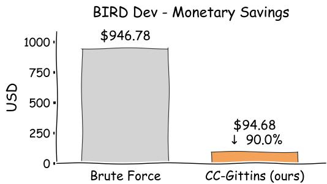

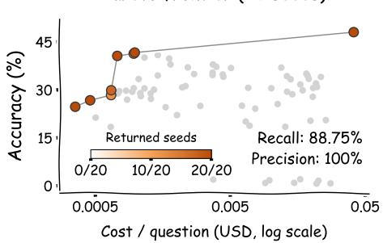  
Figure 1: At 90% lower evaluation cost than exhaustive evaluation, CC-GITTINS (ours) recovers most of the BIRD Dev Pareto frontier with no false positives (88.75% mean recall and 100% mean precision over 20 seeds).

Large language model (LLM) agents increasingly combine multiple interacting roles, such as planning, solving, searching, and verification (Hua et al., 2026; Kim et al., 2026; Jiang et al., 2026).

These roles need not use the same underlying model, and using the most capable models in every role can incur substantial deployment cost. This creates a model assignment problem—given a set of candidate models for each role, which assignments best balance end-to-end task quality, deployment cost, and, when response time matters, latency? Since one role’s output can affect the inputs and behavior of subsequent roles, an assignment’s quality generally cannot be inferred by evaluating each model in isolation. The whole workflow must be treated as the unit of evaluation.

Users may want to compare the task quality of inexpensive and more costly assignments before choosing what to deploy. A representative range of quality–cost trade-offs can support this decision without requiring every Pareto-optimal assignment to be identified.

Existing methods either report quality–cost frontiers over evaluated agent assignments (TeamBench, AgentCARD, and AgentOpt) (Kim et al., 2026; Jiang et al., 2026; Hua et al., 2026), or optimize a specified objective or constraint. In particular, AgentOpt reduces multi-objective search to singleobjective optimization using a fixed weighted-sum utility (Hua et al., 2026), SCOPE minimizes deployment cost subject to a quality threshold (Huang et al., 2026), and VineLM adapts model choices at individual invocations under cost or latency budgets (Pagonas et al., 2026). We study anytime recommendation of complete role assignments through costly evaluations, without fixing the preferred trade-off or final search cost in advance.

Exhaustive evaluation is costly: the number of assignments grows multiplicatively across roles, and each candidate must be run on multiple queries to estimate quality and deployment cost. Figure 1 illustrates quality–cost trade-offs recovered at a fraction of exhaustive evaluation cost.

A key observation is that deployment cost and evaluation cost are naturally coupled. Let $D _ { i }$ denote the mean deployment cost per query for assignment i. Evaluating a batch of B comparable queries costs approximately $\kappa _ { i } \approx B D _ { i }$ . The total search cost accumulates these charges across evaluated assignments, including those never deployed. Consequently, configurations that are expensive to deploy are also expensive to learn about.

We introduce Cost-Coupled Gittins (CC-GITTINS), a multi-objective method for anytime Pareto recommendation that exploits this coupling. For quality and cost, two search policies, called con trollers, take turns choosing evaluations: one seeks higher quality and the other lower deployment cost. The quality controller prices further evaluation using configuration-specific API costs. In the simplified model of Section 3.4, its Gittins indices rank assignments by quality minus a deployment-cost penalty, so relaxing the evaluation-price multiplier can favor different quality–cost trade-offs. The controllers share observations. After each batch, assignments nondominated under uncertainty-adjusted quality and deployment-cost estimates form the recommendation. Figure 2 gives an overview.

We evaluate CC-GITTINS through offline replay on eight quality–cost workflow benchmarks, including complete HotpotQA and MathQA assignment matrices and six SCOPE-derived instances. These benchmarks span two to five roles and up to 1,681 candidate assignments. Compared with five search baselines, CC-GITTINS achieves competitive hypervolume regret and generational distance at low search cost, although frontier coverage varies across benchmarks. We further conduct controlled ablations and evaluate the method with end-to-end latency as a third objective on HotpotQA and MathQA.

## Contributions. Our main contributions are as follows:

• We formulate model assignment in multi-role LLM workflows as anytime recommendation of a useful range of Pareto trade-offs through costly end-to-end evaluations.

• We develop CC-GITTINS, a multi-objective extension of single-objective cost-aware Gittins search for anytime Pareto recommendation. Each batch updates the recommendation, so users can stop without fixing a final search budget or preferred trade-off.

• We implement a workflow evaluation harness in AgentOpt and collect complete response matrices that jointly record task scores (accuracy or F1), input and output token counts, token-derived API costs, and end-to-end latency for each workflow execution. These records support reproducible replay against exhaustive Pareto frontiers.

• Across eight quality–cost workflow benchmarks, CC-GITTINS recovers a substantial fraction of the true Pareto frontier at roughly 10% of exhaustive evaluation cost, and most of the frontier with few false positives by 30%. We also evaluate the method with latency as a third objective.

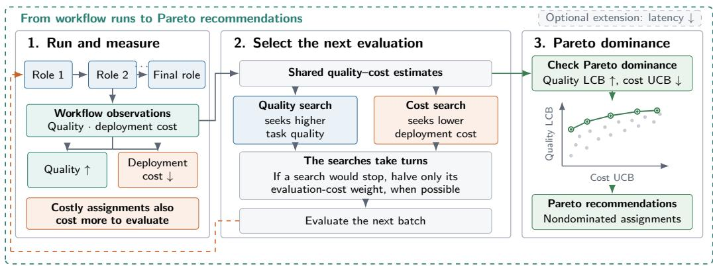  
Figure 2: Overview of CC-GITTINS in the quality–cost setting. Workflow evaluations provide quality and deployment-cost observations. Quality and cost controllers share observations, take turns choosing evaluations, and independently relax their evaluation prices. After each batch, Pareto dominance is checked using quality lower confidence bound (LCB) and cost upper confidence bound (UCB) scores. Nondominated assignments form the Pareto recommendations (green). When latency is included, additional controllers share observations and recommendations use three-objective Pareto dominance.

## 1.1 RELATED WORK

Resource-aware LLM systems. Server-side systems improve scheduling, memory use, and serving throughput (Kwon et al., 2023; Zheng et al., 2024; Luo et al., 2025). Client-side routing selects a model per request or call (Chen et al., 2023; Hu et al., 2024; Ong et al., 2025). Agent configuration search instead assigns models to interacting roles and observes an end-to-end trajectory reward. TeamBench exhaustively studies the assignments of several providers to Planner, Executor, and Verifier (Kim et al., 2026), while AgentCARD maps deployment-aware cost–accuracy frontiers over multi-role assignments (Jiang et al., 2026). These systems characterize configuration landscapes after evaluation.

Efficient LLM evaluation. BanditEval exploits low-rank response-matrix structure (Zhou et al., 2025), SySRs uses paired comparisons to identify the best model (Lyu et al., 2026), and PromptEval shares information across prompts and examples to estimate multi-prompt performance (Polo et al., 2024). Gittins indices have also been adapted to account for evaluation costs in LLM model selection (Xie et al., 2026). These methods focus on scalar performance estimation or single-objective model selection; CC-GITTINS extends cost-aware Gittins search to multi-objective Pareto recommendation for complete agent workflows.

Multi-objective LLM configuration optimization. SCOPE and VineLM consider multiple objectives through constrained optimization: SCOPE minimizes deployment cost subject to a quality threshold (Huang et al., 2026), while VineLM maximizes accuracy under cost or latency budgets (Pagonas et al., 2026). Concurrent work by Xue et al. (2026) uses a frequentist approach: empirical gap elimination for Pareto identification and hypervolume-per-cost UCB for online LLM configuration selection. Its experiments vary models, prompts, and decoding settings for accuracy– latency trade-offs under token-based evaluation budgets. We take a Bayesian approach to joint model assignment across interacting agent roles, using Gittins indices to guide cost-aware search while maintaining anytime quality–deployment-cost recommendations. Our method exploits the coupling between search and deployment costs.

Pareto-set search. General-purpose multi-objective bandits study Pareto-set identification under fixed-confidence or fixed-budget objectives (Kone et al., 2023; 2024). Hypervolume-based Bayesian optimization, including qEHVI and qNEHVI, selects evaluations by expected hypervolume improvement (Daulton et al., 2020; 2021). These methods can be sample-efficient, but their standard acquisition criterion does not explicitly price the assignment-dependent API cost of each evaluation. CC-GITTINS includes that price in its scalar indices and updates its recommendation after each batch; we assess those recommendations at matched cumulative API spend.

## 2 PARETO RECOMMENDATION AND EVALUATION

Configurations and objectives. For a given workflow, we vary the model assigned to each role while keeping its role structure and orchestration rules fixed. The workflow has roles $1 , \ldots , L$ with candidate model set $\mathcal { M } _ { \ell }$ for role ℓ. Let $\mathcal { C } = \mathcal { M } _ { 1 } \times \cdots \times \mathcal { M } _ { L }$ be the set of complete model assignments and $K = | { \mathcal { C } } |$ its size. We number these configurations $1 , \ldots , K$ ; throughout, i identifies one complete assignment. Configuration i has task quality $Q _ { i } ,$ to maximize, and mean deployment cost per query $D _ { i }$ , to minimize; Section 3.6 adds latency. Since role outputs affect subsequent execution, the full assignment is the unit of evaluation. The Pareto-optimal reference set is

$$
\mathscr { P } ^ { \star } = \{ i : \sharp j \mathrm { ~ w i t h ~ } Q _ { j } \geq Q _ { i } , D _ { j } \leq D _ { i } \mathrm { ~ a n d ~ a t ~ l e a s t ~ o n e ~ s t r i c t ~ i n e q u a l i t y } \} .\tag{1}
$$

Our goal is an anytime recommendation set offering useful coverage of quality–cost trade-offs. We assess its proximity to this reference frontier and its coverage of trade-off volume and frontier regions. For offline replay, $Q _ { i } , D _ { i }$ are the exhaustive means on the fixed N-question benchmark. These averages describe the fixed benchmark; they do not guarantee performance on new queries or under a different query distribution.

Objective scaling and search cost. To compute the evaluation metrics, we map each objective to a fixed scale where larger values are better. The resulting objective vectors lie in $[ 0 , 1 ] ^ { d } ,$ , with the origin as the hypervolume reference. In the quality–cost case, positive affine maps of $\left( Q _ { i } , - D _ { i } \right)$ give $y _ { i } = ( q _ { i } , c _ { i } ) \in [ 0 , 1 ] ^ { 2 }$ . Write $P ^ { \star } = \{ y _ { i } : i \in { \mathcal { P } } ^ { \star } \}$ . Let $\widehat { \mathcal { P } } _ { t }$ be the recommended configurations and $A _ { t } = \{ y _ { i } : i \in \widehat { \mathcal { P } } _ { t } \}$ their true objective vectors. These vectors are available to the offline evaluator, not the selector. Total search cost $\begin{array} { r } { S _ { t } = \sum _ { s < t } \kappa _ { s } } \end{array}$ sums the batch charges $\kappa _ { s }$ across all evaluated configurations. For exhaustive search cost $S _ { \mathrm { f u l l } } ^ { - }$ , the recommendation snapshot at cumulative cost fraction b is

$$
\widehat { \mathscr { P } } ( b ) = \widehat { \mathscr { P } } _ { t ( b ) } , \qquad t ( b ) = \operatorname* { m a x } \{ t : S _ { t } \leq b S _ { \mathrm { f u l l } } \} .\tag{2}
$$

These cost fractions select retrospective reporting checkpoints and are not required inputs to CC-GITTINS. A snapshot is reported only if a recommendation is available at or below the corresponding cost threshold, including warm-start cost.

Evaluation metrics. For an offline evaluator, let A be the nonempty set of recommended assignments at their true normalized coordinates, and let $d ( x , S )$ be the Euclidean distance from x to the nearest point in S. Hypervolume (HV) regret measures the volume dominated by the true frontier but not by the recommendation. Generational distance (GD) averages how far reported assignments lie from the true frontier. Inverted generational distance (IGD) averages how far true frontier points lie from the recommendation. We use

$$
R _ { \mathrm { H V } } ( A ) = \mathrm { H V } ( P ^ { \star } ) - \mathrm { H V } ( A ) ,\tag{3}
$$

$$
\operatorname { G D } ( A , P ^ { \star } ) = | A | ^ { - 1 } \sum _ { a \in A } d ( a , P ^ { \star } ) ,\tag{4}
$$

$$
\operatorname { I G D } ( A , P ^ { \star } ) = | P ^ { \star } | ^ { - 1 } \sum _ { p ^ { \star } \in P ^ { \star } } d ( p ^ { \star } , A ) .\tag{5}
$$

These average or volume measures assess recommendations at a given search spend; they do not require exact frontier recovery or limit the number of returned assignments. They are not worst-case guarantees for individual assignments or frontier regions. All three metrics evaluate the returned recommendation at its true normalized coordinates, and GD and IGD use the complete set A.

## 3 COST-COUPLED GITTINS

Our goal is to progressively identify model assignments with different quality–cost trade-offs while minimizing evaluation costs. To achieve this, CC-GITTINS uses two controllers, one focusing on quality and the other on deployment cost. The controllers take turns selecting assignments for evaluation and share their observations. After each evaluation batch, we update the recommended assignments based on Pareto dominance. We next explain how the controllers select evaluations and how the recommendations are constructed.

## 3.1 HOW EVALUATION PRICES GUIDE DEPLOYMENT TRADE-OFFS

Deployment cost affects both the quality–cost trade-off and the cost of evaluating an assignment. For comparable benchmark and deployment queries, evaluating a batch of $B$ queries for configuration i costs approximately $\kappa _ { i } \approx B D _ { i }$ . We use a positive estimate $\widehat { \kappa } _ { i } .$ , fixed after warm-up, to select evaluations, while actual API charges contribute to the cumulative search cost $S _ { t }$ . These costs may differ due to variations in query difficulty, output length, and batch size.

CC-GITTINS incorporates these evaluation costs into its Gittins indices. As a result, the quality controller considers both potential quality improvements and the cost of obtaining further observations. Since expensive assignments also cost more to evaluate, this can favor different quality–cost trade-offs. We characterize this effect in Section 3.4.

The quality controller uses task quality $Q _ { i }$ , while the cost controller uses a transformed deployment cost $\dot { C } _ { i } = \mathbf { \dot { 1 } } - D _ { i } / R$ , where $R \bar { > } 0$ is fixed after warm-up. We write

$$
Y _ { i } = ( Q _ { i } , C _ { i } ) , \qquad v _ { Q } = ( 1 , 0 ) , \quad v _ { C } = ( 0 , 1 ) .\tag{6}
$$

These coordinates are used for selecting evaluations and differ from the normalized coordinates used for offline evaluation in Section 2.

## 3.2 SHARED POSTERIOR AND GITTINS INDICES

Each evaluation batch provides observations of quality and per-query deployment cost for the selected configuration. Both controllers share these observations and update the same posterior for each configuration. For the unknown mean $\theta _ { i , j }$ of objective $j \in \{ Q , D \}$ , we use independent Gaussian posterior marginals

$$
\theta _ { i , j } \mid \mathcal { D } _ { i , n } \sim \mathcal { N } ( m _ { i , j , n } , v _ { i , j , n } ) ,
$$

where $m _ { i , j , n }$ and $v _ { i , j , n }$ denote the posterior mean and variance after n observed queries. The quality controller uses

$$
m _ { i , n } ^ { Q } = m _ { i , Q , n } , \qquad v _ { i , n } ^ { Q } = v _ { i , Q , n } ,
$$

while the cost controller uses

$$
m _ { i , n } ^ { C } = 1 - m _ { i , D , n } / R , \qquad v _ { i , n } ^ { C } = v _ { i , D , n } / R ^ { 2 } .
$$

The coupling between evaluation and deployment costs enters through evaluation prices, rather than posterior correlations. Appendix B gives the posterior calibration.

To select evaluations, each controller uses the cost-aware Gittins index of Xie et al. (2026). For controller $a \in \{ Q , C \}$ , let k index the evaluation batches of configuration $i ,$ and let $n _ { i } ( k )$ be its number of observed queries at stage k. We use the shorthand $m _ { i , k } ^ { a } = m _ { i , n _ { i } ( k ) } ^ { a }$ and $v _ { i , k } ^ { a } = v _ { i , n _ { i } ( k ) } ^ { a }$ Let $H _ { i }$ denote the completion stage.

Given an outside option $\alpha ,$ define the centered posterior mean $x = m _ { i , k } ^ { a } - \alpha$ . For a positive per-batch evaluation price $\gamma$ and a mean-zero Gaussian increment $Z _ { i , k } ^ { a }$ , the recursion is

$$
V _ { i , H _ { i } } ^ { a , \gamma } ( x ) = \operatorname* { m a x } \{ 0 , x \} ,\tag{7}
$$

$$
\begin{array} { r } { W _ { i , k } ^ { a , \gamma } ( x ) = - \gamma + \mathbb { E } [ V _ { i , k + 1 } ^ { a , \gamma } ( x + Z _ { i , k } ^ { a } ) ] , \qquad V _ { i , k } ^ { a , \gamma } ( x ) = \operatorname* { m a x } \{ 0 , W _ { i , k } ^ { a , \gamma } ( x ) \} . } \end{array}\tag{8}
$$

The increment variance is the reduction in posterior variance between consecutive stages. Evaluation may stop at intermediate stages, while terminal utility is obtained only upon completion.

Let $r _ { i , k } ^ { a } ( \gamma )$ be the zero of $W _ { i , k } ^ { a , \gamma }$ . The two controllers use

$$
G _ { i , k } ^ { Q } = m _ { i , k } ^ { Q } - r _ { i , k } ^ { Q } ( \eta _ { Q } \widehat { \kappa } _ { i } ) , \qquad G _ { i , k } ^ { C } = m _ { i , k } ^ { C } - r _ { i , k } ^ { C } ( \eta _ { C } \widehat { \kappa } _ { i } ) .\tag{9}
$$

The positive multipliers $\eta _ { Q }$ and $\eta _ { C }$ , initially one, control the evaluation-price penalties and are adjusted independently as described next. Both indices use one-dimensional dynamic programs. Appendix B gives their computation and numerical details. The two-axis design also has computational advantages. At matched evaluation counts, its mean policy runtime is lower than that of the tested three- and five-controller variants on all eight benchmarks (Fig. 15, Appendix J).

## 3.3 CONTROLLER SCHEDULING AND ASYNCHRONOUS COST RELAXATION

The cost (C) and quality (Q) controllers alternate turns in the order $C , Q .$ . Each controller $a \in$ {C, Q} uses a multiplier $\eta _ { a } ,$ initially one, to scale the estimated evaluation cost $\widehat { \kappa } _ { i }$ in its Gittins index (Eq. 9). On its turn, the controller compares the largest index among unfinished configurations with its best completed terminal value $I _ { a }$ (set $I _ { a } = - \infty$ if none is complete). If an unfinished configuration is preferred, the controller evaluates one batch and updates the shared posteriors.

Otherwise, the controller would stop at its current evaluation price. Instead, we halve only its multiplier $\eta _ { a }$ when possible, reducing the penalty for future evaluations. The other controller’s multiplier and actual API charges remain unchanged. The search terminates when both controllers reach stopping conditions that cannot be relaxed without an intervening evaluation, an external budget is reached, or all configurations are complete. The round-robin schedule balances controller turns rather than evaluation counts or API cost. Appendix B provides the numerical stopping rules.

## 3.4 WHY COST COUPLING EXPOSES QUALITY–COST TRADE-OFFS

At a fixed uncertainty schedule and remaining horizon, raising the information price lowers the scalar index (Appendix A). Coupling makes that price depend on a deployment objective. To isolate its role, consider a deterministic completion model: outcomes are known, but terminal utility still requires paying for the remaining evaluation batches.

Proposition 1 (Deterministic roles of the two exact axes). Suppose uncertainty has vanished, each unfinished configuration requires the same h remaining full batches of size B to collect terminal utility, and each batch costs exactly $\kappa _ { i } = B D _ { i }$ . Among unfinished configurations,

$$
\begin{array} { l } { { G _ { i } ^ { Q } ( \eta _ { Q } ) = Q _ { i } - \lambda _ { Q } D _ { i } , } } \\ { { { } } } \\ { { G _ { i } ^ { C } ( \eta _ { C } ) = 1 - \lambda _ { C } D _ { i } , } } \end{array}
$$

$$
\begin{array} { l } { { \lambda _ { Q } = \eta _ { Q } h B , } } \\ { { \lambda _ { C } = R ^ { - 1 } + \eta _ { C } h B > 0 . } } \end{array}\tag{10}
$$

Thus the quality axis ranks a quality–cost scalarization, while the cost axis ranks configurations by increasing deployment cost.

Coupled prices favor a more expensive assignment when $\Delta Q > \lambda _ { Q } \Delta D ;$ lowering $\eta _ { Q }$ relaxes this requirement at fixed h. This can expose supported trade-offs, meaning frontier points maximizing $Q _ { i } - \lambda D _ { i }$ for some $\lambda \geq 0 .$ , while the cost axis targets the inexpensive endpoint. Equal evaluation prices would preserve the quality ranking. Bayesian uncertainty, unequal remaining horizons, and estimated prices break this exact scalarization interpretation. Discrete price relaxation need not visit every supported point, while unsupported points lie outside this linear argument. Thus the policy has no complete-frontier recovery guarantee.

## 3.5 ANYTIME CONSERVATIVE PARETO RECOMMENDATION

Acquisition prices choose which evidence to buy; recommendations are formed from all configurations, rather than only controller winners. For the fixed N-question benchmark, let $S _ { i , j , n }$ be the sum of n observed outcomes and $\sigma _ { i } ^ { 2 }$ the frozen per-question residual variance. The predicted mean and variance of the final benchmark mean are

$$
M _ { i , j , n } = \frac { S _ { i , j , n } + ( N - n ) m _ { i , j , n } } { N } , \qquad U _ { i , j , n } = \frac { ( N - n ) ^ { 2 } v _ { i , j , n } + ( N - n ) \sigma _ { j } ^ { 2 } } { N ^ { 2 } } .\tag{11}
$$

At completion, this mean is the observed benchmark mean and its variance is zero. After only a few evaluations, however, an assignment may appear to offer high quality or low cost while its fullbenchmark means remain uncertain. Following the scalar uncertainty-penalized recommendation design of Xie et al. (2026), we form quality-LCB and cost-UCB scores for reporting:

$$
Q _ { i , n } ^ { - } = M _ { i , Q , n } - \beta \sqrt { U _ { i , Q , n } } , \qquad D _ { i , n } ^ { + } = M _ { i , D , n } + \beta \sqrt { U _ { i , D , n } } , \qquad \beta = 1 .\tag{12}
$$

For a Pareto recommendation, these paired scores define one point per assignment. Using each configuration’s current observation count $n _ { i } ,$ configuration $j$ dominates i in this score space if $\bar { Q _ { j , n _ { j } } ^ { - } } \ \geq \ Q _ { i , n _ { \ i } } ^ { - }$ and $D _ { j , n _ { i } } ^ { + } \ \leq \ D _ { i , n _ { i } } ^ { + }$ , with at least one strict inequality. Return all configurations that are nondominated under this relation. Partially evaluated configurations remain eligible, and there is no restriction to one recommendation per controller. At exhaustive completion, the recommended set equals the true benchmark frontier. The current set is available after warm-up and after each subsequent batch, allowing users to stop without specifying a final evaluation budget.

This adjustment aims to reduce unstable off-front recommendations but is not a simultaneous or time-uniform confidence certificate. It does not guarantee that every reported assignment lies near the true frontier. The single-objective Gittins results do not establish Bayes optimality for the full multi-objective search method.

## 3.6 ADDITIONAL DEPLOYMENT OBJECTIVES

The same mechanism lets an evaluation-price penalty introduce deployment cost into controllers whose terminal utilities concern other deployment objectives. With d objectives, let $z _ { i } ~ \in ~ \mathbb { R } ^ { d - 1 }$ collect non-cost desirabilities. For a linear utility $U _ { v } \bar { ( i ) } = v ^ { \top } z _ { i } , v \in \Delta ^ { \bar { d } - 2 }$ , Proposition 1’s deterministic assumptions give the ranking $v ^ { \top } z _ { i } - \lambda D _ { i } ;$ the explicit non-cost direction family has d − 2 dimensions. This dimensional count motivates, but does not guarantee the coverage of, a finite controller set.

For quality $Q _ { i } ,$ mean deployment cost $D _ { i } .$ , and mean latency $L _ { i } ,$ let $\ell _ { i } = 1 - L _ { i } / T$ , where $T > 0$ is a latency scale fixed after warm-up. Alongside the pure quality, latency, and cost controllers, our three-objective experiment adds a balanced quality–latency controller with terminal utility

$$
U _ { \mathrm { b a l } } ( i ) = \operatorname* { m i n } \{ Q _ { i } , \ell _ { i } \} , \qquad G _ { i , \mathrm { b a l } } ^ { \mathrm { d e t } } = U _ { \mathrm { b a l } } ( i ) - \lambda D _ { i } .\tag{13}
$$

This radial-min choice favors assignments that perform well on both non-cost objectives; it is not the linear midpoint $\textstyle { \frac { 1 } { 2 } } ( Q _ { i } + \ell _ { i } )$ and does not inherit the linear supported-front interpretation. All four controllers share observations and independently relax their API evaluation-cost penalties. Algorithm 1 gives the common replay procedure; Appendix C specifies the three-objective indices, recommendation rule, and metrics.

## 4 EXPERIMENTS

## 4.1 EXPERIMENTAL SETUP

Benchmarks. Our quality–cost evaluation uses eight exhaustive or replay-complete matrices across five workflow families. We evaluate $1 0 ^ { 2 } = 1 0 { \bar { 0 } }$ assignments on all 200 questions of each of HotpotQA (Yang et al., 2018) (planner and search-enabled solver) and MathQA (Amini et al., 2019) (answerer and critic). Their ten candidate models use AWS Bedrock Application Inference Profiles; Appendix D.2 lists invocation prices. Six further instances use SCOPE’s released query-level evaluations (Huang et al., 2026), covering three-to-five-role text-to-SQL, data-transformation, and data-integration workflows. These configurations form subsets of the nominal assignment spaces, each evaluated on every benchmark question. All methods replay the same complete score–cost matrices (Appendix D.1).

Evaluation protocol and metrics. The offline replay reveals only purchased observations. CC-GITTINS uses four warm questions per configuration, batches of up to four unseen questions, and two exact-axis controllers with independent price relaxation. Both quality and deployment-cost prior variances are estimated from warm-start observations. Comparisons use 20 matched question-order seeds (42–61) and charge observed API costs, including warm-up. Every 0.5 percentage points of exhaustive cost, curves aggregate each contributing seed’s latest recommendation at or below that checkpoint (Eq. (2)). Metric scales are fixed across methods and seeds. We report HV regret, GD, and IGD (Section 2), dividing HV regret by HV(P<sup>⋆</sup>) for the quality–cost plots; lower is better.

Baselines. We compare CC-GITTINS with EGE-SH for fixed-budget Pareto-set identification (Kone et al., 2024), the adaptive Pareto-exploration sampling rule of APE-k (Kone et al., 2023), and qNEHVI, a Bayesian optimization method that selects evaluations by noisy expected hypervolume improvement (Daulton et al., 2021). We also compare CC-GITTINS with two random search baselines: random questions, which evaluates all assignments on the same randomly drawn benchmark questions, and random configurations, which fully evaluates randomly drawn assignments. Appendix D.4 gives their replay protocols.

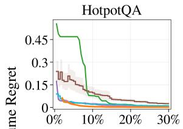

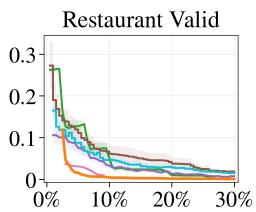

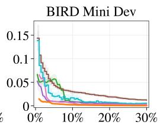

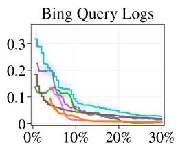

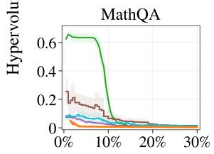

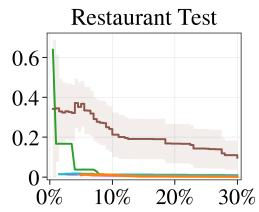

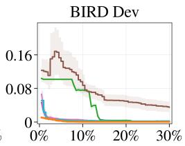  
Percentage of Exhaustive Evaluation Cost

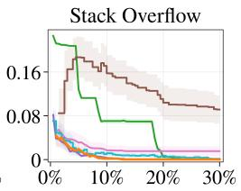

Figure 3: Hypervolume (HV) regret on eight benchmarks over 0–30% of exhaustive evaluation cost (lower is better). CC-GITTINS is generally competitive with the baselines across benchmarks and the displayed cost range. All methods use 20 matched seeds; curves report seed means and bands show ±2 standard errors.  
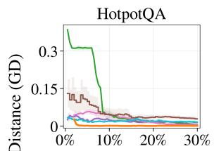

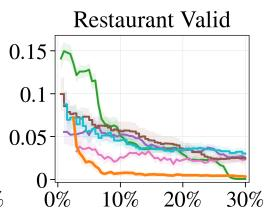

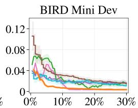

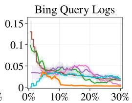

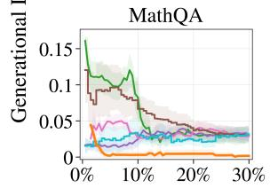

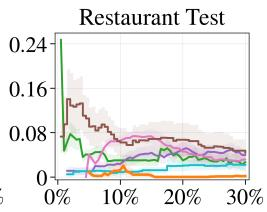

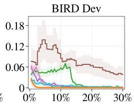  
Percentage of Exhaustive Evaluation Cost

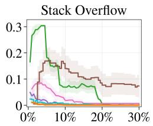  
Figure 4: Generational distance (GD) on eight benchmarks over 0–30% of exhaustive API evaluation cost (lower is better). CC-GITTINS is generally competitive with the baselines across benchmarks and the displayed cost range. Curves show seed means; bands show ±2 standard errors.

## 4.2 QUALITY–COST RESULTS

Main findings. At matched search costs up to 30% of exhaustive evaluation, CC-GITTINS is generally competitive with the five baselines in HV regret and GD across eight benchmarks (Figs. 3– 4). Partial evaluation can thus return assignments close to the exhaustive quality–cost frontier.

Recommendation example. On Stack Overflow, CC-GITTINS nearly recovers the entire frontier at 10% of exhaustive evaluation cost (mean precision 0.97, recall 0.98); both reach 1.00 at 30% (Fig. 6). Two acquisition controllers can return many trade-offs because the shared recommendation rule considers all configurations nondominated under uncertainty-adjusted estimates.

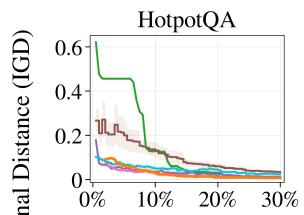

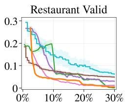

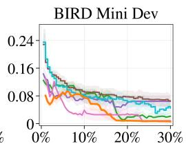

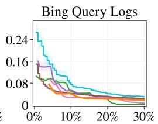

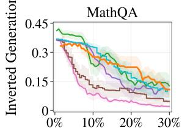

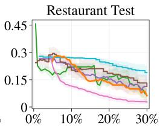

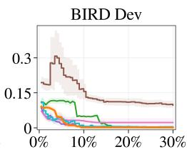

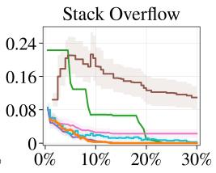

Figure 5: Inverted generational distance (IGD) on eight benchmarks over 0–30% of exhaustive API evaluation cost (lower is better). CC-GITTINS achieves competitive frontier coverage, but does not consistently outperform the baselines. Curves show seed means; bands show ±2 standard errors.  
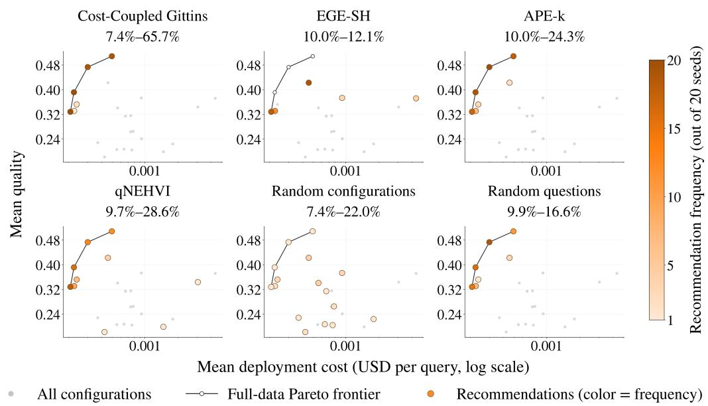

Figure 6: CC-GITTINS recovers nearly the entire Stack Overflow frontier at 10% of exhaustive API evaluation cost, with few off-front recommendations (mean precision 0.97, recall 0.98). Panels compare CC-GITTINS with five baselines using exhaustive mean quality and deployment cost to locate configurations. Gray points show the full configuration set; black lines show the full-data Pareto frontier. Colored markers indicate recommendation frequency across 20 matched seeds. The line beneath each method name reports the mean start–end interval over which the checkpoint recommendation remains stable, as a fraction of exhaustive search cost.

Coverage limitations. On HotpotQA, mean recall is 0.58 at 10% cost and 0.74 at 30%, despite precision of 0.97 and 0.99, respectively. High precision therefore coexists with incomplete frontier recovery. Low HV regret and GD likewise do not imply broad frontier coverage: competing methods achieve lower IGD on some benchmarks (Fig. 5).

Ablation findings. At the 30% cost checkpoint, combining configuration-specific evaluation prices with quality and cost controllers yields the lowest average HV regret, GD, and IGD across eight benchmarks among the cost-mechanism controls. Relative to fixed-η continuation, independent price relaxation lowers average HV regret, GD, and IGD. Additional controllers improve particular metrics but do not uniformly outperform the two-axis design (Appendix J).

Weighted-score coverage. Across all eight benchmark matrices, the supported subset (Section 3.4) loses less than 0.10% of full-frontier hypervolume despite omitting some Pareto points. This full-information oracle considers all weights, showing that weighted scores can represent most dominated area without guaranteeing CC-GITTINS’s performance under limited search cost and discrete price relaxation. Appendix E details the geometry and representative results.

## 4.3 LATENCY-AWARE THREE-OBJECTIVE EVALUATION

We evaluate the four-controller policy (Section 3.6), with direction-local η decay, on the HotpotQA and MathQA matrices across 20 matched seeds, comparing with the five baselines at matched search costs. Metric computation retains the original quality score and transforms cost and latency so that higher scores are better, using fixed benchmark-specific scales shared across methods and seeds (Appendix C). These transformations are used only to evaluate recommendations.

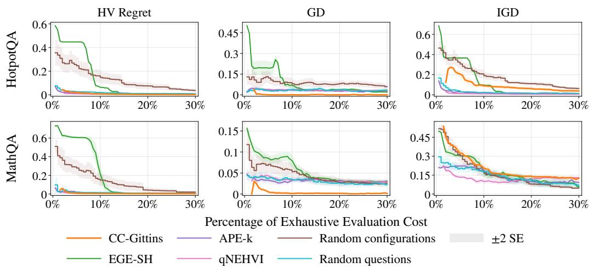  
Figure 7: Three-objective evaluation of quality, deployment cost, and latency on HotpotQA (top) and MathQA (bottom) over 0–30% of exhaustive API evaluation cost. CC-GITTINS uses four controllers. Curves show seed means; bands show ±2 standard errors.

Figure 7 shows low HV regret and GD, but several baselines achieve lower IGD over substantial search-cost ranges. Ablations vary evaluation-cost pricing, controller sets, and cost-penalty relaxation (Appendix K). Accounting for configuration-specific evaluation costs during search improves volume recovery and recommendation proximity for multi-controller variants; controller choice and relaxation have effects that vary by benchmark and metric.

## 5 DISCUSSION AND CONCLUSIONS

CC-GITTINS exploits the coupling between deployment and evaluation costs for anytime multiobjective Pareto recommendation. Across eight quality–cost benchmarks, it recovers substantial portions of the exhaustive Pareto frontier at low evaluation cost. Experiments including latency also demonstrate applicability to three-objective Pareto recommendation.

We consider static role-level assignments under fixed orchestration. Complete frontier recovery is not guaranteed, and controller design remains empirical. Future work could adapt model choices, retries, and execution paths to intermediate outcomes.

## REPRODUCIBILITY STATEMENT

Experiments use offline replay of fixed benchmark matrices without new model API calls. Appendices B–D document posterior calibration, index computation and stopping, the three-objective extension, and data sources, pricing, settings, and baselines. Plotting and ablation protocols are in Appendices I–K. Code, benchmark matrices, and replay instructions are available at https: //github.com/AgentOptimizer/agentopt-research.

## AI USE STATEMENT

The authors used generative AI tools, including LLM-based assistants, to draft and revise parts of the manuscript, improve the clarity of the writing, and assist with LAT X formatting. The tools also assisted in developing mathematical proofs by working out detailed derivations and proof steps from statements of theoretical results, proof sketches, and arguments provided by the authors. The authors checked cited sources, mathematical arguments, and AI-assisted text, revised them as needed, and take full responsibility for the paper’s contents.

Separately, LLMs are components of the agent configurations evaluated in this work. The quality– cost experiments replay HotpotQA and MathQA response matrices collected with our workflow evaluation harness and six SCOPE-derived instances; the three-objective replay uses the same two matrices with recorded latency. The replay makes no new model API calls. Appendix D.1 documents data sources and processing.

## ACKNOWLEDGEMENTS

This research received funding from DAPLab corporate support in the form of funding and/or compute from Amazon, IntellectAI, Infosys, Tidalwave, Veris, Shopify, Microsoft, Thinking Machines, Dandy, Perplexity, and Daytona. The authors also thank Wenxin Zhang for a helpful discussion and for suggestions on an earlier draft of the manuscript.

## REFERENCES

Aida Amini, Saadia Gabriel, Shanchuan Lin, Rik Koncel-Kedziorski, Yejin Choi, and Hannaneh Hajishirzi. MathQA: Towards interpretable math word problem solving with operation-based formalisms. In Proceedings ofNAACL-HLT, pp. 2357–2367, 2019. doi: 10.18653/v1/N19-1245.

Lingjiao Chen, Matei Zaharia, and James Zou. FrugalGPT: How to use large language models while reducing cost and improving performance. arXiv preprint arXiv:2305.05176, 2023.

Samuel Daulton, Maximilian Balandat, and Eytan Bakshy. Differentiable expected hypervolume improvement for parallel multi-objective Bayesian optimization. In Advances in Neural Information Processing Systems, volume 33, pp. 9851–9864, 2020. URL https://papers.neurips.cc/paper\_files/paper/2020/hash/ 6fec24eac8f18ed793f5eaad3dd7977c-Abstract.html.

Samuel Daulton, Maximilian Balandat, and Eytan Bakshy. Parallel Bayesian optimization of multiple noisy objectives with expected hypervolume improvement. In Advances in Neural Information Processing Systems, volume 34, pp. 2187–2200, 2021. URL https://proceedings.neurips.cc/paper/2021/hash/ 11704817e347269b7254e744b5e22dac-Abstract.html.

Qitian Jason Hu, Jacob Bieker, Xiuyu Li, Nan Jiang, Benjamin Keigwin, Gaurav Ranganath, Kurt Keutzer, and Shriyash Kaustubh Upadhyay. RouterBench: A benchmark for multi-LLM routing system. arXiv preprint arXiv:2403.12031, 2024.

Wenyue Hua, Sripad Karne, Qian Xie, Armaan Agrawal, Nikos Pagonas, Kostis Kaffes, and Tianyi Peng. AgentOpt v0.1 technical report: Client-side optimization for LLM-based agent. arXiv preprint arXiv:2604.06296, 2026.

Yiqian Huang, Shiqi Zhang, Tianyuan Jin, and Xiaokui Xiao. SCOPE: Cost-efficient model selection for compound AI systems under quality constraints. In Proceedings of the 32nd ACM SIGKDD Conference on Knowledge Discovery and Data Mining V. 2, pp. 1922–1931. Association for Computing Machinery, 2026. doi: 10.1145/3770855.3818067.

Yinsicheng Jiang, Liang Cheng, Yeqi Huang, Yufan Zhao, Zhan Lu, Li Dong, Wenda Li, Edoardo Ponti, and Luo Mai. Specialize roles, mix deployments: Pushing the cost–accuracy frontier of LLM agent teams. arXiv preprint arXiv:2606.20629, 2026.

Yubin Kim, Chanwoo Park, Taehan Kim, Eugene Park, Samuel Schmidgall, Salman Rahman, Chunjong Park, Cynthia Breazeal, Xin Liu, Hamid Palangi, Hae Won Park, and Daniel Mc-Duff. TeamBench: Evaluating agent coordination under enforced role separation. arXiv preprint arXiv:2605.07073, 2026.

Cyrille Kone, Emilie Kaufmann, and Laura Richert. Adaptive algorithms for relaxed Pareto set identification. In Advances in Neural Information Processing Systems, volume 36, pp. 35190–35201, 2023. doi: 10.52202/075280-1528. URL https://proceedings.neurips.cc/paper\_files/paper/2023/hash/ 6e976e7930460b5c3167a104ba8cc39c-Abstract-Conference.html.

Cyrille Kone, Emilie Kaufmann, and Laura Richert. Bandit Pareto set identification: The fixed budget setting. In Proceedings ofthe 27th International Conference on Artificial Intelligence and Statistics, volume 238 of Proceedings of Machine Learning Research, pp. 2548–2556. PMLR, 2024. URL https://proceedings.mlr.press/v238/kone24a.html.

Woosuk Kwon, Zhuohan Li, Siyuan Zhuang, Ying Sheng, Lianmin Zheng, Cody Hao Yu, Joseph E. Gonzalez, Hao Zhang, and Ion Stoica. Efficient memory management for large language model serving with PagedAttention. In Proceedings of the 29th Symposium on Operating Systems Principles, pp. 611–626, 2023.

Michael Luo, Xiaoxiang Shi, Colin Cai, Tianjun Zhang, Justin Wong, Yichuan Wang, Chi Wang, Yanping Huang, Zhifeng Chen, Joseph E. Gonzalez, et al. Autellix: An efficient serving engine for LLM agents as general programs. arXiv preprint arXiv:2502.13965, 2025.

Zifan Lyu, Chahine Nejma, Tobias Wegel, Fanny Yang, and Florian E. Dorner. Cutting LLM evaluation costs with SySRs: A bandit algorithm that provably exploits model similarity. In International Conference on Machine Learning, 2026.

Isaac Ong, Amjad Almahairi, Vincent Wu, Wei-Lin Chiang, Tianhao Wu, Joseph E. Gonzalez, M Waleed Kadous, and Ion Stoica. RouteLLM: Learning to route LLMs from preference data. In International Conference on Learning Representations, volume 2025, pp. 34433–34448, 2025.

Nikos Pagonas, Matthew Lou, Tianyi Peng, Dan Rubenstein, and Kostis Kaffes. VineLM: Trie-based fine-grained control for agentic workflows. arXiv preprint arXiv:2605.23914, 2026.

Felipe Maia Polo, Ronald Xu, Lucas Weber, Mírian Silva, Onkar Bhardwaj, Leshem Choshen, Allysson Flavio Melo de Oliveira, Yuekai Sun, and Mikhail Yurochkin. Efficient multi-prompt evaluation of LLMs. In Advances in Neural Information Processing Systems, volume 37, pp. 22483–22512, 2024. doi: 10.52202/079017-0707.

Qian Xie, Yueli He, and Nairen Cao. Efficient cost-aware LLM evaluation via Bayesian bandit Gittins indices. In ICML 2026 Workshop on Decision-Making from Offline Datasets to Online Adaptation: Black-Box Optimization to Reinforcement Learning, 2026. URL https: //arxiv.org/abs/2609.25645.

Bo Xue, Zhi Hong, Jiayi Li, Yuanyu Wan, Ji Cheng, and Shuang Qiu. Cost-aware multi-objective bandits: Theory and application to budgeted LLM configuration evaluation. arXiv preprint arXiv:2608.04333, 2026.

Zhilin Yang, Peng Qi, Saizheng Zhang, Yoshua Bengio, William Cohen, Ruslan Salakhutdinov, and Christopher D. Manning. HotpotQA: A dataset for diverse, explainable multi-hop question answering. In Proceedings of the 2018 Conference on Empirical Methods in Natural Language Processing, pp. 2369–2380, 2018. doi: 10.18653/v1/D18-1259.

Lianmin Zheng, Liangsheng Yin, Zhiqiang Xie, Chuyue Sun, Jeff Huang, Cody Hao Yu, Shiyi Cao, Christos Kozyrakis, Ion Stoica, Joseph E. Gonzalez, et al. SGLang: Efficient execution of structured language model programs. Advances in Neural Information Processing Systems, 37: 62557–62583, 2024. doi: 10.52202/079017-2000.

Jin Peng Zhou, Christian K. Belardi, Ruihan Wu, Travis Zhang, Carla P. Gomes, Wen Sun, and Kilian Q. Weinberger. On speeding up language model evaluation. In International Conference on Learning Representations (ICLR), 2025.

## A EFFECTS OF EVALUATION COSTS ON GITTINS INDICES

Price monotonicity of the scalar recursion. Fix the transition schedule and terminal stage, and take $0 < \gamma _ { 1 } \le \gamma _ { 2 }$ . At the terminal stage $V _ { H } ^ { \gamma _ { 1 } } = V _ { H } ^ { \gamma _ { 2 } } = x _ { + } . \mathrm { { I f } } V _ { k + 1 } ^ { \gamma _ { 1 } } \geq V _ { k + 1 } ^ { \gamma _ { 2 } }$ pointwise, then

$$
\begin{array} { r } { W _ { k } ^ { \gamma _ { 1 } } ( x ) = - \gamma _ { 1 } + \mathbb { E } [ V _ { k + 1 } ^ { \gamma _ { 1 } } ( x + Z _ { k } ) ] \geq - \gamma _ { 2 } + \mathbb { E } [ V _ { k + 1 } ^ { \gamma _ { 2 } } ( x + Z _ { k } ) ] = W _ { k } ^ { \gamma _ { 2 } } ( x ) . } \end{array}\tag{14}
$$

Taking the maximum with zero preserves the inequality and proves it by backward induction. Continuation values are nondecreasing in x; consequently the nonnegative-continuation set for the higher price is contained in that for the lower price, and its threshold satisfies $r _ { k } ( \gamma _ { 1 } ) \leq r _ { k } ( \gamma _ { 2 } )$ . With identical uncertainty schedules and remaining horizons, $m _ { i } ^ { Q } \geq m _ { j } ^ { Q }$ and $\widehat { \kappa } _ { i } \leq \widehat { \kappa } _ { j }$ give

$$
G _ { i } ^ { Q } - G _ { j } ^ { Q } = ( m _ { i } ^ { Q } - m _ { j } ^ { Q } ) + r _ { k } ( \eta \widehat \kappa _ { j } ) - r _ { k } ( \eta \widehat \kappa _ { i } ) \geq 0 .\tag{15}
$$

We restrict to positive prices. At exactly zero cost, a nondegenerate Gaussian transition can make continuation strictly positive at every finite $x ,$ so a finite stopping root need not exist. This also motivates the positive-price and underflow safeguards below. □

Proof of Proposition 1. With zero uncertainty, $Z _ { k } = 0$ . For $h = 0$ , the excess terminal value is $V _ { 0 } ( x ) = x _ { + } . \mathrm { I f } V _ { h - 1 } ( x ) = \operatorname* { m a x } \{ 0 , x - ( h - 1 ) \gamma \}$ , then

$$
V _ { h } ( x ) = \operatorname* { m a x } \{ 0 , - \gamma + \operatorname* { m a x } \{ 0 , x - ( h - 1 ) \gamma \} \} = \operatorname* { m a x } \{ 0 , x - h \gamma \} .\tag{16}
$$

Thus the continuation root is $h \gamma$ . With quality terminal utility $Q _ { i } ,$ the index is $G _ { i } ^ { Q } \ = \ Q _ { i } \ -$ $h \eta _ { Q } \kappa _ { i } = Q _ { i } - \eta _ { Q } h B D _ { i }$ <sub>i</sub>. With cost terminal utility $C _ { i } = 1 \stackrel { \cdot } { - } D _ { i } / R$ , the same recursion gives $G _ { i } ^ { C } = C _ { i } - h \eta _ { C } \kappa _ { i } = 1 - ( R ^ { - 1 } + \eta _ { C } h B ) D _ { i }$ . Since $R > 0$ and $\eta _ { C } > 0$ , the cost-axis coefficient is positive. Required completion is essential: if a known terminal reward could be collected immediately, paying the remaining h batches would be unnecessary. Unequal remaining horizons instead give configuration-specific penalties $\eta _ { a } h _ { i } B D _ { i }$ , not a common scalarization weight. □

## B POSTERIOR CALIBRATION AND SEARCH IMPLEMENTATION

Warm-start batches use independent seeded question orders for each configuration. The prior means are equal-weight averages of configuration warm-batch means. Quality prior variance is the sample variance of configuration warm-batch quality means, floored at $1 \bar { 0 } ^ { - 1 2 }$ . If $\bar { D } _ { i } ^ { \mathrm { w a r m } }$ is the warm-batch mean cost and $K > 1$ , use

$$
v _ { 0 , D } = \operatorname* { m a x } \left\{ \frac { 1 } { K - 1 } \sum _ { i = 1 } ^ { K } \left( \bar { D } _ { i } ^ { \mathrm { w a r m } } - \frac { 1 } { K } \sum _ { j = 1 } ^ { K } \bar { D } _ { j } ^ { \mathrm { w a r m } } \right) ^ { 2 } , 1 0 ^ { - 1 2 } R ^ { 2 } \right\} .\tag{17}
$$

Freeze calibration after warm-up and include each warm observation in the likelihood once. Empirical-Bayes reuse of warm data and the independent Gaussian approximation are modeling choices, not coverage certificates.

Equation (8) is one-dimensional on either exact axis. Only the active objective’s latent-posteriormean innovation variance enters its scalar dynamic program; the unused objective is still observed and updates the shared posterior. Root tables are cached by variance schedule, horizon, and positive effective cost. The quality and cost axes therefore do not require the expected-minimum formula or a two-dimensional radial dynamic program. The cached tables plan full-batch posterior updates; a shorter final batch uses its actual size for the observation update and API accounting. Proposition 1 assumes equal-sized, equal-price remaining batches. For acquisition, the reported implementation rounds B times each configuration’s warm-start mean deployment cost to the nearest multiplicative bin with ratio 2 and anchor $1 0 ^ { - 4 }$ USD, then applies $\eta _ { a } ;$ ; these frozen prices allow table reuse. The deployment-cost posterior and realized-dollar accounting continue to update.

Controller sets and Pareto recommendation. Algorithm 1 covers both objective settings. For quality–cost $( d = 2 )$ , the controller set is $\mathcal { A } = \{ C , \bar { Q } \}$ , visited in the order $C , Q$ , with terminal utilities $C _ { i }$ and $Q _ { i } .$ For quality–cost–latency $( d = 3 )$ , use $\mathcal { A } = \{ Q , \mathrm { b a l } , \ell , C \}$ , visited in the order Q, bal, $\ell , C$ . Here $\ell _ { i } = \dot { 1 } - \dot { L } _ { i } / T$ , with $T > 0$ frozen after warm-up, and the balanced terminal utility is min $\{ Q _ { i } , \ell _ { i } \}$ . Pure controllers use one-dimensional indices; the balanced controller uses the two-coordinate radial dynamic program described in Appendix C. Every controller has its own positive multiplier $\eta _ { a }$ and shares the observed outcomes.

The conservative Pareto recommendation rule returns configurations that are nondominated when maximizing $Q ^ { - }$ and minimizing $D ^ { + }$ from Eq. (12). For $d \ = \ 3 .$ , it also minimizes $L _ { i , n } ^ { + } ~ =$ $M _ { i , L , n } + \beta \sqrt { U _ { i , L , n } } ,$ , with the same $\beta = 1$ . Thus each purchased batch updates two or three posterior marginals, and the recommendation is formed in the corresponding objective space.

Numerical stopping rule. The replay does not impose a fixed lower bound on $\eta _ { a }$ . Let $G _ { \mathrm { m a x } } ^ { a }$ be the best unfinished index; the implementation treats $G _ { \mathrm { m a x } } ^ { a } \ \leq \ I _ { a } + \tau$ as a local stopping signal. At such a stop, let $\rho _ { a } = \mathrm { m a x } _ { i } \mathrm { u n f i n i s h e d } h _ { i } \gamma _ { i , a }$ be the largest remaining effective completion penalty, where $h _ { i }$ is the number of planned batches remaining and $\gamma _ { i , a }$ is the controller’s current effective per-batch price. The numerical threshold is

$$
\delta _ { a } = \operatorname* { m a x } \{ \tau , \epsilon _ { \mathrm { m a c h } } \operatorname* { m a x } ( 1 , | I _ { a } | , | G _ { \operatorname* { m a x } } ^ { a } | ) \} ,\tag{18}
$$

where $\epsilon _ { \mathrm { m a c h } }$ is double-precision machine epsilon and the available implementation defaults to $\tau = 1 0 ^ { - 9 }$ . If $\rho _ { a } > \delta _ { a }$ and halving keeps the multiplier and effective costs positive, the visited controller halves $\eta _ { a }$ and yields without an evaluation. Otherwise, it records a numerical stop, including when the next halving would underflow. Let $F$ collect the current numerical-stop marks. A newly purchased batch clears $F .$ . Acquisition ends when every controller in A is marked without an intervening observation, an optional external cost cap is reached, or all configurations are complete. Users may also stop after any completed batch and retain the latest recommendation. A numerical stop is not statistical certification. Algorithm 1 gives the replay rule.

```latex
Algorithm 1 CC-Gittins replay for quality–cost and quality–cost–latency
Require: configurations, objective setting d $\in \{ 2 , 3 \}$ , controller set A and visit order, batch size B,
optional external API cost cap, tolerance τ
1: acquire warm batches; freeze posterior calibration, objective scales, and $\widehat { \kappa } _ { i }$
2: set $\eta _ { a } = 1$ for every $a \in { \mathcal { A } }$ and $F = \varnothing$
3: publish the conservative Pareto set in the selected d objectives
4: while search has not been interrupted, any external cost cap permits evaluation, unfinished con
figurations remain, and $F \neq A$ do
5: a ← next controller in the specified round-robin order
6: i ← arg max<sub>j unfinished</sub> $G _ { j , k _ { j } } ^ { a } ;$ obtain completed incumbent $I _ { a }$
7: if $G _ { i , k _ { i } } ^ { a } \leq I _ { a } + \tau$ then
8: compute remaining penalty $\rho _ { a }$ and threshold $\delta _ { a }$
9: if $\rho _ { a } > \delta _ { a }$ and the next halving keeps effective costs positive then
10: $\eta _ { a } \gets \eta _ { a } / 2 ;$ remove a from $F$
11: else
12: add a to $F$
13: end if
14: continue to the next visit
15: end if
16: acquire i’s next batch, charge realized API cost, and update all d posterior marginals
17: $F \gets \emptyset ;$ publish the updated conservative Pareto set
18: end while
19: return the latest published Pareto recommendation
```

## C ADDITIONAL OBJECTIVES AND THE QUALITY–COST–LATENCY EXTENSION

Suppose $d \ge 2$ objectives include per-query deployment cost $D _ { i } ,$ , and let $z _ { i } ~ \in ~ \mathbb { R } ^ { d - 1 }$ collect the remaining higher-is-better objectives. For $v \doteq \Delta ^ { \dot { d } - 2 }$ , use terminal utility $U _ { v } ( i ) = v ^ { \top } z _ { i }$ . Under zero uncertainty, equal remaining horizon h of full batches, and exact coupling $\kappa _ { i } = B D _ { i } $ , the index ranks

$$
v ^ { \top } z _ { i } - \eta h B D _ { i } = v ^ { \top } z _ { i } - \lambda D _ { i } .\tag{19}
$$

A normalized linear weight vector over d objectives has $d - 1$ degrees of freedom. Cost coupling supplies the cost weight, leaving $d \mathrm { - 2 }$ explicit direction dimensions among non-cost objectives. This statement concerns linear scalarizations with positive total weight on non-cost objectives; a pure cost controller handles the remaining cost extreme. It does not remove unsupported-front geometry or guarantee that a discrete η schedule realizes every weight.

Quality–cost–latency controllers. Let $L _ { i }$ be mean end-to-end workflow latency in the recorded execution environment, and set $\ell _ { i } = 1 - L _ { i } / T$ using a positive scale T frozen after warm-up. The reported method has four directions in acquisition coordinate order $( Q , C , \ell ) ;$ pure quality $( 1 , 0 , 0 )$ balanced quality–latency $\textstyle { \left( { \frac { 1 } { 2 } } , 0 , { \frac { 1 } { 2 } } \right) }$ , pure latency (0, 0, 1), and pure cost $( 0 , 1 , 0 )$ . The pure directions use the corresponding scalar desirabilities. The balanced direction instead uses the radial terminal utility $\operatorname* { m i n } \{ Q _ { i } , \ell _ { i } \}$ in Eq. (13); its direction specifies equal scaling of two desirabilities, not their arithmetic mean. The choice of this intermediate direction is empirical. In particular, the linear supported-front argument above does not prove that these four controllers cover the three-objective frontier.

Posterior and acquisition. The three raw outcomes have independent Gaussian posterior marginals. Quality and cost use the scalar indices in Eq. (8); latency uses the latent-posterior transform $m _ { i , n } ^ { \ell } = 1 - m _ { i , L , n } / T$ and $v _ { i , n } ^ { \ell } = v _ { i , L , n } / T ^ { 2 }$ . For the balanced direction, the two-coordinate radial dynamic program uses the latent posterior means and variances of $( Q _ { i } , \ell _ { i } )$ and the expected minimum as its terminal reward. The finite-benchmark-mean bridge in Eq. (11) is used for recommendation. The balanced controller does not project a joint posterior onto the linear average $( Q _ { i } + \ell _ { i } ) / 2$ , and it makes no fitted cross-objective covariance claim. Each measured execution updates all three outcomes for every controller. Controllers take turns, independently relax their positive evaluation-cost penalties after local stopping signals, and charge observed token-priced API spend; latency does not price evaluation.

Recommendation and evaluation geometry. Augment Eq. (12) with $L _ { i , n } ^ { + } = M _ { i , L , n } + \beta \sqrt { U _ { i , L , n } }$ and return configurations nondominated when maximizing $Q ^ { - }$ and minimizing $D ^ { + } , L ^ { + }$ . This conservative recommendation rule retains the same heuristic status as its two-objective counterpart; the random baselines form empirical three-objective Pareto recommendations. For offline evaluation only, the true means are mapped to

$$
y _ { i } ^ { ( 3 ) } = \left( Q _ { i } , \frac { R _ { L } } { R _ { L } + L _ { i } } , \frac { R _ { D } } { R _ { D } + D _ { i } } \right) ,\tag{20}
$$

where $R _ { L }$ and $R _ { D }$ are medians of strictly positive full-data assignment means for latency and deployment cost, respectively. These nonlinear reciprocal scales never enter acquisition. Using the origin reference, we compute three-dimensional HV regret and Euclidean GD/IGD on these fixed coordinates. The complete three-dimensional frontiers have 17 points on MathQA and 23 on HotpotQA; we did not compute a three-dimensional supported-front oracle.

Experimental integration. The two three-objective replays use the complete HotpotQA and MathQA matrices (100 assignments and 200 questions each), four warm questions per assignment, batches of up to four unseen questions, and 20 paired question-order seeds. End-to-end workflow latency is the recorded per-question wall-clock time of an assignment, distinct from optimizer overhead. On a fixed 0.5-percentage-point grid, we show each seed’s latest completed checkpoint at or below the target fraction of exhaustive observed API spend, without interpolating or overspending. At each target, means and ±2 sample-standard-error bands summarize the contributing seeds, and band lower bounds are clipped at zero. The random-question baseline evaluates a shared question prefix across assignments, while random configurations evaluates complete assignment prefixes; both form empirical three-objective Pareto recommendations. These comparisons therefore include differences in both evaluation selection and recommendation rules. Figure 7 also includes threeobjective EGE-SH, APE-k, and qNEHVI.

Controlled ablations. Appendix K compares real and unit acquisition prices, single-axis and multi-direction controller sets, direction-local relaxation against fixed-price continuation, and priorvariance calibration. These controls retain the same three-objective recommendation rule and realized-dollar accounting. Their results distinguish improvements in dominated-volume recovery and recommendation proximity from improvements in frontier coverage.

## D EXPERIMENTAL SETUP AND IMPLEMENTATION DETAILS

## D.1 BENCHMARK MATRICES

Each response matrix has one row per retained role-level model assignment and one column per question. We collect complete HotpotQA and MathQA matrices by evaluating all 10<sup>2</sup> = 100 assignments of ten candidate models to two roles on all 200 questions, or 20,000 observed cells per benchmark. The two workflow settings follow those described in AgentOpt (Hua et al., 2026). The calculated exhaustive API costs are \$62.58 and \$234.34, respectively. Their full-data Pareto frontiers contain 15 and 6 assignments, and their maximum mean quality scores are 74.66% tokenlevel F1 for HotpotQA and 97.50% accuracy for MathQA. The six SCOPE matrices use fully evaluated configuration rows from SCOPE’s released per-query cache for three data-processing systems (Huang et al., 2026). Every retained SCOPE configuration has score and token records for all questions in its corresponding benchmark split. Summing the per-entry API costs over each retained configuration–question matrix gives calculated exhaustive API costs of \$2,067.38, \$946.78, \$149.24, \$14.84, \$80.15, and \$2.55 for BIRD Mini Dev, BIRD Dev, Bing Query Logs, Stack Overflow, Restaurant Valid, and Restaurant Test, respectively. These configurations cover a subset of the nominal Cartesian product of role-level model choices; we do not infer results for unobserved configurations. Table 1 reports the retained dimensions used by every compared method. Thus, the exhaustive-evaluation cost and full-data Pareto frontier for each instance refer to its retained matrix; paired development and test instances may contain different assignment sets.

Table 1: Benchmark matrices used in the eight-instance evaluation. We collected HotpotQA and MathQA observations with our workflow evaluation harness; the other six instances use SCOPE’s released evaluation records. “Configurations” counts retained role-level model assignments (the arms of the search problem), and “Questions” counts each instance’s evaluation horizon, covered by every retained configuration.
<table><tr><td>Benchmark instance</td><td>Workflow</td><td>Roles</td><td>Configurations</td><td>Questions</td></tr><tr><td>HotpotQA</td><td>Planner-solver</td><td>2</td><td>100</td><td>200</td></tr><tr><td>MathQA</td><td>Answerer-critic</td><td>2</td><td>100</td><td>200</td></tr><tr><td>BIRD Mini Dev</td><td>DIN-SQL</td><td>4</td><td>1,115</td><td>500</td></tr><tr><td>BIRD Dev</td><td>DIN-SQL</td><td>4</td><td>75</td><td>1,534</td></tr><tr><td>Bing Query Logs</td><td>UniDM-DT</td><td>5</td><td>1,681</td><td>102</td></tr><tr><td>Stack Overflow</td><td>UniDM-DT</td><td>5</td><td>23</td><td>710</td></tr><tr><td>Restaurant Valid</td><td>UniDM-DI</td><td>3</td><td>972</td><td>156</td></tr><tr><td>Restaurant Test</td><td>UniDM-DI</td><td>3</td><td>36</td><td>86</td></tr></table>

At the question level, HotpotQA uses a continuous token-level F1 score in [0, 1]. Since HotpotQA produces free-form answers, token-level F1 preserves partial credit for token overlap that binary exact match would discard. MathQA uses a binary correctness indicator, and each released per-query evaluation in the six SCOPE-derived instances likewise provides a binary task-success outcome. Consequently, configuration-level mean quality is mean F1 for HotpotQA and the empirical success rate for the other seven instances.

## D.2 MODEL PRICING AND COST ACCOUNTING

Table 2 lists the ten models in the HotpotQA and MathQA matrices and the AWS Bedrock US standard on-demand prices used for cost accounting.<sup>1</sup> Each workflow execution’s API cost is the sum, across both roles, of its recorded input and output token counts multiplied by the corresponding per-million-token rates. The GPT-5.6 Luna rate uses the US commercial short-context tier (up to

272K input tokens per request). The six SCOPE-derived matrices use the token records and model API prices in their released evaluation cache.

Table 2: AWS Bedrock US standard on-demand input and output prices used for the ten models in our HotpotQA and MathQA evaluations, in USD per million tokens.
<table><tr><td>Model</td><td>Input</td><td>Output</td></tr><tr><td>Claude Haiku 4.5</td><td>1.00</td><td>5.00</td></tr><tr><td>Claude Opus 4.6</td><td>5.00</td><td>25.00</td></tr><tr><td>DeepSeek R1</td><td>1.35</td><td>5.40</td></tr><tr><td>GPT-5.6 Luna</td><td>0.22</td><td>1.32</td></tr><tr><td>gpt-oss-120b</td><td>0.15</td><td>0.60</td></tr><tr><td>gpt-oss-20b</td><td>0.07</td><td>0.30</td></tr><tr><td>Kimi K2.5</td><td>0.60</td><td>3.00</td></tr><tr><td>Ministral 3 8B</td><td>0.15</td><td>0.15</td></tr><tr><td>Qwen3 32B</td><td>0.15</td><td>0.60</td></tr><tr><td>Qwen3 Next 80B A3B</td><td>0.15</td><td>1.20</td></tr></table>

## D.3 TWO-OBJECTIVE CC-GITTINS CONFIGURATION

In practice, evaluation queries can be run in batches of size B to reduce wall-clock latency through parallel execution; B = 1 is also valid.

Table 3: Two-objective CC-Gittins settings for the reported replay.
<table><tr><td>Component</td><td>Setting</td></tr><tr><td>Warm start / adaptive batch</td><td>4 / up to 4 questions per configuration</td></tr><tr><td>Statistical target</td><td>Mean of the fixed benchmark</td></tr><tr><td>Cost coordinates</td><td>Deployment cost (USD per query);  $C = 1 - D / R$  for acquisition</td></tr><tr><td>Directions (in visit order)</td><td>(0, 1) cost, (1, 0) quality</td></tr><tr><td>Scheduler</td><td>1:1 decision opportunities, shared observations</td></tr><tr><td>Multipliers</td><td>ηC = ηQ = 1; independent halving</td></tr><tr><td>Numerical safeguard</td><td>Precision threshold in Eq. (18); underflow check</td></tr><tr><td>Termination</td><td>Both local numerical stops, replay cost cap, or exhaustive completion</td></tr><tr><td>Recommendation</td><td>Conservative Pareto, β = 1, no set-size cap</td></tr><tr><td>Search cost accounting</td><td>Token-based API cost (USD), including warm start</td></tr></table>

## D.4 BASELINE IMPLEMENTATIONS

All five baselines use the same frozen response matrices but follow their own sampling protocols; checkpoints are aligned by realized cumulative API search cost. EGE-SH allocates observations in rounds and uses empirical Pareto gaps to halve the active assignments (Kone et al., 2024). We use the confidence-bound sampling rule of APE-k to direct observations toward uncertain Pareto comparisons; its fixed-confidence stopping condition is disabled, and sampling continues until the replay observation cap is reached or available observations are exhausted (Kone et al., 2023). qNEHVI uses a Bayesian surrogate over categorical assignment features and chooses evaluations by noisy expected hypervolume improvement (Daulton et al., 2021).

The two random search baselines differ in the sampled unit: random questions evaluates all assignments on the same randomly drawn questions, while random configurations fully evaluates randomly drawn assignments. Both recommend the empirical Pareto set from their observed outcomes.

## E SUPPORTED-FRONT ANALYSIS

The full-data supported-front analysis examines what the weighted-score family can represent on each matrix. For this analysis, HV and distances use $( Q _ { i } , 1 - \bar { D } _ { i } / ( 1 . 0 5 \operatorname* { m a x } _ { j } \bar { D _ { j } } ) )$ , with the origin as the HV reference. For HotpotQA, 6 of the 15 true Pareto points are supported. Keeping those six loses only 0.00066 of absolute hypervolume, although the furthest omitted frontier point is 0.0716 away in normalized coordinates. Stack Overflow and Restaurant Test have no unsupported frontier points. This offline oracle considers all nonnegative weights and known outcomes; it does not assess CC-GITTINS recommendations at intermediate search costs.

## F CC-GITTINS REPLAY RESULTS

Protocol and scope. CC-GITTINS uses the exact cost and quality axes (0, 1) and (1, 0), real perconfiguration acquisition costs, independent direction-local η decay, shared observations, and roundrobin controller visits. The evaluation covers eight benchmarks and seeds 42–61. HotpotQA and MathQA use the complete 10 × 10 assignment matrices.

The 0–30% curves use fixed 0.5-percentage-point targets and summarize the latest recommendation recorded at or below each target.

## F.1 RECOMMENDATION SNAPSHOTS AT COST CHECKPOINTS

Figures 9 and 10 in Appendix H show recommendation snapshots at cost checkpoints of 10% and 30% of exhaustive API evaluation cost across eight instances. Each snapshot is the latest recommendation available at or below the checkpoint on the recorded search trajectory. At 10%, the recommendation contains a small set of configurations supported by the available observations. By 30%, more configurations have narrower predictive intervals, and the set traces more of the quality– cost frontier. The quality controller can favor interior supported trade-offs through its cost penalty, while the cost controller directly explores the low-cost region. Figures 11 and 12 then compare checkpoint-estimated and exhaustive coordinates for the same seed-42 recommendation sets, separating estimation error from configuration selection.

## F.2 ABLATIONS AND INTERPRETATION

Appendix J varies one conceptual component around G0: acquisition-cost pricing, controller directions, relaxation, scheduling, or prior calibration. At the 30% checkpoint, G0 has lower mean HV regret, GD, and IGD than every cost-mechanism control. Adding a midpoint or five directions can lower HV regret or GD further, but neither improves all three metrics: G0 retains the lowest mean IGD in that family. The fixed-η no-stop control has worse HV regret, GD, and IGD than G0’s relaxation mechanism, while sequentially draining one axis underperforms round-robin independent relaxation. We report HV, GD, and IGD together since improvements in dominated area, recommendation reliability, and frontier coverage need not coincide.

## G RUNTIME RESULTS

Figure 8 compares the total wall-clock runtime of the six methods. qNEHVI has the highest mean runtime on all eight benchmarks, and the gap widens substantially on the three largest SCOPE matrices. Its mean runtime reaches 6.2 hours on Restaurant Valid, 10.4 hours on BIRD Mini Dev, and 22.5 hours on Bing Query Logs, compared with 1.1, 3.6, and 3.0 minutes for CC-GITTINS, respectively. CC-GITTINS has a mean runtime below 3.6 minutes on every benchmark. EGE-SH and APE-k also remain below 18 minutes, while the two random baselines finish in approximately 8–14 seconds. These results show that qNEHVI’s computational overhead becomes the dominant cost as the configuration matrix grows.

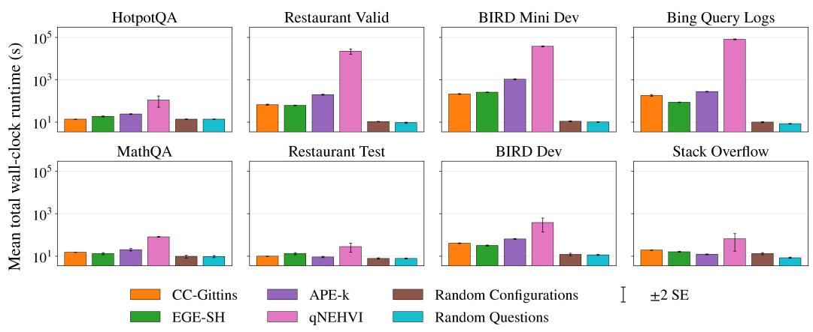  
Figure 8: Mean total wall-clock runtime of the six methods across eight benchmark instances. The vertical axis uses a base-10 logarithmic scale, with major ticks marking successive powers of ten. Bars show means and error bars show ±2 standard errors across 20 matched seeds. CC-Gittins timings cover the complete child Python process, including startup, data loading, policy computation, postprocessing, and result serialization; parent validation and Slurm queue time are excluded.

## H CC-GITTINS PARETO PLOTS

Cost-Coupled Gittins recommendations at 10% of brute-force search cost  
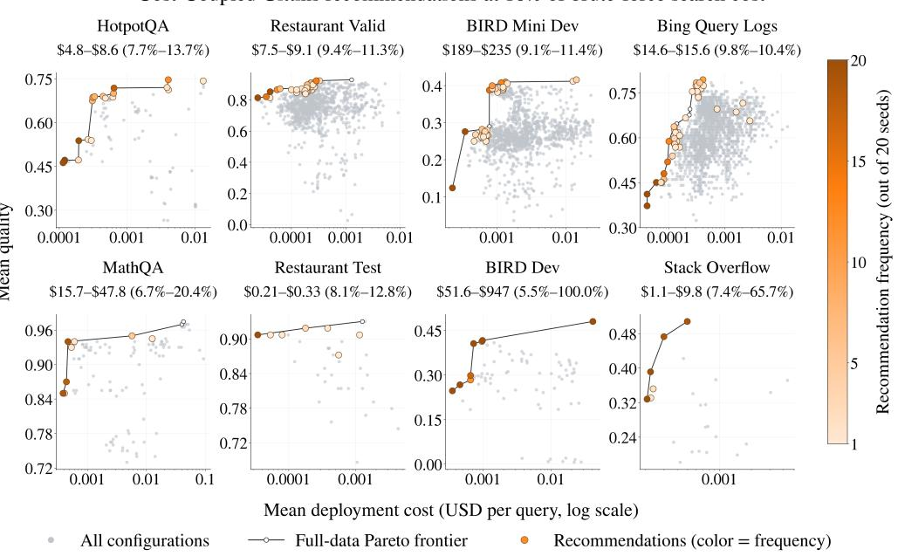

Figure 9: CC-GITTINS recommendation snapshots at the 10% checkpoint of exhaustive API evaluation cost across eight benchmark instances and 20 seeds. Each snapshot uses the latest recommendation available at or below the checkpoint. Gray points show all configurations; the black line shows the full-data Pareto frontier. Orange markers locate recommended configurations at their exhaustive mean quality and deployment cost, with color indicating recommendation frequency across seeds. The line beneath each panel title reports the mean start–end interval over which the checkpoint recommendation remains stable, first as cumulative API cost (USD) and then as a fraction of exhaustive search cost.

All configurations —— Full-data Pareto frontier Recommendations (color = frequency)

Cost-Coupled Gittins recommendations at 30% of brute-force search cost  
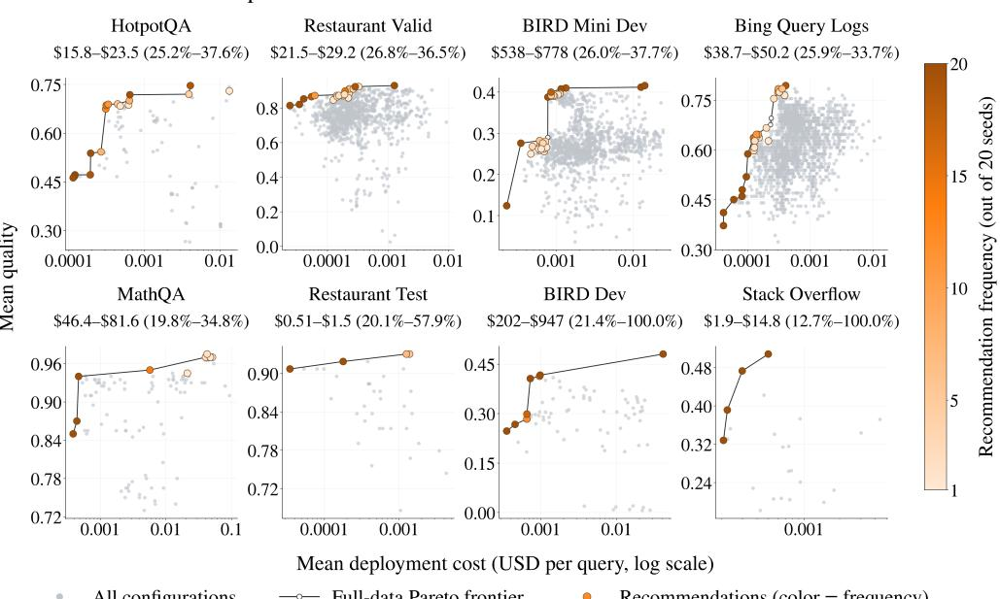  
Figure 10: CC-GITTINS recommendation snapshots at the 30% checkpoint of exhaustive API evaluation cost, displayed as in Fig. 9. Marker color gives recommendation frequency across 20 seeds; positions use exhaustive mean quality and deployment cost for retrospective comparison.

## I PARETO PLOT PROTOCOL AT COST CHECKPOINTS

For every benchmark, seed, and target $b \in \{ 0 . 1 , 0 . 3 \}$ , we select the last recommendation event whose realized cost fraction does not exceed b. The selected configurations are then placed at exhaustive raw mean quality and mean deployment cost (USD per query). These exhaustive coordinates are used only for offline evaluation and are not available to the selector.

The plot distinguishes completed from partial recommendations since their online semantics differ. A completed point has zero predictive variance for the benchmark mean and its displayed coordinate matches its recommendation estimate. A partial point is selected using Eq. (12), while its displayed exhaustive coordinate reveals estimation error. All methods use the same axis limits within a benchmark.

Figures 11 and 12 isolate estimation error from configuration selection for HotpotQA and Stack Overflow at seed 42. Within each benchmark, the actual and estimated columns contain the same recommended configuration identifiers; only their plotted coordinates change. Thus, displacement between a method’s paired panels reflects error in the online estimates available at the checkpoint rather than a change in the returned set.

Seed 42: estimations and actual values of Pareto recommendations at the 10% search-cost checkpoint  
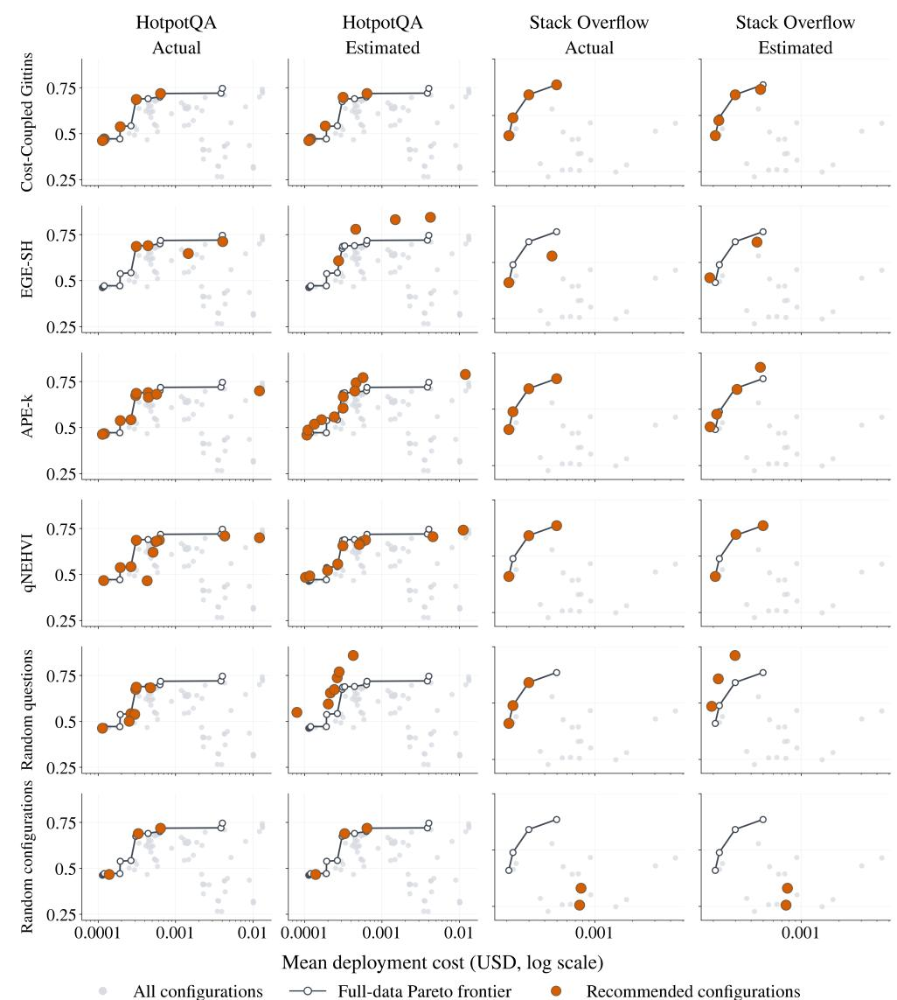  
Figure 11: Estimated and actual Pareto recommendations at the 10% search-cost checkpoint for seed 42. Rows show CC-GITTINS and the five baselines; columns show exhaustive (actual) and checkpoint-estimated coordinates for the same recommended configurations on HotpotQA and Stack Overflow. Gray points are all configurations, hollow markers and connecting lines show the exhaustive Pareto frontier, and orange points show the configurations recommended by each method.

Seed 42: estimations and actual values of Pareto recommendations at the 30% search-cost checkpoint  
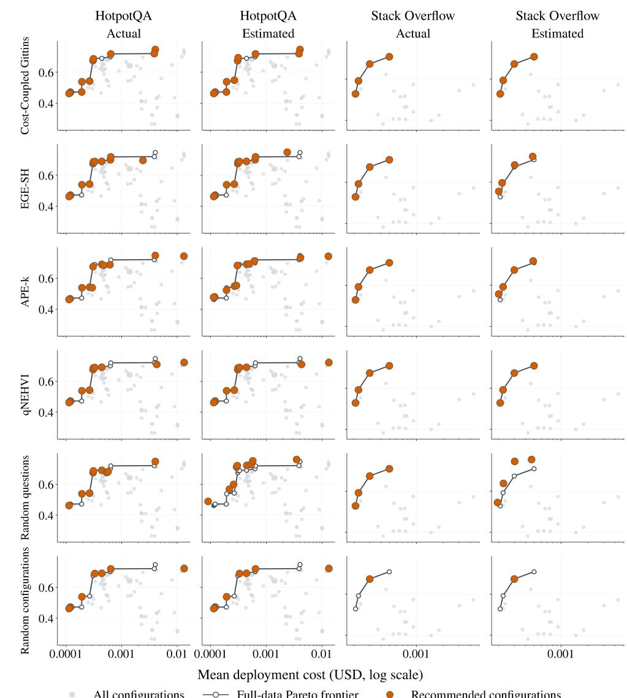  
Figure 12: Estimated and actual Pareto recommendations at the 30% search-cost checkpoint for seed 42, using the same layout and visual encoding as Fig. 11. The paired columns separate checkpoint estimation error from the choice of recommended configuration identifiers.

## J CONTROLLED CC-GITTINS ABLATIONS

Protocol. We center four one-factor families and a $2 \times 2$ prior-variance study (Fig. 18) on G0, the CC-GITTINS protocol with real per-configuration acquisition costs, independent direction-local η decay, and round-robin axis visits. The cost family compares G0 with quality-only real cost (G1), quality-only unit cost (G2), and exact axes with unit cost (G3). The direction family includes quality-only G1, deployment-only G4, G0, axes plus the midpoint (G5), and five evenly spaced directions (G6), all with real costs. The relaxation family compares G0’s independent direction-local relaxation with the fixed-η no-stop control (G7). The scheduler family compares G0 with qualitythen-deployment (G8) and deployment-then-quality (G9), which drain one axis before visiting the other.

Each configuration uses the same eight benchmark matrices, 20 seeds, model ordering, exhaustive truth vectors, recommendation rule, batch size, and cost checkpoints spanning 0–30% of exhaustive API evaluation cost. The frontier-metric grid contains thirteen configurations and 2,080 validated benchmark–seed runs. At each fixed 0.5-percentage-point target, we score each contributing seed’s last recommendation not exceeding that cost. Curves show seed means and bands show ±2 standard errors. HV regret, GD, and IGD are all lower-is-better and use the same frozen per-benchmark metric space as the primary comparison.

Cost mechanism. Figure 13 separates acquisition pricing from controller choice. G0 versus G3 and G1 versus G2 compare real with unit prices; the comparisons retain deployment-cost observations, the Pareto recommendation rule, and realized-dollar accounting. G0 versus G1 and G3 versus G2 test adding the cost controller at fixed pricing. Real prices align acquisition with monetary spend; the cost controller targets inexpensive assignments. These controls support combining both mechanisms, with benchmark-dependent gains. They assess pricing and controller choices within the coupled setting, rather than isolating the effect of the relation $\kappa _ { i } = B D _ { i }$ itself.

Directions. Figure 14 shows that extra directions redistribute evaluation effort rather than uniformly improving the recommendation. Intermediate controllers can concentrate evidence on a compact set of high-value trade-offs, improving dominated-volume recovery and recommendation proximity while weakening uniform frontier coverage. The one-axis controls show the benefit of retaining both endpoint-oriented controllers, while adding directions does not mechanically enlarge the final set because all controllers share observations and a common conservative recommendation rule forms the returned set. The frontier-metric curves compare variants at matched fractions of exhaustive API evaluation cost, whereas the runtime experiment fixes the number of evaluated matrix entries at ⌈0.30KN⌉, where K is the number of configurations and N is the number of questions in the benchmark matrix. The latter measures policy computation at equal evaluation counts rather than equal search cost. Including the single-direction controls, the runtime experiment covers five settings (Fig. 15). G0 has lower mean policy runtime than both denser direction sets on all eight benchmarks. Averaging per-benchmark runtime ratios, G5 and G6 require 1.39× and 1.74× G0’s policy time, respectively. Together with the frontier-quality controls, these results support the two-axis configuration as a trade-off between frontier recovery and policy computation.

Relaxation. Figure 16 compares G0’s independent direction-local relaxation with the fixed-η nostop control G7. In G0, a local stopping signal triggers a reduction of the visited controller’s information-price multiplier when possible, allowing configurations whose value of information was marginal at an earlier price scale to become eligible for further evaluation. G7 instead retains the initial price scale and continues without a Gittins stop. G0 achieves lower aggregate mean HV regret, GD, and IGD at the 30% checkpoint. These results support the relaxation mechanism for improving volume recovery and frontier coverage while maintaining competitive recommendation proximity; the gains vary across benchmarks.

Scheduler. Figure 17 shows that controller order affects recommendation quality at matched cumulative search cost: a sequential policy allocates early evaluations to its first controller and postpones evidence about the opposite frontier extreme. Round-robin scheduling instead balances directional attention from the outset, while shared observations allow every purchased batch to inform both controllers. This combination exposes both endpoints early enough for their evidence to shape the interior recommendation, making interleaving more robust than draining either axis first.

## J.1 COST-MECHANISM CURVES

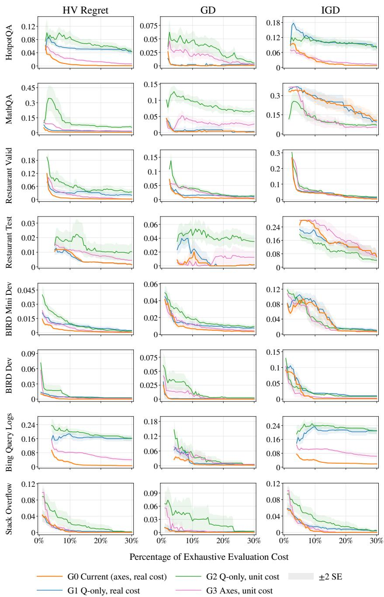  
Figure 13: Cost-mechanism ablation across eight benchmarks (lower is better). Rows group the two-, three-, four-, and five-role workflows; columns report hypervolume (HV) regret, generational distance (GD), and inverted generational distance (IGD). G0 combines real acquisition costs with quality and deployment-cost controllers and achieves the lowest aggregate mean of all three metrics at the 30% checkpoint. Its advantage over quality-only acquisition (G1, G2) and unit-cost axes (G3) is especially clear on several benchmarks, while the coverage advantage remains benchmarkdependent. Curves show seed means at fixed API cost checkpoints; shaded bands indicate ±2 standard errors.

## J.2 DIRECTION CURVES

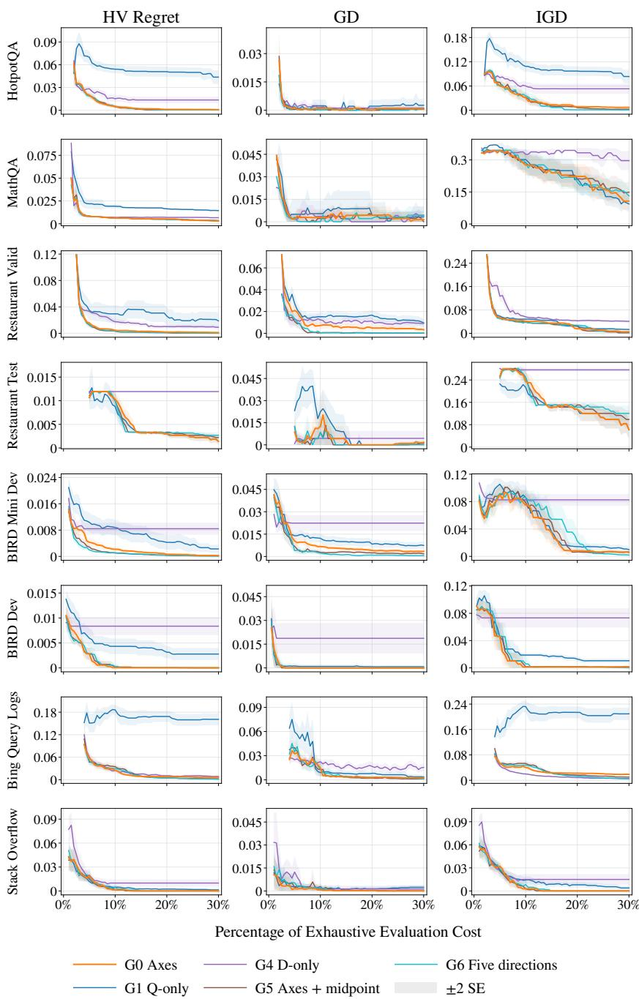

Figure 14: Direction ablation across eight benchmarks (lower is better). Columns report HV regret, GD, and IGD, and rows are ordered by workflow role count. G0 achieves competitive frontier metrics using only two exact-axis controllers and substantially improves on the single-direction controls on most benchmarks. At 30%, G0 has the lowest aggregate mean IGD; adding directions does not uniformly improve all three frontier metrics. Together with G0’s runtime relative to denser direction sets (Fig. 15), these results support the two-axis design as an economical overall choice. All variants use real acquisition costs; curves show seed means and shaded bands indicate ±2 standard errors.

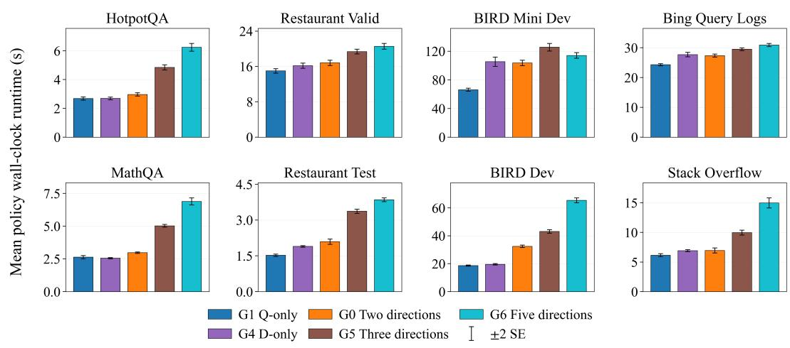  
Direction Runtime Comparison  
Figure 15: Direction-ablation policy runtime for a fixed workload of 30% of matrix entries (lower is better). The five settings are Q-only G1, deployment-only G4, exact axes G0, axes plus midpoint G5, and five evenly spaced directions G6. For every dataset and matched seed, all five evaluate exactly ⌈0.30KN⌉ entries (K configurations and N questions), with a shortened final batch when needed; runs that reach their native stopping condition earlier continue to this common cap. They run sequentially on the same compute node, with execution order rotated across seeds. G0 has lower mean policy runtime than both denser direction sets on all eight benchmarks; G5 and G6 require 1.39× and 1.74× G0’s policy time on average across benchmark ratios. Bars and error bars show means and ±2 standard errors over 20 matched seeds. The timer isolates policy computation, including construction of required DP tables with reuse only within each run, and excludes data loading, result serialization, validation, and Slurm queue time.

## J.3 RELAXATION CURVES

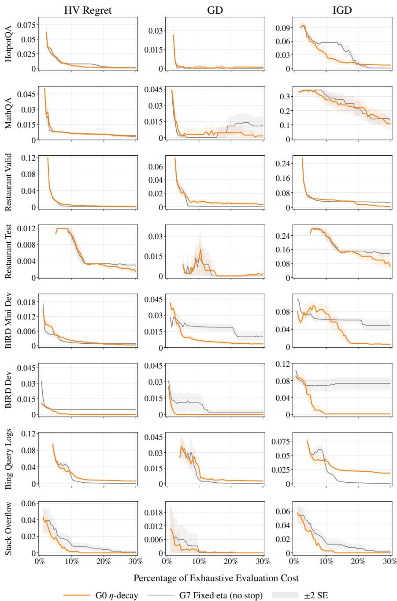  
Figure 16: Relaxation ablation across eight benchmarks (lower is better). Columns report HV regret, GD, and IGD, and rows are ordered by workflow role count. G0’s independent direction-local relaxation maintains competitive recommendation proximity and improves volume recovery and frontier coverage over the fixed-η no-stop control (G7) on several benchmarks. At 30%, G0 has lower aggregate mean HV regret, GD, and IGD, supporting our choice of the relaxation mechanism. Curves show seed means at fixed API cost checkpoints; shaded bands indicate ±2 standard errors.

## J.4 SCHEDULER CURVES

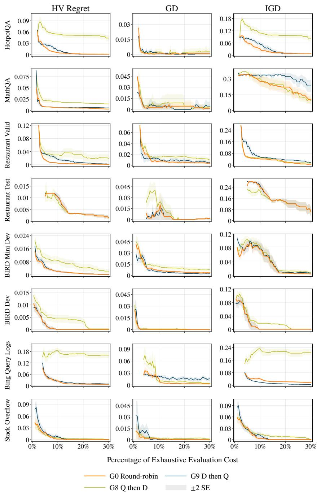  
Figure 17: Scheduler ablation across eight benchmarks (lower is better). Columns report HV regret, GD, and IGD, and rows are ordered by workflow role count. G0’s 1:1 round-robin interleaving achieves competitive recommendation quality across the displayed benchmarks and substantially improves on quality-first scheduling (G8) or deployment-first scheduling (G9) in several cases. At 30%, G0 has the lowest aggregate mean of all three metrics in this family, supporting interleaving at matched cumulative search cost while acknowledging benchmark-dependent effect sizes. Curves show seed means at fixed cost checkpoints; shaded bands indicate ±2 standard errors.

## J.5 PRIOR-VARIANCE CURVES

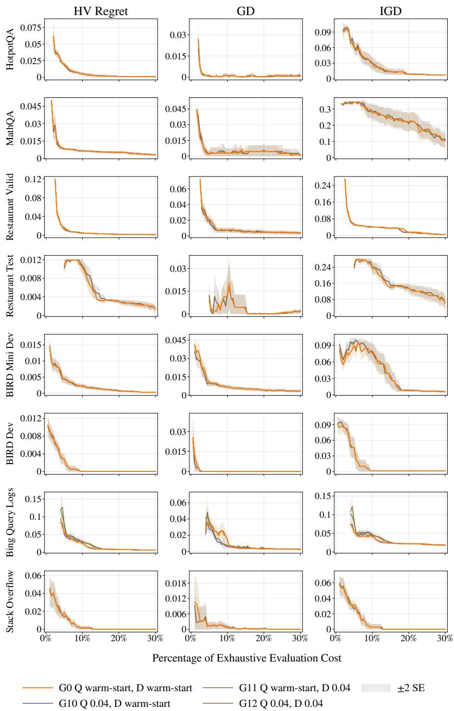  
Figure 18: Prior-variance ablation across eight benchmarks (lower is better). Rows group workflows by role count; columns report HV regret, GD, and IGD. G0 estimates both quality (Q) and deployment-cost (D) prior variances from warm-start batches to calibrate initial uncertainty to the observed data. G10 fixes only Q, G11 fixes only D, and G12 fixes both. Fixed entries use variance 0.04 in the quality or cost-desirability coordinate $C = 1 - D / R ;$ the latter corresponds to raw cost variance $0 . 0 \dot { 4 } R ^ { 2 }$ in USD squared. G0 has the lowest aggregate mean GD at 30%, while HV regret and IGD show trade-offs across settings. Prior means, observation noise, warm observations, and all other policy settings are held constant. Curves show means over 20 matched seeds; bands show ±2 standard errors.

## K CONTROLLED THREE-OBJECTIVE ABLATIONS

Protocol. We center three one-factor families and a $2 \times 2 \times 2$ prior-variance study (Fig. 23) on G0, the four-controller CC-GITTINS protocol with the Q, L, and D axes plus the balanced Q–L midpoint, real acquisition costs, independent direction-local η decay, and round-robin visits. The cost family pairs Q-only real and unit pricing (G1, G7), pure-axis real and unit pricing (G4, G8), and midpoint-augmented real and unit pricing (G0, G9). The direction family compares Q-only G1, Lonly G2, D-only G3, pure axes G4, G0, six Q–L-dense directions G5, and six three-edge directions G6, all with real costs and independent direction-local η decay. The relaxation family compares G0 with fixed $\eta = 1$ without Gittins stopping (G10). These identifiers refer to the three-objective controls throughout this section.

Each configuration uses the same complete HotpotQA and MathQA matrices, 20 paired questionorder seeds, four warm questions per assignment, batches of up to four questions, conservative threeobjective recommendation rule, and cost checkpoints spanning 0–30% of exhaustive API evaluation cost. The frontier-metric grid contains eighteen configurations and 720 benchmark–seed runs. In the legends, Q, L, and D denote quality, latency-desirability, and deployment-cost-desirability controllers; L and D correspond to ℓ and C in Appendix C. At each 0.5-percentage-point target, we score each contributing seed’s latest completed recommendation not exceeding that cost, retaining the final recommendation after a policy stops. Curves show means and ±2 standard errors. HV regret, GD, and IGD are lower-is-better and use the fixed metric space in Appendix C; GD and IGD score the complete returned set.

Cost mechanism. Figure 19 separates acquisition pricing from controller choice. G1 versus G7, G4 versus G8, and G0 versus G9 compare real with unit prices while retaining observed deployment costs, the Pareto recommendation rule, and realized-dollar accounting. Real pricing improves volume recovery and recommendation proximity for the multi-controller variants on both matrices, while coverage gains remain benchmark-dependent. These controls support cost-aware acquisition without implying that lower HV regret and GD guarantee better frontier coverage.

Directions. Figure 20 shows that additional directions redistribute evaluation effort rather than uniformly improving the recommendation. All controllers observe the same three outcomes, which a common recommendation rule uses to form the returned set. G4 interleaves the three pure axes; G0 adds the Q–L midpoint with radial utility min $\{ Q _ { i } , \ell _ { i } \}$ . G5 combines the Q–L endpoints, quarter points, and midpoint with the D axis; G6 combines the three axes with the Q–L, L–D, and Q– D midpoints. Round-robin scheduling balances decision opportunities, not purchased batches or dollars. Multi-controller search improves volume recovery over the single-direction controls. The three-edge geometry helps on HotpotQA, while pure axes remain competitive on MathQA; adding the Q–L midpoint can improve early coverage without retaining that advantage at later cost checkpoints. The preferred geometry therefore depends on the benchmark, cumulative search cost, and frontier metric.

Figure 21 compares policy computation at an equal number of evaluated entries. All tested direction sets have mean runtimes on the same tens-of-seconds scale, with G0 remaining within this range on both matrices. Together with G0’s strong hypervolume recovery and low GD (Figure 20), this modest computational overhead motivates our choice of four directions as the main configuration for the three-objective experiments.

Relaxation. Figure 22 compares G0’s independent direction-local relaxation with fixed-price continuation G10 under the same four controllers and round-robin schedule. Relaxation can favor early volume recovery or recommendation proximity, but fixed-price continuation provides better frontie coverage at the final reported checkpoint on both matrices. The coverage benefit observed in the two-objective ablation therefore does not transfer uniformly to three objectives; the continuation policy requires a separate empirical assessment.

## K.1 COST-MECHANISM CURVES

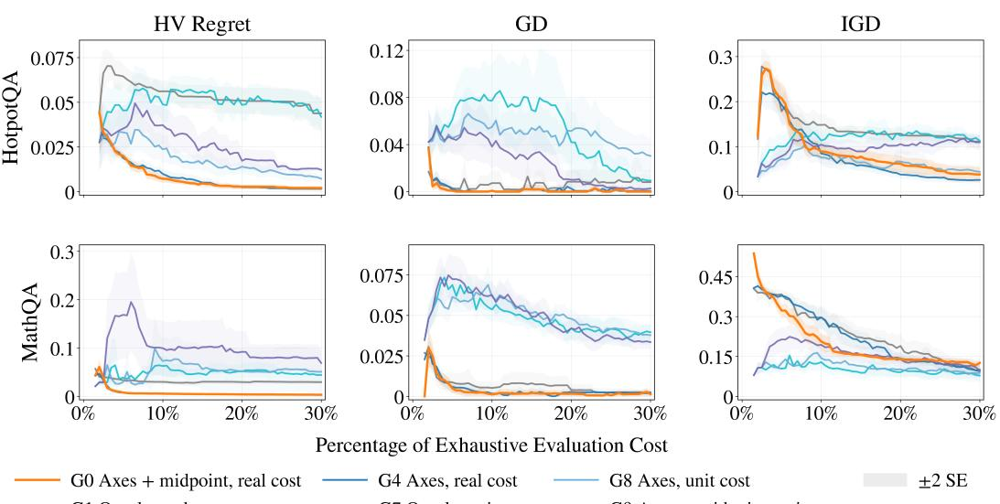  
— G1 Q-only, real cost G7 Q-only, unit cost — G9 Axes + midpoint, unit cost

Figure 19: Three-objective cost-mechanism ablation on HotpotQA (top) and MathQA (bottom). Columns report HV regret, GD, and IGD (lower is better). G0 combines real acquisition costs with four controllers and achieves lower mean HV regret and GD than its unit-cost counterpart G9 on both benchmarks at 30%. G0 also improves HotpotQA IGD, while coverage gains remain benchmarkdependent. The Q-only pair G1/G7 and pure-axis pair G4/G8 provide corresponding pricing controls. These comparisons vary only the acquisition penalty, retaining observed deployment costs, the Pareto recommendation rule, and realized-dollar accounting. Curves show seed means and bands show ±2 standard errors.

## K.2 DIRECTION CURVES

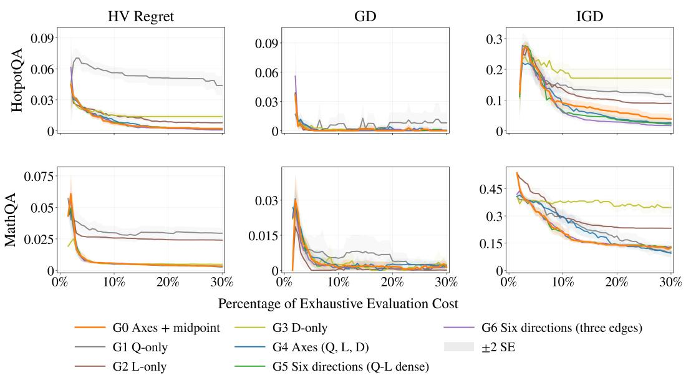

Figure 20: Three-objective direction ablation on HotpotQA (top) and MathQA (bottom). Columns report HV regret, GD, and IGD (lower is better). G0 combines the three pure axes with the Q–L midpoint, achieving strong volume recovery and low GD on both benchmarks. At 30%, its mean HV regret is lower than that of all three single-direction controls G1, G2, and G3. Increasing the direction count does not uniformly improve all three frontier metrics, and coverage remains benchmarkand budget-dependent. Together with G0’s modest policy computation overhead (Fig. 21), these results support our choice of four directions as the main three-objective configuration. All variants use real acquisition costs; curves show seed means and bands show ±2 standard errors.

Direction Runtime Comparison  
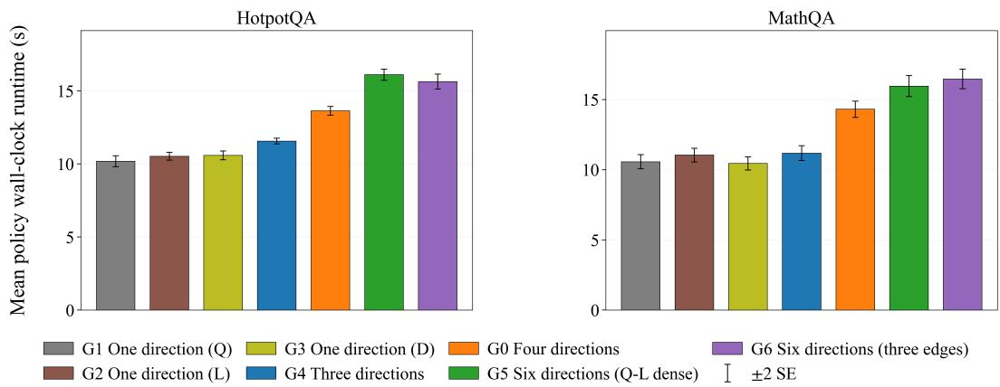  
Figure 21: Three-objective direction-ablation policy runtime for a fixed workload of 30% of matrix entries (lower is better). G0’s four-direction configuration takes 13.6 seconds on HotpotQA and 14.3 seconds on MathQA, within the 10.2–16.5-second range across all tested variants. Its mean runtime is about 2–3 seconds above the three-axis control on each matrix, indicating modest absolute computational overhead for the main configuration. For every benchmark and matched seed, all seven variants evaluate exactly $\lvert 0 . 3 0 K N \rvert = 6 { , } 0 0 0$ entries $( K = 1 0 0$ configurations and $N = 2 0 0$ questions), with a shortened final batch when needed; native stopping signals do not terminate these runs before the common cap. Bars and error bars show means and ±2 standard errors over 20 matched seeds. The timer isolates online policy computation and excludes data loading, offline oracle analysis, result serialization, and Slurm queue time. Runs use the same code and data and are independently scheduled on HPC compute nodes, so node conditions may differ.

## K.3 RELAXATION CURVES

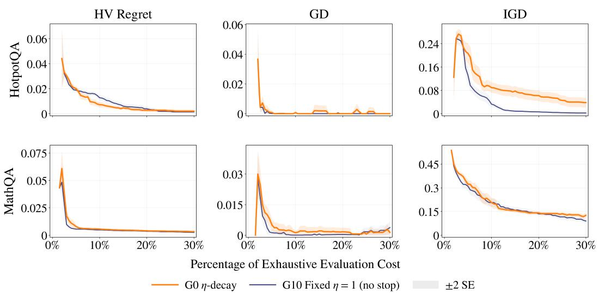  
Figure 22: Three-objective relaxation ablation on HotpotQA (top) and MathQA (bottom). Columns report HV regret, GD, and IGD (lower is better). G0 applies independent direction-local relaxation to four real-cost controllers: each multiplier starts at $\eta = 1$ and is halved after a local stopping signal when further relaxation is allowed. Compared with fixed-η = 1 no-stop control G10, G0 achieves lower HotpotQA HV regret at 10% and lower MathQA GD at 30%, illustrating gains in early volume recovery and recommendation proximity. G0 also has zero HotpotQA GD at 30%; its gains in volume recovery and recommendation proximity do not extend uniformly to frontier coverage. Both policies use equal-frequency round-robin visits; curves show seed means and bands show ±2 standard errors.

## K.4 PRIOR-VARIANCE CURVES

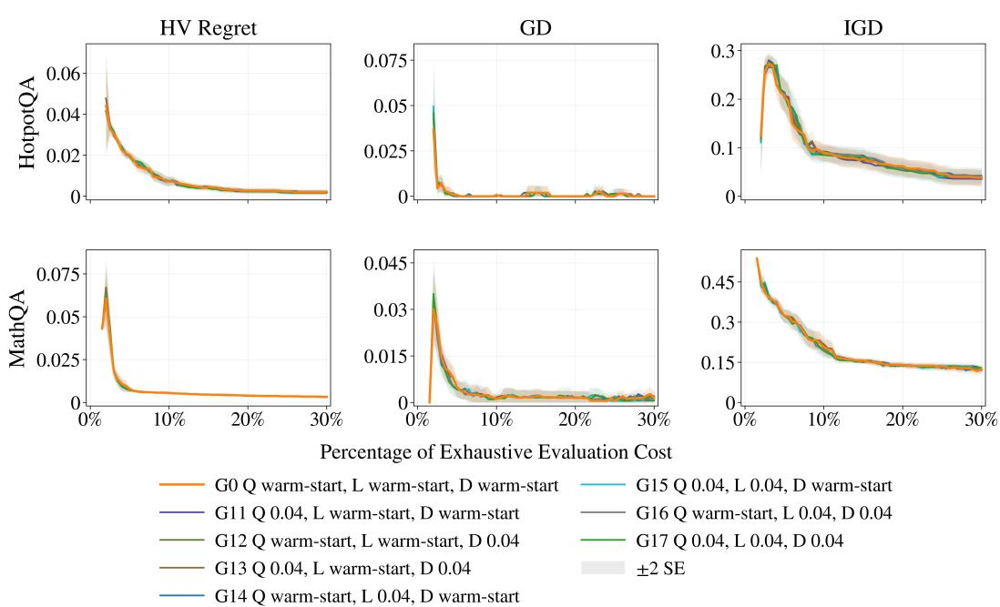

Figure 23: Three-objective prior-variance ablation on HotpotQA (top) and MathQA (bottom). Columns report HV regret, GD, and IGD (lower is better). The $2 \times 2 \times 2$ design crosses warmstart estimation and fixed variance for quality (Q), latency desirability (L), and deployment-cost desirability (D). G0 estimates all three variances from warm-start batches; G11–G17 cover the other seven combinations, as specified in the legend. Fixed entries use variance 0.04 in the corresponding desirability coordinate, equivalent to raw latency variance $0 . 0 4 T ^ { 2 }$ in seconds squared and raw cost variance $0 . 0 4 R ^ { 2 }$ in USD squared. Prior means, observation noise, warm observations, and all other policy components are held constant. At 30%, G0 has zero HotpotQA GD and low MathQA GD. HV regret and IGD show benchmark-dependent trade-offs across prior settings. The main policy uses warm-start estimates for all three priors to calibrate initial uncertainty from the observed data. Curves show means over 20 matched seeds; bands show ±2 standard errors.