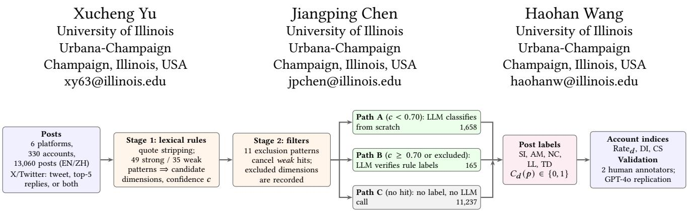
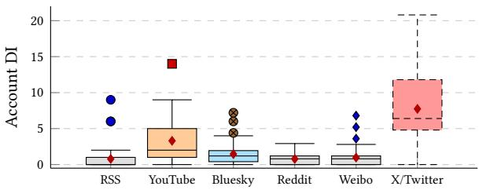
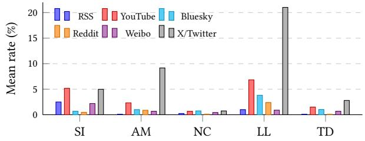
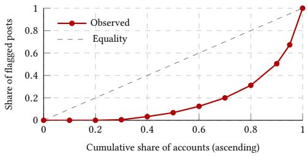
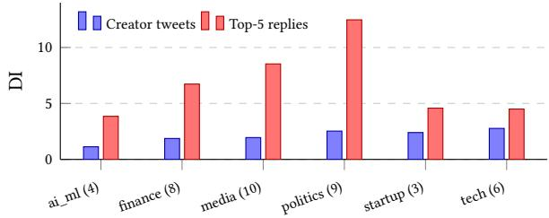

# Where Does Rhetorical Distortion Live? A Multi-Platform, Multi-Language Measurement of Influencer Content

  
Figure 1: Overview of the measurement pipeline. Lexical rules propose candidate dimensions and a confidence �, negative filters cancel weak matches in known false-positive contexts, and the post is routed to one of three paths: the LLM (GPT-4o-mini) classifies it from scratch (Path A), verifies the rule labels (Path B), or is not called (Path C). Numbers on the paths are post counts in the corpus. Post labels are aggregated into per-account rates, the Distortion Index (DI), and the Consistency Score (CS). On X/Twitter, the same pipeline is run on the merged unit, on the tweet alone, and on its replies alone.

## Abstract

Much of the manipulation in online influencer content is not false but disproportionate: an accurate fact is framed as historic, urgent, or catastrophic. Fact-checking and clickbait detection are not designed to capture such framing, and little is known about where it originates: with the creator, the topic, the platform, or the audience that replies. We operationalize rhetorical distortion through five literature-grounded dimensions (Significance Inflation, Anxiety Manufacturing, Novelty Claims, Loaded Language, and Temporal Distortion) and measure it with a three-tier pipeline in which bilingual lexical rules propose candidates, negative filters cancel known false-positive contexts, and an LLM verifies or relabels the candidates. Applying the pipeline to 13,060 posts from 330 accounts on six platforms (RSS/newsletters, YouTube, Bluesky, Reddit, Weibo, and X/Twitter), we find that platform is far more strongly associated with account-level distortion than content category (Kruskal–Wallis �2 = 0.33; two-way ANOVA �2 = 0.49 for platform vs. 0.09 for category). X/Twitter scores highest (DI 7.74 vs. 0.78 for RSS). Classifying tweets and their replies separately shows where this comes from: the reply layer readers see under a post (its top-5 replies) carries 3.5× the distortion of the tweet it answers (7.65 vs. 2.17, $ { p ^ { < 1 0 ^ { - 6 } } }$ , 36 of 43 accounts), driven by Loaded Language. At equal text length the gap shrinks to 1.5× but remains significant, and creator tweets alone are statistically indistinguishable from YouTube and Bluesky. Two independent human annotators confirm the reply gap, and the platform ordering and the reply gap replicate with GPT-4o as a second classifier. On threaded platforms, measured distortion thus lives largely in the audience layer, which motivates measurement that separates creator and reply text.

## CCS Concepts

• Information systems → Social networks; • Computing methodologies → Natural language processing; • Humancentered computing → Empirical studies in collaborative and social computing.

## Keywords

rhetorical distortion, influencer content, platform afordances, reply threads, cross-platform measurement, multilingual NLP, LLMassisted classification

## 1 Introduction

Social media influencers have become primary information intermediaries, and their content is governed by engagement metrics rather than editorial standards. Consider a commentator who accurately reports that “markets fell 0.3%” but frames it as “CATASTROPHIC COLLAPSE—act NOW.” No fact is false, so the post is invisible to fact-checking pipelines [21]. It is not clickbait either, because nothing is withheld [4, 17]. Yet the framing overstates the evidential weight of the event and tells the audience how alarmed to be. This kind of disproportionate framing shapes what audiences believe matters, and it is produced at scale on every major platform.

Computational work on online manipulation has largely targeted three other objects: the truth value of claims (misinformation), a single structural cue (clickbait), or a taxonomy of persuasion techniques built for edited news articles [7, 8, 16]. None of these measures disproportionate framing across the heterogeneous, multilingual platforms on which influencer content circulates. Moreover, existing measurements usually treat the text attached to a post as a single unit. On threaded platforms, however, what a reader sees under a creator’s post also includes the replies that the platform ranks and displays. Audience text is often uncivil [6], and audience contributions continue to reshape how a post is evaluated after it is displayed [5]. As a result, it is unclear where disproportionate framing lives: with the creator, with the topic, with the platform, or with the audience that replies.

Research questions. In this study, we measure rhetorical distortion across six platforms in two languages and ask where it is located. We address four research questions:

• RQ1: How strongly is platform associated with distortion level, relative to content category?

• RQ2: Do platforms show distinct dimension signatures, that is, do they elevate diferent kinds of distortion?

• RQ3: Do the patterns transferfrom English-language platforms to a Chinese-language platform (Weibo)?

• RQ4: Does community reply content carry more distortion than the creator posts it responds to?

Methodology. To address these questions, we first define rhetorical distortion through five dimensions grounded in rhetoric, framing, and fear-appeal theory, and aggregate them into an accountlevel Distortion Index (DI) and a separate Consistency Score (CS). We then build a three-tier detection pipeline (Figure 1). Bilingual lexical rules act as a transparent recall gate that proposes candidate dimensions, negative filters cancel matches in known false-positive contexts, and an LLM either classifies a candidate from scratch or verifies the rule labels, depending on the rules’ confidence. Posts with no rule hit are never sent to the LLM. We apply the pipeline to 13,060 posts from 330 accounts on six platforms and, on X/Twitter, classify each tweet and its top-5 replies both jointly and separately. We validate the labels with two independent human annotators, replicate the main results with a second LLM, and analyze the data with rank-based tests, a two-way ANOVA, post-level logistic regressions that control for text length, paired tests, and account fixed-efects models.

Contributions. Our analysis yields four main findings and one methodological contribution:

(i) Platform is far more strongly associated with distortion than content category $( \eta _ { p } ^ { 2 } = 0 . 4 9 \mathrm { v s . } 0 . 0 9 )$ , and the category efect is confined to X/Twitter. X/Twitter scores highest (DI 7.74), followed by YouTube (3.30).

(ii) Platforms elevate diferent dimensions: X/Twitter is dominated by Loaded Language (LL), YouTube has the highest Significance Inflation (SI), and RSS and Weibo are SI-led at low levels. Distortion is concentrated in a minority of accounts, except on X/Twitter, where it is spread across most accounts.

(iii) On X/Twitter, the reply layer carries 3.5× the distortion of the creator tweet it answers, mostly through LL. The gap is 1.5× at equal text length, is confirmed by human annotators and by a second LLM, and creator tweets alone are indistinguishable from YouTube and Bluesky.

(iv) The Weibo comparison does not support a language diference once text length, marker calibration, and account composition are taken into account, and distorted Weibo posts receive modestly more engagement than the same account’s other posts.

(v) We provide a transparent account of how the rule and LLM stages interact, show that an audit-driven revision of the rule

layer doubled agreement with human labels, and derive recommendations for distortion measurement on threaded platforms. Altogether, our findings suggest that platform-level comparisons that merge creator and audience text can substantially overstate creator distortion on threaded platforms.

## 2 Background and Related Work

Misinformation, clickbait, and propaganda. Misinformation research asks whether a claim is true and how false claims spread [21]. Clickbait detection targets headlines that withhold information to provoke clicks [4, 17]. Fine-grained propaganda detection labels techniques such as Loaded Language and Exaggeration in news articles [7, 8], and shared tasks have since extended this to multilingual framing and persuasion [16]. Earlier lexical work showed that emotional and certainty markers distinguish unreliable from reliable news [18]. We borrow these techniques but apply them to influencer accounts across platforms, and we add dimensions that propaganda taxonomies do not provide, such as temporal framing and account-level stability.

Exaggeration and hyperbole. Computational studies of exaggeration model hyperbole as a lexical and semantic phenomenon [20] and detect exaggerated causal claims in science communication [26]. Informal logic treats argumentative hyperbole as a fallacy of proportion [14]. Our SI dimension adopts this proportionality view and extends it to framing that inflates importance, urgency, novelty, or emotional intensity.

LLMs as annotators. LLMs can match or exceed crowd workers on several text-annotation tasks [11], and generative models also lower the cost of producing persuasive content at scale [13]. Rather than using an LLM as a stand-alone classifier, we use it as a verifier gated by transparent rules, report how often it overrides them, and validate its output against human annotators and a second model.

Emotion, engagement, and audience text. Emotional and moral language increases the difusion of content on social networks [2], and posts about political out-groups receive more engagement than posts about in-groups [19]. These findings imply that platforms whose ranking rewards engagement also reward the kinds of wording our LL and AM dimensions capture. Research on news comment sections finds that incivility is common in reader comments and varies with the topic and source of the article [6], and recent work on X shows that audience contributions continue to reshape how a post is evaluated after it is displayed [5]. That literature studies audience text on its own. We instead compare audience text with the creator post it answers, using the same instrument for both.

Platform afordances. Afordances are the action possibilities that a platform’s design, algorithms, and norms make available [3], and platform governance shapes what content is produced and amplified [12]. Prior work rarely measures how afordances relate to a specific rhetorical outcome across many platforms at once.

Research gap. Existing detectors are built for single platforms, single languages, or edited news, and they treat the text attached to a post as one unit. It therefore remains unknown whether disproportionate framing is primarily a property of topics, of platforms, or of the audience layer that threaded platforms attach to creator posts. Answering this requires an instrument that is applied identically across platforms and languages, that can be run separately on creator and reply text, and whose labels are validated against human judgment. This is the goal of our study.

Table 1: Dataset overview. Corpus = posts with retrievable text; analysis set = accounts with CS≥0.30 and ≥10 posts. On X/Twitter, 1,839 corpus posts (1,541 in the analysis set) have stored replies.
<table><tr><td></td><td></td><td>Platform Collection Classified unit</td><td>Accounts (corpus/anal.)</td><td>Posts (corpus/anal.)</td></tr><tr><td>RSS</td><td>public feeds post text</td><td></td><td>66 / 62</td><td>1,262 / 1,232</td></tr><tr><td>YouTube</td><td>API</td><td>title + transcript</td><td>31 / 30</td><td>601 / 600</td></tr><tr><td>Bluesky</td><td>API</td><td>post</td><td>54 / 53</td><td>2,680 /  2,630</td></tr><tr><td>Reddit</td><td>browser</td><td>title + body</td><td>57  /  56</td><td>2,670 / 2,669</td></tr><tr><td>Weibo</td><td>browser</td><td>post (ZH)</td><td>69 / 65</td><td>3,240 / 3,222</td></tr><tr><td>X/Twitter</td><td>browser</td><td>tweet + top-5 replies</td><td>53 /  43</td><td>2,607  / 2,150</td></tr><tr><td>Total</td><td></td><td></td><td>330 / 309</td><td>13,060 / 12,503</td></tr></table>

## 3 Data and Methods

This section describes the corpus (§3.1), the theoretical framework and the account-level indices (§3.2), the three-tier pipeline that produces the labels (§3.3), the decomposition of X/Twitter posts into creator and reply text (§3.4), the validation of the labels (§3.5), and the statistical models used to answer the research questions (§3.6).

## 3.1 Dataset

We selected accounts purposively on six platforms that difer in format and interaction design: RSS/newsletters (long-form, no replies), YouTube (title plus transcript excerpt), Bluesky and X/Twitter (short-form, threaded), Reddit (community-moderated), and Weibo (Chinese short-form). Accounts span ten content categories (AI/ML, finance, media, politics, tech, science, health, culture, education, and startup) and a range of expected distortion levels. For each account we collected its most recent 20–50 posts in July 2026: 20 per YouTube channel, up to 30 per RSS feed, and up to 50 elsewhere. RSS, YouTube, and Bluesky were collected through public feeds and APIs. Reddit, X/Twitter, and Weibo were collected through browser automation on publicly visible pages. For X/Twitter we also stored the text of the top-5 replies to each post as ranked by the platform.

Of the 13,219 collected posts, 13,060 (from 330 accounts) have retrievable text and form the corpus. The classification unit is the post text truncated to 800 characters (Weibo posts, which average 113 characters, are not truncated). On X/Twitter it is, by default, the tweet concatenated with its replies; in §3.4 we classify the two separately. Account-level analyses use the analysis set of accounts with CS≥0.30 and at least 10 classified posts (� = 309 accounts, 12,503 posts; X/Twitter � = 43). Table 1 summarizes the corpus.

## 3.2 Theoretical Framework and Indices

Definition. Following framing theory [9] and the treatment of hyperbole as a fallacy of proportion [14], we define rhetorical distortion as framing whose salience, urgency, novelty, or emotional intensity exceeds what the underlying information warrants. Our system does not verify the underlying evidence. It detects linguistic markers that are characteristic of such framing, so all reported rates are rates of distortion signals; we return to this distinction in §5. We organize the markers using the Aristotelian appeals [1] as operationalized for computational persuasion analysis [15]:

• SI (logos): language that inflates importance beyond evidential support, which is salience manipulation in Entman’s sense [9, 14]. Examples: “changes everything,” “once in a generation.”

• AM (pathos): fear appeals that target the reader’s own job, money, skills, or future, based on the threat-severity and susceptibility components of the Extended Parallel Process Model [24, 25]. Examples: “you will be left behind,” “hope you’re prepared.”

• NC (ethos): claims of exclusivity, hidden knowledge, or epistemic priority [10], related to unwarranted appeals to authority [8]. Examples: “nobody is talking about this.”

• LL (pathos): emotionally charged wording or typography whose intensity exceeds the content [8, 23]. Examples: “catastrophic,” insults, ALL-CAPS shouting, “!!!”.

• TD (logos): explicit urgency labels such as “BREAKING” or “just dropped,” operationalizing the timeliness dimension of information quality [22].

Coding decisions. Four decisions make the dimensions operational and are shared by the rules, the LLM prompts, and the annotation codebook. First, only the author’s own wording counts: quoted speech, headlines of linked articles reported neutrally, and self-deprecating jokes are not distortion. Second, a post may carry several dimensions, and each is judged independently. Third, an intense adjective on its own (“insane,” “staggering”) is LL, and it becomes SI only when the post also claims outsized importance; factual superlatives stated with numbers (“largest IPO on record, valued at \$3.28T”) are neither. Fourth, AM requires that the reader be the target of the threat. The author’s own fear, reports of disasters or market drops, and general political alarm do not count, and TD requires an explicit urgency label rather than mere recency.

Indices. The pipeline outputs, for every post, a binary label for each dimension; these labels are aggregated per account. For account � with posts $p _ { 1 } , . . . , p _ { n }$ and pipeline output $C _ { d } ( p _ { i } ) \in \{ 0 , 1 \}$ for dimension �, the dimension rate is Ra $\begin{array} { r } { \mathrm { t e } _ { d } ( a ) = \frac { 1 0 0 } { n } \sum _ { i } C _ { d } ( \boldsymbol { p } _ { i } ) } \end{array}$ (in percent). The five rates are the primary outcomes. The Distortion Index is their unweighted mean,

$$
\begin{array} { r } { \mathrm { D I } ( a ) = \frac 1 5 \left( \mathrm { S I } + \mathrm { A M } + \mathrm { N C } + \mathrm { L L } + \mathrm { T D } \right) , } \end{array}\tag{1}
$$

which uses equal weights in the absence of evidence for diferential weighting [22]. We analyze unrounded DI; the deployed system displays it rounded to an integer. The Consistency Score captures week-to-week stability: posts are binned by week, $\sigma _ { w }$ is the standard deviation of weekly any-dimension rates, and

$$
\mathrm { C S } ( a ) = \operatorname* { m a x } ( 0 , 1 - 2 \sigma _ { w } ) ,\tag{2}
$$

with $C S { = } 0 . 5$ when all posts fall in one week. CS does not enter DI; we use it to exclude accounts whose score would rest on one atypical week.

## 3.3 Three-Tier Classification Pipeline

The pipeline is designed around a division of labor (Figure 1). Lexical rules are cheap, transparent, and identical across platforms, but they cannot judge whether a matched phrase is used disproportionately. An LLM can make that judgment, but applying it to every post would be costly and would make the labels depend entirely on an opaque model. We therefore let the rules decide which posts are examined and let the LLM decide what the labels are. The three tiers and the routing between them are described below.

Table 2: Representative Stage-1 patterns (regular expressions abbreviated).
<table><tr><td>Strong</td><td>Weak</td></tr><tr><td>SI</td><td>changes everything; once in a most important; revolutionary; un- generation; never happened before; precedented; game changer endgame</td><td></td></tr><tr><td>AM</td><td>pared; point of no return</td><td>you&#x27;ll be left behind; hope you&#x27;re pre- too late; panic; fall behind; bubble ... burst</td></tr><tr><td>NC</td><td>media won&#x27;t tell you</td><td>nobody is talking about this; what the exclusive; hidden ... truth; hard truths</td></tr><tr><td>LL</td><td>devastating; catastrophic; insane; in- shocking; brutal; staggering; stupid; sults; profanity</td><td>ALL-CAPS; !{2,}</td></tr><tr><td>TD</td><td>breaking ... news; BREAKING; this just dropped; happening now; latest just in</td><td>update</td></tr></table>

Stage 1: lexical rules (candidate generation). The first stage proposes candidate dimensions for each post. A single bilingual rule set is applied to every platform. Each dimension has strong patterns, which are rarely used in a neutral sense (e.g., “changes everything”), and weak patterns, which are suggestive but ambiguous (e.g., “unprecedented”). The rule set contains 49 strong, 35 weak, and 11 exclusion patterns; SI and AM have the most strong patterns (13 each) and TD the fewest (6). Table 2 lists representative patterns. Any strong or weak match makes the post a candidate for the matched dimension, and the matches are summarized in a rule confidence

$$
c ( p ) = \operatorname* { m i n } ( 0 . 9 5 , \ 0 . 3 5 n _ { s } ( p ) + 0 . 1 5 n _ { w } ( p ) ) ,\tag{3}
$$

where $n _ { s }$ and $n _ { w }$ are the numbers of strong and weak matches. Two preprocessing steps implement the coding decisions. Before matching, text inside quotation marks and block quotes is removed, so quoted speech cannot trigger a rule. ALL-CAPS shouting is detected case-sensitively as two or more non-acronym words in capitals, with a whitelist of common acronyms. Chinese patterns include SI “in history”/“historic”/“milestone”, AM “crisis”/“collapse”/“panic”, NC “exclusive”/“revealed”/“inside story”, LL “shocking”/“explosive”/“scandal collapse”, and TD “breaking”/“just now” (original terms in Appendix B).

Stage 2: negative filters (false-positive suppression). Lexical markers are frequently used in contexts that are not distortion, and the second stage removes these before any LLM call. Regex exclusions cover casual time references (“this morning I. . . ”), encouragement (“never too late to learn”), technical severity terms (“critical vulnerability”), sports contexts, and, for Chinese, historical retrospectives (“on this day in history”), oficial announcements (“oficially released”), and calming language (“view it rationally”; Appendix B). A filter cancels the weak matches of its dimension but not the strong ones, so a strong marker is always passed on for verification, and the dimensions a filter excluded are recorded so that the LLM can check them for false negatives.

Table 3: Pipeline paths per platform (posts) and LLM efect on rule-flagged posts.
<table><tr><td></td><td>RSS</td><td>YT</td><td>BSky</td><td>Reddit</td><td>Weibo</td><td>X</td></tr><tr><td>Path C (no hit)</td><td>1,165</td><td>482</td><td>2,384</td><td>2,484</td><td>2,953</td><td>1,769</td></tr><tr><td>Path A (fresh LLM)</td><td>92</td><td>106</td><td>288</td><td>171</td><td>210</td><td>791</td></tr><tr><td>Path B (verify)</td><td>5</td><td>13</td><td>8</td><td>15</td><td>77</td><td>47</td></tr><tr><td>Rule-flagged</td><td>92</td><td>110</td><td>291</td><td>172</td><td>210</td><td>816</td></tr><tr><td>LLM cleared all</td><td>50</td><td>35</td><td>124</td><td>80</td><td>89</td><td>139</td></tr><tr><td>LLM changed</td><td>14</td><td>34</td><td>55</td><td>27</td><td>55</td><td>336</td></tr><tr><td>LLM kept</td><td>28</td><td>41</td><td>112</td><td>65</td><td>66</td><td>341</td></tr></table>

Stage 3: LLM verification and routing. The third stage assigns the final labels with GPT-4o-mini. Each post follows one of three paths, determined by the output of Stages 1 and 2:

$$
\mathrm { p a t h } ( p ) = \left\{ \begin{array} { l l } { \mathrm { A } } & { \mathrm { i f ~ a ~ r u l e ~ f i r e d ~ a n d ~ } c ( p ) < 0 . 7 0 , } \\ { \mathrm { B } } & { \mathrm { e l s e ~ i f ~ a ~ r u l e ~ f i r e d ~ o r ~ a ~ f i l t e r ~ e x c l u d e d } } \\ { \ } & { \mathrm { a ~ d i m e n s i o n , } } \\ { \mathrm { C } } & { \mathrm { o t h e r w i s e . } } \end{array} \right.\tag{4}
$$

In Path A, the rule evidence is weak, so the LLM classifies the post from scratch without seeing the rule output, which is intended to keep it from anchoring on ambiguous matches. In Path B, the rule evidence is strong $( c \geq 0 . 7 0 )$ or a dimension was filtered, so the LLM receives the flagged types, the matched phrases, and the excluded types, and verifies the rule labels and checks the excluded dimensions for false negatives in one call. In Path C, nothing fired, and the post is returned with no label and no LLM call. The prompts define each type with positive and negative examples in English and Chinese, restate the coding decisions, and instruct the model that most posts carry no distortion. All calls use temperature 0 and JSON output (Appendix A).

How the stages interact. Table 3 reports the path distribution on the 13,060 posts. 86.0% of posts take Path C, and no post receives a label unless a rule or a filter fired first, so the rules act as a recall gate. When the LLM is invoked, it is decisive. Of the 1,691 ruleflagged posts, it removed all labels on 30.6%, changed the label set on 30.8%, and kept it unchanged on 38.6%. A further 38 posts that only triggered a filter received labels after verification. Final rates therefore reflect LLM judgments on a rule-selected subset; §4.6 analyzes this interaction per dimension.

## 3.4 Creator–Reply Decomposition

The default X/Twitter unit merges a tweet with its top-5 replies, so its labels mix creator and audience text. To separate the two, we run the full pipeline, with identical rules, filters, paths, and prompts, a second time on each tweet alone and a third time on its replies alone. Comparing the two on the same posts yields a paired creator–audience contrast for every account. Because the reply unit concatenates up to five replies, it is longer than a tweet and has more opportunities to match a marker. We therefore also classify two length-controlled variants of the reply unit: the first reply alone, and the replies truncated to the length of the tweet they answer. These variants separate per-reply distortion from the aggregation of several replies.

Table 4: Agreement of the final pipeline with two human annotators (mean of the two). Creator text: 198 posts, population-weighted, X/Twitter scored on tweets. Replies: 60 X/Twitter reply units, unweighted; – = too few positives.
<table><tr><td></td><td></td><td>Any</td><td>Micro</td><td>SI</td><td>AM</td><td>NC</td><td>LL</td><td>TD</td></tr><tr><td rowspan="3">Creator</td><td>F1</td><td>0.56</td><td>0.46</td><td>0.50</td><td>0.03</td><td>0.09</td><td>0.49</td><td>0.87</td></tr><tr><td>Prec.</td><td>0.62</td><td>0.49</td><td>0.41</td><td>0.02</td><td>0.10</td><td>0.71</td><td>0.77</td></tr><tr><td>Rec.</td><td>0.51</td><td>0.43</td><td>0.66</td><td>0.06</td><td>0.09</td><td>0.38</td><td>1.00</td></tr><tr><td rowspan="3">Replies</td><td>F1</td><td>0.71</td><td>0.62</td><td>=</td><td>0.62</td><td></td><td>0.66</td><td></td></tr><tr><td>Prec.</td><td>0.89</td><td>0.78</td><td>一</td><td>0.50</td><td></td><td>0.92</td><td>1</td></tr><tr><td>Rec.</td><td>0.60</td><td>0.51</td><td>1</td><td>0.83</td><td></td><td>0.51</td><td></td></tr></table>

## 3.5 Validation

Human annotation. We validate the pipeline against two human annotators who labeled the five dimensions independently, using the codebook of §3.2 and blind to all system output. The main sample contains 198 posts stratified by platform and by whether any pipeline version flagged the post (33 per platform). Each stratum is weighted by its size in the corpus divided by its size in the sample, so the metrics estimate corpus-level performance. Following the codebook rule that only the author’s own wording counts, the annotators labeled each X/Twitter item for its creator tweet and not for the attached replies. We therefore score X/Twitter items against the pipeline’s tweet-only labels (§3.4) and validate the reply layer with a second sample of 60 X/Twitter reply units (the top-5 replies of the 26 sampled tweets that had replies, plus 34 posts drawn at random from the analysis set), labeled by the same two annotators. Agreement between the annotators is substantial: Cohen’s � for any dimension is 0.76 in both samples; per dimension it is 0.69 (SI), 0.56 (AM), 0.78 (LL), and 1.00 for NC and TD, which are rare (6 and 4 positives), in the main sample, and 0.76 (LL) and 0.79 (AM) for replies, where SI, NC, and TD are too rare to estimate.

Pipeline accuracy. Table 4 reports agreement with each annotator, averaged over the two. TD is the most reliable dimension (F1 0.87). SI and LL are moderate (0.50 and 0.49). For LL, precision is high (0.71) but recall is low (0.38): the pipeline misses intense wording that humans flag, so LL rates are conservative. NC (0.09) and AM (0.03) are not recovered. NC is rare and the annotators and the pipeline disagree on which posts claim exclusivity, and AM labels largely come from the LLM’s own inferences (§4.6), which the annotators rarely shared. We therefore treat NC and AM rates as exploratory and test every main result on a DI restricted to SI, LL, and TD (§4.1, §4.4). On reply units the pipeline is precise but conservative (any-dimension precision 0.89, recall 0.60), so reply distortion is, if anything, underestimated.

Audit-driven revision. The pipeline above is the result of a revision. A first audit, with an LLM annotator (Anthropic’s Claude) blind to system output, exposed defects in an initial version of the rule layer. An ALL-CAPS pattern compiled case-insensitively matched any word of four or more letters and fired on 78% of posts. An “EVERYTHING” pattern matched any “everything.” A two-weak-marker requirement kept single markers such as “unprecedented” from ever reaching the LLM. Several generic Chinese markers (“highest”/“largest”/“first”; Appendix B) fired mostly on neutral news, and a filter match vetoed an entire dimension. We fixed these defects, unified the rules across languages, and tightened the LLM definitions. The human sample above was drawn after these changes and is disjoint from the first audit. On its non-X/Twitter units, where both versions classify identical text, humanjudged any-dimension F1 rises from 0.24 for the initial pipeline to 0.52 for the final one. The LLM annotator’s own labels agree with the humans only moderately (any-dimension F1 0.60–0.61 on those units), so LLM-based audits are useful for finding defects but overstate accuracy; we report human agreement throughout.

Error analysis. The remaining errors fall into a few recurring patterns. SI false positives are mostly factual superlatives in news (records, “first” awards, “the largest model ever released”) and Chi nese markers such as “in history” and “historic” (Appendix B) in oficial reporting. AM false negatives are personal-finance video titles that address the viewer’s money without any listed marker (“Your money is about to be worth a lot less”), which never pass the rule gate. These patterns suggest that SI and AM need content-level rather than lexical cues, which we discuss in §5.

## 3.6 Estimation Models

Platform diferences (RQ1, RQ3). Account-level DI is zero-inflated (Table 5), so we test platform diferences with a Kruskal–Wallis test, reported with $\varepsilon ^ { 2 } = H / ( N - 1 )$ , and Holm-corrected pairwise Mann–Whitney tests. To compare platform and category, we fit a two-way ANOVA of DI on platform and harmonized category (10 categories, cells with $n \geq 2 , N = 3 0 0 , 4 1$ cells). Because the design is unbalanced with empty cells, we compute Type II sums of squares by nested model comparison (each main efect adjusted for the other; the interaction tested against the additive model), report partial $\eta ^ { 2 } ,$ , and repeat the test on rank-transformed DI. We report 95% bootstrap confidence intervals (5,000 resamples of accounts) for platform means and repeat the main test under nine combinations of CS threshold and minimum post count.

Text length. Longer texts ofer more opportunities to match a pattern. We therefore fit post-level logistic regressions of whether any dimension is flagged,

$$
\begin{array} { r } { \mathrm { l o g i t } P ( Y _ { \mathfrak { p } } = 1 ) = \beta _ { 0 } + \sum _ { k } \beta _ { k } \mathfrak { k } \big [ \mathrm { p l a t } ( \mathfrak { p } ) = k \big ] + \gamma \mathrm { l o g } ( \mathrm { c h a r s } _ { \mathfrak { p } } ) , } \end{array}\tag{5}
$$

with RSS as the reference platform, with and without the length term �. The same specification, with a reply indicator in place of the platform indicators, is used at the unit level for the creator–reply comparison.

Creator vs. reply text (RQ4). For each X/Twitter account we compute DI separately on its tweets and on their replies, restricted to the same posts, and compare the paired values with Wilcoxon signed-rank tests. Creator tweets and replies are compared with the other platforms using the same Holm-corrected Mann–Whitney tests as above.

Engagement. For the exploratory engagement analysis (§4.5) we estimate

$$
\log ( 1 + y _ { p } ) = \alpha _ { a ( p ) } + \beta D _ { p } + \gamma \log ( \mathrm { c h a r s } _ { p } ) + \epsilon _ { p } ,\tag{6}
$$

where $y _ { p }$ is the repost, like, or comment count of post $\mathbf { \nabla } _ { \mathcal { P } } , D _ { \mathcal { P } }$ indicates that any dimension is flagged, and $\alpha _ { a ( p ) }$ is an account fixed efect, so that comparisons are between posts of the same account. Standard errors are clustered by account.

  
Figure 2: Account-level DI by platform $\left( N = 3 0 9 \right)$ . Boxes show quartiles, whiskers extend to 1.5 IQR, dots are outlying accounts, and diamonds mark platform means. X/Twitter’s lower quartile (4.8) lies above the upper quartile of every other platform except YouTube.

Model robustness. To test whether the results depend on the LLM, we re-classify every LLM-routed post of the analysis set, and the X/Twitter tweet and reply units, with GPT-4o under identical rules, prompts, and paths, and compare platform orderings, efect sizes, and label agreement.

## 4 Results

We present the results in the order of the research questions. We start with platform and category diferences in overall distortion (RQ1, §4.1), turn to which dimensions drive them and how distortion is distributed across accounts (RQ2, §4.2), examine the Chinese language platform (RQ3, §4.3), and then decompose X/Twitter’s distortion into creator and reply text (RQ4, §4.4). We close with an exploratory engagement analysis (§4.5) and an analysis of what each pipeline stage contributes (§4.6).

## 4.1 Platform Over Category (RQ1)

Platform diferences. Distortion difers sharply by platform (Table 5; Kruskal–Wallis $H ( 5 ) = 1 0 1 . 5 , { p < 1 0 ^ { - 1 9 } , \varepsilon ^ { 2 } = 0 . 3 3 } )$ . X/Twitter has the highest DI (7.74, about 10× RSS), and 90.7% of its accounts show some signal. YouTube is second (3.30). Pairwise, X/Twitter ex ceeds every other platform (Holm $\begin{array} { r } { p \leq 0 . 0 0 2 ) } \end{array}$ , and YouTube exceeds RSS, Reddit, and Weibo $( p < 0 . 0 0 1 )$ but not Bluesky $( \wp = 0 . 0 8 )$ . RSS, Reddit, and Weibo form a low tier that does not difer internally (Holm $\begin{array} { r } { p > 0 . 0 6 ) } \end{array}$

Figure 2 shows that the diference is not driven by a few extreme accounts. The median X/Twitter account (DI 6.4) scores higher than every Reddit account and all but one account each on RSS and Weibo, whose medians are 0–0.8; the RSS and Weibo means are pulled up by three outlying accounts each. Outside X/Twitter, YouTube has the widest spread (IQR 1.0–5.0).

Platform vs. category. Content category matters far less than platform. In the two-way ANOVA, platform has a large efect $( F ( 5 , 2 5 9 ) = 5 0 . 1 6 , \ : p < 1 0 ^ { - 3 5 } , \ : \eta _ { \phi } ^ { 2 } = 0 . 4 9 )$ and category a small one $( F ( 9 , 2 5 9 ) = 2 . 9 6 , \ : p = 0 . 0 0 2 , \ : \eta _ { \phi } ^ { 2 } = 0 . 0 9 )$ , and the platform×category interaction is significant $( F ( 2 6 , 2 5 9 ) = 2 . 0 5 , \ : p = 0 . 0 0 3 , \ : \eta _ { \it { \phi } } ^ { 2 } = 0 . 1 7 )$ The category efect comes from X/Twitter. Without X/Twitter, category has no efect $( F ( 9 , 2 2 4 ) \ : = \ : 0 . 4 4 , \ : p \ : = \ : 0 . 9 1 )$ while platform remains significant $(  { p }  { \mathrm { ~ < ~ } } 1 0 ^ { - 8 } )$ , and on rank-transformed DI the category efect disappears $( p = 0 . 4 1 )$ while platform stays large $( \eta _ { p } ^ { 2 } = 0 . 3 1 )$ . Within individual platforms, categories difer significantly only on Weibo (Kruskal–Wallis $\begin{array} { r } { p = 0 . 0 4 ) } \end{array}$ . Categories therefore difer little on most platforms but spread widely on X/Twitter. For example, politics accounts average 12.6 on X/Twitter but 1.1–1.5 on Reddit and Bluesky, and finance accounts average 7.5 on X/Twitter but 0.8–1.1 on RSS, Reddit, and Weibo (Table 6). A topic, in other words, carries very diferent distortion depending on where it is published.

Robustness. We next test whether the platform efect survives alternative specifications. Excluding AM leaves the ordering unchanged (X/Twitter 7.38, YouTube 3.54, Bluesky 1.57, Weibo 1.05, RSS 0.95, Reddit $0 . 7 6 ; \varepsilon ^ { 2 } = 0 . 3 1 )$ , and so does restricting DI to the three dimensions with acceptable human agreement, SI, LL, and TD (§3.5): X/Twitter 9.60, YouTube 4.50, Bluesky 1.84, Weibo 1.25, RSS 1.19, Reddit 0.98 $( \varepsilon ^ { 2 } = 0 . 3 0 )$ . The classified text is longest on X/Twitter (521 characters) and YouTube (419). In the post-level logistic model (Eq. 5; Table 7), log length is a strong predictor (OR= 2.21). Controlling for it shrinks the platform efects but does not remove them: relative to RSS, the odds ratio falls from 10.3 to 6.2 for X/Twitter and from 4.1 to 2.8 for YouTube, and both remain $p < 0 . 0 0 1$

Bootstrap 95% confidence intervals agree with the pairwise tests: X/Twitter [6.20, 9.34] is separated from all others, YouTube [2.23, 4.53] from the low tier, Bluesky [1.10, 1.88] is intermediate, and the low tier comprises Weibo [0.70, 1.29], Reddit [0.60, 0.99], and RSS [0.43, 1.21]. The result also does not depend on the inclusion criteria (Table 8). Across nine combinations of CS threshold and minimum post count, the efect size stays between 0.29 and 0.36, the top three platforms keep the same order, and X/Twitter’s DI is 8–12 times that of RSS. Ranking the platforms with the deterministic rule stage alone gives the same top two (X/Twitter 6.78, YouTube 4.03), so the ordering is not an artifact of the LLM.

Model robustness. Re-classifying all 1,667 LLM-routed posts of the analysis set with GPT-4o (same rules, prompts, and paths) reproduces the platform ordering exactly (X/Twitter 4.49, YouTube 2.97, Bluesky 1.06, Weibo 0.72, Reddit 0.67, RSS 0.63) with a similar efect size $( \varepsilon ^ { 2 } = 0 . 2 8 )$ , and account-level DI under the two models is highly correlated (Spearman $\rho = 0 . 9 0 )$ . GPT-4o is more conservative: it flags 49.5% of the LLM-routed posts against 65.7% for GPT-4o-mini, so absolute rates, unlike the ordering, depend on the model. Label agreement between the models mirrors the human results: it is substantial for TD and LL $( \kappa = 0 . 7 0$ and 0.68), moderate for NC (0.53), and low for SI (0.36) and AM (0.11).

## 4.2 Platform Dimension Signatures (RQ2)

Having established that platforms difer in overall level, we ask which dimensions they elevate (Figure 3). X/Twitter is dominated by Loaded Language (21.0%) and AM (9.2%). YouTube is led by LL (6.8%) and has the highest SI (5.2%), which is consistent with titles and openings that sell a video as important. RSS shows mainly SI (2.5%) and almost no LL (1.0%), Bluesky and Reddit are LL-led at low levels, and Weibo is SI-led (2.2%); we qualify the Weibo pattern in §4.3.

Table 5: Account-level results by platform (� = 309 accounts with CS≥0.30 and ≥10 posts). DI is the unrounded mean of the five rates; Zero = share of accounts whose displayed (integer) DI is 0; Chars = mean length of the classified text. X/Twitter units are tweets with their top-5 replies (see §4.4 for the split). Bold marks the highest value per column.
<table><tr><td>Platform</td><td>Accts</td><td>Posts</td><td>Chars</td><td>DI</td><td>SD</td><td>Zero</td><td>SI%</td><td>AM%</td><td>NC%</td><td>LL%</td><td>TD%</td></tr><tr><td>RSS/Newsletter</td><td>62</td><td>1,232</td><td>255</td><td>0.78</td><td>1.60</td><td>59.7%</td><td>2.49</td><td>0.08</td><td>0.24</td><td>1.00</td><td>0.08</td></tr><tr><td>YouTube</td><td>30</td><td>600</td><td>419</td><td>3.30</td><td>3.43</td><td>16.7%</td><td>5.17</td><td>2.33</td><td>0.67</td><td>6.83</td><td>1.50</td></tr><tr><td>Bluesky</td><td>53</td><td>2,630</td><td>191</td><td>1.46</td><td>1.46</td><td>28.3%</td><td>0.69</td><td>1.00</td><td>0.75</td><td>3.81</td><td>1.02</td></tr><tr><td>Reddit</td><td>56</td><td>2,669</td><td>201</td><td>0.78</td><td>0.74</td><td>48.2%</td><td>0.47</td><td>0.87</td><td>0.11</td><td>2.39</td><td>0.07</td></tr><tr><td>Weibo</td><td>65</td><td>3,222</td><td>113</td><td>0.97</td><td>1.23</td><td>43.1%</td><td>2.19</td><td>0.68</td><td>0.43</td><td>0.89</td><td>0.68</td></tr><tr><td>X/Twitter</td><td>43</td><td>2,150</td><td>521</td><td>7.74</td><td>5.30</td><td>9.3%</td><td>4.98</td><td>9.16</td><td>0.74</td><td>21.02</td><td>2.79</td></tr><tr><td>All</td><td>309</td><td>12,503</td><td>一</td><td>2.15</td><td>3.43</td><td>37.5%</td><td>一</td><td>一</td><td>一</td><td>一</td><td>一</td></tr></table>

Table 6: Mean DI by harmonized category and platform (accounts in parentheses; $N \ : = \ : 3 0 9 )$ . Chinese categories (e.g., finance\_cn) are merged with their English counterparts. Minor categories are merged as follows: crypto into finance; learning into education; lifestyle, rationalism, and sports into culture; marketing into startup; tech\_media and tech\_edu into tech.
<table><tr><td></td><td>RSS</td><td>YT</td><td>BSky</td><td>Reddit</td><td>Weibo</td><td>X</td></tr><tr><td>ai_ml</td><td>0.2 (11)</td><td>1.0 (3)</td><td>0.0 (2)</td><td>0.7 (6)</td><td>2.8 (5)</td><td>3.6 (4)</td></tr><tr><td>culture</td><td>1.1 (7)</td><td>1.0 (1)</td><td>2.4 (9)</td><td>0.6 (11)</td><td>0.5 (12)</td><td>1</td></tr><tr><td>education</td><td>1.0 (2)</td><td>4.3 (6)</td><td></td><td>0.1 (3)</td><td></td><td></td></tr><tr><td>finance</td><td>0.9 (12)</td><td>5.8 (4)</td><td>0.0 (1)</td><td>1.1 (12)</td><td>0.8 (18)</td><td>7.5 (8)</td></tr><tr><td>health</td><td>0.0 (3)</td><td></td><td>1.6 (2)</td><td>0.0 (1)</td><td>0.0 (1)</td><td>6.4 (1)</td></tr><tr><td>media</td><td></td><td>2.7 (3)</td><td>1.3 (20)</td><td>0.4 (2)</td><td>1.1 (11)</td><td>7.8 (10)</td></tr><tr><td>politics</td><td></td><td>6.0 (1)</td><td>1.5 (6)</td><td>1.1 (7)</td><td></td><td>12.6 (9)</td></tr><tr><td>science</td><td></td><td>1.0 (2)</td><td>1.6 (5)</td><td>0.9 (8)</td><td>0.7 (4)</td><td>7.4 (2)</td></tr><tr><td>startup</td><td>0.5 (2)</td><td>2.0 (1)</td><td></td><td>0.8 (1)</td><td>0.0 (1)</td><td>4.9 (3)</td></tr><tr><td>tech</td><td>0.9 (25) 3.1 (9)</td><td></td><td>1.1 (8)</td><td>0.6 (5)</td><td>1.1 (13)</td><td>5.3 (6)</td></tr></table>

Table 7: Post-level logistic regression of “any dimension flagged” (� = 13,060). Odds ratios relative to RSS, without and with log text length.
<table><tr><td></td><td>Flag rate</td><td>OR (platform)</td><td>OR (+1ength)</td><td>p</td></tr><tr><td>RSS (ref.)</td><td>3.4%</td><td>1.00</td><td>1.00</td><td>=</td></tr><tr><td>YouTube</td><td>12.7%</td><td>4.10</td><td>2.82</td><td>&lt;0.001</td></tr><tr><td>Bluesky</td><td>6.3%</td><td>1.91</td><td>2.43</td><td>&lt;0.001</td></tr><tr><td>Reddit</td><td>3.6%</td><td>1.05</td><td>1.31</td><td>0.16</td></tr><tr><td>Weibo</td><td>4.1%</td><td>1.22</td><td>2.34</td><td>&lt;0.001</td></tr><tr><td>X/Twitter</td><td>26.7%</td><td>10.31</td><td>6.20</td><td>&lt;0.001</td></tr><tr><td>log(chars)</td><td></td><td></td><td>2.21</td><td>&lt;0.001</td></tr></table>

Co-occurrence. Of the 1,212 flagged posts in the full corpus, 29.3% carry more than one dimension. The most frequent pair is AM with LL (187 posts), followed by LL with SI (96) and LL with TD (38), and 60.3% of AM posts also carry LL. Fear appeals in this corpus therefore usually arrive in emotionally loaded wording rather than on their own; §4.6 shows that this pairing is partly a property of the pipeline. On X/Twitter, multi-dimension posts are more common among replies (29.3%) than among creator tweets (18.7%), and AM with LL accounts for most of the diference (123 vs. 19 pairs).

Concentration. Distortion is concentrated in a minority of accounts (Figure 4). The top 10% of accounts (31) produce 50.5% of all flagged posts, 28.5% of accounts produce none, and the Gini coeficient of account DI is 0.68. Within platforms, concentration is highest on RSS (Gini 0.77), where a few newsletters account for nearly all signal, and lowest on X/Twitter (0.38), where distortion is spread across most accounts. On X/Twitter, in other words, distortion is a property of the platform’s ordinary output rather than of a few outliers.

Table 8: Sensitivity of the platform efect to inclusion criteria. Order is by mean DI (X = X/Twitter, Y = YouTube, B = Bluesky, W = Weibo, R = Reddit, S = RSS).
<table><tr><td>CS</td><td>Min. posts</td><td>N</td><td> $\varepsilon ^ { 2 }$ </td><td>Order</td><td>X/RSS</td></tr><tr><td>≥0.0</td><td>1</td><td>330</td><td>0.36</td><td> $X { > } Y { > } \mathrm { B } { > } \mathrm { W } { > } \mathrm { S } { > } \mathrm { R }$ </td><td>8.3</td></tr><tr><td>≥0.0</td><td>10</td><td>320</td><td>0.36</td><td> $X { > } Y { > } \mathrm { B } { > } \mathrm { W } { > } \mathrm { S } { > } \mathrm { R }$ </td><td>8.4</td></tr><tr><td>≥0.0</td><td>20</td><td>297</td><td>0.36</td><td> $X { > } Y { > } \mathrm { B } { > } \mathrm { W } { > } \mathrm { S } { > } \mathrm { R }$ </td><td>8.9</td></tr><tr><td>≥0.3</td><td>1</td><td>317</td><td>0.34</td><td> $X { > } Y { > } \mathrm { B > } \mathrm { W } { > } \mathrm { R } { > } \mathrm { S }$ </td><td>10.2</td></tr><tr><td>≥0.3</td><td>10</td><td>309</td><td>0.33</td><td> $X { > } Y { > } \mathrm { B > } \mathrm { W } { > } \mathrm { R } { > } \mathrm { S }$ </td><td>9.9</td></tr><tr><td>≥0.3</td><td>20</td><td>287</td><td>0.32</td><td> $X { > } Y { > } \mathrm { B } { > } \mathrm { W } { > } \mathrm { S } { > } \mathrm { R }$ </td><td>9.2</td></tr><tr><td>≥0.5</td><td>1</td><td>304</td><td>0.32</td><td> $X { > } Y { > } \mathrm { B > } \mathrm { W } { > } \mathrm { R } { > } \mathrm { S }$ </td><td>11.8</td></tr><tr><td>≥0.5</td><td>10</td><td>296</td><td>0.31</td><td> $X { > } Y { > } \mathrm { B > } \mathrm { W } { > } \mathrm { R } { > } \mathrm { S }$ </td><td>11.5</td></tr><tr><td>≥0.5</td><td>20</td><td>276</td><td>0.29</td><td> $X { > } Y { > } \mathrm { B } { > } \mathrm { W } { > } \mathrm { S } { > } \mathrm { R }$ </td><td>9.2</td></tr></table>

  
Figure 3: Mean dimension rates by platform (� = 309). X/Twitter is LL-led, and YouTube has the highest SI.

Account signatures. �-means on the standardized five rates separates a large low-distortion group (278 accounts) from a highdistortion tail of 31 accounts (silhouette 0.663 for � = 2; 0.656–0.659 for $k = 3 , 4 ) .$ The tail combines high LL (26.9%), AM (12.1%), and SI (9.2%) and consists mostly of X/Twitter accounts (24 of 31) from politics, finance, and news media (e.g., GavinNewsom, tedcruz, jimcramer, BBCNews), plus four YouTube channels. Table 9 lists the 13 accounts with displayed DI of 12 or more. Twelve are on X/Twitter, and for ten of them LL is the leading dimension. The list includes news organizations whose own tweets are nearly neutral (BBC-News tweet DI 0.4, AP 2.4); for these, the merged unit’s signal comes largely from the attached replies (12.0 and 8.0; §4.4), which is why we caution against reading merged X/Twitter scores as statements about authors. NASA is diferent: its own tweets carry TD (30% of tweets) and its tweet and reply DI are equal (6.0). The only non-X entry is a personal-finance YouTube channel led by AM and TD, unlike the LL- and SI-led YouTube average.

  
Figure 4: Lorenz curve of flagged posts across the 309 accounts. The bottom 30% ofaccounts contribute 0.5% offlagged posts; the top 10% contribute 50.5%.

Table 9: Accounts with displayed $\mathbf { D I } \geq 1 2 \left( N = 3 0 9 \right) .$ , with the leading dimension.
<table><tr><td>Account</td><td>Platform</td><td>Category</td><td>Leading dim.</td><td>DI</td></tr><tr><td>GavinNewsom</td><td>X/Twitter</td><td>politics</td><td>LL (70%)</td><td>21</td></tr><tr><td>tedcruz</td><td>X/Twitter</td><td>politics</td><td>LL (56%)</td><td>18</td></tr><tr><td>mtgreenee</td><td>X/Twitter</td><td>politics</td><td>LL (58%)</td><td>18</td></tr><tr><td>jimcramer</td><td>X/Twitter</td><td>finance</td><td>LL (48%)</td><td>16</td></tr><tr><td>VP</td><td>X/Twitter</td><td>politics</td><td>LL (50%)</td><td>16</td></tr><tr><td>PeterSchiff</td><td>X/Twitter</td><td>finance</td><td>LL (36%)</td><td>14</td></tr><tr><td>grahamstephan</td><td>YouTube</td><td>finance</td><td>AM, TD (20%)</td><td>14</td></tr><tr><td>BBCNews</td><td>X/Twitter</td><td>media</td><td>LL (40%)</td><td>13</td></tr><tr><td>CathieDWood</td><td>X/Twitter</td><td>finance</td><td>SI (30%)</td><td>12</td></tr><tr><td>AP</td><td>X/Twitter</td><td>media</td><td>LL (36%)</td><td>12</td></tr><tr><td>NASA</td><td>X/Twitter</td><td>science</td><td>TD (24%)</td><td>12</td></tr><tr><td>AOC</td><td>X/Twitter</td><td>politics</td><td>LL (38%)</td><td>12</td></tr><tr><td>elonmusk</td><td>X/Twitter</td><td>tech</td><td>LL (36%)</td><td>12</td></tr></table>

Temporal consistency. Most accounts have stable weekly rates: mean CS is 0.73, and it is highest on Reddit (0.89) and lowest on X/Twitter (0.67), excluding YouTube, where most accounts span a single week and receive the default 0.5. CS correlates negatively with DI (Spearman $\rho = - 0 . 4 4 , p < 1 0 ^ { - 1 5 } )$ , and the sign holds within every platform with variation (� from −0.29 on Bluesky and Weibo to −0.86 on Reddit). Part of this is mechanical, since CS is computed from the standard deviation of weekly any-dimension rates, which can only be large when those rates are not near zero. It nevertheless means that high-DI accounts are also the least predictable from week to week: their signal varies between weeks rather than appearing as a constant style. We did not examine what drives this variation. A single snapshot of such an account can therefore overstate or understate its typical behavior, and the CS threshold we apply is a deliberate guard against scoring accounts on one atypical week.

Table 10: X/Twitter tweets vs. their top-5 replies, full pipeline, same posts (43 accounts). Wilcoxon signed-rank tests.
<table><tr><td></td><td>DI</td><td>SI</td><td>AM</td><td>NC</td><td>LL</td><td>TD</td></tr><tr><td>Creator tweets</td><td>2.17</td><td>1.81</td><td>1.63</td><td>0.48</td><td>3.96</td><td>2.95</td></tr><tr><td>Top-5 replies</td><td>7.65</td><td>3.44</td><td>8.64</td><td>0.60</td><td>24.97</td><td>0.61</td></tr><tr><td>p</td><td> $< 1 0 ^ { - 6 }$ </td><td>0.014</td><td> $< 1 0 ^ { - 5 }$ </td><td>0.95</td><td> $< 1 0 ^ { - 6 }$ </td><td>0.058</td></tr></table>

## 4.3 Cross-Linguistic Transfer (RQ3)

Weibo sits in the low tier (DI 0.97, indistinguishable from RSS and Reddit), with an SI-led profile. Within matched categories, Weibo SI is lower than English for finance (1.90% vs. 4.03%; 18 vs. 31 accounts, excluding crypto) but higher for AI/ML (7.20% vs. 1.68%; 5 vs. 26 accounts). We do not interpret either comparison as a language diference, for three reasons. First, Weibo posts are short (113 characters), and after controlling for length Weibo’s odds of a flag exceed those of RSS (OR 2.34; Table 7), reversing the raw ordering. Second, the error analysis found that Chinese superlatives (“in history”, “historic”) are a frequent source of SI false positives on factual news. Third, the Weibo sample is weighted toward oficial media and institutional accounts. Cross-linguistic comparison therefore requires language-specific calibration, which we leave to future work.

## 4.4 Where X/Twitter’s Distortion Comes From (RQ4)

The results so far treat each X/Twitter post as one unit that merges the tweet with its replies. We now apply the decomposition of §3.4 to locate the signal.

Creator tweets vs. replies. On the same posts, replies score 7.65 and tweets 2.17, a 3.5× diference (Wilcoxon signed-rank $\mathbf { \nabla } ^ { p \ } =$ $2 . 3 \times 1 0 ^ { - 7 } \mathrm { ; }$ ; Table 10); replies exceed tweets for 36 of 43 accounts and in every category (Figure 5). The gap is driven by Loaded Language (4.0% vs. 25.0%) and AM (1.6% vs. 8.6%); SI is modestly higher in replies, NC does not difer, and TD is the one dimension that is higher in tweets, where news organizations use “BREAKING.” Because AM is not validated by the human annotators, we note that the LL gap alone carries the result; on a DI restricted to SI, LL, and TD, replies score 9.68 and tweets 2.88 (Wilcoxon $ { p } < 1 0 ^ { - 6 } )$

Replies are longer than tweets (493 vs. 243 characters), because five replies are concatenated. At the unit level, controlling for log length reduces the reply odds ratio from 4.06 to 2.62, which remains highly significant $(  { p } < 1 0 ^ { - 1 7 } )$ . The merged X/Twitter DI (7.74) is almost entirely accounted for by the reply layer (7.65). Over all of their tweets, including the posts without replies, creators score 2.10 (vs. 2.17 on the posts that have replies). These creator tweets do not difer from YouTube (3.30) or Bluesky (1.46) (Holm $ { p } = 0 . 3 2 )$ although they exceed RSS, Reddit, and Weibo $( p \leq 0 . 0 0 7 )$ . Replies exceed every platform $( p < 1 0 ^ { - 4 } )$

Human confirmation. Human labels confirm the gap. On the 26 posts whose tweet and replies were both labeled, the two annotators flagged 3 and 5 tweets but 21 and 16 reply units, and no post was flagged in its tweet but not in its replies (exact McNemar $\textit { p } <$ $1 0 ^ { - 5 }$ and $p = 0 . 0 0 1 ,$ ). Because the pipeline’s reply labels have high precision but recall of about 0.6 (Table 4), the measured reply DI is a conservative estimate.

  
Figure 5: X/Twitter creator tweets vs. their replies by category (full pipeline, accounts in parentheses). Replies exceed tweets in every category.

Table 11: Reply-length control on X/Twitter posts with replies (43 accounts, GPT-4o-mini). Ratio and � (Wilcoxon) are relative to the creator tweet.
<table><tr><td>Unit</td><td>Chars</td><td>DI</td><td>LL%</td><td>Ratio</td><td>p</td></tr><tr><td>Creator tweet</td><td>259</td><td>2.17</td><td>3.96</td><td>一</td><td>1</td></tr><tr><td>First reply only</td><td>105</td><td>1.29</td><td>5.61</td><td>0.59</td><td>0.017</td></tr><tr><td>Replies, tweet length</td><td>224</td><td>3.24</td><td>12.63</td><td>1.50</td><td>0.003</td></tr><tr><td>Top-5 replies</td><td>493</td><td>7.50</td><td>24.88</td><td></td><td> $3 . 4 6 \ < 1 0 ^ { - 6 }$ </td></tr></table>

Aggregation versus per-reply distortion. The reply unit concatenates up to five replies, which raises the chance that at least one carries a marker. Table 11 separates this aggregation efect from per-reply distortion on the same posts. When the replies are truncated to the length of the tweet they answer (224 vs. 259 characters), the reply DI falls from 7.50 to 3.24 but still exceeds the tweet’s 2.17 (1.5×; higher for 29 of 43 accounts, Wilcoxon $p = 0 . 0 0 3 ;$ unit-level odds ratio 1.63 controlling for log length, $\mathnormal { p } = 0 . 0 0 4 )$ . The excess is concentrated in LL (12.6% vs. 4.0%). A single first reply (105 characters) has a lower DI than the tweet $( 1 . 2 9 , p = 0 . 0 1 7 )$ because replies almost never carry the TD and SI framing that news accounts use in their own posts, but its LL rate is still higher (5.6% vs. 4.0%). We therefore read the 3.5× figure as a property of the reply layer a reader sees under a post, not of the average individual reply: per unit of text, replies carry about 1.5 times the distortion of the tweet, almost all of it emotionally loaded wording. With GPT-4o as classifier, the reply-layer gap is unchanged (5.08 vs. 1.50, 3.4×; 36 of 43 accounts, $p < 1 0 ^ { - 6 } )$

News organizations and the same entities across platforms. News organizations make the pattern concrete (Table 12). BBC News, Reuters, and the Guardian have near-zero distortion in their own tweets (0.0–0.8) but substantially more in the replies they attract (4.8–12.0); the same holds for AP (2.4 vs. 8.0), CNN (0.0 vs. 9.4), and the Washington Post (1.2 vs. 9.5). The New York Times is the exception: its own tweets carry the signal (6.8), almost all from urgency labels (TD on 34% of its tweets), at the same level as its replies (6.4). Six entities in our sample have accounts on several platforms. Every entity scores 0–1 on RSS, YouTube, and Bluesky, whereas the four news organizations score 6–13 on X/Twitter. Two caveats apply: the RSS feeds of news organizations are section feeds (technology) rather than the outlet’s full output, and the X/Twitter accounts of the two individuals fall below the CS threshold. Together with the decomposition, this comparison suggests that the cross-platform jump for organizations reflects the reply environment that X/Twitter attaches to their posts rather than a change in their own style.

Table 12: Same entity, diferent platform (displayed integer $\mathbf { D } \mathbf { I } ;$ X tweets and replies: unrounded full-pipeline DI). †CS< 0.30.
<table><tr><td>Entity</td><td>RSS</td><td>YT</td><td>BSky</td><td>X</td><td>X tweets</td><td>X replies</td></tr><tr><td>New York Times</td><td>0</td><td>1</td><td></td><td>1 11</td><td>6.8</td><td>6.4</td></tr><tr><td>BBC News</td><td>0</td><td></td><td>=</td><td>13</td><td>0.4</td><td>12.0</td></tr><tr><td>Reuters</td><td>一</td><td></td><td>1</td><td>7</td><td>0.8</td><td>4.8</td></tr><tr><td>The Guardian</td><td>1</td><td></td><td>0</td><td>6</td><td>0.0</td><td>6.0</td></tr><tr><td>Eric Topol</td><td>一</td><td>一</td><td>1</td><td>4†</td><td>一</td><td>1</td></tr><tr><td>Andrej Karpathy</td><td>0</td><td>0</td><td>=</td><td>2†</td><td>1</td><td>一</td></tr></table>

## 4.5 Distortion and Engagement (Exploratory)

If engagement rewards distortion, posts that carry it should attract more engagement than other posts by the same account. Only Weibo exposes engagement counts in our data (the X/Twitter reply count we stored is capped at the five replies collected), so this analysis is limited to Weibo’s 3,240 posts from 69 accounts, of which 134 are flagged. With account fixed efects and a length control (Eq. 6), flagged posts receive about 20% more reposts (coeficient 0.18 on log reposts, $\begin{array} { r } { p = 0 . 0 2 ) } \end{array}$ and 22% more likes $( 0 . 2 0 , p = 0 . 0 4 )$ than the same account’s other posts; the diference in comments is smaller and not significant $( 0 . 1 4 , p = 0 . 0 8 )$ . The efect is modest and observational, and Weibo is a low-distortion platform with few flagged posts. Even so, it is consistent with the engagement mechanism that motivates this work [2, 19], and it identifies the analysis that reply-level and engagement data on other platforms would allow.

## 4.6 What Each Pipeline Stage Contributes

Because every label passes through both a rule gate and an LLM, the final rates mix two sources of judgment. Table 13 separates them for the 12,503 posts of the analysis set. Rules propose 1,623 dimension labels on 12.3% of posts. The LLM keeps 56.1% of these proposals, discards the rest, and adds 521 labels for dimensions the rules did not propose (435 on Path A and 37 on Path B posts, counted by post). The net efect is a lower flag rate than the rules alone (8.8% vs. 12.3%) on every platform.

The two stages contribute very diferently by dimension. LL is almost entirely rule-driven: the rules propose 1,190 LL labels, the LLM keeps about half, and only 7.6% of final LL labels are LLM additions. AM is the opposite. The rules propose only 73 AM labels, the LLM rejects most of them, and 89.4% of final AM labels (254 of 284) are dimensions the LLM added to posts that were sent to it for another reason, most often an LL hit. On X/Twitter, 187 of 197 AM labels arise this way. SI is mixed (59.4% added). AM, whose labels come almost entirely from unprompted LLM judgment, is also the dimension the human annotators least often shared (F1 0.03; §3.5), while TD, the most rule-anchored dimension (25.6% added), agrees best with them (0.87). This pattern also explains the AM–LL cooccurrence reported above: because AM is usually added to posts that already carry LL, the pairing is partly a property of the pipeline and not only of the text.

Table 13: Rule proposals versus final labels, analysis set (12,503 posts). Top: per dimension. Bottom: share of posts with any label under the v2 pipeline, the v3 rules alone, and the final v3 pipeline.
<table><tr><td></td><td></td><td>SI</td><td>AM</td><td>NC</td><td>LL</td><td>TD</td></tr><tr><td>Proposed by rules</td><td></td><td>160</td><td>73</td><td>57</td><td>1,190</td><td>143</td></tr><tr><td>Kept by LLM (%)</td><td></td><td>67.5</td><td>41.1</td><td>61.4</td><td>54.4</td><td>62.9</td></tr><tr><td>Added by LLM</td><td></td><td>158</td><td>254</td><td>25</td><td>53</td><td>31</td></tr><tr><td>Final labels</td><td></td><td>266</td><td>284</td><td>60</td><td>700</td><td>121</td></tr><tr><td>of which LLM-added (%)</td><td></td><td>59.4</td><td>89.4</td><td>41.7</td><td>7.6</td><td>25.6</td></tr><tr><td>Flag rate (%)</td><td>RSS</td><td>YT BSky</td><td></td><td>Reddit</td><td>Weibo</td><td>X</td></tr><tr><td>v2 pipeline</td><td>2.6</td><td>9.7</td><td>3.3</td><td>3.0</td><td>1.2</td><td>14.0</td></tr><tr><td>v3 rules only</td><td>7.0</td><td>18.2</td><td>10.4</td><td>6.4</td><td>6.5</td><td>32.0</td></tr><tr><td>v3 final</td><td>3.2</td><td>12.5</td><td>6.2</td><td>3.6</td><td>4.2</td><td>27.4</td></tr></table>

Compared with the flag rates of the initial (v2) pipeline, the v3 rules alone flag roughly 2–5 times as many posts on every platform, most on Weibo (1.2% to 6.5%) and Bluesky (3.3% to 10.4%), where the v2 gate had blocked single weak signals. After LLM verification, the final flag rate is 31–54% below the rule-only rate outside X/Twitter but only 14% below it on X/Twitter. The top three platforms (X/Twitter, YouTube, Bluesky) keep the same order under v2, under the v3 rules alone, and under the full v3 pipeline; only the order within the low tier changes. The corrections therefore changed absolute rates and validation accuracy but not the main RQ1 result.

## 5 Discussion

Here, we examine where rhetorical distortion is located across six platforms and two languages. We find that platform is strongly associated with distortion level, that platforms elevate diferent dimensions, and that on X/Twitter most of the measured distortion comes from the reply layer rather than from creators. We discuss what these findings imply for how distortion arises, for the measurement pipeline, and for platforms.

Distortion lives in platform layers. The answer to RQ1 is that platform is strongly associated with distortion level and category only weakly, with category diferences confined largely to X/Twitter. The decomposition (RQ4) refines the afordance account. On a threaded platform, most of the measured distortion comes from the reply layer that the platform ranks and attaches to a creator’s post; X/Twitter creators themselves write at the level of YouTube and Bluesky. Among creator-authored text, YouTube stands out, and its high SI is consistent with a format that rewards framing a video as significant. Platform-level comparisons that merge creator and audience text can therefore overstate creator distortion on threaded platforms, and we recommend reporting the two layers separately.

Why the reply layer? Three mechanisms could produce the creator–reply gap, and our data cannot yet separate them. First, ranking: the replies we observe are the five the platform chose to show, and ranking that favors engagement would surface the most emotional ones [2]. Second, audience composition: replies to political and media accounts draw partisan audiences, and out-group animosity is itself engaging [19]; the largest gaps in our data are indeed in politics (2.5 vs. 12.5) and media (2.0 vs. 8.5). Third, norms: comment sections have long shown high incivility independently of ranking [6]. The length-controlled comparison adds a fourth, mechanical contribution: much of the reply-layer gap comes from the aggregation of several replies, although individual replies still carry more loaded language than the tweets they answer. Distinguishing these mechanisms would require replies in chronological as well as ranked order, which is a direct extension of our collection.

Where the LLM helps and where it guesses. The stage decomposition (§4.6) suggests a practical division of labor. For dimensions with clear lexical markers (TD, LL), the rules supply candidates and the LLM acts as a precision filter, discarding about 40% of them; against human labels this combination is precise (TD 0.77, LL 0.71) though conservative for LL. For dimensions defined by communicative intent rather than wording (AM and, to a lesser extent, SI), the rules rarely fire, and most labels are the LLM’s own inferences on posts it saw for another reason. The human annotators rarely shared these inferences for AM. A system aimed at AM therefore needs either intent-level training data or a dedicated LLM pass with its own validation, rather than piggybacking on an LL gate.

Practical implications. For information literacy, the results suggest that platform-specific reading strategies (for example, discounting reply-thread framing) may transfer better than topic-specific skepticism. For platform governance, the reply layer is where emotionally loaded framing concentrates around otherwise neutral news posts, which makes reply ranking a natural point of intervention. For measurement, our experience suggests five practices for similar systems. (1) Classify creator and audience text separately on threaded platforms; merging them changed X/Twitter’s apparent creator distortion by a factor of 3.6. Report reply-layer and per-reply measures separately, since aggregation alone more than doubles the reply-layer rate. (2) Report dimensions individually, because the composite hides which strategy dominates and because reliability difers sharply by dimension. (3) Control for text length when comparing platforms, since length alone roughly doubles the odds of a flag per unit of log length. (4) Audit the rule layer, not only the LLM: in our case the largest errors were silent defects in the gate, invisible from the final labels alone. (5) Validate against humans rather than another LLM, since LLM-based audits overstated accuracy in our case.

Limitations andfuture work. Our results point to several directions for future research. Measurement validity. The system detects linguistic markers of disproportionate framing. It does not verify that framing exceeds the evidence, and a genuinely breaking story legitimately uses “breaking.” Human agreement is good for TD, moderate for SI and LL, and poor for NC and AM, so NC and AM rates are exploratory; 89% of final AM labels are LLM additions that no rule proposed (§4.6). The validation samples are small (198 posts and 60 reply units, two annotators), and with 33 posts per platform they are too small to estimate platform-level human prevalence precisely; they suggest that pipeline recall is lower on YouTube titles than on other text. Recall gate. No post is labeled without a rule hit, so recall is bounded by the rule lists; this matters most for Chinese. Reply layer. Only X/Twitter replies were collected, so we cannot say whether Reddit, Bluesky, or YouTube comments show the same pattern. The top-5 replies are ranked by the platform. The length-controlled comparison (Table 11) shows that most of the reply-layer gap reflects aggregation; the per-reply excess (1.5×) is smaller and rests mainly on LL. Sampling. Accounts were chosen purposively, with 20–50 recent posts each, which limits populationlevel inference; all findings are associational. YouTube’s 20-post windows make CS less informative there (mean 0.50). Model dependence. Labels depend on proprietary models whose behavior may change across versions. The ordering and the reply gap replicate with GPT-4o, but platform-level DI is 10–42% lower under GPT-4o, so levels should not be compared across models. Future work will improve AM and NC detection, collect comment layers on other platforms, and extend Chinese marker coverage with languagespecific calibration.

Ethics. We analyze publicly visible posts from public figures, organizations, and communities. We report only aggregate statistics and the handles of public accounts, do not redistribute post text, and collected data at low request rates. Automated collection on some platforms may be restricted by their terms of service. Code and account-level aggregates will be made publicly available.

## 6 Conclusion

We introduced a five-dimension, literature-grounded framework for rhetorical distortion and a three-tier pipeline in which transparent rules select candidates and an LLM assigns labels, and we measured distortion on 13,060 posts from 330 accounts on six plat forms in two languages. Platform is far more strongly associated with distortion level than topic. X/Twitter scores highest, but classifying tweets and replies separately shows that the reply layer under a post carries 3.5× the distortion of the tweet it answers (1.5× at equal length, mostly loaded language), while creator tweets resemble YouTube and Bluesky. Human annotators and a second classifier (GPT-4o) confirm the reply gap. Measuring creator and audience text separately is therefore essential for understanding where disproportionate framing lives on threaded platforms.

## References

[1] Aristotle. 1991. Rhetoric. Oxford University Press, New York.

[2] William J. Brady, Julian A. Wills, John T. Jost, Joshua A. Tucker, and Jay J. Van Bavel. 2017. Emotion Shapes the Difusion of Moralized Content in Social Networks. Proceedings of the National Academy of Sciences 114, 28 (2017), 7313– 7318.

[3] Taina Bucher and Anne Helmond. 2018. The afordances of social media platforms. In The SAGE handbook ofsocial media, Jean Burgess, Alice Marwick, and Thomas Poell (Eds.). SAGE, 233–253.

[4] Yimin Chen, Niall J Conroy, and Victoria L Rubin. 2015. Misleading online content: Recognizing clickbait as false news. In Proceedings ofthe 2015 ACM on Workshop on Multimodal Deception Detection. 15–19.

[5] Yuwei Chuai, Gabriele Lenzini, and Nicolas Pröllochs. 2026. Consensus Stability of Community Notes on X. In Proceedings of the ACM Web Conference 2026 (WWW ’26). ACM, Dubai, United Arab Emirates. doi:10.1145/3774904.3792987

[6] Kevin Coe, Kate Kenski, and Stephen A. Rains. 2014. Online and Uncivil? Patterns and Determinants of Incivility in Newspaper Website Comments. Journal of Communication 64, 4 (2014), 658–679.

[7] Giovanni Da San Martino, Alberto Barrón-Cedeño, Henning Wachsmuth, Rostislav Petrov, and Preslav Nakov. 2020. SemEval-2020 Task 11: Detection of

Propaganda Techniques in News Articles. In Proceedings of the Fourteenth Workshop on Semantic Evaluation.

[8] Giovanni Da San Martino, Seunghak Yu, Alberto Barrón-Cedeño, Rostislav Petrov, and Preslav Nakov. 2019. Fine-grained analysis of propaganda in news article. In Proceedings of the 2019 Conference on Empirical Methods in Natural Language Processing. 5636–5646.

[9] Robert M. Entman. 1993. Framing: Toward clarification of a fractured paradigm. Journal of Communication 43, 4 (1993), 51–58. doi:10.1111/j.1460-2466.1993. tb01304.x

[10] Andrew J. Flanagin and Miriam J. Metzger. 2017. Digital Media and Perceptions of Source Credibility in Political Communication. In The Oxford Handbook of Political Communication, Kate Kenski and Kathleen Hall Jamieson (Eds.). Oxford University Press. doi:10.1093/oxfordhb/9780199793471.013.65

[11] Fabrizio Gilardi, Meysam Alizadeh, and Maël Kubli. 2023. ChatGPT Outperforms Crowd Workers for Text-Annotation Tasks. Proceedings of the National Academy ofSciences 120, 30 (2023).

[12] Tarleton Gillespie. 2018. Regulation of and by Platforms. In The SAGE Handbook ofSocial Media, Jean Burgess, Alice Marwick, and Thomas Poell (Eds.). SAGE Publications, 254–278.

[13] Josh A Goldstein, Girish Sastry, Micah Musser, Renee DiResta, Matthew Gentzel, and Katerina Sedova. 2023. Generative language models and automated influence operations: Emerging threats and potential mitigations. Technical Report 2301.04246. arXiv.

[14] A. J. Kreider. 2022. Argumentative Hyperbole as Fallacy. Informal Logic 42, 2 (2022), 417–437.

[15] Amalie Pauli, Leon Derczynski, and Ira Assent. 2022. Modelling Persuasion through Misuse of Rhetorical Appeals. In Proceedings ofthe Second Workshop on NLPfor Positive Impact (NLP4PI). Association for Computational Linguistics, Abu Dhabi, United Arab Emirates, 89–100. https://aclanthology.org/2022.nlp4pi-1.11

[16] Jakub Piskorski, Nicolas Stefanovitch, Giovanni Da San Martino, and Preslav Nakov. 2023. SemEval-2023 Task 3: Detecting the Category, the Framing, and the Persuasion Techniques in Online News in a Multi-lingual Setup. In Proceedings ofthe 17th International Workshop on Semantic Evaluation.

[17] Martin Potthast, Sebastian Köpsel, Benno Stein, and Matthias Hagen. 2016. Clickbait Detection. In Advances in Information Retrieval: 38th European Conference on IR Research (ECIR 2016). Springer, 810–817. doi:10.1007/978-3-319-30671-1\_72

[18] Hannah Rashkin, Eunsol Choi, Jin Yea Jang, Svitlana Volkova, and Yejin Choi. 2017. Truth of varying shades: Analyzing language in fake news and political fact-checking. In Proceedings ofthe 2017 Conference on Empirical Methods in Natural Language Processing. 2931–2937.

[19] Steve Rathje, Jay J. Van Bavel, and Sander van der Linden. 2021. Out-Group Animosity Drives Engagement on Social Media. Proceedings ofthe National Academy of Sciences 118, 26 (2021).

[20] Enrica Troiano, Carlo Strapparava, Gözde Özbal, and Serra Sinem Tekiroğlu. 2018. A Computational Exploration of Exaggeration. In Proceedings ofthe 2018 Conference on Empirical Methods in Natural Language Processing.

[21] Soroush Vosoughi, Deb Roy, and Sinan Aral. 2018. The spread of true and false news online. Science 359, 6380 (2018), 1146–1151.

[22] Richard Y. Wang and Diane M. Strong. 1996. Beyond accuracy: What data quality means to data consumers. Journal ofManagement Information Systems 12, 4 (1996), 5–33. doi:10.1080/07421222.1996.11518099

[23] Anthony Weston. 2018. A Rulebook for Arguments (5th ed.). Hackett Publishing, Indianapolis.

[24] Kim Witte. 1992. Putting the fear back into fear appeals: The extended parallel process model. Communication Monographs 59, 4 (1992), 329–349. doi:10.1080/ 03637759209376276

[25] Kim Witte and Mike Allen. 2000. A meta-analysis of fear appeals: Implications for efective public health campaigns. Health Education & Behavior 27, 5 (2000), 591–615. doi:10.1177/109019810002700506

[26] Dustin Wright and Isabelle Augenstein. 2021. Semi-Supervised Exaggeration Detection of Health Science Press Releases. In Proceedings ofthe 2021 Conference on Empirical Methods in Natural Language Processing

## A LLM Prompts

## Shared type definitions (abridged)

Label rhetorical-distortion markers in ONE social media post (English or Chinese). Label a type ONLY when the AUTHOR’s own wording clearly uses that framing device. Neutral reporting of facts, quoted speech, and jokes about oneself are NOT distortion. Most posts have no distortion; returning an empty list is normal. inflate: claims something is historic or world-changing beyond the stated facts (NO: factual records with numbers; a single intense adjective). anxiety: tries to make the READER afraid for THEIR OWN job, money, skills, health or future (NO: the author’s own fear; reporting a disaster or market drop). novelty: claims exclusivity, hidden knowledge, or having predicted it all along (NO: neutral product or milestone announcements). loaded\_language: emotionally intense words or typography beyond what the content needs, insults, ALL-CAPS shouting, "!!!" (NO: technical severity; literal medical terms; sports commentary; quoted speech). temporal: explicit urgency labels such as BREAKING, "just dropped" (NO: simply reporting recent news or dates).

Path A appends: return {"types", "confidence", "signals"}. Path B additionally shows the pre-filter’s flagged types with matched phrases and its excluded types, notes that keyword matches are often false positives, and returns {"types", "confidence", "signals", "corrections"}.

Each definition in the full prompt includes English and Chinese positive and negative examples.

## B Chinese Lexical Markers

Table 14 lists the original Chinese terms referred to by their English glosses in the main text.

Table 14: Chinese terms cited in the main text, with English glosses.
<table><tr><td>Role</td><td>Chinese</td><td>Gloss</td></tr><tr><td>SI marker</td><td>史上/历史性/里程碑</td><td>in history / historic / milestone</td></tr><tr><td>AM marker</td><td>危机/崩溃/恐慌</td><td>crisis / collapse / panic</td></tr><tr><td>NC marker</td><td>独家/揭秘/内幕</td><td>exclusive / revealed / inside story</td></tr><tr><td>LL marker</td><td>震惊/炸裂/塌房</td><td>shocking / explosive / scandal collapse</td></tr><tr><td>TD marker</td><td>突发/刚刚</td><td>breaking / just now</td></tr><tr><td>Filter: retrospective</td><td>历史上的今天</td><td>on this day in history</td></tr><tr><td>Filter: official</td><td>官方发布</td><td>officially released</td></tr><tr><td>Filter: calming</td><td>理性看待</td><td>view it rationally</td></tr><tr><td>Removed (generic)</td><td>最高/最大/首次</td><td>highest / largest / first</td></tr></table>