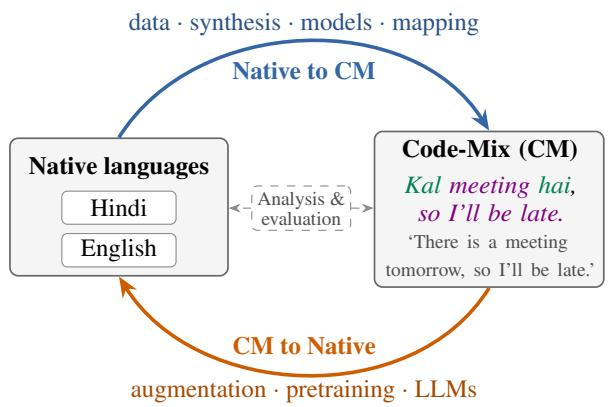
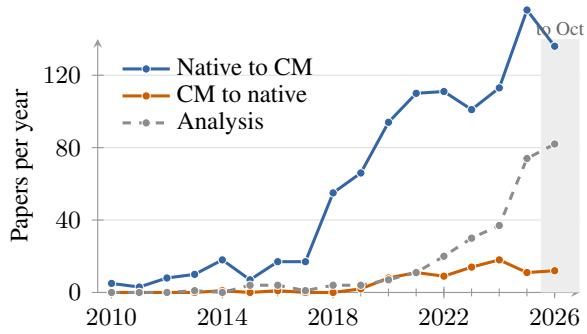
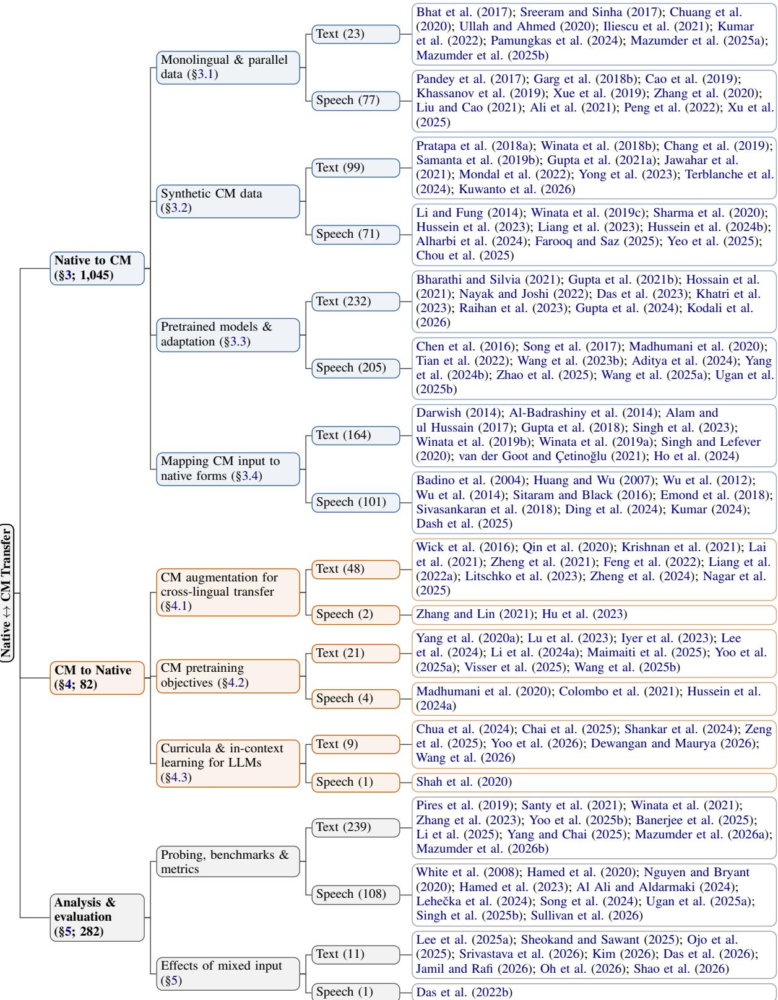

# A Two-Way Street: Surveying the Interplay between Code-Mixing and Native Languages in Text and Speech

Debajyoti Mazumder and Akash Anil Indian Institute of Science Education and Research, Bhopal debajyoti22@iiserb.ac.in, anila@iiserb.ac.in

## Abstract

Systems for code-mixed (CM) text and speech rarely start from scratch. CM data is scarce, so most work borrows from the languages being mixed, which we call native languages. This transfer can also run in reverse, when CM data is used to improve models for the native languages. Existing surveys focus on processing CM itself, and none brings the two directions together. This paper fills that gap with a systematic survey of transfer in both directions, across text and speech. We organise the surveyed work in a taxonomy of transfer direction, route and modality. Through this taxonomy, we find that most transfer runs from native languages into the CM setting. The reverse direction is younger, and in it code-switching mainly helps by aligning the two languages. Text and speech work share methods but rarely cite each other. On a shared speech benchmark, native data helps more than new architectures. These findings point to open challenges, such as how much native and CM data to mix in training, and how to evaluate CM text written in different scripts.

## 1 Introduction

Code-mixing1, the use of two or more languages within one sentence or conversation, is common among multilingual speakers. It is frequent on social media, in messaging and in everyday talk (Jose et al., 2020; Dogruöz et al.˘ , 2021; Srivastava and Singh, 2020; Hamed et al., 2020; Nguyen and Bryant, 2020), as in the Hindi–English message of Figure 1. Current models handle such input poorly. Large language models lose accuracy on code-mixed input across 18 languages (Yang and Chai, 2025). Code-switched queries also degrade retrievers, and embedding models drop by up to 27% across 11 code-switched tasks (Zeng et al., 2026). Likewise, speech recognisers’ WER rises by

  
Figure 1: Two directions of transfer between native languages and the CM setting. Analysis work measures effects on both sides. The example mixes Hindi (green) and English (purple), with its translation below.

30–50% relative on code-switched speech (Singh et al., 2025b). A core reason is data. Code-mixed data is scarce, while each mixed language has plentiful monolingual data.

Rather than treating code-mixing as an isolated target, we ask what crosses between it and the languages it mixes. A code-mixed (CM) setting never stands alone. It is built from two or more languages, which this survey refers to as native languages. Resources cross the boundary between the CM setting and its native languages in both directions (Figure 1). The field has long responded by moving resources from native languages into the CM setting. In text, monolingual or parallel corpora yield synthetic CM sentences (Pratapa et al., 2018a; Gupta et al., 2021a). In speech, recognisers learn to handle switches from monolingual speech alone (Khassanov et al., 2019). Transfer also runs the other way, though this direction has drawn less attention. Code-switched training data improves zero-shot cross-lingual transfer (Qin et al., 2020). In speech, LLM-generated code-switched text also improves recognition of monolingual English and Mandarin (Hu et al., 2023).

Yet the literature has never presented the two directions side by side. Our survey shows that their communities rarely meet. Only 10% of nativeto-CM papers cite any CM-to-native paper (Appendix A.4). Gains on one side are also rarely checked on the other. Among the papers we review, few test what training on mixed data does to monolingual ability (§5). As a result, findings cannot be compared across directions. In response, we review both directions in one framework, covering text and speech.

The CM setting and many native languages are both low-resource, so knowing which methods and languages help each other is key to better performance. Our taxonomy maps this for researchers facing scarce labelled CM data and costly annotation. With monolingual resources but no CM corpus, one can synthesise CM data (§3.2) or finetune a multilingual model (§3.3). Romanised input may be cheaper to transliterate (§3.4). For a lowresource native language, code-switched training or prompt examples can help (§4). For each option, it summarises what the method needs and what has been shown (Tables 1 and 2). We will release the list of all 1,451 surveyed papers. This survey makes the following contributions:

• First systematic survey. To our knowledge, this is the first systematic survey of knowledge transfer between the CM setting and its native languages, in both directions and across text and speech. It treats transfer from the CM setting back to native languages as a line of work in its own right.

• Taxonomy. We organise this transfer by direction, route and modality.

• Findings and challenges. We state four findings and the open challenges they point to.

Earlier surveys organise code-switching research by task, era or language. §2 compares them and shows that none is organised mainly by transfer direction.

## 2 Background and Scope

Transfer. Transfer occurs when one of five kinds of resource moves between the CM setting and native languages. These are (i) data, including synthetic data, (ii) model weights, through pretraining, fine-tuning or merging, (iii) labels or lexicons, (iv) linguistic knowledge, and (v) evaluation, such as benchmarks reused across the boundary. Each paper is assigned a direction: native-to-CM, CMto-native, both, or analysis-only. We exclude CM work that states no transfer, and cross-lingual transfer that involves no code-mixing. Inclusion criteria and the search protocol are in Appendix A.1.

Relation to earlier surveys. The first surveys of code-switching organised the field by task (Sitaram et al., 2019) and by dataset (Jose et al., 2020). Dogruöz et al. ˘ (2021) then added a linguistic and social view, and Winata et al. (2023) traced research trends across decades. In the LLM era, surveys narrowed in scope. Multilingual LLM surveys treat code-switching only as a prompting strategy (Qin et al., 2024). Others focus on speech recognition (Cheng et al., 2025; Agro et al., 2026), Arabic (Hamed et al., 2025) or code-mixed LLMs (Gupta et al., 2026). A recent survey covers 327 LLMera studies across modalities (Sheth et al., 2026). Throughout this line of work, the field is organised by task, era or language, never by transfer direction (Table 7 in Appendix B). Some surveys touch on CM-to-native transfer, but only within single sections. None measures how much work runs in reverse, or traces how the two directions evolved. We do both (§6, Figure 2).

Taxonomy. Figure 3 in Appendix B shows our taxonomy as a tree with three levels. The first level is direction, namely native-to-CM, CM-tonative, or analysis. Papers that transfer both ways appear under both directions. The second level is the route by which knowledge moves, and these routes structure §3–§5. The third level is modality, text or speech. Each route groups finer mechanism labels, such as fine-tuning or pipeline mapping, and Table 8 gives this mapping. We also label each paper’s task family, language-pair group, resource setting and era (Appendix E).

## 3 From Native Languages to Code-Mixing: Data, Models and Mapping

Most work that links code-mixing to native languages draws on the native side, where data is plentiful. It reuses monolingual or parallel data directly (§3.1), turns it into synthetic CM data (§3.2), adapts native-trained models (§3.3), or maps CM input to native forms (§3.4). Table 1 compares these approaches, and Appendix C adds examples.

<table><tr><td>Approach</td><td>Mod.</td><td>What it needs</td><td>Evaluated by</td><td>What has been shown</td></tr><tr><td colspan="5">Monolingual and parallel data (§3.1)</td></tr><tr><td>Monolingual LM training</td><td>T</td><td>Monolingual or translated text</td><td>CM perplexity</td><td>Matches LMs trained on synthetic CM data (Chuang et al., 2020)</td></tr><tr><td>Native samples and resources</td><td>T</td><td>Labelled native data, treebanks, lexicons</td><td>F1, LAS</td><td>Helps as a supplement, but trails annotated CM data (Mazumder et al.,</td></tr><tr><td>Pooling and LM fusion</td><td>S</td><td>Monolingual speech, text and LMs</td><td>WER, MER</td><td>2025a; Iliescu et al., 2021) Large gains only when test sentences are in the LM text (Pandey et al., 2017)</td></tr><tr><td>Mixed-lingual TTS</td><td>S</td><td>Monolingual recordings</td><td>MOS</td><td>Mixed-lingual voices from monolingual speakers (Reddy and Rao,</td></tr><tr><td colspan="5">Synthetic CM data (§3.2)</td></tr><tr><td>Theory-driven generation</td><td>T, S</td><td>Parallel text, parser or</td><td>Perplexity, human</td><td>About as useful as doubling real CM</td></tr><tr><td>Neural generators</td><td>T, S</td><td>aligner Parallel text, some CM</td><td>rating Perplexity</td><td>data (Pratapa et al., 2018a) Learn switching without hand-written</td></tr><tr><td>Translation pipelines</td><td>T</td><td>data Parallel or monolingual</td><td>BLEU, task F1</td><td>rules (Winata et al., 2018b, 2019c) Better translation of heavily mixed</td></tr><tr><td>LLM prompting</td><td>T, S</td><td>text An LLM</td><td>Human rating, F1,</td><td>input (Gupta et al., 2021a) Quality varies by pair (Terblanche</td></tr><tr><td>Audio synthesis</td><td>S</td><td>Monolingual audio, TTS</td><td>WER WER, MER</td><td>et al., 2024) Up to 34.4% lower MER (Hussein et al., 2024b)</td></tr><tr><td colspan="5">Adapting native-trained models (§3.3)</td></tr><tr><td>Fine-tuning</td><td>T, S</td><td>Labelled CM data</td><td>F1, MER</td><td>The default, usually one backbone on one dataset (Yang et al., 2024b)</td></tr><tr><td>Continued pretraining</td><td>T</td><td>Unlabelled CM corpus</td><td>F1</td><td>Stronger where CM corpora exist (Nayak and Joshi, 2022)</td></tr><tr><td>Light adaptation</td><td>T, S</td><td>Few extra parameters</td><td>F1, MER</td><td>Merging gives +2–5 F1 (Kodali et al., 2026); adapters add 5.6% parameters (Aditya et al., 2024)</td></tr><tr><td>Language routing</td><td>S</td><td>Language labels</td><td>MER</td><td>Tested mostly on Mandarin-English (Wang et al., 2023b)</td></tr><tr><td colspan="5">Mapping CM input to native forms (§3.4) T</td></tr><tr><td>Transliteration and normalisation</td><td></td><td>Transliterator</td><td>F1</td><td>Automatic close to manual (76% vs 78% F1) (Guellil et al., 2018a)</td></tr><tr><td>Translation of CM input</td><td>T</td><td>MT system</td><td>Accuracy, F1</td><td>Conflicting evidence against transliteration (Gupta et al., 2018)</td></tr><tr><td>Phone-set and script</td><td>S</td><td>Phone inventories</td><td>WER</td><td>Small gains, e.g. 1.2% WER (Sivasankaran et al., 2018)</td></tr><tr><td>mapping Embedding alignment</td><td>T,S</td><td>Cross-lingual embeddings</td><td>F1</td><td>Applied mainly to NER and sentiment (Winata et al., 2019b)</td></tr></table>

Table 1: Native-to-CM approaches compared. Mod.: modality (T text, S speech). Reported numbers come from different setups and are not comparable across rows.

## 3.1 Monolingual and Parallel Data

Text. The most direct option is to train on nativelanguage data alone. Early CM language models took this route (Sreeram and Sinha, 2017). A later model trains only on monolingual Mandarin and English, but constrains the output embeddings of the two languages to lie close together (Chuang et al., 2020). It matches or beats models trained on synthetic CM data, especially at switch points. Native data also helps beyond language modelling. Monolingual treebanks parse Hinglish tweets without any CM training data (Bhat et al., 2017), and Hindi and English hate samples alone reach 0.60 F1 on Hinglish, against 0.63 with added CM samples (Mazumder et al., 2025a). Native data alone, however, rarely matches annotated CM data. For Spanish–English language identification, a tagger trained only on Wikipedia reaches 92.23% F1, against 98.43% for a supervised one (Iliescu et al., 2021). Native data thus works best as a supplement. How much annotated CM data it can replace is still open.

Speech. Speech faces a sharper version of the problem. A recogniser trained on pooled monolingual data never hears a switch inside an utterance. Early work therefore modelled the switch on top of monolingual data. Dual language models were joined by a switch model (Garg et al., 2018b), and constrained output embeddings aligned the two languages without any CM speech (Khassanov et al.,

2019). Attention then turned to which monolingual data to use. In hybrid systems, matched monolingual speech helps, while mismatched speech hurts (Zhang et al., 2020). Later work brings in monolingual resources at decoding, through rescoring, internal language-model estimation and monolingual datastores (Liu and Cao, 2021; Peng et al., 2022; Zhou et al., 2025). Monolingual utterances can even be concatenated into synthetic CM audio, which trains a recogniser without real CM speech (Dhawan et al., 2023). Over time, monolingual speech has moved from a fallback to raw material for CM data. Its value still depends on how well it matches the target speech.

Synthesis faces a different problem. In monolingual corpora, each voice is tied to one language, so voice or accent changes at the switch. Early work found mixed-lingual training data preferable where it exists (Xue et al., 2019). Without such data, bilingual phonetic posteriorgrams separate speaker from language (Cao et al., 2020). Recent work builds CM training clips from monolingual corpora and trains an LLM-based synthesiser on them (Xu et al., 2025). Synthesis thus follows the same path as recognition, from adapting models to building CM data from native speech.

## 3.2 Synthetic Code-Mixed Data from Monolingual Sources

Monolingual data cannot show how two languages combine inside a sentence. Synthetic CM data fills this gap by building mixed sentences from monolingual or parallel text.

Text. The first generators drew on linguistic theory. They used the Equivalence Constraint or the Matrix Language Frame to decide where a switch is grammatical (Pratapa et al., 2018a; Lee et al., 2019; Rizvi et al., 2021). A language model trained first on such synthetic data, then on real CM data, reaches lower perplexity. The gain is about the same as doubling the real CM data (Pratapa et al., 2018a). Rules, however, may not capture how people actually switch. Neural generators therefore learn switching from data (Chang et al., 2019; Winata et al., 2018b), and one pretrained generator adds control over how much to switch (Mondal et al., 2022). A third line treats generation as translation, turning parallel or monolingual sentences into CM ones (Tarunesh et al., 2021; Gupta et al., 2021a). The resulting pairs improve translation of heavily mixed input (Gupta et al., 2021a). Since

2023, prompting LLMs has become the cheapest generator, but its quality depends on the pair (Yong et al., 2023; Terblanche et al., 2024). Chat-GPT writes fluent Singlish but performs poorly on English–Tamil (Yong et al., 2023). Uneven quality affects every generator, not only LLMs. Filtering out poor sentences helps (Sravani and Mamidi, 2023), but existing metrics are unreliable on codemixed text (Srivastava and Singh, 2021), so there is no trustworthy score to filter by. It is also unclear whether synthetic CM beats generic augmentation. On translation, it is only competitive with backtranslation (Jawahar et al., 2021).

Speech. A recogniser needs CM text for its language model and CM audio for its acoustic model. On the text side, generators follow the same path as in text processing. They moved from the Functional Head Constraint (Li and Fung, 2014) to copy-based models (Winata et al., 2019c) and then to lexical replacement or LLMs (Hussein et al., 2023; Alharbi et al., 2024). For Arabic–English, replacement-based text gave 65.5% lower perplexity and 7.7% lower WER (Hussein et al., 2023). A second line synthesises CM audio, starting with TTS and audio splicing. Augmented CM TTS reduced WER by up to 5% absolute in low-resource settings (Sharma et al., 2020). Speech Collage splices monolingual segments and smooths the joins, reducing MER by up to 34.4% in-domain (Hussein et al., 2024b). Spliced audio can sound discontinuous, however. Speech editing was proposed in response, and it beats both splicing and TTS (Liang et al., 2023). Gains are largest over weak baselines. In one study, errors fell by 50% on code-switched speech but by only 20% on Mandarin (Chou et al., 2025). No study in either modality relates generation quality to downstream gain under controlled conditions.

## 3.3 Pretrained Models and Their Adaptation

Most CM work does not build new models. It adapts native or multilingual models to CM input.

Text. The default route is to fine-tune a multilingual encoder on labelled CM data. Shared tasks made this the norm, especially for Dravidian pairs (Sharif et al., 2021; Bharathi and Silvia, 2021; Hossain et al., 2021). Multilingual encoders see little CM text in pretraining. A second line therefore continues pretraining on CM corpora (Gupta et al., 2021b; Das et al., 2023). Where such corpora exist, this is the stronger recipe, as HingBERT shows for Hindi–English (Nayak and Joshi, 2022). Most pairs lack large CM corpora, so lighter routes try to keep the gains at lower cost. Merging a CMadapted checkpoint with its base model gains 2– 5 F1 points over full fine-tuning (Kodali et al., 2026). With LLMs, prompting extends to translation and generation (Khatri et al., 2023; Gupta et al., 2024; Kuwanto et al., 2026). The papers we review mostly report one backbone on one dataset, so it remains unclear when continued pretraining is worth its cost.

Speech. Speech adaptation centres on Mandarin– English ASR. Its main problem is that the model must decide which language it hears. Early work added this signal through multitask learning, with auxiliary tasks that predict language or switches (Chen et al., 2016; Song et al., 2017). Web-scale multilingual models then changed the recipe. Whisper adapts to Mandarin–English with as little as 1–10 hours of CM data (Yang et al., 2024b), and later work adds language-aware decoding (Zhao et al., 2025). The language decision also shapes architecture. Language-aware encoders separate the two languages (Tian et al., 2022), and mixtureof-experts models route speech to language experts (Wang et al., 2023b; Huang et al., 2025; Wang et al., 2025a). Adapters offer a cheaper route. One reaches a 14.2% mixed error rate with only 5.6% additional parameters over Whisper (Aditya et al., 2024). Most results come from SEAME, so transfer of these designs to other pairs is unclear.

## 3.4 Mapping Code-Mixed Input to Native Forms

A fourth route leaves the model unchanged and changes the input instead. It maps CM material to forms that native tools already handle, or aligns both languages in a shared space.

Text. Romanised CM text is the main obstacle for native tools, so transliteration is the core operation. Work began with converting Arabizi to Arabic script (Darwish, 2014; Al-Badrashiny et al., 2014; Shazal et al., 2020). Transliteration pays off downstream. For Arabizi sentiment analysis, automatic transliteration reaches 76% F1, close to the 78% of manual transliteration (Guellil et al., 2018a). Spelling normalisation also helps tagging (van der Goot and Çetinoglu˘ , 2021) and sentiment (Singh et al., 2023). Whether to transliterate or translate is unsettled. Back-transliterated CM questions outperform translated ones (Gupta et al., 2018), while translation helps sentiment (Ho et al., 2024). A more radical form translates the whole input into one language (May et al., 2014; Bhowmick et al., 2023). Embedding alignment avoids explicit mapping, through cross-lingual or meta-embeddings (Winata et al., 2019a,b; Singh and Lefever, 2020). The best mapping seems to depend on task and script, which no study tests.

Speech. In speech, the mismatch lies in sounds rather than spelling. The central operation is therefore phone-set mapping, which merges the phone inventories of the two languages using acoustic and articulatory cues (Huang and Wu, 2007; Wu et al., 2012, 2014). Manual phone merging gives a 1.2% WER gain (Sivasankaran et al., 2018). A newer line maps the output instead, writing both languages in one script. It uses transliteration-normalised ASR (Emond et al., 2018), romanisation (Ding et al., 2024) or a language-independent phonetic script (Stephan and Jayakumar, 2025).

## 4 From Code-Mixing to Native Languages: What Code-Mixing Gives Back

The reverse direction treats code-mixing as a resource rather than a target. Mixed data can improve a model on the native languages, or carry knowledge from a high-resource language to a lowresource one. It takes three forms, namely augmentation (§4.1), pretraining objectives (§4.2), and curricula and in-context learning for LLMs (§4.3). Studies of how mixed input affects models are evaluation work, so they appear under analysis (§5). Table 2 compares the approaches.

## 4.1 Code-Switching Augmentation for Cross-Lingual Transfer

Text. Cross-lingual transfer usually trains on English and tests on a language the model has rarely seen. Code-switching narrows this gap by showing target-language words in source-language contexts. The older form is substitution, which swaps words or spans in a monolingual sentence for dictionary translations (Wick et al., 2016; Liu et al., 2019; Krishnan et al., 2021; Betke and Wilson, 2022; Ji et al., 2023). Applied to fine-tuning data, it improved zero-shot transfer on 5 tasks and 19 languages (Qin et al., 2020). Later variants add consistency regularisation between original and switched inputs (Zheng et al., 2021), choose the words to switch by saliency (Lai et al., 2021), or switch at test time as well (Sheng et al., 2025). A second form generates mixed text rather than editing it (Nagar et al., 2025). The recipe now serves spoken language understanding, aspect-based sentiment and MT (Liang et al., 2022a; Zhang et al., 2021b; Song et al., 2019). In cross-lingual retrieval, it gives up to 2x absolute gain for distant languages (Litschko et al., 2023). Plain switching has a limit, however. Words swapped in without context can make a sentence ungrammatical, which hurts POS tagging and NER. Choosing words that fit the context fixes this across 30+ languages (Feng et al., 2022). How much to switch, and which words, is seldom compared directly.

<table><tr><td>Approach</td><td>Mod.</td><td>What it needs</td><td>Evaluated by</td><td>What has been shown</td></tr><tr><td>Substitution augmentation</td><td>T</td><td>Bilingual dictionary</td><td>Zero-shot accuracy, F1</td><td>Gains on 5 tasks and 19 languages (Qin et al., 2020)</td></tr><tr><td>Generated augmentation</td><td>T</td><td>Generator or LLM</td><td>Accuracy</td><td>Low-resource gains without English loss (Nagar et al., 2025)</td></tr><tr><td>Contextual switching</td><td>T</td><td>Model to choose words</td><td>POS, NER</td><td>Avoids ungrammatical swaps (Feng et al., 2022)</td></tr><tr><td>Mixed data for speech</td><td>S</td><td>CM text or speech</td><td>WER</td><td>Also lowers monolingual WER (Hu et al., 2023)</td></tr><tr><td>Pretraining objectives</td><td>T</td><td>Parallel or monolingual corpora</td><td>BLEU, XNLI</td><td>An alignment signal; parallel data may matter more (Yang et al., 2020a; Shao</td></tr><tr><td>Joint monolingual-CM models</td><td>S</td><td>CM and monolingual speech</td><td>WER</td><td>et al., 2026) Gains on both (Madhumani et al., 2020)</td></tr><tr><td>Code-switching curricula</td><td>T</td><td>Synthetic CM corpus</td><td>MCQA, MT</td><td>Gains in Korean, Japanese and Indonesian (Yoo et al., 2025a)</td></tr><tr><td>In-context switching</td><td>T</td><td>An LLM</td><td>Accuracy</td><td>Up to 14.7pp in low-resource settings (Yoo et al., 2026)</td></tr></table>

Table 2: CM-to-native approaches compared. Mod.: modality (T text, S speech). Reported numbers come from different setups and are not comparable across rows.

Speech. Few speech papers take this route. One study shows the benefit reaching the native side. LLM-generated code-switched text lowers WER on a code-switching test set. It also lowers WER by 5.3% and 8.5% relative on the monolingual English and Mandarin test sets (Hu et al., 2023). Codeswitched speech also enables cross-lingual voice cloning, so a speaker recorded in one language can be synthesised in the other (Zhang and Lin, 2021).

## 4.2 Code-Switching Pretraining Objectives

Text. Augmentation adds switching at finetuning time. Pretraining objectives instead build it into the representation from the start. Alternating language modelling pretrains on code-switched sentences built from parallel data. It beats XLM’s translation-based pretraining on MT and XNLI (Yang et al., 2020a). Later work dropped the need for parallel data. Code-switched masked language modelling, which swaps tokens for their model-induced translations before masking, improves cross-lingual NLU and unsupervised MT from monolingual corpora alone (Lu et al., 2023). For LLMs, code-switched data is used in pretraining from scratch (Wang et al., 2025b), and in continued pretraining and instruction tuning (Lee et al., 2024). Curricula move from word-level to sentence-level switching and then to monolingual text. They transfer ability to Korean, Japanese and Indonesian (Yoo et al., 2025a). Not all evidence is positive. Removing bilingual documents from pretraining cuts translation by 56% BLEU, but parallel text drives this drop, not code-switched text (Shao et al., 2026).

Speech. Speech work here is scarce. Codeswitching-inspired losses for spoken dialogue improve performance in both monolingual and multilingual settings (Colombo et al., 2021). Taskagnostic multitask learning improves both monolingual and code-switched ASR (Madhumani et al., 2020).

## 4.3 Curricula and In-Context Learning for LLM Multilinguality

Text. LLMs add a new lever, since mixing can be applied at inference without retraining. Codeswitched demonstrations or instructions steer a model toward a low-resource language (Chai et al., 2025; Shankar et al., 2024; Zeng et al., 2025). Gradual code-switching at inference beats crosslingual in-context learning by 6.0pp in target and 4.8pp in unseen languages. In low-resource target languages, the gain rises to 14.7pp (Yoo et al., 2026). A progressive version targets reasoning transfer without expensive distillation (Wang et al., 2026). Code-mixing can also serve as an intermediate step. On knowledge queries, native Indian languages trail English by up to about 0.50 in accuracy, while code-mixed versions come within about 0.05. Prompting the model to first rewrite native-language input in code-mixed form yields clear gains over direct prompting (Mazumder et al., 2026a). Fine-tuning remains the other route. Mixed-language fine-tuning data is reported to reduce the cross-lingual knowledge barrier (Chua et al., 2024).

Speech. Speech work in this route relies on finetuning, and its link to the native side is retention of monolingual ability. A 2020 system recognises code-switched speech without forgetting monolingual recognition, and performs well on both test sets (Shah et al., 2020). The inference-time lever behind the text gains is untested for speech.

## 5 Analysis, Evaluation and Benchmarks

A third body of work neither builds CM systems nor transfers resources. It measures how nativelanguage knowledge relates to CM behaviour, through probing, benchmarks and metrics.

Text. Early studies asked whether multilingual encoders represent code-mixed input well. Pires et al. (2019) report that mBERT creates multilingual representations that serve code-switching, with caveats for some pairs. Winata et al. (2021) find that these representations are not necessarily of high quality. In encoders, code-mixed inputs stay loosely tied to both native languages, and CM adaptation gains English–CM alignment at the cost of English–Hindi alignment (Mazumder et al., 2026b). Santy et al. (2021) find that natural codemixed data brings larger improvements than synthetic data. With LLMs, the focus moved to benchmarks, which find that LLMs handle code-mixed input poorly or trail fine-tuned models (Zhang et al., 2023; Yang and Chai, 2025; Mohamed et al., 2026). Code-mixed prompts also weaken safety alignment (Yoo et al., 2025b). In one study, attack success rises from 9% on monolingual inputs to 69% on code-mixed ones (Banerjee et al., 2025). For reasoning, however, mixing helps. Enforcing monolingual decoding lowers math accuracy by 5.6 points (Li et al., 2025).

  
Figure 2: Included papers per year and direction. Bidirectional papers count in both. Papers before 2010, without a year or without a direction are omitted. 2026 (shaded) runs to early October.

Speech. Speech analysis centres on corpora. Corpora cover Arabic–English, Vietnamese–English, Turkish–German, Mandarin–English and Hindi– English (Hamed et al., 2020; Nguyen and Bryant, 2020; Çetinoglu˘ , 2017; Chua et al., 2023; Singh et al., 2025b). Comparisons of monolingual, multilingual and CM-adapted models cut both ways. Monolingual models win on an oral-history archive full of mixed speech (Lehecka et al.ˇ , 2024), whereas Whisper does better on CM in another study (Song et al., 2024). Several papers question WER-based evaluation of CM ASR. Metrics that combine transliteration and normalisation correlate best with human judgement (Hamed et al., 2023).

Effects of mixed input. A related question is what mixing costs the native side. Most work here measures mixed input rather than mixed training, and finds losses (Das et al., 2026). Code-mixed prompts lower Pass@1 (Sheokand and Sawant, 2025), and LLMs often answer in the wrong language (Oh et al., 2026). Safety and sentiment also degrade as mixing increases (Jamil and Rafi, 2026; Srivastava et al., 2026). Language identification and speech synthesis show the same pattern (Ojo et al., 2025; Das et al., 2022b). Direct tests of mixed training are rare. Where they exist, gains on low-resource languages come without loss on high-resource or monolingual test sets (Nagar et al., 2025; Shah et al., 2020; Madhumani et al., 2020).

## 6 Findings

We draw four findings, each measured on the surveyed papers.

Transfer runs almost entirely one way. Of the 1,451 papers, 1,045 transfer from native languages to the CM setting, 82 transfer back and only 5 do both (Table 4). The imbalance is extreme in speech, with 473 native-to-CM papers against 7 that transfer back. Since 2020, native-to-CM papers have grown from 94 to 156 a year, while CM-to-native papers stayed at 8–18 (Figure 2).

Text and speech share mechanisms, but not literature. Eight of the eleven transfer mechanisms appear in at least ten papers of each modality (Table 5). Yet text and speech papers that use the same mechanism cite each other at only 0.37 of the rate expected under random citation (Appendix A.4). The gap is widest for fine-tuning (0.07), adapters and pretraining (both 0). Only synthetic CM data, where speech borrows text generators (§3.2), shows real exchange (0.57).

CM-to-native transfer mostly mixes languages to align them. Of the 87 papers that transfer from CM to native languages, 67 insert code-switched text into training, through substitution (33), pretraining objectives (20) or generated data (14). Each places words of two languages in one context, so it works as an alignment signal (§4.1, §4.2). Where parallel data exists, it carries more of the gain, and code-switching has not been shown to add value beyond it (Shao et al., 2026).

On a shared benchmark, native data moves results more than architecture. SEAME is the only CM benchmark shared by many papers, so we compared 11 papers that report its standard sets, with setups matched within each paper (Appendix D). Once baselines reach 15–20% MER, changes to architecture or training objective lower dev\_man MER by at most about two points. Adding monolingual Mandarin and English speech to the same model lowers it by 4.6 points (Ding et al., 2024). Synthetic CM speech still gains 2.0– 3.2 points over a fine-tuned Whisper-large-v3 (Yeo et al., 2025, 2026).

## 7 Open Challenges and Future Directions

Balancing monolingual and code-switched data. Pretraining language is reported to matter little once a model sees code-mixed data during finetuning (Tatariya et al., 2023). We found no paper that isolates when monolingual transfer turns harmful, for instance through language confusion (Lee et al., 2025a). In the other direction, how much code-switched data the native side needs before gains appear is equally unsettled (§4.1). Controlled sweeps of the data mix would settle both.

Evaluation across scripts. The choice between romanised and native script recurs, from language identification for 22 Indic languages (Madhani et al., 2023) to safety detection that degrades under transliteration (Jamil and Rafi, 2026). Referencebased metrics break down without a clean monolingual target, and popular CM metrics correlate poorly with human acceptability (Srivastava and Singh, 2021; Kodali et al., 2025). Orthographically informed and semantic metrics are early responses (Bhogale et al., 2026b; Jiang et al., 2026). A transliteration-normalised score, validated per pair against human judgements, is a next step.

Low-resource constituents. Indic–English and Chinese–English dominate, while African pairs are rare, with Yoruba–English and Bambara speech among the few cases (Leventhal et al., 2026; Okocha and Grant, 2026). These constituents lack the strong native models that native-to-CM transfer assumes, so transfer from related high-resource languages is worth testing.

Reporting standards. Transfer papers should report monolingual results, natural-CM baselines and several backbones, to let mechanisms be ranked.

Speech-text unification. Joint text-speech CM models are largely absent. Audio LLMs are a natural testbed, but they still struggle with Hindi– English ASR (Dutta et al., 2025).

LLM-generated CM and its validity. LLMs now generate CM training text, including for CM ASR (Yong et al., 2023; Liu et al., 2026; Alharbi et al., 2024). Yet in minimal pairs, larger LLMs prefer natural switches to synthetic ones (Sterner and Teufel, 2025). Generated text should therefore be checked for human acceptability.

## Limitations

Our framing treats the CM setting mainly as a site of transfer. This foregrounds engineering methods and leaves aside work on why and how people mix languages, which Dogruöz et al.˘ (2021) survey.

Our labels were produced by an LLM from titles and abstracts. Scope was then checked by a keyword audit, and we read full texts only for papers we discuss in detail. A human evaluation of 100 random included papers found 2 incorrect and 3 partially incorrect labellings (Appendix A.3). A few errors may remain in rare label classes, which a random sample covers thinly. The 1,681 “maybe”

papers, which concern the CM setting but state no transfer, were not adjudicated, and some of them may involve transfer that the abstract does not mention.

Recall was estimated only indirectly, by comparing multiple search routes: Semantic Scholar queries, the ACL Anthology, and citation chasing. The last route added few new candidates, which is encouraging but not proof of coverage. No recall check against an independent list of papers was completed. Semantic Scholar covers IEEE and ISCA venues only in part, which matters most for speech, and about 29% of speech candidates had no abstract, so their labels rest on titles alone. Text may therefore be better covered than speech.

Era and language-pair groups were assigned by rules from publication year and language codes, and may misplace papers with missing or unusual metadata. We cite only part of the papers in scope, so the choice of what to discuss reflects our selection. A paper’s absence from the text does not mean it is unimportant. We make no claim about the relative size of effects across papers, because the reported numbers come from different data sets and settings.

## Ethical Considerations

This survey uses only publicly available papers, including arXiv preprints, with no personal data and no human participants. Code-mixing is tied to community identity, and many pairs are lowresource, so we caution that better tools for them should be built with speaker communities, and that automatic labels should be checked by humans, as we did on a random sample. We used AI assistants in preparing this paper. They helped with LaTeX formatting, with grammar and wording, and with searching for related literature. The LLM used to label papers is a separate part of our method, described in Appendix A.1.

## Acknowledgments

We thank Uddisa Kkaarthiek, a BS student from IISER Bhopal, for assistance during paper collection and management.

## References

Sajjad Abdoli, Ghassan Al-Sumaidaee, Clayton W Taylor, Ahmad ElShiekh, and Ahmed Rashad. 2026. Benchmarking commercial ASR systems on code-

switching speech: Arabic, Persian, and German. arXiv preprint arXiv:2605.19069.

Heike Adel, Ngoc Thang Vu, Franziska Kraus, Tim Schlippe, Haizhou Li, and Tanja Schultz. 2013. Recurrent neural network language modeling for code switching conversational speech. In 2013 IEEE International Conference on Acoustics, Speech and Signal Processing, pages 8411–8415.

Bobbi Aditya, Mahdin Rohmatillah, Liang-Hsuan Tai, and Jen-Tzung Chien. 2024. Attention-guided adaptation for code-switching speech recognition. In ICASSP 2024 - 2024 IEEE International Conference on Acoustics, Speech and Signal Processing (ICASSP), pages 10256–10260.

Wafia Adouane and Jean-Philippe Bernardy. 2020. When is multi-task learning beneficial for lowresource noisy code-switched user-generated Algerian texts? In Proceedings of the 4th Workshop on Computational Approaches to Code Switching, pages 17–25, Marseille, France. European Language Resources Association.

Maha Tufail Agro, Atharva A. Kulkarni, Karima Kadaoui, Zeerak Talat, and Hanan Aldarmaki. 2026. Code-switching in end-to-end automatic speech recognition: A systematic literature review. In Proceedings of the Fifteenth Language Resources and Evaluation Conference, pages 9790–9812, Palma de Mallorca, Spain. ELRA Language Resource Association.

Basem H.A. Ahmed and Tien-Ping Tan. 2012. Automatic speech recognition of code switching speech using 1-best rescoring. In 2012 International Conference on Asian Language Processing, pages 137–140.

Maryam Khalifa Al Ali and Hanan Aldarmaki. 2024. Mixat: A data set of bilingual Emirati-English speech. In Proceedings of the 3rd Annual Meeting of the Special Interest Group on Under-resourced Languages @ LREC-COLING 2024, pages 222–226, Torino, Italia. ELRA and ICCL.

Mohamed Al-Badrashiny, Ramy Eskander, Nizar Habash, and Owen Rambow. 2014. Automatic transliteration of Romanized dialectal Arabic. In Proceedings ofthe Eighteenth Conference on Computational Natural Language Learning, pages 30–38, Ann Arbor, Michigan. Association for Computational Linguistics.

Mehreen Alam and Sibt ul Hussain. 2017. Sequence to sequence networks for Roman-Urdu to Urdu transliteration. In 2017 International Multi-topic Conference (INMIC), pages 1–7.

Belen Alastruey, Matthias Sperber, Christian Gollan, Dominic Telaar, Tim Ng, and Aashish Agarwal. 2023. Towards real-world streaming speech translation for code-switched speech. In Proceedings of the 6th Workshop on Computational Approaches to Linguistic Code-Switching, pages 14–22, Singapore. Association for Computational Linguistics.

Sadeen Alharbi, Reem Binmuqbil, Ahmed Ali, Raghad Aloraini, Saiful Bari, Areeb Alowisheq, and Yaser Alonaizan. 2024. Leveraging LLM for Augmenting Textual Data in Code-Switching ASR: Arabic as an Example. In Synthetic Data’s Transformative Role in Foundational Speech Models, pages 26–30.

Ahmed Ali, Shammur Absar Chowdhury, Amir Hussein, and Yasser Hifny. 2021. Arabic Code-Switching Speech Recognition Using Monolingual Data. In Interspeech 2021, pages 3475–3479.

Ramakrishna Appicharla, Kamal Kumar Gupta, Asif Ekbal, and Pushpak Bhattacharyya. 2021. IITP-MT at CALCS2021: English to Hinglish neural machine translation using unsupervised synthetic code-mixed parallel corpus. In Proceedings of the Fifth Workshop on Computational Approaches to Linguistic Code-Switching, pages 31–35, Online. Association for Computational Linguistics.

Leonardo Badino, Claudia Barolo, and Silvia Quazza. 2004. A general approach to TTS reading of mixedlanguage texts. In Interspeech 2004, pages 849–852.

Shikha Baghel, Shreyas Ramoji, Sidharth, Ranjana H, Prachi Singh, Somil Jain, Pratik Roy Chowdhuri, Kaustubh Kulkarni, Swapnil Padhi, Deepu Vijayasenan, and Sriram Ganapathy. 2023. The DISPLACE Challenge 2023 - DIarization of SPeaker and LAnguage in Conversational Environments. In Interspeech 2023, pages 3562–3566.

Ramy Baly, Georges El-Khoury, Rawan Moukalled, Rita Aoun, Hazem Hajj, Khaled Bashir Shaban, and Wassim El-Hajj. 2017. Comparative evaluation of sentiment analysis methods across Arabic dialects. Procedia Computer Science, 117:266–273. Arabic Computational Linguistics.

Somnath Banerjee, Pratyush Chatterjee, Shanu Kumar, Sayan Layek, Parag Agrawal, Rima Hazra, and Animesh Mukherjee. 2025. Attributional safety failures in large language models under code-mixed perturbations. arXiv preprint arXiv:2505.14469.

Shubham Bansal, Arijit Mukherjee, Sandeepkumar Satpal, and Rupeshkumar Mehta. 2020a. On Improving Code Mixed Speech Synthesis with Mixlingual Grapheme-to-Phoneme Model. In Interspeech 2020, pages 2957–2961.

Srijan Bansal, Vishal Garimella, Ayush Suhane, Jasabanta Patro, and Animesh Mukherjee. 2020b. Codeswitching patterns can be an effective route to improve performance of downstream NLP applications: A case study of humour, sarcasm and hate speech detection. In Proceedings ofthe 58th Annual Meeting ofthe Associationfor Computational Linguistics, pages 1018–1023, Online. Association for Computational Linguistics.

Anab Maulana Barik, Rahmad Mahendra, and Mirna Adriani. 2019. Normalization of Indonesian-English code-mixed Twitter data. In Proceedings ofthe 5th Workshop on Noisy User-generated Text (W-NUT

2019), pages 417–424, Hong Kong, China. Association for Computational Linguistics.

Margrit Betke and Rc Wilson. 2022. Scaling frame analysis to genuinely low-resource languages: A case study in Swahili and Tamil. Bull. Comput. Data Sci., 3(1):11–21.

B. Bharathi and Agnusimmaculate Silvia. 2021. SSNCSE\_NLP@DravidianLangTech-EACL2021: Offensive language identification on multilingual code mixing text. In Proceedings of the First Workshop on Speech and Language Technologies for Dravidian Languages, pages 313–318, Kyiv. Association for Computational Linguistics.

Gayatri Bhat, Monojit Choudhury, and Kalika Bali. 2016. Grammatical constraints on intra-sentential code-switching: From theories to working models. arXiv preprint arXiv:1612.04538.

Irshad Bhat, Riyaz A. Bhat, Manish Shrivastava, and Dipti Sharma. 2017. Joining hands: Exploiting monolingual treebanks for parsing of code-mixing data. In Proceedings of the 15th Conference of the European Chapter ofthe Associationfor Computational Linguistics: Volume 2, Short Papers, pages 324–330, Valencia, Spain. Association for Computational Linguistics.

Irshad Bhat, Riyaz A. Bhat, Manish Shrivastava, and Dipti Sharma. 2018. Universal Dependency parsing for Hindi-English code-switching. In Proceedings of the 2018 Conference of the North American Chapter ofthe Associationfor Computational Linguistics: Human Language Technologies, Volume 1 (Long Papers), pages 987–998, New Orleans, Louisiana. Association for Computational Linguistics.

Debasmita Bhattacharya, Eleanor Lin, Run Chen, and Julia Hirschberg. 2024. Switching Tongues, Sharing Hearts: Identifying the Relationship between Empathy and Code-switching in Speech. In Interspeech 2024, pages 492–496.

Kaushal Bhogale, Manas Dhir, Amritansh Walecha, Manmeet Kaur, Vanshika Chhabra, Aaditya Pareek, Hanuman Sidh, Mahima Manik, Sagar Jain, Bhaskar Singh, et al. 2026a. Voice of India: A large-scale benchmark for real-world speech recognition in India. arXiv preprint arXiv:2604.19151.

Kaushal Santosh Bhogale, Tahir Javed, Greeshma Susan John, Dhruv Rathi, Akshayasree Padmanaban, Niharika Parasa, and Mitesh M. Khapra. 2026b. Towards orthographically-informed evaluation of speech recognition systems for Indian languages. In ICASSP 2026 - 2026 IEEE International Conference on Acoustics, Speech and Signal Processing (ICASSP), pages 17092–17096.

Rajat Subhra Bhowmick, Isha Ganguli, Ananya Paul, Jayanta Paul, and Jaya Sil. 2023. Improving Indic code-mixed to monolingual translation using mixed script augmentation, generation & transfer learning. ACM Trans. Asian Low-Resour. Lang. Inf. Process. Just Accepted.

Astik Biswas, Oleg Shevelev, Amine Abdaoui, Vivek Tyagi, and Abdelmoumene Boumadane. 2025. Adapting Whisper for low-resource Hindi-English Code-Mix speech with on-the-fly Augmentation & LLM-Synthesised Data. In Interspeech 2025, pages 4293–4297.

Margaret Blevins. 2026. Systematic normalization of spoken mixed-language, mixed-dialect data. In Proceedings of the First Workshop on Dialects in NLP — A Resource Perspective, pages 58–69, Palma de Mallorca. Association for Computational Linguistics.

Fethi Bougares, Salima Mdhaffar, Haroun Elleuch, and Yannick Estève. 2025. TEDxTN: A three-way speech translation corpus for code-switched Tunisian Arabic - English. In Proceedings of The Third Arabic Natural Language Processing Conference, pages 278– 287, Suzhou, China. Association for Computational Linguistics.

Laurie Burchell, Alexandra Birch, Robert Thompson, and Kenneth Heafield. 2024. Code-switched language identification is harder than you think. In Proceedings of the 18th Conference of the European Chapter of the Association for Computational Linguistics (Volume 1: Long Papers), pages 646–658, St. Julian’s, Malta. Association for Computational Linguistics.

Yuewen Cao, Songxiang Liu, Xixin Wu, Shiyin Kang, Peng Liu, Zhiyong Wu, Xunying Liu, Dan Su, Dong Yu, and Helen Meng. 2020. Code-switched speech synthesis using bilingual phonetic posteriorgram with only monolingual corpora. In ICASSP 2020 - 2020 IEEE International Conference on Acoustics, Speech and Signal Processing (ICASSP), pages 7619–7623.

Yuewen Cao, Xixin Wu, Songxiang Liu, Jianwei Yu, Xu Li, Zhiyong Wu, Xunying Liu, and Helen Meng. 2019. End-to-end code-switched TTS with mix of monolingual recordings. In ICASSP 2019 - 2019 IEEE International Conference on Acoustics, Speech and Signal Processing (ICASSP), pages 6935–6939.

Özlem Çetinoglu. 2017.˘ A code-switching corpus of Turkish-German conversations. In Proceedings of the 11th Linguistic Annotation Workshop, pages 34– 40, Valencia, Spain. Association for Computational Linguistics.

Özlem Çetinoglu, Sarah Schulz, and Ngoc Thang Vu.˘ 2016. Challenges of computational processing of code-switching. In Proceedings ofthe Second Workshop on Computational Approaches to Code Switching, pages 1–11, Austin, Texas. Association for Computational Linguistics.

Linzheng Chai, Jian Yang, Tao Sun, Hongcheng Guo, Jiaheng Liu, Bing Wang, Xinnian Liang, Jiaqi Bai, Tongliang Li, Qiyao Peng, et al. 2025. xcot: Crosslingual instruction tuning for cross-lingual chain-ofthought reasoning. In Proceedings of the AAAI Conference on Artificial Intelligence, volume 39, pages 23550–23558.

Bharathi Raja Chakravarthi, Adeep Hande, Rahul Ponnusamy, Prasanna Kumar Kumaresan, and Ruba Priyadharshini. 2022. How can we detect homophobia and transphobia? experiments in a multilingual code-mixed setting for social media governance. International Journal of Information Management Data Insights, 2(2):100119.

Khyathi Chandu, Thomas Manzini, Sumeet Singh, and Alan W. Black. 2018. Language informed modeling of code-switched text. In Proceedings of the Third Workshop on Computational Approaches to Linguistic Code-Switching, pages 92–97, Melbourne, Australia. Association for Computational Linguistics.

Ching-Ting Chang, Shun-Po Chuang, and Hung-Yi Lee. 2019. Code-Switching Sentence Generation by Generative Adversarial Networks and its Application to Data Augmentation. In Interspeech 2019, pages 554– 558.

Liu Changsong, Ho Thi Nga, Yip Jia Qi, and Chng Eng Siong. 2023. Transformer-based punctuation restoration models for Indonesian with English codeswitching speech transcripts. In 2023 10th International Conference on Advanced Informatics: Concept, Theory and Application (ICAICTA), pages 1–6.

Arindam Chatterjee, Chhavi Sharma, Ayush Raj, and Asif Ekbal. 2022. PACMAN:PArallel CodeMixed dAta generatioN for POS tagging. In Proceedings of the 19th International Conference on Natural Language Processing (ICON), pages 234–244, New Delhi, India. Association for Computational Linguistics.

Mengzhe Chen, Jielin Pan, Qingwei Zhao, and Yonghong Yan. 2016. Multi-task learning in deep neural networks for Mandarin-English code-mixing speech recognition. IEICE TRANSACTIONS on Information, E99-D(10):2554–2557.

Wilson Pang Vui Cheng, Lim Kong Hua, Yu Yong Poh, and Lim Tong Ming. 2025. CS in automatic speech recognition: A review of advances and challenges. In 2025 IEEE International Conference on Computation, Big-Data and Engineering (ICCBE), pages 349–354.

Xuxin Cheng, Wanshi Xu, Ziyu Yao, Zhihong Zhu, Yaowei Li, Hongxiang Li, and Yuexian Zou. 2023. FC-MTLF: A Fine- and Coarse-grained Multi-Task Learning Framework for Cross-Lingual Spoken Language Understanding. In Interspeech 2023, pages 690–694.

Cheng-Kang Chou, Chan-Jan Hsu, Ho-Lam Chung, Liang-Hsuan Tseng, Hsi-Chun Cheng, Yu-Kuan Fu, Kuan Po Huang, and Hung-Yi Lee. 2025. A selfrefining framework for enhancing ASR using TTSsynthesized data. In 2025 IEEE Automatic Speech Recognition and Understanding Workshop (ASRU), pages 1–8.

Nurendra Choudhary, Rajat Singh, Ishita Bindlish, and Manish Shrivastava. 2023. Sentiment analysis

of code-mixed languages leveraging resource rich languages. In Computational Linguistics and Intelligent Text Processing, pages 104–114, Cham. Springer Nature Switzerland.

Shammur A. Chowdhury, Younes Samih, Mohamed Eldesouki, and Ahmed Ali. 2020. Effects of Dialectal Code-Switching on Speech Modules: A Study Using Egyptian Arabic Broadcast Speech. In Interspeech 2020, pages 2382–2386.

Shammur Absar Chowdhury, Amir Hussein, Ahmed Abdelali, and Ahmed Ali. 2021. Towards One Model to Rule All: Multilingual Strategy for Dialectal Code-Switching Arabic ASR. In Interspeech 2021, pages 2466–2470.

Lynn Chua, Badih Ghazi, Yangsibo Huang, Pritish Kamath, Ravi Kumar, Pasin Manurangsi, Amer Sinha, Chulin Xie, and Chiyuan Zhang. 2024. Crosslingual capabilities and knowledge barriers in multilingual large language models. arXiv preprint arXiv:2406.16135.

Victoria Y. H. Chua, Hexin Liu, Leibny Paola Garcia, Fei Ting Woon, Jinyi Wong, Xiangyu Zhang, Sanjeev Khudanpur, Andy W. H. Khong, Justin Dauwels, and Suzy J. Styles. 2023. MERLIon CCS Challenge: A English-Mandarin code-switching child-directed speech corpus for language identification and diarization. In Interspeech 2023, pages 4109–4113.

Shun-Po Chuang, Tzu-Wei Sung, and Hung-yi Lee. 2020. Training code-switching language model with monolingual data. In ICASSP 2020 - 2020 IEEE International Conference on Acoustics, Speech and Signal Processing (ICASSP), pages 7949–7953.

Pierre Colombo, Emile Chapuis, Matthieu Labeau, and Chloé Clavel. 2021. Code-switched inspired losses for spoken dialog representations. In Proceedings of the 2021 Conference on Empirical Methods in Natural Language Processing, pages 8320–8337, Online and Punta Cana, Dominican Republic. Association for Computational Linguistics.

Raj Dabre. 2022. NICT at MixMT 2022: Synthetic code-mixed pre-training and multi-way fine-tuning for Hinglish–English translation. In Proceedings of the Seventh Conference on Machine Translation (WMT), pages 1122–1125, Abu Dhabi, United Arab Emirates (Hybrid). Association for Computational Linguistics.

Siddharth Dalmia, Yuzong Liu, Srikanth Ronanki, and Katrin Kirchhoff. 2021. Transformer-transducers for code-switched speech recognition. In ICASSP 2021 - 2021 IEEE International Conference on Acoustics, Speech and Signal Processing (ICASSP), pages 5859– 5863.

Kareem Darwish. 2014. Arabizi detection and conversion to Arabic. In Proceedings ofthe EMNLP 2014 Workshop on Arabic Natural Language Processing (ANLP), pages 217–224, Doha, Qatar. Association for Computational Linguistics.

Avisha Das, Mihir Parmar, Mohana Ramnath, and Pulkit Verma. 2026. Indi-RomCoM: Codemixed benchmark for evaluating LLMs on romanized Indic-English instructions. arXiv preprint arXiv:2606.30790.

Mithun Das, Somnath Banerjee, Punyajoy Saha, and Animesh Mukherjee. 2022a. Hate speech and offensive language detection in Bengali. In Proceedings of the 2nd Conference of the Asia-Pacific Chapter ofthe Associationfor Computational Linguistics and the 12th International Joint Conference on Natural Language Processing (Volume 1: Long Papers), pages 286–296, Online only. Association for Computational Linguistics.

Richeek Das, Sahasra Ranjan, Shreya Pathak, and Preethi Jyothi. 2023. Improving pretraining techniques for code-switched NLP. In Proceedings ofthe 61st Annual Meeting ofthe Associationfor Computational Linguistics (Volume 1: Long Papers), pages 1176–1191, Toronto, Canada. Association for Computational Linguistics.

Shuvayanti Das, Jennifer Williams, and Catherine Lai. 2022b. Analysis of voice conversion and codeswitching synthesis using VQ-VAE. arXiv preprint arXiv:2203.14640.

Puspita Dash, Sruthi Babu, Logeswari Singaravel, and Devadarshini Balasubramanian. 2025. Generative AI-powered multilingual ASR for seamless languagemixing transcriptions. Journal of Electrical Systems and Information Technology, 12(1):42.

Lipika Dewangan and Chandresh Kumar Maurya. 2026. CLAOCS-TX: Cross-lingual triplet extraction with aspect-opinion-aware code-switched prompting and LLM-guided contrastive distillation. In Proceedings of the 64th Annual Meeting of the Association for Computational Linguistics (Volume 1: Long Papers), pages 44561–44577, San Diego, California, United States. Association for Computational Linguistics.

Mrinal Dhar, Vaibhav Kumar, and Manish Shrivastava. 2018. Enabling code-mixed translation: Parallel corpus creation and MT augmentation approach. In Proceedings of the First Workshop on Linguistic Resources for Natural Language Processing, pages 131– 140, Santa Fe, New Mexico, USA. Association for Computational Linguistics.

Aditi Vikrant Dhavale, Amit Vikrant Dhavale, and Sunita Vikrant Dhavale. 2023. An intelligent software tool for audio signal-based Hinglish to English language translation. In 2023 IEEE Pune Section International Conference (PuneCon), pages 1–6.

Kunal Dhawan, Dima Rekesh, and Boris Ginsburg. 2023. Unified model for code-switching speech recognition and language identification based on concatenated tokenizer. In Proceedings ofthe 6th Workshop on Computational Approaches to Linguistic Code-Switching, pages 74–82, Singapore. Association for Computational Linguistics.

Donglin Di, Xianyang Song, Weinan Zhang, Yue Zhang, and Fanglin Wang. 2023. Building dialogue understanding models for low-resource language Indonesian from scratch. ACM Trans. Asian Low-Resour. Lang. Inf. Process., 22(4).

Wen Ding, Fei Jia, Hainan Xu, Yu Xi, Junjie Lai, and Boris Ginsburg. 2024. Romanization encoding for multilingual ASR. In 2024 IEEE Spoken Language Technology Workshop (SLT), pages 468–475.

Junggeun Do, Jaeseong Lee, and Seung-won Hwang. 2024. ContrastiveMix: Overcoming code-mixing dilemma in cross-lingual transfer for information retrieval. In Proceedings of the 2024 Conference of the North American Chapter ofthe Associationfor Computational Linguistics: Human Language Technologies (Volume 2: Short Papers), pages 197–204, Mexico City, Mexico. Association for Computational Linguistics.

A. Seza Dogruöz, Sunayana Sitaram, Barbara E. Bul-˘ lock, and Almeida Jacqueline Toribio. 2021. A survey of code-switching: Linguistic and social perspectives for language technologies. In Proceedings of the 59th Annual Meeting of the Association for Computational Linguistics and the 11th International Joint Conference on Natural Language Processing (Volume 1: Long Papers), pages 1654–1666, Online. Association for Computational Linguistics.

Long Duong, Hadi Afshar, Dominique Estival, Glen Pink, Philip Cohen, and Mark Johnson. 2017. Multilingual semantic parsing and code-switching. In Proceedings of the 21st Conference on Computational Natural Language Learning (CoNLL 2017), pages 379–389, Vancouver, Canada. Association for Computational Linguistics.

Bikash Dutta, Rishabh Ranjan, Akshat Jain, Richa Singh, and Mayank Vatsa. 2025. Can RAG-driven enhancements amplify audio LLMs for low-resource languages? In ICASSP 2025 - 2025 IEEE International Conference on Acoustics, Speech and Signal Processing (ICASSP), pages 1–5.

Jesse Emond, Bhuvana Ramabhadran, Brian Roark, Pedro Moreno, and Min Ma. 2018. Transliteration based approaches to improve code-switched speech recognition performance. In 2018 IEEE Spoken Language Technology Workshop (SLT), pages 448–455.

Al Nahian Bin Emran, Amrita Ganguly, Sadiya Sayara Chowdhury Puspo, Nishat Raihan, and Dhiman Goswami. 2024. MasonTigers at SemEval-2024 task 10: Emotion discovery and flip reasoning in conversation with ensemble of Transformers and prompting. arXiv preprint arXiv:2407.00581.

Zhiyun Fan, Linhao Dong, Chen Shen, Zhenlin Liang, Jun Zhang, Lu Lu, and Zejun Ma. 2023. Languagespecific acoustic boundary learning for mandarinenglish code-switching speech recognition. arXiv preprint arXiv:2306.05279.

Muhammad Umar Farooq and Oscar Saz. 2025. SAGE: Spliced-audio generated data for enhancing foundational models in low-resource Arabic-English codeswitched speech recognition. In 2025 IEEE 35th International Workshop on Machine Learning for Signal Processing (MLSP), pages 1–6.

Jakob Fehle, Nils Constantin Hellwig, Udo Kruschwitz, and Christian Wolff. 2026. Zero-shot to full-resource: Cross-lingual transfer strategies for aspect-based sentiment analysis. arXiv preprint arXiv:2604.26619.

Yukun Feng, Feng Li, and Philipp Koehn. 2022. Toward the limitation of code-switching in cross-lingual transfer. In Proceedings ofthe 2022 Conference on Empirical Methods in Natural Language Processing, pages 5966–5971, Abu Dhabi, United Arab Emirates. Association for Computational Linguistics.

Besnik Fetahu, Anjie Fang, Oleg Rokhlenko, and Shervin Malmasi. 2021. Gazetteer enhanced named entity recognition for code-mixed web queries. In Proceedings of the 44th International ACM SIGIR Conference on Research and Development in Information Retrieval, SIGIR ’21, page 1677–1681, New York, NY, USA. Association for Computing Machinery.

Akshat Gahoi, Jayant Duneja, Anshul Padhi, Shivam Mangale, Saransh Rajput, Tanvi Kamble, Dipti Sharma, and Vasudev Varma. 2022. Gui at MixMT 2022 : English-Hinglish : An MT approach for translation of code mixed data. In Proceedings of the Seventh Conference on Machine Translation (WMT), pages 1126–1130, Abu Dhabi, United Arab Emirates (Hybrid). Association for Computational Linguistics.

Saurabh Garg, Tanmay Parekh, and Preethi Jyothi. 2018a. Code-switched language models using dual RNNs and same-source pretraining. In Proceedings ofthe 2018 Conference on Empirical Methods in Natural Language Processing, pages 3078–3083, Brussels, Belgium. Association for Computational Linguistics.

Saurabh Garg, Tanmay Parekh, and Preethi Jyothi. 2018b. Dual Language Models for Code Switched Speech Recognition. In Interspeech 2018, pages 2598–2602.

Sayani Ghosal and Amita Jain. 2023. HateCircle and unsupervised hate speech detection incorporating emotion and contextual semantics. ACM Trans. Asian Low-Resour. Lang. Inf. Process., 22(4).

Hila Gonen and Yoav Goldberg. 2019. Language modeling for code-switching: Evaluation, integration of monolingual data, and discriminative training. In Proceedings of the 2019 Conference on Empirical Methods in Natural Language Processing and the 9th International Joint Conference on Natural Language Processing (EMNLP-IJCNLP), pages 4175– 4185, Hong Kong, China. Association for Computational Linguistics.

Imane Guellil, Ahsan Adeel, Faical Azouaou, Fodil Benali, Ala-eddine Hachani, and Amir Hussain. 2018a. Arabizi sentiment analysis based on transliteration and automatic corpus annotation. In Proceedings of the 9th Workshop on Computational Approaches to Subjectivity, Sentiment and Social Media Analysis, pages 335–341, Brussels, Belgium. Association for Computational Linguistics.

Imane Guellil, Ahsan Adeel, Faical Azouaou, and Amir Hussain. 2018b. SentiALG: Automated corpus annotation for Algerian sentiment analysis. In Advances in Brain Inspired Cognitive Systems, pages 557–567, Cham. Springer International Publishing.

Pengcheng Guo, Haihua Xu, Lei Xie, and Eng Siong Chng. 2018. Study of Semi-supervised Approaches to Improving English-Mandarin Code-Switching Speech Recognition. In Interspeech 2018, pages 1928–1932.

Zhiwei Guo, Qin Zhang, Feng Ding, Xiaogang Zhu, and Keping Yu. 2024. A novel fake news detection model for context of mixed languages through multiscale Transformer. IEEE Transactions on Computational Social Systems, 11(4):5079–5089.

Abhirut Gupta, Aditya Vavre, and Sunita Sarawagi. 2021a. Training data augmentation for code-mixed translation. In Proceedings of the 2021 Conference of the North American Chapter of the Association for Computational Linguistics: Human Language Technologies, pages 5760–5766, Online. Association for Computational Linguistics.

Akshat Gupta, Sai Krishna Rallabandi, and Alan W Black. 2021b. Task-specific pre-training and cross lingual transfer for sentiment analysis in Dravidian code-switched languages. In Proceedings ofthe First Workshop on Speech and Language Technologiesfor Dravidian Languages, pages 73–79, Kyiv. Association for Computational Linguistics.

Ayushman Gupta, Akhil Bhogal, and Kripabandhu Ghosh. 2024. Code-mixer ya nahi: Novel approaches to measuring multilingual LLMs’ code-mixing capabilities. arXiv preprint arXiv:2410.11079.

Deepak Gupta, Asif Ekbal, and Pushpak Bhattacharyya. 2020. A semi-supervised approach to generate the code-mixed text using pre-trained encoder and transfer learning. In Findings ofthe Associationfor Computational Linguistics: EMNLP 2020, pages 2267– 2280, Online. Association for Computational Linguistics.

Himanshu Gupta, Pratik Jayarao, Chaitanya Dwivedi, and Neeraj Varshney. 2026. Code mixologist: A practitioner’s guide to building code-mixed LLMs. arXiv preprint arXiv:2602.11181.

Vishal Gupta, Manoj Chinnakotla, and Manish Shrivastava. 2018. Transliteration better than translation? answering code-mixed questions over a knowledge base. In Proceedings of the Third Workshop on Computational Approaches to Linguistic Code-Switching,

pages 39–50, Melbourne, Australia. Association for Computational Linguistics.

Gulizada Haisa, Gulila Altenbek, and Wen Li. 2024. Phrase based code-switching for cross-lingual question understanding. Multimedia Tools and Applications, 83(11):32159–32175.

Soufiane Hajbi, Omayma Amezian, Nawfal El Moukhi, Redouan Korchiyne, and Younes Chihab. 2024. Moroccan Arabizi-to-Arabic conversion using rulebased transliteration and weighted levenshtein algorithm. Scientific African, 23:e02073.

Injy Hamed, Pavel Denisov, Chia-Yu Li, Mohamed Elmahdy, Slim Abdennadher, and Ngoc Thang Vu. 2022. Investigations on speech recognition systems for low-resource dialectal Arabic–English codeswitching speech. Computer Speech & Language, 72:101278.

Injy Hamed, Amir Hussein, Oumnia Chellah, Shammur Chowdhury, Hamdy Mubarak, Sunayana Sitaram, Nizar Habash, and Ahmed Ali. 2023. Benchmarking evaluation metrics for code-switching automatic speech recognition. In 2022 IEEE Spoken Language Technology Workshop (SLT), pages 999–1005.

Injy Hamed, Caroline Sabty, Slim Abdennadher, Ngoc Thang Vu, Thamar Solorio, and Nizar Habash. 2025. A survey of code-switched Arabic NLP: Progress, challenges, and future directions. In Proceedings of the 31st International Conference on Computational Linguistics, pages 4561–4585, Abu Dhabi, UAE. Association for Computational Linguistics.

Injy Hamed, Ngoc Thang Vu, and Slim Abdennadher. 2020. ArzEn: A speech corpus for code-switched Egyptian Arabic-English. In Proceedings of the Twelfth Language Resources and Evaluation Conference, pages 4237–4246, Marseille, France. European Language Resources Association.

Adeep Hande, Ruba Priyadharshini, Anbukkarasi Sampath, Kingston Pal Thamburaj, Prabakaran Chandran, and Bharathi Raja Chakravarthi. 2021. Hope speech detection in under-resourced kannada language. arXiv preprint arXiv:2108.04616.

Chun-Yi He and Jen-Tzung Chien. 2023. Learning adapters for code-switching speech recognition. In 2023 Asia Pacific Signal and Information Processing Association Annual Summit and Conference (APSIPA ASC), pages 344–349.

Ji He, Yao Qian, Frank K. Soong, and Sheng Zhao. 2012. Turning a monolingual speaker into multilingual for a mixed-language TTS. In Interspeech 2012, pages 963–966.

Asha Hegde, Fazlourrahman Balouchzahi, Sabur Butt, Sharal Coelho, Kavya G, Harshitha S Kumar, Sonith D, Shashirekha H. L., and Ameeta Agrawal. 2025. CoLI@FIRE2024: Findings of word-level codemixed language identification in Dravidian languages.

In Proceedings of the 16th Annual Meeting of the Forumfor Information Retrieval Evaluation, FIRE ’24, page 7–10, New York, NY, USA. Association for Computing Machinery.

Maite Heredia, Gorka Labaka, Jeremy Barnes, and Aitor Soroa. 2026. Conditioning LLMs to generate codeswitched text. In Proceedings of the Fifteenth Language Resources and Evaluation Conference, pages 8937–8953, Palma de Mallorca, Spain. ELRA Language Resource Association.

Ahmad Fathan Hidayatullah. 2024. Code-mixed sentiment analysis on Indonesian-Javanese-English text using Transformer models. In 2024 8th International Conference on Information Technology, Information Systems and Electrical Engineering (ICI-TISEE), pages 340–345.

Chuk Fong Ho, Kae Lun Chean, and Tong Ming Lim. 2024. Leveraging machine translation to enhance sentiment analysis on multilingual text. In Proceedings of the 2024 13th International Conference on Software and Computer Applications, ICSCA ’24, page 242–248, New York, NY, USA. Association for Computing Machinery.

Seongtae Hong, Seungyoon Lee, Hyeonseok Moon, and Heuiseok Lim. 2025. MIGRATE: Cross-lingual adaptation of domain-specific LLMs through codeswitching and embedding transfer. In Proceedings of the 31st International Conference on Computational Linguistics, pages 9184–9193, Abu Dhabi, UAE. Association for Computational Linguistics.

Eftekhar Hossain, Omar Sharif, and Mohammed Moshiul Hoque. 2021. NLP-CUET@LT-EDI-EACL2021: Multilingual code-mixed Hope speech detection using cross-lingual representation learner. In Proceedings of the First Workshop on Language Technology for Equality, Diversity and Inclusion, pages 168–174, Kyiv. Association for Computational Linguistics.

Chan-Jan Hsu, Yi-Cheng Lin, Chia-Chun Lin, Wei-Chih Chen, Ho Lam Chung, Chen-An Li, Yi-Chang Chen, Chien-Yu Yu, Ming-Ji Lee, Chien-Cheng Chen, et al. 2025. BreezyVoice: Adapting TTS for Taiwanese Mandarin with enhanced polyphone disambiguation–challenges and insights. arXiv preprint arXiv:2501.17790.

Ke Hu, Tara N. Sainath, Bo Li, Yu Zhang, Yong Cheng, Tao Wang, Yujing Zhang, and Frederick Liu. 2023. Improving multilingual and code-switching ASR using large language model generated text. In 2023 IEEEAutomatic Speech Recognition and Understand ing Workshop (ASRU), pages 1–7.

Chao Huang, Hui Di, Lina Wang, and Kazushige Ouchi. 2022. ECO-DST: An efficient cross-lingual dialogue state tracking framework. In Proceedings of the 2021 4th International Conference on Machine Learning and Machine Intelligence, MLMI ’21, page 77–82, New York, NY, USA. Association for Computing Machinery.

Chien-Lin Huang and Chung-Hsien Wu. 2007. Generation of phonetic units for mixed-language speech recognition based on acoustic and contextual analysis. IEEE Transactions on Computers, 56(9):1225–1233.

Hukai Huang, Shenghui Lu, Yahui Shan, He Qu, Fengrun Zhang, Wenhao Guan, Qingyang Hong, and Lin Li. 2025. Dynamic language group-based MoE: Enhancing code-switching speech recognition with hierarchical routing. In ICASSP 2025 - 2025 IEEE International Conference on Acoustics, Speech and Signal Processing (ICASSP), pages 1–5.

Kuan-Po Huang, Chih-Kai Yang, Yu-Kuan Fu, Ewan Dunbar, and Hung-Yi Lee. 2024. Zero resource codeswitched speech benchmark using speech utterance pairs for multiple spoken languages. In ICASSP 2024 - 2024 IEEE International Conference on Acoustics, Speech and Signal Processing (ICASSP), pages 10006–10010.

Zheying Huang, Pei Wang, Jian Wang, Haoran Miao, Ji Xu, and Pengyuan Zhang. 2021. Improving Transformer based end-to-end code-switching speech recognition using language identification. Applied Sciences, 11(19).

Amir Hussein, Shammur Chowdhury, Najim Dehak, and Ahmed Ali. 2021. Balanced end-to-end monolingual pre-training for low-resourced indic languages code-switching speech recognition. arXiv preprint arXiv:2106.05885.

Amir Hussein, Shammur Absar Chowdhury, Ahmed Abdelali, Najim Dehak, Ahmed Ali, and Sanjeev Khudanpur. 2023. Textual data augmentation for Arabic-English code-switching speech recognition. In 2022 IEEE Spoken Language Technology Workshop (SLT), pages 777–784.

Amir Hussein, Desh Raj, Matthew Wiesner, Daniel Povey, Paola Garcia, and Sanjeev Khudanpur. 2024a. Enhancing Neural Transducer for Multilingual ASR with Synchronized Language Diarization. In Interspeech 2024, pages 3994–3998.

Amir Hussein, Dorsa Zeinali, Ondˇrej Klejch, Matthew Wiesner, Brian Yan, Shammur Chowdhury, Ahmed Ali, Shinji Watanabe, and Sanjeev Khudanpur. 2024b. Speech collage: Code-switched audio generation by collaging monolingual corpora. In ICASSP 2024 - 2024 IEEE International Conference on Acoustics, Speech and Signal Processing (ICASSP), pages 12006–12010.

Dana-Maria Iliescu, Rasmus Grand, Sara Qirko, and Rob van der Goot. 2021. Much gracias: Semi-supervised code-switch detection for Spanish-English: How far can we get? In Proceedings of the Fifth Workshop on Computational Approaches to Linguistic Code-Switching, pages 65–71, Online. Association for Computational Linguistics.

Samia Ben Ismail and Abdelkarim Mars. 2026. Multiexpert topic modeling for code-switched dialectal Arabic: A dynamic routing approach to Tunisian

social media analysis. In ICAART (4), pages 3815– 3822.

Vivek Iyer, Edoardo Barba, Alexandra Birch, Jeff Pan, and Roberto Navigli. 2023. Code-switching with word senses for pretraining in neural machine translation. In Findings of the Association for Computational Linguistics: EMNLP 2023, pages 12889– 12901, Singapore. Association for Computational Linguistics.

Waleed Jamil and Saima Rafi. 2026. Code-switching as a safety failure mode in large language models: An empirical study of Roman Urdu across English, mixed, and transliteration-only inputs. In Proceedings ofthe 2nd Workshop on NLPfor Languages Using Arabic Script, pages 295–300, Rabat, Morocco. Association for Computational Linguistics.

Binu Jasim, Vinay Namboodiri, and C V Jawahar. 2020. PhraseOut: A code mixed data augmentation method for MultilingualNeural machine tranlsation. In Proceedings ofthe 17th International Conference on Natural Language Processing (ICON), pages 470–474, Indian Institute of Technology Patna, Patna, India. NLP Association of India (NLPAI).

Ganesh Jawahar, El Moatez Billah Nagoudi, Muhammad Abdul-Mageed, and Laks Lakshmanan, V.S. 2021. Exploring text-to-text Transformers for English to Hinglish machine translation with synthetic code-mixing. In Proceedings of the Fifth Workshop on Computational Approaches to Linguistic Code-Switching, pages 36–46, Online. Association for Computational Linguistics.

Yixin Ji, Jikai Wang, Juntao Li, Hai Ye, and Min Zhang. 2023. Isotropic representation can improve zero-shot cross-lingual transfer on multilingual language models. In Findings ofthe Associationfor Computational Linguistics: EMNLP 2023, pages 8104–8118, Singapore. Association for Computational Linguistics.

Zixuan Jiang, Yanqiao Zhu, Peng Wang, Qinyuan Chen, Xinjian Zhao, Xipeng Qiu, Wupeng Wang, Zhifu Gao, Xiangang Li, Kai Yu, et al. 2026. Towards human-like interactive speech recognition with agentic correction and semantic evaluation. arXiv preprint arXiv:2605.29430.

Navya Jose, Bharathi Raja Chakravarthi, Shardul Suryawanshi, Elizabeth Sherly, and John P. Mc-Crae. 2020. A survey of current datasets for codeswitching research. In 2020 6th International Conference on Advanced Computing and Communication Systems (ICACCS), pages 136–141.

Amlu Anna Joshy and Shakespeare James. 2025. Sentiment analysis of Malayalam-English code-mixed data using GPT-based augmentation. In 2025 IEEE International Conference on Electronics, Computing and Communication Technologies (CONECCT), pages 1–6.

Karima Kadaoui, Maryam Al Ali, Hawau Olamide Toyin, Ibrahim Mohammed, and Hanan Aldarmaki.

2024. PolyWER: A holistic evaluation framework for code-switched speech recognition. In Findings ofthe Associationfor Computational Linguistics: EMNLP 2024, pages 6144–6153, Miami, Florida, USA. Association for Computational Linguistics.

Yeeun Kang. 2024. CoVoSwitch: Machine translation of synthetic code-switched text based on intonation units. In Proceedings ofthe 62nd Annual Meeting of the Association for Computational Linguistics (Volume 4: Student Research Workshop), pages 345–357, Bangkok, Thailand. Association for Computational Linguistics.

Amir Hossein Kargaran, François Yvon, and Hinrich Schütze. 2024. MaskLID: Code-switching language identification through iterative masking. In Proceedings ofthe 62nd Annual Meeting ofthe Association for Computational Linguistics (Volume 2: Short Papers), pages 459–469.

Kartik, Sanjana Soni, Anoop Kunchukuttan, Tanmoy Chakraborty, and Md Shad Akhtar. 2024. Synthetic data generation and joint learning for robust codemixed translation. In Proceedings ofthe 2024 Joint International Conference on Computational Linguistics, Language Resources and Evaluation (LREC-COLING 2024), pages 15480–15492, Torino, Italia. ELRA and ICCL.

Abdul Khan, Hrishikesh Kanade, Girish Budhrani, Preet Jhanglani, and Jia Xu. 2022. SIT at MixMT 2022: Fluent translation built on giant pre-trained models. In Proceedings of the Seventh Conference on Machine Translation (WMT), pages 1136–1144, Abu Dhabi, United Arab Emirates (Hybrid). Association for Computational Linguistics.

Simran Khanuja, Sandipan Dandapat, Anirudh Srinivasan, Sunayana Sitaram, and Monojit Choudhury. 2020. GLUECoS: An evaluation benchmark for code-switched NLP. In Proceedings of the 58th Annual Meeting ofthe Associationfor Computational Linguistics, pages 3575–3585, Online. Association for Computational Linguistics.

Yerbolat Khassanov, Haihua Xu, Van Tung Pham, Zhiping Zeng, Eng Siong Chng, Chongjia Ni, and Bin Ma. 2019. Constrained Output Embeddings for End-to-End Code-Switching Speech Recognition with Only Monolingual Data. In Interspeech 2019, pages 2160– 2164.

Jyotsana Khatri, Vivek Srivastava, and Lovekesh Vig. 2023. Can you translate for me? code-switched machine translation with large language models. In Proceedings ofthe 13th International Joint Conference on Natural Language Processing and the 3rd Conference ofthe Asia-Pacific Chapter ofthe Association for Computational Linguistics (Volume 2: Short Papers), pages 83–92, Nusa Dua, Bali. Association for Computational Linguistics.

Gwantae Kim, Bokyeung Lee, Donghyeon Kim, and Hanseok Ko. 2024. Gated low-rank adaptation for

personalized code-switching automatic speech recognition on the low-spec devices. In 2024 IEEE International Conference on Acoustics, Speech, and Signal Processing Workshops (ICASSPW), pages 760–764.

Heesoo Kim. 2026. Emotion classification in LLMbased code-switched text: Linguistic constraints and directional effects in English-Spanish code switching. Language and Information, 30:25–46.

Prashant Kodali, Anmol Goel, Likhith Asapu, Vamshi Krishna Bonagiri, Anirudh Govil, Monojit Choudhury, Ponnurangam Kumaraguru, and Manish Shrivastava. 2025. From human judgements to predictive models: Unravelling acceptability in codemixed sentences. ACM Trans. Asian Low-Resour. Lang. Inf. Process., 24(9).

Prashant Kodali, Vaishnavi Shivkumar, Swarang Joshi, Monojit Choudhury, Ponnurangam Kumaraguru, and Manish Shrivastava. 2026. Adapting multilingual models to code-mixed tasks via model merging. In Proceedings of the 13th ACM IKDD International Conference on Data Science, CODS ’25, page 199–207, New York, NY, USA. Association for Computing Machinery.

Mikhail Krasitskii, Olga Kolesnikova, Liliana Chanona Hernandez, Grigori Sidorov, and Alexander Gelbukh. 2025. Advancing sentiment analysis in Tamil-English code-mixed texts: Challenges and Transformer-based solutions. In Proceedings ofthe 5th International Conference on Natural Language Processingfor Digital Humanities, pages 305–312, Albuquerque, USA. Association for Computational Linguistics.

Jitin Krishnan, Antonios Anastasopoulos, Hemant Purohit, and Huzefa Rangwala. 2021. Multilingual codeswitching for zero-shot cross-lingual intent prediction and slot filling. In Proceedings ofthe 1st Workshop on Multilingual Representation Learning, pages 211–223, Punta Cana, Dominican Republic. Association for Computational Linguistics.

Martins Kronis, Askars Salimbajevs, and Marcis Pinnis.¯ 2024. Code-mixed text augmentation for Latvian ASR. In Proceedings ofthe 2024 Joint International Conference on Computational Linguistics, Language Resources and Evaluation (LREC-COLING 2024), pages 3469–3479, Torino, Italia. ELRA and ICCL.

Kartik Kuckreja, Parul Gupta, Injy Hamed, Thamar Solorio, Muhammad Haris Khan, and Abhinav Dhall. 2026. Tell me habibi, is it real or fake? In International Conference on Learning Representations, volume 2026, pages 28903–28926.

Atharva Kulkarni, Ajinkya Kulkarni, Miguel Couceiro, and Hanan Aldarmaki. 2023. Adapting the adapters for code-switching in multilingual ASR. arXiv preprint arXiv:2310.07423.

Rohit Kumar. 2024. A two-stage transliteration approach to improve performance of a multilingual ASR. arXiv preprint arXiv:2410.14709.

Shivani Kumar, Md. Shad Akhtar, Erik Cambria, and Tanmoy Chakraborty. 2024. SemEval 2024 - task 10: Emotion discovery and reasoning its flip in conversation (EDiReF). In Proceedings of the 18th International Workshop on Semantic Evaluation (SemEval-2024), pages 1933–1946, Mexico City, Mexico. Association for Computational Linguistics.

Vishwajeet Kumar, Rudra Murthy, and Tejas Dhamecha. 2022. On utilizing constituent language resources to improve downstream tasks in Hinglish. In Findings ofthe Associationfor Computational Linguistics: EMNLP 2022, pages 3859–3865, Abu Dhabi, United Arab Emirates. Association for Computational Linguistics.

Prasanna Kumar Kumaresan, Premjith, Ratnasingam Sakuntharaj, Sajeetha Thavareesan, Subalalitha Navaneethakrishnan, Anand Kumar Madasamy, Bharathi Raja Chakravarthi, and John P. McCrae. 2022. Findings of shared task on offensive language identification in Tamil and Malayalam. In Proceedings of the 13th Annual Meeting of the Forum for Information Retrieval Evaluation, FIRE ’21, page 16–18, New York, NY, USA. Association for Computing Machinery.

Garry Kuwanto, Chaitanya Agarwal, Genta Indra Winata, and Derry Tanti Wijaya. 2026. Linguistics theory meets LLM: Code-switched text generation via equivalence constrained large language models. In Proceedings of the 1st Workshop on Computational Developmental Linguistics (CDL), pages 1–14, Grand Hyatt Manchester San Diego, 1 Market Pl, San Diego, CA 92101. Association for Computational Linguistics.

Garry Kuwanto, Afra Feyza Akyürek, Isidora Chara Tourni, Siyang Li, Alex Jones, and Derry Wijaya. 2023. Low-resource machine translation training curriculum fit for low-resource languages. In PRICAI 2023: Trends in Artificial Intelligence, Lecture Notes in Computer Science, pages 453–458. Springer.

Siyu Lai, Hui Huang, Dong Jing, Yufeng Chen, Jinan Xu, and Jian Liu. 2021. Saliency-based multi-view mixed language training for zero-shot cross-lingual classification. In Findings of the Association for Computational Linguistics: EMNLP 2021, pages 599–610, Punta Cana, Dominican Republic. Association for Computational Linguistics.

Frances Adriana Laureano De Leon, Asim Abbas, Harish Tayyar Madabushi, and Mark Lee. 2025. Evaluating large language models on multiword expressions in multilingual and code-switched contexts. In Proceedings of the 15th International Conference on Recent Advances in Natural Language Processing - Natural Language Processing in the Generative AI Era, pages 644–653, Varna, Bulgaria. INCOMA Ltd., Shoumen, Bulgaria.

Dohyeon Lee, Jaeseong Lee, Gyewon Lee, Byunggon Chun, and Seung-won Hwang. 2021. SCOPA: Soft code-switching and pairwise alignment for zeroshot cross-lingual transfer. In Proceedings of the

30th ACM International Conference on Information & Knowledge Management, CIKM ’21, page 3176–3180, New York, NY, USA. Association for Computing Machinery.

Grandee Lee, Xianghu Yue, and Haizhou Li. 2019. Linguistically Motivated Parallel Data Augmentation for Code-Switch Language Modeling. In Interspeech 2019, pages 3730–3734.

Jaeseong Lee, YeonJoon Jung, and Seung-won Hwang. 2024. COMMIT: Code-mixing English-centric large language model for multilingual instruction tuning. In Findings of the Association for Computational Linguistics: NAACL 2024, pages 3130–3137, Mexico City, Mexico. Association for Computational Linguistics.

Nahyun Lee, Yeongseo Woo, Hyunwoo Ko, and Guijin Son. 2025a. Controlling language confusion in multilingual LLMs. In Proceedings ofthe 63rd Annual Meeting ofthe Associationfor Computational Linguistics (Volume 4: Student Research Workshop), pages 1026–1035, Vienna, Austria. Association for Computational Linguistics.

Sangmin Lee, Woongjib Choi, Jihyun Kim, and Hong-Goo Kang. 2025b. SAGE-LD: Towards scalable and generalizable end-to-end language diarization via simulated data augmentation. arXiv preprint arXiv:2510.00582.

Sangmin Lee, Woojin Chung, Seyun Um, and Hong-Goo Kang. 2025c. UniCoM: A universal codeswitching speech generator. In Findings ofthe Associationfor Computational Linguistics: EMNLP 2025, pages 13273–13288, Suzhou, China. Association for Computational Linguistics.

Sophia Lee and Zhongqing Wang. 2015. Emotion in code-switching texts: Corpus construction and analysis. In Proceedings ofthe Eighth SIGHAN Workshop on Chinese Language Processing, pages 91–99, Beijing, China. Association for Computational Linguistics.

Jan Lehecka, Josef V. Psutka, Lubos Smidl, Pavel Irc-ˇ ing, and Josef Psutka. 2024. A Comparative Analysis of Bilingual and Trilingual Wav2Vec Models for Automatic Speech Recognition in Multilingual Oral History Archives. In Interspeech 2024, pages 1285–1289.

Michael Leventhal, Yacouba Diarra, Nouhoum Coulibaly, and Panga Azazia Kamaté. 2026. Kunnafonidilaw ka cadeau: an ASR dataset of present-day Bambara. In Proceedings of the 7th Workshop on African Natural Language Processing (AfricaNLP 2026), pages 190–196, Rabat, Morocco. Association for Computational Linguistics.

Bo Li, Yu Zhang, Tara Sainath, Yonghui Wu, and William Chan. 2019a. Bytes are all you need: Endto-end multilingual speech recognition and synthesis with bytes. In ICASSP 2019 - 2019 IEEE International Conference on Acoustics, Speech and Signal Processing (ICASSP), pages 5621–5625.

Jiahuan Li, Shujian Huang, Aarron Ching, Xinyu Dai, and Jiajun Chen. 2024a. PreAlign: Boosting crosslingual transfer by early establishment of multilingual alignment. In Proceedings of the 2024 Conference on Empirical Methods in Natural Language Processing, pages 10246–10257, Miami, Florida, USA. Association for Computational Linguistics.

Ke Li, Jinyu Li, Guoli Ye, Rui Zhao, and Yifan Gong. 2019b. Towards code-switching ASR for end-toend CTC models. In ICASSP 2019 - 2019 IEEE International Conference on Acoustics, Speech and Signal Processing (ICASSP), pages 6076–6080.

Song Li, Haoneng Luo, Wenxuan Hu, Yuan Liu, Shiliang Zhang, Lin Li, and Qingyang Hong. 2022. Towards language-universal Mandarin-English speech recognition with unsupervised label synchronous adaptation. In 2022 13th International Symposium on Chinese Spoken Language Processing (ISCSLP), pages 16–20.

Yihao Li, Jiayi Xin, Miranda Muqing Miao, Qi Long, and Lyle Ungar. 2025. The impact of language mixing on bilingual LLM reasoning. In Proceedings of the 2025 Conference on Empirical Methods in Natural Language Processing, pages 32531–32548, Suzhou, China. Association for Computational Linguistics.

Ying Li and Pascale Fung. 2013. Improved mixed language speech recognition using asymmetric acoustic model and language model with code-switch inversion constraints. In 2013 IEEE International Conference on Acoustics, Speech and Signal Processing, pages 7368–7372.

Ying Li and Pascale Fung. 2014. Language modeling with functional head constraint for code switching speech recognition. In Proceedings ofthe 2014 Conference on Empirical Methods in Natural Language Processing (EMNLP), pages 907–916, Doha, Qatar. Association for Computational Linguistics.

Yunxiang Li, Pengfei Liu, Xixin Wu, and Helen Meng. 2023. PunCantonese: A Benchmark Corpus for Low-Resource Cantonese Punctuation Restoration from Speech Transcripts. In Interspeech 2023, pages 2183– 2187.

Zhuoran Li, Chunming Hu, Junfan Chen, Zhijun Chen, Xiaohui Guo, and Richong Zhang. 2024b. Improving zero-shot cross-lingual transfer via progressive codeswitching. arXiv preprint arXiv:2406.13361.

Shining Liang, Linjun Shou, Jian Pei, Ming Gong, Wanli Zuo, Xianglin Zuo, and Daxin Jiang. 2022a. Label-aware multi-level contrastive learning for cross-lingual spoken language understanding. In Proceedings ofthe 2022 Conference on Empirical Methods in Natural Language Processing, pages 9903– 9918, Abu Dhabi, United Arab Emirates. Association for Computational Linguistics.

Yuhao Liang, Peikun Chen, Fan Yu, Xinfa Zhu, Tianyi Xu, Yingying Gao, and Lei Xie. 2022b. The NPU-ASLP system for the ISCSLP 2022 magichub codeswiching ASR challenge. In 2022 13th International Symposium on Chinese Spoken Language Processing (ISCSLP), pages 532–536. IEEE.

Zheng Liang, Zheshu Song, Ziyang Ma, Chenpeng Du, Kai Yu, and Xie Chen. 2023. Improving codeswitching and named entity recognition in asr with speech editing based data augmentation. arXiv preprint arXiv:2306.08588.

Robert Litschko, Ekaterina Artemova, and Barbara Plank. 2023. Boosting zero-shot cross-lingual retrieval by training on artificially code-switched data. In Findings of the Association for Computational Linguistics: ACL 2023, pages 3096–3108, Toronto, Canada. Association for Computational Linguistics.

Guoyu Liu and Lixin Cao. 2021. Code-switch speech rescoring with monolingual data. In ICASSP 2021 - 2021 IEEE International Conference on Acoustics, Speech and Signal Processing (ICASSP), pages 6229– 6233.

Hexin Liu, Leibny Paola García Perera, Xinyi Zhang, Justin Dauwels, Andy W.H. Khong, Sanjeev Khudanpur, and Suzy J. Styles. 2021a. End-to-End Language Diarization for Bilingual Code-Switching Speech. In Interspeech 2021, pages 1489–1493.

Hexin Liu, Haoyang Zhang, Qiquan Zhang, Xiangyu Zhang, Dongyuan Shi, Eng Siong Chng, and Haizhou Li. 2026. Code-switching speech recognition under the lens: Model- and data-centric perspectives. IEEE Transactions on Audio, Speech and Language Processing, 34:1853–1865.

Yongkang Liu, Feng Shi, Daling Wang, Yifei Zhang, and Hinrich Schütze. 2024. ChatZero: Zero-shot cross-lingual dialogue generation via pseudo-target language. In ECAI 2024, pages 3867–3874. SAGE Publications.

Zihan Liu, Genta Indra Winata, and Pascale Fung. 2021b. Continual mixed-language pre-training for extremely low-resource neural machine translation. In Findings of the Association for Computational Linguistics: ACL-IJCNLP 2021, pages 2706–2718, Online. Association for Computational Linguistics.

Zihan Liu, Genta Indra Winata, Zhaojiang Lin, Peng Xu, and Pascale Fung. 2019. Attention-informed mixed-language training for zero-shot crosslingual task-oriented dialogue systems. Preprint, arXiv:1911.09273.

Vasista Sai Lodagala, Lamya Alkanhal, Daniel Izham, Shivam Mehta, Shammur Absar Chowdhury, Aqeelah Makki, Hamdy S. Hussein, Gustav Eje Henter, and Ahmed Ali. 2025. SawtArabi: A Benchmark Corpus for Arabic TTS. Standard, Dialectal and Code-Switching. In Interspeech 2025, pages 4793–4797.

Jinliang Lu, Yu Lu, and Jiajun Zhang. 2023. Take a closer look at multilinguality! improve multilingual pre-training using monolingual corpora only. In Findings of the Association for Computational Linguistics: EMNLP 2023, pages 2891–2907, Singapore. Association for Computational Linguistics.

Yizhou Lu, Mingkun Huang, Hao Li, Jiaqi Guo, and Yanmin Qian. 2020. Bi-Encoder Transformer Network for Mandarin-English Code-Switching Speech Recognition Using Mixture of Experts. In Interspeech 2020, pages 4766–4770.

Ne Luo, Dongwei Jiang, Shuaijiang Zhao, Caixia Gong, Wei Zou, and Xiangang Li. 2018. Towards endto-end code-switching speech recognition. arXiv preprint arXiv:1810.13091.

Dau-Cheng Lyu, Eng-Siong Chng, and Haizhou Li. 2013a. Language diarization for code-switch conversational speech. In 2013 IEEE International Conference on Acoustics, Speech and Signal Processing, pages 7314–7318.

Dau-Cheng Lyu, Eng-Siong Chng, and Haizhou Li. 2013b. Language diarization for conversational codeswitch speech with pronunciation dictionary adaptation. In 2013 IEEE China Summit and International Conference on Signal and Information Processing, pages 147–150.

Guodong Ma, Wenxuan Wang, Yuke Li, Yuting Yang, Binbin Du, and Haoran Fu. 2023. LAE-ST-MOE: Boosted language-aware encoder using speech translation auxiliary task for E2E code-switching ASR. In 2023 IEEE Automatic Speech Recognition and Understanding Workshop (ASRU), pages 1–8.

Yash Madhani, Mitesh M. Khapra, and Anoop Kunchukuttan. 2023. Bhasa-Abhijnaanam: Nativescript and romanized language identification for 22 Indic languages. In Proceedings ofthe 61st Annual Meeting of the Association for Computational Linguistics (Volume 2: Short Papers), pages 816–826, Toronto, Canada. Association for Computational Linguistics.

Gurunath Reddy Madhumani, Sanket Shah, Basil Abraham, Vikas Joshi, and Sunayana Sitaram. 2020. Learning not to discriminate: Task agnostic learning for improving monolingual and code-switched speech recognition. arXiv preprint arXiv:2006.05257.

Sainik Kumar Mahata, Soumil Mandal, Dipankar Das, and Sivaji Bandyopadhyay. 2019. Code-mixed to monolingual translation framework. In Proceedings of the 11th Annual Meeting of the Forum for Information Retrieval Evaluation, FIRE ’19, page 30–35, New York, NY, USA. Association for Computing Machinery.

Mieradilijiang Maimaiti, Yuanhang Zheng, Ji Zhang, Yue Zhang, Wenpei Luo, and Kaiyu Huang. 2025. Improving cross-lingual representation for semantic retrieval with code-switching. Knowledge-Based Systems, 325:113919.

Sreeja Manghat, Sreeram Manghat, and Tanja Schultz. 2020. Malayalam-English Code-Switched: Grapheme to Phoneme System. In Interspeech 2020, pages 4133–4137.

Tianjun Mao and Chenghong Zhang. 2023. CMM: Code-switching with manifold mixup for crosslingual spoken language understanding. In 2023 IEEE International Conference on Systems, Man, and Cybernetics (SMC), pages 2151–2156.

Abir Masmoudi, Mariem Ellouze Khmekhem, Mourad Khrouf, and Lamia Hadrich Belguith. 2019. Transliteration of Arabizi into Arabic script for Tunisian dialect. ACM Trans. Asian Low-Resour. Lang. Inf. Process., 19(2).

Puneet Mathur, Ramit Sawhney, Meghna Ayyar, and Rajiv Shah. 2018a. Did you offend me? classification of offensive tweets in Hinglish language. In Proceedings of the 2nd Workshop on Abusive Language Online (ALW2), pages 138–148, Brussels, Belgium. Association for Computational Linguistics.

Puneet Mathur, Rajiv Shah, Ramit Sawhney, and Debanjan Mahata. 2018b. Detecting offensive tweets in Hindi-English code-switched language. In Proceedings ofthe Sixth International Workshop on Natural Language Processingfor Social Media, pages 18–26, Melbourne, Australia. Association for Computational Linguistics.

Sepand Mavandadi, Bo Li, Chao Zhang, Brian Farris, Tara N. Sainath, and Trevor Strohman. 2023. A truly multilingual first pass and monolingual second pass streaming on-device ASR system. In 2022 IEEE Spoken Language Technology Workshop (SLT), pages 838–845.

Jonathan May, Yassine Benjira, and Abdessamad Echihabi. 2014. An Arabizi-English social media statistical machine translation system. In Proceedings of the 11th Conference ofthe Associationfor Machine Translation in the Americas: MT Researchers Track, pages 329–341, Vancouver, Canada. Association for Machine Translation in the Americas.

Debajyoti Mazumder, Aakash Kumar, and Jasabanta Patro. 2025a. Improving code-mixed hate detection by native sample mixing: A case study for Hindi-English code-mixed scenario. ACM Trans. Asian Low-Resour. Lang. Inf. Process., 24(5).

Debajyoti Mazumder, Aakash Kumar, and Jasabanta Patro. 2025b. Revealing the impact of synthetic native samples and multi-tasking strategies in Hindi-English code-mixed humour and sarcasm detection. In Findings ofthe Associationfor Computational Linguistics: EMNLP 2025, pages 24077–24107, Suzhou, China. Association for Computational Linguistics.

Debajyoti Mazumder, Divyansh Pathak, Prashant Kodali, Aditya Joshi, Akshay Agarwal, and Jasabanta Patro. 2026a. Evaluating cross-lingual knowledge consistency in code-mixed vis-a-vis Indian languages using IndicKLAR. arXiv preprint arXiv:2605.29637.

Debajyoti Mazumder, Divyansh Pathak, Prashant Kodali, and Jasabanta Patro. 2026b. Neither here nor there: Cross-lingual representation dynamics of codemixed text in multilingual encoders. arXiv preprint arXiv:2603.19771.

Kurt Micallef, Nizar Habash, Claudia Borg, Fadhl Eryani, and Houda Bouamor. 2024. Cross-lingual transfer from related languages: Treating lowresource Maltese as multilingual code-switching. In Proceedings of the 18th Conference of the European Chapter of the Association for Computational Linguistics (Volume 1: Long Papers), pages 1014–1025, St. Julian’s, Malta. Association for Computational Linguistics.

Anuran Mitra, Anirvan Chakravarty, Tapabrata Mondal, and Sivaji Bandyopadhyay. 2026. From LLM prompts to acoustic baselines: A scalable pipeline for under-resourced disfluent code-mixed speech. In Proceedings ofthe SIGUL 2026 Joint Workshop with ELE, EURALI, and DCLRL "Towards Inclusivity and Equality: Language Resources and Technologies for Under-Resourced and Endangered Languages, pages 222–232, Palma, Mallorca, Spain. European Language Resources Association (ELRA).

Amr Mohamed, Yang Zhang, Michalis Vazirgiannis, and Guokan Shang. 2026. Lost in the mix: Evaluating LLM understanding of code-switched text. In Proceedings of the 64th Annual Meeting of the Associationfor Computational Linguistics (Volume 1: Long Papers), pages 44922–44938, San Diego, California, United States. Association for Computational Linguistics.

K. T. Mohana Priya, G. Shrinithi, P. Nithish, and A. C. Pranesh. 2025. Comparative analysis of transformer models for sentiment classification in code- mixed indic languages. International Journal ofEngineering Research and Sustainable Technologies (IJERST), 3(1):1–9.

Sneha Mondal, Ritika, Shreya Pathak, Preethi Jyothi, and Aravindan Raghuveer. 2022. CoCoa: An encoder-decoder model for controllable codeswitched generation. In Proceedings ofthe 2022 Conference on Empirical Methods in Natural Language Processing, pages 2466–2479, Abu Dhabi, United Arab Emirates. Association for Computational Linguistics.

Benjamin Muller, Benoit Sagot, and Djamé Seddah. 2020. Can multilingual language models transfer to an unseen dialect? a case study on north african arabizi. arXiv preprint arXiv:2005.00318.

Shruthi N and Kavitha Sooda. 2025. IndicBART for translating code-mixed Kannada-English sentences into Kannada: An encoder-decoder Transformer approach. In 2025 5th International Conference on Intelligent Technologies (CONIT), pages 1–6.

Tanay Nagar, Grigorii Khvatskii, Anna Sokol, and Nitesh V Chawla. 2025. Breaking language barri-

ers: Equitable performance in multilingual language models. arXiv preprint arXiv:2508.12662.

Sahoko Nakayama, Takatomo Kano, Andros Tjandra, Sakriani Sakti, and Satoshi Nakamura. 2019. Recognition and translation of code-switching speech utterances. In 2019 22nd Conference of the Oriental COCOSDA International Committeefor the Coordination and Standardisation ofSpeech Databases and Assessment Techniques (O-COCOSDA), pages 1–6.

Burin Naowarat, Thananchai Kongthaworn, Korrawe Karunratanakul, Sheng Hui Wu, and Ekapol Chuangsuwanich. 2021. Reducing spelling inconsistencies in code-switching ASR using contextualized CTC loss. In ICASSP 2021 - 2021 IEEE International Conference on Acoustics, Speech and Signal Processing (ICASSP), pages 6239–6243.

Ravindra Nayak and Raviraj Joshi. 2022. L3Cube-HingCorpus and HingBERT: A code mixed Hindi-English dataset and BERT language models. In Proceedings ofthe WILDRE-6 Workshop within the 13th Language Resources and Evaluation Conference, pages 7–12, Marseille, France. European Language Resources Association.

Tomáš Nekvinda and Ondˇrej Dušek. 2020. One Model, Many Languages: Meta-Learning for Multilingual Text-to-Speech. In Interspeech 2020, pages 2972– 2976.

Lynnette Hui Xian Ng and Luo Qi Chan. 2024. What talking you?: Translating code-mixed messaging texts to english. arXiv preprint arXiv:2411.05253.

Li Nguyen and Christopher Bryant. 2020. CanVEC – the Canberra Vietnamese-English code-switching natural speech corpus. In Proceedings ofthe Twelfth Language Resources and Evaluation Conference, pages 4121–4129, Marseille, France. European Language Resources Association.

Juhyun Oh, Haneul Yoo, Faiz Ghifari Haznitrama, and Alice Oh. 2026. OLA: Output language alignment in code-switched LLM interactions. In Proceedings of the 64th Annual Meeting of the Association for Computational Linguistics (Volume 1: Long Papers), pages 46603–46624, San Diego, California, United States. Association for Computational Linguistics.

Jessica Ojo, Zina Kamel, and David Ifeoluwa Adelani. 2025. Divers-bench: Evaluating language identification across domain shifts and code-switching. arXiv preprint arXiv:2509.17768.

Chibuzor Okocha and Christan Earl Grant. 2026. Beyond word error rate: A switch aware evaluation of ASR and audio language models on English Yoruba code-switched speech. arXiv preprint arXiv:2609.11786.

Fangwei Ou and Jinan Xu. 2024. Enhancing multilingual universal sentence embeddings by monolingual

contrastive learning. In 2024 6th International Conference on Natural Language Processing (ICNLP), pages 36–40.

Gio Paik, Yongbeom Kim, Soungmin Lee, Sangmin Ahn, and Chan Woo Kim. 2026a. HiKE: Hierarchical evaluation framework for Korean-English codeswitching speech recognition. In Findings of the Association for Computational Linguistics: EACL 2026, pages 673–681, Rabat, Morocco. Association for Computational Linguistics.

Gio Paik, Hyunseo Shin, and Soungmin Lee. 2026b. Towards truly multilingual ASR: Generalizing codeswitching ASR to unseen language pairs. arXiv preprint arXiv:2606.05846.

Endang Wahyu Pamungkas, Dian Purworini, Diah Priyawati, and Rona Rizkhy Bunga Chasana. 2024. Exploring the impact of lexicon-based knowledge transfer for hate speech detection in indonesia codemixed languages. In Proceedings of the 2023 7th International Conference on Natural Language Processing and Information Retrieval, NLPIR ’23, page 85–90, New York, NY, USA. Association for Computing Machinery.

Lin Pan, Chung-Wei Hang, Haode Qi, Abhishek Shah, Saloni Potdar, and Mo Yu. 2021. Multilingual BERT post-pretraining alignment. In Proceedings of the 2021 Conference ofthe North American Chapter of the Associationfor Computational Linguistics: Human Language Technologies, pages 210–219, Online. Association for Computational Linguistics.

Ayushi Pandey, Brij Mohan Lai Srivastava, and Suryakanth V Gangashetty. 2017. Adapting monolingual resources for code-mixed hindi-english speech recognition. In 2017 International Conference on Asian Language Processing (IALP), pages 218–221.

Nanyun Peng, Yiming Wang, and Mark Dredze. 2014. Learning polylingual topic models from codeswitched social media documents. In Proceedings of the 52nd Annual Meeting of the Association for Computational Linguistics (Volume 2: Short Papers), pages 674–679, Baltimore, Maryland. Association for Computational Linguistics.

Puyuan Peng, Brian Yan, Shinji Watanabe, and David Harwath. 2023. Prompting the hidden talent of webscale speech models for zero-shot task generalization. arXiv preprint arXiv:2305.11095.

Yizhou Peng, Yufei Liu, Jicheng Zhang, Haihua Xu, Yi He, Hao Huang, and Eng Siong Chng. 2022. Internal language model estimation based language model fusion for cross-domain code-switching speech recognition. arXiv preprint arXiv:2207.04176.

Juan Manuel Pérez, Damián Ariel Furman, Laura Alonso Alemany, and Franco M. Luque. 2022. RoBERTuito: a pre-trained language model for social media text in Spanish. In Proceedings of the Thirteenth Language Resources and Evaluation Conference, pages 7235–7243, Marseille, France. European Language Resources Association.

Telmo Pires, Eva Schlinger, and Dan Garrette. 2019. How multilingual is multilingual BERT? In Proceedings of the 57th Annual Meeting of the Association for Computational Linguistics, pages 4996–5001, Florence, Italy. Association for Computational Linguistics.

Adithya Pratapa, Gayatri Bhat, Monojit Choudhury, Sunayana Sitaram, Sandipan Dandapat, and Kalika Bali. 2018a. Language modeling for code-mixing: The role of linguistic theory based synthetic data. In Proceedings of the 56th Annual Meeting of the Association for Computational Linguistics (Volume 1: Long Papers), pages 1543–1553, Melbourne, Australia. Association for Computational Linguistics.

Adithya Pratapa and Monojit Choudhury. 2021. Comparing grammatical theories of code-mixing. In Proceedings of the Seventh Workshop on Noisy Usergenerated Text (W-NUT 2021), pages 158–167, Online. Association for Computational Linguistics.

Adithya Pratapa, Monojit Choudhury, and Sunayana Sitaram. 2018b. Word embeddings for code-mixed language processing. In Proceedings of the 2018 Conference on Empirical Methods in Natural Language Processing, pages 3067–3072, Brussels, Belgium. Association for Computational Linguistics.

Howard Prioleau and Saurav K. Aryal. 2023. Benchmarking current state-of-the-art Transformer models on token level language identification and language pair identification. In 2023 International Conference on Computational Science and Computational Intelligence (CSCI), pages 193–199.

Ruba Priyadharshini, Bharathi Raja Chakravarthi, Malliga Subramanian, Subalalitha Chinnaudayar Navaneethakrishnan, Kogilavani Shanmugavadivel, Premjith B, Abirami Murugappan, Prasanna Kumar Kumaresan, Karnati Sai Prashanth, Mangamuru Sai Rishith Reddy, and Janakiram Chandu. 2023. Overview of shared-task on abusive comment detection in Tamil and Telugu. In Proceedings of the Third Workshop on Speech and Language Technologiesfor Dravidian Languages, pages 80–87, Varna, Bulgaria. INCOMA Ltd., Shoumen, Bulgaria.

Libo Qin, Qiguang Chen, Yuhang Zhou, Zhi Chen, Yinghui Li, Lizi Liao, Min Li, Wanxiang Che, and Philip S Yu. 2024. Multilingual large language model: A survey of resources, taxonomy and frontiers. arXiv preprint arXiv:2404.04925.

Libo Qin, Minheng Ni, Yue Zhang, and Wanxiang Che. 2020. CoSDA-ML: Multi-lingual code-switching data augmentation for zero-shot cross-lingual NLP. In Proceedings of the Twenty-Ninth International Joint Conference on Artificial Intelligence, IJCAI-20, pages 3853–3860. International Joint Conferences on Artificial Intelligence Organization. Main track.

Lekan Raheem, Maab Elrashid, Melvin Johnson, and Julia Kreutzer. 2022. Domain curricula for codeswitched MT at MixMT 2022. In Proceedings ofthe

Seventh Conference on Machine Translation (WMT), pages 1162–1169, Abu Dhabi, United Arab Emirates (Hybrid). Association for Computational Linguistics.

Md Nishat Raihan, Dhiman Goswami, and Antara Mahmud. 2023. Mixed-distil-bert: Code-mixed language modeling for bangla, english, and hindi. arXiv preprint arXiv:2309.10272.

Humair Raj Khan, Deepak Gupta, and Asif Ekbal. 2021. Towards developing a multilingual and code-mixed visual question answering system by knowledge distillation. In Findings of the Association for Computational Linguistics: EMNLP 2021, pages 1753–1767, Punta Cana, Dominican Republic. Association for Computational Linguistics.

SaiKrishna Rallabandi and Alan W. Black. 2017. On Building Mixed Lingual Speech Synthesis Systems. In Interspeech 2017, pages 52–56.

Xuqiao Ran, You Zhang, Jin Wang, Dan Xu, and Xuejie Zhang. 2024. LoRA-enhanced language alignments for robust code-mixed text representation. In 2024 International Joint Conference on Neural Networks (IJCNN), pages 1–8.

Prakash Ranjan, Bharathi Raja, Ruba Priyadharshini, and Rakesh Chandra Balabantaray. 2016. A comparative study on code-mixed data of Indian social media vs formal text. In 2016 2nd International Conference on Contemporary Computing and Informatics (IC3I), pages 608–611.

M. Kiran Reddy and K. Sreenivasa Rao. 2018. DNNbased bilingual (Telugu-Hindi) polyglot speech synthesis. In 2018 International Conference on Advances in Computing, Communications and Informatics (ICACCI), pages 1808–1811.

Mohd Sanad Zaki Rizvi, Anirudh Srinivasan, Tanuja Ganu, Monojit Choudhury, and Sunayana Sitaram. 2021. GCM: A toolkit for generating synthetic codemixed text. In Proceedings of the 16th Conference of the European Chapter of the Association for Computational Linguistics: System Demonstrations, pages 205–211, Online. Association for Computational Linguistics.

Nathaniel Robinson, Cameron Hogan, Nancy Fulda, and David R. Mortensen. 2022. Data-adaptive transfer learning for translation: A case study in Haitian and Jamaican. In Proceedings ofthe Fifth Workshop on Technologies for Machine Translation of Low-Resource Languages (LoResMT 2022), pages 35–42, Gyeongju, Republic of Korea. Association for Computational Linguistics.

Dries Rooryck, Alex Cai, Yonatan Belinkov, David Alvarez-Melis, and Kianté Brantley. 2026. Feeding BabyLMs macaroni: Code-switching curricula cause cross-lingual convergence. arXiv preprint arXiv:2609.30535.

Siva Sai and Yashvardhan Sharma. 2021. Towards offensive language identification for Dravidian languages.

In Proceedings ofthe First Workshop on Speech and Language Technologies for Dravidian Languages, pages 18–27, Kyiv. Association for Computational Linguistics.

Hardik Sailor, Kiran Praveen T, Vikas Agrawal, Abhinav Jain, and Abhishek Pandey. 2021. SRI-B End-to-End System for Multilingual and Code-Switching ASR Challenges for Low Resource Indian Languages. In Interspeech 2021, pages 2456–2460.

Bidisha Samanta, Niloy Ganguly, and Soumen Chakrabarti. 2019a. Improved sentiment detection via label transfer from monolingual to synthetic codeswitched text. In Proceedings of the 57th Annual Meeting of the Association for Computational Linguistics, pages 3528–3537, Florence, Italy. Association for Computational Linguistics.

Bidisha Samanta, Sharmila Reddy, Hussain Jagirdar, Niloy Ganguly, and Soumen Chakrabarti. 2019b. A deep generative model for code switched text. In Proceedings of the Twenty-Eighth International Joint Conference on Artificial Intelligence, IJCAI-19, pages 5175–5181. International Joint Conferences on Artificial Intelligence Organization.

Sebastin Santy, Anirudh Srinivasan, and Monojit Choudhury. 2021. BERTologiCoMix: How does codemixing interact with multilingual BERT? In Proceedings ofthe Second Workshop on Domain Adaptation for NLP, pages 111–121, Kyiv, Ukraine. Association for Computational Linguistics.

Prasanthika Senevirathna, Nipuna Adhikari, Thamindu Navojith, Azmarah Rizvi, Dharshana Kasthurirathna, and Lakmini Abeywardhana. 2025. Explainable multilingual sentiment analysis for Sinhala, English and code-mixed banking reviews. In 2025 7th International Conference on Advancements in Computing (ICAC), pages 1–6.

Hyeonggi Seong, Nam-Joon Kim, Hyun Gon Ryu, and Hyuk-Jae Lee. 2025. Extending Whisper for Korean-English code-switching speech recognition. In 2025 IEEE International Conference on Consumer Electronics (ICCE), pages 1–4.

Royal Denzil Sequiera, Shashank S Rao, and B. R. Shambavi. 2014. Word-level language identification and back transliteration of romanized text. In Proceedings of the 6th Annual Meeting of the Forumfor Information Retrieval Evaluation, FIRE ’14, page 70–73, New York, NY, USA. Association for Computing Machinery.

Sanket Shah, Basil Abraham, Sunayana Sitaram, Vikas Joshi, et al. 2020. Learning to recognize code-switched speech without forgetting monolingual speech recognition. arXiv preprint arXiv:2006.00782.

Changhao Shan, Chao Weng, Guangsen Wang, Dan Su, Min Luo, Dong Yu, and Lei Xie. 2019. Investigating end-to-end speech recognition for Mandarin-english

code-switching. In ICASSP 2019 - 2019 IEEE International Conference on Acoustics, Speech and Signal Processing (ICASSP), pages 6056–6060.

Bhavani Shankar, Preethi Jyothi, and Pushpak Bhattacharyya. 2024. In-context mixing (ICM): Codemixed prompts for multilingual LLMs. In Proceedings ofthe 62nd Annual Meeting ofthe Association for Computational Linguistics (Volume 1: Long Papers), pages 4162–4176, Bangkok, Thailand. Association for Computational Linguistics.

Jiandong Shao, Raphael Tang, Crystina Zhang, Karin Sevegnani, Pontus Stenetorp, Jianfei Yang, and Yao Lu. 2026. The role of mixed-language documents for multilingual large language model pretraining. In Proceedings of the 64th Annual Meeting of the Associationfor Computational Linguistics (Volume 1: Long Papers), pages 36807–36818, San Diego, California, United States. Association for Computational Linguistics.

Omar Sharif, Eftekhar Hossain, and Mohammed Moshiul Hoque. 2021. NLP-CUET@DravidianLangTech-EACL2021: Offensive language detection from multilingual code-mixed text using Transformers. In Proceedings ofthe First Workshop on Speech and Language Technologies for Dravidian Languages, pages 255–261, Kyiv. Association for Computational Linguistics.

Arushi Sharma, Anubha Kabra, and Minni Jain. 2022. Ceasing hate with MoH: Hate speech detection in Hindi–English code-switched language. Information Processing & Management, 59(1):102760.

Yash Sharma, Basil Abraham, Karan Taneja, and Preethi Jyothi. 2020. Improving Low Resource Code-Switched ASR Using Augmented Code-Switched TTS. In Interspeech 2020, pages 4771–4775.

Parth Shastri, Chirag Patil, Poorval Wanere, Shrinivas Mahajan, Abhishek Bhatt, and Hardik Sailor. 2022. Adversarial synthesis based data-augmentation for code-switched spoken language identification. arXiv preprint arXiv:2205.15747.

Ali Shazal, Aiza Usman, and Nizar Habash. 2020. A unified model for Arabizi detection and transliteration using sequence-to-sequence models. In Proceedings of the Fifth Arabic Natural Language Processing Workshop, pages 167–177, Barcelona, Spain (Online). Association for Computational Linguistics.

Dongming Sheng, Kexin Han, Hao Li, Yan Zhang, Yucheng Huang, Jun Lang, and Wenqiang Liu. 2025. Test-time code-switching for cross-lingual aspect sentiment triplet extraction. In Proceedings ofthe 2025 Conference of the Nations of the Americas Chapter ofthe Associationfor Computational Linguistics: Human Language Technologies (Volume 1: Long Papers), pages 5041–5053, Albuquerque, New Mexico. Association for Computational Linguistics.

Manik Sheokand and Parth Sawant. 2025. CodeMixBench: Evaluating large language

models on code generation with code-mixed prompts. arXiv preprint arXiv:2505.05063.

Rajvee Sheth, Samridhi Raj Sinha, Mahavir Patil, Himanshu Beniwal, and Mayank Singh. 2026. Beyond monolingual assumptions: A survey on codeswitched NLP in the era of large language models across modalities. In Proceedings ofthe 64th Annual Meeting of the Association for Computational Linguistics (Volume 1: Long Papers), pages 8519–8566, San Diego, California, United States. Association for Computational Linguistics.

Shukrity Si, Anisha Datta, Somnath Banerjee, and Sudip Kumar Naskar. 2019. Aggression detection on multilingual social media text. In 2019 10th International Conference on Computing, Communication and Networking Technologies (ICCCNT), pages 1–5.

Hasin Almas Sifat, Koushik Biswas Arko, Abida Afrin, K. M. Tahsin Kabir, Abdullah Rakib Akand, and Md. Mortuza Ahmmed. 2025. Capturing dialectal variation in code-mixed Banglish through multi-task Transformers. In 2025 IEEE International Women in Engineering (WIE) Conference on Electrical and Computer Engineering (WIECON-ECE), pages 614– 619.

Anup Singh, Kris Demuynck, and Vipul Arora. 2025a. Language-Agnostic Speech Tokenizer for Spoken Term Detection with Efficient Retrieval. In Interspeech 2025, pages 2630–2634.

Maneesh Kumar Singh. 2025. Sovereign & shared: Frugally scalable multilingual-multimodal AI for bharat. In Proceedings ofthe 33rd ACM International Conference on Multimedia, MM ’25, page 14373, New York, NY, USA. Association for Computing Machinery.

Pranaydeep Singh and Els Lefever. 2020. Sentiment analysis for Hinglish code-mixed tweets by means of cross-lingual word embeddings. In Proceedings ofthe 4th Workshop on Computational Approaches to Code Switching, pages 45–51, Marseille, France. European Language Resources Association.

Rajat Singh, Nurendra Choudhary, and Manish Shrivastava. 2023. Automatic normalization of word variations in code-mixed social media text. In Computational Linguistics and Intelligent Text Processing, pages 371–381, Cham. Springer Nature Switzerland.

Shruti Singh, Muskaan Singh, and Virender Kadyan. 2025b. HiACC: Hinglish adult & children codeswitched corpus. Data in Brief, 62:111886.

Sunayana Sitaram and Alan W Black. 2016. Speech synthesis of code-mixed text. In Proceedings of the Tenth International Conference on Language Resources and Evaluation (LREC’16), pages 3422– 3428, Portorož, Slovenia. European Language Resources Association (ELRA).

Sunayana Sitaram, Khyathi Raghavi Chandu, Sai Krishna Rallabandi, and Alan W Black. 2019. A survey

of code-switched speech and language processing. arXiv preprint arXiv:1904.00784.

Sunayana Sitaram, Sai Krishna Rallabandi, Shruti Rijhwani, and Alan W. Black. 2016. Experiments with Cross-lingual Systems for Synthesis of Code-Mixed Text. In 9th ISCA Workshop on Speech Synthesis Workshop (SSW 9), pages 76–81.

Sunit Sivasankaran, Brij Mohan Lal Srivastava, Sunayana Sitaram, Kalika Bali, and Monojit Choudhury. 2018. Phone merging for code-switched speech recognition. In Proceedings ofthe Third Workshop on Computational Approaches to Linguistic Code-Switching, pages 11–19, Melbourne, Australia. Association for Computational Linguistics.

Andrew Slottje, Shannon Wotherspoon, William Hartmann, Matthew Snover, and Owen Kimball. 2021. Using heterogeneity in semi-supervised transcription hypotheses to improve code-switched speech recognition. arXiv preprint arXiv:2106.07699.

Jakub Šmíd, Pavel Pˇribán, and Pavel Král. 2026.ˇ Generative models enhanced by sequence labelling and aspect-code switching improve cross-lingual aspect-based sentiment analysis. arXiv preprint arXiv:2608.30425.

Thamar Solorio and Yang Liu. 2008. Learning to predict code-switching points. In Proceedings of the 2008 Conference on Empirical Methods in Natural Language Processing, pages 973–981, Honolulu, Hawaii. Association for Computational Linguistics.

Aditya Somani, S. R. Mithun Kumar, and Aruna Malapati. 2025. Where does mBERT understand codemixing? layer-dependent performance on semantic tasks. IEEE Access, 13:135950–135956.

Jiayang Song, Yuheng Huang, Zhehua Zhou, and Lei Ma. 2025. Multilingual blending: Large language model safety alignment evaluation with language mixture. In Findings of the Association for Computational Linguistics: NAACL 2025, pages 3433– 3449, Albuquerque, New Mexico. Association for Computational Linguistics.

Kai Song, Yue Zhang, Heng Yu, Weihua Luo, Kun Wang, and Min Zhang. 2019. Code-switching for enhancing NMT with pre-specified translation. In Proceedings of the 2019 Conference of the North American Chapter of the Association for Computational Linguistics: Human Language Technologies, Volume 1 (Long and Short Papers), pages 449–459, Minneapolis, Minnesota. Association for Computational Linguistics.

Xiao Song, Yuexian Zou, Shilei Huang, Shaobin Chen, and Yi Liu. 2017. Investigating multi-task learning for automatic speech recognition with codeswitching between mandarin and english. In 2017 International Conference on Asian Language Processing (IALP), pages 27–30.

Zheshu Song, Ziyang Ma, Yifan Yang, Jianheng Zhuo, and Xie Chen. 2024. A comparative study of llm-based asr and whisper in low resource and code switching scenario. arXiv preprint arXiv:2412.00721.

Dama Sravani and Radhika Mamidi. 2023. Enhancing code-mixed text generation using synthetic data filtering in neural machine translation. In Proceedings of the 27th Conference on Computational Natural Language Learning (CoNLL), pages 211–220, Singapore. Association for Computational Linguistics.

Ganji Sreeram and Rohit Sinha. 2017. Language modeling for code-switched data: Challenges and approaches. arXiv preprint arXiv:1711.03541.

Brij Mohan Lal Srivastava and Sunayana Sitaram. 2018. Homophone Identification and Merging for Codeswitched Speech Recognition. In Interspeech 2018, pages 1943–1947.

Garima Srivastava, Soniya Sharma, Tushar Mehrotra, Gaurav Kr. Rajput, and Pradeep Kumar Singh. 2026. A robustness-centric evaluation framework for multilingual sentiment analysis under code-mixing. In 2026 International Conference on Green Technologies and Sustainable Solutions (GTSS), pages 804– 809.

Vivek Srivastava and Mayank Singh. 2020. PHINC: A parallel Hinglish social media code-mixed corpus for machine translation. In Proceedings of the Sixth Workshop on Noisy User-generated Text (W-NUT 2020), pages 41–49, Online. Association for Computational Linguistics.

Vivek Srivastava and Mayank Singh. 2021. HinGE: A dataset for generation and evaluation of code-mixed Hinglish text. In Proceedings ofthe 2nd Workshop on Evaluation and Comparison ofNLP Systems, pages 200–208, Punta Cana, Dominican Republic. Association for Computational Linguistics.

Vivek Srivastava and Mayank Singh. 2022. Overview and results of MixMT shared-task at WMT 2022. In Proceedings of the Seventh Conference on Machine Translation (WMT), pages 806–811, Abu Dhabi, United Arab Emirates (Hybrid). Association for Computational Linguistics.

Jose Stephan and Muthayyan Kamalam Jayakumar. 2025. Enhancing Indian language speech recognition systems with language-independent phonetic script: An experimental exploration. Journal ofComputer Science, 21(5):1176–1186.

Igor Sterner and Simone Teufel. 2025. Minimal pairbased evaluation of code-switching. In Proceedings of the 63rd Annual Meeting of the Association for Computational Linguistics (Volume 1: Long Papers), pages 18575–18598, Vienna, Austria. Association for Computational Linguistics.

S Suhasini and B Bharathi. 2026. Parameter-efficient ASR for Tamil-English code-mixed speech using

LoRA and QLoRA techniques. EURASIP Journal on Audio, Speech, and Music Processing, 2026(1):37.

Peter Sullivan, Bashar Talafha, Ahmed Ashraf, Fethi Bougares, Haroun Elleuch, Chiyu Zhang, Abdel-Rahim Elmadany, Youssef Mohamed, Salima Mdhaffar, Yannick Estève, et al. 2026. NADI 2026: The second multidialectal Arabic speech processing shared task. arXiv preprint arXiv:2609.27086.

Sathya Krishnan Suresh, Tanmay Surana, Lim Zhi Hao, and Eng Siong Chng. 2025. CS-sum: A benchmark for code-switching dialogue summarization and the limits of large language models. In Proceedings of The 5th New Frontiers in Summarization Workshop, pages 31–47, Hybrid. Association for Computational Linguistics.

Bashar Talafha, Analle Abuammar, and Mahmoud Al-Ayyoub. 2021. Atar: Attention-based LSTM for Arabizi transliteration. International Journal ofElectrical and Computer Engineering (IJECE), 11(3):2327– 2334.

Samson Tan and Shafiq Joty. 2021. Code-mixing on sesame street: Dawn of the adversarial polyglots. In Proceedings of the 2021 Conference of the North American Chapter of the Association for Computational Linguistics: Human Language Technologies, pages 3596–3616, Online. Association for Computational Linguistics.

Tiancheng Tang, Xinhuai Tang, and Tianyi Yuan. 2020. Fine-tuning BERT for multi-label sentiment analysis in unbalanced code-switching text. IEEE Access, 8:193248–193256.

Mohammad Tareq, Md. Fokhrul Islam, Swakshar Deb, Sejuti Rahman, and Abdullah Al Mahmud. 2023. Data-augmentation for Bangla-English code-mixed sentiment analysis: Enhancing cross linguistic contextual understanding. IEEE Access, 11:51657– 51671.

Ishan Tarunesh, Syamantak Kumar, and Preethi Jyothi. 2021. From machine translation to code-switching: Generating high-quality code-switched text. In Proceedings ofthe 59th Annual Meeting ofthe Associationfor Computational Linguistics and the 11th International Joint Conference on Natural Language Processing (Volume 1: Long Papers), pages 3154–3169, Online. Association for Computational Linguistics.

Kushal Tatariya, Heather Lent, and Miryam de Lhoneux. 2023. Transfer learning for code-mixed data: Do pretraining languages matter? In Proceedings of the 13th Workshop on Computational Approaches to Subjectivity, Sentiment, & Social Media Analysis, pages 365–378, Toronto, Canada. Association for Computational Linguistics.

Michelle Terblanche, Kayode Olaleye, and Vukosi Marivate. 2024. Prompting towards alleviating codeswitched data scarcity in under-resourced languages

with GPT as a pivot. In Proceedings ofthe 3rd Annual Meeting of the Special Interest Group on Underresourced Languages @ LREC-COLING 2024, pages 272–282, Torino, Italia. ELRA and ICCL.

Jinchuan Tian, Jianwei Yu, Chunlei Zhang, Chao Weng, Yuexian Zou, and Dong Yu. 2022. Lae: Languageaware encoder for monolingual and multilingual asr. arXiv preprint arXiv:2206.02093.

Henry Tsai, Jason Riesa, Melvin Johnson, Naveen Arivazhagan, Xin Li, and Amelia Archer. 2019. Small and practical BERT models for sequence labeling. In Proceedings of the 2019 Conference on Empirical Methods in Natural Language Processing and the 9th International Joint Conference on Natural Language Processing (EMNLP-IJCNLP), pages 3632– 3636, Hong Kong, China. Association for Computational Linguistics.

Liang-Hsuan Tseng, Zih-Ching Chen, Wei-Shun Chang, Cheng-Kuang Lee, Tsung-Ren Huang, and Hung-Yi Lee. 2024. Leave no knowledge behind during knowledge distillation: Towards practical and effective knowledge distillation for code-switching ASR using realistic data. In 2024 IEEE Spoken Language Technology Workshop (SLT), pages 118–125.

Enes Yavuz Ugan, Ngoc-Quan Pham, Leonard Bärmann, and Alex Waibel. 2025a. PIER: A novel metric for evaluating what matters in code-switching. In ICASSP 2025 - 2025 IEEE International Conference on Acoustics, Speech and Signal Processing (ICASSP), pages 1–5.

Enes Yavuz Ugan, Ngoc-Quan Pham, and Alexander Waibel. 2025b. Adapting language balance in codeswitching speech. arXiv preprint arXiv:2510.18724.

Asad Ullah and Tauseef Ahmed. 2020. Code switching language model using monolingual training data. arXiv preprint arXiv:2012.12543.

Rob van der Goot and Özlem Çetinoglu. 2021.˘ Lexical normalization for code-switched data and its effect on POS tagging. In Proceedings of the 16th Conference ofthe European Chapter ofthe Association for Computational Linguistics: Main Volume, pages 2352–2365, Online. Association for Computational Linguistics.

Joshua Jansen van Vüren and Thomas Niesler. 2023. Code-switched language modelling using a code predictive lstm in under-resourced South African languages. In 2022 IEEE Spoken Language Technology Workshop (SLT), pages 785–791.

Joshua Jansen van Vüren and Thomas Niesler. 2023. Improving Under-Resourced Code-Switched Speech Recognition: Large Pre-trained Models or Architectural Interventions. In Interspeech 2023, pages 1439– 1443.

Vivina Vijesh, Dr. E. Gothai, and M. Student. 2026. TanglishGuard: Benchmarking AI safety guardrails on Tamil-English code-mixed prompts. International

Journal ofInnovative Science and Research Technology.

David Vilares, Miguel A. Alonso, and Carlos Gómez-Rodríguez. 2015. Sentiment analysis on monolingual, multilingual and code-switching Twitter corpora. In Proceedings ofthe 6th Workshop on Computational Approaches to Subjectivity, Sentiment and Social Media Analysis, pages 2–8, Lisboa, Portugal. Association for Computational Linguistics.

Mahesh Babu Vishnumolakala, Pavan Venkat Kumar Doddavarapu, Sasivardhan Mangira, and Enjula Uchoi. 2026. Zero-shot and few-shot cross-linguistic transfer for token-level Hinglish language identification using multilingual Transformers. In 2026 International Conference on Innovations in Computational Intelligence (ICICI), pages 1–6.

Shashank Vishwakarma and Rakesh Kumar. 2026. LoRA-based benchmarking of multilingual BERT models for Hindi-English code-mixed text. In 2026 International Conference on Intelligent Systems in Engineering, Secured Systems and Cybersecurity (ICISESSC), pages 998–1001.

Ruan Visser, Trienko Grobler, and Marcel Dunaiski. 2025. Code-switch pretraining for improved crosslingual alignment in low-resource languages. In Southern African Conference for Artificial Intelligence Research, pages 239–253. Springer.

Ngoc Thang Vu, Dau-Cheng Lyu, Jochen Weiner, Dominic Telaar, Tim Schlippe, Fabian Blaicher, Eng-Siong Chng, Tanja Schultz, and Haizhou Li. 2012. A first speech recognition system for Mandarin-English code-switch conversational speech. In 2012 IEEE International Conference on Acoustics, Speech and Signal Processing (ICASSP), pages 4889–4892.

Fei Wang, Kuan-Hao Huang, Kai-Wei Chang, and Muhao Chen. 2023a. Self-augmentation improves zero-shot cross-lingual transfer. In Proceedings of the 13th International Joint Conference on Natural Language Processing and the 3rd Conference of the Asia-Pacific Chapter of the Association for Computational Linguistics (Volume 2: Short Papers), pages 1–9, Nusa Dua, Bali. Association for Computational Linguistics.

He Wang, Xucheng Wan, Naijun Zheng, Kai Liu, Huan Zhou, Guojian Li, and Lei Xie. 2025a. CAMEL: Cross-attention enhanced mixture-of-experts and language bias for code-switching speech recognition. In ICASSP 2025 - 2025 IEEE International Conference on Acoustics, Speech and Signal Processing (ICASSP), pages 1–5.

Wenxuan Wang, Guodong Ma, Yuke Li, and Binbin Du. 2023b. Language-routing mixture of experts for multilingual and code-switching speech recognition. Preprint, arXiv:2307.05956.

Zhijun Wang, Jiahuan Li, Hao Zhou, Rongxiang Weng, Jingang Wang, Xin Huang, Xue Han, Junlan Feng,

Chao Deng, and Shujian Huang. 2025b. Investigating and scaling up code-switching for multilingual language model pre-training. In Findings ofthe Association for Computational Linguistics: ACL 2025, pages 11032–11046, Vienna, Austria. Association for Computational Linguistics.

Zhijun Wang, Junxiao Liu, Hao Zhou, Hao-Ran Wei, Baosong Yang, and Shujian Huang. 2026. Efficient multilingual reasoning transfer via progressive codeswitching. arXiv preprint arXiv:2607.00485.

Orion Weller, Matthias Sperber, Telmo Pires, Hendra Setiawan, Christian Gollan, Dominic Telaar, and Matthias Paulik. 2022. End-to-end speech translation for code switched speech. In Findings of the Association for Computational Linguistics: ACL 2022, pages 1435–1448, Dublin, Ireland. Association for Computational Linguistics.

Christopher M. White, Sanjeev Khudanpur, and James K. Baker. 2008. An investigation of acoustic models for multilingual code-switching. In Interspeech 2008, pages 2691–2694.

Chenxi Whitehouse, Fenia Christopoulou, and Ignacio Iacobacci. 2022. EntityCS: Improving zero-shot cross-lingual transfer with entity-centric code switching. In Findings of the Association for Computational Linguistics: EMNLP 2022, pages 6698–6714, Abu Dhabi, United Arab Emirates. Association for Computational Linguistics.

Michael Wick, Pallika Kanani, and Adam Pocock. 2016. Minimally-constrained multilingual embeddings via artificial code-switching. In Proceedings of the Thirtieth AAAI Conference on Artificial Intelligence, AAAI’16, page 2849–2855. AAAI Press.

Matthew Wiesner, Mousmita Sarma, Ashish Arora, Desh Raj, Dongji Gao, Ruizhe Huang, Supreet Preet, Moris Johnson, Zikra Iqbal, Nagendra Goel, Jan Trmal, Leibny Paola García Perera, and Sanjeev Khudanpur. 2021. Training Hybrid Models on Noisy Transliterated Transcripts for Code-Switched Speech Recognition. In Interspeech 2021, pages 2906–2910.

Genta Winata, Alham Fikri Aji, Zheng Xin Yong, and Thamar Solorio. 2023. The decades progress on codeswitching research in NLP: A systematic survey on trends and challenges. In Findings of the Associationfor Computational Linguistics: ACL 2023, pages 2936–2978, Toronto, Canada. Association for Computational Linguistics.

Genta Indra Winata, Samuel Cahyawijaya, Zhaojiang Lin, Zihan Liu, Peng Xu, and Pascale Fung. 2020. Meta-transfer learning for code-switched speech recognition. In Proceedings of the 58th Annual Meeting ofthe Associationfor Computational Linguistics, pages 3770–3776, Online. Association for Computational Linguistics.

Genta Indra Winata, Samuel Cahyawijaya, Zihan Liu, Zhaojiang Lin, Andrea Madotto, and Pascale Fung.

2021. Are multilingual models effective in codeswitching? In Proceedings of the Fifth Workshop on Computational Approaches to Linguistic Code-Switching, pages 142–153, Online. Association for Computational Linguistics.

Genta Indra Winata, Zhaojiang Lin, and Pascale Fung. 2019a. Learning multilingual meta-embeddings for code-switching named entity recognition. In Proceedings of the 4th Workshop on Representation Learning for NLP (RepL4NLP-2019), pages 181–186, Florence, Italy. Association for Computational Linguistics.

Genta Indra Winata, Zhaojiang Lin, Jamin Shin, Zihan Liu, and Pascale Fung. 2019b. Hierarchical metaembeddings for code-switching named entity recognition. In Proceedings of the 2019 Conference on Empirical Methods in Natural Language Processing and the 9th International Joint Conference on Natural Language Processing (EMNLP-IJCNLP), pages 3541–3547, Hong Kong, China. Association for Computational Linguistics.

Genta Indra Winata, Andrea Madotto, Chien-Sheng Wu, and Pascale Fung. 2018a. Code-switching language modeling using syntax-aware multi-task learning. In Proceedings of the Third Workshop on Computational Approaches to Linguistic Code-Switching, pages 62– 67, Melbourne, Australia. Association for Computational Linguistics.

Genta Indra Winata, Andrea Madotto, Chien-Sheng Wu, and Pascale Fung. 2018b. Learn to code-switch: Data augmentation using copy mechanism on language modeling. arXiv preprint arXiv:1810.10254.

Genta Indra Winata, Andrea Madotto, Chien-Sheng Wu, and Pascale Fung. 2019c. Code-switched language models using neural based synthetic data from parallel sentences. In Proceedings of the 23rd Conference on Computational Natural Language Learning (CoNLL), pages 271–280, Hong Kong, China. Association for Computational Linguistics.

Chung-Hsien Wu, Han-Ping Shen, and Yan-Ting Yang. 2012. Phone set construction based on contextsensitive articulatory attributes for code-switching speech recognition. In 2012 IEEE International Conference on Acoustics, Speech and Signal Processing (ICASSP), pages 4865–4868.

Chung-Hsien Wu, Han-Ping Shen, and Yan-Ting Yang. 2014. Chinese-English phone set construction for code-switching ASR using acoustic and DNNextracted articulatory features. IEEE/ACM Transactions on Audio, Speech, and Language Processing, 22(4):858–862.

Yu Xiang, Ting Zhang, Hui Di, Hui Huang, Chunyou Li, Kazushige Ouchi, Yufeng Chen, and Jinan Xu. 2023. Improving zero-shot cross-lingual dialogue state tracking via contrastive learning. In Proceedings of the 22nd Chinese National Conference on Computational Linguistics, pages 624–625, Harbin,

China. Chinese Information Processing Society of China.

Katherine Xie, Nitya Babbar, Vicky Chen, and Yoanna Turura. 2025. Enhancing multilingual language models for code-switched input data. arXiv preprint arXiv:2503.07990.

Bowen Xing and Ivor W. Tsang. 2024. HC2l: Hybrid and cooperative contrastive learning for crosslingual spoken language understanding. IEEE Transactions on Pattern Analysis and Machine Intelligence, 46(12):8094–8105.

Jing Xu, Daxin Tan, Jiaqi Wang, and Xiao Chen. 2025. Enhancing code-switched text-to-speech synthesis capability in large language models with only monolingual corpora. In 2025 IEEE Automatic Speech Recognition and Understanding Workshop (ASRU), pages 1–8.

Liumeng Xue, Wei Song, Guanghui Xu, Lei Xie, and Zhizheng Wu. 2019. Building a Mixed-Lingual Neural TTS System with Only Monolingual Data. In Interspeech 2019, pages 2060–2064.

Siddharth Yadav and Tanmoy Chakraborty. 2020. Unsupervised sentiment analysis for code-mixed data. arXiv preprint arXiv:2001.11384.

Chih-Kai Yang, Kuan-Po Huang, Ke-Han Lu, Chun-Yi Kuan, Chi-Yuan Hsiao, and Hung-Yi Lee. 2024a. Investigating zero-shot generalizability on Mandarin-English code-switched ASR and speech-to-text translation of recent foundation models with selfsupervision and weak supervision. In 2024 IEEE International Conference on Acoustics, Speech, and Signal Processing Workshops (ICASSPW), pages 540– 544.

Hongli Yang, Yizhou Peng, Hao Huang, and Sheng Li. 2025. Adapting Whisper for Parameter-efficient Code-Switching Speech Recognition via Soft Prompt Tuning. In Interspeech 2025, pages 5203–5207.

Jian Yang, Shuming Ma, Dongdong Zhang, Shuangzhi Wu, Zhoujun Li, and Ming Zhou. 2020a. Alternating language modeling for cross-lingual pre-training. In Proceedings of the AAAI Conference on Artificial Intelligence, volume 34, pages 9386–9393.

Yilun Yang and Yekun Chai. 2025. CodeMixBench: Evaluating code-mixing capabilities of LLMs across 18 languages. In Proceedings ofthe 2025 Conference on Empirical Methods in Natural Language Processing, pages 2139–2169, Suzhou, China. Association for Computational Linguistics.

Yuhang Yang, Yizhou Peng, Hao Huang, Eng Siong Chng, and Xionghu Zhong. 2024b. Adapting OpenAI’s Whisper for speech recognition on code-switch Mandarin-English SEAME and ASRU2019 datasets. In 2024 Asia Pacific Signal and Information Processing Association Annual Summit and Conference (APSIPA ASC), pages 1–6.

Zhen Yang, Bojie Hu, Ambyera Han, Shen Huang, and Qi Ju. 2020b. CSP:code-switching pre-training for neural machine translation. In Proceedings of the 2020 Conference on Empirical Methods in Natural Language Processing (EMNLP), pages 2624–2636, Online. Association for Computational Linguistics.

Shuaishuai Ye, Shunfei Chen, Xinhui Hu, and Xinkang Xu. 2024. SC-MoE: Switch conformer mixture of experts for unified streaming and non-streaming codeswitching ASR. arXiv preprint arXiv:2406.18021.

Ching-Feng Yeh and Lin-Shan Lee. 2014. Transcribing code-switched bilingual lectures using deep neural networks with unit merging in acoustic modeling. In 2014 IEEE International Conference on Acoustics, Speech and Signal Processing (ICASSP), pages 220– 224.

Ching-Feng Yeh, Yiu-Chang Lin, and Lin-Shan Lee. 2012. Minimum phone error model training on merged acoustic units for transcribing bilingual codeswitched speech. In 2012 8th International Symposium on Chinese Spoken Language Processing, pages 320–324.

Yue Heng Yeo, Yuchen Hu, Shreyas Gopal, Yizhou Peng, Hexin Liu, and Eng Siong Chng. 2025. Improving code-switching speech recognition with TTS data augmentation. In 2025 Asia Pacific Signal and Information Processing Association Annual Summit and Conference (APSIPA ASC), pages 992–997.

Yue Heng Yeo, Haoyang Li, Yizhou Peng, Shreyas Gopal, Hexin Liu, Leibny Paola Garcia-Perera, Hardik B Sailor, Jeremy HM Wong, and Eng Siong Chng. 2026. Improving code-switching ASR with code-mixing guided synthetic speech. arXiv preprint arXiv:2606.19381.

Zheng-Xin Yong, Ruochen Zhang, Jessica Zosa Forde, Skyler Wang, Arjun Subramonian, Holy Lovenia, Samuel Cahyawijaya, Genta Indra Winata, Lintang Sutawika, Jan Christian Blaise Cruz, Yin Lin Tan, Long Phan, Rowena Garcia, Thamar Solorio, and Alham Fikri Aji. 2023. Prompting multilingual large language models to generate code-mixed texts: The case of South East Asian languages. In Proceedings ofthe 6th Workshop on Computational Approaches to Linguistic Code-Switching, pages 43–63, Singapore. Association for Computational Linguistics.

Haneul Yoo, Jiho Jin, Kyunghyun Cho, and Alice Oh. 2026. Gradual code-switching as inference-time cross-lingual representational alignment for LLMs. In Third Conference on Language Modeling.

Haneul Yoo, Cheonbok Park, Sangdoo Yun, Alice Oh, and Hwaran Lee. 2025a. Code-switching curriculum learning for multilingual transfer in LLMs. In Findings of the Association for Computational Linguistics: ACL 2025, pages 7816–7836, Vienna, Austria. Association for Computational Linguistics.

Haneul Yoo, Yongjin Yang, and Hwaran Lee. 2025b. Code-switching red-teaming: LLM evaluation for

safety and multilingual understanding. In Proceedings of the 63rd Annual Meeting of the Association for Computational Linguistics (Volume 1: Long Papers), pages 13392–13413, Vienna, Austria. Association for Computational Linguistics.

Haibin Yu, Yuxuan Hu, Yao Qian, Ma Jin, Linquan Liu, Shujie Liu, Yu Shi, Yanmin Qian, Edward Lin, and Michael Zeng. 2023. Code-switching text generation and injection in Mandarin-English ASR. In ICASSP 2023 - 2023 IEEE International Conference on Acoustics, Speech and Signal Processing (ICASSP), pages 1–5.

Tianchi Yue, Chen Chen, Shaowu Zhang, Hongfei Lin, and Liang Yang. 2018. Ensemble of neural networks with sentiment words translation for code-switching emotion detection. In Natural Language Processing and Chinese Computing, pages 411–419, Cham. Springer International Publishing.

Emre Yılmaz, Henk van den Heuvel, and David van Leeuwen. 2018. Acoustic and Textual Data Augmentation for Improved ASR of Code-Switching Speech. In Interspeech 2018, pages 1933–1937.

Changtong Zan, Liang Ding, Li Shen, Yu Cao, Weifeng Liu, and Dacheng Tao. 2022. Bridging cross-lingual gaps during leveraging the multilingual sequence-tosequence pretraining for text generation and understanding. arXiv preprint arXiv:2204.07834.

Meiyu Zeng, Xingming Liao, Yongmei Zhou, Wentao Huang, Nankai Lin, and Aimin Yang. 2025. Enhancing cross-lingual aspect-based sentiment analysis with code-mixed in-context demonstrations and language-specific tags. In 2025 28th International Conference on Computer Supported Cooperative Work in Design (CSCWD), pages 716–721.

Qingcheng Zeng, Yuheng Lu, Zeqi Zhou, Heli Qi, Puxuan Yu, Fuheng Zhao, Hitomi Yanaka, Weihao Xuan, and Naoto Yokoya. 2026. Code-switching information retrieval: Benchmarks, analysis, and the limits of current retrievers. In Findings of the Association for Computational Linguistics: ACL 2026, pages 13055–13071, San Diego, California, United States. Association for Computational Linguistics.

Zhiping Zeng, Yerbolat Khassanov, Van Tung Pham, Haihua Xu, Eng Siong Chng, and Haizhou Li. 2019. On the End-to-End Solution to Mandarin-English Code-Switching Speech Recognition. In Interspeech 2019, pages 2165–2169.

Fengrun Zhang, Wang Geng, Hukai Huang, Yahui Shan, Cheng Yi, and He Qu. 2025. Boosting codeswitching ASR with mixture of experts enhanced speech-conditioned LLM. In ICASSP 2025 - 2025 IEEE International Conference on Acoustics, Speech and Signal Processing (ICASSP), pages 1–5.

Haitong Zhang and Yue Lin. 2021. Improve cross-lingual voice cloning using low-quality codeswitched data. arXiv preprint arXiv:2110.07210.

Haobo Zhang, Haihua Xu, Van Tung Pham, Hao Huang, and Eng Siong Chng. 2020. Monolingual Data Selection Analysis for English-Mandarin Hybrid Code-Switching Speech Recognition. In Interspeech 2020, pages 2392–2396.

Ruochen Zhang, Samuel Cahyawijaya, Jan Christian Blaise Cruz, Genta Winata, and Alham Fikri Aji. 2023. Multilingual large language models are not (yet) code-switchers. In Proceedings ofthe 2023 Conference on Empirical Methods in Natural Language Processing, pages 12567–12582, Singapore. Association for Computational Linguistics.

Shuai Zhang, Jiangyan Yi, Zhengkun Tian, Ye Bai, Jianhua Tao, and Zhengqi wen. 2021a. Decoupling pronunciation and language for end-to-end code-switching automatic speech recognition. In ICASSP 2021 - 2021 IEEE International Conference on Acoustics, Speech and Signal Processing (ICASSP), pages 6249–6253.

Wenbo Zhang, Aditya Majumdar, Asif Ekbal, and Amulya Yadav. 2024. CHAI for LLMs: Improving code-mixed translation in large language models through reinforcement learning with AI feedback. arXiv preprint arXiv:2411.09073.

Wenxuan Zhang, Ruidan He, Haiyun Peng, Lidong Bing, and Wai Lam. 2021b. Cross-lingual aspectbased sentiment analysis with aspect term codeswitching. In Proceedings of the 2021 Conference on Empirical Methods in Natural Language Processing, pages 9220–9230, Online and Punta Cana, Dominican Republic. Association for Computational Linguistics.

Yuan Zhang, Jason Riesa, Daniel Gillick, Anton Bakalov, Jason Baldridge, and David Weiss. 2018. A fast, compact, accurate model for language identification of codemixed text. In Proceedings of the 2018 Conference on Empirical Methods in Natural Language Processing, pages 328–337, Brussels, Belgium. Association for Computational Linguistics.

Jiahui Zhao, Hao Shi, Chenrui Cui, Tianrui Wang, Hexin Liu, Zhaoheng Ni, Lingxuan Ye, and Longbiao Wang. 2025. Adapting Whisper for code-switching through encoding refining and language-aware decoding. In ICASSP 2025 - 2025 IEEE International Conference on Acoustics, Speech and Signal Processing (ICASSP), pages 1–5.

Bo Zheng, Li Dong, Shaohan Huang, Wenhui Wang, Zewen Chi, Saksham Singhal, Wanxiang Che, Ting Liu, Xia Song, and Furu Wei. 2021. Consistency regularization for cross-lingual fine-tuning. In Proceedings of the 59th Annual Meeting of the Association for Computational Linguistics and the 11th International Joint Conference on Natural Language Processing (Volume 1: Long Papers), pages 3403–3417, Online. Association for Computational Linguistics.

Jianyu Zheng, Fengfei Fan, and Jianquan Li. 2024. Incorporating lexical and syntactic knowledge for unsupervised cross-lingual transfer. In Proceedings of

the 2024 Joint International Conference on Computational Linguistics, Language Resources and Evaluation (LREC-COLING 2024), pages 8986–8997, Torino, Italia. ELRA and ICCL.

Jiaming Zhou, Shiwan Zhao, Hui Wang, Tian-Hao Zhang, Haoqin Sun, Xuechen Wang, and Yong Qin. 2025. Improving zero-shot Chinese-English codeswitching ASR with kNN-CTC and gated monolingual datastores. In ICASSP 2025 - 2025 IEEE International Conference on Acoustics, Speech and Signal Processing (ICASSP), pages 1–5.

Xinyuan Zhou, Emre Yılmaz, Yanhua Long, Yijie Li, and Haizhou Li. 2020a. Multi-Encoder-Decoder Transformer for Code-Switching Speech Recognition. In Interspeech 2020, pages 1042–1046.

Xuehao Zhou, Xiaohai Tian, Grandee Lee, Rohan Kumar Das, and Haizhou Li. 2020b. End-to-end codeswitching TTS with cross-lingual language model. In ICASSP 2020 - 2020 IEEE International Conference on Acoustics, Speech and Signal Processing (ICASSP), pages 7614–7618.

Zhihong Zhu, Xuxin Cheng, Zhanpeng Chen, Xianwei Zhuang, Zhiqi Huang, and Yuexian Zou. 2024. Code-switching can be better aligners: Advancing cross-lingual SLU through representation-level and prediction-level alignment. In Proceedings of the 62nd Annual Meeting of the Association for Computational Linguistics (Volume 2: Short Papers), pages 153–160, Bangkok, Thailand. Association for Computational Linguistics.

## A Methodology

This appendix describes how we collected, screened and classified the papers in this survey.

## A.1 Search Protocol and Funnel

Sources and cutoff. We searched Semantic Scholar with 15 query pools. They cover broad code-mixing text, transfer words, synthetic generation, LLM and pretrained-model work, language identification and transliteration, codemixed-to-native augmentation without the words “code-switching”, Arabic dialect mixing, bilingual speech, mixed-script text, code-switched speech (core, recent and transfer), and language-pair names. We also scraped papers from the ACL Anthology, and chased citations one hop from 67 seed papers. Interspeech abstracts were recovered through DOI pages, and other missing abstracts through OpenAlex. The search was completed in early October 2026. The corpus therefore covers papers available up to that point, and the newest is an arXiv preprint from October 2026.

Funnel. The 15 pools returned 23,186 hits, or 9,803 unique papers. Scraping the ACL Anthology gave 1,132 hits, and citation chasing found 2,833 citing papers. Together they added 1,284 papers not found by the search. Pooling all sources thus gave 11,087 unique papers. A rule-based filter kept 4,758 candidates, of which only 48 came from citation chasing alone. Table 3 shows each step.

<table><tr><td>Step</td><td>Papers</td></tr><tr><td>Search hits (15 pools, with duplicates)</td><td>23,186</td></tr><tr><td>Unique papers from search</td><td>9,803</td></tr><tr><td>added by ACL Anthology and citations</td><td>1,284</td></tr><tr><td>Pooled unique papers</td><td>11,087</td></tr><tr><td>Candidates after rule-based filter</td><td>4,758</td></tr><tr><td>Labelled (title + abstract) by an LLM</td><td>4,758</td></tr><tr><td>In scope (yes)</td><td>1,476</td></tr><tr><td>removed by keyword audit</td><td>25</td></tr><tr><td>included in the survey</td><td>1,451</td></tr><tr><td>Maybe (no stated transfer)</td><td>1,681</td></tr><tr><td>Out of scope</td><td>1,601</td></tr></table>

Table 3: Funnel from search to included papers.

Inclusion. A paper is in scope if it concerns the CM setting or its native constituents and states one of the five kinds of transfer defined in Section 2 in its title or abstract. A CM paper stating no transfer is marked “maybe”; the rest are out of scope.

## A.2 Screening and Classification

LLM as a judge. We used an LLM, Claude Haiku 5.5 (claude-haiku-5-5), as a judge. It read each candidate’s title and abstract, or the title alone when no abstract was available, without full-text reading. It judged 1,476 papers in scope, 1,681 “maybe” and 1,601 out of scope. For each in-scope paper, it also assigned direction, mechanism, task and modality (Appendix E). Era and language-pair group come from rules on year and language codes. Table 4 gives the resulting classification by direction and modality. Tables 5 and 6 give it by mechanism and by era. Appendix A.3 reports a human evaluation of these labels.

Keyword audit. We then audited the in-scope set with rules. A paper was kept only if its title or abstract contained a code-mixing keyword, such as code-mixing or code-switching. This removed 25 papers that are not about code-mixing, for example multilingual ASR on monolingual utterances, or romanised text without mixing. The survey thus includes 1,451 papers (860 text, 570 speech, 21 multimodal).

<table><tr><td></td><td>TEXT</td><td>SPEECH</td><td>MULTIMODAL</td><td>Total</td></tr><tr><td>N2CM</td><td>559</td><td>473</td><td>13</td><td>1045</td></tr><tr><td>CM2N</td><td>78</td><td>2</td><td>2</td><td>82</td></tr><tr><td>BIDIR</td><td>0</td><td>5</td><td>0</td><td>5</td></tr><tr><td>ANALYSIS</td><td>191</td><td>86</td><td>5</td><td>282</td></tr><tr><td>NONE</td><td>32</td><td>4</td><td>1</td><td>37</td></tr></table>

Table 4: Included papers per transfer direction and modality.
<table><tr><td></td><td>TEXT</td><td>SPEECH</td><td>MULTIMODAL</td><td>Total</td></tr><tr><td>FINETUNE</td><td>176</td><td>82</td><td>4</td><td>262</td></tr><tr><td>EVAL_ANALYSIS</td><td>160</td><td>76</td><td>4</td><td>240</td></tr><tr><td>PIPELINE_MAP</td><td>128</td><td>71</td><td>2</td><td>201</td></tr><tr><td>AUG_SYN</td><td>109</td><td>71</td><td>0</td><td>180</td></tr><tr><td>RESOURCE</td><td>69</td><td>38</td><td>2</td><td>109</td></tr><tr><td>MONO_DATA</td><td>23</td><td>78</td><td>0</td><td>101</td></tr><tr><td>PRETRAIN</td><td>44</td><td>29</td><td>3</td><td>76</td></tr><tr><td>EMBED_ALIGN</td><td>38</td><td>29</td><td>1</td><td>68</td></tr><tr><td>ADAPT_MERGE</td><td>12</td><td>53</td><td>0</td><td>65</td></tr><tr><td>MULTITASK</td><td>21</td><td>28</td><td>2</td><td>51</td></tr><tr><td>AUG_SUB</td><td>37</td><td>1</td><td>0</td><td>38</td></tr><tr><td>PROMPT_ICL</td><td>20</td><td>4</td><td>0</td><td>24</td></tr><tr><td>DISTILL</td><td>0</td><td>3</td><td>2</td><td>5</td></tr><tr><td>OTHER</td><td>23</td><td>7</td><td>1</td><td>31</td></tr></table>

Table 5: Included papers per mechanism and modality.

## A.3 Human Evaluation

To check the final labels, we drew 100 papers at random from the 1,451 included papers. For each paper, an author compared its scope, direction, mechanism, task and modality labels with the paper itself. Two papers were labelled incorrectly, and three were partially incorrect, where part of the labelling did not match the paper. The other 95 papers were labelled correctly.

## A.4 Citation Selection and Analysis

Citation selection. We cite only part of the included papers, together with earlier surveys that fall outside our corpus. Some surveys in Table 7 are themselves part of the corpus. Appendix F lists the most-cited papers per direction and modality. The others were chosen while writing, as examples of each mechanism and as sources for specific results. We applied no fixed rule to them.

Citation analysis. The cross-citation figures in §1 and §6 are computed over the 653 papers whose reference lists Semantic Scholar provides, counting only links inside our corpus. For the text–speech figures, we compare the observed number of crossmodality links with the number expected if each paper cited text and speech papers in proportion to their share of the corpus. The per-mechanism figures in §6 count only links between papers with the same mechanism label.

<table><tr><td></td><td>N2CM</td><td>CM2N</td><td>BIDIR</td><td>ANALYSIS</td><td>NONE</td><td>Total</td></tr><tr><td>PRE</td><td>73</td><td>1</td><td>0</td><td>8</td><td>3</td><td>85</td></tr><tr><td>NEURAL</td><td>104</td><td>2</td><td>0</td><td>11</td><td>4</td><td>121</td></tr><tr><td>PLM</td><td>365</td><td>27</td><td>3</td><td>40</td><td>6</td><td>441</td></tr><tr><td>LLM</td><td>503</td><td>52</td><td>2</td><td>223</td><td>24</td><td>804</td></tr></table>

Table 6: Included papers per era and transfer direction.
<table><tr><td>Survey</td><td>Year</td><td>No. Text Sp. Dir. C2N</td><td></td><td></td><td></td></tr><tr><td>Sitaram et al. (2019)</td><td>2019</td><td>Y</td><td>Y</td><td>N</td><td>Y</td></tr><tr><td>Jose et al. (2020)</td><td>2020</td><td>一 Y</td><td>P</td><td>N</td><td>N</td></tr><tr><td>Doğruöz et al. (2021)</td><td>2021</td><td>Y</td><td>P</td><td>N</td><td>N</td></tr><tr><td>Winata et al. (2023)</td><td>2023</td><td>400+ Y</td><td>Y</td><td>N</td><td>P</td></tr><tr><td>Hamed et al. (2025)</td><td>2025</td><td>Y</td><td>Y</td><td>N</td><td>N</td></tr><tr><td>Cheng et al. (2025)</td><td>2025</td><td>N</td><td>Y</td><td>N</td><td>N</td></tr><tr><td>Sheth et al. (2026)</td><td>2026</td><td>327 Y</td><td>Y</td><td>N</td><td>P</td></tr><tr><td>Agro et al. (2026)</td><td>2026</td><td>127 N</td><td>Y</td><td>N</td><td>P</td></tr><tr><td>Gupta et al. (2026)</td><td>2026</td><td>Y</td><td>N</td><td>P</td><td>Y</td></tr><tr><td>Ours</td><td>20261,451</td><td>Y</td><td>Y</td><td>Y</td><td>Y</td></tr></table>

Table 7: Surveys of code-switching compared. No.: number of reviewed papers, if stated. Sp.: speech. Dir.: organised by transfer direction. C2N: covers CM-tonative transfer. Y yes, P partly, N no.

## B Taxonomy Tree and Earlier Surveys

Figure 3 shows the taxonomy tree, with direction, route and modality as its levels. Table 8 lists the mechanism labels inside each route. Table 7 compares earlier surveys of code-switching with ours.

## C Extended Discussion by Mechanism

This appendix extends each route of §3–§5 with further work. Each paragraph follows its route roughly in time order and ends with what the extra work adds.

Monolingual and parallel data (§3.1). The simplest use of native data is to train on it directly. Early language models did so with Hindi translations of Hinglish. Adding Hindi POS tags as input factors cut perplexity from 318 to 58 (Sreeram and Sinha, 2017). An English–Spanish model later alternated monolingual batches and tied the two embedding spaces with a squared-error loss. Perplexity fell from 300 with Spanish data alone to 80 (Ullah and Ahmed, 2020). Classification and parsing took up the same idea. Native treebanks parse Hinglish at least ten LAS points better than a monolingual parser chosen by the matrix language (Bhat et al., 2017). Meta-learning over labelled English and Hindi tasks improves results on GLUECoS (Kumar et al., 2022). For humour and sarcasm, native samples raise F1 by up to 6.76% and 8.64% relative. Multi-task training with hate detection raises these gains to 10.67% and 12.35% (Mazumder et al., 2025b). The Hindi samples there are machine-translated, and humour is partly lost in translation. For hate speech, native samples alone reach 0.60 F1, close to the 0.63 of native and CM samples together. CM samples alone reach at most 0.54 (Mazumder et al., 2025a). Native data is therefore more than a fallback when it matches the task. In speech, early pipelines segmented an utterance, identified each language and ran monolingual recognisers, so errors passed from one stage to the next. Later work trained one model on pooled data. Decoupling pronunciation from language reduces the need for paired CM data (Zhang et al., 2021a). Mixing monolingual data in proportion to each language’s share of the CM data also helps (Hussein et al., 2021). The best model depends on the type of switching. WFST systems suit intersentential CM, and transformers suit intrasentential CM (Ali et al., 2021). For the language model, order matters. Pretraining on monolingual text and then fine-tuning on CM text helps, but only in that order (Gonen and Goldberg, 2019). Overlap with the test text matters even more. WER is 10.63% when the test sentences are in the language-model training text, and 41.66% when they are not (Pandey et al.,

  
Figure 3: Taxonomy of transfer between the code-mixed (CM) setting and its native languages. Branches follow transfer direction, then route, then modality; leaves list up to ten representative papers cited in this survey, ordered by year. Direction counts give papers with that direction label alone, without the 5 bidirectional papers. Leaf counts place bidirectional papers under both directions, and resource and evaluation papers under Analysis whatever their direction. Blue: native-to-CM; orange: CM-to-native; grey: analysis.

<table><tr><td>Route (section)</td><td>Mechanism labels</td></tr><tr><td>Native to CM Monolingual &amp; parallel data Monolingual data (§3.1) Synthetic CM data (§3.2)</td><td>Synthetic CM, substitution</td></tr><tr><td>Pretrained models &amp; adaptation (§3.3) Mapping to native forms (§3.4)</td><td>Fine-tuning, adapters, pretraining, multitask, prompting, distillation Pipeline mapping, embedding alignment</td></tr><tr><td>CM to native CM augmentation (§4.1) CM pretraining objectives (§4.2) Curricula &amp; in-context learning (§4.3)</td><td>Substitution, synthetic CM Pretraining, embedding alignment, multitask Prompting, fine-tuning</td></tr><tr><td>Analysis Probing, benchmarks &amp;</td><td>Evaluation/analysis, resource</td></tr><tr><td>metrics (§5) Effects of mixed input (§5)</td><td>Evaluation/analysis, resource</td></tr></table>

Table 8: Mechanism labels grouped under each route of the taxonomy tree (Figure 3), most frequent first. Papers whose main contribution is a resource or an evaluation fall under Analysis, whatever their direction. Papers in the residual class are not in the tree.

2017). Synthesis followed a similar path. Early work mapped frames across speakers (He et al., 2012), and word-to-phone mapping beat transliteration in the front end (Rallabandi and Black, 2017). End-to-end models then added speaker embeddings (Xue et al., 2019) and language embeddings (Cao et al., 2019). One model trained on monolingual speech in many languages can also synthesise codeswitched sentences (Nekvinda and Dušek, 2020). A polyglot Telugu–Hindi system reaches MOS 3.59 (Reddy and Rao, 2018). In both modalities, native data helps most when it matches the target data.

Synthetic CM data (§3.2). When native data is not enough, it can be turned into CM data. Linguistic theory came first. A human evaluation found grammar-based generators at least as good as heuristic ones (Pratapa and Choudhury, 2021). Neural generators followed, including a deep generative model (Samanta et al., 2019b) and an encoder– decoder that uses pretrained features (Gupta et al., 2020). Many pipelines align parallel sentences and replace the aligned words (Appicharla et al., 2021; Chatterjee et al., 2022; Kartik et al., 2024). The same route can carry sentiment labels from monolingual to synthetic CM text (Samanta et al., 2019a). Speech transcripts offer another source. Swapping intonation units between a transcript and its translation yields CM text for English and 13 other languages (Kang, 2024). On this data, MT models copy English tokens far more reliably than non-English ones. LLMs are now a common generator (Heredia et al., 2026; Joshy and James, 2025). Their output varies by pair, and GPT writes far better Afrikaans–English than Yoruba–English (Terblanche et al., 2024). Speech uses generated text in the same way. LLM-generated text gave 8% and 5.5% reductions for Arabic–English (Alharbi et al., 2024). Injecting generated text into a Mandarin–English streaming transducer gave a 16% relative reduction in token error rate (Yu et al., 2023). Other text generators also serve speech (Kronis et al., 2024). Audio itself can be synthesised, through TTS and splicing (Farooq and Saz, 2025; Lee et al., 2025c). Speech Collage reduces WER by 16.2% zero-shot (Hussein et al., 2024b). Fine-tuning multilingual TTS on CM corpora lowers MER from 12.1% to 10.1% and from 17.8% to 16.0% (Yeo et al., 2025). Other work steers synthesis toward correct language boundaries (Yeo et al., 2026). Synthetic audio can also expose weak nesses, as Whisper hallucinates on synthetic CM speech (Mitra et al., 2026). Synthetic data thus helps in both modalities, but its quality still has to be checked.

Pretrained models (§3.3). Most text systems now start from a multilingual encoder. Further work fine-tunes such encoders on Kannada– English and Tamil–English text (Hande et al., 2021; Krasitskii et al., 2025). A model built for the right languages can still win, as IndoBERTweet does on Indonesian–Javanese–English (Hidayatullah, 2024). Other work continues pretraining on CM corpora (Xie et al., 2025), and small DistilBERT-based models compete with mBERT and XLM-R (Raihan et al., 2023). Speech made the same move to large pretrained models. Fur ther work adapts web-scale models to CM speech (Peng et al., 2023; Seong et al., 2025; Biswas et al., 2025), and some tunes soft prompts to avoid forgetting (Yang et al., 2025). Language-aware encoders discard context across languages, so later work adds a speech-translation task (Ma et al., 2023). A streaming system pairs a multilingual first pass with a monolingual second pass and lowers WER by 4.4% relative (Mavandadi et al., 2023). A contextualised CTC loss improves ASR on both CM and monolingual speech (Naowarat et al., 2021). Mixture-of-experts connectors on speech LLMs use language-specialised experts to raise accuracy on CM speech (Zhang et al., 2025). Combining frozen MMS language adapters serves the same goal (Kulkarni et al., 2023). Other adapter designs aim to cut cost (He and Chien, 2023; Kim et al., 2024; Suhasini and Bharathi, 2026). In both modalities, the pretrained model now does most of the work, and adaptation decides how well it handles switches.

Mapping to native forms (§3.4). Mapping avoids CM modelling by converting the input into native forms. Much of this work concerns romanised text. Arabizi is converted to Arabic script (Masmoudi et al., 2019; Talafha et al., 2021; Hajbi et al., 2024), and Roman Urdu to Urdu script (Alam and ul Hussain, 2017). Back-transliteration after word-level language identification appeared early (Sequiera et al., 2014). Later pipelines combine transliteration and translation. For Maltese, mixed pipelines beat applying either one to every word (Micallef et al., 2024). Bengali–English becomes Bengali by translating the English segments and back-transliterating the Bengali ones (Mahata et al., 2019). Neural models translate Kannada–

English into monolingual text (N and Sooda, 2025), while LLMs still translate Singlish messages poorly (Ng and Chan, 2024). A bilingual dictionary can also translate only the sentiment words of Chinese– English text (Yue et al., 2018). Such pipelines need to know which languages are present. MaskLID extends language identification to several languages in one sentence (Kargaran et al., 2024). Embedding methods instead map mixed and monolingual sentences into a shared space for sentiment analysis (Choudhary et al., 2023; Yadav and Chakraborty, 2020). In speech, mapping works on sound units. Phones of the two languages can be merged using IPA and acoustic distance (Vu et al., 2012), and HMM states or Gaussians can be shared (Yeh et al., 2012; Yeh and Lee, 2014). Homophones can also be merged (Srivastava and Sitaram, 2018). On the output side, one system projects transcripts into Devanagari (Kumar, 2024). Another merges Latin and Indic spellings of the same word into one lexicon and language model (Wiesner et al., 2021). Language diarization labels the language of each frame in Mandarin–English speech (Lyu et al., 2013b). TTS often maps mixed text into one phonetic space (Badino et al., 2004; Sitaram and Black, 2016; Sitaram et al., 2016; Manghat et al., 2020). Other TTS work keeps separate phone sets and learns a mixlingual grapheme-to-phoneme model (Bansal et al., 2020a). Embedding alignment in speech covers cross-lingual word embeddings (Zhou et al., 2020b). Mapping thus trades CM modelling for the errors of each conversion step.

CM augmentation (§4.1). In the reverse direction, augmentation refines how words are switched. Further work changes the substitution itself (Wang et al., 2023a; Li et al., 2024b). One version switches only named entities (Whitehouse et al., 2022). Soft code-switching mixes the embeddings of original and replacement words rather than the words (Lee et al., 2021). For dialogue, ChatZero builds a pseudo-target version of source dialogues from dictionary words and placeholders. It then aligns the three versions with contrastive learning (Liu et al., 2024). The recipe now serves dialogue state tracking and language understanding (Di et al., 2023; Huang et al., 2022; Xiang et al., 2023; Haisa et al., 2024), aspect-based sentiment (Šmíd et al., 2026; Fehle et al., 2026) and low-resource MT (Kuwanto et al., 2023; Robinson et al., 2022; Jasim et al., 2020). For cross-lingual SLU, code-switched utterances are blended with manifold mixup (Mao and Zhang, 2023) or aligned with original sentences at the representation and prediction levels (Zhu et al., 2024). Others add contrastive objectives (Xing and Tsang, 2024) or an auxiliary translation task (Cheng et al., 2023). Retrieval shows why such alignment matters. Naive code-mixing can hurt it, but a contrastive term that aligns English and mixed queries restores zero-shot gains (Do et al., 2024). Code-switching also improves crosslingual sentence embeddings (Ou and Xu, 2024). Augmentation thus helps most when the switched input is tied back to the original.

CM pretraining (§4.2). Pretraining objectives build switching into the model from the start. Further work mixes languages during pretraining or continued pretraining for MT and cross-lingual transfer (Yang et al., 2020b; Zan et al., 2022; Iyer et al., 2023; Visser et al., 2025). Code-switched continual pretraining improves semantic retrieval across 20+ languages (Maimaiti et al., 2025). Codeswitching data also transfers the embeddings of domain-expert models to new languages (Hong et al., 2025). Input code-switching during pretraining can preserve an alignment set (Li et al., 2024a). In small models trained from scratch, CM curricula mainly align representations across languages (Rooryck et al., 2026). As with augmentation, alignment is the common thread.

LLM curricula and prompting (§4.3). With LLMs, switching moves into prompts and curricula. Beyond the work in the main text, code-switched prompts also help cross-lingual triplet extraction (Dewangan and Maurya, 2026). Speech has no counterpart yet, so this route remains a text-only lever.

Analysis (§5). Analysis work began with probing. Further studies ask how encoders represent CM input (Somani et al., 2025), and a benchmark compares LoRA-tuned models on language identification, POS tagging and NER (Vishwakarma and Kumar, 2026). Language identification is itself a recurring benchmark. Most work tags single words (Zhang et al., 2018; Prioleau and Aryal, 2023; Hegde et al., 2025; Vishnumolakala et al., 2026). One such model reports a 19.5% average absolute gain on three code-mixed datasets (Zhang et al., 2018). Other work tags whole sentences with several language labels (Burchell et al., 2024). With LLMs, benchmarks and safety studies took over. GPT-4 fails to beat fine-tuned XLM-R baselines on new code-switched tasks (Laureano De Leon et al., 2025), and automatic scores can miss errors that change meaning (Suresh et al., 2025). Safety studies find the same weakness (Song et al., 2025; Vijesh et al., 2026). Script matters as well, since hate speech is detected more reliably in the native script than in Roman script (Ghosal and Jain, 2023). Speech analysis centres on corpora and metrics. Corpora include Mixat for Emirati Arabic–English and TEDxTN for Tunisian Arabic (Al Ali and Aldarmaki, 2024; Bougares et al., 2025). Others cover Turkish–German and Mandarin–English (Çetinoglu˘ , 2017; Chua et al., 2023). A Hindi–English corpus of adult and child speech reports baseline WERs of 16 to 40% (Singh et al., 2025b). Further studies compare models (Huang et al., 2024; van Vüren and Niesler, 2023). WER is the main point of debate. PolyWER questions it directly (Kadaoui et al., 2024), and WER inflates quality gaps about threefold because it penalises valid transliterations (Abdoli et al., 2026). PIER scores only the words of interest, and shows that WER can hide worse recognition of switched words (Ugan et al., 2025a). HiKE adopts such metrics and labels loanwords (Paik et al., 2026a). TTS benchmarks are few, with SawtArabi as one example (Lodagala et al., 2025). Analysis thus shows where models fail, but the metrics for measuring it are still being settled.

## D Matched Comparison on SEAME

SEAME is the only CM benchmark that many papers in our corpus share. Table 9 lists 11 papers that report absolute error rates on its two standard evaluation sets, dev\_man and dev\_sge. We took every number from the paper’s full text. Each row compares a baseline and the best system within one paper, so the two share data, model size and decoding. Rows are not directly comparable with each other. Text benchmarks such as GLUECoS and LinCE are used by too few papers in our corpus for a similar comparison.

## E Labelling Schema

Each candidate was labelled from its title and abstract (title only when no abstract was available) with: scope (in scope / maybe / out), transfer direction (native→code-mixed, code-mixed→native, both, analysis-only), a main and optional secondary mechanism from the 14 codes listed below, task family, speech or text, language pair, datasets and a short result. Era and language-pair group were assigned by rules from year and method words. A human evaluation of 100 random included papers found 2 incorrect and 3 partially incorrect labellings (Appendix A.3). The maybe papers were not adjudicated.

<table><tr><td></td><td></td><td></td><td colspan="3">dev_man</td><td colspan="3">dev_sge</td></tr><tr><td>Paper</td><td>Change over the baseline</td><td>Extra data</td><td>Base</td><td>Best</td><td>∆</td><td>Base</td><td>Best</td><td>∆</td></tr><tr><td colspan="9">Trained from scratch on SEAME</td></tr><tr><td>Zeng et al. (2019)†</td><td>LID multitask, LM rescoring</td><td>None</td><td>34.5</td><td>25.0</td><td>一 -9.5</td><td>46.4</td><td>34.5</td><td>-11.9</td></tr><tr><td>Fan et al. (2023)</td><td>Language boundaries</td><td>None</td><td>16.96</td><td>16.29</td><td>-0.7</td><td>23.73</td><td>22.81</td><td>-0.9</td></tr><tr><td>Peng et al. (2022)</td><td>Fusion with a CS text LM</td><td>CS text for the LM</td><td>16.4</td><td>15.4</td><td>-1.0</td><td>23.2</td><td>21.7</td><td>-1.5</td></tr><tr><td colspan="9">Adding native data</td></tr><tr><td>Zhou et al. (2020a)†</td><td>Language-specific encoders</td><td>AISHELL-2, LibriSpeech</td><td>18.6</td><td>16.7</td><td>-1.9</td><td>25.9</td><td>23.1</td><td>-2.8</td></tr><tr><td>Dalmia et al. (2021)</td><td>Monolingual data in training</td><td>AISHELL-1,</td><td>20.2</td><td>18.5</td><td>-1.7</td><td>27.7</td><td>26.3</td><td>-1.4</td></tr><tr><td>Ding et al. (2024)</td><td>Native data, same model</td><td>TED-LIUM 2</td><td></td><td>17.64</td><td>-4.6</td><td>32.30</td><td>25.35</td><td>-7.0</td></tr><tr><td></td><td>+ romanised output</td><td>AISHELL-2, LibriSpeech AISHELL-2, LibriSpeech</td><td>22.26 17.64</td><td>15.22</td><td>-2.4</td><td>25.35</td><td>21.54</td><td>-3.8</td></tr><tr><td>Starting from a pretrained Whisper model</td><td></td><td></td><td></td><td></td><td></td><td></td><td></td><td></td></tr><tr><td colspan="9"></td></tr><tr><td>Yang et al. (2024b)</td><td>Whisper vs. scratch Conformer Whisper-small</td><td></td><td>16.6</td><td>14.3</td><td>-2.3</td><td>23.3</td><td>20.4</td><td>-2.9</td></tr><tr><td>Zhao et al. (2025)</td><td>Encoder refiner,</td><td>Whisper-small</td><td>14.6</td><td>14.0</td><td>-0.6</td><td>22.2</td><td>20.6</td><td>-1.6</td></tr><tr><td>Yang et al. (2025)</td><td>language-aware decoding</td><td></td><td></td><td></td><td></td><td></td><td></td><td></td></tr><tr><td>Yeo et al. (2025)</td><td>Soft-prompt tuning +100 h TTS speech</td><td>Whisper-medium</td><td>11.44 12.1</td><td>11.17 10.1</td><td>-0.3 -2.0</td><td>17.55 17.8</td><td>16.61 16.0</td><td>-0.9 -1.8</td></tr><tr><td>Yeo et al. (2026)</td><td>+100 h CM-guided synthetic</td><td>Whisper-large-v3</td><td></td><td></td><td>-3.2</td><td>17.8</td><td></td><td>-3.6</td></tr><tr><td></td><td>speech</td><td>Whisper-large-v3</td><td>12.1</td><td>8.9</td><td></td><td></td><td>14.2</td><td></td></tr></table>

Table 9: Matched comparisons on SEAME, a Mandarin–English CM speech corpus. Each row gives one paper’s baseline (Base) and best system (Best) in mixed error rate (MER, %). ∆ is the change in points. dev\_man is dominated by Mandarin, dev\_sge by Singapore English. Extra data lists added corpora or the pretrained Whisper model. AISHELL is Mandarin speech, and LibriSpeech and TED-LIUM are English. LID: language identification. †Token error rate, computed like MER. Rows are not comparable with each other.

Direction. Native→CM (N2CM, 1,045 papers) means monolingual data, models or knowledge are used to help code-mixed (CM) processing. CM→native (CM2N, 82) means CM material is used to help monolingual or cross-lingual performance. Both (BIDIR, 5) covers two-way transfer. Analysis-only (ANALYSIS, 282) covers papers that compare or probe without proposing a transfer method. 37 papers have no direction.

Mechanism. We use 13 mechanisms plus a residual class. Monolingual data (MONO\_DATA) adds plain monolingual or parallel text or speech to training or language-model interpolation (Garg et al., 2018b; Yılmaz et al., 2018; Gonen and Goldberg, 2019; Bhat et al., 2017). Synthetic CM (AUG\_SYN) builds new CM data from monolingual or parallel data, by linguistic theory, alignment, generative models or LLMs (Pratapa et al., 2018a; Chang et al., 2019; Winata et al., 2019c; Yong et al., 2023). Substitution (AUG\_SUB) swaps words or phrases using dictionaries or machine translation (Qin et al., 2020; Song et al., 2019; Liu et al., 2019; Zhang et al., 2021b). Pretraining continues self-supervised training aimed at CM (Nayak and Joshi, 2022; Liu et al., 2021b; Garg et al., 2018a). Fine-tuning transfers through the weights of an existing pretrained model (Tsai et al., 2019; Mathur et al., 2018b; Winata et al., 2020; Chowdhury et al., 2021). Multitask learning trains jointly with monolingual tasks or auxiliary losses (Madhumani et al., 2020; Zeng et al., 2019; Winata et al., 2018a). Adapters (ADAPT\_MERGE) covers adapters, LoRA, mixtures of experts, routing and model merging (Lu et al., 2020; Wang et al., 2023b; Tian et al., 2022). Pipeline mapping (PIPELINE\_MAP) turns CM input into monolingual form or tools through normalisation, transliteration, translation or language-ID routing (Darwish, 2014; Al-Badrashiny et al., 2014; Barik et al., 2019; Li et al., 2019b). Embedding alignment (EMBED\_ALIGN) builds shared spaces: cross-lingual or meta-embeddings and a common sentiment space in text (Duong et al., 2017; Winata et al., 2019a; Choudhary et al., 2023), and, in speech, cross-lingual word embeddings that place both languages in one space for codeswitching TTS (Zhou et al., 2020b). Distillation uses teacher–student training and is rare (5 papers) (Raj Khan et al., 2021; Tseng et al.,

2024). Prompting (PROMPT\_ICL) covers prompts, in-context learning and instruction tuning with CM content (Khatri et al., 2023; Peng et al., 2023; Chai et al., 2025; Shankar et al., 2024). Evaluation/analysis (EVAL\_ANALYSIS) covers CM-versus-monolingual comparison, probing and benchmark studies (Winata et al., 2021; Pires et al., 2019; Zhang et al., 2023; Vilares et al., 2015). Resource papers release datasets or lexicons with an explicit transfer angle (Hamed et al., 2020; Srivastava and Singh, 2020). Other is the residual class (Peng et al., 2014).

Remaining axes. Task family uses short codes. They are LM (language modelling), ASR (speech recognition), ST (speech translation), SLU (spoken language understanding), TTS (speech synthesis), LID (language identification), SEQ (tagging), CLS (classification), MT (translation), NLU, GEN (generation) and BENCH (benchmarks). Modality is text (860 papers), speech (570) or multimodal (21). Language pair is grouped into Indic–English, Chinese–English, Arabic–X, South-East Asian– English, Spanish–English, European, African, East Asian–English, multi-pair and other. Resource setting records whether CM data is scarce, one constituent is low-resource, large natural CM data exists, or only synthetic CM data is used. Era is set by year and methods: before 2014, 2014–2018, 2019–2022, and 2023 onward.

## F Representative Papers per Cell

Tables 10–15 list the most-cited papers per direction and modality, grouped under headers. Codes are defined in Appendix E. multi marks papers covering several unnamed pairs, and – marks papers naming no pair.

<table><tr><td>Paper</td><td>Year Mechanism</td><td>Task</td><td>Pair</td></tr><tr><td colspan="4">Analysis — speech</td></tr><tr><td>Sitaram et al. (2019)</td><td>2019 EVAL_ANALYSIS OTHER multi</td><td></td><td></td></tr><tr><td>Çetinoğlu et al. (2016)</td><td>2016 EVAL_ANALYSIS OTHER multi</td><td></td><td></td></tr><tr><td>Lyu et al. (2013a)</td><td>2013 EVAL_ANALYSIS LID</td><td></td><td>zh-en</td></tr><tr><td>Weller et al. (2022)</td><td>2022 RESOURCE</td><td>ST</td><td>es-en</td></tr><tr><td>Liu et al. (2021a)</td><td>2021 EVAL_ANALYSIS LID</td><td></td><td>multi</td></tr><tr><td>White et al. (2008)</td><td>2008 EVAL_ANALYSIS ASR</td><td></td><td></td></tr><tr><td>Chowdhury et al. (2020)</td><td>2020 EVAL_ANALYSIS ASR</td><td></td><td>ar-arz</td></tr><tr><td>Yang et al. (2024a)</td><td>2024 EVAL_ANALYSIS ASR</td><td></td><td>zh-en</td></tr><tr><td>Al Ali and Aldarmaki</td><td>2024 RESOURCE</td><td>ASR</td><td>ar-en</td></tr><tr><td colspan="4">(2024)</td></tr><tr><td>Huang et al. (2024)</td><td>2023 EVAL_ANALYSIS BENCH multi</td><td></td><td></td></tr><tr><td>Ugan et al. (2025a)</td><td>2025 EVAL_ANALYSIS ASR</td><td></td><td>multi</td></tr><tr><td>Hamed et al. (2023)</td><td>2022 EVAL_ANALYSIS ASR</td><td></td><td>ar-en</td></tr><tr><td>Liu et al. (2026)</td><td>2025 EVAL_ANALYSIS ASR</td><td></td><td>zh-en</td></tr><tr><td>Baghel et al. (2023)</td><td>2023 EVAL_ANALYSIS SLU</td><td></td><td>multi</td></tr><tr><td>Kuckreja et al. (2026)</td><td>2025 EVAL_ANALYSIS OTHER ar-en</td><td></td><td></td></tr><tr><td>Bhattacharya et al. (2024)</td><td>2024 EVAL_ANALYSIS OTHER multi</td><td></td><td></td></tr><tr><td>Singh et al. (2025b)</td><td>2025 RESOURCE</td><td>ASR</td><td>hi-en</td></tr><tr><td>Li et al. (2023)</td><td>2023 RESOURCE</td><td>SEQ</td><td>zh-en</td></tr><tr><td>Sullivan et al. (2026)</td><td>2026 RESOURCE</td><td>BENCH ar</td><td></td></tr><tr><td>Bhogale et al. (2026a)</td><td>2026 RESOURCE</td><td>ASR</td><td>multi</td></tr><tr><td colspan="4">Analysis — text</td></tr><tr><td>Pires et al. (2019)</td><td>2019 EVAL_ANALYSIS BENCH multi</td><td></td><td></td></tr><tr><td>Doğruöz et al.</td><td>2021 EVAL_ANALYSIS OTHER multi</td><td></td><td></td></tr><tr><td>(2021) Zhang et al.</td><td>2023 EVAL_ANALYSIS BENCH multi</td><td></td><td></td></tr><tr><td>(2023) Winata et al.</td><td>2021 EVAL_ANALYSIS SEQ</td><td></td><td>multi</td></tr><tr><td>(2021) Vilares et al.</td><td>2015 EVAL_ANALYSIS CLS</td><td></td><td>es-en</td></tr><tr><td>(2015) Baly et al. (2017)</td><td>2017 EVAL_ANALYSIS CLS</td><td></td><td>ar-arz</td></tr><tr><td>Analysis — text (cont.)</td><td></td><td></td><td></td></tr><tr><td>Das et al. (2022a)</td><td>2022 EVAL_ANALYSIS CLS</td><td></td><td>bn-en</td></tr><tr><td>Lee and Wang (2015)</td><td>2015 EVAL_ANALYSIS CLS</td><td></td><td>zh-en</td></tr><tr><td>Kumaresan et al. (2022)</td><td>2021 EVAL_ANALYSIS CLS</td><td></td><td>ta-en; ml-en</td></tr><tr><td>Santy et al. (2021)</td><td>2021 EVAL_ANALYSIS</td><td>CLS</td><td>multi</td></tr><tr><td>Yoo et al. (2025b)</td><td>2024 EVAL_ANALYSIS CLS</td><td></td><td>multi</td></tr><tr><td>Guo et al. (2024)</td><td>2024 EVAL_ANALYSIS CLS</td><td></td><td></td></tr><tr><td>Zhang et al. (2018)</td><td>2018 EVAL_ANALYSIS LID</td><td></td><td>multi</td></tr><tr><td>Kumar et al. (2024)</td><td>2024 RESOURCE</td><td>CLS</td><td>hi-en</td></tr><tr><td>Priyadharshini et al. (2023)</td><td>2023 RESOURCE</td><td>CLS</td><td>ta-en;</td></tr><tr><td>Chandu et al. (2018)</td><td>2018 EVAL_ANALYSIS LM</td><td></td><td>te-en hi-en</td></tr><tr><td>Ranjan et al. (2016)</td><td>2016 EVAL_ANALYSIS LM</td><td></td><td></td></tr><tr><td>Song et al. (2025)</td><td>2024 EVAL_ANALYSIS OTHER multi</td><td></td><td></td></tr><tr><td>Bhat et al. (2016)</td><td>2016 EVAL_ANALYSIS LM</td><td></td><td>hi-en</td></tr><tr><td>Srivastava and Singh (2021)</td><td>2021 RESOURCE</td><td>GEN</td><td>hi-en</td></tr><tr><td>Srivastava and Singh (2022)</td><td>2022 RESOURCE</td><td>MT</td><td>hi-en</td></tr><tr><td>Srivastava and Singh (2020)</td><td>2020 RESOURCE</td><td>MT</td><td>hi-en</td></tr><tr><td>Both directions — speech</td><td></td><td></td><td></td></tr><tr><td>Shah et al. (2020)</td><td>2020 FINETUNE</td><td>ASR</td><td>multi</td></tr><tr><td>Madhumani et al. (2020)</td><td>2020 MULTITASK</td><td>ASR</td><td>multi</td></tr><tr><td>Hussein et al. (2024a)</td><td>2024 MULTITASK</td><td>ASR</td><td>multi</td></tr><tr><td>Naowarat et al. (2021)</td><td>2020 OTHER</td><td>ASR</td><td>th-en</td></tr><tr><td>Hu et al. (2023) 2023 AUG_SYN</td><td></td><td>ASR</td><td>zh-en</td></tr><tr><td>CM to native — speech Colombo et al. 2021 PRETRAIN</td><td></td><td>SLU</td><td>multi</td></tr><tr><td>(2021) Zhang and Lin (2021)</td><td>2021 MONO_DATA</td><td>TTS</td><td>zh-en</td></tr></table>

Table 10: Most-cited papers per direction and modality, part 1 of 6.

Table 11: Most-cited papers per direction and modality, part 2 of 6.

<table><tr><td>Paper</td><td>Year Mechanism</td><td>Task</td><td>Pair</td></tr><tr><td colspan="4">CM to native text</td></tr><tr><td>Qin et al. (2020)</td><td>2020 AUG_SUB</td><td>NLU</td><td>multi</td></tr><tr><td>Song et al. (2019)</td><td>2019 AUG_SUB</td><td>MT</td><td>ru-en; zh-en</td></tr><tr><td>Liu et al. (2019)</td><td>2019 AUG_SUB</td><td>NLU</td><td>multi</td></tr><tr><td>Yang et al. (2020a)</td><td>2020 PRETRAIN</td><td>LM</td><td>multi</td></tr><tr><td>Zhang et al. (2021b)</td><td>2021 AUG_SUB</td><td>CLS</td><td>multi</td></tr><tr><td>Yang et al. (2020b)</td><td>2020 PRETRAIN</td><td>MT</td><td>multi</td></tr><tr><td>Chai et al. (2025)</td><td>2024 PROMPT_ICL</td><td>NLU</td><td>multi</td></tr><tr><td>Zheng et al. (2021)</td><td>2021 AUG_SUB</td><td>BENCH multi</td><td></td></tr><tr><td>Pan et al. (2021)</td><td>2020 AUG_SUB</td><td>BENCH multi</td><td></td></tr><tr><td>Krishnan et al. (2021)</td><td>2021 AUG_SUB</td><td>NLU</td><td>multi</td></tr><tr><td>Wick et al. (2016)</td><td>2016 AUG_SUB</td><td>OTHER</td><td>multi</td></tr><tr><td>Yoo et al. (2025a)</td><td>2024 PRETRAIN</td><td>LM</td><td>multi</td></tr><tr><td>Li et al. (2024a) 2024 PRETRAIN</td><td></td><td>LM</td><td>multi</td></tr><tr><td>Wang et al. (2025b)</td><td>2025 PRETRAIN</td><td>OTHER</td><td>multi</td></tr><tr><td>Liu et al. (2021b)</td><td>2021 PRETRAIN</td><td>MT</td><td>multi</td></tr><tr><td colspan="4">Native to CM — speech</td></tr><tr><td>Vu et al. (2012)</td><td>2012 PIPELINE_MAP</td><td>ASR</td><td>zh-en</td></tr><tr><td>Li et al. (2019a)</td><td>2018 EMBED_ALIGN</td><td>ASR</td><td>ja-en</td></tr><tr><td>Winata et al. (2019c)</td><td>2019 AUG_SYN</td><td>ASR</td><td>zh-en</td></tr><tr><td>Zeng et al.</td><td>2018 MULTITASK</td><td>ASR</td><td>zh-en</td></tr><tr><td>(2019) Li et al. (2019b)</td><td>2019 PIPELINE_MAP</td><td>ASR</td><td>zh-en</td></tr><tr><td>Adel et al. (2013)</td><td>2013 MULTITASK</td><td>LM</td><td>zh-en</td></tr><tr><td>Shan et al. (2019)</td><td>2019 MULTITASK</td><td>ASR</td><td>zh-en</td></tr><tr><td>Peng et al.</td><td>2023 PROMPT_ICL</td><td>ASR</td><td>multi</td></tr><tr><td>(2023) Lu et al. (2020)</td><td>2020 ADAPT_MERGE</td><td>ASR</td><td>zh-en</td></tr><tr><td>Yılmaz et al. (2018)</td><td>2018 MONO_DATA</td><td>ASR</td><td>fy-nl</td></tr><tr><td>Nekvinda and Dušek (2020)</td><td>2020 MONO_DATA</td><td>TTS</td><td>multi</td></tr><tr><td>Native to CM</td><td>speech (cont.)</td><td></td><td></td></tr><tr><td>Winata et al. (2020)</td><td>2020 FINETUNE</td><td>ASR</td><td>zh-en</td></tr><tr><td>Zhou et al. (2020a)</td><td>2020 MONO_DATA</td><td>ASR</td><td>zh-en</td></tr><tr><td>Dalmia et al. (2021)</td><td>2020 MULTITASK</td><td>ASR</td><td>zh-en</td></tr><tr><td>Li and Fung (2013)</td><td>2013 AUG_SYN</td><td>ASR</td><td></td></tr><tr><td>Luo et al. (2018)</td><td>2018 MULTITASK</td><td>ASR</td><td>zh-en</td></tr><tr><td>(2012)</td><td>Ahmed and Tan 2012 ADAPT_MERGE ASR</td><td></td><td>ms-en</td></tr><tr><td>Li and Fung (2014)</td><td>2014 AUG_SYN</td><td>LM</td><td>zh-en</td></tr><tr><td>Wang et al. (2023b)</td><td>2023 ADAPT_MERGE ASR</td><td></td><td>multi</td></tr><tr><td>Hamed et al. (2020)</td><td>2020 RESOURCE</td><td>ASR</td><td>ar-en</td></tr><tr><td>Hamed et al. (2022)</td><td>2021 ADAPT_MERGE ASR</td><td></td><td>ar-en</td></tr><tr><td>Guo et al. (2018)</td><td>2018 OTHER</td><td>ASR</td><td>zh-en</td></tr><tr><td>Chowdhury et al. (2021)</td><td>2021 FINETUNE</td><td>ASR</td><td>multi</td></tr><tr><td>Slottje et al. (2021)</td><td>2021 MONO_DATA</td><td>ASR</td><td>zh-en</td></tr><tr><td>Mavandadi et al. (2023)</td><td>2023 FINETUNE</td><td>ASR</td><td>multi</td></tr><tr><td>Li et al. (2022)</td><td>2022 ADAPT_MERGE ASR</td><td></td><td>zh-en</td></tr><tr><td>Singh (2025) Nakayama et al. 2019</td><td>2025 DISTILL</td><td>BENCH multi</td><td></td></tr><tr><td>(2019)</td><td>PIPELINE_MAP</td><td>ST</td><td>ja-en</td></tr><tr><td>Alastruey et al. (2023)</td><td>2023 FINETUNE</td><td>ST</td><td>es-en</td></tr><tr><td>Dash et al. (2025)</td><td>2025 PIPELINE_MAP</td><td>ASR</td><td>ta-en</td></tr><tr><td>van Vüren and Niesler (2023)</td><td>2023 AUG_SYN</td><td>LM</td><td>multi</td></tr><tr><td>Ugan et al. (2025b)</td><td>2025 FINETUNE</td><td>ASR</td><td>multi</td></tr><tr><td>Singh et al. (2025a)</td><td>2025 PRETRAIN</td><td>OTHER multi</td><td></td></tr><tr><td>Shastri et al. (2022)</td><td>2022 AUG_SYN</td><td>LID</td><td>hi-en</td></tr><tr><td>Fan et al. (2023)</td><td>2023 FINETUNE</td><td>ASR</td><td>zh-en</td></tr><tr><td>Blevins (2026)</td><td>2026 PIPELINE_MAP</td><td>ASR</td><td>de-en</td></tr><tr><td>Dhavale et al. (2023)</td><td>2023 PIPELINE_MAP ST</td><td></td><td>hi-en</td></tr></table>

Table 12: Most-cited papers per direction and modality, part 3 of 6.

Table 13: Most-cited papers per direction and modality, part 4 of 6.

<table><tr><td>Paper</td><td>Year Mechanism</td><td>Task</td><td>Pair</td></tr><tr><td colspan="4">Native to CM speech (cont.)</td></tr><tr><td>Paik et al. (2026b)</td><td>2026 ADAPT_MERGE ASR</td><td></td><td>multi</td></tr><tr><td>Changsong et al. (2023)</td><td>2023 FINETUNE</td><td>SEQ</td><td>id-en; ms-en</td></tr><tr><td>Liang et al. (2022b)</td><td>2022 ADAPT_MERGE ASR</td><td></td><td>zh-en</td></tr><tr><td>Lee et al. (2025b)</td><td>2025 PRETRAIN</td><td>LID</td><td>multi</td></tr><tr><td>Huang et al. (2021)</td><td>2021 MULTITASK</td><td>ASR</td><td>zh-en</td></tr><tr><td>Sailor et al. (2021)</td><td>2021 MULTITASK</td><td>ASR</td><td>multi</td></tr><tr><td>Ye et al. (2024)</td><td>2024 ADAPT_MERGE</td><td>ASR</td><td>zh-en</td></tr><tr><td>Hsu et al. (2025)</td><td>2025 FINETUNE</td><td>TTS</td><td>zh</td></tr><tr><td colspan="4">Native to CM</td></tr><tr><td>Khanuja et al. (2020)</td><td>2020 AUG_SYN</td><td>BENCH hi-en;</td><td>es-en</td></tr><tr><td>Pratapa et al. (2018a)</td><td>2018 AUG_SYN</td><td>LM</td><td>es-en</td></tr><tr><td>(2008)</td><td>Solorio and Liu 2008 AUG_SYN</td><td>GEN</td><td>es-en</td></tr><tr><td>Mathur et al. (2018b)</td><td>2018 FINETUNE</td><td>CLS</td><td>hi-en</td></tr><tr><td>Mathur et al. (2018a)</td><td>2018 FINETUNE</td><td>CLS</td><td>hi-en</td></tr><tr><td>Darwish (2014)</td><td>2013 PIPELINE_MAP</td><td>OTHER</td><td>ar</td></tr><tr><td>Tang et al. (2020)</td><td>2020 FINETUNE</td><td>CLS</td><td></td></tr><tr><td>Al-Badrashiny et al. (2014)</td><td>2014 PIPELINE MAP</td><td>OTHER</td><td>ar-arz</td></tr><tr><td>Yong et al. (2023)</td><td>2023 AUG_SYN</td><td>GEN</td><td>multi</td></tr><tr><td>Chang et al. (2019)</td><td>2018 AUG_SYN</td><td>LM</td><td>zh-en</td></tr><tr><td>Fetahu et al. (2021)</td><td>2021 RESOURCE</td><td>SEQ</td><td>multi</td></tr><tr><td>Sharma et al. (2022)</td><td>2021 PIPELINE_MAP</td><td>CLS</td><td>hi-en</td></tr><tr><td>Nayak and Joshi (2022)</td><td>2022 PRETRAIN</td><td>LM</td><td>hi-en</td></tr><tr><td>Gupta et al. (2020)</td><td>2020 AUG_SYN</td><td>GEN</td><td>multi</td></tr><tr><td>Bhat et al.</td><td>2018 RESOURCE</td><td>SEQ</td><td>hi-en</td></tr><tr><td>(2018) Chakravarthi</td><td>2022 AUG_SYN</td><td>CLS</td><td>multi</td></tr><tr><td>et al. (2022) Barik et al.</td><td>2019 PIPELINE_MAP</td><td>OTHER id-en</td><td></td></tr><tr><td>(2019) Pratapa et al. (2018b)</td><td>2018 AUG_SYN</td><td>LM</td><td>es-en</td></tr><tr><td>Native to CM — text (cont.)</td><td></td><td></td><td></td></tr><tr><td>(2023)</td><td>Choudhary et al. 2018 EMBED_ALIGN</td><td>CLS</td><td>hi-en</td></tr><tr><td>Guellil et al. (2018b)</td><td>2018 RESOURCE</td><td>CLS</td><td>ar-arq</td></tr><tr><td>Zhang et al. (2024)</td><td>2024 FINETUNE</td><td>MT</td><td>multi</td></tr><tr><td>(2021)</td><td>Sai and Sharma 2021 PIPELINE_MAP</td><td>CLS</td><td>multi</td></tr><tr><td>Muller et al. (2020)</td><td>2020 FINETUNE</td><td>SEQ</td><td>ar-fr</td></tr><tr><td>Khatri et al. (2023)</td><td>2023 PROMPT_ICL</td><td>MT</td><td>multi</td></tr><tr><td>Ismail and Mars (2026)</td><td>2026 ADAPT_MERGE OTHER ar-fr</td><td></td><td></td></tr><tr><td>Pérez et al. (2022)</td><td>2021 PRETRAIN</td><td>LM</td><td>es-en</td></tr><tr><td>Tsai et al.</td><td>2019 FINETUNE</td><td>SEQ</td><td>multi</td></tr><tr><td>(2019) Si et al. (2019)</td><td>2019 OTHER</td><td>CLS</td><td>hi-en</td></tr><tr><td>Gahoi et al. (2022)</td><td>2022 PIPELINE_MAP</td><td>MT</td><td>hi-en</td></tr><tr><td>Khan et al. (2022)</td><td>2022 FINETUNE</td><td>MT</td><td>hi-en</td></tr><tr><td>Adouane and Bernardy</td><td>2020 MULTITASK</td><td>SEQ</td><td>ar- ar_dz</td></tr><tr><td>(2020) Dabre (2022)</td><td>2022 AUG_SYN</td><td>MT</td><td>hi-en</td></tr><tr><td>Senevirathna</td><td>2025 FINETUNE</td><td>CLS</td><td>si-en</td></tr><tr><td>et al. (2025) Raheem et al.</td><td>2022 MULTITASK</td><td>MT</td><td>hi-en</td></tr><tr><td>(2022) Emran et al.</td><td>2024 FINETUNE</td><td>CLS</td><td>hi-en</td></tr><tr><td>(2024) Ran et al.</td><td>2024 ADAPT_MERGE CLS</td><td></td><td>multi</td></tr><tr><td>(2024) Sifat et al.</td><td>2025 MULTITASK</td><td>CLS</td><td>bn-en</td></tr><tr><td>(2025) Dhar et al.</td><td>2018 PIPELINE_MAP</td><td>MT</td><td>hi-en</td></tr><tr><td>(2018) Tareq et al.</td><td>2023 AUG_SUB</td><td>CLS</td><td>bn-en</td></tr><tr><td>(2023) Tan and Joty</td><td>2021 AUG_SUB</td><td>NLU</td><td>multi</td></tr><tr><td>(2021) Peng et al.</td><td>2014 OTHER</td><td></td><td>OTHER es-en;</td></tr><tr><td>(2014) Bansal et al.</td><td>2020 OTHER</td><td>CLS</td><td>zh-en hi-en</td></tr><tr><td>(2020b)</td><td></td><td></td><td></td></tr><tr><td>Mohana Priya et al. (2025)</td><td>2025 MULTITASK</td><td>CLS</td><td>multi</td></tr></table>

Table 14: Most-cited papers per direction and modality, part 5 of 6.

Table 15: Most-cited papers per direction and modality, part 6 of 6.