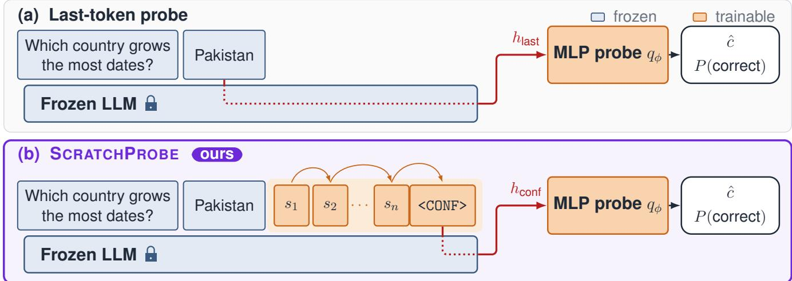
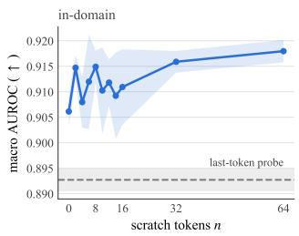
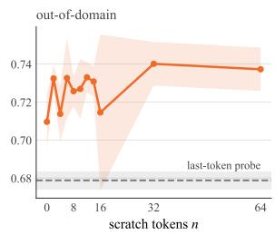
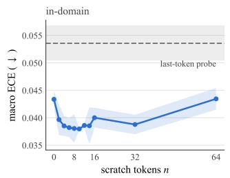
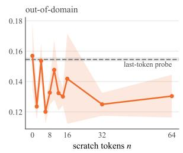
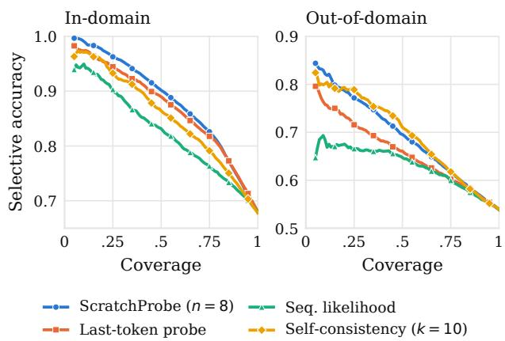

# Learned Readout Tokens for Extracting Large Language Model Confidence

Nima Seifi, Martin Ester

School of Computing Science, Simon Fraser University 8888 University Drive, Burnaby, BC V5A 1S6, Canada {nseifihe, ester}@sfu.ca

## Abstract

Large language models (LLMs) are increasingly used within everyday applications where their responses have significant downstream impacts. For responsible deployment of such sys- tems, we desire insight into how much we can trust their individual outputs. A popular approach for estimating LLM confidence is to train probes on the hidden states of the LLM’s tokens to predict the correctness of the model’s output. These probes typically read hidden states from tokens that are already in the model’s vocabulary. In this work, we introduce a new approach to confidence probes that learn a new readout token and utilize its hidden states to train the probe. We show that our learned readout approach ScratchProbe outperforms its existing-token counterpart on a variety of datasets and LLMs. We also extend our method to a multi-token approach which we show provides further performance improvements. Finally, since the learned readout changes only the position a probe reads from, any existing probe can adopt it. Applied to a state- of-the-art probe, it improves AUROC on every backbone, in domain and out of domain.

## Introduction

As large language models (LLMs) are increasingly utilized in high-stakes applications, the real-world consequences of their outputs are becoming more significant (Magesh et al. 2025; Morgan Stanley 2024; Jabarian and Henkel 2025; Qiu et al. 2025). We seek a calibrated confidence score: one that approximates the probability of whether a generated an- swer is correct. A well-calibrated model enables systems to automate decisions when the model is confident, and de- fer to a higher authority (human or stronger model) when uncertainty is high. This becomes especially important in high-stakes applications where the cost of an error is high.

In traditional machine learning, the confidence of a pre- diction is the softmax of the model’s logit. LLMs inherit this convention, but an LLM is trained to predict the next token. Its logits therefore score how likely a token string is, not how likely the answer is correct. As a result, logit-derived confidence is often poorly calibrated (Jiang et al. 2021; Lin, Hilton, and Evans 2022a; Plaut, Khanh, and Trinh 2025; Lovering et al. 2025; Tian et al. 2023). This motivates investigating alternative signals for confidence estimation. Hidden states carry more information than the output distribution, so prior works train a probe on hidden states of existing tokens (Azaria and Mitchell 2023; Burns et al. 2023; Orgad et al.

2025). However, the same next-token objective shaped these hidden states, so they encode what helps predict the next to- ken, not what predicts answer correctness. To address this, we introduce a dedicated token whose hidden state is opti- mized to surface information about answer correctness to the probe.

In this work, we introduce ScratchProbe, a confidence- probing approach that jointly trains the embedding of a dedicated <CONF> readout token and a probe to predict answer correctness. In a causal language model, every token attends to all tokens that precede it. A readout token appended after the generated answer therefore has access to the complete question and the complete answer, so we place the <CONF> token at this position (Figure 1). The same property means a single readout token is not the only option: tokens in- serted before the readout can also see the full context. We therefore extend ScratchProbe by inserting multiple train- able scratch tokens before the final <CONF> readout. Prior dedicated-token methods such as Self-REF and GrACE up- date the backbone weights to produce the confidence token (Chuang et al. 2025; Zhang, Liu, and Patras 2026), and such fine-tuning degrades performance outside the training do- main (Biderman et al. 2024). We therefore freeze the LLM parameters and optimize only the added token embedding(s) and the probe.

## Contributions

• We propose ScratchProbe, a novel approach to confidence-probing that jointly trains a probe with token embeddings to make confidence estimates.

• Across three backbones and seven datasets, we show the single learned readout token on average outperforms the equivalent last-token probe.

• We show that our multi-token extension provides further gains over the single-token design.

• We demonstrate that our method can augment existing probes. Applied to Internal Inspector (I2) (Beigi et al. 2024), it improves AUROC across every backbone, in domain and out of domain.

## Related Work

## Training-Free Confidence Signals

Confidence signals that need no training read the model’s own outputs. The simplest are computed from the answer’s token probabilities: maximum or length-normalized log- probability and token-level entropy (Malinin and Gales 2021; Huang et al. 2025), but token likelihood measures fluency and frequency as much as factual content (Geng et al. 2024), so a fluent but wrong answer can score as high as a correct one. A second group queries the model about its answer instead of reading the answer’s probabilities. P(True) re-prompts the model to judge the answer and reads the probability of an afirmative token (Kadavath et al. 2022); verbalized confidence asks for a numeric score in words (Lin, Hilton, and Evans 2022a; Tian et al. 2023). Both inherit the overconfidence of the model’s self-reports (Xiong et al. 2024), and the verbal form also misleads the human reader, who over- estimates accuracy from fluent explanations (Steyvers et al. 2025). Self-consistency (Wang et al. 2023; Xiong et al. 2024) avoids the self-report that P(True) and verbalized confidence depend on (Kadavath et al. 2022; Tian et al. 2023): it samples several answers and measures their agreement, at the cost of several generations per query. We use sequence likelihood, P(True), verbalized confidence, and self-consistency as baselines. ScratchProbe shares their post-hoc placement, since it scores an answer that has already been generated, but it reads a trained hidden state rather than a decoded statement or a sampled set.

## Probing Hidden States

The LLM probing works (Azaria and Mitchell 2023; Burns et al. 2023; Orgad et al. 2025; Beigi et al. 2024) apply the diagnostic classifier of Alain and Bengio (2016), a linear model trained on intermediate activations to measure what a layer makes linearly accessible. It shows that hidden states carry correctness information that the decoded text does not. These prior works all read a position that the input already contains, usually the last answer token (Orgad et al. 2025; Zhang et al. 2025). Prior works provide two findings that shape Scratch-Probe. First, probe quality depends on which position and layer the hidden state is taken from (Orgad et al. 2025; Beigi et al. 2024). Second, probes trained on one task only transfer to tasks that require similar skills (Orgad et al. 2025). ScratchProbe leverages these findings by (a.) reading from a token whose hidden state is optimized for the task and (b.) training on a mix of tasks to improve generalization.

## Learned Tokens

Prompt tuning (Lester, Al-Rfou, and Constant 2021) trains a token embedding against a frozen backbone, the same con- straint the probes above operate under (Azaria and Mitchell 2023; Burns et al. 2023). The tuned tokens are conventionally a prefix placed before the input to steer generation toward a task. ScratchProbe uses the same mechanism with a difer- ent placement and target. A prefix precedes the answer and cannot attend to it, so ScratchProbe places its tuned tokens after the generated answer, as a sufix (Figure 1). The sufix is trained to supply features to a probe, not to change the output distribution, so the generated text is unchanged.

Dedicated confidence tokens have also been trained as out- puts. Self-REF and the [IDK] token supervise the model to generate an uncertainty token and update the backbone to do so (Chuang et al. 2025; Cohen et al. 2024). GrACE (Zhang, Liu, and Patras 2026) difers from Self-REF and [IDK] in the readout: it adds a <CNF> token, trains its embedding together with LoRA adapters, and reads confidence from the LM-head probability of that token at the end of the response rather than from a generated uncertainty to- ken. These methods obtain confidence without an auxiliary model, at the cost of modifying the weights. ScratchProbe combines one element from each of the two preceding lines. From the output-token methods it takes the dedicated confi- dence token. Unlike those methods, it appends the token to the response programmatically, rather than having the model generate it. From the probing methods it takes the frozen backbone and the probe that reads the token’s hidden state.

Extra token positions can also carry computation. Pause tokens appended before the answer give the model additional steps before it commits (Goyal et al. 2024), filler tokens can perform hidden computation (Pfau, Merrill, and Bowman 2024), and vision transformers improve when register tokens absorb global information (Darcet et al. 2024). These three results motivate the scratch tokens in ScratchProbe: po- sitions inserted before the readout whose hidden states are never read directly, but which give the readout token more processed features to attend over.

## Method

## Overview

Our goal is to produce a confidence estimate for an LLM’s answer to a specific question. This estimate should predict whether that answer is correct.

We require access to the dataset of question-answer pairs $( q _ { i } , a _ { i } )$ where $q _ { i }$ is a question and $a _ { i }$ is its ground-truth answer. Given an $\mathrm { L L M } p _ { \theta }$ , we sample an answer $\hat { a } _ { i } \sim p _ { \theta } ( \cdot |$ $q _ { i } )$ . We then augment this question-answer sequence with a sufix of tunable tokens. We append $n \geq 0$ scratch tokens $s _ { 1 } \ldots s _ { n }$ , followed by the <CONF> readout token (Figure 1). Concatenating these pieces gives the input sequence

$$
u _ { i } = [ q _ { i } ] \left[ \hat { a } _ { i } \right] \left[ s _ { 1 } \ldots s _ { n } \right] < \mathrm { C O N F } > ,
$$

which we pass through the LLM to obtain the hidden states of the appended tokens.

To produce a confidence estimate, we use a probe. This is a small network $f _ { \phi } : \mathbb { R } ^ { d }  ( 0 , 1 )$ that takes a token hidden state $h _ { i } \in \mathbb { R } ^ { d }$ as input and outputs a predicted probability of correctness $\hat { c } _ { i } = f _ { \phi } ( h _ { i } )$ . Prior probes read $h _ { i }$ from a position within the generated answer as discussed in the Related Work section. We instead read it from the <CONF> position $( h _ { \mathrm { c o n f } } ) .$

A grader G compares each generated answer against the ground truth and produces a binary correctness label $z _ { i } =$ $\bar { G } ( q _ { i } , a _ { i } , \hat { a } _ { i } ) \in \{ 0 , 1 \}$ . Our resulting training dataset is a set of tuples in the form $( u _ { i } , z _ { i } )$

A good estimate $\hat { c } _ { i }$ must separate correct answers from incorrect ones, and its value must approximate the observed rate of correctness. We measure the first property with the area under the ROC curve (AUROC) and the second with expected calibration error (ECE).

  
Figure 1: (a) The standard last-token probe from prior work and (b) ScratchProbe. Both use the same frozen LLM and MLP probe; only the probed position difers.

## New Tokens

The scratch tokens $s _ { 1 } , \ldots , s _ { n }$ and <CONF> do not exist in the base vocabulary, so we add them to the tokenizer and to the embedding matrix. Each scratch token has its own embedding row. A randomly initialized row would be far from the existing embeddings. This would push the hidden states of the distribution the frozen LLM was trained on. To mitigate this efect while introducing variance, we initialize each new row to the mean of the existing embedding matrix plus small Gaussian noise.

The number of scratch tokens n is a hyperparameter of ScratchProbe. When n=0, the augmented sequence ends with a single trainable <CONF> token. When n>0, Scratch-Probe inserts n tunable scratch tokens before <CONF>.

## Probe

The probe $f _ { \phi }$ is a small MLP with parameters $\phi \ =$ $\{ W _ { 1 } , b _ { 1 } , W _ { 2 } , b _ { 2 } \}$ . It reads the final-layer hidden state $h _ { \mathrm { c o n f } }$ at the <CONF> position and produces the confidence estimate

$$
\hat { c } = \sigma ( W _ { 2 } \mathrm { G E L U } ( W _ { 1 } h _ { \mathrm { c o n f } } + b _ { 1 } ) + b _ { 2 } ) \in ( 0 , 1 ) .
$$

For a backbone with hidden size $d ,$ the hidden width is $d / 4$

## Training

The LLM parameters θ stay frozen throughout. The only trainable parameters are the n+1 new embedding rows and the probe parameters $\phi .$

The probe output $\hat { c } _ { i }$ is a probability and the grader label $z _ { i }$ is binary, so we train with the binary cross-entropy (BCE) loss,

$$
\mathcal { L } ( \phi , E _ { \mathrm { n e w } } ) = - \frac { 1 } { N } \sum _ { i = 1 } ^ { N } \left[ z _ { i } \log \hat { c } _ { i } + ( 1 - z _ { i } ) \log ( 1 - \hat { c } _ { i } ) \right] ,
$$

where $\hat { c } _ { i } = f _ { \phi } ( h _ { \mathrm { c o n f } } ( u _ { i } ) )$ ) and $E _ { \mathrm { n e w } }$ denotes the n+1 added embedding rows.

## Inference

At test time, ScratchProbe adds a single extra forward pass to standard generation. Given a question $q ,$ we first generate the answer $\bar { \hat { a } } \sim p _ { \theta } ( \cdot \mid q )$ exactly as the base model would. We then append the scratch tokens and <CONF> to form $u = [ q ] \ [ \bar { \hat { a } } ] ^ { - } [ s _ { 1 } \ldots s _ { n } ] < \mathrm { C O N F } >$ and run one forward pass to obtain the final-layer hidden state $h _ { \mathrm { c o n f } }$ . The probe maps this state to the confidence estimate $\hat { c } = f _ { \phi } ( h _ { \mathrm { c o n f } } )$ . With this pipeline, the confidence estimation step costs n+1 tokens of prefill.

## Experiments

Training Data. A correctness probe trained on one task transfers only to tasks that require a similar skill (Orgad et al. 2025). We therefore train on a mix of three datasets that cover diferent skills and answer formats: short-form question answering from TriviaQA (Joshi et al. 2017), multiple-choice science exam questions from SciQ (Welbl, Liu, and Gardner 2017), and mathematical reasoning problems from GSM8K (Cobbe et al. 2021).

Grader. The datasets difer in answer format, so the grader G applies a format-specific rule to each. For multiple-choice questions it extracts the option letter from the answer and compares it with the ground truth. For math problems it extracts the final number and compares it with the reference value. For free-form questions it normalizes the answer and compares it with a list of accepted aliases. A correct free- form answer can be phrased in a way that no alias covers, so answers that fail the alias match are re-graded by an LLM judge (Mistral-Small-24B-Instruct) (Mistral AI 2025).

Baselines. ScratchProbe does not tune the backbone, so we compare only against methods that share this property. Table 1 lists the baselines in two groups. The first group needs no training and predicts confidence from the model’s outputs. The second group trains a probe on the frozen backbone with the same data as ScratchProbe.

• Sequence likelihood (Malinin and Gales 2021): the length-normalized mean token log-probability of the gen- erated answer.

• P(True) (Kadavath et al. 2022): the model is re-prompted to judge its own answer; confidence is the normalized probability of the afirmative token.

• Verbalized confidence (Lin, Hilton, and Evans 2022a; Tian et al. 2023): the model is asked to state its confidence as a number from 0 to 100.

• Self-consistency (Wang et al. 2023; Xiong et al. 2024): k=10 answers are sampled per question at temperature 1.0; confidence is the fraction that agree with the greedily decoded answer.

• Semantic entropy (Kuhn, Gal, and Farquhar 2023; Farquhar et al. 2024): the same k=10 samples are clustered by meaning with an NLI model; confidence is exp( H) where H is the entropy over clusters.

• Internal Inspector (I2) (Beigi et al. 2024): it trains a sep- arate 8-layer Transformer encoder on the LLM’s residual stream, attention output, and feed-forward output at ev- ery layer. This makes it the most expensive baseline: it stores three states per layer for every example and trains a probe with many more parameters, whereas Scratch- Probe reads one final-layer state.

• Last-token probe (Azaria and Mitchell 2023; Orgad et al. 2025): the same probe and loss as ScratchProbe, but it reads the final-layer hidden state at the last answer token. Comparing against this isolates the efect of the learned read position. It is therefore the central comparison of the paper.

• ScratchProbe (n=0, ours): a single learned <CONF> readout token and no scratch tokens.

• ScratchProbe (n=8, ours): eight learned scratch tokens before the <CONF> readout.

Every method scores the same greedily generated answers, so the methods difer only in how they score, not in what answer they score.

Backbones. We evaluate our method across three instruction-tuned backbones: Llama-3.2-3B-Instruct and Llama-3.1-8B-Instruct (Grattafiori, Dubey et al. 2024), and Phi-4-mini-instruct (Abouelenin et al. 2025). As explained in the Method section, we keep these backbone parameters frozen.

Evaluation. We evaluate in two settings. In-domain (ID) evaluation uses held-out test splits of the three training datasets (TriviaQA, SciQ, and GSM8K). Out-of-domain (OOD) evaluation uses four benchmarks that were not seen during training: MMLU (Hendrycks et al. 2021a), TruthfulQA (Lin, Hilton, and Evans 2022b), CommonsenseQA (CSQA) (Talmor et al. 2019), and MATH-500 (Hendrycks et al. 2021b; Lightman et al. 2024). We report the unweighted average over the ID benchmarks and over the OOD bench- marks. The full per-dataset results are in the technical sup- plement (Tables S1–S6). The reported numbers are the mean across 3 seeds.

  
Figure 2: Macro AUROC on Phi-4-mini against n. The dashed line is the last-token probe.

## Results

Table 1 reports macro-average AUROC for all methods on all three backbones. With a single learned readout token (n=0), ScratchProbe exceeds the last-token probe on the ID and OOD macro averages of all three backbones. Adding eight scratch tokens maintains or further raises the ID average on all three backbones.

Table 2 reports ECE for the same methods and the same answers as Table 1. The training-free baselines fit no param- eters, so for them the two ID/OOD groupings are only two sets of benchmarks. Their higher OOD ECE therefore comes from harder benchmarks, not from a distribution shift.

Trained Readout vs Last-Token Readout The last-token probe and ScratchProbe share the backbone, the probe, the loss, and the training data, so a diference between them comes only from the probed position. With respect to AU- ROC (Table 1), ScratchProbe (n=0) exceeds the last-token probe in all six ID and OOD columns. With respect to ECE (Table 2), ScratchProbe (n=8) has lower ECE in five of the six columns. These results support our central hypoth- esis: a learned readout position carries more information about answer correctness than the last answer token. Ta- ble 3 shows one such case: for a wrong MMLU answer from Llama-3.1-8B, the last-token probe assigns 0.81 confidence and ScratchProbe (n=8) assi ns 0.17.

The comparison with I2 is mixed. I2 reads three states from every layer and trains an 8-layer transformer probe. Therefore, it is a much costlier probe to train. Despite this cost gap, ScratchProbe (n=8) stays within 0.012 AUROC of I2 on every ID column, exceeds it on every OOD column, and has lower ECE in five of the six columns.

The Impact of n Figures 2 and 3 show the results of varying the number of scratch tokens n on Phi-4-mini. This n-sweep shows that most of ScratchProbe’s gain over the last-token probe is captured by n=0. In domain, n=0 recov-ers 60% of the total AUROC improvement while the scratch tokens account for the remaining 40%. These results are sim- ilar OOD.

<table><tr><td rowspan="2">Method</td><td colspan="2">Llama-3.2-3B</td><td colspan="2">Llama-3.1-8B</td><td colspan="2">Phi-4-mini (3.8B)</td></tr><tr><td>ID</td><td>OOD</td><td>ID</td><td>OOD</td><td>ID</td><td>OOD</td></tr><tr><td>Seq. likelihood</td><td>0.816</td><td>0.688</td><td>0.829</td><td>0.698</td><td>0.771</td><td>0.658</td></tr><tr><td>P(True)</td><td>0.727</td><td>0.594</td><td>0.719</td><td>0.608</td><td>0.783</td><td>0.714</td></tr><tr><td>Verbalized conf.</td><td>0.744</td><td>0.613</td><td>0.714</td><td>0.645</td><td>0.553</td><td>0.588</td></tr><tr><td>Self-consistency (k=10)</td><td>0.873</td><td>0.737</td><td>0.873</td><td>0.745</td><td>0.835</td><td>0.734</td></tr><tr><td>Semantic entropy (k=10)</td><td>0.840</td><td>0.723</td><td>0.844</td><td>0.730</td><td>0.806</td><td>0.718</td></tr><tr><td>Last-token probe</td><td>0.858</td><td>0.721</td><td>0.875</td><td>0.729</td><td>0.893</td><td>0.679</td></tr><tr><td>Internal Inspector (I2)</td><td>0.872</td><td>0.723</td><td>0.895</td><td>0.730</td><td>0.927</td><td>0.714</td></tr><tr><td>SCRATCHPROBE (n=0, ours)</td><td>0.877</td><td>0.747</td><td>0.887</td><td>0.749</td><td>0.906</td><td>0.710</td></tr><tr><td>SCRATCHPROBE (n=8, ours)</td><td>0.884</td><td>0.746</td><td>0.897</td><td>0.750</td><td>0.915</td><td>0.726</td></tr></table>

Table 1: Macro-average AUROC ( ) of ScratchProbe and baselines on three frozen instruction-tuned backbones. Bold marks the best and underline marks the second-best value in each column. Per-dataset results appear in Tables S1–S3 of the technical supplement.
<table><tr><td rowspan="2">Method</td><td colspan="2">Llama-3.2-3B</td><td colspan="2">Llama-3.1-8B</td><td colspan="2">Phi-4-mini (3.8B)</td></tr><tr><td>ID</td><td>OOD</td><td>ID</td><td>OOD</td><td>ID</td><td>OOD</td></tr><tr><td>Seq. likelihood</td><td>0.093</td><td>0.261</td><td>0.073</td><td>0.267</td><td>0.140</td><td>0.288</td></tr><tr><td>P(True)</td><td>0.378</td><td>0.298</td><td>0.221</td><td>0.369</td><td>0.149</td><td>0.207</td></tr><tr><td>Verbalized conf.</td><td>0.107</td><td>0.183</td><td>0.098</td><td>0.308</td><td>0.278</td><td>0.407</td></tr><tr><td>Self-consistency (k=10)</td><td>0.072</td><td>0.151</td><td>0.064</td><td>0.154</td><td>0.071</td><td>0.161</td></tr><tr><td>Semantic entropy (k=10)</td><td>0.123</td><td>0.120</td><td>0.105</td><td>0.122</td><td>0.124</td><td>0.134</td></tr><tr><td>Last-token probe</td><td>0.064</td><td>0.118</td><td>0.043</td><td>0.122</td><td>0.054</td><td>0.154</td></tr><tr><td>Internal Inspector (I2)</td><td>0.065</td><td>0.157</td><td>0.043</td><td>0.130</td><td>0.037</td><td>0.146</td></tr><tr><td>SCRATCHPROBE (n=0, ours)</td><td>0.060</td><td>0.130</td><td>0.044</td><td>0.130</td><td>0.043</td><td>0.157</td></tr><tr><td>SCRATCHPROBE (n=8, ours)</td><td>0.059</td><td>0.123</td><td>0.039</td><td>0.106</td><td>0.038</td><td>0.133</td></tr></table>

Table 2: Macro-average ECE ( , 15 equal-mass bins). Bold marks the best and underline marks the second-best value in each column. Per-dataset results appear in Tables S4–S6 of the technical supplement.

<table><tr><td colspan="2">Input-Output Example</td></tr><tr><td colspan="2">Question: Divided government frequently results in: A) reapportionment of voting districts; B) amendments to the Constitution;</td></tr><tr><td colspan="2">C) conflict between states and the federal government; D) delays in the confirmation of those nominated to be ambassadors.</td></tr><tr><td colspan="2">Model Answer: C Ground Truth: D Grader: Incorrect</td></tr><tr><td colspan="2">Probe</td></tr><tr><td colspan="2">Last-token</td></tr><tr><td colspan="2">SCRATCHPROBE (n=8)</td></tr></table>

Table 3: Input and output example. The last-token probe is confident in a wrong answer; ScratchProbe is not.

We leave further investigation of the role and utility of these scratch tokens to future work, and we ofer one direc- tion. Probe-based methods, including ScratchProbe, score a single generated answer and never see the alternative an- swers that consistency-based methods sample. The scratch tokens are a natural place to encode this signal. One could distill consistency-based information into them by training each scratch token to encode one sampled answer, so that the <CONF> readout receives consistency-based information in

  
Figure 3: Macro ECE on Phi-4-mini against n. The dashed line is the last-token probe.

a single forward pass.

Risk-Coverage Tradeof A confidence score can be used to decide which answers to present and which to withhold. Figure 4 visualizes how that would look for Phi-4-mini. In domain, withholding the 20% least-confident answers raises accuracy on the remaining set from 0.68 to 0.80, and with- holding half raises it to 0.90. In production, we can therefore choose the coverage we must satisfy and estimate the accu- racy of our resulting system.

<table><tr><td></td><td colspan="6">AUROC (↑)</td><td colspan="6">ECE (↓)</td></tr><tr><td></td><td colspan="2">Llama-3.2-3B</td><td colspan="2">Llama-3.1-8B</td><td colspan="2">Phi-4-mini</td><td colspan="2">Llama-3.2-3B</td><td colspan="2">Llama-3.1-8B</td><td colspan="2">Phi-4-mini</td></tr><tr><td>Probe</td><td>ID</td><td>OOD</td><td>ID</td><td>OOD</td><td>ID</td><td>OOD</td><td>ID</td><td>OOD</td><td>ID</td><td>OOD</td><td>ID</td><td>OOD</td></tr><tr><td> $\mathrm { I } ^ { 2 }$  (last answer token)</td><td>0.872</td><td>0.723</td><td>0.895</td><td>0.730</td><td>0.927</td><td>0.714</td><td>0.065</td><td>0.157</td><td>0.043</td><td>0.130</td><td>0.037</td><td>0.146</td></tr><tr><td>I2 + SCRATCHPROBE tokens (n=8)</td><td>0.900</td><td>0.754</td><td>0.906</td><td>0.742</td><td>0.935</td><td>0.757</td><td>0.055</td><td>0.137</td><td>0.039</td><td>0.112</td><td>0.045</td><td>0.173</td></tr></table>

Table 4: Macro-average AUROC ( ) and ECE ( ) of $\mathrm { I } ^ { 2 }$ with its original last-token readout compared against its ScratchProbe variant.

  
Figure 4: Selective accuracy against coverage on Phi-4-mini. At each coverage threshold, the most confident fraction of answers is kept and the accuracy of the kept set is reported.

Learned Sufix Tokens Transfer to Other Probes ScratchProbe changes only the position a probe reads from. In principle, any probe can therefore read from a learned suf- fix instead of the last answer token. $\mathrm { I } ^ { 2 }$ is the strongest probe- based baseline in Table 1, so we test this claim on it. We build a ScratchProbe variant of $\mathrm { I } ^ { 2 }$ that difers from the original only in its readout: the probe reads from the <CONF> token after eight scratch tokens. As in ScratchProbe, the sufix embeddings are trained jointly with the $\mathrm { I } ^ { 2 }$ probe. Table 4 reports the result, and Table S7 in the technical supplement gives the per-dataset values. The variant exceeds $\mathrm { I } ^ { 2 ^ { \bullet } }$ in AU- ROC on every backbone, ID and OOD. It has lower ECE on both Llama backbones but higher ECE on Phi-4-mini. This result suggests that a learned sufix is a cheap addition to existing probe methods. Whether the gain extends to probes for tasks outside confidence estimation is not yet clear and could be a fruitful direction for future work.

## Limitations

Our backbones span two model families at 3–8B scale. Whether the gain of a learned readout over the last answer token holds at larger scale, or for base models without in- struction tuning, is untested. The training mix is short-form question answering with a single gradable answer. Long- form generation, partially correct answers, and tasks without a reference answer are therefore areas for future exploration. We also do not explain what the scratch tokens compute.

Their contribution is measured only through the downstream metrics, so the mechanism remains a hypothesis. Finally, ScratchProbe reads hidden states and extends the embed- ding matrix, so it requires white-box access and does not apply to API-only models.

## Conclusion

The hidden states that existing correctness probes read are shaped by the next-token objective, and prior probes have accepted this mismatch. Our work targets the read position as a trainable component instead. A single learned readout token improved the standard last-token probe in AUROC on every backbone, and tuning eight scratch tokens before the readout token added further gains in AUROC and ECE. The same technique improved the AUROC and ECE of an existing state-of-the-art probe. Therefore, the readout position ofers an independent axis for probe improvement at the cost of n+1 tokens of prefill.

## Acknowledgments

Compute resources were provided by the Digital Research Alliance of Canada (Compute Canada). Our implementation uses PyTorch, Hugging Face Transformers, and Hugging Face PEFT.

## References

Abouelenin, A.; et al. 2025. Phi-4-Mini Technical Report: Compact yet Powerful Multimodal Language Models via Mixture-of-LoRAs. arXiv preprint arXiv:2503.01743.

Alain, G.; and Bengio, Y. 2016. Understanding Intermedi- ate Layers Using Linear Classifier Probes. arXiv preprint arXiv:1610.01644.

Azaria, A.; and Mitchell, T. M. 2023. The Internal State of an LLM Knows When It’s Lying. In Bouamor, H.; Pino, J.; and Bali, K., eds., Findings of the Association for Computational Linguistics: EMNLP 2023, Singapore, December 6-10, 2023, volume EMNLP 2023 of Findings ofACL, 967– 976. Association for Computational Linguistics.

Beigi, M.; Shen, Y.; Yang, R.; Lin, Z.; Wang, Q.; Mohan, A.; He, J.; Jin, M.; Lu, C.-T.; and Huang, L. 2024. InternalIn- spector I2: Robust Confidence Estimation in LLMs through Internal States. In Findings of the Association for Computational Linguistics: EMNLP 2024, 12847–12865. Association for Computational Linguistics.

Biderman, D.; Portes, J.; Ortiz, J. J. G.; Paul, M.; Greengard, P.; Jennings, C.; King, D.; Havens, S.; Chiley, V.; Frankle,

J.; Blakeney, C.; and Cunningham, J. P. 2024. LoRA Learns Less and Forgets Less. Transactions on Machine Learning Research.

Burns, C.; Ye, H.; Klein, D.; and Steinhardt, J. 2023. Dis- covering Latent Knowledge in Language Models Without Supervision. In The Eleventh International Conference on Learning Representations, ICLR 2023, Kigali, Rwanda, May 1-5, 2023. OpenReview.net.

Chuang, Y.-N.; Sarma, P. K.; Gopalan, P.; Boccio, J.; Bolouki, S.; Hu, X.; and Zhou, H. 2025. Learning to Route LLMs with Confidence Tokens. In Proceedings of the 42nd International Conference on Machine Learning, volume 267 of Proceedings ofMachine Learning Research, 10859–10878. PMLR.

Cobbe, K.; Kosaraju, V.; Bavarian, M.; Chen, M.; Jun, H.; Kaiser, L.; Plappert, M.; Tworek, J.; Hilton, J.; Nakano, R.; Hesse, C.; and Schulman, J. 2021. Training Verifiers to Solve Math Word Problems. arXiv preprint arXiv:2110.14168.

Cohen, R.; Dobler, K.; Biran, E.; and de Melo, G. 2024. I Don’t Know: Explicit Modeling of Uncertainty with an [IDK] Token. In Advances in Neural Information Processing Systems, volume 37.

Darcet, T.; Oquab, M.; Mairal, J.; and Bojanowski, P. 2024. Vision Transformers Need Registers. In International Conference on Learning Representations (ICLR).

Farquhar, S.; Kossen, J.; Kuhn, L.; and Gal, Y. 2024. Detect- ing hallucinations in large language models using semantic entropy. Nat., 630(8017): 625–630.

Geng, J.; Cai, F.; Wang, Y.; Koeppl, H.; Nakov, P.; and Gurevych, I. 2024. A Survey of Confidence Estimation and Calibration in Large Language Models. In Proceedings ofthe 2024 Conference of the North American Chapter of the Association for Computational Linguistics: Human Language Technologies (Volume 1: Long Papers), 6577–6595. Associ-ation for Computational Linguistics.

Goyal, S.; Ji, Z.; Rawat, A. S.; Menon, A. K.; Kumar, S.; and Nagarajan, V. 2024. Think Before You Speak: Training Language Models with Pause Tokens. In International Conference on Learning Representations (ICLR).

Grattafiori, A.; Dubey, A.; et al. 2024. The Llama 3 Herd of Models. arXiv preprint arXiv:2407.21783.

Hendrycks, D.; Burns, C.; Basart, S.; Zou, A.; Mazeika, M.; Song, D.; and Steinhardt, J. 2021a. Measuring Massive Mul- titask Language Understanding. In 9th International Conference on Learning Representations, ICLR 2021, Virtual Event, Austria, May 3-7, 2021. OpenReview.net.

Hendrycks, D.; Burns, C.; Kadavath, S.; Arora, A.; Basart, S.; Tang, E.; Song, D.; and Steinhardt, J. 2021b. Measuring Mathematical Problem Solving With the MATH Dataset. In Vanschoren, J.; and Yeung, S., eds., Proceedings of the Neural Information Processing Systems Track on Datasets and Benchmarks 1, NeurIPS Datasets and Benchmarks 2021, December 2021, virtual.

Huang, Y.; Song, J.; Wang, Z.; Zhao, S.; Chen, H.; Juefei-Xu, F.; and Ma, L. 2025. Look Before You Leap: An Exploratory Study of Uncertainty Analysis for Large Language Models.

IEEE Transactions on Software Engineering, 51(2): 413– 429.

Jabarian, B.; and Henkel, L. 2025. Voice AI in Firms: A Natu- ral Field Experiment on Automated Job Interviews. Working paper 5395709, SSRN.

Jiang, Z.; Araki, J.; Ding, H.; and Neubig, G. 2021. How Can We Know When Language Models Know? On the Cali- bration of Language Models for Question Answering. Transactions ofthe Associationfor Computational Linguistics, 9: 962–977.

Joshi, M.; Choi, E.; Weld, D. S.; and Zettlemoyer, L. 2017. TriviaQA: A Large Scale Distantly Supervised Challenge Dataset for Reading Comprehension. In Proceedings of the 55th Annual Meeting of the Association for Computational Linguistics (Volume 1: Long Papers), 1601–1611. Association for Computational Linguistics.

Kadavath, S.; Conerly, T.; Askell, A.; Henighan, T.; Drain, D.; Perez, E.; Schiefer, N.; Hatfield-Dodds, Z.; DasSarma, N.; Tran-Johnson, E.; et al. 2022. Language Models (Mostly) Know What They Know. arXiv preprint arXiv:2207.05221.

Kuhn, L.; Gal, Y.; and Farquhar, S. 2023. Semantic Un- certainty: Linguistic Invariances for Uncertainty Estimation in Natural Language Generation. In The Eleventh International Conference on Learning Representations, ICLR 2023, Kigali, Rwanda, May 1-5, 2023. OpenReview.net.

Lester, B.; Al-Rfou, R.; and Constant, N. 2021. The Power of Scale for Parameter-Eficient Prompt Tuning. In Proceedings of the 2021 Conference on Empirical Methods in Natural Language Processing (EMNLP).

Lightman, H.; Kosaraju, V.; Burda, Y.; Edwards, H.; Baker, B.; Lee, T.; Leike, J.; Schulman, J.; Sutskever, I.; and Cobbe, K. 2024. Let’s Verify Step by Step. In The Twelfth International Conference on Learning Representations, ICLR 2024, Vienna, Austria, May 7-11, 2024. OpenReview.net.

Lin, S.; Hilton, J.; and Evans, O. 2022a. Teaching Models to Express Their Uncertainty in Words. Transactions on Machine Learning Research.

Lin, S.; Hilton, J.; and Evans, O. 2022b. TruthfulQA: Mea-suring How Models Mimic Human Falsehoods. In Mure- san, S.; Nakov, P.; and Villavicencio, A., eds., Proceedings of the 60th Annual Meeting of the Association for Computational Linguistics (Volume 1: Long Papers), ACL 2022, Dublin, Ireland, May 22-27, 2022, 3214–3252. Association for Computational Linguistics.

Lovering, C. J.; Krumdick, M.; Lai, V. D.; Reddy, V.; Ebner, S.; Kumar, N.; Koncel-Kedziorski, R.; and Tanner, C. 2025. Language Model Probabilities are Not Calibrated in Numeric Contexts. In Proceedings of the 63rd Annual Meeting of the Association for Computational Linguistics (Volume 1: Long Papers), 29218–29257. Association for Computational Linguistics.

Magesh, V.; Surani, F.; Dahl, M.; Suzgun, M.; Manning, C. D.; and Ho, D. E. 2025. Hallucination-Free? Assessing the Reliability of Leading AI Legal Research Tools. Journal ofEmpirical Legal Studies, 22(2): 216–242.

Malinin, A.; and Gales, M. J. F. 2021. Uncertainty Estimation in Autoregressive Structured Prediction. In 9th International

Conference on Learning Representations, ICLR 2021, Virtual Event, Austria, May 3-7, 2021. OpenReview.net.

Mistral AI. 2025. Mistral Small 3 (Mistral-Small-24B-Instruct-2501). https://huggingface.co/mistralai/Mistral-Small-24B-Instruct-2501.

Morgan Stanley. 2024. Morgan Stanley Wealth Manage- ment Announces Latest Game-Changing Addition to Suite of GenAI Tools. Press release. Published June 26, 2024. Accessed October 2, 2026.

Orgad, H.; Toker, M.; Gekhman, Z.; Reichart, R.; Szpektor, I.; Kotek, H.; and Belinkov, Y. 2025. LLMs Know More Than They Show: On the Intrinsic Representation of LLM Hallucinations. In The Thirteenth International Conference on Learning Representations, ICLR 2025, Singapore, April 24-28, 2025. OpenReview.net.

Pfau, J.; Merrill, W.; and Bowman, S. R. 2024. Let’s Think Dot by Dot: Hidden Computation in Transformer Lan- guage Models. In First Conference on Language Modeling (COLM).

Plaut, B.; Khanh, N. X.; and Trinh, T. 2025. Probabilities of Chat LLMs Are Miscalibrated but Still Predict Correct- ness on Multiple-Choice Q&A. Transactions on Machine Learning Research.

Qiu, L.; Tang, C.; Bi, X.; Burtch, G.; Chen, Y.; and Zhang, H. 2025. Physician Use of Large Language Models: A Quantitative Study Based on Large-Scale Query-Level Data. Journal ofMedical Internet Research, 27: e76941.

Steyvers, M.; Tejeda, H.; Kumar, A.; Belem, C.; Karny, S.; Hu, X.; Mayer, L. W.; and Smyth, P. 2025. What Large Language Models Know and What People Think They Know. Nature Machine Intelligence, 7: 221–231.

Talmor, A.; Herzig, J.; Lourie, N.; and Berant, J. 2019. Com- monsenseQA: A Question Answering Challenge Targeting Commonsense Knowledge. In Burstein, J.; Doran, C.; and Solorio, T., eds., Proceedings ofthe 2019 Conference ofthe North American Chapter of the Association for Computational Linguistics: Human Language Technologies, NAACL-HLT2019, Minneapolis, MN, USA, June 2-7, 2019, Volume 1 (Long and Short Papers), 4149–4158. Association for Com-putational Linguistics.

Tian, K.; Mitchell, E.; Zhou, A.; Sharma, A.; Rafailov, R.; Yao, H.; Finn, C.; and Manning, C. D. 2023. Just Ask for Cali- bration: Strategies for Eliciting Calibrated Confidence Scores from Language Models Fine-Tuned with Human Feedback. In Bouamor, H.; Pino, J.; and Bali, K., eds., Proceedings of the 2023 Conference on Empirical Methods in Natural Language Processing, EMNLP 2023, Singapore, December 6-10, 2023, 5433–5442. Association for Computational Lin-guistics.

Wang, X.; Wei, J.; Schuurmans, D.; Le, Q. V.; Chi, E. H.; Narang, S.; Chowdhery, A.; and Zhou, D. 2023. Self- Consistency Improves Chain of Thought Reasoning in Lan- guage Models. In The Eleventh International Conference on Learning Representations, ICLR 2023, Kigali, Rwanda, May 1-5, 2023. OpenReview.net.

Welbl, J.; Liu, N. F.; and Gardner, M. 2017. Crowdsourcing Multiple Choice Science Questions. In Proceedings of the 3rd Workshop on Noisy User-generated Text (W-NUT).

Xiong, M.; Hu, Z.; Lu, X.; Li, Y.; Fu, J.; He, J.; and Hooi, B. 2024. Can LLMs Express Their Uncertainty? An Em- pirical Evaluation of Confidence Elicitation in LLMs. In International Conference on Learning Representations.

Zhang, A.; Chen, Y.; Pan, J.; Zhao, C.; Panda, A.; Li, J.; and He, H. 2025. Reasoning Models Know When They’re Right: Probing Hidden States for Self-Verification. In Second Conference on Language Modeling.

Zhang, Z.; Liu, Z.; and Patras, I. 2026. GrACE: A Genera- tive Approach to Better Confidence Elicitation and Eficient Test-Time Scaling in Large Language Models. In Liakata, M.; Moreira, V. P.; Zhang, J.; and Jurgens, D., eds., Proceedings of the 64th Annual Meeting of the Association for Computational Linguistics (Volume 1: Long Papers), ACL 2026, San Diego, California, United States, July 2-7, 2026, 23333–23350. Association for Computational Linguistics.

## Technical Supplement

## Per-Dataset Results

The main paper reports unweighted macro averages over the three in-domain (ID) and four out-of-domain (OOD) bench-marks. Tables S1–S3 give the AUROC of every method on every benchmark, one table per backbone. Tables S4–S6 give the corresponding ECE. The ID and OOD columns of each table reproduce the macro averages of the main paper.

The per-dataset view explains two patterns that the macro averages hide. First, self-consistency owes its OOD AUROC to MATH-500. It leads ScratchProbe (n=8) on MATH-500 on every backbone and on GSM8K on both Llama back- bones, and trails ScratchProbe on TriviaQA and SciQ on every backbone by 0.03 to 0.12. Second, the lower OOD AUROC of every probe on Phi-4-mini comes from MMLU and MATH-500, where the last-token probe falls to 0.605 and 0.742. ScratchProbe recovers most of that gap on both benchmarks.

All probe rows use the same frozen backbone, no LoRA, and the BCE loss of the main paper with no class balancing. All methods score the same greedily generated answers. The sequence-likelihood ECE is computed on the raw length- normalized likelihood, as in the main paper.

## Per-Dataset Results for I2 with Learned Sufix Tokens

Table S7 expands the I2 comparison of the main paper to every benchmark. The learned sufix raises I2’s AUROC on all 21 backbone–benchmark pairs. On ECE the variant is lower or equal on 11 of the 14 Llama pairs and higher on all seven Phi-4-mini pairs, with the largest Phi-4-mini increases on MMLU and CSQA.

The ScratchProbe variant of I2 was trained once, with seed 42, so its rows carry no standard deviation. The I2 baseline rows report three encoder seeds.

## Baseline Implementation Details

All baselines score the greedily decoded answer that the frozen backbone produced for the evaluation prompt. The prompts below are passed through each backbone’s chat tem- plate as a system message followed by a user message.

Sequence likelihood. The score is exp of the mean token log-probability over the answer tokens under the frozen backbone. ECE is reported on this raw score.

P(True). The backbone is re-prompted with the system message “You evaluate whether proposed answers to questions are correct.” and the user message

Question: {question}

Proposed answer: {answer}

Is the proposed answer correct? Reply with exactly one let- ter: A if it is correct, B if it is incorrect.

The confidence is the softmax over the logits of the tokens “A” and “B” at the first generated position, taken at “A”.

Verbalized confidence. The system message is “You assess your own answers. Reply with only a number between 0 and 100.” and the user message is

Question: {question}

Your answer: {answer}

How confident are you that your answer is correct? Reply with only a number between 0 and 100.

The reply is decoded greedily for at most 8 tokens. The first number in the reply is divided by 100. A reply with no number is assigned 0.5.

Self-consistency and semantic entropy. Both methods draw k=10 additional answers per question at temperature 1.0 with top-p 1.0, using the same prompt as the greedy answer. The samples are clustered by bidirectional entail- ment with DeBERTa-v2-xlarge-MNLI. For self-consistency, the confidence is the fraction of the ten samples that fall in the greedy answer’s cluster. For semantic entropy, the con- fidence is exp( H), where H is the entropy of the cluster distribution. Both methods were run once per backbone.

Internal Inspector (I2). No oficial implementation is available, so we re-implement the method. At the readout position, the residual stream, the attention output, and the feed-forward output ofevery layer are stacked into an L 3 d tensor. An 8-layer Transformer encoder with a learned layer- position embedding and mean pooling, followed by a 3-layer MLP head, is trained with supervised-contrastive loss plus cross-entropy (temperature 0.1). Training uses AdamW with learning rate 10−3, weight decay 10−4, batch size 64, up to 15 epochs with early stopping on validation cross-entropy. For the ScratchProbe variant, the n+1 sufix embedding rows are trained jointly with the encoder at the same learning rate.

Grader and LLM judge. Multiple-choice answers are graded by option letter. Math answers are graded by com- paring the extracted final number with the reference. Free- form answers are normalized and matched against the ac- cepted aliases. Answers that fail the alias match are sent to Mistral-Small-24B-Instruct with the system message “You grade short answers. Given a question, one or more reference answers, and a candidate answer, decide whether the candidate is correct. Minor wording diferences do not matter; the meaning must match a reference answer. Reply with exactly one word: CORRECT or INCORRECT.” The user message lists the question, up to ten reference answers, and the candidate answer. The same judge and prompt label the training data and the evaluation data.

<table><tr><td></td><td colspan="3">In-domain</td><td colspan="4">Out-of-domain</td><td colspan="2">Macro avg.</td></tr><tr><td>Method</td><td>TriviaQA</td><td>SciQ</td><td>GSM8K</td><td>MMLU</td><td>TruthfulQA</td><td>CSQA</td><td>MATH-500</td><td>ID</td><td>OOD</td></tr><tr><td>Seq. likelihood</td><td>0.839</td><td>0.893</td><td>0.716</td><td>0.750</td><td>0.704</td><td>0.759</td><td>0.537</td><td>0.816</td><td>0.688</td></tr><tr><td>P(True)</td><td>0.800</td><td>0.670</td><td>0.712</td><td>0.537</td><td>0.575</td><td>0.586</td><td>0.677</td><td>0.727</td><td>0.594</td></tr><tr><td>Verbalized conf.</td><td>0.799</td><td>0.760</td><td>0.672</td><td>0.604</td><td>0.581</td><td>0.563</td><td>0.704</td><td>0.744</td><td>0.613</td></tr><tr><td>Self-consistency (k=10)</td><td>0.862</td><td>0.796</td><td>0.962</td><td>0.722</td><td>0.606</td><td>0.719</td><td>0.900</td><td>0.873</td><td>0.737</td></tr><tr><td>Semantic entropy (k=10)</td><td>0.860</td><td>0.794</td><td>0.867</td><td>0.717</td><td>0.632</td><td>0.718</td><td>0.825</td><td>0.840</td><td>0.723</td></tr></table>

Last-token probe 0.863 ±0.001 0.872 ±0.002 0.838 ±0.003 0.723 ±0.000 0.615 ±0.009 0.717 ±0.003 0.831 ±0.016 0.858 ±0.001 0.721 ±0.005 Internal Inspector (I2) 0.893 ±0.002 0.886 ±0.011 0.837 ±0.006 0.737 ±0.008 0.603 ±0.013 0.725 ±0.016 0.828 ±0.020 0.872 ±0.002 0.723 ±0.003 ScratchProbe (n=0, ours) 0.887 ±0.005 0.893 ±0.005 0.853 ±0.011 0.735 ±0.020 0.665 ±0.022 0.740 ±0.013 0.850 ±0.011 0.877 ±0.006 0.747 ±0.010 ScratchProbe (n=8, ours) 0.891 ±0.001 0.905 ±0.006 0.855 ±0.013 0.737 ±0.003 0.641 ±0.036 0.744 ±0.017 0.863 ±0.019 0.884 ±0.006 0.746 ±0.006

Table S1: AUROC ( ) on Llama-3.2-3B-Instruct, per dataset. Probe rows report mean std over three training seeds. Sequence likelihood, P(True), and verbalized confidence are averaged over the same three seeds and have negligible spread. Self-consistency and semantic entropy use k=10 samples per question in a single run. Bold marks the best and underline the second-best value in each column.
<table><tr><td></td><td colspan="3">In-domain</td><td colspan="4">Out-of-domain</td><td colspan="2">Macro avg.</td></tr><tr><td>Method</td><td>TriviaQA</td><td>SciQ</td><td>GSM8K</td><td>MMLU</td><td>TruthfulQA</td><td>CSQA</td><td>MATH-500</td><td>ID</td><td>OOD</td></tr><tr><td>Seq. likelihood</td><td>0.862</td><td>0.903</td><td>0.721</td><td>0.784</td><td>0.660</td><td>0.760</td><td>0.588</td><td>0.829</td><td>0.698</td></tr><tr><td>P(True)</td><td>0.854</td><td>0.569</td><td>0.734</td><td>0.560</td><td>0.525</td><td>0.569</td><td>0.778</td><td>0.719</td><td>0.608</td></tr><tr><td>Verbalized conf.</td><td>0.788</td><td>0.762</td><td>0.591</td><td>0.651</td><td>0.561</td><td>0.648</td><td>0.717</td><td>0.714</td><td>0.645</td></tr><tr><td>Self-consistency (k=10)</td><td>0.881</td><td>0.800</td><td>0.940</td><td>0.766</td><td>0.621</td><td>0.695</td><td>0.899</td><td>0.873</td><td>0.745</td></tr><tr><td>Semantic entropy (k=10)</td><td>0.878</td><td>0.799</td><td>0.855</td><td>0.760</td><td>0.643</td><td>0.694</td><td>0.824</td><td>0.844</td><td>0.730</td></tr></table>

Last-token probe 0.894 ±0.002 0.902 ±0.001 0.828 ±0.011 0.757 ±0.001 0.570 ±0.009 0.732 ±0.002 0.856 ±0.008 0.875 ±0.004 0.729 ±0.005 Internal Inspector $( \boldsymbol { \mathrm { I } } ^ { 2 } )$ $0 . 9 1 3 \pm 0 . 0 0 0 ~ 0 . 9 1 9 \pm 0 . 0 0 8 ~ 0 . 8 5 3 \pm 0 . 0 0 7 ~ 0 . 7 6 6 \pm 0 . 0 1 2 ~ 0 . 5 4 9 \pm 0 . 0 0 0 ~ 0 . 7 5 6 \pm 0 . 0 0 0 ~ 0 . 8 5 0 \pm 0 . 0 0 8 ~ 0 . 8 9 5 \pm 0 . 0 0 5 ~ 0 . 7 3 0 \pm 0 . 0 0 0$ ScratchProbe (n=0, ours) 0.908 ±0.002 0.896 ±0.008 0.857 ±0.004 0.754 ±0.008 0.634 ±0.043 0.730 ±0.014 0.875 ±0.009 0.887 ±0.002 0.749 ±0.010 ScratchProbe (n=8, ours) 0.915 ±0.000 0.903 ±0.003 0.872 ±0.008 0.769 ±0.006 0.604 ±0.014 0.755 ±0.007 0.873 ±0.004 0.897 ±0.001 0.750 ±0.002

Table S2: AUROC ( ) on Llama-3.1-8B-Instruct, per dataset. Probe rows report mean std over three training seeds. Sequence likelihood, P(True), and verbalized confidence are averaged over the same three seeds and have negligible spread. Self-consistency and semantic entro use k=10 sam les er uestion in a sin le run. Bold marks the best and underline the second-best value in each column.
<table><tr><td></td><td colspan="3">In-domain</td><td colspan="4">Out-of-domain</td><td colspan="2">Macro avg.</td></tr><tr><td>Method</td><td>TriviaQA</td><td>SciQ</td><td>GSM8K</td><td>MMLU</td><td>TruthfulQA</td><td>CSQA</td><td>MATH-500</td><td>ID</td><td>OOD</td></tr><tr><td>Seq. likelihood</td><td>0.844</td><td>0.820</td><td>0.651</td><td>0.684</td><td>0.665</td><td>0.737</td><td>0.545</td><td>0.771</td><td>0.658</td></tr><tr><td>P(True)</td><td>0.844</td><td>0.891</td><td>0.614</td><td>0.687</td><td>0.685</td><td>0.682</td><td>0.802</td><td>0.783</td><td>0.714</td></tr><tr><td>Verbalized conf.</td><td>0.566</td><td>0.583</td><td>0.510</td><td>0.545</td><td>0.644</td><td>0.507</td><td>0.657</td><td>0.553</td><td>0.588</td></tr><tr><td>Self-consistency (k=10)</td><td>0.854</td><td>0.796</td><td>0.856</td><td>0.709</td><td>0.602</td><td>0.732</td><td>0.893</td><td>0.835</td><td>0.734</td></tr><tr><td>Semantic entropy (k=10)</td><td>0.853</td><td>0.791</td><td>0.774</td><td>0.706</td><td>0.643</td><td>0.727</td><td>0.798</td><td>0.806</td><td>0.718</td></tr></table>

Last-token probe 0.867 ±0 001 0.902 ±0 001 0.908 ±0 007 0.605 ±0 009 0.645 ±0 005 0.723 ±0 001 0.742 ±0 030 0.893 ±0 002 0.679 ±0 005 Internal Inspector $( \mathrm { I } ^ { 2 } )$ 0.906 ±0.001 0.927 ±0.005 0.948 ±0.003 0.682 ±0.023 0.604 ±0.016 0.757 ±0.002 0.812 ±0.027 0.927 ±0.002 0.714 ±0.003 ScratchProbe (n=0, ours) 0.877 ±0.005 0.900 ±0.005 0.941 ±0.002 0.715 ±0.016 0.633 ±0.024 0.704 ±0.009 0.787 ±0.033 0.906 ±0.003 0.710 ±0.014 ${ \mathrm { S c R a r c a l P u o u k } } \left( n = 8 , \operatorname { o u r s } \right) \left( 0 . 8 9 2 + \operatorname { o u r s } \right) \left( 0 . 9 1 3 + \operatorname { o u r c } \right) \left( 0 . 9 3 9 + \operatorname { o u r c } \right) \left( 0 . 7 0 4 + \operatorname { o u r s } \right) \left( 0 . 6 3 7 + \operatorname { o u r c } \right) \left( 0 . 7 2 + \operatorname { o u r c } \right) \left( 0 . 8 4 0 + \operatorname { o u r c } \right) \left( 0 . 9 1 5 + \operatorname { o u r s } \right) \left( 0 . 7 2 6 + \operatorname { o u r s } \right)$

Table S3: AUROC ( ) on Phi-4-mini-instruct (3.8B), per dataset. Probe rows report mean std over three training seeds. Sequence likelihood, P(True), and verbalized confidence are averaged over the same three seeds and have negligible spread. Self-consistency and semantic entropy use k=10 samples per question in a single run. Bold marks the best and underline the second-best value in each column.

Last-token probe $0 . 0 8 8 \pm 0 . 0 0 4 \ 0 . 0 2 2 \pm 0 . 0 0 4 \ 0 . 0 5 0 \pm 0 . 0 0 5 \ ($ 0.164 ±0.005 0.142 ±0.004 0.190 ±0.015 0.122 ±0.018 0.054 ±0.003 0.154 ±0.001 Internal Inspector $( \mathrm { I } ^ { 2 } )$ ${ \bf 0 . 0 5 8 \pm } 0 . 0 0 8 0 . 0 2 8 \pm 0 . 0 0 8 0 . 0 2 6 \pm 0 . 0 1 3 0 . 1 3 9$ ±0.025 0.187 ±0.020 0.141 ±0.069 0.119 ±0.011 0.037 ±0.009 0.146 ±0.024 ScratchProbe (n=0, ours) 0.084 ±0.003 0.027 ±0.009 0.019 ±0.006 0.097 ±0.010 0.160 ±0.014 0.224 ±0.037 0.147 ±0.044 0.043 ±0.002 0.157 ±0.022 $\mathrm { S c e x t r a c t P u s o n k e ~ ( n = 8 , o u r s ) ~ 0 . 0 7 0 \ i = o n 4 ~ 0 . 0 2 4 + o n o n 6 0 2 1 + o n s o n 0 . 0 0 0 7 \ i = o n v 0 . \ 0 . 1 5 9 + o n s o } \ 0 . 1 6 8 \ i = 0 . 0 0 5 \ 0 . 1 0 9 \ i = 0 . 0 0 0 \ 0 . 0 3 8 + o n s \ 0 . 1 3 3 + o n s o 0 . 0 3 8 0 2 + o n s o 0 . 0 2 4 1 v \mu$

<table><tr><td></td><td colspan="3">In-domain</td><td colspan="4">Out-of-domain</td><td colspan="2">Macro avg.</td></tr><tr><td>Method</td><td>TriviaQA</td><td>SciQ</td><td>GSM8K</td><td>MMLU</td><td>TruthfulQA</td><td>CSQA</td><td>MATH-500</td><td>ID</td><td>OOD</td></tr><tr><td>Seq. likelihood</td><td>0.147</td><td>0.038</td><td>0.095</td><td>0.100</td><td>0.365</td><td>0.110</td><td>0.468</td><td>0.093</td><td>0.261</td></tr><tr><td>P(True)</td><td>0.167</td><td>0.407</td><td>0.560</td><td>0.337</td><td>0.267</td><td>0.350</td><td>0.239</td><td>0.378</td><td>0.298</td></tr><tr><td>Verbalized conf.</td><td>0.134</td><td>0.158</td><td>0.031</td><td>0.082</td><td>0.302</td><td>0.094</td><td>0.255</td><td>0.107</td><td>0.183</td></tr><tr><td>Self-consistency (k=10)</td><td>0.063</td><td>0.043</td><td>0.110</td><td>0.125</td><td>0.252</td><td>0.138</td><td>0.089</td><td>0.072</td><td>0.151</td></tr><tr><td>Semantic entropy (k=10)</td><td>0.118</td><td>0.063</td><td>0.188</td><td>0.069</td><td>0.189</td><td>0.099</td><td>0.125</td><td>0.123</td><td>0.120</td></tr></table>

Last-token probe 0.108 ±0.010 0.025 ±0.003 0.059 ±0.005 0.103 ±0.007 0.144 ±0.001 0.078 ±0.007 0.146 ±0.011 0.064 ±0.003 0.118 ±0.001 Internal Ins ector (I2) 0.090 ±0.020 0.028 ±0.008 0.076 ±0.016 0.111 ±0.030 0.179 ±0.033 0.101 ±0.010 0.235 ±0.020 0.065 ±0.008 0.157 ±0.017 ScratchProbe (n=0, ours) 0.089 ±0.007 0.031 ±0.002 0.059 ±0.005 0.129 ±0.046 0.112 ±0.005 0.105 ±0.016 0.173 ±0.017 0.060 ±0.004 0.130 ±0.019 ScratchProbe (n=8, ours) 0.086 ±0.005 0.029 ±0.004 0.061 ±0.006 0.102 ±0.017 0.124 ±0.018 0.122 ±0.004 0.143 ±0.020 0.059 ±0.003 0.123 ±0.001

Table S4: ECE ( ) on Llama-3.2-3B-Instruct, per dataset. ECE uses 15 equal-mass bins. Probe rows report mean std over three training seeds. Sequence likelihood, P(True), and verbalized confidence are averaged over the same three seeds and have negligible spread. Self-consistency and semantic entropy use k=10 samples per question in a single run. Bold marks the best and underline the second-best value in each column.
<table><tr><td></td><td colspan="3">In-domain</td><td colspan="4">Out-of-domain</td><td colspan="2">Macro avg.</td></tr><tr><td>Method</td><td>TriviaQA</td><td>SciQ</td><td>GSM8K</td><td>MMLU</td><td>TruthfulQA</td><td>CSQA</td><td>MATH-500</td><td>ID</td><td>OOD</td></tr><tr><td>Seq. likelihood</td><td>0.115</td><td>0.042</td><td>0.062</td><td>0.116</td><td>0.366</td><td>0.140</td><td>0.448</td><td>0.073</td><td>0.267</td></tr><tr><td>P(True)</td><td>0.157</td><td>0.378</td><td>0.128</td><td>0.277</td><td>0.439</td><td>0.272</td><td>0.489</td><td>0.221</td><td>0.369</td></tr><tr><td>Verbalized conf.</td><td>0.168</td><td>0.033</td><td>0.093</td><td>0.207</td><td>0.459</td><td>0.099</td><td>0.466</td><td>0.098</td><td>0.308</td></tr><tr><td>Self-consistency (k=10)</td><td>0.047</td><td>0.053</td><td>0.092</td><td>0.137</td><td>0.241</td><td>0.161</td><td>0.077</td><td>0.064</td><td>0.154</td></tr><tr><td>Semantic entropy (k=10)</td><td>0.118</td><td>0.036</td><td>0.162</td><td>0.087</td><td>0.173</td><td>0.123</td><td>0.103</td><td>0.105</td><td>0.122</td></tr></table>

Last-token probe $0 . 0 6 2 \pm 0 . 0 0 8 ~ 0 . 0 2 8 \pm 0 . 0 0 5 ~ 0 . 0 4 0 \pm 0 . 0 0 9 ~ 0 . 1 1 5 \pm 0 . 0 1 4 ~ 0 . 1 7 8 \pm 0 . 0 1 1 ~ 0 . 0 7 3 \pm 0 . 0 1 1 ~ 0 . 1 2 3 \pm 0 . 0 1 5 ~ 0 . 0 4 3 \pm 0 . 0 0 1 ~ 0 . 1 2 2 \pm 0 . 0 1 1 2$ Internal Inspector $\begin{array} { r l r } { ( 1 ^ { 2 } ) } & { } & { 0 . 0 6 4 \pm \infty . 0 2 6 \ 0 . 0 1 8 \pm \infty . 0 0 0 0 \ 0 . 0 4 8 \pm \infty . 0 0 1 2 \ 0 . 0 8 6 \pm \infty . 0 3 1 \ 0 . 2 3 4 \pm \infty . 0 0 5 \ 0 . 0 7 6 \pm \mathrm { 0 . 0 0 9 \ 0 . 1 2 3 \pm \mathrm { 0 . 0 0 2 0 \ } \ 0 . 0 4 3 \pm \mathrm { 0 . 0 0 1 2 } \ 0 . 1 3 0 \pm \mathrm { 0 . 0 1 6 } } } \end{array}$ ScratchProbe (n=0 ours) 0.061 ±0 004 0.032 ±0 004 0.040 ±0 018 0.168 ±0 036 0.145 ±0 026 0.085 ±0 005 0.122 ±0 026 0.044 ±0 008 0.130 ±0 008 ScratchProbe (n=8, ours) 0.063 ±0.012 0.024 ±0.002 0.029 ±0.013 0.086 ±0.009 0.147 ±0.011 0.087 ±0.018 0.107 ±0.023 0.039 ±0.001 0.106 ±0.005

Table S5: ECE ( ) on Llama-3.1-8B-Instruct, per dataset. ECE uses 15 equal-mass bins. Probe rows report mean std over three training seeds. Sequence likelihood, P(True), and verbalized confidence are averaged over the same three seeds and have negligible spread. Self-consistency and semantic entropy use k=10 samples per question in a single run. Bold marks the best and underline the second-best value in each column.
<table><tr><td></td><td colspan="3">In-domain</td><td colspan="4">Out-of-domain</td><td colspan="2">Macro avg.</td></tr><tr><td>Method</td><td>TriviaQA</td><td>SciQ</td><td>GSM8K</td><td>MMLU</td><td>TruthfulQA</td><td>CSQA</td><td>MATH-500</td><td>ID</td><td>OOD</td></tr><tr><td>Seq. likelihood</td><td>0.200</td><td>0.095</td><td>0.124</td><td>0.300</td><td>0.278</td><td>0.190</td><td>0.384</td><td>0.140</td><td>0.288</td></tr><tr><td>P(True)</td><td>0.178</td><td>0.047</td><td>0.221</td><td>0.157</td><td>0.351</td><td>0.109</td><td>0.210</td><td>0.149</td><td>0.207</td></tr><tr><td>Verbalized conf.</td><td>0.447</td><td>0.115</td><td>0.272</td><td>0.329</td><td>0.565</td><td>0.279</td><td>0.454</td><td>0.278</td><td>0.407</td></tr><tr><td>Self-consistency (k=10)</td><td>0.064</td><td>0.064</td><td>0.086</td><td>0.172</td><td>0.236</td><td>0.110</td><td>0.125</td><td>0.071</td><td>0.161</td></tr><tr><td>Semantic entropy (k=10)</td><td>0.115</td><td>0.054</td><td>0.203</td><td>0.114</td><td>0.174</td><td>0.085</td><td>0.163</td><td>0.124</td><td>0.134</td></tr><tr><td rowspan="2">Probe</td><td colspan="3">In-domain</td><td colspan="4">Out-of-domain</td><td colspan="2">Macro avg.</td></tr><tr><td>TriviaQA</td><td>SciQ</td><td>GSM8K</td><td>MMLU</td><td>TruthfulQA</td><td>CSQA</td><td>MATH-500</td><td>ID</td><td>OOD</td></tr><tr><td colspan="10">AUROC (↑)</td></tr><tr><td>Llama-3.2-3B-Instruct</td><td></td><td></td><td></td><td></td><td></td><td></td><td></td><td></td><td></td></tr><tr><td colspan="10"> $\mathrm { I } ^ { 2 }$  (last answer token)</td></tr><tr><td> $\mathrm { I } ^ { 2 }$  + SCRATCHPROBE tokens (n=8)</td><td>0.902</td><td>0.907</td><td>0.891</td><td>0.749</td><td>0.627</td><td>0.764</td><td>0.877</td><td>0.900</td><td>0.754</td></tr><tr><td colspan="10">Llama-3.1-8B-Instruct</td></tr><tr><td> $\mathrm { I } ^ { 2 }$  (last answer token)</td><td>0.913 ±0.0000.919 ±0.008 0.853 ±0.007</td><td></td><td>0.878</td><td></td><td></td><td></td><td>0.766 ±0.012 0.549 ±0.0200.756 ±0.0200.850 ±0.0080.895 ±0.005 0.730 ±0.005 0.873</td><td></td><td>0.742</td></tr><tr><td colspan="10"> $\mathrm { I } ^ { 2 }$  + SCRATCHPROBE tokens (n=8) 0.919 0.920</td></tr><tr><td>Phi-4-mini-instruct (3.8B)</td><td></td><td></td><td></td><td></td><td></td><td></td><td></td><td></td><td></td></tr><tr><td colspan="10"> $\mathrm { I } ^ { 2 }$  (last answer token) 0.906±0.001 0.927 ±0.005 0.948 ±0.003 0.682 ±0.023 0.604±0.016 0.757±0.002 0.812 ±0.027 0.927 ±0.002 0.714 ±0.003 + SCRATCHPROBE tokens (n=8)</td></tr><tr><td> $\mathrm { I } ^ { 2 }$ </td><td>0.919</td><td>0.928</td><td>0.958</td><td>0.775</td><td>0.621</td><td>0.772</td><td>0.861</td><td>0.935</td><td>0.757</td></tr><tr><td colspan="10">ECE (↓)</td></tr><tr><td colspan="10">Llama-3.2-3B-Instruct  $\mathrm { I } ^ { 2 }$ </td></tr><tr><td>(last answer token)</td><td>0.090 ±0.0200.028 ±0.008 0.076 ±0.0160.111 ±0.030 0.179 ±0.033</td><td></td><td></td><td></td><td></td><td></td><td></td><td></td><td>0.101 ±0.010 0.235 ±0.0200.065 ±0.008 0.157 ±0.017</td></tr><tr><td> $\mathrm { I } ^ { 2 }$  + SCRATCHPROBE tokens (n=8)</td><td>0.073</td><td>0.028</td><td>0.064</td><td>0.115</td><td>0.177</td><td>0.120</td><td>0.135</td><td>0.055</td><td>0.137</td></tr><tr><td colspan="10">Llama-3.1-8B-Instruct</td></tr><tr><td> $\mathrm { I } ^ { 2 }$  (last answer token)  $\mathrm { I } ^ { 2 }$ </td><td></td><td></td><td>0.064 ±0.0260.018 ±0.0030.048 ±0.012</td><td>0.086 ±0.031</td><td>0.234 ±0.025</td><td></td><td>0.076 ±0.0190.123 ±0.0200.043 ±0.0120.130 ±0.016</td><td></td><td></td></tr><tr><td>+ SCRATCHPROBE tokens (n=8)</td><td>0.060</td><td>0.018</td><td>0.040</td><td>0.084</td><td>0.190</td><td>0.077</td><td>0.097</td><td>0.039</td><td>0.112</td></tr><tr><td colspan="10">Phi-4-mini-instruct (3.8B)</td></tr><tr><td> $\mathrm { I } ^ { 2 }$  (last answer token)  $\mathrm { I } ^ { 2 }$ </td><td></td><td></td><td></td><td></td><td></td><td></td><td>0.058 ±0.008 0.028 ±0.008 0.026 ±0.013 0.139 ±0.025 0.187 ±0.020 0.141 ±0.069 0.119 ±0.011</td><td>0.037 ±0.0090.146 ±0.024</td><td></td></tr><tr><td>+ SCRATCHPROBE tokens (n=8)</td><td>0.061</td><td>0.046</td><td>0.027</td><td>0.169</td><td>0.188</td><td>0.210</td><td>0.123</td><td>0.045</td><td>0.173</td></tr></table>

Table S6: ECE ( ) on Phi-4-mini-instruct (3.8B), per dataset. ECE uses 15 equal-mass bins. Probe rows report mean std over three training seeds. Sequence likelihood, P(True), and verbalized confidence are averaged over the same three seeds and have ne li ible s read. Self-consistenc and semantic entro use k=10 sam les er uestion in a sin le run. Bold marks the bes and underline the second-best value in each column.

Table S7: Per-dataset AUROC ( ) and ECE ( ) of $\mathrm { I } ^ { 2 }$ with its original last-answer-token readout and of the ScratchProbe variant that reads from <CONF> after eight jointly trained scratch tokens. The $\mathrm { I } ^ { 2 }$ rows report mean std over three encoder seeds. The ScratchProbe variant rows are from a single seed (42). Bold marks the better of the two rows in each column.