# Are Linguistic and Arithmetic Circuits Dissociated in LLMs?

Riku Kisako1, Tatsuki Kuribayashi2,3, Ryohei Sasano1

1Nagoya University, Japan 2MBZUAI, UAE 3Tohoku University, Japan {kisako.riku.n3@s.mail, sasano@i}.nagoya-u.ac.jp tatsuki.kuribayashi@mbzuai.ac.ae

## Abstract

Large language models (LLMs) exhibit both knowledge of language, rendered by, for example, grammatical judgment ability, and abilities to perform tasks through language, such as math-word problem solving. Motivated by neurolinguistic studies of their neural dissociation in human brains, in this study, we investigate the overlap of their circuits in large language models (LLMs). Specifically, we examine the overlap and causal effects between the circuits extracted for linguistic and arithmetic tasks, using controlled materials and circuit discovery methods from the mechanistic interpretability field. Our experiments with five LLMs show that circuit similarity is mostly explained by task domains (linguistic vs. arithmetic), rather than by their input and output vocabularies or by the syntactic similarities between natural-language sentences and arithmetic expressions. This finding suggests that LLMs may process linguistic and arithmetic information using largely separate neural circuits, highlighting an ability-based modular organization of circuits within these models.¹

## 1 Introduction

Large language models (LLMs) generally exhibit both formal linguistic competence, involving grammatical and lexical knowledge of language itself, and functional linguistic competence, involving broader abilities performed through language (Mahowald et al., 2024). One scientific question is how these different types of abilities are implemented and interact within LLMs. This is motivated by neurolinguistic human studies that seek to answer whether the brain areas for language and complex thought are overlapping, and recent studies have suggested their dissociation (Fedorenko et al., 2010, 2011; Varley et al., 2005), while some studies report certain interactions (Nakai and Okanoya,

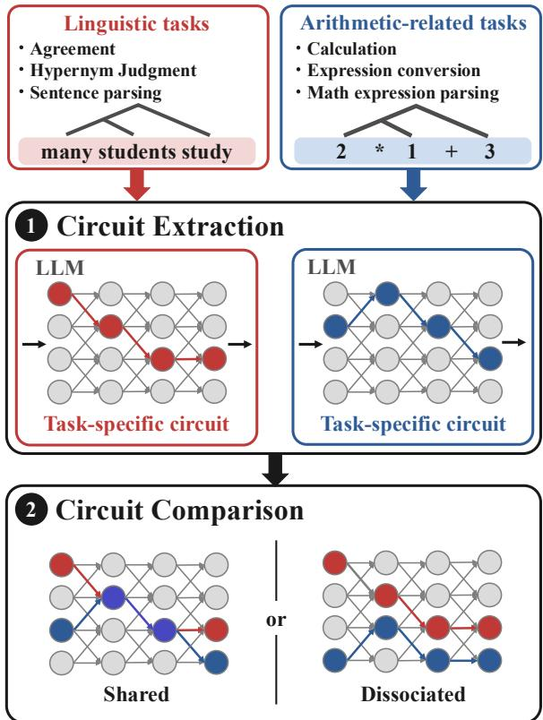  
Figure 1: Overview of our circuit analysis. We extract a task-specific circuit for each linguistic and arithmeticrelated task and compare the extracted circuits to examine whether they are shared or dissociated across the two domains.

2018). Compared to human experiments, LLM studies enable fine-grained internal circuit analysis and more controlled experiments, and hopefully give insights into what-if questions, for example, whether a human-like, potentially modular organization of formal and functional linguistic competence naturally emerges from statistical learning of language without explicit architectural constraints for neural LLMs. Hanna et al. (2026), for example, have investigated the overlap between formal and functional task circuits within LMs, using a broad range of tasks.

In this study, we complement such existing works with a more fine-grained, controlled investigation on a specific task. In particular, the stability of task circuits across different surface formats has been underexplored. In addition, functional tasks typically involve multiple subtasks, and it is important to ablate the circuits for each component of the task. We specifically employ arithmetic tasks to represent functional linguistic competence, which are also a typical testbed in human studies (Fedorenko et al., 2011; Nakai and Okanoya, 2018), to enable flexible control of vocabulary alternation, e.g., Arabic numeral vs. number word, and subtask isolation, e.g., with and without arithmetic operation on the same arithmetic expressions. Motivated by the long-running debates of the shared structural, recursive nature of natural language and arithmetic expressions (Chomsky, 2006; Amalric and Dehaene, 2018; Matsumoto and Nakai, 2023), we also compare the parsing settings on natural language and arithmetic expressions with essentially the same syntactic constructions, exemplified by Cat (deeply sleeps) vs. (Cute Cat) sleeps; and $2 ~ + ~ ( 3 ~ \star ~ 1 ) ~ \mathrm { v s . } ~ ( 2 ~ \star ~ 3 ) ~ + ~ 1$ as a potentially maximal interactions between these two domains. We test whether LMs reuse shared circuits to process these similar syntactic structures across different domains of language and arithmetic, motivated by human studies showing cross-domain interactions (Nakai and Okanoya, 2018).

In our experiments, we extract an LLM circuit (i.e., a subnetwork) for each task using Edge Attribution Patching with Integrated Gradients (EAP-IG) and compare their structural overlap and crosstask faithfulness (Figure 1). Our experiments demonstrate the following characteristics of the circuits for arithmetic tasks and their interaction with linguistic ones:

• Similar arithmetic circuits are robustly obtained among different surface forms (e.g., Arabic-numeral and number-word inputs), indicating that input/output vocabulary alone does not determine the arithmetic circuit.

• Different circuits are obtained for different task instructions (e.g., just spell-out or do calculation) on the same arithmetic expressions, further supporting that arithmetic circuits are mainly determined by the required ability, not by input alone.

• Arithmetic circuits do not causally interact with linguistic circuits, even for the essentially similar task of parsing natural language sentences with similar syntactic complexity to the used arithmetic expressions, supporting that linguistic and arithmetic circuits are largely dissociated within LMs.

## 2 Related Work

## 2.1 Mechanistic Interpretability and Circuit Analysis

The mechanistic interpretability field aims to explain model behavior in terms of internal components and the computations they implement. The community has found that model components responsible for specific task abilities can be localized as a subnetwork, i.e., circuit, of the model (Elhage et al., 2021; Olsson et al., 2022). Prior work has explored localization in the LLM parameter space, e.g., through learning binary masks over LLM weights (Chen et al., 2024), or intervening in the activation space (Dai et al., 2022). More recently, circuit analysis methods have been widely used to extract task-relevant sub-architecture in transformers (Heimersheim and Nanda, 2024; Syed et al., 2024). Causal intervention techniques, such as activation patching, has recently been employed to identify components relevant to a target behavior. The obtained circuits are typically analyzed through the lens of their architectural overlap, and the importance of causal metrics such as cross-task faithfulness has also been emphasized (Hanna et al., 2024), which this study also relies on.

## 2.2 Arithmetic and Formal Linguistic Competence in Humans

Neurolinguistic research has localized languagespecific brain regions, supporting the view that language processing is not reducible to domaingeneral cognition (Fedorenko et al., 2010, 2011; Shain et al., 2020; Hu et al., 2023). Still, researchers have studied the extent to which these language networks are indeed limited to natural language, with arithmetic as a particularly debatable case. The field of linguistics has highlighted the fundamental similarity between language and arithmetic/algebraic expressions, especially given their recursive nature (Chomsky, 2006; Matsumoto and Nakai, 2023). This raises the question of whether the language network is also involved in arithmetic processing.

There is accumulating evidence supporting that natural language and arithmetic processing are dissociated. Varley et al. (2005), for example, showed that patients with severe agrammatic aphasia could nevertheless perform arithmetic operations involving hierarchical and recursive structures, suggesting that an intact language-processing network is not necessary for arithmetic computation in the mature cognitive system. Friedrich and Friederici (2009) examined the syntactic processing of formulae in first-order mathematical logic and identified a network primarily involving intraparietal and prefrontal regions, with only selective involvement of Broca's area. Maruyama et al. (2012) further showed that the processing of nested arithmetic expressions predominantly recruits bilateral posterior occipitotemporal and parietal regions rather than the left-lateralized language network. Amalric and Dehaene (2018) identified a bilateral network centered on the intraparietal sulci and inferior temporal regions that is consistently recruited by mathematical reflection, whereas classical language and semantic regions show little involvement. Subsequent fMRI experiments with professional mathematicians showed that this mathematical network responds to mathematical statements across domains and independently of several possible confounds, including task difficulty, logical operators, and whether the relevant knowledge is retrieved or computed (Amalric and Dehaene, 2019). More broadly, Fedorenko et al. (2024) argues that language is mainly for communication, not for complex thought, such as arithmetic operations.

At the same time, several studies have also demonstrated cross-domain structural interaction between natural language and arithmetic processing (Nakai and Okanoya, 2018; Zhou et al., 2018; Nakai and Nishimoto, 2023). For example, Nakai and Okanoya (2018) demonstrates a syntactic priming effect between natural language and arithmetic expressions. Note that there are general distinctions among (i) arithmetical computation, such as (2+3) \*4, (ii) abstracted algebraic computation, such as (a+b)\*c, and (iii) mathematical problem solving, such as math word problems. This study mainly focuses on the dissociation between natural language and arithmetical computation.

## 2.3 Arithmetic and Formal Linguistic Competence in LLMs

What about the circuit dissociation between language and arithmetic processing? A growing body of work studies whether LLMs represent distinct circuits for different domains. Recent work has examined whether formal and functional linguistic mechanisms (Mahowald et al., 2024) are dissociated in LLMs, providing evidence that linguistic form and broader task-oriented processing need not rely on the same internal representations (Hanna et al., 2026). Kisako et al. (2025) study representational geometry using linear classifiers and cluster separability, whereas we compare edge circuits under interventions. AlKhamissi et al. (2025) analyzes language-selective units within LLM, motivated by neuroscientific studies of humans, and the involvement of LLM language networks in other tasks, such as math problems. Yet, their analysis does not precisely test the robustness of the circuits against various input/output formats and sub-task decomposition.

More broadly, the natural language processing field has investigated both the sources and mechanisms of mathematical ability in LLMs. Benchmark studies have shown that strong performance on math word problems can mask fragile or shortcut-based behavior (Li et al., 2024). Other work has suggested that arithmetic- or code-heavy pretraining data can substantially affect downstream capability profiles (Aryabumi et al., 2025; Petty et al., 2025; Razeghi et al., 2024). At the mechanistic level, recent analysis has argued that arithmetic behavior in LLMs is often supported by heuristic mechanisms rather than robust algorithmic procedures (Nikankin et al., 2025).

## 3 Circuit Analysis in LLMs

Circuit analysis for transformer LLMs (Vaswani et al., 2017) treats a model as a directed computational graph from inputs to outputs through intermediate components, and aims to identify a subgraph (a circuit) that is sufficient for a target behavior. Hereafter, nodes correspond to modules (e.g., attention heads or MLP blocks), and edges correspond to information flow between nodes (Wang et al., 2023).

## 3.1 Method

We use EAP-IG (Edge Attribution Patching with Integrated Gradients) (Hanna et al., 2024). EAP-IG computes an indirect effect score for each directed edge $e _ { i \to j } \in { \mathcal { E } }$ . To compute the score, for each task, we construct paired inputs (x, x), where x and x are called clean and corrupted input, respectively.2 The corresponding representation at node i is denoted as $\ b { h } _ { i } ( x ) \in \mathbb { R } ^ { n }$ , and the token representation as $\pmb { x } \in \mathbb { R } ^ { m }$ , respectively. Given a differentiable metric $m ( \cdot ) : \mathbb { R } ^ { m }  \mathbb { R }$ (the output is typically a logit), the gradient at the receiving node $j ,$ given an input token representation $^ { \mathbf { \delta x } , }$ is denoted as $\nabla _ { \mathbf { h } _ { i } } m \left( \pmb { x } \right) \in \mathbb { R } ^ { n }$ . The sender activation difference is $\dot { \Delta } h _ { i } = h _ { i } ( x ) - h _ { i } ( \tilde { x } ) \in \mathbb { R } ^ { n }$ . By discretizing the input interpolation path with $T$ steps, we approximate the integrated gradient score as:

$$
s _ { i  j } = \Delta \boldsymbol h _ { i } ^ { \intercal } \int _ { \alpha = 0 } ^ { 1 } \nabla _ { \boldsymbol h _ { j } } m ( \tilde { \mathbf { x } } + \alpha ( \mathbf x - \tilde { \mathbf x } ) ) \ \mathrm d \alpha\tag{1}
$$

$$
\approx \frac { \Delta { \pmb h } _ { i } ^ { \top } } { T } \sum _ { k = 0 } ^ { T - 1 } \nabla _ { { \pmb h } _ { j } } m \big ( \pmb x + \frac { k } { T } ( { \pmb x } - \tilde { \pmb x } ) \big ) ,\tag{2}
$$

where we average gradients at interpolated inputs and take their inner product with the sender activation difference. The metric m is, for example, in the subject-verb agreement (SVA) task, the logit difference between singular and plural verbs: $m ( { \pmb x } ) = \mathrm { l o g i t } ( \mathrm { a r e } | { \pmb x } ) - \mathrm { l o g i t } ( \mathrm { i s } | { \pmb x } )$ . The corrupted input x is designed so that the correct output in x becomes incorrect; for example, for a clean input “The keys on the cabinet $I a r e J , ^ { \prime \prime }$ the corrupted input can be "The key on the cabinet $I i s J . ^ { \prime \prime }$ We extract a circuit E by selecting edges with high attribution scores. To test whether our conclusions depend on how the circuit boundary is defined, we report results under three circuit settings: (i) top 2.5% edges, (ii) top 5.0% edges, and (iii) an adaptive circuit defined as the smallest edge set whose selffaithfulness exceeds 0.85. We then analyze the overlap between extracted circuits $E _ { A }$ and $E _ { B }$ for tasks A and B.

## 3.2 Metrics

Structural overlap (IoU). To quantify overlap between the edge sets of two task circuits $E _ { A }$ and $E _ { B } .$ , we use Intersection over Union (IoU):

$$
\operatorname { I o U } ( A , B ) = { \frac { | E _ { A } \cap E _ { B } | } { | E _ { A } \cup E _ { B } | } } ~ .\tag{3}
$$

Functional overlap (Faithfulness). Even when structural overlap is small, circuit polysemy may allow a circuit extracted for one task to support another task. To quantify how well the model behavior for a reference task A is reproduced by the circuit extracted from a different task $B ,$ we use the Faithfulness score (Hanna et al., 2024).

Let $( \pmb { x } ^ { A } , \tilde { \pmb { x } } ^ { A } ) \in \mathcal { D } ^ { A }$ be the paired clean and corrupted input representation for task $A ,$ and $\mathcal { D } ^ { A }$ is the dataset of task A. We denote $E _ { B } \subseteq { \mathcal { E } }$ as the set of edges in the circuit extracted for task $B .$ Henceforth, we simplify the notation of edge as $e \in$ $\mathcal { E } ,$ and let $a _ { e } ( { \pmb x } )$ be the edge activation/message used in EAP-style edge patching when running the model on input x. We define a cross-task circuit application to task A using $E _ { B }$ as follows: we run the model on the clean input $\pmb { x } ^ { A }$ while patching the activations on all edges outside $E _ { B }$ with those from the corrupted run on $\tilde { \pmb { x } } ^ { A }$ , keeping the edges in $E _ { B }$ unpatched (i.e., clean). Concretely, we construct mixed edge activations as follows:

$$
a _ { e } ^ { ( A  B ) } ( { \pmb x } ^ { A } ) = \{ \begin{array} { l l } { { a _ { e } ( { \pmb x } ^ { A } ) } } & { { \mathrm { i f } e \in E _ { B } } } \\ { { a _ { e } ( \tilde { \pmb x } ^ { A } ) } } & { { \mathrm { i f } e \not \in E _ { B } } } \end{array}  ,\tag{4}
$$

Setting this activation $a _ { e } ^ { ( A  B ) } ( { \pmb x } ^ { A } )$ to all the edges $e \in { \mathcal { E } }$ of the model, we input $\pmb { x } ^ { A }$ and compute the metric $m ^ { ( A  B ) } ( \pmb { x } ^ { A } )$ for an input of task A. The transferred object is the edge mask $E _ { B } .$ not activations from task B: both clean and corrupted runs use task-A inputs. A self-circuit need not reproduce the full-model score exactly. The scores $m ( { \pmb x } ^ { A } )$ and $m ( { \tilde { \pmb { x } } } ^ { A } )$ denote the metric on the clean and corrupted inputs of task A without any model intervention, respectively. The faithfulness score $F ( A , B )$ is computed as follows:

$$
\frac { 1 } { | \mathcal { D } ^ { A } | } \sum _ { ( \pmb { x } ^ { A } , \tilde { \pmb { x } } ^ { A } ) \in \mathcal { D } ^ { A } } \frac { m ^ { ( A  B ) } ( \pmb { x } ^ { A } ) - m ( \tilde { \pmb { x } } ^ { A } ) } { m ( \pmb { x } ^ { A } ) - m ( \tilde { \pmb { x } } ^ { A } ) }\tag{5}
$$

where $\mathcal { D } ^ { A }$ is the dataset of task A.

We call $F ( A , B )$ raw faithfulness when distinguishing it from the additional display normalization; it is already normalized by clean/corrupted baselines and is not a raw logit score. For cross-task Faithfulness analyses using the top-2.5% and top-5.0% circuit definitions, we additionally normalize $F ( A , B )$ by the target task's self-faithfulness $F ( A , A )$ , yielding $F ( A , B ) / F ( A , A )$ . Values below zero or above one indicate performance below the corrupted or above the clean baseline, respectively, when the clean-corrupted gap is positive; they are not probabilities. Small baseline gaps, or small diagonal values in the heatmaps, can amplify scores. Thus, absolute metric values and unscaled faithfulness are needed to interpret apparent transfer.

<table><tr><td>Task</td><td>Input (Prefix)</td><td>Answer</td><td>Input</td><td>Output</td><td>Arith.</td></tr><tr><td>Arithmetic calculation. (MATH)</td><td>The answer to 2 * 1 + 3 = is</td><td>5</td><td>Expr.</td><td>Arabic numeral</td><td>V</td></tr><tr><td>Spelled-out arithmetic calcula- tion (MATH-S)</td><td>The answer to two times one plus three equals is</td><td>five</td><td>Lang.</td><td>Number word</td><td> $\checkmark$ </td></tr><tr><td>Math Word Problem (GSM-PLUS)</td><td>Janet&#x27;s ducks lay 16 eggs per day... The 18 answer is</td><td></td><td>Lang.</td><td>Arabic numeral</td><td>√</td></tr><tr><td>Arithmetic expression spelling- The spelled-out form of out (SPELL-M)</td><td> $2 \star 1 + 3 = \mathrm { i s }$ </td><td>two times one plus three</td><td></td><td>Expr. Number word</td><td></td></tr><tr><td>Inverse of SPELL-M (SPELL-MI)</td><td>The numerical formula for two times one plus three is</td><td> $2 ^ { * } 1 + 3$ </td><td>Lang.</td><td>Arabic numeral</td><td></td></tr><tr><td>Arithmetic expression parsing (MATH-PARSE)</td><td>The first term to calculate in  $6 + 2 ^ { * } 5$  is</td><td> $2 ^ { \ast } 5$ </td><td>Expr.</td><td>Arabic numeral</td><td>(√)</td></tr><tr><td>Sentence parsing (LING-PARSE)</td><td>The head word of the lowest constituent students of the sentence &#x27;many students study&#x27; is</td><td></td><td>Lang.</td><td>Word</td><td></td></tr><tr><td>Subject-Verb Agreement (LING-SV)</td><td>The keys on the cabinet</td><td>are</td><td>Lang.</td><td>Word</td><td></td></tr><tr><td>Gendered Pronoun Agreement (LING-GA)</td><td>Maria said that</td><td>she</td><td>Lang.</td><td>Word</td><td></td></tr><tr><td>Hypernym Judgment (LING-HJ)</td><td>Roses, and other</td><td>flower</td><td>Lang.</td><td>Word</td><td></td></tr></table>

Table 1: Task examples in our experiments. Horizontal blocks indicate four high-level categories based on task domain and required competence. Expr. and Lang. denote symbolic expressions and natural language, respectively. For generation tasks, we evaluate only the first generated token; subsequent tokens are shown in gray. Arithmetic checkmark denotes whether the task involves arithmetic calculation, and MATH-PARSE has a gray one, as it does not involve calculation but should be a necessary sub-task for arithmetic.

Further details on circuit extraction, cross-task evaluation, and clustering settings are provided in Appendix A.

## 4 Experimental Setup

## 4.1 Tasks

We introduce a set of controlled tasks to avoid confounding factors, e.g., simple vocabulary overlap. Table 1 summarizes the tasks adopted in our experiments. For all tasks, we use 500 clean/corrupted input pairs. We extract a circuit for each task and compute cross-task circuit overlap (IoU) and faithfulness scores. We briefly introduce the tasks below; Appendix B provides more details, including prompt templates and clean/corrupted examples.

Pure arithmetic tasks. The pure arithmetic tasks are MATH and MATH-S, where MATH-S is written in number words, instead of Arabic numerals and arithmetic symbols. Arithmetic expressions contain three terms with addition, subtraction, and multiplication, and answers are constrained to be natural numbers.

Pure linguistic tasks. At the other end of the spectrum, following Hanna et al. (2026), we adopt three tasks of LING-SV, LING-GA, and LING-HJ as purely linguistic tasks. They focus on Subject– Verb Agreement (SV), Gendered Pronoun Agreement (GA), and Hypernym Judgment (HJ) tasks, respectively, and models are expected to answer with a plausible single word given context. Subject– verb agreement probes grammar, gendered pronoun agreement also involves syntactic dependences between referential and gender cues, and hypernym judgment probes lexical and semantic knowledge.

Other tasks are a mixture of the arithmetic problem and its subproblems.

Math word problems. We experimentally include math word problems (GSM-PLUS) (Li et al., 2024) written in natural language, which arguably require both arithmetic and general text comprehension. We use GSM-Plus data, built from GSM8K (Cobbe et al., 2021), a benchmark of grade-school math word problems, by applying controlled perturbations, such as numerical and operator transformations, to test the robustness of mathematical reasoning in LLMs. In our setup, we construct clean/corrupted pairs using the original (seed) problems and their numerical substitution variants from GSM-Plus.

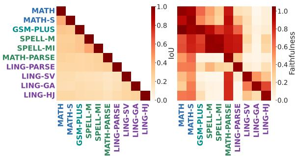

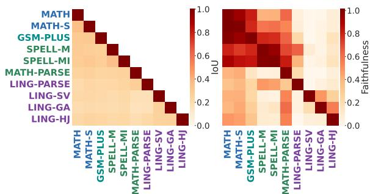

Arithmetic expression without calculation. To control for math-domain input without requiring calculation, we include the spelling-out task for math expressions SPELL-M and its inverse SPELL-MI. The model is instructed to convert an expression such as 2\*1 +3 into its spelled-out English form (e.g., two times one plus three) without performing computation. SPELL-MI is a task to convert a spelled-out expression into an Arabic-numeral formula. As the input equation is the same as MATí tasks, comparing their circuit clarifies whether the circuit is simply determined by input similarity.

Parsing mathematical and linguistic materials. To explore the potential cross-domain similarity between language and arithmetic processing, we introduce MATH-PARSE and LING-PARSE tasks. MATH-PARSE asks for operator precedence without any calculation; for example, the answer for thequestion, The first term to calculate in 6 + 2 \* 5 is, is 2 \* 5. On the other hand, LING-PARSE asks for constituent structure, specifically the head word of the lowest constituent, in short sentences. Each pair shares a noun and a verb: “many students study" targets students, whereas “students often study" targets study. We evaluate the logit of the first prediction token in the main experiments, and we designed the problems so that the first token can distinguish the model's parsing decision, and the correct/incorrect options are plausible in the sense that they both appear in clean and corrupted sentences. See Appendix E for sequencelevel evaluation.

## 4.2 Models

In our experiments, we use Qwen3-8B, Qwen3- 4B, Qwen3-1.7B (Yang et al., 2025), Llama-3.1-8B (Llama Team, 2024), and Gemma-2-2B (goog1e/gemma-2-2b) (Gemma Team, 2024). We include the Qwen3 series as a representative samefamily set to examine how the results vary with model size, and additionally include Llama-3.1- 8B and Gemma-2-2B to assess whether the observed patterns are consistent across model families. Further details on the models are provided in Appendix C. Table 2 shows model performance on each task, and models are generally capable of achieving high accuracy on the target tasks. One concern is their relatively low performance on GSM-PLUS, whereas this task is not crucial for (a) Qwen3-8B, top-2.5% circuit.

(b) Llama-3.1-8B, top-2.5% circuit.

Figure 2: Left: IoU (structural overlap). Right: crosstask Faithfulness (functional overlap). For Faithfulness, rows denote the tasks from which circuits are extracted, and columns denote the target tasks solved with those circuits. Scores are normalized by the corresponding diagonal self-faithfulness value.

our central research question and should just be regarded as a relevant reference.

## 5 Experimental Results

This section shows results for Qwen3-8B and Llama-3.1-8B using the top 2.5% of the circuit edges. Section 6 shows the results for different circuit sizes, and Appendix D shows the results for other models.

IoU. Figure 2 (left) shows cross-task IoU scores. The scores are generally low, but those for the MATH and MATH-S pair and the SPELL-M and SPELL-MI pair are relatively high. This suggests that circuit overlap is affected by task characteristics rather than by the superficial input differences (e.g., Arabic numerals versus spelled-out expressions). At the same time, the circuits for MATH and SPELL do not show remarkable similarity, indicating that the circuit reflects the task, rather than mere input similarity.

Faithfulness. Figure 2 (right) shows cross-task Faithfulness scores. Each cell indicates how well the circuit extracted for the task in the row can solve the task in the column. The baselinenormalized values before diagonal display normalization are listed in Appendix D. Compared to IoU, task-dependent variations are more clearly observed in Faithfulness scores. For example, arithmetic circuits of MATH and MATH-S show similar cross-task Faithfulness patterns, consistent with their high IoU. Similar tasks tend to have a relatively high faithfulness scores, for example, among expression-conversion tasks of SPELL-M and SPELL-MI and among the linguistic tasks of LING-SV, LING-GA, and LING-HJ. GSM-PLUS shows somewhat intermediate patterns between those of the calculation and expressionconversion circuits. The notable divergence is observed for MATH-PARSE and LING-PARSE, where the low scores in their intersection indicate that the math/ling parse tasks cannot be solved by their counterparts.

<table><tr><td>Model</td><td>MATH</td><td>MATH-S</td><td>GSM-PLUS</td><td>SPELL-M</td><td>SPELL-MI</td><td>MATH-PARSE</td><td>LING-PARSE</td><td>LING-SV</td><td>LING-GA</td><td>LING-HJ</td></tr><tr><td>Llama-3.1-8B</td><td>96.0</td><td>85.2</td><td>11.4</td><td>100.0</td><td>100.0</td><td>99.8</td><td>94.8</td><td>99.8</td><td>92.6</td><td>98.8</td></tr><tr><td>Qwen3-8B</td><td>90.8</td><td>77.2</td><td>36.8</td><td>100.0</td><td>100.0</td><td>100.0</td><td>90.0</td><td>100.0</td><td>86.2</td><td>97.6</td></tr><tr><td>Qwen3-1.7B</td><td>82.2</td><td>45.4</td><td>23.0</td><td>99.6</td><td>100.0</td><td>100.0</td><td>84.0</td><td>43.2</td><td>79.4</td><td>29.6</td></tr><tr><td>Qwen3-4B</td><td>92.0</td><td>60.0</td><td>36.8</td><td>99.8</td><td>100.0</td><td>100.0</td><td>93.0</td><td>86.0</td><td>79.6</td><td>78.6</td></tr><tr><td>Gemma-2-2B</td><td>66.6</td><td>41.2</td><td>24.2</td><td>100.0</td><td>100.0</td><td>61.4</td><td>75.2</td><td>99.6</td><td>85.2</td><td>98.0</td></tr></table>

Table 2: Model accuracy on each task. Values are percentages. We report exact top-1 accuracy, except in cases where only the available answer-vs.-corrupted pairwise rows are used in place of exact accuracy.

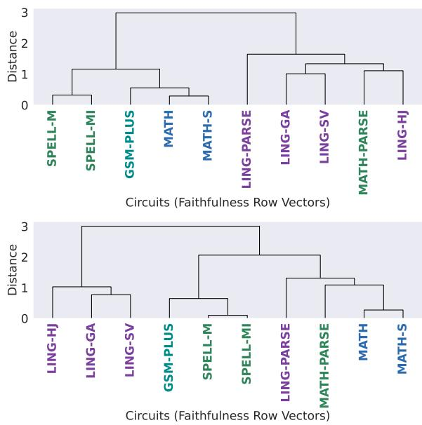  
Figure 3: Hierarchical clustering of task circuits based on cross-task Faithfulness transfer profiles under the top-2.5% circuit definition. Top: Qwen3-8B. Bottom: Llama-3.1-8B.

<table><tr><td>K</td><td>Mean ARI</td><td>Median ARI</td><td>Min</td><td>Max</td></tr><tr><td>2</td><td>0.628</td><td>0.597</td><td>0.294</td><td>1.000</td></tr><tr><td>3</td><td>0.580</td><td>0.570</td><td>0.247</td><td>1.000</td></tr><tr><td>4</td><td>0.452</td><td>0.400</td><td>0.203</td><td>0.743</td></tr><tr><td>5</td><td>0.589</td><td>0.371</td><td>0.371</td><td>1.000</td></tr><tr><td>6</td><td>0.550</td><td>0.438</td><td>0.325</td><td>1.000</td></tr></table>

Table 3: Adjusted Rand Index (ARI) across all ten model pairs for partitions of the top-2.5% faithfulness dendrograms into K clusters.

Hierarchical clustering. To facilitate the interpretation of cross-task Faithfulness patterns, we also perform hierarchical clustering, using each row of the matrix as the vector for each circuit (Figure 3). Each vector summarizes how well a source circuit solves all target tasks. We compare task clustering across the five evaluated models using the top-2.5% circuits. For each model, we apply Ward linkage with Euclidean distance to the source-circuit row vectors of the diagonal-selfnormalized cross-task faithfulness matrix, as in the main analysis. For all model pairs, we compare partitions obtained by cutting the dendrograms into K = 2, . . . , 6 clusters using the Adjusted Rand Index (ARI). The ARI of 0 indicates no correlation, and 1 indicates perfect agreement. Table 3 shows the statistics of ARI scores, yielding reasonably high agreement around 0.4–0.6. This confirms that the cross-task circuit dependencies are generally stable across different models.

Language-arithmetic dissociation. The results reveal a general dissociation trend between language and arithmetic circuits. That is, circuits extracted from arithmetic tasks (MATH, MATH-S, MATH-PARSE, GSM-PLUS) show limited overlap and low cross-task faithfulness with those from linguistic tasks (LING-SV, LING-GA, LING-HJ, LING-PARSE). More nuanced patterns are observed in the SPELL tasks and the MATH-PARSE task; we discuss their characteristics in Section 7.

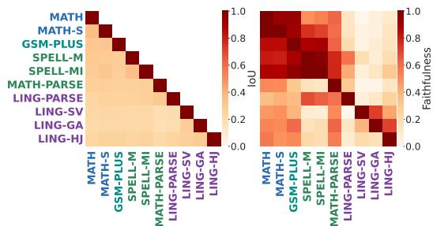

(a) Cross-task IoU and Faithfulness scores, where rows denote source-circuit tasks and columns denote target tasks.  
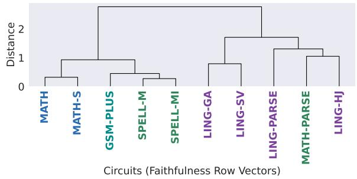  
(b) Hierarchical clustering of task circuits based on cross-task Faithfulness transfer profiles.  
Figure 4: Results for Qwen3-8B under the top-5.0% circuit definition.

## 6.1 Different Circuit Size

## 6 Analysis

## 6.2 Adaptive Circuit Size

To investigate whether the obtained results depend on the circuit size threshold, we also conducted experiments using the top-5.0% circuit, instead of 2.5%. Figure 4 shows the results for Qwen3-8B as a representative example. The broad dissociation pattern remains similar to that under the top-2.5% definition.

As the fixed-size circuit definitions may not reflect the actual minimal circuitry required for each task, we also consider an adaptive circuit size, i.e., the smallest circuit whose self-faithfulness exceeds a certain threshold. Here, we examine 0.85 as the threshold for self-faithfulness to define the adaptive circuit. Figure 5 shows the results for Qwen3-8B with adaptive circuit size. The broad separation between arithmetic and linguistic tasks remains clear under this definition. This setting provides rather clearer inter-task IoU, while cross-task Faithfulness shows reduced values, especially for the circuits of SPELL-M and SPELL-MI. This likely reflects that 2.5% fixed-size circuits for SPELL-M and SPELL-MI may include extra edges beyond spelling. Indeed, in Figure 2b, the SPELL-M circuits could solve MATH tasks reasonably, and this is mitigated in the adaptive circuit definition, which likely removes these extra edges, leading to a more accurate representation of the task-specific circuitry. This setting alters some hierarchical clustering results (e.g., similarity between SPELL-M and GSM-PLUS). However, the general dissociation between arithmetic and language circuits remains intact, or rather becomes much clearer.

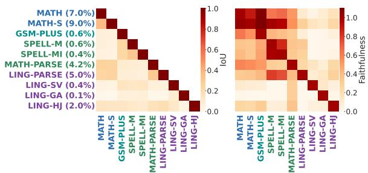

Figure 5: Results for Qwen3-8B under the adaptive circuit size with the self-faithfulness threshold of 0.85.  
(b) Hierarchical clustering of task circuits based on cross-task Faithfulness transfer profiles.  
(a) Cross-task IoU and Faithfulness scores, where rows denote source-circuit tasks and columns denote target tasks.  
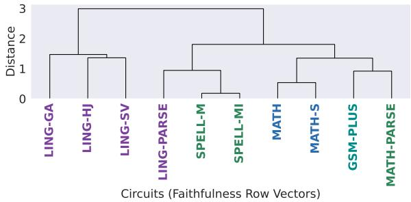

## 7 Discussion

Our results suggest that arithmetic circuits are generally dissociated from those supporting the purely linguistic tasks. This is in line with the general view of neural dissociation between language and arithmetic processing in human studies (Varley et al., 2005; Friedrich and Friederici, 2009; Maruyama et al., 2012; Amalric and Dehaene, 2018; Fedorenko et al., 2024). In other words, the potential interactions between language and arithmetic, suggested by Nakai and Okanoya (2018), cannot clearly be observed for LLMs. While MATH-PARSE and LING-PARSE circuits are sometimes close in hierarchical clustering results, their cross-task faithfulness is quite limited (Figure 2), in other words, the arithmetic/language parsing circuit cannot solve the counterpart parsing task. Thus, it is difficult to say that there is a shared circuit between arithmetic and language processing, even in settings that maximally emphasize their common characteristics.

Notably, even though the hierarchical clustering results are generally stable across different models and settings, MATH-PARSE circuit is typically “floating" in the hierarchical clustering results, i.e., it does not consistently cluster with either the broader arithmetic or linguistic task groups. In addition, MATH circuits cannot perfectly solve the MATH-PARSE task, and vice versa, suggesting that the MATH-PARSE circuit found in this study is not involved in the general arithmetic processing. One suspicion is that LMs do not clearly recognize that parsing arithmetic expressions is the essential subtask of arithmetic, i.e., there is no rigid circuit for this parsing subtask, and perhaps solve arithmetic problems with a different strategy internally from humans, e.g., compute multiple terms at once, potentially with memorization or with a bag of heuristics (Nikankin et al., 2025), rather than following a step-by-step parsing-based approach. This offers a hypothetical reason why language and arithmetic circuits are dissociated: LMs solve arithmetic differently from humans, and perhaps there may no longer be a perception that language and arithmetic share fundamental structural characteristics.

Another notable point is that the structural overlap (IoU) of circuits is sometimes altered by the functional overlap analysis (Faithfulness). A plausible interpretation is that a relatively small set of edges plays a substantial role in supporting several tasks, and thus merely counting the number of overlapping edges may underweight their importance. Such a pattern is consistent with recent discussions of circuit polysemy and with the possibility that some edges behave like shared high-impact routing components. Under this view, low structural overlap does not necessarily imply strong mechanistic independence.

## 8 Conclusion

We analyzed the characteristics of task circuits using controlled arithmetic-related and linguistic tasks, across five LLMs. The extracted arithmetic and linguistic circuits are largely dissociated, echoing the neuro-linguistic findings in humans. Nevertheless, human experiments also suggested some interaction between these two domains, particularly stemming from the shared structural and recursive nature of language and arithmetic expressions, and LLMs do not exhibit such interactions. The circuits for LING-PARSE and MATH-PARSE, where the task is structural analysis of input sentences and arithmetic expressions, show limited mutual transfer. We tentatively conclude that there is no clear evidence that LLMs equip a shared circuit for primitive language and arithmetic processing.

## Limitations

Our results might be biased by the specific configurations we adopted, and further exploration is needed to enhance the generality of the findings. First, we only used the EAP-IG method for circuit extraction. Exploring and comparing other circuit extraction methods should enhance the generality of our observations, while we examined different hyperparameters, such as top-2.5%, top-5.0%, and adaptive circuits. Relatedly, the main experiments target the first answer token alone, while some tasks, such as spelling-out ones, are defined with sequence output. Appendix E preliminarily examines this bias, and integrating sequence-level generation for circuit extraction and evaluations will further clarify the findings. Second, the task and evaluation settings might be biased; for example, all prompts are in the English language, and the linguistic tasks are somewhat heterogeneous. Generally low accuracy on GSM-PLUS may also weaken interpretations, regarding the distinction between mathematical reasoning and pure arithmetic processing. Third, we evaluate a finite set of open-weight models and training regimes. Lastly, the connection between our LLM results and neurolinguistic findings on the human side should be further elaborated, which opens the question of humanlikeness of LLMs from the neural network modularity perspectives.

## Ethical considerations

This work analyzes existing large language models and does not involve human-subject experiments. Part of our evaluation data was newly created using hand-written templates, and is fully synthetic, i.e., it does not contain text sourced from individuals or potentially sensitive personal information. We used AI assistants for coding assistance in building the experimental pipeline and for adjusting wording. The authors are responsible for verifying the implementation, citations, and scientific claims.

## References

Badr AlKhamissi, Greta Tuckute, Antoine Bosselut, and Martin Schrimpf. 2025. The LLM Language Network: A Neuroscientific Approach for Identifying Causally Task-Relevant Units. In Proceedings of the 2025 Conference of the Nations of the Americas Chapter of the Association for Computational Linguistics: Human Language Technologies (NAACL), pages 10887–10911, Albuquerque, New Mexico. Association for Computational Linguistics.

Marie Amalric and Stanislas Dehaene. 2018. Cortical Circuits for Mathematical Knowledge: Evidence for a Major Subdivision within the Brain's Semantic Networks. Philosophical Transactions of the Royal Society B: Biological Sciences, 373(1740):20160515.

Marie Amalric and Stanislas Dehaene. 2019. A Distinct Cortical Network for Mathematical Knowledge in the Human Brain. NeuroImage, 189:19–31.

Viraat Aryabumi, Yixuan Su, Raymond Ma, Adrien Morisot, Ivan Zhang, Acyr Locatelli, Marzieh Fadaee, Ahmet Üstün, and Sara Hooker. 2025. To code or not to code? exploring impact of code in pre-training. In The Thirteenth International Conference on Learning Representations (ICLR).

Ruizhe Chen, Tianxiang Hu, Yang Feng, and Zuozhu Liu. 2024. Learnable privacy neurons localization in language models. In Proceedings of the 62nd Annual Meeting of the Association for Computational Linguistics (ACL), pages 256–264, Bangkok, Thailand. Association for Computational Linguistics.

Noam Chomsky. 2006. Language and Mind, 3 edition. Cambridge University Press, Cambridge, England.

Karl Cobbe, Vineet Kosaraju, Mohammad Bavarian, Mark Chen, Heewoo Jun, Lukasz Kaiser, Matthias Plappert, Jerry Tworek, Jacob Hilton, Reiichiro Nakano, Christopher Hesse, and John Schulman. 2021. Training Verifiers to Solve Math Word Problems. Preprint, arXiv:2110.14168.

Damai Dai, Li Dong, Yaru Hao, Zhifang Sui, Baobao Chang, and Furu Wei. 2022. Knowledge neurons in pretrained transformers. In Proceedings of the 60th Annual Meeting of the Association for Computational Linguistics (ACL), pages 8493–8502, Dublin, Ireland. Association for Computational Linguistics.

Nelson Elhage, Neel Nanda, Catherine Olsson, Tom Henighan, Nicholas Joseph, Ben Mann, Amanda Askell, Yuntao Bai, Anna Chen, Tom Conerly, Nova DasSarma, Dawn Drain, Deep Ganguli, Zac Hatfield-Dodds, Danny Hernandez, Andy Jones, Jackson Kernion, Liane Lovitt, Kamal Ndousse, and 6 others. 2021. A Mathematical Framework for Transformer Circuits. Transformer Circuits Thread.

Evelina Fedorenko, Michael K. Behr, and Nancy Kanwisher. 2011. Functional specificity for high-level linguistic processing in the human brain. Proceedings of the National Academy of Sciences (PNAS), 108(39):16428–16433.

Evelina Fedorenko, Po-Jang Hsieh, Alfonso Nieto-Castañón, Susan Whitfield-Gabrieli, and Nancy Kanwisher. 2010. New Method for fMRI Investigations of Language: Defining ROIs Functionally in Individual Subjects. Journal of Neurophysiology 104(2):1177–1194. PMID: 20410363.

Evelina Fedorenko, Steven T Piantadosi, and Edward A F Gibson. 2024. Language is primarily a tool for communication rather than thought. Nature, 630(8017):575–586.

Roland Friedrich and Angela Friederici. 2009. Mathematical Logic in the Human Brain: Syntax. PLOS ONE, 4:e5599.

Gemma Team. 2024. Gemma 2: Improving Open Language Models at a Practical Size. Preprint, arXiv:2408.00118.

Michael Hanna, Yonatan Belinkov, and Sandro Pezzelle. 2026. Are formal and functional linguistic mechanisms dissociated in language models? Computational Linguistics, 52(1):43–83.

Michael Hanna, Sandro Pezzelle, and Yonatan Belinkov. 2024. Have Faith in Faithfulness: Going Beyond Circuit Overlap When Finding Model Mechanisms. In First Conference on Language Modeling (COLM).

Stefan Heimersheim and Neel Nanda. 2024. How to use and interpret activation patching. Preprint, arXiv:2404.15255.

Jennifer Hu, Hannah Small, Hope Kean, Atsushi Takahashi, Leo Zekelman, Daniel Kleinman, Elizabeth Ryan, Alfonso Nieto-Castañón, Victor Ferreira, and Evelina Fedorenko. 2023. Precision fMRI reveals that the language-selective network supports both phrase-structure building and lexical access during language production. Cereb. Cortex, 33(8):4384– 4404.

Riku Kisako, Tatsuki Kuribayashi, and Ryohei Sasano. 2025. On Representational Dissociation of Language and Arithmetic in Large Language Models. Preprint arXiv:2502.11932.

Qintong Li, Leyang Cui, Xueliang Zhao, Lingpeng Kong, and Wei Bi. 2024. GSM-plus: A comprehensive benchmark for evaluating the robustness of LLMs as mathematical problem solvers. In Proceedings of the 62nd Annual Meeting of the Association for Computational Linguistics (ACL), pages 2961– 2984, Bangkok, Thailand. Association for Computational Linguistics.

Llama Team. 2024. The Llama 3 Herd of Models. Preprint, arXiv:2407.21783.

Kyle Mahowald, Anna A. Ivanova, Idan A. Blank, Nancy Kanwisher, Joshua B. Tenenbaum, and Evelina Fedorenko. 2024. Dissociating language and thought in large language models. Trends in Cognitive Sciences, 28(6):517–540.

Masaki Maruyama, Christophe Pallier, Antoinette Jobert, Mariano Sigman, and Stanislas Dehaene. 2012. The Cortical Representation of Simple Mathematical Expressions. NeuroImage, 61(4):1444–1460.

Daiki Matsumoto and Tomoya Nakai. 2023. Syntactic theory of mathematical expressions. Cogn. Psychol., 146(101606):101606.

Tomoya Nakai and Shinji Nishimoto. 2023. Quantitative modelling demonstrates format-invariant representations of mathematical problems in the brain. Eur. J. Neurosci., 57(6):1003–1017.

Tomoya Nakai and Kazuo Okanoya. 2018. Neural Evidence of Cross-domain Structural Interaction between Language and Arithmetic. Scientific Reports, 8(1):12873.

Yaniv Nikankin, Anja Reusch, Aaron Mueller, and Yonatan Belinkov. 2025. Arithmetic Without Algorithms: Language Models Solve Math with a Bag of Heuristics. In The Thirteenth International Conference on Learning Representations.

Catherine Olsson, Nelson Elhage, Neel Nanda, Nicholas Joseph, Nova DasSarma, Tom Henighan, Ben Mann, Amanda Askell, Yuntao Bai, Anna Chen, Tom Conerly, Dawn Drain, Deep Ganguli, Zac Hatfield-Dodds, Danny Hernandez, Scott Johnston, Andy Jones, Jackson Kernion, Liane Lovitt, and 7 others. 2022. Incontext Learning and Induction Heads. Preprint, arXiv:2209.11895.

Jackson Petty, Sjoerd van Steenkiste, and Tal Linzen. 2025. How does code pretraining affect language model task performance? Transactions on Machine Learning Research (TMLR).

Yasaman Razeghi, Hamish Ivison, Sameer Singh, and Yanai Elazar. 2024. Backtracking mathematical reasoning of language models to the pretraining data. In The Second Tiny Papers Track at ICLR 2024.

Cory Shain, Idan Asher Blank, Marten van Schijndel, William Schuler, and Evelina Fedorenko. 2020. fMRI reveals language-specific predictive coding during naturalistic sentence comprehension. Neuropsychologia, 138:107307.

Aaquib Syed, Can Rager, and Arthur Conmy. 2024. Attribution Patching Outperforms Automated Circuit Discovery. In Proceedings of the 7th BlackboxNLP Workshop: Analyzing and Interpreting Neural Networks for NLP, pages 407–416, Miami, Florida, US. Association for Computational Linguistics.

Rosemary A. Varley, Nicolai J. C. Klessinger, Charles A. J. Romanowski, and Michael Siegal. 2005. Agrammatic but numerate. Proceedings of the National Academy of Sciences, 102(9):3519–3524.

Ashish Vaswani, Noam Shazeer, Niki Parmar, Jakob Uszkoreit, Llion Jones, Aidan N Gomez, Ł ukasz Kaiser, and Illia Polosukhin. 2017. Attention Is All

You Need. In Advances in Neural Information Processing Systems (NeurIPS), volume 30. Curran Associates, Inc.

Kevin Ro Wang, Alexandre Variengien, Arthur Conmy, Buck Shlegeris, and Jacob Steinhardt. 2023. Interpretability in the Wild: a Circuit for Indirect Object Identification in GPT-2 Small. In The Eleventh International Conference on Learning Representations (ICLR).

Thomas Wolf, Lysandre Debut, Victor Sanh, Julien Chaumond, Clement Delangue, Anthony Moi, Pierric Cistac, Tim Rault, Remi Louf, Morgan Funtowicz, Joe Davison, Sam Shleifer, Patrick von Platen, Clara Ma, Yacine Jernite, Julien Plu, Canwen Xu, Teven Le Scao, Sylvain Gugger, and 3 others. 2020. Transformers: State-of-the-Art Natural Language Processing. In Proceedings of the 2020 Conference on Empirical Methods in Natural Language Processing (EMNLP), pages 38–45, Online. Association for Computational Linguistics.

An Yang, Anfeng Li, Baosong Yang, Beichen Zhang, Binyuan Hui, Bo Zheng, Bowen Yu, Chang Gao, Chengen Huang, Chenxu Lv, Chujie Zheng, Dayiheng Liu, Fan Zhou, Fei Huang, Feng Hu, Hao Ge, Haoran Wei, Huan Lin, Jialong Tang, and 41 others. 2025. Qwen3 Technical Report. Preprint, arXiv:2505.09388.

Xinlin Zhou, Mengyi Li, Leinian Li, Yiyun Zhang, Jiaxin Cui, Jie Liu, and Chuansheng Chen. 2018. The semantic system is involved in mathematical problem solving. Neuroimage, 166:360–370.

## A Experimental Settings

Circuit extraction. We extract task circuits using Edge Attribution Patching with Integrated Gradients (EAP-IG). For each (model, task) pair, we run attribution to obtain an importance score for every edge in the analysis graph, and evaluate three circuit definitions: the subsets of edges whose absolute attribution scores fall within the top 2.5% and top 5.0% of all edges, and an adaptive circuit defined as the smallest edge set whose selffaithfulness exceeds 0.85. Unless otherwise noted, we use IG steps = 5, run on a single GPU in float16. On a single NVIDIA RTX PRO 6000 Blackwell Max-Q Workstation Edition (96GB VRAM), this step takes approximately 5 GPU-hours per (model, task) pair.

Cross-task evaluation. To measure functional overlap between tasks, we evaluate how well the circuit extracted from task B supports task A. For each ordered pair (A, B), we apply the circuit of B as a structural mask and run edge patching on task A using the clean/corrupted pair $( x ^ { A } , \tilde { x } ^ { A } ) ;$ we keep clean edge activations on the edges in the circuit of B and patch all remaining edges with the corresponding activations from the corrupted run on $\tilde { x } ^ { A }$ (cf. Eq. 4). We then evaluate the task-A metric under this mixed forward pass and record the resulting score together with the clean and corrupted baselines. On the same GPU, computing a full cross-task matrix for one model takes approximately 20 GPU-hours.

Heatmaps and hierarchical clustering. For each circuit definition, we visualize (i) structural overlap (IoU) and (ii) diagonal-normalized crosstask faithfulness as heatmaps. In the Faithfulness heatmaps, rows correspond to source-circuit tasks and columns correspond to target tasks. For task grouping analysis, we perform hierarchical clustering on the row vectors of the IoU or displayed normalized faithfulness matrices using agglomerative clustering (Ward linkage with Euclidean distance), and export dendrograms. For Faithfulness, this groups tasks by the transfer profiles of their extracted circuits.

## B Tasks

Task definitions are provided in Section 4.1 (Table 1). Here, we provide prompt templates and clean/corrupted examples (Table 4), followed by details of dataset construction and pairing.

We apply tokenizer-dependent filters separately for each model family. Within each pair, we match tokenized prompt lengths to preserve positional alignment during edge patching. For first-token evaluation, we require the clean and corrupted target answer tokens to differ.

Arithmetic and expression tasks. MATH, MATH-S, SPELL-M, and SPELL-MI use a shared set of three-term expressions. The first operand ranges from 0 to 20, the other two from 0 to 50, and the operators are +, -, and ×. We exclude negative answers and answers with absolute value at least 200. Each clean expression is paired with a distinct corrupted expression that has the same tokenized prompt length across all four tasks. For MATH-PARSE, we generate expressions from three numbers between 0 and 50, one multiplication, and one addition or subtraction. Each pair uses the same numbers but places the multiplication term on opposite sides of the expression; the target is the first multiplication subexpression.

Linguistic tasks. For LING-PARSE, we generate short adjective-noun-verb, noun-adverb-verb, and noun-verb-adverb sentences from vocabulary lists. Paired sentences share a noun and verb but differ in whether the lowest constituent has a noun or verb head; we also require single-token answers. LING-SV uses singular and plural examples from 15 subject-verb agreement templates, paired in both directions. For LING-GA, we swap masculine and feminine forms in profession-based gender pairs and use he and she as contrasting answers. For LING-HJ, we use filtered Battig category norms and valid hypernym forms. We pair hyponyms from different semantic categories while matching hyponym and hypernym token lengths, allowing multiple valid hypernym forms. For each hyponym, we specify a set of acceptable hypernym answers. Given a clean/corrupted pair, let $H _ { c }$ and $H _ { r }$ be the respective answer sets. For either prompt x in the pair, the probability-difference metric (prob\_diff) is

$$
m ( x ) = \sum _ { w \in H _ { c } } p ( w \mid x ) - \sum _ { w \in H _ { r } } p ( w \mid x ) ,\tag{6}
$$

where $p ( w \mid x )$ denotes the model probability of the first token of candidate answer w given x. Thus, the metric compares the total probability assigned to the clean hyponym's valid hypernyms with that assigned to the corrupted hyponym's valid hypernyms.

<table><tr><td rowspan="2">Task</td><td>Input</td><td>Expected Output</td><td rowspan="2">Loss</td></tr><tr><td>Clean Corrupted</td><td>Clean Corrupted</td></tr><tr><td>Arithmetic calculation (MATH)</td><td>The answer to  $2 \star 1 2 + 3 = \mathrm { i } s$ </td><td>27</td><td>logit_diff</td></tr><tr><td>Spelled-out arithmetic calculation</td><td>The answer to  $1 3 - 4 + 9 = { \mathrm { ~ i } } s$  The answer to two times twelve plus three equals is</td><td>18 twenty-seven</td><td>logit_diff</td></tr><tr><td>(MATH-S) Math Word Problem</td><td>The answer to thirteen minus four plus nine equals is Q: Janet&#x27;s ducks lay 16 eggs per day...</td><td>eighteen 18</td><td>logit_diff</td></tr><tr><td>(GSM-PLUS) Arithmetic expression</td><td>Q: Janet&#x27;s ducks lay 10 eggs per day... 27 The spelled-out form of  $2 \times 1 2 + 3 \mathrm { i } s$ </td><td>two times twelve plus three</td><td>logit_diff</td></tr><tr><td>spelling-out (SPELL-M) Inverse of SPELL-M</td><td>The spelled-out form of  $1 3 \ - \ 4 \ + \ 9 \ \mathrm { i } s$ </td><td>thirteen minus four plus nine</td><td></td></tr><tr><td>(SPELL-MI)</td><td>The numerical formula for two times twelve plus three is The numerical formula for thirteen minus four plus nine is</td><td> $2 \star 1 2 \star 3$   $1 3 \ - \ 4 \ + \ 9$ </td><td>logit_diff</td></tr><tr><td>Arithmetic expression parsing (MATH-PARSE)</td><td>The first term to calculate in is The first term to calculate in  $6 ~ \star ~ 2 ~ + ~ 5$ </td><td> $6 ~ + ~ 2 ~ \star ~ 5 ~ 2 ~ \star ~ 5$  6 * 2</td><td>logit_diff</td></tr><tr><td>Sentence parsing (LING-PARSE)</td><td>is The head word of the lowest constituent students of the sentence&#x27;many students study&#x27; is The head word of the lowest constituent study</td><td></td><td>logit_diff</td></tr><tr><td>Subject-Verb Agreement</td><td>of the sentence &#x27;students often study&#x27; is The keys on the cabinet</td><td>are</td><td>logit_diff</td></tr><tr><td>(LING-SV) Gendered Pronoun</td><td>The key on the cabinet The mother cried because</td><td>is she</td><td>logit_diff</td></tr><tr><td>Agreement (LING-GA)</td><td>The father cried because</td><td>he</td><td></td></tr><tr><td>Hypernym Judgment (LING-HJ)</td><td>roses, and other folk, and other</td><td>flower music</td><td>prob_diff</td></tr></table>

Table 4: Example instances for each task in our controlled suite. For each task, we show a clean/corrupted prefix pair and the corresponding expected output, along with the loss used for evaluation (logit\_diff or prob\_diff).

Math word problems. GSM-PLUS uses numerical-substitution examples from the test split of GSM-Plus. We pair each seed question with its numerical-substitution variant.

## C Model Detail

The license of the used models is listed in Table 5; all of them are used under their intended use. All models were accessed using the Hugging Face toolkit (Wolf et al., 2020).

## D Additional Results

We present results for additional models (Gemma-2-2B (Gemma Team, 2024), Qwen3-1.7B, and Qwen3-4B) in Figure 6 and Figure 7. The smaller Qwen3 models show several patterns consistent with the main results, including strong MATH/MATH-S transfer and limited bidirectional transfer between the parsing tasks.

Section 5 summarizes cross-task patterns using heatmaps. To enable detailed inspection and precise comparison, we list the raw cross-task Faithfulness matrices for each model under the top-2.5% circuit definition in Tables 6– 10. These tables report baseline-normalized faithfulness, not absolute logit/probability scores, before the column-wise normalization by diagonal self-faithfulness used in the displayed Faithfulness heatmaps. Rows correspond to source-circuit tasks and columns correspond to target tasks.

## E Sequence-Level Evaluation of Next-Token-Derived Circuits

The main EAP-IG experiments extract and evaluate circuits using the first answer token. For example, when the expected MATH-PARSE output is $2 \ \star \ 5 .$ the logit-difference objective evaluates only its first token, 2, rather than the complete subexpression. To examine whether this restriction affects cross-task faithfulness, we use complete answer sequences to reevaluate the existing first-token EAP-IG circuits in Qwen3-8B for four tasks that can require multi-token outputs: MATH-S, SPELL-M, SPELL-MI, and MATH-PARSE. We do not extract circuits with a sequence-level attribution objective. For input x, clean answer sequence y, and corrupted answer sequence $y ^ { \prime } ,$ we compute the following metric:

<table><tr><td>Model</td><td>HuggingFace</td><td>License</td></tr><tr><td></td><td>Llama-3.1-8B https://huggingface.co/meta-1lama/Llama-3.1-8B Llama 3.1 Community License</td><td></td></tr><tr><td>Qwen3-8B</td><td>https://huggingface.co/Qwen/Qwen3-8B</td><td>Apache license 2.0</td></tr><tr><td>Qwen3-1.7B</td><td> $\mathsf { h t t p s : / / h u g g i n g f a c e . c o / Q w e n / Q w e n 3 - 1 . 7 B }$ </td><td>Apache license 2.0</td></tr><tr><td>Qwen3-4B</td><td> $\mathsf { h t t p s : / / h u g g i n g f a c e . c o / Q w e n / Q w e n 3 - 4 B }$ </td><td>Apache license 2.0</td></tr><tr><td>Gemma-2-2B</td><td> $\mathsf { h t t p s : / / h u g g i n g f a c e . c o / g o o g l e / g e m m a - 2 - 2 b }$ </td><td>Gemma Terms of Use License</td></tr></table>

Table 5: License of the models

<table><tr><td>Circuit</td><td>MATH</td><td>MATH-S</td><td>GSM-PLUS</td><td>SPELL-M</td><td>SPELL-MI</td><td>MATH-PARSE</td><td>LING-PARSE</td><td>LING-SV</td><td>LING-GA</td><td>LING-HJ</td></tr><tr><td>MATH</td><td>0.58</td><td>0.48</td><td>0.60</td><td>0.46</td><td>0.28</td><td>0.43</td><td>0.14</td><td>0.25</td><td>-0.01</td><td>0.05</td></tr><tr><td>MATH-S</td><td>0.52</td><td>0.51</td><td>0.51</td><td>0.42</td><td>0.25</td><td>0.45</td><td>0.30</td><td>0.30</td><td>0.02</td><td>0.06</td></tr><tr><td>GSM-PLUS</td><td>0.61</td><td>0.49</td><td>0.92</td><td>0.88</td><td>0.71</td><td>0.43</td><td>0.50</td><td>0.28</td><td>0.05</td><td>0.08</td></tr><tr><td>SPELL-M</td><td>0.41</td><td>0.42</td><td>0.69</td><td>0.98</td><td>0.91</td><td>0.44</td><td>0.64</td><td>0.39</td><td>0.04</td><td>0.21</td></tr><tr><td>SPELL-MI</td><td>0.42</td><td>0.42</td><td>0.71</td><td>0.97</td><td>0.94</td><td>0.44</td><td>0.64</td><td>0.27</td><td>0.02</td><td>0.18</td></tr><tr><td>MATH-PARSE</td><td>0.29</td><td>0.33</td><td>0.04</td><td>0.05</td><td>0.03</td><td>0.51</td><td>0.26</td><td>0.07</td><td>0.02</td><td>0.05</td></tr><tr><td>LING-PARSE</td><td>0.34</td><td>0.30</td><td>0.18</td><td>0.40</td><td>0.25</td><td>0.12</td><td>0.75</td><td>0.16</td><td>0.05</td><td>0.15</td></tr><tr><td>LING-SV</td><td>0.23</td><td>0.25</td><td>0.03</td><td>0.01</td><td>0.01</td><td>0.40</td><td>0.08</td><td>1.60</td><td>0.49</td><td>0.27</td></tr><tr><td>LING-GA</td><td>0.17</td><td>0.30</td><td>0.09</td><td>0.04</td><td>0.03</td><td>0.41</td><td>-0.00</td><td>0.94</td><td>0.99</td><td>0.58</td></tr><tr><td>LING-HJ</td><td>0.34</td><td>0.31</td><td>0.17</td><td>0.04</td><td>0.03</td><td>0.41</td><td>0.00</td><td>0.56</td><td>0.20</td><td>0.79</td></tr></table>

Table 6: Llama-3.1-8B: Cross-task Faithfulness (normalized by clean/corrupted baselines; rows: circuits, columns: tasks; Top 2.5%)

$$
\begin{array} { l } { m _ { \mathrm { s e q } } ( x ; y , y ^ { \prime } ) = } \\ { \displaystyle \qquad \frac { 1 } { | y | } \sum _ { t = 1 } ^ { | y | } \log p ( y _ { t } \mid x , y _ { < t } ) } \\ { \displaystyle \qquad \qquad - \frac { 1 } { | y ^ { \prime } | } \sum _ { t = 1 } ^ { | y ^ { \prime } | } \log p ( y _ { t } ^ { \prime } \mid x , y _ { < t } ^ { \prime } ) . } \end{array}\tag{7}
$$

Figure 8 compares first-token and sequence-level faithfulness for the four target tasks. The transfer pattern for MATH-S changes little. SPELL-M and SPELL-MI also show broadly similar patterns, although faithfulness of the MATH-S circuit is lower under sequence-level evaluation. For MATH-PARSE, faithfulness decreases for most linguistictask circuits, particularly LING-SV, LING-GA, and LING-HJ; LING-PARSE is an exception. This makes the separation between MATH-PARSE and these linguistic probes more pronounced. One possible explanation is that scoring the complete first subexpression is more demanding than scoring its first token.

## F Cross-Model Agreement of Hierarchical Clustering

Figure 9 shows cross-model agreement of hierarchical clustering. To compare full dendrograms without choosing a cut level for ARI, we also compute Pearson correlations between vectors of cophenetic distances over all task pairs.

Figure 9 and Table 3 show moderate overall agreement across models, although their task partitions are not identical. The cophenetic correlations are high among Qwen3-4B, Qwen3-8B, and Gemma-2-2B (0.95–0.98), whereas Llama-3.1- 8B has lower correlations with every other model (0.45–0.59). Qwen3-1.7B shows intermediate correlations with the other Qwen3 models and the similarly sized Gemma-2-2B (0.70–0.76). The ARI results also show that partition agreement varies with the number of clusters. Within these five models, clustering similarity does not show a simple relationship with either model family or parameter count.

<table><tr><td>Circuit</td><td>MATH</td><td>MATH-S</td><td>GSM-PLUS</td><td>SPELL-M</td><td>SPELL-MI</td><td>MATH-PARSE</td><td>LING-PARSE</td><td>LING-SV</td><td>LING-GA</td><td>LING-HJ</td></tr><tr><td>MATH</td><td>0.61</td><td>0.49</td><td>0.86</td><td>0.12</td><td>0.13</td><td>0.44</td><td>0.25</td><td>0.03</td><td>0.00</td><td>0.09</td></tr><tr><td>MATH-S</td><td>0.58</td><td>0.56</td><td>0.76</td><td>0.24</td><td>0.23</td><td>0.44</td><td>0.36</td><td>0.05</td><td>0.02</td><td>0.11</td></tr><tr><td>GSM-PLUS</td><td>0.56</td><td>0.46</td><td>1.03</td><td>0.41</td><td>0.55</td><td>0.43</td><td>0.17</td><td>0.06</td><td>0.05</td><td>0.16</td></tr><tr><td>SPELL-M</td><td>0.41</td><td>0.34</td><td>0.80</td><td>0.95</td><td>0.88</td><td>0.44</td><td>0.22</td><td>0.08</td><td>0.03</td><td>0.17</td></tr><tr><td>SPELL-MI</td><td>0.48</td><td>0.40</td><td>0.84</td><td>0.80</td><td>0.93</td><td>0.43</td><td>0.33</td><td>-0.00</td><td>0.02</td><td>0.12</td></tr><tr><td>MATH-PARSE</td><td>0.12</td><td>0.12</td><td>0.10</td><td>0.03</td><td>0.04</td><td>0.46</td><td>0.04</td><td>-0.05</td><td>-0.00</td><td>0.05</td></tr><tr><td>LING-PARSE</td><td>0.47</td><td>0.30</td><td>0.27</td><td>0.54</td><td>0.54</td><td>0.09</td><td>0.51</td><td>0.06</td><td>0.01</td><td>0.07</td></tr><tr><td>LING-SV</td><td>0.28</td><td>0.22</td><td>0.23</td><td>0.05</td><td>0.03</td><td>0.42</td><td>0.08</td><td>1.04</td><td>0.60</td><td>0.15</td></tr><tr><td>LING-GA</td><td>0.35</td><td>0.26</td><td>0.66</td><td>0.27</td><td>0.32</td><td>0.42</td><td>0.08</td><td>0.41</td><td>1.01</td><td>0.43</td></tr><tr><td>LING-HJ</td><td>0.14</td><td>0.13</td><td>0.27</td><td>0.09</td><td>0.08</td><td>0.43</td><td>0.03</td><td>0.02</td><td>0.04</td><td>0.55</td></tr></table>

Table 7: Qwen3-1.7B: Cross-task Faithfulness (normalized by clean/corrupted baselines; rows: circuits, columns: tasks; Top 2.5%)

<table><tr><td>Circuit</td><td>MATH</td><td>MATH-S</td><td>GSM-PLUS</td><td>SPELL-M</td><td>SPELL-MI</td><td>MATH-PARSE</td><td>LING-PARSE</td><td>LING-SV</td><td>LING-GA</td><td>LING-HJ</td></tr><tr><td>MATH</td><td>0.61</td><td>0.58</td><td>0.65</td><td>0.24</td><td>0.16</td><td>0.38</td><td>0.02</td><td>-0.02</td><td>0.01</td><td>0.13</td></tr><tr><td>MATH-S</td><td>0.61</td><td>0.60</td><td>0.71</td><td>0.39</td><td>0.35</td><td>0.37</td><td>0.11</td><td>0.01</td><td>0.02</td><td>0.16</td></tr><tr><td>GSM-PLUS</td><td>0.54</td><td>0.52</td><td>0.95</td><td>0.66</td><td>0.71</td><td>0.36</td><td>0.18</td><td>-0.02</td><td>-0.01</td><td>0.22</td></tr><tr><td>SPELL-M</td><td>0.52</td><td>0.49</td><td>0.57</td><td>0.98</td><td>0.94</td><td>0.37</td><td>0.31</td><td>0.02</td><td>0.05</td><td>0.19</td></tr><tr><td>SPELL-MI</td><td>0.51</td><td>0.48</td><td>0.57</td><td>0.92</td><td>0.94</td><td>0.43</td><td>0.50</td><td>0.09</td><td>0.05</td><td>0.19</td></tr><tr><td>MATH-PARSE</td><td>0.14</td><td>0.18</td><td>-0.14</td><td>0.02</td><td>0.02</td><td>0.54</td><td>0.16</td><td>-0.10</td><td>0.00</td><td>0.04</td></tr><tr><td>LING-PARSE</td><td>0.22</td><td>0.25</td><td>-0.02</td><td>0.34</td><td>0.40</td><td>0.09</td><td>0.68</td><td>-0.04</td><td>0.03</td><td>0.15</td></tr><tr><td>LING-SV</td><td>0.32</td><td>0.30</td><td>0.02</td><td>0.04</td><td>0.04</td><td>0.38</td><td>-0.01</td><td>1.07</td><td>0.60</td><td>0.33</td></tr><tr><td>LING-GA</td><td>0.19</td><td>0.19</td><td>-0.03</td><td>0.05</td><td>0.09</td><td>0.38</td><td>0.08</td><td>0.09</td><td>1.01</td><td>0.41</td></tr><tr><td>LING-HJ</td><td>0.26</td><td>0.28</td><td>0.11</td><td>0.10</td><td>0.08</td><td>0.37</td><td>-0.02</td><td>0.01</td><td>0.10</td><td>0.74</td></tr></table>

Table 8: Qwen3-4B: Cross-task Faithfulness (normalized by clean/corrupted baselines; rows: circuits, columns: tasks; Top 2.5%)

<table><tr><td>Circuit</td><td>MATH</td><td>MATH-S</td><td>GSM-PLUS</td><td>SPELL-M</td><td>SPELL-MI</td><td>MATH-PARSE</td><td>LING-PARSE</td><td>LING-SV</td><td>LING-GA</td><td>LING-HJ</td></tr><tr><td>MATH</td><td>0.60</td><td>0.53</td><td>0.80</td><td>0.40</td><td>0.40</td><td>0.36</td><td>0.04</td><td>-0.01</td><td>0.01</td><td>0.07</td></tr><tr><td>MATH-S</td><td>0.61</td><td>0.57</td><td>0.77</td><td>0.57</td><td>0.59</td><td>0.30</td><td>0.05</td><td>-0.01</td><td>0.03</td><td>0.07</td></tr><tr><td>GSM-PLUS</td><td>0.60</td><td>0.54</td><td>0.99</td><td>0.77</td><td>0.76</td><td>0.36</td><td>0.15</td><td>0.00</td><td>0.04</td><td>0.15</td></tr><tr><td>SPELL-M</td><td>0.48</td><td>0.42</td><td>0.78</td><td>0.98</td><td>0.94</td><td>0.40</td><td>0.45</td><td>0.10</td><td>0.03</td><td>0.12</td></tr><tr><td>SPELL-MI</td><td>0.54</td><td>0.48</td><td>0.82</td><td>0.97</td><td>0.99</td><td>0.47</td><td>0.28</td><td>0.03</td><td>0.05</td><td>0.15</td></tr><tr><td>MATH-PARSE</td><td>0.24</td><td>0.24</td><td>0.14</td><td>0.05</td><td>0.06</td><td>0.57</td><td>0.14</td><td>-0.06</td><td>0.00</td><td>0.06</td></tr><tr><td>LING-PARSE</td><td>0.20</td><td>0.22</td><td>0.24</td><td>0.47</td><td>0.45</td><td>0.18</td><td>0.69</td><td>-0.03</td><td>0.05</td><td>0.10</td></tr><tr><td>LING-SV</td><td>0.24</td><td>0.23</td><td>0.23</td><td>0.06</td><td>0.04</td><td>0.31</td><td>0.03</td><td>1.13</td><td>0.48</td><td>0.25</td></tr><tr><td>LING-GA</td><td>0.23</td><td>0.25</td><td>0.28</td><td>0.11</td><td>0.14</td><td>0.35</td><td>0.03</td><td>0.22</td><td>1.01</td><td>0.53</td></tr><tr><td>LING-HJ</td><td>0.29</td><td>0.26</td><td>0.33</td><td>0.10</td><td>0.09</td><td>0.31</td><td>-0.06</td><td>0.07</td><td>0.08</td><td>0.94</td></tr></table>

Table 9: Qwen3-8B: Cross-task Faithfulness (normalized by clean/corrupted baselines; rows: circuits, columns: tasks; Top 2.5%)

<table><tr><td>Circuit</td><td>MATH</td><td>MATH-S</td><td>GSM-PLUS</td><td>SPELL-M</td><td>SPELL-MI</td><td>MATH-PARSE</td><td>LING-PARSE</td><td>LING-SV</td><td>LING-GA</td><td>LING-HJ</td></tr><tr><td>MATH</td><td>0.41</td><td>0.36</td><td>0.29</td><td>0.21</td><td>0.23</td><td>0.17</td><td>0.23</td><td>-0.14</td><td>0.00</td><td>0.01</td></tr><tr><td>MATH-S</td><td>0.26</td><td>0.31</td><td>0.04</td><td>0.22</td><td>0.28</td><td>0.17</td><td>0.23</td><td>-0.16</td><td>-0.00</td><td>-0.00</td></tr><tr><td>GSM-PLUS</td><td>0.31</td><td>0.29</td><td>0.62</td><td>0.34</td><td>0.36</td><td>0.22</td><td>0.34</td><td>-0.13</td><td>-0.00</td><td>0.02</td></tr><tr><td>SPELL-M</td><td>0.25</td><td>0.22</td><td>0.26</td><td>0.92</td><td>0.97</td><td>0.17</td><td>0.82</td><td>-0.05</td><td>0.01</td><td>0.06</td></tr><tr><td>SPELL-MI</td><td>0.23</td><td>0.21</td><td>0.25</td><td>0.85</td><td>0.97</td><td>0.19</td><td>1.14</td><td>0.12</td><td>0.03</td><td>0.05</td></tr><tr><td>MATH-PARSE</td><td>0.03</td><td>0.05</td><td>-0.14</td><td>0.01</td><td>0.00</td><td>0.24</td><td>0.05</td><td>-0.21</td><td>0.01</td><td>0.01</td></tr><tr><td>LING-PARSE</td><td>0.01</td><td>0.01</td><td>-0.12</td><td>0.14</td><td>0.20</td><td>-0.04</td><td>1.26</td><td>-0.07</td><td>0.01</td><td>0.02</td></tr><tr><td>LING-SV</td><td>0.02</td><td>0.02</td><td>-0.15</td><td>0.01</td><td>0.01</td><td>0.22</td><td>-0.05</td><td>1.09</td><td>0.07</td><td>0.08</td></tr><tr><td>LING-GA</td><td>0.07</td><td>0.09</td><td>-0.12</td><td>0.01</td><td>0.00</td><td>0.21</td><td>0.02</td><td>0.30</td><td>0.88</td><td>0.09</td></tr><tr><td>LING-HJ</td><td>0.09</td><td>0.08</td><td>-0.00</td><td>0.08</td><td>0.05</td><td>0.26</td><td>0.11</td><td>-0.07</td><td>0.05</td><td>0.43</td></tr></table>

Table 10: Gemma-2-2B: Cross-task Faithfulness (normalized by clean/corrupted baselines; rows: circuits, columns: tasks; Top 2.5%)

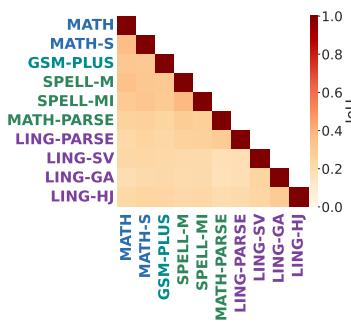  
(a) Qwen3-1.7B

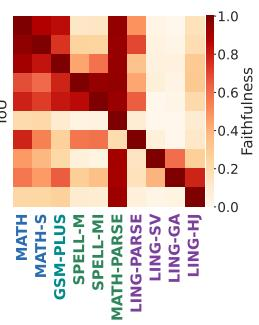

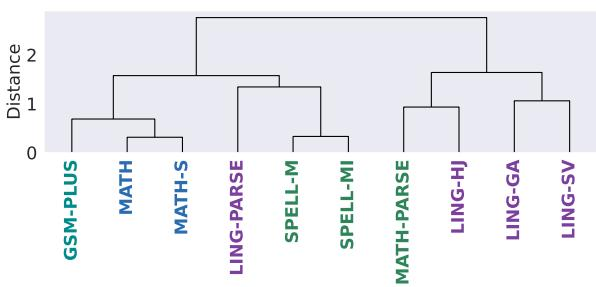  
Circuits (Faithfulness Row Vectors)

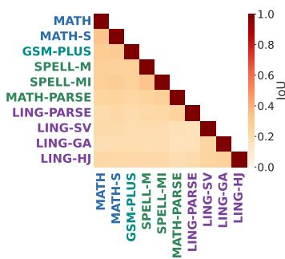

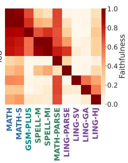  
(b) Qwen3-4B

(a) Qwen3-1.7B  
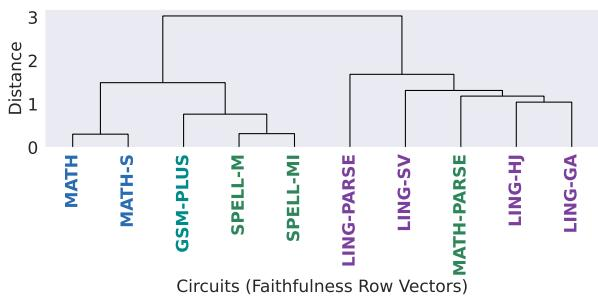  
(b) Qwen3-4B

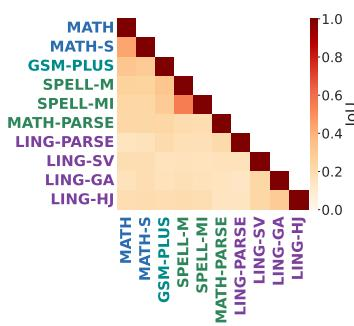

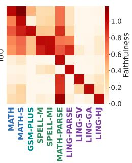  
(c) Gemma-2-2B  
Figure 6: Left: IoU (structural overlap). Right: crosstask Faithfulness (functional overlap). For Faithfulness, rows denote the tasks from which circuits are extracted, and columns denote the target tasks solved with those circuits. Scores are normalized by the corresponding diagonal self-faithfulness value.

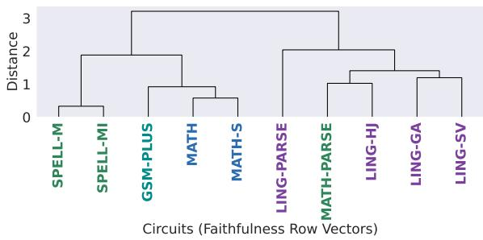  
(c) Gemma-2-2B  
Figure 7: Hierarchical clustering of task circuits based on cross-task Faithfulness transfer profiles. Top: Qwen3-1.7B. Middle: Qwen3-4B. Bottom: Gemma-2- 2B.

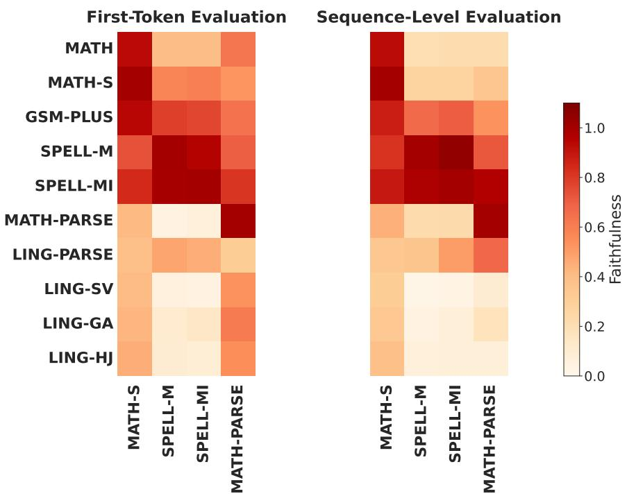  
Figure 8: Comparison of first-token (left) and sequence-level (right) cross-task faithfulness for Qwen3-8B under the top-2.5% circuit definition. Rows denote the ten source-circuit tasks, and columns denote the four target tasks reevaluated at the sequence level. Both panels use the same circuits extracted and selected with first-token EAP-IG scores and share a color scale. Scores are normalized by clean/corrupted baselines and then by the corresponding target's self-circuit faithfulness within each evaluation setting.

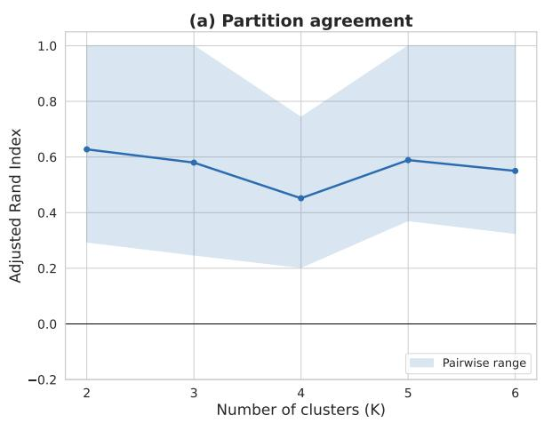

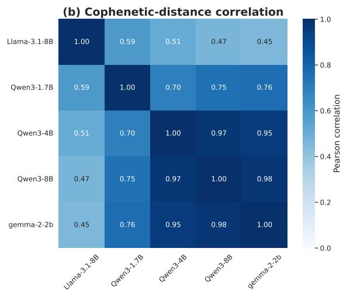  
Figure 9: Cross-model agreement of hierarchical clustering based on source-circuit faithfulness profiles under the top-2.5% circuit definition. (a) Mean Adjusted Rand Index (ARI) over all ten model pairs after cutting each dendrogram into K clusters; shading spans the pairwise minimum and maximum. (b) Pearson correlations between cophenetic-distance vectors, comparing complete dendrograms without selecting a cut level.