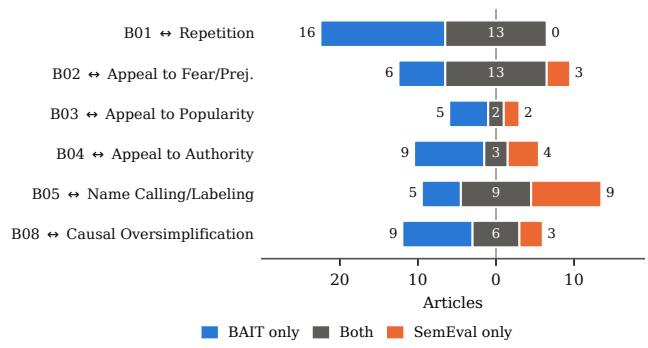
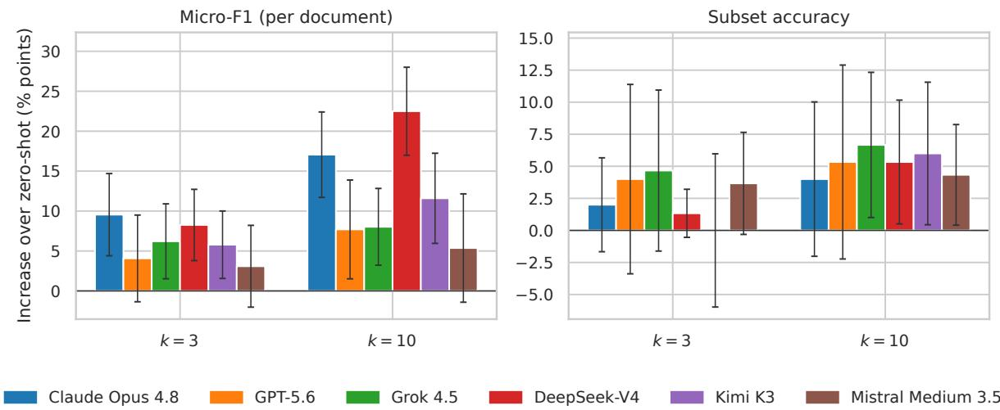
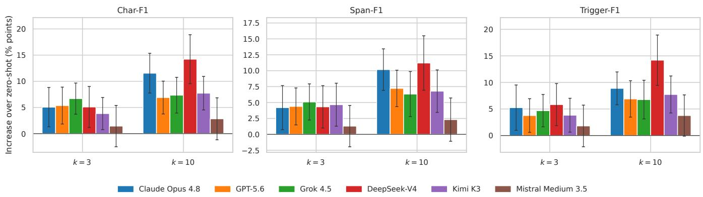
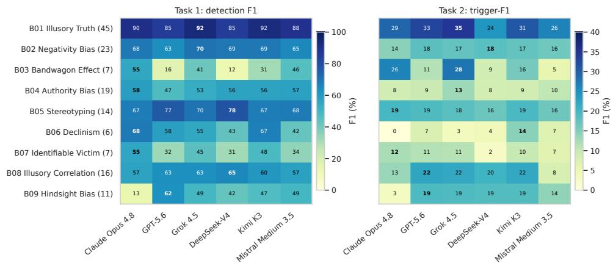
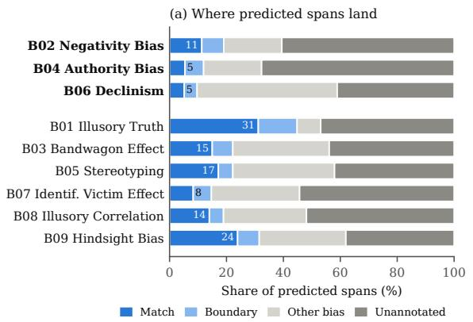
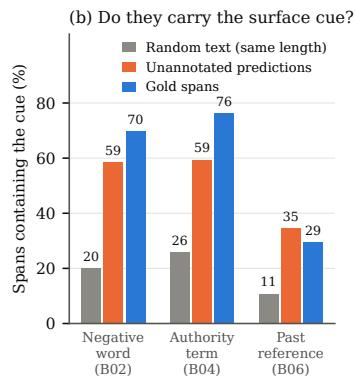
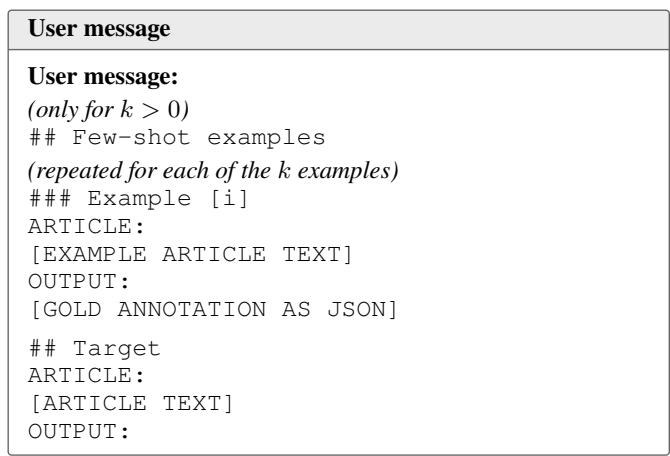

# BAIT: Can LLMs Find What Biases a Reader? A Benchmark for Cognitive Bias Triggers in News

Yousra Fettach <sup>1∗</sup>, Tijl De Bie<sup>1</sup>

<sup>1</sup>Gh<sub>en</sub>t U<sub>n</sub>i<sub>vers</sub>it<sub>y,</sub> B<sub>e</sub>l<sub>g</sub>i<sub>um</sub> <sub>yousra.</sub>f<sub>e</sub>tt<sub>ac</sub>h@<sub>ugen</sub>t<sub>.</sub>b<sub>e</sub>

## Abstract

P<sub>ersuas</sub>i<sub>ve wr</sub>iti<sub>ng exp</sub>l<sub>o</sub>it<sub>s cogn</sub>iti<sub>ve</sub> bi<sub>ases, recru</sub>iti<sub>ng a</sub> <sub>rea</sub>d<sub>er</sub>’<sub>s men</sub>t<sub>a</sub>l <sub>s</sub>h<sub>or</sub>t<sub>cu</sub>t<sub>s</sub> t<sub>o s</sub>h<sub>ape</sub> b<sub>e</sub>li<sub>e</sub>f<sub>, o</sub>ft<sub>en w</sub>ith<sub>ou</sub>t th<sub>e</sub> <sub>rea</sub>d<sub>er</sub> <sub>no</sub>ti<sub>c</sub>i<sub>ng.</sub> W<sub>e</sub> <sub>ca</sub>ll th<sub>e</sub> li<sub>ngu</sub>i<sub>s</sub>ti<sub>c</sub> f<sub>ea</sub>t<sub>ures</sub> <sub>exp</sub>l<sub>o</sub>iti<sub>ng</sub> <sub>suc</sub>h mental shortcuts cognitive bias triggers. As large language models (LLMs) increasin<sub>g</sub>l<sub>y</sub> mediate how <sub>p</sub>eo<sub>p</sub>le encounter <sub>news, summar</sub>i<sub>z</sub>i<sub>ng</sub> it<sub>, ran</sub>ki<sub>ng</sub> it<sub>, an</sub>d <sub>answer</sub>i<sub>ng ques</sub>ti<sub>ons</sub> <sub>over</sub> it<sub>, a na</sub>t<sub>ura</sub>l <sub>ques</sub>ti<sub>on</sub> i<sub>s w</sub>h<sub>e</sub>th<sub>er</sub> th<sub>ey can recogn</sub>i<sub>ze</sub> th<sub>e</sub> f<sub>ea</sub>t<sub>ures o</sub>f <sub>a</sub> t<sub>ex</sub>t th<sub>a</sub>t bi<sub>as a</sub> h<sub>uman rea</sub>d<sub>er.</sub> W<sub>e</sub> i<sub>n</sub>t<sub>ro</sub>d<sub>uce</sub> BAIT (Bias Annotation In Text), a resource for detecting cognitive bi<sub>as</sub> t<sub>r</sub>i<sub>ggers</sub> i<sub>n news.</sub> BAIT <sub>pa</sub>i<sub>rs a sc</sub>h<sub>ema o</sub>f <sub>n</sub>i<sub>ne</sub> t<sub>r</sub>i<sub>ggers,</sub> <sub>eac</sub>h <sub>spec</sub>ifi<sub>e</sub>d i<sub>n an anno</sub>t<sub>a</sub>t<sub>or co</sub>d<sub>e</sub>b<sub>oo</sub>k<sub>, w</sub>ith 50 E<sub>ng</sub>li<sub>s</sub>h <sub>news</sub> <sub>ar</sub>ti<sub>c</sub>l<sub>es anno</sub>t<sub>a</sub>t<sub>e</sub>d b<sub>y</sub> t<sub>ra</sub>i<sub>ne</sub>d <sub>anno</sub>t<sub>a</sub>t<sub>ors a</sub>t th<sub>e ar</sub>ti<sub>c</sub>l<sub>e an</sub>d <sub>span</sub> levels and adjudicated into a gold standard. On this data we d<sub>e</sub>fi<sub>ne</sub> t<sub>wo</sub> t<sub>as</sub>k<sub>s,</sub> d<sub>e</sub>t<sub>ec</sub>ti<sub>ng w</sub>hi<sub>c</sub>h t<sub>r</sub>i<sub>ggers a</sub> t<sub>ex</sub>t <sub>con</sub>t<sub>a</sub>i<sub>ns an</sub>d l<sub>oca</sub>ti<sub>ng</sub> th<sub>e spans</sub> th<sub>a</sub>t <sub>carry</sub> th<sub>em.</sub> W<sub>e</sub> th<sub>en</sub> b<sub>enc</sub>h<sub>mar</sub>k <sub>s</sub>i<sub>x</sub> f<sub>ron</sub>ti<sub>er</sub> LLM<sub>s zero-s</sub>h<sub>o</sub>t <sub>an</sub>d <sub>w</sub>ith th<sub>ree or</sub> t<sub>en</sub> i<sub>n-con</sub>t<sub>ex</sub>t <sub>ex-</sub> <sub>amp</sub>l<sub>es.</sub> Th<sub>e mo</sub>d<sub>e</sub>l<sub>s approac</sub>h h<sub>uman agreemen</sub>t <sub>on w</sub>hi<sub>c</sub>h t<sub>r</sub>i<sub>ggers an ar</sub>ti<sub>c</sub>l<sub>e con</sub>t<sub>a</sub>i<sub>ns,</sub> b<sub>u</sub>t <sub>rare</sub>l<sub>y recover</sub> it<sub>s</sub> f<sub>u</sub>ll <sub>se</sub>t <sub>o</sub>f t<sub>r</sub>i<sub>ggers, an</sub>d th<sub>ey reac</sub>h l<sub>ess</sub> th<sub>an</sub> h<sub>a</sub>lf <sub>o</sub>f h<sub>uman agreemen</sub>t i<sub>n</sub> l<sub>oca</sub>ti<sub>ng</sub> th<sub>e passages</sub> th<sub>a</sub>t <sub>carry</sub> th<sub>em.</sub> M<sub>oreover,</sub> th<sub>ey over-</sub> <sub>pre</sub>di<sub>c</sub>t t<sub>r</sub>i<sub>ggers</sub> th<sub>a</sub>t <sub>come w</sub>ith <sub>easy sur</sub>f<sub>ace cues, an</sub>d <sub>mos</sub>t <sub>o</sub>f th<sub>e passages</sub> th<sub>ey mar</sub>k f<sub>or</sub> th<sub>ese</sub> t<sub>r</sub>i<sub>ggers are no</sub>t t<sub>r</sub>i<sub>ggers,</sub> <sub>ye</sub>t <sub>carry</sub> th<sub>e</sub> t<sub>r</sub>i<sub>gger</sub>’<sub>s sur</sub>f<sub>ace cue</sub> f<sub>ar more o</sub>ft<sub>en</sub> th<sub>an ran</sub>d<sub>om</sub> t<sub>ex</sub>t<sub>.</sub> Th<sub>ese</sub> fi<sub>n</sub>di<sub>ngs sugges</sub>t th<sub>a</sub>t th<sub>e eva</sub>l<sub>ua</sub>t<sub>e</sub>d LLM<sub>s respon</sub>d t<sub>o sur</sub>f<sub>ace cues ra</sub>th<sub>er</sub> th<sub>an</sub> t<sub>o</sub> th<sub>e mec</sub>h<sub>an</sub>i<sub>sms</sub> th<sub>a</sub>t <sub>ma</sub>k<sub>e a</sub> <sub>passage man</sub>i<sub>pu</sub>l<sub>a</sub>ti<sub>ve.</sub> W<sub>e re</sub>l<sub>ease</sub> th<sub>e sc</sub>h<sub>ema,</sub> th<sub>e co</sub>d<sub>e</sub>b<sub>oo</sub>k<sub>,</sub> <sub>s</sub>t<sub>an</sub>d<sub>o</sub>f <sub>anno</sub>t<sub>a</sub>ti<sub>ons, an</sub>d th<sub>e eva</sub>l<sub>ua</sub>ti<sub>on p</sub>i<sub>pe</sub>li<sub>ne.</sub>

## 1 Introduction

C<sub>ogn</sub>iti<sub>ve</sub> bi<sub>ases are sys</sub>t<sub>ema</sub>ti<sub>c</sub> d<sub>ev</sub>i<sub>a</sub>ti<sub>ons</sub> f<sub>rom ra</sub>ti<sub>ona</sub>l <sub>rea-</sub> <sub>son</sub>i<sub>ng</sub> th<sub>a</sub>t <sub>ar</sub>i<sub>se</sub> f<sub>rom</sub> th<sub>e</sub> h<sub>eur</sub>i<sub>s</sub>ti<sub>c processes un</sub>d<sub>er</sub>l<sub>y</sub>i<sub>ng</sub> ever<sub>y</sub>da<sub>y</sub> co<sub>g</sub>nition (Tversk<sub>y</sub> and Kahneman 1974). These h<sub>eur</sub>i<sub>s</sub>ti<sub>cs</sub> h<sub>e</sub>l<sub>p rea</sub>d<sub>ers process</sub> i<sub>n</sub>f<sub>orma</sub>ti<sub>on e</sub>fi<sub>c</sub>i<sub>en</sub>tl<sub>y.</sub> H<sub>ow-</sub> <sub>ever,</sub> th<sub>ey can a</sub>l<sub>so</sub> b<sub>e exp</sub>l<sub>o</sub>it<sub>e</sub>d th<sub>roug</sub>h <sub>persuas</sub>i<sub>ve wr</sub>iti<sub>ng.</sub>

S<sub>uc</sub>h <sub>wr</sub>iti<sub>ng recru</sub>it<sub>s</sub> th<sub>ese cogn</sub>iti<sub>ve</sub> h<sub>eur</sub>i<sub>s</sub>ti<sub>cs</sub> t<sub>o s</sub>h<sub>ape</sub> belief and form attitudes (Pett<sub>y</sub> and Cacio<sub>pp</sub>o 1986). Buildi<sub>ng on wor</sub>k <sub>on me</sub>di<sub>a</sub> bi<sub>as an</sub>d <sub>persuas</sub>i<sub>on</sub> t<sub>ec</sub>h<sub>n</sub>i<sub>ques</sub> i<sub>n</sub> com<sub>p</sub>utational social science (S<sub>p</sub>inde et al. 2021a; Piskorski et al. 2023), we refer to such <sub>p</sub>ersuasive writin<sub>g</sub> features as cognitive bias triggers.

C<sub>ogn</sub>iti<sub>ve</sub> bi<sub>as</sub> t<sub>r</sub>i<sub>ggers</sub> <sub>are</sub> h<sub>ar</sub>d t<sub>o</sub> <sub>anno</sub>t<sub>a</sub>t<sub>e</sub> b<sub>ecause</sub> th<sub>ey</sub> cannot be identified from wordin<sub>g</sub> alone. Quotin<sub>g</sub> an expert, <sub>recoun</sub>ti<sub>ng one person</sub>’<sub>s s</sub>t<sub>ory, or res</sub>t<sub>a</sub>ti<sub>ng a c</sub>l<sub>a</sub>i<sub>m are com-</sub> <sub>mon</sub> i<sub>n news wr</sub>iti<sub>ng, an</sub>d <sub>eac</sub>h <sub>can appear</sub> i<sub>n a passage</sub> th<sub>a</sub>t i<sub>s</sub> <sub>a</sub> t<sub>r</sub>i<sub>gger an</sub>d i<sub>n one</sub> th<sub>a</sub>t i<sub>s no</sub>t<sub>.</sub> T<sub>e</sub>lli<sub>ng</sub> th<sub>e</sub> t<sub>wo apar</sub>t d<sub>epen</sub>d<sub>s</sub> <sub>on</sub> th<sub>e res</sub>t <sub>o</sub>f th<sub>e ar</sub>ti<sub>c</sub>l<sub>e,</sub> f<sub>or examp</sub>l<sub>e w</sub>h<sub>e</sub>th<sub>er</sub> th<sub>e exper</sub>t’<sub>s</sub> <sub>c</sub>l<sub>a</sub>i<sub>m</sub> i<sub>s suppor</sub>t<sub>e</sub>d b<sub>y ev</sub>id<sub>ence anyw</sub>h<sub>ere</sub> i<sub>n</sub> th<sub>e</sub> t<sub>ex</sub>t<sub>.</sub> W<sub>or</sub>k <sub>on</sub> th<sub>e crea</sub>ti<sub>on o</sub>f <sub>anno</sub>t<sub>a</sub>t<sub>e</sub>d d<sub>a</sub>t<sub>ase</sub>t<sub>s</sub> f<sub>or c</sub>l<sub>ose</sub>l<sub>y re</sub>l<sub>a</sub>t<sub>e</sub>d <sub>p</sub>h<sub>e-</sub> nomena, such as <sub>p</sub>ro<sub>p</sub>a<sub>g</sub>anda (Da San Martino et al. 2019) and <sub>p</sub>ersuasion techniques (Piskorski et al. 2023), re<sub>p</sub>orts the <sub>same</sub> difi<sub>cu</sub>lt<sub>y.</sub> B<sub>o</sub>th <sub>o</sub>f th<sub>ese</sub> d<sub>a</sub>t<sub>ase</sub>t<sub>s re</sub>li<sub>e</sub>d <sub>on pro</sub>f<sub>ess</sub>i<sub>ona</sub>l <sub>or exper</sub>t <sub>anno</sub>t<sub>a</sub>t<sub>ors,</sub> d<sub>e</sub>t<sub>a</sub>il<sub>e</sub>d <sub>gu</sub>id<sub>e</sub>li<sub>nes, an</sub>d <sub>a conso</sub>lid<sub>a-</sub> ti<sub>on s</sub>t<sub>ep</sub> i<sub>n w</sub>hi<sub>c</sub>h <sub>anno</sub>t<sub>a</sub>t<sub>ors reso</sub>l<sub>ve</sub>d th<sub>e</sub>i<sub>r</sub> di<sub>sagreemen</sub>t<sub>s.</sub> Th<sub>ese</sub> d<sub>a</sub>t<sub>ase</sub>t<sub>s,</sub> h<sub>owever,</sub> d<sub>o no</sub>t <sub>recor</sub>d <sub>w</sub>hi<sub>c</sub>h <sub>cogn</sub>iti<sub>ve</sub> bi<sub>as</sub> <sub>a passage engages</sub> i<sub>n</sub> th<sub>e rea</sub>d<sub>er, or w</sub>h<sub>e</sub>th<sub>er</sub> th<sub>e con</sub>diti<sub>ons</sub> f<sub>or</sub> th<sub>a</sub>t bi<sub>as are me</sub>t<sub>.</sub> T<sub>o</sub> th<sub>e</sub> b<sub>es</sub>t <sub>o</sub>f <sub>our</sub> k<sub>now</sub>l<sub>e</sub>d<sub>ge, no ex</sub>i<sub>s</sub>ti<sub>ng</sub> <sub>resource</sub> i<sub>s anno</sub>t<sub>a</sub>t<sub>e</sub>d f<sub>or</sub> thi<sub>s, so</sub> it i<sub>s no</sub>t <sub>ye</sub>t <sub>poss</sub>ibl<sub>e</sub> t<sub>o</sub> t<sub>es</sub>t <sub>w</sub>h<sub>e</sub>th<sub>er a sys</sub>t<sub>em can</sub> id<sub>en</sub>tif<sub>y</sub> th<sub>e passages</sub> th<sub>a</sub>t <sub>wou</sub>ld bi<sub>as a</sub> <sub>rea</sub>d<sub>er.</sub>

Thi<sub>s</sub> <sub>ques</sub>ti<sub>on</sub> h<sub>as</sub> b<sub>ecome</sub> <sub>press</sub>i<sub>ng</sub> <sub>as</sub> l<sub>arge</sub> l<sub>anguage</sub> <sub>mo</sub>d<sub>-</sub> els (LLMs) increasin<sub>g</sub>l<sub>y</sub> stand between readers and the news, <sub>summar</sub>i<sub>z</sub>i<sub>ng,</sub> <sub>re</sub>t<sub>r</sub>i<sub>ev</sub>i<sub>ng,</sub> <sub>ran</sub>ki<sub>ng,</sub> <sub>an</sub>d <sub>answer</sub>i<sub>ng</sub> <sub>ques</sub>ti<sub>ons</sub> <sub>a</sub>b<sub>ou</sub>t it<sub>.</sub> A <sub>mo</sub>d<sub>e</sub>l i<sub>n</sub> thi<sub>s</sub> <sub>ro</sub>l<sub>e</sub> d<sub>ec</sub>id<sub>es</sub> <sub>w</sub>h<sub>a</sub>t <sub>rea</sub>d<sub>ers</sub> <sub>see</sub> <sub>an</sub>d h<sub>ow</sub> it i<sub>s</sub> f<sub>rame</sub>d<sub>.</sub> If it <sub>canno</sub>t <sub>recogn</sub>i<sub>ze</sub> th<sub>e</sub> <sub>passages</sub> th<sub>a</sub>t <sub>wou</sub>ld bi<sub>as</sub> <sub>a</sub> <sub>rea</sub>d<sub>er,</sub> it <sub>may</sub> <sub>pass</sub> th<sub>em</sub> <sub>on</sub> <sub>unexam</sub>i<sub>ne</sub>d <sub>or</sub> <sub>repro</sub>d<sub>uce</sub> th<sub>em</sub> i<sub>n</sub> it<sub>s</sub> <sub>own</sub> <sub>ou</sub>t<sub>pu</sub>t<sub>.</sub>

A <sub>grow</sub>i<sub>ng</sub> lit<sub>era</sub>t<sub>ure es</sub>t<sub>a</sub>bli<sub>s</sub>h<sub>es</sub> th<sub>a</sub>t LLM<sub>s are</sub> th<sub>emse</sub>l<sub>ves</sub> subject to human-like biases in their own judgments, includin<sub>g</sub> anchorin<sub>g</sub>, framin<sub>g</sub>, and order efects (Echterhof et al. 2024; Itzhak et al. 2024; Koo et al. 2024). That work charact<sub>er</sub>i<sub>zes</sub> th<sub>e mo</sub>d<sub>e</sub>l <sub>as a</sub> bi<sub>ase</sub>d <sub>reasoner.</sub> It l<sub>eaves open w</sub>h<sub>e</sub>th<sub>er</sub> <sub>a mo</sub>d<sub>e</sub>l <sub>can recogn</sub>i<sub>ze,</sub> i<sub>n</sub> t<sub>ex</sub>t <sub>supp</sub>li<sub>e</sub>d t<sub>o</sub> it<sub>,</sub> th<sub>e</sub> f<sub>ea</sub>t<sub>ures</sub> th<sub>a</sub>t <sub>wou</sub>ld bi<sub>as a</sub> h<sub>uman rea</sub>d<sub>er, an</sub>d l<sub>oca</sub>li<sub>ze</sub> th<sub>em prec</sub>i<sub>se</sub>l<sub>y</sub> enough for the judgment to be inspected.

Statement of Contributions We introduce BAIT (Bias Annotation In Text), a resource and evaluation pipeline for d<sub>e</sub>t<sub>ec</sub>ti<sub>ng cogn</sub>iti<sub>ve</sub> bi<sub>as</sub> t<sub>r</sub>i<sub>ggers</sub> i<sub>n news</sub> t<sub>ex</sub>t<sub>.</sub> O<sub>ur con</sub>t<sub>r</sub>ib<sub>u-</sub> ti<sub>ons are as</sub> f<sub>o</sub>ll<sub>ows.</sub>

1<sub>.</sub> W<sub>e</sub> d<sub>e</sub>fi<sub>ne a sc</sub>h<sub>ema o</sub>f <sub>n</sub>i<sub>ne cogn</sub>iti<sub>ve</sub> bi<sub>as</sub> t<sub>r</sub>i<sub>ggers, eac</sub>h <sub>spec</sub>ifi<sub>e</sub>d i<sub>n an anno</sub>t<sub>a</sub>t<sub>or co</sub>d<sub>e</sub>b<sub>oo</sub>k<sub>.</sub> T<sub>wo</sub> t<sub>ra</sub>i<sub>ne</sub>d <sub>anno</sub>t<sub>a-</sub> t<sub>ors use</sub>d it t<sub>o anno</sub>t<sub>a</sub>t<sub>e</sub> 50 E<sub>ng</sub>li<sub>s</sub>h <sub>news ar</sub>ti<sub>c</sub>l<sub>es a</sub>t th<sub>e</sub> <sub>ar</sub>ti<sub>c</sub>l<sub>e an</sub>d <sub>span</sub> l<sub>eve</sub>l<sub>s, an</sub>d th<sub>e anno</sub>t<sub>a</sub>ti<sub>ons were con-</sub> <sub>so</sub>lid<sub>a</sub>t<sub>e</sub>d i<sub>n</sub>t<sub>o a go</sub>ld <sub>s</sub>t<sub>an</sub>d<sub>ar</sub>d<sub>.</sub> W<sub>e re</sub>l<sub>ease</sub> th<sub>e sc</sub>h<sub>ema,</sub> <sub>co</sub>d<sub>e</sub>b<sub>oo</sub>k<sub>,</sub> <sub>s</sub>t<sub>an</sub>d<sub>o</sub>f <sub>anno</sub>t<sub>a</sub>ti<sub>ons,</sub> <sub>an</sub>d <sub>eva</sub>l<sub>ua</sub>ti<sub>on</sub> <sub>p</sub>i<sub>pe</sub>li<sub>ne.</sub><sup>1</sup>

2<sub>.</sub> W<sub>e</sub> d<sub>e</sub>fi<sub>ne</sub> t<sub>wo</sub> t<sub>as</sub>k<sub>s,</sub> d<sub>e</sub>t<sub>ec</sub>ti<sub>ng</sub> <sub>w</sub>hi<sub>c</sub>h t<sub>r</sub>i<sub>ggers</sub> <sub>an</sub> <sub>ar</sub>ti<sub>-</sub> <sub>c</sub>l<sub>e</sub> <sub>con</sub>t<sub>a</sub>i<sub>ns</sub> <sub>an</sub>d l<sub>oca</sub>ti<sub>ng</sub> th<sub>e</sub> <sub>spans</sub> th<sub>a</sub>t <sub>carry</sub> th<sub>em,</sub> <sub>an</sub>d b<sub>enc</sub>h<sub>mar</sub>k <sub>s</sub>i<sub>x</sub> f<sub>ron</sub>ti<sub>er</sub> LLM<sub>s zero-s</sub>h<sub>o</sub>t <sub>an</sub>d <sub>w</sub>ith th<sub>ree</sub> <sub>an</sub>d t<sub>en</sub> i<sub>n-con</sub>t<sub>ex</sub>t <sub>examp</sub>l<sub>es.</sub>

3<sub>.</sub> W<sub>e s</sub>h<sub>ow</sub> th<sub>a</sub>t <sub>mo</sub>d<sub>e</sub>l<sub>s can o</sub>ft<sub>en</sub> t<sub>e</sub>ll th<sub>a</sub>t <sub>an ar</sub>ti<sub>c</sub>l<sub>e con</sub>t<sub>a</sub>i<sub>ns</sub> t<sub>r</sub>i<sub>ggers</sub> b<sub>u</sub>t <sub>canno</sub>t <sub>re</sub>li<sub>a</sub>bl<sub>y</sub> <sub>po</sub>i<sub>n</sub>t t<sub>o</sub> th<sub>e</sub> <sub>passages</sub> th<sub>a</sub>t <sub>carry</sub> them: the best model reaches a trigger-level F of 0.22, <sub>aga</sub>in<sub>s</sub>t 0<sub>.</sub>50 b<sub>e</sub>t<sub>wee</sub>n t<sub>wo a</sub>nn<sub>o</sub>t<sub>a</sub>t<sub>o</sub>r<sub>s.</sub> In<sub>-co</sub>nt<sub>ex</sub>t <sub>exa</sub>m<sub>p</sub>l<sub>es</sub> <sub>narrow</sub> thi<sub>s</sub> <sub>gap</sub> <sub>w</sub>ith<sub>ou</sub>t <sub>c</sub>l<sub>os</sub>i<sub>ng</sub> it<sub>.</sub>

4<sub>.</sub> W<sub>e</sub> fi<sub>n</sub>d th<sub>a</sub>t <sub>mo</sub>d<sub>e</sub>l<sub>s respon</sub>d t<sub>o</sub> th<sub>e sur</sub>f<sub>ace cue o</sub>f <sub>a</sub> bi<sub>as</sub> <sub>ra</sub>th<sub>er</sub> th<sub>an</sub> t<sub>o</sub> it<sub>s mec</sub>h<sub>an</sub>i<sub>sm.</sub> Th<sub>ey over-pre</sub>di<sub>c</sub>t th<sub>e</sub> t<sub>r</sub>i<sub>g-</sub> <sub>g</sub>ers with the easiest cues, namel<sub>y</sub> Ne<sub>g</sub>ativit<sub>y</sub> Bias (39 articles on avera<sub>g</sub>e a<sub>g</sub>ainst 23 in the <sub>g</sub>old standard), Authorit<sub>y</sub> Bias (30 a<sub>g</sub>ainst 19), and Declinism (10.5 a<sub>g</sub>ainst 6). Most of the <sub>p</sub>assa<sub>g</sub>es the<sub>y</sub> mark for these tri<sub>gg</sub>ers are not tr<sup>i</sup><sub>gg</sub>ers, <sub>y</sub>et carr<sub>y</sub> t<sup>h</sup>e tr<sup>i</sup><sub>gg</sub>er<sup>’</sup>s sur<sup>f</sup>ace cue <sup>f</sup>ar more <sub>o</sub>ft<sub>en</sub> th<sub>an ran</sub>d<sub>om</sub> t<sub>ex</sub>t<sub>.</sub>

N<sub>o</sub> <sub>par</sub>t <sub>o</sub>f thi<sub>s</sub> <sub>paper</sub> h<sub>as</sub> b<sub>een</sub> <sub>pu</sub>bli<sub>s</sub>h<sub>e</sub>d b<sub>e</sub>f<sub>ore.</sub>

## 2 Related Work

Media bias and lexical bias detection. A substantial line <sub>o</sub>f <sub>wor</sub>k <sub>anno</sub>t<sub>a</sub>t<sub>es</sub> bi<sub>as</sub> i<sub>n news an</sub>d l<sub>oca</sub>t<sub>es</sub> it i<sub>n wor</sub>d <sub>c</sub>h<sub>o</sub>i<sub>ce.</sub> BABE (S<sub>p</sub>inde et al. 2021a) <sub>p</sub>rovides ex<sub>p</sub>ert annotations of 3<sub>,</sub>700 <sub>news sen</sub>t<sub>ences, mar</sub>ki<sub>ng w</sub>h<sub>e</sub>th<sub>er eac</sub>h <sub>sen</sub>t<sub>ence</sub> i<sub>s</sub> bi<sub>ase</sub>d <sub>an</sub>d <sub>w</sub>hi<sub>c</sub>h <sub>wor</sub>d<sub>s carry</sub> th<sub>e</sub> bi<sub>as, w</sub>ith hi<sub>g</sub>h<sub>er</sub> i<sub>n</sub>t<sub>er-</sub> <sub>anno</sub>t<sub>a</sub>t<sub>or agreemen</sub>t th<sub>an ear</sub>li<sub>er crow</sub>d<sub>source</sub>d d<sub>a</sub>t<sub>ase</sub>t<sub>s suc</sub>h as MBIC (S<sub>p</sub>inde et al. 2021b). MBIB (Wessel et al. 2023) <sub>assem</sub>bl<sub>es n</sub>i<sub>ne me</sub>di<sub>a-</sub>bi<sub>as</sub> t<sub>as</sub>k<sub>s over</sub> t<sub>wen</sub>t<sub>y-</sub>t<sub>wo</sub> d<sub>a</sub>t<sub>ase</sub>t<sub>s,</sub> <sub>spann</sub>i<sub>ng</sub> li<sub>ngu</sub>i<sub>s</sub>ti<sub>c, po</sub>liti<sub>ca</sub>l<sub>,</sub> f<sub>ram</sub>i<sub>ng,</sub> h<sub>a</sub>t<sub>e-speec</sub>h<sub>, an</sub>d <sub>o</sub>th<sub>er</sub> bi<sub>as</sub> t<sub>ypes,</sub> t<sub>o</sub> t<sub>es</sub>t h<sub>ow</sub> d<sub>e</sub>t<sub>ec</sub>ti<sub>on me</sub>th<sub>o</sub>d<sub>s genera</sub>li<sub>ze across</sub> th<sub>em.</sub> MBIB <sub>a</sub>l<sub>so</sub> i<sub>nc</sub>l<sub>u</sub>d<sub>es a cogn</sub>iti<sub>ve-</sub>bi<sub>as</sub> t<sub>as</sub>k<sub>, w</sub>hi<sub>c</sub>h it d<sub>e</sub>fi<sub>nes as rea</sub>d<sub>ers</sub>’ <sub>se</sub>l<sub>ec</sub>ti<sub>ve c</sub>h<sub>o</sub>i<sub>ce o</sub>f <sub>w</sub>hi<sub>c</sub>h <sub>sources</sub> t<sub>o rea</sub>d <sub>an</sub>d t<sub>rus</sub>t<sub>.</sub> I<sub>n prac</sub>ti<sub>ce,</sub> h<sub>owever,</sub> th<sub>e</sub> l<sub>a</sub>b<sub>e</sub>l<sub>s come</sub> f<sub>rom prox</sub>i<sub>es:</sub> th<sub>e po</sub>liti<sub>ca</sub>l l<sub>ean</sub>i<sub>ng o</sub>f<sub>an ar</sub>ti<sub>c</sub>l<sub>e</sub>’<sub>s ou</sub>tl<sub>e</sub>t <sub>us</sub>i<sub>ng</sub> th<sub>e</sub> BIGNEWS dataset (Liu et al. 2022) and the fact-checked truthfulness of a statement with the LIAR dataset (Wan<sub>g</sub> 2017).

Persuasion and propaganda techniques. A second line <sub>anno</sub>t<sub>a</sub>t<sub>es</sub> th<sub>e r</sub>h<sub>e</sub>t<sub>or</sub>i<sub>ca</sub>l d<sub>ev</sub>i<sub>ces a</sub> t<sub>ex</sub>t <sub>uses</sub> t<sub>o persua</sub>d<sub>e.</sub> Da San Martino et al. (2019) annotate news articles at fra<sub>g</sub>- <sub>men</sub>t l<sub>eve</sub>l <sub>w</sub>ith <sub>e</sub>i<sub>g</sub>ht<sub>een propagan</sub>d<sub>a</sub> t<sub>ec</sub>h<sub>n</sub>i<sub>ques an</sub>d <sub>cas</sub>t th<sub>e</sub> problem as joint detection and localization. The SemEval-2023 Task 3 shared task (Piskorski et al. 2023) extends this t<sub>o</sub> t<sub>wen</sub>t<sub>y-</sub>th<sub>ree</sub> <sub>persuas</sub>i<sub>on</sub> t<sub>ec</sub>h<sub>n</sub>i<sub>ques</sub> <sub>across</sub> <sub>n</sub>i<sub>ne</sub> l<sub>anguages,</sub> <sub>a</sub>ddi<sub>ng genre an</sub>d f<sub>ram</sub>i<sub>ng</sub> l<sub>a</sub>b<sub>e</sub>l<sub>s.</sub> B<sub>o</sub>th d<sub>a</sub>t<sub>ase</sub>t<sub>s</sub> l<sub>a</sub>b<sub>e</sub>l th<sub>e</sub> <sub>r</sub>h<sub>e</sub>t<sub>or</sub>i<sub>ca</sub>l d<sub>ev</sub>i<sub>ces</sub> <sub>a</sub> <sub>wr</sub>it<sub>er</sub> <sub>uses</sub> t<sub>o</sub> <sub>persua</sub>d<sub>e.</sub> N<sub>e</sub>ith<sub>er</sub> <sub>says</sub> <sub>w</sub>hi<sub>c</sub>h <sub>cogn</sub>iti<sub>ve</sub> bi<sub>as a passage m</sub>i<sub>g</sub>ht t<sub>r</sub>i<sub>gger</sub> i<sub>n a rea</sub>d<sub>er, an</sub>d <sub>a cue</sub> th<sub>a</sub>t <sub>re</sub>li<sub>es on no name</sub>d t<sub>ec</sub>h<sub>n</sub>i<sub>que</sub> f<sub>a</sub>ll<sub>s ou</sub>t<sub>s</sub>id<sub>e</sub> th<sub>e</sub>i<sub>r</sub> l<sub>a</sub>b<sub>e</sub>l <sub>se</sub>t<sub>s.</sub>

Cognitive bias in LLMs. A growing body of work asks <sub>w</sub>h<sub>e</sub>th<sub>er</sub> l<sub>anguage mo</sub>d<sub>e</sub>l<sub>s</sub> di<sub>sp</sub>l<sub>ay</sub> h<sub>uman-</sub>lik<sub>e</sub> bi<sub>ases</sub> i<sub>n</sub> th<sub>e</sub>i<sub>r</sub> <sub>own</sub> <sub>ou</sub>t<sub>pu</sub>t<sub>s:</sub> <sub>anc</sub>h<sub>or</sub>i<sub>ng</sub> <sub>an</sub>d f<sub>ram</sub>i<sub>ng</sub> <sub>e</sub>f<sub>ec</sub>t<sub>s</sub> i<sub>n</sub> d<sub>ec</sub>i<sub>s</sub>i<sub>on</sub> t<sub>as</sub>k<sub>s</sub> (Echterhof et al. 2024), biases that emer<sub>g</sub>e from instruction tunin<sub>g</sub> (Itzhak et al. 2024), and order and e<sub>g</sub>ocentric efects when models act as evaluators (Koo et al. 2024). This work treats the model as a reasoner whose judgments can be di<sub>s</sub>t<sub>or</sub>t<sub>e</sub>d<sub>,</sub> <sub>an</sub>d <sub>measures</sub> th<sub>a</sub>t di<sub>s</sub>t<sub>or</sub>ti<sub>on.</sub> A <sub>separa</sub>t<sub>e</sub> <sub>s</sub>t<sub>ran</sub>d <sub>an-</sub> <sub>no</sub>t<sub>a</sub>t<sub>es reason</sub>i<sub>ng</sub> d<sub>e</sub>f<sub>ec</sub>t<sub>s</sub> i<sub>n</sub> t<sub>ex</sub>t di<sub>rec</sub>tl<sub>y, c</sub>l<sub>oses</sub>t <sub>among</sub> th<sub>em</sub> lo<sub>g</sub>ical fallac<sub>y</sub> detection (Jin et al. 2022), which labels invalid ar<sub>g</sub>ument structure as a <sub>p</sub>ro<sub>p</sub>ert<sub>y</sub> o<sup>f</sup> t<sup>h</sup>e ar<sub>g</sub>ument <sup>i</sup>tse<sup>lf</sup>.

<table><tr><td>ID</td><td>Trigger</td><td>Ref.</td></tr><tr><td colspan="3">Credibility</td></tr><tr><td>B01</td><td>Illusory Truth</td><td>(Hasher, Goldstein, and Toppino 1977)</td></tr><tr><td>B03 B04</td><td>Bandwagon Effect Authority Bias</td><td>(Asch 1956) (Chaiken 1980)</td></tr><tr><td colspan="3">Affect</td></tr><tr><td></td><td>B02 Negativity Bias B07 Identifiable Victim Effect</td><td>(Baumeister et al. 2001) (Jenni and Loewenstein</td></tr><tr><td>Social categorization</td><td></td><td>1997)</td></tr><tr><td colspan="3">B05 Stereotyping</td></tr><tr><td>B06 Declinism</td><td>Temporal and causal reasoning</td><td>(Eibach, Libby, and</td></tr><tr><td>B08</td><td>Illusory Correlation</td><td>Gilovich 2003) (Hamilton and Gifford</td></tr><tr><td>B09</td><td>Hindsight Bias</td><td>1976) (Fischhoff 2003)</td></tr></table>

T<sub>a</sub>bl<sub>e</sub> 1<sub>:</sub> Th<sub>e n</sub>i<sub>ne cogn</sub>iti<sub>ve</sub> bi<sub>as</sub> t<sub>r</sub>i<sub>gger ca</sub>t<sub>egor</sub>i<sub>es</sub> i<sub>n</sub> BAIT<sub>,</sub> <sub>groupe</sub>d b<sub>y</sub> th<sub>e</sub> <sub>mec</sub>h<sub>an</sub>i<sub>sm</sub> th<sub>ey</sub> <sub>recru</sub>it<sub>,</sub> <sub>w</sub>ith <sub>a</sub> f<sub>oun</sub>d<sub>a</sub>ti<sub>ona</sub>l <sub>re</sub>f<sub>erence</sub> f<sub>or eac</sub>h<sub>.</sub>

A<sub>cross</sub> th<sub>ese</sub> li<sub>nes</sub> <sub>o</sub>f <sub>wor</sub>k<sub>,</sub> th<sub>e</sub> <sub>ques</sub>ti<sub>on</sub> <sub>o</sub>f h<sub>ow</sub> <sub>a</sub> t<sub>ex</sub>t <sub>m</sub>i<sub>g</sub>ht bi<sub>as</sub> it<sub>s</sub> <sub>rea</sub>d<sub>er</sub> <sub>rema</sub>i<sub>ns</sub> <sub>open.</sub> N<sub>o</sub> <sub>resource</sub> <sub>mar</sub>k<sub>s</sub> th<sub>e</sub> <sub>passages</sub> lik<sub>e</sub>l<sub>y</sub> t<sub>o</sub> t<sub>r</sub>i<sub>gger a cogn</sub>iti<sub>ve</sub> bi<sub>as, or w</sub>hi<sub>c</sub>h bi<sub>as eac</sub>h <sup>one tri</sup>gg<sup>ers</sup>.

## 3 The BAIT Schema

BAIT targets cognitive biases that news text can trigger in a reader: well-documented tendencies in human judgment that <sub>a passage can se</sub>t <sub>o</sub>f th<sub>roug</sub>h th<sub>e way</sub> it <sub>presen</sub>t<sub>s</sub> i<sub>n</sub>f<sub>orma-</sub> ti<sub>on.</sub> W<sub>e se</sub>l<sub>ec</sub>t<sub>e</sub>d <sub>can</sub>did<sub>a</sub>t<sub>e</sub> bi<sub>ases</sub> f<sub>rom</sub> th<sub>e psyc</sub>h<sub>o</sub>l<sub>og</sub>i<sub>ca</sub>l literature on judgment, persuasion, and social cognition, and filt<sub>ere</sub>d th<sub>em aga</sub>i<sub>ns</sub>t t<sub>wo cr</sub>it<sub>er</sub>i<sub>a:</sub>

• Text-surface identifiability: a tri<sub>gg</sub>er must <sub>p</sub>roduce a li<sub>ngu</sub>i<sub>s</sub>ti<sub>c s</sub>i<sub>gna</sub>l th<sub>a</sub>t <sub>can</sub> b<sub>e mar</sub>k<sub>e</sub>d <sub>as a c</sub>h<sub>arac</sub>t<sub>er span.</sub> Thi<sub>s ru</sub>l<sub>es ou</sub>t bi<sub>ases rea</sub>li<sub>ze</sub>d <sub>on</sub>l<sub>y</sub> i<sub>n</sub> th<sub>e rea</sub>d<sub>er</sub>’<sub>s pr</sub>i<sub>or</sub> b<sub>e</sub>li<sub>e</sub>f<sub>s or men</sub>t<sub>a</sub>l <sub>s</sub>t<sub>a</sub>t<sub>e ra</sub>th<sub>er</sub> th<sub>an</sub> i<sub>n</sub> th<sub>e</sub> t<sub>ex</sub>t<sub>.</sub> C<sub>on</sub>fi<sub>rma</sub>ti<sub>on</sub> bi<sub>as,</sub> f<sub>or</sub> i<sub>ns</sub>t<sub>ance,</sub> d<sub>epen</sub>d<sub>s on w</sub>h<sub>a</sub>t <sub>a par</sub>ti<sub>cu</sub>l<sub>ar rea</sub>d<sub>er</sub> <sub>a</sub>l<sub>rea</sub>d<sub>y</sub> b<sub>e</sub>li<sub>eves, so no span o</sub>f t<sub>ex</sub>t <sub>carr</sub>i<sub>es</sub> it <sub>on</sub> it<sub>s own.</sub>

• Annotation reliability: candidate biases whose surface <sub>s</sub>i<sub>gna</sub>l<sub>s anno</sub>t<sub>a</sub>t<sub>ors cou</sub>ld <sub>no</sub>t <sub>re</sub>li<sub>a</sub>bl<sub>y</sub> di<sub>s</sub>ti<sub>ngu</sub>i<sub>s</sub>h f<sub>rom</sub> th<sub>ose o</sub>f <sub>ano</sub>th<sub>er ca</sub>t<sub>egory</sub> d<sub>ur</sub>i<sub>ng ca</sub>lib<sub>ra</sub>ti<sub>on were re-</sub> moved (Section 4.2).

Th<sub>e</sub> <sub>resu</sub>lti<sub>ng</sub> <sub>sc</sub>h<sub>ema</sub> <sub>compr</sub>i<sub>ses</sub> th<sub>e</sub> <sub>n</sub>i<sub>ne</sub> t<sub>r</sub>i<sub>gger</sub> <sub>ca</sub>t<sub>egor</sub>i<sub>es</sub> i<sub>n</sub> T<sub>a</sub>bl<sub>e</sub> 1<sub>.</sub>

Th<sub>e n</sub>i<sub>ne ca</sub>t<sub>egor</sub>i<sub>es</sub> d<sub>raw on</sub> f<sub>our</sub> b<sub>roa</sub>d <sub>mec</sub>h<sub>an</sub>i<sub>sms.</sub> Il<sub>-</sub> l<sub>usory</sub> T<sub>ru</sub>th<sub>,</sub> B<sub>an</sub>d<sub>wagon</sub> Ef<sub>ec</sub>t<sub>, an</sub>d A<sub>u</sub>th<sub>or</sub>it<sub>y</sub> Bi<sub>as con-</sub> cern credibility: each lends a claim weight through somethi<sub>ng</sub> <sub>o</sub>th<sub>er</sub> th<sub>an</sub> <sub>ev</sub>id<sub>ence,</sub> <sub>w</sub>h<sub>e</sub>th<sub>er</sub> <sub>repe</sub>titi<sub>on,</sub> <sub>popu</sub>l<sub>ar</sub>it<sub>y,</sub> <sub>or</sub> th<sub>e s</sub>t<sub>an</sub>di<sub>ng o</sub>f it<sub>s source.</sub> N<sub>ega</sub>ti<sub>v</sub>it<sub>y</sub> Bi<sub>as an</sub>d th<sub>e</sub> Id<sub>en</sub>tifi<sub>-</sub> able Victim Efect concern afect, steering evaluation through emotional salience. Stereotyping concerns social categorization. Declinism, Illusory Correlation, and Hindsight Bias concern temporal and causal reasoning: how the past is eval-<sub>ua</sub>t<sub>e</sub>d<sub>,</sub> h<sub>ow even</sub>t<sub>s are</sub> li<sub>n</sub>k<sub>e</sub>d<sub>, an</sub>d h<sub>ow pre</sub>di<sub>c</sub>t<sub>a</sub>bl<sub>e ou</sub>t<sub>comes</sub> <sub>are ma</sub>d<sub>e</sub> t<sub>o seem.</sub> R<sub>esearc</sub>h <sub>on m</sub>i<sub>s</sub>i<sub>n</sub>f<sub>orma</sub>ti<sub>on</sub> d<sub>ocumen</sub>t<sub>s</sub> th<sub>a</sub>t <sub>persuas</sub>i<sub>ve an</sub>d <sub>m</sub>i<sub>s</sub>l<sub>ea</sub>di<sub>ng wr</sub>iti<sub>ng exp</sub>l<sub>o</sub>it<sub>s mec</sub>h<sub>an</sub>i<sub>sms</sub> of these kinds (Ecker et al. 2022), which makes these tri<sub>gg</sub>ers <sub>re</sub>l<sub>evan</sub>t t<sub>o assess</sub>i<sub>ng w</sub>h<sub>e</sub>th<sub>er</sub> l<sub>anguage mo</sub>d<sub>e</sub>l<sub>s can recogn</sub>i<sub>ze</sub> <sub>w</sub>h<sub>en</sub> t<sub>ex</sub>t i<sub>s wor</sub>ki<sub>ng on</sub> it<sub>s rea</sub>d<sub>er.</sub>

Th<sub>e n</sub>i<sub>ne ca</sub>t<sub>egor</sub>i<sub>es s</sub>it <sub>a</sub>t <sub>a s</sub>i<sub>ng</sub>l<sub>e</sub> l<sub>eve</sub>l <sub>an</sub>d <sub>are non-</sub> <sup>excl</sup>u<sup>si</sup>v<sup>e: a sin</sup>g<sup>le</sup> p<sup>assa</sup>g<sup>e ma</sup>y <sup>carr</sup>y <sup>se</sup>v<sup>eral tri</sup>gg<sup>ers at</sup> <sub>once, an</sub>d <sub>an ar</sub>ti<sub>c</sub>l<sub>e</sub> t<sub>yp</sub>i<sub>ca</sub>ll<sub>y con</sub>t<sub>a</sub>i<sub>ns</sub> i<sub>ns</sub>t<sub>ances o</sub>f <sub>severa</sub>l <sub>ca</sub>t<sub>egor</sub>i<sub>es.</sub> E<sub>ac</sub>h <sub>ca</sub>t<sub>egory</sub> i<sub>s spec</sub>ifi<sub>e</sub>d i<sub>n an anno</sub>t<sub>a</sub>t<sub>or co</sub>d<sub>e-</sub> b<sub>oo</sub>k <sub>g</sub>i<sub>v</sub>i<sub>ng</sub> it<sub>s</sub> d<sub>e</sub>fi<sub>n</sub>iti<sub>on,</sub> th<sub>e</sub> <sub>psyc</sub>h<sub>o</sub>l<sub>og</sub>i<sub>ca</sub>l <sub>mec</sub>h<sub>an</sub>i<sub>sm</sub> it <sub>recru</sub>it<sub>s,</sub> th<sub>e</sub> t<sub>ex</sub>t<sub>ua</sub>l <sub>con</sub>diti<sub>ons</sub> th<sub>a</sub>t <sub>coun</sub>t <sub>as a</sub> t<sub>r</sub>i<sub>gger, pos</sub>i<sub>-</sub> ti<sub>ve an</sub>d <sub>nega</sub>ti<sub>ve examp</sub>l<sub>es, an</sub>d<sub>, w</sub>h<sub>ere app</sub>li<sub>ca</sub>bl<sub>e,</sub> it<sub>s mos</sub>t lik<sub>e</sub>l<sub>y con</sub>f<sub>us</sub>i<sub>on pa</sub>i<sub>r.</sub> F<sub>our suc</sub>h <sub>pa</sub>i<sub>rs were ma</sub>d<sub>e exp</sub>li<sub>c</sub>it d<sub>ur-</sub> in<sub>g</sub> calibration: Illusor<sub>y</sub> Truth and Ne<sub>g</sub>ativit<sub>y</sub> Bias (re<sub>p</sub>etition versus as<sub>y</sub>mmetric wei<sub>g</sub>htin<sub>g</sub>), Bandwa<sub>g</sub>on Efect and Authorit<sub>y</sub> Bias (the crowd versus a s<sub>p</sub>ecific source), Declinism and Hindsi<sub>g</sub>ht Bias (an evaluative versus an e<sub>p</sub>istemic claim about the <sub>p</sub>ast), and Illusor<sub>y</sub> Correlation and Hindsi<sub>g</sub>ht Bias (a forward causal claim versus backward <sub>p</sub>redictabilit<sub>y</sub>). The f<sub>u</sub>ll <sub>co</sub>d<sub>e</sub>b<sub>oo</sub>k i<sub>s</sub> <sub>prov</sub>id<sub>e</sub>d i<sub>n</sub> A<sub>ppen</sub>di<sub>x</sub> C<sub>.</sub> T<sub>wo</sub> <sub>ru</sub>l<sub>es</sub> <sub>govern</sub> <sub>span anno</sub>t<sub>a</sub>ti<sub>on across a</sub>ll <sub>ca</sub>t<sub>egor</sub>i<sub>es:</sub>

• Under the minimal-span rule<sub>,</sub> a s<sub>p</sub>an is the shortest conti<sub>guous</sub> f<sub>ragmen</sub>t th<sub>a</sub>t<sub>,</sub> if <sub>remove</sub>d<sub>, wou</sub>ld <sub>e</sub>li<sub>m</sub>i<sub>na</sub>t<sub>e</sub> th<sub>e</sub> t<sub>r</sub>i<sub>gger, so anno</sub>t<sub>a</sub>t<sub>ors mar</sub>k th<sub>a</sub>t f<sub>ragmen</sub>t <sub>ra</sub>th<sub>er</sub> th<sub>an</sub> th<sub>e</sub> <sup>s</sup>u<sup>rro</sup>u<sup>ndin</sup>g <sup>sentence</sup> <sup>or</sup> p<sup>ara</sup>g<sup>ra</sup>p<sup>h</sup>.

• A sin<sub>g</sub>le s<sub>p</sub>an ma<sub>y</sub> also carr<sub>y</sub> more than one tri<sub>gg</sub>er<sub>,</sub> in <sub>w</sub>hi<sub>c</sub>h <sub>case</sub> it i<sub>s</sub> <sub>anno</sub>t<sub>a</sub>t<sub>e</sub>d <sub>once</sub> <sub>per</sub> <sub>app</sub>li<sub>ca</sub>bl<sub>e</sub> <sub>ca</sub>t<sub>egory.</sub>

## 4 Dataset Construction

## 4.1 Source Corpus

W<sub>e</sub> b<sub>u</sub>ild BAIT <sub>on</sub> th<sub>e</sub> E<sub>ng</sub>li<sub>s</sub>h <sub>su</sub>b<sub>se</sub>t <sub>o</sub>f th<sub>e</sub> S<sub>em</sub>E<sub>va</sub>l<sub>-</sub>2023 Task 3 cor<sub>p</sub>us (Piskorski et al. 2023), 523 news articles on t<sub>op</sub>i<sub>cs</sub> i<sub>nc</sub>l<sub>u</sub>di<sub>ng</sub> COVID<sub>-</sub>19<sub>, c</sub>li<sub>ma</sub>t<sub>e c</sub>h<sub>ange, m</sub>i<sub>gra</sub>ti<sub>on, an</sub>d th<sub>e war</sub> i<sub>n</sub> Uk<sub>ra</sub>i<sub>ne.</sub> Th<sub>ese ar</sub>ti<sub>c</sub>l<sub>es a</sub>l<sub>rea</sub>d<sub>y carry persuas</sub>i<sub>on-</sub> t<sub>ec</sub>h<sub>n</sub>i<sub>que an</sub>d f<sub>ram</sub>i<sub>ng</sub> l<sub>a</sub>b<sub>e</sub>l<sub>s.</sub> W<sub>e anno</sub>t<sub>a</sub>t<sub>e a ran</sub>d<sub>om samp</sub>l<sub>e</sub> <sub>o</sub>f50 <sub>ar</sub>ti<sub>c</sub>l<sub>es, w</sub>ith <sub>a mean</sub> l<sub>eng</sub>th <sub>o</sub>f<sub>roug</sub>hl<sub>y</sub> 750 <sub>wor</sub>d t<sub>o</sub>k<sub>ens.</sub>

## 4.2 Annotators and Training

T<sub>wo anno</sub>t<sub>a</sub>t<sub>ors</sub> l<sub>a</sub>b<sub>e</sub>l<sub>e</sub>d th<sub>e corpus.</sub> Th<sub>e</sub> fi<sub>rs</sub>t<sub>, a</sub> PhD <sub>can</sub>di<sub>-</sub> d<sub>a</sub>t<sub>e</sub> i<sub>n our researc</sub>h <sub>group,</sub> h<sub>o</sub>ld<sub>s an</sub> MS<sub>c</sub> i<sub>n</sub> P<sub>syc</sub>h<sub>o</sub>l<sub>ogy.</sub> Th<sub>e</sub> <sub>secon</sub>d<sub>, a</sub> M<sub>as</sub>t<sub>er</sub>’<sub>s s</sub>t<sub>u</sub>d<sub>en</sub>t i<sub>n</sub> Li<sub>ngu</sub>i<sub>s</sub>ti<sub>cs a</sub>t <sub>our un</sub>i<sub>vers</sub>it<sub>y,</sub> was recruited through the university’s student job platform <sub>an</sub>d <sub>pa</sub>id th<sub>e s</sub>t<sub>an</sub>d<sub>ar</sub>d <sub>un</sub>i<sub>vers</sub>it<sub>y</sub> h<sub>our</sub>l<sub>y s</sub>t<sub>u</sub>d<sub>en</sub>t <sub>ra</sub>t<sub>e.</sub> B<sub>e</sub>f<sub>ore</sub> <sub>anno</sub>t<sub>a</sub>ti<sub>ng</sub> th<sub>e</sub> <sub>re</sub>l<sub>ease</sub>d <sub>samp</sub>l<sub>e,</sub> th<sub>ey</sub> <sub>comp</sub>l<sub>e</sub>t<sub>e</sub>d t<sub>wo</sub> <sub>ca</sub>lib<sub>ra-</sub> ti<sub>on roun</sub>d<sub>s,</sub> d<sub>ur</sub>i<sub>ng w</sub>hi<sub>c</sub>h th<sub>e sc</sub>h<sub>ema was rev</sub>i<sub>se</sub>d <sub>an</sub>d th<sub>e</sub> <sub>co</sub>d<sub>e</sub>b<sub>oo</sub>k fi<sub>na</sub>li<sub>ze</sub>d<sub>.</sub> A thi<sub>r</sub>d <sub>anno</sub>t<sub>a</sub>t<sub>or,</sub> th<sub>e</sub> fi<sub>rs</sub>t <sub>au</sub>th<sub>or o</sub>f thi<sub>s</sub> <sub>paper,</sub> th<sub>en rev</sub>i<sub>ewe</sub>d <sub>every</sub> l<sub>a</sub>b<sub>e</sub>l <sub>aga</sub>i<sub>ns</sub>t th<sub>e</sub> fi<sub>na</sub>li<sub>ze</sub>d <sub>co</sub>d<sub>e-</sub> book and adjudicated it into the consensus set.

D<sub>ur</sub>i<sub>ng ca</sub>lib<sub>ra</sub>ti<sub>on, severa</sub>l <sub>cogn</sub>iti<sub>ve</sub> bi<sub>ases w</sub>ith <sub>unre</sub>li<sub>-</sub> <sub>a</sub>bl<sub>e</sub> <sub>sur</sub>f<sub>ace</sub> <sub>s</sub>i<sub>gna</sub>l<sub>s</sub> <sub>were</sub> <sub>remove</sub>d f<sub>rom</sub> <sub>an</sub> <sub>ear</sub>li<sub>er,</sub> l<sub>arger</sub> <sub>can</sub>did<sub>a</sub>t<sub>e</sub> <sub>se</sub>t<sub>,</sub> <sub>exp</sub>li<sub>c</sub>it <sub>con</sub>f<sub>us</sub>i<sub>on</sub> <sub>pa</sub>i<sub>rs</sub> <sub>were</sub> <sub>a</sub>dd<sub>e</sub>d t<sub>o</sub> <sub>sepa-</sub> <sub>ra</sub>t<sub>e ca</sub>t<sub>egor</sub>i<sub>es</sub> th<sub>a</sub>t <sub>anno</sub>t<sub>a</sub>t<sub>ors</sub> t<sub>en</sub>d<sub>e</sub>d t<sub>o con</sub>fl<sub>a</sub>t<sub>e, an</sub>d <sub>some</sub> d<sub>e</sub>fi<sub>n</sub>iti<sub>ons</sub> <sub>were</sub> <sub>s</sub>h<sub>arpene</sub>d<sub>.</sub> W<sub>e</sub> <sub>a</sub>l<sub>so</sub> fi<sub>xe</sub>d th<sub>e</sub> <sub>rea</sub>d<sub>er</sub>’<sub>s</sub> <sub>per-</sub> spective as the unit of judgment: a trigger is annotated on th<sub>e</sub> b<sub>as</sub>i<sub>s</sub> <sub>o</sub>f th<sub>e</sub> t<sub>ex</sub>t<sub>ua</sub>l <sub>cue</sub> <sub>a</sub> <sub>passage</sub> <sub>supp</sub>li<sub>es,</sub> <sub>no</sub>t <sub>on</sub> <sub>any</sub> i<sub>n</sub>f<sub>erence a</sub>b<sub>ou</sub>t th<sub>e au</sub>th<sub>or</sub>’<sub>s</sub> i<sub>n</sub>t<sub>en</sub>ti<sub>on.</sub>

## 4.3 Annotation Protocol

B<sub>o</sub>th <sub>anno</sub>t<sub>a</sub>t<sub>ors</sub> l<sub>a</sub>b<sub>e</sub>l<sub>e</sub>d <sub>eac</sub>h <sub>ar</sub>ti<sub>c</sub>l<sub>e</sub> i<sub>n</sub>d<sub>epen</sub>d<sub>en</sub>tl<sub>y</sub> i<sub>n</sub> t<sub>wo</sub> <sub>passes.</sub> Th<sub>e</sub> fi<sub>rs</sub>t <sub>pass</sub> <sub>recor</sub>d<sub>s,</sub> <sub>per</sub> <sub>ca</sub>t<sub>egory,</sub> <sub>w</sub>h<sub>e</sub>th<sub>er</sub> th<sub>e</sub> t<sub>r</sub>i<sub>g-</sub> <sub>ger occurs anyw</sub>h<sub>ere</sub> i<sub>n</sub> th<sub>e ar</sub>ti<sub>c</sub>l<sub>e.</sub> Th<sub>e secon</sub>d <sub>mar</sub>k<sub>s</sub> th<sub>e</sub> <sup>minimal</sup> <sup>s</sup>p<sup>an</sup> <sup>or</sup> <sup>s</sup>p<sup>ans</sup> <sup>carr</sup>y<sup>in</sup>g <sup>each</sup> p<sup>resent</sup> <sup>tri</sup>gg<sup>er</sup>, <sup>assi</sup>g<sup>ns</sup> it<sub>s ca</sub>t<sub>egory, an</sub>d <sub>recor</sub>d<sub>s a con</sub>fid<sub>ence ra</sub>ti<sub>ng on a</sub> th<sub>ree-po</sub>i<sub>n</sub>t scale (1 low, 2 moderate, 3 hi<sub>g</sub>h).

C<sub>on</sub>fid<sub>ence governe</sub>d i<sub>nc</sub>l<sub>us</sub>i<sub>on</sub> i<sub>n</sub> th<sub>e go</sub>ld <sub>s</sub>t<sub>an</sub>d<sub>ar</sub>d<sub>.</sub> Hi<sub>g</sub>h<sub>-con</sub>fid<sub>ence</sub> t<sub>r</sub>i<sub>ggers were re</sub>t<sub>a</sub>i<sub>ne</sub>d<sub>.</sub> M<sub>o</sub>d<sub>era</sub>t<sub>e- an</sub>d l<sub>ow-</sub> <sub>con</sub>fid<sub>ence</sub> t<sub>r</sub>i<sub>ggers were re</sub>t<sub>a</sub>i<sub>ne</sub>d <sub>w</sub>h<sub>en</sub> b<sub>o</sub>th <sub>anno</sub>t<sub>a</sub>t<sub>ors</sub> <sub>mar</sub>k<sub>e</sub>d th<sub>em; w</sub>h<sub>ere</sub> th<sub>e anno</sub>t<sub>a</sub>t<sub>ors</sub> di<sub>sagree</sub>d<sub>,</sub> th<sub>e</sub> thi<sub>r</sub>d <sub>an-</sub> <sub>no</sub>t<sub>a</sub>t<sub>or a</sub>l<sub>one</sub> d<sub>ec</sub>id<sub>e</sub>d <sub>w</sub>h<sub>e</sub>th<sub>er</sub> t<sub>o</sub> i<sub>nc</sub>l<sub>u</sub>d<sub>e</sub> th<sub>em.</sub> A<sub>nno</sub>t<sub>a</sub>t<sub>ors</sub> <sub>were</sub> i<sub>ns</sub>t<sub>ruc</sub>t<sub>e</sub>d t<sub>o pre</sub>f<sub>er a</sub> l<sub>ower con</sub>fid<sub>ence ra</sub>ti<sub>ng over om</sub>it<sub>-</sub> ti<sub>ng a suspec</sub>t<sub>e</sub>d t<sub>r</sub>i<sub>gger, so</sub> th<sub>a</sub>t b<sub>or</sub>d<sub>er</sub>li<sub>ne cases surv</sub>i<sub>ve</sub>d t<sub>o</sub> adjudication rather than being dropped silently at the annot<sub>a</sub>ti<sub>on s</sub>t<sub>age.</sub> S<sub>pans o</sub>f <sub>a s</sub>i<sub>ng</sub>l<sub>e</sub> di<sub>scon</sub>ti<sub>nuous</sub> t<sub>r</sub>i<sub>gger s</sub>h<sub>are a</sub> <sub>group</sub> id<sub>en</sub>tifi<sub>er.</sub> A<sub>nno</sub>t<sub>a</sub>t<sub>ors</sub> did <sub>no</sub>t <sub>see</sub> th<sub>e</sub> S<sub>em</sub>E<sub>va</sub>l <sub>persua-</sub> <sub>s</sub>i<sub>on or</sub> f<sub>ram</sub>i<sub>ng</sub> l<sub>a</sub>b<sub>e</sub>l<sub>s,</sub> k<sub>eep</sub>i<sub>ng</sub> BAIT’<sub>s</sub> l<sub>a</sub>b<sub>e</sub>l<sub>s</sub> i<sub>n</sub>d<sub>epen</sub>d<sub>en</sub>t <sub>o</sub>f th<sub>em.</sub>

## 4.4 Inter-Annotator Agreement

W<sub>e measure agreemen</sub>t b<sub>e</sub>t<sub>ween</sub> th<sub>e</sub> t<sub>wo anno</sub>t<sub>a</sub>t<sub>ors</sub> b<sub>e</sub>f<sub>ore</sub> adjudication, so the figures reflect the dificulty of the task <sub>ra</sub>th<sub>er</sub> th<sub>an agreemen</sub>t <sub>w</sub>ith th<sub>e consensus</sub> l<sub>a</sub>b<sub>e</sub>l<sub>s.</sub> A<sub>greemen</sub>t i<sub>s</sub> <sub>compu</sub>t<sub>e</sub>d <sub>separa</sub>t<sub>e</sub>l<sub>y</sub> f<sub>or</sub> <sub>eac</sub>h <sub>ca</sub>t<sub>egory,</sub> <sub>a</sub>t th<sub>e</sub> t<sub>wo</sub> l<sub>eve</sub>l<sub>s</sub> <sub>a</sub>t <sub>w</sub>hi<sub>c</sub>h <sub>anno</sub>t<sub>a</sub>ti<sub>on</sub> t<sub>oo</sub>k <sub>p</sub>l<sub>ace.</sub>

Document level. In the first annotation pass, each annotator judges, for each article and category, whether the trigger <sub>occurs</sub> <sub>anyw</sub>h<sub>ere</sub> i<sub>n</sub> th<sub>e</sub> <sub>ar</sub>ti<sub>c</sub>l<sub>e.</sub> F<sub>or</sub> <sub>eac</sub>h <sub>ca</sub>t<sub>egory</sub> <sub>we</sub> <sub>com-</sub> pute Cohen’s κ (Cohen 1960) over these binar<sub>y</sub> judgments f<sub>or</sub> th<sub>e</sub> 50 <sub>ar</sub>ti<sub>c</sub>l<sub>es,</sub>

$$
\kappa = \frac { p _ { o } - p _ { e } } { 1 - p _ { e } } , \qquad p _ { e } = p _ { A } p _ { B } + ( 1 - p _ { A } ) ( 1 - p _ { B } ) ,\tag{1}
$$

<sub>w</sub>h<sub>ere</sub> $p _ { o }$ i<sub>s</sub> th<sub>e</sub> <sub>propor</sub>ti<sub>on</sub> <sub>o</sub>f <sub>ar</sub>ti<sub>c</sub>l<sub>es</sub> <sub>on</sub> <sub>w</sub>hi<sub>c</sub>h th<sub>e</sub> t<sub>wo</sub> <sub>anno-</sub> tators a<sub>g</sub>ree, an<sup>d</sup> $p _ { A }$ <sub>an</sub>d $p _ { B }$ <sub>are</sub> th<sub>e</sub> <sub>propor</sub>ti<sub>ons</sub> <sub>o</sub>f <sub>ar</sub>ti<sub>c</sub>l<sub>es</sub> i<sub>n</sub> <sub>w</sub>hi<sub>c</sub>h <sub>eac</sub>h <sub>anno</sub>t<sub>a</sub>t<sub>or</sub> <sub>mar</sub>k<sub>s</sub> th<sub>e</sub> <sub>ca</sub>t<sub>egory</sub> <sub>presen</sub>t<sub>.</sub> Th<sub>e</sub> t<sub>erm</sub> $p _ { e }$ i<sub>s</sub> th<sub>e agreemen</sub>t th<sub>e</sub> t<sub>wo anno</sub>t<sub>a</sub>t<sub>ors wou</sub>ld <sub>reac</sub>h if <sub>eac</sub>h marked articles at random at their own rate, so κ measures <sub>agreemen</sub>t b<sub>eyon</sub>d <sub>w</sub>h<sub>a</sub>t th<sub>ese ra</sub>t<sub>es a</sub>l<sub>one wou</sub>ld <sub>pro</sub>d<sub>uce.</sub>

Span level. We split each article into whitespace-delimited t<sub>o</sub>k<sub>ens an</sub>d<sub>,</sub> f<sub>or eac</sub>h <sub>anno</sub>t<sub>a</sub>t<sub>or an</sub>d <sub>ca</sub>t<sub>egory, mar</sub>k th<sub>e</sub> t<sub>o</sub>k<sub>ens</sub> that overla<sub>p</sub> at least one of that annotator’s s<sub>p</sub>ans. With A and B the sets of tokens marked by the two annotators, pooled <sub>over a</sub>ll 50 <sub>ar</sub>ti<sub>c</sub>l<sub>es, we compu</sub>t<sub>e</sub>

$$
F _ { 1 } = \frac { 2 \left| A \cap B \right| } { \left| A \right| + \left| B \right| } .\tag{2}
$$

Thi<sub>s measure</sub> i<sub>s symme</sub>t<sub>r</sub>i<sub>c, so ne</sub>ith<sub>er anno</sub>t<sub>a</sub>t<sub>or nee</sub>d<sub>s</sub> t<sub>o</sub> b<sub>e</sub> t<sub>rea</sub>t<sub>e</sub>d <sub>as</sub> th<sub>e</sub> <sub>re</sub>f<sub>erence.</sub> W<sub>e</sub> <sub>use</sub> t<sub>o</sub>k<sub>en</sub> $F _ { 1 }$ rather than κ b<sub>ecause</sub> f<sub>ree-</sub>f<sub>orm span se</sub>l<sub>ec</sub>ti<sub>on</sub> h<sub>as no</sub> fi<sub>xe</sub>d <sub>se</sub>t <sub>o</sub>f <sub>nega</sub>ti<sub>ve</sub> items over which chance a<sub>g</sub>reement could be defined (Hri<sub>p</sub>csak and Rothschild 2005). This measure does not consider h<sub>ow</sub> <sub>spans</sub> <sub>are</sub> <sub>groupe</sub>d i<sub>n</sub>t<sub>o</sub> t<sub>r</sub>i<sub>ggers.</sub> A<sub>verages</sub> <sub>are</sub> <sub>unwe</sub>i<sub>g</sub>ht<sub>e</sub>d <sub>means over</sub> th<sub>e n</sub>i<sub>ne ca</sub>t<sub>egor</sub>i<sub>es.</sub>

<table><tr><td>ID</td><td>Trigger</td><td>κ (doc)</td><td> $F _ { 1 }$  (span)</td></tr><tr><td>B01</td><td>Illusory Truth</td><td>0.55</td><td>0.62</td></tr><tr><td>B02</td><td>Negativity Bias</td><td>0.47</td><td>0.48</td></tr><tr><td>B03</td><td>Bandwagon Effect</td><td>0.23</td><td>0.46</td></tr><tr><td>B04</td><td>Authority Bias</td><td>0.56</td><td>0.46</td></tr><tr><td>B05</td><td>Stereotyping</td><td>0.53</td><td>0.46</td></tr><tr><td>B06</td><td>Declinism</td><td>0.56</td><td>0.66</td></tr><tr><td>B07</td><td>Identifiable Victim Effect</td><td>0.62</td><td>0.55</td></tr><tr><td>B08</td><td>Illusory Correlation</td><td>0.60</td><td>0.50</td></tr><tr><td>B09</td><td>Hindsight Bias</td><td>0.63</td><td>0.33</td></tr><tr><td>Average</td><td></td><td>0.53</td><td>0.50</td></tr></table>

Table 2: Per-category inter-annotator agreement before adjudication. Document-level Cohen’s κ on trigger presence and <sub>span-</sub>l<sub>eve</sub>l <sub>wor</sub>d<sub>-</sub>t<sub>o</sub>k<sub>en</sub> $F _ { 1 }$ <sub>,</sub> b<sub>o</sub>th <sub>over</sub> th<sub>e</sub> 50 <sub>ar</sub>ti<sub>c</sub>l<sub>es.</sub>

<sup>T</sup>a<sup>bl</sup>e <sup>2</sup> re<sub>p</sub>orts <sub>p</sub>er-cate<sub>g</sub>or<sub>y</sub> a<sub>g</sub>reement. <sup>A</sup>vera<sub>g</sub>e<sup>d</sup> over th<sub>e n</sub>i<sub>ne ca</sub>t<sub>egor</sub>i<sub>es, agreemen</sub>t i<sub>s</sub> $\kappa = 0 . 5 3$ <sub>a</sub>t th<sub>e</sub> d<sub>ocumen</sub>t l<sub>eve</sub>l <sub>an</sub>d $\overline { { F _ { 1 } } } ^ { \prime } = 0 . 5 0 $ at the span level. Document-level κ ranges from 0.23 (Bandwagon Efect) to 0.63 (Hindsight Bias), and s<sub>p</sub>an-level $F _ { 1 }$ from 0.33 (Hindsight Bias) to 0.66 (Declinism). The lowest κ belon<sub>g</sub>s to the rarest cate<sub>g</sub>or<sub>y</sub>. Th<sub>e</sub> <sub>anno</sub>t<sub>a</sub>t<sub>ors</sub> <sub>mar</sub>k<sub>e</sub>d B<sub>an</sub>d<sub>wagon</sub> Ef<sub>ec</sub>t i<sub>n</sub> <sub>on</sub>l<sub>y</sub> th<sub>ree</sub> <sub>an</sub>d f<sub>our</sub> <sub>o</sub>f th<sub>e</sub> 50 <sub>ar</sub>ti<sub>c</sub>l<sub>es</sub> <sub>respec</sub>ti<sub>ve</sub>l<sub>y,</sub> <sub>so</sub> <sub>c</sub>h<sub>ance</sub> <sub>agreemen</sub>t i<sub>s</sub> hi<sub>g</sub>h $( p _ { e } = 0 . 8 7 )$ <sub>an</sub>d th<sub>e</sub>i<sub>r raw agreemen</sub>t <sub>on</sub> 45 <sub>o</sub>f 50 <sub>ar</sub>ti<sub>c</sub>l<sub>es</sub> yields a κ of only 0.23. This sensitivity of κ to rare categories is well documented (Feinstein and Cicchetti 1990). Ne<sub>g</sub>ativit<sub>y</sub> Bi<sub>as s</sub>h<sub>ows a</sub> dif<sub>eren</sub>t <sub>pa</sub>tt<sub>ern: one anno</sub>t<sub>a</sub>t<sub>or mar</sub>k<sub>e</sub>d it i<sub>n</sub> 24 <sub>ar</sub>ti<sub>c</sub>l<sub>es an</sub>d th<sub>e o</sub>th<sub>er</sub> i<sub>n</sub> 11<sub>, so</sub> it<sub>s</sub> di<sub>sagreemen</sub>t<sub>s re</sub>fl<sub>ec</sub>t <sub>a</sub> diference in threshold rather than scattered judgments.

W<sub>e ac</sub>k<sub>now</sub>l<sub>e</sub>d<sub>ge</sub> th<sub>a</sub>t thi<sub>s agreemen</sub>t i<sub>s mo</sub>d<sub>era</sub>t<sub>e, an</sub>d <sub>ar-</sub> <sub>gue</sub> th<sub>a</sub>t it i<sub>s</sub> th<sub>e expec</sub>t<sub>e</sub>d <sub>ou</sub>t<sub>come ra</sub>th<sub>er</sub> th<sub>an a s</sub>i<sub>gn o</sub>f <sub>wea</sub>k <sub>anno</sub>t<sub>a</sub>ti<sub>on.</sub> E<sub>ac</sub>h <sub>ca</sub>t<sub>egory</sub> i<sub>s</sub> d<sub>e</sub>fi<sub>ne</sub>d b<sub>y</sub> th<sub>e cogn</sub>iti<sub>ve mec</sub>h<sub>-</sub> <sub>an</sub>i<sub>sm a passage se</sub>t<sub>s o</sub>f i<sub>n a rea</sub>d<sub>er, no</sub>t b<sub>y a</sub> fi<sub>xe</sub>d <sub>sur</sub>f<sub>ace</sub> f<sub>orm</sub> th<sub>a</sub>t <sub>anno</sub>t<sub>a</sub>t<sub>ors cou</sub>ld <sub>ma</sub>t<sub>c</sub>h <sub>wor</sub>d f<sub>or wor</sub>d<sub>.</sub> T<sub>wo</sub> t<sub>ra</sub>i<sub>ne</sub>d <sub>anno</sub>t<sub>a</sub>t<sub>ors rea</sub>di<sub>ng</sub> th<sub>e same passage can</sub> th<sub>ere</sub>f<sub>ore</sub> di<sub>sagree</sub> i<sub>n goo</sub>d f<sub>a</sub>ith <sub>over w</sub>h<sub>e</sub>th<sub>er</sub> it <sub>supp</sub>li<sub>es</sub> th<sub>e cue.</sub> W<sub>e</sub> t<sub>a</sub>k<sub>e</sub> th<sub>e</sub> <sub>agreemen</sub>t th<sub>ey reac</sub>h <sub>as</sub> th<sub>e prac</sub>ti<sub>ca</sub>l <sub>ce</sub>ili<sub>ng</sub> f<sub>or</sub> th<sub>e</sub> t<sub>as</sub>k<sub>,</sub> th<sub>e</sub> l<sub>eve</sub>l <sub>care</sub>f<sub>u</sub>l h<sub>uman anno</sub>t<sub>a</sub>t<sub>ors a</sub>tt<sub>a</sub>i<sub>n, an</sub>d <sub>eva</sub>l<sub>ua</sub>t<sub>e mo</sub>d<sub>e</sub>l<sub>s</sub> <sub>aga</sub>i<sub>ns</sub>t th<sub>a</sub>t l<sub>eve</sub>l<sub>.</sub>

## 4.5 Dataset Statistics

Th<sub>e</sub> <sub>co</sub>n<sub>se</sub>n<sub>sus</sub> <sub>se</sub>t h<sub>o</sub>ld<sub>s</sub> 592 tri<sub>gge</sub>r <sub>spa</sub>n<sub>s,</sub> <sub>g</sub>r<sub>oupe</sub>d int<sub>o</sub> 398 t<sub>r</sub>i<sub>ggers, across</sub> th<sub>e</sub> 50 <sub>ar</sub>ti<sub>c</sub>l<sub>es.</sub> F<sub>or</sub>t<sub>y-s</sub>i<sub>x ar</sub>ti<sub>c</sub>l<sub>es carry a</sub>t l<sub>eas</sub>t <sub>one</sub> t<sub>r</sub>i<sub>gger, an</sub>d f<sub>our carry none an</sub>d <sub>are</sub> l<sub>a</sub>b<sub>e</sub>l<sub>e</sub>d <sub>none, g</sub>i<sub>v</sub>i<sub>ng</sub> n<sub>ega</sub>ti<sub>ve</sub> <sub>exa</sub>m<sub>p</sub>l<sub>es</sub> f<sub>o</sub>r d<sub>e</sub>t<sub>ec</sub>ti<sub>o</sub>n<sub>.</sub> T<sub>a</sub>bl<sub>e</sub> 3 r<sub>epo</sub>rt<sub>s</sub> <sub>pe</sub>r<sub>-ca</sub>t<sub>ego</sub>r<sub>y</sub> <sup>co</sup>v<sup>era</sup>g<sup>e</sup>.

## 4.6 Relation to Persuasion Techniques

B<sub>ecause</sub> BAIT i<sub>s</sub> b<sub>u</sub>ilt <sub>o</sub>n th<sub>e</sub> S<sub>e</sub>mE<sub>va</sub>l<sub>-</sub>2023 T<sub>as</sub>k 3 <sub>co</sub>r<sub>pus,</sub> it<sub>s</sub> l<sub>a</sub>b<sub>e</sub>l<sub>s</sub> <sub>can</sub> b<sub>e</sub> <sub>compare</sub>d <sub>w</sub>ith th<sub>e</sub> <sub>persuas</sub>i<sub>on</sub> t<sub>ec</sub>h<sub>n</sub>i<sub>ques</sub> <sub>an-</sub> notated for that task (Piskorski et al. 2023). These techniques <sub>are ava</sub>il<sub>a</sub>bl<sub>e</sub> t<sub>o us on</sub>l<sub>y a</sub>t th<sub>e ar</sub>ti<sub>c</sub>l<sub>e</sub> l<sub>eve</sub>l<sub>, so we compare a</sub>t th<sub>a</sub>t l<sub>eve</sub>l<sub>, on</sub> th<sub>e</sub> 32 <sub>ar</sub>ti<sub>c</sub>l<sub>es</sub> th<sub>a</sub>t <sub>carry a</sub>t l<sub>eas</sub>t <sub>one</sub> t<sub>ec</sub>h<sub>n</sub>i<sub>que.</sub>

Si<sub>x</sub> BAIT <sub>ca</sub>t<sub>ego</sub>ri<sub>es</sub> h<sub>ave</sub> <sub>a</sub> n<sub>a</sub>t<sub>u</sub>r<sub>a</sub>l <sub>cou</sub>nt<sub>e</sub>r<sub>pa</sub>rt <sub>a</sub>m<sub>o</sub>n<sub>g</sub> the techniques (Fi<sub>g</sub>ure 1). A<sub>g</sub>reement between each cate<sub>g</sub>or<sub>y</sub> and its counterpart is low, with Cohen’s κ between 0.05 and

<table><tr><td>ID</td><td>Bias</td><td>Art. Spans</td><td></td><td> $\%$  Len.</td></tr><tr><td></td><td>B01 Illusory Truth</td><td>45</td><td></td><td>338 57.1 14.6</td></tr><tr><td></td><td>B02 Negativity Bias</td><td>23</td><td></td><td>8614.5 10.3</td></tr><tr><td></td><td>B03 Bandwagon Effect</td><td>7</td><td>11</td><td>1.910.3</td></tr><tr><td></td><td>B04 Authority Bias</td><td>19</td><td>34</td><td>5.7 28.1</td></tr><tr><td></td><td>B05 Stereotyping</td><td>14</td><td>25</td><td>4.217.9</td></tr><tr><td>B06 Declinism</td><td></td><td>6</td><td>17</td><td>2.935.0</td></tr><tr><td></td><td>B07 Identifiable Victim Effect</td><td>7</td><td>20</td><td>3.4 26.4</td></tr><tr><td></td><td>B08 Illusory Correlation</td><td>16</td><td>42</td><td>7.1 30.0</td></tr><tr><td></td><td>B09 Hindsight Bias</td><td>11</td><td>19</td><td>3.2 13.4</td></tr><tr><td>Total</td><td></td><td>46</td><td>592</td><td>100 16.9</td></tr></table>

Table 3: BAIT label distribution over 50 articles. Art.: articles containin<sub>g</sub> the bias (the total counts articles with at least one bias). Spans: annotated spans. %: share of all 592 spans. Len.: mean span length in words.

  
Fi<sub>gure</sub> 1<sub>:</sub> A<sub>r</sub>ti<sub>c</sub>l<sub>e-</sub>l<sub>eve</sub>l <sub>over</sub>l<sub>ap</sub> b<sub>e</sub>t<sub>ween</sub> BAIT <sub>ca</sub>t<sub>egor</sub>i<sub>es an</sub>d th<sub>e</sub>i<sub>r c</sub>l<sub>oses</sub>t S<sub>em</sub>E<sub>va</sub>l<sub>-</sub>2023 <sub>persuas</sub>i<sub>on</sub> t<sub>ec</sub>h<sub>n</sub>i<sub>que, on</sub> th<sub>e</sub> 32 <sub>ar</sub>ti<sub>c</sub>l<sub>es w</sub>ith <sub>a</sub>t l<sub>eas</sub>t <sub>one</sub> S<sub>em</sub>E<sub>va</sub>l l<sub>a</sub>b<sub>e</sub>l<sub>: ar</sub>ti<sub>c</sub>l<sub>es</sub> l<sub>a</sub>b<sub>e</sub>l<sub>e</sub>d <sub>w</sub>ith th<sub>e</sub> BAIT <sub>ca</sub>t<sub>egory on</sub>l<sub>y, w</sub>ith b<sub>o</sub>th<sub>, an</sub>d <sub>w</sub>ith th<sub>e</sub> t<sub>ec</sub>h<sub>n</sub>i<sub>que</sub> <sub>on</sub>l<sub>y.</sub> D<sub>ec</sub>li<sub>n</sub>i<sub>sm,</sub> th<sub>e</sub> Id<sub>en</sub>tifi<sub>a</sub>bl<sub>e</sub> Vi<sub>c</sub>ti<sub>m</sub> Ef<sub>ec</sub>t <sub>an</sub>d Hi<sub>n</sub>d<sub>s</sub>i<sub>g</sub>ht Bi<sub>as</sub> h<sub>ave no coun</sub>t<sub>erpar</sub>t<sub>.</sub>

0.24, except for Negativity Bias and Appeal to Fear/Prejudice $( \kappa = 0 . 4 4 )$ <sub>.</sub> Th<sub>e</sub> dif<sub>erences</sub> f<sub>o</sub>ll<sub>ow</sub> f<sub>rom</sub> BAIT’<sub>s</sub> d<sub>e</sub>fi<sub>n</sub>iti<sub>ons.</sub> E<sub>very ar</sub>ti<sub>c</sub>l<sub>e</sub> l<sub>a</sub>b<sub>e</sub>l<sub>e</sub>d <sub>w</sub>ith R<sub>epe</sub>titi<sub>on a</sub>l<sub>so carr</sub>i<sub>es</sub> Ill<sub>usory</sub> T<sub>ru</sub>th<sub>,</sub> b<sub>u</sub>t Ill<sub>usory</sub> T<sub>ru</sub>th <sub>occurs</sub> i<sub>n</sub> 16 f<sub>ur</sub>th<sub>er ar</sub>ti<sub>c</sub>l<sub>es,</sub> b<sub>ecause</sub> BAIT <sub>a</sub>l<sub>so coun</sub>t<sub>s rewor</sub>d<sub>e</sub>d <sub>res</sub>t<sub>a</sub>t<sub>emen</sub>t<sub>s o</sub>f <sub>a c</sub>l<sub>a</sub>i<sub>m.</sub> Of th<sub>e</sub> 12 <sub>o</sub>f th<sub>ese ar</sub>ti<sub>c</sub>l<sub>es w</sub>ith A<sub>u</sub>th<sub>or</sub>it<sub>y</sub> Bi<sub>as, on</sub>l<sub>y</sub> 3 <sub>carry</sub> A<sub>ppea</sub>l t<sub>o</sub> A<sub>u</sub>th<sub>or</sub>it<sub>y,</sub> b<sub>ecause</sub> BAIT <sub>requ</sub>i<sub>res a cre</sub>d<sub>en</sub>ti<sub>a</sub>l th<sub>a</sub>t <sub>rep</sub>l<sub>aces</sub> <sub>ev</sub>id<sub>ence ra</sub>th<sub>er</sub> th<sub>an any appea</sub>l t<sub>o a source.</sub> Th<sub>ree</sub> BAIT <sub>ca</sub>t<sub>egor</sub>i<sub>es</sub> h<sub>ave no coun</sub>t<sub>erpar</sub>t <sub>a</sub>t <sub>a</sub>ll <sub>an</sub>d <sub>accoun</sub>t f<sub>or</sub> 18% <sub>o</sub>f BAIT’<sub>s ar</sub>ti<sub>c</sub>l<sub>e-</sub>l<sub>eve</sub>l l<sub>a</sub>b<sub>e</sub>l<sub>s on</sub> th<sub>ese ar</sub>ti<sub>c</sub>l<sub>es.</sub> BAIT th<sub>ere</sub>f<sub>ore</sub> d<sub>oes no</sub>t d<sub>up</sub>li<sub>ca</sub>t<sub>e</sub> th<sub>e ex</sub>i<sub>s</sub>ti<sub>ng</sub> l<sub>a</sub>b<sub>e</sub>l <sub>se</sub>t<sub>:</sub> d<sub>escr</sub>ibi<sub>ng w</sub>h<sub>a</sub>t <sub>a</sub> <sub>passage</sub> d<sub>oes</sub> t<sub>o</sub> <sub>a</sub> <sub>rea</sub>d<sub>er</sub> <sub>cap</sub>t<sub>ures</sub> di<sub>s</sub>ti<sub>nc</sub>ti<sub>ons</sub> th<sub>a</sub>t <sub>a</sub> t<sub>axonomy</sub> <sub>o</sub>f <sub>persuas</sub>i<sub>on</sub> t<sub>ec</sub>h<sub>n</sub>i<sub>ques</sub> d<sub>oes</sub> <sub>no</sub>t<sub>.</sub>

## 5 Tasks and Metrics

W<sub>e</sub> f<sub>ormu</sub>l<sub>a</sub>t<sub>e</sub> bi<sub>as-</sub>t<sub>r</sub>i<sub>gger anno</sub>t<sub>a</sub>ti<sub>on as</sub> t<sub>wo</sub> t<sub>as</sub>k<sub>s o</sub>f i<sub>ncreas-</sub> i<sub>ng</sub> difi<sub>cu</sub>lt<sub>y:</sub> d<sub>e</sub>t<sub>ec</sub>ti<sub>ng</sub> <sub>w</sub>hi<sub>c</sub>h bi<sub>ases</sub> <sub>an</sub> <sub>ar</sub>ti<sub>c</sub>l<sub>e</sub> <sub>con</sub>t<sub>a</sub>i<sub>ns,</sub> <sub>an</sub>d l<sub>oca</sub>li<sub>z</sub>i<sub>ng</sub> <sub>an</sub>d <sub>group</sub>i<sub>ng</sub> th<sub>e</sub> <sub>spans</sub> th<sub>a</sub>t t<sub>r</sub>i<sub>gger</sub> th<sub>em.</sub> B<sub>o</sub>th <sub>opera</sub>t<sub>e</sub> <sub>on</sub> <sub>a</sub> f<sub>u</sub>ll <sub>news</sub> <sub>ar</sub>ti<sub>c</sub>l<sub>e</sub> <sub>an</sub>d t<sub>arge</sub>t th<sub>e</sub> <sub>n</sub>i<sub>ne</sub> <sub>ca</sub>t<sub>egor</sub>i<sub>es</sub> (B01–B09), and we evaluate each under zero-shot and few-

<sup>shot</sup> p<sup>rom</sup>p<sup>tin</sup>g.

Scoring. Every metric below compares a model’s output <sub>w</sub>ith th<sub>e go</sub>ld <sub>s</sub>t<sub>an</sub>d<sub>ar</sub>d <sub>un</sub>it b<sub>y un</sub>it<sub>, w</sub>h<sub>ere</sub> th<sub>e un</sub>it d<sub>epen</sub>d<sub>s</sub> on the metric: a (document, cate<sub>g</sub>or<sub>y</sub>) decision, a character, a span, or a trigger. For each category b, a true positive $\textstyle ( \mathrm { T P } _ { b } )$ i<sub>s a pre</sub>di<sub>c</sub>t<sub>e</sub>d <sub>un</sub>it th<sub>a</sub>t <sub>ma</sub>t<sub>c</sub>h<sub>es a go</sub>ld <sub>un</sub>it<sub>, a</sub> f<sub>a</sub>l<sub>se pos</sub>iti<sub>ve</sub> $( \mathrm { F P } _ { b } ^ { \bar { \mathbf { \alpha } } } )$ i<sub>s a pre</sub>di<sub>c</sub>t<sub>e</sub>d <sub>un</sub>it th<sub>a</sub>t <sub>ma</sub>t<sub>c</sub>h<sub>es none, an</sub>d <sub>a</sub> f<sub>a</sub>l<sub>se</sub> ne<sub>g</sub>at<sup>i</sup>ve $( \mathrm { F N } _ { b } )$ i<sub>s a go</sub>ld <sub>un</sub>it th<sub>a</sub>t <sub>no pre</sub>di<sub>c</sub>ti<sub>on ma</sub>t<sub>c</sub>h<sub>es.</sub> W<sub>e</sub> <sub>sum</sub> th<sub>ese coun</sub>t<sub>s over a</sub>ll 50 <sub>ar</sub>ti<sub>c</sub>l<sub>es an</sub>d <sub>a</sub>ll <sub>n</sub>i<sub>ne ca</sub>t<sub>egor</sub>i<sub>es</sub> <sub>an</sub>d <sub>compu</sub>t<sub>e</sub> <sub>a</sub> <sub>s</sub>i<sub>ng</sub>l<sub>e</sub> <sub>m</sub>i<sub>cro-average</sub>d $F _ { 1 }$ f<sub>or</sub> th<sub>e</sub> <sub>corpus,</sub>

$$
F _ { 1 } = \frac { 2 \sum _ { b } \mathrm { T P } _ { b } } { 2 \sum _ { b } \mathrm { T P } _ { b } + \sum _ { b } \mathrm { F P } _ { b } + \sum _ { b } \mathrm { F N } _ { b } } .\tag{3}
$$

## 5.1 Task 1: Bias Trigger Detection

Gi<sub>ven an ar</sub>ti<sub>c</sub>l<sub>e,</sub> th<sub>e mo</sub>d<sub>e</sub>l id<sub>en</sub>tifi<sub>es w</sub>hi<sub>c</sub>h bi<sub>as ca</sub>t<sub>egor</sub>i<sub>es</sub> <sub>are presen</sub>t<sub>.</sub> Thi<sub>s</sub> i<sub>s mu</sub>lti<sub>-</sub>l<sub>a</sub>b<sub>e</sub>l <sub>c</sub>l<sub>ass</sub>ifi<sub>ca</sub>ti<sub>on over</sub> th<sub>e n</sub>i<sub>ne</sub> <sub>ca</sub>t<sub>egor</sub>i<sub>es, an</sub>d <sub>an ar</sub>ti<sub>c</sub>l<sub>e may ex</sub>hibit <sub>any su</sub>b<sub>se</sub>t <sub>o</sub>f bi<sub>ases,</sub> includin<sub>g</sub> none (4 of the 50 articles contain no tri<sub>gg</sub>er). The t<sub>as</sub>k <sub>measures w</sub>h<sub>e</sub>th<sub>er a mo</sub>d<sub>e</sub>l <sub>recogn</sub>i<sub>zes</sub> th<sub>a</sub>t <sub>an ar</sub>ti<sub>c</sub>l<sub>e</sub> <sub>emp</sub>l<sub>oys a g</sub>i<sub>ven</sub> bi<sub>as,</sub> i<sub>n</sub>d<sub>epen</sub>d<sub>en</sub>tl<sub>y o</sub>f <sub>w</sub>h<sub>ere.</sub>

The unit is a (document, cate<sub>g</sub>or<sub>y</sub>) decision. A cate<sub>g</sub>or<sub>y</sub> th<sub>e mo</sub>d<sub>e</sub>l <sub>pre</sub>di<sub>c</sub>t<sub>s</sub> f<sub>or an ar</sub>ti<sub>c</sub>l<sub>e</sub> i<sub>s a</sub> t<sub>rue pos</sub>iti<sub>ve</sub> if th<sub>e go</sub>ld <sub>s</sub>t<sub>an</sub>d<sub>ar</sub>d <sub>a</sub>l<sub>so</sub> li<sub>s</sub>t<sub>s</sub> it f<sub>or</sub> th<sub>a</sub>t <sub>ar</sub>ti<sub>c</sub>l<sub>e an</sub>d <sub>a</sub> f<sub>a</sub>l<sub>se pos</sub>iti<sub>ve o</sub>th<sub>er-</sub> <sub>w</sub>i<sub>se, an</sub>d <sub>a go</sub>ld <sub>ca</sub>t<sub>egory</sub> th<sub>e mo</sub>d<sub>e</sub>l <sub>m</sub>i<sub>sses</sub> i<sub>s a</sub> f<sub>a</sub>l<sub>se nega</sub>ti<sub>ve.</sub> <sup>W</sup>e re<sub>p</sub>ort $\bar { F } _ { 1 }$ (Equation 3) to<sub>g</sub>ether with subset accurac<sub>y</sub>, the fraction of the N articles whose predicted category set $\hat { Y _ { d } }$ <sub>exac</sub>tl<sub>y ma</sub>t<sub>c</sub>h<sub>es</sub> th<sub>e go</sub>ld <sub>se</sub>t $Y _ { d }$

$$
\mathrm { S u b s e t A c c } = \frac { 1 } { N } \sum _ { d = 1 } ^ { N } { \bf 1 } \big [ \hat { Y } _ { d } = Y _ { d } \big ] .\tag{4}
$$

Th<sub>e go</sub>ld <sub>ca</sub>t<sub>egory se</sub>t <sub>o</sub>f <sub>an ar</sub>ti<sub>c</sub>l<sub>e</sub> i<sub>s exac</sub>tl<sub>y</sub> th<sub>e se</sub>t <sub>o</sub>f <sub>ca</sub>t<sub>-</sub> <sub>egor</sub>i<sub>es w</sub>ith <sub>a</sub>t l<sub>eas</sub>t <sub>one go</sub>ld t<sub>r</sub>i<sub>gger, so a mo</sub>d<sub>e</sub>l i<sub>s no</sub>t <sub>pena</sub>li<sub>ze</sub>d f<sub>or</sub> <sub>answer</sub>i<sub>ng</sub> th<sub>e</sub> t<sub>wo</sub> t<sub>as</sub>k<sub>s</sub> <sub>cons</sub>i<sub>s</sub>t<sub>en</sub>tl<sub>y.</sub>

## 5.2 Task 2: Bias Trigger Localization

Gi<sub>ven an ar</sub>ti<sub>c</sub>l<sub>e,</sub> th<sub>e mo</sub>d<sub>e</sub>l <sub>ex</sub>t<sub>rac</sub>t<sub>s</sub> th<sub>e spans</sub> th<sub>a</sub>t t<sub>r</sub>i<sub>gger</sub> <sub>eac</sub>h bi<sub>as an</sub>d <sub>groups</sub> th<sub>em</sub> i<sub>n</sub>t<sub>o</sub> t<sub>r</sub>i<sub>gger</sub> i<sub>ns</sub>t<sub>ances.</sub> Thi<sub>s re-</sub> fl<sub>ec</sub>t<sub>s</sub> BAIT’<sub>s cen</sub>t<sub>ra</sub>l <sub>anno</sub>t<sub>a</sub>ti<sub>on</sub> d<sub>ec</sub>i<sub>s</sub>i<sub>on</sub> th<sub>a</sub>t <sub>a s</sub>i<sub>ng</sub>l<sub>e</sub> bi<sub>as</sub> i<sub>n-</sub> <sub>s</sub>t<sub>ance may</sub> b<sub>e rea</sub>li<sub>ze</sub>d <sub>across severa</sub>l <sub>non-con</sub>ti<sub>guous spans.</sub> Illusor<sub>y</sub>-truth efects (B01), for exam<sub>p</sub>le, arise from a claim <sub>repea</sub>t<sub>e</sub>d th<sub>roug</sub>h <sub>an ar</sub>ti<sub>c</sub>l<sub>e, so</sub> th<sub>e repea</sub>t<sub>e</sub>d <sub>men</sub>ti<sub>ons</sub> f<sub>orm</sub> <sub>one</sub> t<sub>r</sub>i<sub>gger</sub> <sub>o</sub>f <sub>severa</sub>l <sub>spans</sub> <sub>ra</sub>th<sub>er</sub> th<sub>an</sub> <sub>severa</sub>l i<sub>n</sub>d<sub>epen</sub>d<sub>en</sub>t t<sub>r</sub>i<sub>ggers.</sub> T<sub>as</sub>k 2 th<sub>ere</sub>f<sub>ore requ</sub>i<sub>res</sub> b<sub>o</sub>th l<sub>oca</sub>ti<sub>ng</sub> bi<sub>ase</sub>d t<sub>ex</sub>t <sub>a</sub>nd <sub>co</sub>rr<sub>ec</sub>tl<sub>y pa</sub>rtiti<sub>o</sub>nin<sub>g spa</sub>n<sub>s</sub> int<sub>o</sub> tri<sub>gge</sub>r<sub>s.</sub> In <sub>ou</sub>r <sub>co</sub>r<sub>pus,</sub> 143 of 398 <sub>g</sub>old tri<sub>gg</sub>ers (36%) consist of more than one <sup>s</sup>p<sup>an</sup>.

A<sub>s a</sub> h<sub>uman re</sub>f<sub>erence</sub> f<sub>or</sub> b<sub>o</sub>th t<sub>as</sub>k<sub>s, we score one anno-</sub> tator’s labels against the other’s, before adjudication, with <sub>exac</sub>tl<sub>y</sub> th<sub>e me</sub>t<sub>r</sub>i<sub>cs use</sub>d f<sub>or</sub> th<sub>e mo</sub>d<sub>e</sub>l<sub>s.</sub> B<sub>ecause every me</sub>t<sub>-</sub> <sub>r</sub>i<sub>c</sub> h<sub>ere</sub> i<sub>s symme</sub>t<sub>r</sub>i<sub>c,</sub> th<sub>e c</sub>h<sub>o</sub>i<sub>ce o</sub>f <sub>re</sub>f<sub>erence anno</sub>t<sub>a</sub>t<sub>or</sub> d<sub>oes</sub> <sub>no</sub>t <sub>ma</sub>tt<sub>er.</sub> W<sub>e</sub> d<sub>o no</sub>t <sub>score</sub> th<sub>e anno</sub>t<sub>a</sub>t<sub>ors aga</sub>i<sub>ns</sub>t th<sub>e go</sub>ld <sub>s</sub>t<sub>an</sub>d<sub>ar</sub>d<sub>, w</sub>hi<sub>c</sub>h <sub>was</sub> b<sub>u</sub>ilt f<sub>rom</sub> th<sub>e</sub>i<sub>r own</sub> l<sub>a</sub>b<sub>e</sub>l<sub>s.</sub>

Locating spans. A span is a contiguous stretch of char-<sub>ac</sub>t<sub>ers</sub> i<sub>n</sub> th<sub>e ar</sub>ti<sub>c</sub>l<sub>e,</sub> id<sub>en</sub>tifi<sub>e</sub>d b<sub>y</sub> it<sub>s</sub> fi<sub>rs</sub>t <sub>an</sub>d l<sub>as</sub>t <sub>c</sub>h<sub>arac</sub>t<sub>er.</sub> B<sub>ecause</sub> <sub>mo</sub>d<sub>e</sub>l<sub>s</sub> <sub>re</sub>t<sub>urn</sub> <sub>spans</sub> <sub>as</sub> <sub>cop</sub>i<sub>e</sub>d <sub>s</sub>t<sub>r</sub>i<sub>ngs,</sub> <sub>we</sub> fi<sub>rs</sub>t l<sub>o-</sub> <sub>ca</sub>t<sub>e eac</sub>h <sub>s</sub>t<sub>r</sub>i<sub>ng</sub> i<sub>n</sub> th<sub>e ar</sub>ti<sub>c</sub>l<sub>e,</sub> t<sub>ry</sub>i<sub>ng</sub> f<sub>our ma</sub>t<sub>c</sub>h<sub>ers</sub> i<sub>n</sub> t<sub>urn: an</sub> <sub>exac</sub>t <sub>ma</sub>t<sub>c</sub>h<sub>, a case-</sub>i<sub>nsens</sub>iti<sub>ve ma</sub>t<sub>c</sub>h<sub>, a ma</sub>t<sub>c</sub>h th<sub>a</sub>t t<sub>o</sub>l<sub>era</sub>t<sub>es</sub> dif<sub>erences</sub> i<sub>n</sub> <sub>w</sub>hit<sub>espace,</sub> <sub>an</sub>d <sub>a</sub> f<sub>uzzy</sub> <sub>ma</sub>t<sub>c</sub>h th<sub>a</sub>t <sub>accep</sub>t<sub>s</sub> <sub>a</sub> <sub>w</sub>i<sub>n</sub>d<sub>ow o</sub>f th<sub>e ar</sub>ti<sub>c</sub>l<sub>e w</sub>ith <sub>a c</sub>h<sub>arac</sub>t<sub>er s</sub>i<sub>m</sub>il<sub>ar</sub>it<sub>y o</sub>f <sub>a</sub>t l<sub>eas</sub>t 0<sub>.</sub>80 t<sub>o</sub> th<sub>e s</sub>t<sub>r</sub>i<sub>ng.</sub> Wh<sub>en a s</sub>t<sub>r</sub>i<sub>ng occurs severa</sub>l ti<sub>mes, as re-</sub> <sub>pea</sub>t<sub>e</sub>d <sub>c</sub>l<sub>a</sub>i<sub>ms o</sub>ft<sub>en</sub> d<sub>o, we pre</sub>f<sub>er an occurrence no</sub>t <sub>ye</sub>t <sub>use</sub>d b<sub>y ano</sub>th<sub>er span o</sub>f th<sub>e same ca</sub>t<sub>egory</sub> i<sub>n</sub> th<sub>e same ou</sub>t<sub>pu</sub>t<sub>,</sub> th<sub>en one</sub> th<sub>a</sub>t <sub>over</sub>l<sub>aps a go</sub>ld <sub>span o</sub>f th<sub>a</sub>t <sub>ca</sub>t<sub>egory,</sub> th<sub>en</sub> th<sub>e</sub> l<sub>e</sub>ft<sub>mos</sub>t<sub>.</sub> Th<sub>e go</sub>ld <sub>s</sub>t<sub>an</sub>d<sub>ar</sub>d th<sub>us on</sub>l<sub>y c</sub>h<sub>ooses</sub> b<sub>e</sub>t<sub>ween po-</sub> <sub>s</sub>iti<sub>ons w</sub>h<sub>ere</sub> th<sub>e ar</sub>ti<sub>c</sub>l<sub>e con</sub>t<sub>a</sub>i<sub>ns exac</sub>tl<sub>y</sub> th<sub>e re</sub>t<sub>urne</sub>d <sub>s</sub>t<sub>r</sub>i<sub>ng,</sub> <sub>an</sub>d <sub>canno</sub>t t<sub>urn a wrong s</sub>t<sub>r</sub>i<sub>ng</sub> i<sub>n</sub>t<sub>o a correc</sub>t <sub>one.</sub> At l<sub>eas</sub>t 95% <sub>o</sub>f <sub>every mo</sub>d<sub>e</sub>l’<sub>s spans ma</sub>t<sub>c</sub>h <sub>exac</sub>tl<sub>y, an</sub>d <sub>a</sub>t <sub>mos</sub>t 0<sub>.</sub>4% cannot be located at all (A<sub>pp</sub>endix G). A strin<sub>g</sub> that cannot be located is unlocated and counts against the model at <sub>every</sub> l<sub>eve</sub>l b<sub>e</sub>l<sub>ow.</sub> W<sub>e score</sub> l<sub>oca</sub>li<sub>za</sub>ti<sub>on a</sub>t th<sub>ree</sub> l<sub>eve</sub>l<sub>s o</sub>f <sub>granu</sub>l<sub>ar</sub>it<sub>y,</sub> f<sub>rom</sub> <sub>mos</sub>t t<sub>o</sub> l<sub>eas</sub>t f<sub>org</sub>i<sub>v</sub>i<sub>ng,</sub> <sub>eac</sub>h <sub>repor</sub>t<sub>e</sub>d <sub>as</sub> $F _ { 1 }$ (Equation 3).

Character level. The unit is a character of the article. For <sub>eac</sub>h <sub>ca</sub>t<sub>egory, a c</sub>h<sub>arac</sub>t<sub>er</sub> i<sub>s a</sub> t<sub>rue pos</sub>iti<sub>ve</sub> if it li<sub>es</sub> i<sub>ns</sub>id<sub>e</sub> b<sub>o</sub>th <sub>a pre</sub>di<sub>c</sub>t<sub>e</sub>d <sub>an</sub>d <sub>a go</sub>ld <sub>span, a</sub> f<sub>a</sub>l<sub>se pos</sub>iti<sub>ve</sub> if it li<sub>es</sub> <sub>on</sub>l<sub>y</sub> i<sub>ns</sub>id<sub>e a pre</sub>di<sub>c</sub>t<sub>e</sub>d <sub>span, an</sub>d <sub>a</sub> f<sub>a</sub>l<sub>se nega</sub>ti<sub>ve</sub> if it li<sub>es</sub> <sub>on</sub>l<sub>y</sub> i<sub>ns</sub>id<sub>e a go</sub>ld <sub>span.</sub> Th<sub>e c</sub>h<sub>arac</sub>t<sub>ers o</sub>f <sub>an un</sub>l<sub>oca</sub>t<sub>e</sub>d <sub>span</sub> <sub>a</sub>ll <sub>coun</sub>t <sub>as</sub> f<sub>a</sub>l<sub>se pos</sub>iti<sub>ves.</sub> Thi<sub>s rewar</sub>d<sub>s par</sub>ti<sub>a</sub>l <sub>over</sub>l<sub>ap,</sub> i<sub>n</sub> th<sub>e</sub> <sub>sp</sub>i<sub>r</sub>it <sub>o</sub>f th<sub>e c</sub>h<sub>arac</sub>t<sub>er-over</sub>l<sub>ap scor</sub>i<sub>ng use</sub>d f<sub>or propagan</sub>d<sub>a</sub> s<sub>p</sub>an identification (Da San Martino et al. 2020).

Span level. The unit is a span. We measure the overlap of a predicted span a and a gold span g by their intersection over <sub>un</sub>i<sub>on,</sub>

$$
\operatorname { I o U } ( a , g ) = { \frac { | a \cap g | } { | a \cup g | } } ,\tag{5}
$$

where |·| counts characters. This is the Jaccard index (Jaccard 1912), known as IoU in object-detection evaluation (Everin<sub>g</sub>- ham et al. 2010). It is 1 when the two s<sub>p</sub>ans coincide and 0 <sub>w</sub>h<sub>en</sub> th<sub>ey</sub> d<sub>o no</sub>t <sub>over</sub>l<sub>ap.</sub> P<sub>re</sub>di<sub>c</sub>t<sub>e</sub>d <sub>an</sub>d <sub>go</sub>ld <sub>spans o</sub>f th<sub>e</sub> <sub>same ca</sub>t<sub>egory are pa</sub>i<sub>re</sub>d <sub>one-</sub>t<sub>o-one,</sub> t<sub>a</sub>ki<sub>ng</sub> th<sub>e pa</sub>i<sub>rs w</sub>ith th<sub>e</sub> hi<sub>g</sub>h<sub>es</sub>t I<sub>o</sub>U fi<sub>rs</sub>t<sub>, an</sub>d <sub>a pa</sub>i<sub>r</sub> i<sub>s a</sub> t<sub>rue pos</sub>iti<sub>ve w</sub>h<sub>en</sub> it<sub>s</sub> I<sub>o</sub>U i<sub>s</sub> <sub>a</sub>t l<sub>eas</sub>t $\tau _ { s } = 0 . 5$ (at this threshold the <sub>g</sub>reed<sub>y p</sub>airin<sub>g</sub> is o<sub>p</sub>timal; A<sub>pp</sub>endix B). Un<sub>p</sub>aired <sub>p</sub>redicted s<sub>p</sub>ans, includin<sub>g</sub> <sub>un</sub>l<sub>oca</sub>t<sub>e</sub>d <sub>ones,</sub> <sub>are</sub> f<sub>a</sub>l<sub>se</sub> <sub>pos</sub>iti<sub>ves,</sub> <sub>an</sub>d <sub>unpa</sub>i<sub>re</sub>d <sub>go</sub>ld <sub>spans</sub> <sub>are</sub> f<sub>a</sub>l<sub>se nega</sub>ti<sub>ves.</sub> Thi<sub>s pena</sub>li<sub>zes</sub> b<sub>oun</sub>d<sub>ary errors</sub> th<sub>a</sub>t th<sub>e</sub> <sub>c</sub>h<sub>arac</sub>t<sub>er</sub> l<sub>eve</sub>l <sub>par</sub>tl<sub>y</sub> f<sub>org</sub>i<sub>ves.</sub>

Trigger level. The unit is a trigger, the set of spans that the <sub>mo</sub>d<sub>e</sub>l <sub>or</sub> th<sub>e anno</sub>t<sub>a</sub>t<sub>or ass</sub>i<sub>gns</sub> t<sub>o one</sub> bi<sub>as</sub> i<sub>ns</sub>t<sub>ance.</sub> F<sub>or a</sub> <sub>pre</sub>di<sub>c</sub>t<sub>e</sub>d t<sub>r</sub>i<sub>gger</sub> $\hat { T }$ and a gold trigger T, let $C ( \hat { T } )$ <sub>an</sub>d $C ( T )$ b<sub>e</sub> th<sub>e</sub> <sub>se</sub>t<sub>s</sub> <sub>o</sub>f <sub>c</sub>h<sub>arac</sub>t<sub>ers</sub> <sub>covere</sub>d b<sub>y</sub> th<sub>e</sub>i<sub>r</sub> <sub>spans.</sub> W<sub>e</sub> <sub>score</sub> th<sub>e</sub>i<sub>r</sub> <sub>agreemen</sub>t b<sub>y</sub> th<sub>e</sub> <sub>c</sub>h<sub>arac</sub>t<sub>er</sub> <sub>over</sub>l<sub>ap</sub>

$$
F ( \hat { T } , T ) = \frac { 2 \left| C ( \hat { T } ) \cap C ( T ) \right| } { \left| C ( \hat { T } ) \right| + \left| C ( T ) \right| } ,\tag{6}
$$

<sub>w</sub>h<sub>ere</sub> th<sub>e</sub> l<sub>eng</sub>th <sub>o</sub>f <sub>any</sub> <sub>un</sub>l<sub>oca</sub>t<sub>e</sub>d <sub>span</sub> i<sub>n</sub> $\hat { T }$ i<sub>s</sub> <sub>a</sub>dd<sub>e</sub>d t<sub>o</sub> $| C ( \hat { T } )$ |. Predicted and gold triggers of the same category are <sub>pa</sub>i<sub>re</sub>d <sub>one-</sub>t<sub>o-one</sub> i<sub>n</sub> d<sub>ecreas</sub>i<sub>ng or</sub>d<sub>er o</sub>f $F ,$ <sub>an</sub>d <sub>a pa</sub>i<sub>r</sub> i<sub>s a</sub> t<sub>rue pos</sub>iti<sub>ve w</sub>h<sub>en</sub> $F ( \hat { T } , T ) \geq \tau _ { t } = 0 . 5$ <sub>.</sub> U<sub>npa</sub>i<sub>re</sub>d <sub>pre</sub>di<sub>c</sub>t<sub>e</sub>d <sub>an</sub>d <sub>go</sub>ld t<sub>r</sub>i<sub>ggers</sub> <sub>are</sub> f<sub>a</sub>l<sub>se</sub> <sub>pos</sub>iti<sub>ves</sub> <sub>an</sub>d f<sub>a</sub>l<sub>se</sub> <sub>nega</sub>ti<sub>ves</sub> <sub>re-</sub> <sub>spec</sub>ti<sub>ve</sub>l<sub>y.</sub> Thi<sub>s</sub> i<sub>s</sub> th<sub>e</sub> <sub>on</sub>l<sub>y</sub> <sub>me</sub>t<sub>r</sub>i<sub>c</sub> th<sub>a</sub>t <sub>eva</sub>l<sub>ua</sub>t<sub>es</sub> <sub>group</sub>i<sub>ng.</sub> A <sub>mo</sub>d<sub>e</sub>l th<sub>a</sub>t l<sub>oca</sub>t<sub>es every span correc</sub>tl<sub>y</sub> b<sub>u</sub>t <sub>sp</sub>lit<sub>s one mu</sub>lti<sub>-</sub> s<sub>p</sub>an <sub>g</sub>o<sup>ld</sup> tr<sup>i</sup><sub>gg</sub>er <sup>i</sup>nto severa<sup>l</sup> s<sup>i</sup>n<sub>g</sub><sup>l</sup>e-s<sub>p</sub>an tr<sup>i</sup><sub>gg</sub>ers can score <sub>we</sub>ll <sub>a</sub>t th<sub>e c</sub>h<sub>arac</sub>t<sub>er an</sub>d <sub>span</sub> l<sub>eve</sub>l<sub>s,</sub> b<sub>u</sub>t i<sub>s pena</sub>li<sub>ze</sub>d h<sub>ere.</sub>

## 6 Experimental Setup

W<sub>e eva</sub>l<sub>ua</sub>t<sub>e s</sub>i<sub>x</sub> f<sub>ron</sub>ti<sub>er mo</sub>d<sub>e</sub>l<sub>s,</sub> Cl<sub>au</sub>d<sub>e</sub> O<sub>pus</sub> 4<sub>.</sub>8<sub>,</sub> GPT<sub>-</sub>5<sub>.</sub>6<sub>,</sub> G<sub>ro</sub>k 4<sub>.</sub>5<sub>,</sub> D<sub>eep</sub>S<sub>ee</sub>k<sub>-</sub>V4<sub>,</sub> Ki<sub>m</sub>i K3<sub>, an</sub>d Mi<sub>s</sub>t<sub>ra</sub>l M<sub>e</sub>di<sub>um</sub> 3<sub>.</sub>5<sub>,</sub> <sub>a</sub>t th<sub>ree</sub> i<sub>n-con</sub>t<sub>ex</sub>t <sub>se</sub>tti<sub>ngs.</sub> E<sub>very mo</sub>d<sub>e</sub>l <sub>rece</sub>i<sub>ves</sub> th<sub>e same</sub> <sub>sys</sub>t<sub>em promp</sub>t i<sub>n every se</sub>tti<sub>ng.</sub> It d<sub>escr</sub>ib<sub>es</sub> th<sub>e</sub> t<sub>wo</sub> t<sub>as</sub>k<sub>s,</sub> <sub>g</sub>i<sub>ves a one-</sub>li<sub>ne</sub> d<sub>e</sub>fi<sub>n</sub>iti<sub>on o</sub>f <sub>eac</sub>h bi<sub>as, s</sub>t<sub>a</sub>t<sub>es</sub> th<sub>e ru</sub>l<sub>e</sub> f<sub>or</sub> <sub>mu</sub>lti<sub>-span</sub> t<sub>r</sub>i<sub>ggers, an</sub>d fi<sub>xes</sub> th<sub>e ou</sub>t<sub>pu</sub>t f<sub>orma</sub>t<sub>.</sub>

I<sub>n</sub> th<sub>e zero-s</sub>h<sub>o</sub>t <sub>se</sub>tti<sub>ng</sub> $( k = 0 )$ th<sub>e mo</sub>d<sub>e</sub>l <sub>rece</sub>i<sub>ves on</sub>l<sub>y</sub> th<sub>e</sub> i<sub>ns</sub>t<sub>ruc</sub>ti<sub>ons.</sub> I<sub>n</sub> th<sub>e</sub> f<sub>ew-s</sub>h<sub>o</sub>t <sub>se</sub>tti<sub>ngs</sub> it <sub>a</sub>dditi<sub>ona</sub>ll<sub>y rece</sub>i<sub>ves</sub> k = 3 or k = 10 fully annotated example articles, drawn f<sub>rom</sub> th<sub>e res</sub>t <sub>o</sub>f th<sub>e corpus un</sub>d<sub>er a</sub> l<sub>eave-one-ou</sub>t <sub>pro</sub>t<sub>oco</sub>l <sub>so</sub> th<sub>a</sub>t <sub>no ar</sub>ti<sub>c</sub>l<sub>e appears among</sub> it<sub>s own examp</sub>l<sub>es.</sub> E<sub>ac</sub>h f<sub>ew-</sub> <sub>s</sub>h<sub>o</sub>t <sub>se</sub>tti<sub>ng</sub> i<sub>s run w</sub>ith th<sub>ree ran</sub>d<sub>om</sub> d<sub>raws o</sub>f th<sub>e examp</sub>l<sub>es</sub> (seeds 17, 23, and 29), and we re<sub>p</sub>ort the mean over the th<sub>ree</sub> d<sub>raws.</sub> Th<sub>e</sub> <sub>sys</sub>t<sub>em</sub> <sub>promp</sub>t<sub>,</sub> bi<sub>as</sub> d<sub>e</sub>fi<sub>n</sub>iti<sub>ons,</sub> <sub>an</sub>d <sub>ou</sub>t<sub>pu</sub>t f<sub>orma</sub>t <sub>are</sub> id<sub>en</sub>ti<sub>ca</sub>l <sub>across</sub> <sub>se</sub>tti<sub>ngs,</sub> <sub>so</sub> th<sub>e</sub> <sub>se</sub>tti<sub>ngs</sub> dif<sub>er</sub> <sub>on</sub>l<sub>y</sub> i<sub>n</sub> th<sub>e</sub> i<sub>n-con</sub>t<sub>ex</sub>t <sub>examp</sub>l<sub>es.</sub>

B<sub>ecause ou</sub>t<sub>pu</sub>t<sub>s var</sub>i<sub>e</sub>d <sub>across repea</sub>t<sub>e</sub>d <sub>quer</sub>i<sub>es, even w</sub>ith t<sub>empera</sub>t<sub>ure</sub> <sub>se</sub>t t<sub>o</sub> 0<sub>,</sub> <sub>zero-s</sub>h<sub>o</sub>t <sub>scores</sub> <sub>are</sub> th<sub>e</sub> <sub>mean</sub> <sub>over</sub> <sub>s</sub>i<sub>x runs, one accompany</sub>i<sub>ng eac</sub>h f<sub>ew-s</sub>h<sub>o</sub>t <sub>run.</sub> Th<sub>e ar</sub>ti<sub>c</sub>l<sub>e</sub> i<sub>s</sub> th<sub>e samp</sub>li<sub>ng un</sub>it<sub>, so we compare se</sub>tti<sub>ngs an</sub>d <sub>mo</sub>d<sub>e</sub>l<sub>s</sub> with paired t-tests over the 50 articles on per-article scores, Holm-corrected (Holm 1979) for the number of com<sub>p</sub>arisons i<sub>n eac</sub>h fi<sub>gure.</sub> O<sub>u</sub>t<sub>pu</sub>t<sub>s</sub> th<sub>a</sub>t <sub>canno</sub>t b<sub>e parse</sub>d <sub>are score</sub>d <sub>as</sub> <sub>emp</sub>t<sub>y</sub> <sub>pre</sub>di<sub>c</sub>ti<sub>ons</sub> <sub>ra</sub>th<sub>er</sub> th<sub>an</sub> <sub>exc</sub>l<sub>u</sub>d<sub>e</sub>d<sub>,</sub> <sub>so</sub> <sub>every</sub> <sub>mo</sub>d<sub>e</sub>l <sub>an</sub>d <sub>se</sub>tti<sub>ng</sub> i<sub>s</sub> <sub>eva</sub>l<sub>ua</sub>t<sub>e</sub>d <sub>on</sub> th<sub>e</sub> <sub>same</sub> 50 <sub>ar</sub>ti<sub>c</sub>l<sub>es.</sub> D<sub>eco</sub>di<sub>ng</sub> <sub>se</sub>tti<sub>ngs</sub> <sub>an</sub>d <sub>scor</sub>i<sub>n</sub> d<sub>e</sub>t<sub>a</sub>il<sub>s are</sub> i<sub>n</sub> A <sub>en</sub>di<sub>ces</sub> A <sub>an</sub>d B<sub>.</sub>

## 7 Results

Table 4 re<sub>p</sub>orts cor<sub>p</sub>us-level scores for all six models at k ∈ {0, 3, 10}. Figures 2 and 3 show how much the examples <sub>a</sub>dd <sub>over zero-s</sub>h<sub>o</sub>t <sub>on eac</sub>h t<sub>as</sub>k<sub>, an</sub>d Fi<sub>gure</sub> 4 b<sub>rea</sub>k<sub>s</sub> b<sub>o</sub>th t<sub>as</sub>k<sub>s</sub> d<sub>own</sub> b<sub>y</sub> bi<sub>as.</sub> W<sub>e ca</sub>ll <sub>a</sub> dif<sub>erence s</sub>i<sub>gn</sub>ifi<sub>can</sub>t <sub>on</sub>l<sub>y</sub> if it <sub>surv</sub>i<sub>ves</sub> H<sub>o</sub>l<sub>m correc</sub>ti<sub>on.</sub>

## 7.1 Detecting Bias Triggers (Task 1)

Zero-shot, detection micro-F1 ran<sub>g</sub>es from 0.45 (Dee<sub>p</sub>Seek-V4) to 0.62 (Grok 4.5). With ten exam<sub>p</sub>les the models conver<sub>g</sub>e on 0.64–0.69, led b<sub>y</sub> Kimi K3 (0.685), Grok 4.5 (0.680) and Claude O<sub>p</sub>us 4.8 (0.679). The two annotators reach 0.745 a<sub>g</sub>ainst each other (Table 4), so the best models come within <sub>a</sub>b<sub>ou</sub>t <sub>s</sub>i<sub>x</sub> <sub>po</sub>i<sub>n</sub>t<sub>s</sub> <sub>o</sub>f h<sub>uman</sub> <sub>agreemen</sub>t<sub>.</sub>

Fi<sub>gure</sub> 2 <sub>s</sub>h<sub>ows</sub> th<sub>a</sub>t th<sub>e</sub> b<sub>ene</sub>fit <sub>o</sub>f <sub>examp</sub>l<sub>es</sub> d<sub>epen</sub>d<sub>s</sub> <sub>s</sub>t<sub>rong</sub>l<sub>y on</sub> th<sub>e mo</sub>d<sub>e</sub>l<sub>.</sub> Th<sub>e</sub> t<sub>wo wea</sub>k<sub>es</sub>t <sub>zero-s</sub>h<sub>o</sub>t <sub>mo</sub>d<sub>e</sub>l<sub>s</sub> <sub>ga</sub>i<sub>n</sub> th<sub>e</sub> <sub>mos</sub>t<sub>:</sub> <sub>w</sub>ith t<sub>en</sub> <sub>examp</sub>l<sub>es,</sub> D<sub>eep</sub>S<sub>ee</sub>k<sub>-</sub>V4 i<sub>mproves</sub> b<sub>y</sub> 22<sub>.</sub>5 <sub>po</sub>i<sub>n</sub>t<sub>s</sub> <sub>per</sub> <sub>ar</sub>ti<sub>c</sub>l<sub>e</sub> <sub>an</sub>d Cl<sub>au</sub>d<sub>e</sub> O<sub>pus</sub> 4<sub>.</sub>8 b<sub>y</sub> 17<sub>.</sub>1<sub>.</sub> Kimi K3 (+11.6) and Grok 4.5 (+8.0) also im<sub>p</sub>rove si<sub>g</sub>nificantl<sub>y</sub>, whereas the <sub>g</sub>ains of GPT-5.6 (+7.7) and Mistral Medium 3.5 (+5.4) do not survive correction. Three examples are not enough for most models. At k = 3, only Claude O<sub>p</sub>us 4.8 (+9.5) and Dee<sub>p</sub>Seek-V4 (+8.3) im<sub>p</sub>rove si<sub>g</sub>nificant<sup>l</sup><sub>y</sub>.

E<sub>xamp</sub>l<sub>es</sub> d<sub>o</sub> <sub>no</sub>t<sub>,</sub> h<sub>owever,</sub> h<sub>e</sub>l<sub>p</sub> <sub>mo</sub>d<sub>e</sub>l<sub>s</sub> <sub>repro</sub>d<sub>uce</sub> <sub>an</sub> <sub>ar-</sub> ti<sub>c</sub>l<sub>e</sub>’<sub>s</sub> <sub>comp</sub>l<sub>e</sub>t<sub>e</sub> bi<sub>as</sub> <sub>pro</sub>fil<sub>e.</sub> S<sub>u</sub>b<sub>se</sub>t <sub>accuracy</sub> i<sub>s</sub> <sub>a</sub>t <sub>mos</sub>t 0<sub>.</sub>13 f<sub>or</sub> <sub>every</sub> <sub>mo</sub>d<sub>e</sub>l <sub>an</sub>d <sub>se</sub>tti<sub>ng,</sub> <sub>aga</sub>i<sub>ns</sub>t 0<sub>.</sub>36 b<sub>e</sub>t<sub>ween</sub> th<sub>e</sub> t<sub>wo</sub> <sub>anno</sub>t<sub>a</sub>t<sub>ors, an</sub>d <sub>none o</sub>f it<sub>s ga</sub>i<sub>ns</sub> i<sub>s s</sub>i<sub>gn</sub>ifi<sub>can</sub>t<sub>.</sub>

Key Finding 1. LLMs approach human agreement in recognizing which biases an article contains, but rarely recover its full set of biases, and in-context examples mainly lift the weakest models toward the others rather than closing this gap. A model that screens news for manipulative framing <sub>wou</sub>ld fl<sub>ag many man</sub>i<sub>pu</sub>l<sub>a</sub>ti<sub>ve ar</sub>ti<sub>c</sub>l<sub>es w</sub>hil<sub>e o</sub>ft<sub>en m</sub>i<sub>sre-</sub> <sub>por</sub>ti<sub>ng w</sub>hi<sub>c</sub>h <sub>mec</sub>h<sub>an</sub>i<sub>sms</sub> th<sub>ey re</sub>l<sub>y on.</sub>

## 7.2 Localizing Bias Triggers (Task 2)

T<sub>a</sub>bl<sub>e</sub> 4 <sub>s</sub>h<sub>ows</sub> th<sub>a</sub>t l<sub>oca</sub>li<sub>za</sub>ti<sub>on</sub> i<sub>s</sub> <sub>muc</sub>h h<sub>ar</sub>d<sub>er</sub> th<sub>an</sub> d<sub>e</sub>t<sub>ec</sub>ti<sub>on.</sub> Zero-shot, tri<sub>gg</sub>er-F1 ran<sub>g</sub>es from 0.06 (Dee<sub>p</sub>Seek-V4) to 0.15 (Grok 4.5 and GPT-5.6), and with ten exam<sub>p</sub>les from 0.17 to 0.22, led b<sub>y</sub> Grok 4.5 (0.223). At $k = 1 0 ,$ <sup>ever</sup>y <sub>mo</sub>d<sub>e</sub>l’<sub>s</sub> d<sub>e</sub>t<sub>ec</sub>ti<sub>on m</sub>i<sub>cro-</sub>F1 i<sub>s</sub> 3<sub>.</sub>0 t<sub>o</sub> 3<sub>.</sub>8 ti<sub>mes</sub> it<sub>s</sub> t<sub>r</sub>i<sub>gger-</sub>F1<sub>.</sub> Th<sub>e</sub> <sub>gap</sub> t<sub>o</sub> h<sub>uman</sub> <sub>agreemen</sub>t i<sub>s</sub> f<sub>ar</sub> l<sub>arger</sub> th<sub>an</sub> f<sub>or</sub> d<sub>e</sub>t<sub>ec</sub>ti<sub>on.</sub> Th<sub>e</sub> t<sub>wo anno</sub>t<sub>a</sub>t<sub>ors reac</sub>h <sub>a</sub> t<sub>r</sub>i<sub>gger-</sub>F1 <sub>o</sub>f 0<sub>.</sub>50 <sub>aga</sub>i<sub>ns</sub>t <sub>eac</sub>h <sub>o</sub>th<sub>er,</sub> <sub>more</sub> th<sub>an</sub> t<sub>w</sub>i<sub>ce</sub> th<sub>e</sub> b<sub>es</sub>t <sub>mo</sub>d<sub>e</sub>l’<sub>s</sub> 0<sub>.</sub>22<sub>,</sub> <sub>an</sub>d th<sub>e</sub> <sub>same</sub> holds at the character level (0.57 a<sub>g</sub>ainst at most 0.28).

E<sub>xamp</sub>l<sub>es</sub> h<sub>e</sub>l<sub>p</sub> l<sub>oca</sub>li<sub>za</sub>ti<sub>on more cons</sub>i<sub>s</sub>t<sub>en</sub>tl<sub>y</sub> th<sub>an</sub> d<sub>e</sub>t<sub>ec-</sub> tion (Fi<sub>g</sub>ure 3). With ten exam<sub>p</sub>les, five of the six models i<sub>mprove</sub> <sub>s</sub>i<sub>gn</sub>ifi<sub>can</sub>tl<sub>y</sub> <sub>a</sub>t <sub>every</sub> <sub>granu</sub>l<sub>ar</sub>it<sub>y.</sub> O<sub>n</sub> t<sub>r</sub>i<sub>gger-</sub>F1<sub>,</sub> th<sub>e ga</sub>i<sub>ns are</sub> 14<sub>.</sub>2 <sub>po</sub>i<sub>n</sub>t<sub>s</sub> f<sub>or</sub> D<sub>eep</sub>S<sub>ee</sub>k<sub>-</sub>V4<sub>,</sub> 8<sub>.</sub>9 f<sub>or</sub> Cl<sub>au</sub>d<sub>e</sub> O<sub>pus</sub> 4<sub>.</sub>8<sub>,</sub> 7<sub>.</sub>7 f<sub>o</sub>r Kimi K3<sub>,</sub> 6<sub>.</sub>9 f<sub>o</sub>r GPT<sub>-</sub>5<sub>.</sub>6 <sub>a</sub>nd 6<sub>.</sub>8 f<sub>o</sub>r G<sub>ro</sub>k 4<sub>.</sub>5<sub>.</sub> Mi<sub>s</sub>t<sub>ra</sub>l M<sub>e</sub>di<sub>um</sub> 3<sub>.</sub>5 i<sub>s</sub> th<sub>e excep</sub>ti<sub>on:</sub> it<sub>s ga</sub>i<sub>ns</sub> (2.3–3.8 <sub>p</sub>oints) are not si<sub>g</sub>nificant at an<sub>y g</sub>ranularit<sub>y</sub>. Three examples are not enough. At k = 3, no model improves <sub>s</sub>i<sub>gn</sub>ifi<sub>can</sub>tl<sub>y on</sub> t<sub>r</sub>i<sub>gger-</sub>F1<sub>, an</sub>d <sub>on</sub>l<sub>y</sub> G<sub>ro</sub>k 4<sub>.</sub>5 i<sub>mproves s</sub>i<sub>g-</sub> <sub>n</sub>ifi<sub>can</sub>tl<sub>y a</sub>t th<sub>e c</sub>h<sub>arac</sub>t<sub>er an</sub>d <sub>span</sub> l<sub>eve</sub>l<sub>s.</sub> Th<sub>ese ga</sub>i<sub>ns are av-</sub> <sub>erages over ar</sub>ti<sub>c</sub>l<sub>es an</sub>d hid<sub>e var</sub>i<sub>a</sub>ti<sub>on</sub> b<sub>e</sub>t<sub>ween</sub> th<sub>em: w</sub>ith t<sub>en</sub> <sub>examp</sub>l<sub>es,</sub> t<sub>r</sub>i<sub>gger-</sub>F1 i<sub>mproves on</sub> 28<sub>–</sub>36 <sub>ar</sub>ti<sub>c</sub>l<sub>es per mo</sub>d<sub>e</sub>l b<sub>u</sub>t <sub>ge</sub>t<sub>s worse on</sub> 4<sub>–</sub>13<sub>.</sub>

Key Finding 2. LLMs largely fail to show where a bias trigger is. The best model reaches less than half the triggerlevel agreement oftwo human annotators (0.22 against 0.50), and examples improve this only modestly.

## 7.3 Diferences Across Biases

Th<sub>e a re a</sub>t<sub>e scores</sub> hid<sub>e</sub> l<sub>ar e</sub> dif<sub>erences</sub> b<sub>e</sub>t<sub>ween</sub> bi<sub>ases</sub> (Fi<sub>g</sub>ure 4). Avera<sub>g</sub>ed over models, detection $F _ { 1 }$ ran<sub>g</sub>es <sup>f</sup>rom 0.89 on Illusor<sub>y</sub> Truth (B01) to 0.34 on Bandwa<sub>g</sub>on Efect (B03). The hi<sub>g</sub>h score on Illusor<sub>y</sub> Truth lar<sub>g</sub>el<sub>y</sub> reflects its <sub>preva</sub>l<sub>ence:</sub> it <sub>occurs</sub> i<sub>n</sub> 45 <sub>o</sub>f th<sub>e</sub> 50 <sub>ar</sub>ti<sub>c</sub>l<sub>es, so a mo</sub>d<sub>e</sub>l th<sub>a</sub>t <sub>pre</sub>di<sub>c</sub>t<sub>s</sub> it <sub>a</sub>l<sub>mos</sub>t <sub>everyw</sub>h<sub>ere</sub> i<sub>s rare</sub>l<sub>y wrong.</sub> L<sub>oca</sub>li<sub>za</sub>ti<sub>on</sub> is uniforml<sub>y p</sub>oor. Illusor<sub>y</sub> Truth is localized best (mean tri<sub>gg</sub>er-F1 0.30), followed b<sub>y</sub> Stereot<sub>yp</sub>in<sub>g</sub> (B05, 0.18) and Illusor<sub>y</sub> Correlation (B08, 0.18). Declinism (B06, 0.06), the Identifiable Victim Efect (B07, 0.09) and Authorit<sub>y</sub> Bias (B04, 0.10) are localized worst. Relative to detection, the l<sub>oss</sub> i<sub>s a</sub>l<sub>so</sub> l<sub>arges</sub>t f<sub>or</sub> th<sub>ese</sub> th<sub>ree:</sub> d<sub>e</sub>t<sub>ec</sub>ti<sub>on</sub> $F _ { 1 }$ i<sub>s</sub> 4<sub>.</sub>6 t<sub>o</sub> 9<sub>.</sub>2 ti<sub>mes</sub> th<sub>e</sub>i<sub>r</sub> t<sub>r</sub>i<sub>gger-</sub>F1<sub>, aga</sub>i<sub>ns</sub>t 2<sub>.</sub>1 t<sub>o</sub> 4<sub>.</sub>0 ti<sub>mes</sub> f<sub>or</sub> th<sub>e o</sub>th<sub>er</sub> <sub>s</sub>i<sub>x</sub> bi<sub>ases.</sub> A<sub>u</sub>th<sub>or</sub>it<sub>y</sub> Bi<sub>as,</sub> f<sub>or</sub> i<sub>ns</sub>t<sub>ance,</sub> f<sub>a</sub>ll<sub>s</sub> f<sub>rom</sub> 0<sub>.</sub>55 t<sub>o</sub> 0<sub>.</sub>10 <sub>an</sub>d D<sub>ec</sub>li<sub>n</sub>i<sub>sm</sub> f<sub>rom</sub> 0<sub>.</sub>55 t<sub>o</sub> 0<sub>.</sub>06<sub>.</sub> Th<sub>e</sub> <sub>anno</sub>t<sub>a</sub>t<sub>ors,</sub> b<sub>y</sub> <sub>con</sub>t<sub>ras</sub>t<sub>, agree on</sub> A<sub>u</sub>th<sub>or</sub>it<sub>y</sub> Bi<sub>as spans a</sub>t <sub>a</sub> t<sub>o</sub>k<sub>en-</sub>l<sub>eve</sub>l $\dot { F _ { 1 } }$ of 0.46 and on Declinism s<sub>p</sub>ans at 0.66 (Table 2), so these <sub>passages are no</sub>t i<sub>n</sub>h<sub>eren</sub>tl<sub>y</sub> h<sub>ar</sub>d t<sub>o</sub> d<sub>e</sub>li<sub>m</sub>it<sub>.</sub>

<table><tr><td colspan="2"></td><td colspan="3">Task 1: detection</td><td colspan="3">Task 2: localization</td></tr><tr><td>Model</td><td>k</td><td>Micro-F1</td><td>Macro-F1</td><td>Subset Acc.</td><td>Char-F1</td><td>Span-F1</td><td>Trigger-F1</td></tr><tr><td></td><td>0</td><td>0.543</td><td>0.478</td><td>0.040</td><td>0.147</td><td>0.121</td><td>0.102</td></tr><tr><td>Claude Opus 4.8</td><td>3</td><td>0.637</td><td>0.563</td><td>0.060</td><td>0.201</td><td>0.167</td><td>0.157</td></tr><tr><td></td><td>10</td><td>0.679</td><td>0.590</td><td>0.080</td><td>0.234</td><td>0.204</td><td>0.179</td></tr><tr><td rowspan="3">GPT-5.6</td><td>0</td><td>0.590</td><td>0.491</td><td>0.033</td><td>0.209</td><td>0.165</td><td>0.150</td></tr><tr><td>3</td><td>0.614</td><td>0.531</td><td>0.073</td><td>0.241</td><td>0.204</td><td>0.180</td></tr><tr><td>10</td><td>0.643</td><td>0.559</td><td>0.087</td><td>0.263</td><td>0.232</td><td>0.216</td></tr><tr><td>Grok 4.5</td><td>0</td><td>0.625</td><td>0.560</td><td>0.020</td><td>0.216</td><td>0.188</td><td>0.153</td></tr><tr><td></td><td>3</td><td>0.653</td><td>0.543</td><td>0.067</td><td>0.269</td><td>0.227</td><td>0.193</td></tr><tr><td></td><td>10</td><td>0.680</td><td>0.598</td><td>0.087</td><td>0.275</td><td>0.239</td><td>0.223</td></tr><tr><td rowspan="3">DeepSeek-V4</td><td>0</td><td>0.448</td><td>0.378</td><td>0.000</td><td>0.093</td><td>0.064</td><td>0.060</td></tr><tr><td>3</td><td>0.543</td><td>0.478</td><td>0.013</td><td>0.149</td><td>0.107</td><td>0.123</td></tr><tr><td>10</td><td>0.654</td><td>0.536</td><td>0.053</td><td>0.228</td><td>0.163</td><td>0.178</td></tr><tr><td rowspan="3">Kimi K3</td><td>0</td><td>0.601</td><td>0.516</td><td>0.067</td><td>0.193</td><td>0.166</td><td>0.144</td></tr><tr><td>3</td><td>0.641</td><td>0.554</td><td>0.067</td><td>0.225</td><td>0.205</td><td>0.184</td></tr><tr><td>10</td><td>0.685</td><td>0.596</td><td>0.127</td><td>0.251</td><td>0.216</td><td>0.212</td></tr><tr><td rowspan="3">Mistral Medium 3.5</td><td>0</td><td>0.582</td><td>0.518</td><td>0.003</td><td>0.228</td><td>0.155</td><td>0.130</td></tr><tr><td>3</td><td>0.613</td><td>0.531</td><td>0.040</td><td>0.230</td><td>0.161</td><td>0.147</td></tr><tr><td>10</td><td>0.636</td><td>0.562</td><td>0.047</td><td>0.240</td><td>0.181</td><td>0.170</td></tr><tr><td>Annotator vs. annotator</td><td>一</td><td>0.745</td><td>0.642</td><td>0.360</td><td>0.569</td><td>0.493</td><td>0.502</td></tr></table>

Table 4: Detection (Task 1) and localization (Task 2) for k in-context exam<sub>p</sub>les. Cor<sub>p</sub>us-level scores over 50 articles. For $k > 0 ,$ the mean over three exam<sub>p</sub>le draws (seeds 17, 23, 29); for $k = 0$ , the mean over six zero-shot runs. Bold: best model at each k. The last row scores one annotator’s labels against the other’s before adjudication, with the same metrics, as a human reference.

Excluding Illusory Truth. Because Illusory Truth ac-<sub>coun</sub>t<sub>s</sub> f<sub>or</sub> 57% <sub>o</sub>f <sub>go</sub>ld <sub>spans an</sub>d <sub>a</sub>l<sub>mos</sub>t <sub>a</sub>ll <sub>mu</sub>lti<sub>-span</sub> t<sub>r</sub>i<sub>ggers, we c</sub>h<sub>ec</sub>k th<sub>a</sub>t it d<sub>oes no</sub>t d<sub>r</sub>i<sub>ve</sub> th<sub>e ma</sub>i<sub>n resu</sub>lt<sub>s.</sub> With<sub>ou</sub>t it<sub>,</sub> d<sub>e</sub>t<sub>ec</sub>ti<sub>on m</sub>i<sub>cro-</sub>F1 <sub>a</sub>t $k = 1 0$ <sub>ranges</sub> f<sub>rom</sub> 0<sub>.</sub>55 t<sub>o</sub> 0<sub>.</sub>60 <sub>aga</sub>i<sub>ns</sub>t 0<sub>.</sub>64 b<sub>e</sub>t<sub>ween</sub> th<sub>e anno</sub>t<sub>a</sub>t<sub>ors, an</sub>d <sub>macro-</sub>F1 f<sub>rom</sub> 0<sub>.</sub>50 t<sub>o</sub> 0<sub>.</sub>56 <sub>aga</sub>i<sub>ns</sub>t 0<sub>.</sub>61<sub>.</sub> L<sub>oca</sub>li<sub>za</sub>ti<sub>on</sub> f<sub>a</sub>ll<sub>s</sub> f<sub>ur</sub>th<sub>er:</sub> t<sub>r</sub>i<sub>gger-</sub>F1 <sub>ranges</sub> f<sub>rom</sub> 0<sub>.</sub>12 t<sub>o</sub> 0<sub>.</sub>16<sub>, aga</sub>i<sub>ns</sub>t 0<sub>.</sub>44 b<sub>e</sub>t<sub>ween</sub> th<sub>e anno</sub>t<sub>a</sub>t<sub>ors.</sub> Ill<sub>usory</sub> T<sub>ru</sub>th th<sub>ere</sub>f<sub>ore</sub> fl<sub>a</sub>tt<sub>ers</sub> th<sub>e mo</sub>d<sub>e</sub>l<sub>s.</sub> O<sub>n</sub> th<sub>e rema</sub>i<sub>n</sub>i<sub>ng e</sub>i<sub>g</sub>ht bi<sub>ases,</sub> th<sub>ey s</sub>t<sub>ay c</sub>l<sub>ose</sub> t<sub>o</sub> h<sub>uman</sub> <sub>agreemen</sub>t <sub>on</sub> d<sub>e</sub>t<sub>ec</sub>ti<sub>on</sub> b<sub>u</sub>t <sub>reac</sub>h <sub>on</sub>l<sub>y a</sub>b<sub>ou</sub>t <sub>a</sub> thi<sub>r</sub>d <sub>o</sub>f it <sub>on</sub> l<sub>oca</sub>li<sub>za</sub>ti<sub>on.</sub>

Th<sub>e mo</sub>d<sub>e</sub>l<sub>s</sub>’ <sub>errors po</sub>i<sub>n</sub>t t<sub>o an exp</sub>l<sub>ana</sub>ti<sub>on.</sub> With t<sub>en ex-</sub> am<sub>p</sub>les, models <sub>p</sub>redict Ne<sub>g</sub>ativit<sub>y</sub> Bias (B02) in 39 articles <sub>on average aga</sub>i<sub>ns</sub>t 23 i<sub>n</sub> th<sub>e go</sub>ld <sub>s</sub>t<sub>an</sub>d<sub>ar</sub>d<sub>,</sub> A<sub>u</sub>th<sub>or</sub>it<sub>y</sub> Bi<sub>as</sub> i<sub>n</sub> 30 <sub>aga</sub>i<sub>ns</sub>t 19<sub>, an</sub>d D<sub>ec</sub>li<sub>n</sub>i<sub>sm</sub> i<sub>n</sub> 10<sub>.</sub>5 <sub>aga</sub>i<sub>ns</sub>t 6<sub>.</sub> All th<sub>ree</sub> h<sub>ave</sub> an eas<sub>y</sub> surface cue (ne<sub>g</sub>ative vocabular<sub>y</sub>, a cited ex<sub>p</sub>ert, a reference to the <sub>p</sub>ast) that the codebook ex<sub>p</sub>licitl<sub>y</sub> does not accept as suficient. It requires asymmetric negative weighting, a credential that replaces evidence, and an idealized past whose <sub>p</sub>roblems are omitted. Hindsi<sub>g</sub>ht Bias (B09) shows the <sub>oppos</sub>it<sub>e</sub> f<sub>a</sub>il<sub>ure.</sub> It i<sub>s</sub> <sub>un</sub>d<sub>er-app</sub>li<sub>e</sub>d<sub>,</sub> <sub>pre</sub>di<sub>c</sub>t<sub>e</sub>d i<sub>n</sub> 7<sub>.</sub>5 <sub>ar</sub>ti<sub>c</sub>l<sub>es</sub> a<sub>g</sub>ainst 11, and Claude O<sub>p</sub>us 4.8 almost never <sub>p</sub>redicts it (in 1.7 articles on avera<sub>g</sub>e), which ex<sub>p</sub>lains its detection $F _ { 1 }$ <sub>o</sub>f 0<sub>.</sub>13 <sub>on</sub> thi<sub>s</sub> bi<sub>as aga</sub>i<sub>ns</sub>t 0<sub>.</sub>42 t<sub>o</sub> 0<sub>.</sub>62 f<sub>or</sub> th<sub>e o</sub>th<sub>er mo</sub>d<sub>e</sub>l<sub>s.</sub>

N<sub>o</sub> <sub>mo</sub>d<sub>e</sub>l i<sub>s</sub> b<sub>es</sub>t <sub>across</sub> th<sub>e</sub> b<sub>oar</sub>d<sub>.</sub> Cl<sub>au</sub>d<sub>e</sub> O<sub>pus</sub> 4<sub>.</sub>8 h<sub>as</sub> th<sub>e</sub> b<sub>es</sub>t d<sub>e</sub>t<sub>ec</sub>ti<sub>on</sub> $F _ { 1 }$ <sub>on</sub> f<sub>our</sub> bi<sub>ases,</sub> b<sub>u</sub>t th<sub>e wors</sub>t <sub>on</sub> Hi<sub>n</sub>d<sub>s</sub>i<sub>g</sub>ht Bi<sub>as an</sub>d <sub>zero</sub> t<sub>r</sub>i<sub>gger-</sub>F1 <sub>on</sub> D<sub>ec</sub>li<sub>n</sub>i<sub>sm.</sub> G<sub>ro</sub>k 4<sub>.</sub>5 l<sub>oca</sub>li<sub>zes</sub> th<sub>ree</sub> bi<sub>ases</sub> b<sub>es</sub>t<sub>,</sub> <sub>an</sub>d Mi<sub>s</sub>t<sub>ra</sub>l M<sub>e</sub>di<sub>um</sub> 3<sub>.</sub>5 i<sub>s</sub> <sub>wea</sub>k<sub>es</sub>t <sub>a</sub>t l<sub>o-</sub> <sub>ca</sub>li<sub>z</sub>i<sub>ng</sub> B<sub>an</sub>d<sub>wagon</sub> Ef<sub>ec</sub>t <sub>an</sub>d Ill<sub>usory</sub> C<sub>orre</sub>l<sub>a</sub>ti<sub>on.</sub> With <sub>as</sub> f<sub>ew as s</sub>i<sub>x go</sub>ld <sub>ar</sub>ti<sub>c</sub>l<sub>es</sub> f<sub>or some</sub> bi<sub>ases, mos</sub>t <sub>o</sub>f th<sub>ese per-</sub>bi<sub>as</sub> dif<sub>erences</sub> <sub>are</sub> <sub>w</sub>ithi<sub>n</sub> <sub>no</sub>i<sub>se.</sub> A<sub>cross</sub> <sub>w</sub>h<sub>o</sub>l<sub>e</sub> t<sub>as</sub>k<sub>s,</sub> <sub>compar</sub>i<sub>ng</sub> ever<sub>y</sub> pair of models with paired t-tests over articles (Holmcorrected over the 15 <sub>p</sub>airs), onl<sub>y</sub> two <sub>p</sub>airs difer si<sub>g</sub>nificantl<sub>y</sub> at $k = 1 0 \colon$ G<sub>ro</sub>k 4<sub>.</sub>5 <sub>an</sub>d Ki<sub>m</sub>i K3 <sub>eac</sub>h l<sub>oca</sub>li<sub>ze</sub> b<sub>e</sub>tt<sub>er</sub> th<sub>an</sub> Mi<sub>s</sub>t<sub>ra</sub>l M<sub>e</sub>di<sub>um</sub> 3<sub>.</sub>5<sub>,</sub> b<sub>y</sub> 5<sub>.</sub>6 <sub>an</sub>d 6<sub>.</sub>5 <sub>po</sub>i<sub>n</sub>t<sub>s o</sub>f t<sub>r</sub>i<sub>gger-</sub>F1<sub>.</sub>

Key Finding 3. Model performance depends on the bias more than on the model. Detection ranges from 0.89 on Ill<sub>usory</sub> T<sub>ru</sub>th t<sub>o</sub> 0<sub>.</sub>34 <sub>on</sub> B<sub>an</sub>d<sub>wagon</sub> Ef<sub>ec</sub>t<sub>, an</sub>d l<sub>oca</sub>li<sub>za</sub>ti<sub>on</sub> i<sub>s wea</sub>k<sub>es</sub>t f<sub>or</sub> D<sub>ec</sub>li<sub>n</sub>i<sub>sm,</sub> th<sub>e</sub> Id<sub>en</sub>tifi<sub>a</sub>bl<sub>e</sub> Vi<sub>c</sub>ti<sub>m</sub> Ef<sub>ec</sub>t <sub>an</sub>d A<sub>u</sub>th<sub>or</sub>it<sub>y</sub> Bi<sub>as.</sub> M<sub>o</sub>d<sub>e</sub>l<sub>s over-pre</sub>di<sub>c</sub>t th<sub>e</sub> th<sub>ree</sub> bi<sub>ases w</sub>ith th<sub>e</sub> most reco<sub>g</sub>nizable cues (Ne<sub>g</sub>ativit<sub>y</sub> Bias, Authorit<sub>y</sub> Bias and Declinism) and under-<sub>p</sub>redict Hindsi<sub>g</sub>ht Bias, while difer-<sub>ences</sub> b<sub>e</sub>t<sub>ween mo</sub>d<sub>e</sub>l<sub>s on any s</sub>i<sub>ng</sub>l<sub>e</sub> bi<sub>as are mos</sub>tl<sub>y w</sub>ithi<sub>n</sub> <sub>no</sub>i<sub>se.</sub>

## 7.4 Surface Cues Versus Triggers

S<sub>ec</sub>ti<sub>on</sub> 7<sub>.</sub>3 <sub>s</sub>h<sub>owe</sub>d th<sub>a</sub>t <sub>mo</sub>d<sub>e</sub>l<sub>s over-pre</sub>di<sub>c</sub>t th<sub>e</sub> th<sub>ree</sub> bi<sub>ases</sub> <sub>w</sub>ith th<sub>e eas</sub>i<sub>es</sub>t <sub>sur</sub>f<sub>ace cues.</sub> W<sub>e</sub> t<sub>es</sub>t <sub>w</sub>h<sub>e</sub>th<sub>er</sub> thi<sub>s re</sub>fl<sub>ec</sub>t<sub>s</sub> <sub>a</sub>tt<sub>en</sub>ti<sub>on</sub> t<sub>o</sub> th<sub>e cue ra</sub>th<sub>er</sub> th<sub>an</sub> t<sub>o</sub> th<sub>e mec</sub>h<sub>an</sub>i<sub>sm</sub> b<sub>y exam</sub>i<sub>n-</sub> in<sub>g</sub> where the <sub>p</sub>redicted s<sub>p</sub>ans land (Fi<sub>g</sub>ure 5a). Of all s<sub>p</sub>ans predicted at k = 10 for Negativity Bias, Authority Bias and D<sub>ec</sub>li<sub>n</sub>i<sub>sm,</sub> <sub>on</sub>l<sub>y</sub> 9<sub>.</sub>2% <sub>ma</sub>t<sub>c</sub>h <sub>a</sub> <sub>go</sub>ld <sub>span</sub> <sub>o</sub>f th<sub>e</sub> <sub>same</sub> bi<sub>as,</sub> <sub>aga</sub>i<sub>ns</sub>t 26<sub>.</sub>9% f<sub>or</sub> th<sub>e</sub> <sub>o</sub>th<sub>er</sub> <sub>s</sub>i<sub>x</sub> bi<sub>ases,</sub> <sub>an</sub>d 60<sub>.</sub>8% f<sub>a</sub>ll <sub>on</sub> t<sub>ex</sub>t th<sub>a</sub>t <sub>no anno</sub>t<sub>a</sub>t<sub>or mar</sub>k<sub>e</sub>d f<sub>or any</sub> bi<sub>as.</sub> F<sub>or</sub> A<sub>u</sub>th<sub>or</sub>it<sub>y</sub> Bi<sub>as,</sub> 53% <sub>o</sub>f <sub>pre</sub>di<sub>c</sub>t<sub>e</sub>d <sub>spans</sub> li<sub>e</sub> i<sub>n ar</sub>ti<sub>c</sub>l<sub>es</sub> th<sub>a</sub>t <sub>con</sub>t<sub>a</sub>i<sub>n no</sub> A<sub>u</sub>th<sub>or-</sub> it<sub>y</sub> Bi<sub>as</sub> t<sub>r</sub>i<sub>gger a</sub>t <sub>a</sub>ll<sub>.</sub> Th<sub>e pa</sub>tt<sub>ern</sub> h<sub>o</sub>ld<sub>s</sub> f<sub>or every mo</sub>d<sub>e</sub>l<sub>, w</sub>ith 8 t<sub>o</sub> 11% <sub>o</sub>f <sub>spans ma</sub>t<sub>c</sub>h<sub>e</sub>d f<sub>or</sub> th<sub>ese</sub> th<sub>ree</sub> bi<sub>ases, aga</sub>i<sub>ns</sub>t 21 t<sub>o</sub> 32% f<sub>or</sub> th<sub>e o</sub>th<sub>ers.</sub>

Th<sub>ese m</sub>i<sub>sp</sub>l<sub>ace</sub>d <sub>spans</sub> d<sub>o carry</sub> th<sub>e cue.</sub> W<sub>e c</sub>h<sub>ec</sub>k <sub>eac</sub>h <sub>one</sub> f<sub>or a s</sub>i<sub>mp</sub>l<sub>e</sub> l<sub>ex</sub>i<sub>ca</sub>l <sub>mar</sub>k<sub>er: a nega</sub>ti<sub>ve wor</sub>d f<sub>rom</sub> th<sub>e</sub>



Figure 2: Task 1: increase over zero-shot when the model receives k = 3 or k = 10 annotated example articles, in percentage <sub>p</sub>oints. Bars show the mean <sub>p</sub>er-article diference (few-shot avera<sub>g</sub>ed over three exam<sub>p</sub>le draws, zero-shot over six runs), and error bars are <sub>p</sub>aired 95% confidence intervals over the 50 articles. Left: micro-F1. Ri<sub>g</sub>ht: subset accurac<sub>y</sub> (the <sub>p</sub>redicted set of biases equals the <sub>g</sub>old set).  
  
Fi<sub>gure</sub> 3<sub>:</sub> T<sub>as</sub>k 2<sub>:</sub> i<sub>ncrease</sub> <sub>over</sub> <sub>zero-s</sub>h<sub>o</sub>t <sub>a</sub>t th<sub>ree</sub> l<sub>eve</sub>l<sub>s</sub> <sub>o</sub>f <sub>s</sub>t<sub>r</sub>i<sub>c</sub>t<sub>ness,</sub> i<sub>n</sub> <sub>percen</sub>t<sub>age</sub> <sub>po</sub>i<sub>n</sub>t<sub>s.</sub> B<sub>ars</sub> <sub>s</sub>h<sub>ow</sub> th<sub>e</sub> <sub>mean</sub> <sub>per-ar</sub>ti<sub>c</sub>l<sub>e</sub> diference (few-shot avera<sub>g</sub>ed over three exam<sub>p</sub>le draws, zero-shot over six runs); error bars are 95% confidence intervals (<sub>p</sub>aired t-interval over the 50 articles). Zero-shot levels are in Table 4.

VADER lexicon (Hutto and Gilbert 2014) for Ne<sub>g</sub>ativit<sub>y</sub> Bias; an authorit<sub>y</sub> term (e.<sub>g</sub>. “ex<sub>p</sub>ert”, “stud<sub>y</sub>”, “accordin<sub>g</sub> to”, a title or an institution) for Authorit<sub>y</sub> Bias; and a reference to the <sub>p</sub>ast (e.<sub>g</sub>. a <sub>y</sub>ear, “used to”, “no lon<sub>g</sub>er”) for Declinism. A<sub>s a</sub> b<sub>ase</sub>li<sub>ne, we</sub> d<sub>raw</sub> fi<sub>ve ran</sub>d<sub>om s</sub>t<sub>re</sub>t<sub>c</sub>h<sub>es o</sub>f <sub>ar</sub>ti<sub>c</sub>l<sub>e</sub> t<sub>ex</sub>t <sub>o</sub>f th<sub>e</sub> <sub>same</sub> l<sub>eng</sub>th f<sub>or</sub> <sub>eac</sub>h <sub>pre</sub>di<sub>c</sub>ti<sub>on.</sub> Th<sub>e</sub> <sub>m</sub>i<sub>sp</sub>l<sub>ace</sub>d <sub>spans</sub> contain the cue far more often than chance (Fi<sub>g</sub>ure 5b): 59% <sub>o</sub>f<sub>unanno</sub>t<sub>a</sub>t<sub>e</sub>d N<sub>ega</sub>ti<sub>v</sub>it<sub>y</sub> Bi<sub>as pre</sub>di<sub>c</sub>ti<sub>ons con</sub>t<sub>a</sub>i<sub>n a nega</sub>ti<sub>ve</sub> <sub>wor</sub>d<sub>,</sub> 59% <sub>o</sub>f A<sub>u</sub>th<sub>or</sub>it<sub>y</sub> Bi<sub>as</sub> <sub>pre</sub>di<sub>c</sub>ti<sub>ons</sub> <sub>an</sub> <sub>au</sub>th<sub>or</sub>it<sub>y</sub> t<sub>erm,</sub> <sub>an</sub>d 35% <sub>o</sub>f D<sub>ec</sub>li<sub>n</sub>i<sub>sm</sub> <sub>pre</sub>di<sub>c</sub>ti<sub>ons</sub> <sub>a</sub> <sub>re</sub>f<sub>erence</sub> t<sub>o</sub> th<sub>e</sub> <sub>pas</sub>t<sub>,</sub> <sub>aga</sub>i<sub>ns</sub>t 20%<sub>,</sub> 26% <sub>an</sub>d 11% f<sub>or ran</sub>d<sub>om</sub> t<sub>ex</sub>t<sub>.</sub>

Th<sub>e</sub> f<sub>our</sub> <sub>ar</sub>ti<sub>c</sub>l<sub>es</sub> <sub>w</sub>ith<sub>ou</sub>t <sub>any</sub> <sub>go</sub>ld t<sub>r</sub>i<sub>gger</sub> ill<sub>us</sub>t<sub>ra</sub>t<sub>e</sub> th<sub>e</sub> <sub>pa</sub>tt<sub>ern.</sub> I<sub>n</sub> <sub>one</sub> <sub>o</sub>f th<sub>em,</sub> <sub>a</sub>ll <sub>s</sub>i<sub>x</sub> <sub>mo</sub>d<sub>e</sub>l<sub>s</sub> <sub>mar</sub>k <sub>a</sub> <sub>sen</sub>t<sub>ence</sub> <sub>a</sub>t<sub>-</sub> t<sub>r</sub>ib<sub>u</sub>ti<sub>ng</sub> <sub>a</sub> f<sub>ac</sub>t<sub>ua</sub>l <sub>c</sub>l<sub>a</sub>i<sub>m</sub> t<sub>o</sub> <sub>a</sub> <sub>pu</sub>bli<sub>c</sub> h<sub>ea</sub>lth <sub>agency</sub> <sub>as</sub> A<sub>u-</sub> th<sub>or</sub>it<sub>y</sub> Bi<sub>as,</sub> <sub>an</sub>d <sub>a</sub> <sub>p</sub>l<sub>a</sub>i<sub>n</sub> <sub>repor</sub>t <sub>o</sub>f <sub>a</sub> d<sub>ea</sub>th t<sub>o</sub>ll <sub>as</sub> N<sub>ega</sub>ti<sub>v</sub>it<sub>y</sub> Bi<sub>as.</sub> N<sub>e</sub>ith<sub>er</sub> <sub>passage</sub> <sub>mee</sub>t<sub>s</sub> th<sub>e</sub> <sub>co</sub>d<sub>e</sub>b<sub>oo</sub>k’<sub>s</sub> <sub>con</sub>diti<sub>ons:</sub> th<sub>e</sub> <sub>agency</sub> i<sub>s c</sub>it<sub>e</sub>d <sub>as</sub> th<sub>e source o</sub>f <sub>a</sub> f<sub>ac</sub>t<sub>, no</sub>t <sub>as a su</sub>b<sub>s</sub>tit<sub>u</sub>t<sub>e</sub> f<sub>or</sub> <sub>ev</sub>id<sub>ence, an</sub>d th<sub>e</sub> d<sub>ea</sub>th t<sub>o</sub>ll i<sub>s s</sub>t<sub>a</sub>t<sub>e</sub>d <sub>w</sub>ith<sub>ou</sub>t <sub>e</sub>l<sub>a</sub>b<sub>ora</sub>ti<sub>on or</sub> <sub>asymme</sub>t<sub>r</sub>i<sub>c</sub> <sub>we</sub>i<sub>g</sub>hti<sub>ng.</sub> E<sub>ac</sub>h <sub>passage</sub> <sub>carr</sub>i<sub>es</sub> th<sub>e</sub> <sub>sur</sub>f<sub>ace</sub> <sub>cue</sub> <sub>o</sub>f it<sub>s</sub> bi<sub>as, a name</sub>d i<sub>ns</sub>tit<sub>u</sub>ti<sub>on or a nega</sub>ti<sub>ve</sub> f<sub>ac</sub>t<sub>,</sub> b<sub>u</sub>t <sub>no</sub>t th<sub>e</sub> <sub>mec</sub>h<sub>an</sub>i<sub>sm.</sub>

Key Finding 4. Models respond to the surface cue of a bias rather than to its mechanism. Most of the spans they <sub>mar</sub>k f<sub>or</sub> N<sub>ega</sub>ti<sub>v</sub>it<sub>y</sub> Bi<sub>as,</sub> A<sub>u</sub>th<sub>or</sub>it<sub>y</sub> Bi<sub>as an</sub>d D<sub>ec</sub>li<sub>n</sub>i<sub>sm</sub> f<sub>a</sub>ll <sub>on</sub> t<sub>ex</sub>t th<sub>a</sub>t <sub>no</sub> <sub>anno</sub>t<sub>a</sub>t<sub>or</sub> <sub>mar</sub>k<sub>e</sub>d<sub>,</sub> <sub>ye</sub>t th<sub>ese</sub> <sub>spans</sub> <sub>con</sub>t<sub>a</sub>i<sub>n</sub> th<sub>e</sub> bi<sub>as</sub>’<sub>s sur</sub>f<sub>ace cue</sub> t<sub>wo</sub> t<sub>o</sub> th<sub>ree</sub> ti<sub>mes as o</sub>ft<sub>en as ran</sub>d<sub>om</sub> t<sub>ex</sub>t<sub>.</sub> A bi<sub>as</sub> d<sub>e</sub>t<sub>ec</sub>t<sub>or</sub> b<sub>u</sub>ilt <sub>on</sub> <sub>curren</sub>t LLM<sub>s</sub> <sub>wou</sub>ld th<sub>us</sub> fl<sub>ag</sub> th<sub>ese</sub> bi<sub>ases mos</sub>t <sub>rea</sub>dil <sub>w</sub>h<sub>ere</sub> it i<sub>s</sub> l<sub>eas</sub>t <sub>a</sub>bl<sub>e</sub> t<sub>o s</sub>h<sub>ow</sub> th<sub>em.</sub>

## 8 Limitations and Future Work

Scale and coverage. BAIT covers 50 English news arti-<sub>c</sub>l<sub>es</sub> f<sub>rom</sub> <sub>a</sub> <sub>s</sub>i<sub>ng</sub>l<sub>e</sub> <sub>source</sub> <sub>corpus,</sub> <sub>on</sub> <sub>a</sub> li<sub>m</sub>it<sub>e</sub>d <sub>se</sub>t <sub>o</sub>f t<sub>op-</sub> ics (COVID-19, climate chan<sub>g</sub>e, mi<sub>g</sub>ration, and the war in Ukraine). Because the sam<sub>p</sub>le is random, cate<sub>g</sub>or<sub>y</sub> frequen-<sub>c</sub>i<sub>es</sub> f<sub>o</sub>ll<sub>ow</sub> th<sub>e source corpus ra</sub>th<sub>er</sub> th<sub>an a</sub> b<sub>a</sub>l<sub>ance</sub>d d<sub>es</sub>i<sub>gn.</sub> Ill<sub>usory</sub> T<sub>ru</sub>th <sub>occurs</sub> i<sub>n</sub> 45 <sub>ar</sub>ti<sub>c</sub>l<sub>es,</sub> <sub>w</sub>h<sub>ereas</sub> th<sub>e</sub> <sub>sparses</sub>t <sub>ca</sub>t<sub>-</sub> <sub>egor</sub>i<sub>es res</sub>t <sub>on s</sub>i<sub>x or seven, so per-</sub>bi<sub>as scores</sub> f<sub>or</sub> th<sub>ese ca</sub>t<sub>e-</sub> <sub>gor</sub>i<sub>es are</sub> i<sub>mprec</sub>i<sub>se, an</sub>d <sub>mos</sub>t <sub>per-</sub>bi<sub>as</sub> dif<sub>erences</sub> b<sub>e</sub>t<sub>ween</sub> <sub>mo</sub>d<sub>e</sub>l<sub>s</sub> f<sub>a</sub>ll <sub>w</sub>ithi<sub>n no</sub>i<sub>se.</sub> P<sub>oo</sub>l<sub>e</sub>d <sub>scores are a</sub>l<sub>so</sub> d<sub>om</sub>i<sub>na</sub>t<sub>e</sub>d b<sub>y</sub> th<sub>e</sub> f<sub>requen</sub>t <sub>ca</sub>t<sub>egor</sub>i<sub>es, w</sub>hi<sub>c</sub>h i<sub>s w</sub>h<sub>y we repor</sub>t <sub>per-</sub>bi<sub>as</sub> <sub>resu</sub>lt<sub>s separa</sub>t<sub>e</sub>l<sub>y.</sub> Wh<sub>e</sub>th<sub>er</sub> th<sub>e</sub> fi<sub>n</sub>di<sub>ngs</sub> h<sub>o</sub>ld f<sub>or o</sub>th<sub>er</sub> l<sub>an-</sub> <sub>guages, genres, an</sub>d <sub>ou</sub>tl<sub>e</sub>t<sub>s rema</sub>i<sub>ns</sub> t<sub>o</sub> b<sub>e</sub> t<sub>es</sub>t<sub>e</sub>d<sub>.</sub>

  
Fi<sub>g</sub>ure 4: Per-bias scores with ten in-context exam<sub>p</sub>les (cor<sub>p</sub>us-level $F _ { 1 }$ i<sub>n</sub> $^ { \mathrm { q } } ,$ mean over three exam<sub>p</sub>le draws). Left: Task 1 d<sub>e</sub>t<sub>ec</sub>ti<sub>on</sub> $F _ { 1 }$ (scale 0–100). Ri<sub>g</sub>ht: Task 2 tri<sub>gg</sub>er-F1 (scale 0–40). Bold: best model on that bias for that task. Number of <sub>g</sub>old <sub>ar</sub>ti<sub>c</sub>l<sub>es per</sub> bi<sub>as</sub> i<sub>n paren</sub>th<sub>eses.</sub>



  
Fi<sub>gure</sub> 5<sub>:</sub> Wh<sub>ere pre</sub>di<sub>c</sub>t<sub>e</sub>d <sub>spans</sub> l<sub>an</sub>d<sub>, an</sub>d <sub>w</sub>h<sub>e</sub>th<sub>er</sub> th<sub>ey carry</sub> th<sub>e sur</sub>f<sub>ace cue</sub> $( k = 1 0 ,$ <sub>a</sub>ll <sub>s</sub>i<sub>x mo</sub>d<sub>e</sub>l<sub>s an</sub>d th<sub>ree examp</sub>l<sub>e</sub> d<sub>raws,</sub> 11,027 located spans). (a) Each predicted span is classified as a match $\mathrm { ( I o U \ge 0 . 5 }$ with a gold span of the same bias), a boundary error (overlapping such a span with lower IoU), an overlap with a gold trigger of another bias, or unannotated text that no <sub>anno</sub>t<sub>a</sub>t<sub>or mar</sub>k<sub>e</sub>d f<sub>or any</sub> bi<sub>as.</sub> N<sub>um</sub>b<sub>ers g</sub>i<sub>ve</sub> th<sub>e ma</sub>t<sub>c</sub>h <sub>s</sub>h<sub>are</sub> i<sub>n</sub> $\% .$ . (b) Share of s<sub>p</sub>ans containin<sub>g</sub> the bias’s surface cue, fo <sub>unanno</sub>t<sub>a</sub>t<sub>e</sub>d <sub>pre</sub>di<sub>c</sub>ti<sub>ons, go</sub>ld <sub>spans, an</sub>d <sub>ran</sub>d<sub>om s</sub>t<sub>re</sub>t<sub>c</sub>h<sub>es o</sub>f <sub>ar</sub>ti<sub>c</sub>l<sub>e</sub> t<sub>ex</sub>t <sub>ma</sub>t<sub>c</sub>h<sub>e</sub>d t<sub>o</sub> th<sub>e pre</sub>di<sub>c</sub>ti<sub>ons</sub> i<sub>n</sub> l<sub>eng</sub>th<sub>.</sub>

Annotation. Each category is defined by the efect a pas-<sub>sage</sub> i<sub>s</sub> lik<sub>e</sub>l<sub>y</sub> t<sub>o</sub> h<sub>ave on a rea</sub>d<sub>er, so anno</sub>t<sub>a</sub>ti<sub>on requ</sub>i<sub>res</sub> judgment, and agreement between the two annotators is moderate $( \kappa = 0 . 5 3$ <sub>,</sub> t<sub>o</sub>k<sub>en</sub> $F _ { 1 } = 0 . 5 0 )$ <sub>.</sub> Th<sub>e</sub> t<sub>wo</sub> <sub>anno</sub>t<sub>a</sub>t<sub>ors</sub> b<sub>r</sub>i<sub>ng</sub> training in psychology and in linguistics, and a single adjudi-<sub>ca</sub>t<sub>or, w</sub>h<sub>o</sub> i<sub>s a</sub>l<sub>so an au</sub>th<sub>or o</sub>f thi<sub>s paper, reso</sub>l<sub>ve</sub>d th<sub>e</sub>i<sub>r</sub> l<sub>a</sub>b<sub>e</sub>l<sub>s</sub> i<sub>n</sub>t<sub>o</sub> th<sub>e</sub> <sub>go</sub>ld <sub>s</sub>t<sub>an</sub>d<sub>ar</sub>d<sub>.</sub> A l<sub>arger</sub> <sub>an</sub>d <sub>more</sub> <sub>var</sub>i<sub>e</sub>d <sub>poo</sub>l <sub>o</sub>f <sub>an-</sub> notators, with independent adjudication, would give a more <sub>ro</sub>b<sub>us</sub>t <sub>consensus an</sub>d <sub>a</sub> b<sub>e</sub>tt<sub>er es</sub>ti<sub>ma</sub>t<sub>e o</sub>f h<sub>uman agreemen</sub>t <sub>on eac</sub>h <sub>ca</sub>t<sub>egory.</sub> T<sub>r</sub>i<sub>ggers are a</sub>l<sub>so anno</sub>t<sub>a</sub>t<sub>e</sub>d f<sub>or a gener</sub>i<sub>c</sub> <sub>rea</sub>d<sub>er.</sub> Wh<sub>e</sub>th<sub>er</sub> <sub>a</sub> <sub>passage</sub> <sub>ac</sub>t<sub>ua</sub>ll<sub>y</sub> bi<sub>ases</sub> <sub>a</sub> <sub>par</sub>ti<sub>cu</sub>l<sub>ar</sub> <sub>person</sub> d<sub>epen</sub>d<sub>s on w</sub>h<sub>a</sub>t th<sub>a</sub>t <sub>person a</sub>l<sub>rea</sub>d<sub>y</sub> k<sub>nows an</sub>d b<sub>e</sub>li<sub>eves, an</sub>d BAIT <sub>mar</sub>k<sub>s</sub> <sub>passages</sub> lik<sub>e</sub>l<sub>y</sub> t<sub>o</sub> t<sub>r</sub>i<sub>gger</sub> <sub>a</sub> bi<sub>as,</sub> <sub>no</sub>t <sub>measure</sub>d <sub>e</sub>f<sub>ec</sub>t<sub>s on rea</sub>d<sub>ers.</sub>

Evaluation. We evaluate six models through prompting <sub>a</sub>l<sub>one, w</sub>ith <sub>one-</sub>li<sub>ne</sub> d<sub>e</sub>fi<sub>n</sub>iti<sub>ons o</sub>f <sub>eac</sub>h bi<sub>as ra</sub>th<sub>er</sub> th<sub>an</sub> th<sub>e</sub> f<sub>u</sub>ll <sub>co</sub>d<sub>e</sub>b<sub>oo</sub>k <sub>use</sub>d b<sub>y</sub> th<sub>e anno</sub>t<sub>a</sub>t<sub>ors, an</sub>d <sub>w</sub>ith <sub>up</sub> t<sub>o</sub> t<sub>en</sub> i<sub>n-</sub> <sub>con</sub>t<sub>ex</sub>t <sub>examp</sub>l<sub>es.</sub> Th<sub>e mo</sub>d<sub>e</sub>l<sub>s</sub> th<sub>ere</sub>f<sub>ore rece</sub>i<sub>ve</sub>d l<sub>ess gu</sub>id<sub>-</sub> <sub>ance</sub> th<sub>an</sub> th<sub>e anno</sub>t<sub>a</sub>t<sub>ors</sub> did<sub>, an</sub>d <sub>our resu</sub>lt<sub>s</sub> d<sub>escr</sub>ib<sub>e w</sub>h<sub>a</sub>t <sub>curren</sub>t <sub>mo</sub>d<sub>e</sub>l<sub>s</sub> d<sub>o</sub> <sub>un</sub>d<sub>er</sub> thi<sub>s</sub> <sub>se</sub>t<sub>up,</sub> <sub>no</sub>t <sub>an</sub> <sub>upper</sub> b<sub>oun</sub>d <sub>on</sub> <sub>w</sub>h<sub>a</sub>t th<sub>ey can</sub> l<sub>earn.</sub> M<sub>o</sub>d<sub>e</sub>l b<sub>e</sub>h<sub>av</sub>i<sub>or</sub> i<sub>s a</sub>l<sub>so no</sub>t f<sub>u</sub>ll<sub>y re-</sub> <sub>pro</sub>d<sub>uc</sub>ibl<sub>e: ou</sub>t<sub>pu</sub>t<sub>s var</sub>i<sub>e</sub>d <sub>across repea</sub>t<sub>e</sub>d <sub>quer</sub>i<sub>es even w</sub>ith t<sub>empera</sub>t<sub>ure se</sub>t t<sub>o</sub> 0<sub>, w</sub>hi<sub>c</sub>h <sub>we a</sub>dd<sub>ress</sub> b<sub>y averag</sub>i<sub>ng over</sub> <sub>runs, an</sub>d API<sub>-serve</sub>d <sub>mo</sub>d<sub>e</sub>l<sub>s may c</sub>h<sub>ange over</sub> ti<sub>me.</sub>

Data release. The articles belong to the SemEval-2023 T<sub>as</sub>k 3 <sub>corpus, w</sub>h<sub>ose</sub> t<sub>erms</sub> d<sub>o no</sub>t <sub>perm</sub>it <sub>re</sub>di<sub>s</sub>t<sub>r</sub>ib<sub>u</sub>ti<sub>on.</sub> W<sub>e</sub> th<sub>ere</sub>f<sub>ore re</sub>l<sub>ease</sub> BAIT <sub>as s</sub>t<sub>an</sub>d<sub>o</sub>f <sub>anno</sub>t<sub>a</sub>ti<sub>ons, w</sub>ith <sub>ar</sub>ti<sub>c</sub>l<sub>e</sub> id<sub>en</sub>tifi<sub>ers an</sub>d <sub>c</sub>h<sub>arac</sub>t<sub>er o</sub>f<sub>se</sub>t<sub>s, so</sub> th<sub>a</sub>t <sub>users w</sub>ith <sub>access</sub> t<sub>o</sub> th<sub>e source corpus can recons</sub>t<sub>ruc</sub>t th<sub>e</sub> f<sub>u</sub>ll d<sub>a</sub>t<sub>ase</sub>t<sub>.</sub>

Future work. Three directions follow directly from these li<sub>m</sub>it<sub>a</sub>ti<sub>ons.</sub> Fi<sub>rs</sub>t<sub>, ex</sub>t<sub>en</sub>di<sub>ng</sub> th<sub>e anno</sub>t<sub>a</sub>ti<sub>on</sub> t<sub>o more ar</sub>ti<sub>c</sub>l<sub>es,</sub> l<sub>anguages an</sub>d <sub>ou</sub>tl<sub>e</sub>t<sub>s wou</sub>ld <sub>y</sub>i<sub>e</sub>ld <sub>enoug</sub>h i<sub>ns</sub>t<sub>ances o</sub>f th<sub>e</sub> <sub>sparse</sub> <sub>ca</sub>t<sub>egor</sub>i<sub>es</sub> t<sub>o</sub> <sub>compare</sub> <sub>mo</sub>d<sub>e</sub>l<sub>s</sub> <sub>on</sub> <sub>eac</sub>h bi<sub>as</sub> <sub>re</sub>li<sub>a</sub>bl<sub>y.</sub> S<sub>econ</sub>d<sub>, our resu</sub>lt<sub>s ra</sub>i<sub>se</sub> th<sub>e ques</sub>ti<sub>on o</sub>f <sub>w</sub>h<sub>e</sub>th<sub>er</sub> th<sub>e gap</sub> b<sub>e-</sub> t<sub>ween</sub> d<sub>e</sub>t<sub>ec</sub>ti<sub>on</sub> <sub>an</sub>d l<sub>oca</sub>li<sub>za</sub>ti<sub>on</sub> <sub>re</sub>fl<sub>ec</sub>t<sub>s</sub> <sub>m</sub>i<sub>ss</sub>i<sub>ng</sub> k<sub>now</sub>l<sub>e</sub>d<sub>ge</sub> <sub>or m</sub>i<sub>ss</sub>i<sub>ng gu</sub>id<sub>ance.</sub> Gi<sub>v</sub>i<sub>ng mo</sub>d<sub>e</sub>l<sub>s</sub> th<sub>e</sub> f<sub>u</sub>ll <sub>co</sub>d<sub>e</sub>b<sub>oo</sub>k<sub>,</sub> fi<sub>ne-</sub> tuning them on the gold spans, or asking them to justify each t<sub>r</sub>i<sub>gger aga</sub>i<sub>ns</sub>t th<sub>e co</sub>d<sub>e</sub>b<sub>oo</sub>k’<sub>s con</sub>diti<sub>ons wou</sub>ld t<sub>es</sub>t <sub>w</sub>h<sub>e</sub>th<sub>er</sub> th<sub>ey</sub> <sub>can</sub> l<sub>earn</sub> t<sub>o</sub> l<sub>oo</sub>k <sub>pas</sub>t th<sub>e</sub> <sub>sur</sub>f<sub>ace</sub> <sub>cue</sub> t<sub>o</sub> th<sub>e</sub> <sub>mec</sub>h<sub>an</sub>i<sub>sm.</sub> Thi<sub>r</sub>d<sub>, con</sub>diti<sub>on</sub>i<sub>ng</sub> t<sub>r</sub>i<sub>gger</sub> d<sub>e</sub>t<sub>ec</sub>ti<sub>on on an exp</sub>li<sub>c</sub>it <sub>mo</sub>d<sub>e</sub>l <sub>o</sub>f th<sub>e rea</sub>d<sub>er, an</sub>d t<sub>es</sub>ti<sub>ng anno</sub>t<sub>a</sub>t<sub>e</sub>d t<sub>r</sub>i<sub>ggers aga</sub>i<sub>ns</sub>t <sub>rea</sub>d<sub>er re-</sub> <sub>sponses</sub> i<sub>n user s</sub>t<sub>u</sub>di<sub>es, wou</sub>ld <sub>connec</sub>t BAIT’<sub>s</sub> l<sub>a</sub>b<sub>e</sub>l<sub>s</sub> t<sub>o</sub> th<sub>e</sub> <sub>e</sub>f<sub>ec</sub>t<sub>s</sub> th<sub>ey are mean</sub>t t<sub>o an</sub>ti<sub>c</sub>i<sub>pa</sub>t<sub>e.</sub>

## 9 Conclusion

W<sub>e</sub> i<sub>n</sub>t<sub>ro</sub>d<sub>uce</sub>d BAIT<sub>, a resource</sub> f<sub>or</sub> d<sub>e</sub>t<sub>ec</sub>ti<sub>ng cogn</sub>iti<sub>ve</sub> bi<sub>as</sub> t<sub>r</sub>i<sub>ggers</sub> i<sub>n news:</sub> th<sub>e</sub> f<sub>ea</sub>t<sub>ures o</sub>f <sub>a</sub> t<sub>ex</sub>t th<sub>a</sub>t <sub>recru</sub>it <sub>a rea</sub>d<sub>er</sub>’<sub>s</sub> <sub>men</sub>t<sub>a</sub>l <sub>s</sub>h<sub>or</sub>t<sub>cu</sub>t<sub>s</sub> t<sub>o s</sub>h<sub>ape</sub> b<sub>e</sub>li<sub>e</sub>f<sub>.</sub> BAIT <sub>pa</sub>i<sub>rs a sc</sub>h<sub>ema o</sub>f <sub>n</sub>i<sub>ne</sub> t<sub>r</sub>i<sub>ggers, eac</sub>h <sub>spec</sub>ifi<sub>e</sub>d i<sub>n an anno</sub>t<sub>a</sub>t<sub>or co</sub>d<sub>e</sub>b<sub>oo</sub>k<sub>, w</sub>ith <sub>ar</sub>ti<sub>c</sub>l<sub>e- an</sub>d <sub>span-</sub>l<sub>eve</sub>l <sub>anno</sub>t<sub>a</sub>ti<sub>ons o</sub>f 50 E<sub>ng</sub>li<sub>s</sub>h <sub>news ar</sub>ti<sub>-</sub> cles adjudicated into a gold standard. Its labels describe what <sub>a</sub> <sub>passage</sub> d<sub>oes</sub> t<sub>o</sub> <sub>a</sub> <sub>rea</sub>d<sub>er,</sub> <sub>an</sub>d th<sub>ey</sub> <sub>over</sub>l<sub>ap</sub> <sub>on</sub>l<sub>y</sub> <sub>wea</sub>kl<sub>y</sub> <sub>w</sub>ith th<sub>e persuas</sub>i<sub>on</sub> t<sub>ec</sub>h<sub>n</sub>i<sub>ques a</sub>l<sub>rea</sub>d<sub>y anno</sub>t<sub>a</sub>t<sub>e</sub>d <sub>on</sub> th<sub>e same ar-</sub> ti<sub>c</sub>l<sub>es.</sub> O<sub>n</sub> thi<sub>s</sub> d<sub>a</sub>t<sub>a we</sub> d<sub>e</sub>fi<sub>ne</sub> t<sub>wo</sub> t<sub>as</sub>k<sub>s,</sub> d<sub>e</sub>t<sub>ec</sub>ti<sub>ng w</sub>hi<sub>c</sub>h t<sub>r</sub>i<sub>ggers an ar</sub>ti<sub>c</sub>l<sub>e con</sub>t<sub>a</sub>i<sub>ns an</sub>d l<sub>oca</sub>ti<sub>ng</sub> th<sub>e spans</sub> th<sub>a</sub>t <sub>carry</sub> th<sub>em.</sub>

B<sub>enc</sub>h<sub>mar</sub>ki<sub>ng s</sub>i<sub>x</sub> f<sub>ron</sub>ti<sub>er</sub> LLM<sub>s on</sub> th<sub>ese</sub> t<sub>as</sub>k<sub>s s</sub>h<sub>ows</sub> th<sub>a</sub>t <sub>mo</sub>d<sub>e</sub>l<sub>s can</sub> t<sub>e</sub>ll th<sub>a</sub>t <sub>an ar</sub>ti<sub>c</sub>l<sub>e</sub> i<sub>s man</sub>i<sub>pu</sub>l<sub>a</sub>ti<sub>ve,</sub> b<sub>u</sub>t <sub>no</sub>t h<sub>ow</sub> <sub>or w</sub>h<sub>ere.</sub> With t<sub>en</sub> i<sub>n-con</sub>t<sub>ex</sub>t <sub>examp</sub>l<sub>es,</sub> d<sub>e</sub>t<sub>ec</sub>ti<sub>on m</sub>i<sub>cro-</sub>F1 <sub>reac</sub>h<sub>es</sub> 0<sub>.</sub>64<sub>–</sub>0<sub>.</sub>69<sub>, c</sub>l<sub>ose</sub> t<sub>o</sub> th<sub>e</sub> 0<sub>.</sub>75 th<sub>a</sub>t th<sub>e</sub> t<sub>wo anno</sub>t<sub>a</sub>t<sub>ors</sub> <sub>reac</sub>h <sub>w</sub>ith <sub>eac</sub>h <sub>o</sub>th<sub>er, ye</sub>t <sub>no mo</sub>d<sub>e</sub>l <sub>recovers an ar</sub>ti<sub>c</sub>l<sub>e</sub>’<sub>s</sub> f<sub>u</sub>ll <sub>se</sub>t <sub>o</sub>f bi<sub>ases</sub> i<sub>n more</sub> th<sub>an</sub> 13% <sub>o</sub>f <sub>ar</sub>ti<sub>c</sub>l<sub>es, aga</sub>i<sub>ns</sub>t 36% f<sub>or</sub> th<sub>e</sub> <sub>anno</sub>t<sub>a</sub>t<sub>ors.</sub> L<sub>oca</sub>li<sub>za</sub>ti<sub>on</sub> i<sub>s muc</sub>h <sub>wea</sub>k<sub>er:</sub> th<sub>e</sub> b<sub>es</sub>t t<sub>r</sub>i<sub>gger-</sub>F1 i<sub>s</sub> 0<sub>.</sub>22<sub>,</sub> l<sub>ess</sub> th<sub>an</sub> h<sub>a</sub>lf th<sub>e</sub> t<sub>r</sub>i<sub>gger-</sub>F1 <sub>o</sub>f 0<sub>.</sub>50 th<sub>a</sub>t th<sub>e anno</sub>t<sub>a</sub>t<sub>ors</sub> <sub>reac</sub>h <sub>w</sub>ith <sub>eac</sub>h <sub>o</sub>th<sub>er.</sub> I<sub>n-con</sub>t<sub>ex</sub>t <sub>examp</sub>l<sub>es</sub> h<sub>e</sub>l<sub>p</sub> <sub>mos</sub>t f<sub>or</sub> th<sub>e</sub> <sub>wea</sub>k<sub>es</sub>t <sub>mo</sub>d<sub>e</sub>l<sub>s</sub> b<sub>u</sub>t d<sub>o no</sub>t <sub>c</sub>l<sub>ose</sub> th<sub>ese gaps.</sub>

Th<sub>e</sub> <sub>e</sub>rr<sub>o</sub>r<sub>s</sub> <sub>po</sub>int t<sub>o</sub> <sub>a</sub> <sub>co</sub>mm<sub>o</sub>n <sub>cause.</sub> M<sub>o</sub>d<sub>e</sub>l<sub>s</sub> <sub>ove</sub>r<sub>-app</sub>l<sub>y</sub> th<sub>e</sub> bi<sub>ases w</sub>ith th<sub>e eas</sub>i<sub>es</sub>t <sub>sur</sub>f<sub>ace cues: nega</sub>ti<sub>ve voca</sub>b<sub>u</sub>l<sub>ary,</sub> <sub>a</sub> <sub>c</sub>it<sub>e</sub>d <sub>exper</sub>t<sub>,</sub> <sub>a</sub> <sub>re</sub>f<sub>erence</sub> t<sub>o</sub> th<sub>e</sub> <sub>pas</sub>t<sub>.</sub> M<sub>os</sub>t <sub>o</sub>f th<sub>e</sub> <sub>spans</sub> th<sub>ey</sub> <sub>mar</sub>k f<sub>or</sub> th<sub>ese</sub> bi<sub>ases</sub> f<sub>a</sub>ll <sub>on</sub> t<sub>ex</sub>t th<sub>a</sub>t <sub>no anno</sub>t<sub>a</sub>t<sub>or mar</sub>k<sub>e</sub>d<sub>,</sub> <sub>ye</sub>t th<sub>ese spans con</sub>t<sub>a</sub>i<sub>n</sub> th<sub>e cue</sub> t<sub>wo</sub> t<sub>o</sub> th<sub>ree</sub> ti<sub>mes as o</sub>ft<sub>en as</sub> <sub>ran</sub>d<sub>om</sub> t<sub>ex</sub>t <sub>o</sub>f th<sub>e same</sub> l<sub>eng</sub>th<sub>.</sub> C<sub>urren</sub>t LLM<sub>s</sub> th<sub>us respon</sub>d t<sub>o w</sub>h<sub>a</sub>t <sub>a</sub> t<sub>r</sub>i<sub>gger</sub> l<sub>oo</sub>k<sub>s</sub> lik<sub>e ra</sub>th<sub>er</sub> th<sub>an</sub> t<sub>o</sub> th<sub>e con</sub>diti<sub>ons</sub> th<sub>a</sub>t <sup>make</sup> <sup>a</sup> p<sup>assa</sup>g<sup>e</sup> <sup>one</sup>.

Thi<sub>s ma</sub>tt<sub>ers</sub> f<sub>or any sys</sub>t<sub>em</sub> th<sub>a</sub>t <sub>re</sub>li<sub>es on an</sub> LLM t<sub>o</sub> <sub>screen,</sub> <sub>summar</sub>i<sub>ze,</sub> <sub>or</sub> <sub>ran</sub>k <sub>news</sub> <sub>on</sub> <sub>a</sub> <sub>rea</sub>d<sub>er</sub>’<sub>s</sub> b<sub>e</sub>h<sub>a</sub>lf<sub>.</sub> S<sub>uc</sub>h <sub>a sys</sub>t<sub>em wou</sub>ld fl<sub>ag many man</sub>i<sub>pu</sub>l<sub>a</sub>ti<sub>ve ar</sub>ti<sub>c</sub>l<sub>es,</sub> b<sub>u</sub>t it <sub>wou</sub>ld <sub>o</sub>ft<sub>en</sub> <sub>m</sub>i<sub>srepor</sub>t <sub>w</sub>hi<sub>c</sub>h <sub>mec</sub>h<sub>an</sub>i<sub>sms</sub> th<sub>ey</sub> <sub>re</sub>l<sub>y</sub> <sub>on</sub> <sub>an</sub>d <sub>cou</sub>ld not point to the passages responsible, so its judgments could <sub>no</sub>t b<sub>e</sub> <sub>c</sub>h<sub>ec</sub>k<sub>e</sub>d b<sub>y</sub> th<sub>e</sub> <sub>peop</sub>l<sub>e</sub> th<sub>ey</sub> <sub>are</sub> <sub>mean</sub>t t<sub>o</sub> <sub>pro</sub>t<sub>ec</sub>t<sub>.</sub> W<sub>e</sub> <sub>re</sub>l<sub>ease</sub> th<sub>e</sub> BAIT <sub>sc</sub>h<sub>ema,</sub> <sub>co</sub>d<sub>e</sub>b<sub>oo</sub>k<sub>,</sub> <sub>s</sub>t<sub>an</sub>d<sub>o</sub>f <sub>anno</sub>t<sub>a</sub>ti<sub>ons,</sub> <sub>an</sub>d <sub>eva</sub>l<sub>ua</sub>ti<sub>on p</sub>i<sub>pe</sub>li<sub>ne</sub> t<sub>o suppor</sub>t <sub>wor</sub>k <sub>on mo</sub>d<sub>e</sub>l<sub>s</sub> th<sub>a</sub>t <sub>can</sub> <sub>s</sub>h<sub>ow, an</sub>d <sub>no</sub>t <sub>on</sub>l<sub>y s</sub>t<sub>a</sub>t<sub>e, w</sub>h<sub>y a</sub> t<sub>ex</sub>t <sub>may</sub> bi<sub>as</sub> it<sub>s rea</sub>d<sub>er.</sub>

## Acknowledgments

W<sub>e wou</sub>ld lik<sub>e</sub> t<sub>o</sub> th<sub>an</sub>k <sub>our anno</sub>t<sub>a</sub>t<sub>ors,</sub> N<sub>o</sub>ê<sub>m</sub>i<sub>e</sub> D<sub>e</sub> Vl<sub>am-</sub> i<sub>nc</sub>k <sub>an</sub>d Y<sub>um</sub>i Sli<sub>ngeneyer,</sub> f<sub>or</sub> th<sub>e</sub>i<sub>r care</sub>f<sub>u</sub>l <sub>wor</sub>k <sub>an</sub>d f<sub>or</sub> th<sub>e</sub>i<sub>r</sub> th<sub>oug</sub>htf<sub>u</sub>l <sub>con</sub>t<sub>r</sub>ib<sub>u</sub>ti<sub>ons</sub> d<sub>ur</sub>i<sub>ng</sub> th<sub>e ca</sub>lib<sub>ra</sub>ti<sub>on roun</sub>d<sub>s,</sub> <sub>w</sub>hi<sub>c</sub>h <sub>s</sub>h<sub>ape</sub>d th<sub>e</sub> fi<sub>na</sub>l <sub>sc</sub>h<sub>ema an</sub>d <sub>co</sub>d<sub>e</sub>b<sub>oo</sub>k<sub>.</sub> W<sub>e a</sub>l<sub>so</sub> th<sub>an</sub>k <sub>our co</sub>ll<sub>eague</sub> Li<sub>es</sub>b<sub>e</sub>th All<sub>e</sub>i<sub>n, an</sub>d El<sub>s</sub> L<sub>e</sub>f<sub>ever,</sub> A<sub>aron</sub> M<sub>a</sub>l<sub>-</sub> <sub>a</sub>dr<sub>y a</sub>nd L<sub>o</sub>ï<sub>c</sub> D<sub>e</sub> L<sub>a</sub>n<sub>g</sub>h<sub>e o</sub>f th<sub>e</sub> L<sub>a</sub>n<sub>guage a</sub>nd Tr<sub>a</sub>n<sub>s</sub>l<sub>a-</sub> tion Technolo<sub>gy</sub> Team (LT3) at Ghent Universit<sub>y</sub>, for their f<sub>ee</sub>db<sub>ac</sub>k <sub>on</sub> thi<sub>s</sub> <sub>wor</sub>k <sub>an</sub>d th<sub>e</sub>i<sub>r</sub> h<sub>e</sub>l<sub>p</sub> i<sub>n</sub> <sub>recru</sub>iti<sub>ng</sub> <sub>one</sub> <sub>o</sub>f <sub>our anno</sub>t<sub>a</sub>t<sub>ors.</sub> Th<sub>e researc</sub>h l<sub>ea</sub>di<sub>ng</sub> t<sub>o</sub> th<sub>ese resu</sub>lt<sub>s was</sub> funded/co-funded b<sub>y</sub> the Euro<sub>p</sub>ean Union (ERC, VIGILIA, 101142229), the S<sub>p</sub>ecial Research Fund (BOF) ofGhent Universit<sub>y</sub> (BOF20/IBF/117), the Flemish Government under the “Onderzoeks<sub>p</sub>ro<sub>g</sub>ramma Artificiële Intelli<sub>g</sub>entie (AI) Vlaanderen” <sub>p</sub>ro<sub>g</sub>ramme, and the FWO (<sub>p</sub>roject no. G073924N). Vi<sub>ews an</sub>d <sub>op</sub>i<sub>n</sub>i<sub>ons expresse</sub>d <sub>are</sub> h<sub>owever</sub> th<sub>ose o</sub>f th<sub>e au-</sub> thor(s) onl<sub>y</sub> and do not necessaril<sub>y</sub> reflect those of the Eur<sub>opea</sub>n Uni<sub>o</sub>n <sub>o</sub>r th<sub>e</sub> E<sub>u</sub>r<sub>opea</sub>n R<sub>esea</sub>r<sub>c</sub>h C<sub>ou</sub>n<sub>c</sub>il E<sub>xecu</sub>ti<sub>ve</sub> A<sub>gency.</sub> N<sub>e</sub>ith<sub>er</sub> th<sub>e</sub> E<sub>uropean</sub> U<sub>n</sub>i<sub>on nor</sub> th<sub>e gran</sub>ti<sub>ng au</sub>th<sub>or-</sub> it<sub>y</sub> <sub>can</sub> b<sub>e</sub> h<sub>e</sub>ld <sub>respons</sub>ibl<sub>e</sub> f<sub>or</sub> th<sub>em.</sub> F<sub>or</sub> th<sub>e</sub> <sub>purpose</sub> <sub>o</sub>f O<sub>pen</sub> A<sub>ccess</sub> th<sub>e au</sub>th<sub>or</sub> h<sub>as app</sub>li<sub>e</sub>d <sub>a</sub> CC BY <sub>pu</sub>bli<sub>c copyr</sub>i<sub>g</sub>ht li<sub>-</sub> <sub>cense</sub> t<sub>o any</sub> A<sub>u</sub>th<sub>or</sub> A<sub>ccep</sub>t<sub>e</sub>d M<sub>anuscr</sub>i<sub>p</sub>t <sub>vers</sub>i<sub>on ar</sub>i<sub>s</sub>i<sub>ng</sub> f<sub>rom</sub> thi<sub>s su</sub>b<sub>m</sub>i<sub>ss</sub>i<sub>on.</sub>

## References

Allport, G. W. 1954. The Nature of Prejudice. Cambridge, MA<sub>:</sub> Addi<sub>son-</sub>W<sub>es</sub>l<sub>ey.</sub>

A<sub>sc</sub>h<sub>,</sub> S<sub>.</sub> E<sub>.</sub> 1956<sub>.</sub> St<sub>u</sub>di<sub>es o</sub>f I<sub>n</sub>d<sub>epen</sub>d<sub>ence an</sub>d C<sub>on</sub>f<sub>orm</sub>it<sub>y:</sub> I. A Minority of One against a Unanimous Majority. Psychological Monographs: General and Applied, 70(9): 1–70.

B<sub>au</sub>m<sub>e</sub>i<sub>s</sub>t<sub>e</sub>r<sub>,</sub> R<sub>.</sub> F<sub>.;</sub> Br<sub>a</sub>t<sub>s</sub>l<sub>avs</sub>k<sub>y,</sub> E<sub>.;</sub> Fink<sub>e</sub>n<sub>aue</sub>r<sub>,</sub> C<sub>.; a</sub>nd V<sub>o</sub>h<sub>s,</sub> K. D. 2001. Bad Is Stronger Than Good. Review ofGeneral Psychology, 5(4): 323–370.

Ch<sub>a</sub>ik<sub>en,</sub> S<sub>.</sub> 1980<sub>.</sub> H<sub>eur</sub>i<sub>s</sub>ti<sub>c versus</sub> S<sub>ys</sub>t<sub>ema</sub>ti<sub>c</sub> I<sub>n</sub>f<sub>orma</sub>ti<sub>on</sub> Pr<sub>ocess</sub>in<sub>g a</sub>nd th<sub>e</sub> U<sub>se o</sub>f S<sub>ou</sub>r<sub>ce ve</sub>r<sub>sus</sub> M<sub>essage</sub> C<sub>ues</sub> in Persuasion. Journal of Personality and Social Psychology, 39(5): 752–766.

C<sub>o</sub>h<sub>en,</sub> J<sub>.</sub> 1960<sub>.</sub> A <sub>coe</sub>fi<sub>c</sub>i<sub>en</sub>t <sub>o</sub>f <sub>agreemen</sub>t f<sub>or nom</sub>i<sub>na</sub>l scales. Educational and Psychological Measurement, 20(1): 37<sub>–</sub>46<sub>.</sub>

D<sub>a</sub> S<sub>a</sub>n M<sub>a</sub>rtin<sub>o,</sub> G<sub>.;</sub> B<sub>a</sub>rrón<sub>-</sub>C<sub>e</sub>d<sub>e</sub>ñ<sub>o,</sub> A<sub>.;</sub> W<sub>ac</sub>h<sub>s</sub>m<sub>u</sub>th<sub>,</sub> H<sub>.;</sub> P<sub>e</sub>t<sub>rov,</sub> R<sub>.; an</sub>d N<sub>a</sub>k<sub>ov,</sub> P<sub>.</sub> 2020<sub>.</sub> S<sub>em</sub>E<sub>va</sub>l<sub>-</sub>2020 T<sub>as</sub>k 11<sub>:</sub> D<sub>e-</sub> t<sub>ec</sub>ti<sub>on o</sub>f P<sub>ropagan</sub>d<sub>a</sub> T<sub>ec</sub>h<sub>n</sub>i<sub>ques</sub> i<sub>n</sub> N<sub>ews</sub> A<sub>r</sub>ti<sub>c</sub>l<sub>es.</sub> I<sub>n</sub> H<sub>er-</sub> b<sub>e</sub>l<sub>o</sub>t<sub>,</sub> A<sub>.;</sub> Zh<sub>u,</sub> X<sub>.;</sub> P<sub>a</sub>l<sub>mer,</sub> A<sub>.;</sub> S<sub>c</sub>h<sub>ne</sub>id<sub>er,</sub> N<sub>.;</sub> M<sub>ay,</sub> J<sub>.; an</sub>d Shutova, E., eds., Proceedings of the Fourteenth Workshop on Semantic Evaluation, 1377–1414. Barcelona (online): Int<sub>erna</sub>ti<sub>ona</sub>l C<sub>omm</sub>itt<sub>ee</sub> f<sub>or</sub> C<sub>ompu</sub>t<sub>a</sub>ti<sub>ona</sub>l Li<sub>ngu</sub>i<sub>s</sub>ti<sub>cs.</sub>

D<sub>a</sub> S<sub>an</sub> M<sub>ar</sub>ti<sub>no,</sub> G<sub>.;</sub> Y<sub>u,</sub> S<sub>.;</sub> B<sub>arr</sub>ó<sub>n-</sub>C<sub>e</sub>d<sub>e</sub>ñ<sub>o,</sub> A<sub>.;</sub> P<sub>e</sub>t<sub>rov,</sub> R<sub>.;</sub> <sub>an</sub>d N<sub>a</sub>k<sub>ov,</sub> P<sub>.</sub> 2019<sub>.</sub> Fi<sub>ne-</sub>G<sub>ra</sub>i<sub>ne</sub>d A<sub>na</sub>l<sub>ys</sub>i<sub>s o</sub>f P<sub>ropagan</sub>d<sub>a</sub> in News Articles. In Proceedings of the 2019 Conference on Empirical Methods in Natural Language Processing and the 9th International Joint Conference on Natural Language Processing (EMNLP-IJCNLP), 5636–5646. Association for C<sub>ompu</sub>t<sub>a</sub>ti<sub>ona</sub>l Li<sub>ngu</sub>i<sub>s</sub>ti<sub>cs.</sub>

E<sub>c</sub>ht<sub>er</sub>h<sub>o</sub>f<sub>,</sub> J<sub>.</sub> M<sub>.;</sub> Li<sub>u,</sub> Y<sub>.;</sub> Al<sub>essa,</sub> A<sub>.;</sub> M<sub>c</sub>A<sub>u</sub>l<sub>ey,</sub> J<sub>.;</sub> <sub>an</sub>d H<sub>e,</sub> Z<sub>.</sub> 2024<sub>.</sub> C<sub>ogn</sub>iti<sub>ve</sub> Bi<sub>as</sub> i<sub>n</sub> D<sub>ec</sub>i<sub>s</sub>i<sub>on-</sub>M<sub>a</sub>ki<sub>ng w</sub>ith LLM<sub>s.</sub> I<sub>n</sub>

Findings of the Association for Computational Linguistics: EMNLP 2024, 12640–12653.

E<sub>c</sub>k<sub>e</sub>r<sub>,</sub> U<sub>.</sub> K<sub>.;</sub> L<sub>ewa</sub>nd<sub>ows</sub>k<sub>y,</sub> S<sub>.;</sub> C<sub>oo</sub>k<sub>,</sub> J<sub>.;</sub> S<sub>c</sub>hmid<sub>,</sub> P<sub>.;</sub> F<sub>az</sub>i<sub>o,</sub> L<sub>.</sub> K<sub>.;</sub> B<sub>ras</sub>hi<sub>er,</sub> N<sub>.;</sub> K<sub>en</sub>d<sub>eou,</sub> P<sub>.;</sub> V<sub>raga,</sub> E<sub>.</sub> K<sub>.;</sub> <sub>an</sub>d A<sub>mazeen,</sub> M<sub>.</sub> A<sub>.</sub> 2022<sub>.</sub> Th<sub>e psyc</sub>h<sub>o</sub>l<sub>og</sub>i<sub>ca</sub>l d<sub>r</sub>i<sub>vers o</sub>f <sub>m</sub>i<sub>s</sub>i<sub>n</sub>f<sub>orma</sub>ti<sub>on</sub> belief and its resistance to correction. Nature Reviews Psychology, 1(1): 13–29.

Eib<sub>ac</sub>h<sub>,</sub> R<sub>.</sub> P<sub>.;</sub> Libb<sub>y,</sub> L<sub>.</sub> K<sub>.; a</sub>nd Gil<sub>ov</sub>i<sub>c</sub>h<sub>,</sub> T<sub>.</sub> D<sub>.</sub> 2003<sub>.</sub> Wh<sub>e</sub>n Ch<sub>ange</sub> i<sub>n</sub> th<sub>e</sub> S<sub>e</sub>lf I<sub>s</sub> Mi<sub>s</sub>t<sub>a</sub>k<sub>en</sub> f<sub>or</sub> Ch<sub>ange</sub> i<sub>n</sub> th<sub>e</sub> W<sub>or</sub>ld<sub>.</sub> Journal of Personality and Social Psychology, 84(5): 917– 931<sub>.</sub>

E<sub>ve</sub>rin<sub>g</sub>h<sub>a</sub>m<sub>,</sub> M<sub>.;</sub> V<sub>a</sub>n G<sub>oo</sub>l<sub>,</sub> L<sub>.;</sub> Willi<sub>a</sub>m<sub>s,</sub> C<sub>.</sub> K<sub>.</sub> I<sub>.;</sub> Winn<sub>,</sub> J<sub>.;</sub> and Zisserman, A. 2010. The PASCAL Visual Object Classes (VOC) Challenge. International Journal ofComputer Vision, 88(2): 303–338.

F<sub>e</sub>i<sub>ns</sub>t<sub>e</sub>i<sub>n,</sub> A<sub>.</sub> R<sub>.; an</sub>d Ci<sub>cc</sub>h<sub>e</sub>tti<sub>,</sub> D<sub>.</sub> V<sub>.</sub> 1990<sub>.</sub> Hi<sub>g</sub>h A<sub>greemen</sub>t but Low Kappa: I. The Problems of Two Paradoxes. Journal ofClinical Epidemiology, 43(6): 543–549.

Fischhof, B. 2003. Hindsight̸= foresight: the efect of outcome knowledge on judgment under uncertainty. Quality and Safety in Health Care, 12(4): 304–311.

H<sub>am</sub>ilt<sub>on,</sub> D<sub>.</sub> L<sub>.;</sub> <sub>an</sub>d Gif<sub>or</sub>d<sub>,</sub> R<sub>.</sub> K<sub>.</sub> 1976<sub>.</sub> Ill<sub>usory</sub> <sub>cor-</sub> <sub>re</sub>l<sub>a</sub>ti<sub>on</sub> i<sub>n</sub> i<sub>n</sub>t<sub>erpersona</sub>l <sub>percep</sub>ti<sub>on:</sub> A <sub>cogn</sub>iti<sub>ve</sub> b<sub>as</sub>i<sub>s</sub> <sub>o</sub>f stereotypic judgments. Journal of Experimental Social Psychology, 12(4): 392–407.

H<sub>as</sub>h<sub>e</sub>r<sub>,</sub> L<sub>.;</sub> G<sub>o</sub>ld<sub>s</sub>t<sub>e</sub>in<sub>,</sub> D<sub>.; a</sub>nd T<sub>opp</sub>in<sub>o,</sub> T<sub>.</sub> 1977<sub>.</sub> Fr<sub>eque</sub>n<sub>cy</sub> and the conference of referential validity. Journal of Verbal Learning and Verbal Behavior, 16(1): 107–112.

Holm, S. 1979. A Simple Sequentially Rejective Multiple Test Procedure. Scandinavian Journal of Statistics, 6(2): 65<sub>–</sub>70<sub>.</sub>

H<sub>r</sub>i<sub>pcsa</sub>k<sub>,</sub> G<sub>.; an</sub>d R<sub>o</sub>th<sub>sc</sub>hild<sub>,</sub> A<sub>.</sub> S<sub>.</sub> 2005<sub>.</sub> A<sub>greemen</sub>t<sub>,</sub> th<sub>e</sub> F<sub>-</sub> Measure, and Reliability in Information Retrieval. Journal of the American Medical Informatics Association, 12(3): 296– 298<sub>.</sub>

H<sub>u</sub>tt<sub>o,</sub> C<sub>.; an</sub>d Gilb<sub>er</sub>t<sub>,</sub> E<sub>.</sub> 2014<sub>.</sub> VADER<sub>:</sub> A <sub>ars</sub>i<sub>mon</sub>i<sub>ous</sub> <sub>ru</sub>l<sub>e-</sub>b<sub>ase</sub>d <sub>mo</sub>d<sub>e</sub>l f<sub>or sen</sub>ti<sub>men</sub>t <sub>ana</sub>l<sub>ys</sub>i<sub>s o</sub>f <sub>soc</sub>i<sub>a</sub>l <sub>me</sub>di<sub>a</sub> t<sub>ex</sub>t<sub>.</sub> In Proceedings of the international AAAI conference on web and social media, volume 8, 216–225.

It<sub>z</sub>h<sub>a</sub>k<sub>,</sub> I<sub>.;</sub> St<sub>anovs</sub>k<sub>y,</sub> G<sub>.;</sub> R<sub>osen</sub>f<sub>e</sub>ld<sub>,</sub> N<sub>.; an</sub>d B<sub>e</sub>li<sub>n</sub>k<sub>ov,</sub> Y<sub>.</sub> 2024<sub>.</sub> I<sub>ns</sub>t<sub>ruc</sub>t<sub>e</sub>d t<sub>o</sub> bi<sub>as:</sub> I<sub>ns</sub>t<sub>ruc</sub>ti<sub>on-</sub>t<sub>une</sub>d l<sub>anguage mo</sub>d<sub>e</sub>l<sub>s</sub> exhibit emergent cognitive bias. Transactions ofthe Associationfor Computational Linguistics, 12: 771–785.

J<sub>accar</sub>d<sub>,</sub> P<sub>.</sub> 1912<sub>.</sub> Th<sub>e</sub> Di<sub>s</sub>t<sub>r</sub>ib<sub>u</sub>ti<sub>on o</sub>f th<sub>e</sub> Fl<sub>ora</sub> i<sub>n</sub> th<sub>e</sub> Al<sub>p</sub>i<sub>ne</sub> Zone. New Phytologist, 11(2): 37–50.

J<sub>enn</sub>i<sub>,</sub> K<sub>.; an</sub>d L<sub>oewens</sub>t<sub>e</sub>i<sub>n,</sub> G<sub>.</sub> 1997<sub>.</sub> E<sub>xp</sub>l<sub>a</sub>i<sub>n</sub>i<sub>ng</sub> th<sub>e</sub> id<sub>en</sub>ti<sub>-</sub> fiable victim efect. Journal ofRisk and Uncertainty, 14(3): 235<sub>–</sub>257<sub>.</sub>

Jin<sub>,</sub> Z<sub>.;</sub> L<sub>a</sub>l<sub>wa</sub>ni<sub>,</sub> A<sub>.;</sub> V<sub>a</sub>idh<sub>ya,</sub> T<sub>.;</sub> Sh<sub>e</sub>n<sub>,</sub> X<sub>.;</sub> Din<sub>g,</sub> Y<sub>.;</sub> L<sub>yu,</sub> Z<sub>.;</sub> S<sub>ac</sub>h<sub>an,</sub> M<sub>.;</sub> Mih<sub>a</sub>l<sub>cea,</sub> R<sub>.;</sub> <sub>an</sub>d S<sub>c</sub>h<sub>oe</sub>lk<sub>op</sub>f<sub>,</sub> B<sub>.</sub> 2022<sub>.</sub> L<sub>og-</sub> ical fallacy detection. In Findings of the Association for Computational Linguistics: EMNLP 2022, 7180–7198.

Koo, R.; Lee, M.; Raheja, V.; Park, J. I.; Kim, Z. M.; and K<sub>ang,</sub> D<sub>.</sub> 2024<sub>.</sub> B<sub>enc</sub>h<sub>mar</sub>ki<sub>ng</sub> <sub>cogn</sub>iti<sub>ve</sub> bi<sub>ases</sub> i<sub>n</sub> l<sub>arge</sub> language models as evaluators. In Findings oftheAssociation for Computational Linguistics: ACL 2024, 517–545.

Li<sub>u,</sub> Y<sub>.;</sub> Zh<sub>ang,</sub> X<sub>.</sub> F<sub>.;</sub> W<sub>egsman,</sub> D<sub>.;</sub> B<sub>eauc</sub>h<sub>amp,</sub> N<sub>.;</sub> <sub>an</sub>d W<sub>a</sub>n<sub>g,</sub> L<sub>.</sub> 2022<sub>.</sub> POLITICS<sub>:</sub> Pr<sub>e</sub>tr<sub>a</sub>inin<sub>g</sub> <sub>w</sub>ith <sub>sa</sub>m<sub>e-s</sub>t<sub>o</sub>r<sub>y</sub> <sub>ar</sub>ti<sub>c</sub>l<sub>e compar</sub>i<sub>son</sub> f<sub>or</sub> id<sub>eo</sub>l<sub>ogy pre</sub>di<sub>c</sub>ti<sub>on an</sub>d <sub>s</sub>t<sub>ance</sub> d<sub>e-</sub> tection. In Findings of the Association for Computational Linguistics: NAACL 2022, 1354–1374.

P<sub>e</sub>tt<sub>y,</sub> R<sub>.</sub> E<sub>.; a</sub>nd C<sub>ac</sub>i<sub>oppo,</sub> J<sub>.</sub> T<sub>.</sub> 1986<sub>.</sub> Th<sub>e e</sub>l<sub>a</sub>b<sub>o</sub>r<sub>a</sub>ti<sub>o</sub>n likelihood model of persuasion. In Advances in Experimental Social Psychology, volume 19, 123–205. Elsevier.

Pi<sub>s</sub>k<sub>ors</sub>ki<sub>,</sub> J<sub>.;</sub> St<sub>e</sub>f<sub>anov</sub>it<sub>c</sub>h<sub>,</sub> N<sub>.;</sub> D<sub>a</sub> S<sub>an</sub> M<sub>ar</sub>ti<sub>no,</sub> G<sub>.; an</sub>d N<sub>a</sub>k<sub>ov,</sub> P<sub>.</sub> 2023<sub>.</sub> S<sub>e</sub>mE<sub>va</sub>l<sub>-</sub>2023 T<sub>as</sub>k 3<sub>:</sub> D<sub>e</sub>t<sub>ec</sub>tin<sub>g</sub> th<sub>e</sub> C<sub>a</sub>t<sub>e-</sub> <sub>gory,</sub> th<sub>e</sub> F<sub>ram</sub>i<sub>ng, an</sub>d th<sub>e</sub> P<sub>ersuas</sub>i<sub>on</sub> T<sub>ec</sub>h<sub>n</sub>i<sub>ques</sub> i<sub>n</sub> O<sub>n</sub>li<sub>ne</sub> News in a Multi-lingual Setup. In Proceedings of the 17th International Workshop on Semantic Evaluation (SemEval-2023), 2343–2361.

S<sub>p</sub>ind<sub>e,</sub> T<sub>.;</sub> Pl<sub>a</sub>nk<sub>,</sub> M<sub>.;</sub> Kri<sub>ege</sub>r<sub>,</sub> J<sub>.-</sub>D<sub>.;</sub> R<sub>uas,</sub> T<sub>.;</sub> Gi<sub>pp,</sub> B<sub>.;</sub> <sub>an</sub>d Ai<sub>zawa,</sub> A<sub>.</sub> 2021<sub>a.</sub> N<sub>eura</sub>l <sub>me</sub>di<sub>a</sub> bi<sub>as</sub> d<sub>e</sub>t<sub>ec</sub>ti<sub>on</sub> <sub>us</sub>i<sub>ng</sub> di<sub>s</sub>t<sub>an</sub>t <sub>superv</sub>i<sub>s</sub>i<sub>on w</sub>ith BABE<sub>-</sub>bi<sub>as anno</sub>t<sub>a</sub>ti<sub>ons</sub> b<sub>y exper</sub>t<sub>s.</sub> In Findings of the Association for Computational Linguistics: EMNLP 2021, 1166–1177.

S<sub>p</sub>ind<sub>e,</sub> T<sub>.;</sub> R<sub>u</sub>dnit<sub>c</sub>k<sub>a</sub>i<sub>a,</sub> L<sub>.;</sub> Sinh<sub>a,</sub> K<sub>.;</sub> H<sub>a</sub>mb<sub>o</sub>r<sub>g,</sub> F<sub>.;</sub> Gi<sub>pp,</sub> B<sub>.; an</sub>d D<sub>onnay,</sub> K<sub>.</sub> 2021b<sub>.</sub> MBIC <sub>–</sub> A M<sub>e</sub>di<sub>a</sub> Bi<sub>as</sub> A<sub>nno</sub>t<sub>a</sub>ti<sub>on</sub> Dataset Including Annotator Characteristics. arXiv preprint arXiv:2105.11910.

T<sub>ve</sub>r<sub>s</sub>k<sub>y,</sub> A<sub>.; a</sub>nd K<sub>a</sub>hn<sub>e</sub>m<sub>a</sub>n<sub>,</sub> D<sub>.</sub> 1974<sub>.</sub> J<sub>u</sub>d<sub>g</sub>m<sub>e</sub>nt <sub>u</sub>nd<sub>e</sub>r Un<sub>-</sub> certainty: Heuristics and Biases. Science, 185(4157): 1124– 1131<sub>.</sub>

W<sub>a</sub>n<sub>g,</sub> W<sub>.</sub> Y<sub>.</sub> 2017<sub>.</sub> “Li<sub>a</sub>r<sub>,</sub> Li<sub>a</sub>r P<sub>a</sub>nt<sub>s o</sub>n Fir<sub>e</sub>”<sub>:</sub> A N<sub>ew</sub> B<sub>e</sub>n<sub>c</sub>h<sub>-</sub> mark Dataset for Fake News Detection. In Proceedings ofthe 55th Annual Meeting of the Association for Computational Linguistics (Volume 2: Short Papers), 422–426.

W<sub>esse</sub>l<sub>,</sub> M<sub>.;</sub> H<sub>o</sub>r<sub>yc</sub>h<sub>,</sub> T<sub>.;</sub> R<sub>uas,</sub> T<sub>.;</sub> Ai<sub>zawa,</sub> A<sub>.;</sub> Gi<sub>pp,</sub> B<sub>.;</sub> <sub>a</sub>nd S<sub>p</sub>i<sub>n</sub>d<sub>e,</sub> T<sub>.</sub> 2023<sub>.</sub> I<sub>n</sub>t<sub>ro</sub>d<sub>uc</sub>i<sub>ng</sub> MBIB<sub>:</sub> Th<sub>e</sub> Fi<sub>rs</sub>t M<sub>e</sub>di<sub>a</sub> Bi<sub>as</sub> Id<sub>en</sub>tifi<sub>ca</sub>ti<sub>on</sub> B<sub>enc</sub>h<sub>mar</sub>k T<sub>as</sub>k <sub>an</sub>d D<sub>a</sub>t<sub>ase</sub>t C<sub>o</sub>ll<sub>ec</sub>ti<sub>on.</sub> I<sub>n</sub> Proceedings of the 46th International ACM SIGIR Conference on Research and Development in Information Retrieval, 2765<sub>–</sub>2774<sub>.</sub>

## A Models

W<sub>e eva</sub>l<sub>ua</sub>t<sub>e</sub>d <sub>s</sub>i<sub>x</sub> f<sub>ron</sub>ti<sub>er</sub> l<sub>arge</sub> l<sub>anguage mo</sub>d<sub>e</sub>l<sub>s.</sub>

• claude-opus-4.8 (Claude O<sub>p</sub>us 4.8)<sub>,</sub> Anthro<sub>p</sub>ic.

• gpt-5.6 (GPT-5.6)<sub>,</sub> O<sub>p</sub>enAI.

• grok-4.5 (Grok 4.5)<sub>,</sub> xAI.

• deepseek-v4 (Dee<sub>p</sub>Seek-V4)<sub>,</sub> Dee<sub>p</sub>Seek.

• kimi-k3 (Kimi K3)<sub>,</sub> Moonshot AI.

• mistral-medium-3.5 (Mistral Medium 3.5)<sub>,</sub> Mist<sub>ra</sub>l AI<sub>.</sub>

All <sub>ou</sub>t<sub>pu</sub>t<sub>s were co</sub>ll<sub>ec</sub>t<sub>e</sub>d di<sub>rec</sub>tl<sub>y</sub> f<sub>rom eac</sub>h <sub>prov</sub>id<sub>er</sub>’<sub>s o</sub>fi<sub>-</sub> <sub>c</sub>i<sub>a</sub>l API<sub>.</sub> W<sub>e reques</sub>t<sub>e</sub>d t<sub>empera</sub>t<sub>ure</sub> 0 <sub>an</sub>d did <sub>no</sub>t <sub>reques</sub>t <sub>any</sub> thinking or reasoning mode. When an endpoint rejected the t<sub>empera</sub>t<sub>ure parame</sub>t<sub>er,</sub> th<sub>e reques</sub>t <sub>was sen</sub>t <sub>aga</sub>i<sub>n w</sub>ith<sub>ou</sub>t it<sub>,</sub> <sub>so</sub> th<sub>a</sub>t <sub>mo</sub>d<sub>e</sub>l <sub>ran</sub> <sub>a</sub>t it<sub>s</sub> <sub>prov</sub>id<sub>er</sub>’<sub>s</sub> d<sub>e</sub>f<sub>au</sub>lt <sub>samp</sub>li<sub>ng</sub> t<sub>emper-</sub> <sub>a</sub>t<sub>ure.</sub> E<sub>very</sub> <sub>mo</sub>d<sub>e</sub>l <sub>rece</sub>i<sub>ve</sub>d th<sub>e</sub> <sub>same</sub> <sub>sys</sub>t<sub>em</sub> <sub>promp</sub>t<sub>,</sub> bi<sub>as</sub> definitions and out<sub>p</sub>ut format in ever<sub>y</sub> settin<sub>g</sub> (A<sub>pp</sub>endix E), <sub>so</sub> dif<sub>erences</sub> b<sub>e</sub>t<sub>ween se</sub>tti<sub>ngs are a</sub>tt<sub>r</sub>ib<sub>u</sub>t<sub>a</sub>bl<sub>e</sub> t<sub>o</sub> th<sub>e</sub> i<sub>n-</sub> <sub>con</sub>t<sub>ex</sub>t <sub>examp</sub>l<sub>es</sub> <sub>a</sub>l<sub>one.</sub> E<sub>ven</sub> <sub>w</sub>ith t<sub>empera</sub>t<sub>ure</sub> <sub>se</sub>t t<sub>o</sub> 0<sub>,</sub> <sub>re-</sub> <sub>p</sub>eated queries did not return identical out<sub>p</sub>uts (A<sub>pp</sub>endix H).

## B Score Details

From output to prediction. Each model output is parsed as a JSON object with a document-level field biases\_present and a list of triggers, each holdin<sub>g</sub> a bias code and one or more s<sub>p</sub>an strin<sub>g</sub>s (Fi<sub>g</sub>ure 8). S<sub>pan s</sub>t<sub>r</sub>i<sub>ngs are a</sub>li<sub>gne</sub>d t<sub>o c</sub>h<sub>arac</sub>t<sub>er o</sub>f<sub>se</sub>t<sub>s</sub> i<sub>n</sub> th<sub>e ar-</sub> ti<sub>c</sub>l<sub>e as</sub> d<sub>escr</sub>ib<sub>e</sub>d i<sub>n</sub> A<sub>ppen</sub>di<sub>x</sub> G<sub>.</sub> Th<sub>e promp</sub>t <sub>requ</sub>i<sub>res</sub> biases\_present to e<sub>q</sub>ual the set of biases amon<sub>g</sub> the t<sub>r</sub>i<sub>ggers.</sub> Wh<sub>en a mo</sub>d<sub>e</sub>l <sub>v</sub>i<sub>o</sub>l<sub>a</sub>t<sub>es</sub> thi<sub>s ru</sub>l<sub>e, we use</sub> th<sub>e un</sub>i<sub>on</sub> <sub>o</sub>f th<sub>e</sub> t<sub>wo se</sub>t<sub>s as</sub> it<sub>s</sub> T<sub>as</sub>k 1 <sub>pre</sub>di<sub>c</sub>ti<sub>on.</sub> O<sub>u</sub>t<sub>pu</sub>t<sub>s</sub> th<sub>a</sub>t <sub>canno</sub>t b<sub>e</sub> <sub>parse</sub>d<sub>, or</sub> th<sub>a</sub>t <sub>parse</sub> b<sub>u</sub>t l<sub>ac</sub>k th<sub>e requ</sub>i<sub>re</sub>d fi<sub>e</sub>ld<sub>s, are score</sub>d <sub>as emp</sub>t<sub>y pre</sub>di<sub>c</sub>ti<sub>ons ra</sub>th<sub>er</sub> th<sub>an</sub> d<sub>roppe</sub>d<sub>, so a mo</sub>d<sub>e</sub>l <sub>pays</sub> for ever<sub>y</sub> unusable out<sub>p</sub>ut (A<sub>pp</sub>endix F).

Corpus-level scores. Table 4 reports corpus-level scores. F<sub>or eac</sub>h <sub>mo</sub>d<sub>e</sub>l<sub>, se</sub>tti<sub>ng an</sub>d <sub>run,</sub> t<sub>rue pos</sub>iti<sub>ves,</sub> f<sub>a</sub>l<sub>se pos</sub>iti<sub>ves</sub> <sub>an</sub>d f<sub>a</sub>l<sub>se nega</sub>ti<sub>ves are poo</sub>l<sub>e</sub>d <sub>over a</sub>ll 50 <sub>ar</sub>ti<sub>c</sub>l<sub>es an</sub>d <sub>n</sub>i<sub>ne</sub> <sub>ca</sub>t<sub>egor</sub>i<sub>es</sub> b<sub>e</sub>f<sub>ore</sub> <sub>compu</sub>ti<sub>ng</sub> $F _ { 1 }$ (Equation 3). For $k > 0$ we <sub>compu</sub>t<sub>e</sub> th<sub>ese</sub> <sub>scores</sub> <sub>separa</sub>t<sub>e</sub>l<sub>y</sub> f<sub>or</sub> <sub>eac</sub>h <sub>o</sub>f th<sub>e</sub> th<sub>ree</sub> <sub>examp</sub>l<sub>e</sub> d<sub>raws an</sub>d <sub>repor</sub>t th<sub>e</sub>i<sub>r mean.</sub> P<sub>er-</sub>d<sub>raw s</sub>t<sub>an</sub>d<sub>ar</sub>d d<sub>ev</sub>i<sub>a</sub>ti<sub>ons are</sub> i<sub>n</sub> A<sub>ppen</sub>di<sub>x</sub> H<sub>.</sub>

Per-article scores and tests. Since the article is the sam-<sub>p</sub>li<sub>ng un</sub>it<sub>, a</sub>ll <sub>s</sub>i<sub>gn</sub>ifi<sub>cance</sub> t<sub>es</sub>t<sub>s use per-ar</sub>ti<sub>c</sub>l<sub>e scores.</sub> F<sub>or</sub> <sub>eac</sub>h <sub>mo</sub>d<sub>e</sub>l<sub>, se</sub>tti<sub>ng an</sub>d <sub>ar</sub>ti<sub>c</sub>l<sub>e we compu</sub>t<sub>e</sub> th<sub>e same me</sub>t<sub>-</sub> <sub>r</sub>i<sub>cs on</sub> th<sub>a</sub>t <sub>ar</sub>ti<sub>c</sub>l<sub>e a</sub>l<sub>one an</sub>d <sub>average</sub> th<sub>em over</sub> th<sub>e</sub> th<sub>ree</sub> <sub>runs.</sub> A<sub>n ar</sub>ti<sub>c</sub>l<sub>e w</sub>ith <sub>no go</sub>ld t<sub>r</sub>i<sub>gger</sub> f<sub>or w</sub>hi<sub>c</sub>h th<sub>e mo</sub>d<sub>e</sub>l <sub>a</sub>l<sub>so pre</sub>di<sub>c</sub>t<sub>s none rece</sub>i<sub>ves a score o</sub>f 1<sub>, s</sub>i<sub>nce</sub> it i<sub>s a cor-</sub> <sub>rec</sub>t <sub>answer</sub> th<sub>a</sub>t th<sub>e</sub> $F _ { 1 }$ <sub>conven</sub>ti<sub>on wou</sub>ld <sub>o</sub>th<sub>erw</sub>i<sub>se score</sub> 0<sub>.</sub> Thi<sub>s a</sub>f<sub>ec</sub>t<sub>s on</sub>l<sub>y per-ar</sub>ti<sub>c</sub>l<sub>e scores, as suc</sub>h <sub>an ar</sub>ti<sub>c</sub>l<sub>e con-</sub> t<sub>r</sub>ib<sub>u</sub>t<sub>es no</sub> t<sub>rue pos</sub>iti<sub>ves,</sub> f<sub>a</sub>l<sub>se pos</sub>iti<sub>ves or</sub> f<sub>a</sub>l<sub>se nega</sub>ti<sub>ves a</sub>t th<sub>e corpus</sub> l<sub>eve</sub>l<sub>.</sub> Dif<sub>erences</sub> b<sub>e</sub>t<sub>ween con</sub>diti<sub>ons are</sub> t<sub>es</sub>t<sub>e</sub>d with two-sided paired t-tests over the 50 articles, and the 95% <sub>con</sub>fid<sub>ence</sub> i<sub>n</sub>t<sub>erva</sub>l<sub>s</sub> i<sub>n</sub> Fi<sub>gures</sub> 2 <sub>an</sub>d 3 <sub>are</sub> th<sub>e correspon</sub>di<sub>ng</sub> paired t-intervals. We correct for multiple comparisons with th<sub>e</sub> H<sub>o</sub>l<sub>m–</sub>B<sub>on</sub>f<sub>erron</sub>i <sub>proce</sub>d<sub>ure,</sub> t<sub>a</sub>ki<sub>ng as</sub> f<sub>am</sub>il<sub>y a</sub>ll b<sub>ars o</sub>f one fi<sub>g</sub>ure (Fi<sub>g</sub>ures 2 and 3) or all <sub>p</sub>airs of models within one metric (Section 7.3).

Thresholds. We set $\tau _ { s } = \tau _ { t } = 0 . 5$ th<sub>roug</sub>h<sub>ou</sub>t<sub>.</sub> At thi<sub>s</sub> th<sub>res</sub>h<sub>o</sub>ld<sub>, gree</sub>d<sub>y one-</sub>t<sub>o-one ass</sub>i<sub>gnmen</sub>t i<sub>s op</sub>ti<sub>ma</sub>l f<sub>or span-</sub> l<sub>eve</sub>l <sub>ma</sub>t<sub>c</sub>hi<sub>ng, as no pre</sub>di<sub>c</sub>t<sub>e</sub>d <sub>span can</sub> h<sub>ave an</sub> I<sub>o</sub>U <sub>a</sub>b<sub>ove</sub> 0.5 with two disjoint gold spans.

## C Annotation Codebook

Th<sub>e co</sub>d<sub>e</sub>b<sub>oo</sub>k b<sub>e</sub>l<sub>ow</sub> d<sub>e</sub>fi<sub>nes eac</sub>h <sub>o</sub>f th<sub>e n</sub>i<sub>ne cogn</sub>iti<sub>ve</sub> bi<sub>as</sub> t<sub>r</sub>i<sub>ggers.</sub> A<sub>nno</sub>t<sub>a</sub>t<sub>ors wor</sub>k<sub>e</sub>d f<sub>rom</sub> th<sub>ese en</sub>t<sub>r</sub>i<sub>es.</sub> E<sub>ac</sub>h <sub>g</sub>i<sub>ves</sub> th<sub>e ca</sub>t<sub>egory</sub>’<sub>s</sub> d<sub>e</sub>fi<sub>n</sub>iti<sub>on,</sub> th<sub>e cogn</sub>iti<sub>ve mec</sub>h<sub>an</sub>i<sub>sm</sub> it <sub>recru</sub>it<sub>s,</sub> it<sub>s</sub> t<sub>ex</sub>t<sub>ua</sub>l t<sub>r</sub>i<sub>gger</sub> <sub>s</sub>i<sub>gna</sub>l<sub>s,</sub> <sub>a</sub> <sub>pos</sub>iti<sub>ve</sub> <sub>an</sub>d <sub>a</sub> <sub>nega</sub>ti<sub>ve</sub> <sub>examp</sub>l<sub>e,</sub> <sub>an</sub>d <sub>no</sub>t<sub>es</sub> <sub>on</sub> it<sub>s</sub> b<sub>oun</sub>d<sub>ary</sub> <sub>an</sub>d <sub>on</sub> th<sub>e</sub> <sub>ca</sub>t<sub>egory</sub> <sub>w</sub>ith <sub>w</sub>hi<sub>c</sub>h it i<sub>s</sub> <sub>mos</sub>t <sub>rea</sub>dil<sub>y</sub> <sub>con</sub>f<sub>use</sub>d<sub>.</sub> E<sub>xamp</sub>l<sub>es</sub> <sub>are</sub> ill<sub>us</sub>t<sub>ra</sub>ti<sub>ve</sub> <sub>cons</sub>t<sub>ruc-</sub> ti<sub>ons use</sub>d i<sub>n anno</sub>t<sub>a</sub>t<sub>or</sub> t<sub>ra</sub>i<sub>n</sub>i<sub>ng.</sub>

## B01 Illusory Truth

Definition. A claim is repeated two or more times within th<sub>e</sub> <sub>ar</sub>ti<sub>c</sub>l<sub>e,</sub> <sub>ver</sub>b<sub>a</sub>ti<sub>m</sub> <sub>or</sub> i<sub>n</sub> <sub>var</sub>i<sub>e</sub>d <sub>wor</sub>di<sub>ng,</sub> <sub>suc</sub>h th<sub>a</sub>t <sub>repe-</sub> titi<sub>on a</sub>l<sub>one</sub> i<sub>ncreases</sub> it<sub>s perce</sub>i<sub>ve</sub>d t<sub>ru</sub>th <sub>va</sub>l<sub>ue</sub> i<sub>n</sub>d<sub>epen</sub>d<sub>en</sub>t of evidential support. Mechanism. Processing fluency. Text <sub>encoun</sub>t<sub>ere</sub>d b<sub>e</sub>f<sub>ore</sub> i<sub>s processe</sub>d <sub>more eas</sub>il<sub>y, an</sub>d th<sub>a</sub>t <sub>ease</sub> i<sub>s</sub> misattributed as evidence of truth. Trigger signals. Verbati<sub>m</sub> <sub>or</sub> <sub>near-ver</sub>b<sub>a</sub>ti<sub>m</sub> <sub>repe</sub>titi<sub>on</sub> <sub>o</sub>f <sub>a</sub> <sub>c</sub>l<sub>a</sub>i<sub>m</sub> <sub>across</sub> <sub>paragrap</sub>h<sub>s;</sub> <sub>re</sub>f<sub>ormu</sub>l<sub>a</sub>t<sub>e</sub>d <sub>repe</sub>titi<sub>on o</sub>f th<sub>e same propos</sub>iti<sub>on; anap</sub>h<sub>or</sub>i<sub>c</sub> <sub>cues suc</sub>h <sub>as</sub> “<sub>as no</sub>t<sub>e</sub>d <sub>ear</sub>li<sub>er</sub>” <sub>or</sub> “t<sub>o repea</sub>t”<sub>; ec</sub>h<sub>o</sub>i<sub>ng o</sub>f th<sub>e</sub> same claim across title, opening, and closing. Positive example. “The new tax will devastate small businesses. Local <sub>en</sub>t<sub>repreneurs warn</sub> th<sub>a</sub>t th<sub>e po</sub>li<sub>cy w</sub>ill d<sub>evas</sub>t<sub>a</sub>t<sub>e sma</sub>ll b<sub>us</sub>i<sub>-</sub> <sub>nesses across</sub> th<sub>e coun</sub>t<sub>ry.</sub> A<sub>s men</sub>ti<sub>one</sub>d<sub>,</sub> thi<sub>s measure</sub> th<sub>rea</sub>t<sub>-</sub> ens to destroy small business in our communities.” Negative example. “The new tax will afect small businesses. Ac-<sub>cor</sub>di<sub>ng</sub> t<sub>o a</sub> 2024 i<sub>n</sub>d<sub>us</sub>t<sub>ry survey,</sub> 62% <sub>o</sub>f b<sub>us</sub>i<sub>ness owners</sub> <sub>expec</sub>t <sub>re</sub>d<sub>uce</sub>d <sub>marg</sub>i<sub>ns, an</sub>d 18% <sub>an</sub>ti<sub>c</sub>i<sub>pa</sub>t<sub>e c</sub>l<sub>osures w</sub>ithi<sub>n</sub> two years.” Boundary and confusion. Topical recurrence is <sub>no</sub>t ill<sub>usory</sub> t<sub>ru</sub>th<sub>.</sub> Th<sub>e</sub> t<sub>r</sub>i<sub>gger requ</sub>i<sub>res</sub> th<sub>e same propos</sub>iti<sub>ona</sub>l <sub>con</sub>t<sub>en</sub>t t<sub>o</sub> b<sub>e asser</sub>t<sub>e</sub>d <sub>repea</sub>t<sub>e</sub>dl<sub>y, no</sub>t <sub>mere</sub>l<sub>y</sub> th<sub>e same su</sub>b<sub>-</sub> ject discussed from diferent angles. Most readily confused <sub>w</sub>ith B02<sub>.</sub> B01 <sub>concerns repe</sub>titi<sub>on o</sub>f <sub>any c</sub>l<sub>a</sub>i<sub>m regar</sub>dl<sub>ess o</sub>f <sub>va</sub>l<sub>ence, w</sub>h<sub>ereas</sub> B02 <sub>concerns asymme</sub>t<sub>r</sub>i<sub>c nega</sub>ti<sub>ve we</sub>i<sub>g</sub>ht<sub>-</sub> <sup>i</sup>n<sub>g</sub>.

## B02 Negativity Bias

Definition. Negative information (harm, threat, loss, failure) i<sub>s</sub> f<sub>oregroun</sub>d<sub>e</sub>d<sub>,</sub> <sub>e</sub>l<sub>a</sub>b<sub>ora</sub>t<sub>e</sub>d<sub>,</sub> <sub>or</sub> <sub>we</sub>i<sub>g</sub>ht<sub>e</sub>d <sub>more</sub> h<sub>eav</sub>il<sub>y</sub> th<sub>an</sub> <sub>pos</sub>iti<sub>ve or neu</sub>t<sub>ra</sub>l i<sub>n</sub>f<sub>orma</sub>ti<sub>on o</sub>f <sub>compara</sub>bl<sub>e magn</sub>it<sub>u</sub>d<sub>e,</sub> bi<sub>-</sub> asing the reader’s overall evaluation. Mechanism. Negative <sub>va</sub>l<sub>ence cap</sub>t<sub>ures a</sub>tt<sub>en</sub>ti<sub>on</sub> di<sub>spropor</sub>ti<sub>ona</sub>t<sub>e</sub>l<sub>y an</sub>d i<sub>s enco</sub>d<sub>e</sub>d <sub>w</sub>ith <sub>grea</sub>t<sub>er percep</sub>t<sub>ua</sub>l <sub>an</sub>d <sub>seman</sub>ti<sub>c</sub> d<sub>e</sub>t<sub>a</sub>il th<sub>an pos</sub>iti<sub>ve va-</sub> lence of equal objective magnitude. Trigger signals. Headli<sub>ne or</sub> l<sub>ea</sub>d f<sub>oregroun</sub>di<sub>ng</sub> h<sub>arm,</sub> l<sub>oss, or</sub> th<sub>rea</sub>t<sub>; asymme</sub>t<sub>r</sub>i<sub>c</sub> <sub>e</sub>l<sub>a</sub>b<sub>ora</sub>ti<sub>on o</sub>f <sub>nega</sub>ti<sub>ve ou</sub>t<sub>comes w</sub>ith <sub>compara</sub>bl<sub>e pos</sub>iti<sub>ves</sub> omitted or minimized; catastro<sub>p</sub>hizin<sub>g</sub> vocabular<sub>y</sub> (“crisis”, “disaster”, “colla<sub>p</sub>se”, “devastatin<sub>g</sub>”); loss-framed numerical reporting where gain framing was equally available. Positive example. “The economy shed 200,000 jobs last month in <sub>w</sub>h<sub>a</sub>t <sub>exper</sub>t<sub>s ca</sub>ll<sub>e</sub>d <sub>a ca</sub>t<sub>as</sub>t<sub>rop</sub>hi<sub>c co</sub>ll<sub>apse.</sub> M<sub>eanw</sub>hil<sub>e, a</sub> modest 30,000 new positions were added in tech.” Negative example. “The labor market lost 200,000 jobs in declining <sub>sec</sub>t<sub>ors an</sub>d <sub>a</sub>dd<sub>e</sub>d 30<sub>,</sub>000 i<sub>n expan</sub>di<sub>ng ones, a ne</sub>t <sub>con</sub>t<sub>rac</sub>ti<sub>on</sub> of 170,000 positions.” Boundary and confusion. Reporting <sub>on a genu</sub>i<sub>ne</sub>l<sub>y nega</sub>ti<sub>ve even</sub>t i<sub>s no</sub>t i<sub>n</sub> it<sub>se</sub>lf <sub>a</sub> t<sub>r</sub>i<sub>gger.</sub> Th<sub>e</sub> t<sub>r</sub>i<sub>gger requ</sub>i<sub>res asymme</sub>t<sub>r</sub>i<sub>c e</sub>l<sub>a</sub>b<sub>ora</sub>ti<sub>on or ca</sub>t<sub>as</sub>t<sub>rop</sub>hi<sub>z</sub>i<sub>ng</sub> <sub>re</sub>l<sub>a</sub>ti<sub>ve</sub> t<sub>o w</sub>h<sub>a</sub>t th<sub>e</sub> f<sub>ac</sub>t<sub>s suppor</sub>t<sub>.</sub> Di<sub>s</sub>ti<sub>ngu</sub>i<sub>s</sub>h<sub>e</sub>d f<sub>rom</sub> B01 b<sub>y</sub> <sub>asymme</sub>t<sub>r</sub>i<sub>c</sub> <sub>we</sub>i<sub>g</sub>hti<sub>ng</sub> <sub>ra</sub>th<sub>er</sub> th<sub>an</sub> <sub>repe</sub>titi<sub>on.</sub>

## B03 Bandwagon Efect

Definition. Claims are presented as believed or endorsed by a large or growing majority, triggering the tendency to align one’s own belief with perceived social consensus. Mechanism. Social proof. Majority adoption is treated as evid<sub>ence o</sub>f <sub>correc</sub>t<sub>ness,</sub> i<sub>n</sub>d<sub>epen</sub>d<sub>en</sub>t <sub>o</sub>f th<sub>e un</sub>d<sub>er</sub>l<sub>y</sub>i<sub>ng argu-</sub> ment. Trigger signals. Explicit majority appeal (“most peo-<sub>p</sub>le”, “ever<sub>y</sub>one knows”, “millions have alread<sub>y</sub>. . . ”); viral <sub>or</sub> t<sub>ren</sub>di<sub>ng</sub> l<sub>anguage; po</sub>lli<sub>ng</sub> d<sub>a</sub>t<sub>a</sub> f<sub>rame</sub>d t<sub>o emp</sub>h<sub>as</sub>i<sub>ze con-</sub> <sub>sensus</sub> <sub>w</sub>ith<sub>ou</sub>t <sub>me</sub>th<sub>o</sub>d<sub>o</sub>l<sub>og</sub>i<sub>ca</sub>l <sub>qua</sub>lifi<sub>ca</sub>ti<sub>on;</sub> l<sub>a</sub>t<sub>e-a</sub>d<sub>op</sub>ti<sub>on</sub> shame framing (“you haven’t heard about this yet?”). Positive example. “Millions of parents have already switched to the new formula. Are you still using the old one?” Negative example. “A survey of 1,000 parents found that 60% pref<sub>erre</sub>d th<sub>e new</sub> f<sub>ormu</sub>l<sub>a,</sub> th<sub>oug</sub>h th<sub>e au</sub>th<sub>ors no</sub>t<sub>e</sub> th<sub>e samp</sub>l<sub>e</sub> was not nationally representative.” Boundary and confusion. Citing polling data is not itself a trigger. The data must b<sub>e</sub> f<sub>rame</sub>d t<sub>o</sub> <sub>crea</sub>t<sub>e</sub> <sub>soc</sub>i<sub>a</sub>l <sub>pressure</sub> <sub>or</sub> i<sub>mp</sub>l<sub>y</sub> th<sub>a</sub>t d<sub>ev</sub>i<sub>a</sub>ti<sub>ng</sub> from the majority is unreasonable. Most readily confused <sub>w</sub>ith B04<sub>.</sub> B03 i<sub>nvo</sub>k<sub>es</sub> th<sub>e crow</sub>d <sub>an</sub>d B04 <sub>a spec</sub>ifi<sub>c au</sub>th<sub>or-</sub> it<sub>y, an</sub>d th<sub>e</sub> t<sub>wo may co-occur</sub> i<sub>n a s</sub>i<sub>ng</sub>l<sub>e span.</sub>

## B04 Authority Bias

Definition. A claim is endorsed by or attributed to an authorit<sub>y</sub> fi<sub>gure or</sub> i<sub>ns</sub>tit<sub>u</sub>ti<sub>on</sub> i<sub>n a way</sub> th<sub>a</sub>t <sub>su</sub>b<sub>s</sub>tit<sub>u</sub>t<sub>es</sub> f<sub>or, ra</sub>th<sub>er</sub> than accompanies, evidential support. Mechanism. Source <sub>exper</sub>ti<sub>se, rea</sub>l <sub>or c</sub>l<sub>a</sub>i<sub>me</sub>d<sub>,</sub> i<sub>s use</sub>d <sub>as a per</sub>i<sub>p</sub>h<sub>era</sub>l <sub>cue</sub> t<sub>o ac-</sub> cept the message without scrutinizing its content. Trigger signals. Expert endorsement without cited evidence; credential inflation (“leadin<sub>g</sub> scientist”, “world-renowned ex-<sub>p</sub>ert”); institutional authorit<sub>y</sub> invoked to close debate (“the science is settled”); irrelevant or of-domain authorit<sub>y p</sub>resented with impressive credentials. Positive example. “Dr H<sub>e</sub>l<sub>ena</sub> M<sub>ars</sub>h<sub>, a</sub> l<sub>ea</sub>di<sub>ng nu</sub>t<sub>r</sub>iti<sub>on exper</sub>t<sub>, warns</sub> th<sub>a</sub>t th<sub>e</sub> <sub>c</sub>h<sub>em</sub>i<sub>ca</sub>l <sub>c</sub>h<sub>anges</sub> i<sub>n</sub> th<sub>e new</sub> f<sub>ormu</sub>l<sub>a are</sub> ‘<sub>po</sub>t<sub>en</sub>ti<sub>a</sub>ll<sub>y</sub> d<sub>evas-</sub> tating’ for children.” Negative example. “Dr Helena Marsh, <sub>w</sub>h<sub>o</sub> l<sub>e</sub>d th<sub>e</sub> 2023 l<sub>ong</sub>it<sub>u</sub>di<sub>na</sub>l <sub>s</sub>t<sub>u</sub>d<sub>y pu</sub>bli<sub>s</sub>h<sub>e</sub>d i<sub>n</sub> Th<sub>e</sub> L<sub>ance</sub>t<sub>,</sub> <sub>repor</sub>t<sub>s</sub> th<sub>a</sub>t th<sub>e mo</sub>difi<sub>e</sub>d <sub>compoun</sub>d <sub>was assoc</sub>i<sub>a</sub>t<sub>e</sub>d <sub>w</sub>ith <sub>a</sub> 12% increase in adverse outcomes (n = 4,200, p < 0.01).” Boundary and confusion. Quoting an expert is not itself a t<sub>r</sub>i<sub>gger.</sub> Th<sub>e cre</sub>d<sub>en</sub>ti<sub>a</sub>l <sub>mus</sub>t <sub>su</sub>b<sub>s</sub>tit<sub>u</sub>t<sub>e</sub> f<sub>or</sub> th<sub>e ev</sub>id<sub>en</sub>ti<sub>a</sub>l b<sub>as</sub>i<sub>s</sub> th<sub>e c</sub>l<sub>a</sub>i<sub>m wou</sub>ld <sub>o</sub>th<sub>erw</sub>i<sub>se nee</sub>d<sub>.</sub> Di<sub>s</sub>ti<sub>ngu</sub>i<sub>s</sub>h<sub>e</sub>d f<sub>rom</sub> B03 b<sub>y</sub> i<sub>nvo</sub>ki<sub>ng a spec</sub>ifi<sub>c au</sub>th<sub>or</sub>it<sub>y ra</sub>th<sub>er</sub> th<sub>an</sub> th<sub>e crow</sub>d<sub>.</sub>

## B05 Stereotyping

Definition. A group is described as having fixed traits, dis-<sub>pos</sub>iti<sub>ons, or c</sub>h<sub>arac</sub>t<sub>er</sub>i<sub>s</sub>ti<sub>cs, w</sub>ith i<sub>n</sub>di<sub>v</sub>id<sub>ua</sub>l <sub>mem</sub>b<sub>ers pre-</sub> sumed to share them by virtue of group membership. Mechanism. Prototype matching. A group label activates a fixed <sub>se</sub>t <sub>o</sub>f <sub>a</sub>tt<sub>r</sub>ib<sub>u</sub>t<sub>e</sub>d <sub>c</sub>h<sub>arac</sub>t<sub>er</sub>i<sub>s</sub>ti<sub>cs, an</sub>d i<sub>n</sub>di<sub>v</sub>id<sub>ua</sub>l <sub>var</sub>i<sub>a</sub>ti<sub>on</sub> is suppressed. Trigger signals. Generic group statements (“Women are. . . ”, “Immi<sub>g</sub>rants tend to. . . ”); essentialist framin<sub>g</sub> (“it’s in their nature”, “cultural DNA”); statistica <sub>genera</sub>li<sub>za</sub>ti<sub>on app</sub>li<sub>e</sub>d <sub>a</sub>t th<sub>e</sub> i<sub>n</sub>di<sub>v</sub>id<sub>ua</sub>l l<sub>eve</sub>l <sub>w</sub>ith<sub>ou</sub>t h<sub>e</sub>d<sub>g-</sub> i<sub>ng;</sub> t<sub>ra</sub>it<sub>s</sub> <sub>a</sub>tt<sub>r</sub>ib<sub>u</sub>t<sub>e</sub>d t<sub>o</sub> <sub>group</sub> <sub>mem</sub>b<sub>ers</sub>hi<sub>p</sub> <sub>ra</sub>th<sub>er</sub> th<sub>an</sub> t<sub>o</sub> <sub>c</sub>i<sub>r-</sub> cumstance or structure. Positive example. “These migrants d<sub>on</sub>’t <sub>va</sub>l<sub>ue e</sub>d<sub>uca</sub>ti<sub>on —</sub> it’<sub>s a cu</sub>lt<sub>ura</sub>l thi<sub>ng.</sub> Th<sub>a</sub>t’<sub>s w</sub>h<sub>y</sub> th<sub>e</sub>i<sub>r</sub> children underperform.” Negative example. “Children from l<sub>ow-</sub>i<sub>ncome</sub> h<sub>ouse</sub>h<sub>o</sub>ld<sub>s, regar</sub>dl<sub>ess o</sub>f <sub>na</sub>ti<sub>ona</sub>l <sub>or cu</sub>lt<sub>ura</sub>l b<sub>ac</sub>k<sub>groun</sub>d<sub>,</sub> f<sub>ace</sub> d<sub>ocumen</sub>t<sub>e</sub>d <sub>sys</sub>t<sub>em</sub>i<sub>c</sub> b<sub>arr</sub>i<sub>ers</sub> i<sub>n e</sub>d<sub>uca-</sub> ti<sub>on,</sub> i<sub>nc</sub>l<sub>u</sub>di<sub>ng un</sub>d<sub>er-resource</sub>d <sub>sc</sub>h<sub>oo</sub>l<sub>s an</sub>d <sub>re</sub>d<sub>uce</sub>d <sub>access</sub> to early-years support.” Boundary and confusion. Properly hed<sub>g</sub>ed statistical claims (“on avera<sub>g</sub>e”, “in this sam<sub>p</sub>le”) are <sub>no</sub>t <sub>s</sub>t<sub>ereo</sub>t<sub>yp</sub>i<sub>ng.</sub> Th<sub>e</sub> t<sub>r</sub>i<sub>gger</sub> i<sub>s unqua</sub>lifi<sub>e</sub>d <sub>genera</sub>li<sub>za</sub>ti<sub>on</sub> <sub>or a</sub>tt<sub>r</sub>ib<sub>u</sub>ti<sub>on o</sub>f <sub>ou</sub>t<sub>comes</sub> t<sub>o group essence ra</sub>th<sub>er</sub> th<sub>an</sub> t<sub>o</sub> <sub>s</sub>t<sub>ruc</sub>t<sub>ura</sub>l <sub>con</sub>diti<sub>ons.</sub>

## B06 Declinism

Definition. The past is systematically presented as superior t<sub>o</sub> th<sub>e</sub> <sub>presen</sub>t<sub>,</sub> f<sub>ram</sub>i<sub>ng</sub> <sub>curren</sub>t <sub>con</sub>diti<sub>ons</sub> <sub>as</sub> d<sub>egra</sub>d<sub>e</sub>d<sub>,</sub> l<sub>os</sub>t<sub>,</sub> or corrupted relative to an idealized prior state. Mechanism. Th<sub>e</sub> id<sub>ea</sub>li<sub>ze</sub>d <sub>pas</sub>t <sub>serves</sub> <sub>as</sub> <sub>an</sub> <sub>anc</sub>h<sub>or,</sub> <sub>an</sub>d th<sub>e</sub> <sub>presen</sub>t i<sub>s</sub> <sub>eva</sub>l<sub>ua</sub>t<sub>e</sub>d <sub>aga</sub>i<sub>ns</sub>t <sub>a se</sub>l<sub>ec</sub>ti<sub>ve</sub>l<sub>y recons</sub>t<sub>ruc</sub>t<sub>e</sub>d<sub>, ros</sub>i<sub>er</sub> b<sub>ase</sub>li<sub>ne.</sub>

Trigger signals. Explicit nostalgia framing (“things were better when. . . ”); as<sub>y</sub>mmetric com<sub>p</sub>arison in which <sub>p</sub>ast <sub>v</sub>i<sub>r</sub>t<sub>ues</sub> <sub>are</sub> d<sub>e</sub>t<sub>a</sub>il<sub>e</sub>d <sub>an</sub>d <sub>pas</sub>t <sub>pro</sub>bl<sub>ems</sub> i<sub>gnore</sub>d<sub>;</sub> “<sub>go</sub>ld<sub>en</sub> <sub>age</sub>” lan<sub>g</sub>ua<sub>g</sub>e; restoration rhetoric (“return to”, “reclaim what was lost”). Positive example. “There was a time when this country worked. People had real jobs, real communities, real <sub>va</sub>l<sub>ues.</sub> T<sub>o</sub>d<sub>ay we</sub> h<sub>ave no</sub>thi<sub>ng o</sub>f th<sub>e</sub> ki<sub>n</sub>d <sub>— on</sub>l<sub>y</sub> d<sub>ecay</sub> where there was once dignity.” Negative example. “Manuf<sub>ac</sub>t<sub>ur</sub>i<sub>ng emp</sub>l<sub>oymen</sub>t i<sub>n</sub> th<sub>e reg</sub>i<sub>on</sub> f<sub>e</sub>ll f<sub>rom</sub> 38% i<sub>n</sub> 1970 t<sub>o</sub> 11% i<sub>n</sub> 2023<sub>, w</sub>hil<sub>e serv</sub>i<sub>ce-sec</sub>t<sub>or emp</sub>l<sub>oymen</sub>t <sub>rose</sub> f<sub>rom</sub> 41% to 67% over the same period.” Boundary and confusion. Acknowledging that something has worsened is not it<sub>se</sub>lf d<sub>ec</sub>li<sub>n</sub>i<sub>sm.</sub> Th<sub>e</sub> t<sub>r</sub>i<sub>gger requ</sub>i<sub>res</sub> th<sub>e presen</sub>t t<sub>o</sub> b<sub>e</sub> f<sub>rame</sub>d <sub>as</sub> d<sub>egra</sub>d<sub>e</sub>d <sub>aga</sub>i<sub>ns</sub>t <sub>an</sub> id<sub>ea</sub>li<sub>ze</sub>d <sub>pas</sub>t <sub>w</sub>h<sub>ose own pro</sub>bl<sub>ems</sub> <sub>are se</sub>l<sub>ec</sub>ti<sub>ve</sub>l<sub>y om</sub>itt<sub>e</sub>d<sub>.</sub> M<sub>os</sub>t <sub>rea</sub>dil<sub>y con</sub>f<sub>use</sub>d <sub>w</sub>ith B09<sub>.</sub> Declinism is an evaluative com<sub>p</sub>arison (the <sub>p</sub>ast was better), whereas hindsi<sub>g</sub>ht is e<sub>p</sub>istemic certaint<sub>y</sub> (the outcome was <sub>p</sub>redictable).

## B07 Identifiable Victim Efect

Definition. A single, named, humanized victim produces a f<sub>ar s</sub>t<sub>ronger emo</sub>ti<sub>ona</sub>l <sub>response an</sub>d <sub>ca</sub>ll t<sub>o ac</sub>ti<sub>on</sub> th<sub>an s</sub>t<sub>a</sub>ti<sub>s-</sub> ti<sub>ca</sub>l d<sub>escr</sub>i<sub>p</sub>ti<sub>ons</sub> <sub>o</sub>f <sub>equa</sub>l <sub>or</sub> <sub>grea</sub>t<sub>er</sub> h<sub>arm</sub> <sub>a</sub>f<sub>ec</sub>ti<sub>ng</sub> <sub>anony-</sub> mous populations. Mechanism. Concrete, specific individu-<sub>a</sub>l<sub>s ac</sub>ti<sub>va</sub>t<sub>e empa</sub>th<sub>y more power</sub>f<sub>u</sub>ll<sub>y</sub> th<sub>an s</sub>t<sub>a</sub>ti<sub>s</sub>ti<sub>ca</sub>l <sub>a</sub>b<sub>s</sub>t<sub>rac-</sub> ti<sub>on, so</sub> th<sub>e</sub> id<sub>en</sub>tifi<sub>e</sub>d lif<sub>e</sub> i<sub>s we</sub>i<sub>g</sub>ht<sub>e</sub>d di<sub>spropor</sub>ti<sub>ona</sub>t<sub>e</sub>l<sub>y</sub> t<sub>o</sub> the statistical one. Trigger signals. A named victim with bio<sub>g</sub>ra<sub>p</sub>hical detail (name, a<sub>g</sub>e, famil<sub>y</sub>, backstor<sub>y</sub>); first-<sub>p</sub>erson <sub>or</sub> di<sub>rec</sub>t<sub>-speec</sub>h t<sub>es</sub>ti<sub>mony o</sub>f <sub>su</sub>f<sub>er</sub>i<sub>ng; exp</sub>li<sub>c</sub>it <sub>con</sub>t<sub>ras</sub>t b<sub>e-</sub> tween the individual and a statistic (“this is not a number, this is Sarah”); emotional focus on one <sub>p</sub>erson while a<sub>gg</sub>re<sub>g</sub>ate data is absent or minimized. Positive example. “Seven-year-<sub>o</sub>ld E<sub>mma</sub> l<sub>ove</sub>d f<sub>oo</sub>tb<sub>a</sub>ll <sub>an</sub>d d<sub>raw</sub>i<sub>ng.</sub> L<sub>as</sub>t T<sub>ues</sub>d<sub>ay, s</sub>h<sub>e</sub> di<sub>e</sub>d f<sub>rom a preven</sub>t<sub>a</sub>bl<sub>e</sub> di<sub>sease.</sub> H<sub>ow many more</sub> E<sub>mmas</sub> must we lose?” Negative example. “The disease kills ap-<sub>prox</sub>i<sub>ma</sub>t<sub>e</sub>l<sub>y</sub> 4<sub>,</sub>000 <sub>c</sub>hild<sub>ren annua</sub>ll<sub>y</sub> i<sub>n</sub> thi<sub>s reg</sub>i<sub>on.</sub> E<sub>mma</sub>’<sub>s</sub> <sub>case, repor</sub>t<sub>e</sub>d l<sub>as</sub>t <sub>wee</sub>k<sub>, re</sub>fl<sub>ec</sub>t<sub>s a pa</sub>tt<sub>ern</sub> d<sub>ocumen</sub>t<sub>e</sub>d <sub>across</sub> 23 countries.” Boundary and confusion. A personal story <sub>presen</sub>t<sub>e</sub>d <sub>a</sub>l<sub>ongs</sub>id<sub>e s</sub>t<sub>a</sub>ti<sub>s</sub>ti<sub>ca</sub>l <sub>con</sub>t<sub>ex</sub>t d<sub>oes no</sub>t t<sub>r</sub>i<sub>gger</sub> th<sub>e</sub> bi<sub>as.</sub> Th<sub>e</sub> t<sub>r</sub>i<sub>gger</sub> i<sub>s</sub> di<sub>spropor</sub>ti<sub>ona</sub>t<sub>e or exc</sub>l<sub>us</sub>i<sub>ve use o</sub>f th<sub>e</sub> i<sub>n</sub>di<sub>v</sub>id<sub>ua</sub>l <sub>case</sub> t<sub>o mo</sub>ti<sub>va</sub>t<sub>e a c</sub>l<sub>a</sub>i<sub>m, w</sub>ith <sub>aggrega</sub>t<sub>e ev</sub>id<sub>ence</sub> su<sub>pp</sub>resse<sup>d</sup> or a<sup>b</sup>sent.

## B08 Illusory Correlation

Definition. A text presents two events or variables as causally <sub>or corre</sub>l<sub>a</sub>ti<sub>ve</sub>l<sub>y</sub> li<sub>n</sub>k<sub>e</sub>d <sub>w</sub>h<sub>en</sub> th<sub>e co-occurrence</sub> i<sub>s co</sub>i<sub>nc</sub>id<sub>en-</sub> t<sub>a</sub>l<sub>, se</sub>l<sub>ec</sub>ti<sub>ve, or</sub> l<sub>og</sub>i<sub>ca</sub>ll<sub>y</sub> i<sub>nsu</sub>fi<sub>c</sub>i<sub>en</sub>t t<sub>o es</sub>t<sub>a</sub>bli<sub>s</sub>h th<sub>e c</sub>l<sub>a</sub>i<sub>me</sub>d relationship. Mechanism. Pattern detection overgeneralizes. Di<sub>s</sub>ti<sub>nc</sub>ti<sub>ve</sub> <sub>co-occurrences</sub> <sub>are</sub> <sub>we</sub>i<sub>g</sub>ht<sub>e</sub>d <sub>more</sub> h<sub>eav</sub>il<sub>y</sub> th<sub>an</sub> their joint frequency warrants, and temporal sequence is mistaken for causal mechanism. Trigger signals. Post hoc reasonin<sub>g</sub> (“after X, Y occurred, which is wh<sub>y</sub>. . . ”); juxta<sub>p</sub>o-<sub>s</sub>iti<sub>on o</sub>f <sub>even</sub>t<sub>s w</sub>ith <sub>no s</sub>t<sub>a</sub>t<sub>e</sub>d <sub>mec</sub>h<sub>an</sub>i<sub>sm; se</sub>l<sub>ec</sub>ti<sub>ve repor</sub>t<sub>-</sub> i<sub>ng</sub> <sub>o</sub>f <sub>on</sub>l<sub>y</sub> th<sub>e</sub> <sub>co-occurr</sub>i<sub>ng</sub> <sub>cases;</sub> <sub>corre</sub>l<sub>a</sub>ti<sub>on</sub> <sub>presen</sub>t<sub>e</sub>d <sub>as</sub> <sub>causa</sub>ti<sub>on w</sub>ith<sub>ou</sub>t <sub>mec</sub>h<sub>an</sub>i<sub>sm, con</sub>t<sub>ro</sub>l<sub>s, or coun</sub>t<sub>er</sub>f<sub>ac</sub>t<sub>ua</sub>l<sub>.</sub> Positive example. “The day after the new mayor took offi<sub>ce,</sub> <sub>cr</sub>i<sub>me</sub> <sub>rose</sub> b<sub>y</sub> 5%<sub>.</sub> Hi<sub>s</sub> <sub>po</sub>li<sub>c</sub>i<sub>es</sub> <sub>are</sub> <sub>a</sub>l<sub>rea</sub>d<sub>y</sub> <sub>ma</sub>ki<sub>ng</sub> th<sub>e</sub> city less safe.” Negative example. “Crime statistics for the <sub>mon</sub>th f<sub>o</sub>ll<sub>ow</sub>i<sub>ng</sub> th<sub>e new mayor</sub>’<sub>s</sub> i<sub>naugura</sub>ti<sub>on s</sub>h<sub>owe</sub>d <sub>a</sub> 5% i<sub>ncrease.</sub> C<sub>r</sub>i<sub>m</sub>i<sub>no</sub>l<sub>og</sub>i<sub>s</sub>t<sub>s no</sub>t<sub>e</sub> th<sub>a</sub>t <sub>mon</sub>th<sub>-</sub>t<sub>o-mon</sub>th fl<sub>uc</sub>t<sub>ua-</sub> ti<sub>ons o</sub>f thi<sub>s magn</sub>it<sub>u</sub>d<sub>e are</sub> t<sub>yp</sub>i<sub>ca</sub>l <sub>an</sub>d <sub>canno</sub>t b<sub>e a</sub>tt<sub>r</sub>ib<sub>u</sub>t<sub>e</sub>d to policies implemented only days earlier.” Boundary and confusion. Not every temporal sequence is a trigger. The text <sub>mus</sub>t <sub>presen</sub>t th<sub>e sequence as ev</sub>id<sub>ence o</sub>f <sub>a causa</sub>l <sub>or sys</sub>t<sub>em-</sub> atic relationship without suficient justification. Most readily confused with B09. B08 is a forward causal claim (cause → efect), B09 a backward claim of <sub>p</sub>rior <sub>p</sub>redictabilit<sub>y</sub> (outcome → “should have known”).

## B09 Hindsight Bias

Definition. Knowing the outcome of an event, a text presents th<sub>a</sub>t <sub>ou</sub>t<sub>come as</sub> h<sub>av</sub>i<sub>ng</sub> b<sub>een o</sub>b<sub>v</sub>i<sub>ous or pre</sub>di<sub>c</sub>t<sub>a</sub>bl<sub>e</sub> b<sub>e</sub>f<sub>ore-</sub> h<sub>an</sub>d<sub>, un</sub>d<sub>ers</sub>t<sub>a</sub>ti<sub>ng</sub> th<sub>e genu</sub>i<sub>ne uncer</sub>t<sub>a</sub>i<sub>n</sub>t<sub>y</sub> th<sub>a</sub>t <sub>ex</sub>i<sub>s</sub>t<sub>e</sub>d <sub>a</sub>t th<sub>e</sub> time. Mechanism. Outcome knowledge is projected back-<sub>war</sub>d<sub>s on</sub>t<sub>o</sub> th<sub>e pr</sub>i<sub>or s</sub>t<sub>a</sub>t<sub>e,</sub> i<sub>n</sub>fl<sub>a</sub>ti<sub>ng perce</sub>i<sub>ve</sub>d <sub>ex-an</sub>t<sub>e pre-</sub> dictability and erasing genuine epistemic uncertainty. Trigger signals. Phrases asserting prior obviousness (“it was al-<sub>ways</sub> <sub>c</sub>l<sub>ear</sub> th<sub>a</sub>t<sub>.</sub> <sub>.</sub> <sub>.</sub> ”<sub>,</sub> “<sub>anyone</sub> <sub>cou</sub>ld h<sub>ave</sub> <sub>seen</sub> thi<sub>s</sub> <sub>com</sub>i<sub>ng</sub>”<sub>,</sub> “it was inevitable”); retros<sub>p</sub>ective certaint<sub>y</sub> reconstructin<sub>g</sub> <sub>even</sub>t<sub>s as</sub> f<sub>oreor</sub>d<sub>a</sub>i<sub>ne</sub>d<sub>;</sub> bl<sub>ame</sub> f<sub>ram</sub>i<sub>ng</sub> d<sub>epen</sub>d<sub>en</sub>t <sub>on pos</sub>t<sub>-</sub>h<sub>oc</sub> <sub>p</sub>redictabilit<sub>y</sub> (“the<sub>y</sub> should have known”); selective citation <sub>o</sub>f <sub>ear</sub>l<sub>y warn</sub>i<sub>ngs w</sub>hil<sub>e</sub> i<sub>gnor</sub>i<sub>ng con</sub>t<sub>emporary uncer</sub>t<sub>a</sub>i<sub>n</sub>t<sub>y.</sub> Positive example. “It was obvious from the beginning that th<sub>e po</sub>li<sub>cy wou</sub>ld f<sub>a</sub>il<sub>.</sub> Th<sub>e warn</sub>i<sub>ng s</sub>i<sub>gns were a</sub>ll th<sub>ere, an</sub>d <sub>anyone pay</sub>i<sub>ng a</sub>tt<sub>en</sub>ti<sub>on cou</sub>ld h<sub>ave pre</sub>di<sub>c</sub>t<sub>e</sub>d thi<sub>s ou</sub>t<sub>come.</sub>” Negative example. “Analysts were divided at the time of th<sub>e po</sub>li<sub>cy</sub>’<sub>s</sub> l<sub>aunc</sub>h<sub>.</sub> S<sub>ome pre</sub>di<sub>c</sub>t<sub>e</sub>d <sub>success, c</sub>iti<sub>ng</sub> X<sub>, an</sub>d <sub>o</sub>th<sub>ers warne</sub>d <sub>o</sub>f f<sub>a</sub>il<sub>ure, c</sub>iti<sub>ng</sub> Y<sub>.</sub> I<sub>n re</sub>t<sub>rospec</sub>t<sub>,</sub> th<sub>e cr</sub>iti<sub>cs</sub>’ concerns proved well-founded.” Boundary and confusion. L<sub>eg</sub>iti<sub>ma</sub>t<sub>e</sub> <sub>re</sub>t<sub>rospec</sub>ti<sub>ve</sub> <sub>ana</sub>l<sub>ys</sub>i<sub>s</sub> th<sub>a</sub>t <sub>ac</sub>k<sub>now</sub>l<sub>e</sub>d<sub>ges</sub> <sub>pr</sub>i<sub>or</sub> <sub>un-</sub> <sub>cer</sub>t<sub>a</sub>i<sub>n</sub>t<sub>y</sub> i<sub>s no</sub>t hi<sub>n</sub>d<sub>s</sub>i<sub>g</sub>ht bi<sub>as.</sub> Th<sub>e</sub> t<sub>r</sub>i<sub>gger requ</sub>i<sub>res</sub> th<sub>e ou</sub>t<sub>-</sub> <sub>come</sub> t<sub>o</sub> b<sub>e</sub> <sub>presen</sub>t<sub>e</sub>d <sub>as</sub> h<sub>av</sub>i<sub>ng</sub> b<sub>een</sub> <sub>o</sub>b<sub>v</sub>i<sub>ous</sub>l<sub>y</sub> <sub>pre</sub>di<sub>c</sub>t<sub>a</sub>bl<sub>e,</sub> <sub>eras</sub>i<sub>ng</sub> th<sub>e genu</sub>i<sub>ne ex-an</sub>t<sub>e ep</sub>i<sub>s</sub>t<sub>em</sub>i<sub>c s</sub>t<sub>a</sub>t<sub>e.</sub> Di<sub>s</sub>ti<sub>ngu</sub>i<sub>s</sub>h<sub>e</sub>d f<sub>rom</sub> B06 b<sub>y</sub> <sub>concern</sub>i<sub>ng</sub> <sub>cer</sub>t<sub>a</sub>i<sub>n</sub>t<sub>y</sub> <sub>a</sub>b<sub>ou</sub>t <sub>a</sub> <sub>spec</sub>ifi<sub>c</sub> <sub>ou</sub>t<sub>come</sub> <sub>ra</sub>th<sub>er</sub> th<sub>an</sub> id<sub>ea</sub>li<sub>za</sub>ti<sub>on o</sub>f <sub>an era.</sub>

## D Annotation Details

Codebook freeze. The codebook was frozen at the end of the two calibration rounds (Section 4.2), and neither the <sub>co</sub>d<sub>e</sub>b<sub>oo</sub>k <sub>nor</sub> th<sub>e ca</sub>t<sub>egory se</sub>t <sub>c</sub>h<sub>ange</sub>d d<sub>ur</sub>i<sub>ng anno</sub>t<sub>a</sub>ti<sub>on or</sub> adjudication.

Trigger grouping. Spans of one discontinuous trigger <sub>s</sub>h<sub>are a group</sub> id<sub>en</sub>tifi<sub>er.</sub> Wh<sub>en</sub> th<sub>e go</sub>ld <sub>s</sub>t<sub>an</sub>d<sub>ar</sub>d i<sub>s</sub> l<sub>oa</sub>d<sub>e</sub>d<sub>,</sub> <sub>spans connec</sub>t<sub>e</sub>d b<sub>y an anno</sub>t<sub>a</sub>t<sub>e</sub>d <sub>re</sub>l<sub>a</sub>ti<sub>on or carry</sub>i<sub>ng</sub> th<sub>e</sub> <sup>same</sup> g<sup>ro</sup>up <sup>ta</sup>g <sup>are</sup> <sup>mer</sup>g<sup>ed</sup> <sup>into</sup> <sup>one</sup> <sup>tri</sup>gg<sup>er</sup>, <sup>and</sup> g<sup>ro</sup>up<sup>in</sup>g <sub>on</sub>l<sub>y ever app</sub>li<sub>es w</sub>ithi<sub>n one</sub> bi<sub>as.</sub> A <sub>passage</sub> l<sub>a</sub>b<sub>e</sub>l<sub>e</sub>d <sub>w</sub>ith t<sub>wo</sub> bi<sub>ases</sub> th<sub>ere</sub>f<sub>ore</sub> <sub>con</sub>t<sub>r</sub>ib<sub>u</sub>t<sub>es</sub> <sub>one</sub> <sub>span</sub> t<sub>o</sub> <sub>a</sub> t<sub>r</sub>i<sub>gger</sub> <sub>o</sub>f <sub>eac</sub>h bi<sub>as.</sub>

Gold-standard statistics. Table 5 reports the gold stand<sub>ar</sub>d <sub>a</sub>t th<sub>e</sub> l<sub>eve</sub>l <sub>o</sub>f t<sub>r</sub>i<sub>ggers.</sub> A<sub>r</sub>ti<sub>c</sub>l<sub>es are on average</sub> 753 words lon<sub>g</sub> (median 463). Of the 398 <sub>g</sub>old tri<sub>gg</sub>ers, 143 con-<sub>s</sub>i<sub>s</sub>t <sub>o</sub>f <sub>more</sub> th<sub>an</sub> <sub>one</sub> <sub>span,</sub> <sub>an</sub>d 142 <sub>o</sub>f th<sub>ese</sub> <sub>are</sub> Ill<sub>usory</sub> Truth tri<sub>gg</sub>ers. Outside B01, onl<sub>y</sub> one tri<sub>gg</sub>er (an Illusor<sub>y</sub> Correlation tri<sub>gg</sub>er) s<sub>p</sub>ans more than one <sub>p</sub>assa<sub>g</sub>e.

## E Prompts and In-Context Examples

All settin<sub>g</sub>s share one s<sub>y</sub>stem <sub>p</sub>rom<sub>p</sub>t (Fi<sub>g</sub>ure 6). It describes th<sub>e</sub> t<sub>wo</sub> t<sub>as</sub>k<sub>s, g</sub>i<sub>ves a one-</sub>li<sub>ne</sub> d<sub>e</sub>fi<sub>n</sub>iti<sub>on o</sub>f <sub>eac</sub>h bi<sub>as, s</sub>t<sub>a</sub>t<sub>es</sub> th<sub>e ru</sub>l<sub>e</sub> f<sub>or mu</sub>lti<sub>-span</sub> t<sub>r</sub>i<sub>ggers, an</sub>d fi<sub>xes</sub> th<sub>e ou</sub>t<sub>pu</sub>t f<sub>orma</sub>t<sub>.</sub> The user messa<sub>g</sub>e (Fi<sub>g</sub>ure 7) contains the tar<sub>g</sub>et article. With $k > 0 ,$ , the target article is preceded by k annotated exam-<sub>p</sub>l<sub>e</sub> <sub>ar</sub>ti<sub>c</sub>l<sub>es,</sub> <sub>w</sub>hi<sub>c</sub>h <sub>are</sub> <sub>par</sub>t <sub>o</sub>f th<sub>e</sub> <sub>user</sub> <sub>message</sub> <sub>ra</sub>th<sub>er</sub> th<sub>an</sub> <sub>separa</sub>t<sub>e</sub> di<sub>a</sub>l<sub>ogue</sub> t<sub>urns.</sub> Th<sub>e examp</sub>l<sub>es are</sub> d<sub>rawn separa</sub>t<sub>e</sub>l<sub>y</sub> f<sub>or eac</sub>h t<sub>arge</sub>t <sub>ar</sub>ti<sub>c</sub>l<sub>e</sub> f<sub>rom</sub> th<sub>e o</sub>th<sub>er</sub> 49 <sub>ar</sub>ti<sub>c</sub>l<sub>es, so</sub> th<sub>a</sub>t <sub>no</sub> <sub>ar</sub>ti<sub>c</sub>l<sub>e ever appears among</sub> it<sub>s own examp</sub>l<sub>es, w</sub>ith <sub>a ran-</sub> dom <sub>g</sub>enerator seeded b<sub>y</sub> the run seed (17, 23 or 29) and th<sub>e</sub> t<sub>arge</sub>t <sub>ar</sub>ti<sub>c</sub>l<sub>e.</sub> Th<sub>e</sub> d<sub>raw</sub> i<sub>s no</sub>t f<sub>u</sub>ll<sub>y un</sub>if<sub>orm.</sub> O<sub>ne o</sub>f th<sub>e</sub> k examples is always drawn from the articles that contain <sub>a mu</sub>lti<sub>-span</sub> t<sub>r</sub>i<sub>gger, so</sub> th<sub>a</sub>t <sub>every</sub> f<sub>ew-s</sub>h<sub>o</sub>t <sub>promp</sub>t d<sub>emon-</sub> strates the grouping convention, and the remaining k − 1 are d<sub>rawn un</sub>if<sub>orm</sub>l<sub>y</sub> f<sub>rom</sub> th<sub>e res</sub>t<sub>.</sub> Th<sub>e or</sub>d<sub>er o</sub>f th<sub>e examp</sub>l<sub>es</sub> i<sub>s</sub> th<sub>en s</sub>h<sub>u</sub>fl<sub>e</sub>d<sub>.</sub> E<sub>ac</sub>h <sub>examp</sub>l<sub>e cons</sub>i<sub>s</sub>t<sub>s o</sub>f th<sub>e</sub> f<sub>u</sub>ll <sub>ar</sub>ti<sub>c</sub>l<sub>e</sub> t<sub>ex</sub>t f<sub>o</sub>ll<sub>owe</sub>d b<sub>y</sub> it<sub>s go</sub>ld <sub>anno</sub>t<sub>a</sub>ti<sub>on</sub> i<sub>n</sub> th<sub>e requ</sub>i<sub>re</sub>d <sub>ou</sub>t<sub>pu</sub>t f<sub>or-</sub> mat. In the exam<sub>p</sub>les, the rationale field is filled with a fixed sentence (“These s<sub>p</sub>an(s) jointl<sub>y</sub> tri<sub>gg</sub>er B01 Illusor<sub>y</sub> Truth.”), so the exam<sub>p</sub>les show which s<sub>p</sub>ans form a tri<sub>gg</sub>er b<sub>u</sub>t <sub>no</sub>t <sub>w</sub>h<sub>y.</sub> A<sub>n examp</sub>l<sub>e ar</sub>ti<sub>c</sub>l<sub>e w</sub>ith<sub>ou</sub>t t<sub>r</sub>i<sub>ggers</sub> i<sub>s s</sub>h<sub>own</sub> with biases\_present set to ["NONE"] and an em<sub>p</sub>t<sub>y</sub> t<sub>r</sub>i<sub>gger</sub> li<sub>s</sub>t<sub>.</sub>

Definitions seen by the models. The models received the <sub>one-</sub>li<sub>ne</sub> d<sub>e</sub>fi<sub>n</sub>iti<sub>ons</sub> i<sub>n</sub> Fi<sub>gure</sub> 6<sub>, no</sub>t th<sub>e anno</sub>t<sub>a</sub>t<sub>or co</sub>d<sub>e</sub>b<sub>oo</sub>k <sub>o</sub>f A<sub>ppen</sub>di<sub>x</sub> C<sub>.</sub> S<sub>ome o</sub>f th<sub>e</sub> b<sub>oun</sub>d<sub>ary con</sub>diti<sub>ons</sub> i<sub>n</sub> th<sub>e</sub> <sub>co</sub>d<sub>e</sub>b<sub>oo</sub>k <sub>appear</sub> i<sub>n</sub> th<sub>ese</sub> d<sub>e</sub>fi<sub>n</sub>iti<sub>ons</sub> i<sub>n</sub> <sub>compresse</sub>d f<sub>orm,</sub> f<sub>or</sub> i<sub>ns</sub>t<sub>ance</sub> “di<sub>spropor</sub>ti<sub>ona</sub>t<sub>e</sub> <sub>we</sub>i<sub>g</sub>ht” f<sub>or</sub> N<sub>ega</sub>ti<sub>v</sub>it<sub>y</sub> Bi<sub>as</sub> <sub>an</sub>d “b<sub>eyon</sub>d <sub>w</sub>h<sub>a</sub>t th<sub>e ev</sub>id<sub>ence suppor</sub>t<sub>s</sub>” f<sub>or</sub> A<sub>u</sub>th<sub>or</sub>it<sub>y</sub> Bi<sub>as.</sub> Oth<sub>ers</sub> d<sub>o no</sub>t<sub>.</sub> Th<sub>e</sub> d<sub>e</sub>fi<sub>n</sub>iti<sub>on o</sub>f D<sub>ec</sub>li<sub>n</sub>i<sub>sm,</sub> f<sub>or</sub> i<sub>ns</sub>t<sub>ance,</sub> d<sub>oes</sub> <sub>no</sub>t <sub>say</sub> th<sub>a</sub>t th<sub>e</sub> id<sub>ea</sub>li<sub>ze</sub>d <sub>pas</sub>t <sub>mus</sub>t <sub>om</sub>it it<sub>s</sub> <sub>own</sub> <sub>pro</sub>bl<sub>ems.</sub> Th<sub>e promp</sub>t <sub>a</sub>l<sub>so as</sub>k<sub>s</sub> th<sub>a</sub>t <sub>eac</sub>h <sub>span</sub> b<sub>e</sub>l<sub>ong</sub> t<sub>o exac</sub>tl<sub>y one</sub> t<sub>r</sub>i<sub>gger,</sub> <sub>w</sub>h<sub>ereas</sub> th<sub>e</sub> <sub>go</sub>ld <sub>s</sub>t<sub>an</sub>d<sub>ar</sub>d l<sub>e</sub>t<sub>s</sub> <sub>one</sub> <sub>passage</sub> <sub>carry</sub> tri<sub>gg</sub>ers of two biases (A<sub>pp</sub>endix D).

## F Output Validity

T<sub>a</sub>bl<sub>e</sub> 6 <sub>coun</sub>t<sub>s</sub> th<sub>e ou</sub>t<sub>pu</sub>t<sub>s</sub> th<sub>a</sub>t <sub>cou</sub>ld <sub>no</sub>t b<sub>e use</sub>d <sub>as re</sub>t<sub>urne</sub>d<sub>,</sub> <sub>p</sub>ooled over the three runs <sub>p</sub>er settin<sub>g</sub> (150 out<sub>p</sub>uts <sub>p</sub>er cell). U<sub>nusa</sub>bl<sub>e ou</sub>t<sub>pu</sub>t<sub>s are rare excep</sub>t f<sub>or</sub> GPT<sub>-</sub>5<sub>.</sub>6<sub>,</sub> f<sub>or w</sub>hi<sub>c</sub>h 10% of zero-shot and 13% of k = 10 outputs are unusable. Its f<sub>a</sub>il<sub>ures concen</sub>t<sub>ra</sub>t<sub>e on</sub> th<sub>e same ar</sub>ti<sub>c</sub>l<sub>es across runs.</sub> GPT<sub>-</sub> 5<sub>.</sub>6 <sub>never re</sub>t<sub>urne</sub>d <sub>a usa</sub>bl<sub>e zero-s</sub>h<sub>o</sub>t <sub>ou</sub>t<sub>pu</sub>t f<sub>or ar</sub>ti<sub>c</sub>l<sub>e</sub> 48<sub>,</sub> <sub>an</sub>d it<sub>s</sub> <sub>ou</sub>t<sub>pu</sub>t<sub>s</sub> f<sub>or</sub> <sub>ar</sub>ti<sub>c</sub>l<sub>es</sub> 13<sub>,</sub> 30 <sub>an</sub>d 40 l<sub>ac</sub>k<sub>e</sub>d th<sub>e</sub> <sub>requ</sub>i<sub>re</sub>d fields in all three zero-shot and all three k = 10 runs. Be-<sub>cause</sub> <sub>unusa</sub>bl<sub>e</sub> <sub>ou</sub>t<sub>pu</sub>t<sub>s</sub> <sub>are</sub> <sub>score</sub>d <sub>as</sub> <sub>emp</sub>t<sub>y</sub> <sub>pre</sub>di<sub>c</sub>ti<sub>ons,</sub> th<sub>ey</sub> l<sub>ower</sub> GPT<sub>-</sub>5<sub>.</sub>6’<sub>s reca</sub>ll i<sub>n</sub> T<sub>a</sub>bl<sub>e</sub> 4<sub>.</sub> Th<sub>e mos</sub>t f<sub>requen</sub>t i<sub>ncon-</sub> sistenc<sub>y</sub>, a biases\_present field that omits biases the <sub>mo</sub>d<sub>e</sub>l it<sub>se</sub>lf <sub>anno</sub>t<sub>a</sub>t<sub>e</sub>d<sub>,</sub> i<sub>s mos</sub>t <sub>common</sub> f<sub>or</sub> Cl<sub>au</sub>d<sub>e</sub> O<sub>pus</sub> 4<sub>.</sub>8 with exam<sub>p</sub>les (12 of 150 out<sub>p</sub>uts) and is resolved b<sub>y</sub> takin<sub>g</sub> the union of the two sets (A<sub>pp</sub>endix B).

## G Span Alignment

M<sub>o</sub>d<sub>e</sub>l<sub>s re</sub>t<sub>urn eac</sub>h <sub>span as a s</sub>t<sub>r</sub>i<sub>ng cop</sub>i<sub>e</sub>d f<sub>rom</sub> th<sub>e ar</sub>ti<sub>c</sub>l<sub>e</sub> <sub>ra</sub>th<sub>er</sub> th<sub>an</sub> <sub>as</sub> <sub>c</sub>h<sub>arac</sub>t<sub>er</sub> <sub>o</sub>f<sub>se</sub>t<sub>s.</sub> B<sub>e</sub>f<sub>ore</sub> <sub>scor</sub>i<sub>ng,</sub> <sub>we</sub> <sub>a</sub>li<sub>gn</sub> <sub>every</sub> <sub>pre</sub>di<sub>c</sub>t<sub>e</sub>d <sub>s</sub>t<sub>r</sub>i<sub>ng</sub> t<sub>o</sub> th<sub>e</sub> <sub>source</sub> t<sub>ex</sub>t <sub>w</sub>ith <sub>a</sub> <sub>casca</sub>d<sub>e</sub> <sub>o</sub>f f<sub>our ma</sub>t<sub>c</sub>h<sub>ers, s</sub>t<sub>opp</sub>i<sub>ng a</sub>t th<sub>e</sub> fi<sub>rs</sub>t th<sub>a</sub>t <sub>succee</sub>d<sub>s.</sub>

<table><tr><td>Bias</td><td>Articles</td><td>Triggers</td><td>Multi-span</td><td>Spans</td><td>Avg. words</td></tr><tr><td>B01 Illusory Truth</td><td>45</td><td>147</td><td>142</td><td>338</td><td>14.6</td></tr><tr><td>B02 Negativity Bias</td><td>23</td><td>86</td><td>0</td><td>86</td><td>10.3</td></tr><tr><td>B03 Bandwagon Effect</td><td>7</td><td>11</td><td>0</td><td>11</td><td>10.3</td></tr><tr><td>B04 Authority Bias</td><td>19</td><td>34</td><td>0</td><td>34</td><td>28.1</td></tr><tr><td>B05 Stereotyping</td><td>14</td><td>25</td><td>0</td><td>25</td><td>17.9</td></tr><tr><td>B06 Declinism</td><td>6</td><td>17</td><td>0</td><td>17</td><td>35.0</td></tr><tr><td>B07 Identifiable Victim Effect</td><td>7</td><td>20</td><td>0</td><td>20</td><td>26.4</td></tr><tr><td>B08 Illusory Correlation</td><td>16</td><td>39</td><td>1</td><td>42</td><td>30.0</td></tr><tr><td>B09 Hindsight Bias</td><td>11</td><td>19</td><td>0</td><td>19</td><td>13.4</td></tr><tr><td>Total</td><td>46</td><td>398</td><td>143</td><td>592</td><td>16.9</td></tr></table>

Table 5: Gold standard b<sub>y</sub> bias. Articles: articles containin<sub>g</sub> the bias (the total counts articles with at least one bias). Multi-s<sub>p</sub>an: t<sub>r</sub>i<sub>ggers</sub> <sub>ma</sub>d<sub>e</sub> <sub>o</sub>f t<sub>wo</sub> <sub>or</sub> <sub>more</sub> <sub>spans.</sub> A<sub>vg.</sub> <sub>wor</sub>d<sub>s:</sub> <sub>mean</sub> <sub>span</sub> l<sub>eng</sub>th i<sub>n</sub> <sub>wor</sub>d<sub>s.</sub>
<table><tr><td rowspan="2">Model</td><td colspan="3">k = 0</td><td colspan="3"> $k = 1 0$ </td></tr><tr><td>No JSON</td><td>No fields</td><td>Mismatch</td><td>No JSON</td><td>No fields</td><td>Mismatch</td></tr><tr><td>Claude Opus 4.8</td><td>0</td><td>0</td><td>1</td><td>0</td><td>0</td><td>12</td></tr><tr><td>GPT-5.6</td><td>3</td><td>12</td><td>2</td><td>3</td><td>16</td><td>8</td></tr><tr><td>Grok 4.5</td><td>0</td><td>1</td><td>0</td><td>0</td><td>0</td><td>3</td></tr><tr><td>DeepSeek-V4</td><td>2</td><td>0</td><td>1</td><td>0</td><td>0</td><td>2</td></tr><tr><td>Kimi K3</td><td>5</td><td>0</td><td>1</td><td>1</td><td>0</td><td>0</td></tr><tr><td>Mistral Medium 3.5</td><td>0</td><td>0</td><td>0</td><td>2</td><td>6</td><td>3</td></tr></table>

Table 6: Unusable and inconsistent out uts out of 150 er cell (three runs of 50 articles). No JSON: no valid JSON object could be parsed. No fields: a JSON object was recovered from surrounding text but lacked biases\_present and triggers. Both are scored as em<sub>p</sub>t<sub>y</sub> <sub>p</sub>redictions. Mismatch: biases\_present difers from the biases amon<sub>g</sub> the tri<sub>gg</sub>ers. The $k = 3$ sett<sup>i</sup>n<sub>g</sub> i<sub>s om</sub>itt<sub>e</sub>d<sub>.</sub>

1. Exact. The string occurs verbatim in the article, as ret<sub>urne</sub>d <sub>or a</sub>ft<sub>er s</sub>t<sub>r</sub>i<sub>pp</sub>i<sub>ng</sub> l<sub>ea</sub>di<sub>ng an</sub>d t<sub>ra</sub>ili<sub>ng w</sub>hit<sub>espace.</sub>

2. Case-normalized. The string occurs in the article after l<sub>ower-cas</sub>i<sub>ng</sub> b<sub>o</sub>th<sub>.</sub> Thi<sub>s recovers spans w</sub>h<sub>ere</sub> th<sub>e mo</sub>d<sub>e</sub>l <sub>c</sub>h<sub>ange</sub>d th<sub>e cap</sub>it<sub>a</sub>li<sub>za</sub>ti<sub>on o</sub>f th<sub>e</sub> fi<sub>rs</sub>t <sub>wor</sub>d<sub>.</sub>

3. Whitespace-flexible. The words of the string occur in th<sub>e ar</sub>ti<sub>c</sub>l<sub>e</sub> i<sub>n</sub> th<sub>e same or</sub>d<sub>er, separa</sub>t<sub>e</sub>d b<sub>y any w</sub>hit<sub>espace</sub> (first case-sensitive, then case-insensitive). This recovers <sub>spans w</sub>h<sub>ere</sub> th<sub>e mo</sub>d<sub>e</sub>l <sub>rep</sub>l<sub>ace</sub>d <sub>a</sub> li<sub>ne</sub> b<sub>rea</sub>k i<sub>n</sub> th<sub>e ar</sub>ti<sub>c</sub>l<sub>e</sub> <sub>w</sub>ith <sub>a</sub> <sub>space.</sub>

4. Fuzzy. We find the longest block of characters that the <sub>s</sub>t<sub>r</sub>i<sub>ng s</sub>h<sub>ares w</sub>ith th<sub>e ar</sub>ti<sub>c</sub>l<sub>e, w</sub>hi<sub>c</sub>h <sub>mus</sub>t <sub>cover a</sub>t l<sub>eas</sub>t 10 <sub>c</sub>h<sub>arac</sub>t<sub>ers</sub> <sub>an</sub>d <sub>a</sub>t l<sub>eas</sub>t h<sub>a</sub>lf th<sub>e</sub> <sub>s</sub>t<sub>r</sub>i<sub>ng.</sub> W<sub>e</sub> th<sub>en</sub> t<sub>a</sub>k<sub>e</sub> th<sub>e</sub> <sub>w</sub>i<sub>n</sub>d<sub>ow</sub> <sub>o</sub>f th<sub>e</sub> <sub>ar</sub>ti<sub>c</sub>l<sub>e</sub> th<sub>a</sub>t h<sub>as</sub> th<sub>e</sub> <sub>s</sub>t<sub>r</sub>i<sub>ng</sub>’<sub>s</sub> l<sub>eng</sub>th <sub>an</sub>d lines u<sub>p</sub> with that block, and acce<sub>p</sub>t it if its difflib <sub>s</sub>i<sub>m</sub>il<sub>ar</sub>it<sub>y ra</sub>ti<sub>o w</sub>ith th<sub>e s</sub>t<sub>r</sub>i<sub>ng</sub> i<sub>s a</sub>t l<sub>eas</sub>t 0<sub>.</sub>80<sub>.</sub>

A <sub>s</sub>t<sub>r</sub>i<sub>ng</sub> th<sub>a</sub>t <sub>none o</sub>f th<sub>e ma</sub>t<sub>c</sub>h<sub>ers can p</sub>l<sub>ace</sub> i<sub>s mar</sub>k<sub>e</sub>d <sub>as</sub> <sub>un</sub>l<sub>oca</sub>t<sub>e</sub>d<sub>.</sub> U<sub>n</sub>l<sub>oca</sub>t<sub>e</sub>d <sub>spans are never</sub> di<sub>scar</sub>d<sub>e</sub>d<sub>.</sub> At th<sub>e c</sub>h<sub>ar-</sub> <sub>ac</sub>t<sub>er</sub> l<sub>eve</sub>l th<sub>ey con</sub>t<sub>r</sub>ib<sub>u</sub>t<sub>e</sub> th<sub>e</sub>i<sub>r</sub> f<sub>u</sub>ll l<sub>eng</sub>th <sub>as</sub> f<sub>a</sub>l<sub>se pos</sub>iti<sub>ves,</sub> <sub>a</sub>t th<sub>e span</sub> l<sub>eve</sub>l th<sub>ey coun</sub>t <sub>as</sub> f<sub>a</sub>l<sub>se pos</sub>iti<sub>ve spans, an</sub>d <sub>a</sub>t th<sub>e</sub> t<sub>r</sub>i<sub>gger</sub> l<sub>eve</sub>l th<sub>e</sub>i<sub>r</sub> l<sub>eng</sub>th i<sub>s a</sub>dd<sub>e</sub>d t<sub>o</sub> th<sub>e s</sub>i<sub>ze o</sub>f th<sub>e pre</sub>di<sub>c</sub>t<sub>e</sub>d tri<sub>gg</sub>er (Section 5).

Repeated strings. A string can match the article in several <sub>p</sub>l<sub>aces, w</sub>hi<sub>c</sub>h i<sub>s common</sub> f<sub>or</sub> Ill<sub>usory</sub> T<sub>ru</sub>th<sub>, w</sub>h<sub>ere an</sub> id<sub>en</sub>ti<sub>-</sub> <sub>ca</sub>l <sub>c</sub>l<sub>a</sub>i<sub>m recurs.</sub> Th<sub>e can</sub>did<sub>a</sub>t<sub>e pos</sub>iti<sub>ons are</sub> th<sub>en ran</sub>k<sub>e</sub>d b<sub>y</sub> th<sub>ree</sub> <sub>cr</sub>it<sub>er</sub>i<sub>a</sub> i<sub>n</sub> t<sub>urn.</sub> A <sub>pos</sub>iti<sub>on</sub> <sub>no</sub>t <sub>ye</sub>t t<sub>a</sub>k<sub>en</sub> b<sub>y</sub> <sub>an</sub> <sub>ear</sub>li<sub>er</sub> <sub>span o</sub>f th<sub>e same</sub> bi<sub>as</sub> i<sub>n</sub> th<sub>e same ou</sub>t<sub>pu</sub>t <sub>comes</sub> fi<sub>rs</sub>t<sub>, so</sub> th<sub>a</sub>t <sub>repea</sub>t<sub>e</sub>d <sub>men</sub>ti<sub>ons are sprea</sub>d <sub>over</sub> th<sub>e</sub>i<sub>r occurrences.</sub> N<sub>ex</sub>t <sub>comes a pos</sub>iti<sub>on</sub> th<sub>a</sub>t <sub>over</sub>l<sub>aps a go</sub>ld <sub>span o</sub>f th<sub>e same</sub> bi<sub>as,</sub> <sub>an</sub>d l<sub>as</sub>t th<sub>e</sub> l<sub>e</sub>ft<sub>mos</sub>t <sub>pos</sub>iti<sub>on.</sub> Th<sub>e secon</sub>d <sub>cr</sub>it<sub>er</sub>i<sub>on uses</sub> th<sub>e</sub> <sub>go</sub>ld <sub>s</sub>t<sub>an</sub>d<sub>ar</sub>d<sub>,</sub> b<sub>u</sub>t <sub>on</sub>l<sub>y</sub> t<sub>o c</sub>h<sub>oose</sub> b<sub>e</sub>t<sub>ween pos</sub>iti<sub>ons w</sub>h<sub>ere</sub> th<sub>e ar</sub>ti<sub>c</sub>l<sub>e con</sub>t<sub>a</sub>i<sub>ns exac</sub>tl<sub>y</sub> th<sub>e s</sub>t<sub>r</sub>i<sub>ng</sub> th<sub>e mo</sub>d<sub>e</sub>l <sub>re</sub>t<sub>urne</sub>d<sub>.</sub> It <sub>canno</sub>t t<sub>urn a wrong s</sub>t<sub>r</sub>i<sub>ng</sub> i<sub>n</sub>t<sub>o a correc</sub>t <sub>one, an</sub>d <sub>w</sub>ith<sub>ou</sub>t it th<sub>e score wou</sub>ld <sub>re</sub>fl<sub>ec</sub>t th<sub>e a</sub>li<sub>gner</sub>’<sub>s ar</sub>bit<sub>rary c</sub>h<sub>o</sub>i<sub>ce o</sub>f <sub>occurrence ra</sub>th<sub>er</sub> th<sub>an</sub> th<sub>e mo</sub>d<sub>e</sub>l’<sub>s ou</sub>t<sub>pu</sub>t<sub>.</sub> C<sub>opy</sub>i<sub>ng</sub> th<sub>e go</sub>ld <sub>spans as pre</sub>di<sub>c</sub>ti<sub>ons scores a c</sub>h<sub>arac</sub>t<sub>er-</sub>l<sub>eve</sub>l $\bar { F _ { 1 } } ^ { - }$ <sub>o</sub>f 1<sub>.</sub>0<sub>.</sub>

Ali<sub>gnmen</sub>t i<sub>s c</sub>l<sub>ose</sub> t<sub>o</sub> l<sub>oss</sub>l<sub>ess.</sub> E<sub>very mo</sub>d<sub>e</sub>l <sub>cop</sub>i<sub>es a</sub>t l<sub>eas</sub>t 95% <sub>o</sub>f it<sub>s spans ver</sub>b<sub>a</sub>ti<sub>m, an</sub>d <sub>a</sub>t <sub>mos</sub>t 0<sub>.</sub>40% <sub>o</sub>f <sub>any mo</sub>d<sub>e</sub>l’<sub>s</sub> <sub>spans, or</sub> 0<sub>.</sub>29% <sub>o</sub>f it<sub>s pre</sub>di<sub>c</sub>t<sub>e</sub>d <sub>c</sub>h<sub>arac</sub>t<sub>ers, canno</sub>t b<sub>e</sub> l<sub>oca</sub>t<sub>e</sub>d<sub>.</sub> D<sub>eep</sub>S<sub>ee</sub>k<sub>-</sub>V4 <sub>an</sub>d Mi<sub>s</sub>t<sub>ra</sub>l M<sub>e</sub>di<sub>um</sub> 3<sub>.</sub>5 <sub>re</sub>l<sub>y mos</sub>t <sub>on</sub> th<sub>e</sub> l<sub>a</sub>t<sub>er</sub> <sub>ma</sub>t<sub>c</sub>hi<sub>ng</sub> <sub>s</sub>t<sub>eps,</sub> <sub>w</sub>hi<sub>c</sub>h <sub>reso</sub>l<sub>ve</sub> 3<sub>.</sub>0% <sub>an</sub>d 4<sub>.</sub>5% <sub>o</sub>f th<sub>e</sub>i<sub>r</sub> <sub>spans</sub> res<sub>p</sub>ect<sup>i</sup>ve<sup>l</sup><sub>y</sub>.

F<sub>uzzy</sub> <sub>ma</sub>t<sub>c</sub>h<sub>es</sub> <sub>mos</sub>tl<sub>y</sub> <sub>repa</sub>i<sub>r</sub> <sub>sma</sub>ll <sub>copy</sub>i<sub>ng</sub> <sub>errors,</sub> <sub>suc</sub>h <sub>as a c</sub>h<sub>ange</sub>d <sub>ver</sub>b t<sub>ense or a</sub> d<sub>roppe</sub>d <sub>ar</sub>ti<sub>c</sub>l<sub>e.</sub> Th<sub>e me</sub>di<sub>an</sub> <sub>s</sub>i<sub>m</sub>il<sub>ar</sub>it<sub>y</sub> b<sub>e</sub>t<sub>ween</sub> th<sub>e mo</sub>d<sub>e</sub>l’<sub>s s</sub>t<sub>r</sub>i<sub>ng an</sub>d th<sub>e a</sub>li<sub>gne</sub>d t<sub>ex</sub>t i<sub>s</sub> 0<sub>.</sub>98<sub>.</sub> A <sub>sma</sub>ll <sub>num</sub>b<sub>er</sub> <sub>o</sub>f f<sub>uzzy</sub> <sub>ma</sub>t<sub>c</sub>h<sub>es</sub> <sub>a</sub>tt<sub>ac</sub>h <sub>a</sub> <sub>s</sub>t<sub>r</sub>i<sub>ng</sub> th<sub>a</sub>t d<sub>oes no</sub>t <sub>occur</sub> i<sub>n</sub> th<sub>e ar</sub>ti<sub>c</sub>l<sub>e</sub> t<sub>o a s</sub>i<sub>m</sub>il<sub>ar passage,</sub> f<sub>or</sub> i<sub>ns</sub>t<sub>ance</sub> <sub>a</sub> <sub>quo</sub>t<sub>a</sub>ti<sub>on</sub> i<sub>n</sub> <sub>w</sub>hi<sub>c</sub>h th<sub>e</sub> <sub>mo</sub>d<sub>e</sub>l <sub>a</sub>lt<sub>ere</sub>d <sub>a</sub> ti<sub>me</sub> <sub>express</sub>i<sub>on</sub> b<sub>u</sub>t k<sub>ep</sub>t th<sub>e</sub> <sub>res</sub>t <sub>o</sub>f th<sub>e</sub> <sub>sen</sub>t<sub>ence.</sub> Of th<sub>e</sub> 213 f<sub>uzzy</sub> <sub>ma</sub>t<sub>c</sub>h<sub>es,</sub> 21 h<sub>ave a s</sub>i<sub>m</sub>il<sub>ar</sub>it<sub>y</sub> b<sub>e</sub>l<sub>ow</sub> 0<sub>.</sub>90 t<sub>o</sub> th<sub>e</sub> t<sub>ex</sub>t th<sub>ey are a</sub>li<sub>gne</sub>d t<sub>o.</sub> Th<sub>ese ma</sub>k<sub>e up a</sub>b<sub>ou</sub>t 0<sub>.</sub>1% <sub>o</sub>f <sub>a</sub>ll <sub>pre</sub>di<sub>c</sub>t<sub>e</sub>d <sub>spans.</sub>

## H Robustness to Example Draws and Reruns

T<sub>a</sub>bl<sub>e</sub> 8 <sub>g</sub>i<sub>ves</sub> th<sub>e</sub> <sub>s</sub>t<sub>an</sub>d<sub>ar</sub>d d<sub>ev</sub>i<sub>a</sub>ti<sub>on</sub> <sub>o</sub>f <sub>eac</sub>h <sub>corpus-</sub>l<sub>eve</sub>l score over the three runs per setting. For k = 3 and k = 10 thi<sub>s</sub> i<sub>s</sub> th<sub>e var</sub>i<sub>a</sub>ti<sub>on over</sub> th<sub>e</sub> th<sub>ree examp</sub>l<sub>e</sub> d<sub>raws.</sub> Z<sub>ero-s</sub>h<sub>o</sub>t <sub>promp</sub>t<sub>s con</sub>t<sub>a</sub>i<sub>n no examp</sub>l<sub>es,</sub> b<sub>u</sub>t <sub>eac</sub>h <sub>o</sub>f th<sub>e</sub> th<sub>ree runs</sub> <sub>re-quer</sub>i<sub>e</sub>d th<sub>e mo</sub>d<sub>e</sub>l<sub>s, so</sub> th<sub>e zero-s</sub>h<sub>o</sub>t <sub>s</sub>t<sub>an</sub>d<sub>ar</sub>d d<sub>ev</sub>i<sub>a</sub>ti<sub>on</sub> <sub>measures run-</sub>t<sub>o-run non</sub>d<sub>e</sub>t<sub>erm</sub>i<sub>n</sub>i<sub>sm.</sub> Thi<sub>s non</sub>d<sub>e</sub>t<sub>erm</sub>i<sub>n</sub>i<sub>sm</sub> i<sub>s su</sub>b<sub>s</sub>t<sub>an</sub>ti<sub>a</sub>l <sub>a</sub>t th<sub>e</sub> l<sub>eve</sub>l <sub>o</sub>f i<sub>n</sub>di<sub>v</sub>id<sub>ua</sub>l <sub>ou</sub>t<sub>pu</sub>t<sub>s.</sub> A<sub>cross</sub> th<sub>e</sub> th<sub>ree zero-s</sub>h<sub>o</sub>t <sub>runs, a mo</sub>d<sub>e</sub>l <sub>re</sub>t<sub>urne</sub>d <sub>exac</sub>tl<sub>y</sub> th<sub>e same</sub> t<sub>r</sub>i<sub>g-</sub> <sub>g</sub>ers for between 1 (Claude O<sub>p</sub>us 4.8, Grok 4.5) and 9 (GPT-5.6) of the 50 articles, and exactl<sub>y</sub> the same set of biases for between 6 (Kimi K3) and 35 (Dee<sub>p</sub>Seek-V4). At the cor<sub>p</sub>us l<sub>eve</sub>l it l<sub>arge</sub>l<sub>y averages ou</sub>t<sub>.</sub> All <sub>s</sub>t<sub>an</sub>d<sub>ar</sub>d d<sub>ev</sub>i<sub>a</sub>ti<sub>ons are a</sub>t <sub>mos</sub>t 0<sub>.</sub>042<sub>, an</sub>d <sub>a</sub>t <sub>mos</sub>t 0<sub>.</sub>024 f<sub>or</sub> th<sub>e</sub> T<sub>as</sub>k 2 <sub>scores, w</sub>hi<sub>c</sub>h i<sub>s</sub> <sub>sma</sub>ll <sub>compare</sub>d <sub>w</sub>ith th<sub>e ga</sub>i<sub>ns</sub> f<sub>rom</sub> t<sub>en examp</sub>l<sub>es</sub> f<sub>or every</sub> <sub>mo</sub>d<sub>e</sub>l <sub>excep</sub>t Mi<sub>s</sub>t<sub>ra</sub>l M<sub>e</sub>di<sub>um</sub> 3<sub>.</sub>5<sub>, w</sub>h<sub>ose ga</sub>i<sub>ns are no</sub>t <sub>s</sub>i<sub>g-</sub> nificant (Fi<sub>g</sub>ures 2 and 3). Because of this nondeterminism, T<sub>a</sub>bl<sub>e</sub> 4 <sub>an</sub>d Fi<sub>gures</sub> 2 <sub>an</sub>d 3 <sub>average</sub> th<sub>e zero-s</sub>h<sub>o</sub>t <sub>con</sub>diti<sub>on</sub> <sub>over a</sub>ll <sub>s</sub>i<sub>x zero-s</sub>h<sub>o</sub>t <sub>runs, one accompany</sub>i<sub>ng eac</sub>h f<sub>ew-s</sub>h<sub>o</sub>t <sub>run.</sub> Th<sub>e</sub> <sub>s</sub>t<sub>an</sub>d<sub>ar</sub>d d<sub>ev</sub>i<sub>a</sub>ti<sub>ons</sub> i<sub>n</sub> T<sub>a</sub>bl<sub>e</sub> 8 <sub>are</sub> <sub>compu</sub>t<sub>e</sub>d <sub>over</sub> the three zero-shot runs that accompany the k = 10 draws.

<table><tr><td>System prompt</td></tr><tr><td>System message:</td></tr><tr><td>You are an expert annotator of cognitive bias triggers in news articles. Your task has two linked parts: 1. Document-level detection: identify which cognitive biases from the taxonomy below are triggered anywhere in the article.</td></tr><tr><td>2. Trigger extraction: for each bias you detect, extract the triggers — the specific text that would activate that bias in a reader. A trigger is a unit of persuasive effect, and it may consist of ONE span or SEVERAL related spans that jointly produce the effect.</td></tr><tr><td>Bias taxonomy • B01 Illusory Truth — a claim gains credibility through repetition. The trigger is the set of repetitions: the same claim or near-paraphrase</td></tr><tr><td>stated at multiple points in the article. • B02 Negativity Bias — disproportionate weight given to negative framing, threats, losses, or alarming language. • B03 Bandwagon Effect — appeal to popularity or consensus (“everyone knows&quot;, “growing numbers agree&quot;) as grounds for belief.</td></tr><tr><td>• B04 Authority Bias — reliance on an authority figure, title, or institution as the warrant for a claim, beyond what the evidence supports.</td></tr><tr><td>• B05 Stereotyping — attributing traits to individuals based on group membership. • B06 Declinism — framing the present or future as decay from a better past.</td></tr><tr><td>• B07 Identifiable Victim Effect — a single named or vividly described individual stands in for a broader issue, driving emotional response.</td></tr><tr><td>• B08 Illusory Correlation — implying a causal or meaningful link between co-occurring events or traits without support. • B09 Hindsight Bias — presenting past events as having been predictable or inevitable (“it was obvious this would happen&quot;).</td></tr><tr><td>Critical rule: multi-span triggers A single trigger can span multiple, non-adjacent passages. This is typical for B01 Illusory Truth: if a claim is repeated three times across the article, that is ONE trigger with three spans, not three separate triggers. Group all repetitions of the same claim into one trigger.</td></tr><tr><td>Other biases usually have single-span triggers, but group spans whenever they only work jointly. Output format</td></tr><tr><td>Return ONLY a JSON object, no markdown fences, no commentary:</td></tr><tr><td>(JSON format shown in Figure 8)</td></tr><tr><td>Rules:</td></tr><tr><td></td></tr><tr><td></td></tr><tr><td>• Every span MUST be a verbatim, character-exact substring of the article text. Do not paraphrase, normalize whitespace, or fix typos.</td></tr><tr><td></td></tr><tr><td></td></tr><tr><td>• Keep spans minimal: the shortest stretch of text that carries the trigger, typically a clause or sentence, not a whole paragraph.</td></tr><tr><td></td></tr><tr><td></td></tr><tr><td>• biases_present must exactly equal the set of biases appearing in triggers. If no bias is triggered, return</td></tr><tr><td></td></tr><tr><td></td></tr><tr><td>{&quot;biases_present&quot;: [&quot;NONE&quot;], &quot;triggers&quot;: []}.</td></tr><tr><td></td></tr><tr><td></td></tr><tr><td></td></tr><tr><td>• Number triggers T1, T2, . . . in order of first appearance in the article</td></tr><tr><td></td></tr><tr><td></td></tr><tr><td>• A span belongs to exactly one trigger.</td></tr><tr><td></td></tr><tr><td></td></tr><tr><td></td></tr><tr><td></td></tr><tr><td></td></tr><tr><td></td></tr><tr><td></td></tr><tr><td></td></tr><tr><td></td></tr><tr><td></td></tr><tr><td></td></tr><tr><td></td></tr><tr><td></td></tr><tr><td></td></tr><tr><td></td></tr><tr><td></td></tr><tr><td></td></tr><tr><td></td></tr><tr><td></td></tr><tr><td></td></tr><tr><td></td></tr><tr><td></td></tr><tr><td></td></tr><tr><td></td></tr><tr><td></td></tr><tr><td></td></tr><tr><td></td></tr><tr><td></td></tr><tr><td></td></tr><tr><td></td></tr><tr><td></td></tr><tr><td></td></tr></table>

Fi<sub>gu</sub>r<sub>e</sub> 6<sub>:</sub> S<sub>ys</sub>t<sub>e</sub>m <sub>p</sub>r<sub>o</sub>m<sub>p</sub>t <sub>use</sub>d in <sub>eve</sub>r<sub>y</sub> <sub>se</sub>ttin<sub>g,</sub> <sub>ve</sub>rb<sub>a</sub>tim<sub>.</sub> Th<sub>e</sub> JSON f<sub>o</sub>rm<sub>a</sub>t it <sub>co</sub>nt<sub>a</sub>in<sub>s</sub> i<sub>s</sub> <sub>s</sub>h<sub>ow</sub>n in Fi<sub>gu</sub>r<sub>e</sub> 8<sub>.</sub>

## I How Models Group Spans

Tri<sub>gg</sub>er-F1 is the onl<sub>y</sub> metric that evaluates <sub>g</sub>rou<sub>p</sub>in<sub>g</sub> (Section 5). Table 9 describes how the models <sub>g</sub>rou<sub>p</sub> s<sub>p</sub>ans into t<sub>r</sub>i<sub>ggers.</sub> I<sub>n</sub> th<sub>e</sub> <sub>go</sub>ld <sub>s</sub>t<sub>an</sub>d<sub>ar</sub>d<sub>,</sub> <sub>group</sub>i<sub>ng</sub> i<sub>s</sub> <sub>a</sub>l<sub>mos</sub>t <sub>en</sub>ti<sub>re</sub>l<sub>y</sub> <sub>a</sub> <sub>p</sub>r<sub>ope</sub>rt<sub>y</sub> <sub>o</sub>f Ill<sub>uso</sub>r<sub>y</sub> Tr<sub>u</sub>th<sub>.</sub> 97% <sub>o</sub>f B01 tri<sub>gge</sub>r<sub>s</sub> <sub>co</sub>n<sub>s</sub>i<sub>s</sub>t <sub>o</sub>f <sub>severa</sub>l <sub>men</sub>ti<sub>ons o</sub>f <sub>one c</sub>l<sub>a</sub>i<sub>m, w</sub>h<sub>ereas on</sub>l<sub>y</sub> 1 <sub>o</sub>f th<sub>e</sub> 251 t<sub>r</sub>i<sub>ggers</sub> <sub>o</sub>f th<sub>e</sub> <sub>o</sub>th<sub>er</sub> <sub>e</sub>i<sub>g</sub>ht bi<sub>ases</sub> <sub>spans</sub> <sub>more</sub> th<sub>an</sub> <sub>one</sub> <sub>pas-</sub> <sup>sa</sup>g<sup>e</sup>.

Z<sub>ero-s</sub>h<sub>o</sub>t<sub>,</sub> th<sub>e mo</sub>d<sub>e</sub>l<sub>s over-group.</sub> All <sub>o</sub>f th<sub>em group</sub> B01 <sub>men</sub>ti<sub>ons, as</sub> th<sub>e</sub> d<sub>e</sub>fi<sub>n</sub>iti<sub>on as</sub>k<sub>s,</sub> b<sub>u</sub>t th<sub>ey a</sub>l<sub>so merge passages</sub> <sub>o</sub>f <sub>o</sub>th<sub>er</sub> bi<sub>ases</sub> i<sub>n</sub>t<sub>o</sub> <sub>mu</sub>lti<sub>-span</sub> t<sub>r</sub>i<sub>ggers,</sub> f<sub>rom</sub> 25% <sub>o</sub>f <sub>non-</sub>B01 tri<sub>gge</sub>r<sub>s</sub> f<sub>o</sub>r Mi<sub>s</sub>tr<sub>a</sub>l M<sub>e</sub>di<sub>u</sub>m 3<sub>.</sub>5 t<sub>o</sub> 80% f<sub>o</sub>r D<sub>eep</sub>S<sub>ee</sub>k<sub>-</sub>V4<sub>.</sub> The<sub>y</sub> return fewer tri<sub>gg</sub>ers than the <sub>g</sub>old standard (3.1 to 6.1 <sub>p</sub>er article a<sub>g</sub>ainst 8.0) and <sub>p</sub>ack more mentions into each B01 tri<sub>gg</sub>er (2.8 to 3.7 a<sub>g</sub>ainst 2.3). Exam<sub>p</sub>les lar<sub>g</sub>el<sub>y</sub> correct this. At k = 10, the share of multi-span triggers outside B01 falls t<sub>o</sub> b<sub>e</sub>t<sub>ween</sub> 1% <sub>an</sub>d 11% f<sub>or</sub> fi<sub>ve</sub> <sub>o</sub>f th<sub>e</sub> <sub>s</sub>i<sub>x</sub> <sub>mo</sub>d<sub>e</sub>l<sub>s,</sub> <sub>an</sub>d th<sub>e</sub> <sub>num</sub>b<sub>er o</sub>f t<sub>r</sub>i<sub>ggers per ar</sub>ti<sub>c</sub>l<sub>e r</sub>i<sub>ses</sub> t<sub>o</sub> b<sub>e</sub>t<sub>ween</sub> 6<sub>.</sub>0 <sub>an</sub>d 11<sub>.</sub>3<sub>,</sub> <sub>aroun</sub>d th<sub>e go</sub>ld <sub>va</sub>l<sub>ue.</sub> Cl<sub>au</sub>d<sub>e</sub> O<sub>pus</sub> 4<sub>.</sub>8 <sub>c</sub>h<sub>anges</sub> l<sub>eas</sub>t <sub>an</sub>d <sub>s</sub>till <sub>g</sub>r<sub>oups</sub> 23% <sub>o</sub>f it<sub>s</sub> n<sub>o</sub>n<sub>-</sub>B01 tri<sub>gge</sub>r<sub>s.</sub> Thi<sub>s c</sub>h<sub>a</sub>n<sub>ge</sub> in <sub>g</sub>r<sub>oup</sub>in<sub>g</sub> coincides with the tri<sub>gg</sub>er-F1 <sub>g</sub>ains from exam<sub>p</sub>les (Fi<sub>g</sub>ure 3), <sub>w</sub>hi<sub>c</sub>h <sub>sugges</sub>t<sub>s</sub> th<sub>a</sub>t th<sub>e exa</sub>m<sub>p</sub>l<sub>es co</sub>n<sub>vey</sub> BAIT’<sub>s g</sub>r<sub>oup</sub>in<sub>g</sub> <sub>conven</sub>ti<sub>on.</sub> S<sub>pan</sub> l<sub>eng</sub>th<sub>,</sub> b<sub>y</sub> <sub>con</sub>t<sub>ras</sub>t<sub>,</sub> <sub>a</sub>l<sub>rea</sub>d<sub>y</sub> <sub>ma</sub>t<sub>c</sub>h<sub>es</sub> th<sub>e</sub> <sub>go</sub>ld <sub>s</sub>t<sub>an</sub>d<sub>ar</sub>d <sub>zero-s</sub>h<sub>o</sub>t<sub>.</sub> P<sub>re</sub>di<sub>c</sub>t<sub>e</sub>d <sub>spans average</sub> 14 t<sub>o</sub> 18 <sub>wor</sub>d<sub>s</sub> <sub>aga</sub>i<sub>ns</sub>t 17 f<sub>or</sub> <sub>go</sub>ld <sub>spans,</sub> i<sub>n</sub> b<sub>o</sub>th <sub>se</sub>tti<sub>ngs.</sub>

<table><tr><td>Model</td><td>Spans</td><td>Exact</td><td>Case</td><td>Whitesp.</td><td>Fuzzy</td><td>Unloc.</td></tr><tr><td>Claude Opus 4.8</td><td>2,590</td><td>99.19</td><td>0.31</td><td>0.00</td><td>0.46</td><td>0.04</td></tr><tr><td>GPT-5.6</td><td>3,015</td><td>99.70</td><td>0.17</td><td>0.00</td><td>0.10</td><td>0.03</td></tr><tr><td>Grok 4.5</td><td>4,288</td><td>99.00</td><td>0.23</td><td>0.05</td><td>0.65</td><td>0.07</td></tr><tr><td>DeepSeek-V4</td><td>3,037</td><td>96.61</td><td>0.76</td><td>0.36</td><td>1.91</td><td>0.36</td></tr><tr><td>Kimi K3</td><td>2,535</td><td>98.58</td><td>0.04</td><td>0.12</td><td>1.14</td><td>0.12</td></tr><tr><td>Mistral Medium 3.5</td><td>4,004</td><td>95.05</td><td>1.62</td><td>0.85</td><td>2.07</td><td>0.40</td></tr><tr><td>Zero-shot</td><td>8,420</td><td>97.68</td><td>0.59</td><td>0.43</td><td>1.14</td><td>0.15</td></tr><tr><td>k = 10</td><td>11,049</td><td>98.05</td><td>0.56</td><td>0.13</td><td>1.06</td><td>0.20</td></tr></table>

Table 7: Share of <sub>p</sub>redicted s<sub>p</sub>ans (%) resolved b<sub>y</sub> each ali<sub>g</sub>nment ste<sub>p</sub>, <sub>p</sub>ooled over the three zero-shot runs and the three $k = 1 0$ <sub>examp</sub>l<sub>e</sub> d<sub>raws.</sub>
<table><tr><td></td><td></td><td colspan="2">Task 1</td><td colspan="3">Task 2</td></tr><tr><td>Model</td><td>k</td><td>Micro-F1</td><td>Subset Acc.</td><td>Char-F1</td><td>Span-F1</td><td>Trigger-F1</td></tr><tr><td rowspan="3">Claude Opus 4.8</td><td>0</td><td>0.004</td><td>0.000</td><td>0.019</td><td>0.013</td><td>0.017</td></tr><tr><td>3</td><td>0.025</td><td>0.020</td><td>0.005</td><td>0.003</td><td>0.007</td></tr><tr><td>10</td><td>0.022</td><td>0.020</td><td>0.011</td><td>0.007</td><td>0.010</td></tr><tr><td rowspan="3">GPT-5.6</td><td>0</td><td>0.006</td><td>0.012</td><td>0.015</td><td>0.003</td><td>0.016</td></tr><tr><td>3</td><td>0.036</td><td>0.042</td><td>0.024</td><td>0.017</td><td>0.021</td></tr><tr><td>10</td><td>0.021</td><td>0.031</td><td>0.019</td><td>0.016</td><td>0.012</td></tr><tr><td rowspan="3">Grok 4.5</td><td>0</td><td>0.021</td><td>0.012</td><td>0.010</td><td>0.003</td><td>0.008</td></tr><tr><td>3</td><td>0.014</td><td>0.012</td><td>0.012</td><td>0.010</td><td>0.001</td></tr><tr><td>10</td><td>0.028</td><td>0.031</td><td>0.014</td><td>0.003</td><td>0.008</td></tr><tr><td rowspan="3">DeepSeek-V4</td><td>0</td><td>0.013</td><td>0.000</td><td>0.008</td><td>0.003</td><td>0.004</td></tr><tr><td>3</td><td>0.010</td><td>0.012</td><td>0.015</td><td>0.008</td><td>0.011</td></tr><tr><td>10</td><td>0.010</td><td>0.023</td><td>0.010</td><td>0.009</td><td>0.006</td></tr><tr><td rowspan="3">Kimi K3</td><td>0</td><td>0.011</td><td>0.023</td><td>0.008</td><td>0.007</td><td>0.012</td></tr><tr><td>3</td><td>0.006</td><td>0.012</td><td>0.010</td><td>0.009</td><td>0.009</td></tr><tr><td>10</td><td>0.029</td><td>0.012</td><td>0.010</td><td>0.002</td><td>0.006</td></tr><tr><td rowspan="3">Mistral Medium 3.5</td><td>0</td><td>0.005</td><td>0.000</td><td>0.015</td><td>0.009</td><td>0.009</td></tr><tr><td>3</td><td>0.018</td><td>0.020</td><td>0.020</td><td>0.015</td><td>0.012</td></tr><tr><td>10</td><td>0.027</td><td>0.023</td><td>0.007</td><td>0.006</td><td>0.009</td></tr></table>

Table 8: Standard deviation of corpus-level scores over three runs. k = 0: three reruns of the same prompt. k = 3 and $k = 1 0 \colon$ three exam<sub>p</sub>le draws (seeds 17, 23, 29).

  
Fi<sub>gu</sub>r<sub>e</sub> 7<sub>:</sub> U<sub>se</sub>r m<sub>essage.</sub> Th<sub>e</sub> <sub>exa</sub>m<sub>p</sub>l<sub>e</sub> bl<sub>oc</sub>k <sub>appea</sub>r<sub>s</sub> <sub>o</sub>nl<sub>y</sub> in th<sub>e</sub> f<sub>ew-s</sub>h<sub>o</sub>t <sub>se</sub>tti<sub>ngs.</sub>

<table><tr><td colspan="3"></td><td rowspan="2">Spans per trigger</td><td rowspan="2">Spans per</td><td colspan="2">Multi-span (%)</td></tr><tr><td>Model</td><td>k</td><td>Triggers per article</td><td>B01 trigger</td><td>B01 Other</td></tr><tr><td>Gold standard</td><td>一</td><td>7.96</td><td>1.49</td><td>2.30</td><td>96.6</td><td>0.4</td></tr><tr><td rowspan="2">Claude Opus 4.8</td><td>0</td><td>3.47</td><td>2.02</td><td>3.34</td><td>100.0</td><td>58.5</td></tr><tr><td>10</td><td>5.97</td><td>1.72</td><td>2.85</td><td>100.0</td><td>23.3</td></tr><tr><td rowspan="2">GPT-5.6</td><td>0</td><td>4.94</td><td>1.71</td><td>3.30</td><td>100.0</td><td>26.5</td></tr><tr><td>10</td><td>7.20</td><td>1.62</td><td>2.97</td><td>100.0</td><td>6.3</td></tr><tr><td rowspan="2">Grok 4.5</td><td>0</td><td>5.39</td><td>2.47</td><td>3.72</td><td>100.0</td><td>55.0</td></tr><tr><td>10</td><td>10.02</td><td>1.52</td><td>2.67</td><td>97.5</td><td>4.1</td></tr><tr><td rowspan="2">DeepSeek-V4</td><td>0</td><td>3.06</td><td>2.86</td><td>3.17</td><td>100.0</td><td>80.1</td></tr><tr><td>10</td><td>8.23</td><td>1.40</td><td>2.27</td><td>99.7</td><td>5.0</td></tr><tr><td rowspan="2">Kimi K3</td><td>0</td><td>3.73</td><td>1.89</td><td>3.15</td><td>100.0</td><td>37.4</td></tr><tr><td>10</td><td>6.11</td><td>1.61</td><td>2.68</td><td>100.0</td><td>10.5</td></tr><tr><td rowspan="2">Mistral Medium 3.5</td><td>0</td><td>6.09</td><td>1.90</td><td>2.83</td><td>100.0</td><td>24.9</td></tr><tr><td>10</td><td>11.31</td><td>1.34</td><td>2.11</td><td>97.2</td><td>0.6</td></tr></table>

Table 9: Grou<sub>p</sub>in<sub>g</sub> of <sub>p</sub>redicted s<sub>p</sub>ans into tri<sub>gg</sub>ers, avera<sub>g</sub>ed over the three runs <sub>p</sub>er settin<sub>g</sub> (150 out<sub>p</sub>uts). Multi-s<sub>p</sub>an: share of tri<sub>gg</sub>ers with two or more s<sub>p</sub>ans, for Illusor<sub>y</sub> Truth (B01) and for the other ei<sub>g</sub>ht biases. Unusable out<sub>p</sub>uts (A<sub>pp</sub>endix F) count <sub>as</sub> <sub>ar</sub>ti<sub>c</sub>l<sub>es</sub> <sub>w</sub>ith<sub>ou</sub>t t<sub>r</sub>i<sub>ggers.</sub>

```jsonl
Output format
{
"biases_present": ["B01", "B02"],
"triggers": [
{
"trigger_id": "T1",
"bias": "B01",
"spans": [
"first verbatim occurrence of
the repeated claim",
"second verbatim occurrence,
possibly reworded",
"third verbatim occurrence"
],
"rationale": "one sentence: why
these spans jointly trigger
this bias"
},
{
"trigger_id": "T2",
"bias": "B02",
"spans": ["single verbatim span"],
"rationale": "..."
}
]
}
```  
Fi<sub>g</sub>ure 8: Out<sub>p</sub>ut format as <sub>g</sub>iven in the s<sub>y</sub>stem <sub>p</sub>rom<sub>p</sub>t (line breaks inside strin<sub>g</sub>s added for dis<sub>p</sub>la<sub>y</sub>). The s<sub>p</sub>ans ofone tri<sub>g</sub>- <sub>ger</sub> <sub>are</sub> li<sub>s</sub>t<sub>e</sub>d t<sub>oge</sub>th<sub>er,</sub> <sub>w</sub>hi<sub>c</sub>h i<sub>s</sub> h<sub>ow</sub> <sub>mo</sub>d<sub>e</sub>l<sub>s</sub> <sub>express</sub> <sub>group</sub>i<sub>ng</sub> f<sub>or</sub> T<sub>as</sub>k 2<sub>.</sub>