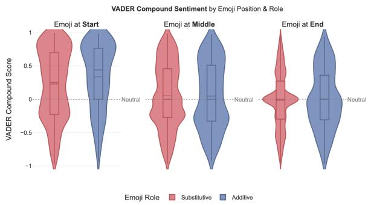
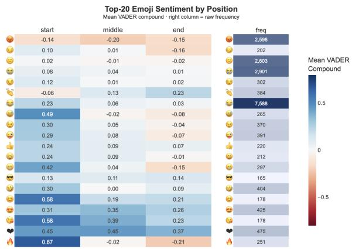
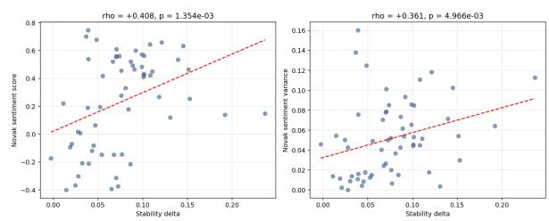
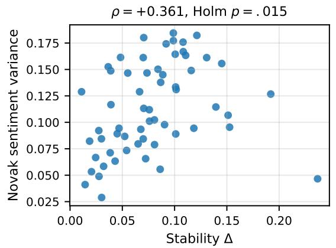
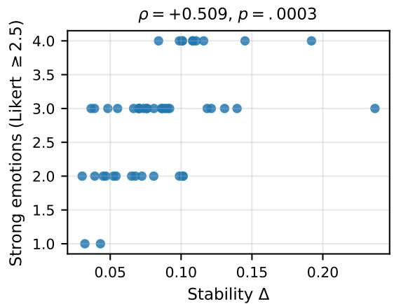

# Beyond a Single Sentiment Score: Topical and Affective Dimensions of Emoji Meaning on Twitter

Rohan James, Ioannis Christofilogiannis, Yuuv Jauhari, Shreya Shah, and Gauri Pethkar

School of Computer Science and Statistics

Trinity College Dublin, Ireland

{jamesro, christoi, jauhariy, shshah, pethkarg}@tcd.ie

## Abstract

Emoji are widely treated as compact affective tokens whose meaning is summarised by a single sentiment score. We argue that this picture is incomplete. From a corpus of 16,575 English tweets and a per-emoji metric we call stability delta (within-class minus betweenclass cosine similarity of sentence embeddings), we show that emojis used in tightly clustered topical contexts also exhibit more polarised crowd-sourced sentiment, not less. Validated against the Kralj Novak et al. (2015) sentiment lexicon, the central correlation is Spearman ρ = +0.361 (Holm p = 0.015, 95% bootstrap CI [+0.10, +0.59]); against the independent Ferré et al. (2025) Spanish 13-emotion ratings, ρ = +0.509 (p = 0.0003). The result survives permutation testing, BCa bootstrap, leave-oneout jackknife, partial correlation controlling for emoji frequency, and Holm correction across a four-test family. Topical coherence and affec tive dispersion are distinct dimensions of emoji meaning. As a downstream check we report leakage-free five-fold cross-validation results for sarcasm classification on the Emoji Sarcasm Dataset; all three baselines (a gated multimodal architecture, fine-tuned BERTweet features, and fine-tuned RoBERTa features) score above 0.97 macro F1, indicating the dataset has saturating emoji-label cues. We frame the classifier as supporting evidence rather than the contribution.

## Keywords

emoji; emoji sentiment; sentiment analysis; affective computing; sarcasm detection; sentence embeddings; computational pragmatics; social media / Twitter; emoji semantics; sentiment lexicons; multimodal fusion

## 1 Introduction

The stance a person holds towards a topic comes through in the affect they convey. In speech, facial expressions, gestures, and prosody carry much of that affective load. Text strips those channels away. Emoji have evolved as a compensatory device: small graphical signals that re-introduce paralinguistic cues into written discourse. What started as decoration has become a meaningful linguistic tool.

Structural evidence that this evolution is systematic comes from the corpus itself. In the Emoji Sarcasm Dataset (ESD) (Subramanian et al., 2019), 58.3% of emojis appear at the end of tweets, 28.5% in the middle, and only 13.2% at the start, replicating the sentence-final dominance reported for WhatsApp (Sampietro, 2020) and instant messaging (Garrison et al., 2011) at social-media scale.

A monotonic sentiment gradient runs from VADER (Hutto and Gilbert, 2014) compound score +0.267 at the start position to −0.018 at the end, and substitutive function rates, where the emoji replaces a terminal sentiment word rather than decorating existing text, rising from 76.5% (start) to 91.6% (end), consistent with the affectivepunctuation account (Provine, 1993; Robus et al., 2020). This structural regularity sharpens the central question: if emoji placement follows clear pragmatic conventions, why do topical coherence and affective consistency dissociate?

Most computational approaches treat each emoji as a token with a fixed affective scalar, often a single sentiment score in [−1, +1]. That representation collapses a richer structure. We argue, and provide empirical evidence, that an emoji’s meaning unfolds along at least two independent axes: a topical axis (does the emoji co-occur with consistent textual content) and an affective axis (does the emoji evoke a consistent emotional response). The two axes are commonly assumed to align. They do not.

Our main contribution is a finding rather than a method. We define the stability delta of an emoji as the difference between within-class and betweenclass mean cosine similarity of sentence embeddings of the surrounding text. Higher delta means an emoji appears in textually more coherent contexts. Across 62 emojis with at least 15 occurrences in the ESD, we find that stability delta correlates positively with two independent measures of affective dispersion:

• Crowd-sourced sentiment variance from the Kralj Novak et al. (2015) lexicon $\scriptstyle ( \mathrm { n = 5 9 }$ matched, $\rho = + 0 . 3 6 1$ , Holm-corrected p = 0.015, 95% bootstrap $\mathrm { C I } \left[ + 0 . 1 0 , + 0 . 5 9 \right] )$

• Number of strongly evoked emotions from the Ferré et al. (2025) Spanish 13-emotion database (n=47 matched, $\rho = + 0 . 5 0 9 , p =$ 0.0003).

Both findings survive a battery of robustness checks: permutation tests, BCa bootstrap intervals, leave-one-out jackknife, partial correlation controlling for emoji frequency, and Holm correction over the family of tests. The two correlations come from different methodologies, different languages, and different annotator populations, yet point in the same direction.

We then ask whether multimodal fusion of text, emoji, and structural features improves a downstream sarcasm classifier on ESD. Under leakage-free five-fold cross-validation, our gated architecture (GEMA) reaches macro F1 0.985, BERTweet feature extraction with logistic regression reaches 0.974, and RoBERTa with logistic regression reaches 0.991. All three sit above 0.97, indicating that ESD has surface-level emoji-label correlations strong enough to saturate any reasonable classifier. We therefore frame the classifier as a supporting application rather than the contribution of this paper.

The paper is organised as follows. Section 2 reviews related work. Section 3 describes the corpus and external resources. Section 4 formalises the stability delta and the validation battery. Section 5 presents results, including external validation and the application to sarcasm classification. Section 6 discusses implications. Section 7 concludes.

## 2 Related Work

Emoji as paralinguistic signals. (Sampietro, 2020) showed that around 55% of emoji in WhatsApp messages occupy sentence-final position, suggesting they often function as affective punctuation.

(Robus et al., 2020) found via eye-tracking that sentence-final emoji slow first-pass reading times, consistent with emoji acting as integrative cues rather than decoration. (Garrison et al., 2011) reported similar placement patterns in instant messaging. Beyond placement, (Wijeratne et al., 2017) demonstrated that emoji similarity derived from sense-disambiguated definitions correlates with human judgement.

At social-media scale, sentence-final dominance holds with a substantial effect: a chi-square test on the ESD Twitter partition yields $\chi ^ { 2 } = 4 0 3 9 . 0 3 .$ $p \ < \ 1 0 ^ { - 5 }$ , Cramér’s $V \ : = \ : 0 . 4 9 4$ for the association between emoji position and sarcasm label. Prior placement studies focused on structural distributions (Sampietro, 2020; Garrison et al., 2011; Robus et al., 2020); we additionally show that sentiment varies monotonically with position and that substitutive function rates increase from start to end placements, establishing that where an emoji sits predicts its pragmatic role as reliably as which emoji it is.

Sentiment lexicons for emoji. (Kralj Novak et al., 2015) aggregated 1.6 million tweet-level annotations from 83 annotators into per-emoji probability distributions over (negative, neutral, positive) labels and a derived sentiment score. The lexicon underpins much of the downstream emoji sentiment literature. Recent work by (Ferré et al., 2025) extends this to a 13-emotion discrete annotation database for 112 emojis, rated by 763 Spanish speakers. (Czestochowska et al., 2022) crowdsourced one-word descriptions for 1,289 emojis without textual context, providing an independent ambiguity benchmark.

Emoji and sarcasm. (Subramanian et al., 2019) introduced the Emoji Sarcasm Dataset and a Bi-GRU baseline using GloVe and emoji2vec features, reporting up to 0.991 accuracy on the Twitter partition under a single 60/20/20 split. (Sukhavasi and Dondeti, 2024) report comparable accuracy with parallel TF-IDF and emoji-vector pipelines fused into an LSTM-BERT classifier. (Helal et al., 2024) and (Vitman et al., 2023) show that contextual encoders such as RoBERTa with auxiliary emotion or sarcasm pre-training reach state-of-the-art F1 on harder benchmarks like Mustard, iSarcasmEval, and SemEval-2018 Task 3.

Topical versus affective dimensions. Crosslingual analyses by (Barbieri et al., 2016) and others have noted that emoji usage shifts across time and platform, hinting that emoji meaning has structure beyond a single scalar. Work on contextfree ambiguity (Czestochowska et al., 2022) treats meaning variability as a property to measure rather than to summarise. To our knowledge, no prior work has explicitly tested whether topical and affective coherence dissociate at the emoji level. That is the gap this paper addresses.

## 3 Data

Primary corpus: ESD. We use the Emoji Sarcasm Dataset (Subramanian et al., 2019) as the primary corpus. The Twitter partition contains 16,859 tweets, each containing at least one emoji and labelled binary for sarcasm. After English filtering, 16,587 tweets remain; after emoji normalisation and primary-emoji extraction, the final analytical corpus contains 16,575 tweets. Retaining emojis with at least 15 occurrences leaves 62 emojis covering 15,569 embedded tweets. The analytical corpus is 38.06% sarcastic.

External resources for validation. Three external resources are matched against our 62 emojis:

• Kralj Novak et al. (2015) (Kralj Novak et al., 2015), accessed via the emosent-py package. Per-emoji sentiment score and probability distribution over negative/neutral/positive labels. 59 of our 62 emojis match.

• Ferré et al. (2025) Emoji-Dis (Ferré et al., 2025), downloaded from OSF. Mean Likert ratings (1–5 scale) across 13 discrete emotion categories from 763 Spanish speakers, covering 112 emojis. 47 of our 62 emojis match.

• Czestochowska et al. (2022) Context-Free Ambiguity (Czestochowska et al., 2022), downloaded from the EPFL D-Lab GitHub. Roughly 30 one-word descriptions per emoji from human annotators with no textual context, covering 1,289 emojis. 59 of our 62 emojis match.

We also use the EmojiNet sense inventory (Wijeratne et al., 2017) (62/62 matched) to provide a sanity check based on dictionary polysemy.

## 4 Method

## 4.1 Pre-processing

Each tweet is lowercased and stripped of URLs, @mentions, and hashtag symbols (the underlying word is kept). Unicode emoji characters are replaced with whitespace to produce clean\_text, which has all emoji removed and serves as the input to all downstream NLP components, including VADER scoring and sentence embedding. A separate emoji extraction pass operates on the original raw text: skin-tone modifiers (U+1F3FB through U+1F3FF) and Variation Selector-16 (U+FE0F) are stripped so presentation variants map to the same canonical form. The English filter retains tweets with at least 85% ASCII alphabetic characters, removing 272 non-English tweets from the 16,859 raw inputs.

## 4.2 Emoji Placement Analysis

Each tweet in the Twitter partition is classified by the position of its first emoji as start, middle, or end based on its relative location within the tweet, using the emoji library (Kim and Kevin Wurster et al., 2025) for emoji identification and NLTK (Bird et al., 2009) for sentence segmentation and part-of-speech tagging. Sentiment is scored on the emoji-free clean\_text field (Section 4.1) using VADER (Hutto and Gilbert, 2014) as the primary scorer and TextBlob as a cross-check; neither scorer sees emoji characters.

An emoji is classified as substitutive if it occupies a position where a sentiment-bearing lexical item would grammatically occur, specifically, sentence-finally with no following content word, or directly preceding terminal punctuation, and additive otherwise. Word count preceding the first emoji serves as a reading-load proxy, operationalising the prediction that longer propositional context before the emoji raises integrative processing demands (Robus et al., 2020).

Two statistical tests assess structural associations. A chi-square test on the (position × sarcasm label) contingency table evaluates whether emoji placement is independent of sarcasm, with Cramér’s V as effect size. A Mann-Kendall trend test on VADER compound scores sorted by reading load tests for a monotonic sentiment-processing-load relationship.

## 4.3 Stability Delta

For each emoji e with at least 15 occurrences, let $T _ { e }$ be the set of tweets in which e is the primary emoji. We sample up to 100 tweets from $T _ { e }$ and 500 random tweets from $T \setminus T _ { e }$ . Sentence embeddings are computed on the emoji-free clean\_text field using all-MiniLM-L6-v2 (Reimers and

Gurevych, 2019), which produces 384-dimensional L2-normalised vectors. We then compute:

$$
W _ { e } = \frac { 1 } { | T _ { e } ^ { \mathrm { s a m p } } | ( | T _ { e } ^ { \mathrm { s a m p } } | - 1 ) } \sum _ { i \neq j } \cos ( \mathbf { x } _ { i } , \mathbf { x } _ { j } )\tag{1}
$$

$$
B _ { e } = \frac { 1 } { | T _ { e } ^ { \mathrm { s a m p } } | \cdot 5 0 0 } \sum _ { i , k } \cos ( \mathbf { x } _ { i } , \mathbf { y } _ { k } )\tag{2}
$$

$$
\Delta _ { e } = W _ { e } - B _ { e }\tag{3}
$$

where $i , j$ index tweets containing e and k indexes the random comparison set. A high $\Delta _ { e }$ means tweets sharing emoji e are textually more similar to each other than to typical tweets carrying other emoji. We treat $\Delta _ { e }$ as a per-emoji measure of topical coherence.

## 4.4 External Validation Targets

For each external resource we compute a per-emoji scalar that measures affective or semantic dispersion, then correlate it with $\Delta _ { e } \mathrm { : }$

• Kralj Novak sentiment variance: variance of $( p _ { \mathrm { n e g } } , p _ { \mathrm { n e u } } , p _ { \mathrm { p o s } } )$

• Kralj Novak sentiment score: scalar in [−1, +1].

• Number of strongly evoked emotions: count of Ferré emotion categories with mean rating ≥ 2.5 (the original threshold; we report sensitivity at 2.0, 3.0, and 3.5).

• Emotion entropy: Shannon entropy over the baseline-subtracted (ratings minus 1) distribution across the 13 Ferré categories.

• Description entropy and number of unique descriptions: per-emoji statistics over Czestochowska crowd-sourced labels.

• EmojiNet sense count and keyword count: dictionary polysemy markers.

## 4.5 Statistical Battery

For the four primary correlations involving Kralj Novak data, we select ∆ vs. Kralj Novak variance as the primary test, with the remaining three treated as a family of related tests subject to Holm correction. To assess robustness, we run a seven-test statistical battery comprising Spearman $\rho$ (with permutation p-values, percentile, and BCa 95% bootstrap CIs), Kendall’s $\tau _ { b } .$ , leave-one-emoji-out jackknife ranges, and partial Spearman rank-residuals controlling for emoji frequency (full methodology, assumptions, and software details in Appendix A). External verification on Ferré 2025, EmojiNet, and Czestochowska are reported separately as confirmatory analyses.

## 4.6 Sarcasm Classifier (Application)

We run three classifiers under identical stratified five-fold cross-validation (random state = 42) on the English-filtered Twitter partition (n = 16,587):

• GEMA: A multi-branch model combining text (BiGRU over MiniLM, BERT [CLS]), emoji, and structural features via a sigmoid gate. Complete architectural details and hyperparameters are summarized in Table 8.

• BERTweet (frozen): [CLS] embeddings from vinai/bertweet-base fed into logistic regression.

• RoBERTa (frozen): [CLS] embeddings from roberta-base fed into logistic regression.

Two leakage paths in earlier versions of GEMA are explicitly fixed: VADER is now scored on emoji-free clean text (avoiding contamination from VADER’s built-in emoji lexicon), and centroid distance features are recomputed within each training fold rather than once on the full dataset. We confirmed both fixes with unit tests.

## 5 Results

## 5.1 Emoji Placement

Emojis in the ESD Twitter partition are distributed as 58.3% end, 28.5% middle, and 13.2% start, establishing end-placement as the strong default and replicating sentence-final dominance observed in smaller corpora (Sampietro, 2020; Garrison et al., 2011).

Figure 1 shows a clean monotonic sentiment gradient across both scorers. End-placed emojis, the largest group, score marginally negative on VADER, providing corpus-level evidence that trailing emojis are disproportionately associated with irony or sarcasm; start-placed emojis accompany genuinely positive text, signalling a tonal frame for the message before propositional content begins.

The reading-load proxy confirms this ordering: start-placed emojis are preceded by a mean of 1.78 words, middle-placed by 8.47, and end-placed by 10.95. End-positioned emojis thus follow a nearly complete proposition, meaning readers process the cognitive content before the affective signal, reflecting the eye-tracking evidence that sentence-final emoji slow integrative processing (Robus et al., 2020).

  
Figure 1: VADER compound score distributions by emoji position and role (substitutive vs. additive). Substitutive emojis produce more polarised distributions across all three positions.

End-placed emojis are 91.6% substitutive, middle-placed 81.7%, and start-placed 76.5%. Trailing emojis almost universally replace a concluding sentiment word; start-placed emojis show more additive usage. Complex punctuation rates run in the opposite direction: 31.9% for start, 18.6% for middle, 4.2% for end, suggesting that tweets beginning with an emoji exploit it as a framing device around which more syntactically complex, potentially ironic, structure is built.

Chi-square tests confirm both structural associations: position versus sarcasm label, $\chi ^ { 2 } = 4 0 3 9 . 0 3$ $p \ < \ 1 0 ^ { - 5 }$ , Cramér’s $V ~ = ~ 0$ .494; position versus VADER sentiment label, $\chi ^ { 2 } = 1 , 2 6 7 . 7 9 , p <$ $1 0 ^ { - 5 }$ , Cramér’s $V = 0 . 1 9 6$ . A Mann-Kendall trend test on VADER compound sorted by reading load yields $\tau = - 0 . 0 4 8 5 , p < 1 0 ^ { - 5 }$ , indicating a weak but statistically reliable negative monotonic trend: longer preceding text is associated with slightly more negative sentiment.

Figure 2 disaggregates these aggregate trends to the token level, plotting mean VADER compound scores for the 20 most frequent emojis across all three positional contexts alongside raw frequency counts. Two patterns are visible:

First, positional sentiment shifts are not uniform across emoji types. Some tokens maintain a broadly consistent valence regardless of where they appear in a tweet, while others undergo marked reversals between start and end positions. The magnitude and direction of the shift vary by token, which means that population-level placement norms: endplaced emojis, are marginally negative and these obscure substantial per-emoji heterogeneity.

  
Figure 2: Mean VADER compound score for the top-20 emojis across positional contexts (start, middle, end). Right column shows raw frequency. Individual emojis exhibit marked affective shifts depending on position; where an emoji sits predicts its sentiment as strongly as which emoji it is.

Second, the compression effect is visible for high-frequency emojis. Tokens appearing in thousands of tweets rather than tens show more muted positional ranges, in-line with their broader, less topically constrained usage across many different conversational contexts. A rarely used emoji that appears almost exclusively in one register will track the sentiment of that register closely regardless of position; a high-frequency emoji used promiscuously across registers will average over them, flattening the positional gradient.

This token-level heterogeneity directly motivates the stability delta analysis that follows. Aggregate placement statistics capture the population-level gradient, but individual emoji behaviour is modulated by how topically coherent the contexts in which each symbol is deployed actually are. Where an emoji sits predicts its sentiment as reliably as which emoji it is at the population level; at the token level, that predictive power depends on the topical range of the emoji’s typical usage, which is, the very quantity that stability delta is designed to measure.

## 5.2 Stability Delta

The 62 emojis range from $\Delta = + 0 . 2 3 7$ for collision to $\Delta = - 0 . 0 0 3$ for angry face, with mean $\Delta = 0 . 0 7 6 6$ and 61 of 62 emojis positive (Table 1). High-delta emojis appear in tightly clustered topical contexts; low-delta emojis are used across the full breadth of the corpus.

Table 1: Top and bottom emojis ranked by stability delta. “Within” and “Between” are mean pairwise cosine similarities within and across emoji classes.
<table><tr><td>Emoji (description)</td><td>Within</td><td>Between</td><td> $\Delta$ </td></tr><tr><td>Collision Fire</td><td>0.409</td><td>0.172</td><td>0.237 0.192</td></tr><tr><td>Pointing-down</td><td>0.332 0.305</td><td>0.140 0.152</td><td>0.153</td></tr><tr><td>Astonished face</td><td>0.121</td><td>0.101</td><td>0.021</td></tr><tr><td>Loudly crying face</td><td>0.143</td><td>0.124</td><td>0.019</td></tr><tr><td>Confused face</td><td></td><td></td><td></td></tr><tr><td></td><td>0.124</td><td>0.109</td><td>0.014</td></tr><tr><td>Face with tears of joy</td><td>0.134</td><td>0.123</td><td>0.011</td></tr><tr><td>Angry face</td><td>0.104</td><td>0.107</td><td>-0.003</td></tr></table>

## 5.3 Kralj Novak (2015) Validation

The four primary correlations, with the full robustness battery, are reported in Table 2.

The two stability-affect correlations survive Holm correction. For the primary test, $\Delta$ vs. Kralj Novak sentiment variance, the association is positive and robust: Spearman $\rho \quad =$ $+ 0 . 3 6 1 0 .$ , permutation $p = 0 . 0 0 5 0$ , percentile bootstrap $\mathbf { C I } \ [ + 0 . 1 0 2 9 , + 0 . 5 8 7 2 ]$ , BCa bootstrap CI $\left[ + 0 . 0 8 8 5 , + 0 . 5 8 1 3 \right]$ , Kendall $\tau _ { b } = + 0 . 2 6 0 9$ , partial $\rho$ controlling for emoji frequency $= + 0 . 3 7 0 0$ and Holm-corrected $p = 0 . 0 1 4 9$ . Leave-one-out jackknife yields $\rho$ values in [+0.3327, +0.4119], so no single emoji drives the effect.

The two correlations involving sarcasm rate are positive in direction (sarcastic emojis lean toward positive Kralj Novak sentiment, away from negative probability mass) but do not survive Holm. We report them as exploratory. Figure 4 shows the scatter plot for the primary tests.

## 5.4 External Corroboration: Ferré 2025 Emoji-Dis

A separate annotation effort by Ferré et al. asked 763 Spanish speakers to rate 112 emojis on 1–5 Likert scales across 13 discrete emotion categories. We compute, per emoji, the number of categories with mean rating $\geq 2 . 5$ (“strongly evoked emotions”). 47 of our 62 emojis match.

The relationship is robust across all four threshold choices (Table 3). The strongest signal sits at lower thresholds, where emotion counts capture broader affective engagement; higher thresholds count only the most intensely evoked emotions.

Match-bias caveat. The 47 Ferré-matched emojis have a lower mean stability delta than the 15 unmatched emojis (0.0674 vs. 0.1054; Mann– Whitney $p = 0 . 0 3 7 6 )$ . Because the unmatched emojis are not missing at random, we treat the Ferré result as corroborating evidence rather than as a complete estimate over the full 62-emoji panel.

## 5.5 Ambiguity and Polysemy: Sanity Checks

The Czestochowska Context-Free Ambiguity dataset measures decontextualised emoji interpretation using description entropy and unique-word count $( n ~ = ~ 5 9 )$ , while EmojiNet measures dictionary polysemy via sense and keyword counts $( n = 6 2 )$ . Correlations between these metrics and $\Delta$ are weakly negative or near zero and not individually significant (full results in Appendix B), confirming that $\Delta$ captures contextualised topical coherence distinct from existing decontextualised ambiguity and dictionary polysemy measures.

## 5.6 Polarity Alignment Between Text and Emoji

We measure binary polarity alignment between the VADER compound on the emoji-free text and the Kralj Novak sentiment score for the primary emoji across tweets where Kralj Novak sentiment is available $( n = 1 5 , 3 9 8 )$ . The alignment is 58.94% overall, resting at 60.81% for non-sarcastic tweets $( n ~ = ~ 1 0 , 1 3 1 )$ and 55.34% for sarcastic tweets $( n = 5 { , } 2 6 7 )$ . The non-sarcastic minus sarcastic alignment gap is only 5.47 percentage points, much smaller than a simple “sarcasm equals polarity inversion” account would predict.

## 5.7 Sarcasm Classification (Application)

Table 4 reports classifier performance under identical splits (complete details in Appendix F). All models exceed a macro F1 of 0.97. RoBERTa with a frozen [CLS] representation and a simple linear head slightly outperforms our gated multimodal architecture. We interpret this not as a triumph of frozen RoBERTa, but as evidence that ESD’s emojilabel correlations make the classification task neartrivial, causing reasonable encoders to reach the performance ceiling. We retain the classifier solely as supporting evidence that emoji and structural features carry signal, rather than making architectural contribution claims.

## 6 Discussion

The headline result is that stability delta correlates positively, not negatively, with affective dispersion. An emoji used in textually concentrated contexts also evokes a wider rather than narrower spread of crowd-sourced affect. We emphasise the agreement between two methodologically dissimilar resources: Kralj Novak’s English tweet-level sentiment annotations (Kralj Novak et al., 2015) and Ferré’s Spanish discrete-emotion Likert ratings (Ferré et al., 2025). Different annotators, different languages, different rating instruments, same direction.

Table 2: Kralj Novak (2015) validation, $n = 5 9$ matched emojis. Holm correction applied across the family of four tests. Significance markers refer to Holm-corrected p-values.
<table><tr><td>Test</td><td>ρ</td><td>Pct. CI (95%)</td><td>BCa CI (95%)</td><td>Perm. p</td><td> $\tau _ { b }$ </td><td>Partial ρ (freq)</td><td>Holm p</td></tr><tr><td>∆ vs. Kralj Novak sentiment</td><td>+0.408</td><td> $[ + 0 . 1 6 , + 0 . 6 0 ]$ </td><td> $[ + 0 . 1 6 , + 0 . 6 0 ]$ </td><td>0.0008</td><td> $+ 0 . 2 5 8$ </td><td>+0.423</td><td>0.005</td></tr><tr><td>∆ vs. Kralj Novak variance (primary)</td><td>+0.361</td><td> $\dot { [ + 0 . 1 0 , + 0 . 5 9 ] }$ </td><td> $\left[ + 0 . 0 9 , + 0 . 5 8 \right]$ </td><td>0.005</td><td>+0.261</td><td>+0.370</td><td>0.015</td></tr><tr><td>Sarcasm rate vs. p(neg)</td><td>-0.286</td><td> $[ - 0 . 5 7 , + 0 . 0 2 ]$ </td><td> $[ - 0 . 5 5 , + 0 . 0 2 ]$ </td><td>0.028</td><td> $- 0 . 2 2 7$ </td><td>-0.280</td><td>0.051</td></tr><tr><td>Sarcasm rate vs. Kralj Novak sentiment</td><td>+0.291</td><td> $[ - 0 . 0 1 , + 0 . 5 7 ]$ </td><td> $[ - 0 . 0 1 , + 0 . 5 5 ]$ </td><td>0.029</td><td>+0.234</td><td>+0.289</td><td>0.051</td></tr></table>

  
Figure 3: Contextual stability is positively associated with affective dispersion. Left: stability ∆ vs. Kralj Novak sentiment variance $( n = 5 9$ , Spearman $\rho = + 0 . 3 6 1$ $\mathrm { B C a _ { 9 5 } } = [ + 0 . 0 8 9 , + 0 . 5 8 1 ]$ , Holm $p = . 0 1 5 )$ . Right: stability $\Delta$ vs. number of strongly evoked emotions in Ferré et al. $( n = 4 7 , \rho = + 0 . 5 0 9 , p = . 0 0 0 3 )$ . Emojis used in more topically coherent contexts evoke broader, not narrower, affective responses.  
Figure 4: Stability delta versus Kralj Novak sentiment score (left) and sentiment variance (right). Red lines are OLS fits. Both relationships are positive and Holmsignificant.

Two interpretations are compatible with the data and we cannot fully separate them here. The first is that high-stability emojis tend to occupy specific cultural niches with strong affective valence (the fire emoji in praise contexts, the collision emoji in dramatic announcements) and the same niche supports both positive and negative affective use. The second is that crowd-sourced affective annotations are themselves polarised when an emoji has a clear cultural role, because annotators read the role rather than rate a neutral averaged perception. Either way, the practical implication is the same: representing emoji affect with a single sentiment scalar collapses the structure that the data actually carry.

Table 3: Stability delta vs. number of strongly evoked emotions in Ferré 2025, with threshold sensitivity. $n =$ 47 matched emojis throughout.
<table><tr><td>Likert threshold</td><td>ρ</td><td>p</td><td>Sig.</td></tr><tr><td> $\geq 2 . 0$ </td><td>+0.606</td><td> $6 . 0 \times 1 0 ^ { - 6 }$ </td><td>***</td></tr><tr><td>≥ 2.5 (primary)</td><td>+0.509</td><td> $\mathbf { 2 . 6 \times 1 0 ^ { - 4 } }$ </td><td>***</td></tr><tr><td>≥ 3.0</td><td> $+ 0 . 4 5 8$ </td><td> $1 . 2 \times 1 0 ^ { - 3 }$ </td><td>**</td></tr><tr><td>≥ 3.5</td><td> $+ 0 . 4 1 5$ </td><td> $3 . 7 \times 1 0 ^ { - 3 }$ </td><td>**</td></tr></table>

Table 4: Five-fold stratified CV on the English Twitter partition $( n = 1 6 , 5 8 7 ,$ , mean ± SD). Full 5-metric evaluation reported in Appendix F.
<table><tr><td>Model</td><td>Macro F1</td><td>Sarc. F1</td></tr><tr><td>GEMA</td><td> $. 9 8 5 { \pm } . 0 0 7$ </td><td> $. 9 8 2 { \pm } . 0 0 8$ </td></tr><tr><td>BERTweet</td><td> $. 9 7 4 { \pm } . 0 0 2$ </td><td> $. 9 6 7 { \scriptstyle \pm . 0 0 2 }$ </td></tr><tr><td>RoBERTa</td><td> $. 9 9 1 { \pm } . 0 0 1$ </td><td> $. 9 8 8 { \pm } . 0 0 1$ </td></tr></table>

Placement is systematic; semantics and affect still dissociate. The placement results establish that emoji use is far from arbitrary at the structural level. End-placement dominates at 58.3% with Cramér’s V = 0.494 linking position to sarcasm label - a medium-to-large effect by conventional standards (Cohen, 1988), and substitutive function reaches 91.6% for end-placed emojis, confirming that trailing emojis replace, rather than decorate, a concluding sentiment word. This structural regularity makes the semantic finding more striking, not less: even within the set of end-placed, substitutive emojis, the most pragmatically constrained subgroup - topical coherence (stability delta) and affective consistency (Kralj Novak variance) dissociate. The Cramér’s V = 0.196 for position versus VADER label, and the 5.5 percentage-point polarity alignment gap between sarcastic and non-sarcastic tweets, jointly suggest that emoji-text sentiment mismatch is a real but weak global signal; position mediates part of that mismatch, but neither position nor mismatch alone accounts for sarcasm in this corpus. Single-scalar sentiment representations conflate these dimensions; the stability delta and the placement gradient together point toward multi-axis emoji representations as a productive direction for future work.

The negative results matter too. The Czestochowska context-free entropy and EmojiNet sense count correlations are weak and non-significant. This is consistent with our framing: ∆ is a measure of contextual usage stability, not of the lexicographer’s enumeration of senses or of crowd interpretation in isolation. We treat the EmojiNet and Czestochowska results as evidence of construct distinctness rather than as failures of our metric.

Polarity alignment is a weak sarcasm signal. The 5.5-point gap in alignment between sarcastic and non-sarcastic tweets is small. This complicates the long-standing intuition that emoji-text polarity inversion is the defining feature of irony. Sarcasm in ESD is signalled by surface cues (specific emojiphrase combinations) much more than by clean polarity inversion.

The classifier saturates. All three baselines exceed 0.97 macro F1. We checked our work for the obvious explanations: leakage in the centroid feature, contamination of VADER scoring by the emoji lexicon, vocabulary built on the test fold. All three are demonstrably absent. The remaining explanation is that ESD’s strong emojilabel correlations make the task near-trivial under any reasonable encoder. We therefore stop short of claiming architectural advantages for our gated fusion. A meaningful classifier comparison would require a harder benchmark such as iSarcasmEval (Abu Farha et al., 2022) or SemEval-2018 Task 3 (Van Hee et al., 2018) where state-of-the-art F1 sits in the 0.6 range.

## 7 Conclusion

We presented the stability delta, a simple per-emoji metric of textual context coherence derived from sentence embeddings, and showed that it correlates positively with two independent measures of affective dispersion: Kralj Novak (2015) sentiment variance $( \rho ~ = ~ + 0 . 3 6 1$ , Holm $p \ = \ 0 . 0 1 5 )$ and Ferré (2025) number of strongly evoked emotions $( \rho = + 0 . 5 0 9 , p = 0 . 0 0 0 3 )$ . The result survives a battery of robustness checks. Topical coherence and affective valence are distinct dimensions of emoji meaning; representing emoji affect with a single sentiment scalar discards real structure. We provide a leakage-free five-fold evaluation of multimodal sarcasm classification on ESD as supporting context, and observe that the dataset is too easy to differentiate architectures meaningfully. Code, data-processing scripts, and validation outputs are provided as anonymised supplementary material.

Three directions are most promising. First, validation of stability delta on harder sarcasm benchmarks (iSarcasm, SemEval-2018 Task 3) where the affective-vs-topical distinction may yield architectural gains. Second, extension of the analysis to multi-platform timestamped corpora to test temporal generalisation properly. Third, exploring whether emoji embeddings learned with explicit affective-topical disentanglement (two heads, one for context, one for affect) outperform single-vector representations on downstream affective tasks.

## Limitations

The 62-emoji panel is small and the Kralj Novak sample at $n = 5 9$ is at the lower end of what supports rank correlation analysis, despite our best efforts at robust inference. The Ferré match is biased toward lower-stability emojis (Section 5), so the $\rho = + 0 . 5 0 9$ is a conservative estimate. We work in English on the topical side and rely on

Spanish-rated emotions for one of the two external resources; cross-cultural transfer is an open question. We do not include a temporal analysis: a separate exploratory comparison between ESD Twitter and a 2025 BlueSky scrape was confounded by a 65-fold size imbalance, platform effects, and register differences (BlueSky data was seeded from #sarcasm hashtags). We mention temporal drift only as future work.

We release no new annotated corpus. The artefacts we share are derived per-emoji aggregates in CSV and JSON, so a formal datasheet (Gebru et al., 2021) does not apply. These aggregates are structured tabular data tied to public DOI-tracked sources, in line with FAIR principles (Wilkinson et al., 2016) for derived statistics.

## Ethical Considerations

Treating emoji affect as a single fixed score may trigger negative impacts when that score feeds into a downstream pipeline. A moderation system built this way will misread ironic intent, and the misreads will fall harder on figurative styles common in non-native and dialect varieties. A false sarcasm flag misroutes a moderation queue; a missed one lets ironic harm through. Representing topical and affective dimensions as separate axes, the change this paper recommends, narrows that failure mode.

All data we analyse is public and anonymised. Usernames are stripped from any redistributed slices, and no individual users are identified. Consent is inherited from the public-API terms of the original Twitter scrape and from the open-access licences of Kralj Novak, Ferré, EmojiNet, and Czestochowska. We redistribute only derived peremoji aggregates, never raw tweets. The Emoji Sarcasm Dataset contains offensive language typical of sarcastic discourse online; we do not curate or republish it.

Claude was utilized to assist with language refinement, editorial polishing of the manuscript and code generation for testing. All ideas, hypotheses, claims, analyses, code, results, citations, and final text were verified by the authors.

## References

Ibrahim Abu Farha, Silviu Vlad Oprea, Steven Wilson, and Walid Magdy. 2022. SemEval-2022 task 6: iSarcasmEval, intended sarcasm detection in English and Arabic. In Proceedings ofthe 16th International Workshop on Semantic Evaluation (SemEval-2022),

pages 802–814, Seattle, United States. Association for Computational Linguistics.

Francesco Barbieri, German Kruszewski, Francesco Ronzano, and Horacio Saggion. 2016. How cosmopolitan are emojis? exploring emojis usage and meaning over different languages with distributional semantics. In Proceedings of the 24th ACM International Conference on Multimedia, MM ’16, page 531–535, New York, NY, USA. Association for Computing Machinery.

Steven Bird, Ewan Klein, and Edward Loper. 2009. Natural Language Processing with Python. O’Reilly.

J. Cohen. 1988. Statistical Power Analysisfor the Behavioral Sciences. Lawrence Erlbaum Associates.

Justyna Czestochowska, Kristina Gligoric, Maxime Peyrard, Yann Mentha, Michal Bien, Andrea Grütter, Anita Auer, Aris Xanthos, and Robert West. 2022. On the context-free ambiguity of emoji: A data-driven study of 1, 289 emojis. CoRR, abs/2201.06302.

Pilar Ferré, Juan Haro, Miguel Ángel Pérez-Sánchez, and José Antonio Hinojosa. 2025. Emoji-dis: A dataset of emojis characterised in 13 discrete emotions. Scientific Data, 12(1):1313.

Anthony Garrison, Dirk Remley, Patrick Thomas, and Emily Wierszewski. 2011. Conventional faces: Emoticons in instant messaging discourse. Computers and Composition, 28(2):112–125.

Timnit Gebru, Jamie Morgenstern, Briana Vecchione, Jennifer Wortman Vaughan, Hanna Wallach, Hal Daumé III, and Kate Crawford. 2021. Datasheets for datasets. Commun. ACM, 64(12):86–92.

Nivin A. Helal, Ahmed Hassan, Nagwa L. Badr, and Yasmine M. Afify. 2024. A contextual-based approach for sarcasm detection. Scientific Reports, 14(1):15415.

Clayton Hutto and Eric Gilbert. 2014. VADER: A parsimonious rule-based model for sentiment analysis of social media text. In Proceedings ofthe International AAAI Conference on Web and Social Media, volume 8, pages 216–225.

Taehoon Kim and Kevin Wurster et al. 2025. emoji: Emojifor Python. Version 2.15.0.

Petra Kralj Novak, Jasmina Smailovic, Borut Sluban,´ and Igor Mozetic. 2015.ˇ Sentiment of emojis. PLOS ONE, 10(12):1–22.

Robert R. Provine. 1993. Laughter punctuates speech: Linguistic, social and gender contexts of laughter. Ethology, 95(4):291–298.

Nils Reimers and Iryna Gurevych. 2019. Sentence-bert: Sentence embeddings using siamese bert-networks. CoRR, abs/1908.10084.

Christopher M. Robus, Christopher J. Hand, Ruth Filik, and Melanie Pitchford. 2020. Investigating effects of emoji on neutral narrative text: Evidence from eye movements and perceived emotional valence. Computers in Human Behavior, 109:106361.

Agnese Sampietro. 2020. Emojis and the performance of humour in everyday electronically-mediated conversation: A corpus study of whatsapp chats. Internet Pragmatics, 4.

Jayashree Subramanian, Varun Sridharan, Kai Shu, and Huan Liu. 2019. Exploiting emojis for sarcasm detection. In Social, Cultural, and Behavioral Modeling: 12th International Conference, SBP-BRiMS 2019, Washington, DC, USA, July 9–12, 2019, Proceedings, page 70–80, Berlin, Heidelberg. Springer-Verlag.

Vidyullatha Sukhavasi and Venkatesulu Dondeti. 2024. Sarcasm detection using hybrid deep learning framework based on word-emoji embeddings. In 2024 International Conference on Recent Innovation in Smart and Sustainable Technology (ICRISST), pages 1–6.

Cynthia Van Hee, Els Lefever, and Véronique Hoste. 2018. SemEval-2018 task 3: Irony detection in English tweets. In Proceedings ofthe 12th International Workshop on Semantic Evaluation, pages 39–50, New Orleans, Louisiana. Association for Computational Linguistics.

Oxana Vitman, Yevhen Kostiuk, Grigori Sidorov, and Alexander Gelbukh. 2023. Sarcasm detection framework using context, emotion and sentiment features. Expert Systems with Applications, 234:121068.

Sanjaya Wijeratne, Lakshika Balasuriya, Amit P. Sheth, and Derek Doran. 2017. Emojinet: An open service and API for emoji sense discovery. CoRR, abs/1707.04652.

Mark D. Wilkinson, Michel Dumontier, IJsbrand Jan Aalbersberg, Gabrielle Appleton, Myles Axton, Arie Baak, Niklas Blomberg, Jan-Willem Boiten, Luiz Bonino da Silva Santos, Philip E. Bourne, Jildau Bouwman, Anthony J. Brookes, Tim Clark, Mercè Crosas, Ingrid Dillo, Olivier Dumon, Scott Edmunds, Chris T. Evelo, Richard Finkers, and 34 others. 2016. The fair guiding principles for scientific data management and stewardship. Scientific Data, 3(1):160018.

## A Statistical Battery Methodology and Assumptions

To evaluate the stability and significance of the primary correlations involving Kralj Novak data, we subject each relationship to a seven-test statistical battery (10,000 resamples/permutations where applicable):

1. Spearman Rank Correlation (ρ): Evaluates monotonic relationships using both asymptotic and empirical permutation p-values (10,000 permutations).

2. Percentile Bootstrap 95% CI: Nonparametric confidence intervals constructed over 10,000 resamples.

3. BCa Bootstrap 95% CI: Bias-corrected and accelerated confidence intervals (10,000 resamples) to adjust for skewness and acceleration in the sample distribution.

4. Kendall’s τ : Serves as a rank-based sensitivity check on distributional shape and tied ranks.

5. Leave-One-Emoji-Out Jackknife: Assesses high-leverage outliers by recording the range $[ \rho _ { \mathrm { m i n } } , \rho _ { \mathrm { m a x } } ]$ when each emoji is systematically omitted once.

6. Partial Spearman Correlation: Controls for confounding emoji frequency |Te| using rankresidual analysis.

7. Holm Correction: Adjusts p-values for family-wise error rate across the four-test family.

Statistical Assumptions and Validation The battery assumes monotonic rank relationships between variables, exchangeability of observations under the null hypothesis for permutation testing, and independence across individual emoji entries. The partial Spearman procedure additionally assumes that rank residuals on emoji frequency exhibit approximate linearity; visual inspection confirmed that minor departures from linearity were negligible relative to small-n sample variances, which are explicitly addressed by the BCa bootstrap intervals.

## B Decontextualised Ambiguity and Polysemy Sanity Checks

Table 6 reports the sanity checks evaluating correlations (ρ) between our contextualised coherence metric (∆) and existing measures of decontextualised ambiguity (Czestochowska et al., 2022) and dictionary polysemy (Wijeratne et al., 2017).

All four correlations are weakly negative or near zero and lack individual statistical significance. This confirms that ∆ measures a distinct phenomenon: while decontextualised ambiguity captures crowdworker variation in isolation and dictionary polysemy reflects lexicographic sense enumeration, $\Delta$ specifically quantifies contextualised topical coherence in practical tweet usage.

Table 5: Full five-fold stratified cross-validation results on the English-filtered Twitter partition $( n = 1 6 { , } 5 8 7 )$ Values show mean ± standard deviation across folds.
<table><tr><td>Model</td><td>Acc.</td><td>Macro F1</td><td>Sarc. F1</td><td>AUC</td><td>MCC</td></tr><tr><td>GEMA</td><td> $. 9 8 6 { \pm } . 0 0 6$ </td><td> $. 9 8 5 { \pm } . 0 0 7$ </td><td> $. 9 8 2 { \pm } . 0 0 8$ </td><td> $. 9 9 9 { \pm } . 0 0 0$ </td><td>.970±.013</td></tr><tr><td>BERTweet</td><td> $. 9 7 5 { \pm } . 0 0 2$ </td><td> $. 9 7 4 { \pm } . 0 0 2$ </td><td> $. 9 6 7 { \scriptstyle \pm . 0 0 2 }$ </td><td> $. 9 9 7 { \scriptstyle \pm . 0 0 1 }$ </td><td> $. 9 4 8 { \pm } . 0 0 3$ </td></tr><tr><td>RoBERTa</td><td> $. 9 9 1 { \pm } . 0 0 1$ </td><td> $. 9 9 1 { \pm } . 0 0 1$ </td><td> $. 9 8 8 { \pm } . 0 0 1$ </td><td> $. 9 9 9 { \pm } . 0 0 0$ </td><td> $. 9 8 2 { \pm } . 0 0 2$ </td></tr></table>

Table 6: Sanity checks against decontextualised ambiguity (Czestochowska et al., 2022) and dictionary polysemy (Wijeratne et al., 2017).
<table><tr><td>Source</td><td>Test</td><td>n</td><td>ρ</td><td>p</td></tr><tr><td>Czestochowska</td><td>∆ vs. description entropy</td><td>59</td><td>-0.087</td><td>0.51</td></tr><tr><td>Czestochowska</td><td> $\begin{array} { r l } { \Delta } & { { } \ \mathbf { v s } . } \end{array}$  unique words</td><td>59</td><td>-0.029</td><td>0.83</td></tr><tr><td>EmojiNet</td><td> $\Delta$  vs. sense count</td><td>62</td><td>-0.119</td><td>0.36</td></tr><tr><td>EmojiNet</td><td> $\Delta$  vs. keyword count</td><td>62</td><td>+0.075</td><td>0.56</td></tr></table>

## C Mean Sentiment Scores

Table 7 presents the numerical counterpart to Figure 1.

Table 7: Mean sentiment scores by emoji position (VADER and TextBlob, scored on emoji-free text).
<table><tr><td>Position</td><td>Count</td><td>VADER</td><td>TextBlob</td></tr><tr><td>Start</td><td>2,188</td><td>+0.267</td><td>+0.190</td></tr><tr><td>Middle</td><td>4,728</td><td>+0.0667</td><td>+0.116</td></tr><tr><td>End</td><td>9,659</td><td>-0.018</td><td>+0.032</td></tr></table>

## D GEMA Architecture

The in-depth architectural components and training hyperparameters breakdown for the GEMA model in Section 4.6 is available in Table 8.

## E Compute

All experiments were run on a CPU. Taking a Ryzen 9 5900HS CPU as the baseline, regenerating every paper number through the code takes about three minutes and the leakage-free five-fold classifier evaluation takes about two hours.

Table 8: Architecture components and training hyperparameters for GEMA.
<table><tr><td>Component / Parameter</td><td>Specification / Value</td></tr><tr><td>Architecture &amp; Branches Text Encoder</td><td>BiGRU over MiniLM embed-</td></tr><tr><td></td><td>dings, BERT [CLS] Mean Kralj Novak sentiment,</td></tr><tr><td>Emoji Branch Structural Branch (11-D)</td><td>normalized emoji counts VADER compound (emoji-free),</td></tr><tr><td></td><td>polarity mismatch, caps ra- tio, punctuation density, norm. length, 5 emoji-position indica- tors, centroid distance</td></tr><tr><td>Branch Fusion</td><td>Sigmoid gating</td></tr><tr><td>Training Hyperparameters</td><td>AdamW  $( \mathrm { L R } = 1 0 ^ { - 3 }$  , weight</td></tr><tr><td>Optimizer</td><td>decay  $= 1 0 ^ { - 4 } )$ </td></tr><tr><td>Loss Function Batch Size</td><td>Focal Loss  $( \alpha = 0 . 4 , \gamma = 2 . 0 )$  16</td></tr><tr><td>Max Epochs / Early Stop</td><td>8 epochs (patience = 2 on vali- dation macro F1)</td></tr></table>

\*Per-emoji sarcastic vs. non-sarcastic distance computed inside each fold.

## F Complete Sarcasm Classifier Performance

Table 5 provides the complete five-metric evaluation across five-fold stratified cross-validation on the English-filtered Twitter partition (n = 16,587, random state 42).

## G Data and Code Availability

The Emoji Sarcasm Dataset (Subramanian et al., 2019) is released for non-commercial research use and is available at https://github.com/ jsubram/Sarcasm-Detection-Using-Emoji.

The Kralj Novak 2015 lexicon (Kralj Novak et al., 2015) comes via the opensource emosent-py package (MIT) https: //pypi.org/project/emosent-py/. Ferré 2025 Emoji-Dis (Ferré et al., 2025) is on OSF under CC-BY 4.0 https://osf.io/wv7ub/overview, Czestochowska 2022 Context-Free Ambiguity (Czestochowska et al., 2022) is on GitHub under MIT https://github.com/epfl-dlab/ emoji-ambiguity, and EmojiNet (Wijeratne et al., 2017) is on Kaggle under CC BY-NC-SA 4.0 https://www.kaggle.com/datasets/rtatman/ emojinet.

Our analysis pipeline, statistical battery, and reproducibility scripts are at the anonymous repository https://anonymous.4open.science/r/ StableContextsMixedFeelings/;