# Can Language Models Get “Aphasia” From Neuronal Ablation?

Pratik Worah∗, Randall Bateman

## Abstract

Progressive neuronal loss is the hallmark of neurodegenerative disease, yet how loss of neurons shapes the pattern of cognitive decline remains poorly understood. Here we systematically ablate neurons (computational units) in language models spanning recurrent long short-term memory (LSTM) and Transformer architectures and apply limited fine-tuning as a simple proxy for compensatory plasticity. With whole-unit ablation, LSTMs degrade gradually with syntactic and semantic faculties declining in parallel across mild-to-moderate damage. By contrast, Transformers exhibit late threshold-like col lapse under feedforward multi-layer perceptron (MLP) ablation and smoother sigmoid-like decline under attention-head ablation. Qualitatively, MLP-ablated models continue to make within-category semantic substitutions (semantic paraphasias) alongside rising non-responses, paralleling Wernicke-type aphasia, while attention-head ablation produces a trend toward loss of semantic specificity similar to the semantic variant of primary progressive aphasia (svPPA). These findings indicate that feedforward and attentional pathways have functionally distinct failure modes, suggesting that architecture-dependent failure profiles may ofer new computational perspectives on aphasic syndromes and neurodegenerative diseases as an in silico model. Notably, early accuracy retention under Transformer attention-head ablation qualitatively parallels pre-symptomatic reserve before the 40–60% neuronal loss reported by G´omez-Isla et al. (1996) when clinical symptoms emerge in Alzheimer’s disease, whereas the steadier LSTM decline parallels the symptomatic progression described by DeKosky and Schef (1990) and Terry et al. (1991).

## 1 Introduction

Neurodegenerative diseases are characterised by the progressive loss of neurons in specific brain regions, producing architecture-dependent patterns of cognitive decline. For example, hippocampal damage in Alzheimer’s disease yields memory deficits, while anterior temporal damage in semantic dementia selectively dissolves conceptual knowledge [Blennow et al., 2006, Hodges and Patterson, 2007]. Identifying the nature of such damage early is important because anti-amyloid drugs may be helpful in slowing disease progression in specific cases. Until recently, however, there were few ways to model neuronal dysfunction or loss because animal models lack language and no computational systems adequately modelled human language. Whether the pattern of language decline (which faculties survive, which erode gradually, and which collapse abruptly) can be predicted from damage to a computational architecture remains an open question.

In artificial neural networks, pruning and ablation are well-studied tools for model compression [Frankle and Carbin, 2019, Han et al., 2015], and recent interpretability work has shown that individual neurons encode semantically meaningful features [Olah et al., 2020, Geva et al., 2021]. Moore et al. have demonstrated that progressive lesioning of CNNs produces visual deficits closely resembling posterior cortical atrophy [Moore et al., 2023a,b, 2025]. This motivates the central question underlying our paper: can progressive neuronal ablation in language models reveal architecture-dependent failure modes analogous to clinical aphasias, and can the resulting error patterns serve as a computational model for tracking early neurodegenerative decline before overall accuracy falls?1

Concurrent work has begun to apply this logic directly to language models. Yang et al. [2026] perturb a multimodal model (LLaVA 1.6) by injecting noise into a chosen layer. They then search the resulting parameter space for configurations that reproduce the naming-error profiles of 278 people with post-stroke aphasia on the Philadelphia Naming Test (PNT)2, matching six of seven error categories. Wang et al. [2026] perturb functional components of Mixture-of-Experts and dense Transformers, identify components linked to Broca’s and Wernicke’s aphasia, and grade the resulting impairment using Western Aphasia Battery subtests. Both studies establish that perturbed language models can occupy clinically recognisable regions of behavioural space.

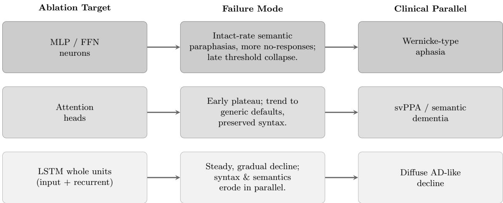  
Figure 1: Summary of ablation: clinical parallel mapping across the ablation experiments. Silencing Transformer feedforward (MLP/FFN) neurons, Transformer attention heads, and whole LSTM hidden units produces distinct failure modes. These patterns parallel focal aphasic syndromes versus steady difuse decline.

Our study is complementary in three respects. First, rather than asking how much a network can be compressed while maintaining performance [Frankle and Carbin, 2019, Han et al., 2015] or injecting Gaussian noise [Yang et al., 2026], we use neuronal ablation, the targeted, permanent destruction of individual computational units by zeroing all associated incoming and outgoing weights and biases and holding them at zero during subsequent fine-tuning. Thus, we model irreversible neuronal and synaptic loss alongside local compensatory plasticity [Blennow et al., 2006, Moore et al., 2023a,b]. Second, whereas Moore et al. [Moore et al., 2023a,b, 2025] track how progressive damage lowers overall accuracy to model a single syndrome, we track both the full decline curve across $k \in [ 0 , 0 . 9 ]$ and how the mistakes themselves change (which words are missed and whether grammar or word meaning fails), allowing us to distinguish multiple failure modes. Third, rather than studying a single network architecture, we silence whole units across both recurrent LSTMs and Transformers, as well as between the word-storage (MLP) and context-gathering (attention) pathways inside Transformers (see Section 4 for exact weight-matrix definitions). We design metrics that allow us to compare how diferent architectures and pathways shape language decline, and to test whether early changes in error patterns can signal mild damage before overall accuracy drops.

We evaluate this ablation protocol across four language model architectures of increasing scale and complexity (Table 1), from a small 10M-parameter LSTM [Hochreiter and Schmidhuber, 1997] trained from scratch to Qwen 1.5-1.8B [Bai et al., 2023], a 1.8-billion-parameter pretrained Transformer [Vaswani et al., 2017].

Contributions. Our work makes the following contributions:

1. Architecture determines failure dynamics, not just severity. On a shared unit-removal footing, both the from-scratch Small LSTM and the pretrained AWD-LSTM degrade gradually on next-token accuracy from k = 0.1 without a bufered plateau (Figures 2a,b). On the Cloze battery, their syntactic and semantic scores erode in parallel without dissociating from $k = 0 . 1$ onward, reaching the zero floor on content words across $k = 0 . 4 – 0 . 6$ as predictions fall back to common function words (Figure 5, row 1). This steady co-decline parallels the broadly distributed symptomatic cognitive erosion of Alzheimer’s disease3 [Blennow et al., 2006]. Pretrained Transformers behave diferently. Under MLP neuron ablation, they lose accuracy at mild damage at about the same rate as the LSTMs (no early retention advantage). They then collapse abruptly across a critical threshold $( k ^ { * } \approx 0 . 3 – 0 . 4 .$ , or 20–27% of non-embedding parameters removed; Figures $^ { \mathrm { 2 c , e ; } }$ Supplementary Figure 9; Supplement S2). By contrast, attention-head ablation loses less accuracy across mild-to-moderate damage $( k = 0 . 1 – 0 . 3 )$ before declining across $k = 0 . 4 – 0 . 7$ (Figures 2d,f), and on the Cloze battery it preserves substantially higher grammatical and semantic scores than MLP or LSTM unit removal through $k = 0 . 5$ (Figure 5, rows 2–3).

2. Diagnostic metrics that distinguish architectures beyond raw accuracy. Two models can have the same overall accuracy yet fail on very diferent words, so we pair two diagnostic tools to measure how damage reshapes predictions at matched accuracy. First, we introduce a vocabulary moment ratio $( R _ { 4 } )$ and Jensen–Shannon divergence benchmarked against an accuracy-matched random-failure baseline (null model; Section 2.3; Figures 3–4). Rather than failing at random on common function words such as $^ { 6 } t h e ^ { \prime \prime }$ or “and,” every ablated model continues to get the most common words right and makes its new mistakes on less common content words. Moreover, for a given drop in overall accuracy, this shift toward missing rarer words is much stronger under Transformer ablation than under LSTM unit removal (Figure 4; Supplement S3). Second, we use a quantified 100-prompt Cloze test that scores grammatical part-of-speech match alongside semantic word similarity, separating architectures where grammar and meaning erode together (LSTMs) from those where specific pathways diverge (Transformers; Sections 2.4–2.5; Figure 5). Because these non-random error shifts appear even at mild damage $( k = 0 . 1 – 0 . 2 )$ before overall accuracy collapses, applying a similar accuracy-matched comparison to patient responses may be helpful in distinguishing early neurodegeneration from benign lapses (Section 3).

3. Pathway-dependent linguistic failure profiles. Feedforward (MLP) ablation and attention-head ablation in Transformers produce distinct degradation trajectories and directional error-profile diferences that partially parallel the clinical distinction between Wernicke-type aphasia and the semantic variant of primary progressive aphasia (svPPA), respectively [Wernicke, 1874, Gorno-Tempini et al., 2011] (Figure 1; Table 3).4 MLP ablation drives a steep threshold collapse of both Cloze metrics while keeping semantic paraphasias at the intact rate and raising no-responses, whereas attention-head ablation preserves far greater Cloze competence through nominal $k = 0 . 5$ , where half as many nonembedding weights are zeroed as in MLP removal (Figure 5, rows 2–3; Tables 2 and 4). Attention-head ablation also shifts null-corrected $R _ { 4 }$ less than MLP ablation (Figure 4) and shows a non-significant directional trend toward more generic substitutions (Section 2.5). In contrast to both Transformer pathways, LSTM whole-unit ablation erodes grammar and meaning together without a selective split (paralleling difuse AD-type decline), and on the Philadelphia Naming Test (PNT) taxonomy only the larger ablated Transformers (not the LSTMs) match the overall accuracy and word-error range of post-stroke aphasia patients (Section 2.5; Figures 1 and $6 ;$ Table 3; Supplementary Table 20).

In short, these three contributions build on one another. How a network is wired determines whether its overall accuracy fades gradually or collapses at a threshold (Contribution 1). Our diagnostic metrics $( R _ { 4 }$ with an accuracy-matched null model and the quantified Cloze test) look beyond overall accuracy to measure which words and linguistic skills fail (Contribution 2). Finally, applying those same metrics to specific pathways distinguishes word-storage (MLP) from context-gathering (attention) damage in Transformers, and contrasts both with difuse LSTM decline, in ways that parallel clinical aphasias and dementia (Contribution 3; Figure 1 and Table 3).

## 2 Results

## 2.1 Architectures and Ablation Protocols

We evaluate four autoregressive language models across two architecture families (Table 1; Supplementary Table 5): two recurrent networks, a Small LSTM trained from scratch and a pretrained AWD-LSTM [Merity et al., 2017, 2018, Howard and Ruder, 2018], and two pretrained Transformers, Qwen 0.5B and Qwen 1.8B [Bai et al., 2023] (base training and pretraining details in Supplement S1). To compare these architectures on equal footing, we apply a standardised unit-level ablation protocol that completely silences (fixes the output to 0) a fraction k ∈ [0, 0.9] of computational units per layer across all layers. In the Small LSTM and AWD-LSTM, we remove whole recurrent hidden units, zeroing all incoming input and recurrent connections, gate biases, and outgoing connections to the next layer. In Qwen 0.5B and Qwen 1.8B, we remove either feedforward (MLP) intermediate neurons or attention heads. This design isolates architectural pathway properties from confounds of model size or lesion granularity, allowing us to compare degradation both as a function of k and against the fraction of non-embedding parameters removed (see Methods, Section 4, and Supplementary Figure 9 for details).

Following ablation, all four models undergo a brief stochastic gradient descent (SGD) pass on TinyStories [Eldan and Li, 2023] to simulate local compensatory plasticity while gradient hooks keep all ablated weights fixed at zero. We then evaluate each ablated model on two complementary benchmarks (see Methods, Section 4, for details): (i) held-out corpus next-word prediction to measure accuracy degradation and token-level error distributions (Sections 2.2–2.3), and (ii) a shared 100-prompt Cloze sentence-completion battery to disentangle syntactic, semantic, and clinical error profiles (Sections 2.4–2.5).

Table 1: Summary of model architectures and unit-level ablation targets. Baseline Acc. is the top-1 nextword prediction accuracy of the undamaged (k = 0) model under the default protocol. Without the brief adaptation step, undamaged Qwen 0.5B and 1.8B score 51.5% and 50.6%, while the LSTMs are unchanged at 27.5% and 38.1%.
<table><tr><td>Architecture</td><td>Ablated Computational Units</td><td>Params</td><td>Baseline Acc.</td></tr><tr><td>Small LSTM</td><td>Whole recurrent hidden units</td><td>~10M</td><td>27.5%</td></tr><tr><td>AWD-LSTM</td><td>Whole recurrent hidden units</td><td>~44M</td><td>38.1%</td></tr><tr><td>Qwen 0.5B</td><td>(1) Feedforward (MLP) neurons; (2) Attention heads</td><td>~620M</td><td>53.6%</td></tr><tr><td>Qwen 1.8B</td><td>(1) Feedforward (MLP) neurons; (2) Attention heads</td><td>1.8B</td><td>54.7%</td></tr></table>

## 2.2 Accuracy Degradation Curves

All models lose next-word prediction accuracy as the unit-ablation fraction k increases from 0 to 0.9, but the shape of the decline separates into three distinct regimes across architectures and pathways (Figure 2).5 In both the Small LSTM and the pretrained AWD-LSTM, silencing whole hidden units produces a steady, near-monotonic decline in accuracy from k = 0.1 onward, with neither an early plateau nor a late collapse clif, paralleling progressive, difuse neurodegenerative decline (Figures 2a,b). Under MLP neuron removal, Qwen 0.5B and 1.8B initially lose accuracy across k = 0.1–0.3 at a pace comparable to the LSTMs (without an early plateau), but then undergo an abrupt threshold collapse across k∗ ≈ 0.3–0.4, falling to near-zero accuracy by k = 0.5–0.6 (Figures 2c,e). By contrast, under attention-head removal, both Qwen models show early plateau-like bufering on the nominal-k axis (retaining 96–98% of baseline accuracy at k = 0.1

(c) Qwen 0.5B — MLP Neuron Removal  
(e) Qwen 1.8B — MLP Neuron Removal  
and flattening at 81–85% across $k = 0 . 2 – 0 . 3 )$ , followed by a broader S-shaped (sigmoid-like) decline across $k = 0 . 4 – 0 . 7$ (Figures 2d,f).  
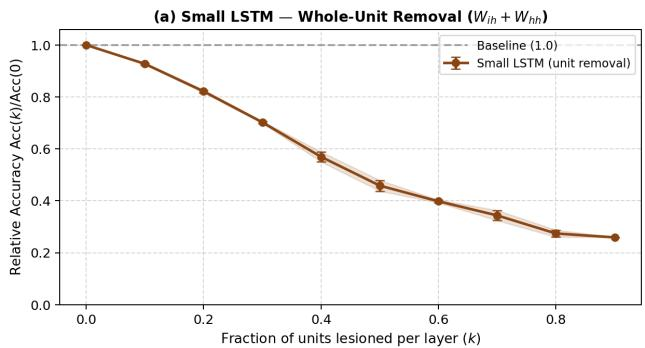

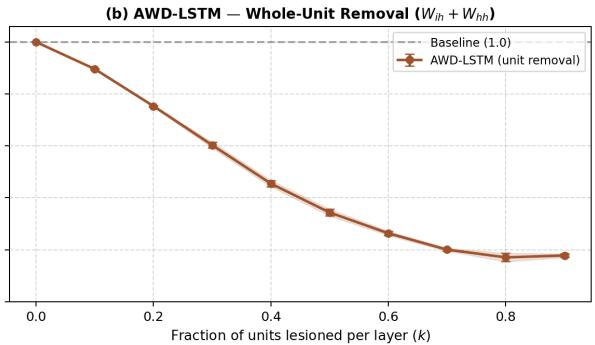

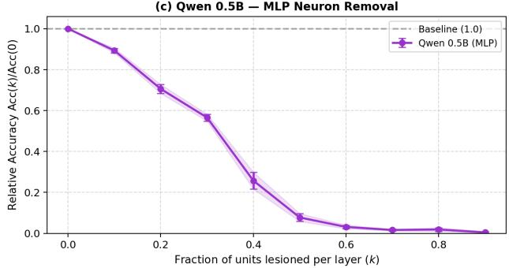

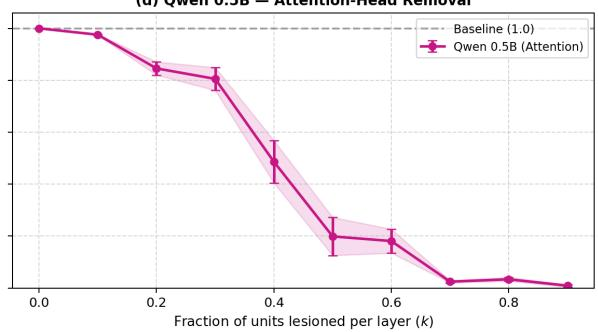

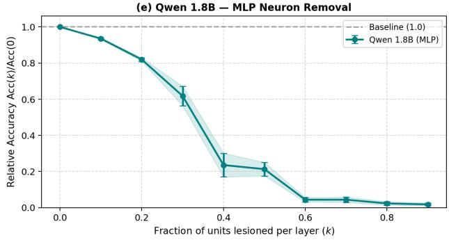

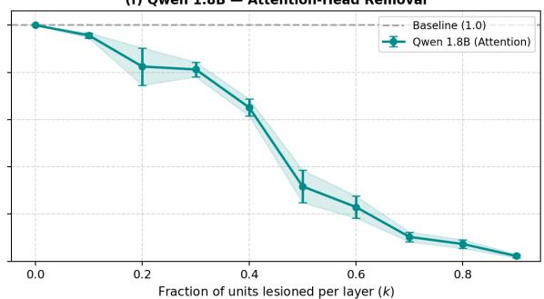  
Figure 2: Next-word prediction accuracy relative to the undamaged baseline $\left( \operatorname { A c c } ( k ) / \operatorname { A c c } ( 0 ) \right)$ across unitablation fractions $k \in [ 0 , 0 . 9 ]$ (means ±1 SE). The six conditions reveal three distinct degradation profiles across architectures and pathways. (a,b) Row 1: Whole-unit removal in both the Small LSTM and pretrained AWD-LSTM causes a steady, near-monotonic decline from $k = 0 . 1$ onward, with neither an early plateau nor a late collapse clif. $^ { ( \mathrm { c } , \mathrm { e } ) }$ Rows 2–3, left: Qwen 0.5B and 1.8B MLP neuron removal initially declines at a pace similar to the LSTMs through $k \leq 0 . 3$ . It then undergoes a steep threshold collapse across $k ^ { * } \approx 0 . 3 – 0 . 4$ to near-zero accuracy. (d,f) Rows 2–3, right: Qwen 0.5B and 1.8B attention-head removal shows early plateaulike bufering across $k = 0 . 1 – 0 . 3$ followed by a smoother S-shaped decline. Full numerical trajectories and curve-shape tests appear in Supplement S2 (Supplementary Tables 5–6), connection-pruning controls appear in Supplementary Figure 8, and Supplementary Figure 9 plots the same trajectories against the fraction of non-embedding parameters removed.

## 2.3 Error Distributions Across the Vocabulary

Aggregate accuracy curves (Section 2.2) track how many words a damaged model misses, but not which words fail, leaving open whether ablation degrades predictions uniformly across the vocabulary or selectively reshapes the error distribution. To quantify this distinction, we introduce a vocabulary moment ratio $( R _ { 4 } )$ paired with an accuracy-matched random-failure null model that measures how ablation redistributes prediction errors across word-frequency ranks. Using this framework, we show that neuronal ablation in every model redistributes errors non-randomly relative to random failure $( \Delta R _ { 4 } < 0 , \Delta D _ { 1 } > 0 )$ , with Transformer pathways, and particularly MLP ablation, producing larger null-corrected distributional shifts than LSTM whole-unit removal (Figures 3–4).

(d) Qwen 0.5B — Attention-Head Removal  
(c) Qwen 0.5B — MLP Neuron Removal  
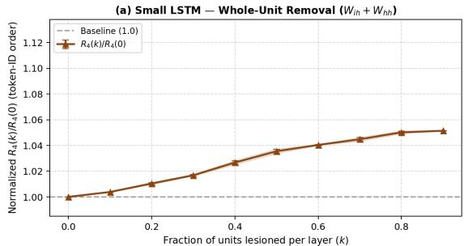

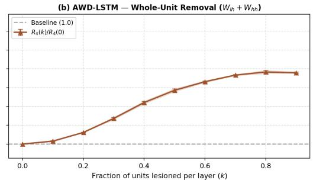

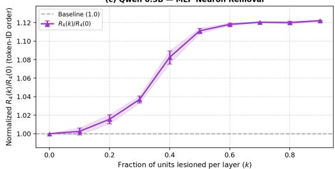

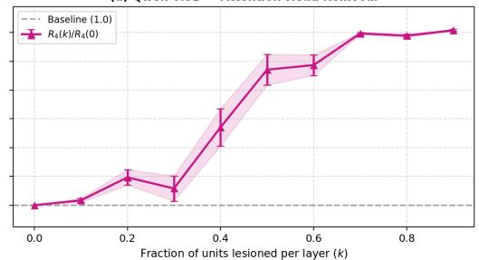

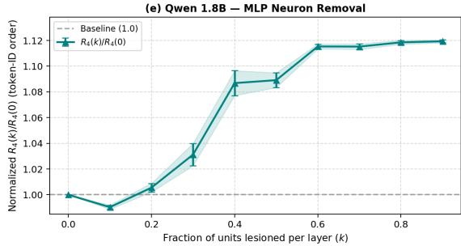

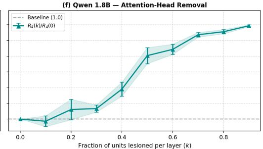  
Figure 3: Normalised moment ratio $R _ { 4 } ( k ) / R _ { 4 } ( 0 )$ (Equation 2) across unit-ablation fractions $k \in [ 0 , 0 . 9 ]$ on a shared vertical scale (means ±1 SE; token IDs are ordered by corpus frequency in the LSTMs and BPE merge order in Qwen). Because any drop in overall accuracy adds errors on common, low-index words $( i \approx 0 )$ , raw $R _ { 4 } ( k ) / R _ { 4 } ( 0 )$ rises as accuracy falls, so each trajectory closely mirrors the inverse of its accuracy curve in Figure 2 (motivating the accuracy-matched null model in Figure 4). (a,b) Row 1: Whole-unit removal in both LSTMs produces a smooth, modest rise across the sweep $( \leq 5 . 1 \% \ \mathrm { a n d } \leq 7 . 7 \% )$ . (c,e) Rows 2–3, left: Qwen MLP neuron removal changes little at mild damage (dipping slightly to 0.990 at $k = 0 . 1$ in Qwen 1.8B before rising to $1 . 0 3 1 { - } 1 . 0 3 7$ at $k = 0 . 3 )$ , then jumps sharply across the $k ^ { * } \approx 0 . 3 – 0 . 4$ collapse clif. (d,f) Rows 2–3, right: Qwen attention-head removal stays nearly flat during the $k \in [ 0 . 1 , 0 . 3 ]$ plateau (≤ 1.9% change) before rising across $k = 0 . 4 – 0 . 7$ (more steeply in Qwen 0.5B than in Qwen 1.8B). Per-k values and connection-pruning controls appear in Supplement S3 and Supplementary Figure 10.

Let ${ \bf e } ( k ) = ( e _ { 0 } , e _ { 1 } , \dots , e _ { C - 1 } )$ record how many times the model fails to predict each word i in a vocabulary of C tokens at ablation fraction k, evaluated on the held-out WikiText-2 test set for the LSTMs and heldout TinyStories passages for the Qwen models (Methods, Section 4). Here, i denotes the vocabulary index, ordered by word frequency (most common = 0) for the LSTMs and by tokenizer merge order for Qwen, where common word pieces also have low indices. We normalise e to a probability distribution $\boldsymbol { p _ { i } } = \boldsymbol { e _ { i } } / \sum _ { j } \boldsymbol { e _ { j } }$ and define the m-th moment as:

$$
\mu _ { m } ( k ) = \sum _ { i = 0 } ^ { C - 1 } i ^ { m } \cdot p _ { i } ( k ) .\tag{1}
$$

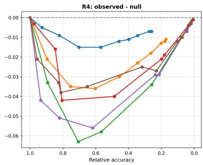

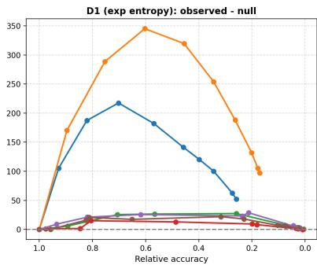

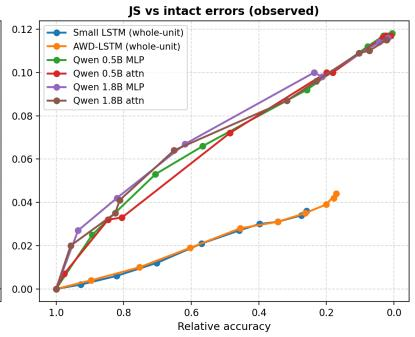  
Figure 4: Comparison of ablated error distributions against an accuracy-matched random-failure baseline (Equations 3–5). In all three panels, the horizontal axis is surviving relative accuracy $\operatorname { A c c } ( k ) / \operatorname { A c c } ( 0 )$ (from 1.0 at $k = 0$ on the left to 0.0 on the right), comparing models at equal accuracy loss. The vertical axes plot: (Left) $\Delta R _ { 4 } = R _ { 4 } ^ { \mathrm { o b s } } - R _ { 4 } ^ { \mathrm { n u l l } }$ , the diference in moment ratio relative to random failure; (Centre) $\Delta D _ { 1 } =$ $D _ { 1 } ^ { \mathrm { o b s } } - D _ { 1 } ^ { \mathrm { n u l l } }$ , the diference in efective number of distinct error words relative to random failure; and $( { \mathrm { R i g h t } } ) \operatorname { J S } ( p ( k ) \| p ( 0 ) )$ , the Jensen–Shannon divergence between the damaged and undamaged $( k = 0 )$ error distributions. Together, the three panels establish two main findings: first, neuronal ablation fails nonrandomly across all models, concentrating fewer new mistakes on ultra-common words $( \Delta R _ { 4 } < 0 )$ and spreading errors across more distinct words $\left( \Delta D _ { 1 } > 0 \right)$ than random failure; second, Transformer ablation (especially MLP removal) reshapes the error distribution much more strongly than LSTM whole-unit removal (Supplement S3).

The key diagnostic is the moment ratio:

$$
R _ { 4 } ( k ) = \frac { \mu _ { 4 } ( k ) ^ { 1 / 4 } } { \mu _ { 2 } ( k ) ^ { 1 / 2 } } .\tag{2}
$$

A single moment such as $\mu _ { 1 }$ or $\mu _ { 2 } ^ { 1 / 2 }$ only measures the average rank scale of errors, whereas the ratio $R _ { 4 } = \mu _ { 4 } ^ { 1 / 4 } / \mu _ { 2 } ^ { 1 / 2 }$ cancels out vocabulary scale to measure distribution shape (analogous to kurtosis, since $R _ { 2 } = \mu _ { 2 } ^ { 1 / 2 } / \mu _ { 2 } ^ { 1 / 2 } \equiv 1$ is trivial). Specifically, the denominator $\mu _ { 2 } ^ { 1 / 2 }$ tracks the bulk error rank, while the $i ^ { 4 }$ weighting makes the numerator $\mu _ { 4 } ^ { 1 / 4 }$ sensitive to the high-index rare-word tail. When errors are spread uniformly across a band of words $[ 0 , K ]$ , the bulk and tail scale together $( R _ { 4 } \approx 1 . 1 5 8$ for any $K \colon R _ { 4 } = 1$ on a single word). By contrast, when most errors pile up near $i \approx 0$ (common words) alongside a rare-word tail at large i, the mass near i ≈ 0 pulls down $\mu _ { 2 } ^ { 1 / 2 }$ while $\mu _ { 4 } ^ { 1 / 4 }$ stays pinned by the tail, making $R _ { 4 }$ large (1.845–1.881 for a Zipfian distribution [Zipf, 1949] $p _ { i } \propto 1 / ( i + 1 ) $ ).

Raw $R _ { 4 }$ trajectories. Across progressive unit ablation, the raw ratio $R _ { 4 } ( k ) / R _ { 4 } ( 0 )$ rises gradually and mod estly in both LSTMs (by at most 5.1% and 7.7%), indicating that error counts scale up nearly proportionally across the vocabulary. In the Transformers under MLP ablation, $R _ { 4 } ( k ) / R _ { 4 } ( 0 )$ rises gradually at mild dam age, jumps by about 5 further percentage points across the threshold clif, and reaches a maximum rise of 11.9–12.2% at high k (Figure 3; Supplement S3). Because an undamaged model mostly gets common, low-index words right and misses harder words, any drop in overall accuracy adds new errors near $i \approx 0$ automatically pulling down $\mu _ { 2 } ^ { 1 / 2 }$ relative to $\mu _ { 4 } ^ { 1 / 4 }$ and pushing raw $R _ { 4 }$ upward even under random failure.

Accuracy-matched random-failure baseline (null model) and distributional $s h i f t .$ To separate genuine pathway-specific changes from the automatic efect of making more errors, we compare each damaged model against a simulated random-failure baseline (null model) matched to the exact same error count. Let ${ \bf e } ( 0 )$ and $\mathbf { e } ( k )$ denote the per-token error count vectors of the undamaged $( k = 0 )$ and damaged $( k > 0 )$ models across the test set. Their sums, $\begin{array} { r } { M ( 0 ) = \sum _ { i } e _ { i } ( 0 ) } \end{array}$ and $\begin{array} { r } { M ( k ) = \sum _ { i } e _ { i } ( k ) } \end{array}$ (with $M ( k ) \geq M ( 0 ) )$ , give the total number of prediction errors made by the undamaged and damaged models, so $M ( k ) - M ( 0 )$ is the number of additional errors caused by ablation. Let $\mathbf { c } ( 0 ) = ( c _ { 0 } ( 0 ) , \dots , c _ { C - 1 } ( 0 ) )$ be the per-token count vector of test-set tokens that the undamaged $( k = 0 )$ model predicted correctly. Under the random-failure null hypothesis, the $M ( k ) - M ( 0 )$ additional mistakes caused by ablation occur by randomly failing on $M ( k ) - M ( 0 )$ of the test-token occurrences that the undamaged model got right. Specifically, in each simulation we pick $M ( k ) - M ( 0 )$ individual word occurrences uniformly at random without replacement from the pool of test words the undamaged model got right, turn those into errors, and tally how many times each vocabulary word i was picked. Adding that vector of newly missed word counts, denoted SampleWithoutReplacemen $\left( M ( k ) - M ( 0 ) , \ \mathbf { c } ( 0 ) \right)$ , to ${ \bf e } ( 0 )$ gives the simulated error counts:

$$
\mathbf { e } ^ { \mathrm { n u l l } } ( k ) = \mathbf { e } ( 0 ) + \mathrm { S a m p l e W i t h o u t R e p l a c e m e n t } { \bigl ( } M ( k ) - M ( 0 ) , \mathbf { c } ( 0 ) { \bigr ) } .\tag{3}
$$

Alongside $R _ { 4 } .$ , which depends on vocabulary rank order i, we also track how many distinct words the errors span regardless of rank order using Hill’s diversity index [Hill, 1973, Jost, 2006], $D _ { 1 } ( p ) = \exp ( H ( p ) )$ , where $\begin{array} { r } { H ( p ) = - \sum _ { i : p _ { i } > 0 } p _ { i } } \end{array}$ ln $p _ { i }$ is the Shannon entropy (in nats).6 From each simulated null error vector $\mathbf { e } ^ { \mathrm { n u l l } } ( k )$ we compute both $R _ { 4 } ^ { \mathrm { n u l l } } ( k )$ (Equation 2) and the efective error-vocabulary size $D _ { 1 } ^ { \mathrm { n u l l } } ( k ) = \exp \bigl ( H ( p ^ { \mathrm { n u l l } } ( k ) ) \bigr )$ (with $p _ { i } ^ { \mathrm { n u l l } } ( k ) = e _ { i } ^ { \mathrm { n u l l } } ( k ) / M ( k ) )$ , and denote the corresponding observed quantities for $\mathbf { e } ( k )$ by $R _ { 4 } ^ { \mathrm { o b s } } ( k )$ and $D _ { 1 } ^ { \mathrm { o b s } } ( k )$ . Repeating Equation 3 for $B = 1 0 0$ independent random draws per trial and averaging $R _ { 4 } ^ { \mathrm { n u l l } } ( k )$ and $D _ { 1 } ^ { \mathrm { n u l l } } ( k )$ across those B draws yields the null expectations $\mathbb { E } [ R _ { 4 } ^ { \mathrm { n u l l } } ( k ) ]$ and $\mathbb { E } [ D _ { 1 } ^ { \mathrm { n u l l } } ( k ) ]$ ]. Subtracting these expectations from the observed values defines the null-corrected $R _ { 4 } ~ d i f f$ erence $\Delta R _ { 4 } ( k )$ and the null-corrected error-vocabulary diference $\Delta D _ { 1 } ( k )$ :

$$
\Delta R _ { 4 } ( k ) = R _ { 4 } ^ { \mathrm { o b s } } ( k ) - \mathbb { E } \big [ R _ { 4 } ^ { \mathrm { n u l l } } ( k ) \big ] , \qquad \Delta D _ { 1 } ( k ) = D _ { 1 } ^ { \mathrm { o b s } } ( k ) - \mathbb { E } \big [ D _ { 1 } ^ { \mathrm { n u l l } } ( k ) \big ] .\tag{4}
$$

To measure how much the damaged error distribution $p _ { i } ( k ) = e _ { i } ( k ) / M ( k )$ difers overall from the undamaged error distribution $p _ { i } ( 0 ) = e _ { i } ( 0 ) / M ( 0 )$ on a 0-to-1 scale, we compute the base-2 Jensen–Shannon divergence:

$$
\operatorname { J S } { \big ( } p ( k ) \| p ( 0 ) { \big ) } = { \frac { 1 } { 2 } } \operatorname { K L } { \big ( } p ( k ) \| m { \big ) } + { \frac { 1 } { 2 } } \operatorname { K L } { \big ( } p ( 0 ) \| m { \big ) } , \qquad m = { \frac { 1 } { 2 } } { \big ( } p ( k ) + p ( 0 ) { \big ) } ,\tag{5}
$$

where $\begin{array} { r } { \mathrm { K L } ( a \| b ) = \sum _ { i : a _ { i } > 0 } a _ { i } \log _ { 2 } ( a _ { i } / b _ { i } ) } \end{array}$ is the base-2 Kullback–Leibler divergence between two probability distributions a and b.

Across all six unit-level conditions, neuronal ablation fails non-randomly compared with the randomfailure baseline $( \Delta R _ { 4 } < 0$ , Figure 4 left; $\Delta D _ { 1 } > 0$ , centre; full tables and Fourier spectral analysis appear in Supplements S3–S4). The reason is straightforward: in natural $\mathrm { t e x t } ,$ a handful of common words (such as the and and, near $i \approx 0 )$ make up a large share of all tokens, so randomly failing on previously correct predictions puts most new mistakes onto those very common words and drives $R _ { 4 } ^ { \mathrm { n u l l } }$ sharply upward. An ablated network, by contrast, still gets the most common function words right and instead makes its new mistakes on less common content words (ranks i in the hundreds to thousands). As a result, its errors sit at higher word ranks $( \Delta R _ { 4 } < 0 )$ and are spread across more distinct words $\left( \Delta D _ { 1 } > 0 \right)$ than under random failure. In the LSTMs and Qwen MLP, $\Delta R _ { 4 }$ is already negative at 10% damage $( k = 0 . 1 )$ , showing that non-random error shifts appear even at mild damage before overall accuracy collapses.

Figure 4 also reveals diferences across pathways and architectures. Within the Transformers, MLP ablation shifts $\Delta R _ { 4 } / R _ { 4 } ( 0 )$ more negatively than attention-head ablation when trials are pooled across $k \in$ [0.1, 0.4] (permutation $p < 1 0 ^ { - 4 }$ in Qwen 0.5B and $p = 0 . 0 2 3 8$ in Qwen 1.8B), though at a single matched accuracy level $( \mathrm { R e l A c c } = 0 . 8 0 )$ their confidence intervals overlap (Supplement S3). This pattern is consistent with the hypothesis that feedforward layers store word-specific associations [Geva et al., 2021] whereas attention heads route broader context. Across architectures at equal surviving accuracy $( \mathrm { R e l A c c } = 0 . 8 0 )$ the overall shift from the undamaged error distribution $( \mathrm { J S } ( p ( k ) \parallel p ( 0 ) )$ , Figure 4 right) is larger in the four Qwen curves than in the two LSTM whole-unit curves, and this diference remains after subtracting the random-failure baseline $\mathrm { ( \Delta \Delta J S = J S ^ { o b s } - J S ^ { n u l l } }$ of +0.010 to +0.020 in Qwen vs. +0.002 to +0.003 in the LSTMs; Supplement S3). Together, these results show that pairing the moment ratio and distributional metrics $( \Delta R _ { 4 } , \Delta D _ { 1 } ,$ and $\Delta \mathrm { J S } )$ with an accuracy-matched random-failure null model separates non-random error concentration from simple accuracy loss, distinguishing targeted Transformer pathway damage from more uniform LSTM decline when accuracy scores alone cannot.

## 2.4 Quantified Cloze Test: Dissociating Syntax from Semantics

To test whether grammatical structure and word meaning degrade together or separate by pathway, as in clinical aphasia [Goodglass, 1993], we evaluate all models on a 100-prompt fill-in-the-blank sentencecompletion (Cloze) battery (where each model predicts the missing final word of a sentence), stratified across nouns, verbs, adjectives, and adverbs. We measure syntactic accuracy by part-of-speech (POS) match rate and semantic relevance by GloVe [Pennington et al., 2014] word-embedding cosine similarity to the target word. Because cosine similarity is set to zero whenever the predicted word is not tagged as a content word (Methods, Section 4), the two metrics are not fully independent.

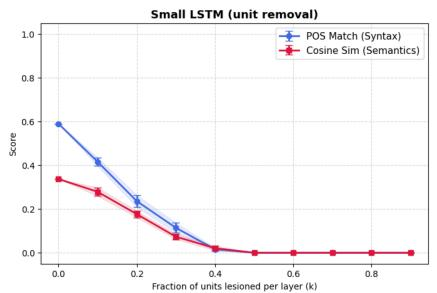

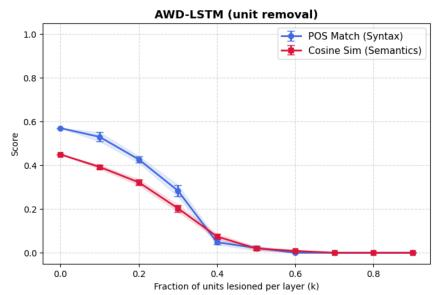

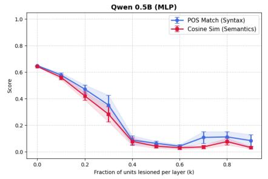

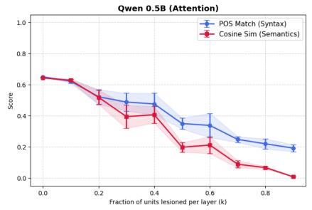

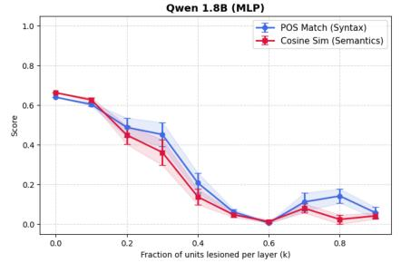

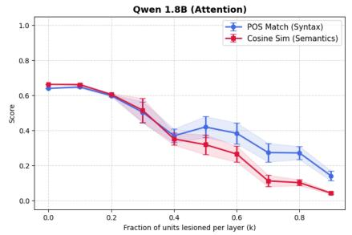  
Figure 5: Syntactic and semantic performance on the 100-prompt fill-in-the-blank (Cloze) test under progressive unit-level ablation. Each panel plots grammatical part-of-speech match rate (blue circles, syntax) and GloVe cosine similarity to the target word (red squares, semantics) on the vertical axis against the fraction of units removed $k \in [ 0 . 0 , 0 . 9 ]$ on the horizontal axis (means ±1 SE across trials; $k = 0 . 0$ is the undamaged model). Row 1: Under whole-unit removal in both the Small LSTM (left) and pretrained AWD-LSTM (right), syntax and semantics erode in parallel from $k = 0 . 1$ onward, reaching near zero at $k = 0 . 4$ and 0.0% POS by $k = 0 . 5 – 0 . 6$ as outputs default to common function words. Rows 2–3: In both Qwen 0.5B and Qwen 1.8B, MLP neuron ablation (left) declines moderately through $k = 0 . 3$ before a steep threshold collapse across $k ^ { * } \approx 0 . 3 – 0 . 4$ (near zero by $k = 0 . 5 – 0 . 6 )$ , whereas attention-head ablation (right) declines much more gradually on both metrics through $k = 0 . 5 – 0 . 6$

Across architectures, the unit-level Cloze trajectories separate pathway-selective Transformer breakdown from non-dissociated LSTM decline (Figure 5 and Table 2, with full per-k curves in Supplement S5 and Supplementary Table 17). In both Qwen Transformers (Figure 5, rows 2–3), MLP neuron ablation retains moderate performance at mild damage before collapsing both syntax and semantics across $k ^ { * } \approx 0 . 3 – 0 . 4$ to near zero by $k = 0 . 5$ . Attention-head ablation declines much more gradually on the nominal-k axis, retaining roughly 4.7- to 7-fold higher grammatical and semantic competence at nomina $k = 0 . 5$ (Supplement S5).

In both LSTMs under whole-unit removal (Figure 5, row 1), syntax and semantics always erode in parallel without dissociating. Both Cloze metrics (POS match and cosine similarity) decline proportionally across k = 0.1–0.3 and reach the zero floor on content words across k = 0.4–0.6, as cumulative unit loss across the serial 3-layer stack reduces predictions to common function words.

Table 2: Cloze syntactic (POS match) and semantic (GloVe cosine) benchmarks and representative errors across the six unit-level conditions, grouped by clinical parallel. Transformer MLP and attention pathways diverge sharply at severe damage (k = 0.5), whereas both LSTMs erode syntax and semantics in lockstep until reaching the content-word floor across k = 0.4–0.6 (means across trials; full trajectories appear in Supplement S5 and Supplementary Table 17).

<table><tr><td>Architecture</td><td>Target</td><td>k</td><td>POS Match</td><td>Cos Sim</td><td>Trajectory</td><td></td><td>Qualitative Error Profile and Examples (k = 0.2)</td></tr><tr><td colspan="8">Baselines</td></tr><tr><td>Small LSTM</td><td></td><td>0.0</td><td>59.0%</td><td>0.337</td><td></td><td></td><td>grammatical continuations, no exact matches (4% correct, all via top-5, e.g. neck→head)</td></tr><tr><td>AWD-LSTM</td><td></td><td>0.0</td><td>57.0%</td><td>0.450</td><td></td><td></td><td>moderate accuracy (25% correct; time √, sky √, song √, ocean √)</td></tr><tr><td>Qwen 0.5B</td><td></td><td>0.0</td><td>65.0%</td><td>0.643</td><td></td><td></td><td>strong (64% correct; time √, dress √, hug √)</td></tr><tr><td>Qwen 1.8B</td><td></td><td>0.0</td><td>64.0%</td><td>0.663</td><td></td><td></td><td>strong (66% correct; time √, sky √, hug √)</td></tr><tr><td colspan="8"></td></tr><tr><td>Qwen 1.8B</td><td>MLP</td><td></td><td>48.8%</td><td>0.449</td><td></td><td>Wernicke-type parallel: related-word substitutions at the intact rate, more no-responses &amp; late threshold collapse</td><td></td></tr><tr><td>Qwen 0.5B</td><td>MLP</td><td>0.2 0.2</td><td>47.2%</td><td>0.421</td><td></td><td>threshold</td><td>ocean→bay, sea→river (same-category); cold→shallow (attribute substitution)</td></tr><tr><td>svPPA-type parallel: buffered Cloze trajectory &amp; non-significant trend toward generic defaulting</td><td></td><td></td><td></td><td></td><td></td><td>threshold</td><td>cheer→sing, storm→dawn (contextually plausible substitutions); stunning→fine (generic evaluative default)</td></tr><tr><td>Qwen 1.8B</td><td></td><td></td><td></td><td></td><td></td><td></td><td></td></tr><tr><td>Qwen 0.5B</td><td>Attn Attn</td><td>0.2 0.2</td><td>59.9% 52.2%</td><td></td><td>0.606 0.519</td><td>sigmoid sigmoid</td><td>gentle→small (generic); keyboard→desktop, pond→tank (within-domain) ball→following, clear→good, heart→name (concrete→abstract or generic trend)</td></tr><tr><td colspan="8">AD-type diffuse stage: steady parallel decline across mild-to-moderate whole-unit ablation</td></tr><tr><td>AWD-LSTM</td><td></td><td></td><td></td><td></td><td></td><td></td><td></td></tr><tr><td>AWD-LSTM</td><td>Whole units</td><td>0.2</td><td>42.7%</td><td>0.322</td><td></td><td>gradual</td><td>parallel syntax/semantics decline (field→country, storm→event, ball→number)</td></tr><tr><td>Small LSTM</td><td>Whole units</td><td>0.3</td><td>28.4%</td><td></td><td>0.203</td><td>gradual</td><td>continued parallel erosion without syntactic-semantic dissociation</td></tr><tr><td>Small LSTM</td><td>Whole units</td><td>0.2</td><td>23.6% 11.4%</td><td></td><td>0.177</td><td>gradual</td><td>parallel decline toward high-frequency defaults (clouds→first; one chance hit, field, missed by the intact model)</td></tr><tr><td>Late-stage</td><td>Whole units</td><td>0.3</td><td></td><td></td><td>0.073</td><td>gradual</td><td>continued parallel decline of POS and cosine prior to serial input exhaustion</td></tr><tr><td colspan="8">/ post-threshold comparison at nominal k = 0.5 (70–73% non-emb. params removed for LSTM units, 33–34% for Qwen MLP, 16–17% for Qwen Attn)</td></tr><tr><td>AWD-LSTM</td><td>Whole units</td><td>0.5</td><td>2.2%</td><td>0.020</td><td></td><td>floor</td><td>content-word floor at severe k (POS 0.0%, cos 0.008 at k = 0.6; 0.000 for k &gt; 0.7)</td></tr><tr><td>Small LSTM</td><td>Whole units</td><td>0.5</td><td>0.0%</td><td>0.000</td><td></td><td>floor</td><td></td></tr><tr><td>Qwen 1.8B</td><td>MLP</td><td>0.5</td><td>6.2%</td><td>0.048</td><td></td><td>post-thresh.</td><td>content-word floor at severe k (POS 0.0%, cos 0.000 for k ≥ 0.5)</td></tr><tr><td>Qwen 0.5B</td><td>MLP</td><td>0.5</td><td>6.4%</td><td>0.042</td><td></td><td>post-thresh.</td><td>post-threshold language collapse after MLP cliff</td></tr><tr><td>Qwen 1.8B</td><td>Attn</td><td>0.5</td><td>42.0%</td><td></td><td>0.319</td><td>sigmoid</td><td>post-threshold language collapse after MLP cliff</td></tr><tr><td>Qwen 0.5B</td><td>Attn</td><td>0.5</td><td>35.0%</td><td></td><td>0.198</td><td>sigmoid</td><td>buffered mid-range survival (~7× higher POS &amp; cosine than MLP at nominal k=0.5) buffered syntactic survival (&gt;5× higher POS &amp; ~4.7× higher cosine than MLP at nominal k=0.5)</td></tr></table>

## 2.5 Clinical Parallel Assignments: Converging Evidence

We test three hypotheses linking network architecture to clinical language disorders: (1) in Transformers, damaging the feedforward (MLP) layers disrupts word retrieval while leaving related-word mistakes intact, resembling Wernicke-type aphasia; (2) damaging the attention heads preserves sentence structure across moderate damage while shifting wrong words toward more general terms, resembling semantic dementia (svPPA); and (3) in serial LSTMs, which lack separate pathways or skip connections, removing whole units erodes grammar and word meaning together, resembling difuse Alzheimer’s-type (AD) decline.

The four paragraphs below test these hypotheses by combining the damage curves from Sections 2.2– 2.4 with the specific word mistakes each model makes at 20% ablation (Tables 3–4, building on the Cloze benchmarks in Table 2). The first two paragraphs examine the two Transformer pathways in turn, comparing MLP damage against Wernicke-type aphasia (Table 3, rows 1–2; Table 4) and attention-head damage against svPPA (rows 3–4). The third paragraph contrasts both Transformer pathways with whole-unit removal in the two LSTMs, which parallels difuse AD-type decline (rows 5–6). The fourth paragraph compares the mistake patterns of all undamaged and damaged models directly against clinical naming data from stroke patients with aphasia (Figure 6; Supplementary Table 20).

MLP ablation ↔ Wernicke-type aphasia. Under MLP neuron ablation, both Qwen Transformers lose exact word-prediction accuracy and eventually collapse across k∗ ≈ 0.3–0.4, yet at moderate damage (k = 0.2) their wrong content-word guesses remain similar in specificity and concreteness to those of the undamaged model and preserve the undamaged rate of meaning-related word substitutions (semantic paraphasias: 11.7% vs. 11.0% undamaged in Qwen 1.8B).7 For example, the MLP-damaged model replaces target words with other specific words from the same category (such as “bay” for “ocean” and “river” for “sea”) or with related attributes (such as “shallow” for “cold”). This error pattern resembles Wernicke-type (receptive) aphasia after posterior temporal damage [Wernicke, 1874, Goodglass, 1993]: in both cases, retrieving the exact target word fails, yet substitutions remain concrete, meaning-related words without a selective loss of grammar over meaning. The parallel is partial because clinical Wernicke’s aphasia is fluent and elevates semantic paraphasias, whereas MLP ablation keeps semantic paraphasias at the undamaged rate while increasing blank and function-word outputs and lowering grammatical match.8 Overall, this pattern is consistent with Transformer MLP layers storing specific word meanings (Table 3, rows 1–2; Tables 2 and 4; Figures $^ { \mathrm { 2 c , e , } }$ 4–6; Supplement S6 and Supplementary Tables 18 and 20).

Table 3: Clinical parallel synthesis across the six unit-level ablation conditions. Each condition is classified along two converging axes: quantitative degradation dynamics $( k \in \ [ 0 , 0 . 9 ] )$ and qualitative Cloze error profiles at k = 0.2 (detailed error-type breakdowns appear in Table 4, Figure 6, and Supplements S6 and S8).
<table><tr><td>Architecture</td><td>Target</td><td>Quantitative Signature</td><td>Qualitative &amp; Lexical Evidence</td><td></td><td>Clinical Parallel</td></tr><tr><td>Qwen 1.8B</td><td>MLP</td><td>Initial accuracy decline comparable to LSTMs (93.5% and 82.0% of baseline at k=0.1, 0.2), followed by late thresh- old collapse (k*≈0.3–0.4); largest neg- ative shift in null-corrected  $R _ { 4 }$ </td><td>Preserves the intact PNT Semantic rate (11.7% vs. 11.0% intact) while No-response rises (18.1% vs. 1.0% intact); produces within-category substitutions &quot;sea&quot;→“river&quot;) and attribute sub- stitutions (&quot;cold&quot;→&quot;shallow&quot;) with</td><td>(&quot;ocean”→&quot;bay”,</td><td>Wernicke-type</td></tr><tr><td>Qwen 0.5B</td><td>MLP</td><td>Same pattern: initial decline compa- rable to LSTMs (89.3% and 70.6% at  $k { = } 0 . 1 , 0 . 2 )$  and late threshold collapse (k*≈0.3–0.4); strong negative shift in null-corrected  $R _ { 4 }$ </td><td>unchanged word concreteness Preserves the intact PNT Semantic rate (9.9% vs. 9.0% intact) while No-response rises (16.7% vs. 1.0% intact); produces contextually plau- sible substitutions (&quot;cheer&quot;→&quot;sing&quot;, &quot;storm&quot;→&quot;dawn&quot;) and generic evalua- tive defaults (&quot;stunning&quot;→&quot;fine&quot;)</td><td></td><td>Wernicke-type</td></tr><tr><td>Qwen 1.8B</td><td></td><td>a smoother sigmoid-like decline; pre- serves substantial Cloze syntax and se- mantics through k=0.5; milder null- corrected  $R _ { 4 }$  shift than MLP</td><td>Early retention at k=0.1 followed by Slightly fewer semantic paraphasias (&quot;gentle&quot;→&quot;small&quot;) alongside within- domain ones (&quot;keyboard&quot;→&quot;desktop&quot;) Shifts substitutions toward more</td><td>than intact (9.1% vs. 11.0%) and a borderline shift toward more ab- stract words (∆Conc.=+0.24 vs. +0.13 intact): generic substitutions</td><td>svPPA</td></tr><tr><td></td><td></td><td>Early retention at k=0.1 followed by a smoother sigmoid-like decline; Cloze syntax and semantics buffered through k=0.4–0.5; milder null-corrected  $R _ { 4 }$  shift than MLP</td><td>abstract words thanthe model (∆Conc.=+0.43 intact), with generic such as  $\mathrm { ^ { * } c l e a r ^ { 3 } } \mathrm { } \to \mathrm { ^ { * } g o o d ^ { 3 } }$  Syntax (POS) and semantics (cosine)</td><td>intact vS. +0.15 defaults &quot;ball&quot;→“following” and</td><td></td></tr><tr><td></td><td></td><td>across k ∈ [0, 0.9] without a late cliff (75.3% of baseline at k=0.2, 34.4% at k=0.5); modest gradual  $R _ { 4 }$  rise (≤ 7.7%; JS=0.008 at RelAcc=0.80)</td><td colspan="3">erode in lockstep across k=0.1–0.3 with- out dissociating (46.6% content sub. at k=0.2), reaching the content-word Cloze floor across k=0.4–0.6 (0.0% POS by k=0.6)</td></tr><tr><td>Small LSTM</td><td>Whole units</td><td>Steady, gradual accuracy decline across k ∈ [0, 0.9] without a late cliff (82.2% of baseline at k=0.2, 45.8% at k=0.5); modest gradual  $R _ { 4 }$  rise (≤ 5.1%; JS=0.007 at RelAcc=0.80)</td><td colspan="3">Syntax and semantics erode in parallel across k=0.1-0.3 without dissociating, progressing rapidly to non-content de- faults (84.3% non-content at k=0.2) and reaching the content-word Cloze floor across k=0.4–0.5 (0.0% POS by k=0.5)</td></tr></table>

Attention-head ablation ↔ svPPA. Under attention-head ablation, both Qwen Transformers lose performance much more gradually than under MLP ablation, retaining substantial grammatical and meaningrelated Cloze competence even when 40%–50% of attention heads are removed $( k = 0 . 4 \ – 0 . 5 ) . ^ { 9 }$ Yet when the attention-damaged model makes content-word mistakes at moderate damage (k = 0.2), its guesses shift toward more general, abstract words than those of the undamaged model.10 For example, the attention damaged model replaces specific words with broader or more generic terms (such as “small” for “gentle” in Qwen 1.8B and “good” for “clear” in Qwen 0.5B), alongside some same-domain substitutions (such as “desktop” for “keyboard” in Qwen 1.8B). This combination of preserved sentence grammar and a drift from specific toward more general words resembles the semantic variant of primary progressive aphasia (svPPA, or semantic dementia), in which anterior temporal atrophy erodes specific word knowledge into generic or superordinate terms while sparing syntax [Warrington, 1975, Hodges and Patterson, 2007, Gorno-Tempin et al., 2011, Lambon Ralph et al., 2017]. The parallel is partial because clinical svPPA involves a progressive, category-by-category loss of conceptual knowledge, and while attention and MLP ablation separate sharply in their overall Cloze curves across k = 0.3–0.5, their diference in individual error types at k = 0.2 is a non-significant directional trend (see also Section 3, Limitations; Table 3, rows 3–4; Tables 2 and 4; Figure 5, rows 2–3; Supplement S6).

Table 4: Cloze error-type distribution and Brysbaert concreteness drop (∆Conc., target minus prediction [Brysbaert et al., 2014]; positive values indicate more abstract substitutions) for undamaged (k = 0) and unit-ablated (k = 0.2) models. MLP ablation lowers accuracy and raises non-content outputs while keeping substitution concreteness near the undamaged baseline, whereas attention ablation shifts substitutions toward more abstract words. For the ablated models, values show the mean and 95% confidence interval across 10 independent ablation trials (coding and exact-match details appear in Supplements S6–S7).
<table><tr><td>Architecture</td><td>Condition</td><td colspan="2">Correct</td><td colspan="2">Content Substitution</td><td colspan="2">Non-content</td><td colspan="2">Mean ∆Conc.</td></tr><tr><td colspan="9">Undamaged baselines (k = 0, n = 100 prompts)</td></tr><tr><td>Qwen 1.8B</td><td>Intact (k=0)</td><td colspan="2">66.0%</td><td colspan="2">27.0%</td><td colspan="2">7.0%</td><td colspan="2">+0.13</td></tr><tr><td>Qwen 0.5B</td><td>Intact (k=0)</td><td colspan="2">64.0%</td><td colspan="2">27.0%</td><td colspan="2">9.0%</td><td colspan="2">+0.15</td></tr><tr><td>AWD-LSTM</td><td>Intact (k=0)</td><td colspan="2">25.0%</td><td colspan="2">53.0%</td><td colspan="2">22.0%</td><td colspan="2">+0.26</td></tr><tr><td>Small LSTM</td><td>Intact (k=0)</td><td colspan="2">4.0%</td><td colspan="2">45.0%</td><td colspan="2">51.0%</td><td colspan="2">+0.53</td></tr><tr><td colspan="9">Unit-ablated conditions at k = 0.2 (mean [95% CI] across 10 independent ablation trials, 100 prompts per trial)</td></tr><tr><td>Qwen 1.8B</td><td>MLP (k=0.2)</td><td>42.1%</td><td>[30.1, 54.1]</td><td>27.2% [21.7, 32.7]</td><td></td><td>30.7% [14.2, 47.2]</td><td></td><td>+0.19 [+0.07, +0.30]</td><td></td></tr><tr><td>Qwen 0.5B</td><td>MLP (k=0.2)</td><td>34.9%</td><td>[28.6, 41.2]</td><td>30.3% [24.8, 35.8]</td><td></td><td>34.8% [23.5, 46.1]</td><td></td><td>+0.29 [+0.13, +0.45]</td><td></td></tr><tr><td>Qwen 1.8B</td><td>Attn (k=0.2)</td><td>61.2%</td><td>[59.4, 63.0]</td><td>27.4%</td><td>[26.1, 28.7]</td><td>11.4% [9.8, 13.0]</td><td></td><td>+0.24 [+0.13, +0.34]</td><td></td></tr><tr><td>Qwen 0.5B</td><td>Attn (k=0.2)</td><td>46.4%</td><td>[33.3, 59.5]</td><td>29.1% [23.7, 34.5]</td><td></td><td>24.5% [7.0, 42.0]</td><td></td><td>+0.43 [+0.33, +0.53]</td><td></td></tr><tr><td>AWD-LSTM</td><td>Whole units (k=0.2)</td><td></td><td>12.3% [9.8, 14.9]</td><td>46.6% [41.5, 51.7]</td><td></td><td>41.1% [36.3, 46.0]</td><td></td><td>+0.34 [+0.21, +0.46]</td><td></td></tr><tr><td>Small LSTM</td><td>Whole units (k=0.2)</td><td></td><td>0.6% [0.0, 1.2]</td><td>15.1% [11.3, 18.9]</td><td></td><td>84.3% [80.6, 88.0]</td><td></td><td>+0.52 [+0.20, +0.85]</td><td></td></tr></table>

LSTM whole-unit ablation ↔ Difuse AD-type decline. Silencing whole hidden units in either the Small LSTM or the pretrained AWD-LSTM produces a smooth, steady decline in next-word accuracy across k ∈ [0, 0.9] (Figures 2a,b). Unlike the Transformers, the damaged LSTMs keep their mistakes spread across common and rare words in roughly the same proportions as the undamaged model (Figures 3a,b and 4), and their grammatical and meaning-related Cloze scores decline together at every damage level without separating (Figure 5, row 1).11 Across mild-to-moderate damage (k ≤ 0.2–0.3), this steady, across-the-board erosion of grammar and word meaning resembles the broad cognitive-linguistic decline of Alzheimer’s-type dementia (AD) [Blennow et al., 2006], reflecting an architecture in which grammar and meaning share a single recurrent pathway. At heavier damage $( k \geq 0 . 4 )$ , because the 3-layer LSTM has no skip connections to bypass damaged layers, cumulative unit loss across the three layers reduces predictions to common function words (which still score hits on general text in Figures 2a,b, but bring content-word Cloze scores to the zero floor by $k = 0 . 4 – 0 . 6 ;$ Table 3, rows 5–6; Tables 2 and 4).

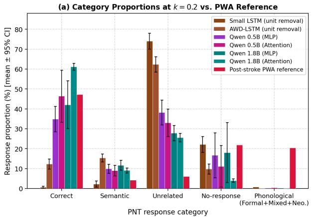

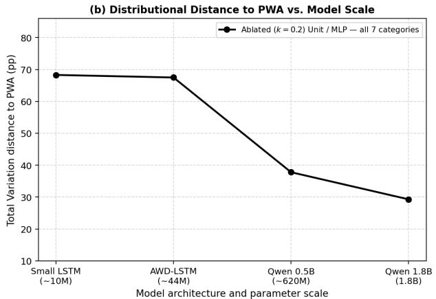  
Figure 6: Comparison of undamaged (k = 0) and unit-ablated (k = 0.2) model predictions with 278 poststroke aphasia patients (PWA) [Yang et al., 2026] on the Philadelphia Naming Test (PNT) taxonomy [Roach et al., 1996, Mirman et al., 2010] (full seven-category numerical values appear in Supplementary Table 20, Supplement S8). (a) Category proportions at $k = 0 . 2$ (mean ± 95% CI across 10 independent ablation trials, 100 prompts per trial) ordered by model scale against the post-stroke PWA reference, with the three sound-based categories (Formal, Mixed, and Neologism) grouped as Phonological. Qwen 1.8B MLP ablation preserves its undamaged rate of semantic paraphasias while No-response failures rise into the patient range, whereas LSTMs remain dominated by unrelated defaults. (b) Overall diference (Total Variation distance across all seven PNT categories, in percentage points) between the ablated (k = 0.2) unit/MLP model predictions and the post-stroke patient percentages as model size increases.

Comparison of intact and ablated models with post-stroke patient error distributions. Finally, we compare the mistake patterns of all four undamaged (k = 0) and moderately damaged (k = 0.2) models on the 100-prompt Cloze test against clinical naming data from 278 post-stroke aphasia patients [Yang et al., 2026] using the Philadelphia Naming Test (PNT) error categories [Roach et al., 1996, Mirman et al., 2010] (Figure 6; Supplementary Table 20, Supplement S8). This comparison yields two main findings. First, a damaged model only resembles clinical aphasia if the undamaged model can already perform the task: at 20% ablation, Qwen 1.8B matches the patient range in overall accuracy and blank responses while preserving its meaning-related mistakes, whereas the smaller LSTMs start well below the patient average and collapse into unrelated common words (Figure 6a).12 Second, across all seven PNT categories, the overall gap between the ablated model and the post-stroke patient profile drops sharply as model scale increases from the LSTMs to Qwen 1.8B (Figure 6b).

## 3 Discussion

Why Transformer pathways split: word storage versus context routing. One hypothesis for the divergence between MLP and attention-head damage comes from their proposed roles inside a Transformer block. Prior interpretability studies suggest that feedforward MLP layers act as distributed memory stores for specific word associations [Geva et al., 2021], whereas attention heads gather context from earlier words in the sentence [Elhage et al., 2021, Olsson et al., 2022] along a shared skip-connection (residual) stream. Under this hypothesis, damaging MLP neurons while leaving attention intact would allow sentence context to steer the model toward the right topic, while impairing its ability to retrieve the exact target word from memory. This could explain why the MLP-damaged model continues to make same-category word substitutions at the undamaged rate before collapsing abruptly at $k ^ { * } \approx 0 . 3 – 0 . 4 .$ , partially paralleling Wernicke-type wordselection errors (though without preserved fluency, as blank and function-word outputs also rise) [Wernicke, 1874, Goodglass, 1993]. Conversely, damaging attention heads while leaving the MLP store intact would allow skip connections to preserve basic grammar and vocabulary access through moderate damage, while weakened sentence context could cause the model to fall back onto safer, more general words, resembling the loss of word specificity in svPPA [Warrington, 1975, Hodges and Patterson, 2007, Gorno-Tempini et al., 2011, Lambon Ralph et al., 2017].

Reserve, plasticity, and detecting mild damage before accuracy drops. These pathway-specific failure curves persist across all four post-damage fine-tuning regimes, indicating that architectural wiring, rather than short-term weight recovery, governs the shape of decline (Section 4; Supplement S9). In clinical neurodegeneration such as Alzheimer’s disease (AD), overall test scores often stay near normal during a pre-symptomatic reserve phase despite substantial early entorhinal pathology and neuron loss [Braak and Braak, 1991, G´omez-Isla et al., 1996], before entering a symptomatic phase in which cortical synapse loss tracks steady cognitive decline [DeKosky and Schef, 1990, Terry et al., 1991]. Our experiments show an analogous split between bufered early accuracy (under Transformer attention-head removal on the unit-fraction axis) and steady accuracy loss (under LSTM unit removal). Crucially, however, even at mild damage $( k = 0 . 1 – 0 . 2 )$ , ablated models’ new mistakes already shift toward less common content words rather than ultra-common function words relative to an accuracy-matched random-failure baseline $( \Delta R _ { 4 } < 0 , \Delta D _ { 1 } > 0 ;$ significant from $k = 0 . 1$ in both LSTMs and Qwen MLP and from $k = 0 . 2$ in Qwen 1.8B attention; Figure 4). Because modern disease-modifying therapies for AD [van Dyck et al., 2023, Sims et al., 2023] require intervention before tau-driven cortical atrophy becomes widespread [La Joie et al., 2020], comparing patients’ word-frequency error patterns on naming or Cloze tests against an accuracy-matched random baseline could help distinguish early structural decline from benign attentional lapses before overall test scores fall.

Why LSTMs decline steadily without a pathway split. In contrast to the Transformer, both the Small LSTM and the much larger AWD-LSTM pass information through a single chain of three recurrent layers without separate MLP and attention sub-blocks or skip connections. Making the LSTM larger raises its undamaged accuracy (27.5% to 38.1%), but does not change its failure pattern: next-word accuracy declines smoothly across the entire ablation range (Figures 2a,b), and on the Cloze test grammar and word meaning erode steadily together from $k = 0 . 1$ until reaching the zero floor on content words by $k = 0 . 4 – 0 . 6$ , where the models fall back to common function words (Figure 5, row 1). Our supplementary experiments that cut specific types of LSTM connections one at a time (Section 4; Supplements S2–S6) explain both aspects of this profile: cutting only the memory links from earlier words causes a slow, steady co-decline of grammar and meaning across the full range, whereas cutting the links that feed the current word up the three-layer chain causes a rapid drop onto function-word defaults once enough serial capacity is lost.

Limitations. Three main limitations qualify our conclusions. First, uniform binary neuron zeroing across all layers captures only one idealised mode of neural damage. Real brain disease and stroke can damage circuits in many other ways, including gradual synapse weakening and noisy signalling before cell death [Blennow et al., 2006, Yang et al., 2026], damage concentrated in specific layers or regions rather than spread evenly across layers [Braak and Braak, 1991, Moore et al., 2025, Wang et al., 2026], broken connections between regions, and brain recovery mechanisms that difer from standard model fine-tuning [Moore et al., 2023a,b]. Accordingly, our clinical parallels describe output-level behavioural analogies rather than one-to-one mappings onto the neurocognitive components of controlled semantic cognition [Jeferies and Lambon Ralph, 2006, Lambon Ralph et al., 2017, Robson et al., 2012]. Second, our empirical scope is bounded by model scale, training corpus, and prompt sample size. The LSTMs (∼10–44M parameters, trained on WikiText) and Transformers (0.6–1.8B parameters, evaluated on TinyStories) difer in size, corpus, and tokeniser (Supplement S2). In addition, while our 100-prompt Cloze battery clearly separates the overall degradation curves of the MLP and attention pathways, larger prompt batteries will be needed to test fine-grained diferences between pathways in individual error subtypes (Supplement S6). Third, single-word Cloze completions over a fixed text vocabulary isolate word-choice errors (Semantic, Unrelated, and No-response) but cannot reproduce spoken-sound slips or made-up non-words (Formal, Mixed, and Neologism ≤1% vs. ≈20.5% in patients [Roach et al., 1996, Mirman et al., 2010, Yang et al., 2026]) because the models lack a speechproduction stage; they also do not assess sentence-level fluency or pragmatics. Moreover, automated scoring depends on operational rules (top-5 accuracy matching, POS-gated GloVe similarity, and WordNet/CMUdict thresholds; Supplements S7–S8) on open-ended prompts that admit multiple valid continuations. Extending these analyses to larger models and connected patient speech from AphasiaBank [MacWhinney et al., 2011] is an important direction for future work.

## 4 Methods

Full architectural specifications, weight-matrix indexing equations, hyperparameter schedules, and scoring algorithms are provided in Extended Materials and Methods (Supplement S1; schematic overview in Supplementary Figure 7).

Model architectures and lesion definitions. We evaluate four autoregressive language models spanning two architecture families: a 3-layer Small LSTM (∼10M parameters) trained from scratch, a pretrained 3-layer AWD-LSTM (∼44M parameters) [Merity et al., 2018, Howard and Ruder, 2018], and two 24-layer pretrained Transformers, Qwen 1.5-0.5B (∼620M parameters) and Qwen 1.5-1.8B (1.8B parameters) [Bai et al., 2023]. Full layer dimensions, non-embedding parameter counts, and pretraining details are listed in Table 1 and Supplement S1. In our six primary unit-level conditions, ablating a fraction $k \in \{ 0 . 0 , 0 . 1 , \ldots , 0 . 9 \}$ per layer completely silences $\lfloor k \times n \rfloor$ randomly selected units in every layer (Supplementary Figure 7). First, LSTM whole-unit removal zeroes all incoming and outgoing weights and gate biases of the selected hidden units across both the input-to-hidden and recurrent hidden-to-hidden pathways (removing 70.4% and 72.7% of non-embedding parameters at $k = 0 . 5$ in the Small LSTM and AWD-LSTM). Second, Transformer MLP neuron removal zeroes the input and output projections of the selected intermediate feedforward neurons (33.7% and 33.4% of non-embedding parameters at $k = 0 . 5 )$ . Third, Transformer attention-head removal zeroes the query, key, value, and output projections (and biases) of the selected attention heads (16.3% and 16.6% of non-embedding parameters at $k = 0 . 5$ , in discrete steps of $1 / 1 6$ corresponding to the 16 heads per layer). To separate the two incoming LSTM pathways, we also run two connection-level controls across both LSTMs: recurrent-connection pruning, which zeroes only the hidden-to-hidden weights and gate biases of selected units (37.4% and 41.7% of non-embedding parameters at $k = 0 . 5 )$ , and input-connection pruning, which zeroes only their input-to-hidden weights and gate biases (25.0% and 22.2% at $k = 0 . 5 )$

Ablation, replication, and fine-tuning protocol. We run 5 independent random-seed trials per $k \in \{ 0 . 0 \}$ $0 . 1 , \ldots , 0 . 9 \}$ for all unit- and connection-level conditions, increasing replication to 15 trials per k across $k \in \{ 0 . 1 , 0 . 2 , 0 . 3 , 0 . 4 \}$ (n = 60 trials per pathway) for the Qwen null-model tests (Section 2.3) and 10 trials at $k = 0 . 2 \ ( N = 1 , 0 0 0$ prompt evaluations per condition) for the Cloze, concreteness, and PNT analyses (Section 2.5). In each trial, ablated weights and biases are zeroed and kept frozen at zero during a brief stochastic gradient descent (SGD) pass $( \mathrm { l r } = 1 0 ^ { - 3 }$ , gradient clipping 0.25) that models limited local recovery (40 and 50 sequence steps for the Small LSTM and AWD-LSTM; 62 weight updates across 500 TinyStories passages for Qwen). Sensitivity controls comparing zero fine-tuning, brief local SGD, and 500-step AdamW retraining are reported in Supplement S9.

Evaluation corpora and metrics. Next-token accuracy and token-level error distributions $\mathbf { e } ( k )$ are evaluated on held-out WikiText-2 [Merity et al., 2017] for the LSTMs (241,200 lexical word tokens, of which ∼225,700 in-vocabulary tokens are scored after excluding xxunk). For Qwen, they are evaluated on 500 held-out TinyStories passages [Eldan and Li, 2023] truncated to 32 tokens (up to 31 next-token predictions per passage), and all curves are reported as relative accuracy RelAcc $( k ) = \mathrm { A c c } ( k ) / \mathrm { A c c } ( 0 )$ . To test whether degradation curves bend non-linearly, we compare 3-parameter logistic and 2-parameter linear fits using $\Delta \mathrm { A I C }$ against both k and the fraction of non-embedding parameters removed (Supplementary Table 6). From $\mathbf { e } ( k )$ , we compute the fourth-to-second moment ratio $R _ { 4 } ( k )$ over native vocabulary indices i (ordered by word frequency for the LSTMs and BPE merge order for Qwen; Equation 2), alongside the order-invariant efective error vocabulary $D _ { 1 } ( k ) = \exp ( H ( p ( k ) ) )$ and base-2 Jensen–Shannon divergence $\mathrm { J S } ( p ( k ) \parallel p ( 0 ) )$ (Equation 5). Each metric is compared against B = 100 accuracy-matched random-failure draws sampled without replacement from the undamaged model’s correct predictions c(0) (Equations 3–4; auxiliary Fourier spectral slopes β and gaps G, computed after explicitly reordering the top 1,000 tokens by corpus frequency across all models, appear in Supplement S4). Syntactic and semantic degradation are evaluated on a shared 100-prompt Cloze battery (48 nouns, 25 verbs, 22 adjectives, 5 adverbs) using part-of-speech (POS) match on the top-1 predicted word (tagged in isolation via NLTK [Bird et al., 2009]) and 50-dimensional GloVe [Pennington et al., 2014] cosine similarity (set to zero for non-content predictions). Finally, we compute word-concreteness shifts ∆Conc. from the Brysbaert norms [Brysbaert et al., 2014] and classify responses into the seven-category PNT error taxonomy [Mirman et al., 2010, Fellbaum, 1998], evaluating pathway diferences via two-sided permutation tests (20,000 permutations with Holm correction; Supplements S1 and S7–S8).

AI usage. AI was used for code generation and polishing. The initial code for one of the models was written by P.W. and then AI was used to replicate it for other models and write code for generating the figures. AI was also used to draft and polish the document initially, including extracting figures and tabular data from the notebook output. P.W. wrote the final draft of the paper and also verified the code. Finally, we note that the paper does not provide medical advice.

## References

Jinze Bai, Shuai Bai, Yunfei Chu, Zeyu Cui, Kai Dang, Xiaodong Deng, Yang Fan, Wenbin Ge, Yu Han, Fei Huang, et al. Qwen technical report. arXiv preprint arXiv:2309.16609, 2023.

Steven Bird, Ewan Klein, and Edward Loper. Natural Language Processing with Python: Analyzing Text with the Natural Language Toolkit. O’Reilly Media, Sebastopol, CA, 2009. ISBN 978-0-596-51649-9.

Kaj Blennow, Mony J. de Leon, and Henrik Zetterberg. Alzheimer’s disease. The Lancet, 368(9533):387–403, 2006.

Heiko Braak and Eva Braak. Neuropathological stageing of Alzheimer-related changes. Acta Neuropathologica, 82(4):239–259, 1991.

Paul Broca. Remarques sur le si\`ege de la facult´e du langage articul´e. Bulletins de la Soci´et´e Anatomique de Paris, 36:330–357, 1861.

Marc Brysbaert, Amy Beth Warriner, and Victor Kuperman. Concreteness ratings for 40 thousand generally known English word lemmas. Behavior Research Methods, 46(3):904–911, 2014. doi: 10.3758/s13428-013 -0403-5.

Steven T. DeKosky and Stephen W. Schef. Synapse loss in frontal cortex biopsies in Alzheimer’s disease: Correlation with cognitive severity. Annals of Neurology, 27(5):457–464, 1990.

Ronen Eldan and Yuanzhi Li. TinyStories: How small can language models be and still speak coherent English? arXiv preprint arXiv:2305.07759, 2023.

Nelson Elhage, Neel Nanda, Catherine Olsson, Tom Henighan, Nicholas Joseph, Ben Mann, Amanda Askell, Yuntao Bai, Anna Chen, Tom Conerly, et al. A mathematical framework for transformer circuits. Transformer Circuits Thread, 2021.

Christiane Fellbaum. WordNet: An Electronic Lexical Database. MIT Press, 1998.

Jonathan Frankle and Michael Carbin. The lottery ticket hypothesis: Finding sparse, trainable neural networks. Proceedings of the International Conference on Learning Representations (ICLR), 2019.

Mor Geva, Roei Schuster, Jonathan Berant, and Omer Levy. Transformer feed-forward layers are key-value memories. In Proceedings of the 2021 Conference on Empirical Methods in Natural Language Processing, pages 5484–5495, 2021.

Teresa G´omez-Isla, Joseph L. Price, Daniel W. McKeel, Jr., John C. Morris, John H. Growdon, and Bradley T. Hyman. Profound loss of layer II entorhinal cortex neurons occurs in very mild Alzheimer’s disease. Journal of Neuroscience, 16(14):4491–4500, 1996.

Harold Goodglass. Understanding Aphasia. Academic Press, San Diego, 1993.

Maria Luisa Gorno-Tempini, Argye E. Hillis, Sandra Weintraub, Andrew Kertesz, Mario Mendez, Stefano F. Cappa, Jennifer M. Ogar, Jonathan D. Rohrer, Sandra Black, Bradley F. Boeve, Facundo Manes, Nina F.

Dronkers, Rik Vandenberghe, Katya Rascovsky, Karalyn Patterson, Bruce L. Miller, David S. Knopman, John R. Hodges, M.-Marsel Mesulam, and Murray Grossman. Classification of primary progressive aphasia and its variants. Neurology, 76(11):1006–1014, 2011.

Song Han, Jef Pool, John Tran, and William J. Dally. Learning both weights and connections for eficient neural networks. In Advances in Neural Information Processing Systems (NeurIPS), pages 1135–1143, 2015.

Mark O. Hill. Diversity and evenness: A unifying notation and its consequences. Ecology, 54(2):427–432, 1973.

Sepp Hochreiter and J¨urgen Schmidhuber. Long short-term memory. Neural Computation, 9(8):1735–1780, 1997.

John R. Hodges and Karalyn Patterson. Semantic dementia: A unique clinicopathological syndrome. The Lancet Neurology, 6(11):1004–1014, 2007.

Jeremy Howard and Sebastian Ruder. Universal language model fine-tuning for text classification. In Proceedings of the 56th Annual Meeting of the Association for Computational Linguistics (Volume 1: Long Papers), pages 328–339, 2018.

Elizabeth Jeferies and Matthew A. Lambon Ralph. Semantic impairment in stroke aphasia versus semantic dementia: a case-series comparison. Brain, 129(8):2132–2147, 2006.

Lou Jost. Entropy and diversity. Oikos, 113(2):363–375, 2006.

Diederik P. Kingma and Jimmy Ba. Adam: A Method for Stochastic Optimization. In International Conference on Learning Representations (ICLR), 2015. URL https://arxiv.org/abs/1412.6980.

Renaud La Joie, Adrienne V. Visani, Suzanne L. Baker, Jesse A. Brown, Viktoriya Bourakova, Jungho Cha, Kiran Chaudhary, Lauren Edwards, Leonardo Iaccarino, Mustafa Janabi, Orit H. Lesman-Segev, Zachary A. Miller, David C. Perry, James P. O’Neil, Julie Pham, Julio C. Rojas, Howard J. Rosen, William W. Seeley, Richard M. Tsai, Bruce L. Miller, William J. Jagust, and Gil D. Rabinovici. Prospective longitudinal atrophy in Alzheimer’s disease correlates with the intensity and topography of baseline tau-PET. Science Translational Medicine, 12(524):eaau5732, 2020.

Matthew A. Lambon Ralph, Elizabeth Jeferies, Karalyn Patterson, and Timothy T. Rogers. The neural and computational bases of semantic cognition. Nature Reviews Neuroscience, 18(1):42–55, 2017.

Brian MacWhinney, Davida Fromm, Margaret Forbes, and Audrey Holland. AphasiaBank: Methods for studying discourse. Aphasiology, 25(11):1286–1307, 2011.

Stephen Merity, Caiming Xiong, James Bradbury, and Richard Socher. Pointer sentinel mixture models. In International Conference on Learning Representations (ICLR), 2017.

Stephen Merity, Nitish Shirish Keskar, and Richard Socher. Regularizing and optimizing LSTM language models. In International Conference on Learning Representations (ICLR), 2018.

Daniel Mirman, Ted J. Strauss, Adelyn Brecher, Grant M. Walker, Paula Sobel, Gary S. Dell, and Myrna F. Schwartz. A large, searchable, web-based database of aphasic performance on picture naming and other tests of cognitive function. Cognitive Neuropsychology, 27(6):495–504, 2010.

Jasmine A. Moore, Anup Tuladhar, Zahinoor Ismail, Pauline Mouches, Matthias Wilms, and Nils D. Forkert. Dementia in convolutional neural networks: Using deep learning models to simulate neurodegeneration of the visual system. Neuroinformatics, 21:45–55, 2023a.

Jasmine A. Moore, Matthias Wilms, Alejandro Gutierrez, Zahinoor Ismail, Kayson Fakhar, Fatemeh Hadaeghi, Claus C. Hilgetag, and Nils D. Forkert. Simulation of neuroplasticity in a CNN-based insilico model of neurodegeneration of the visual system. Frontiers in Computational Neuroscience, 17: 1274824, 2023b.

Jasmine A. Moore, Chris Kang, Vibujithan Vigneshwaran, Emma A. M. Stanley, Ashar Memon, Matthias Wilms, and Nils D. Forkert. Towards realistic simulation of disease progression in the visual cortex with CNNs. Scientific Reports, 15:6099, 2025.

Chris Olah, Nick Cammarata, Ludwig Schubert, Gabriel Goh, Michael Petrov, and Shan Carter. Zoom in: An introduction to circuits. Distill, 5(3):e00024.001, 2020.

Catherine Olsson, Nelson Elhage, Neel Nanda, Nicholas Joseph, Nova DasSarma, Tom Henighan, Ben Mann, Amanda Askell, Yuntao Bai, Anna Chen, et al. In-context learning and induction heads. Transformer Circuits Thread, 2022.

Jefrey Pennington, Richard Socher, and Christopher D. Manning. GloVe: Global vectors for word representation. Proceedings of the Conference on Empirical Methods in Natural Language Processing (EMNLP), pages 1532–1543, 2014.

April Roach, Myrna F. Schwartz, Nadine Martin, Rita S. Grewal, and Adelyn Brecher. The Philadelphia Naming Test: Scoring and rationale. Clinical Aphasiology, 24:121–133, 1996.

Holly Robson, Karen Sage, and Matthew A. Lambon Ralph. Wernicke’s aphasia reflects a combination of acoustic-phonological and semantic control deficits: a case-series comparison of Wernicke’s aphasia, semantic dementia and semantic aphasia. Neuropsychologia, 50(2):266–275, 2012.

John R. Sims, Jennifer A. Zimmer, Cynthia D. Evans, Ming Lu, Paul Ardayfio, JonDavid Sparks, Alette M. Wessels, Sergey Shcherbinin, Hong Wang, Emel Serap Monkul Nery, Emily C. Collins, Paul Solomon, Stephen Salloway, Liana G. Apostolova, Oskar Hansson, Craig Ritchie, Dawn A. Brooks, Mark Mintun, Daniel M. Skovronsky, et al. Donanemab in early symptomatic Alzheimer disease: The TRAILBLAZER-ALZ 2 randomized clinical trial. JAMA, 330(6):512–527, 2023.

Wilson L. Taylor. Cloze procedure: A new tool for measuring readability. Journalism Quarterly, 30(4): 415–433, 1953.

Robert D. Terry, Eliezer Masliah, David P. Salmon, Nelson Butters, Richard DeTeresa, Robert Hill, Lawrence A. Hansen, and Robert Katzman. Physical basis of cognitive alterations in Alzheimer’s disease: Synapse loss is the major correlate of cognitive impairment. Annals of Neurology, 30(4):572–580, 1991.

Christopher H. van Dyck, Chad J. Swanson, Paul Aisen, Randall J. Bateman, Christopher Chen, Michelle Gee, Michio Kanekiyo, David Li, Larisa Reyderman, Sharon Cohen, Lutz Froelich, Sadao Katayama, Marwan Sabbagh, Bruno Vellas, David Watson, Shobha Dhadda, Michael C. Irizarry, Lynn D. Kramer, and Takeshi Iwatsubo. Lecanemab in early Alzheimer’s disease. New England Journal of Medicine, 388 (1):9–21, 2023.

Ashish Vaswani, Noam Shazeer, Niki Parmar, Jakob Uszkoreit, Llion Jones, Aidan N. Gomez, Lukasz Kaiser, and Illia Polosukhin. Attention is all you need. Advances in Neural Information Processing Systems (NeurIPS), 30, 2017.

Yifan Wang, Jichen Zheng, Jingyuan Sun, Yunhao Zhang, Chunyu Ye, Jixing Li, Chengqing Zong, and Shaonan Wang. Component-level lesioning of language models reveals clinically aligned aphasia phenotypes. arXiv preprint arXiv:2601.19723, 2026.

Elizabeth K. Warrington. The selective impairment of semantic memory. Quarterly Journal of Experimental Psychology, 27(4):635–657, 1975.

Carl Wernicke. Der aphasische Symptomencomplex: Eine psychologische Studie auf anatomischer Basis. Cohn und Weigert, Breslau, 1874.

Yong Yang, Xiang Guan, Sophie Arheix-Parras, Saeed Ahmadi, Roger Newman-Norlund, Leonardo Bonilha, Christopher Rorden, Julius Fridriksson, Rutvik H. Desai, and Srihari Nelakuditi. Lesioned multimodal language models reproduce aphasic picture-naming patterns. arXiv preprint arXiv:2607.11621, 2026.

George Kingsley Zipf. Human Behavior and the Principle of Least Efort. Addison-Wesley, 1949.

## Supplementary Material

Organization of the Supplementary Material. This supplement is organized into three parts so that all methodological details and quantitative analyses appear before the archival prompt-level lookup tables. First, Section S1 (Extended Materials and Methods) provides the complete architectural specifications, weight-matrix ablation definitions (Supplementary Figure 7), post-lesion fine-tuning protocols, and metric implementations. Second, Sections S2–S9 present the supporting quantitative analyses and sensitivity controls: parameter-fraction scaling, curve-shape model selection, and LSTM connection-pruning controls (Section S2); $R _ { 4 }$ scale-invariance derivation and accuracy-matched null-model breakdowns (Section S3); frequency-rank Fourier spectral analysis and complete per-k metric tables (Section S4); quantitative Cloze trajectories and qualitative cross-model comparison (Section S5); statistical formalisation of the clinical parallel assignments (Section S6); Brysbaert concreteness scoring methodology (Section S7); automated recoding into the seven-category Philadelphia Naming Test (PNT) taxonomy and patient cohort comparisons (Section S8); and four-arm compensatory plasticity sensitivity controls across zero, local SGD, and 500-step AdamW fine-tuning (Section S9). Third, Sections S10–S13 at the end of the supplement archive the complete 100-prompt first-trial Cloze predictions across all undamaged and ablated conditions for Qwen 1.8B, Qwen 0.5B, AWD-LSTM, and Small LSTM for completeness and reproducibility.

## S1 Extended Materials and Methods

## Model Architectures and Lesion Definitions

Figure 7 illustrates the computational pathways and ablation modes evaluated across the recurrent (LSTM) and Transformer model families. In each LSTM layer, every hidden unit receives two incoming linear projections that sum across its four gates (input, forget, cell, and output): an input-to-hidden weight matrix (weight ih, with gate bias bias ih) that projects the current-step input $x _ { t }$ from the embedding or preceding layer, and a recurrent hidden-to-hidden weight matrix (weight hh, with gate bias bias hh) that projects the previous hidden state $h _ { t - 1 } \ ( \mathrm { F i g u r e \ 7 a } )$ .

Small LSTM (∼10M parameters; 580,320 non-embedding parameters). This model is a 3-layer LSTM with 155-dimensional embeddings and hidden states, a tied decoder sharing encoder embedding weights, and dropout 0.2. It is trained from scratch on the WikiText-103 training split [Merity et al., 2017] for 10 epochs with the Adam optimizer [Kingma and Ba, 2015]. Text is tokenized with lowercased word and punctuation splitting mapped to the shared 60,000-token AWD-LSTM vocabulary, using xxunk for out-of-vocabulary words without xxbos/xxmaj/xxup prefix tokens. Across all 3 layers simultaneously, we evaluate complete whole-unit removal alongside two incomplete (connection-level) controls discussed in Section 3 and reported in the Supplement, defined in terms of the input-to-hidden matrix weight ih and recurrent hidden-to-hidden matrix weight hh (Figure 7a):

1. Whole-unit removal (weight ih + weight hh): For each selected unit index j, we zero rows $[ g \cdot H + j , \cdot ]$ of both weight ih and weight hh across all four gates $( g \in \{ 0 , 1 , 2 , 3 \}$ , where g indexes the four stacked LSTM gates: input, forget, cell, and output, each of height H). We simultaneously zero columns $[ : , j ]$ of weight hh, columns $[ : , j ]$ of the next layer’s weight ih (for layers $\ell < L - 1 )$ , and the corresponding entries of bias ih and bias hh. This completely silences unit $\textit { j } \left( h _ { t , j } \equiv 0 \right.$ , verified by forward hooks showing max |activity| = 0.0) and removes 408,408 parameters, or 70.4% of non-embedding parameters, at $k = 0 . 5$

2. Recurrent-connection pruning (incomplete ablation control 1; weight hh): We zero rows $[ g \cdot H + j , : ]$ (incoming recurrent) and columns $[ : , j ]$ (outgoing recurrent) of weight hh, together with the corresponding gate entries of bias ih and bias hh, across all four gates. This leaves weight ih and next-layer projections intact so unit j can still be driven by $x _ { t }$ (removing 37.4% of non-embedding parameters at $k = 0 . 5 )$

3. Input-connection pruning (incomplete ablation control $2 ;$ weight ih): We zero rows $[ g \cdot H + j , : ]$ of weight ih and the corresponding gate entries of bias ih and bias hh across all four gates, leaving weight hh intact (removing 25.0% of non-embedding parameters at $k = 0 . 5 )$ 5).

(b) Transformer Architecture & Two Ablation Modes  
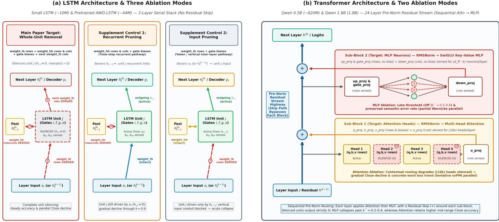  
Figure 7: Schematic overview of model architectures and ablation modes. (a) In the 3-layer Small LSTM and pretrained AWD-LSTM (serial layer stack without residual skip connections), our primary target is wholeunit removal (left card), which zeroes weight ih rows, weight hh incoming rows and outgoing columns, gate biases bias ih and bias hh, and outgoing columns in the next layer’s weight ih to silence unit j completely $\left( h _ { t , j } \equiv 0 \right)$ To separate the two incoming pathways (Section 3; Supplements S2–S6), we also evaluate two connection-level controls: recurrent-connection pruning (centre card), which zeroes weight hh rows/columns and gate biases while unit j still receives current input $x _ { t } .$ , and input-connection pruning (right card), which zeroes weight ih rows and gate biases while unit j still receives recurrent state $h _ { t - 1 } . \ ( \mathrm { b } )$ In the 24-layer Qwen 0.5B and Qwen 1.8B Transformers, a residual stream (+) bypasses each layer’s attention and MLP sub-blocks. We compare (1) attention-head removal (Q, K, V projection rows/biases and O projection columns zeroed) and (2) MLP neuron removal (up proj/gate proj rows and down proj columns zeroed).

Gradient hooks maintain all ablated entries at zero during fine-tuning.

AWD-LSTM (∼44M parameters; 20.3M non-embedding parameters). This model is a 3-layer Average Stochastic Gradient Descent Weight-Dropped LSTM (AWD-LSTM) [Merity et al., 2018] with 400-dimensional embeddings, 1,152 hidden units in the first two layers, 400 in the third, and a tied decoder. It uses Weight-Drop [Merity et al., 2018] with $w _ { \mathrm { d r o p } } = 0 . 5$ during training. At ablation time, we disable WeightDrop $( w _ { \mathrm { d r o p } }  0 )$ so that dropout-trained resilience does not mask ablation efects. Pretrained weights are loaded from fastai [Howard and Ruder, 2018] trained on WikiText-103, sharing the exact 60,000-token vocabulary of the Small LSTM. We evaluate the same three lesion types as for the Small LSTM (Figure 7a):

1. Whole-unit removal: Zeroes weight ih, weight hh, gate biases, and next-layer weight ih columns, completely silencing ablated units (max |activity| = 0.0) and removing 14,738,752 parameters (72.7% of non-embedding parameters) at k = 0.5.

2. Recurrent-connection pruning (incomplete control 1): Zeroes the recurrent weight matrix weight hh and gate biases (41.7% of non-embedding parameters at k = 0.5).

3. Input-connection pruning (incomplete control 2): Zeroes weight ih plus gate biases (22.2% of nonembedding parameters at k = 0.5).

Qwen 0.5B (∼620M parameters; 308.4M non-embedding parameters). Qwen 1.5-0.5B [Bai et al., 2023] is loaded from its of-the-shelf pretrained checkpoint (Qwen/Qwen1.5-0.5B) and is a dense Transformer with SwiGLU MLP activations, RoPE positional embeddings, and multi-head attention (24 layers; hidden size

1,024; MLP intermediate size 2,816; 16 query heads and 16 key–value heads). We evaluate two ablation targets across all 24 layers. First, MLP neuron removal zeroes rows of the bias-free up proj and gate proj matrices and columns of the bias-free down proj matrix (max |activity| = 0.0; removing 33.7% of nonembedding parameters at $k = 0 . 5 )$ . Second, attention-head removal zeroes Q, K, V projection rows (and their additive biases) and the bias-free O projection columns for selected heads (max |activity| = 0.0; removing 16.3% of non-embedding parameters at $k = 0 . 5 )$ . The two targets difer in granularity: each layer contains 2,816 MLP neurons (5,504 in Qwen 1.8B) but only 16 attention heads. Because attention ablation removes ⌊16 k⌋ whole heads per layer, the removed head fraction increases in steps of 1/16 (6.25%) and is slightly below k when 16 k is not an integer (for example, $k = 0 . 3$ removes 4 of 16 heads, or 25% of heads and 8.2% of non-embedding parameters). To account for both discrete head counts and pathway parameter size, Supplementary Figure 9 and Supplementary Table 6 plot and fit degradation curves against both k and the exact fraction of non-embedding parameters removed.

Qwen 1.8B (1.8B parameters; 1,214.5M non-embedding parameters). Qwen 1.5-1.8B [Bai et al., 2023] is likewise loaded from its of-the-shelf pretrained checkpoint (Qwen/Qwen1.5-1.8B); it shares the architecture family and depth of the 0.5B model (24 layers; 16 query and 16 key–value heads) but is wider, with hidden size 2,048 and MLP intermediate size 5,504. It follows the same ablation protocol as Qwen 0.5B, removing 33.4% of non-embedding parameters at $k = 0 . 5$ for MLP ablation and 16.6% for attention-head ablation.

## Ablation, Fine-Tuning, and Plasticity Sensitivity Protocol

For each model–target combination and ablation fraction $k \in \{ 0 . 0 , 0 . 1 , 0 . 2 , \ldots , 0 . 9 \}$ , we run 5 independent trials across the full sweep to support all main and supplementary degradation curves (Supplementary Tables 5–16). We increase replication to 15 independent trials per k across the shared transition region $k \in \{ 0 . 1 , 0 . 2 , 0 . 3 , 0 . 4 \} \ ( n = 6 0$ trials per pathway) for the Qwen null-model pathway tests in Section 2.3 and Supplement S3. For the Cloze, Brysbaert word-concreteness [Brysbaert et al., 2014], and Philadelphia Naming Test (PNT) [Mirman et al., 2010] analyses (Section 2.5; Supplements S7–S8), we evaluate 10 independent trials at $k = 0 . 2$ , alongside the deterministic greedy baseline at $k = 0 . 0$ and 5 trials at $k \in \{ 0 . 1 , 0 . 3 , \ldots , 0 . 9 \}$ Each trial proceeds in five steps:

1. Deep copy the pretrained model and seed all random number generators deterministically per (k, trial).

2. Ablate: randomly select $\lfloor k \times n \rfloor$ target units per layer independently across layers and zero all associated weights and gate/head biases across all layers (systemic ablation).

3. Freeze ablated weights at zero during fine-tuning (via gradient hooks and post-update masking) so that silenced units or pruned connections cannot recover.

4. Fine-tune briefly at every $k \in \{ 0 . 0 , 0 . 1 , \ldots , 0 . 9 \}$ (so undamaged k = 0 and damaged $k > 0$ models undergo the exact same adaptation step) as a simple proxy for local compensatory plasticity (primary weak SGD arm):

• LSTM-based models use SGD $( \mathrm { l r } = 1 0 ^ { - 3 }$ , gradient clipping 0.25, bptt = 70) on TinyStories for 40 sequence steps (Small LSTM, plain lowercased tokens) or 50 sequence steps (AWD-LSTM, with fastai xxbos/xxmaj/xxup markers).

• Qwen models use SGD $( \mathrm { l r } = 1 0 ^ { - 3 } )$ across the first 500 TinyStories passages (passages 1–500, max sequence length 64), clipping gradients to 0.25 after each passage’s backward pass and accumulating over 8 passages per update (62 weight updates in total).

Because 40–50 steps of clipped SGD at $\mathrm { l r } = 1 0 ^ { - 3 }$ on out-of-domain TinyStories move the LSTM weights by only $\lVert \Delta \theta \rVert _ { 2 } \leq 0 . 0 1 2$ (relative change ${ \sim } 1 0 ^ { - 5 } )$ , this step leaves LSTM WikiText-2 accuracy essentially unchanged. Thus, the weak and none arms coincide for the LSTMs, whereas 500 steps of AdamW on the same TinyStories passages in the strong arm do shift WikiText-2 accuracy (Supplement S9).

## 5. Evaluate on the held-out test set.

Fine-tuning sensitivity control. Because biological recovery after acute damage operates through local weight adjustments rather than global network retraining, we use brief fixed-step SGD without momentum (weak arm) as our primary protocol. To test whether the contrast between Transformer and LSTM curve shapes depends on this choice, we compare zero fine-tuning (none), brief local SGD (weak), and $5 0 0 { \mathrm { - s t e p ~ A d a m W } }$ retraining (strong, plus in-domain WikiText-103 strong wt103 for both LSTMs) across $k \in \{ 0 . 0 , 0 . 1 , \ldots , 0 . 9 \}$ . This comparison covers both recurrent architectures across all three ablation modes and the pretrained Transformers (Qwen 0.5B across both pathways, plus Qwen 1.8B MLP across none, weak, and $k \leq 0 . 2$ of strong). With zero fine-tuning, Qwen MLP ablation still exhibits a sharp late threshold collapse without an early retention advantage over the LSTMs. Conversely, the Small LSTM and AWD-LSTM whole-unit and recurrent pathways decline smoothly without a clif even under 500 steps of in-domain AdamW retraining (Supplement S9; Supplementary Figures 14–16).

For accuracy evaluation, LSTM models are tested on WikiText-2 [Merity et al., 2017] (241,200 lowercased lexical tokens for the Small LSTM; 271,480 tokens for the AWD-LSTM, comprising 241,202 lexical tokens and 30,278 unscored xxbos/xxmaj/xxup prefix markers). Excluding out-of-vocabulary xxunk targets yields 225,702 scored in-vocabulary tokens for the Small LSTM and 225,704 for the AWD-LSTM. Qwen models are tested on the first 32 tokens of each held-out TinyStories passage (passages 501–1,000, yielding up to 31 next-token predictions per passage, or 15,268 scored targets in total). The passages used to rank tokens for the auxiliary Qwen spectral analysis (passages 1–2,000; Supplement S4) overlap these evaluation passages. To ensure cross-architecture comparability, we report relative accuracy $\left( \operatorname { A c c } ( k ) / \operatorname { A c c } ( 0 ) \right)$ , evaluate error distributions against an accuracy-matched random-failure baseline, and base all clinical parallel assignments (Section 2.5) on the shared 100-prompt Cloze battery.

## Evaluation Metrics

Accuracy and Curve-Shape Model Selection. Next-word prediction accuracy (top-1) is evaluated over all valid in-vocabulary test tokens and reported as relative accuracy Rel $\operatorname { A c c } ( k ) = \operatorname { A c c } ( k ) / \operatorname { A c c } ( 0 )$ , with bootstrap standard errors across trials. For both LSTMs, out-of-vocabulary (xxunk) targets are excluded from scoring. For the AWD-LSTM, fastai formatting tokens (xxbos, xxmaj, xxup) are also excluded from target scoring; however, because they remain in the input sequence and indicate whether the following word is capitalized, they contribute to the AWD-LSTM’s higher baseline accuracy relative to the Small LSTM. To test whether each degradation curve follows a straight line or bends non-linearly, we fit both a 2-parameter line $y ( x ) =$ a + bx and a 3-parameter logistic S-curve $y ( x ) = a / ( 1 + \exp ( b ( x - x _ { 0 } ) ) )$ to the trial-level relative accuracy points. We perform these fits against both $x = k$ and x = fraction of non-embedding parameters removed, comparing them via $\Delta \mathrm { A I C } = \mathrm { A I C _ { l o g i s t i c } - A I C _ { l i n e a r } }$ (Supplementary Table 6). A $\Delta \mathrm { A I C } < - 2$ indicates non-linear curvature, while the presence of an early bufered plateau versus an immediate drop is assessed from surviving relative accuracy across $k \in [ 0 . 1 , 0 . 3 ]$ . By this criterion, only attention-head ablation shows an early plateau. Because Qwen MLP relative accuracy at $k = 0 . 1 – 0 . 2$ is not systematically higher than that of the LSTMs (71%–94% of baseline across $k = 0 . 1 – 0 . 2$ in Qwen MLP vs. 75%–93% in the LSTMs; Supplementary Table 6), we describe the MLP curves as a late threshold collapse.

Moment Ratio $R _ { 4 }$ and Accuracy-Matched Null Model. $R _ { 4 } ( k )$ is computed from the per-token error count vector $\mathbf { e } ( k )$ ordered by native vocabulary index i (word-frequency rank for the LSTMs and BPE merge order for Qwen, where common subwords have low i; Equation 2), whereas $D _ { 1 } ( k )$ and $\mathrm { J S } ( p ( k ) \parallel p ( 0 ) )$ do not depend on token ordering and the auxiliary spectral metrics β, G explicitly reorder the top 1,000 tokens by corpus frequency across all models (Supplement S4). For the accuracy-matched random-failure baseline (Equations 3–5), at each (k, trial) we draw $B ~ = ~ 1 0 0$ independent samples without replacement of size $\Delta M = M ( k ) - M ( 0 )$ from the undamaged model’s correct-token count vector $\mathbf { c } ( 0 )$ and add each draw to ${ \bf e } ( 0 )$ . From these draws we compute the mean null expectations $\mathbb { E } [ R _ { 4 } ^ { \mathrm { n u l l } } ( k ) ]$ and $\mathbb { E } [ \dot { D } _ { 1 } ^ { \mathrm { n u l l } } ( k ) ]$ , along with the base-2 Jensen–Shannon divergence $\mathrm { J S } ( p ( k ) \parallel p ( 0 ) )$ .

Quantified Cloze Test. We use 100 sentence prompts with predictable final words, stratified by POS tag (48 nouns, 25 verbs, 22 adjectives, 5 adverbs). Each prompt is fed to the model and the top-1 predicted word is extracted. For the LSTMs, we skip fastai control tokens (xxunk, xxmaj, xxup, xxbos, xxeos, xxfld, xxpad, xxrep, xxwrep) when selecting the top lexical prediction; for Qwen, we strip leading and trailing whitespace from the decoded subword token. Part-of-speech (POS) tags are assigned using NLTK’s [Bird et al., 2009] standard POS tagger (Universal tagset), applied to the predicted word on its own rather than in sentence context. Prompts whose predicted token remains a non-word symbol are scored as POS mismatches and assigned zero semantic similarity. Semantic similarity is also set to zero whenever the predicted word’s tag is not a content-word tag, even if the word has a GloVe vector, which couples the semantic score to the syntactic score. For content-tagged predictions, semantic similarity is the cosine similarity between 50-dimensional GloVe [Pennington et al., 2014] vectors (glove.6B.50d) of the predicted and target words; out-of-vocabulary predictions receive similarity 0.0. Across $k \in \{ 0 . 0 , 0 . 2 \}$ , we evaluate 10 independent trials $( N = 1 , 0 0 0$ prompt evaluations per condition). We use these to compute 95% confidence intervals and two-sided permutation tests (20,000 permutations, with Holm correction across the planned contrasts) for the Brysbaert concreteness shift ∆Conc. (Supplement S7) and the Philadelphia Naming Test (PNT) error proportions (Supplement S8).

## S2 Architecture Summary, Parameter-Fraction Scaling, Detailed Accuracy Analysis, and LSTM Connection-Pruning Controls

Table 5 provides the full summary of baseline and ablated performance across all four architectures (including both the main-paper whole-unit removal, weight ih + weight hh + gate biases, and the supplementary pathway-specific connection-pruning controls, weight hh recurrent-only and weight ih input-only, for the LSTMs) at the benchmark level $k = 0 . 5$ . Table 6 reports the curve-shape comparison between a 3-parameter S-curve fit and a 2-parameter straight-line fit against both nominal k and the fraction of non-embedding parameters removed. Figures 8 and 9 display the complete next-token accuracy degradation curves across $k \in [ 0 , 0 . 9 ]$ for the pathway-specific connection controls and parameter-fraction scaling.

Detailed per-architecture accuracy trajectories and LSTM pathway-connection controls (supporting Section 2.2). Across the six main-paper unit-level conditions and the four supplementary LSTM connection-pruning controls, next-word prediction accuracy evolves as follows:

• Small LSTM (baseline 27.5%): Under whole-unit removal (weight ih + weight hh + gate biases, main paper Figure 2a), next-token accuracy degrades smoothly and monotonically across the entire range without an initial plateau: 25.5% at k = 0.1 (RelAcc = 0.927), 22.6% at k = 0.2 (0.822), 19.3% at k = 0.3 (0.702), 15.7% at k = 0.4 (0.570), 12.6% at k = 0.5 (0.458), 10.9% at $k = 0 . 6 \ ( 0 . 3 9 8 )$ , 9.5% at $k = 0 . 7 \ ( 0 . 3 4 4 ) , 7 . 5 \%$ at k = 0.8 (0.274), and 7.12% at $k = 0 . 9 \ ( 0 . 2 5 9 .$ , where all five trials settle on always guessing the single most common word in the text, $^ { \circ } t h e ^ { \prime \prime }$ , which makes up 7.12% of test tokens; Table 8). Dissecting the two incoming pathways separately in our supplementary controls (Figure 8, row 1) shows why: hidden-state (weight hh) pruning alone tracks whole-unit removal closely through $k = 0 . 3$ and degrades more gradually thereafter because unit $j$ remains driven by the current input word $x _ { t }$ via weight ih (25.2% at $k = 0 . 1$ , 21.3% at $k = 0 . 2 .$ , 15.9% at $k = 0 . 5 .$ , and 13.3% at $k = 0 . 9$ preserving $4 8 . 3 \%$ of baseline accuracy at extreme ablation). When plotted against the fraction of non-embedding parameters removed, this trajectory is nearly a straight line with slope −1.02 and the smallest departure from linearity of any condition $( \Delta \mathrm { A I C } = - 7 . 7 5 $ ; Figure 9 and Table 6). Conversely, input-projection (weight ih) pruning alone produces a steep initial collapse: accuracy drops to 17.9% at $k = 0 . 1$ and 3.8% at $k = 0 . 2$ , then remains at a near-zero floor between 1.6–3.3% for $k \geq 0 . 3 \ ( \mathrm { e . g . }$ 1.6% at k = 0.5, 1.8% at $k = 0 . 8 ,$ , and 1.7% at $k = 0 . 9 )$

• AWD-LSTM (baseline 38.1%): Under whole-unit removal (weight ih + weight hh + gate biases, main paper Figure 2b), next-token accuracy likewise degrades smoothly and near-monotonically (apart from a floor at $k \geq 0 . 8 )$ without a bufered plateau: 34.1% at k = 0.1 (RelAcc = 0.896), 28.7% at $k = 0 . 2$ (0.753), 23.0% at k = 0.3 (0.603), 17.3% at $k = 0 . 4 \ ( 0 . 4 5 5 )$ , 13.1% at k = 0.5 (0.344), 10.0% at $k = 0 . 6$ (0.264), 7.6% at k = 0.7 (0.201), 6.5% at $k = 0 . 8 \ ( 0 . 1 7 1 )$ , and 6.8% at k = 0.9 (0.178; Table 7). In the supplementary pathway-connection controls (Figure 8, row 2), hidden-state (weight hh) pruning degrades gradually from 36.0% at k = 0.1 and 33.0% at k = 0.2 to 21.9% at k = 0.5 (57.6% of baseline) and 13.4% at $k = 0 . 9$ (35.1% of baseline, closely matching the Small LSTM recurrent pathway’s 58.0% relative accuracy at $k = 0 . 5 ;$ Table 9), whereas input-projection (weight ih) pruning drops steeply from 27.7% at k = 0.2 and 18.5% at k = 0.3 to 9.7% at k = 0.4, 5.7% at $k = 0 . 5 ,$ , and 1.5–2.2% for $k \geq 0 . 6$ (Table 10).

• Qwen 0.5B (baseline 53.6%): MLP neuron ablation exhibits a late threshold collapse: accuracy is 89.3% of baseline at k = 0.1 (47.9%) and 70.6% at k = 0.2 (37.9%), then collapses sharply between $k = 0 . 3 \ ( 3 0 . 4 \% )$ and $k = 0 . 4 \ ( 1 3 . 8 \% )$ , reaching 4.2% at $k = 0 . 5$ and near zero (≈1%) for $k \geq 0 . 7 .$ Attention-head ablation shows an early plateau: accuracy remains at 52.3% at $k = 0 . 1$ (97.6% of baseline), 45.4% at k = 0.2 (84.6%), and 43.2% at $k = 0 . 3 \ ( 8 0 . 5 \% )$ , before dropping to 26.1% at k = 0.4 and 10.7% at k = 0.5.

• Qwen 1.8B (baseline 54.7%): MLP neuron ablation produces a late threshold collapse similar to the 0.5B model: accuracy remains at 51.1% at k = 0.1 (93.5% of baseline) and 44.8% at k = 0.2 (82.0% of baseline), before dropping to 33.8% at $k = 0 . 3$ , collapsing to 12.9% at $k = 0 . 4$ and 11.6% at $k = 0 . 5 .$ and falling to 1.0–2.4% for $k \geq 0 . 6$ . Attention-head ablation follows a smoother sigmoid-like decline: 52.3% at $k = 0 . 1$ , 45.1% at k = 0.2 (82.5% of baseline), 44.4% at k = 0.3 (81.2%), 35.6% at $k = 0 . 4$ (65.1%), 17.3% at k = 0.5 (31.7%), and 1.2% at $k = 0 . 9$ . When plotted against the fraction of non-embedding parameters removed rather than nominal k, the Qwen MLP and attention curves do not align: attention ablation degrades faster per parameter removed (Qwen 0.5B: 0.486 of baseline at 12.25% removed and 0.199 at 16.3% under attention, vs. 0.706 at 13.5% and 0.566 at 20.2% under MLP; Qwen 1.8B: 0.651 at 12.4% under attention vs. 0.820 at 13.4% under MLP), and both Qwen pathways lose more accuracy per parameter removed than LSTM whole-unit removal (Small LSTM 0.822 at 33.25% removed; Supplementary Figure 9).

Mild-damage and cross-threshold comparison (supporting the main-text summary). At $k = 0 . 1$ and 0.2, Qwen MLP relative accuracy (0.893 and 0.706 in Qwen 0.5B; 0.935 and 0.820 in Qwen 1.8B) is no higher than that of LSTM whole-unit removal (0.927 and 0.822 in the Small LSTM; 0.896 and 0.753 in the AWD-LSTM). Attention-head ablation retains 0.976 (Qwen 0.5B) and 0.957 (Qwen 1.8B) of baseline at $k = 0 . 1$ where only one head per layer is removed, 0.846 and 0.825 at k = 0.2 (vs. 0.822 and 0.753 in the Small LSTM and AWD-LSTM), and 0.805 and 0.812 at k = 0.3 (vs. 0.702 and 0.603). Across $k = 0 . 3  0 . 4 ,$ MLP ablation lowers relative accuracy by 0.31 in Qwen 0.5B and 0.38 in Qwen 1.8B, versus 0.13 and 0.15 for whole-unit removal in the Small LSTM and AWD-LSTM; MLP relative accuracy is 0.258 and 0.236 at $k = 0 . 4$ and near zero by $k = 0 . 5 – 0 . 6$ Under attention ablation, Qwen 0.5B falls steeply once $k > 0 . 3$ (0.805 → 0.486 → 0.199 at k = 0.3, 0.4, 0.5), whereas Qwen 1.8B falls more gently $( 0 . 8 1 2  0 . 6 5 1$ from k = 0.3 to 0.4). Per parameter removed, the LSTMs are more robust: the Small LSTM retains 0.822 of baseline with 33.25% of non-embedding parameters removed, whereas Qwen MLP ablation retains only 0.078–0.213 at about 33.4–33.7% removed.

Table 5: Full ablation summary at k = 0.5 across the six primary unit-level conditions and the four supplementary LSTM connection-pruning controls.
<table><tr><td>Model</td><td>Ablation</td><td>Acc@k=0</td><td>Acc@k=0.5</td><td>RelAcc</td><td>Clinical Parallel</td></tr><tr><td>Small LSTM</td><td>Unit  $( \mathrm { w } \mathrm { . i h } + \mathrm { w } \mathrm { . h h } )$ </td><td>0.2747</td><td>0.1260</td><td>0.458</td><td>Diffuse AD-type (→ global collapse)</td></tr><tr><td>AWD-LSTM</td><td>Unit (w_ih + w_hh)</td><td>0.3806</td><td>0.1307</td><td>0.344</td><td>Diffuse AD-type (→ global collapse)</td></tr><tr><td>Qwen 0.5B</td><td>MLP neurons</td><td>0.5363</td><td>0.0417</td><td>0.078</td><td>Wernicke-type</td></tr><tr><td>Qwen 0.5B</td><td>Attention heads</td><td>0.5363</td><td>0.1067</td><td>0.199</td><td>svPPA</td></tr><tr><td>Qwen 1.8B</td><td>MLP neurons</td><td>0.5465</td><td>0.1163</td><td>0.213</td><td>Wernicke-type</td></tr><tr><td>Qwen 1.8B</td><td>Attention heads</td><td>0.5465</td><td>0.1732</td><td>0.317</td><td>svPPA</td></tr><tr><td>Small LSTM</td><td>Suppl. control (w_hh recurrent)</td><td>0.2747</td><td>0.1593</td><td>0.580</td><td>Diffuse AD-type (sustained)</td></tr><tr><td>AWD-LSTM</td><td>Suppl. control (w_hh recurrent)</td><td>0.3806</td><td>0.2193</td><td>0.576</td><td>Diffuse AD-type (sustained)</td></tr><tr><td>Small LSTM</td><td>Suppl. control (w_ih input)</td><td>0.2747</td><td>0.0157</td><td>0.057</td><td>Input bottleneck collapse</td></tr><tr><td>AWD-LSTM</td><td>Suppl. control (w_ih input)</td><td>0.3806</td><td>0.0570</td><td>0.150</td><td>Input bottleneck collapse</td></tr></table>

Table 6: Curve-shape comparison across trial-level relative accuracy points. Each row compares a 3- parameter S-curve (logistic) fit $y ( x ) \ = \ a / ( 1 + \exp ( b ( x - x _ { 0 } ) ) )$ against a 2-parameter straight-line fit $y ( x ) = a +$ bx as a function of k or fraction of non-embedding parameters removed. Because the 3-parameter curve bends toward zero at high $k ,$ any trajectory that curves (whether through an initial flat plateau followed by a clif, a steep early drop, or a smooth bend) achieves $\Delta \mathrm { A I C } = \mathrm { A I C _ { l o g i s t i c } - A I C _ { l i n e a r } < - 2 }$ (labelled non-linear in the table). The rightmost column notes the qualitative shape seen in Figures 2 and 9.
<table><tr><td>Model</td><td>Lesion</td><td>Axis x</td><td>Linear Slope</td><td>ΔAIC</td><td>Fit Verdict (Qualitative Shape)</td></tr><tr><td>Small LSTM</td><td>Unit removal (w_ih + w_hh</td><td>k</td><td>-0.888</td><td>-39.04</td><td>non-linear (gradual bend)</td></tr><tr><td>Small LSTM</td><td>Unit removal (w_ih + w_hh)</td><td>frac. params</td><td>-0.812</td><td>-23.71</td><td>non-linear (gradual bend)</td></tr><tr><td>Small LSTM</td><td>Recurrent-connection (w_hh)</td><td>k</td><td>-0.556</td><td>-26.23</td><td>non-linear (gradual bend)</td></tr><tr><td>Small LSTM</td><td>Recurrent-connection (w_hh)</td><td>frac. params</td><td>-1.019</td><td>-7.75</td><td>non-linear (nearly straight line)</td></tr><tr><td>Small LSTM</td><td>Input-connection (w_ih)</td><td>k</td><td>-0.793</td><td>-104.98</td><td>non-linear (steep early drop)</td></tr><tr><td>Small LSTM</td><td>Input-connection (w_ih)</td><td>frac. params</td><td>-1.577</td><td>-106.07</td><td>non-linear (steep early drop)</td></tr><tr><td>AWD-LSTM</td><td>Unit removal (w_ih + w_hh)</td><td>k</td><td>-0.992</td><td>-79.52</td><td>non-linear (gradual bend)</td></tr><tr><td>AWD-LSTM</td><td>Unit removal (w_ih + w_hh)</td><td>frac. params</td><td>-0.914</td><td>-38.00</td><td>non-linear (gradual bend)</td></tr><tr><td>AWD-LSTM</td><td>Recurrent-connection (w_hh)</td><td>k</td><td>-0.779</td><td>-38.33</td><td>non-linear (gradual bend)</td></tr><tr><td>AWD-LSTM</td><td>Recurrent-connection (w_hh)</td><td>frac. params</td><td>-1.231</td><td>-144.68</td><td>non-linear (gradual bend)</td></tr><tr><td>AWD-LSTM</td><td>Input-connection (w_ih)</td><td>k</td><td>-1.163</td><td>-144.12</td><td>non-linear (steep early drop)</td></tr><tr><td>AWD-LSTM</td><td>Input-connection (w_ih)</td><td>frac. params</td><td>-2.617</td><td>-143.97</td><td>non-linear (steep early drop)</td></tr><tr><td>Qwen 0.5B</td><td>MLP neurons</td><td> $k$ </td><td>-1.231</td><td>-100.79</td><td>non-linear (late threshold collapse)</td></tr><tr><td>Qwen 0.5B</td><td>MLP neurons</td><td>frac. params</td><td>-1.828</td><td>-100.90</td><td>non-linear (late threshold collapse)</td></tr><tr><td>Qwen 0.5B</td><td>Attention heads</td><td>k</td><td>-1.320</td><td>-31.38</td><td>non-linear (broad plateau + S-curve)</td></tr><tr><td>Qwen 0.5B</td><td>Attention heads</td><td>frac. params</td><td>-4.130</td><td>-30.69</td><td>non-linear (compressed plateau / S-curve)</td></tr><tr><td>Qwen 1.8B</td><td>MLP neurons</td><td> $k$ </td><td>-1.264</td><td>-60.02</td><td>non-linear (late threshold collapse)</td></tr><tr><td>Qwen 1.8B</td><td>MLP neurons</td><td>frac. params</td><td>-1.891</td><td>-59.99</td><td>non-linear (late threshold collapse)</td></tr><tr><td>Qwen 1.8B</td><td>Attention heads</td><td> $k$ </td><td>-1.253</td><td>-18.71</td><td>non-linear (broad plateau + S-curve)</td></tr><tr><td>Qwen 1.8B</td><td>Attention heads</td><td>frac. params</td><td>-3.853</td><td>-17.07</td><td>non-linear (compressed plateau / S-curve)</td></tr></table>

## S3 Detailed $R _ { 4 }$ Trajectories, Scale-Invariance Derivation, and Accuracy-Matched Null Model Analysis

Raw $R _ { 4 }$ trajectories and scale invariance (supporting Section 2.3). Plotted against $k ,$ the raw ratio $R _ { 4 } ( k ) / R _ { 4 } ( 0 )$ rises above 1.0 in a pattern that mirrors each architecture’s accuracy drop (Figure 3; Supplementary Figure 10). Under whole-unit removal, the Small LSTM’s $R _ { 4 }$ rises smoothly by at most 5.14% across the entire ablation range (2.2575 → 2.3735 at $k = 0 . 9 ;$ Table 8), and the AWD-LSTM’s by at most 7.66% $( 2 . 2 0 8 4  2 . 3 7 7 5$ at k = 0.8, 2.3758 at $k = 0 . 9 ;$ Table 7). In the supplementary LSTM connection-pruning controls (Supplementary Figure 10, top two rows), recurrent-connection (weight hh) pruning rises by at most 3.38% in the Small LSTM (2.2575 → 2.3339; Table 11) and 5.89% in the AWD-LSTM (2.2084 → 2.3385; Table 9), whereas input-connection (weight ih) pruning reaches 6.68% (Small LSTM; Table 12) and 9.06% (AWD-LSTM; Table 10). The Qwen models show the largest raw shifts (up to 12.21% for Qwen 0.5B MLP, 12.15% for Qwen 0.5B Attention, 11.93% for Qwen 1.8B MLP, and 11.87% for Qwen 1.8B Attention; Ta bles 13–16), rising gradually at mild damage (MLP: +3.7% and +3.1% by k = 0.3 in Qwen 0.5B and 1.8B) and by about 5 further points across the MLP threshold clif (k = 0.3 → 0.4: 1.0370 → 1.0825 in Qwen 0.5B and 1.0312 → 1.0868 in Qwen 1.8B, i.e. +4.6 and +5.6 points). Because $R _ { 4 }$ is computed from the normalised distribution $p _ { i } .$ , it is strictly invariant if every word’s error count scales up by the same factor $( { \bf e } _ { \mathrm { a b l } } = \alpha \cdot { \bf e } _ { \mathrm { b a s e } } .$ $\alpha > 0 )$

$$
R _ { 4 } ( \mathrm { a b l } ) = \frac { \left( \sum _ { i } i ^ { 4 } \frac { \alpha e _ { i } } { \alpha \sum _ { j } e _ { j } } \right) ^ { 1 / 4 } } { \left( \sum _ { i } i ^ { 2 } \frac { \alpha e _ { i } } { \alpha \sum _ { j } e _ { j } } \right) ^ { 1 / 2 } } = R _ { 4 } ( \mathrm { b a s e } ) .\tag{6}
$$

Raw $R _ { 4 }$ rises as accuracy falls because an undamaged model mostly gets common, low-index words right and misses harder words; as damage increases and the model misses many common words, the average error index in the denominator $( \mu _ { 2 } ^ { 1 / 2 } )$ drops faster than the extreme tail in the numerator $( \mu _ { 4 } ^ { 1 / 4 } )$ , pushing $R _ { 4 }$ upward.

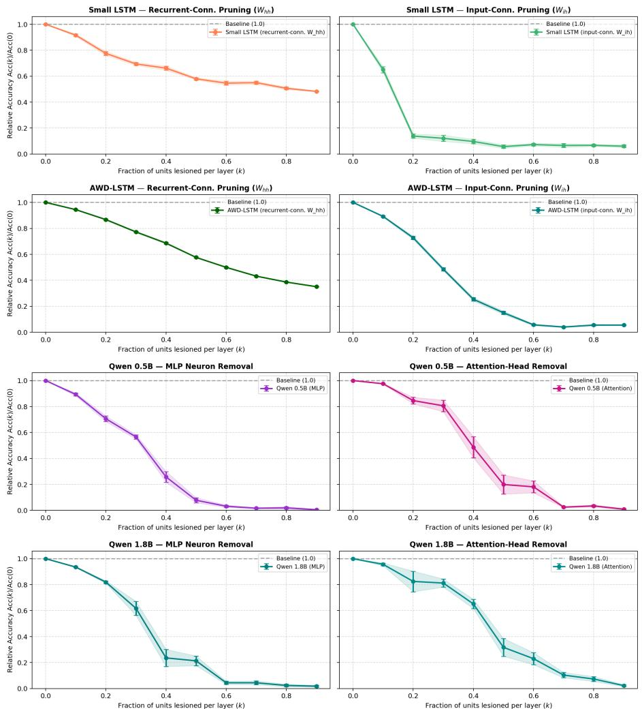  
Figure 8: Relative accuracy $( \operatorname { A c c } ( k ) / \operatorname { A c c } ( 0 )$ , normalised to baseline) degradation curves for the supplementary LSTM connection-pruning controls (top two rows: Small LSTM and AWD-LSTM recurrent-connection pruning weight hh in the left column and input-connection pruning weight ih in the right column) alongside the Qwen 0.5B and Qwen 1.8B MLP and Attention pathways (bottom two rows; primary LSTM whole-unit curves are shown in Figure 2a,b). Isolating weight hh vs. weight ih shows that recurrent-connection pruning degrades gradually through $k = 0 . 9$ , whereas input-connection pruning collapses steeply by $k = 0 . 2 – 0 . 4$ All curves show means ±1 SE across trials.

Accuracy-matched null model breakdown. Subtracting the accuracy-matched random-failure baseline (Equations 3–5; Figure 4) yields three detailed quantitative findings across the six primary unit-level conditions and four supplementary connection-pruning controls:

1. Negative null-corrected $\Delta R _ { 4 } = R _ { 4 } ^ { \mathrm { o b s } } - R _ { 4 } ^ { \mathrm { n u l l } }$ across all conditions: Whereas raw $R _ { 4 } ( k ) / R _ { 4 } ( 0 )$ increases as accuracy drops, the null-corrected diference $\Delta R _ { 4 }$ is consistently negative across all ten conditions. At matched relative accuracy of $0 . 8 0 , \Delta R _ { 4 } { \mathrm { ~ i s ~ } } - 0 . 0 1 0 \left( 9 5 \% { \mathrm { ~ C I ~ } } [ - 0 . 0 1 5 , - 0 . 0 0 5 ] \right)$ for Small LSTM whole unit removal $\left( - 0 . 0 0 4 \mathrm { t o } - 0 . 0 0 7 \right.$ for $\cdot \mathsf { r e i g h t \_ i h / w e i g h t \_ h h } ) , - 0 . 0 3 0 \left( \left[ - 0 . 0 3 3 , - 0 . 0 2 8 \right] \right)$ ) for AWD-LSTM whole-unit removal $\left( - 0 . 0 2 1 \mathrm { t o } - 0 . 0 2 6 \right)$ for weight hh/weight ih), and −0.037 to −0.052 for the Qwen pathways. Because the undamaged model’s correct predictions $\mathbf { c } ( 0 )$ are heavily concentrated on the most common, lowest-index tokens $( i \approx 0 )$ , random failure dumps new errors onto i ≈ 0 and drives $R _ { 4 } ^ { \mathrm { n u l l } }$ strongly upward. Relative to this null, neuronal ablation is less concentrated at $i \approx 0 \ ( \Delta R _ { 4 } < 0 )$ and instead spreads error mass across a wider efective number of distinct tokens $( \Delta D _ { 1 } = D _ { 1 } ^ { \mathrm { o b s } } - D _ { 1 } ^ { \mathrm { n u l l } } > 0$ across all conditions). At $\mathrm { R e l A c c } ~ = ~ 0 . 8 0 , ~ \Delta D _ { 1 }$ is $+ 1 9 2 . 8 \ ( [ + 1 8 0 . 9 , + 2 0 4 . 6 ] )$ for Small LSTM unit removal and $+ 2 4 9 . 8 \ ( [ + 2 2 2 . 4 , + 2 7 7 . 2 ] )$ for AWD-LSTM unit removal, versus +15.0 to +21.5 tokens in Qwen. This raw token-count diference reflects the larger WikiText-2 evaluation set $( D _ { 1 } ^ { \mathrm { n u l l } } \approx 1 , 3 5 4 ^ { - }$ 1,359 vs. 278–288 on TinyStories), corresponding to relative increases $\Delta D _ { 1 } / D _ { 1 } ^ { \mathrm { n u l l } }$ of +14.2% to +18.4% in the LSTMs versus $+ 5 . 2 \% \ \mathrm { t o \ + 7 . 7 \% }$ in Qwen. As RelAcc → 0, both $\mathbf { e } ^ { \mathrm { o b s } } ( k )$ and $\mathbf { e } ^ { \mathrm { n u l l } } ( k )$ approach the full test-corpus unigram vector $\mathbf { e } ( 0 ) { + } \mathbf { c } ( 0 )$ , pinning $\Delta R _ { 4 } , \Delta D _ { 1 }$ , and ∆JS to zero at both endpoints. Negative $\Delta R _ { 4 }$ already appears at mild damage $( k = 0 . 1 )$ in the LSTMs $\left( \mathrm { e . g . , ~ } - 0 . 0 2 1 ~ [ - 0 . 0 2 4 , - 0 . 0 1 8 ] \right.$ for AWD-LSTM whole-unit removal), whereas it is not significant in either Qwen attention condition at $k = 0 . 1 \ ( - 0 . 0 0 3 \ [ - 0 . 0 0 9 , + 0 . 0 0 3 ]$ in $\mathrm { Q w e n ~ 0 . 5 B ; ~ - 0 . 0 2 1 ~ [ - 0 . 0 6 2 , + 0 . 0 2 0 ] }$ in Qwen 1.8B).

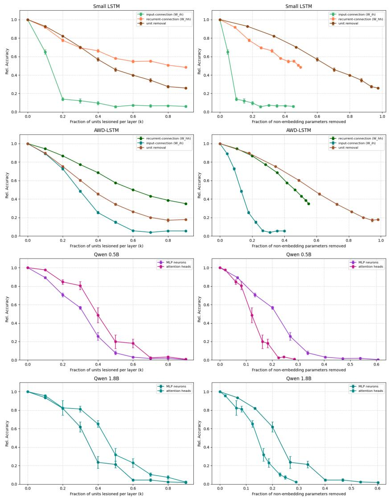  
Figure 9: Relative accuracy plotted against nominal unit/connection fraction k (left column) and against the exact fraction of non-embedding parameters removed (right column) across all four architectures, comparing whole-unit removal (weight ih + weight hh, solid brown curves) against recurrent-connection pruning (weight hh, coral in row 1 and dark green in row 2) and input-connection pruning (weight ih, medium sea green in row 1 and teal in row 2) in both LSTMs, and MLP vs. attention-head removal in both Qwen models (rows 3–4). Plotted against parameter fraction, attention-head ablation degrades faster per parameter removed than MLP ablation in both Qwen models, and both Qwen pathways degrade faster per parameter removed than LSTM whole-unit removal and recurrent-connection pruning, which decline monotonically without a clif.

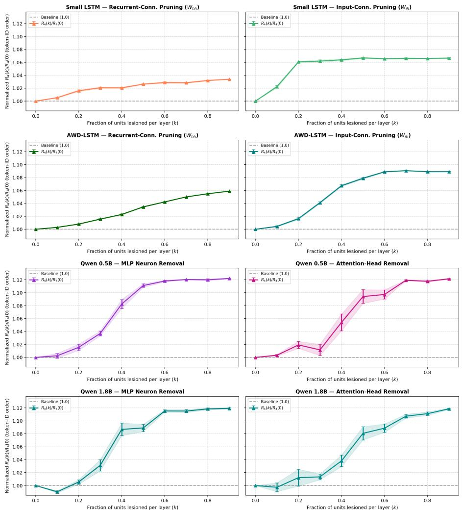  
Figure 10: Moment ratio $R _ { 4 } ( k ) / R _ { 4 } ( 0 )$ for the supplementary LSTM connection-pruning pathways (top two rows: Small LSTM and AWD-LSTM recurrent-connection pruning weight hh in the left column and inputconnection pruning weight ih in the right column) alongside Qwen 0.5B and Qwen 1.8B MLP and Attention pathways (bottom two rows; shared vertical scale; means ±1 SE; primary LSTM whole-unit $R _ { 4 }$ curves are shown in Figure 3a,b).

2. Separation of MLP and attention pathways under null correction: Comparing the uncorrected ratio $R _ { 4 } ( k ) / R _ { 4 } ( 0 )$ across the common relative-accuracy range ([0.207, 0.935] for Qwen 0.5B, 56/60 MLP and $4 5 / 6 0$ attention trials, $n = 1 0 1 ; [ 0 . 3 0 1 , 0 . 9 4 8 ]$ for Qwen 1.8B, 49/60 MLP and 48/60 attention trials, $n = 9 7 )$ yields small, non-significant diferences between attention and MLP ablation (+0.0040, permutation $p \ = \ 0 . 5 0 0 9$ in Qwen 0.5B; +0.0020, p = 0.7130 in Qwen 1.8B). When the randomfailure baseline is subtracted, however, the normalised diference $( R _ { 4 } ^ { \mathrm { o b s } } - R _ { 4 } ^ { \mathrm { n u l l } } ) / R _ { 4 } ( 0 )$ pooled across that shared transition range separates the two pathways significantly in both models: in Qwen 0.5B, attention ablation shifts $\mathrm { b y - 0 . 0 1 0 9 \ v s . \ - 0 . 0 2 4 2 }$ for MLP (diference +0.0132, two-sided permutation $p \ < \ 1 0 ^ { - 4 } )$ ; in Qwen 1.8B, attention shifts by −0.0209 vs. −0.0251 for MLP (diference +0.0042, permutation $p = 0 . 0 2 3 8 )$ . Note that this test pools trial points across the full transition range (where MLP trials have lower mean relative accuracy than attention trials); when interpolated at a single fixed slice $( \mathrm { R e l A c c } = 0 . 8 0 )$ , the point-level 95% confidence intervals of $\Delta R _ { 4 }$ for the two pathways overlap (−0.048, 95% CI $[ - 0 . 0 6 6 , - 0 . 0 3 0 ]$ for MLP $\mathrm { v s . ~ } - 0 . 0 4 2 , \left[ - 0 . 0 6 4 , - 0 . 0 2 0 \right]$ for Attention in Qwen 0.5B; $- 0 . 0 5 2 , \left[ - 0 . 0 7 8 , - 0 . 0 2 5 \right]$ for MLP $\mathrm { v s . } \ - 0 . 0 3 7 , \ [ - 0 . 0 5 3 , - 0 . 0 2 2 ]$ for Attention in Qwen 1.8B). Because the pooled trials difer in mean relative accuracy (0.618 for MLP vs. 0.689 for attention in Qwen 0.5B;

0.734 vs. 0.755 in Qwen 1.8B) and no multiplicity correction is applied, we treat the pooled test as indicative rather than as a relative-accuracy-matched comparison.

3. Architectural separation in Jensen–Shannon divergence: The Jensen–Shannon divergence $\mathrm { J S } ( p ( k ) \parallel p ( 0 ) )$ from the intact error distribution grows to 0.034–0.045 at relative accuracy 0.80 (0.070–0.077 at relative accuracy 0.50) in the Qwen models, larger than in LSTM whole-unit removal $\mathrm { ( J S = 0 . 0 0 7 }$ in Small LSTM unit and 0.008 in AWD-LSTM unit at relative accuracy 0.80; 0.025 in both at relative accuracy 0.50) and LSTM recurrent-connection pruning (0.006–0.007 at relative accuracy 0.80; 0.015–0.019 at relative accuracy 0.50). After subtracting the accuracy-matched null $\mathrm { ( J S ^ { n u l l } = ) } . 0 2 4 \mathrm { - }$ 0.025 for Qwen vs. 0.004–0.006 for the LSTMs at relative accuracy 0.80), the excess remains larger in Qwen $( \Delta \mathrm { J S } = + 0 . 0 1 5 ~ [ + 0 . 0 0 6 , ~ + 0 . 0 2 4 ] ~ \mathrm { a n d } ~ + 0 . 0 1 0 ~ [ + 0 . 0 0 1 , ~ + 0 . 0 1 9 ]$ for Qwen 0.5B MLP and attention; $+ 0 . 0 2 0 \ [ + 0 . 0 1 0 , \ + 0 . 0 2 9 ]$ and +0.018 [+0.011, +0.025] for Qwen 1.8B MLP and attention) than in LSTM whole-unit removal $\left( + 0 . 0 0 3 \ [ + 0 . 0 0 2 , \ + 0 . 0 0 3 ] \right.$ Small LSTM; +0.002 [+0.001, +0.003] AWD-LSTM) or recurrent-connection pruning $\left( + 0 . 0 0 2 \left[ + 0 . 0 0 0 , + 0 . 0 0 4 \right] \right.$ Small $\mathrm { L S T M } ; + 0 . 0 0 1 \ [ + 0 . 0 0 0$ +0.001] AWD-LSTM), so Transformer unit ablation reshapes the error distribution more than LSTM ablation at equal accuracy loss, although the absolute excess is small.

## S4 Spectral Analysis of Error Distributions and Complete Per-k Metrics Tables Across All Ten Conditions

Definition and methodology. To measure whether prediction errors vary smoothly or jaggedly across wordfrequency ranks, we reorder the vocabulary by corpus frequency across all four architectures (most frequent word = 0 across the top $N = 1 { , } 0 0 0$ lexical tokens, ranked on the WikiText-103 training split for the Small LSTM, the WikiText-2 test split for the AWD-LSTM, and the first 2,000 TinyStories passages (passages 1–2,000) for the Qwen models, excluding fastai control markers for the LSTMs) and compute the discrete Fourier power spectrum $P ( f ) = | \hat { e } ( f ) | ^ { 2 }$ of the reordered error counts:

$$
\hat { e } ( f ) = \sum _ { i = 0 } ^ { N - 1 } e _ { i } e ^ { - 2 \pi i f \cdot i / N } , \qquad G = \log _ { 2 } { \frac { \sum _ { f = 1 } ^ { \lfloor N / 4 \rfloor } P ( f ) } { \sum _ { f = \lfloor N / 4 \rfloor + 1 } ^ { \lfloor N / 2 \rfloor } P ( f ) } } .\tag{7}
$$

We summarise the spectrum by its log–log slope $\beta$ (log $P ( f ) \approx \alpha + \beta \log f .$ , estimated by ordinary least squares regression of log $P ( f )$ on log f for $f \in [ 1 , \lfloor N / 2 \rfloor ] )$ and the low-to-high frequency spectral gap $G \mathrm { : }$ a more negative slope $\beta$ and a larger gap G indicate that error counts vary smoothly across neighbouring wordfrequency ranks rather than jumping sharply from word to word. Because the AWD-LSTM rank source is the WikiText-2 test split and the Qwen rank source (passages 1–2,000) includes the Qwen evaluation passages (passages 501–1,000), both overlap their evaluation sets; however, because this ranking only orders tokens for the auxiliary Fourier analysis, the overlap afects only the spectral metrics and none of the accuracy, $R _ { 4 } .$ null-model, Cloze, or error-type results.

Detailed spectral trajectories across architectures. The Fourier spectral metrics $\beta$ and $G$ track how smoothly prediction errors vary across word-frequency ranks as ablation increases (Figures 11 and 12; Tables 7–16). They also show why accuracy-matched null correction (Section 2.3) is needed when comparing pathways.

Both LSTMs start with steep baseline spectra $( \beta = - 1 . 3 7 , G = 3 . 7 1$ for the Small LSTM; $\beta = - 1 . 5 3$ $G = 3 . 3 1$ for the AWD-LSTM). Under whole-unit removal (Figure 11, top row; Tables 7–8), the Small LSTM spectrum changes little across mild-to-moderate damage (β between −1.37 and −1.22, G between $3 . 6 5$ and 3.96 for $k \in [ 0 , 0 . 5 ] )$ , steepens to $\beta = - 1 . 5 4$ and $G = 4 . 7 4$ at $k = 0 . 7 .$ , and settles at $\beta = - 1 . 2 9$ and $G = 3 . 8 9$ at $k = 0 . 9$ . In the AWD-LSTM, whole-unit removal produces a non-monotonic curve: $\beta$ first flattens from $- 1 . 5 3 \ ( G = 3 . 3 1 )$ ) at $k = 0$ to −1.14 $( G = 3 . 4 5 )$ at $k = 0 . 4$ , then steepens sharply at $k = 0 . 6 \ ( \beta = - 2 . 0 6$ $G = 5 . 8 3 )$ as Cloze output collapses, and finally moves back toward $\beta = - 1 . 4 3$ and $G = 4 . 3 3$ at $k = 0 . 9$

In the supplementary LSTM connection-pruning controls (Figure 12, top two rows; Tables 9–12), recurrentconnection (weight hh) pruning in the AWD-LSTM flattens the spectrum slightly at mild damage $( \beta =$ $- 1 . 3 9 , G = 3 . 1 6 { \mathrm { ~ a t ~ } } k = 0 . 2 )$ before steepening steadily to $\beta = - 1 . 7 3$ and $G = 5 . 1 3$ at k = 0.9. Small LSTM weight hh pruning follows a similar path, moving from $\beta = - 1 . 0 9$ and $G = 2 . 9 5$ at k = 0.3 to $\beta = - 1 . 6 0$ and $G = 4 . 6 0$ at k = 0.9 (Table 11). By contrast, input-connection (weight ih) pruning flattens the Small

LSTM spectrum to $\beta = - 1 . 1 3$ and $G = 3 . 1 0$ at $k = 0 . 9$ (Table 12), whereas in the AWD-LSTM it causes an early steepening (β = −1.68, G = 5.05 at $k = 0 . 4 )$ followed by a partial reversal at $k = 0 . 9 \ ( \beta = - 1 . 3 4$ $G = 4 . 1 7 ;$ Table 10).

The Qwen models start with flatter baseline spectra $( \beta = - 0 . 6 6 , G = 1 . 6 3$ for Qwen $0 . 5 \mathrm { B } ; \beta = - 0 . 6 2 $ $G \ : = \ : 1 . 5 6$ for Qwen 1.8B; Tables 13–16). In Qwen 1.8B (Figure 11, row 3), MLP ablation stays near baseline through $k = 0 . 3 ~ ( \beta = - 0 . 7 2 , G = 1 . 6 1 )$ before steepening at $k = 0 . 4 \ ( \beta = - 0 . 8 5 , G = 2 . 2 3 )$ and $k = 0 . 7 \ ( \beta = - 0 . 9 8 , G = 2 . 6 1 )$ . Attention-head ablation in Qwen 1.8B stays near baseline through $k = 0 . 4$ $( \beta = - 0 . 5 8 , G = 1 . 3 2 )$ and steepens to $\beta = - 0 . 9 1$ and $G = 2 . 3 3$ by $k = 0 . 9$ . In Qwen 0.5B (Figure 11, row 2), attention-head ablation similarly stays near baseline through $k = 0 . 4 \ ( \beta = - 0 . 6 5 , G = 1 . 5 0 )$ and steepens for $k \geq 0 . 5 ( \beta = - 0 . 7 5 \mathrm { t o } - 0 . 9 2 )$ . Under Qwen 0.5B MLP ablation, the spectrum fluctuates across mild damage $( \beta = - 0 . 7 8 , G = 2 . 0 5$ at k = 0.1; β = −0.69, G = 1.72 at k = 0.2; β = −0.80, G = 2.00 at $k = 0 . 3 )$ and then settles at $\beta = - 0 . 8 7 \mathrm { t o } - 0 . 9 7 \left( G = 2 . 3 0 \mathrm { - } 2 . 5 3 \right)$ for $k \geq 0 . 4$

Because raw $\beta$ and G do not control for total error count and show non-monotonic fluctuations and wider trial-to-trial variation than $R _ { 4 } .$ , we base our main cross-pathway comparisons on accuracy-matched, null-corrected $\Delta R _ { 4 }$ and Jensen–Shannon divergence (Contribution 2; Section 2.3).

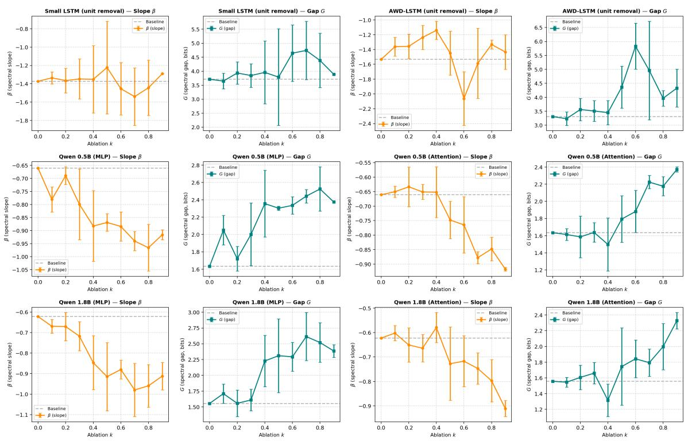  
Figure 11: Fourier spectral analysis of the frequency-ranked error distribution across unit-ablation fractions $k \in [ 0 , 0 . 9 ]$ for the six primary unit-level conditions (means ±1 SD): within each panel, the left graph shows spectral slope $\beta$ (orange) and the right graph shows the low-to-high-frequency spectral gap G (teal). Row 1: Small LSTM whole-unit removal (left) and AWD-LSTM whole-unit removal (right). Rows 2–3: Qwen 0.5B and Qwen 1.8B MLP neuron ablation (left) and attention-head ablation (right), where Qwen 1.8B and Qwen 0.5B attention remain bufered through $k \le 0 . 3 – 0 . 4$ before shifting at higher $k ,$ while Qwen 0.5B MLP and AWD-LSTM whole-unit removal show non-monotonic fluctuations across k (per-k values in Tables $7 -$ 16).

## S5 Detailed Quantitative Cloze Analysis, LSTM Pathway Asymmetry, and Representative Examples

Detailed per-model Cloze trajectories (supporting Section 2.4). For Qwen 0.5B, baseline Cloze performance is strong: $\mathrm { P O S ~ m a t c h } = 6 5 . 0 \%$ , cosine similarity = 0.643 (Table 17). Under MLP ablation, both metrics decline through $k = 0 . 2$ (POS 47.2%, cosine 0.421) and $k = 0 . 3$ (POS 35.2%, cosine 0.283), then collapse sharply at $k = 0 . 4$ (POS 8.8%, cosine 0.078) and $k = 0 . 5$ (POS 6.4%, cosine 0.042). Under attention-head ablation, Qwen 0.5B retains substantially higher competence across the mid-range on the nominal-k axis: at $k = 0 . 4 \AA$ , POS is 47.6% and cosine is 0.407 (more than fivefold higher than MLP ablation at the same nominal k), and at $k = 0 . 5 , \mathrm { P O S }$ is 35.0% with a larger syntactic–semantic gap (cosine 0.198). Qwen 1.8B shows the same contrast: from a baseline of $\mathrm { P O S } = 6 4 . 0 \%$ and cosine $= 0 . 6 6 3$ , MLP ablation drops to $\mathrm { P O S } = 4 8 . 8 \%$ and cosine $= 0 . 4 4 9$ at $k = 0 . 2 .$ 45.2% and 0.362 at $k = 0 . 3 , 2 0 . 8 \%$ and 0.138 at $k = 0 . 4 .$ , and collapses to $\mathrm { P O S } = 6 . 2 \%$ and cosine = 0.048 at $k = 0 . 5$ (Figure 5, rows 2 and 3). In contrast, Qwen 1.8B attention-head ablation retains $\mathrm { P O S } = 5 9 . 9 \%$ and cosine = 0.606 at $k = 0 . 2$ $\mathrm { P O S } = 3 7 . 0 \%$ and cosine $= 0 . 3 5 2$ at $k = 0 . 4$ (about $1 . 8 \times$ and 2.6× the MLP values of 20.8% and 0.138), and still preserves $\mathrm { P O S } = 4 2 . 0 \%$ and cosine $= 0 . 3 1 9$ at nominal $k = 0 . 5 .$ , outperforming MLP ablation by nearly sevenfold on both metrics at nominal $k = 0 . 5$ . Because nominal $k = 0 . 5$ removes 16.3% (0.5B) and 16.6% (1.8B) of non-embedding parameters under attention-head ablation versus 33.7% and 33.4% under MLP ablation (and 70.4% and 72.7% under LSTM whole-unit removal), at a matched parameter-removal fraction of ∼13.4–20.2% Qwen MLP $( k = 0 . 2$ 0.3: POS 35.2%–48.8%, cosine 0.283–0.449) and AWD-LSTM whole-unit removal (k = 0.1, 18.1% removed: POS 53.0%, cosine 0.393) match or exceed attention at $k = 0 . 5$ Similarly, at ∼34% of non-embedding parameters removed, AWD-LSTM whole-unit removal (k = 0.2, 34.5% removed: POS 42.7%, cosine 0.322) exceeds Qwen MLP at k = 0.5 (POS 6.2–6.4%, cosine $0 . 0 4 2 \substack { - 0 . 0 4 8 } )$

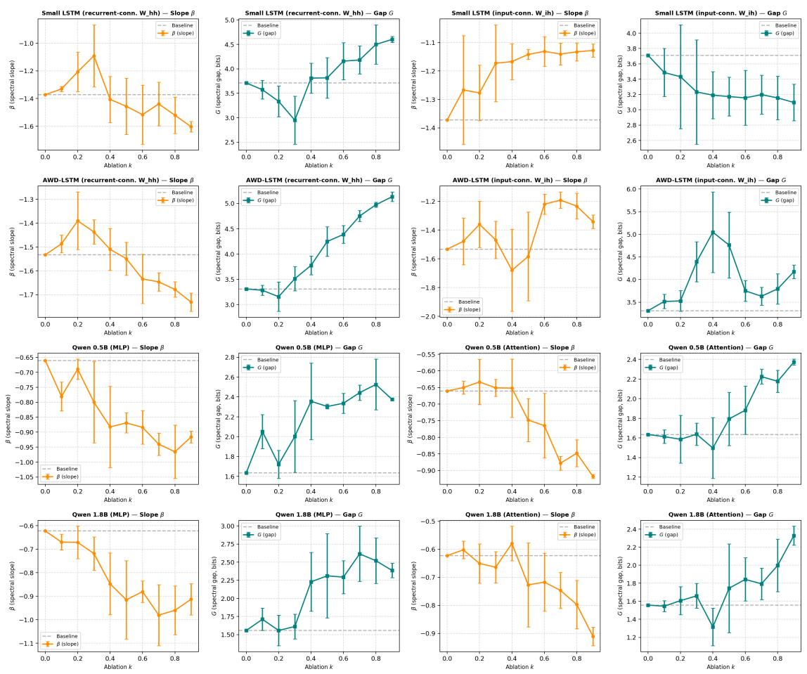  
Figure 12: Spectral slope $\beta$ (orange, left graph of each pair) and spectral gap G (teal, right graph of each pair) across $k \in [ 0 , 0 . 9 ]$ for the supplementary LSTM connection-pruning controls (top two rows: Small LSTM and AWD-LSTM recurrent-connection pruning weight hh in the left column and input-connection pruning weight ih in the right column) alongside Qwen 0.5B and Qwen 1.8B MLP and Attention pathways (bottom two rows; means ±1 SD).

Table 7: AWD-LSTM Whole-Unit Removal (weight ih + weight hh + biases): full metrics.
<table><tr><td> $k$ </td><td>Accuracy</td><td>±SE</td><td>RelAcc</td><td> $R _ { 4 }$ </td><td> $\pm R _ { 4 } \ \mathrm { S E }$ </td><td> $R _ { 4 } / R _ { 4 } ( 0 )$ </td><td> $\beta$ </td><td> $\pm \beta \thinspace \mathrm { S D }$ </td><td> $G$ </td></tr><tr><td>0.00</td><td>0.3806</td><td>0.0000</td><td>1.0000</td><td>2.2084</td><td>0.0000</td><td>1.0000</td><td>-1.5328</td><td>0.0002</td><td>3.3106</td></tr><tr><td>0.10</td><td>0.3410</td><td>0.0007</td><td>0.8960</td><td>2.2153</td><td>0.0014</td><td>1.0031</td><td>-1.3621</td><td>0.1268</td><td>3.2343</td></tr><tr><td>0.20</td><td>0.2866</td><td>0.0009</td><td>0.7531</td><td>2.2355</td><td>0.0009</td><td>1.0123</td><td>-1.3563</td><td>0.1657</td><td>3.5633</td></tr><tr><td>0.30</td><td>0.2295</td><td>0.0041</td><td>0.6030</td><td>2.2684</td><td>0.0028</td><td>1.0272</td><td>-1.2366</td><td>0.1620</td><td>3.5111</td></tr><tr><td>0.40</td><td>0.1731</td><td>0.0046</td><td>0.4548</td><td>2.3059</td><td>0.0031</td><td>1.0441</td><td>-1.1410</td><td>0.1227</td><td>3.4511</td></tr><tr><td>0.50</td><td>0.1307</td><td>0.0049</td><td>0.3435</td><td>2.3345</td><td>0.0033</td><td>1.0571</td><td>-1.4492</td><td>0.2976</td><td>4.3659</td></tr><tr><td>0.60</td><td>0.1003</td><td>0.0031</td><td>0.2635</td><td>2.3548</td><td>0.0020</td><td>1.0663</td><td>-2.0622</td><td>0.3626</td><td>5.8311</td></tr><tr><td>0.70</td><td>0.0763</td><td>0.0021</td><td>0.2006</td><td>2.3703</td><td>0.0013</td><td>1.0733</td><td>-1.5878</td><td>0.4728</td><td>4.9594</td></tr><tr><td>0.80</td><td>0.0649</td><td>0.0061</td><td>0.1707</td><td>2.3775</td><td>0.0039</td><td>1.0766</td><td>-1.3316</td><td>0.0604</td><td>3.9658</td></tr><tr><td>0.90</td><td>0.0678</td><td>0.0026</td><td>0.1780</td><td>2.3758</td><td>0.0016</td><td>1.0758</td><td>-1.4336</td><td>0.2332</td><td>4.3306</td></tr></table>

Table 8: Small LSTM Whole-Unit Removal (weight ih + weight hh + biases): full metrics. At $k = 0 . 9 0 \mathrm { { ; } }$ all five trials settle on predicting the single most common word in the test text (“the”, 7.12% of tokens), giving zero variation across trials (±0.0000).
<table><tr><td> $k$ </td><td>Accuracy</td><td> $\pm \mathrm { S E }$ </td><td>RelAcc</td><td> $R _ { 4 }$ </td><td> $\pm R _ { 4 } \ \mathrm { S E }$ </td><td> $R _ { 4 } / R _ { 4 } ( 0 )$ </td><td> $\beta$ </td><td> $\pm \beta \thinspace \mathrm { S D }$ </td><td> $G$ </td></tr><tr><td>0.00</td><td>0.2747</td><td>0.0000</td><td>1.0000</td><td>2.2575</td><td>0.0000</td><td>1.0000</td><td>-1.3724</td><td>0.0001</td><td>3.7113</td></tr><tr><td>0.10</td><td>0.2548</td><td>0.0008</td><td>0.9274</td><td>2.2661</td><td>0.0005</td><td>1.0038</td><td>-1.3352</td><td>0.0652</td><td>3.6480</td></tr><tr><td>0.20</td><td>0.2257</td><td>0.0015</td><td>0.8215</td><td>2.2810</td><td>0.0017</td><td>1.0104</td><td>-1.3652</td><td>0.1346</td><td>3.9358</td></tr><tr><td>0.30</td><td>0.1930</td><td>0.0011</td><td>0.7024</td><td>2.2955</td><td>0.0014</td><td>1.0168</td><td>-1.3473</td><td>0.2175</td><td>3.8458</td></tr><tr><td>0.40</td><td>0.1565</td><td>0.0052</td><td>0.5695</td><td>2.3177</td><td>0.0035</td><td>1.0267</td><td>-1.3513</td><td>0.3677</td><td>3.9571</td></tr><tr><td>0.50</td><td>0.1260</td><td>0.0057</td><td>0.4585</td><td>2.3377</td><td>0.0038</td><td>1.0355</td><td>-1.2225</td><td>0.5036</td><td>3.7887</td></tr><tr><td>0.60</td><td>0.1094</td><td>0.0015</td><td>0.3981</td><td>2.3488</td><td>0.0010</td><td>1.0404</td><td>-1.4535</td><td>0.2858</td><td>4.6439</td></tr><tr><td>0.70</td><td>0.0945</td><td>0.0053</td><td>0.3438</td><td>2.3585</td><td>0.0035</td><td>1.0448</td><td>-1.5397</td><td>0.3136</td><td>4.7413</td></tr><tr><td>0.80</td><td>0.0754</td><td>0.0037</td><td>0.2743</td><td>2.3709</td><td>0.0024</td><td>1.0502</td><td>-1.4432</td><td>0.3002</td><td>4.3827</td></tr><tr><td>0.90</td><td>0.0712</td><td>0.0000</td><td>0.2593</td><td>2.3735</td><td>0.0000</td><td>1.0514</td><td>-1.2903</td><td>0.0000</td><td>3.8883</td></tr></table>

Table 9: AWD-LSTM Hidden (weight hh) connection pruning (supplementary control 1): full metrics.
<table><tr><td> $k$ </td><td>Accuracy</td><td>±SE</td><td>RelAcc</td><td> $R _ { 4 }$ </td><td> $\pm R _ { 4 } \ \mathrm { S E }$ </td><td> $R _ { 4 } / R _ { 4 } ( 0 )$ </td><td> $\beta$ </td><td> $\pm \beta \thinspace \mathrm { S D }$ </td><td> $G$ </td></tr><tr><td>0.00</td><td>0.3806</td><td>0.0000</td><td>1.0000</td><td>2.2084</td><td>0.0000</td><td>1.0000</td><td>-1.5327</td><td>0.0002</td><td>3.3103</td></tr><tr><td>0.10</td><td>0.3595</td><td>0.0005</td><td>0.9445</td><td>2.2148</td><td>0.0005</td><td>1.0029</td><td>-1.4866</td><td>0.0375</td><td>3.2828</td></tr><tr><td>0.20</td><td>0.3303</td><td>0.0018</td><td>0.8678</td><td>2.2260</td><td>0.0014</td><td>1.0080</td><td>-1.3900</td><td>0.1209</td><td>3.1562</td></tr><tr><td>0.30</td><td>0.2941</td><td>0.0018</td><td>0.7727</td><td>2.2431</td><td>0.0014</td><td>1.0157</td><td>-1.4368</td><td>0.0510</td><td>3.5124</td></tr><tr><td>0.40</td><td>0.2611</td><td>0.0022</td><td>0.6861</td><td>2.2591</td><td>0.0019</td><td>1.0229</td><td>-1.5096</td><td>0.0874</td><td>3.7748</td></tr><tr><td>0.50</td><td>0.2193</td><td>0.0010</td><td>0.5763</td><td>2.2848</td><td>0.0012</td><td>1.0346</td><td>-1.5491</td><td>0.0695</td><td>4.2473</td></tr><tr><td>0.60</td><td>0.1902</td><td>0.0014</td><td>0.4997</td><td>2.3019</td><td>0.0011</td><td>1.0423</td><td>-1.6339</td><td>0.1035</td><td>4.3868</td></tr><tr><td>0.70</td><td>0.1644</td><td>0.0009</td><td>0.4319</td><td>2.3189</td><td>0.0007</td><td>1.0500</td><td>-1.6463</td><td>0.0383</td><td>4.7502</td></tr><tr><td>0.80</td><td>0.1470</td><td>0.0010</td><td>0.3862</td><td>2.3297</td><td>0.0007</td><td>1.0549</td><td>-1.6780</td><td>0.0321</td><td>4.9724</td></tr><tr><td>0.90</td><td>0.1335</td><td>0.0007</td><td>0.3507</td><td>2.3385</td><td>0.0005</td><td>1.0589</td><td>-1.7311</td><td>0.0386</td><td>5.1322</td></tr></table>

Table 10: AWD-LSTM Input (weight ih) connection pruning (supplementary control 2): full metrics.
<table><tr><td> $k$ </td><td>Accuracy</td><td> $\pm \mathrm { S E }$ </td><td>RelAcc</td><td> $R _ { 4 }$ </td><td> $\pm R _ { 4 } \ \mathrm { S E }$ </td><td> $R _ { 4 } / R _ { 4 } ( 0 )$ </td><td> $\beta$ </td><td> $\pm \beta \thinspace \mathrm { S D }$ </td><td> $G$ </td></tr><tr><td>0.00</td><td>0.3806</td><td>0.0000</td><td>1.0000</td><td>2.2085</td><td>0.0000</td><td>1.0000</td><td>-1.5329</td><td>0.0001</td><td>3.3108</td></tr><tr><td>0.10</td><td>0.3395</td><td>0.0020</td><td>0.8921</td><td>2.2182</td><td>0.0023</td><td>1.0044</td><td>-1.4784</td><td>0.1623</td><td>3.5164</td></tr><tr><td>0.20</td><td>0.2768</td><td>0.0047</td><td>0.7274</td><td>2.2448</td><td>0.0030</td><td>1.0164</td><td>-1.3600</td><td>0.1614</td><td>3.5278</td></tr><tr><td>0.30</td><td>0.1847</td><td>0.0045</td><td>0.4852</td><td>2.2993</td><td>0.0031</td><td>1.0411</td><td>-1.4685</td><td>0.1298</td><td>4.3924</td></tr><tr><td>0.40</td><td>0.0966</td><td>0.0051</td><td>0.2538</td><td>2.3572</td><td>0.0033</td><td>1.0673</td><td>-1.6801</td><td>0.2852</td><td>5.0464</td></tr><tr><td>0.50</td><td>0.0570</td><td>0.0049</td><td>0.1498</td><td>2.3825</td><td>0.0031</td><td>1.0788</td><td>-1.5833</td><td>0.3095</td><td>4.7614</td></tr><tr><td>0.60</td><td>0.0216</td><td>0.0023</td><td>0.0567</td><td>2.4046</td><td>0.0014</td><td>1.0888</td><td>-1.2200</td><td>0.0701</td><td>3.7510</td></tr><tr><td>0.70</td><td>0.0152</td><td>0.0013</td><td>0.0399</td><td>2.4086</td><td>0.0008</td><td>1.0906</td><td>-1.1914</td><td>0.0569</td><td>3.6317</td></tr><tr><td>0.80</td><td>0.0209</td><td>0.0021</td><td>0.0548</td><td>2.4051</td><td>0.0013</td><td>1.0890</td><td>-1.2331</td><td>0.0894</td><td>3.7939</td></tr><tr><td>0.90</td><td>0.0209</td><td>0.0011</td><td>0.0548</td><td>2.4051</td><td>0.0007</td><td>1.0890</td><td>-1.3414</td><td>0.0471</td><td>4.1736</td></tr></table>

Table 11: Small LSTM Recurrent-Connection Pruning (weight hh, supplementary control 1): full metrics.
<table><tr><td> $k$ </td><td>Accuracy</td><td>±SE</td><td>RelAcc</td><td> $R _ { 4 }$ </td><td> $\pm R _ { 4 }$  SE</td><td> $R _ { 4 } / R _ { 4 } ( 0 )$ </td><td> $\beta$ </td><td> $\pm \beta \thinspace \mathrm { S D }$ </td><td> $G$ </td></tr><tr><td>0.00</td><td>0.2747</td><td>0.0000</td><td>1.0000</td><td>2.2575</td><td>0.0000</td><td>1.0000</td><td>-1.3724</td><td>0.0001</td><td>3.7112</td></tr><tr><td>0.10</td><td>0.2517</td><td>0.0025</td><td>0.9161</td><td>2.2695</td><td>0.0015</td><td>1.0053</td><td>-1.3314</td><td>0.0194</td><td>3.5717</td></tr><tr><td>0.20</td><td>0.2131</td><td>0.0043</td><td>0.7755</td><td>2.2937</td><td>0.0033</td><td>1.0160</td><td>-1.2073</td><td>0.1430</td><td>3.3351</td></tr><tr><td>0.30</td><td>0.1908</td><td>0.0032</td><td>0.6945</td><td>2.3040</td><td>0.0027</td><td>1.0206</td><td>-1.0916</td><td>0.2242</td><td>2.9486</td></tr><tr><td>0.40</td><td>0.1819</td><td>0.0045</td><td>0.6621</td><td>2.3037</td><td>0.0026</td><td>1.0205</td><td>-1.4068</td><td>0.1665</td><td>3.8097</td></tr><tr><td>0.50</td><td>0.1593</td><td>0.0023</td><td>0.5798</td><td>2.3168</td><td>0.0015</td><td>1.0263</td><td>-1.4565</td><td>0.2034</td><td>3.8150</td></tr><tr><td>0.60</td><td>0.1502</td><td>0.0042</td><td>0.5466</td><td>2.3224</td><td>0.0028</td><td>1.0287</td><td>-1.5167</td><td>0.2135</td><td>4.1573</td></tr><tr><td>0.70</td><td>0.1512</td><td>0.0032</td><td>0.5502</td><td>2.3217</td><td>0.0023</td><td>1.0284</td><td>-1.4395</td><td>0.1577</td><td>4.1807</td></tr><tr><td>0.80</td><td>0.1391</td><td>0.0027</td><td>0.5065</td><td>2.3295</td><td>0.0018</td><td>1.0319</td><td>-1.5210</td><td>0.1310</td><td>4.4977</td></tr><tr><td>0.90</td><td>0.1327</td><td>0.0008</td><td>0.4829</td><td>2.3339</td><td>0.0005</td><td>1.0338</td><td>-1.6041</td><td>0.0381</td><td>4.6018</td></tr></table>

Table 12: Small LSTM Input-Connection Pruning (weight ih, supplementary control 2): full metrics.
<table><tr><td> $k$ </td><td>Accuracy</td><td> $\pm \mathrm { S E }$ </td><td>RelAcc</td><td> $R _ { 4 }$ </td><td> $\pm R _ { 4 }$  SE</td><td> $R _ { 4 } / R _ { 4 } ( 0 )$ </td><td> $\beta$ </td><td> $\pm \beta \thinspace \mathrm { S D }$ </td><td> $G$ </td></tr><tr><td>0.00</td><td>0.2747</td><td>0.0000</td><td>1.0000</td><td>2.2575</td><td>0.0000</td><td>1.0000</td><td>-1.3724</td><td>0.0001</td><td>3.7115</td></tr><tr><td>0.10</td><td>0.1786</td><td>0.0065</td><td>0.6500</td><td>2.3078</td><td>0.0046</td><td>1.0223</td><td>-1.2667</td><td>0.1908</td><td>3.4870</td></tr><tr><td>0.20</td><td>0.0380</td><td>0.0046</td><td>0.1385</td><td>2.3945</td><td>0.0028</td><td>1.0607</td><td>-1.2772</td><td>0.0980</td><td>3.4318</td></tr><tr><td>0.30</td><td>0.0333</td><td>0.0065</td><td>0.1214</td><td>2.3973</td><td>0.0040</td><td>1.0619</td><td>-1.1726</td><td>0.1351</td><td>3.2326</td></tr><tr><td>0.40</td><td>0.0266</td><td>0.0047</td><td>0.0968</td><td>2.4016</td><td>0.0029</td><td>1.0638</td><td>-1.1669</td><td>0.0633</td><td>3.1909</td></tr><tr><td>0.50</td><td>0.0157</td><td>0.0036</td><td>0.0572</td><td>2.4082</td><td>0.0022</td><td>1.0668</td><td>-1.1419</td><td>0.0177</td><td>3.1727</td></tr><tr><td>0.60</td><td>0.0201</td><td>0.0026</td><td>0.0730</td><td>2.4056</td><td>0.0016</td><td>1.0656</td><td>-1.1309</td><td>0.0519</td><td>3.1554</td></tr><tr><td>0.70</td><td>0.0182</td><td>0.0041</td><td>0.0662</td><td>2.4067</td><td>0.0025</td><td>1.0661</td><td>-1.1405</td><td>0.0385</td><td>3.1979</td></tr><tr><td>0.80</td><td>0.0185</td><td>0.0022</td><td>0.0673</td><td>2.4065</td><td>0.0014</td><td>1.0660</td><td>-1.1326</td><td>0.0316</td><td>3.1552</td></tr><tr><td>0.90</td><td>0.0166</td><td>0.0029</td><td>0.0604</td><td>2.4077</td><td>0.0018</td><td>1.0665</td><td>-1.1279</td><td>0.0230</td><td>3.0952</td></tr></table>

Table 13: Qwen 0.5B MLP Neuron Removal: full metrics.
<table><tr><td> $k$ </td><td>Accuracy</td><td>±SE</td><td>RelAcc</td><td> $R _ { 4 }$ </td><td> $\pm R _ { 4 }$  SE</td><td> $R _ { 4 } / R _ { 4 } ( 0 )$ </td><td> $\beta$ </td><td> $\pm \beta \thinspace \mathrm { S D }$ </td><td> $G$ </td></tr><tr><td>0.00</td><td>0.5363</td><td>0.0000</td><td>1.0000</td><td>1.8861</td><td>0.0000</td><td>1.0000</td><td>-0.6608</td><td>0.0000</td><td>1.6345</td></tr><tr><td>0.10</td><td>0.4790</td><td>0.0060</td><td>0.8932</td><td>1.8908</td><td>0.0069</td><td>1.0025</td><td>-0.7806</td><td>0.0481</td><td>2.0512</td></tr><tr><td>0.20</td><td>0.3786</td><td>0.0117</td><td>0.7059</td><td>1.9155</td><td>0.0093</td><td>1.0156</td><td>-0.6893</td><td>0.0336</td><td>1.7207</td></tr><tr><td>0.30</td><td>0.3035</td><td>0.0089</td><td>0.5658</td><td>1.9558</td><td>0.0070</td><td>1.0370</td><td>-0.7995</td><td>0.1359</td><td>2.0021</td></tr><tr><td>0.40</td><td>0.1382</td><td>0.0221</td><td>0.2576</td><td>2.0416</td><td>0.0131</td><td>1.0825</td><td>-0.8825</td><td>0.1356</td><td>2.3562</td></tr><tr><td>0.50</td><td>0.0417</td><td>0.0103</td><td>0.0777</td><td>2.0957</td><td>0.0053</td><td>1.1111</td><td>-0.8690</td><td>0.0335</td><td>2.3038</td></tr><tr><td>0.60</td><td>0.0169</td><td>0.0047</td><td>0.0315</td><td>2.1087</td><td>0.0025</td><td>1.1181</td><td>-0.8840</td><td>0.0558</td><td>2.3363</td></tr><tr><td>0.70</td><td>0.0089</td><td>0.0022</td><td>0.0165</td><td>2.1131</td><td>0.0012</td><td>1.1204</td><td>-0.9401</td><td>0.0371</td><td>2.4425</td></tr><tr><td>0.80</td><td>0.0102</td><td>0.0049</td><td>0.0190</td><td>2.1123</td><td>0.0026</td><td>1.1200</td><td>-0.9656</td><td>0.0892</td><td>2.5255</td></tr><tr><td>0.90</td><td>0.0026</td><td>0.0022</td><td>0.0048</td><td>2.1164</td><td>0.0012</td><td>1.1221</td><td>-0.9160</td><td>0.0194</td><td>2.3750</td></tr></table>

Table 14: Qwen 0.5B Attention-Head Removal: full metrics.
<table><tr><td> $k$ </td><td>Accuracy</td><td>±SE</td><td>RelAcc</td><td> $R _ { 4 }$ </td><td> $\pm R _ { 4 }$  SE</td><td> $R _ { 4 } / R _ { 4 } ( 0 )$ </td><td> $\beta$ </td><td> $\pm \beta \thinspace \mathrm { S D }$ </td><td> $G$ </td></tr><tr><td>0.00</td><td>0.5363</td><td>0.0000</td><td>1.0000</td><td>1.8861</td><td>0.0000</td><td>1.0000</td><td>-0.6608</td><td>0.0000</td><td>1.6345</td></tr><tr><td>0.10</td><td>0.5232</td><td>0.0011</td><td>0.9756</td><td>1.8923</td><td>0.0027</td><td>1.0033</td><td>-0.6503</td><td>0.0196</td><td>1.6131</td></tr><tr><td>0.20</td><td>0.4536</td><td>0.0135</td><td>0.8458</td><td>1.9225</td><td>0.0102</td><td>1.0193</td><td>-0.6334</td><td>0.0682</td><td>1.5857</td></tr><tr><td>0.30</td><td>0.4320</td><td>0.0236</td><td>0.8055</td><td>1.9079</td><td>0.0165</td><td>1.0116</td><td>-0.6510</td><td>0.0258</td><td>1.6377</td></tr><tr><td>0.40</td><td>0.2608</td><td>0.0438</td><td>0.4863</td><td>1.9880</td><td>0.0245</td><td>1.0541</td><td>-0.6520</td><td>0.0875</td><td>1.4967</td></tr><tr><td>0.50</td><td>0.1067</td><td>0.0395</td><td>0.1990</td><td>2.0635</td><td>0.0203</td><td>1.0941</td><td>-0.7480</td><td>0.0646</td><td>1.7933</td></tr><tr><td>0.60</td><td>0.0971</td><td>0.0246</td><td>0.1810</td><td>2.0695</td><td>0.0134</td><td>1.0973</td><td>-0.7648</td><td>0.0972</td><td>1.8819</td></tr><tr><td>0.70</td><td>0.0132</td><td>0.0023</td><td>0.0247</td><td>2.1111</td><td>0.0012</td><td>1.1193</td><td>-0.8778</td><td>0.0207</td><td>2.2251</td></tr><tr><td>0.80</td><td>0.0182</td><td>0.0040</td><td>0.0340</td><td>2.1081</td><td>0.0022</td><td>1.1177</td><td>-0.8479</td><td>0.0403</td><td>2.1763</td></tr><tr><td>0.90</td><td>0.0048</td><td>0.0025</td><td>0.0090</td><td>2.1152</td><td>0.0013</td><td>1.1215</td><td>-0.9177</td><td>0.0062</td><td>2.3729</td></tr></table>

Table 15: Qwen 1.8B MLP Neuron Removal: full metrics.
<table><tr><td> $k$ </td><td>Accuracy</td><td>±SE</td><td>RelAcc</td><td> $R _ { 4 }$ </td><td> $\pm R _ { 4 }$  SE</td><td> $R _ { 4 } / R _ { 4 } ( 0 )$ </td><td> $\beta$ </td><td> $\pm \beta \thinspace \mathrm { S D }$ </td><td> $G$ </td></tr><tr><td>0.00</td><td>0.5465</td><td>0.0000</td><td>1.0000</td><td>1.8874</td><td>0.0000</td><td>1.0000</td><td>-0.6225</td><td>0.0000</td><td>1.5568</td></tr><tr><td>0.10</td><td>0.5112</td><td>0.0022</td><td>0.9354</td><td>1.8691</td><td>0.0031</td><td>0.9903</td><td>-0.6697</td><td>0.0334</td><td>1.7113</td></tr><tr><td>0.20</td><td>0.4479</td><td>0.0054</td><td>0.8197</td><td>1.8978</td><td>0.0065</td><td>1.0055</td><td>-0.6710</td><td>0.0687</td><td>1.5578</td></tr><tr><td>0.30</td><td>0.3376</td><td>0.0294</td><td>0.6178</td><td>1.9462</td><td>0.0164</td><td>1.0312</td><td>-0.7183</td><td>0.0708</td><td>1.6114</td></tr><tr><td>0.40</td><td>0.1287</td><td>0.0360</td><td>0.2355</td><td>2.0513</td><td>0.0184</td><td>1.0868</td><td>-0.8472</td><td>0.1312</td><td>2.2284</td></tr><tr><td>0.50</td><td>0.1163</td><td>0.0205</td><td>0.2129</td><td>2.0556</td><td>0.0108</td><td>1.0891</td><td>-0.9153</td><td>0.1664</td><td>2.3113</td></tr><tr><td>0.60</td><td>0.0239</td><td>0.0066</td><td>0.0438</td><td>2.1049</td><td>0.0036</td><td>1.1153</td><td>-0.8803</td><td>0.0460</td><td>2.2934</td></tr><tr><td>0.70</td><td>0.0240</td><td>0.0078</td><td>0.0438</td><td>2.1049</td><td>0.0042</td><td>1.1152</td><td>-0.9801</td><td>0.1298</td><td>2.6144</td></tr><tr><td>0.80</td><td>0.0126</td><td>0.0054</td><td>0.0231</td><td>2.1110</td><td>0.0029</td><td>1.1185</td><td>-0.9599</td><td>0.1035</td><td>2.5199</td></tr><tr><td>0.90</td><td>0.0097</td><td>0.0041</td><td>0.0177</td><td>2.1126</td><td>0.0022</td><td>1.1193</td><td>-0.9126</td><td>0.0665</td><td>2.3857</td></tr></table>

Table 16: Qwen 1.8B Attention-Head Removal: full metrics.
<table><tr><td> $k$ </td><td>Accuracy</td><td>±SE</td><td>RelAcc</td><td> $R _ { 4 }$ </td><td> $\pm R _ { 4 }$  SE</td><td> $R _ { 4 } / R _ { 4 } ( 0 )$ </td><td> $\beta$ </td><td> $\pm \beta \thinspace \mathrm { S D }$ </td><td> $G$ </td></tr><tr><td>0.00</td><td>0.5465</td><td>0.0000</td><td>1.0000</td><td>1.8874</td><td>0.0000</td><td>1.0000</td><td>-0.6225</td><td>0.0000</td><td>1.5568</td></tr><tr><td>0.10</td><td>0.5227</td><td>0.0059</td><td>0.9566</td><td>1.8823</td><td>0.0128</td><td>0.9973</td><td>-0.6022</td><td>0.0310</td><td>1.5457</td></tr><tr><td>0.20</td><td>0.4507</td><td>0.0432</td><td>0.8248</td><td>1.9104</td><td>0.0244</td><td>1.0122</td><td>-0.6507</td><td>0.0699</td><td>1.6066</td></tr><tr><td>0.30</td><td>0.4440</td><td>0.0171</td><td>0.8125</td><td>1.9127</td><td>0.0085</td><td>1.0134</td><td>-0.6640</td><td>0.0558</td><td>1.6601</td></tr><tr><td>0.40</td><td>0.3559</td><td>0.0196</td><td>0.6514</td><td>1.9593</td><td>0.0167</td><td>1.0381</td><td>-0.5792</td><td>0.0615</td><td>1.3152</td></tr><tr><td>0.50</td><td>0.1732</td><td>0.0376</td><td>0.3169</td><td>2.0397</td><td>0.0193</td><td>1.0807</td><td>-0.7272</td><td>0.1497</td><td>1.7441</td></tr><tr><td>0.60</td><td>0.1254</td><td>0.0254</td><td>0.2295</td><td>2.0547</td><td>0.0122</td><td>1.0887</td><td>-0.7171</td><td>0.1038</td><td>1.8428</td></tr><tr><td>0.70</td><td>0.0563</td><td>0.0111</td><td>0.1030</td><td>2.0899</td><td>0.0056</td><td>1.1073</td><td>-0.7469</td><td>0.0641</td><td>1.7936</td></tr><tr><td>0.80</td><td>0.0398</td><td>0.0102</td><td>0.0729</td><td>2.0970</td><td>0.0052</td><td>1.1111</td><td>-0.7971</td><td>0.0863</td><td>1.9979</td></tr><tr><td>0.90</td><td>0.0120</td><td>0.0042</td><td>0.0220</td><td>2.1115</td><td>0.0022</td><td>1.1187</td><td>-0.9110</td><td>0.0327</td><td>2.3280</td></tr></table>

In the intact AWD-LSTM (baseline $\mathrm { P O S } = 5 7 . 0 \%$ , cosine = 0.450; Figure 5, row 1 right), whole-unit removal (weight ih + weight hh + gate biases) degrades both POS match and cosine similarity in parallel without dissociation across mild-to-moderate damage: POS is 53.0% (cosine 0.393) at $k = 0 . 1$ , 42.7% (cosine 0.322) at $k = 0 . 2 .$ and 28.4% (cosine 0.203) at $k = 0 . 3$ , before collapsing to 4.8% (cosine 0.074) at $k = 0 . 4 .$ 2.2% (cosine 0.020) at $k = 0 . 5$ , 0.0% (cosine 0.008) at $k \ = \ 0 . 6 .$ , and 0.0% (cosine 0.000) for $k \geq 0 . 7$ (Table 17). Our supplementary connection-pruning controls (Supplementary Figure 13, row 2) isolate the two mechanisms behind this trajectory: under pure recurrent-connection (weight hh) pruning, POS and cosine degrade gradually and in parallel across the entire sweep (POS 55.5%, cosine 0.417 at $k = 0 . 2 ; 5 2 . 2 \%$ 0.390 at $k = 0 . 5 ;$ and 42.0%, 0.370 at $k = 0 . 9$ , preserving roughly three-quarters of baseline competence even at 90% recurrent pruning), whereas under pure input-connection (weight ih) pruning, POS and cosine collapse steeply together (47.8% and 0.344 at $k = 0 . 2 ;$ 34.4% and 0.244 at $k = 0 . 3 ;$ ; 19.8% and 0.147 at $k = 0 . 4 ; 5 . 2 \%$ and 0.040 at $k = 0 . 5 ;$ and 1.6% and 0.047 at $k = 0 . 9 )$

The Small LSTM exhibits the exact same pattern from a baseline of $\mathrm { P O S } = 5 9 . 0 \%$ and cosine = 0.337 (Figure 5, row 1 left, and Supplementary Figure 13, row 1). Under whole-unit removal, POS and cosine decline in parallel across k = 0.1 (41.6%, 0.279), k = 0.2 (23.6%, 0.177), and $k = 0 . 3 \ ( 1 1 . 4 \% , \ 0 . 0 7 3 )$ before collapsing to 1.6% (0.021) at $k = 0 . 4$ and 0.0% (0.000) for all $k \geq 0 . 5$ . Under recurrent-connection (weight hh) pruning alone, both POS and cosine decline gradually and in parallel across the full sweep (45.1% and 0.298 at $k = 0 . 2 ;$ 34.0% and 0.251 at $k = 0 . 5 ;$ and 20.4% and 0.170 at $k = 0 . 9 )$ , whereas under input-connection (weight ih) pruning alone, both metrics collapse rapidly (30.4% and 0.194 at $k = 0 . 1$ 7.3% and 0.051 at $k = 0 . 2 ;$ and 0.0% and $\leq 0 . 0 0 2$ for all $k \geq 0 . 3 )$

Architectural basis for pathway asymmetry and whole-unit removal in LSTMs. In an LSTM, each hidden unit receives input from two additive sources at every time step: the input projection (weight ih), which transforms the current token embedding $x _ { t }$ (or previous layer’s hidden state $h _ { t } ^ { ( \ell - 1 ) } )$ , and the recurrent projection (weight hh), which propagates the previous time step’s hidden state $h _ { t - 1 } ^ { ( \ell ) }$ . When weight hh connections are pruned for a subset of units (Supplement control 1), those units still receive intact currenttoken projections via weight ih: the feedforward pathway from the current token embedding through the LSTM gates to the tied output decoder remains unbroken, allowing the network to act as a local short-context predictor whose performance degrades gradually in proportion to the lost recurrent memory. Conversely, when weight ih is pruned (Supplement control 2), or when whole units are completely silenced in the main paper by zeroing both weight ih and weight hh across all layers (including outgoing columns feeding the next layer), the conduit through which current token information traverses the serial 3-layer stack is progressively narrowed and, at $k \geq 0 . 4$ (reaching 0.0% POS by $k = 0 . 5 – 0 . 6 )$ , starved of prompt information. In the Transformer, Pre-Norm residual stream connections (+) bypass each layer’s MLP and attention subblocks across all 24 layers, which may contribute to the early retention under attention-head ablation and to the abrupt threshold collapse under MLP ablation across $k ^ { * }$ ≈ 0.3–0.4 (after an early decline comparable to the LSTMs), whereas in the 3-layer LSTM, no residual stream bypasses the serial layer stack.

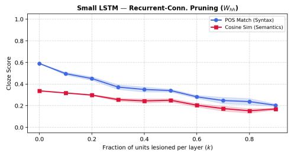

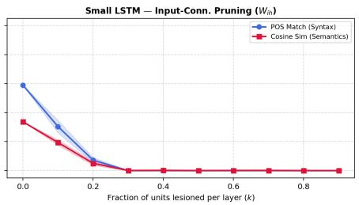

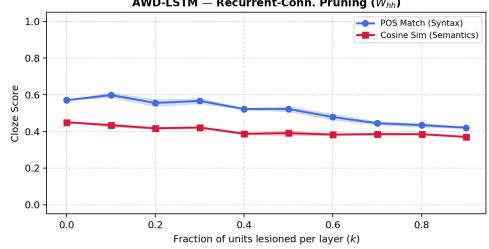

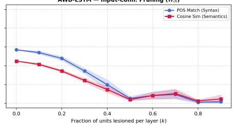

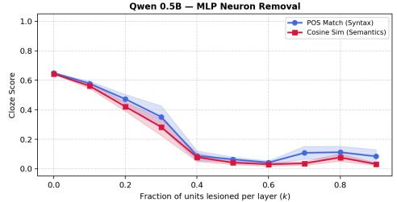

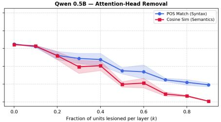

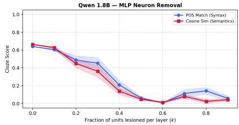

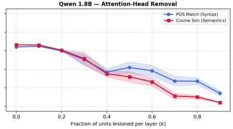  
Figure 13: Syntactic (POS match, blue) and semantic (GloVe cosine similarity, red) Cloze performance for the supplementary LSTM connection-pruning controls (rows 1–2: Small LSTM and AWD-LSTM recurrentconnection pruning weight hh in the left column and input-connection pruning weight ih in the right column) alongside Qwen 0.5B and Qwen 1.8B MLP and Attention pathways (rows 3–4; primary unitlevel Cloze trajectories are shown in Figure 5). Isolating weight hh (rows 1–2, left) confirms that pruning recurrent memory connections alone produces a gradual, non-dissociated decline all the way to k = 0.9, whereas pruning weight ih input connections (rows 1–2, right) drives the rapid bilateral Cloze collapse seen at high k under whole-unit removal.

## S6 Detailed Statistical Formalisation of Clinical Parallel Assignments

This section provides the complete numerical and statistical breakdowns supporting the clinical paralle subsections in Section 2.5, along with Supplementary Table 19 reporting the error-distribution, Brysbaert concreteness, and PNT taxonomy profiles for the four supplementary LSTM connection-pruning controls (weight hh and weight ih):

• Comparison of intact and ablated models with post-stroke patient error distributions: In Figure 6 and Supplementary Table 20, intact (k = 0) Qwen 1.8B and Qwen 0.5B achieve 66.0% and 64.0% Correct, with 1.0% No-response and 11.0% and 9.0% Semantic substitutions. When Correct is restricted to an exact top-1 match rather than top-5, first-trial rates are 42%, 38%, 7%, and 0% for the four intact baselines, and 22%, 17%, 37%, 16%, 1%, and 1% for the six unit-ablated conditions (listed in the row order of Table 4). At k = 0.2 across the 10 independent ablation trials (N = 1,000 predictions per condition), Qwen 1.8B Correct rates bracket the 47.3% PWA patient mean (42.1% under MLP and 61.2% under attention; 45% and 61% in the first trial). Under Qwen 1.8B MLP ablation, No-response errors jump from 1.0% to 18.1% (95% CI [3.0, 33.2]; 16.7% in Qwen 0.5B MLP), a wide interval that overlaps the 21.9% patient rate. Unrelated word errors rise from 22.0% to 27.9%, while PNT Semantic paraphasias remain at 11.7% under MLP versus 9.1% under attention (18% vs. 11% in the first trial; patient reference 4.2%). By contrast, intact AWD-LSTM and Small LSTM start at 25.0% and 4.0% Correct at k = 0 and drop under whole-unit removal at k = 0.2 to 12.3% and 0.6% Correct across the 10 trials (9% and 2% in the first trial), with 62.4% and 74.1% Unrelated defaults and 9.8% and 22.2% No-response. Across the supplementary connection-pruning controls (Table 19), Correct rates range from 0.7% to 20.2% and No-response rates reach up to 55.5%.

Table 17: Quantified Cloze test: POS match rate and GloVe cosine similarity at selected ablation fractions across all ten conditions (six primary unit-level conditions plus four supplementary LSTM connection-pruning controls). Values are means across trials (deterministic baseline at k = 0.0, n = 10 trials at $k = 0 . 2$ , and n = 5 trials at $k \in \{ 0 . 5 , 0 . 9 \} ,$ ).
<table><tr><td></td><td></td><td colspan="4">POS Match (Syntax)</td><td colspan="4">Cosine Similarity (Semantics)</td></tr><tr><td>Model</td><td>Target</td><td>k=0</td><td>k=0.2</td><td>k=0.5</td><td>k=0.9</td><td>k=0</td><td>k=0.2</td><td>k=0.5</td><td>k=0.9</td></tr><tr><td>Small LSTM</td><td>unit</td><td>0.590</td><td>0.236</td><td>0.000</td><td>0.000</td><td>0.337</td><td>0.177</td><td>0.000</td><td>0.000</td></tr><tr><td>AWD-LSTM</td><td>unit</td><td>0.570</td><td>0.427</td><td>0.022</td><td>0.000</td><td>0.450</td><td>0.322</td><td>0.020</td><td>0.000</td></tr><tr><td>Qwen 0.5B</td><td>MLP</td><td>0.650</td><td>0.472</td><td>0.064</td><td>0.084</td><td>0.643</td><td>0.421</td><td>0.042</td><td>0.031</td></tr><tr><td>Qwen 0.5B</td><td>Attn</td><td>0.650</td><td>0.522</td><td>0.350</td><td>0.192</td><td>0.643</td><td>0.519</td><td>0.198</td><td>0.008</td></tr><tr><td>Qwen 1.8B</td><td>MLP</td><td>0.640</td><td>0.488</td><td>0.062</td><td>0.058</td><td>0.663</td><td>0.449</td><td>0.048</td><td>0.042</td></tr><tr><td>Qwen 1.8B</td><td>Attn</td><td>0.640</td><td>0.599</td><td>0.420</td><td>0.142</td><td>0.663</td><td>0.606</td><td>0.319</td><td>0.043</td></tr><tr><td>Small LSTM</td><td>w_hh (Suppl.)</td><td>0.590</td><td>0.451</td><td>0.340</td><td>0.204</td><td>0.337</td><td>0.298</td><td>0.251</td><td>0.170</td></tr><tr><td>AWD-LSTM</td><td>w_hh (Suppl.)</td><td>0.570</td><td>0.555</td><td>0.522</td><td>0.420</td><td>0.450</td><td>0.417</td><td>0.390</td><td>0.370</td></tr><tr><td>Small LSTM</td><td>w_ih (Suppl.)</td><td>0.590</td><td>0.073</td><td>0.000</td><td>0.000</td><td>0.337</td><td>0.051</td><td>0.000</td><td>0.000</td></tr><tr><td>AWD-LSTM</td><td>w_ih (Suppl.)</td><td>0.570</td><td>0.478</td><td>0.052</td><td>0.016</td><td>0.450</td><td>0.344</td><td>0.040</td><td>0.047</td></tr></table>

• Null-corrected $R _ { 4 }$ and Jensen–Shannon divergence: At matched relative accuracy (0.80), the Jensen– Shannon divergence from the intact error distribution is larger in the Qwen unit-ablation pathways $( \mathrm { J S } ~ = ~ 0 . 0 3 4  – 0 . 0 4 5 ;$ null-corrected $\Delta \mathrm { J S } ~ = ~ + 0 . 0 1 0 ~ \mathrm { t o } ~ + 0 . 0 2 0 )$ than in LSTM whole-unit removal (JS = 0.007–0.008; ∆JS = +0.002 to +0.003, Figure 4) or LSTM recurrent-connection pruning (JS = 0.006–0.007, Supplement S3). When trials are pooled across the shared transition range (without matching for relative accuracy or correcting for multiple comparisons), the normalised null-corrected shift $( R _ { 4 } ^ { \mathrm { o b s } } - R _ { 4 } ^ { \mathrm { n u l l } } ) / R _ { 4 } ( 0 )$ is more negative under MLP ablation than under attention-head ablation in both Qwen 0.5B (−0.0242 vs. −0.0109, two-sided permutation $p < 1 0 ^ { - 4 } )$ and Qwen 1.8B (−0.0251 vs. −0.0209, p = 0.0238). At a single interpolated accuracy slice (0.80), however, their 95% confidence intervals overlap (Supplement S3).

• MLP ablation ↔ Wernicke-type aphasia: Across the 10 ablation trials at k = 0.2 (Table 4), Qwen 1.8B MLP retains 42.1% [95% CI: 30.1%, 54.1%] correct predictions and 27.2% [21.7%, 32.7%] content-word substitutions (in the first trial: 45% correct, consisting of 22% exact match plus 23% top-5, and 38% content substitutions). Its mean Brysbaert concreteness drop is ∆Conc. = +0.19 [+0.07, +0.30], which does not difer significantly from the intact baseline (+0.13; diference +0.06, 95% CI [−0.06, +0.17]; Supplement S7). For Qwen 0.5B MLP, the corresponding diference from intact is borderline (+0.29 [+0.13, +0.45] vs. +0.15 intact; diference +0.14, 95% CI [−0.02, +0.30]). On the PNT taxonomy (Figure 6; Supplementary Table 20), Qwen 1.8B MLP averages 11.7% [9.2%, 14.2%] Semantic errors across the 10 trials, maintaining its intact $k = 0$ rate of 11.0% (diference $+ 0 . 7 0 \ [ - 1 . 7 8 , \ + 3 . 1 8 ] )$ Over the same trials, Non-content responses rise by 23.7 [7.2, 40.2] percentage points above intact and PNT No-responses rise by 17.1 [2.0, 32.2] points (from 1.0% to 18.1%; in Qwen 0.5B MLP, Noncontent and No-response rise by 25.8 and 15.7 points). Compared with attention ablation (9.1% [7.8%, 10.4%] Semantic errors), Qwen 1.8B MLP shows a directional diference (two-sided permutation $p = 0 . 0 6 1 3$ , Holm-adjusted $p = 0 . 1 2 2 7 )$ . In the first trial alone, Qwen 1.8B MLP produces 18 PNT Semantic paraphasias out of 38 content substitutions at $\theta _ { s } = 0 . 6 0$ (rising to 27 of 38 at $\theta _ { s } = 0 . 5 0 )$ and exceeds attention-head ablation at every similarity threshold $\theta _ { s } \in [ 0 . 5 0 , 0 . 8 0 ]$ in both Qwen 1.8B and Qwen 0.5B (Table 21). On the quantitative Cloze sweep (Table 2), Qwen 1.8B MLP retains moderate Cloze performance at $k = 0 . 2$ (POS 48.8%, cosine 0.449) and $k = 0 . 3$ (45.2%, 0.362) before collapsing at $k = 0 . 5$ to POS 6.2% and cosine 0.048 (Qwen 0.5B MLP at k = 0.5: POS 6.4%, cosine 0.042), accompanied by the largest negative shift in null-corrected $\Delta R _ { 4 } / R _ { 4 } ( 0 ) \ ( - 0 . 0 2 5 1$ in Qwen 1.8B and −0.0242 in Qwen 0.5B).

Table 18: Representative qualitative Cloze predictions across architectures at k = 0.2 (from the first ablation trial), showing the undamaged (k = 0) Qwen 1.8B prediction (Qwen1.8 Intact) alongside Qwen 1.8B MLP and Attention, primary LSTM whole-unit removal (AWD Unit, LSTM Unit), and supplementary LSTM recurrent-connection pruning (AWD Hid., LSTM Hid.). Errors quoted as examples in the main text were checked against the top-1 and top-5 predictions of the corresponding undamaged model for the same prompt and do not occur there; some ablated errors in this table (for example flower→girl and mouse→number ) are also produced by the undamaged model and should not be read as ablation-induced. ✓ = exact match; ∼ = in top-5; × = miss.
<table><tr><td rowspan=1 colspan=10>Prompt             Exp.    Qwen1.8 Qwen1.8 Qwen1.8 AWD    LSTM   AWD    LSTMIntact   MLP    Attn     Unit     Unit     Hid.     Hid.</td></tr><tr><td rowspan=1 colspan=10>once upon a        time   time √   day～   time √  a ×      ”X      time √   new X</td></tr><tr><td rowspan=1 colspan=2>the sun was shin-</td><td rowspan=1 colspan=2>sky    sky √</td><td rowspan=1 colspan=1>sky √</td><td rowspan=1 colspan=1>sky√</td><td rowspan=1 colspan=4>summer first ×   sky √    same X</td></tr><tr><td rowspan=1 colspan=2>ing bright in the</td><td rowspan=1 colspan=2></td><td rowspan=2 colspan=1>ball √</td><td rowspan=2 colspan=1>1 x</td><td rowspan=2 colspan=4>Xnumber first ×   first ×  end ×</td></tr><tr><td rowspan=2 colspan=2>she picked up thethe bird flew up</td><td rowspan=1 colspan=2>ball    phone</td></tr><tr><td rowspan=1 colspan=2>2sky    sky √</td><td rowspan=1 colspan=4>Xtrees～  tree ×   air ×    first ×</td><td rowspan=1 colspan=2>air～    first ×</td></tr><tr><td rowspan=1 colspan=2>into the</td><td rowspan=3 colspan=2>song   song√</td><td></td><td></td><td></td><td></td><td></td><td></td></tr><tr><td rowspan=2 colspan=2>she sang a beauti-</td><td></td><td></td><td></td><td></td><td></td><td></td></tr><tr><td rowspan=1 colspan=3>song √  song √  ,～</td><td rowspan=1 colspan=1>, x</td><td rowspan=1 colspan=2>song√   - X</td></tr><tr><td rowspan=1 colspan=2>ful</td><td rowspan=1 colspan=1></td><td></td><td></td><td></td><td></td><td></td><td></td><td></td></tr><tr><td rowspan=2 colspan=2>he wanted to go</td><td rowspan=2 colspan=1>home</td><td></td><td></td><td></td><td></td><td></td><td></td><td></td></tr><tr><td rowspan=1 colspan=1>to～</td><td rowspan=1 colspan=2>to x     to x</td><td rowspan=1 colspan=1>on ×</td><td rowspan=1 colspan=1>to x</td><td rowspan=1 colspan=2>to x     to x</td></tr><tr><td rowspan=1 colspan=2>he  was   very</td><td rowspan=1 colspan=1>laugh</td><td rowspan=1 colspan=1>sing～</td><td rowspan=1 colspan=1>play ×</td><td rowspan=1 colspan=1>cry ×</td><td rowspan=1 colspan=1>make</td><td rowspan=1 colspan=1>be ×</td><td rowspan=1 colspan=2>make    be ×</td></tr><tr><td rowspan=1 colspan=2>happy       andstarted to</td><td rowspan=1 colspan=1></td><td rowspan=1 colspan=1></td><td rowspan=1 colspan=1></td><td rowspan=1 colspan=1></td><td rowspan=1 colspan=1>X</td><td rowspan=1 colspan=1></td><td rowspan=1 colspan=2>X</td></tr><tr><td rowspan=1 colspan=2>the dog saw a cat</td><td rowspan=1 colspan=1>bark</td><td rowspan=1 colspan=1>bark √</td><td rowspan=1 colspan=1>chase</td><td rowspan=1 colspan=1>bark √</td><td rowspan=1 colspan=1>make</td><td rowspan=1 colspan=1>be X</td><td rowspan=2 colspan=2>show X  be ×</td></tr><tr><td rowspan=1 colspan=2>and started to</td><td rowspan=1 colspan=1></td><td></td><td></td><td></td><td></td><td></td></tr><tr><td rowspan=1 colspan=2>he ran as fast as</td><td rowspan=1 colspan=1>could</td><td rowspan=1 colspan=1>could</td><td rowspan=1 colspan=1>could</td><td rowspan=1 colspan=1>could</td><td rowspan=2 colspan=1>Xwas X</td><td rowspan=2 colspan=1>was～</td><td rowspan=2 colspan=2>could    was X</td></tr><tr><td rowspan=1 colspan=2>he</td><td rowspan=1 colspan=1></td><td rowspan=1 colspan=1>√</td><td rowspan=1 colspan=1>√</td><td></td></tr><tr><td rowspan=2 colspan=2>the baby started</td><td rowspan=2 colspan=1>cry</td><td rowspan=2 colspan=1>cry√</td><td rowspan=2 colspan=1>cry √</td><td></td><td></td><td></td><td></td><td></td></tr><tr><td rowspan=1 colspan=1>√cry √</td><td rowspan=1 colspan=1>fall x</td><td rowspan=1 colspan=1>be ×</td><td rowspan=1 colspan=2>√appear  be x</td></tr><tr><td rowspan=1 colspan=1>tothe</td><td rowspan=1 colspan=1>surprisingly</td><td rowspan=1 colspan=1>gentle</td><td rowspan=1 colspan=1>good x</td><td rowspan=1 colspan=1>good x</td><td rowspan=1 colspan=1>small</td><td rowspan=1 colspan=1>first ×</td><td rowspan=1 colspan=1>- X</td><td rowspan=1 colspan=2>successful the X</td></tr><tr><td rowspan=2 colspan=1>the</td><td rowspan=2 colspan=1>boatsailed</td><td rowspan=2 colspan=1>ocean</td><td rowspan=2 colspan=1>river ×</td><td rowspan=2 colspan=1>bay ×</td><td></td><td></td><td></td><td></td><td></td></tr><tr><td rowspan=1 colspan=1>river X</td><td rowspan=1 colspan=1>western</td><td rowspan=1 colspan=1>city ×</td><td rowspan=1 colspan=1>sea～</td><td rowspan=1 colspan=1>country</td></tr><tr><td rowspan=3 colspan=1>she</td><td rowspan=3 colspan=1>pouredthe</td><td></td><td></td><td></td><td></td><td></td><td></td><td></td><td></td></tr><tr><td rowspan=2 colspan=1>glass</td><td rowspan=2 colspan=1>bowl ×</td><td rowspan=2 colspan=1>bottle</td><td rowspan=2 colspan=1>blender</td><td></td><td></td><td></td><td></td></tr><tr><td rowspan=1 colspan=1>water</td><td rowspan=1 colspan=1>first ×</td><td rowspan=1 colspan=1>water</td><td rowspan=1 colspan=1>house</td></tr><tr><td rowspan=1 colspan=1>milk</td><td rowspan=1 colspan=1>into the</td><td rowspan=1 colspan=1></td><td rowspan=1 colspan=1></td><td rowspan=1 colspan=1>X</td><td rowspan=1 colspan=1>X</td><td rowspan=1 colspan=1>X</td><td rowspan=1 colspan=1></td><td rowspan=1 colspan=1>X</td><td rowspan=1 colspan=1>X</td></tr><tr><td rowspan=1 colspan=2>the chef chopped</td><td rowspan=1 colspan=1>vegetabl</td><td rowspan=1 colspan=1>esnion</td><td rowspan=1 colspan=1>meat X</td><td rowspan=1 colspan=1>vegetabl</td><td rowspan=1 colspan=1>es way X</td><td rowspan=1 colspan=1>first ×</td><td rowspan=1 colspan=2>ice ×    house</td></tr><tr><td rowspan=1 colspan=2>the</td><td rowspan=1 colspan=1></td><td rowspan=2 colspan=1>2girl ×</td><td rowspan=2 colspan=1>girl ×</td><td rowspan=2 colspan=1>Vdress～</td><td rowspan=2 colspan=1>, x</td><td rowspan=2 colspan=1>, ×</td><td rowspan=1 colspan=2>X</td></tr><tr><td rowspan=1 colspan=2>he found a beau-</td><td rowspan=1 colspan=1>flower</td><td rowspan=1 colspan=2>woman  - X</td></tr><tr><td rowspan=2 colspan=2>the really big</td><td rowspan=2 colspan=1>bear</td><td></td><td></td><td></td><td></td><td></td><td></td><td></td></tr><tr><td rowspan=1 colspan=1>question</td><td rowspan=1 colspan=1>ones X</td><td rowspan=1 colspan=1>deal ×</td><td rowspan=1 colspan=1>, X</td><td rowspan=1 colspan=1>, X</td><td rowspan=1 colspan=2>- X      - X</td></tr><tr><td rowspan=1 colspan=2>a very small</td><td rowspan=1 colspan=1>mouse</td><td rowspan=1 colspan=1>Xnumber</td><td rowspan=1 colspan=1>, x</td><td rowspan=1 colspan=1>number</td><td rowspan=1 colspan=1>, x</td><td rowspan=1 colspan=1>, X</td><td rowspan=1 colspan=2>small    - X</td></tr><tr><td rowspan=2 colspan=2>thehorse gal-</td><td></td><td></td><td></td><td></td><td></td><td></td><td></td><td></td></tr><tr><td rowspan=1 colspan=1>field</td><td rowspan=1 colspan=1>field √</td><td rowspan=1 colspan=1>ground</td><td rowspan=1 colspan=1>field √</td><td rowspan=1 colspan=1>country</td><td rowspan=1 colspan=1>field √</td><td rowspan=1 colspan=2>street   city ×</td></tr><tr><td rowspan=1 colspan=2>loped across the</td><td rowspan=1 colspan=1></td><td rowspan=1 colspan=1></td><td rowspan=1 colspan=1>2</td><td></td><td></td><td></td><td></td><td></td></tr><tr><td rowspan=2 colspan=2>she stirred the</td><td rowspan=2 colspan=1>spoon</td><td rowspan=2 colspan=1>spoon</td><td rowspan=2 colspan=1>spoon</td><td></td><td></td><td></td><td></td><td></td></tr><tr><td rowspan=1 colspan=1>wooden</td><td rowspan=1 colspan=1>X”X</td><td rowspan=1 colspan=1>，X</td><td rowspan=1 colspan=2>Xblack    ，X</td></tr><tr><td rowspan=1 colspan=2>soup with a</td><td rowspan=1 colspan=1></td><td rowspan=1 colspan=1></td><td rowspan=1 colspan=1></td><td rowspan=1 colspan=1>2</td><td></td><td></td><td></td><td></td></tr><tr><td></td><td></td><td></td><td></td><td></td><td rowspan=6 colspan=1>mountain</td><td></td><td></td><td></td><td></td></tr><tr><td></td><td></td><td></td><td></td><td></td><td rowspan=5 colspan=1>body</td><td></td><td></td><td></td></tr><tr><td></td><td></td><td></td><td rowspan=4 colspan=1>mountain</td><td rowspan=4 colspan=1>clouds</td><td></td><td></td><td></td></tr><tr><td></td><td></td><td></td><td rowspan=3 colspan=1>first ×</td><td></td><td></td></tr><tr><td rowspan=2 colspan=2>the plane disap-</td><td rowspan=2 colspan=1>clouds</td><td></td><td></td></tr><tr><td rowspan=1 colspan=2>Xscenes   the ×</td></tr><tr><td rowspan=1 colspan=2>peared  behind</td><td rowspan=1 colspan=1></td><td rowspan=1 colspan=1>2</td><td rowspan=1 colspan=1>√</td><td rowspan=1 colspan=1>2</td><td rowspan=1 colspan=1>X</td><td rowspan=1 colspan=1></td><td rowspan=1 colspan=2>X</td></tr><tr><td rowspan=1 colspan=2>the</td><td rowspan=1 colspan=1></td><td rowspan=1 colspan=1></td><td></td><td></td><td></td><td></td><td></td><td></td></tr><tr><td rowspan=2 colspan=2>dark clouds gath-</td><td rowspan=2 colspan=1>storm</td><td rowspan=2 colspan=1>sun～</td><td rowspan=2 colspan=1>stars X</td><td rowspan=2 colspan=1>sun～</td><td></td><td></td><td></td><td></td></tr><tr><td rowspan=1 colspan=1>event</td><td rowspan=1 colspan=1>first ×</td><td rowspan=1 colspan=2>night    first ×</td></tr><tr><td rowspan=1 colspan=2>ered before the</td><td rowspan=1 colspan=1></td><td rowspan=1 colspan=1></td><td rowspan=1 colspan=1></td><td rowspan=3 colspan=1>city ×</td><td></td><td></td><td></td><td></td></tr><tr><td rowspan=2 colspan=2>the river flowed</td><td rowspan=2 colspan=1>sea</td><td rowspan=2 colspan=1>sea√</td><td rowspan=2 colspan=1>river ×</td><td></td><td></td><td></td><td></td></tr><tr><td rowspan=1 colspan=1>Xriver～</td><td rowspan=1 colspan=1>area X</td><td rowspan=1 colspan=2>2river～  area X</td></tr><tr><td rowspan=1 colspan=2>into the</td><td rowspan=1 colspan=1></td><td rowspan=3 colspan=1>chest</td><td rowspan=3 colspan=1>body</td><td rowspan=3 colspan=1>tongue</td><td></td><td></td><td></td><td></td></tr><tr><td rowspan=2 colspan=2>the doctor exam-</td><td rowspan=2 colspan=1>heart</td><td></td><td></td><td></td><td></td></tr><tr><td rowspan=1 colspan=1>body</td><td rowspan=1 colspan=1>”X</td><td rowspan=1 colspan=2>body    first ×</td></tr><tr><td rowspan=1 colspan=2>ined the patient&#x27;s</td><td rowspan=1 colspan=1></td><td rowspan=1 colspan=2>2        X</td><td rowspan=1 colspan=5>2        X                   X</td></tr></table>

Table 19: Error-type distribution, Brysbaert concreteness shift ∆Conc., and seven-category Philadelphia Naming Test (PNT) taxonomy at $k = 0 . 2$ for the four supplementary LSTM connection-pruning controls (weight hh recurrent pruning and weight ih input pruning; compare with the primary unit-level results in Table 4, Figure 6, and Supplementary Table 20). Values show the mean and 95% confidence interval (or mean percentage for the PNT categories) across 10 independent ablation trials (100 prompts per trial).
<table><tr><td></td><td></td><td colspan="4">Three-Way Cloze Error &amp; Concreteness Profile</td><td></td><td colspan="6">Seven-Category PNT Taxonomy (%)</td></tr><tr><td>Architecture</td><td>Pathway (k=0.2)</td><td>Correct</td><td>Content Sub.</td><td>Non-content</td><td>Mean ∆Conc.</td><td>Corr.</td><td>Sem.</td><td>Form.</td><td>Mix.</td><td>Unrel.</td><td>Neol.</td><td>No-resp.</td></tr><tr><td>AWD-LSTM</td><td>w_hh (recurrent)</td><td>20.2% [18.7, 21.7]</td><td>53.1% [51.0, 55.2]</td><td>26.7% [24.7, 28.7]</td><td> $+ 0 . 3 4 \ [ + 0 . 2 7 , + 0 . 4 1 ]$ </td><td>20.2%</td><td>21.6%</td><td>0.1%</td><td>0.0%</td><td>54.9%</td><td>0.0%</td><td>3.2%</td></tr><tr><td>Small LSTM</td><td>w_hh (recurrent)</td><td>1.8% [1.1, 2.5]</td><td>37.2% [32.5, 41.9]</td><td>61.0% [55.9, 66.1]</td><td> $+ 0 . 6 7 \ [ + 0 . 5 4 , + 0 . 8 0 ]$ </td><td>1.8%</td><td>7.8%</td><td>0.9%</td><td>0.0%</td><td>81.5%</td><td>0.0%</td><td>8.0%</td></tr><tr><td>AWD-LSTM</td><td>w_ih (input)</td><td>10.7% [8.8, 12.6]</td><td>53.9% [47.4, 60.4]</td><td>35.4% [28.5, 42.3]</td><td>+0.30  $[ + 0 . 1 8 , + 0 . 4 2 ]$ </td><td>10.7%</td><td>18.4%</td><td>0.2%</td><td>0.0%</td><td>64.7%</td><td>0.0%</td><td>6.0%</td></tr><tr><td>Small LSTM</td><td>w_ih (input)</td><td>0.7% [0.4, 1.1]</td><td>23.0% [11.6, 34.4]</td><td>76.3% [65.0, 87.6]</td><td> $+ 0 . 8 5 \ [ + 0 . 3 2 , + 1 . 3 9 ]$ </td><td>0.7%</td><td>1.6%</td><td>0.1%</td><td>0.0%</td><td>42.1%</td><td>0.0%</td><td>55.5%</td></tr></table>

• Attention-head ablation ↔ svPPA: At k = 0.2, Qwen 1.8B attention ablation retains 61.2% [59.4%, 63.0%] correct predictions across the 10 trials (61% in the first trial) and preserves Cloze POS at 59.9% and cosine at 0.606. (In Qwen 0.5B attention, the first trial is an atypically degraded outlier with 24% Correct and 54% Non-content, compared with the 10-trial means of 46.4% and 24.5%.) By nominal $k = 0 . 5 .$ , attention ablation removes 16.3–16.6% of non-embedding weights (vs. 33.4–33.7% under MLP ablation) and retains $\mathrm { P O S } = 4 2 . 0 \%$ and cosine = 0.319 in Qwen 1.8B, compared with 6.2% and 0.048 for MLP. Similarly, in Qwen 0.5B at nominal $k = 0 . 5 .$ , attention retains $\mathrm { P O S } = 3 5 . 0 \%$ and cosine = 0.198 versus 6.4% and 0.042 for MLP; when matched at ∼13–20% parameter removal (MLP $k = 0 . 2 – 0 . 3 )$ , MLP retains POS 35.2%–48.8% and cosine 0.283–0.449 (Table 2). Across the 10 trials at $k = 0 . 2$ (Table 4), the lemmatised Brysbaert concreteness drop under attention ablation rises above the intact baseline in Qwen 0.5B (∆Conc. = +0.43 [0.33, 0.53] vs. +0.15 intact; diference +0.28, 95% CI [+0.18, +0.38]; first trial +0.60) and is borderline in Qwen 1.8B (∆Conc. = +0.24 [0.13, 0.34] vs. +0.13 intact; diference +0.10, 95% CI $[ + 0 . 0 0 , + 0 . 2 1 ]$ ; first trial +0.21). Because these CIs treat the deterministic intact baseline as fixed, and the Qwen 0.5B MLP diference from intact (+0.14 [−0.02, +0.30]) is of comparable size, concreteness alone does not cleanly separate the two pathways. LSTM recurrent-connection pruning also raises the concreteness drop significantly above its intact baseline $( + 0 . 1 4 \ : [ + 0 . 0 2 , + 0 . 2 7 ]$ in the Small LSTM and +0.09 [+0.02, +0.16] in the AWD-LSTM), showing that this shift is not unique to attention ablation; conversely, AWD-LSTM weight hh pruning is the only condition with a significant rise in PNT Semantic errors (+2.6 [+0.6, +4.6] points vs. intact). When we compare the two Qwen pathways directly across the 10 trials at $k = 0 . 2 .$ point estimates shift in the clinically predicted direction in both models: PNT Semantic paraphasia rates are higher under MLP (11.7% vs. 9.1% in Qwen 1.8B, permutation $p = 0 . 0 6 1 3 \mathrm { : }$ ; 9.9% vs. 9.0% in Qwen 0.5B, $p = 0 . 6 0 5 8 )$ and concreteness drops are larger under attention (+0.43 vs. +0.29 in Qwen 0.5B, $p = 0 . 1 1 1 4 ; + 0 . 2 4$ vs. +0.19 in Qwen 1.8B, $p = 0 . 5 0 1 9 )$ ). None of these direct error-type contrasts reaches statistical significance (Holm-adjusted $p = 0 . 1 2 2 7$ and 0.5019 for the two Qwen 1.8B contrasts). These direc tional trends sit alongside the clear pathway separation in Cloze trajectories on the nominal-k axis $( k = 0 . 3 – 0 . 6$ , Figure 5) and in the pooled null-corrected $R _ { 4 }$ test $( p < 1 0 ^ { - 4 }$ in Qwen 0.5B; $p = 0 . 0 2 3 8$ in Qwen 1.8B; not matched for relative accuracy).

• LSTM whole-unit removal and pathway-connection controls ↔ Difuse AD-type decline and late-stage collapse: Under whole-unit removal (Figures 2a,b, 3a,b, 4, and 5, row 1), next-token accuracy declines steadily across $k \in [ 0 , 0 . 9 ]$ , retaining 82.2% (Small LSTM) and 75.3% (AWD-LSTM) of baseline at $k = 0 . 2$ , and 45.8% and $3 4 . 4 \%$ at $k = 0 . 5$ . Across the full sweep, raw $R _ { 4 }$ stays within 5.1% (Small LSTM) and 7.7% (AWD-LSTM) of baseline, and JS at $\mathrm { R e l A c c } = 0 . 8 0$ is only 0.007–0.008. $\mathrm { A t } \ k = 0 . 2$ across the 10 trials (Table 4), AWD-LSTM whole-unit removal produces 12.3% Correct predictions, 46.6% Content substitutions, and 41.1% Non-content responses $( \Delta \mathrm { C o n c . } = + 0 . 3 4 )$ , while Small LSTM whole-unit removal drops to 0.6% Correct, 15.1% Content substitutions, and 84.3% Noncontent $( \Delta \mathrm { C o n c . } = + 0 . 5 2 )$ The supplementary connection-pruning controls (Table 19) separate the two mechanisms behind this behaviour. Pruning recurrent connections (weight hh) alone preserves 48.3% (Small LSTM) and 35.1% (AWD-LSTM) of baseline accuracy even at $k = 0 . 9 { \mathrm { : } }$ , keeps raw $R _ { 4 }$ within 3.4% and 5.9% of baseline $( \mathrm { J S } = 0 . 0 0 6 { - 0 . 0 0 7 }$ at $\mathrm { R e l A c c } = 0 . 8 0 )$ , and reduces Cloze POS and cosine gradually through $k = 0 . 9$ (Small LSTM POS $5 9 . 0 \% \to 3 4 . 0 \% \to 2 0 . 4 \%$ ; AWD-LSTM POS $5 7 . 0 \% \to 5 2 . 2 \% \to 4 2 . 0 \%$ ; Table 17). By contrast, pruning input connections (weight ih) alone collapses Cloze POS to 7.3% at k = 0.2 (0.0% for $k \geq 0 . 3 )$ in the Small LSTM and to 5.2% at $k = 0 . 5$ in the AWD-LSTM.

## S7 Concreteness Classification Methodology

To quantify whether content substitutions under ablation preserve the concreteness level of the target word (as in within-category paraphasia) or shift toward abstract vocabulary (as in generic defaulting), we use the concreteness norms of Brysbaert et al. [Brysbaert et al., 2014]. This dataset provides human-rated concreteness scores on a 1–5 scale $( 1 = \mathrm { { h i g h l y } }$ abstract, 5 = highly concrete) for 39,954 English word lemmas, collected from over 4,000 participants via Amazon Mechanical Turk.

For each content word substitution (i.e., predictions classified as neither correct, non-content, nor function words), we compute the concreteness drop: $\Delta \mathrm { C o n c . } = \mathrm { C o n c ( t a r g e t ) } - \mathrm { C o n c ( p r e d i c t i o n ) }$ . Words are looked up first in surface form and then via WordNet lemmatisation (across noun, verb, adjective, and adverb parts of speech) so that regular inflected forms (such as vegetables → vegetable, 4.89, or walked → walk, 4.07) are scored rather than discarded. A positive value indicates that the prediction is more abstract than the target (loss of specificity); a value near zero indicates that the prediction preserves the target’s concreteness level (consistent with within-category substitution); a negative value indicates a shift toward more concrete vocabulary.

Content substitutions are further sub-classified as follows:

• Within-category: Both target and prediction have concreteness $\geq 3 . 5$ (both concrete) and GloVe 50d cosine similarity $\geq 0 . 3 0$ (semantically related). Examples from $k = 0 . 2$ (Qwen 1.8B MLP, first ablation trial): $\mathrm { ^ { 6 4 } o c e a n ^ { 3 9 }  ^ { 4 } b a y ^ { 3 9 } }$ and $\mathrm { ^ { * } s e a } ^ { \prime \prime }  \mathrm { ^ { * } r i v e r } ^ { \prime \ }$ (intact $k = 0$ calibration examples: $" \mathrm { o c e a n " }  \mathrm { " r i v e r " }$ Conc: $4 . 8 6  4 . 8 9$ $\mathrm { c o s = 0 . 6 6 ; ~ ^ { \circ } g l a s s ^ { \prime \prime }  ^ { \circ } b o w l ^ { \prime \prime } }$ , Conc: $4 . 8 2  4 . 8 7 )$

• Generic defaulting: Target concreteness $\geq 3 . 5$ but prediction concreteness $< 3 . 5$ (concrete → abstract). Examples from $k = 0 . 2$ (first ablation trial): “ball” → “following” (Conc: $5 . 0 0 \to 1 . 8 0 )$ and $\mathrm { \ddot { h e a r t } \vec { \Omega } }$ $ \mathrm { \Omega ^ { 6 } n a m e ^ { 3 5 } }$ (Qwen 0.5B attention; calibration example in Section S8: $\mathrm { ^ { 4 \cdot } b a l l ^ { 3 \cdot }  ^ { 4 \cdot } o p p o r t u n i t y ^ { 3 \cdot } }$ , Conc: $5 . 0 0 \to 1 . 8 8 )$

The mean ∆Conc. values reported in Table 4 and Supplementary Table 19 are computed across all 10 independent ablation trials $( N = 1 , 0 0 0$ responses per condition). In the first ablation trial alone $( n = 1 0 0$ responses per condition), the numbers of scored content substitutions and their mean ∆Conc. values are as follows: Qwen 1.8B MLP $\left( n = 3 8 , + 0 . 2 1 \right)$ , Qwen 0.5B MLP $( n = 2 9 , + 0 . 4 0 )$ , Qwen 1.8B Attn $( n = 2 9$ +0.21), Qwen 0.5B Attn $( n = 1 8 , + 0 . 6 0 )$ , AWD-LSTM unit removal $( n = 4 9 , + 0 . 5 0 )$ , Small LSTM unit removal $( n = 6 , + 0 . 8 4 )$ , Small LSTM weight hh $( n = 3 1 , + 0 . 5 5 )$ , AWD-LSTM weight hh $( n = 5 0 , + 0 . 3 8 )$ AWD-LSTM weight ih $( n = 5 5 , + 0 . 4 3 )$ ), and Small LSTM weight ih $( n = 0$ , because 8 of its 9 substitutions in that trial are hyphens and 1 is ’s). Because the three-way classifier allows hyphens and apostrophes inside Content substitutions, single non-alphabetic tokens such as - are counted as Content in Table 4 and Supplementary Table 19. In the first trial, such tokens account for 4 of 10 content substitutions in Small LSTM unit removal, 3 of 22 in Qwen 0.5B Attn, 2 of 52 in AWD-LSTM weight hh, 5 of 36 in Small

LSTM weight hh, 10 of 65 in AWD-LSTM weight ih, and all 9 in Small LSTM weight ih. By contrast, the PNT coding (Section S8) classifies these non-alphabetic tokens as No-response. Finally, expanding the closed-class list to include much, two, ones, and toward changes the first-trial values in five conditions (Correct/Content Sub./Non-content, ∆Conc.): Qwen 1.8B MLP (45/37/18%, +0.19), Qwen 0.5B Attn $( 2 4 / 2 1 / 5 5 \% , + 0 . 4 5 )$ , AWD-LSTM unit (9/48/43%, +0.52), Small LSTM weight hh $( 1 / 3 2 / 6 7 \% , + 0 . 3 9 )$ and AWD-LSTM weight hh $( 2 2 / 5 1 / 2 7 \% , + 0 . 3 6 )$

## S8 Re-coding into the Philadelphia Naming Test Taxonomy

Motivation and data. The three-way classification of Table 4 (Correct / Content substitution / Non-content) was designed for this study and does not correspond to any coding scheme in the clinical literature, which prevents direct numerical comparison with published patient data. We therefore re-coded the same predictions into the seven-category taxonomy conventionally applied to the Philadelphia Naming Test [Roach et al., 1996, Mirman et al., 2010], as visualised in Figure 6 in Section 2.5 and tabulated in Supplementary Table 20 below (and Supplementary Table 19 for the LSTM connection-pruning controls). We evaluate both the full 10-trial evaluation at $k = 0 . 2$ (1,000 predictions per condition across 10 independent ablation trials, reported in Table 4, Figure $6 ,$ and Supplementary Tables 19 and 20) and the individual predictions from the first ablation trial listed in Supplements S10–S13 (100 prompts for each of the six primary unit-level ablation conditions and four LSTM connection-pruning controls at $k = 0 . 2$ , together with the four undamaged baselines: 14 tables × 100 prompts = 1,400 predictions). Each record consists of the prompt, the expected target, the model’s top-1 prediction, and the top-5 candidate list.

Automated decision procedure. In clinical neuropsychology, a patient’s spoken responses on the Philadelphia Naming Test are categorized by expert examiners based on whether an error shares the target’s semantic category, sound structure, both, or neither [Roach et al., 1996, Mirman et al., 2010]. To compare computational model predictions directly against clinical patient distributions without subjective scoring bias or manual labeling inconsistency, we operationalize the clinical diagnostic criteria into a fully automatic, deterministic decision procedure. The procedure evaluates each (target, prediction) pair along the two primary linguistic dimensions defining aphasic speech errors: semantic category relatedness (s) and phonological similarity (p).

Semantic relatedness, denoted $s \in \ [ 0 , 1 ]$ , is the maximum Wu–Palmer taxonomy similarity in Word-Net [Fellbaum, 1998] over synset pairs restricted to the target’s annotated part of speech, measuring conceptual proximity in the category hierarchy. Because WordNet organises nouns and verbs into hypernym trees but represents adjectives and adverbs as satellite clusters without hypernym paths, Wu–Palmer similarity returns $s = 0$ for all non-synonymous adjective and adverb pairs $( s = 1$ only when both words share an exact synset). Consequently, across the 27 adjective and adverb prompts (27% of the battery), non-synonymous substitutions cannot be coded as Semantic or Mixed and fall into Unrelated (or Formal). Closed-class predictions are not eligible to count as semantic paraphasias, since WordNet assigns them senses that yield spuriously high similarity. We use WordNet category similarity rather than word-embedding cosine because clinical semantic paraphasia means substituting a word from the same category (such as “river” or “bay” for “ocean”), whereas embedding cosine also rewards words that merely appear in similar contexts (such as “boat” for “ocean”). Phonological similarity, denoted $p \in [ 0 , 1 ]$ , measures normalized phonemic overlap: $p = 1 - d / \operatorname* { m a x } ( | a | , | b | )$ , where a and b are phoneme sequences from the CMU Pronouncing Dictionary (with lexical stress removed), d is the Levenshtein edit distance between them, and $| a | , | b |$ are sequence lengths. A pair is treated as phonologically related only if $p \geq \theta _ { p }$ and the two words share their initial phoneme, which prevents unrelated short words from registering as formal errors. For example, substituting “bowl” (/B OW $\mathrm { L } / )$ for target “ball” (/B AO L/) alters only one vowel out of three phonemes $( d = 1$ , max $( | a | , | b | ) = 3 )$ giving $p = 1 - 1 / 3 = 0 . 6 7$ . Because $p \ge \theta _ { p } = 0 . 5 0$ and both share the initial phoneme $/ \mathrm { B } /$ , this substitution satisfies the phonological criterion.

Using these metrics, the classifier assigns each prediction to one of the seven mutually exclusive PNT categories in hierarchical diagnostic order:

1. Correct: the prediction is an exact match or the target appears in the top-5 list. This is the same criterion used for the Correct column of Table 4.

2. No-response: the prediction is a tokeniser control token (xxunk, xxmaj, xxbos, xxeos, xxpad, unk, eos, pad), an underscore placeholder, punctuation, an empty string, or a non-Latin token. Specifically, any token failing the lowercase ASCII alphabetic check $\left[ \mathsf { a } \mathrm { - } \mathsf { z } \right] +$ (such as digits, byte-fallback tokens $< ? > .$ or Chinese [CJK] tokens in the bilingual Qwen tokenizers; Supplements S10–S11) is assigned to this category.

3. Neologism: the prediction is alphabetic but appears in neither WordNet nor the CMU dictionary, and is therefore not an English word.

4. Mixed: $s \geq \theta _ { s }$ and the pair is phonologically related.

5. Semantic: $s \geq \theta _ { s }$ and the pair is not phonologically related.

6. Formal: $s < \theta _ { i }$ s and the pair is phonologically related.

7. Unrelated: a real word satisfying none of the above.

The parameters $\theta _ { s }$ and $\theta _ { p }$ serve as the decision thresholds (cutofs) for semantic and phonological relatedness, set to defaults $\theta _ { s } = 0 . 6 0$ and $\theta _ { p } = 0 . 5 0$ . As a check on the implementation, the resulting Correct percentages in Supplementary Tables 20 and 19 reproduce the Correct column of Table 4 exactly for all conditions.Calibration on canonical examples illustrates how $\theta _ { s }$ discriminates within-category paraphasias from generic defaults: textbook semantic paraphasias yield high similarity exceeding $\theta _ { s } ~ ( s = 0 . 9 2$ for moth → but-$t e r f l y ; s = 0 . 7 3$ for ocean → river, classified as Semantic), whereas generic or abstract defaults fall well below $\theta _ { s } ~ ( s = 0 . 4 3$ for ball → opportunity, classified as Unrelated).

Table 20: Comparison of undamaged $( k \ = \ 0 )$ and unit-ablated $( k ~ = ~ 0 . 2 )$ model predictions with 278 post-stroke aphasia patients (PWA) [Yang et al., 2026] on the seven-category Philadelphia Naming Test (PNT) taxonomy [Roach et al., 1996, Mirman et al., 2010] (visualised in Figure 6 in Section 2.5). At $k = 0 . 2$ , Qwen 1.8B MLP ablation preserves its undamaged rate of semantic paraphasias while non-word and punctuation failures (No-response) rise into the patient range, whereas LSTMs collapse onto unrelated defaults. For the ablated models, values are mean percentages across 10 independent ablation trials (100 prompts per trial; 95% confidence intervals appear in Supplement S6).
<table><tr><td>Architecture</td><td>Condition</td><td>Correct</td><td>Semantic</td><td>Formal</td><td>Mixed</td><td>Unrelated</td><td>Neologism</td><td>No-response</td></tr><tr><td colspan="9">Undamaged baselines (k = 0, n = 100 prompts)</td></tr><tr><td>Qwen 1.8B</td><td>Intact (k=0)</td><td>66.0%</td><td>11.0%</td><td>0.0%</td><td>0.0%</td><td>22.0%</td><td>0.0%</td><td>1.0%</td></tr><tr><td>Qwen 0.5B</td><td>Intact (k=0)</td><td>64.0%</td><td>9.0%</td><td>0.0%</td><td>0.0%</td><td>26.0%</td><td>0.0%</td><td>1.0%</td></tr><tr><td>AWD-LSTM</td><td>Intact (k=0)</td><td>25.0%</td><td>19.0%</td><td>0.0%</td><td>0.0%</td><td>53.0%</td><td>0.0%</td><td>3.0%</td></tr><tr><td>Small LSTM</td><td>Intact (k=0)</td><td>4.0%</td><td>11.0%</td><td>1.0%</td><td>0.0%</td><td>80.0%</td><td>0.0%</td><td>4.0%</td></tr><tr><td colspan="9">Unit-ablated conditions at  $k = 0 . 2$  (mean across 10 independent ablation trials, 100 prompts per trial)</td></tr><tr><td>Qwen 1.8B</td><td>MLP (k=0.2)</td><td>42.1%</td><td>11.7%</td><td>0.1%</td><td>0.0%</td><td>27.9%</td><td>0.1%</td><td>18.1%</td></tr><tr><td>Qwen 1.8B</td><td>Attn (k=0.2)</td><td>61.2%</td><td>9.1%</td><td>0.1%</td><td>0.0%</td><td>25.6%</td><td>0.0%</td><td>4.0%</td></tr><tr><td>Qwen 0.5B</td><td>MLP (k=0.2)</td><td>34.9%</td><td>9.9%</td><td>0.2%</td><td>0.0%</td><td>38.2%</td><td>0.1%</td><td>16.7%</td></tr><tr><td>Qwen 0.5B</td><td>Attn (k=0.2)</td><td>46.4%</td><td>9.0%</td><td>0.1%</td><td>0.1%</td><td>33.0%</td><td>0.2%</td><td>11.2%</td></tr><tr><td>AWD-LSTM</td><td>Whole units  $\left( k \mathrm { = } 0 . 2 \right)$ </td><td>12.3%</td><td>15.4%</td><td>0.1%</td><td>0.0%</td><td>62.4%</td><td>0.0%</td><td>9.8%</td></tr><tr><td>Small LSTM</td><td>Whole units (k=0.2)</td><td>0.6%</td><td>2.3%</td><td>0.8%</td><td>0.0%</td><td>74.1%</td><td>0.0%</td><td>22.2%</td></tr><tr><td>Post-stroke PWA reference (N = 278) [Yang et al., 2026]</td><td></td><td>47.3%</td><td>4.2%</td><td>11.6%</td><td>0.9%</td><td>6.1%</td><td>8.0%</td><td>21.9%</td></tr></table>

Threshold sensitivity. Because the cutof $\theta _ { s }$ decides whether a real-word mistake counts as Semantic or Unrelated, we re-counted the first-trial Semantic errors across cutofs from $\theta _ { s } = 0 . 5 0$ to 0.80 (Table 21). In that trial, MLP ablation produces more Semantic errors than attention ablation at every cutof tested in both Qwen 1.8B and Qwen 0.5B. Across all 10 ablation trials at the default cutof $( \theta _ { s } = 0 . 6 0 )$ , MLP ablation also averages slightly more Semantic errors than attention ablation in both Qwen 1.8B (11.7% vs. 9.1%, +2.6 percentage points; two-sided permutation $p = 0 . 0 6 1 3 )$ and Qwen 0.5B (9.9% vs. 9.0%, +0.9 points; $p = 0 . 6 0 5 8 )$ . Because this diference does not reach the $\alpha = 0 . 0 5$ significance level after multiple-testing correction (Holm-adjusted $p = 0 . 1 2 2 7 )$ , we treat the diference in error types between the two pathways as a directional trend rather than a statistically significant split.

Table 21: Number of predictions classified as Semantic (out of 100 in the first ablation trial) as a function of the semantic threshold $\theta _ { s } ,$ with $\theta _ { p }$ fixed at 0.50.
<table><tr><td>Architecture</td><td>Pathway</td><td>0.50</td><td>0.55</td><td>0.60</td><td>0.65</td><td>0.70</td><td>0.75</td><td>0.80</td></tr><tr><td>Qwen 1.8B</td><td>MLP</td><td>27</td><td>18</td><td>18</td><td>14</td><td>10</td><td>7</td><td>6</td></tr><tr><td>Qwen 1.8B</td><td>Attn</td><td>21</td><td>12</td><td>11</td><td>9</td><td>7</td><td>4</td><td>3</td></tr><tr><td>Qwen 0.5B</td><td>MLP</td><td>17</td><td>11</td><td>10</td><td>8</td><td>6</td><td>5</td><td>3</td></tr><tr><td>Qwen 0.5B</td><td>Attn</td><td>13</td><td>7</td><td>5</td><td>4</td><td>2</td><td>2</td><td>1</td></tr></table>

Data and resource availability. The single-trial model predictions re-coded here are those listed in Supplements S10–S13 of this manuscript, and the 10-trial statistics are aggregated over the 10 independent ablation trials at $k = 0 . 2$ . Semantic relatedness uses Princeton WordNet 3.0 [Fellbaum, 1998], and phonological similarity uses version 0.7a of the Carnegie Mellon University Pronouncing Dictionary. Both were obtained through the NLTK corpus distribution [Bird et al., 2009] (https://www.nltk.org), at https: //raw.githubusercontent.com/nltk/nltk\_data/gh-pages/packages/corpora/wordnet.zip and https://raw.githubusercontent.com/nltk/nltk\_data/gh-pages/packages/corpora/cmudict.zip; the upstream CMUdict repository is https://github.com/cmusphinx/cmudict. The patient reference dis tribution in the final row of Supplementary Table 20 is taken from the N = 278 C-STAR post-stroke aphasia cohort reported in Table 1 of Yang et al. [2026] (https://arxiv.org/abs/2607.11621; mean item counts 82.7 Correct, 7.3 Semantic, 20.3 Formal, 1.6 Mixed, 10.7 Unrelated, 14.0 Neologism, and 38.4 No-response divided by the 175 PNT items), scored under the standard Philadelphia Naming Test taxonomy [Roach et al., 1996, Mirman et al., 2010].

Limitations of this comparison. Four caveats apply when comparing our Cloze predictions with clinical PNT naming data. First, clinical PNT responses come from picture naming, where a stimulus picture specifies a single target word. Our Cloze prompts provide a sentence context that allows several plausible continuations. As a result, predictions that fit the sentence context without matching the target or its WordNet category are coded as Unrelated. This property of the elicitation task (rather than of the models themselves) explains why Unrelated responses are much more frequent in our models (25.6–81.5% across the 10 ablation trials; 23–84% in the first trial) than in patients (6.1%). Second, the patient reference pools data across severity levels and aphasia subtypes, so it shows whether ablated models fall within the overall aphasic range rather than whether a specific ablation matches a specific syndrome. Third, the two studies use diferent scoring instruments: our deterministic WordNet/CMUdict rules versus a classifier trained on speech-language pathologist annotations, so part of the diference reflects measurement rather than model behaviour. Fourth, WordNet Wu–Palmer similarity is relatively high for pairs of abstract nouns because abstract concepts sit near the top of the WordNet hierarchy, whereas for adjectives and adverbs (27% of the prompts) WordNet lacks hypernym trees and returns $s = 0$ for all non-synonymous pairs. Consequently, abstract noun pairs slightly inflate the Semantic count near the $\theta _ { s } = 0 . 6 0$ cutof. In the first ablation trial, 34 of 639 classified real-word responses across the 1,000 ablated predictions fall within 0.05 of $\theta _ { s } = 0 . 6 0$ (see Supplementary Table 21 for the full $\theta _ { s } \in [ 0 . 5 0 , 0 . 8 0 ]$ sweep).

## S9 Compensatory Plasticity Sensitivity: Zero Fine-Tuning, Local SGD, and AdamW

To determine how much of the post-lesion behaviour reflects pre-existing structural reserve versus gradientbased weight adaptation, we compare up to four fine-tuning regimes across the full damage sweep $k \in$ $\{ 0 . 0 , 0 . 1 , \ldots , 0 . 9 \}$ across both recurrent architectures (Small LSTM and AWD-LSTM) and the Transformer models (Qwen 0.5B across both pathways and Qwen 1.8B MLP):

1. none: zero fine-tuning steps $( \lVert \Delta \theta \rVert _ { 2 } = 0 )$ , measuring pure pre-existing architectural redundancy immediately after zeroing the ablated weights.

2. weak (default main-paper protocol): brief fixed-step SGD without momentum $\mathrm { ( l r = 1 0 ^ { - 3 } }$ , gradient clipping 0.25; 40 BPTT steps for Small LSTM and 50 BPTT steps for AWD-LSTM, and 62 weight updates for Qwen accumulating gradients over 8 stories across 500 TinyStories passages with perpassage gradient clipping to 0.25), producing small, strictly local parameter adjustments $( \left| \left| \Delta \theta \right| \right| _ { 2 }$ ≈ 0.0016–0.0094 in Small LSTM, 0.0018–0.0119 in AWD-LSTM, 0.003–0.010 in Qwen 0.5B, and 0.004– 0.009 in Qwen 1.8B MLP).

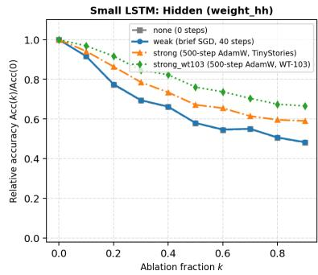

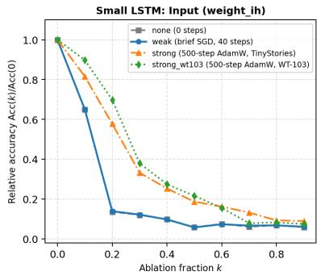

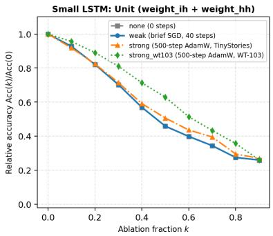  
Figure 14: Fine-tuning sensitivity across all three ablation modes of the Small LSTM $( k \in [ 0 , 0 . 9 ]$ across all four arms): (a) recurrent-connection pruning (weight hh), (b) input-connection pruning (weight ih), and (c) whole-unit removal (weight ih + weight hh, primary unit-level target). Curves compare zero fine-tuning (none), brief local SGD (weak, default protocol), 500-step AdamW on TinyStories (strong), and 500-step AdamW on in-domain WikiText-103 (strong wt103). As in the AWD-LSTM, none and weak are nearly indistinguishable, and whole-unit and recurrent ablation decline smoothly without a bufered plateau across all four arms.

3. strong: 500 gradient steps of AdamW $( \mathrm { l r } = 1 0 ^ { - 4 }$ , gradient clipping 1.0) on TinyStories $( \lVert \Delta \theta \rVert _ { 2 } \approx 4 6 $ 80 in Small LSTM $[ 3 . 0 \ – 7 7$ under weight ih], 73–176 in AWD-LSTM, 87–116 in Qwen 0.5B, and 72–78 in Qwen 1.8B MLP for $k \leq 0 . 2 )$ , representing an upper bound of global weight re-optimisation across all surviving parameters.

4. strong wt103 (Small LSTM and AWD-LSTM): 500 gradient steps of AdamW $\mathrm { ( l r = 1 0 ^ { - 4 } }$ , gradient clipping 1.0) on in-domain WikiText-103 $( \lVert \Delta \theta \rVert _ { 2 } \approx 3 4 \ – 6 7$ in Small LSTM [3.4–70 under weight ih] and 68–168 in AWD-LSTM), testing whether prolonged in-domain retraining induces a bufered plateau in recurrent architectures.

Across all models, this comparison establishes three main findings (Supplementary Figures 14–16). First, zero fine-tuning (none) and brief local SGD (weak) produce similar curve shapes: even at $\| \Delta \theta \| _ { 2 } = 0$ , Qwen shows a late threshold collapse under MLP ablation and an early plateau under attention ablation (scoring 2–6 percentage points lower in raw accuracy than weak, whereas none and weak coincide in the LSTMs). Second, in the LSTMs, even 500 steps of in-domain AdamW retraining (strong wt103) lift overall accuracy at high k without inducing a bufered plateau. Third, in the Transformers, 500 steps of global AdamW (strong) act as wholesale network retraining across surviving layers (recovering 86%–99% of baseline accuracy even at $k = 0 . 9 )$ , which is why we use brief local SGD (weak) as our primary protocol.

Supplementary Figures 14 and 15 show all three ablation modes (weight hh recurrent connections, weight ih input connections, and weight ih + weight hh whole-unit removal) for the Small LSTM and the pretrained AWD-LSTM, respectively. In both recurrent models and across all three ablation modes, the none and weak curves are virtually identical. In the Small LSTM (baseline 27.5%), whole-unit accuracy is 22.6% vs. 22.6% at $k = 0 . 2$ and 12.6% vs. 12.6% at $k = 0 . 5$ (and under weight hh pruning, 21.3% vs. 21.3% at $k = 0 . 2$ and 15.9% vs. 15.9% at $k = 0 . 5 )$ . In the AWD-LSTM (baseline 38.1%), whole-unit accuracy is 28.7% vs. 28.7% at $k = 0 . 2$ and 13.1% vs. 13.1% at $k = 0 . 5$ (and under weight hh pruning, 33.0% vs. 33.0% at $k = 0 . 2$ and 21.9% vs. 21.9% at $k = 0 . 5 )$ . Prolonged 500-step AdamW retraining on in-domain WikiText-103 (strong wt103) lifts accuracy at higher damage levels in both LSTMs. In the Small LSTM $( k = 0$ baseline 27.6%), whole-unit accuracy at $k = 0 . 5$ rises from 12.6% under none/weak to 17.4% (62.9% of baseline), and weight hh accuracy rises from 15.9% to 21.0% (76.0%). In the AWD-LSTM, the $k = 0$ baseline falls slightly from 38.05% to 37.02%, while at $k = 0 . 5$ whole-unit accuracy rises from 13.1% to 20.5% and weight hh accuracy rises from 21.9% to 26.9%. Even so, the whole-unit and recurrent trajectories in both LSTMs remain smooth and gradual without any bufered plateau. Because 40–50 steps of clipped SGD at $\mathrm { l r } = 1 0 ^ { - 3 }$ on out-of-domain TinyStories move the LSTM weights by only $\lVert \Delta \theta \rVert _ { 2 } \leq 0 . 0 1 1 9$ (relative change $\sim 1 0 ^ { - 5 } )$ , the LSTM weak arm leaves WikiText-2 accuracy unchanged and is efectively equivalent to none. By contrast, 500 steps of AdamW on the same TinyStories tensor in the strong arm do shift WikiText-2 accuracy (for example, lifting Small LSTM weight ih accuracy at $k = 0 . 2$ from 3.7% to 15.4%). Thus, the LSTM and Qwen weak arms are not symmetric.

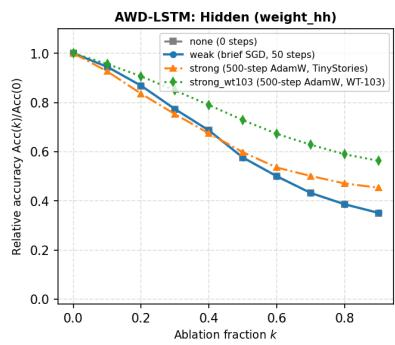

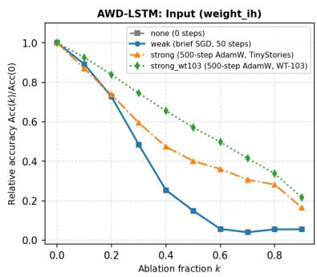

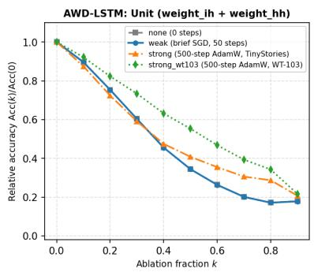

Figure 15: Fine-tuning sensitivity across all three ablation modes of the pretrained AWD-LSTM: (a) recurrent-connection pruning (weight hh), (b) input-connection pruning (weight ih), and (c) wholeunit removal (weight ih + weight hh, primary unit-level target). Curves compare zero fine-tuning (none), brief local SGD (weak, default protocol), 500-step AdamW on TinyStories (strong), and 500-step AdamW on in-domain WikiText-103 (strong wt103). Across all arms, whole-unit and recurrent ablation decline smoothly and monotonically without a bufered plateau.  
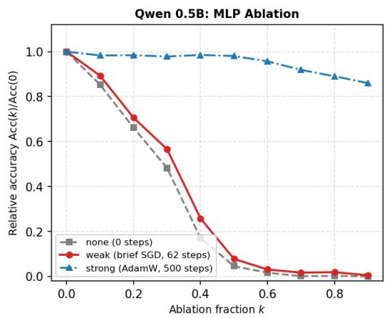

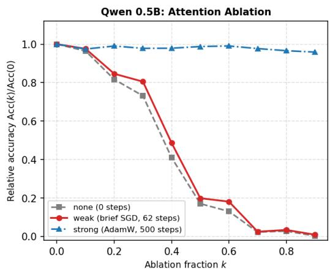  
Figure 16: Fine-tuning sensitivity across both pathways of the pretrained Qwen 0.5B Transformer $( k \in [ 0 , 0 . 9 ]$ across all three arms): (a) MLP neuron removal and (b) attention-head removal. Under zero fine-tuning (none) and brief local SGD (weak, 62 updates), MLP ablation declines at mild damage and then collapses sharply at $k \geq 0 . 4 .$ , while attention ablation shows an early plateau before declining, whereas 500-step global AdamW (strong) re-optimises surviving residual pathways across layers to restore near-baseline accuracy.

Supplementary Figure 16 shows the two Qwen 0.5B pathways (MLP neuron removal and attentionhead removal). With zero fine-tuning (none), the late threshold collapse is already present, although MLP retention at mild damage is lower than for Small LSTM whole-unit removal under the same arm (92.8% and 82.2% at $k = 0 . 1$ and 0.2). Specifically, Qwen 0.5B retains 85.3% (MLP, 44.0% raw) and 96.4% (Attention, 49.7% raw) of its unadapted $k = 0$ baseline (51.5%) at $k = 0 . 1$ , and 66.1% (MLP, 34.1% raw) and 81.7% (Attention, 42.1% raw) at $k = 0 . 2$ , before dropping steeply to 17.1% (8.8% raw) at $k = 0 . 4$ under MLP ablation and to the same level at $k = 0 . 5$ under attention ablation. Brief local SGD (weak) shifts accuracy modestly upward (for example, MLP at $k = 0 . 2 \colon 3 4 . 1 \%  3 7 . 9 \%$ at $k = 0 . 3 \colon 2 4 . 9 \%  3 0 . 4 \% )$ while preserving the sharp clif at $k \geq 0 . 4$ . The larger Qwen 1.8B MLP pathway exhibits the same pattern. With zero fine-tuning (none, $k = 0$ baseline $5 0 . 6 \% )$ , accuracy remains at 48.5% (96.0% of baseline) at $k = 0 . 1$ 41.5% (82.1%) at $k = 0 . 2$ , and 27.4% (54.2%) at $k = 0 . 3 ,$ then drops sharply to 8.9% (17.6%) at $k = 0 . 4$ and 7.5% (14.8%) at $k = 0 . 5$ . This closely matches the weak trajectory (51.1% [93.5%] at $k = 0 . 1$ , 44.8% [82.0%] at $k = 0 . 2 ,$ and 12.9% [23.5%] at $k = 0 . 4 )$ . By contrast, 500 steps of AdamW (strong, $\lVert \Delta \theta \rVert _ { 2 } \approx 8 7 - 1 1 6$ in Qwen 0.5B and 72–78 in Qwen 1.8B MLP for $k \leq 0 . 2 )$ globally re-optimise the surviving residual stream and un-lesioned layers to bypass the ablated sub-blocks almost completely. This restores Qwen 0.5B accuracy to 98.0% of baseline (52.2% raw) at $k = 0 . 5$ and 86.0% (45.8% raw) at $k = 0 . 9$ under MLP ablation, and to 95.9%–99.0% (51.1%–52.7% raw) across all $k \in [ 0 . 1 , 0 . 9 ]$ under attention ablation. In Qwen 1.8B MLP, it restores accuracy to 51.2% raw (103.1% of the 49.7% strong $k = 0$ baseline) at $k = 0 . 1$ and 50.7% raw (102.1%) at $k = 0 . 2 .$ . For Qwen 1.8B, the 500-step strong MLP sweep beyond $k = 0 . 2$ and the none/strong attention sweeps were omitted due to compute constraints, while the complete 10-point $k \in [ 0 , 0 . 9 ]$ sweep across all three arms in Qwen 0.5B and across none/weak in Qwen 1.8B MLP is reported above.

## S10 Qwen 1.8B: Full Qualitative Cloze Data

The 14 tables in Supplements S10–S13 list the complete 100-prompt predictions from the first ablation trial (trial 0) of each condition. In each table, the fourth column indicates whether the target word $\left( \tt E x p . \right)$ matches the top-1 prediction $\left( \mathtt { P r e d . ; \ V } \right)$ , appears among the model’s top-5 predictions (∼), or is absent from the top-5 (×).

Table 22: Qwen 1.8B: Baseline $( k = 0 )$ , all 100 Cloze prompts.
<table><tr><td>Prompt</td><td>Exp.</td><td>Pred.</td><td></td><td>Top-5</td></tr><tr><td>once upon a</td><td>time</td><td>time</td><td></td><td>[time, midnight, lonely, sum- mer, winter]</td></tr><tr><td>the sun was shining bright in the</td><td>sky</td><td>sky</td><td></td><td>[sky, clear, blue, garden, morning]</td></tr><tr><td>she picked up the</td><td>ball</td><td>phone</td><td></td><td>[phone, book, pen, ball, bag]</td></tr><tr><td>he put the food in his</td><td>mouth</td><td>mouth</td><td></td><td>[mouth, bag, pocket, hand, basket]</td></tr><tr><td>the little girl was wear- ing a pretty</td><td>dress</td><td>dress</td><td></td><td>[dress, skirt, white, pink,</td></tr><tr><td>the bird flew up into the</td><td>sky</td><td>sky</td><td></td><td>red] [sky, air, tree, trees, blue]</td></tr><tr><td>she gave her friend a big</td><td>hug</td><td>hug</td><td></td><td>[hug, surprise, smile, present, kiss]</td></tr><tr><td>the cat jumped on the</td><td>table</td><td>table</td><td></td><td>[table, bed, chair, mat, mouse]</td></tr><tr><td>he found a beautiful</td><td>flower</td><td>girl</td><td>×</td><td>[girl, painting, house, vase, dress]</td></tr><tr><td>they played together in the</td><td>park</td><td>park</td><td></td><td>[park, same, , school, past]</td></tr><tr><td>she sang a beautiful</td><td>song</td><td>song</td><td></td><td>[song, , piece, ------, and]</td></tr><tr><td>he wanted to go</td><td>home</td><td>to</td><td></td><td>[to, out, home, on, there]</td></tr><tr><td>the really big</td><td>bear</td><td>question</td><td>X</td><td>[question, news, one, deal, thing]</td></tr><tr><td>a very small</td><td>mouse</td><td>number</td><td>×</td><td>[number, and, ,, but, exam- ple]</td></tr><tr><td>the extremely bright</td><td>light</td><td>light</td><td>V</td><td>[light, and, star, object, white]</td></tr><tr><td>he was very happy and laugh started to</td><td></td><td>sing</td><td></td><td>[sing, dance, play, cry, laugh]</td></tr><tr><td>the dog saw a cat and bark started to</td><td></td><td>bark</td><td></td><td>[bark, run, chase, cry, play]</td></tr><tr><td>they went outside to</td><td>play</td><td>play</td><td></td><td>[play, see, have, enjoy, look]</td></tr><tr><td>he ran as fast as he</td><td>could</td><td>could</td><td></td><td>[could, can, ____-_, c, cou]</td></tr><tr><td>the baby started to</td><td>cry</td><td>cry</td><td>V</td><td>[cry, walk, laugh, sleep, speak]</td></tr></table>

<table><tr><td rowspan=1 colspan=16>Prompt                Exp.    Pred.          Top-5</td></tr><tr><td rowspan=1 colspan=16>he carefully               placed               X   [,, ,, listened, and, to]</td></tr><tr><td rowspan=1 colspan=10>they quickly              ran      became    X</td><td></td><td></td><td></td><td></td><td></td><td rowspan=1 colspan=1>[became, got, went, moved,</td></tr><tr><td rowspan=8 colspan=6>she slowly                walkedhe gently                 touchedhe was so tired that he  asleepfellshe looked at the stars  happyand feltexcited</td><td></td><td></td><td></td><td></td><td></td><td></td><td></td><td rowspan=2 colspan=2>walked</td><td rowspan=2 colspan=1>made]</td></tr><tr><td></td><td></td><td></td><td></td><td></td><td></td><td></td><td rowspan=1 colspan=1>got]</td></tr><tr><td></td><td></td><td></td><td></td><td></td><td></td><td></td><td rowspan=1 colspan=2>touched</td><td rowspan=1 colspan=1>[touched,   shook,   took,</td></tr><tr><td></td><td></td><td></td><td></td><td></td><td></td><td></td><td rowspan=1 colspan=2></td><td rowspan=1 colspan=1>pulled, placed]</td></tr><tr><td></td><td></td><td></td><td></td><td></td><td></td><td></td><td rowspan=4 colspan=2>asleep     Vthe        Xa</td><td rowspan=1 colspan=1>[asleep, a, -_---, , into]</td></tr><tr><td></td><td></td><td></td><td></td><td></td><td></td><td></td><td rowspan=1 colspan=1>[the, a, that, very, like]</td></tr><tr><td></td><td></td><td></td><td></td><td></td><td rowspan=2 colspan=1></td><td></td><td></td></tr><tr><td></td><td></td><td></td><td rowspan=1 colspan=1></td><td></td><td></td><td rowspan=1 colspan=1>[a, good, tired, upset, angry]</td></tr><tr><td></td><td></td><td></td><td></td><td></td><td></td><td></td><td></td><td></td><td rowspan=1 colspan=1>V</td><td></td><td rowspan=1 colspan=1>the water was very</td><td rowspan=1 colspan=1>cold</td><td rowspan=1 colspan=1>cold</td><td></td><td rowspan=1 colspan=1>[cold, clear, dirty, hot, clean]</td></tr><tr><td></td><td></td><td></td><td></td><td></td><td></td><td></td><td></td><td></td><td rowspan=1 colspan=1>2</td><td></td><td rowspan=1 colspan=1>he was feeling very</td><td rowspan=1 colspan=1>sad</td><td rowspan=1 colspan=1>tired</td><td></td><td rowspan=1 colspan=1>[tired, sad, ill, hungry, sick]</td></tr><tr><td></td><td></td><td></td><td></td><td></td><td></td><td></td><td></td><td></td><td rowspan=1 colspan=1>X</td><td></td><td rowspan=1 colspan=1>it was an incredibly</td><td rowspan=1 colspan=1>beautiful</td><td rowspan=1 colspan=1>long</td><td></td><td rowspan=1 colspan=1>[long, hot, busy, difficult, ex-</td></tr><tr><td rowspan=2 colspan=4>she had a particularly</td><td></td><td></td><td></td><td></td><td></td><td rowspan=1 colspan=1></td><td></td><td></td><td rowspan=2 colspan=1>special</td><td rowspan=1 colspan=1></td><td></td><td rowspan=1 colspan=1>citing]</td></tr><tr><td></td><td></td><td></td><td></td><td></td><td rowspan=1 colspan=1>X</td><td></td><td></td><td rowspan=1 colspan=1>bad</td><td></td><td rowspan=1 colspan=1>[bad, difficult, good, hard,</td></tr><tr><td></td><td></td><td></td><td></td><td></td><td rowspan=1 colspan=1></td><td></td><td></td><td></td><td rowspan=1 colspan=1></td><td></td><td></td><td></td><td rowspan=1 colspan=1></td><td></td><td rowspan=1 colspan=1>strong]</td></tr><tr><td rowspan=2 colspan=4>the surprisingly</td><td></td><td></td><td></td><td></td><td></td><td rowspan=1 colspan=1>X</td><td></td><td></td><td rowspan=1 colspan=1>gentle</td><td rowspan=1 colspan=1>good</td><td></td><td rowspan=1 colspan=1>[good, large, short, simple,</td></tr><tr><td></td><td></td><td></td><td></td><td></td><td></td><td></td><td rowspan=2 colspan=1>an unusually</td><td rowspan=2 colspan=1>quiet</td><td></td><td></td><td rowspan=1 colspan=1>long]</td></tr><tr><td></td><td></td><td></td><td></td><td></td><td></td><td></td><td></td><td></td><td rowspan=1 colspan=1>X</td><td></td><td rowspan=1 colspan=1>large</td><td></td><td rowspan=1 colspan=1>[large,strong,high,long,good]</td></tr><tr><td></td><td></td><td></td><td></td><td></td><td></td><td></td><td></td><td></td><td rowspan=1 colspan=1>X</td><td></td><td rowspan=1 colspan=1>the remarkably</td><td rowspan=1 colspan=1>clever</td><td rowspan=1 colspan=1>good</td><td></td><td rowspan=1 colspan=1>[good,large, simple, high,</td></tr><tr><td></td><td></td><td></td><td></td><td></td><td></td><td></td><td></td><td></td><td rowspan=1 colspan=1>2</td><td rowspan=1 colspan=6>low]</td><td rowspan=1 colspan=1>a wonderfully</td><td rowspan=1 colspan=1>warm</td><td rowspan=1 colspan=1>simple</td><td rowspan=1 colspan=1>[simple,unique, creative,</td></tr><tr><td></td><td></td><td></td><td></td><td></td><td></td><td></td><td></td><td></td><td rowspan=1 colspan=1></td><td></td><td></td><td></td><td rowspan=1 colspan=1></td><td></td><td rowspan=1 colspan=1>warm, illustrated]</td></tr><tr><td rowspan=1 colspan=4>she opened the door andwalked</td><td></td><td></td><td></td><td></td><td></td><td rowspan=1 colspan=1>X</td><td></td><td></td><td rowspan=1 colspan=1>inside</td><td rowspan=1 colspan=1>into</td><td></td><td rowspan=1 colspan=1>[into, in, out, ---_, to]</td></tr><tr><td rowspan=1 colspan=4>the story ended</td><td></td><td></td><td></td><td></td><td></td><td rowspan=1 colspan=1>X</td><td rowspan=1 colspan=6>[with, in, up, ,, ,]</td></tr><tr><td rowspan=1 colspan=4>the children were play-</td><td></td><td></td><td></td><td></td><td></td><td rowspan=1 colspan=1>2</td><td rowspan=1 colspan=6>[happily,in, on,outside,</td></tr><tr><td rowspan=1 colspan=4>ing</td><td></td><td></td><td></td><td></td><td></td><td rowspan=1 colspan=1></td><td rowspan=1 colspan=6>games]</td></tr><tr><td rowspan=1 colspan=4>the boat sailedacrossthe</td><td></td><td></td><td></td><td></td><td></td><td rowspan=1 colspan=1>X</td><td rowspan=1 colspan=6>[river, sea, lake, atl, channel]</td></tr><tr><td rowspan=1 colspan=4>she hung the picture onthe</td><td></td><td></td><td></td><td></td><td></td><td rowspan=1 colspan=1>V</td><td rowspan=1 colspan=6>[wall, __--, , back, _____-]</td></tr><tr><td rowspan=3 colspan=4>the keys were left on thehe parked the car in the</td><td rowspan=1 colspan=2>counter</td><td></td><td></td><td></td><td rowspan=1 colspan=1>X</td><td rowspan=1 colspan=6>[table, desk, floor, ground,</td></tr><tr><td rowspan=2 colspan=1>the</td><td rowspan=2 colspan=2></td><td></td><td></td><td></td><td rowspan=1 colspan=1></td><td rowspan=1 colspan=6>chair]</td></tr><tr><td></td><td></td><td></td><td rowspan=1 colspan=1>7</td><td rowspan=1 colspan=6>[garage, driveway, parking,</td></tr><tr><td></td><td></td><td rowspan=1 colspan=2></td><td rowspan=1 colspan=2></td><td rowspan=2 colspan=10>the planedisappeared</td><td rowspan=1 colspan=1></td></tr><tr><td></td><td></td><td></td><td></td><td rowspan=1 colspan=2>clouds</td><td rowspan=1 colspan=6>[mountain, clouds, moun-</td></tr><tr><td rowspan=1 colspan=1>behind</td><td rowspan=1 colspan=3>the</td><td rowspan=1 colspan=2></td><td></td><td></td><td></td><td></td><td rowspan=1 colspan=6>tains, hill, trees]</td></tr><tr><td rowspan=2 colspan=1>they</td><td rowspan=1 colspan=3>arrived early in the</td><td rowspan=1 colspan=2>morning</td><td></td><td></td><td></td><td rowspan=1 colspan=1></td><td rowspan=2 colspan=6>[morning, afternoon,city,evening, day]</td></tr><tr><td rowspan=1 colspan=3></td><td rowspan=1 colspan=2></td><td></td><td></td><td></td><td rowspan=1 colspan=1></td><td rowspan=1 colspan=1></td></tr><tr><td rowspan=1 colspan=1>the c</td><td rowspan=1 colspan=3>oncert lasted until</td><td rowspan=1 colspan=2>midnight</td><td></td><td></td><td></td><td rowspan=1 colspan=1>2</td><td rowspan=1 colspan=6>[, midnight, ten, the, eleven]</td></tr><tr><td rowspan=3 colspan=1>we wi</td><td rowspan=2 colspan=3>ll meet again next</td><td rowspan=2 colspan=2>week</td><td></td><td></td><td></td><td rowspan=1 colspan=1>V</td><td rowspan=1 colspan=6>[week, month, year, time, fri-</td></tr><tr><td></td><td></td><td></td><td rowspan=1 colspan=1></td><td rowspan=1 colspan=6>day]</td></tr><tr><td rowspan=2 colspan=3>she poured the milk into</td><td rowspan=2 colspan=2>glass</td><td></td><td></td><td></td><td rowspan=1 colspan=1>X</td><td rowspan=1 colspan=6>[bowl,blender,cup, pot,</td></tr><tr><td rowspan=1 colspan=1>the</td><td></td><td></td><td></td><td rowspan=1 colspan=1></td><td rowspan=1 colspan=6>bottle]</td></tr><tr><td rowspan=1 colspan=4>he spread butter on the</td><td rowspan=1 colspan=2>bread</td><td></td><td></td><td></td><td></td><td rowspan=1 colspan=6>[bread, toast, cake, sand-</td></tr><tr><td rowspan=3 colspan=4>the chef chopped the</td><td rowspan=1 colspan=2></td><td></td><td></td><td></td><td></td><td rowspan=1 colspan=6>wich, slices]</td></tr><tr><td rowspan=1 colspan=2>vegetables</td><td></td><td></td><td></td><td></td><td rowspan=1 colspan=6>[onion, meat, vegetables,</td></tr><tr><td rowspan=1 colspan=2></td><td></td><td></td><td></td><td></td><td rowspan=1 colspan=6>chicken, onions]</td></tr><tr><td rowspan=2 colspan=4>she stirred the soup witha</td><td rowspan=2 colspan=2>spoon</td><td></td><td></td><td></td><td></td><td rowspan=2 colspan=6>[spoon,wooden, lad, fork,long]</td></tr><tr><td></td><td></td><td></td><td></td><td rowspan=1 colspan=2></td></tr><tr><td rowspan=1 colspan=4>the horse galloped acrossthe</td><td rowspan=1 colspan=2></td><td rowspan=2 colspan=9>Vpond    water</td><td rowspan=1 colspan=1>field</td></tr><tr><td rowspan=1 colspan=4>the fish swam in the</td><td></td><td></td><td></td></tr><tr><td rowspan=2 colspan=4>the eagle soaredabovethe</td><td rowspan=2 colspan=6>mountains city       2</td><td rowspan=1 colspan=6>[city,mountains,  valley,</td></tr><tr><td rowspan=1 colspan=6>mountain, fields]</td></tr><tr><td rowspan=1 colspan=4>after the longhike he</td><td rowspan=1 colspan=6>tired    tired</td><td rowspan=1 colspan=6>[tired,  exhausted,hungry,</td></tr><tr><td rowspan=1 colspan=4>was extremely</td><td rowspan=1 colspan=6></td><td rowspan=1 colspan=6>t]</td></tr></table>

<table><tr><td rowspan=1 colspan=12>Prompt                Exp.   Pred.          Top-5</td></tr><tr><td rowspan=2 colspan=11>the news made everyone  happy   excitedverythe dark alley made her  afraid   like        XfeelV</td><td rowspan=3 colspan=1>[excited, happy,     angry,[like,     as, very, uneasy][difficult, hard, easy, chal-ienging, complex]</td></tr><tr><td rowspan=3 colspan=4>blythe audiencewascom-pletely</td><td rowspan=2 colspan=1>difficult</td><td rowspan=2 colspan=2>diffict</td><td rowspan=2 colspan=4></td></tr><tr><td rowspan=1 colspan=2></td></tr><tr><td rowspan=1 colspan=1>silent</td><td rowspan=1 colspan=6></td><td rowspan=1 colspan=4></td><td rowspan=1 colspan=1></td></tr><tr><td rowspan=1 colspan=4>the teacheraskedthestudents to</td><td rowspan=1 colspan=1>listen</td><td rowspan=1 colspan=6>write      X</td><td rowspan=1 colspan=1>[write, answer,stop, do,</td></tr><tr><td rowspan=1 colspan=4>she decided to finally</td><td rowspan=1 colspan=1>leave</td><td rowspan=1 colspan=6>get        X</td><td rowspan=1 colspan=1>[get, go, take, give, make]</td></tr><tr><td rowspan=2 colspan=4>the alarm clock startedto</td><td rowspan=2 colspan=1>ring</td><td rowspan=1 colspan=3>ring</td><td></td><td rowspan=2 colspan=2>V</td><td rowspan=2 colspan=1>[ring, go, r,</td></tr><tr><td rowspan=1 colspan=3></td><td></td></tr><tr><td rowspan=1 colspan=4>the snow began to</td><td rowspan=1 colspan=1>melt</td><td rowspan=1 colspan=3>fall</td><td></td><td rowspan=1 colspan=2>2</td><td rowspan=1 colspan=1>[fall, melt, ,   ---, fly]</td></tr><tr><td rowspan=1 colspan=4>he promised he wouldnever</td><td rowspan=1 colspan=1>forget</td><td rowspan=1 colspan=3>forget</td><td></td><td rowspan=1 colspan=2>√</td><td rowspan=1 colspan=1>[forget, do, let, leave, be]</td></tr><tr><td rowspan=1 colspan=4>the children love to</td><td rowspan=1 colspan=1>swim</td><td rowspan=1 colspan=6>play       X</td><td rowspan=1 colspan=1>[play, go, watch, see, have]</td></tr><tr><td rowspan=1 colspan=4>she wanted to learn how</td><td rowspan=1 colspan=1>dance</td><td rowspan=1 colspan=3>play</td><td rowspan=1 colspan=3>X</td><td rowspan=1 colspan=1>[play, make, drive, use,</td></tr><tr><td rowspan=1 colspan=4>to</td><td rowspan=1 colspan=1></td><td rowspan=1 colspan=3></td><td rowspan=1 colspan=3></td><td rowspan=1 colspan=1>swim]</td></tr><tr><td rowspan=1 colspan=4>the mechanic tried to</td><td rowspan=1 colspan=1>repair</td><td rowspan=1 colspan=3>fix</td><td rowspan=1 colspan=3></td><td rowspan=1 colspan=1>[fix, repair, get, sell, make]</td></tr><tr><td rowspan=1 colspan=4>dark clouds gathered be-</td><td rowspan=1 colspan=1>storm</td><td rowspan=1 colspan=3>sun</td><td rowspan=1 colspan=3></td><td rowspan=1 colspan=1>[sun,moon,storm,dawn,</td></tr><tr><td rowspan=1 colspan=4>fore the</td><td rowspan=1 colspan=1></td><td rowspan=1 colspan=3></td><td rowspan=1 colspan=3></td><td rowspan=1 colspan=1>rain]</td></tr><tr><td rowspan=1 colspan=4>the flowers bloomed in</td><td rowspan=1 colspan=1>spring</td><td rowspan=1 colspan=6>garden</td><td rowspan=1 colspan=1>[garden,spring, park, sun,</td></tr><tr><td rowspan=1 colspan=2>the</td><td rowspan=1 colspan=2></td><td rowspan=1 colspan=1></td><td rowspan=1 colspan=3></td><td rowspan=1 colspan=3></td><td rowspan=1 colspan=1></td></tr><tr><td rowspan=2 colspan=4>the leaves fall from thetrees in</td><td rowspan=1 colspan=1>autumn</td><td rowspan=1 colspan=3>autumn</td><td rowspan=1 colspan=3></td><td rowspan=1 colspan=1>[autumn, the,september,</td></tr><tr><td rowspan=1 colspan=1></td><td rowspan=1 colspan=3></td><td rowspan=1 colspan=3></td><td rowspan=1 colspan=1>fall, a]</td></tr><tr><td rowspan=1 colspan=4>the river flowed into the</td><td rowspan=1 colspan=1>sea</td><td rowspan=1 colspan=3>sea</td><td rowspan=1 colspan=3></td><td rowspan=1 colspan=1>[sea, ocean, lake, city, bay]</td></tr><tr><td rowspan=1 colspan=4>the student wrote an</td><td rowspan=1 colspan=1>essay</td><td rowspan=1 colspan=3>essay</td><td rowspan=1 colspan=3></td><td rowspan=1 colspan=1>[essay, article, excellent, ap-</td></tr><tr><td rowspan=3 colspan=4>she typed the email onher</td><td rowspan=1 colspan=1></td><td rowspan=1 colspan=3></td><td rowspan=1 colspan=3></td><td rowspan=1 colspan=1>plication, assignment]</td></tr><tr><td rowspan=1 colspan=1>keyboard</td><td rowspan=1 colspan=6>computer  X</td><td rowspan=1 colspan=1>[computer, phone, mobile,</td></tr><tr><td rowspan=1 colspan=1></td><td rowspan=1 colspan=6></td><td rowspan=1 colspan=1>laptop, smart]</td></tr><tr><td rowspan=1 colspan=4>the professor gave a</td><td rowspan=1 colspan=1>lecture</td><td rowspan=1 colspan=6>lecture</td><td rowspan=1 colspan=1>[lecture,talk,  detailed,</td></tr><tr><td></td><td></td><td></td><td></td><td></td><td rowspan=1 colspan=6></td><td rowspan=1 colspan=5>he submitted his final</td></tr><tr><td></td><td></td><td></td><td></td><td></td><td rowspan=2 colspan=6></td><td rowspan=2 colspan=1>exam]</td></tr><tr><td rowspan=3 colspan=4>the crowd started to</td><td rowspan=2 colspan=1>cheer</td></tr><tr><td rowspan=1 colspan=6>gather</td><td rowspan=1 colspan=1>[gather,get,cheer,</td></tr><tr><td rowspan=1 colspan=1></td><td rowspan=1 colspan=6></td><td rowspan=1 colspan=1>move]</td></tr><tr><td rowspan=1 colspan=4>he bent down to</td><td rowspan=1 colspan=1>pick</td><td rowspan=1 colspan=6>pick</td><td rowspan=1 colspan=1>[pick,look,see,examine,</td></tr><tr><td rowspan=2 colspan=4>she leaned forward to</td><td rowspan=2 colspan=1>whisper</td><td rowspan=1 colspan=6></td><td rowspan=1 colspan=1>take]</td></tr><tr><td rowspan=1 colspan=6>see        ×</td><td rowspan=1 colspan=1>[see, look, take, kiss, give]</td></tr><tr><td rowspan=1 colspan=4>the wind continued to</td><td rowspan=1 colspan=1>blow</td><td rowspan=1 colspan=6>blow       V</td><td rowspan=1 colspan=1>[blow, how, ______, be, pick]</td></tr><tr><td rowspan=1 colspan=4>they gathered around to</td><td rowspan=1 colspan=1>celebrate</td><td rowspan=1 colspan=6>hear       X</td><td rowspan=1 colspan=1>[hear,listen,watch, see,</td></tr><tr><td></td><td></td><td></td><td></td><td rowspan=2 colspan=1></td><td rowspan=2 colspan=6></td><td rowspan=2 colspan=1>talk]</td></tr><tr><td rowspan=2 colspan=4>he struggled to</td></tr><tr><td rowspan=1 colspan=1>breathe</td><td rowspan=1 colspan=6>keep       X</td><td rowspan=1 colspan=1>[keep, get, find, make, </td></tr><tr><td rowspan=1 colspan=4>the sunsetwasabso-</td><td rowspan=1 colspan=1>stunning</td><td rowspan=1 colspan=3>beautiful</td><td></td><td rowspan=1 colspan=2>2</td><td rowspan=1 colspan=1>[beautiful, gorgeous, stun-</td></tr><tr><td rowspan=1 colspan=4>lutely</td><td rowspan=1 colspan=1></td><td rowspan=1 colspan=3></td><td></td><td rowspan=1 colspan=2></td><td rowspan=1 colspan=1>ning, breathtaking, amazing]</td></tr><tr><td rowspan=2 colspan=4>the oldhouselookedrather</td><td rowspan=2 colspan=1>creepy</td><td rowspan=1 colspan=3>small</td><td></td><td rowspan=1 colspan=2>X</td><td rowspan=2 colspan=1>[small, empty, the, strange,sh]</td></tr><tr><td rowspan=1 colspan=3></td><td></td><td rowspan=1 colspan=2></td></tr><tr><td rowspan=1 colspan=4>his explanation was per-</td><td rowspan=1 colspan=1>clear</td><td rowspan=1 colspan=6>clear</td><td rowspan=2 colspan=1>[clear, reasonable,     cor-rect, in]</td></tr><tr><td rowspan=1 colspan=3>fectly</td><td rowspan=1 colspan=1></td><td rowspan=1 colspan=1></td><td rowspan=1 colspan=3></td><td></td><td rowspan=1 colspan=2></td></tr><tr><td rowspan=1 colspan=4>the caketastedabso-</td><td rowspan=1 colspan=1></td><td rowspan=1 colspan=3>delicious</td><td rowspan=1 colspan=3>delicious</td><td rowspan=1 colspan=1></td></tr><tr><td rowspan=1 colspan=4>lutely</td><td rowspan=1 colspan=1></td><td rowspan=1 colspan=3></td><td></td><td rowspan=1 colspan=2></td><td rowspan=1 colspan=1>tic, amazing, terrible]</td></tr><tr><td rowspan=2 colspan=4>the mountain trail wasextremely</td><td rowspan=1 colspan=1>steep</td><td rowspan=1 colspan=6>difficult</td><td rowspan=1 colspan=1>[difficult, steep, challenging,</td></tr><tr><td rowspan=1 colspan=1></td><td rowspan=1 colspan=6></td><td rowspan=1 colspan=1>beautiful, hard]</td></tr><tr><td rowspan=2 colspan=4>the instructionsweresurprisingly</td><td rowspan=1 colspan=1>simple</td><td rowspan=1 colspan=6>easy</td><td rowspan=1 colspan=1>[easy, clear, simple, straight-</td></tr><tr><td rowspan=1 colspan=1></td><td rowspan=1 colspan=6></td><td rowspan=3 colspan=1>forward, straight][paper, scientific, new, arti-cle, book]</td></tr><tr><td rowspan=2 colspan=4>the scientistpublishedan important</td><td rowspan=2 colspan=1>discovery</td><td rowspan=1 colspan=6>paper      X</td></tr><tr><td rowspan=1 colspan=1></td><td rowspan=1 colspan=6></td></tr><tr><td rowspan=1 colspan=4>the city was known for</td><td rowspan=1 colspan=1>history</td><td rowspan=1 colspan=6>history</td><td rowspan=1 colspan=1>[history, c</td></tr><tr><td rowspan=1 colspan=4>its rich</td><td rowspan=1 colspan=1></td><td rowspan=1 colspan=6></td><td rowspan=1 colspan=1>and,</td></tr></table>

<table><tr><td>Prompt</td><td>Exp.</td><td>Pred.</td><td></td><td>Top-5</td></tr><tr><td>she always valued hon- esty and</td><td>kindness</td><td>integrity</td><td>×</td><td>[integrity, hard, trust, truth, fairness]</td></tr><tr><td>the treaty established lasting</td><td>peace</td><td>peace</td><td></td><td>[peace, security, relations, diplomatic, friendship]</td></tr><tr><td>the car moved forward</td><td>slowly</td><td>at</td><td>×</td><td>[at, with, ., ,, and]</td></tr><tr><td>he waited</td><td>patiently for</td><td></td><td>×</td><td>[for, in, at, and, until]</td></tr><tr><td>she tied the laces on her</td><td>shoes</td><td>new</td><td></td><td>[new, shoes, shoe, dress, boots]</td></tr><tr><td>he wrapped the scarf around his</td><td>neck</td><td>neck</td><td></td><td>[neck, head, waist, shoul- ders, face]</td></tr><tr><td>the doctor examined the patient&#x27;s</td><td>heart</td><td>chest</td><td></td><td>[chest, heart, throat, __--, stomach]</td></tr><tr><td>she checked the notifica- phone tions on her</td><td></td><td>phone</td><td></td><td>[phone, iphone, mobile, smartphone, iPhone]</td></tr><tr><td>the password must con- characters characters tain at least eight</td><td></td><td></td><td></td><td>[characters, (, digits, letters, character]</td></tr><tr><td>he plugged the charger into the</td><td>socket</td><td>wall</td><td>×</td><td>[wall, computer, phone, power, outlet]</td></tr><tr><td>the door began to</td><td>open</td><td>shake</td><td></td><td>[shake, open, move, c, r]</td></tr><tr><td>she refused to</td><td>quit</td><td>accept</td><td>×</td><td>[accept, answer, go, give, say]</td></tr></table>

Table 23: Qwen 1.8B: MLP Ablation (k = 0.2), all 100 Cloze prompts.
<table><tr><td>Prompt</td><td>Exp.</td><td>Pred.</td><td></td><td>Top-5</td></tr><tr><td>once upon a</td><td>time</td><td>day</td><td></td><td>[day, summer, time, hill, night]</td></tr><tr><td>the sun was shining bright in the</td><td>sky</td><td>sky</td><td></td><td>[sky, clouds, , day, blue]</td></tr><tr><td>she picked up the</td><td>ball</td><td>ball</td><td></td><td>[ball, book, , pen, phone]</td></tr><tr><td>he put the food in his</td><td>mouth</td><td>mouth</td><td></td><td>[mouth, stomach, , belly, own]</td></tr><tr><td>the little girl was wear- ing a pretty</td><td>dress</td><td>dress</td><td></td><td>[dress, , (, red, ------]</td></tr><tr><td>the bird flew up into the</td><td>sky</td><td>trees</td><td></td><td>[trees, sky, air, tree, tall]</td></tr><tr><td>she gave her friend a big</td><td>hug</td><td></td><td>×</td><td>surprise, ___-_, birth- day, ]</td></tr><tr><td>the cat jumped on the</td><td>table</td><td>bed</td><td>×</td><td>[bed, ground, top, floor, ]</td></tr><tr><td>he found a beautiful</td><td>flower</td><td>girl</td><td>×</td><td>[girl, , picture, place, old]</td></tr><tr><td>they played together in the</td><td>park</td><td>same</td><td></td><td>[same, park, , past, school]</td></tr><tr><td>she sang a beautiful</td><td>song</td><td>song</td><td></td><td>[song, tune, , and, poem]</td></tr><tr><td>he wanted to go</td><td>home</td><td>to</td><td>×</td><td>[to, with, back, and, out]</td></tr><tr><td>the really big</td><td>bear</td><td>ones</td><td>X</td><td>[ones, thing, deal, stuff, news]</td></tr><tr><td>a very small</td><td>mouse</td><td></td><td>×</td><td>[,, collection, , and, entry]</td></tr><tr><td>the extremely bright</td><td>light</td><td></td><td></td><td>[,, and, , point, light]</td></tr><tr><td>he was very happy and started to</td><td>laugh</td><td>play</td><td>×</td><td>[play, , sing, tell, take]</td></tr><tr><td>the dog saw a cat and started to</td><td>bark</td><td>chase</td><td></td><td>[chase, follow, run, bark, call]</td></tr><tr><td>they went outside to</td><td>play</td><td>play</td><td></td><td>[play, see, watch, get, make]</td></tr><tr><td>he ran as fast as he</td><td>could</td><td>could</td><td></td><td>[could, did, had, was, can]</td></tr><tr><td>the baby started to</td><td>cry</td><td>cry</td><td></td><td>[cry, grow, start, , make]</td></tr><tr><td>he carefully</td><td>placed</td><td>and</td><td>×</td><td>[and, ,, as, to, ,]</td></tr><tr><td>they quickly</td><td>ran</td><td>became</td><td>×</td><td>[became, learned, get, , be- come]</td></tr><tr><td>she slowly</td><td>walked</td><td>began</td><td>X</td><td>[began, came, started, , fell]</td></tr><tr><td>he gently</td><td>touched</td><td>closed</td><td>2</td><td>[closed, and, touched, moved, shook]</td></tr><tr><td>he was so tired that he fell</td><td>asleep</td><td>into</td><td>2</td><td>[into, asleep, down, , a]</td></tr><tr><td>she looked at the stars and felt</td><td>happy</td><td>the</td><td>×</td><td>[the, a, her, that, their]</td></tr><tr><td>she was really</td><td>excited</td><td>a</td><td>X</td><td>[a, in, , the, good]</td></tr><tr><td>the water was very</td><td>cold</td><td>shallow</td><td>X</td><td>[shallow, clear, hard, , ,]</td></tr><tr><td>he was feeling very</td><td>sad</td><td></td><td>X</td><td>[, bad, good, ______, ill]</td></tr><tr><td>it was an incredibly</td><td>beautiful</td><td></td><td>X</td><td>[, hot, busy, day, (]</td></tr><tr><td>she had a particularly</td><td>special</td><td>good</td><td>X</td><td>[good, hard, strong, bad, (]</td></tr><tr><td>the surprisingly</td><td>gentle</td><td>good</td><td>X</td><td>[good, small, ,, (, ability]</td></tr><tr><td>an unusually</td><td>quiet</td><td>small</td><td>X</td><td>[small, warm, long, un, large]</td></tr><tr><td>the remarkably</td><td>clever</td><td></td><td>X</td><td>[,, , (, ability, good]</td></tr><tr><td>a wonderfully</td><td>warm</td><td>illustrated</td><td>X</td><td>[illustrated, and, full, collec- tion, story]</td></tr><tr><td>she opened the door and walked</td><td>inside</td><td>into</td><td>X</td><td>[into, in, out, down, onto]</td></tr><tr><td>the story ended</td><td>happily</td><td>with</td><td>X</td><td>[with, ,, and, in, .]</td></tr><tr><td>the children were play- ing</td><td>outside</td><td>a</td><td>X</td><td>[a, with, the, and, ,]</td></tr><tr><td>the boat sailed across the</td><td>ocean</td><td>bay</td><td>×</td><td>[bay, Bay, , Gulf, river]</td></tr><tr><td>she hung the picture on the</td><td>wall</td><td>wall</td><td></td><td>[wall, floor, walls, , shelf]</td></tr><tr><td>the keys were left on the</td><td>counter</td><td>floor</td><td>X</td><td>[floor, ground, keys, table, street]</td></tr><tr><td>he parked the car in the</td><td>garage</td><td>middle</td><td></td><td>[middle, corner, driveway, garage, parking]</td></tr><tr><td>the plane disappeared behind the</td><td>clouds</td><td>clouds</td><td></td><td>[clouds, mountain, moun- tains, tall, horizon]</td></tr><tr><td>they arrived early in the</td><td>morning</td><td>afternoon</td><td></td><td>[afternoon, morning,</td></tr><tr><td>the concert lasted until</td><td>midnight</td><td></td><td>2</td><td>evening, day, early] [, the, midnight, about, nine]</td></tr><tr><td>we will meet again next</td><td>week</td><td>week</td><td>V</td><td>[week, time, Monday, Friday, weekend]</td></tr><tr><td>she poured the milk into the</td><td>glass</td><td>bottle</td><td>×</td><td>[bottle, cup, bucket, , pot]</td></tr><tr><td>he spread butter on the</td><td>bread</td><td>top</td><td>X</td><td>[top, ground, floor, surface, bottom]</td></tr><tr><td>the chef chopped the</td><td></td><td>vegetables meat</td><td>X</td><td>[meat, ingredients,</td></tr><tr><td>she stirred the soup with</td><td>spoon</td><td>spoon</td><td></td><td>pieces, fresh] [spoon, fork, small, little,</td></tr><tr><td>a the horse galloped across</td><td>field</td><td>ground</td><td></td><td>hand] [ground, field, track, fields,</td></tr><tr><td>the the fish swam in the</td><td>pond</td><td>water</td><td>X</td><td>trail] [water, , river, sea, same]</td></tr><tr><td>the eagle soared above the</td><td></td><td>mountains mountain</td><td></td><td>[mountain, mountains,</td></tr><tr><td>after the long hike he</td><td>tired</td><td>exhausted</td><td></td><td>rocky, clouds, tall] [exhausted, tired, relieved,</td></tr><tr><td>was extremely the news made everyone</td><td>happy</td><td></td><td></td><td>worn, out] ___--_, happy, , .]</td></tr><tr><td>very the dark alley made her</td><td>afraid</td><td>the</td><td>X</td><td>[the, a, both, ., so]</td></tr><tr><td>feel the puzzle was incredi-</td><td>difficult</td><td>difficult</td><td></td><td>[difficult, hard, inter, com-</td></tr><tr><td>bly the audience was com-</td><td>silent</td><td>in</td><td>X</td><td>plicated, complex] [in, eng, , ______, taken]</td></tr></table>

<table><tr><td colspan="6" rowspan="1">Prompt                Exp.    Pred.         Top-5</td></tr><tr><td colspan="5" rowspan="1">the teacheraskedthe  listen    stand      Xstudents to</td><td colspan="1" rowspan="1">[stand, , be, turn, stop]</td></tr><tr><td colspan="2" rowspan="1">she decided to finally</td><td colspan="2" rowspan="1">leave    go</td><td colspan="1" rowspan="1">X</td><td colspan="1" rowspan="1">[go, get, make, take, start]</td></tr><tr><td colspan="2" rowspan="1">the alarm clock startedto</td><td colspan="2" rowspan="1">ring     go</td><td colspan="1" rowspan="1">2</td><td colspan="1" rowspan="1">[go, ring, be, work, wake]</td></tr><tr><td colspan="2" rowspan="1">the snow began to</td><td colspan="2" rowspan="1">melt    fall</td><td colspan="1" rowspan="1">2</td><td colspan="1" rowspan="1">[fall, melt, turn, pick, pile]</td></tr><tr><td colspan="2" rowspan="1">he promised he wouldnever</td><td colspan="1" rowspan="1">forget</td><td colspan="1" rowspan="1">see</td><td colspan="1" rowspan="1">X</td><td colspan="1" rowspan="1">[see, be, come, , say]</td></tr><tr><td colspan="2" rowspan="1">the children love to</td><td colspan="2" rowspan="1">swim    play</td><td colspan="1" rowspan="1">X</td><td colspan="1" rowspan="1">[play, go, , tell, be]</td></tr><tr><td colspan="2" rowspan="1">she wanted to learn howto</td><td colspan="1" rowspan="1">dance</td><td colspan="1" rowspan="1">play</td><td colspan="1" rowspan="1"></td><td colspan="1" rowspan="1">[play, make, be, dance,speak]</td></tr><tr><td colspan="2" rowspan="1">the mechanic tried to</td><td colspan="1" rowspan="1">repair</td><td colspan="1" rowspan="1">fix</td><td colspan="1" rowspan="1">2</td><td colspan="1" rowspan="1">[fix, help, repair, get, make]</td></tr><tr><td colspan="2" rowspan="1">dark clouds gathered be-</td><td colspan="1" rowspan="1">storm</td><td colspan="1" rowspan="1">stars</td><td colspan="1" rowspan="1">X</td><td colspan="1" rowspan="1">[stars,sun,horizon,star,</td></tr><tr><td colspan="2" rowspan="1">fore the</td><td colspan="1" rowspan="1"></td><td colspan="1" rowspan="1"></td><td colspan="1" rowspan="1"></td><td colspan="1" rowspan="1">moon]</td></tr><tr><td colspan="2" rowspan="2">the flowers bloomed inthe</td><td colspan="1" rowspan="2">spring</td><td colspan="1" rowspan="2">air</td><td colspan="1" rowspan="1">X</td><td colspan="1" rowspan="1">[air,sun,ground, water,</td></tr><tr><td colspan="1" rowspan="1"></td><td colspan="1" rowspan="1">area]</td></tr><tr><td colspan="2" rowspan="1">the leaves fall from the</td><td colspan="1" rowspan="1">autumn</td><td colspan="1" rowspan="1">the</td><td colspan="1" rowspan="1"></td><td colspan="1" rowspan="2">[the, a, , late, autumn]</td></tr><tr><td colspan="2" rowspan="1">trees in</td><td></td><td></td><td></td></tr><tr><td colspan="2" rowspan="2">the river flowed into the</td><td></td><td></td><td></td><td></td></tr><tr><td colspan="1" rowspan="1">sea</td><td colspan="1" rowspan="1">river</td><td colspan="1" rowspan="1">X</td><td colspan="1" rowspan="1">[river, , bay, water, town]</td></tr><tr><td colspan="2" rowspan="1">the student wrote an</td><td colspan="1" rowspan="1">essay</td><td colspan="1" rowspan="1">essay</td><td colspan="1" rowspan="1">√</td><td colspan="1" rowspan="1">[essay, letter, book, poem, ]</td></tr><tr><td colspan="2" rowspan="2">she typed the email onher</td><td colspan="1" rowspan="2">keyboard</td><td colspan="1" rowspan="1">phone</td><td colspan="1" rowspan="1">X</td><td colspan="1" rowspan="2">[phone, computer, own, lap-top, ]</td></tr><tr><td colspan="1" rowspan="1"></td><td colspan="1" rowspan="1"></td></tr><tr><td colspan="2" rowspan="1">the professor gave a</td><td colspan="1" rowspan="1">lecture</td><td colspan="1" rowspan="1">lot</td><td colspan="1" rowspan="1">X</td><td colspan="1" rowspan="1">[lot, , very, new, good]</td></tr><tr><td colspan="2" rowspan="2">he submitted his final</td><td colspan="1" rowspan="1">report</td><td colspan="1" rowspan="1">exam</td><td colspan="1" rowspan="1">X</td><td colspan="1" rowspan="2">[exam, year, essay, draft, de-fense]</td></tr><tr><td colspan="1" rowspan="1"></td><td colspan="1" rowspan="1"></td><td colspan="1" rowspan="1"></td></tr><tr><td colspan="2" rowspan="1">the crowd started to</td><td colspan="1" rowspan="1">cheer</td><td colspan="1" rowspan="1">get</td><td colspan="1" rowspan="1">X</td><td colspan="1" rowspan="1">[get, start, turn, go, grow]</td></tr><tr><td colspan="2" rowspan="1">he bent down to</td><td colspan="1" rowspan="1">pick</td><td colspan="1" rowspan="1">make</td><td colspan="1" rowspan="1">X</td><td colspan="1" rowspan="1">[make, the, listen, take, look]</td></tr><tr><td colspan="2" rowspan="1">she leaned forward to</td><td colspan="1" rowspan="1">whisper</td><td colspan="1" rowspan="1">the</td><td colspan="1" rowspan="1">X</td><td colspan="1" rowspan="1">[the, face, take, look, me]</td></tr><tr><td colspan="2" rowspan="1">the wind continued to</td><td colspan="1" rowspan="1">blow</td><td colspan="2" rowspan="1">be         2</td><td colspan="1" rowspan="1">[be,blow, pick,increase,</td></tr><tr><td colspan="2" rowspan="1">they gathered around to</td><td colspan="1" rowspan="1">celebrate</td><td colspan="2" rowspan="1">hear       X</td><td colspan="1" rowspan="1">[hear,listen, help, watch,</td></tr><tr><td colspan="2" rowspan="3">he struggled to</td><td colspan="1" rowspan="2">breathe</td><td></td><td></td><td colspan="1" rowspan="1">tell]</td></tr><tr><td colspan="2" rowspan="1">keep       X</td><td colspan="1" rowspan="1">[keep, make, find, get, over-</td></tr><tr><td></td><td colspan="2" rowspan="1"></td><td colspan="1" rowspan="1">come]</td></tr><tr><td colspan="2" rowspan="1">the sunsetwasabso-</td><td colspan="1" rowspan="1">stunning</td><td colspan="2" rowspan="1">breathtaking</td><td colspan="1" rowspan="1">[breathtaking,    stunning,</td></tr><tr><td colspan="2" rowspan="1">lutely</td><td colspan="1" rowspan="1"></td><td colspan="2" rowspan="1"></td><td colspan="1" rowspan="1">spectacular,      beautiful,</td></tr><tr><td colspan="2" rowspan="1"></td><td colspan="1" rowspan="1"></td><td colspan="2" rowspan="1"></td><td colspan="1" rowspan="1">amazing]</td></tr><tr><td colspan="2" rowspan="1">the oldhouselookedrather</td><td colspan="1" rowspan="1">creepy</td><td colspan="2" rowspan="1">small      X</td><td colspan="1" rowspan="1">[small, old, , (, good]</td></tr><tr><td colspan="2" rowspan="2">his explanation was per-fectly</td><td colspan="1" rowspan="2">clear</td><td colspan="2" rowspan="2"></td><td></td></tr><tr><td colspan="2" rowspan="1"></td><td colspan="1" rowspan="1">[clear, right, in, correct, ac-ceptable]</td></tr><tr><td colspan="2" rowspan="2">the caketastedabso-lutely</td><td colspan="1" rowspan="2">delicious</td><td colspan="2" rowspan="2">delicious</td><td colspan="1" rowspan="1">[delicious, nothing, amazing,</td></tr><tr><td colspan="1" rowspan="1">wonderful, no]</td></tr><tr><td colspan="2" rowspan="1">the mountain trailwasextremely</td><td colspan="1" rowspan="1">steep</td><td colspan="2" rowspan="1">steep      V</td><td colspan="1" rowspan="1">[steep, difficult, rocky, chal-lenging, hard]</td></tr><tr><td colspan="2" rowspan="2">the instructions weresurprisingly</td><td colspan="1" rowspan="2">simple</td><td colspan="2" rowspan="1">simple</td><td colspan="1" rowspan="1">[simple, vague, good, small,</td></tr><tr><td colspan="2" rowspan="1"></td><td colspan="1" rowspan="1">easy]</td></tr><tr><td colspan="2" rowspan="1">the scientistpublished</td><td colspan="1" rowspan="1">discovery</td><td colspan="2" rowspan="2">new</td><td colspan="1" rowspan="2">[new, discovery, ,</td></tr><tr><td colspan="2" rowspan="1">an important</td><td colspan="1" rowspan="1"></td></tr><tr><td colspan="2" rowspan="1">the city was known for</td><td colspan="1" rowspan="1">history</td><td colspan="2" rowspan="1">history     7</td><td colspan="1" rowspan="1">[history, burial, trading, cul-</td></tr><tr><td colspan="1" rowspan="1">its rich</td><td colspan="1" rowspan="1"></td><td colspan="1" rowspan="1"></td><td colspan="2" rowspan="1"></td><td colspan="1" rowspan="1">ture, agricultural]</td></tr><tr><td colspan="2" rowspan="1">she always valued hon-</td><td colspan="1" rowspan="1">n-</td><td colspan="1" rowspan="1">kindness</td><td colspan="1" rowspan="1">integrity   X</td><td colspan="1" rowspan="1">[integrity, always,honesty,</td></tr><tr><td colspan="2" rowspan="1">esty and</td><td colspan="1" rowspan="1"></td><td colspan="2" rowspan="1"></td><td colspan="1" rowspan="1">was, truth]</td></tr><tr><td colspan="2" rowspan="1">the treatyestablished</td><td colspan="1" rowspan="1">peace</td><td colspan="2" rowspan="1">international</td><td colspan="1" rowspan="1">[international,diplomatic,</td></tr><tr><td colspan="2" rowspan="1">lasting</td><td colspan="1" rowspan="1"></td><td colspan="2" rowspan="1"></td><td colspan="1" rowspan="1">obligations, ,, peace]</td></tr><tr><td colspan="2" rowspan="1">the car moved forward</td><td colspan="1" rowspan="1">slowly</td><td colspan="2" rowspan="1">and       X</td><td colspan="1" rowspan="1">[and, ,, with, to, as]</td></tr><tr><td colspan="2" rowspan="1">he waited</td><td colspan="1" rowspan="1">patiently</td><td colspan="2" rowspan="1">for        X</td><td colspan="1" rowspan="1">[for, to, a, in, and]</td></tr><tr><td colspan="2" rowspan="1">she tied the laces on her</td><td colspan="1" rowspan="1">shoes</td><td colspan="2" rowspan="1">new       X</td><td colspan="1" rowspan="1">[new, , dress, mother, own]</td></tr><tr><td colspan="2" rowspan="1">he wrappedthe scarf</td><td colspan="1" rowspan="1">neck</td><td colspan="2" rowspan="1">neck       V</td><td colspan="1" rowspan="2">[neck, nose,face, mouth,ieft]</td></tr><tr><td colspan="2" rowspan="1">around his</td><td colspan="3" rowspan="1"></td></tr><tr><td>Prompt</td><td>Exp.</td><td>Pred.</td><td></td><td colspan="4">Top-5</td></tr><tr><td>the doctor examined the patient's</td><td>heart</td><td>body</td><td>×</td><td colspan="4">[body, blood,medical, tongue, file]</td></tr><tr><td>she checked the notifica-phone tions on her</td><td></td><td>phone</td><td></td><td colspan="4">[phone, cell, iPhone, mobile, iphone]</td></tr><tr><td>the password must con- characters characters tain at least eight</td><td></td><td></td><td></td><td colspan="4">[characters, character, dig- its, consecutive, different]</td></tr><tr><td>he plugged the charger socket into the</td><td></td><td>wall</td><td>×</td><td colspan="4">[wall, , car, outlet, port]</td></tr><tr><td>the door began to</td><td>open</td><td>fill</td><td>×</td><td colspan="4">[fill, move, grow, close, make]</td></tr><tr><td>she refused to</td><td>quit</td><td>answer</td><td>×</td><td colspan="4">[answer, go, be, take, accept]</td></tr></table>

Table 24: Qwen 1.8B: Attention Ablation (k = 0.2), all 100 Cloze prompts.
<table><tr><td colspan="8" rowspan="1">Prompt                Exp.   Pred.         Top-5</td></tr><tr><td colspan="8" rowspan="9">once upon a              time     time            [time, child, journey, trav-eler, great]the sun was shining sky      sky             [sky, park, morning, room,bright in the                                          picture][1, 0, 2, 3, ][mouth, hands, hand, stom-ach, head][dress, pink, blue, shirt,ing a pretty                                           white][tree, air, window, house,branches]</td></tr><tr><td colspan="1" rowspan="1">[sky, park, n</td></tr><tr><td colspan="2" rowspan="1">bright in the</td><td colspan="2" rowspan="1"></td><td colspan="2" rowspan="1"></td><td colspan="1" rowspan="1"></td></tr><tr><td colspan="2" rowspan="1">she picked up the</td><td colspan="2" rowspan="1">ball</td><td colspan="2" rowspan="1"></td><td colspan="1" rowspan="1"></td></tr><tr><td colspan="4" rowspan="2">the litle  i wear dres</td><td colspan="2" rowspan="2"></td><td colspan="1" rowspan="1"></td></tr><tr><td colspan="1" rowspan="1"></td></tr><tr><td colspan="2" rowspan="1">ing a pretty</td><td colspan="2" rowspan="1"></td><td colspan="2" rowspan="1"></td><td colspan="1" rowspan="1"></td></tr><tr><td colspan="2" rowspan="2">the bird flew up into the</td><td colspan="2" rowspan="1"></td><td colspan="2" rowspan="1"></td><td colspan="1" rowspan="1"></td></tr><tr><td colspan="2" rowspan="4">hug</td><td colspan="1" rowspan="1"></td><td colspan="1" rowspan="1"></td></tr><tr><td colspan="2" rowspan="9">she gave her friend a bigthe cat jumped on thehe found a beautifulthey played together in</td><td colspan="1" rowspan="1"></td><td colspan="2" rowspan="3">hug</td><td colspan="1" rowspan="3"></td><td></td></tr><tr><td colspan="2" rowspan="3"></td><td></td></tr><tr><td colspan="1" rowspan="3">[hug, surprise, smile, cake,kiss][chair, mouse, table, bed,</td></tr><tr><td colspan="2" rowspan="1"></td><td colspan="1" rowspan="1"></td></tr><tr><td colspan="2" rowspan="1">table</td><td colspan="2" rowspan="1">chair</td><td colspan="1" rowspan="1"></td></tr><tr><td colspan="2" rowspan="1"></td><td colspan="2" rowspan="1"></td><td colspan="1" rowspan="1"></td><td colspan="1" rowspan="1">bag]</td></tr><tr><td colspan="2" rowspan="1">flower</td><td colspan="2" rowspan="1">dress</td><td colspan="1" rowspan="1"></td><td colspan="1" rowspan="1">[dress, necklace, flower, girl,</td></tr><tr><td colspan="2" rowspan="1"></td><td colspan="2" rowspan="1"></td><td colspan="1" rowspan="1"></td><td colspan="1" rowspan="1">bird]</td></tr><tr><td colspan="2" rowspan="1">park</td><td colspan="2" rowspan="1"></td><td colspan="1" rowspan="1">X</td><td colspan="1" rowspan="1">[, final, same, championship,</td></tr><tr><td colspan="2" rowspan="1">the</td><td colspan="2" rowspan="1"></td><td colspan="2" rowspan="1"></td><td colspan="1" rowspan="1"></td><td colspan="1" rowspan="1">national]</td></tr><tr><td colspan="2" rowspan="2">she sang a beautiful</td><td colspan="2" rowspan="1">song</td><td colspan="2" rowspan="1">song</td><td colspan="1" rowspan="1"></td><td colspan="1" rowspan="1">[song, rendition, version,</td></tr><tr><td></td><td></td><td colspan="2" rowspan="1"></td><td colspan="1" rowspan="1"></td><td colspan="1" rowspan="1">melody, voice]</td></tr><tr><td colspan="2" rowspan="1">he wanted to go</td><td colspan="2" rowspan="1">home</td><td colspan="2" rowspan="1">to</td><td colspan="1" rowspan="1">X</td><td colspan="1" rowspan="1">[to, and, out, there, with]</td></tr><tr><td colspan="2" rowspan="2">the really big</td><td colspan="2" rowspan="1">bear</td><td colspan="2" rowspan="1">deal</td><td colspan="1" rowspan="1">X</td><td colspan="1" rowspan="1">[deal, one, question, thing,</td></tr><tr><td colspan="2" rowspan="1"></td><td colspan="2" rowspan="1"></td><td colspan="1" rowspan="1"></td><td colspan="1" rowspan="1">problem]</td></tr><tr><td colspan="2" rowspan="2">a very small</td><td colspan="2" rowspan="1">mouse</td><td colspan="2" rowspan="1">number</td><td colspan="1" rowspan="1">X</td><td colspan="1" rowspan="1">[number, amount, fraction,</td></tr><tr><td colspan="2" rowspan="1"></td><td colspan="2" rowspan="1"></td><td colspan="1" rowspan="1"></td><td colspan="1" rowspan="1">boat, value]</td></tr><tr><td colspan="2" rowspan="1">the extremely bright</td><td colspan="2" rowspan="1">light</td><td colspan="2" rowspan="1">star</td><td colspan="1" rowspan="1">2</td><td colspan="1" rowspan="1">[star, object, light, white,</td></tr><tr><td colspan="2" rowspan="2">he was very happy and</td><td colspan="2" rowspan="1"></td><td colspan="2" rowspan="1"></td><td colspan="1" rowspan="1"></td><td colspan="1" rowspan="3">and][cry, dance, play, sing, tell]</td></tr><tr><td colspan="2" rowspan="2">laugh</td><td colspan="2" rowspan="2">cry</td><td colspan="1" rowspan="2">×</td></tr><tr><td colspan="2" rowspan="1">started to</td></tr><tr><td colspan="2" rowspan="1">the dog saw a cat andstarted to</td><td colspan="2" rowspan="1">bark</td><td colspan="2" rowspan="1">bark</td><td colspan="1" rowspan="1">V</td><td colspan="1" rowspan="2">[bark, chase, run, play, cry][play, see, the, get, look]</td></tr><tr><td colspan="2" rowspan="1">they went outside to</td><td colspan="2" rowspan="1">play</td><td colspan="2" rowspan="1">play</td><td colspan="1" rowspan="1"></td></tr><tr><td colspan="2" rowspan="3">he ran as fast as hethe baby started to</td><td colspan="2" rowspan="1">could</td><td colspan="2" rowspan="1">could</td><td colspan="1" rowspan="1">V</td><td colspan="1" rowspan="2">[could, can, possibly, was,had]</td></tr><tr><td colspan="2" rowspan="1"></td><td colspan="2" rowspan="1"></td><td colspan="1" rowspan="1"></td></tr><tr><td colspan="2" rowspan="1">cry</td><td colspan="2" rowspan="1">cry</td><td colspan="1" rowspan="1"></td><td colspan="1" rowspan="1">[cry, talk, walk, take, make]</td></tr><tr><td colspan="2" rowspan="1">he carefully</td><td colspan="2" rowspan="1">placed</td><td colspan="2" rowspan="1"></td><td colspan="1" rowspan="1">×</td><td colspan="1" rowspan="1">[., as, ,, and, to]</td></tr><tr><td colspan="2" rowspan="1">they quickly</td><td colspan="2" rowspan="1">ran</td><td colspan="2" rowspan="1">became</td><td colspan="1" rowspan="1">×</td><td colspan="1" rowspan="1">[became,  and,  turned,</td></tr><tr><td colspan="2" rowspan="2">she slowly</td><td colspan="2" rowspan="1"></td><td colspan="2" rowspan="1"></td><td colspan="1" rowspan="1"></td><td colspan="1" rowspan="1">spread, went]</td></tr><tr><td colspan="2" rowspan="1">walked</td><td colspan="2" rowspan="1">and</td><td colspan="1" rowspan="1"></td><td colspan="1" rowspan="2">[and, walked, but, moved,[,, and, opened, ., .]</td></tr><tr><td colspan="2" rowspan="1">he gently</td><td colspan="4" rowspan="1">touched</td><td colspan="1" rowspan="1">×</td></tr><tr><td colspan="2" rowspan="1">he was so tired that he</td><td colspan="5" rowspan="1">asleep   asleep     V</td><td colspan="1" rowspan="2">[asleep, into, a, sleep, sound]</td></tr><tr><td colspan="7" rowspan="1">fell</td></tr><tr><td colspan="9" rowspan="1">she looked at the stars  happy   the       X   [the, a, like, that, as]and felt</td></tr><tr><td colspan="6" rowspan="1">she was really             excited  a</td><td colspan="2" rowspan="1">2</td><td colspan="1" rowspan="1">[a, good, excited, tired, into]</td></tr><tr><td colspan="8" rowspan="3">the water was very        cold     coldhe was feeling very        sad      sick        2it was an incredibly</td><td colspan="1" rowspan="1"></td></tr><tr><td colspan="1" rowspan="2">warm][sick, happy, sad, tired, hun-gry][difficult, busy, strange, spe-cial, exciting]</td></tr><tr><td colspan="6" rowspan="1"></td></tr><tr><td colspan="5" rowspan="1">she had a particularly    special</td><td colspan="1" rowspan="1">bad</td><td colspan="2" rowspan="1">X</td><td colspan="1" rowspan="2">[bad, difficult, good, tough,hard][small, short, large, complex,long]</td></tr><tr><td colspan="5" rowspan="2">the surprisingly           gentle</td><td colspan="1" rowspan="1">small</td><td colspan="2" rowspan="1">X</td></tr><tr><td></td><td colspan="2" rowspan="1"></td><td></td></tr><tr><td colspan="4" rowspan="1">an unusually</td><td colspan="1" rowspan="1">quiet</td><td colspan="1" rowspan="1">large</td><td colspan="2" rowspan="1">X</td><td colspan="1" rowspan="1">[large, high, bright, strong,beautiful]</td></tr><tr><td></td><td></td><td></td><td></td><td></td><td></td><td colspan="2" rowspan="1"></td><td></td></tr><tr><td colspan="4" rowspan="2">the remarkably</td><td colspan="1" rowspan="2">clever</td><td colspan="1" rowspan="2">good</td><td colspan="2" rowspan="1">X</td><td colspan="1" rowspan="2">[good, beautiful, well, low,large]</td></tr><tr><td colspan="2" rowspan="1"></td></tr><tr><td colspan="4" rowspan="2">a wonderfully</td><td colspan="1" rowspan="2">warm</td><td colspan="1" rowspan="1">unique</td><td colspan="2" rowspan="1">X</td><td colspan="1" rowspan="1">[unique, illustrated, tal-</td></tr><tr><td colspan="1" rowspan="1"></td><td colspan="2" rowspan="1"></td><td colspan="1" rowspan="1">ented, simple, creative]</td></tr><tr><td colspan="4" rowspan="1">she opened the door and</td><td colspan="1" rowspan="1">inside</td><td colspan="1" rowspan="1">in</td><td colspan="2" rowspan="1"></td><td colspan="1" rowspan="1">[in,  into,  out,  inside,</td></tr><tr><td colspan="4" rowspan="1">walked</td><td colspan="1" rowspan="1"></td><td colspan="1" rowspan="1"></td><td colspan="2" rowspan="1"></td><td colspan="1" rowspan="1">through]</td></tr><tr><td colspan="4" rowspan="1">the story ended</td><td colspan="1" rowspan="1">happily</td><td colspan="1" rowspan="1">up</td><td colspan="2" rowspan="1">X</td><td colspan="1" rowspan="1">[up, with, in, and, ,]</td></tr><tr><td colspan="4" rowspan="1">the children were play-ing</td><td colspan="1" rowspan="1">outside</td><td colspan="3" rowspan="1">in         2</td><td colspan="1" rowspan="1">[in, outside, a, with, on]</td></tr><tr><td colspan="4" rowspan="2">theboatsailedacrossthe</td><td colspan="1" rowspan="1">ocean</td><td colspan="3" rowspan="1">river       X</td><td colspan="1" rowspan="2">[river,country, world, bay,water]</td></tr><tr><td></td><td colspan="1" rowspan="1"></td><td colspan="2" rowspan="1"></td></tr><tr><td colspan="4" rowspan="1">she hung the picture onthe</td><td colspan="1" rowspan="1">wall</td><td colspan="1" rowspan="1">wall</td><td colspan="2" rowspan="1">7</td><td colspan="1" rowspan="1">[wall,back,mirror, right,door]</td></tr><tr><td colspan="4" rowspan="2">the keys were left on the</td><td colspan="1" rowspan="2">counter</td><td colspan="3" rowspan="2">table      X</td><td colspan="1" rowspan="1">[table, door, bathroom, wall,</td></tr><tr><td colspan="1" rowspan="1">front]</td></tr><tr><td colspan="4" rowspan="2">he parked the car in the</td><td colspan="1" rowspan="2">garage</td><td colspan="3" rowspan="2">garage</td><td colspan="1" rowspan="1">[garage, driveway, parking,</td></tr><tr><td colspan="1" rowspan="1">street, lot]</td></tr><tr><td colspan="4" rowspan="1">the planedisappeared</td><td colspan="1" rowspan="1">clouds</td><td colspan="3" rowspan="1">mountain</td><td colspan="1" rowspan="1">[mountain, hill, mountains,</td></tr><tr><td colspan="4" rowspan="1">behind the</td><td colspan="1" rowspan="1"></td><td colspan="1" rowspan="1"></td><td colspan="2" rowspan="1"></td><td colspan="1" rowspan="1">clouds, lake]</td></tr><tr><td colspan="4" rowspan="3">they arrived early in thethe concert lasted until</td><td colspan="1" rowspan="1">morning</td><td colspan="1" rowspan="1">day</td><td colspan="2" rowspan="1"></td><td colspan="1" rowspan="1">[day, morning, village, sea-</td></tr><tr><td colspan="1" rowspan="1"></td><td colspan="1" rowspan="1"></td><td colspan="2" rowspan="1"></td><td colspan="1" rowspan="1">son, town]</td></tr><tr><td colspan="1" rowspan="1">midnight</td><td colspan="1" rowspan="1">midnigh</td><td colspan="2" rowspan="1">t</td><td colspan="1" rowspan="1">[midnight, the, , it, ten]</td></tr><tr><td colspan="4" rowspan="1">we will meet again next</td><td colspan="1" rowspan="1">week</td><td colspan="1" rowspan="1">week</td><td colspan="2" rowspan="1">V</td><td colspan="1" rowspan="1">[week,year,time, month,Monday]</td></tr><tr><td colspan="1" rowspan="1">she p</td><td colspan="3" rowspan="1">oured the milk into</td><td colspan="1" rowspan="1">glass</td><td colspan="3" rowspan="1">blender    X</td><td colspan="1" rowspan="1">[blender,bowl,jug, cake,</td></tr><tr><td colspan="1" rowspan="1">the</td><td colspan="3" rowspan="1"></td><td colspan="1" rowspan="1"></td><td colspan="1" rowspan="1"></td><td colspan="2" rowspan="1"></td><td></td></tr><tr><td colspan="1" rowspan="3">he sp</td><td colspan="3" rowspan="4">read butter on the</td><td></td><td></td><td></td><td></td><td></td></tr><tr><td></td><td></td><td></td><td></td><td colspan="1" rowspan="2">pan][bread, pizza, cake, chicken,</td></tr><tr><td colspan="1" rowspan="1">bread</td><td colspan="1" rowspan="1">bread</td><td colspan="2" rowspan="1">V</td></tr><tr><td></td><td></td><td colspan="1" rowspan="1"></td><td colspan="2" rowspan="1"></td><td colspan="1" rowspan="1">top]</td></tr><tr><td colspan="1" rowspan="1">the c</td><td colspan="3" rowspan="1">hef chopped the</td><td colspan="1" rowspan="1">vegetables</td><td colspan="3" rowspan="1">vegetables</td><td colspan="1" rowspan="1">[vegetables,  beef,  meat,chicken, fish]</td></tr><tr><td colspan="1" rowspan="1">she s</td><td colspan="3" rowspan="2">tirred the soup with</td><td colspan="1" rowspan="1">spoon</td><td colspan="3" rowspan="1">wooden    2</td><td colspan="1" rowspan="1">[wooden, spoon,lad, long,</td></tr><tr><td colspan="1" rowspan="1">a</td><td colspan="1" rowspan="1"></td><td colspan="2" rowspan="1"></td><td colspan="1" rowspan="1"></td><td colspan="1" rowspan="1">fork]</td></tr><tr><td colspan="1" rowspan="1">the h</td><td colspan="3" rowspan="1">orse galloped across</td><td colspan="1" rowspan="1">field</td><td colspan="2" rowspan="1">field</td><td colspan="1" rowspan="1"></td><td colspan="1" rowspan="1">[field, sky, pr, grass, ground]</td></tr><tr><td colspan="1" rowspan="1">the f</td><td colspan="3" rowspan="1">ish swam in the</td><td colspan="1" rowspan="1">pond</td><td colspan="2" rowspan="1">tank       X</td><td colspan="1" rowspan="1"></td><td colspan="1" rowspan="1">[tank, water, net, river, fish]</td></tr><tr><td colspan="1" rowspan="1">the e</td><td colspan="3" rowspan="2">agle soared above</td><td colspan="1" rowspan="2">mountains</td><td colspan="2" rowspan="2">valley      X</td><td colspan="1" rowspan="1"></td><td colspan="1" rowspan="1">[valley, city, pr, golden, vil-</td></tr><tr><td colspan="1" rowspan="1">the</td><td colspan="1" rowspan="1"></td><td colspan="1" rowspan="1">lage]</td></tr><tr><td colspan="1" rowspan="1">afte</td><td colspan="3" rowspan="2">r the longhike heextremely</td><td colspan="1" rowspan="2">tired</td><td colspan="3" rowspan="2">tired</td><td colspan="1" rowspan="1">[tired, happy, exhausted, fit,</td></tr><tr><td colspan="1" rowspan="1">was</td><td colspan="1" rowspan="2">fat][happy, excited, angry,</td></tr><tr><td colspan="1" rowspan="1">the n</td><td colspan="3" rowspan="2">ews made everyone</td><td colspan="1" rowspan="2">happy</td><td colspan="3" rowspan="2">happy     V</td></tr><tr><td></td><td colspan="1" rowspan="1">sad]</td></tr><tr><td colspan="1" rowspan="1">the d</td><td colspan="3" rowspan="2">ark alley made her</td><td colspan="1" rowspan="1"></td><td colspan="3" rowspan="3">like        Xdifficult difficult</td><td colspan="1" rowspan="4">[like, safe, safer, as, a][difficult, hard, easy, chal-lenging, satisfying]</td></tr><tr><td colspan="1" rowspan="1">feel</td><td></td></tr><tr><td colspan="1" rowspan="1">the</td><td colspan="2" rowspan="1">the puzzle was incredi-</td><td colspan="1" rowspan="1">credi-</td><td></td></tr><tr><td colspan="1" rowspan="1">bly</td><td colspan="3" rowspan="1"></td><td colspan="1" rowspan="1"></td><td colspan="3" rowspan="1"></td></tr><tr><td colspan="4" rowspan="1">the audience was com-</td><td colspan="5" rowspan="2">[capt, absorbed, silent, en-gaged, and]</td></tr><tr><td colspan="4" rowspan="1">pletely</td></tr></table>

<table><tr><td rowspan=1 colspan=10>Prompt                Exp.   Pred.         Top-5</td></tr><tr><td rowspan=2 colspan=10>the teacheraskedthe  listen    write      X   [write, read, draw, do, make]students to[get, take, make, go, buy]</td></tr><tr><td rowspan=1 colspan=3>she decided to finally</td><td rowspan=1 colspan=6></td></tr><tr><td rowspan=1 colspan=3>the alarm clock startedto</td><td rowspan=1 colspan=6>ring     ring</td><td rowspan=7 colspan=1>[ring, go, beep, be, work][melt,fall, sub, disappear,clear][forget, leave, come, let, do][play, go, see, have, be]</td></tr><tr><td rowspan=4 colspan=3>the snow began tohe promised he wouldnever</td><td rowspan=1 colspan=6>melt    melt</td></tr><tr><td rowspan=1 colspan=1></td><td rowspan=1 colspan=2></td><td rowspan=1 colspan=3></td></tr><tr><td rowspan=1 colspan=1>forget</td><td rowspan=2 colspan=2>forget</td><td rowspan=2 colspan=3></td></tr><tr><td rowspan=1 colspan=1></td><td rowspan=3 colspan=3>X</td><td rowspan=1 colspan=1></td></tr><tr><td rowspan=2 colspan=3>the children love to</td><td rowspan=2 colspan=3>swim    play</td></tr><tr><td rowspan=1 colspan=1></td></tr><tr><td rowspan=1 colspan=3>she wanted to learn howto</td><td rowspan=1 colspan=1>dance</td><td rowspan=1 colspan=2>play</td><td rowspan=1 colspan=2></td><td rowspan=1 colspan=1>2</td><td rowspan=4 colspan=1>[play, make, do, cook, dance][fix, repair, sell, charge, get]</td></tr><tr><td rowspan=3 colspan=3>the mechanic tried to</td><td></td><td></td><td></td><td></td><td></td><td></td></tr><tr><td rowspan=2 colspan=1>repair</td><td rowspan=2 colspan=2>fix</td><td></td><td></td><td></td></tr><tr><td rowspan=1 colspan=3>2</td></tr><tr><td rowspan=2 colspan=3>dark clouds gathered be-fore the</td><td rowspan=2 colspan=1>storm</td><td rowspan=2 colspan=2>sun</td><td rowspan=1 colspan=3>2</td><td rowspan=1 colspan=1>[sun,moon, storm,light,</td></tr><tr><td rowspan=1 colspan=3></td><td></td></tr><tr><td rowspan=3 colspan=3>the flowers bloomedinthe</td><td rowspan=3 colspan=1>spring</td><td rowspan=3 colspan=2>park</td><td rowspan=2 colspan=3></td><td></td></tr><tr><td rowspan=4 colspan=1>dawn][park, garden, spring, sum-mer, sun][the, a, autumn, september,iate]</td></tr><tr><td rowspan=1 colspan=3></td></tr><tr><td rowspan=2 colspan=3>the leaves fall from thetrees in</td><td rowspan=2 colspan=3>autumn the</td><td rowspan=1 colspan=3></td></tr><tr><td rowspan=1 colspan=3></td><td rowspan=1 colspan=1>late]</td></tr><tr><td rowspan=2 colspan=3>the river flowed into the</td><td rowspan=2 colspan=1>sea</td><td rowspan=2 colspan=2>city</td><td rowspan=1 colspan=3>X</td><td rowspan=1 colspan=1>[city, lake,</td></tr><tr><td rowspan=1 colspan=3></td><td></td></tr><tr><td rowspan=1 colspan=3>the student wrote an</td><td rowspan=1 colspan=1>essay</td><td rowspan=1 colspan=2>essay</td><td rowspan=1 colspan=3></td><td></td></tr><tr><td></td><td></td><td></td><td></td><td></td><td></td><td rowspan=1 colspan=3></td><td></td></tr><tr><td rowspan=2 colspan=3>she typed the email onher</td><td rowspan=1 colspan=3>keyboarddesktop</td><td rowspan=1 colspan=3>X</td><td rowspan=1 colspan=1>[desktop, computer, laptop,</td></tr><tr><td rowspan=1 colspan=3></td><td rowspan=1 colspan=3></td><td rowspan=1 colspan=1>mobile, phone]</td></tr><tr><td rowspan=1 colspan=3>the professor gave a</td><td rowspan=1 colspan=1>lecture</td><td rowspan=1 colspan=2>lecture</td><td rowspan=1 colspan=3></td><td rowspan=1 colspan=1>[lecture,lot,  wonderful,speech, talk]</td></tr><tr><td></td><td></td><td></td><td rowspan=1 colspan=5>he submitted his final</td><td rowspan=1 colspan=1>report</td><td rowspan=1 colspan=1>thesis</td></tr><tr><td rowspan=1 colspan=3>the crowd started to</td><td rowspan=1 colspan=1>cheer</td><td></td><td rowspan=1 colspan=1>dis</td><td rowspan=1 colspan=3>X</td><td rowspan=1 colspan=1>[dis, get, die, gather, go]</td></tr><tr><td rowspan=1 colspan=3>he bent down to</td><td rowspan=1 colspan=1>pick</td><td></td><td rowspan=1 colspan=1>pick</td><td rowspan=1 colspan=3></td><td rowspan=1 colspan=1>[pick, look, see, take, make]</td></tr><tr><td rowspan=1 colspan=3>she leaned forward to</td><td rowspan=1 colspan=1>whisper</td><td></td><td rowspan=1 colspan=1>kiss</td><td rowspan=1 colspan=3>X</td><td rowspan=1 colspan=1>[kiss, take, see, give, make]</td></tr><tr><td rowspan=1 colspan=3>the wind continued to</td><td rowspan=1 colspan=1>blow</td><td></td><td rowspan=1 colspan=1>blow</td><td rowspan=1 colspan=3></td><td rowspan=1 colspan=1>[blow, pick, whip, how, be]</td></tr><tr><td rowspan=2 colspan=3>they gathered around to</td><td rowspan=1 colspan=1>celebrate</td><td></td><td rowspan=1 colspan=1>hear</td><td rowspan=1 colspan=3>X</td><td rowspan=1 colspan=1>[hear,see,watch,listen,</td></tr><tr><td rowspan=1 colspan=1></td><td></td><td rowspan=1 colspan=1></td><td rowspan=1 colspan=3></td><td rowspan=1 colspan=1>look]</td></tr><tr><td rowspan=2 colspan=3>he struggled to</td><td rowspan=2 colspan=1>breathe</td><td></td><td rowspan=1 colspan=1>keep</td><td rowspan=1 colspan=3></td><td rowspan=1 colspan=1>[keep, get, find, make,</td></tr><tr><td></td><td rowspan=1 colspan=1></td><td rowspan=1 colspan=3></td><td rowspan=1 colspan=1>breathe]</td></tr><tr><td rowspan=1 colspan=1>the</td><td rowspan=2 colspan=2>sunsetwasabso-y</td><td rowspan=1 colspan=1>stunning</td><td></td><td rowspan=1 colspan=4>stunning   V</td><td rowspan=1 colspan=1>[stunning, beautiful, breath-</td></tr><tr><td rowspan=1 colspan=1>lutel</td><td rowspan=1 colspan=1></td><td></td><td rowspan=1 colspan=1></td><td rowspan=1 colspan=3></td><td rowspan=1 colspan=1>taking, gorgeous, amazing]</td></tr><tr><td rowspan=1 colspan=3>the oldhouselookedrather</td><td rowspan=1 colspan=1>the</td><td rowspan=1 colspan=2>creepy</td><td rowspan=1 colspan=3>for</td><td rowspan=1 colspan=1>X</td></tr><tr><td rowspan=3 colspan=3>his explanation was per-fectly</td><td rowspan=2 colspan=2>clear</td><td rowspan=2 colspan=4>clear       」</td><td></td></tr><tr><td rowspan=1 colspan=1>[clear, correct, understand-</td></tr><tr><td rowspan=1 colspan=2></td><td rowspan=1 colspan=4></td><td rowspan=1 colspan=1>able, reasonable, fine]</td></tr><tr><td rowspan=1 colspan=3>the caketastedabso-</td><td rowspan=1 colspan=1></td><td rowspan=1 colspan=2>delicious</td><td rowspan=1 colspan=3>delicious   V</td><td rowspan=1 colspan=1>[delicious, wonderful, fantas-</td></tr><tr><td rowspan=1 colspan=3>lutely</td><td rowspan=1 colspan=2></td><td rowspan=1 colspan=4></td><td rowspan=1 colspan=1>tic, amazing, awful]</td></tr><tr><td rowspan=1 colspan=3>the mountain trailwas</td><td rowspan=1 colspan=2>steep</td><td rowspan=1 colspan=4>difficult</td><td rowspan=1 colspan=1>[difficult, crowded,steep,</td></tr><tr><td rowspan=1 colspan=3>extremely</td><td rowspan=1 colspan=2></td><td rowspan=1 colspan=4></td><td rowspan=1 colspan=1>beautiful, hard]</td></tr><tr><td rowspan=1 colspan=3>the instructions were</td><td rowspan=1 colspan=2>simple</td><td rowspan=1 colspan=4>easy</td><td rowspan=1 colspan=1>[easy, simple, complex, clear,</td></tr><tr><td rowspan=1 colspan=3>surprisingly</td><td rowspan=1 colspan=2></td><td rowspan=1 colspan=4></td><td rowspan=1 colspan=1>complicated]</td></tr><tr><td rowspan=1 colspan=3>the scientistpublished</td><td rowspan=1 colspan=2>discovery</td><td rowspan=1 colspan=4>discovery</td><td rowspan=1 colspan=1>[discovery, medical,scien-</td></tr><tr><td rowspan=1 colspan=3>an important</td><td rowspan=1 colspan=2></td><td rowspan=1 colspan=4></td><td rowspan=1 colspan=1>tific, paper, new]</td></tr><tr><td rowspan=1 colspan=3>the city was known for</td><td rowspan=1 colspan=2>history</td><td rowspan=1 colspan=4>history</td><td rowspan=1 colspan=1>[history, and, cultural, peo-</td></tr><tr><td rowspan=1 colspan=3>its rich</td><td rowspan=1 colspan=2></td><td rowspan=1 colspan=4></td><td rowspan=3 colspan=1>ple, mineral][integrity, truth, trust, fair-ness, hard]</td></tr><tr><td rowspan=1 colspan=3>she always valued hon-</td><td rowspan=1 colspan=2>kindness</td><td rowspan=1 colspan=4>integrity   X</td></tr><tr><td rowspan=1 colspan=3>esty and</td><td rowspan=1 colspan=2></td><td rowspan=1 colspan=4></td></tr><tr><td rowspan=1 colspan=3>the treatyestablished</td><td rowspan=1 colspan=2>peace</td><td rowspan=1 colspan=4>peace     √</td><td rowspan=2 colspan=1>[peace, cooperation, rela-tions, diplomatic, friendship]</td></tr><tr><td rowspan=1 colspan=3>lasting</td><td rowspan=1 colspan=2></td><td rowspan=1 colspan=4></td></tr><tr><td rowspan=1 colspan=3>the car moved forward</td><td rowspan=1 colspan=2>slowly</td><td rowspan=1 colspan=4>at         ×</td><td rowspan=1 colspan=1>[at, by, with, ,, and]</td></tr><tr><td rowspan=1 colspan=3>he waited</td><td rowspan=1 colspan=2>patiently</td><td rowspan=1 colspan=4>for        2</td><td rowspan=1 colspan=1>[for, in, and, ,, patiently]</td></tr><tr><td rowspan=1 colspan=3>she tied the laces on her</td><td rowspan=1 colspan=6>shoes    bike       X</td><td rowspan=1 colspan=1>[bike, own, feet, head, right]</td></tr></table>

<table><tr><td>Prompt</td><td>Exp.</td><td>Pred.</td><td></td><td>Top-5</td></tr><tr><td>he wrapped the scarf around his</td><td>neck</td><td>head</td><td></td><td>[head, neck, wife, or, face]</td></tr><tr><td>the doctor examined the patient&#x27;s</td><td>heart</td><td>tongue</td><td></td><td>[tongue, eyes, chest, body, heart]</td></tr><tr><td>she checked the notifica- phone tions on her</td><td></td><td>phone</td><td></td><td>[phone, iPhone, smartphone, mobile, device]</td></tr><tr><td>the password must con- tain at least eight</td><td></td><td>characters characters</td><td></td><td>[characters, (, letters, char- acter, alphanumeric]</td></tr><tr><td>he plugged the charger into the</td><td>socket</td><td>wall</td><td>×</td><td>[wall, laptop, computer, charger, phone]</td></tr><tr><td>the door began to</td><td>open</td><td>shake</td><td></td><td>[shake, open, c, move, sway]</td></tr><tr><td>she refused to</td><td>quit</td><td>say</td><td>×</td><td>[say, give, leave, be, let]</td></tr></table>

## S11 Qwen 0.5B: Full Qualitative Cloze Data

Table 25: Qwen 0.5B: Baseline (k = 0), all 100 Cloze prompts.

<table><tr><td>Prompt</td><td>Exp.</td><td>Pred.</td><td></td><td>Top-5</td></tr><tr><td>once upon a</td><td>time</td><td>time</td><td></td><td>[time, midnight, river, night, mountain]</td></tr><tr><td>the sun was shining bright in the</td><td>sky</td><td>sky</td><td></td><td>[sky, morning, east, clear, west]</td></tr><tr><td>she picked up the</td><td>ball</td><td>book</td><td>×</td><td>[book, phone, key, bag, keys]</td></tr><tr><td>he put the food in his</td><td>mouth</td><td>mouth</td><td>V</td><td>[mouth, bag, pocket, stom- ach, hand]</td></tr><tr><td>the little girl was wear- ing a pretty</td><td>dress</td><td>dress</td><td>V</td><td>[dress, pink, red, blue, hat]</td></tr><tr><td>the bird flew up into the</td><td>sky</td><td>sky</td><td></td><td>[sky, air, tree, trees, blue]</td></tr><tr><td>she gave her friend a big</td><td>hug</td><td>hug</td><td>√</td><td>[hug, kiss, present, smile, surprise]</td></tr><tr><td>the cat jumped on the</td><td>table</td><td>bed</td><td>2</td><td>[bed, cat, chair, mat, table]</td></tr><tr><td>he found a beautiful</td><td>flower</td><td>place</td><td>2</td><td>[place, house, garden, flower, bird]</td></tr><tr><td>they played together in the</td><td>park</td><td>past</td><td></td><td>[past, same, school, , park]</td></tr><tr><td>she sang a beautiful</td><td>song</td><td>song</td><td></td><td>[song, voice, ball, piece, and]</td></tr><tr><td>he wanted to go</td><td>home</td><td>to</td><td>2</td><td>[to, home, there, out, back]</td></tr><tr><td>the really big</td><td>bear</td><td>one</td><td>X</td><td>[one, problem, question, ones, deal]</td></tr><tr><td>a very small</td><td>mouse</td><td>amount</td><td>X</td><td>[amount, town, number, part, ,]</td></tr><tr><td>the extremely bright</td><td>light</td><td>light</td><td>V</td><td>[light, and, lights, star, ,]</td></tr><tr><td>he was very happy and started to</td><td>laugh</td><td>sing</td><td>2</td><td>[sing, dance, play, laugh, talk]</td></tr><tr><td>the dog saw a cat and started to</td><td>bark</td><td>run</td><td>×</td><td>[run, chase, jump, play, eat]</td></tr><tr><td>they went outside to</td><td>play</td><td>play</td><td></td><td>[play, have, enjoy, watch,</td></tr><tr><td>he ran as fast as he</td><td>could</td><td>could</td><td>see]</td><td>[could, can, ____</td></tr><tr><td>the baby started to</td><td>cry</td><td>cry</td><td></td><td>[cry, sleep, laugh, grow, crawl]</td></tr><tr><td>he carefully</td><td>placed</td><td>collected</td><td>×</td><td>[collected, read, selected, made, ,]</td></tr><tr><td>they quickly</td><td>ran</td><td>and</td><td>X</td><td>[and, became, got, get, found]</td></tr><tr><td>she slowly</td><td>walked</td><td>walked</td><td></td><td>[walked, moved, came, got, made]</td></tr></table>

<table><tr><td>Prompt</td><td>Exp.</td><td>Pred.</td><td></td><td>Top-5</td><td></td><td></td></tr><tr><td>he gently</td><td>touched</td><td>touched</td><td>V</td><td>[touched, picked]</td><td>took,</td><td></td></tr><tr><td>he was so tired that he fell</td><td>asleep</td><td>asleep</td><td></td><td></td><td>[asleep, into, , down,</td><td></td></tr><tr><td>she looked at the stars and felt</td><td>happy</td><td>a</td><td>X</td><td></td><td>[a, very, the, like, that]</td><td></td></tr><tr><td>she was really</td><td>excited</td><td>tired</td><td>2</td><td>[tired, cited]</td><td></td><td>good, a, upset, ex-</td></tr><tr><td>the water was very</td><td>cold</td><td>cold</td><td></td><td></td><td></td><td>[cold, dirty, clean, hot, clear]</td></tr><tr><td>he was feeling very</td><td>sad</td><td>tired</td><td>2</td><td></td><td></td><td>[tired, sad, lonely, sick, ill]</td></tr><tr><td>it was an incredibly</td><td>beautiful</td><td>difficult</td><td>2</td><td>ful, easy]</td><td></td><td>[difficult, busy, long, beauti-</td></tr><tr><td>she had a particularly</td><td>special</td><td>good</td><td>X</td><td>[good, long]</td><td>bad,</td><td>strong, nice,</td></tr><tr><td>the surprisingly</td><td>gentle</td><td>good</td><td>X</td><td></td><td></td><td>[good, little, low, beautiful,</td></tr><tr><td>an unusually</td><td>quiet</td><td>large</td><td>X</td><td>long]</td><td>[large, high, good, , bright]</td><td></td></tr><tr><td>the remarkably</td><td>clever</td><td>good</td><td>X</td><td>[good, high]</td><td>small,</td><td>large, low,</td></tr><tr><td>a wonderfully</td><td>warm</td><td>beautiful</td><td>X</td><td>unique]</td><td>[beautiful, simple,</td><td>rich,</td></tr><tr><td>she opened the door and walked</td><td>inside</td><td>into</td><td>X</td><td></td><td>[into, in, out, to, towards]</td><td></td></tr><tr><td>the story ended</td><td>happily</td><td>with</td><td>X</td><td></td><td>[with, up, on, in, ,]</td><td></td></tr><tr><td>the children were play- ing</td><td>outside</td><td>in</td><td>X</td><td></td><td>[in, on, with, ,, games]</td><td></td></tr><tr><td>the boat sailed across the</td><td>ocean</td><td>river</td><td>X</td><td></td><td>[river, lake, sea, water, bay]</td><td></td></tr><tr><td>she hung the picture on the</td><td>wall</td><td>wall</td><td>V</td><td>[wall,</td><td>back, window, door,</td><td></td></tr><tr><td>the keys were left on the</td><td>counter</td><td>table</td><td>X</td><td>fridge]</td><td>[table, desk, shelf, door, top]</td><td></td></tr><tr><td>he parked the car in the</td><td>garage</td><td>parking</td><td></td><td></td><td>[parking, garage, street, back]</td><td>driveway,</td></tr><tr><td>the plane disappeared behind the</td><td>clouds</td><td>clouds</td><td></td><td></td><td>[clouds, mountains, mountain, hill]</td><td>trees,</td></tr><tr><td>they arrived early in the</td><td>morning</td><td>morning</td><td></td><td>[morning,</td><td></td><td>afternoon,</td></tr><tr><td>the concert lasted until</td><td>midnight</td><td></td><td></td><td></td><td>[, midnight, ten, the, eleven]</td><td>evening, day, village]</td></tr><tr><td>we will meet again next</td><td>week</td><td>year</td><td></td><td>weekend]</td><td>[year, week, month,</td><td>time,</td></tr><tr><td>she poured the milk into the</td><td>glass</td><td>blender</td><td></td><td>pan]</td><td>[blender, glass, cup,</td><td>bowl,</td></tr><tr><td>he spread butter on the</td><td>bread</td><td>toast</td><td></td><td>[toast,</td><td>bread, table, cake,</td><td></td></tr><tr><td>the chef chopped the</td><td></td><td>vegetables meat</td><td></td><td>plate]</td><td>[meat, vegetables,</td><td>chicken,</td></tr><tr><td>she stirred the soup with a</td><td>spoon</td><td>spoon</td><td></td><td></td><td>cake, steak]</td><td>[spoon, wooden, fork, lad,</td></tr><tr><td>the horse galloped across the</td><td>field</td><td>field</td><td></td><td>stick]</td><td></td><td>[field, fields, grass, me, open]</td></tr><tr><td>the fish swam in the</td><td>pond</td><td>river</td><td></td><td></td><td>[river, water, sea, lake, pond]</td><td></td></tr><tr><td>the eagle soared above the</td><td></td><td>mountains clouds</td><td></td><td></td><td>[clouds, sky, earth, valley]</td><td>mountains,</td></tr><tr><td>after the long hike he was extremely</td><td>tired</td><td>tired</td><td>V</td><td></td><td>[tired, thirsty, hausted, t]</td><td>hungry,</td></tr><tr><td>the news made everyone very</td><td>happy</td><td></td><td>2</td><td></td><td>[-___-_, happy, excited, --, ]</td><td></td></tr><tr><td>the dark alley made her feel</td><td>afraid</td><td>like</td><td>X</td><td></td><td>[like, so, a, very, as]</td><td></td></tr><tr><td>the puzzle was incredi- bly</td><td>difficult</td><td>easy</td><td>2</td><td></td><td>[easy, difficult, simple, hard,</td><td></td></tr></table>

<table><tr><td rowspan=1 colspan=12>Prompt                Exp.    Pred.         Top-5</td></tr><tr><td rowspan=1 colspan=5>the audiencewascom-pletely</td><td rowspan=2 colspan=7>silent                X          absorbed,capt,at-tracted,[write, finish, read, do,</td></tr><tr><td rowspan=1 colspan=5>the teacheraskedthe</td><td rowspan=1 colspan=6></td></tr><tr><td rowspan=1 colspan=5>students to</td><td rowspan=1 colspan=1></td><td rowspan=1 colspan=5></td><td rowspan=2 colspan=1>[get, go, take, see, make]</td></tr><tr><td rowspan=1 colspan=5>she decided to finally</td><td rowspan=1 colspan=1>leave</td><td rowspan=1 colspan=5>get        X</td></tr><tr><td rowspan=1 colspan=5>the alarm clock startedto</td><td rowspan=1 colspan=1>ring</td><td rowspan=1 colspan=2>ring</td><td rowspan=1 colspan=3></td><td rowspan=2 colspan=1>[ring, sound, go, be, make][fall, melt, snow, come, float]</td></tr><tr><td rowspan=1 colspan=5>the snow began to</td><td rowspan=1 colspan=1>melt</td><td rowspan=1 colspan=5>fall        2</td></tr><tr><td rowspan=1 colspan=5>he promised he would</td><td rowspan=1 colspan=1>forget</td><td rowspan=1 colspan=2>forget</td><td rowspan=1 colspan=3>√</td><td rowspan=1 colspan=1>[forget, leave, be, come, give]</td></tr><tr><td rowspan=1 colspan=5>never</td><td rowspan=1 colspan=1></td><td rowspan=1 colspan=2></td><td rowspan=1 colspan=3></td><td></td></tr><tr><td rowspan=3 colspan=5>the children love to</td><td></td><td></td><td></td><td></td><td></td><td></td><td></td></tr><tr><td></td><td></td><td></td><td></td><td></td><td></td><td rowspan=2 colspan=1>[play, go, see, eat, watch]</td></tr><tr><td rowspan=1 colspan=1>swim</td><td rowspan=1 colspan=5>play       X</td></tr><tr><td rowspan=1 colspan=5>she wanted to learn how</td><td rowspan=1 colspan=1>dance</td><td rowspan=1 colspan=2>cook</td><td rowspan=1 colspan=3>X</td><td rowspan=1 colspan=1>[cook, play,drive,make,</td></tr><tr><td rowspan=1 colspan=5>to</td><td rowspan=1 colspan=1></td><td rowspan=1 colspan=2></td><td rowspan=1 colspan=3></td><td rowspan=1 colspan=1>swim]</td></tr><tr><td rowspan=2 colspan=5>the mechanic tried to</td><td rowspan=2 colspan=1>repair</td><td rowspan=1 colspan=2>repair</td><td rowspan=1 colspan=3>√</td><td rowspan=1 colspan=1>[repair, fix, explain, get, di-</td></tr><tr><td></td><td></td><td rowspan=1 colspan=3></td><td rowspan=1 colspan=1>agnose]</td></tr><tr><td rowspan=4 colspan=5>dark clouds gathered be-fore thethe flowers bloomedin</td><td rowspan=1 colspan=1>storm</td><td rowspan=1 colspan=2>sun</td><td rowspan=1 colspan=3>X</td><td rowspan=4 colspan=1>[sun, moon, sky, stars, city][garden, spring, park, field,</td></tr><tr><td rowspan=1 colspan=1>fore</td><td rowspan=3 colspan=1>spring</td><td rowspan=3 colspan=2>garden</td><td></td><td></td><td></td></tr><tr><td rowspan=2 colspan=1>the</td><td></td><td></td><td></td></tr><tr><td rowspan=1 colspan=3>2</td></tr><tr><td rowspan=1 colspan=1>the</td><td rowspan=1 colspan=4></td><td rowspan=1 colspan=1></td><td rowspan=1 colspan=2></td><td rowspan=1 colspan=3></td><td rowspan=1 colspan=1>morning]</td></tr><tr><td rowspan=1 colspan=1>the l</td><td rowspan=1 colspan=4>eaves fall from the</td><td rowspan=1 colspan=1>autumn</td><td rowspan=1 colspan=2>autumn</td><td rowspan=1 colspan=3></td><td rowspan=1 colspan=1>[autumn, the, a, fall, winter]</td></tr><tr><td rowspan=1 colspan=5>trees inthe river flowed into the</td><td rowspan=1 colspan=1>sea</td><td rowspan=1 colspan=5>lake       2</td><td rowspan=1 colspan=1></td></tr><tr><td rowspan=2 colspan=5>the student wrote an</td><td rowspan=1 colspan=1>essay</td><td rowspan=1 colspan=1>essay</td><td></td><td rowspan=1 colspan=3>V</td><td rowspan=1 colspan=1>[essay, article, answer, im-</td></tr><tr><td></td><td rowspan=1 colspan=1></td><td></td><td rowspan=1 colspan=3></td><td rowspan=1 colspan=1>portant, English]</td></tr><tr><td rowspan=1 colspan=1>she t</td><td rowspan=2 colspan=4>yped the email on</td><td rowspan=1 colspan=1>keyboard</td><td rowspan=1 colspan=5>computer  ×</td><td rowspan=1 colspan=1>[computer,laptop,phone,</td></tr><tr><td rowspan=1 colspan=1>her</td><td rowspan=1 colspan=1></td><td rowspan=1 colspan=2></td><td rowspan=1 colspan=3></td><td rowspan=1 colspan=1>cell, mobile]</td></tr><tr><td rowspan=2 colspan=1>the p</td><td rowspan=2 colspan=4>rofessor gave a</td><td rowspan=1 colspan=1>lecture</td><td rowspan=1 colspan=2>lecture</td><td rowspan=1 colspan=3></td><td rowspan=2 colspan=1>[lecture, speech, talk, paper,very]</td></tr><tr><td rowspan=1 colspan=1></td><td rowspan=1 colspan=1></td><td></td><td rowspan=1 colspan=3></td></tr><tr><td rowspan=5 colspan=5>he submitted his finalthe crowd started tohe bent down to</td><td rowspan=1 colspan=1></td><td rowspan=1 colspan=2>report</td><td rowspan=1 colspan=3>report</td><td rowspan=1 colspan=1></td></tr><tr><td rowspan=1 colspan=1></td><td rowspan=1 colspan=1></td><td></td><td rowspan=1 colspan=3></td><td rowspan=1 colspan=1>papers]</td></tr><tr><td rowspan=1 colspan=1>cheer</td><td rowspan=1 colspan=1>get</td><td></td><td rowspan=1 colspan=3></td><td rowspan=1 colspan=1>[get, cheer,move,gather,</td></tr><tr><td rowspan=1 colspan=2></td><td rowspan=1 colspan=1></td><td rowspan=1 colspan=1></td><td></td><td rowspan=1 colspan=3></td><td rowspan=1 colspan=1>shout]</td></tr><tr><td rowspan=1 colspan=1>pick</td><td rowspan=1 colspan=1>pick</td><td></td><td rowspan=1 colspan=3></td><td rowspan=1 colspan=1>[pick, look, help, the,</td></tr><tr><td rowspan=1 colspan=5>she leaned forward to</td><td rowspan=1 colspan=1>whisper</td><td rowspan=1 colspan=1>look</td><td></td><td rowspan=1 colspan=3>×</td><td rowspan=1 colspan=1>[look, see, the, kiss, lean</td></tr><tr><td rowspan=1 colspan=5>the wind continued to</td><td rowspan=1 colspan=1>blow</td><td rowspan=1 colspan=1>blow</td><td></td><td rowspan=1 colspan=3></td><td rowspan=1 colspan=1>[blow, how, change, beat, be]</td></tr><tr><td rowspan=1 colspan=5>they gathered around to</td><td rowspan=1 colspan=1>celebrate</td><td rowspan=1 colspan=1>see</td><td></td><td rowspan=1 colspan=3>X</td><td rowspan=1 colspan=1>[see, watch,listen,hear,</td></tr><tr><td></td><td></td><td></td><td rowspan=2 colspan=5>he struggled to</td><td rowspan=1 colspan=3></td><td rowspan=1 colspan=1>talk]</td></tr><tr><td></td><td></td><td></td><td rowspan=1 colspan=1>breathe</td><td rowspan=1 colspan=5>keep       X</td><td rowspan=1 colspan=1>[keep, find, get, make, stay]</td></tr><tr><td rowspan=1 colspan=5>the sunsetwasabso-</td><td rowspan=1 colspan=1>stunning</td><td rowspan=1 colspan=1>beautifu</td><td></td><td rowspan=1 colspan=3>l</td><td rowspan=1 colspan=1>[beautiful,gorgeous,stun-</td></tr><tr><td rowspan=1 colspan=5>lutely</td><td rowspan=1 colspan=1></td><td rowspan=1 colspan=1></td><td></td><td rowspan=1 colspan=3></td><td rowspan=1 colspan=1>ning, breathtaking, amazing]</td></tr><tr><td rowspan=1 colspan=5>the oldhouselooked</td><td rowspan=1 colspan=1>creepy</td><td rowspan=1 colspan=5>old        X</td><td rowspan=9 colspan=1>[old, small,    , , nice][correct, clear, reasonable,right][delicious, wonderful, fantas-tic, terrible, amazing][steep, difficult, narrow, slip-pery, dangerous]</td></tr><tr><td rowspan=1 colspan=5>rather</td><td rowspan=1 colspan=1></td><td rowspan=1 colspan=2></td><td rowspan=1 colspan=3></td></tr><tr><td rowspan=3 colspan=5>his explanation was per-fectly</td><td rowspan=2 colspan=1>his explar</td><td rowspan=2 colspan=2>clear</td><td rowspan=2 colspan=3>correct     2</td></tr><tr><td rowspan=1 colspan=1>correct, clear, rea:</td></tr><tr><td rowspan=1 colspan=1></td><td rowspan=1 colspan=3></td><td rowspan=1 colspan=2></td></tr><tr><td rowspan=2 colspan=5>the caketastedabso-lutely</td><td rowspan=2 colspan=1>delicious</td><td rowspan=1 colspan=4>delicious</td><td rowspan=1 colspan=1></td></tr><tr><td rowspan=1 colspan=3></td></tr><tr><td rowspan=2 colspan=5>the mountain trailwasextremely</td><td rowspan=1 colspan=1>steep</td></tr><tr><td rowspan=1 colspan=1></td><td rowspan=1 colspan=5></td></tr><tr><td rowspan=2 colspan=5>the instructions weresurprisingly</td><td rowspan=1 colspan=1>simple</td><td rowspan=1 colspan=5>easy</td><td rowspan=4 colspan=1>[easy, clear, simple, difficult,good][paper,article, scientific,new, report]</td></tr><tr><td rowspan=1 colspan=1></td><td rowspan=1 colspan=5></td></tr><tr><td rowspan=1 colspan=4>the scientist publish</td><td rowspan=2 colspan=5>an important</td><td rowspan=2 colspan=2>discovery</td><td rowspan=1 colspan=1>paper</td></tr><tr><td></td><td></td><td></td><td></td><td rowspan=1 colspan=1></td><td rowspan=1 colspan=4></td></tr><tr><td rowspan=1 colspan=5>the city was known forits rich</td><td rowspan=1 colspan=1>history</td><td rowspan=1 colspan=5>history</td><td rowspan=2 colspan=1>[history, culture,cultural,and, heritage][integrity, honesty, she, her,</td></tr><tr><td rowspan=2 colspan=5>she always valued hon-esty and</td><td rowspan=2 colspan=1>kindness</td><td rowspan=1 colspan=5>integrity   X</td></tr><tr><td rowspan=1 colspan=5></td><td rowspan=2 colspan=1>was][peace, and, economic, rela-</td></tr><tr><td rowspan=2 colspan=5>the treatyestablishedlasting</td><td rowspan=2 colspan=1>peace</td><td rowspan=1 colspan=5>peace      V</td></tr><tr><td rowspan=1 colspan=5></td><td rowspan=1 colspan=1></td></tr><tr><td rowspan=1 colspan=5>the car moved forward</td><td rowspan=1 colspan=1>slowly</td><td rowspan=1 colspan=5>at         X</td><td rowspan=1 colspan=1>[at, and, ,, with, ]</td></tr><tr><td rowspan=1 colspan=5>he waited</td><td rowspan=1 colspan=1>patiently</td><td rowspan=1 colspan=5>for        X</td><td rowspan=1 colspan=1>[for, in, , a, until]</td></tr><tr><td rowspan=1 colspan=5>she tied the laces on her</td><td rowspan=1 colspan=6>shoes    sho        2</td><td rowspan=1 colspan=1>[sho, shoes, shoe, horse, hair]</td></tr></table>

<table><tr><td>Prompt</td><td>Exp.</td><td>Pred.</td><td></td><td>Top-5</td></tr><tr><td>he wrapped the scarf around his</td><td>neck</td><td>neck</td><td></td><td>[neck, head, waist, arm, nose]</td></tr><tr><td>the doctor examined the heart patient&#x27;s</td><td></td><td>body</td><td>×</td><td>[body, eyes, leg, feet, foot]</td></tr><tr><td>she checked the notifica- phone tions on her</td><td></td><td>phone</td><td></td><td>[phone, computer, mobile, smartphone, iPhone]</td></tr><tr><td>the password must con- characters characters tain at least eight</td><td></td><td></td><td></td><td>[characters, digits, letters, , of]</td></tr><tr><td>he plugged the charger into the</td><td>socket</td><td>wall</td><td>×</td><td>[wall, computer, power, out- let, battery]</td></tr><tr><td>the door began to</td><td>open</td><td>open</td><td></td><td>[open, close, shake, c, sh]</td></tr><tr><td>she refused to</td><td>quit</td><td>go</td><td>×</td><td>[go, give, take, answer, leave]</td></tr></table>

Table 26: Qwen 0.5B: MLP Ablation (k = 0.2), all 100 Cloze prompts.
<table><tr><td colspan="9" rowspan="1">Prompt                Exp.   Pred.         Top-5</td></tr><tr><td colspan="9" rowspan="1">once upon a              time    once       ×  [once, before, in, when, a]</td></tr><tr><td colspan="3" rowspan="1">the sun wasshining</td><td colspan="1" rowspan="1">sky</td><td colspan="4" rowspan="1">sky        V</td><td colspan="1" rowspan="3">[sky, air, sun, room, morn-ing][things, new, work, book,</td></tr><tr><td colspan="3" rowspan="1">bright in the</td><td colspan="1" rowspan="1"></td><td colspan="4" rowspan="1"></td></tr><tr><td colspan="3" rowspan="1">she picked up the</td><td colspan="1" rowspan="1">ball</td><td colspan="4" rowspan="1">things     X</td></tr><tr><td colspan="3" rowspan="2">he put the food in his</td><td colspan="1" rowspan="1"></td><td colspan="4" rowspan="1"></td><td colspan="1" rowspan="1">song]</td></tr><tr><td colspan="1" rowspan="1">mouth</td><td colspan="4" rowspan="1">'s</td><td colspan="1" rowspan="1">['s, room, bag, mouth, 's]</td></tr><tr><td colspan="3" rowspan="1">the little girl was wear-</td><td colspan="1" rowspan="1">dress</td><td colspan="4" rowspan="1">girl        ×</td><td colspan="1" rowspan="3">[girl, little, boy, and, .][sky, air, room, clouds, park]</td></tr><tr><td colspan="3" rowspan="1">ing a pretty</td><td colspan="1" rowspan="1"></td><td colspan="4" rowspan="1"></td></tr><tr><td colspan="3" rowspan="1">the bird flew up into the</td><td colspan="1" rowspan="1">sky</td><td colspan="4" rowspan="1">sky</td></tr><tr><td colspan="3" rowspan="1">she gave her friend a big</td><td colspan="1" rowspan="1">hug</td><td colspan="4" rowspan="1">and       X</td><td colspan="1" rowspan="1">[and, a, she, what, the]</td></tr><tr><td colspan="3" rowspan="1">the cat jumped on the</td><td colspan="1" rowspan="1">table</td><td colspan="1" rowspan="1">dog</td><td colspan="3" rowspan="1">X</td><td colspan="1" rowspan="1">[dog, car, train, bed, cat]</td></tr><tr><td colspan="3" rowspan="1">he found a beautiful</td><td colspan="1" rowspan="1">flower</td><td colspan="1" rowspan="1">the</td><td colspan="3" rowspan="1">X</td><td colspan="1" rowspan="1">[the, he, something, a, book]</td></tr><tr><td colspan="3" rowspan="1">they played together in</td><td colspan="1" rowspan="1">park</td><td colspan="4" rowspan="1">same      X</td><td colspan="1" rowspan="1">[same, room, end, game,</td></tr><tr><td colspan="3" rowspan="1">the</td><td colspan="1" rowspan="1"></td><td colspan="1" rowspan="1"></td><td colspan="3" rowspan="1"></td><td colspan="1" rowspan="1">classroom]</td></tr><tr><td colspan="3" rowspan="1">she sang a beautiful</td><td colspan="1" rowspan="1">song</td><td colspan="1" rowspan="1">she</td><td colspan="3" rowspan="1">2</td><td colspan="1" rowspan="1">[she, the, song, and, a]</td></tr><tr><td colspan="3" rowspan="1">he wanted to go</td><td colspan="1" rowspan="1">home</td><td colspan="1" rowspan="1">to</td><td colspan="3" rowspan="1">×</td><td colspan="1" rowspan="1">[to, on, back, for, shopping]</td></tr><tr><td colspan="3" rowspan="1">the really big</td><td colspan="1" rowspan="1">bear</td><td colspan="1" rowspan="1"></td><td colspan="3" rowspan="1">X</td><td colspan="1" rowspan="1">[, and, the, , or]</td></tr><tr><td colspan="3" rowspan="1">a very small</td><td colspan="1" rowspan="1">mouse</td><td colspan="1" rowspan="1"></td><td colspan="3" rowspan="1">×</td><td colspan="1" rowspan="1">[,, and, space, , things]</td></tr><tr><td colspan="3" rowspan="1">the extremely bright</td><td colspan="1" rowspan="1">light</td><td colspan="1" rowspan="1">and</td><td colspan="1" rowspan="1"></td><td colspan="2" rowspan="1">X</td><td colspan="1" rowspan="1">[and, the, -, , ]</td></tr><tr><td colspan="3" rowspan="1">he was very happy and</td><td colspan="1" rowspan="1">laugh</td><td colspan="1" rowspan="1">work</td><td colspan="2" rowspan="1">×</td><td colspan="1" rowspan="1"></td><td colspan="1" rowspan="6">[work, do, eat, play, make][eat, play, ., , sleep][see, the, play, meet, cele-</td></tr><tr><td colspan="3" rowspan="1">started to</td><td colspan="1" rowspan="1"></td><td></td><td></td><td></td><td></td></tr><tr><td colspan="3" rowspan="2">the dog saw a cat and</td><td colspan="1" rowspan="2">bark</td><td></td><td></td><td></td><td></td></tr><tr><td colspan="1" rowspan="1">eat</td><td colspan="3" rowspan="1">×</td></tr><tr><td colspan="3" rowspan="1">started to</td><td colspan="1" rowspan="1"></td><td colspan="1" rowspan="1"></td><td></td><td></td><td></td></tr><tr><td colspan="3" rowspan="2">they went outside to</td><td colspan="1" rowspan="1">play</td><td colspan="1" rowspan="1">see</td><td colspan="3" rowspan="1"></td></tr><tr><td colspan="3" rowspan="2">he ran as fast as he</td><td colspan="1" rowspan="1"></td><td colspan="1" rowspan="1"></td><td colspan="3" rowspan="1"></td><td colspan="1" rowspan="2">brate][did, in, could, can, as]</td></tr><tr><td colspan="1" rowspan="1">could</td><td colspan="1" rowspan="1">did</td><td colspan="3" rowspan="1"></td></tr><tr><td colspan="3" rowspan="1">the baby started to</td><td colspan="1" rowspan="1">cry</td><td colspan="1" rowspan="1">sleep</td><td colspan="3" rowspan="1">X</td><td colspan="1" rowspan="1">[sleep, grow, play, eat, sing]</td></tr><tr><td colspan="3" rowspan="1">he carefully</td><td colspan="1" rowspan="1">placed</td><td colspan="1" rowspan="1">he</td><td colspan="3" rowspan="1">X</td><td colspan="1" rowspan="1">[he, did, to, she, read]</td></tr><tr><td colspan="3" rowspan="1">they quickly</td><td colspan="1" rowspan="1">ran</td><td colspan="1" rowspan="1">get</td><td colspan="3" rowspan="1">×</td><td colspan="1" rowspan="1">[get, are, have, see, do]</td></tr><tr><td colspan="3" rowspan="1">she slowly</td><td colspan="1" rowspan="1">walked</td><td colspan="1" rowspan="1">came</td><td colspan="3" rowspan="1">X</td><td colspan="1" rowspan="1">[came, and, , is, got]</td></tr><tr><td colspan="3" rowspan="1">he gently</td><td colspan="1" rowspan="1">touched</td><td colspan="1" rowspan="1">and</td><td colspan="3" rowspan="1">X</td><td colspan="1" rowspan="1">[and, ,, touch, to, the]</td></tr><tr><td colspan="3" rowspan="1">he was so tired that he</td><td colspan="1" rowspan="1">asleep</td><td colspan="1" rowspan="1">asleep</td><td colspan="3" rowspan="1"></td><td colspan="1" rowspan="5">[asleep, off, ill, into, of][the, that, it, a, her][able, good, happy, very, in-</td></tr><tr><td colspan="2" rowspan="1">fell</td><td colspan="1" rowspan="1"></td><td></td><td></td><td></td><td></td><td></td></tr><tr><td colspan="3" rowspan="2">she looked at the starsand felt</td><td colspan="1" rowspan="2">he stars</td><td></td><td></td><td></td><td></td></tr><tr><td colspan="1" rowspan="1">happy</td><td colspan="4" rowspan="1">the        X</td></tr><tr><td colspan="3" rowspan="1">she was really</td><td colspan="1" rowspan="1">excited</td><td colspan="4" rowspan="1">able       X</td></tr><tr><td colspan="3" rowspan="2">the water was very</td><td colspan="1" rowspan="1"></td><td colspan="3" rowspan="1"></td><td></td><td colspan="1" rowspan="2">terested][very, clean, dirty, ,, cold]</td></tr><tr><td colspan="1" rowspan="1">cold</td><td colspan="1" rowspan="1">very</td><td colspan="3" rowspan="1"></td></tr><tr><td colspan="3" rowspan="1">he was feeling very</td><td colspan="1" rowspan="1">sad</td><td colspan="3" rowspan="1"></td><td colspan="2" rowspan="1">[happy, tired, very, well, sad]</td></tr><tr><td colspan="7" rowspan="1">it was an incredibly       beautiful             X</td><td colspan="5" rowspan="1">[, …, , …, ]</td></tr><tr><td colspan="2" rowspan="1">she had a particularly</td><td colspan="5" rowspan="1">special   the        X</td><td colspan="5" rowspan="1">[the, and, a, she, interesting]</td></tr><tr><td colspan="2" rowspan="1">the surprisingly</td><td colspan="5" rowspan="1">gentle                X</td><td colspan="5" rowspan="1">[,, , (, -, the]</td></tr><tr><td colspan="2" rowspan="1">an unusually</td><td colspan="5" rowspan="1">quiet                X</td><td colspan="5" rowspan="1">[, ,, -, and, (]</td></tr><tr><td colspan="2" rowspan="1">the remarkably</td><td colspan="5" rowspan="1">clever                X</td><td colspan="5" rowspan="1">[,, , and, ly, the]</td></tr><tr><td colspan="2" rowspan="1">a wonderfully</td><td colspan="5" rowspan="1">warm                X</td><td colspan="5" rowspan="1">[,, ,, the, , and]</td></tr><tr><td colspan="2" rowspan="2">she opened the door andwalked</td><td colspan="5" rowspan="1">inside    in         X</td><td colspan="5" rowspan="1">[in, into, away, out, through]</td></tr><tr><td colspan="5" rowspan="4">happily               X</td><td></td><td colspan="4"></td></tr><tr><td colspan="2" rowspan="4">the story ended</td><td></td><td colspan="4"></td></tr><tr><td colspan="5" rowspan="2">[, , ",[] [] [] [],with]</td></tr><tr><td colspan="3" rowspan="1"></td></tr><tr><td colspan="2" rowspan="1">the children were play-</td><td colspan="1" rowspan="1">outside</td><td colspan="2" rowspan="1">the</td><td colspan="3" rowspan="1">X</td><td colspan="2" rowspan="2">[the, football, games, in, bas-ketball]</td></tr><tr><td colspan="2" rowspan="1">ing</td><td colspan="1" rowspan="1"></td><td colspan="3" rowspan="1"></td><td colspan="1" rowspan="1"></td><td colspan="2"></td></tr><tr><td colspan="2" rowspan="2">theboat sailedacrossthe</td><td colspan="1" rowspan="2">ocean</td><td colspan="3" rowspan="1">river</td><td colspan="1" rowspan="1">X</td><td colspan="5" rowspan="1">[river,bridge,road, lake,</td></tr><tr><td colspan="3" rowspan="1"></td><td colspan="1" rowspan="1"></td><td colspan="5" rowspan="1">street]</td></tr><tr><td colspan="2" rowspan="1">she hung the picture onthe</td><td colspan="1" rowspan="1">wall</td><td colspan="3" rowspan="1">wall</td><td colspan="1" rowspan="1"></td><td colspan="5" rowspan="1">[wall, bed, table, walls, desk]</td></tr><tr><td colspan="2" rowspan="1">the keys were left on the</td><td colspan="1" rowspan="1">counter</td><td colspan="3" rowspan="1">left</td><td colspan="1" rowspan="1">X</td><td colspan="5" rowspan="1">[left, door, the, road, in]</td></tr><tr><td colspan="2" rowspan="2">he parked the car in the</td><td colspan="1" rowspan="2">garage</td><td colspan="3" rowspan="1">parking</td><td colspan="1" rowspan="1">X</td><td colspan="5" rowspan="1">[parking, park, center, cen-</td></tr><tr><td colspan="3" rowspan="1"></td><td colspan="1" rowspan="1"></td><td colspan="5" rowspan="1">tre, same]</td></tr><tr><td colspan="1" rowspan="1">the</td><td colspan="1" rowspan="2">planedisappearedthe</td><td colspan="1" rowspan="2">clouds</td><td colspan="3" rowspan="2">clouds</td><td colspan="1" rowspan="2"></td><td colspan="5" rowspan="2">[clouds, sky, sea, , door]</td></tr><tr><td colspan="4" rowspan="1">behind</td></tr><tr><td colspan="2" rowspan="2">they arrived early in the</td><td colspan="1" rowspan="1">morning</td><td colspan="3" rowspan="1">morning</td><td colspan="1" rowspan="1">V</td><td colspan="5" rowspan="1">[morning, evening, after-</td></tr><tr><td colspan="1" rowspan="1"></td><td colspan="1" rowspan="1"></td><td colspan="3" rowspan="1"></td><td colspan="1" rowspan="1"></td><td colspan="4" rowspan="1">noon, early, day]</td></tr><tr><td colspan="1" rowspan="1">the c</td><td colspan="1" rowspan="1">oncert lasted until</td><td colspan="1" rowspan="1">midnight</td><td colspan="3" rowspan="1">the</td><td colspan="1" rowspan="1">X</td><td colspan="5" rowspan="1">[the, , ,, he, until]</td></tr><tr><td colspan="1" rowspan="1">we wi</td><td colspan="1" rowspan="2">ll meet again next</td><td colspan="1" rowspan="1">week</td><td colspan="3" rowspan="1">time</td><td colspan="1" rowspan="1"></td><td colspan="5" rowspan="1">[time, day, meeting, week,</td></tr><tr><td></td><td></td><td colspan="3" rowspan="1"></td><td colspan="1" rowspan="1"></td><td colspan="5" rowspan="1">meet]</td></tr><tr><td colspan="1" rowspan="1">she p</td><td colspan="1" rowspan="2">oured the milk into</td><td colspan="1" rowspan="2">glass</td><td colspan="3" rowspan="2">cup</td><td colspan="1" rowspan="1">2</td><td colspan="5" rowspan="1">[cup,bowl,glass,basket,</td></tr><tr><td colspan="1" rowspan="1">the</td><td colspan="1" rowspan="1"></td><td colspan="5" rowspan="1">bottle]</td></tr><tr><td colspan="1" rowspan="1">he sp</td><td colspan="1" rowspan="2">read butter on the</td><td colspan="1" rowspan="2">bread</td><td colspan="3" rowspan="2">bread</td><td colspan="1" rowspan="1"></td><td colspan="5" rowspan="2">[bread, toast,table, pan-cakes, cake]</td></tr><tr><td></td><td colspan="4" rowspan="1"></td></tr><tr><td colspan="1" rowspan="1">the c</td><td colspan="1" rowspan="1">hef chopped the</td><td colspan="1" rowspan="1">vegetables</td><td colspan="3" rowspan="1">chef</td><td colspan="1" rowspan="1">X</td><td colspan="5" rowspan="1">[chef, cake, dog, fish, cook]</td></tr><tr><td colspan="2" rowspan="1">she stirred the soup with</td><td colspan="1" rowspan="1">spoon</td><td colspan="3" rowspan="1"></td><td colspan="1" rowspan="1">X</td><td colspan="5" rowspan="1">[, ., , a, .]</td></tr><tr><td colspan="2" rowspan="1">the horse galloped acrossthe</td><td colspan="1" rowspan="1">field</td><td colspan="3" rowspan="1">gap</td><td colspan="1" rowspan="1">2</td><td colspan="5" rowspan="1">[gap, sky, field, room, road]</td></tr><tr><td colspan="2" rowspan="1">the fish swam in the</td><td colspan="1" rowspan="1">pond</td><td colspan="3" rowspan="1">room</td><td colspan="1" rowspan="1">X</td><td colspan="5" rowspan="1">[room, park, garden, house,bed]</td></tr><tr><td colspan="1" rowspan="1">the ethe</td><td colspan="1" rowspan="1">agle soaredabove</td><td colspan="1" rowspan="1">mountains</td><td colspan="3" rowspan="1">sky</td><td colspan="1" rowspan="1">X</td><td colspan="5" rowspan="1">[sky, clouds, ground, tower,crow]</td></tr><tr><td colspan="2" rowspan="2">after the longhike hewas extremely</td><td colspan="1" rowspan="2">tired</td><td colspan="3" rowspan="1">tired</td><td colspan="1" rowspan="1"></td><td colspan="5" rowspan="1">[tired,happy,exhausted,</td></tr><tr><td colspan="3" rowspan="1"></td><td colspan="1" rowspan="1"></td><td colspan="5" rowspan="1">pleased, satisfied]</td></tr><tr><td colspan="2" rowspan="2">the news made everyonevery</td><td colspan="1" rowspan="2">happy</td><td colspan="3" rowspan="1">happy</td><td colspan="1" rowspan="1">V</td><td colspan="5" rowspan="1">[happy, interesting, careful,</td></tr><tr><td colspan="3" rowspan="1"></td><td colspan="1" rowspan="1"></td><td colspan="5" rowspan="1">glad, much]</td></tr><tr><td colspan="2" rowspan="1">the dark alley made herfeel</td><td colspan="1" rowspan="1">afraid</td><td colspan="3" rowspan="1">the</td><td colspan="1" rowspan="1">X</td><td colspan="5" rowspan="1">[the, his, her, he, it]</td></tr><tr><td colspan="2" rowspan="2">the puzzle wasincredi-bly</td><td colspan="4" rowspan="2">difficult easy</td><td colspan="1" rowspan="1"></td><td colspan="5" rowspan="2">[easy, difficult, challenging,, hard]</td></tr><tr><td colspan="4" rowspan="1"></td></tr><tr><td colspan="2" rowspan="2">the audiencewascom-pletely</td><td colspan="4" rowspan="2">silent    deaf</td><td colspan="1" rowspan="1">2</td><td colspan="5" rowspan="1">[deaf, silent, satisfied, con-</td></tr><tr><td colspan="1" rowspan="1"></td><td colspan="5" rowspan="1">fused, quiet]</td></tr><tr><td colspan="2" rowspan="1">the teacheraskedthestudents to</td><td colspan="4" rowspan="1">listen    be</td><td colspan="1" rowspan="1">X</td><td colspan="5" rowspan="1">[be, the, do, go, sing]</td></tr><tr><td colspan="2" rowspan="1">she decided to finally</td><td colspan="4" rowspan="1">leave    get</td><td colspan="1" rowspan="1">X</td><td colspan="5" rowspan="1">[get, go, work, see, start]</td></tr><tr><td colspan="2" rowspan="1">the alarm clock startedto</td><td colspan="4" rowspan="1">ring     be</td><td colspan="1" rowspan="1">X</td><td colspan="5" rowspan="2">[be, start, work, the, sleep][fall, snow, be, play, see]</td></tr><tr><td colspan="2" rowspan="1">the snow began to</td><td colspan="4" rowspan="1">melt    fall</td><td colspan="4" rowspan="1">X</td></tr><tr><td colspan="2" rowspan="1">he promised he wouldnever</td><td colspan="4" rowspan="1">forget   be</td><td colspan="1" rowspan="1">2</td><td colspan="5" rowspan="1">[be, forget, stop, go, ]</td></tr><tr><td colspan="2" rowspan="1">the children love to</td><td colspan="4" rowspan="1">swim    the</td><td colspan="1" rowspan="1">X</td><td colspan="5" rowspan="1">[the, me, eat, play, her]</td></tr><tr><td colspan="2" rowspan="1">she wanted to learn how</td><td colspan="4" rowspan="1">dance   do</td><td colspan="1" rowspan="1">X</td><td colspan="5" rowspan="1">[do, speak, drive, use, play]</td></tr><tr><td colspan="2" rowspan="1">to</td><td colspan="4" rowspan="1"></td><td colspan="1" rowspan="1"></td><td colspan="5" rowspan="1"></td></tr></table>

<table><tr><td>Prompt</td><td>Exp.</td><td>Pred.</td><td></td><td>Top-5</td></tr><tr><td>the mechanic tried to</td><td>repair</td><td>repair</td><td>V</td><td>[repair, explain, get, catch]</td></tr><tr><td>dark clouds gathered be- fore the</td><td>storm</td><td>dawn</td><td>X</td><td>[dawn, sun, moon, earth]</td></tr><tr><td>the flowers bloomed in the</td><td>spring</td><td>garden</td><td></td><td>[garden, spring, room, flow- ers, world]</td></tr><tr><td>the leaves fall from the trees in</td><td>autumn</td><td>the</td><td></td><td>[the, spring, their, autumn,</td></tr><tr><td>the river flowed into the</td><td>sea</td><td>lake</td><td>it]</td><td>[lake, river, city, sea, stream]</td></tr><tr><td>the student wrote an</td><td>essay</td><td>teacher</td><td>X</td><td>[teacher, , ., , a]</td></tr><tr><td>she typed the email on her</td><td>keyboard</td><td></td><td>X</td><td>[., ., ,, and, computer]</td></tr><tr><td>the professor gave a</td><td>lecture</td><td>to</td><td>X</td><td>[to, the, a, his, of]</td></tr><tr><td>he submitted his final</td><td>report</td><td></td><td>X</td><td>[, &lt;lendoftext|&gt;, -, his, the]</td></tr><tr><td>the crowd started to</td><td>cheer</td><td>sing</td><td>X</td><td>[sing, play, listen, eat, laugh]</td></tr><tr><td>he bent down to</td><td>pick</td><td>help</td><td>X</td><td>[help, his, work, study, the]</td></tr><tr><td>she leaned forward to</td><td>whisper</td><td>the</td><td>X</td><td>[the, her, , get, go]</td></tr><tr><td>the wind continued to</td><td>blow</td><td>blow</td><td></td><td>[blow, rain, be, fall, go]</td></tr><tr><td>they gathered around to</td><td>celebrate</td><td>celebrate</td><td>V</td><td>[celebrate, listen, see, eat, help]</td></tr><tr><td>he struggled to</td><td>breathe</td><td>get</td><td>X</td><td>[get, find, make, work, un- derstand]</td></tr><tr><td>the sunset was abso- lutely</td><td>stunning</td><td>fine</td><td>X</td><td>[fine, great, the, a, late]</td></tr><tr><td>the old house looked rather</td><td>creepy</td><td>well</td><td>×</td><td>[well, ., the, very, small]</td></tr><tr><td>his explanation was per- fectly</td><td>clear</td><td></td><td>X</td><td>[., ., ., and, (]</td></tr><tr><td>the cake tasted abso- lutely</td><td>delicious</td><td>delicious</td><td>M</td><td>[delicious, wonderful, very, well, good]</td></tr><tr><td>the mountain trail was extremely</td><td>steep</td><td>difficult</td><td>X</td><td>[difficult, easy, close, and, well]</td></tr><tr><td>the instructions were surprisingly</td><td>simple</td><td>very</td><td>X</td><td>[very, ., , ., easy]</td></tr><tr><td>the scientist published an important</td><td>discovery</td><td>something</td><td>X</td><td>[something, news, in, , what]</td></tr><tr><td>the city was known for its rich</td><td>history</td><td>for</td><td>X</td><td>[for, and, city, , people]</td></tr><tr><td>she always valued hon- esty and</td><td>kindness</td><td>her</td><td>X</td><td>[her, she, the, honesty, it]</td></tr><tr><td>the treaty established</td><td>peace</td><td></td><td>X</td><td>[, long, lasting, , and]</td></tr><tr><td>lasting the car moved forward</td><td>slowly</td><td></td><td>X</td><td>[, and, ., ., ,]</td></tr><tr><td>he waited</td><td>patiently</td><td>for</td><td>X</td><td>[for, and, ,, the, ]</td></tr><tr><td>she tied the laces on her</td><td>shoes</td><td>and</td><td>X</td><td>[and, ., ,, ., ]</td></tr><tr><td>he wrapped the scarf around his</td><td>neck</td><td>neck</td><td></td><td>[neck, ., body, ,, ]</td></tr><tr><td>the doctor examined the</td><td>heart</td><td>the</td><td>×</td><td>[the, life, his, health, patient]</td></tr><tr><td>patient&#x27;s she checked the notifica-</td><td>phone</td><td>phone</td><td>V</td><td>[phone, computer, and, ., ,]</td></tr><tr><td>tions on her the password must con-</td><td>characters characters</td><td></td><td></td><td>[characters, digits, words, or,</td></tr><tr><td>tain at least eight he plugged the charger</td><td>socket</td><td>battery</td><td>X</td><td>[battery, batteries, car,</td></tr><tr><td>into the</td><td></td><td></td><td></td><td>power, charger]</td></tr><tr><td>the door began to she refused to</td><td>open quit</td><td>open go</td><td>√ X</td><td>[open, the, be, walk, go] [go, eat, accept, help, talk]</td></tr></table>

Table 27: Qwen 0.5B: Attention Ablation (k = 0.2), all 100 Cloze prompts.
<table><tr><td>Prompt</td><td>Exp.</td><td>Pred.</td><td></td><td>Top-5</td><td></td></tr><tr><td>once upon a</td><td>time</td><td>time</td><td>√</td><td>[time, woman]</td><td>man, young,</td></tr><tr><td>the sun was shining bright in the</td><td>sky</td><td></td><td>X</td><td></td><td>[, &lt;?&gt;, -, [CJK], [CJK] [CJK]]</td></tr><tr><td>she picked up the</td><td>ball</td><td>following</td><td>X</td><td>tos, food]</td><td>[following, words, right, pho-</td></tr><tr><td>he put the food in his</td><td>mouth</td><td>oven</td><td>2</td><td>[oven, car, mouth]</td><td>room,</td></tr><tr><td>the little girl was wear-</td><td>dress</td><td>much</td><td>X</td><td>[much, , , a, ,]</td><td></td></tr><tr><td>ing a pretty the bird flew up into the</td><td>sky</td><td></td><td>X</td><td>[, &lt;?&gt;, [CJK], -, ]</td><td></td></tr><tr><td>she gave her friend a big</td><td>hug</td><td>hug</td><td>」</td><td>[hug, smile, prise]</td><td>kiss, sur-</td></tr><tr><td>the cat jumped on the</td><td>table</td><td></td><td>X</td><td>[, -, *, -, [CJK]]</td><td></td></tr><tr><td>he found a beautiful</td><td>flower</td><td>bird</td><td>2</td><td>dog]</td><td>[bird, flower, girl, butterfly,</td></tr><tr><td>they played together in the</td><td>park</td><td>same</td><td></td><td>[same, garden]</td><td>classroom, park,</td></tr><tr><td>she sang a beautiful</td><td>song</td><td>voice</td><td></td><td>[voice, song, and, melody, ]</td><td></td></tr><tr><td>he wanted to go</td><td>home</td><td>to</td><td>2</td><td>[to, home, back, with, on]</td><td></td></tr><tr><td>the really big</td><td>bear</td><td>most</td><td>X</td><td>[most, most, thing, est, ]</td><td></td></tr><tr><td>a very small</td><td>mouse</td><td>a</td><td>X</td><td>[a, ay, est, ., y]</td><td></td></tr><tr><td>the extremely bright</td><td>light</td><td>most</td><td>X</td><td>[most, most, est, the, and]</td><td></td></tr><tr><td>he was very happy and started to</td><td>laugh</td><td>sing</td><td>X</td><td>[sing, play, dance]</td><td>talk, write,</td></tr><tr><td>the dog saw a cat and</td><td>bark</td><td>start</td><td>X</td><td>[start, do, be, play, eat]</td><td></td></tr><tr><td>started to they went outside to</td><td>play</td><td>play</td><td>√</td><td>[play, enjoy, eat, be, see]</td><td></td></tr><tr><td>he ran as fast as he</td><td>could</td><td>could</td><td>√</td><td>[could, can, jumped, might, thought]</td><td></td></tr><tr><td>the baby started to</td><td>cry</td><td></td><td>X</td><td>[, to, , most, [CJK]]</td><td></td></tr><tr><td>he carefully</td><td>placed</td><td></td><td>X</td><td>[_____, wrote,</td><td></td></tr><tr><td>they quickly</td><td>ran</td><td>fall</td><td>X</td><td>[fall, , and, add,</td><td></td></tr><tr><td>she slowly</td><td>walked</td><td></td><td>X</td><td>[---,</td><td></td></tr><tr><td>he gently</td><td>touched</td><td>massage</td><td>X</td><td>[massage, wipe, wash]</td><td>remove,</td></tr><tr><td>he was so tired that he fell</td><td>asleep</td><td>asleep</td><td>√</td><td>[asleep, over, sleep, down, ]</td><td></td></tr><tr><td>she looked at the stars and felt</td><td>happy</td><td>the</td><td>2</td><td>[the, like, a, sad, happy]</td><td></td></tr><tr><td>she was really</td><td>excited</td><td>happy</td><td>X</td><td>[happy,</td><td>good, beauti-</td></tr><tr><td>the water was very</td><td>cold</td><td></td><td>X</td><td>ful, cute] [, most, most, , much]</td><td></td></tr><tr><td>he was feeling very</td><td>sad</td><td>sad</td><td>√</td><td>[sad, lonely, happy]</td><td>tired,</td></tr><tr><td>it was an incredibly</td><td>beautiful</td><td>beautiful</td><td>V</td><td>[beautiful, ,, talented, magi-</td><td></td></tr><tr><td>she had a particularly</td><td>special</td><td>good</td><td>X</td><td>cal, complex] [good,</td><td>bad, nasty, strong,</td></tr><tr><td>the surprisingly</td><td>gentle</td><td>most</td><td>X</td><td>nice] [most, most, the, , much]</td><td></td></tr><tr><td>an unusually</td><td>quiet</td><td>*</td><td>X</td><td>[*, *, (, ), ]</td><td></td></tr><tr><td>the remarkably</td><td>clever</td><td>most</td><td>X</td><td>[most, most, est, , the]</td><td></td></tr><tr><td>a wonderfully</td><td>warm</td><td>*</td><td>X</td><td>[*,, **, **, *]</td><td></td></tr><tr><td>she opened the door and</td><td>inside</td><td>in</td><td>X</td><td>[in, into, through,</td><td></td></tr><tr><td>walked the story ended</td><td>happily</td><td></td><td>X</td><td>straight] [, most, , end, &lt;?&gt;]</td><td></td></tr></table>

<table><tr><td rowspan=1 colspan=7>Prompt                 Exp.    Pred.          Top-5</td></tr><tr><td rowspan=1 colspan=3>the children were play-</td><td rowspan=2 colspan=3>outside  to         X</td><td rowspan=4 colspan=1>[to, , the, most, are][[CJK] [CJK], &lt;?&gt;, , [CJK], ][wall, table, board, line, cur-tain]</td></tr><tr><td rowspan=1 colspan=3>ing</td></tr><tr><td rowspan=1 colspan=3>theboatsailedacrossthe</td><td rowspan=1 colspan=3>ocean    [] [J] ×</td></tr><tr><td rowspan=1 colspan=3>she hung the picture onthe</td><td rowspan=1 colspan=3>wall     wall</td><td rowspan=1 colspan=1></td></tr><tr><td rowspan=1 colspan=3>the keys were left on the</td><td rowspan=1 colspan=3>counter               X</td><td rowspan=1 colspan=1>[, -, -, , &lt;?&gt;]</td></tr><tr><td rowspan=2 colspan=3>he parked the car in the</td><td rowspan=1 colspan=1>garage</td><td rowspan=1 colspan=2>lot        X</td><td rowspan=1 colspan=1>[lot, driveway, street, car,</td></tr><tr><td rowspan=2 colspan=3>the planedisappeared</td><td rowspan=1 colspan=1></td><td rowspan=1 colspan=1></td><td rowspan=1 colspan=1></td><td rowspan=1 colspan=1>right]</td></tr><tr><td rowspan=1 colspan=2>clouds   &lt;?&gt;</td><td rowspan=1 colspan=1>X</td><td rowspan=1 colspan=1>[&lt;?&gt;, , (, , [CJK] [CJK]]</td></tr><tr><td rowspan=3 colspan=3>they arrived early in the</td><td rowspan=2 colspan=1>the</td><td></td><td></td><td></td></tr><tr><td rowspan=1 colspan=2>morning mornin</td><td rowspan=1 colspan=1>g   V</td><td rowspan=1 colspan=1>[morning, world, back, after-</td></tr><tr><td rowspan=2 colspan=1>the c</td><td rowspan=2 colspan=2>oncert lasted until</td><td rowspan=1 colspan=1></td><td rowspan=1 colspan=1></td><td rowspan=1 colspan=1></td><td rowspan=1 colspan=1>noon, evening]</td></tr><tr><td rowspan=1 colspan=1>midnigh</td><td rowspan=1 colspan=1>tmost</td><td rowspan=1 colspan=1>X</td><td rowspan=1 colspan=1>[most, , [CJK] [CJK], to, ]</td></tr><tr><td rowspan=1 colspan=1>we wi</td><td rowspan=1 colspan=2>ll meet again next</td><td rowspan=1 colspan=1>week</td><td rowspan=1 colspan=1>to</td><td rowspan=1 colspan=1>X</td><td rowspan=1 colspan=1>[to, ., you, ., ,]</td></tr><tr><td rowspan=1 colspan=1>she p</td><td rowspan=2 colspan=2>oured the milk into</td><td rowspan=1 colspan=1>glass</td><td rowspan=1 colspan=1>blender</td><td rowspan=1 colspan=1>X</td><td rowspan=2 colspan=1>[blender, fridge, freezer, ma-chine, coffee]</td></tr><tr><td rowspan=1 colspan=1>the</td><td rowspan=1 colspan=1></td><td rowspan=1 colspan=1></td><td rowspan=1 colspan=1></td></tr><tr><td rowspan=1 colspan=1>he sp</td><td rowspan=1 colspan=2>read butter on the</td><td rowspan=1 colspan=1>bread</td><td rowspan=1 colspan=1>table</td><td rowspan=1 colspan=1>X</td><td rowspan=1 colspan=1>[table, , first, counter, last]</td></tr><tr><td rowspan=1 colspan=1>the c</td><td rowspan=1 colspan=2>hef chopped the</td><td rowspan=1 colspan=1>vegetabl</td><td rowspan=1 colspan=1>es -</td><td rowspan=1 colspan=1>X</td><td rowspan=1 colspan=1>[-, , *, -, 1]</td></tr><tr><td rowspan=1 colspan=1>she s</td><td rowspan=1 colspan=2>tirred the soup with</td><td rowspan=1 colspan=1>spoon</td><td rowspan=1 colspan=1>spoon</td><td rowspan=1 colspan=1></td><td rowspan=1 colspan=1>[spoon, fork, splash, pinch,string]</td></tr><tr><td rowspan=1 colspan=1>the hothe</td><td rowspan=1 colspan=2>rse galloped across</td><td rowspan=1 colspan=1>field</td><td rowspan=1 colspan=1>&lt;?&gt;</td><td rowspan=1 colspan=1>X</td><td rowspan=1 colspan=1>[&lt;?&gt;, , [CJK], [CJK] [CJK], -]</td></tr><tr><td rowspan=1 colspan=1>the f</td><td rowspan=1 colspan=2>ish swam in the</td><td rowspan=1 colspan=1>pond</td><td rowspan=1 colspan=1>[CJK]</td><td rowspan=1 colspan=1>X</td><td rowspan=1 colspan=1>[[CJK], , &lt;?&gt;, [CJK], -]</td></tr><tr><td rowspan=1 colspan=1>the ethe</td><td rowspan=1 colspan=2>agle soared above</td><td rowspan=1 colspan=1>mountain</td><td rowspan=1 colspan=1>s</td><td rowspan=1 colspan=1>X</td><td rowspan=1 colspan=1>[, &lt;?&gt;, -, [CJK], (]</td></tr><tr><td rowspan=1 colspan=3>after the long hike he</td><td rowspan=1 colspan=1>tired</td><td rowspan=1 colspan=1>tired</td><td rowspan=1 colspan=1></td><td rowspan=1 colspan=1>[tired, disappointed, ner-</td></tr><tr><td></td><td></td><td></td><td rowspan=1 colspan=1></td><td rowspan=1 colspan=1></td><td rowspan=1 colspan=1></td><td rowspan=1 colspan=1>vous, thirsty, proud]</td></tr><tr><td rowspan=1 colspan=3>the news made everyonevery</td><td rowspan=1 colspan=1>happy</td><td rowspan=1 colspan=1></td><td rowspan=1 colspan=1>×</td><td rowspan=1 colspan=1>[, first, most, one, ]</td></tr><tr><td rowspan=1 colspan=3>the dark alley made herfeel</td><td rowspan=1 colspan=1>afraid</td><td rowspan=1 colspan=1>to</td><td rowspan=1 colspan=1>X</td><td rowspan=1 colspan=1>[to, , , even, floor]</td></tr><tr><td rowspan=1 colspan=3>the puzzle was incredi-bly</td><td rowspan=1 colspan=2>difficult most</td><td rowspan=1 colspan=1>X</td><td rowspan=1 colspan=1>[most, , , most, you]</td></tr><tr><td rowspan=1 colspan=3>the audience was com-pletely</td><td rowspan=1 colspan=2>silent    most</td><td rowspan=1 colspan=1>X</td><td rowspan=1 colspan=1>[most, the, most, to, ,]</td></tr><tr><td rowspan=1 colspan=3>the teacheraskedthestudents to</td><td rowspan=1 colspan=2>listen    do</td><td rowspan=1 colspan=1>X</td><td rowspan=1 colspan=1>[do, be, ask, the, talk]</td></tr><tr><td rowspan=1 colspan=3>she decided to finally</td><td rowspan=1 colspan=2>leave    get</td><td rowspan=1 colspan=1>X</td><td rowspan=1 colspan=1>[get, have, make, be, find]</td></tr><tr><td rowspan=1 colspan=3>the alarm clock startedto</td><td rowspan=1 colspan=2>ring</td><td rowspan=1 colspan=1>X</td><td rowspan=1 colspan=1>[, to, most, &lt;?&gt;, most]</td></tr><tr><td rowspan=1 colspan=3>the snow began to</td><td rowspan=1 colspan=2>melt     most</td><td rowspan=1 colspan=1>X</td><td rowspan=1 colspan=1>[most, [CJK], snow, , most]</td></tr><tr><td rowspan=1 colspan=3>he promised he would</td><td rowspan=1 colspan=2>forget   have</td><td rowspan=1 colspan=1>2</td><td rowspan=1 colspan=1>[have, be, forget, let, know]</td></tr><tr><td rowspan=2 colspan=3>the children love to</td><td></td><td></td><td></td><td></td></tr><tr><td rowspan=1 colspan=2>swim</td><td rowspan=1 colspan=1>X</td><td rowspan=1 colspan=1>[, the, pet, to, most]</td></tr><tr><td rowspan=1 colspan=3>she wanted to learn howto</td><td rowspan=1 colspan=2>dance    be</td><td rowspan=1 colspan=1>X</td><td rowspan=1 colspan=1>[be, make, drive, learn, play]</td></tr><tr><td rowspan=1 colspan=3>the mechanic tried to</td><td rowspan=1 colspan=2>repair   the</td><td rowspan=1 colspan=1>X</td><td rowspan=1 colspan=1>[the, most, to, most, ]</td></tr><tr><td rowspan=1 colspan=3>dark clouds gathered be-</td><td rowspan=1 colspan=2>storm    storm</td><td rowspan=1 colspan=1>L</td><td rowspan=1 colspan=1>[storm, rain, big, battle, sun]</td></tr><tr><td rowspan=1 colspan=3>fore thethe flowers bloomed inthe</td><td rowspan=1 colspan=2>spring</td><td rowspan=1 colspan=1>×</td><td rowspan=1 colspan=1>[-, [CJK], &lt;?&gt;, [CJK], ]</td></tr><tr><td rowspan=2 colspan=3>the leaves fall from thetrees in</td><td rowspan=2 colspan=2>autumn the</td><td rowspan=1 colspan=1>X</td><td rowspan=2 colspan=1>[the, which, english, our,their]</td></tr><tr><td rowspan=1 colspan=2></td><td rowspan=1 colspan=1></td></tr><tr><td rowspan=1 colspan=3>the river flowed into the</td><td rowspan=1 colspan=3>sea                   X</td><td rowspan=1 colspan=1>[, [cJK], vest, -, &lt;?&gt;]</td></tr><tr><td rowspan=1 colspan=3>the student wrote an</td><td rowspan=1 colspan=3>essay                 X</td><td rowspan=1 colspan=1>[-, , 1, -, 0]</td></tr><tr><td rowspan=2 colspan=3>she typed the email onher</td><td rowspan=1 colspan=3>keyboard keyboard  V</td><td rowspan=1 colspan=1>[keyboard, p</td></tr><tr><td rowspan=2 colspan=3>the professor gave a</td><td rowspan=1 colspan=3></td><td rowspan=1 colspan=1>laptop, way]</td></tr><tr><td rowspan=1 colspan=3>lecture               X</td><td rowspan=1 colspan=1></td></tr></table>

<table><tr><td rowspan=1 colspan=9>Prompt                Exp.   Pred.          Top-5</td></tr><tr><td rowspan=1 colspan=9>he submitted his final     report   exam      X   [exam, answer, examination,</td></tr><tr><td rowspan=1 colspan=5></td><td rowspan=1 colspan=4>exams, test]</td></tr><tr><td rowspan=1 colspan=3>the crowd started to      cheer</td><td rowspan=1 colspan=2></td><td rowspan=1 colspan=3>×</td><td rowspan=1 colspan=1>[, to, the, most, most]</td></tr><tr><td rowspan=1 colspan=2>he bent down to</td><td rowspan=1 colspan=1>pick</td><td rowspan=1 colspan=2>help</td><td rowspan=1 colspan=3>X</td><td rowspan=1 colspan=1>[help, pray, love, listen, hear]</td></tr><tr><td rowspan=1 colspan=2>she leaned forward to</td><td rowspan=1 colspan=1>whisper</td><td rowspan=1 colspan=2>the</td><td rowspan=1 colspan=3>X</td><td rowspan=1 colspan=1>[the, , your, help, me]</td></tr><tr><td rowspan=1 colspan=2>the wind continued to</td><td rowspan=1 colspan=1>blow</td><td rowspan=1 colspan=2>most</td><td rowspan=1 colspan=1></td><td rowspan=1 colspan=2>X</td><td rowspan=1 colspan=1>[most, most, to, , the]</td></tr><tr><td rowspan=1 colspan=2>they gathered around to</td><td rowspan=1 colspan=3>celebratesee</td><td rowspan=1 colspan=1></td><td rowspan=1 colspan=2>X</td><td rowspan=1 colspan=1>[see, help, be, learn, watch]</td></tr><tr><td rowspan=1 colspan=2>he struggled to</td><td rowspan=1 colspan=1>breathe</td><td rowspan=1 colspan=2>do</td><td rowspan=1 colspan=3>X</td><td rowspan=1 colspan=1>[do, get, drive, work, write]</td></tr><tr><td rowspan=1 colspan=2>the sunset wasabso-</td><td rowspan=1 colspan=1>stunning</td><td rowspan=1 colspan=2>most</td><td rowspan=1 colspan=3>X</td><td rowspan=1 colspan=1>[most, , everything, [CJK],</td></tr><tr><td rowspan=1 colspan=2>lutely</td><td rowspan=1 colspan=1></td><td rowspan=1 colspan=2></td><td rowspan=1 colspan=3></td><td rowspan=2 colspan=1>must][, even,[CJK] [CJK], &lt;?&gt;,</td></tr><tr><td rowspan=1 colspan=2>the old houselooked</td><td rowspan=1 colspan=1>creepy</td><td rowspan=1 colspan=2></td><td rowspan=1 colspan=3>X</td></tr><tr><td rowspan=1 colspan=2>rather</td><td rowspan=1 colspan=1></td><td rowspan=1 colspan=2></td><td rowspan=1 colspan=3></td><td rowspan=1 colspan=1>most]</td></tr><tr><td rowspan=1 colspan=2>his explanation was per-</td><td rowspan=1 colspan=1>clear</td><td rowspan=1 colspan=2>good</td><td rowspan=1 colspan=3>X</td><td rowspan=3 colspan=1>[good, right, reasonable, cor-ect, fine][most, , to, most, the]</td></tr><tr><td rowspan=1 colspan=2>fectly</td><td rowspan=1 colspan=1></td><td rowspan=1 colspan=2></td><td rowspan=1 colspan=3>r</td></tr><tr><td rowspan=1 colspan=2>the cake tasted abso-lutely</td><td rowspan=1 colspan=1>delicious</td><td rowspan=1 colspan=2>most</td><td rowspan=1 colspan=3>×</td></tr><tr><td rowspan=1 colspan=2>the mountain trail was</td><td rowspan=1 colspan=1>steep</td><td rowspan=1 colspan=2>the</td><td rowspan=1 colspan=3>X</td><td rowspan=2 colspan=1>[the, mountain, , to, most]</td></tr><tr><td rowspan=1 colspan=2>extremely</td><td></td><td></td><td></td><td></td><td></td><td></td></tr><tr><td rowspan=2 colspan=2>the instructions were</td><td></td><td></td><td></td><td></td><td></td><td></td><td></td></tr><tr><td rowspan=1 colspan=1>simple</td><td rowspan=1 colspan=2>most</td><td rowspan=1 colspan=2></td><td></td><td rowspan=5 colspan=1>[most, , the, ,, ][is, new, thing, things, natu-ral]</td></tr><tr><td rowspan=1 colspan=2>surprisingly</td><td rowspan=1 colspan=1></td><td></td><td></td><td></td><td></td><td></td></tr><tr><td rowspan=2 colspan=2>the scientistpublished</td><td rowspan=2 colspan=1>discovery</td><td></td><td></td><td></td><td></td><td></td></tr><tr><td rowspan=1 colspan=2>is</td><td rowspan=1 colspan=3>×</td></tr><tr><td rowspan=1 colspan=1>an</td><td rowspan=1 colspan=1>important</td><td rowspan=1 colspan=1></td><td rowspan=1 colspan=1></td><td rowspan=1 colspan=1></td><td rowspan=1 colspan=1></td><td rowspan=1 colspan=2></td></tr><tr><td rowspan=1 colspan=1>the c</td><td rowspan=1 colspan=1>ity was known for</td><td rowspan=1 colspan=1>history</td><td rowspan=1 colspan=1>and</td><td rowspan=1 colspan=1></td><td rowspan=1 colspan=1></td><td rowspan=1 colspan=2>X</td><td rowspan=1 colspan=1>[and, most, , , est]</td></tr><tr><td rowspan=1 colspan=1>its</td><td rowspan=1 colspan=1>rich</td><td rowspan=1 colspan=1></td><td rowspan=1 colspan=1></td><td></td><td></td><td></td><td></td><td></td></tr><tr><td></td><td></td><td rowspan=4 colspan=1>kindness</td><td></td><td></td><td></td><td></td><td></td><td></td></tr><tr><td></td><td></td><td rowspan=3 colspan=2>kindness</td><td></td><td></td><td></td><td></td></tr><tr><td rowspan=2 colspan=1>she a</td><td rowspan=2 colspan=1>lways valued hon-</td><td></td><td></td><td></td><td></td></tr><tr><td rowspan=1 colspan=3></td><td rowspan=1 colspan=1>[kindness, integrity, trust,</td></tr><tr><td rowspan=1 colspan=1>esty</td><td rowspan=1 colspan=1>and</td><td rowspan=1 colspan=1></td><td rowspan=1 colspan=2></td><td rowspan=1 colspan=3></td><td rowspan=1 colspan=1>had, respect]</td></tr><tr><td rowspan=1 colspan=1>the t</td><td rowspan=1 colspan=1>reaty established</td><td rowspan=1 colspan=1>peace</td><td rowspan=1 colspan=2></td><td rowspan=1 colspan=1></td><td rowspan=1 colspan=2>×</td><td rowspan=4 colspan=1>[, to, last, most, [CJK] [CJK]][to, , , most, most]</td></tr><tr><td rowspan=1 colspan=1>lasti</td><td rowspan=3 colspan=1>ngar moved forward</td><td rowspan=3 colspan=1>slowly</td><td></td><td></td><td></td><td></td><td></td></tr><tr><td rowspan=2 colspan=1>the c</td><td></td><td></td><td></td><td></td><td></td></tr><tr><td rowspan=1 colspan=2>to</td><td rowspan=1 colspan=3>X</td></tr><tr><td rowspan=1 colspan=1>he</td><td rowspan=1 colspan=1>waited</td><td rowspan=1 colspan=1>patiently</td><td rowspan=1 colspan=2>stoi</td><td rowspan=1 colspan=3>X</td><td rowspan=1 colspan=1>[stoi,                [J],************************</td></tr><tr><td rowspan=2 colspan=1></td><td rowspan=2 colspan=1></td><td rowspan=2 colspan=1></td><td rowspan=2 colspan=2></td><td rowspan=2 colspan=3></td><td></td></tr><tr><td rowspan=1 colspan=1>[CJK], AdminController]</td></tr><tr><td rowspan=1 colspan=1>she t</td><td rowspan=1 colspan=1>ied the laces on her</td><td rowspan=1 colspan=1>shoes</td><td rowspan=1 colspan=2>back</td><td rowspan=1 colspan=3>X</td><td rowspan=1 colspan=1>[back, head, dress, body, leg]</td></tr><tr><td rowspan=1 colspan=1>he w</td><td rowspan=1 colspan=1>rapped the scarf</td><td rowspan=1 colspan=1>neck</td><td rowspan=1 colspan=2>neck</td><td rowspan=1 colspan=3>了</td><td rowspan=1 colspan=1>[neck, finger, mouth, girl-</td></tr><tr><td rowspan=1 colspan=2>around his</td><td rowspan=1 colspan=1></td><td rowspan=1 colspan=2></td><td rowspan=1 colspan=3></td><td rowspan=1 colspan=1>friend, nose]</td></tr><tr><td rowspan=2 colspan=2>the doctor examined thepatient&#x27;s</td><td rowspan=1 colspan=1>heart</td><td rowspan=1 colspan=2>name</td><td rowspan=1 colspan=3>×</td><td rowspan=2 colspan=1>[name, health, room, first,handwriting]</td></tr><tr><td rowspan=1 colspan=1></td><td rowspan=1 colspan=2></td><td rowspan=1 colspan=3></td></tr><tr><td rowspan=1 colspan=2>she checked the notifica-</td><td rowspan=1 colspan=1>phone</td><td rowspan=1 colspan=2>phone</td><td rowspan=1 colspan=3></td><td rowspan=2 colspan=1>[phone, computer, mobile,iPhone, screen]</td></tr><tr><td rowspan=1 colspan=2>tions on her</td><td rowspan=1 colspan=1></td><td rowspan=1 colspan=2></td><td rowspan=1 colspan=3></td></tr><tr><td rowspan=1 colspan=2>the password must con-</td><td rowspan=1 colspan=3>characters most</td><td rowspan=1 colspan=3>×</td><td rowspan=3 colspan=1>[most, , &lt;?&gt;, [CJK], [CJK]][wall, socket, outlet, plug,</td></tr><tr><td rowspan=1 colspan=2>tain at least eight</td><td rowspan=2 colspan=6>socket   wall       2</td></tr><tr><td rowspan=1 colspan=2>he plugged the charger</td></tr><tr><td rowspan=1 colspan=2>into the</td><td rowspan=1 colspan=6></td><td rowspan=1 colspan=1>power]</td></tr><tr><td rowspan=1 colspan=2>the door began to</td><td rowspan=1 colspan=6>open                 ×</td><td rowspan=1 colspan=1>[, most, to, most, ]</td></tr><tr><td rowspan=1 colspan=2>she refused to</td><td rowspan=1 colspan=6>quit     be         X</td><td rowspan=1 colspan=1>[be, leave, give, speak, buy]</td></tr></table>

## S12 AWD-LSTM: Full Qualitative Cloze Data

Table 28: AWD-LSTM: Baseline (k = 0), all 100 Cloze prompts.
<table><tr><td>Prompt</td><td>Exp.</td><td>Pred.</td><td></td><td>Top-5</td></tr><tr><td>once upon a</td><td>time</td><td>time</td><td></td><td>[time, television, live, single, young]</td></tr><tr><td>the sun was shining bright in the</td><td>sky</td><td>sky</td><td></td><td>[sky, morning, summer, sun, night]</td></tr><tr><td>she picked up the</td><td>ball</td><td>first</td><td>×</td><td>[first, idea, news, story, best]</td></tr><tr><td>he put the food in his</td><td>mouth</td><td>hands</td><td>×</td><td>[hands, kitchen, house, own, car]</td></tr></table>

<table><tr><td>Prompt</td><td>Exp.</td><td>Pred.</td><td></td><td>Top-5</td><td></td><td></td></tr><tr><td>the little girl was wear-</td><td>dress</td><td>black</td><td>2</td><td>[black, iong]</td><td>girl,</td><td>dress,</td></tr><tr><td>ing a pretty the bird flew up into the</td><td>sky</td><td>air</td><td>2</td><td></td><td>[air, sky, ground, forest, wa-</td><td></td></tr><tr><td>she gave her friend a big</td><td>hug</td><td></td><td>X</td><td>ter]</td><td>[-, deal, picture, show, drink]</td><td></td></tr><tr><td>the cat jumped on the</td><td>table</td><td>ground</td><td>X</td><td>[ground, screen]</td><td>floor,</td><td>roof,</td></tr><tr><td>he found a beautiful</td><td>flower</td><td>woman</td><td>X</td><td>[woman,</td><td></td><td>and, female,</td></tr><tr><td>they played together in</td><td>park</td><td>early</td><td>X</td><td>body] [early,</td><td>same,</td><td>1960s,</td></tr><tr><td>the she sang a beautiful</td><td>song</td><td>song</td><td></td><td>film]</td><td>[song, ballad, ,, version, ren-</td><td></td></tr><tr><td>he wanted to go</td><td>home</td><td>to</td><td>X</td><td>dition] [to, on, back, into, through]</td><td></td><td></td></tr><tr><td>the really big</td><td>bear</td><td></td><td>X</td><td></td><td></td><td>[-, ,, thing, and, video]</td></tr><tr><td>a very small</td><td>mouse</td><td></td><td>X</td><td></td><td>[,, and, -, but, (]</td><td></td></tr><tr><td>the extremely bright</td><td>light</td><td>and</td><td>X</td><td></td><td>[and, ,, red, black, blue]</td><td></td></tr><tr><td>he was very happy and started to</td><td>laugh</td><td>feel</td><td>X</td><td>be]</td><td></td><td>[feel, write, develop, make,</td></tr><tr><td>the dog saw a cat and started to</td><td>bark</td><td>look</td><td>X</td><td></td><td>[look, fall, show, play, eat]</td><td></td></tr><tr><td>they went outside to</td><td>play</td><td>meet</td><td>X</td><td></td><td>[meet, make, perform, work,</td><td></td></tr><tr><td>he ran as fast as he</td><td>could</td><td>could</td><td></td><td>the]</td><td>[could, had, was, did, would]</td><td></td></tr><tr><td>the baby started to</td><td>cry</td><td>grow</td><td>X</td><td></td><td>[grow, die, appear, fall, be]</td><td></td></tr><tr><td>he carefully</td><td>placed</td><td>kept</td><td>X</td><td>[kept,</td><td>studied, planned, monitored]</td><td>prepared,</td></tr><tr><td>they quickly</td><td>ran</td><td>became</td><td>X</td><td>[became,</td><td>reached, split]</td><td>become,</td></tr><tr><td>she slowly</td><td>walked</td><td>became</td><td>X</td><td>rose]</td><td>[became, lost, broke, moved,</td><td></td></tr><tr><td>he gently</td><td>touched</td><td>sings</td><td>X</td><td>[sings,</td><td>pitched, pushed, breaks]</td><td></td></tr><tr><td>he was so tired that he fell</td><td>asleep</td><td>out</td><td>2</td><td></td><td>[out, into, in, ill, asleep]</td><td></td></tr><tr><td>she looked at the stars</td><td>happy</td><td>that</td><td>X</td><td></td><td>[that, they, the, she, it]</td><td></td></tr><tr><td>and felt she was really</td><td>excited</td><td>a</td><td>X</td><td></td><td>[a, well, ,, the, &quot;]</td><td></td></tr><tr><td>the water was very</td><td>cold</td><td>well</td><td>2</td><td>ficult]</td><td>[well, similar, cold, good, dif-</td><td></td></tr><tr><td>he was feeling very</td><td>sad</td><td>ill</td><td>X</td><td></td><td>[ill, good, guilty, weak, com- fortable]</td><td></td></tr><tr><td>it was an incredibly</td><td>beautiful</td><td>difficult</td><td>X</td><td></td><td>[difficult, expensive, popu- iar, complex, controversial]</td><td></td></tr><tr><td>she had a particularly</td><td>special</td><td>strong</td><td>X</td><td></td><td>[strong, close, high, difficult,</td><td></td></tr><tr><td>the surprisingly</td><td>gentle</td><td>large</td><td>X</td><td>good] [large,</td><td>strong, successful]</td><td>short,</td></tr><tr><td>an unusually</td><td>quiet</td><td>large</td><td>X</td><td>[large,</td><td>high,</td><td>low,</td></tr><tr><td>the remarkably</td><td>clever</td><td>large</td><td>X</td><td>strong] [large,</td><td>rare,</td><td>strong,</td></tr><tr><td>a wonderfully</td><td>warm</td><td>developed</td><td>X</td><td>high]</td><td>[developed, directed, edited, animated, designed]</td><td></td></tr><tr><td>she opened the door and walked</td><td>inside</td><td>away</td><td>X</td><td></td><td>[away, the, into, off, out]</td><td></td></tr><tr><td>the story ended</td><td>happily</td><td>in</td><td>X</td><td></td><td>[in, with, when, after, on]</td><td></td></tr><tr><td>the children were play- ing</td><td>outside</td><td>in</td><td>X</td><td></td><td>[in, the, with, on, a]</td><td></td></tr><tr><td>the boat sailed across</td><td>ocean</td><td>ocean</td><td></td><td>[ocean, coast]</td><td>river,</td><td>sea,</td></tr></table>

<table><tr><td rowspan=1 colspan=10>Prompt                 Exp.    Pred.          Top-5</td></tr><tr><td rowspan=2 colspan=3>she hung the picture onthe</td><td rowspan=1 colspan=6>wall     front</td><td rowspan=2 colspan=1>[front,wall, floor,ceiling,back]</td></tr><tr><td rowspan=1 colspan=4></td><td rowspan=1 colspan=3></td></tr><tr><td rowspan=6 colspan=3>the keys were left on thehe parked the car in the</td><td rowspan=3 colspan=2>counter</td><td></td><td></td><td></td><td></td><td></td></tr><tr><td rowspan=2 colspan=1>er</td><td></td><td></td><td></td><td></td><td></td></tr><tr><td rowspan=1 colspan=4>floor       X</td><td rowspan=2 colspan=1>[floor,ground,door,roof,keys]</td></tr><tr><td rowspan=1 colspan=2></td><td rowspan=1 colspan=4></td></tr><tr><td rowspan=2 colspan=2>garage</td><td rowspan=1 colspan=3>car</td><td rowspan=1 colspan=1></td><td rowspan=2 colspan=1>[car,  parking,   middle,garage, park]</td></tr><tr><td rowspan=1 colspan=3></td><td rowspan=1 colspan=1></td></tr><tr><td rowspan=1 colspan=3>the planedisappeared</td><td rowspan=1 colspan=2>clouds</td><td rowspan=1 colspan=4>plane      X</td><td rowspan=1 colspan=1>[plane,  wreckage,   wall,</td></tr><tr><td rowspan=1 colspan=3>behind the</td><td rowspan=1 colspan=2></td><td rowspan=1 colspan=4></td><td rowspan=1 colspan=1>ground, main]</td></tr><tr><td rowspan=2 colspan=3>they arrived early in the</td><td rowspan=2 colspan=2>morning</td><td rowspan=1 colspan=4>morning</td><td rowspan=1 colspan=1>[morning, day, year, evening,</td></tr><tr><td rowspan=1 colspan=3></td><td rowspan=1 colspan=1></td><td rowspan=1 colspan=1>summer]</td></tr><tr><td rowspan=1 colspan=3>the concert lasted until</td><td rowspan=1 colspan=2>midnight</td><td rowspan=1 colspan=3>the</td><td rowspan=1 colspan=1>X</td><td rowspan=1 colspan=1>[the, 9, 30, 2011, 2010]</td></tr><tr><td rowspan=1 colspan=3>we will meet again next</td><td rowspan=1 colspan=2>week</td><td rowspan=1 colspan=3>year</td><td rowspan=1 colspan=1>2</td><td rowspan=1 colspan=1>[year,next,week,season,day]</td></tr><tr><td rowspan=2 colspan=3>she poured the milk intothe</td><td rowspan=1 colspan=2>glass</td><td rowspan=1 colspan=3>water</td><td rowspan=1 colspan=1>X</td><td rowspan=1 colspan=1>[water, air, milk, soil,</td></tr><tr><td></td><td></td><td></td><td></td><td></td><td></td><td rowspan=1 colspan=1>ground]</td></tr><tr><td rowspan=1 colspan=3>he spread butter on the</td><td rowspan=1 colspan=2>bread</td><td rowspan=1 colspan=4>streets     X</td><td rowspan=1 colspan=1>[streets,internet, market,ice, ground]</td></tr><tr><td rowspan=1 colspan=3>the chef chopped the</td><td rowspan=1 colspan=2>vegetables</td><td rowspan=1 colspan=4>ice         X</td><td rowspan=1 colspan=1>[ice, chef, table, restaurant,cake]</td></tr><tr><td rowspan=2 colspan=3>she stirred the soup witha</td><td rowspan=2 colspan=2>spoon</td><td rowspan=1 colspan=4>large      X</td><td rowspan=1 colspan=1>[large, black, few, drink, bot-</td></tr><tr><td></td><td></td><td></td><td></td><td rowspan=1 colspan=1>tle]</td></tr><tr><td rowspan=1 colspan=1>the ho</td><td rowspan=1 colspan=2>rse galloped across</td><td rowspan=1 colspan=2>field</td><td rowspan=1 colspan=4>mountain  X</td><td rowspan=1 colspan=1>[mountain,  river,  street,</td></tr><tr><td rowspan=1 colspan=1>the</td><td rowspan=1 colspan=2></td><td rowspan=1 colspan=2></td><td rowspan=1 colspan=3></td><td rowspan=1 colspan=1></td><td rowspan=1 colspan=1>streets, desert]</td></tr><tr><td rowspan=1 colspan=1>the f</td><td rowspan=2 colspan=2>ish swam in the</td><td rowspan=2 colspan=2>pond</td><td rowspan=1 colspan=3>water</td><td rowspan=1 colspan=1>X</td><td rowspan=1 colspan=1>[water,ocean,waters, sea,</td></tr><tr><td></td><td rowspan=1 colspan=3></td><td rowspan=1 colspan=1></td><td rowspan=1 colspan=1>river]</td></tr><tr><td rowspan=1 colspan=1>the e</td><td rowspan=1 colspan=2>agle soaredabove</td><td rowspan=1 colspan=2>mountains</td><td rowspan=1 colspan=3>ground</td><td rowspan=1 colspan=1>X</td><td rowspan=1 colspan=1>[ground,earth,eagle, sun,</td></tr><tr><td rowspan=1 colspan=1>afte</td><td rowspan=1 colspan=2>r the longhikehe</td><td rowspan=1 colspan=2>tired</td><td rowspan=1 colspan=4>popular    X</td><td rowspan=1 colspan=1>[popular, successful,busy,</td></tr><tr><td rowspan=1 colspan=3>was extremely</td><td rowspan=1 colspan=2></td><td rowspan=1 colspan=3></td><td rowspan=1 colspan=1></td><td rowspan=1 colspan=1>ill, unpopular]</td></tr><tr><td rowspan=2 colspan=3>the news made everyonevery</td><td rowspan=1 colspan=2>happy</td><td rowspan=1 colspan=3>happy</td><td rowspan=1 colspan=1>V</td><td rowspan=1 colspan=1>[happy, interested, popular,</td></tr><tr><td rowspan=1 colspan=2></td><td rowspan=1 colspan=3></td><td rowspan=1 colspan=1></td><td rowspan=1 colspan=1>close, comfortable]</td></tr><tr><td rowspan=1 colspan=3>the dark alley made herfeel</td><td rowspan=1 colspan=2>afraid</td><td rowspan=1 colspan=3>like</td><td rowspan=1 colspan=1>×</td><td rowspan=1 colspan=1>[like, more, for, so, very]</td></tr><tr><td rowspan=1 colspan=1>the</td><td rowspan=1 colspan=2>puzzle wasincredi-</td><td rowspan=1 colspan=2>difficult</td><td rowspan=1 colspan=4>popular    X</td><td rowspan=1 colspan=1>[popular, complex, well, suc-</td></tr><tr><td rowspan=1 colspan=1>bly</td><td rowspan=1 colspan=2></td><td rowspan=1 colspan=2></td><td rowspan=1 colspan=4></td><td rowspan=1 colspan=1>cessful, complicated]</td></tr><tr><td rowspan=1 colspan=1>the</td><td rowspan=1 colspan=2>audience wascom-</td><td rowspan=1 colspan=2>silent</td><td rowspan=1 colspan=4>divided    X</td><td rowspan=1 colspan=1>[divided,shocked, upset,</td></tr><tr><td rowspan=1 colspan=1>plete</td><td rowspan=1 colspan=2>ly</td><td rowspan=1 colspan=2></td><td rowspan=1 colspan=3></td><td rowspan=1 colspan=1></td><td rowspan=1 colspan=1>surprised, disappointed]</td></tr><tr><td rowspan=1 colspan=1>the</td><td rowspan=2 colspan=2>teacheraskedthestudents to</td><td rowspan=1 colspan=2>listen</td><td rowspan=1 colspan=3>teach</td><td rowspan=1 colspan=1>X</td><td rowspan=1 colspan=1>[teach, do, perform,help,</td></tr><tr><td></td><td rowspan=1 colspan=2></td><td rowspan=1 colspan=3></td><td rowspan=1 colspan=1></td><td rowspan=1 colspan=1>take]</td></tr><tr><td rowspan=1 colspan=1>she d</td><td rowspan=1 colspan=2>ecided to finally</td><td rowspan=1 colspan=2>leave</td><td rowspan=1 colspan=3>make</td><td rowspan=1 colspan=1>×</td><td rowspan=1 colspan=1>[make, retire, take, become,</td></tr><tr><td rowspan=2 colspan=1>the a</td><td rowspan=2 colspan=2>larm clock started</td><td rowspan=2 colspan=2>ring</td><td rowspan=2 colspan=3>be</td><td rowspan=2 colspan=1>X</td><td></td></tr><tr><td rowspan=1 colspan=1>[be, appear,spread,grow,become]</td></tr><tr><td rowspan=1 colspan=1>the s</td><td rowspan=1 colspan=2>now began to</td><td rowspan=1 colspan=2>melt</td><td rowspan=1 colspan=3>fall</td><td rowspan=1 colspan=1>2</td><td rowspan=1 colspan=1>[fall, appear, burn,grow,melt]</td></tr><tr><td rowspan=1 colspan=1>he pr</td><td rowspan=1 colspan=2>omised he would</td><td rowspan=1 colspan=2>forget</td><td rowspan=1 colspan=3>be</td><td rowspan=1 colspan=1>X</td><td rowspan=1 colspan=1>[be, return, do, make, have]</td></tr><tr><td rowspan=1 colspan=1>the c</td><td rowspan=1 colspan=2>hildren love to</td><td rowspan=1 colspan=2>swim</td><td rowspan=1 colspan=3>be</td><td rowspan=1 colspan=1>X</td><td rowspan=1 colspan=1>[be, play, have, write, love]</td></tr><tr><td rowspan=1 colspan=1>she wto</td><td rowspan=1 colspan=2>anted to learn how</td><td rowspan=1 colspan=2>dance</td><td rowspan=1 colspan=3>do</td><td rowspan=1 colspan=1>X</td><td rowspan=1 colspan=1>[do, play, use, make, write]</td></tr><tr><td rowspan=1 colspan=1>the m</td><td rowspan=1 colspan=2>echanic tried to</td><td rowspan=1 colspan=2>repair</td><td rowspan=1 colspan=3>use</td><td rowspan=1 colspan=1>X</td><td rowspan=1 colspan=1>[use, make, create, get, solve]</td></tr><tr><td rowspan=1 colspan=1>dark</td><td rowspan=1 colspan=2>clouds gathered be-</td><td rowspan=1 colspan=2>storm</td><td rowspan=1 colspan=3>moon</td><td rowspan=1 colspan=1>X</td><td rowspan=1 colspan=1>[moon, dark, sun, night, sky]</td></tr><tr><td rowspan=3 colspan=1>the</td><td rowspan=4 colspan=2>the flowers bloomedin</td><td rowspan=3 colspan=2>flowers bl</td><td rowspan=4 colspan=3>spring</td><td rowspan=3 colspan=1>garden</td><td></td></tr><tr><td rowspan=3 colspan=3>garden</td><td></td></tr><tr><td rowspan=1 colspan=1>X</td><td rowspan=2 colspan=1>[garden, flowers, sky, trees,tree]</td></tr><tr><td rowspan=1 colspan=1>the</td><td></td><td></td><td></td></tr><tr><td rowspan=1 colspan=3>the leaves fall from thetrees in</td><td rowspan=1 colspan=2>autumn</td><td rowspan=1 colspan=3>the</td><td rowspan=1 colspan=1>X</td><td rowspan=1 colspan=1>[the, a, their, trees, which]</td></tr><tr><td rowspan=1 colspan=3>the river flowed into the</td><td rowspan=1 colspan=6>sea      river       2</td><td rowspan=1 colspan=1>[river, city, sea, valley, lake]</td></tr><tr><td rowspan=2 colspan=1>the s</td><td rowspan=2 colspan=2>tudent wrote an</td><td rowspan=2 colspan=5>essay    article</td><td rowspan=1 colspan=1>2</td><td rowspan=1 colspan=1>[article, essay, autobiogra-</td></tr><tr><td rowspan=1 colspan=1></td><td rowspan=1 colspan=1></td></tr><tr><td rowspan=1 colspan=1>she t</td><td rowspan=1 colspan=2>yped the email on</td><td rowspan=1 colspan=6>keyboardphone      X</td><td rowspan=1 colspan=1>[phone, website, blog, own,</td></tr><tr><td rowspan=1 colspan=3>her</td><td rowspan=1 colspan=6></td><td rowspan=1 colspan=1>desk]</td></tr></table>

<table><tr><td rowspan=1 colspan=13>Prompt                Exp.   Pred.          Top-5</td></tr><tr><td rowspan=1 colspan=13>the professor gave a      lecture  speech     2   [speech, lecture, series, posi-</td></tr><tr><td rowspan=4 colspan=8>he submitted his finalthe crowd started to</td><td rowspan=3 colspan=4></td><td rowspan=1 colspan=1></td></tr><tr><td rowspan=1 colspan=1>report</td><td rowspan=1 colspan=3>draft      ×</td><td></td></tr><tr><td rowspan=1 colspan=1></td><td rowspan=1 colspan=3></td><td></td></tr><tr><td rowspan=1 colspan=1>cheer</td><td rowspan=1 colspan=3>cry        X</td><td rowspan=1 colspan=1>[cry, riot, fall, fight, play]</td></tr><tr><td rowspan=1 colspan=8>he bent down to</td><td rowspan=1 colspan=1>pick</td><td rowspan=1 colspan=3>the       X</td><td rowspan=1 colspan=1>[the, make, a, end, start]</td></tr><tr><td rowspan=1 colspan=8>she leaned forward to</td><td rowspan=1 colspan=1>whisper</td><td rowspan=1 colspan=3>a          X</td><td rowspan=1 colspan=1>[a, the, go, an, her]</td></tr><tr><td rowspan=3 colspan=8>the wind continued tothey gathered around to</td><td rowspan=2 colspan=1>blow</td><td rowspan=1 colspan=3>strike     X</td><td rowspan=1 colspan=1>[strike, rise, influence, grow,</td></tr><tr><td rowspan=1 colspan=3></td><td rowspan=2 colspan=1>move][the, a, make, show, one]</td></tr><tr><td rowspan=1 colspan=3>around to</td><td rowspan=1 colspan=1>celebrate</td><td rowspan=1 colspan=1>the</td><td rowspan=1 colspan=2>X</td></tr><tr><td rowspan=1 colspan=5>he struggled t</td><td rowspan=1 colspan=3>o</td><td rowspan=1 colspan=1>breathe</td><td rowspan=1 colspan=1>make</td><td rowspan=1 colspan=2>X</td><td rowspan=1 colspan=1>[make,  maintain,   find,</td></tr><tr><td rowspan=2 colspan=8>the sunsetwasabso-</td><td rowspan=1 colspan=1></td><td rowspan=1 colspan=3></td><td rowspan=1 colspan=1></td></tr><tr><td rowspan=1 colspan=1>stunning</td><td rowspan=1 colspan=3>impossibleX</td><td rowspan=1 colspan=1>[impossible, perfect,de-</td></tr><tr><td rowspan=1 colspan=8>lutely</td><td rowspan=1 colspan=1></td><td rowspan=1 colspan=3></td><td rowspan=1 colspan=1>stroyed, clear, forgotten]</td></tr><tr><td rowspan=2 colspan=8>the oldhouselookedrather</td><td rowspan=1 colspan=1>creepy</td><td rowspan=1 colspan=1>like</td><td rowspan=1 colspan=2>X</td><td rowspan=1 colspan=1>[like, similar, different, than,</td></tr><tr><td rowspan=1 colspan=1></td><td rowspan=1 colspan=1></td><td rowspan=1 colspan=2></td><td></td></tr><tr><td rowspan=4 colspan=8>his explanation was per-fectly</td><td></td><td></td><td></td><td></td><td></td></tr><tr><td></td><td></td><td></td><td></td><td rowspan=2 colspan=1>as][true, correct,  accurate,</td></tr><tr><td rowspan=1 colspan=1>clear</td><td rowspan=1 colspan=1>true</td><td rowspan=1 colspan=2>2</td></tr><tr><td rowspan=1 colspan=2></td><td rowspan=1 colspan=1></td><td rowspan=1 colspan=1></td><td rowspan=1 colspan=2></td><td rowspan=1 colspan=1>clear, accepted]</td></tr><tr><td rowspan=1 colspan=6>the cake tast</td><td rowspan=1 colspan=2>edabso-</td><td rowspan=1 colspan=1>delicious</td><td rowspan=1 colspan=1>good</td><td rowspan=1 colspan=2>X</td><td rowspan=1 colspan=1>[good, sweet, perfect, like,</td></tr><tr><td rowspan=1 colspan=8>lutely</td><td rowspan=1 colspan=1></td><td rowspan=1 colspan=1></td><td rowspan=1 colspan=2></td><td rowspan=2 colspan=1>fresh][popular, difficult, well, im-</td></tr><tr><td rowspan=1 colspan=8>the mountain trail was</td><td rowspan=1 colspan=1>steep</td><td rowspan=1 colspan=1>popular</td><td rowspan=1 colspan=2>×</td></tr><tr><td rowspan=1 colspan=8>extremely</td><td rowspan=1 colspan=1></td><td rowspan=1 colspan=1></td><td rowspan=1 colspan=2></td><td rowspan=1 colspan=1>portant, dangerous]</td></tr><tr><td rowspan=1 colspan=8>the instructions were</td><td rowspan=1 colspan=1>simple</td><td rowspan=1 colspan=1>set</td><td rowspan=1 colspan=2></td><td rowspan=1 colspan=1>[set,good, simple, given,</td></tr><tr><td rowspan=1 colspan=8>surprisingly</td><td rowspan=1 colspan=1></td><td rowspan=1 colspan=1></td><td rowspan=1 colspan=1></td><td rowspan=1 colspan=1></td><td rowspan=8 colspan=1>well][paper, article, work, book,essay][and, ,, oil, natural, use][respect, integrity, honesty,</td></tr><tr><td rowspan=1 colspan=8>the scientistpublished</td><td rowspan=1 colspan=1>discovery</td><td rowspan=1 colspan=1>paper</td><td rowspan=1 colspan=1></td><td rowspan=1 colspan=1>×</td></tr><tr><td rowspan=1 colspan=8>an important</td><td rowspan=1 colspan=1></td><td rowspan=1 colspan=1></td><td rowspan=1 colspan=1></td><td rowspan=1 colspan=1></td></tr><tr><td rowspan=1 colspan=8>the city was known for</td><td rowspan=1 colspan=1>history</td><td rowspan=1 colspan=1>and</td><td rowspan=1 colspan=2>X</td></tr><tr><td rowspan=1 colspan=2>its</td><td rowspan=1 colspan=6>rich</td><td rowspan=1 colspan=1></td><td rowspan=1 colspan=2></td><td></td></tr><tr><td rowspan=3 colspan=2>she a</td><td rowspan=3 colspan=6>lways valued hon-</td><td></td><td></td><td></td><td></td></tr><tr><td></td><td></td><td rowspan=2 colspan=2>X</td></tr><tr><td rowspan=1 colspan=1>kindness</td><td rowspan=1 colspan=1>respect</td></tr><tr><td rowspan=1 colspan=8>esty and</td><td rowspan=1 colspan=1></td><td rowspan=1 colspan=1></td><td rowspan=1 colspan=2></td><td rowspan=1 colspan=1>money, freedom]</td></tr><tr><td rowspan=1 colspan=8>the treatyestablished</td><td rowspan=1 colspan=1>peace</td><td rowspan=1 colspan=1>status</td><td rowspan=1 colspan=2>2</td><td rowspan=1 colspan=1>[status, peace, effect, for,</td></tr><tr><td rowspan=1 colspan=8>lasting</td><td rowspan=1 colspan=1></td><td rowspan=1 colspan=1></td><td rowspan=1 colspan=2></td><td></td></tr><tr><td rowspan=3 colspan=8>the car moved forward</td><td rowspan=3 colspan=1>slowly</td><td></td><td></td><td></td><td></td></tr><tr><td></td><td></td><td></td><td rowspan=2 colspan=1>boundaries][in, to, from, on, during]</td></tr><tr><td rowspan=1 colspan=1>in</td><td rowspan=1 colspan=2>×</td></tr><tr><td rowspan=1 colspan=2>he</td><td rowspan=1 colspan=6>waited</td><td rowspan=1 colspan=1>patiently</td><td rowspan=1 colspan=1>for</td><td rowspan=1 colspan=2>X</td><td rowspan=1 colspan=1>[for, until, a, at, in]</td></tr><tr><td rowspan=5 colspan=2>she t</td><td rowspan=5 colspan=6>ied the laces on herhe wrapped the scarf</td><td rowspan=1 colspan=1>shoes</td><td rowspan=1 colspan=1>own</td><td rowspan=1 colspan=2>X</td><td rowspan=1 colspan=1>[own, head, wedding, home,</td></tr><tr><td rowspan=1 colspan=1></td><td rowspan=1 colspan=1></td><td rowspan=1 colspan=1></td><td rowspan=1 colspan=2></td><td></td></tr><tr><td rowspan=3 colspan=3>the scarf</td><td></td><td></td><td></td><td></td><td></td></tr><tr><td></td><td></td><td></td><td></td><td rowspan=2 colspan=1>second][head, neck, shoulder, body,</td></tr><tr><td rowspan=1 colspan=1>neck</td><td rowspan=1 colspan=1>head</td><td rowspan=1 colspan=2></td></tr><tr><td rowspan=1 colspan=2>around</td><td rowspan=1 colspan=3>his</td><td rowspan=1 colspan=3></td><td rowspan=1 colspan=1></td><td rowspan=1 colspan=1></td><td rowspan=1 colspan=2></td><td></td></tr><tr><td rowspan=4 colspan=8>the doctor examined thepatient&#x27;s</td><td rowspan=3 colspan=1>ined the</td><td rowspan=3 colspan=1>heart</td><td></td><td></td><td></td></tr><tr><td></td><td></td><td rowspan=2 colspan=1>chest][body, brain,  condition,</td></tr><tr><td rowspan=1 colspan=5>the doctor ex</td><td rowspan=1 colspan=1>body</td><td rowspan=1 colspan=2></td></tr><tr><td rowspan=1 colspan=1></td><td rowspan=1 colspan=1></td><td rowspan=1 colspan=2></td><td rowspan=1 colspan=1>blood, heart]</td></tr><tr><td rowspan=1 colspan=8>she checked the notifica-</td><td rowspan=1 colspan=1>phone</td><td rowspan=1 colspan=1>website</td><td rowspan=1 colspan=2></td><td rowspan=1 colspan=1>[website, phone, own, offi-</td></tr><tr><td rowspan=1 colspan=8>tions on her</td><td rowspan=1 colspan=2></td><td rowspan=1 colspan=2></td><td rowspan=2 colspan=1>cial, blog][cards, possible, different,</td></tr><tr><td rowspan=1 colspan=8>the password must con-</td><td rowspan=1 colspan=2>characters cards</td><td rowspan=1 colspan=2>×</td></tr><tr><td rowspan=1 colspan=8>tain at least eight</td><td rowspan=1 colspan=2></td><td rowspan=1 colspan=2></td><td rowspan=3 colspan=1>other, pages][new, current, first, second,floor]</td></tr><tr><td rowspan=2 colspan=8>he plugged the chargerinto the</td><td rowspan=1 colspan=2>socket   new</td><td rowspan=1 colspan=2>×</td></tr><tr><td rowspan=1 colspan=2></td><td rowspan=1 colspan=2></td></tr><tr><td rowspan=3 colspan=8>the door began toshe refused to</td><td rowspan=1 colspan=4>open    fall        2</td><td rowspan=4 colspan=1>[fall, be, open, appear, col-lapse][do, give, perform,leave,make]</td></tr><tr><td rowspan=1 colspan=2></td><td rowspan=1 colspan=2></td><td rowspan=1 colspan=1>lapse</td></tr><tr><td rowspan=1 colspan=2>quit     do</td><td rowspan=1 colspan=2>×</td><td rowspan=1 colspan=1>[do,</td></tr><tr><td rowspan=1 colspan=8></td><td rowspan=1 colspan=4></td><td rowspan=1 colspan=1>make</td></tr></table>

Table 29: AWD-LSTM: Whole-Unit Removal (weight ih + weight hh, k = 0.2, main-paper target), all 100 Cloze prompts.
<table><tr><td>Prompt</td><td>Exp.</td><td>Pred.</td><td></td><td>Top-5</td></tr><tr><td>once upon a</td><td>time</td><td>a</td><td></td><td>X [a, home, family, in, -]</td></tr><tr><td>the sun was shining sky bright in the</td><td></td><td>summer</td><td>×</td><td>[summer, year, day, late, time]</td></tr><tr><td>she picked up the</td><td>ball</td><td>number</td><td>X</td><td>[number, world, most, best, first]</td></tr><tr><td>he put the food in his</td><td>mouth</td><td>family</td><td>X</td><td>[family, ,, book, death, own]</td></tr><tr><td>the little girl was wear- ing a pretty</td><td>dress</td><td></td><td>X</td><td>[,, -, and, black, woman]</td></tr><tr><td>the bird flew up into the</td><td>sky</td><td>air</td><td>X</td><td>[air, sea, ground, field]</td></tr><tr><td>she gave her friend a big</td><td>hug</td><td></td><td>X</td><td>[,, -, picture, and, box]</td></tr><tr><td>the cat jumped on the</td><td>table</td><td>ice</td><td>X</td><td>[ice, world, field, air, water]</td></tr><tr><td>he found a beautiful</td><td>flower</td><td>，</td><td>X</td><td>[,, and, body, new, "]</td></tr><tr><td>they played together in the</td><td>park</td><td>same</td><td>X</td><td>[same, early, 1970s, summer, 1960s]</td></tr><tr><td>she sang a beautiful</td><td>song</td><td></td><td></td><td>[,, and, song, ballad, woman]</td></tr><tr><td>he wanted to go</td><td>home</td><td>on</td><td>X</td><td>[on, to, back, in, ,]</td></tr><tr><td>the really big</td><td>bear</td><td></td><td>X</td><td>[,, -, and, things, new]</td></tr><tr><td>a very small</td><td>mouse</td><td></td><td>X</td><td>[,, and, -, (, "]</td></tr><tr><td>the extremely bright</td><td>light</td><td>and</td><td>X</td><td>[and, ,, -, =, new]</td></tr><tr><td>he was very happy and started to</td><td>laugh</td><td>make</td><td>X</td><td>[make, have, ", become, get]</td></tr><tr><td>the dog saw a cat and</td><td>bark</td><td>make</td><td>X</td><td>[make, fall, be, the, look]</td></tr><tr><td>started to they went outside to</td><td>play</td><td>the</td><td>X</td><td>[the, a, their, make,</td></tr><tr><td>he ran as fast as he</td><td>could</td><td>was</td><td>X</td><td>gether] [was, is, had, did, and]</td></tr><tr><td>the baby started to</td><td>cry</td><td>fall</td><td>X</td><td>[fall, become, be, have]</td></tr><tr><td>he carefully</td><td>placed</td><td>kept</td><td>X</td><td>[kept, -, put, considered, se- iected]</td></tr><tr><td>they quickly</td><td>ran</td><td>become</td><td>X</td><td>[become, =, spread, became,</td></tr><tr><td>she slowly</td><td>walked</td><td>re</td><td>X</td><td>met] [re, =, and, began, became]</td></tr><tr><td>he gently</td><td>touched</td><td>and</td><td>X</td><td>[and, put, =, broke, beat]</td></tr><tr><td>he was so tired that he fell</td><td>asleep</td><td>to</td><td>X</td><td>[to, in, out, ill, and]</td></tr><tr><td>she looked at the stars and felt</td><td>happy</td><td>she</td><td>X</td><td>[she, that, the, ", it]</td></tr><tr><td>she was really</td><td>excited</td><td>a</td><td>X</td><td>[a, well, ,, close, in]</td></tr><tr><td>the water was very</td><td>cold</td><td>well</td><td>X</td><td>[well, important, popular, common, close]</td></tr><tr><td>he was feeling very</td><td>sad</td><td>ill</td><td>X</td><td>[ill, upset, close, ,, critical]</td></tr><tr><td>it was an incredibly</td><td>beautiful</td><td>close</td><td>X</td><td>[close, high, ,, difficult, im- portant]</td></tr><tr><td>she had a particularly</td><td>special</td><td>close</td><td>X</td><td>[close, well, strong, great,</td></tr><tr><td>the surprisingly</td><td>gentle</td><td></td><td>X</td><td>popular] [first, best, high, ,, great]</td></tr><tr><td>an unusually</td><td>quiet</td><td>first high</td><td>X</td><td>[high, large, -, first, ,]</td></tr><tr><td>the remarkably</td><td>clever</td><td>frst</td><td>X</td><td>[first, -, best, long, new]</td></tr><tr><td>a wonderfully</td><td>warm</td><td></td><td>X</td><td>[,, i, ", personal, natural]</td></tr><tr><td>she opened the door and</td><td>inside</td><td>the</td><td>X</td><td>[the, in, on, at, ,]</td></tr><tr><td>walked the story ended</td><td>happily</td><td>in</td><td>X</td><td>[in, with, on, the, at]</td></tr><tr><td>the children were play- ing</td><td>outside</td><td>in</td><td>X</td><td>[in, on, a, at, the]</td></tr><tr><td>the boat sailed across the</td><td>ocean</td><td>western</td><td>X</td><td>[western, island, sea, coun- try, coast]</td></tr><tr><td>she hung the picture on the</td><td>wall</td><td>back</td><td>X</td><td>[back, body, top, floor, fam-</td></tr><tr><td>the keys were left on the</td><td>counter</td><td>body</td><td>X</td><td>ily] [body, to, way, market, fam-</td></tr></table>

<table><tr><td rowspan=1 colspan=7>Prompt                Exp.    Pred.         Top-5</td></tr><tr><td rowspan=2 colspan=3>he parked the car in the</td><td rowspan=1 colspan=3>garage   same      X</td><td rowspan=1 colspan=1>[same, late, house, summer,</td></tr><tr><td rowspan=1 colspan=3></td><td rowspan=1 colspan=1>early]</td></tr><tr><td rowspan=1 colspan=3>the planedisappeared</td><td rowspan=1 colspan=3>clouds   body      X</td><td rowspan=2 colspan=1>[body, plane, two, and,death]</td></tr><tr><td rowspan=1 colspan=3>behind the</td><td rowspan=1 colspan=3></td></tr><tr><td rowspan=3 colspan=3>they arrived early in thethe concert lasted until</td><td rowspan=2 colspan=2>morningyear</td><td rowspan=1 colspan=1>2</td><td rowspan=1 colspan=1>[year, 20th, day, 19th, morn-</td></tr><tr><td rowspan=1 colspan=1></td><td rowspan=1 colspan=1>ing]</td></tr><tr><td rowspan=1 colspan=2>midnight the</td><td rowspan=1 colspan=1>X</td><td rowspan=1 colspan=1>[the, its, 2006, 1997, 1995]</td></tr><tr><td rowspan=1 colspan=3>we will meet again next</td><td rowspan=1 colspan=2>week</td><td rowspan=1 colspan=1>2</td><td rowspan=1 colspan=1>[,, year, week, in, next]</td></tr><tr><td rowspan=1 colspan=3>she poured the milk into</td><td rowspan=1 colspan=2>glass    water</td><td rowspan=1 colspan=1>X</td><td rowspan=1 colspan=1>[water, body, air, produc-</td></tr><tr><td rowspan=1 colspan=3>the</td><td rowspan=1 colspan=2></td><td rowspan=1 colspan=1></td><td rowspan=1 colspan=1>tion, sea]</td></tr><tr><td rowspan=3 colspan=3>he spread butter on thethe chef chopped the</td><td rowspan=1 colspan=2>bread    area</td><td rowspan=1 colspan=1>X</td><td rowspan=1 colspan=1>[area, market, field,way,</td></tr><tr><td rowspan=1 colspan=2></td><td rowspan=1 colspan=1></td><td rowspan=1 colspan=1>country]</td></tr><tr><td rowspan=1 colspan=3>vegetables way        X</td><td rowspan=1 colspan=1>[way, ice, back, old, and]</td></tr><tr><td rowspan=1 colspan=3>she stirred the soup witha</td><td rowspan=1 colspan=2>spoon    99</td><td rowspan=1 colspan=1>X</td><td rowspan=1 colspan=1>[&quot;, few, black, new, ,]</td></tr><tr><td rowspan=2 colspan=3>the horse galloped across</td><td rowspan=1 colspan=2>field     country</td><td rowspan=1 colspan=1>×</td><td rowspan=1 colspan=1>[country,world, land, west-</td></tr><tr><td rowspan=1 colspan=1>the</td><td rowspan=1 colspan=2></td><td rowspan=1 colspan=1></td><td rowspan=1 colspan=1>ern, line]</td></tr><tr><td rowspan=1 colspan=1>the f</td><td rowspan=1 colspan=2>ish swam in the</td><td rowspan=1 colspan=2>pond    water</td><td rowspan=1 colspan=1>×</td><td rowspan=1 colspan=1>[water, ice, sea, area, river]</td></tr><tr><td rowspan=1 colspan=1>the e</td><td rowspan=1 colspan=2>agle soared above</td><td rowspan=1 colspan=2>mountains high</td><td rowspan=1 colspan=1>X</td><td rowspan=1 colspan=1>[high, ground,level, head,sea]</td></tr><tr><td rowspan=1 colspan=2>after the long hik</td><td rowspan=1 colspan=3>hike hewas extremely</td><td rowspan=1 colspan=2>tired     ill         X</td></tr><tr><td rowspan=1 colspan=1>the nvery</td><td rowspan=1 colspan=2>ews made everyone</td><td rowspan=1 colspan=3>happy   interested  X</td><td rowspan=1 colspan=1>[interested, ,, close, upset,at]</td></tr><tr><td rowspan=1 colspan=3>the dark alley made herfeel</td><td rowspan=1 colspan=2>afraid</td><td rowspan=1 colspan=1>X</td><td rowspan=1 colspan=1>[,, and, &quot;, in, as]</td></tr><tr><td rowspan=1 colspan=1>the p</td><td rowspan=2 colspan=2>uzzle was incredi-</td><td rowspan=2 colspan=2>difficult</td><td rowspan=2 colspan=1>X</td><td rowspan=2 colspan=1>[,, popular, well, a, part]</td></tr><tr><td rowspan=1 colspan=1>bly</td></tr><tr><td rowspan=2 colspan=3>the audience was com-pletely</td><td rowspan=1 colspan=2>silent    upset</td><td rowspan=1 colspan=1>X</td><td rowspan=1 colspan=1>[upset, and, disappointed,</td></tr><tr><td rowspan=1 colspan=1></td><td rowspan=1 colspan=1></td><td rowspan=1 colspan=1></td><td rowspan=1 colspan=1>divided, affected]</td></tr><tr><td rowspan=1 colspan=3>the teacheraskedthestudents to</td><td rowspan=1 colspan=1>listen</td><td rowspan=1 colspan=1>make</td><td rowspan=1 colspan=1>X</td><td rowspan=1 colspan=1>[make, use, &quot;, the, be]</td></tr><tr><td rowspan=1 colspan=1>she d</td><td rowspan=1 colspan=2>ecided to finally</td><td rowspan=1 colspan=2>leave    make</td><td rowspan=1 colspan=1>X</td><td rowspan=1 colspan=1>[make,become, ,, marry,take]</td></tr><tr><td rowspan=1 colspan=1>the a</td><td rowspan=1 colspan=2>larm clock started</td><td rowspan=1 colspan=2>ring     the</td><td rowspan=1 colspan=1>X</td><td rowspan=1 colspan=1>[the, have, fall, change, use]</td></tr><tr><td rowspan=2 colspan=1>tothe s</td><td rowspan=2 colspan=2>now began to</td><td rowspan=2 colspan=2>melt     fall</td><td rowspan=1 colspan=1>X</td><td rowspan=2 colspan=1>[fall, have, become, spread,rise]</td></tr><tr><td rowspan=1 colspan=1></td></tr><tr><td rowspan=1 colspan=1>he pr</td><td rowspan=1 colspan=2>omised he would</td><td rowspan=1 colspan=2>forget   be</td><td rowspan=1 colspan=1>X</td><td rowspan=1 colspan=1>[be, have, make, do, go]</td></tr><tr><td rowspan=1 colspan=1>the c</td><td rowspan=1 colspan=2>hildren love to</td><td rowspan=1 colspan=2>swim    a</td><td rowspan=1 colspan=1>X</td><td rowspan=1 colspan=1>[a, the, an, be, love]</td></tr><tr><td rowspan=1 colspan=1>she w</td><td rowspan=1 colspan=2>anted to learn how</td><td rowspan=1 colspan=1>dance</td><td rowspan=1 colspan=1>use</td><td rowspan=1 colspan=1>X</td><td rowspan=1 colspan=1>[use, play, &quot;, make, live</td></tr><tr><td rowspan=1 colspan=3>the mechanic tried to</td><td rowspan=1 colspan=2>repair   make</td><td rowspan=1 colspan=1>X</td><td rowspan=1 colspan=1>[make, create, use, beat, =]</td></tr><tr><td rowspan=2 colspan=3>dark clouds gathered be-fore the</td><td rowspan=1 colspan=1>storm</td><td rowspan=1 colspan=1>event</td><td rowspan=1 colspan=1>X</td><td rowspan=2 colspan=1>[event, day, end, first, fall]</td></tr><tr><td rowspan=1 colspan=1></td><td></td><td></td></tr><tr><td rowspan=2 colspan=3>the flowers bloomed inthe</td><td rowspan=1 colspan=2>spring   family</td><td rowspan=1 colspan=1>X</td><td rowspan=2 colspan=1>[family,house, city, same,country]</td></tr><tr><td rowspan=1 colspan=2></td><td rowspan=1 colspan=1></td></tr><tr><td rowspan=1 colspan=3>the leaves fall from thetrees in</td><td rowspan=1 colspan=2>autumn  the</td><td rowspan=1 colspan=1>X</td><td rowspan=1 colspan=1>[the, a, in, which, and]</td></tr><tr><td rowspan=1 colspan=3>the river flowed into the</td><td rowspan=1 colspan=2>sea      river</td><td rowspan=1 colspan=1>2</td><td rowspan=1 colspan=1>[river, city, area, sea, water]</td></tr><tr><td rowspan=1 colspan=3>the student wrote an</td><td rowspan=1 colspan=2>，essay</td><td rowspan=1 colspan=1>2</td><td rowspan=1 colspan=1>[&quot;, article, essay, autobiogra-</td></tr><tr><td></td><td></td><td></td><td></td><td></td><td rowspan=1 colspan=1></td><td rowspan=1 colspan=1>phy, original]</td></tr><tr><td rowspan=1 colspan=3>she typed the email onher</td><td rowspan=1 colspan=2>keyboard website</td><td rowspan=1 colspan=1>X</td><td rowspan=1 colspan=1>[website, family, ,, blog, per-sonal]</td></tr><tr><td rowspan=2 colspan=3>the professor gave a</td><td rowspan=2 colspan=2>lecture   ”</td><td rowspan=1 colspan=1>X</td><td rowspan=1 colspan=1>[&quot;, more, similar,history,</td></tr><tr><td></td><td rowspan=1 colspan=1>positive]</td></tr><tr><td rowspan=2 colspan=3>he submitted his final</td><td rowspan=2 colspan=2>report   two</td><td rowspan=1 colspan=1>X</td><td rowspan=2 colspan=1>[two, book, to, draft, autobi-ography]</td></tr><tr><td rowspan=1 colspan=1></td></tr><tr><td rowspan=1 colspan=3>the crowd started to</td><td rowspan=1 colspan=2>cheer    rise</td><td rowspan=1 colspan=1>X</td><td rowspan=1 colspan=1>[rise, fall, build, make, move]</td></tr><tr><td rowspan=1 colspan=3>he bent down to</td><td rowspan=1 colspan=2>pick     the</td><td rowspan=1 colspan=1>X</td><td rowspan=1 colspan=1>[the, a, death, his, down]</td></tr></table>

<table><tr><td>Prompt</td><td>Exp.</td><td>Pred.</td><td></td><td>Top-5</td></tr><tr><td>she leaned forward to</td><td>whisper</td><td>a</td><td>X</td><td>[a, the, her, his, an]</td></tr><tr><td>the wind continued to</td><td>blow</td><td>the</td><td>X</td><td>[the, rise, fall, have, grow]</td></tr><tr><td>they gathered around to</td><td>celebrate</td><td>the</td><td>X</td><td>[the, a, an, in, on]</td></tr><tr><td>he struggled to</td><td>breathe</td><td>make</td><td>X</td><td>[make, achieve, get, =, do]</td></tr><tr><td>the sunset was abso- lutely</td><td>stunning</td><td></td><td>×</td><td>[,, the, important, a, as]</td></tr><tr><td>the old house looked rather</td><td>creepy</td><td>like</td><td>×</td><td>[like, than, =, &quot;, on]</td></tr><tr><td>his explanation was per- fectly</td><td>clear</td><td>clear</td><td>V</td><td>[clear, correct, detailed, true, consistent]</td></tr><tr><td>the cake tasted abso- lutely</td><td>delicious</td><td></td><td>×</td><td>[,, , like, great, grown]</td></tr><tr><td>the mountain trail was extremely</td><td>steep</td><td>popular</td><td>X</td><td>[popular, well, successful, close, important]</td></tr><tr><td>the instructions were surprisingly</td><td>simple</td><td></td><td>×</td><td>[,, set, used, for, put]</td></tr><tr><td>the scientist published an important</td><td>discovery paper</td><td></td><td>×</td><td>[paper, book, information, source, biography]</td></tr><tr><td>the city was known for its rich</td><td>history</td><td>and</td><td>2</td><td>[and, ,, history, use, natural]</td></tr><tr><td>she always valued hon- esty and</td><td>kindness the</td><td></td><td>×</td><td>[the, &quot;, ,, respect, self]</td></tr><tr><td>the treaty established lasting</td><td>peace</td><td>years</td><td>X</td><td>[years, over, the, decades, üntil]</td></tr><tr><td>the car moved forward</td><td>slowly</td><td>in</td><td>X</td><td>[in, and, ,, on, from]</td></tr><tr><td>he waited</td><td>patiently</td><td>to</td><td>X</td><td>[to, for, in, on, until]</td></tr><tr><td>she tied the laces on her</td><td>shoes</td><td></td><td>X</td><td>[,, family, home, body, and]</td></tr><tr><td>he wrapped the scarf around his</td><td>neck</td><td>head</td><td>2</td><td>[head, body, death, ,, neck]</td></tr><tr><td>the doctor examined the patient&#x27;s</td><td>heart</td><td>body</td><td>X</td><td>[body, life, treatment, death, health]</td></tr><tr><td>she checked the notifica- tions on her</td><td>phone</td><td>website</td><td>X</td><td>[website, home, family, ,, personal]</td></tr><tr><td>the password must con- tain at least eight</td><td>characters different</td><td></td><td>×</td><td>[different, other, ,, &quot;, people]</td></tr><tr><td>he plugged the charger into the</td><td>socket</td><td>new</td><td>×</td><td>[new, same, modern, body]</td></tr><tr><td>the door began to</td><td>open</td><td>have</td><td>2</td><td>[have, become, fall, fire, open]</td></tr><tr><td>she refused to</td><td>quit</td><td>do</td><td>×</td><td>[do, be, have, hold, make]</td></tr></table>

Table 30: AWD-LSTM: Recurrent-Connection Pruning (weight hh, k = 0.2, supplementary control), all 100 Cloze prompts.
<table><tr><td>Prompt</td><td>Exp.</td><td>Pred.</td><td></td><td>Top-5</td></tr><tr><td>once upon a</td><td>time</td><td>time</td><td></td><td>[time, ship, a, single, surface]</td></tr><tr><td>the sun was shining bright in the</td><td>sky</td><td>sky</td><td></td><td>[sky, sun, light, skies, dark]</td></tr><tr><td>she picked up the</td><td>ball</td><td>first</td><td>×</td><td>[first, &quot;, last, next, most]</td></tr><tr><td>he put the food in his</td><td>mouth</td><td>house</td><td>×</td><td>[house, car, mind, book, own]</td></tr><tr><td>the little girl was wear- ing a pretty</td><td>dress</td><td>little</td><td>×</td><td>[little, black, girl, long, white]</td></tr><tr><td>the bird flew up into the</td><td>sky</td><td>air</td><td>2</td><td>[air, sky, desert, ground, sea]</td></tr><tr><td>she gave her friend a big</td><td>hug</td><td></td><td>×</td><td>[-, deal, show, name, piece]</td></tr><tr><td>the cat jumped on the</td><td>table</td><td>ground</td><td>×</td><td>[ground, screen, ice, moon, roof]</td></tr></table>

<table><tr><td>Prompt</td><td>Exp.</td><td>Pred.</td><td></td><td>Top-5</td><td></td><td></td></tr><tr><td>he found a beautiful</td><td>flower</td><td>woman</td><td>X</td><td>[woman, male]</td><td>and,</td><td>body,</td></tr><tr><td>they played together in</td><td>park</td><td>same</td><td>X</td><td>[same, 1960s]</td><td>first,</td><td>early, late,</td></tr><tr><td>the she sang a beautiful</td><td>song</td><td>song</td><td></td><td>[song, version, woman, bal-</td><td></td><td></td></tr><tr><td>he wanted to go</td><td>home</td><td>to</td><td></td><td>lad, voice] [to, back, on, into, in]</td><td></td><td></td></tr><tr><td>the really big</td><td>bear</td><td></td><td>X</td><td>[-, ,, thing, things, big]</td><td></td><td></td></tr><tr><td>a very small</td><td>mouse</td><td>small</td><td>X</td><td>[small, short]</td><td>22 number,</td><td>large,</td></tr><tr><td>the extremely bright</td><td>light</td><td>red</td><td></td><td>[red, light, and, black, ,]</td><td></td><td></td></tr><tr><td>he was very happy and started to</td><td>laugh</td><td>make</td><td></td><td>[make, feel, write, think, do]</td><td></td><td></td></tr><tr><td>the dog saw a cat and started to</td><td>bark</td><td>show</td><td></td><td>[show, play, look, be, appear]</td><td></td><td></td></tr><tr><td>they went outside to</td><td>play</td><td>the</td><td></td><td>[the, work, a, make, their]</td><td></td><td></td></tr><tr><td>he ran as fast as he</td><td>could</td><td>could</td><td></td><td>[could, was, had, did, ran]</td><td></td><td></td></tr><tr><td>the baby started to</td><td>cry</td><td>appear</td><td></td><td>come]</td><td>[appear, grow, be, play, be-</td><td></td></tr><tr><td>he carefully</td><td>placed</td><td>studied</td><td></td><td>[studied, planned, researched]</td><td>kept,</td><td>tried,</td></tr><tr><td>they quickly</td><td>ran</td><td>became</td><td></td><td>began]</td><td>[became, become, lost, went,</td><td></td></tr><tr><td>she slowly</td><td>walked</td><td>became</td><td></td><td>gan]</td><td>[became, lost, fell, died, be-</td><td></td></tr><tr><td>he gently</td><td>touched</td><td>sings</td><td>X</td><td>pitched]</td><td>[sings, uses, turns, throws,</td><td></td></tr><tr><td>he was so tired that he fell</td><td>asleep</td><td>in</td><td>X</td><td></td><td>[in, out, to, into, ill]</td><td></td></tr><tr><td>she looked at the stars and felt</td><td>happy</td><td>that</td><td>X</td><td></td><td>[that, the, they, she, like]</td><td></td></tr><tr><td>she was really</td><td>excited</td><td>a</td><td>X</td><td>[a, the, an, born, made]</td><td></td><td></td></tr><tr><td>the water was very</td><td>cold</td><td>similar</td><td>X</td><td>[similar, much, high]</td><td>good,</td><td>difficult,</td></tr><tr><td>he was feeling very</td><td>sad</td><td>much</td><td>X</td><td>[much, guilty]</td><td>good, ill,</td><td>similar,</td></tr><tr><td>it was an incredibly</td><td>beautiful</td><td>complex</td><td>X</td><td>large, powerful]</td><td>[complex, difficult,</td><td>small,</td></tr><tr><td>she had a particularly</td><td>special</td><td>strong</td><td>X</td><td></td><td>[strong, controversial, diffi-</td><td></td></tr><tr><td>the surprisingly</td><td>gentle</td><td>successful</td><td>X</td><td></td><td>cult, great, good] [successful, popular, large,</td><td></td></tr><tr><td>an unusually</td><td>quiet</td><td>large</td><td>X</td><td></td><td>strong, powerful] [large, high, low, long, small]</td><td></td></tr><tr><td>the remarkably</td><td>clever</td><td>large</td><td>X</td><td>popular, new]</td><td>[large, successful, powerful,</td><td></td></tr><tr><td>a wonderfully</td><td>warm</td><td>popular</td><td>X</td><td></td><td>[popular, successful,</td><td></td></tr><tr><td>she opened the door and walked</td><td>inside</td><td>the</td><td>X</td><td></td><td>mated, martial, large] [the, out, through, in, away]</td><td></td></tr><tr><td>the story ended</td><td>happily</td><td>with</td><td>X</td><td></td><td>[with, in, up, when, at]</td><td></td></tr><tr><td>the children were play- ing</td><td>outside</td><td>in</td><td>X</td><td></td><td>[in, the, on, a, at]</td><td></td></tr><tr><td>the boat sailed the</td><td>ocean</td><td>sea</td><td>2</td><td>[sea, ocean, country]</td><td></td><td>waters, river,</td></tr><tr><td>she hung the picture on the</td><td>wall</td><td>screen</td><td>2</td><td>[screen, floor]</td><td>front,</td><td>wall,</td></tr><tr><td>the keys were left on the</td><td>counter</td><td>floor</td><td>X</td><td>[floor, board]</td><td>ground, wall, back,</td><td></td></tr><tr><td>he parked the car in the</td><td>garage</td><td>car</td><td>2</td><td>[car, park]</td><td>same,</td><td>garage, house,</td></tr></table>

<table><tr><td colspan="18" rowspan="1">Prompt                Exp.   Pred.          Top-5</td></tr><tr><td colspan="2" rowspan="1">the plane disappeared</td><td colspan="4" rowspan="1">clouds   scenes     X</td><td colspan="12" rowspan="1">[scenes, plane, scene, wreck-</td></tr><tr><td colspan="2" rowspan="1">behind the</td><td colspan="4" rowspan="1"></td><td colspan="12" rowspan="1">age, body]</td></tr><tr><td colspan="2" rowspan="2">they arrived early in the</td><td colspan="4" rowspan="1">morning first       2</td><td colspan="12" rowspan="2">[first, morning, early, 20th,second]</td></tr><tr><td colspan="14" rowspan="1"></td></tr><tr><td colspan="2" rowspan="1">the concert lasted until</td><td colspan="3" rowspan="1">midnightthe</td><td colspan="1" rowspan="1">X</td><td colspan="12" rowspan="1">[the, 30, 9, 14, 21]</td></tr><tr><td colspan="2" rowspan="1">we will meet again next</td><td colspan="1" rowspan="1">week</td><td colspan="2" rowspan="1">year</td><td colspan="1" rowspan="1">X</td><td colspan="12" rowspan="1">[year, ,, next, in, to]</td></tr><tr><td colspan="2" rowspan="1">she poured the milk into</td><td colspan="1" rowspan="1">glass</td><td colspan="2" rowspan="1">water</td><td colspan="1" rowspan="1">X</td><td colspan="12" rowspan="1">[water, air, milk, blood,</td></tr><tr><td colspan="2" rowspan="1">the</td><td colspan="1" rowspan="1"></td><td colspan="2" rowspan="1"></td><td colspan="1" rowspan="1"></td><td colspan="12" rowspan="1">mud]</td></tr><tr><td colspan="2" rowspan="1">he spread butter on the</td><td colspan="1" rowspan="1">bread</td><td colspan="2" rowspan="1">ice</td><td colspan="1" rowspan="1">X</td><td colspan="12" rowspan="1">[ice, sea, water, ground, air]</td></tr><tr><td colspan="2" rowspan="1">the chef chopped the</td><td colspan="1" rowspan="1">vegetables</td><td colspan="2" rowspan="1">ice</td><td colspan="1" rowspan="1">X</td><td colspan="12" rowspan="1">[ice, table, pie, meat, dish]</td></tr><tr><td colspan="2" rowspan="1">she stirred the soup witha</td><td colspan="1" rowspan="1">spoon</td><td colspan="2" rowspan="1">black</td><td colspan="1" rowspan="1">X</td><td colspan="12" rowspan="1">[black, series, ", large, red]</td></tr><tr><td colspan="2" rowspan="2">the horse galloped acrossthe</td><td colspan="3" rowspan="2">field     street</td><td colspan="1" rowspan="1">X</td><td colspan="12" rowspan="1">[street,  mountain,  road,</td></tr><tr><td colspan="2" rowspan="1"></td><td colspan="1" rowspan="1"></td><td colspan="10" rowspan="1">streets, river]</td></tr><tr><td colspan="1" rowspan="1">the f</td><td colspan="1" rowspan="1">ish swam in the</td><td colspan="3" rowspan="1">pond    water</td><td colspan="1" rowspan="1">X</td><td colspan="12" rowspan="1">[water,ocean,waters,sea,river]</td></tr><tr><td colspan="1" rowspan="1">the ethe</td><td colspan="1" rowspan="1">agle soared above</td><td colspan="3" rowspan="1">mountains ground</td><td colspan="1" rowspan="1">X</td><td colspan="12" rowspan="1">[ground, water, earth,sea,sky]</td></tr><tr><td colspan="1" rowspan="1">afte</td><td colspan="1" rowspan="1">r the longhike he</td><td colspan="1" rowspan="1">tired</td><td colspan="2" rowspan="1">popular</td><td colspan="1" rowspan="1">×</td><td colspan="12" rowspan="1">[popular,unpopular, suc-</td></tr><tr><td colspan="1" rowspan="1">was</td><td colspan="1" rowspan="1">extremely</td><td colspan="1" rowspan="1"></td><td colspan="2" rowspan="1"></td><td colspan="1" rowspan="1"></td><td colspan="12" rowspan="1">cessful, busy, difficult]</td></tr><tr><td colspan="1" rowspan="1">the n</td><td colspan="1" rowspan="2">ews made everyone</td><td colspan="1" rowspan="2">happy</td><td colspan="2" rowspan="1">happy</td><td colspan="1" rowspan="1">√</td><td colspan="12" rowspan="1">[happy, angry, uncomfort-</td></tr><tr><td colspan="1" rowspan="1">very</td><td colspan="2" rowspan="1"></td><td colspan="1" rowspan="1"></td><td colspan="12" rowspan="1">able, excited, interested]</td></tr><tr><td colspan="2" rowspan="1">the dark alley made herfeel</td><td colspan="1" rowspan="1">afraid</td><td colspan="2" rowspan="1">like</td><td colspan="1" rowspan="1">X</td><td colspan="12" rowspan="1">[like, more, as, very, to]</td></tr><tr><td></td><td></td><td colspan="1" rowspan="1"></td><td colspan="2" rowspan="1"></td><td></td><td></td><td colspan="11"></td></tr><tr><td colspan="1" rowspan="2">the p</td><td colspan="1" rowspan="3">uzzle was incredi-</td><td colspan="2" rowspan="3">difficult</td><td colspan="2" rowspan="2">complic</td><td></td><td colspan="11"></td></tr><tr><td colspan="1" rowspan="1">ated</td><td colspan="11" rowspan="1">[complicated, popular, diffi-</td></tr><tr><td colspan="1" rowspan="1">bly</td><td colspan="2" rowspan="1"></td><td colspan="1" rowspan="1"></td><td colspan="11" rowspan="1">cult, controversial, complex]</td></tr><tr><td colspan="1" rowspan="1">the a</td><td colspan="1" rowspan="1">udience was com-</td><td colspan="1" rowspan="1">silent</td><td colspan="2" rowspan="1">divided</td><td colspan="1" rowspan="1">X</td><td colspan="12" rowspan="1">[divided, ignored, unknown,</td></tr><tr><td colspan="1" rowspan="1">plete</td><td colspan="1" rowspan="1">ly</td><td colspan="1" rowspan="1"></td><td colspan="2" rowspan="1"></td><td colspan="1" rowspan="1"></td><td colspan="12" rowspan="1">shocked, surprised]</td></tr><tr><td colspan="1" rowspan="1">the</td><td colspan="1" rowspan="1">teacheraskedthe</td><td colspan="1" rowspan="1">listen</td><td colspan="2" rowspan="1">read</td><td colspan="1" rowspan="1">X</td><td colspan="12" rowspan="1">[read, teach, write, speak,</td></tr><tr><td colspan="1" rowspan="1">students</td><td colspan="1" rowspan="1">to</td><td colspan="1" rowspan="1"></td><td colspan="2" rowspan="1"></td><td colspan="1" rowspan="1"></td><td colspan="12" rowspan="1">do]</td></tr><tr><td colspan="1" rowspan="1">she d</td><td colspan="1" rowspan="1">ecided to finally</td><td colspan="1" rowspan="1">leave</td><td colspan="2" rowspan="1">make</td><td colspan="1" rowspan="1">X</td><td colspan="12" rowspan="1">[make, take, become, go, re-turn]</td></tr><tr><td colspan="1" rowspan="1">the ato</td><td colspan="1" rowspan="1">larm clock started</td><td colspan="1" rowspan="1">ring</td><td colspan="2" rowspan="1">appear</td><td colspan="1" rowspan="1">X</td><td colspan="12" rowspan="1">[appear, be, become, spread,run]</td></tr><tr><td colspan="1" rowspan="2">the s</td><td colspan="1" rowspan="2">now began to</td><td colspan="1" rowspan="2">melt</td><td colspan="2" rowspan="1">appear</td><td colspan="1" rowspan="1">X</td><td colspan="12" rowspan="1">[appear,spread, fall, be-</td></tr><tr><td></td><td></td><td></td><td colspan="12" rowspan="1">come, be]</td></tr><tr><td colspan="1" rowspan="1">he prneve</td><td colspan="1" rowspan="1">omised he wouldr</td><td colspan="1" rowspan="1">forget</td><td colspan="2" rowspan="1">do</td><td colspan="1" rowspan="1">X</td><td colspan="12" rowspan="1">[do, have, be, make, return]</td></tr><tr><td colspan="1" rowspan="2">the ch</td><td colspan="1" rowspan="2">ildren love to</td><td colspan="1" rowspan="2">swim</td><td></td><td></td><td></td><td></td><td colspan="11"></td></tr><tr><td colspan="2" rowspan="1">be</td><td colspan="1" rowspan="1">X</td><td colspan="12" rowspan="1">[be, have, play, live, love]</td></tr><tr><td colspan="1" rowspan="1">she w</td><td colspan="1" rowspan="2">anted to learn how</td><td colspan="1" rowspan="1">dance</td><td colspan="2" rowspan="1">do</td><td colspan="1" rowspan="1">X</td><td colspan="12" rowspan="2">[do, make, play, write, work]</td></tr><tr><td colspan="1" rowspan="1">to</td><td></td><td colspan="2" rowspan="1"></td><td colspan="11" rowspan="1"></td></tr><tr><td colspan="2" rowspan="1">the mechanic tried to</td><td colspan="1" rowspan="1">repair</td><td colspan="2" rowspan="1">use</td><td colspan="1" rowspan="1">X</td><td colspan="12" rowspan="1">[use, make, create, do, kill]</td></tr><tr><td colspan="2" rowspan="1">dark clouds gathered be-fore the</td><td colspan="1" rowspan="1">storm</td><td colspan="2" rowspan="1">night</td><td colspan="1" rowspan="1">2</td><td colspan="12" rowspan="1">[night, dark, dawn, clouds,storm]</td></tr><tr><td colspan="2" rowspan="2">the flowers bloomed inthe</td><td colspan="1" rowspan="1">spring</td><td colspan="2" rowspan="1">garden</td><td colspan="1" rowspan="1">X</td><td colspan="12" rowspan="1">[garden,house, city, park,</td></tr><tr><td colspan="1" rowspan="1"></td><td colspan="2" rowspan="1"></td><td colspan="1" rowspan="1"></td><td colspan="12" rowspan="1">gardens]</td></tr><tr><td colspan="2" rowspan="1">the leaves fall from thetrees in</td><td colspan="1" rowspan="1">autumn</td><td colspan="2" rowspan="1">the</td><td colspan="1" rowspan="1">X</td><td colspan="12" rowspan="1">[the, a, front, their, an]</td></tr><tr><td colspan="2" rowspan="2">the river flowed into the</td><td colspan="1" rowspan="1">sea</td><td colspan="2" rowspan="1">river</td><td colspan="1" rowspan="1">2</td><td colspan="12" rowspan="2">[river, sea, water, city, val-iey]</td></tr><tr><td></td><td colspan="2" rowspan="1"></td><td colspan="11" rowspan="1"></td></tr><tr><td colspan="2" rowspan="2">the student wrote an</td><td colspan="1" rowspan="2">essay</td><td colspan="2" rowspan="1">article</td><td colspan="1" rowspan="1">2</td><td colspan="12" rowspan="1">[article, essay, autobiogra-</td></tr><tr><td colspan="2" rowspan="1"></td><td colspan="1" rowspan="1"></td><td colspan="1" rowspan="1">phy, edit</td><td colspan="11" rowspan="1">orial, account]</td></tr><tr><td colspan="1" rowspan="1">she t</td><td colspan="1" rowspan="2">yped the email on</td><td colspan="1" rowspan="2">keyboar</td><td colspan="2" rowspan="1">dphone</td><td colspan="1" rowspan="1">X</td><td colspan="1" rowspan="1">[phone,</td><td colspan="11" rowspan="1">blog, own,letter,</td></tr><tr><td colspan="1" rowspan="1">her</td><td colspan="2" rowspan="1"></td><td colspan="1" rowspan="1"></td><td colspan="1" rowspan="1">website]</td><td colspan="11" rowspan="1"></td></tr><tr><td colspan="2" rowspan="2">the professor gave a</td><td colspan="1" rowspan="2">lecture</td><td colspan="2" rowspan="2">speech</td><td colspan="1" rowspan="2">2</td><td colspan="1" rowspan="2">[speech, lesimilar]</td><td colspan="11" rowspan="1">cture, ", positive,</td></tr><tr><td colspan="11" rowspan="1"></td></tr><tr><td colspan="2" rowspan="3">he submitted his finalthe crowd started to</td><td colspan="1" rowspan="2">report</td><td colspan="2" rowspan="1">work</td><td colspan="1" rowspan="1">X</td><td colspan="1" rowspan="1">[work,b</td><td colspan="11" rowspan="1">ook,decision, at-</td></tr><tr><td colspan="2" rowspan="1"></td><td colspan="1" rowspan="1"></td><td colspan="1" rowspan="1">tempt, dr</td><td colspan="11" rowspan="1">aft]</td></tr><tr><td colspan="4" rowspan="1">cheer   play       X</td><td colspan="12" rowspan="1">[play, sing, show, feel, cry]</td></tr><tr><td colspan="2" rowspan="1">he bent down to</td><td colspan="1" rowspan="1">pick</td><td colspan="2" rowspan="1">the</td><td colspan="1" rowspan="1">X</td><td colspan="1" rowspan="1">[the, a, h</td><td colspan="11" rowspan="1">is, make, one]</td></tr><tr><td colspan="2" rowspan="1">she leaned forward to</td><td colspan="1" rowspan="1">whisper</td><td colspan="3" rowspan="1">a          X</td><td colspan="12" rowspan="1">[a, the, his, make, go]</td></tr><tr><td colspan="8" rowspan="9">the wind continued to    blow    be         ×   [be, rise, influence, increase,strike]they gathered around to                              [the, a, celebrate, work, be]he struggled to                                        [make, find, maintain, do,achieve]the sunset was abso-                              [no,impossible, never, a,lutely                                                not][like, on, similar, than, at][well, true, correct, accepted,</td></tr><tr><td colspan="4" rowspan="1"></td></tr><tr><td colspan="4" rowspan="1"></td></tr><tr><td colspan="4" rowspan="1">breathe make</td></tr><tr><td colspan="4" rowspan="1"></td></tr><tr><td colspan="4" rowspan="3"></td></tr><tr><td colspan="3" rowspan="2">the old house lookedoked</td><td colspan="2" rowspan="2"></td></tr><tr><td colspan="1" rowspan="1"></td></tr><tr><td colspan="3" rowspan="1">his explanation was per-</td><td colspan="1" rowspan="1"></td><td colspan="1" rowspan="1"></td><td colspan="2" rowspan="1"></td></tr><tr><td colspan="3" rowspan="1">fectly</td><td colspan="1" rowspan="1"></td><td colspan="1" rowspan="1"></td><td colspan="2" rowspan="1"></td><td colspan="1" rowspan="2">clear][so, great, nothing, no, right]</td></tr><tr><td colspan="3" rowspan="1">the cake tasted abso-</td><td colspan="1" rowspan="1">delicious</td><td colspan="1" rowspan="1">SO</td><td colspan="2" rowspan="1">×</td></tr><tr><td colspan="3" rowspan="1">lutely</td><td colspan="1" rowspan="2">steep</td><td colspan="1" rowspan="2">popular</td><td colspan="2" rowspan="2">×</td><td colspan="1" rowspan="3">[popular, difficult, well, con-troversial, dangerous]</td></tr><tr><td colspan="3" rowspan="1">the mountain trail was</td></tr><tr><td colspan="3" rowspan="1">extremely</td><td colspan="1" rowspan="1"></td><td colspan="1" rowspan="1"></td><td colspan="2" rowspan="1"></td></tr><tr><td colspan="3" rowspan="1">the instructionswere</td><td colspan="1" rowspan="1">simple</td><td colspan="1" rowspan="1">set</td><td colspan="2" rowspan="1">×</td><td colspan="1" rowspan="3">[set, made, limited, not,good][work, book, article, re-</td></tr><tr><td colspan="3" rowspan="1">surprisingly</td><td colspan="1" rowspan="1"></td><td colspan="1" rowspan="1"></td><td colspan="2" rowspan="1"></td></tr><tr><td colspan="3" rowspan="1">the scientist published</td><td colspan="1" rowspan="1">discovery</td><td colspan="1" rowspan="1">work</td><td colspan="2" rowspan="1">×</td></tr><tr><td colspan="3" rowspan="1">an important</td><td colspan="1" rowspan="1"></td><td colspan="1" rowspan="1"></td><td colspan="2" rowspan="1"></td><td colspan="1" rowspan="3">search, essay][and, ,, history, rich, reputa-tion]</td></tr><tr><td colspan="3" rowspan="1">the city was known for</td><td colspan="1" rowspan="1">history</td><td colspan="1" rowspan="1">and</td><td colspan="2" rowspan="1"></td></tr><tr><td colspan="3" rowspan="1">its rich</td><td colspan="1" rowspan="1"></td><td colspan="1" rowspan="1"></td><td colspan="2" rowspan="1"></td></tr><tr><td colspan="3" rowspan="1">she always valued hon-</td><td colspan="1" rowspan="1">kindness</td><td colspan="1" rowspan="1">respect</td><td colspan="2" rowspan="1">×</td><td colspan="1" rowspan="1">[respect, integrity, honesty,</td></tr><tr><td colspan="1" rowspan="1">esty</td><td colspan="2" rowspan="1">and</td><td colspan="1" rowspan="1"></td><td colspan="1" rowspan="1"></td><td colspan="2" rowspan="1"></td><td colspan="1" rowspan="1">self, personal]</td></tr><tr><td colspan="1" rowspan="1">the t</td><td colspan="2" rowspan="1">reaty established</td><td colspan="1" rowspan="1">peace</td><td colspan="1" rowspan="1">for</td><td colspan="2" rowspan="1">X</td><td colspan="1" rowspan="1">[for, the, long, a, two]</td></tr><tr><td colspan="1" rowspan="1">lasti</td><td colspan="2" rowspan="1">ng</td><td colspan="1" rowspan="1"></td><td></td><td></td><td></td><td></td></tr><tr><td colspan="3" rowspan="3">the car moved forward</td><td></td><td></td><td></td><td></td><td></td></tr><tr><td></td><td colspan="1" rowspan="2">to</td><td colspan="2" rowspan="2">X</td><td colspan="1" rowspan="2">[to, from, in, ,, on]</td></tr><tr><td colspan="1" rowspan="1">slowly</td></tr><tr><td colspan="3" rowspan="1">he waited</td><td colspan="1" rowspan="1">patiently</td><td colspan="1" rowspan="1">for</td><td colspan="2" rowspan="1">×</td><td colspan="1" rowspan="1">[for, in, until, at, a]</td></tr><tr><td colspan="3" rowspan="1">she tied the laces on her</td><td colspan="1" rowspan="1">shoes</td><td colspan="1" rowspan="1">own</td><td colspan="2" rowspan="1">X</td><td colspan="1" rowspan="1">[own, head, body, husband,</td></tr><tr><td colspan="3" rowspan="1"></td><td colspan="1" rowspan="1"></td><td colspan="1" rowspan="1"></td><td colspan="2" rowspan="1"></td><td colspan="1" rowspan="2">death][head, body, neck, eyes, hair]</td></tr><tr><td colspan="3" rowspan="1">he wrapped the scarf</td><td colspan="1" rowspan="1">neck</td><td colspan="1" rowspan="1">head</td><td colspan="2" rowspan="1">2</td></tr><tr><td colspan="3" rowspan="1">around his</td><td></td><td></td><td></td><td></td><td></td></tr><tr><td colspan="3" rowspan="3">the doctor examined thepatient's</td><td colspan="1" rowspan="2">the</td><td></td><td></td><td></td><td></td></tr><tr><td colspan="1" rowspan="1">heart</td><td colspan="1" rowspan="1">body</td><td colspan="2" rowspan="1">×</td><td colspan="1" rowspan="1">[body,brain, condition,</td></tr><tr><td colspan="2" rowspan="1"></td><td colspan="2" rowspan="1"></td><td colspan="1" rowspan="1">blood, right]</td></tr><tr><td colspan="3" rowspan="1">she checked the notifica-</td><td colspan="2" rowspan="1">phone   phone</td><td colspan="2" rowspan="1"></td><td colspan="1" rowspan="1">[phone, own, website, radio,</td></tr><tr><td colspan="3" rowspan="1">tions on her</td><td colspan="2" rowspan="1"></td><td colspan="2" rowspan="1"></td><td colspan="1" rowspan="5">blog][or, hundred, times, differ-ent, other][", current, modern, new,first]</td></tr><tr><td colspan="3" rowspan="1">the password must con-</td><td colspan="2" rowspan="1">characters or</td><td colspan="2" rowspan="1">×</td></tr><tr><td colspan="3" rowspan="1">tain at least eight</td><td colspan="2" rowspan="1"></td><td colspan="2" rowspan="1"></td></tr><tr><td colspan="3" rowspan="2">he plugged the chargerinto the</td><td colspan="2" rowspan="1">socket   "</td><td colspan="2" rowspan="1">×</td></tr><tr><td colspan="2" rowspan="1"></td><td colspan="2" rowspan="1"></td><td colspan="1" rowspan="1">first]</td></tr><tr><td colspan="3" rowspan="3">the door began toshe refused to</td><td colspan="2" rowspan="1">open    be</td><td colspan="2" rowspan="1"></td><td colspan="1" rowspan="3">[be, become, open, appear,collapse][do, leave, give, make, take]</td></tr><tr><td colspan="4" rowspan="1"></td></tr><tr><td colspan="4" rowspan="1">quit     do         X</td></tr></table>

Table 31: AWD-LSTM: Input-Connection Pruning (weight ih, k = 0.2, supplementary control), all 100 Cloze prompts.
<table><tr><td>Prompt</td><td>Exp.</td><td>Pred.</td><td></td><td>Top-5</td></tr><tr><td>once upon a</td><td>time</td><td>life</td><td>×</td><td>[life, live, film, day, history]</td></tr><tr><td>the sun was shining bright in the</td><td>sky</td><td>sky</td><td></td><td>[sky, black, day, life, days]</td></tr><tr><td>she picked up the</td><td>ball</td><td>idea</td><td>×</td><td>[idea, film, girls, women, ac- tion]</td></tr><tr><td>he put the food in his</td><td>mouth</td><td>family</td><td>×</td><td>[family, life, way, case, place]</td></tr><tr><td>the little girl was wear- ing a pretty</td><td>dress</td><td>girl</td><td>×</td><td>[girl, black, -, woman, ,]</td></tr><tr><td>the bird flew up into the</td><td>sky</td><td>air</td><td>X</td><td>[air, space, flight, city, black]</td></tr><tr><td>she gave her friend a big</td><td>hug</td><td></td><td>×</td><td>[-, life, to, name, affair]</td></tr><tr><td>the cat jumped on the</td><td>table</td><td>moon</td><td>×</td><td>[moon, life, ice, glass, black]</td></tr><tr><td>he found a beautiful</td><td>flower</td><td>life</td><td>X</td><td>[life, -, woman, girl, black]</td></tr><tr><td>they played together in the</td><td>park</td><td>summer</td><td>X</td><td>[summer, early, same, late, 2012]</td></tr><tr><td>she sang a beautiful</td><td>song</td><td>version</td><td>2</td><td>[version, -, ,, of, song]</td></tr><tr><td>he wanted to go</td><td>home</td><td>to</td><td>X</td><td>[to, in, on, and, back]</td></tr><tr><td>the really big</td><td>bear</td><td></td><td>X</td><td>[-, city, and, of, ,]</td></tr><tr><td>a very small</td><td>mouse</td><td></td><td>X</td><td>[-, action, nature, human, city]</td></tr><tr><td>the extremely bright</td><td>light</td><td>black</td><td>X</td><td>[black, of, red, -, blue]</td></tr><tr><td>he was very happy and started to</td><td>laugh</td><td>work</td><td>X</td><td>[work, life, be, his, love]</td></tr><tr><td>the dog saw a cat and started to</td><td>bark</td><td>die</td><td>X</td><td>[die, look, live, work, eat]</td></tr><tr><td>they went outside to</td><td>play</td><td>live</td><td>2</td><td>[live, work, play, make, be]</td></tr><tr><td>he ran as fast as he</td><td>could</td><td>was</td><td></td><td>[was, could, had, is, can]</td></tr><tr><td>the baby started to</td><td>cry</td><td>live</td><td>X</td><td>[live, die, be, have, fall]</td></tr><tr><td>he carefully</td><td>placed</td><td></td><td>X</td><td>[-, studied, photography, found, "]</td></tr><tr><td>they quickly</td><td>ran</td><td>become</td><td>X</td><td>[become, fall, share, -, end]</td></tr><tr><td>she slowly</td><td>walked</td><td>found</td><td>X</td><td>[found, -, falls, development, lost]</td></tr><tr><td>he gently he was so tired that he</td><td>touched</td><td></td><td>X</td><td>[-, charge, heart, fall, and]</td></tr><tr><td>fell</td><td>asleep</td><td>in</td><td>X</td><td>[in, into, out, from, to]</td></tr><tr><td>she looked at the stars and felt</td><td>happy</td><td>the</td><td>X</td><td>[the, her, ", a, that]</td></tr><tr><td>she was really</td><td>excited</td><td></td><td>×</td><td>[a, ", -, an, ,]</td></tr><tr><td>the water was very</td><td>cold</td><td></td><td>X</td><td>[a, popular, important, ex- pensive, similar]</td></tr><tr><td>he was feeling very</td><td>sad</td><td>good</td><td>X</td><td>[good, great, comfortable, ill, much]</td></tr><tr><td>it was an incredibly</td><td>beautiful</td><td>great</td><td>X</td><td>[great, complex, good, fun, expensive]</td></tr><tr><td>she had a particularly</td><td>special</td><td>life</td><td>X</td><td>[life, summer, great, -, suc- cessful]</td></tr><tr><td>the surprisingly</td><td>gentle</td><td></td><td>X</td><td>[-, final, success, series, ,]</td></tr><tr><td>an unusually</td><td>quiet</td><td></td><td>X</td><td>[-, performance, early, flight, appearance]</td></tr><tr><td>the remarkably</td><td>clever</td><td></td><td>X</td><td>[-, success, complex, experi- ence, impact]</td></tr><tr><td>a wonderfully</td><td>warm</td><td>adaptation X</td><td></td><td>[adaptation, action, -, ,, sci- ence]</td></tr><tr><td>she opened the door and walked</td><td>inside</td><td>the</td><td>X</td><td>[the, her, in, ,, a]</td></tr><tr><td>the story ended the children were play-</td><td>happily</td><td>in</td><td>X</td><td>[in, the, with, on, as]</td></tr><tr><td>ing</td><td>outside</td><td>in</td><td>X</td><td>[in, the, a, for, by]</td></tr><tr><td>the boat sailed across the</td><td>ocean</td><td>island</td><td>2</td><td>[island, river, bay, city]</td></tr><tr><td>she hung the picture on the</td><td>wall</td><td>wall</td><td></td><td>[wall, floor, ground, red]</td></tr><tr><td>the keys were left on the</td><td>counter</td><td>ground</td><td>×</td><td>[ground, to, road, line, floor]</td></tr><tr><td>he parked the car in the</td><td>garage</td><td>park</td><td>X</td><td>[park, city, early, summer, office]</td></tr><tr><td>the plane disappeared behind the</td><td>clouds</td><td>plane</td><td>X</td><td>[plane, black, flight, scenes, bridge]</td></tr><tr><td>they arrived early in the</td><td>morning</td><td>summer</td><td>X</td><td>[summer, history, life, day,</td></tr><tr><td>the concert lasted until</td><td>midnight</td><td></td><td>X</td><td>20th]</td></tr><tr><td>we will meet again next</td><td>week</td><td>the year</td><td></td><td>[the, 2005, 2000, 2011, 2006] [year, season, ,, week, time]</td></tr></table>

<table><tr><td colspan="10" rowspan="1">Prompt                Exp.    Pred.         Top-5</td></tr><tr><td colspan="10" rowspan="2">she poured the milk into  glass    water      2   [water, life, ice, glass, fire]thebread   street      X   [street,streets,road, ice,ground]</td></tr><tr><td colspan="6" rowspan="1">he spread butter on the</td></tr><tr><td colspan="6" rowspan="1">the chef chopped the</td><td colspan="3" rowspan="1">vegetables glass      X</td><td colspan="1" rowspan="1">[glass, ice, leg, up, chain]</td></tr><tr><td colspan="6" rowspan="1">she stirred the soup with</td><td colspan="3" rowspan="1">spoon   black      X</td><td colspan="1" rowspan="1">[black, ", series, life, wife]</td></tr><tr><td colspan="2" rowspan="3">a</td><td></td><td></td><td></td><td></td><td></td><td></td><td></td><td></td></tr><tr><td colspan="6" rowspan="3">the horse galloped acrossthe</td><td></td><td></td><td></td><td></td></tr><tr><td colspan="5" rowspan="1">oped across</td><td colspan="3" rowspan="1">field     street     X</td><td colspan="1" rowspan="1">[street,city,road,streets,</td></tr><tr><td colspan="3" rowspan="1"></td><td colspan="1" rowspan="1">town]</td></tr><tr><td colspan="6" rowspan="3">the fish swam in thethe eagle soared above</td><td colspan="3" rowspan="2">pond    water      X</td><td colspan="1" rowspan="1">[water,river,summer,ice,</td></tr><tr><td colspan="1" rowspan="1"></td><td colspan="1" rowspan="1">ocean]</td></tr><tr><td colspan="2" rowspan="1">mountains ground</td><td colspan="1" rowspan="1">X</td><td colspan="1" rowspan="1">[ground, earth, moon, flight,</td></tr><tr><td colspan="6" rowspan="1">the</td><td colspan="2" rowspan="1"></td><td colspan="1" rowspan="1"></td><td colspan="1" rowspan="2">rock][popular, successful,a,ill,</td></tr><tr><td colspan="6" rowspan="1">after the longhike he</td><td colspan="2" rowspan="1">tired    popular</td><td colspan="1" rowspan="1">X</td></tr><tr><td colspan="6" rowspan="1">was extremely</td><td colspan="1" rowspan="1"></td><td colspan="1" rowspan="1"></td><td colspan="1" rowspan="1"></td><td colspan="1" rowspan="1">angry]</td></tr><tr><td colspan="6" rowspan="2">the news made everyone</td><td colspan="1" rowspan="1">happy</td><td colspan="1" rowspan="1">popular</td><td colspan="1" rowspan="1">X</td><td colspan="1" rowspan="1">[popular, famous, public,</td></tr><tr><td colspan="4" rowspan="1"></td><td colspan="1" rowspan="1"></td><td colspan="1" rowspan="1"></td><td colspan="1" rowspan="1"></td><td></td></tr><tr><td colspan="5" rowspan="3">the dark alley made herfeel</td><td colspan="1" rowspan="3">her</td><td colspan="1" rowspan="3">afraid</td><td></td><td></td><td></td></tr><tr><td></td><td></td><td colspan="1" rowspan="2">much][of, a, ", -, the]</td></tr><tr><td colspan="1" rowspan="1">of</td><td colspan="1" rowspan="1">X</td></tr><tr><td colspan="5" rowspan="1">the puzzle was</td><td colspan="2" rowspan="2"></td><td colspan="1" rowspan="2">difficult</td><td colspan="1" rowspan="2">complex</td><td colspan="1" rowspan="1">X</td></tr><tr><td colspan="5" rowspan="1">bly</td><td></td></tr><tr><td colspan="6" rowspan="2">the audience was com-pletely</td><td></td><td></td><td></td><td></td></tr><tr><td colspan="1" rowspan="1">silent</td><td colspan="1" rowspan="1">black</td><td colspan="1" rowspan="1">X</td><td colspan="1" rowspan="1">[black, a, upset, cast, "]</td></tr><tr><td colspan="6" rowspan="1">the teacheraskedthestudents to</td><td colspan="1" rowspan="1">listen</td><td colspan="1" rowspan="1">be</td><td colspan="1" rowspan="1">X</td><td colspan="1" rowspan="1">[be, become, work, take, go]</td></tr><tr><td colspan="6" rowspan="2">she decided to finally</td><td colspan="1" rowspan="2">leave</td><td colspan="1" rowspan="2">marry</td><td colspan="1" rowspan="2">X</td><td></td></tr><tr><td colspan="1" rowspan="1">[marry, become, do, take, be]</td></tr><tr><td colspan="6" rowspan="1">the alarm clock startedto</td><td colspan="1" rowspan="1">ring</td><td colspan="1" rowspan="1">be</td><td colspan="1" rowspan="1">X</td><td colspan="1" rowspan="1">[be, take, fall, work, live]</td></tr><tr><td colspan="6" rowspan="1">the snow began to</td><td colspan="1" rowspan="1">melt</td><td colspan="1" rowspan="1">live</td><td colspan="1" rowspan="1">X</td><td colspan="1" rowspan="1">[live, fall, be, exist, develop]</td></tr><tr><td colspan="6" rowspan="1">he promised he wouldnever</td><td colspan="1" rowspan="1">forget</td><td colspan="1" rowspan="1">be</td><td colspan="1" rowspan="1">X</td><td colspan="1" rowspan="1">[be, have, get, do, come]</td></tr><tr><td colspan="6" rowspan="1">the children love to</td><td colspan="1" rowspan="1">swim</td><td colspan="1" rowspan="1">be</td><td colspan="1" rowspan="1">X</td><td colspan="1" rowspan="1">[be, play, death, make, art]</td></tr><tr><td colspan="6" rowspan="1">she wanted to learn howto</td><td colspan="1" rowspan="1">dance</td><td colspan="1" rowspan="1">work</td><td colspan="1" rowspan="1">X</td><td colspan="1" rowspan="1">[work, write, make, play, do]</td></tr><tr><td colspan="6" rowspan="1">the mechanic tried to</td><td colspan="1" rowspan="1">repair</td><td colspan="1" rowspan="1">make</td><td colspan="1" rowspan="1">X</td><td colspan="1" rowspan="1">[make, create, build, move,</td></tr><tr><td colspan="6" rowspan="1">dark clouds gathered be-fore the</td><td colspan="1" rowspan="1">storm</td><td colspan="1" rowspan="1">human</td><td colspan="1" rowspan="1">X</td><td colspan="1" rowspan="1">[human, sky, moon, planet,x]</td></tr><tr><td colspan="6" rowspan="1">the flowers bloomed inthe</td><td colspan="1" rowspan="1">spring</td><td colspan="1" rowspan="1">red</td><td colspan="1" rowspan="1">X</td><td colspan="1" rowspan="1">[red, black,garden, green,</td></tr><tr><td colspan="6" rowspan="1">the leaves fall from thetrees in</td><td colspan="1" rowspan="1">autumn</td><td colspan="1" rowspan="1">the</td><td colspan="1" rowspan="1">X</td><td colspan="1" rowspan="1">[the, a, an, their, which]</td></tr><tr><td colspan="6" rowspan="2">the river flowed into the</td><td colspan="1" rowspan="2">sea</td><td colspan="1" rowspan="2">river</td><td colspan="1" rowspan="1">×</td><td colspan="1" rowspan="2">[river, city, way, south, west-ern]</td></tr><tr><td colspan="1" rowspan="1"></td></tr><tr><td colspan="6" rowspan="1">the student wrote an</td><td colspan="1" rowspan="1">essay</td><td colspan="1" rowspan="1">in</td><td colspan="1" rowspan="1">X</td><td colspan="1" rowspan="1">[in, episode, article, on, at]</td></tr><tr><td colspan="6" rowspan="2">she typed the email onher</td><td colspan="1" rowspan="2">keyboar</td><td colspan="1" rowspan="1">dbook</td><td colspan="1" rowspan="1">×</td><td colspan="1" rowspan="2">[book, family, blog, paper,mother]</td></tr><tr><td colspan="1" rowspan="1"></td><td colspan="1" rowspan="1"></td></tr><tr><td colspan="6" rowspan="1">the professor gave a</td><td colspan="1" rowspan="1">lecture</td><td colspan="1" rowspan="1">history</td><td colspan="1" rowspan="1">×</td><td colspan="1" rowspan="1">[history, speech, life, series,live]</td></tr><tr><td colspan="6" rowspan="1">he submitted his final</td><td colspan="1" rowspan="1">report</td><td colspan="1" rowspan="1">case</td><td colspan="1" rowspan="1">X</td><td colspan="1" rowspan="1">[case,book, campaign, se-ries, bid]</td></tr><tr><td colspan="6" rowspan="1">the crowd started to</td><td colspan="1" rowspan="1">cheer</td><td colspan="1" rowspan="1">live</td><td colspan="1" rowspan="1">X</td><td colspan="1" rowspan="1">[live, play, move, lose, fall]</td></tr><tr><td colspan="6" rowspan="1">he bent down to</td><td colspan="1" rowspan="1">pick</td><td colspan="1" rowspan="1">the</td><td colspan="1" rowspan="1">X</td><td colspan="1" rowspan="1">[the, a, win, his, run]</td></tr><tr><td colspan="6" rowspan="1">she leaned forward to</td><td colspan="1" rowspan="1">whisper</td><td colspan="1" rowspan="1">her</td><td colspan="1" rowspan="1">X</td><td colspan="1" rowspan="1">[her, the, a, his, swimming]</td></tr><tr><td colspan="6" rowspan="1">the wind continued to</td><td colspan="1" rowspan="1">blow</td><td colspan="1" rowspan="1">the</td><td colspan="1" rowspan="1">X</td><td colspan="1" rowspan="1">[the,be,produce,grow,move]</td></tr><tr><td colspan="6" rowspan="1">they gathered around to</td><td colspan="1" rowspan="1">celebrat</td><td colspan="1" rowspan="1">elive</td><td colspan="1" rowspan="1">X</td><td colspan="1" rowspan="1">[live, the, start, a, view]</td></tr><tr><td colspan="6" rowspan="1">he struggled to</td><td colspan="1" rowspan="1">breathe</td><td colspan="1" rowspan="1">find</td><td colspan="1" rowspan="1">X</td><td colspan="1" rowspan="1">[find, get, make, do, live]</td></tr><tr><td colspan="6" rowspan="1">the sunsetwas abso-</td><td colspan="1" rowspan="1">stunning</td><td colspan="1" rowspan="1"></td><td colspan="1" rowspan="1">X</td><td colspan="1" rowspan="2">[-, a, the, black, fun]</td></tr><tr><td colspan="6" rowspan="1">lutely</td><td colspan="1" rowspan="1"></td><td colspan="1" rowspan="1"></td><td colspan="1" rowspan="1"></td></tr><tr><td>Prompt</td><td>Exp.</td><td>Pred.</td><td></td><td colspan="13">Top-5</td></tr><tr><td>the old house looked rather</td><td>creepy</td><td>a</td><td>×</td><td colspan="13">[a, like, ", -, as]</td></tr><tr><td>his explanation was per- fectly</td><td>clear</td><td></td><td>×</td><td colspan="13">[-, good, accurate, true, per- fect]</td></tr><tr><td>the cake tasted abso- lutely</td><td>delicious fun</td><td></td><td>×</td><td colspan="13">[fun, good, fair, black, great]</td></tr><tr><td>the mountain trail was extremely</td><td>steep</td><td>popular</td><td>×</td><td colspan="13">[popular, a, active, famous, important]</td></tr><tr><td>the instructions were surprisingly</td><td>simple</td><td>set</td><td>×</td><td colspan="13">[set, to, made, written, put]</td></tr><tr><td>the scientist published an important</td><td>discovery work</td><td></td><td>×</td><td colspan="13">[work, history, paper, book, project]</td></tr><tr><td>the city was known for its rich</td><td>history</td><td>history</td><td></td><td colspan="13">[history, and, culture, ,, nat- ural]</td></tr><tr><td>she always valued hon- esty and</td><td>kindness the</td><td></td><td>×</td><td colspan="13">[the, love, other, her, a]</td></tr><tr><td>the treaty established lasting</td><td>peace</td><td>the</td><td>X</td><td colspan="13">[the, status, place, indepen- dence, a]</td></tr><tr><td>the car moved forward</td><td>slowly</td><td>to</td><td>×</td><td colspan="13">[to, from, in, ,, by]</td></tr><tr><td>he waited</td><td>patiently</td><td>for</td><td>×</td><td colspan="13">[for, in, at, a, on]</td></tr><tr><td>she tied the laces on her</td><td>shoes</td><td>life</td><td>×</td><td colspan="13">[life, death, own, family, the]</td></tr><tr><td>he wrapped the scarf around his</td><td>neck</td><td>life</td><td>×</td><td colspan="13">[life, body, left, hair, new]</td></tr><tr><td>the doctor examined the patient's</td><td>heart</td><td>body</td><td>×</td><td colspan="13">[body, life, family, doctors, eye]</td></tr><tr><td>she checked the notifica- tions on her</td><td>phone</td><td>family</td><td>×</td><td colspan="13">[family, life, mother, wed- ding, career]</td></tr><tr><td>the password must con- tain at least eight</td><td>characters million</td><td></td><td>×</td><td colspan="13">[million, of, life, species, points]</td></tr><tr><td>he plugged the charger into the</td><td>socket</td><td>office</td><td>×</td><td colspan="13">[office, room, glass, life, building]</td></tr><tr><td>the door began to</td><td>open</td><td>be</td><td>×</td><td colspan="13">[be, fall, fire, look, have]</td></tr><tr><td>she refused to</td><td>quit</td><td>be</td><td>×</td><td colspan="13">[be, give, do, marry, attend]</td></tr></table>

## S13 Small LSTM: Full Qualitative Cloze Data

Table 32: Small LSTM: Baseline (k = 0), all 100 Cloze prompts.
<table><tr><td>Prompt</td><td>Exp.</td><td>Pred.</td><td></td><td>Top-5</td></tr><tr><td>once upon a</td><td>time</td><td>year</td><td>2</td><td>[year, period, time, new, few]</td></tr><tr><td>the sun was shining bright in the</td><td>sky</td><td>middle</td><td>×</td><td>[middle, same, face, first, second]</td></tr><tr><td>she picked up the</td><td>ball</td><td>first</td><td>×</td><td>[first, &quot;, the, second, new]</td></tr><tr><td>he put the food in his</td><td>mouth</td><td>own</td><td>×</td><td>[own, home, car, first, life]</td></tr><tr><td>the little girl was wear- ing a pretty</td><td>dress</td><td>long</td><td>×</td><td>[long, little, large, high, a]</td></tr><tr><td>the bird flew up into the</td><td>sky</td><td>city</td><td>×</td><td>[city, united, country, area, first]</td></tr><tr><td>she gave her friend a big</td><td>hug</td><td>day</td><td>×</td><td>[day, -, job, chance, role]</td></tr><tr><td>the cat jumped on the</td><td>table</td><td>ground</td><td>×</td><td>[ground, side, back, island, field]</td></tr><tr><td>he found a beautiful</td><td>flower</td><td>man</td><td>×</td><td>[man, -, ,, &quot;, and]</td></tr><tr><td>they played together in the</td><td>park</td><td>united</td><td>×</td><td>[united, first, early, second, same]</td></tr><tr><td>she sang a beautiful</td><td>song</td><td>man</td><td>X</td><td>[man, -, ,, &quot;, day]</td></tr><tr><td>he wanted to go</td><td>home</td><td>to</td><td>×</td><td>[to, into, on, in, out]</td></tr><tr><td>the really big</td><td>bear</td><td></td><td>×</td><td>[-, ,, of, and, &quot;]</td></tr></table>

<table><tr><td rowspan=1 colspan=8>Prompt                Exp.    Pred.         Top-5</td></tr><tr><td rowspan=1 colspan=8>a very small              mouse   number   X   [number, -, ,, amount, and]</td></tr><tr><td rowspan=1 colspan=8>the extremely bright      light                 X   [-, ,, and, of, &quot;]</td></tr><tr><td rowspan=2 colspan=8>he was veryhappy and  laugh    be         X   [be, make, have, take, work]started to[be, have, make, take, play]</td></tr><tr><td rowspan=1 colspan=7></td></tr><tr><td rowspan=1 colspan=7>they went outside to      play     the        X</td><td rowspan=1 colspan=1>[the, a, be, their, take]</td></tr><tr><td rowspan=1 colspan=7>he ran as fast as he      could   was       2</td><td rowspan=1 colspan=1>[was, had, would, could, did]</td></tr><tr><td rowspan=1 colspan=3>the baby started to</td><td rowspan=1 colspan=2>cry</td><td rowspan=1 colspan=1>be</td><td rowspan=1 colspan=1>X</td><td rowspan=1 colspan=1>[be, have, take, make, use]</td></tr><tr><td rowspan=1 colspan=3>he carefully</td><td rowspan=1 colspan=2>placed</td><td rowspan=1 colspan=1>had</td><td rowspan=1 colspan=1>X</td><td rowspan=1 colspan=1>[had, made, took, became,defended]</td></tr><tr><td rowspan=1 colspan=3>they quickly</td><td rowspan=1 colspan=2>ran</td><td rowspan=1 colspan=2>had       X</td><td rowspan=1 colspan=1>[had, became, were,began,came]</td></tr><tr><td rowspan=1 colspan=3>she slowly</td><td rowspan=2 colspan=2>walked</td><td rowspan=1 colspan=2>became    X</td><td rowspan=1 colspan=1>[became, had, took, was, be-</td></tr><tr><td></td><td></td><td></td><td rowspan=1 colspan=1></td><td rowspan=1 colspan=1></td><td rowspan=1 colspan=1>gan]</td></tr><tr><td rowspan=2 colspan=3>he gently</td><td rowspan=2 colspan=2>touched</td><td rowspan=1 colspan=1>had</td><td rowspan=1 colspan=1>X</td><td rowspan=1 colspan=1>[had,took, became,de-</td></tr><tr><td rowspan=1 colspan=1></td><td rowspan=1 colspan=1></td><td rowspan=1 colspan=1>fended, made]</td></tr><tr><td rowspan=1 colspan=3>he was so tired that hefell</td><td rowspan=1 colspan=2>asleep</td><td rowspan=1 colspan=2>to         X</td><td rowspan=1 colspan=1>[to, out, in, back, into]</td></tr><tr><td rowspan=1 colspan=3>she looked at the stars</td><td rowspan=1 colspan=2>happy</td><td rowspan=1 colspan=2>that       X</td><td rowspan=2 colspan=1>[that, the, it, he, &quot;]</td></tr><tr><td rowspan=1 colspan=2>and felt</td><td></td><td></td><td></td><td></td><td></td></tr><tr><td rowspan=2 colspan=3>she was really</td><td rowspan=2 colspan=2>excited</td><td rowspan=2 colspan=2>a          X</td><td rowspan=1 colspan=1>[a, the, able, interested, in-</td></tr><tr><td rowspan=1 colspan=1>volved]</td></tr><tr><td rowspan=2 colspan=3>the water was very</td><td rowspan=2 colspan=2>cold</td><td rowspan=1 colspan=2>much      X</td><td rowspan=1 colspan=1>[much, small, large, expen-</td></tr><tr><td rowspan=1 colspan=1></td><td rowspan=1 colspan=1></td><td rowspan=1 colspan=1>sive, successful]</td></tr><tr><td rowspan=1 colspan=3>he was feeling very</td><td rowspan=1 colspan=2>sad</td><td rowspan=1 colspan=1>much</td><td rowspan=1 colspan=1>X</td><td rowspan=1 colspan=1>[much, weak, close, good,</td></tr><tr><td rowspan=3 colspan=3>it was an incredibly</td><td></td><td></td><td></td><td></td><td rowspan=1 colspan=1>well]</td></tr><tr><td rowspan=1 colspan=2>beautiful</td><td rowspan=1 colspan=1>successf</td><td rowspan=1 colspan=1>ul  X</td><td rowspan=1 colspan=1>[successful, important,ex-</td></tr><tr><td rowspan=1 colspan=2></td><td rowspan=1 colspan=1></td><td rowspan=1 colspan=1></td><td rowspan=1 colspan=1>pensive, popular, well]</td></tr><tr><td rowspan=4 colspan=3>she had a particularlythe surprisingly</td><td rowspan=1 colspan=2>special</td><td rowspan=1 colspan=1>successf</td><td rowspan=1 colspan=1>ul  X</td><td rowspan=1 colspan=1>[successful, strong, good,</td></tr><tr><td rowspan=1 colspan=2></td><td rowspan=1 colspan=1></td><td rowspan=1 colspan=1></td><td rowspan=1 colspan=1>positive, powerful]</td></tr><tr><td rowspan=2 colspan=2>gentle</td><td rowspan=1 colspan=1>successf</td><td rowspan=1 colspan=1>ul X</td><td rowspan=1 colspan=1>[successful, common, high,</td></tr><tr><td rowspan=1 colspan=1></td><td rowspan=1 colspan=1></td><td rowspan=1 colspan=1>difficult, large]</td></tr><tr><td rowspan=1 colspan=3>an unusually</td><td rowspan=1 colspan=2>quiet</td><td rowspan=1 colspan=1>large</td><td rowspan=1 colspan=1>X</td><td rowspan=1 colspan=1>[large, low, high, small, suc-cessful]</td></tr><tr><td rowspan=1 colspan=3>the remarkably</td><td rowspan=1 colspan=2>clever</td><td rowspan=1 colspan=1>high</td><td rowspan=1 colspan=1>X</td><td rowspan=1 colspan=1>[high,  large,  successful,</td></tr><tr><td></td><td></td><td></td><td rowspan=1 colspan=2></td><td rowspan=2 colspan=1></td><td rowspan=2 colspan=1></td><td rowspan=2 colspan=1>small, common]</td></tr><tr><td rowspan=2 colspan=3>a wonderfully</td><td></td><td></td></tr><tr><td rowspan=1 colspan=2>warm</td><td rowspan=1 colspan=1>successf</td><td rowspan=1 colspan=1>ul  X</td><td rowspan=1 colspan=1>[successful, -, high, impor-</td></tr><tr><td rowspan=2 colspan=3>she opened the door and</td><td rowspan=1 colspan=3></td><td rowspan=1 colspan=1></td><td rowspan=1 colspan=1></td></tr><tr><td rowspan=1 colspan=2>inside</td><td rowspan=1 colspan=1>out</td><td rowspan=1 colspan=1>×</td><td rowspan=1 colspan=1>[out, into, to, down, the]</td></tr><tr><td rowspan=1 colspan=3>walked</td><td rowspan=1 colspan=2></td><td rowspan=1 colspan=1></td><td rowspan=1 colspan=1></td><td></td></tr><tr><td rowspan=3 colspan=3>the story ended</td><td></td><td></td><td></td><td></td><td></td></tr><tr><td></td><td></td><td></td><td></td><td rowspan=2 colspan=1>[in, by, with, ., on]</td></tr><tr><td rowspan=1 colspan=2>happily</td><td rowspan=1 colspan=1>in</td><td rowspan=1 colspan=1>X</td></tr><tr><td rowspan=1 colspan=3>the children were play-</td><td rowspan=1 colspan=2>outside</td><td rowspan=1 colspan=2>the        X</td><td rowspan=1 colspan=1>[the, a, in, ., on]</td></tr><tr><td rowspan=1 colspan=2>ing</td><td></td><td></td><td></td><td></td><td></td><td></td></tr><tr><td rowspan=1 colspan=3>the boat sailedacross</td><td rowspan=1 colspan=2>ocean</td><td rowspan=1 colspan=2>country    X</td><td rowspan=1 colspan=1>[country, river, united, city,</td></tr><tr><td rowspan=1 colspan=3>the</td><td rowspan=1 colspan=2></td><td rowspan=1 colspan=2></td><td rowspan=1 colspan=1>world]</td></tr><tr><td rowspan=2 colspan=3>she hung the picture onthe</td><td rowspan=1 colspan=2>wall</td><td rowspan=1 colspan=2>ground    X</td><td rowspan=1 colspan=1>[ground, side, first, other,</td></tr><tr><td rowspan=1 colspan=2></td><td rowspan=1 colspan=2></td><td rowspan=1 colspan=1>same]</td></tr><tr><td rowspan=3 colspan=3>the keys were left on thehe parked the car in the</td><td rowspan=1 colspan=2>counter</td><td rowspan=1 colspan=2>ground    X</td><td rowspan=2 colspan=1>[ground, side, first, island,field]</td></tr><tr><td rowspan=1 colspan=2></td><td rowspan=1 colspan=2></td></tr><tr><td rowspan=1 colspan=2>garage</td><td rowspan=1 colspan=2>house      X</td><td rowspan=1 colspan=1>[house,first, area, middle,</td></tr><tr><td></td><td rowspan=1 colspan=3>the planedisappearedbehind the</td><td rowspan=1 colspan=2>clouds</td><td rowspan=1 colspan=1>island     X</td><td rowspan=1 colspan=1>[island, river, city, the, road]</td></tr><tr><td rowspan=4 colspan=3>they arrived early in thethe concert lasted untilwe will meet again next</td><td rowspan=1 colspan=3>ived early in the</td><td rowspan=1 colspan=1>morning</td><td rowspan=1 colspan=1>year       X</td></tr><tr><td rowspan=2 colspan=2>midnight</td><td rowspan=1 colspan=2>the        X</td><td rowspan=2 colspan=1>month][the, november, october,april, june]</td></tr><tr><td rowspan=1 colspan=1></td><td rowspan=1 colspan=2></td></tr><tr><td rowspan=1 colspan=2>week</td><td rowspan=1 colspan=2>to         X</td><td rowspan=1 colspan=1>[to, ., year, ,, and]</td></tr><tr><td rowspan=1 colspan=3>she poured the milk into</td><td rowspan=1 colspan=2>glass</td><td rowspan=1 colspan=2>house     X</td><td rowspan=1 colspan=1>[house,head, water, field,</td></tr><tr><td rowspan=1 colspan=3>the</td><td rowspan=1 colspan=2></td><td rowspan=1 colspan=2></td><td rowspan=1 colspan=1>back]</td></tr></table>

<table><tr><td>Prompt</td><td>Exp.</td><td>Pred.</td><td></td><td>Top-5</td></tr><tr><td>he spread butter on the</td><td>bread</td><td>ground</td><td>X</td><td>[ground, side, back, island, field]</td></tr><tr><td>the chef chopped the</td><td>vegetables ball</td><td></td><td>X</td><td>[ball, house, entire, money, field]</td></tr><tr><td>she stirred the soup with a</td><td>spoon</td><td>77</td><td>X</td><td>[", new, large, long, little]</td></tr><tr><td>the horse galloped across the</td><td>field</td><td>city</td><td>X</td><td>[city, world, river, area]</td></tr><tr><td>the fish swam in the</td><td>pond</td><td>area</td><td>X</td><td>[area, united, city, house]</td></tr><tr><td>the eagle soared above the</td><td>mountains end</td><td></td><td>X</td><td>[end, ground, top, same]</td></tr><tr><td>after the long hike he was extremely</td><td>tired</td><td>successful</td><td>X</td><td>[successful, busy, close, well, ill]</td></tr><tr><td>the news made everyone very</td><td>happy</td><td>much</td><td>X</td><td>[much, close, difficult, good,</td></tr><tr><td>the dark alley made her feel</td><td>afraid</td><td>in</td><td>X</td><td>[in, a, on, the, as]</td></tr><tr><td>the puzzle was incredi- bly</td><td>difficult</td><td>successful</td><td></td><td>[successful, well, important, difficult, popular]</td></tr><tr><td>the audience was com- pletely</td><td>silent</td><td>damaged</td><td></td><td>[damaged, the, a, involved, in]</td></tr><tr><td>the teacher asked the students to</td><td>listen</td><td>be</td><td></td><td>[be, take, make, go, have]</td></tr><tr><td>she decided to finally</td><td>leave</td><td>be</td><td></td><td>[be, make, take, have, get]</td></tr><tr><td>the alarm clock started to</td><td>ring</td><td>be</td><td></td><td>[be, have, take, make, the]</td></tr><tr><td>the snow began to</td><td>melt</td><td>be</td><td>X</td><td>[be, have, take, make, use]</td></tr><tr><td>he promised he would never</td><td>forget</td><td>be</td><td>X</td><td>[be, have, want, do, get]</td></tr><tr><td>the children love to</td><td>swim</td><td>be</td><td></td><td>[be, the, have, make, take]</td></tr><tr><td>she wanted to learn how to</td><td>dance</td><td>be</td><td>X</td><td>[be, make, do, take, get]</td></tr><tr><td>the mechanic tried to</td><td>repair</td><td>make</td><td>X</td><td>[make, be, take, create, get]</td></tr><tr><td>dark clouds gathered be- fore the</td><td>storm</td><td>first</td><td>X</td><td>[first, death, battle, end, sec- ond]</td></tr><tr><td>the flowers bloomed in the</td><td>spring</td><td>first</td><td>X</td><td>[first, same, middle, united, world]</td></tr><tr><td>the leaves fall from the trees in</td><td>autumn</td><td>the</td><td></td><td>[the, a, an, which, his]</td></tr><tr><td>the river flowed into the</td><td>sea</td><td>city</td><td></td><td>[city, area, river, village,</td></tr><tr><td>the student wrote an</td><td>essay</td><td>"</td><td>X</td><td>town] [", important, article, addi-</td></tr><tr><td>she typed the email on</td><td>keyboard</td><td>own</td><td>X</td><td>tional, annual] [own, first, behalf, return,</td></tr><tr><td>her the professor gave a</td><td>lecture</td><td>new</td><td>X</td><td>second] [new, letter, total, tele-</td></tr><tr><td>he submitted his final</td><td></td><td></td><td>X</td><td>gram] [work, appearance,</td></tr><tr><td>the crowd started to</td><td></td><td>work</td><td></td><td>role, ,]</td></tr><tr><td>he bent down to</td><td>cheer</td><td>be</td><td>X</td><td>[be, have, take, make, use] [the, a, be, his, an]</td></tr><tr><td>she leaned forward to</td><td>pick</td><td>the</td><td>X X</td><td>[the, a, his, an, her]</td></tr><tr><td>the wind continued to</td><td>whisper blow</td><td>the be</td><td>X</td><td>[be, have, make, take, reach]</td></tr><tr><td>they gathered around to</td><td>celebrate</td><td>the</td><td>X</td><td>[the, be, a, take, their]</td></tr><tr><td>he struggled to</td><td>breathe</td><td>make</td><td>X</td><td>[make, be, take, get, find]</td></tr><tr><td>the sunset was abso-</td><td>stunning</td><td>a</td><td>X</td><td>[a, the, an, successful, in]</td></tr><tr><td>lutely the old house looked</td><td>creepy</td><td>than</td><td>X</td><td>[than, to, ., in, -]</td></tr><tr><td>Prompt</td><td>Exp.</td><td>Pred.</td><td>Top-5</td><td></td></tr><tr><td>his explanation was per- fectly</td><td>clear</td><td>a</td><td>×</td><td>[a, successful, the, positive, ]</td></tr><tr><td>the cake tasted abso- lutely</td><td>delicious</td><td>a</td><td>×</td><td>[a, the, more, to, an]</td></tr><tr><td>the mountain trail was extremely</td><td>steep</td><td>successful</td><td>×</td><td>[successful, well, small, large, close]</td></tr><tr><td>the instructions were surprisingly</td><td>simple</td><td>successful</td><td>¬×</td><td>[successful, well, a, difficult, important]</td></tr><tr><td>the scientist published discovery role an important</td><td></td><td></td><td>×</td><td>[role, part, review, state- ment, theme]</td></tr><tr><td>the city was known for its rich</td><td>history</td><td>and</td><td>×</td><td>[and, ,, -, ., "]</td></tr><tr><td>she always valued hon- esty and</td><td>kindness the</td><td></td><td></td><td>[the, a, was, is, his]</td></tr><tr><td>the treaty established peace lasting</td><td></td><td>to</td><td></td><td> [to, the, in, from, by]</td></tr><tr><td>the car moved forward</td><td>slowly</td><td>to</td><td>×</td><td>[to, ., ,, and, into]</td></tr><tr><td>he waited</td><td>patiently for</td><td></td><td>×</td><td>[for, to, in, a, .]</td></tr><tr><td>she tied the laces on her</td><td>shoes</td><td>own</td><td>×</td><td>[own, first, side, back, sec- ond]</td></tr><tr><td>he wrapped the scarf around his</td><td>neck</td><td>head</td><td>2</td><td>[head, own, body, face, neck]</td></tr><tr><td>the doctor examined the patient's</td><td>heart</td><td>life</td><td>×</td><td>[life, ", death, body, first]</td></tr><tr><td>she checked the notifica- phone tions on her</td><td></td><td>own</td><td>×</td><td>[own, first, side, way, home]</td></tr><tr><td>the password must con- tain at least eight</td><td>characters of</td><td></td><td>×</td><td>[of, ,, ., years, days]</td></tr><tr><td>he plugged the charger socket into the</td><td></td><td>first</td><td>×</td><td>[first, house, ", air, second]</td></tr><tr><td>the door began to</td><td>open</td><td>be</td><td>×</td><td>[be, have, take, make, use]</td></tr><tr><td>she refused to</td><td>quit</td><td>make</td><td>×</td><td>[make, be, take, do, return]</td></tr></table>

Table 33: Small LSTM: Whole-Unit Removal (weight ih + weight hh, k = 0.2, main-paper target), all 100 Cloze prompts.
<table><tr><td>Prompt</td><td>Exp.</td><td>Pred.</td><td></td><td>Top-5</td></tr><tr><td>once upon a</td><td>time</td><td>&quot;</td><td>×</td><td>[&quot;, year, day, long, few]</td></tr><tr><td>the sun was shining bright in the</td><td>sky</td><td>first</td><td>×</td><td>[first, world, same, united, middle]</td></tr><tr><td>she picked up the</td><td>ball</td><td>first</td><td>×</td><td>[first, &quot;, the, second, same]</td></tr><tr><td>he put the food in his</td><td>mouth</td><td>own</td><td>×</td><td>[own, first, life, home, time]</td></tr><tr><td>the little girl was wear- ing a pretty</td><td>dress</td><td></td><td>X</td><td> $[ \cdot , \ , , \ \mathrm { a } , \ . , \ \mathrm { t h e } ]$ </td></tr><tr><td>the bird flew up into the</td><td>sky</td><td>first</td><td>×</td><td>[first, world, second, the, &quot;]</td></tr><tr><td>she gave her friend a big</td><td>hug</td><td>，</td><td>X</td><td> $[ , , \ . , \ \mathrm { a n d } , \ . , \ \mathrm { i n } ]$ </td></tr><tr><td>the cat jumped on the</td><td>table</td><td>first</td><td>X</td><td>[first, ground, second, other, field]</td></tr><tr><td>he found a beautiful</td><td>flower</td><td></td><td>X</td><td> $[ , \dots , \mathrm { ~ a n d } , . , \mathrm { ~ } ^ { \ast } ]$ </td></tr><tr><td>they played together in the</td><td>park</td><td>first</td><td>×</td><td>[first, second, series, early, same]</td></tr><tr><td>she sang a beautiful</td><td>song</td><td>，</td><td>X</td><td> $[ , \cdot , - , \mathrm { a n d } , . , \mathrm { i n } ]$ </td></tr><tr><td>he wanted to go</td><td>home</td><td>to</td><td>X</td><td> $[ \mathrm { t o } , \ \mathrm { i n } , \ \mathrm { o n } , \ \mathrm { i n t o } , \ \mathrm { , } ]$ </td></tr><tr><td>the really big</td><td>bear</td><td>，</td><td>X</td><td> $[ , , - , \mathrm { o f } , \mathrm { a n d } , . ]$ </td></tr><tr><td>a very small</td><td>mouse</td><td>，</td><td>X</td><td> $[ , , - , . , . { \mathrm { a n d } } , { \mathrm { i n } } ]$ </td></tr><tr><td>the extremely bright</td><td>light</td><td>，</td><td>X</td><td> $[ , , . , . , . { \mathrm { a n d } } , { \mathrm { o f } } ]$ </td></tr></table>

<table><tr><td rowspan=1 colspan=9>Prompt                Exp.   Pred.         Top-5</td></tr><tr><td rowspan=4 colspan=9>he was veryhappy and  laugh   be        X  [be, have, make, the, use]started to[be, have, the, use, make]started to[the, a, be, their, an]</td></tr><tr><td rowspan=1 colspan=8></td></tr><tr><td rowspan=1 colspan=4>the dog saw a cat and</td><td rowspan=1 colspan=4></td></tr><tr><td rowspan=1 colspan=4>they went outside to</td><td rowspan=1 colspan=4></td></tr><tr><td rowspan=1 colspan=4>he ran as fast as he</td><td rowspan=1 colspan=1>could</td><td rowspan=1 colspan=3>was</td><td rowspan=1 colspan=1>[was, had, would, ,, could]</td></tr><tr><td rowspan=1 colspan=4>the baby started to</td><td rowspan=1 colspan=1>cry</td><td rowspan=1 colspan=2>be</td><td rowspan=1 colspan=1>X</td><td rowspan=1 colspan=1>[be, have, the, use, work]</td></tr><tr><td rowspan=1 colspan=4>he carefully</td><td rowspan=1 colspan=1>placed</td><td rowspan=1 colspan=1>had</td><td rowspan=1 colspan=1></td><td rowspan=1 colspan=1>X</td><td rowspan=1 colspan=1>[had, made, ,, used, found]</td></tr><tr><td rowspan=1 colspan=4>they quickly</td><td rowspan=1 colspan=1>ran</td><td rowspan=1 colspan=1>had</td><td rowspan=1 colspan=2>X</td><td rowspan=1 colspan=1>[had, ,, were, been, the]</td></tr><tr><td rowspan=1 colspan=4>she slowly</td><td rowspan=1 colspan=1>walked</td><td rowspan=1 colspan=1>had</td><td rowspan=1 colspan=2>X</td><td rowspan=1 colspan=1>[had, was, ,, became, in]</td></tr><tr><td rowspan=1 colspan=4>he gently</td><td rowspan=1 colspan=1>touched</td><td rowspan=1 colspan=1>had</td><td rowspan=1 colspan=1></td><td rowspan=1 colspan=1>X</td><td rowspan=1 colspan=1>[had, to, ,, made, was]</td></tr><tr><td rowspan=2 colspan=4>he was so tired that he</td><td rowspan=1 colspan=1>asleep</td><td rowspan=1 colspan=1>to</td><td rowspan=1 colspan=1></td><td rowspan=1 colspan=1>X</td><td rowspan=4 colspan=1>[to, ., in, ,, and][that, the, ,, it, .][the, a, in, to, given]</td></tr><tr><td rowspan=1 colspan=3></td><td rowspan=1 colspan=1></td><td rowspan=1 colspan=1></td><td></td><td></td></tr><tr><td rowspan=1 colspan=4>she looked at the starsand felt</td><td rowspan=1 colspan=1>she looked</td><td rowspan=1 colspan=1>happy</td><td rowspan=1 colspan=2>that</td><td rowspan=1 colspan=1>X</td></tr><tr><td rowspan=1 colspan=4>she was really</td><td rowspan=1 colspan=1>excited</td><td rowspan=1 colspan=1>the</td><td rowspan=1 colspan=2>X</td></tr><tr><td rowspan=1 colspan=4>the water was very</td><td rowspan=1 colspan=1>cold</td><td rowspan=1 colspan=1>the</td><td rowspan=1 colspan=2>X</td><td rowspan=1 colspan=1>[the, a, well, successful, ,]</td></tr><tr><td rowspan=1 colspan=4>he was feeling very</td><td rowspan=1 colspan=1>sad</td><td rowspan=1 colspan=3>the        X</td><td rowspan=1 colspan=1>[the, to, a, in, well]</td></tr><tr><td rowspan=2 colspan=4>it was an incredibly</td><td rowspan=1 colspan=1>beautiful</td><td rowspan=1 colspan=3>successful  X</td><td rowspan=2 colspan=1>[successful, -, important,the, a]</td></tr><tr><td rowspan=1 colspan=1></td><td rowspan=1 colspan=3></td></tr><tr><td rowspan=1 colspan=4>she had a particularly</td><td rowspan=1 colspan=1>special</td><td rowspan=1 colspan=3>X</td><td rowspan=1 colspan=1>[-, ,, of, ., in]</td></tr><tr><td rowspan=1 colspan=4>the surprisingly</td><td rowspan=1 colspan=1>gentle</td><td rowspan=1 colspan=3>X</td><td rowspan=1 colspan=1>[-, the, of, and, ,]</td></tr><tr><td rowspan=1 colspan=4>an unusually</td><td rowspan=1 colspan=1>quiet</td><td rowspan=1 colspan=2></td><td rowspan=1 colspan=1>X</td><td rowspan=1 colspan=1>[-, successful, the, a, long]</td></tr><tr><td rowspan=1 colspan=4>the remarkably</td><td rowspan=1 colspan=1>clever</td><td rowspan=1 colspan=2>the</td><td rowspan=1 colspan=1>X</td><td rowspan=1 colspan=1>[the, -, and, a, of]</td></tr><tr><td rowspan=1 colspan=4>a wonderfully</td><td rowspan=1 colspan=1>warm</td><td rowspan=1 colspan=3>X</td><td rowspan=1 colspan=1>[,, ., -, and, in]</td></tr><tr><td rowspan=1 colspan=4>she opened the door andwalked</td><td rowspan=1 colspan=1>inside</td><td rowspan=1 colspan=2>to</td><td rowspan=1 colspan=1>X</td><td rowspan=2 colspan=1>[to, the, ., a, in][in, ., ,, to, the]</td></tr><tr><td rowspan=1 colspan=4>the story ended</td><td rowspan=1 colspan=1>happily</td><td rowspan=1 colspan=2>in</td><td rowspan=1 colspan=1>X</td></tr><tr><td rowspan=1 colspan=4>the children were play-</td><td rowspan=1 colspan=1>outside</td><td rowspan=1 colspan=1>the</td><td rowspan=1 colspan=1></td><td rowspan=1 colspan=1>X</td><td rowspan=2 colspan=1>[the, a, in, ,, .][city,country, world, new,</td></tr><tr><td rowspan=2 colspan=4>theboat sailedacrossthe</td><td rowspan=2 colspan=1>ocean</td><td rowspan=1 colspan=1>city</td><td rowspan=1 colspan=1></td><td rowspan=1 colspan=1>X</td></tr><tr><td rowspan=1 colspan=1></td><td rowspan=1 colspan=1></td><td rowspan=1 colspan=1></td><td rowspan=1 colspan=1>area]</td></tr><tr><td rowspan=1 colspan=4>she hung the picture onthe</td><td rowspan=1 colspan=1>wall</td><td rowspan=1 colspan=1>first</td><td rowspan=1 colspan=1></td><td rowspan=1 colspan=1>X</td><td rowspan=1 colspan=1>[first, ground, &quot;, other, show]</td></tr><tr><td rowspan=1 colspan=4>the keys were left on the</td><td rowspan=1 colspan=1>counter</td><td rowspan=1 colspan=1>first</td><td rowspan=1 colspan=2>X</td><td rowspan=1 colspan=1>[first, ground, field, other,</td></tr><tr><td rowspan=2 colspan=4>he parked the car in the</td><td rowspan=1 colspan=1></td><td rowspan=1 colspan=1></td><td rowspan=1 colspan=1></td><td rowspan=1 colspan=1></td><td rowspan=2 colspan=1>second][first, world, area, air, same]</td></tr><tr><td rowspan=1 colspan=1>garage</td><td rowspan=1 colspan=1>frst</td><td rowspan=1 colspan=1></td><td rowspan=1 colspan=1>X</td></tr><tr><td rowspan=1 colspan=4>the planedisappearedbehind the</td><td rowspan=1 colspan=1>clouds</td><td rowspan=1 colspan=1>first</td><td rowspan=1 colspan=1></td><td rowspan=1 colspan=1>X</td><td rowspan=3 colspan=1>[first, &quot;, the, new, original][first,early, year, second,same]</td></tr><tr><td rowspan=2 colspan=4>they arrived early in the</td><td rowspan=2 colspan=2>morning first</td><td></td><td></td></tr><tr><td rowspan=1 colspan=1></td><td rowspan=1 colspan=1>X</td></tr><tr><td rowspan=1 colspan=4>the concert lasted until</td><td rowspan=1 colspan=2>midnight the</td><td rowspan=1 colspan=1></td><td rowspan=1 colspan=1>X</td><td rowspan=1 colspan=1>[the, a, its, that, ,]</td></tr><tr><td rowspan=1 colspan=4>we will meet again next</td><td rowspan=1 colspan=1>week</td><td rowspan=1 colspan=1></td><td rowspan=1 colspan=1></td><td rowspan=1 colspan=1>X</td><td rowspan=1 colspan=1>[&quot;, ., to, and, the]</td></tr><tr><td rowspan=1 colspan=4>she poured the milk into</td><td rowspan=1 colspan=1>glass</td><td rowspan=1 colspan=1>first</td><td rowspan=1 colspan=1></td><td rowspan=1 colspan=1>X</td><td rowspan=1 colspan=1>[first, the, &quot;, air, film]</td></tr><tr><td rowspan=4 colspan=4>the</td><td rowspan=4 colspan=2>bread    ground</td><td rowspan=1 colspan=2></td><td rowspan=1 colspan=1></td></tr><tr><td rowspan=5 colspan=4>the chef chopped the</td><td rowspan=4 colspan=2>read butter on the</td><td></td><td></td><td></td></tr><tr><td></td><td></td><td rowspan=3 colspan=1>[ground, first, field, other, is-land]</td></tr><tr><td rowspan=1 colspan=2>X</td></tr><tr><td rowspan=1 colspan=2></td><td rowspan=1 colspan=2></td></tr><tr><td rowspan=1 colspan=2>vegetables first</td><td rowspan=1 colspan=2>X</td><td rowspan=1 colspan=1>[first, the, &quot;, same, game]</td></tr><tr><td rowspan=1 colspan=4>she stirred the soup witha</td><td rowspan=1 colspan=1>spoon</td><td rowspan=1 colspan=1></td><td rowspan=1 colspan=2>X</td><td rowspan=3 colspan=1>[&quot;, new, single, long, large][field,city,world, house,</td></tr><tr><td></td><td></td><td></td><td></td><td></td><td rowspan=1 colspan=1></td><td rowspan=1 colspan=2></td></tr><tr><td rowspan=2 colspan=4>the horse galloped acrossthe</td><td rowspan=2 colspan=2>field     field</td><td rowspan=1 colspan=2></td></tr><tr><td rowspan=1 colspan=2></td><td rowspan=1 colspan=1>area]</td></tr><tr><td rowspan=3 colspan=4>the fish swam in the</td><td rowspan=3 colspan=2>pond    first</td><td></td><td></td><td></td></tr><tr><td></td><td></td><td rowspan=2 colspan=1>,world, united,area,</td></tr><tr><td rowspan=1 colspan=2>X</td><td rowspan=1 colspan=1>[first</td></tr><tr><td></td><td></td><td></td><td></td><td></td><td></td><td></td><td></td><td rowspan=1 colspan=1></td></tr><tr><td rowspan=1 colspan=4>the eagle soared abovethe</td><td rowspan=1 colspan=2>mountains end</td><td rowspan=1 colspan=2>X</td><td rowspan=3 colspan=1>[end, first, same, the, time][the, successful, a, well, in]</td></tr><tr><td rowspan=1 colspan=4>after the longhike he</td><td rowspan=1 colspan=4>tired    the        X</td></tr><tr><td rowspan=1 colspan=4>was extremely</td><td rowspan=1 colspan=4></td></tr></table>

<table><tr><td>Prompt</td><td>Exp.</td><td>Pred.</td><td></td><td>Top-5</td></tr><tr><td>the news made everyone very</td><td>happy</td><td>the</td><td>X</td><td>[the, a, ., to, ,]</td></tr><tr><td>the dark alley made her feel</td><td>afraid</td><td></td><td>X</td><td>[., ,, and, in, the]</td></tr><tr><td>the puzzle was incredi- bly</td><td>difficult</td><td>the</td><td>X</td><td>[the, a, well, successful, of]</td></tr><tr><td>the audience was com- pletely</td><td>silent</td><td>the</td><td>X</td><td>[the, a, in, to, used]</td></tr><tr><td>the teacher asked the students to</td><td>listen</td><td>be</td><td>X</td><td>[be, the, use, have, make]</td></tr><tr><td>she decided to finally</td><td>leave</td><td>be</td><td>X</td><td>[be, take, use, make, have]</td></tr><tr><td>the alarm clock started to</td><td>ring</td><td>be</td><td>X</td><td>[be, have, the, use, place]</td></tr><tr><td>the snow began to</td><td>melt</td><td>be</td><td>X</td><td>[be, have, the, use, make]</td></tr><tr><td>he promised he would never</td><td>forget</td><td>be</td><td>X</td><td>[be, have, work, want, take]</td></tr><tr><td>the children love to</td><td>swim</td><td>be</td><td>X</td><td>[be, the, have, a, take]</td></tr><tr><td>she wanted to learn how to</td><td>dance</td><td>be</td><td>X</td><td>[be, make, the, take, get]</td></tr><tr><td>the mechanic tried to</td><td>repair</td><td>be</td><td>X</td><td>[be, make, take, use, the]</td></tr><tr><td>dark clouds gathered be- fore the</td><td>storm</td><td>frst</td><td>X</td><td>[first, ", end, second, the]</td></tr><tr><td>the flowers bloomed the</td><td>spring</td><td>first</td><td>X</td><td>[first, united, world, new, the]</td></tr><tr><td>the leaves fall from the trees in</td><td>autumn</td><td>the</td><td>X</td><td>[the, a, their, its, an]</td></tr><tr><td>the river flowed into the</td><td>sea</td><td>area</td><td>X</td><td>[area, city, world, the, field]</td></tr><tr><td>the student wrote an</td><td>essay</td><td>important</td><td>X</td><td>[important, ", additional, at- tempt, annual]</td></tr><tr><td>she typed the email on her</td><td>keyboard</td><td></td><td>X</td><td>[., ,, the, to, and]</td></tr><tr><td>the professor gave a</td><td>lecture</td><td></td><td>X</td><td>[", new, total, single, ,]</td></tr><tr><td>he submitted his final</td><td>report</td><td></td><td>X</td><td>[,, ., and, -, the]</td></tr><tr><td>the crowd started to</td><td>cheer</td><td>be</td><td>X</td><td>[be, have, the, use, make]</td></tr><tr><td>he bent down to</td><td>pick</td><td>the</td><td>X</td><td>[the, a, be, an, his]</td></tr><tr><td>she leaned forward to</td><td>whisper</td><td>the</td><td>X</td><td>[the, a, his, an, ,]</td></tr><tr><td>the wind continued to</td><td>blow</td><td>be</td><td>X</td><td>[be, the, have, make, end]</td></tr><tr><td>they gathered around to</td><td>celebrate</td><td>the</td><td>X</td><td>[the, be, a, have, take]</td></tr><tr><td>he struggled to</td><td>breathe</td><td>be</td><td>X</td><td>[be, make, the, take, play]</td></tr><tr><td>the sunset was abso- lutely</td><td>stunning</td><td>the</td><td>X</td><td>[the, a, in, ,, used]</td></tr><tr><td>the old house looked rather</td><td>creepy</td><td></td><td>X</td><td>[., ,, to, in, and]</td></tr><tr><td>his explanation was per- fectly</td><td>clear</td><td>the</td><td>X</td><td>[the, ., a, ,, in]</td></tr><tr><td>the cake tasted abso- lutely</td><td>delicious</td><td>the</td><td>X</td><td>[the, a, ., in, to]</td></tr><tr><td>the mountain trail was extremely</td><td>steep</td><td>the</td><td>X</td><td>[the, a, well, successful, of]</td></tr><tr><td>the instructions were surprisingly</td><td>simple</td><td>the</td><td>X</td><td>[the, a, in, to, used]</td></tr><tr><td>the scientist published</td><td>discovery</td><td></td><td>X</td><td>[,, ", and, the, -]</td></tr><tr><td>an important the city was known for</td><td>history</td><td></td><td>X</td><td>[,, and, ., -, in]</td></tr><tr><td>its rich she always valued hon-</td><td>kindness</td><td>the</td><td>X</td><td>[the, a, his, was, in]</td></tr><tr><td>esty and the treaty established</td><td>peace</td><td>the</td><td>X</td><td>[the, to, a, ,, in]</td></tr><tr><td>lasting the car moved forward</td><td>slowly</td><td>to</td><td>X</td><td>[to, ,, ., and, in]</td></tr><tr><td>he waited</td><td>patiently to</td><td></td><td>×</td><td>[to, the, a, ., ,]</td></tr><tr><td>she tied the laces on her</td><td>shoes</td><td></td><td></td><td>× [., ,, to, own, and]</td></tr><tr><td>he wrapped the scarf around his</td><td>neck</td><td>own</td><td></td><td> [own, first, life, home, the]</td></tr><tr><td>the doctor examined the heart patient's</td><td></td><td>7</td><td></td><td> [", first, the, and, .]</td></tr><tr><td>she checked the notifica- phone tions on her</td><td></td><td></td><td></td><td>× [., own, ,, to, the]</td></tr><tr><td>the password must con- characters , tain at least eight</td><td></td><td></td><td></td><td>× [,, ., of, in, and]</td></tr><tr><td>he plugged the charger socket into the</td><td></td><td>frst</td><td></td><td>X [first, ", the, world, second]</td></tr><tr><td>the door began to</td><td>open</td><td>be</td><td>×</td><td>[be, have, the, use, make]</td></tr><tr><td>she refused to</td><td>quit</td><td>be</td><td>×</td><td>[be, work, take, make, play]</td></tr></table>

Table 34: Small LSTM: Recurrent-Connection Pruning (weight hh, k = 0.2, supplementary control), all 100 Cloze prompts.
<table><tr><td>Prompt</td><td>Exp.</td><td>Pred.</td><td></td><td>Top-5</td></tr><tr><td>once upon a</td><td>time</td><td>new</td><td>×</td><td>[new, few, ", brief, single]</td></tr><tr><td>the sun was shining bright in the</td><td>sky</td><td>same</td><td>×</td><td>[same, area, first, middle, house]</td></tr><tr><td>she picked up the</td><td>ball</td><td>end</td><td>×</td><td>[end, the, ", first, new]</td></tr><tr><td>he put the food in his</td><td>mouth</td><td>own</td><td>×</td><td>[own, home, first, life, fam- ily]</td></tr><tr><td>the little girl was wear- ing a pretty</td><td>dress</td><td>long</td><td>×</td><td>[long, large, -, much, a]</td></tr><tr><td>the bird flew up into the</td><td>sky</td><td>first</td><td>×</td><td>[first, new, the, ", end]</td></tr><tr><td>she gave her friend a big</td><td>hug</td><td>point</td><td>X</td><td>[point, man, -, two, ,]</td></tr><tr><td>the cat jumped on the</td><td>table</td><td>the</td><td>×</td><td>[the, ground, first, stage, side]</td></tr><tr><td>he found a beautiful</td><td>flower</td><td></td><td>×</td><td>[-, ,, man, and, woman]</td></tr><tr><td>they played together in the</td><td>park</td><td>frst</td><td>×</td><td>[first, second, same, new, early]</td></tr><tr><td>she sang a beautiful</td><td>song</td><td></td><td>×</td><td>[-, ,, man, and, "]</td></tr><tr><td>he wanted to go</td><td>home</td><td>to</td><td>×</td><td>[to, on, into, back, out]</td></tr><tr><td>the really big</td><td>bear</td><td></td><td>×</td><td>[-, ,, and, the, part]</td></tr><tr><td>a very small</td><td>mouse</td><td></td><td>×</td><td>[-, number, ,, part, amount]</td></tr><tr><td>the extremely bright</td><td>light</td><td></td><td>×</td><td>[-, ,, and, of, hand]</td></tr><tr><td>he was very happy and started to</td><td>laugh</td><td>be</td><td>×</td><td>[be, have, make, take, get]</td></tr><tr><td>the dog saw a cat and started to</td><td>bark</td><td>be</td><td>X</td><td>[be, have, make, take, the]</td></tr><tr><td>they went outside to</td><td>play</td><td>the</td><td>×</td><td>[the, a, their, be, an]</td></tr><tr><td>he ran as fast as he</td><td>could</td><td>was</td><td>X</td><td>[was, had, used, ,, would]</td></tr><tr><td>the baby started to</td><td>cry</td><td>be</td><td>×</td><td>[be, have, the, make, take]</td></tr><tr><td>he carefully</td><td>placed</td><td>had</td><td>×</td><td>[had, was, made, took, killed]</td></tr><tr><td>they quickly</td><td>ran</td><td>had</td><td>×</td><td>[had, were, took, became, began]</td></tr><tr><td>she slowly</td><td>walked</td><td>became</td><td>×</td><td>[became, had, took, was, moved]</td></tr><tr><td>he gently</td><td>touched</td><td>had</td><td>×</td><td>[had, took, was, became, made]</td></tr><tr><td>he was so tired that he fell</td><td>asleep</td><td>out</td><td>×</td><td>[out, to, down, in, back]</td></tr><tr><td>she looked at the stars and felt</td><td>happy</td><td>that</td><td>X</td><td>[that, it, the, they, to]</td></tr><tr><td>she was really</td><td>excited</td><td>a</td><td>X</td><td>[a, the, able, seen, in]</td></tr><tr><td>the water was very</td><td>cold</td><td>much</td><td>X</td><td>[much, small, expensive, large, a]</td></tr><tr><td>he was feeling very</td><td>sad</td><td>much</td><td>X</td><td>[much, weak, little, small, iarge]</td></tr><tr><td>it was an incredibly</td><td>beautiful</td><td>successful</td><td>X</td><td>[successful, important, strong, expensive, long]</td></tr><tr><td>she had a particularly</td><td>special</td><td>successful</td><td>X</td><td>[successful, strong, good, large, great]</td></tr><tr><td>the surprisingly</td><td>gentle</td><td>the</td><td>X</td><td>[the, large, high, a, low]</td></tr><tr><td>an unusually</td><td>quiet</td><td>long</td><td>X</td><td>[long, much, large, high, low]</td></tr><tr><td>the remarkably</td><td>clever</td><td>large</td><td>X</td><td>[large, much, few, long, high]</td></tr><tr><td>a wonderfully</td><td>warm</td><td>successful</td><td>X</td><td>[successful, -, different, high, short]</td></tr><tr><td>she opened the door and</td><td>inside</td><td>out</td><td></td><td>[out, to, down, into, on]</td></tr><tr><td>walked the story ended</td><td>happily</td><td>in</td><td></td><td>[in, with, by, ., on]</td></tr><tr><td>the children were play- ing</td><td>outside</td><td>the</td><td>X</td><td>[the, a, in, and, on]</td></tr><tr><td>the boat sailed the</td><td>ocean</td><td>country</td><td>X</td><td>[country, city, world, united, area]</td></tr><tr><td>she hung the picture on the</td><td>wall</td><td>the</td><td>X</td><td>[the, first, new, same, stage]</td></tr><tr><td>the keys were left on the</td><td>counter</td><td>frst</td><td>X</td><td>[first, end, the, same, second]</td></tr><tr><td>he parked the car in the</td><td>garage</td><td>area</td><td>X</td><td>[area, first, world, new, house]</td></tr><tr><td>the plane disappeared behind the</td><td>clouds</td><td>the</td><td>X</td><td>[the, new, two, city, other]</td></tr><tr><td>they arrived early in the</td><td>morning</td><td>first</td><td>X</td><td>[first, same, early, second,</td></tr><tr><td>the concert lasted until</td><td>midnight</td><td>the</td><td>X</td><td>summer] [the, they, it, his, its]</td></tr><tr><td>we will meet again next</td><td>week</td><td></td><td>X</td><td>[., to, ,, and, until]</td></tr><tr><td>she poured the milk into the</td><td>glass</td><td>house</td><td>X</td><td>[house, the, water, air, car]</td></tr><tr><td>he spread butter on the</td><td>bread</td><td>ground</td><td>X</td><td>[ground, other, the, side,</td></tr><tr><td>the chef chopped the</td><td></td><td>vegetables house</td><td>X</td><td>new] [house, the, ,, car, ball]</td></tr><tr><td>she stirred the soup with a</td><td>spoon</td><td></td><td>X</td><td>[", new, large, number, sin- gle]</td></tr><tr><td>the horse galloped across</td><td>field</td><td>city</td><td>X</td><td>[city, area, world, country,</td></tr><tr><td>the the fish swam in the</td><td>pond</td><td>area</td><td>X</td><td>river] [area, city, united,</td></tr><tr><td>the eagle soared above</td><td>mountains the</td><td></td><td>X</td><td>world] [the, end, ground, line, field]</td></tr><tr><td>the after the long hike he</td><td>tired</td><td>close</td><td>X</td><td>[close, successful,</td></tr><tr><td>was extremely the news made everyone</td><td>happy</td><td>much</td><td>X</td><td>small, much] [much, close, long, far, differ-</td></tr><tr><td>very the dark alley made her</td><td>afraid</td><td>to</td><td>×</td><td>ent] [to, ", a, in, ,]</td></tr><tr><td>feel the puzzle was incredi-</td><td>difficult</td><td>successful</td><td>2</td><td>[successful, well, much, pop-</td></tr><tr><td>bly the audience was com-</td><td>silent</td><td>destroyed</td><td>X</td><td>ular, difficult] [destroyed, damaged, used,</td></tr><tr><td>pletely the teacher asked</td><td></td><td></td><td></td><td>able, the]</td></tr><tr><td>the students to she decided to finally</td><td>listen</td><td>be</td><td>X</td><td>[be, have, take, make, go]</td></tr><tr><td>the alarm clock started to</td><td>ring</td><td>be</td><td>X</td><td>[be, have, the, make, take]</td></tr><tr><td>the snow began to</td><td>melt</td><td>be</td><td>X</td><td>[be, have, make, the, take]</td></tr><tr><td>he promised he would never</td><td>forget</td><td>be</td><td>X</td><td>[be, have, do, go, want]</td></tr><tr><td>the children love to</td><td>swim</td><td>be</td><td>X</td><td>[be, the, have, make, a]</td></tr><tr><td>she wanted to learn how to</td><td>dance</td><td>be</td><td>X</td><td>[be, make, get, take, go]</td></tr><tr><td>the mechanic tried to</td><td>repair</td><td>be</td><td>X</td><td>[be, make, take, have, create]</td></tr><tr><td>dark clouds gathered be- fore the</td><td>storm</td><td>first</td><td>×</td><td>[first, the, two, ,, second]</td></tr><tr><td>the flowers bloomed in the</td><td>spring</td><td>new</td><td>X</td><td>[new, same, first, area, early]</td></tr><tr><td>the leaves fall from the trees in</td><td>autumn</td><td>the</td><td>X</td><td>[the, a, an, which, their]</td></tr><tr><td>the river flowed into the</td><td>sea</td><td>area</td><td>X</td><td>[area, city, world, village, town]</td></tr><tr><td>the student wrote an</td><td>essay</td><td>77</td><td></td><td>[", important, additional, open, article]</td></tr><tr><td>she typed the email on her</td><td>keyboard</td><td>own</td><td></td><td>[own, death, first, behalf, the]</td></tr><tr><td>the professor gave a</td><td>lecture</td><td>new</td><td></td><td>[new, ", number, total, more]</td></tr><tr><td>he submitted his final</td><td>report</td><td>time</td><td>X</td><td>[time, two, day, work, first]</td></tr><tr><td>the crowd started to</td><td>cheer</td><td>be</td><td>X</td><td>[be, have, the, make, take]</td></tr><tr><td>he bent down to</td><td>pick</td><td>the</td><td>X</td><td>[the, a, his, be, an]</td></tr><tr><td>she leaned forward to</td><td>whisper</td><td>the</td><td>X</td><td>[the, a, his, an, be]</td></tr><tr><td>the wind continued to</td><td>blow</td><td>be</td><td>X</td><td>[be, have, make, the, take]</td></tr><tr><td>they gathered around to</td><td>celebrate</td><td>the</td><td>X</td><td>[the, a, be, their, an]</td></tr><tr><td>he struggled to</td><td>breathe</td><td>be</td><td>X</td><td>[be, make, the, take, have]</td></tr><tr><td>the sunset was abso- lutely</td><td>stunning</td><td>a</td><td>X</td><td>[a, the, successful, more, "]</td></tr><tr><td>the old house looked rather</td><td>creepy</td><td>than</td><td>X</td><td>[than, much, far, to, a]</td></tr><tr><td>his explanation was per- fectly</td><td>clear</td><td></td><td>X</td><td>[., the, to, in, that]</td></tr><tr><td>the cake tasted abso- lutely</td><td>delicious</td><td>the</td><td>X</td><td>[the, a, more, to, "]</td></tr><tr><td>the mountain trail was extremely</td><td>steep</td><td>much</td><td>X</td><td>[much, small, well, successful]</td></tr><tr><td>the instructions were surprisingly</td><td>simple</td><td>well</td><td>X</td><td>[well, much, successful, long]</td></tr><tr><td>the scientist published an important</td><td>discovery</td><td>book</td><td>X</td><td>[book, statement, time, account]</td></tr><tr><td>the city was known for its rich</td><td>history</td><td>and</td><td>×</td><td>[and, ,, -, use, "]</td></tr><tr><td>she always valued hon- esty and</td><td>kindness</td><td>the</td><td>X</td><td>[the, a, his, it, not]</td></tr><tr><td>the treaty established</td><td>peace</td><td>a</td><td>X</td><td>[a, the, two, 10, to]</td></tr><tr><td>lasting the car moved forward</td><td>slowly</td><td></td><td>X</td><td>[to, and, ,, with, in]</td></tr><tr><td>he waited</td><td>patiently</td><td>to to</td><td>X</td><td>[to, for, and, in, from]</td></tr><tr><td>she tied the laces on her</td><td>shoes</td><td>own</td><td>X</td><td>[own, first, death, second, fa- ther]</td></tr><tr><td>he wrapped the scarf</td><td>neck</td><td>own</td><td>X</td><td>[own, head, home,</td></tr><tr><td>around his the doctor examined the</td><td>heart</td><td>first</td><td>X</td><td>first] [first, own, home, ", the]</td></tr><tr><td>patient's she checked the notifica-</td><td>phone</td><td>own</td><td>X</td><td>[own, first, death, behalf,</td></tr><tr><td>the password must con- tain at least eight</td><td>characters years</td><td></td><td>X</td><td>[years, days, -, times, months]</td></tr><tr><td>he plugged the charger into the</td><td>socket</td><td>frst</td><td>×</td><td>[first, the, new, ", two]</td></tr><tr><td>the door began to</td><td>open</td><td>be</td><td>×</td><td>[be, have, the, make, take]</td></tr><tr><td>she refused to</td><td>quit</td><td>be</td><td>X</td><td>[be, make, take, give, have]</td></tr></table>

Table 35: Small LSTM: Input-Connection Pruning (weight ih, $k = 0 . 2 .$ , supplementary control), all 100 Cloze prompts.
<table><tr><td>Prompt</td><td>Exp.</td><td>Pred.</td><td></td><td>Top-5</td></tr><tr><td>once upon a</td><td>time</td><td>part</td><td>2</td><td>[part, time, ", the, year]</td></tr><tr><td>the sun was shining bright in the</td><td>sky</td><td>the</td><td>X</td><td>[the, and, year, world, sea- son]</td></tr><tr><td>she picked up the</td><td>ball</td><td>the</td><td>X</td><td> $[ \mathrm { t h e } , \ \mathrm { a } , \ \mathrm { t o } , \ , \ . ]$ </td></tr><tr><td>he put the food in his</td><td>mouth</td><td></td><td>X</td><td> $[ , , . , \ . , \ . . ]$ </td></tr><tr><td>the little girl was wear- ing a pretty</td><td>dress</td><td></td><td>X</td><td> $[ - , \ , \ , \ , \ \mathrm { a n d , \ i n } ]$ </td></tr><tr><td>the bird flew up into the</td><td>sky</td><td>the</td><td>X</td><td> $[ \mathrm { t h e } , \ \mathrm { w o r l d } , \ \mathrm { - } , \ \mathrm { , ~ } \ \mathrm { a n d } ]$ </td></tr><tr><td>she gave her friend a big</td><td>hug</td><td></td><td>X</td><td> $[ . , . , . { \mathrm { a n d } } , . , . { \mathrm { o f } } ]$ </td></tr><tr><td>the cat jumped on the</td><td>table</td><td>the</td><td>X</td><td> $\lbrack \mathrm { t h e } , \ ' , \ , \top , \ \mathrm { a n d } ]$ </td></tr><tr><td>he found a beautiful</td><td>flower</td><td>，</td><td>X</td><td> $[ , , . , \ \mathrm { a n d } , \ . , \ \mathrm { t h e } ]$ </td></tr><tr><td>they played together in the</td><td>park</td><td>the</td><td>X</td><td> $[ \mathrm { t h e } , \ \mathrm { a } , \ \mathrm { , \ t i m e } , \ \mathrm { a n } ]$ </td></tr><tr><td>she sang a beautiful</td><td>song</td><td>，</td><td>X</td><td> $[ , , \ . , \ \mathrm { a n d } , \ . , \ \mathrm { i n } ]$ </td></tr><tr><td>he wanted to go</td><td>home</td><td>to</td><td>X</td><td> $[ \mathrm { t o } , \ \mathrm { t h e } , \ \mathrm { a } , \ . , \ \mathrm { i n } ]$ </td></tr><tr><td>the really big</td><td>bear</td><td></td><td>X</td><td> $[ - , \ , , \ . , \ \mathrm { a n d } , \ \mathrm { t h e } ]$ </td></tr><tr><td>a very small</td><td>mouse</td><td></td><td>X</td><td> $[ - , \ , \ o \mathbf { f } , \ . , \ \mathbf { d a y } ]$ </td></tr><tr><td>the extremely bright</td><td>light</td><td></td><td>X</td><td> $[ - , \ , , \ \mathrm { a n d } , \ \mathrm { t h e } , \ . ]$ </td></tr><tr><td>he was very happy and started to</td><td>laugh</td><td>the</td><td>X</td><td> $[ \mathrm { t h e } , \mathrm { a } , \mathrm { w a s } , \mathrm { i t } , ^ { \dag } ]$ </td></tr><tr><td>the dog saw a cat and started to</td><td>bark</td><td>the</td><td>X</td><td>[the, a, an, first, in]</td></tr><tr><td>they went outside to</td><td>play</td><td>the</td><td>X</td><td> $[ \mathrm { t h e } , \ \mathrm { a } , \ \mathrm { t o } , \ , \ \mathrm { a n d } ]$ </td></tr><tr><td>he ran as fast as he</td><td>could</td><td>'s</td><td>X</td><td> $[ { \bf \vec { s } } , { \bf \alpha } . , \mathrm { ~ a n d } , \mathrm { ~ i { s } } , { \bf \alpha } , ]$ </td></tr><tr><td>the baby started to</td><td>cry</td><td>the</td><td>X</td><td> $[ \mathrm { t h e } , \ \mathrm { a } , \ \mathrm { t o } , \ . , \ \mathrm { i n } ]$ </td></tr><tr><td>he carefully</td><td>placed</td><td></td><td>X</td><td> $[ \cdot , \ , \ \mathrm { t h e } , \ \mathrm { a n d } , \ \mathrm { w a s } ]$ </td></tr><tr><td>they quickly</td><td>ran</td><td></td><td>X</td><td> $[ , , , . , \ \mathrm { h a d } , \ \mathrm { a n d } , \ \mathrm { t h e } ]$ </td></tr><tr><td>she slowly</td><td>walked</td><td></td><td>X</td><td> $[ \cdot , \ , \ \mathrm { t h e } , \ \mathrm { h a d } , \ \mathrm { w a s } ]$ </td></tr><tr><td>he gently</td><td>touched</td><td></td><td>X</td><td> $[ , , , , \mathrm { ~ t h e } , \mathrm { ~ a n d } , \mathrm { ~ w a s } ]$ </td></tr><tr><td>he was so tired that he fell</td><td>asleep</td><td></td><td>X</td><td> $[ . , \ t o , \ \mathrm { a s } , \ ^ { \prime \prime } , \ \mathrm { a n d } ]$ </td></tr><tr><td>she looked at the stars and felt</td><td>happy</td><td></td><td>X</td><td> $[ \cdot , \ , \ \mathrm { t h a t } , \ ^ { \prime \prime } , \ \mathrm { t o } ]$ </td></tr><tr><td>she was really</td><td>excited</td><td>to</td><td>X</td><td> $[ \mathrm { t o } , \ \mathrm { t h e } , \ \mathrm { a } , \ . , \ \mathrm { i n } ]$ </td></tr><tr><td>the water was very</td><td>cold</td><td></td><td>X</td><td> $[ \cdot , \ t o , \ , , \ \mathrm { a n d , \ t h e } ]$ </td></tr><tr><td>he was feeling very</td><td>sad</td><td>to</td><td>X</td><td> $[ \mathrm { t o } , \ \mathrm { t h e } , \ . , \ , \ \mathrm { t h a t } ]$ </td></tr><tr><td>it was an incredibly</td><td>beautiful</td><td></td><td>X</td><td> $[ . , \mathrm { a n d } , \mathrm { t o } , - , \ , ]$ </td></tr><tr><td>she had a particularly</td><td>special</td><td></td><td>X</td><td> $[ . , \ t o , \ - , \ \mathrm { a n d , \ , } ]$ </td></tr><tr><td>the surprisingly</td><td>gentle</td><td></td><td>X</td><td> $[ - , \ , \ \mathrm {  t h e } , \ \mathrm { o f } , \ \mathrm { a n d } ]$ </td></tr><tr><td>an unusually</td><td>quiet</td><td>the</td><td>X</td><td> $[ \mathrm { t h e } , \ \AA , \ \mathrm { o f } , \ \stackrel { \gg } { } , \ \AA ]$ </td></tr><tr><td>the remarkably</td><td>clever</td><td></td><td>X</td><td>[-, ,, the, of, and]</td></tr><tr><td>a wonderfully</td><td>warm</td><td></td><td>X</td><td> $[ \cdot , \ \mathrm { o f } , \ , \ \mathrm { a n d } , \ \mathrm { i n } ]$ </td></tr><tr><td>she opened the door and walked</td><td>inside</td><td></td><td>X</td><td> $[ \cdot , \ , \ \mathrm { t o } , \ \mathrm { i n } , \ \mathrm { a n d } ]$ </td></tr><tr><td>the story ended</td><td>happily</td><td></td><td>X</td><td> $[ . , \mathrm { i n } , \ , \mathrm { t h e } , \ \mathrm { a n d } ]$ </td></tr><tr><td>the children were play- ing</td><td>outside</td><td></td><td>X</td><td>[., ,, in, and, the]</td></tr><tr><td>the boat sailed across the</td><td>ocean</td><td>the</td><td>X</td><td> $[ \mathrm { t h e } , \ , \ , \ - , \ \mathrm { a n d } , \ \mathrm { a } ]$ </td></tr><tr><td>she hung the picture on the</td><td>wall</td><td>，</td><td></td><td> $\begin{array} { r l r } { \bigstar } & { { } } & { [ ^ { \mathstrut } , \mathrm { ~ n e w } , \mathrm { ~ t h e } , \mathrm { ~ - , ~ e a r l y } ] } \end{array}$ </td></tr><tr><td>the keys were left on the</td><td>counter</td><td>the</td><td>X</td><td> $[ \mathrm { t h e } , \ , \ , \ ^ { \ast } , \ \mathrm { a n d } , \ - ]$ </td></tr><tr><td>he parked the car in the</td><td>garage</td><td>the</td><td>X</td><td>[the, ,, and, south, west]</td></tr><tr><td>the plane disappeared behind the</td><td>clouds</td><td>the</td><td>X</td><td> $[ \mathrm { t h e } , \ , \ , \ \mathrm { a } , \ \mathrm { a n d } , \ - ]$ </td></tr><tr><td>they arrived early in the</td><td>morning</td><td>the</td><td>X</td><td> $[ \mathrm { t h e } , \mathrm { a } , \ \mathrm { , \ e a r l y } , \ \mathrm { t i m e } ]$ </td></tr><tr><td>the concert lasted until</td><td>midnight</td><td></td><td>X</td><td> $[ \cdot , \ , \ \mathrm { {  t h e } , \ t o , \ t h a t } ]$ </td></tr><tr><td>we will meet again next</td><td>week</td><td>the</td><td>X</td><td> $[ \mathrm { t h e } , \ \mathrm { t o } , \ \mathrm { a n d } , \ \mathrm { , ~ \mathrm { ~ a } } ]$ </td></tr><tr><td>she poured the milk into the</td><td>glass</td><td>the</td><td>X</td><td> $[ \mathrm { t h e } , \ \AA , \ \mathrm { , ~ } \ \mathrm { , ~ a n d , ~ a } ]$ </td></tr><tr><td>he spread butter on the</td><td>bread</td><td>，</td><td>X</td><td> $\mathrm { \Delta \ " , \ t h e , \ a , \cdot , \ e a r l y \mathrm { \Delta } }$ </td></tr><tr><td>the chef chopped the</td><td>vegetables the</td><td></td><td>X</td><td> $[ \mathrm { t h e } , \ \mathrm { a n d } , \ , \ \mathrm { a } , \ . ]$ </td></tr><tr><td>she stirred the soup with a</td><td>spoon</td><td></td><td>X</td><td> $[ \cdot , \mathrm { a n d } , \ , \cdot , \mathrm { " , n e w } ]$ </td></tr><tr><td>the horse galloped across the</td><td>field</td><td>the</td><td>X</td><td> $[ \mathrm { t h e } , \ , \ \mathrm { a n d } , \ - , \ \mathrm { w o r l d } ]$ </td></tr><tr><td>the fish swam in the</td><td>pond</td><td>the</td><td>X</td><td> $[ \mathrm { t h e } , \ \mathrm { w o r l d } , \ \mathrm { a n d } , \ , \ \mathrm { n e w } ]$ </td></tr><tr><td>the eagle soared above the</td><td>mountains the</td><td></td><td>X</td><td> $[ \mathrm { t h e } , \ , \ \mathrm { a n d } , \ ^ { \ast } , \ \mathrm { a } ]$ </td></tr><tr><td>after the long hike he was extremely</td><td>tired</td><td>the</td><td>X</td><td> $[ \mathrm { t h e } , \ \mathrm { t o } , \ . , \ \mathrm { a n d } , \ , ]$ </td></tr><tr><td>the news made everyone very</td><td>happy</td><td>the</td><td>X</td><td> $[ \mathrm { t h e } , \ \mathrm { a } , \ \mathrm { t o } , \ \mathrm { t h a t } , \ . ]$ </td></tr><tr><td>the dark alley made her feel</td><td>afraid</td><td></td><td>X</td><td> $[ \cdot , \ , \ \mathrm { t h e } , \ \mathrm { a n d } , \ \mathrm { o f } ]$ </td></tr><tr><td>the puzzle was incredi- bly</td><td>difficult</td><td></td><td>X</td><td> $[ \cdot , \mathrm { a n d } , \mathrm { t o } , \mathrm { } , \mathrm { } , \mathrm { t h e } ]$ </td></tr><tr><td>the audience was com- pletely</td><td>silent</td><td></td><td>X</td><td> $[ \cdot , \mathrm { a n d } , \mathrm { t o } , \mathrm { } , \mathrm { } , \mathrm { t h e } ]$ </td></tr><tr><td>the teacher asked the students to</td><td>listen</td><td>the</td><td>X</td><td> $[ \mathrm { t h e } , \ \mathrm { b e } , \ \mathrm { t o } , \ ^ { \prime \prime } , \ , ]$ </td></tr><tr><td>she decided to finally</td><td>leave</td><td>the</td><td>X</td><td> $[ \mathrm { t h e } , \ \mathrm { t o } , \ \mathrm { a } , \ . , \ , ]$ </td></tr><tr><td>the alarm clock started to</td><td>ring</td><td>the</td><td>X</td><td> $[ \mathrm { t h e } , \ , \ , \ , \ \mathrm { a } , \ \mathrm { t o } ]$ </td></tr><tr><td>the snow began to</td><td>melt</td><td>the</td><td>X</td><td> $[ \mathrm { t h e } , \ . , \ , \ \mathrm { a } , \ \mathrm { t o } ]$ </td></tr><tr><td>he promised he would never</td><td>forget</td><td>to</td><td>X</td><td> $[ \mathrm { t o } , \mathrm { t h e } , \mathrm { b e } , \mathrm { b e e n } , \ . ]$ </td></tr><tr><td>the children love to</td><td>swim</td><td>the</td><td>X</td><td> $[ \mathrm { t h e } , \ . , \ , \ \mathrm { a } , \ ^ { \ \dag } ]$ </td></tr><tr><td>she wanted to learn how to</td><td>dance</td><td>the</td><td>X</td><td> $[ \mathrm { t h e } , \ \mathrm { a } , \ , \ \mathrm { b e } , \ . ]$ </td></tr><tr><td>the mechanic tried to</td><td>repair</td><td>the</td><td>X</td><td> $[ \mathrm { t h e } , \ \mathrm { a } , \ \mathrm { t o } , \ \mathrm { b e } , \ ^ { \ast } ]$ </td></tr><tr><td>dark clouds gathered be- fore the</td><td>storm</td><td>the</td><td>X</td><td> $[ \mathrm { t h e } , \ \mathrm { a } , \ , \ , \ ^ { \ast } , \ \mathrm { t i m e } ]$ </td></tr><tr><td>the flowers bloomed in the</td><td>spring</td><td>the</td><td>X</td><td> $[ \mathrm { t h e } , \ , \ \mathrm { w o r l d } , \ \mathrm { a n d } , \ \cdots ]$ </td></tr><tr><td>the leaves fall from the trees in</td><td>autumn</td><td>the</td><td>X</td><td> $[ \mathrm { t h e } , ~ , ~ { \mathrm { a } } , ~ { \mathrm { - } } , ~ . ]$ </td></tr><tr><td>the river flowed into the</td><td>sea</td><td>the</td><td>X</td><td> $[ \mathrm { t h e } , \mathrm { a n d } , \ , \ \mathrm { w o r l d } , \ - ]$ </td></tr><tr><td>the student wrote an</td><td>essay</td><td>the</td><td>X</td><td> $[ \mathrm { t h e } , \ \mathrm { a } , \ \mathrm { ~ } , \ \mathrm { ~ } , \ \mathrm { t h a t } ]$ </td></tr><tr><td>she typed the email on</td><td>keyboard</td><td></td><td>X</td><td> $[ \cdot , \ , \ \mathrm { t o } , \ \mathrm { t h e } , \ \mathrm { a s } ]$ </td></tr><tr><td>her the professor gave a</td><td>lecture</td><td>，9</td><td>X</td><td> $\{ \ ' , \mathrm { ~ t h e , ~ n a m e , ~ \cdot , ~ a } \}$ </td></tr><tr><td>he submitted his final</td><td>report</td><td>to</td><td>X</td><td> $\mathrm { [ t o , ~ , ~ t h e , ~ . , ~ a ] }$ </td></tr><tr><td>the crowd started to</td><td>cheer</td><td>the</td><td>X</td><td> $[ \mathrm { t h e } , \ \mathrm { a } , \ \mathrm { t o } , \ . , \ \mathrm { a n d } ]$ </td></tr><tr><td>he bent down to</td><td>pick</td><td>the</td><td>X</td><td> $[ \mathrm { t h e } , \ \mathrm { a } , \ \mathrm { t o } , \ ^ { \ast } , \ . ]$ </td></tr><tr><td>she leaned forward to</td><td>whisper</td><td>a</td><td>X</td><td> $[ \mathrm { a } , \mathrm { t h e } , \mathrm { t o } , \mathrm { i n } , \mathrm { o n e } ]$ </td></tr><tr><td>the wind continued to</td><td>blow</td><td>the</td><td>X</td><td> $[ \mathrm { t h e } , \ \mathrm { a } , \ . , \ \mathrm { t o } , \ \mathrm { a n d } ]$ </td></tr><tr><td>they gathered around to</td><td>celebrate the</td><td></td><td>X</td><td> $[ \mathrm { t h e } , \ \mathrm { a } , \ \mathrm { t o } , \ , \ . ]$ </td></tr><tr><td>he struggled to</td><td>breathe</td><td>the</td><td>X</td><td> $[ \mathrm { t h e } , \ \mathrm { t o } , \ \mathrm { a } , \ ^ { \prime \prime } , \ \mathrm { b e } ]$ </td></tr><tr><td>the sunset was abso- lutely</td><td>stunning</td><td></td><td>X</td><td> $[ \cdot , \ , \ \mathrm { a n d } , \ \mathrm { t o } , \ - ]$ </td></tr><tr><td>the old house looked rather</td><td>creepy</td><td></td><td>X</td><td> $[ . , . , . , . 0 , . \mathrm { h e } ]$ </td></tr><tr><td>his explanation was per- fectly</td><td>clear</td><td></td><td>X</td><td> $[ . , \ , \ \mathrm { a n d } , \ \mathrm { t o } , \ \mathrm { a s } ]$ </td></tr><tr><td>the cake tasted abso- lutely</td><td>delicious</td><td>the</td><td>X</td><td> $[ \mathrm { t h e } , \ . , \ \mathrm { t o } , \ , \ \mathrm { a n d } ]$ </td></tr><tr><td>the mountain trail was extremely</td><td>steep</td><td></td><td>X</td><td> $[ \cdot , \mathrm { a n d } , \ , \mathrm { t o } , \mathrm { t h e } ]$ </td></tr><tr><td>the instructions were surprisingly</td><td>simple</td><td>the</td><td>X</td><td> $[ \mathrm { t h e } , \ . , \ \mathrm { a n d } , \ \mathrm { t o } , \ , ]$ </td></tr><tr><td>the scientist published an important</td><td>discovery</td><td></td><td>X</td><td> $[ , , \mathrm { t h e } , \ - , \mathrm { a n d } , \ \mathrm { i n } ]$ </td></tr><tr><td>the city was known for its rich</td><td>history</td><td></td><td>X</td><td> $[ \cdot , \ , \ - , \ \mathrm { a n d } , \ \mathrm { t h e } ]$ </td></tr><tr><td>she always valued hon- esty and</td><td>kindness</td><td>the</td><td>X</td><td> $[ \mathrm { t h e } , \ \mathrm { t o } , \ \mathrm { a } , \ \mathrm { t h a t } , \ ^ { \prime } ]$ </td></tr><tr><td>the treaty established lasting</td><td>peace</td><td>the</td><td>X</td><td> $[ \mathrm { t h e } , \ \mathrm { t o } , \ , , \ . , \ \mathrm { a n d } ]$ </td></tr><tr><td>the car moved forward</td><td>slowly</td><td>to</td><td>X</td><td> $[ \mathrm { t o } , \ \mathrm { a n d } , \ . , \ \mathrm { t h e } , \ , ]$ </td></tr><tr><td>he waited</td><td>patiently</td><td>to</td><td>X</td><td> $[ \mathrm { t o } , \ \mathrm { f o r } , \ \mathrm { t h e } , \ \mathrm { i n } , \ . ]$ </td></tr><tr><td>she tied the laces on her</td><td>shoes</td><td></td><td>X</td><td> $[ . , \mathrm { a n d } , \mathrm { t o } , \mathrm { } , \mathrm { a s } ]$ </td></tr><tr><td>he wrapped the scarf around his</td><td>neck</td><td></td><td>X</td><td> $[ \cdot , \ , \ \mathrm { a n d } , \ \mathrm { t o } , \ \mathrm { t h e } ]$ </td></tr><tr><td>the doctor examined the patient's</td><td>heart</td><td>the</td><td>X</td><td> $[ \mathrm { t h e } , \ \cdot , \ \mathrm { o f } , \ \mathrm { i n } , \ , ]$ </td></tr><tr><td>she checked the notifica- tions on her</td><td>phone</td><td></td><td>X</td><td> $[ \cdot , \ , \ \mathrm { a n d } , \ \mathrm { t h e } , \ \mathrm { t o } ]$ </td></tr><tr><td>the password must con- tain at least eight</td><td>characters ,</td><td></td><td>X</td><td> $[ , , { \mathrm { ~ t h e } } , . , { \mathrm { ~ t o } } , $  and]</td></tr><tr><td>he plugged the charger into the</td><td>socket</td><td>the</td><td>X</td><td> $[ \mathrm { t h e } , \ ' , \mathrm { o l d } , \mathrm { n e w } , \mathrm { a } ]$ </td></tr><tr><td>the door began to</td><td>open</td><td>the</td><td>X</td><td> $[ \mathrm { t h e } , \ \mathrm { a } , \ . , \ \mathrm { t o } , \ , ]$ </td></tr><tr><td>she refused to</td><td>quit</td><td>to</td><td>X</td><td> $[ \mathrm { t o } , \mathrm { t h e } , \mathrm { b e } , \mathrm { a } , \ ' ]$ </td></tr></table>