# CollabSciReM: Aligning Language Models for Scientific Conversations via Science-Aware Reward Decomposition

Sasi Kiran Gaddipati<sup>1</sup>\*, Gollam Rabby<sup>2</sup>, Sören Auer<sup>1,2</sup>

<sup>1</sup>TIB—Leibniz Information Centre for Science and Technology, Hannover, Germany <sup>2</sup>L3S Research Center, Hannover, Germany

## Abstract

Large Language Models (LLMs) are increasingly used as research collaborators for hy pothesis refinement, methodological planning, and technical analysis across multi-turn interac tions. In this setting, a useful assistant must be accurate, methodologically justified, logically consistent, and token-efficient. Current align ment approaches rarely achieve all of these together. Instruction-tuned models gain conversa tional quality through verbosity, and we show that science-agnostic general collaborative re wards compress responses at the expense of scientific rigor. We propose COLLABSCIREM, a goal-conditioned reward framework that de composes the session-level reward into conver sational quality, scientific rigor, and structural efficiency. We also introduce SCIQUALITY, a pairwise evaluation of multi-turn research con versations grounded in 300 held-out scientific papers and scored on six dimensions: methodological soundness, justification, logical consis tency, factual correctness, novelty, and respon siveness. Fine-tuned on 8.62K synthetic re search conversations, C S R M is pre ferred on SCIQUALITY over a science-agnostic reward baseline trained on the same data for all four LLAMA and QWEN models, including a 65.3% win rate at matched response length. For the 7B and 8B models, COLLABSCIREM outperforms the science-agnostic reward baseline on the primary metric in 8 of 10 single and multi-turn benchmark settings. In a blind study, domain experts rated COLLABSCIREM significantly higher on novelty than the general reward variant and reported fewer hallucinated responses than both the general-reward variant and the base model.

## 1 Introduction

Large Language Models (LLMs) are increasingly embedded in scientific research workflows, assisting with literature synthesis (Lála et al., 2023;

Asai et al., 2024), experimental planning (Boiko et al., 2023; M. Bran et al., 2024), hypothesis refinement (Baek et al., 2025; Rabby et al., 2024), and scientific writing (Gaddipati et al., 2025; Lu et al., 2024). Such collaboration typically unfolds over iterative, multi-turn conversations in which researchers refine objectives, clarify assumptions, revise methods, and scrutinize intermediate reasoning (Kim et al., 2024). Effective scientific collaboration therefore depends on more than factual accuracy: recommendations must be methodologically sound, justifications valid and transparent, and reasoning consistent across the conversation.

Therefore, we believe that LLMs in scientific conversations must balance accuracy, scientific conversational quality, and structural efficiency, yet current alignment methods trade these properties against each other. Reinforcement learning from human feedback (RLHF) and related preferencelearning methods (Ouyang et al., 2022; Rafailov et al., 2023) optimize general helpfulness at the level of individual responses, producing long, elaborated outputs that LLM judges rate highly (Dubois et al., 2024; Saito et al., 2023) but whose accuracy on expert-level reasoning remains low (Rein et al., 2024; Hendrycks et al., 2020). Session-level and multi-turn approaches (Wu et al., 2025; Mehri et al., 2026) extend optimization to interaction-level objectives for human–AI collaboration, but their rewards still target general conversational quality and task accuracy rather than the methodological and epistemic standards of scientific research. We show that training with such a general collaborative reward compresses responses and can improve accuracy, but the shorter responses deviate from soundness and valid justifications. As a result, aligned LLMs continue to exhibit hallucinations, weak methodological grounding, and unreliable reasoning in specialized domains (Omar et al., 2025; Agarwal et al., 2024; Xiong et al., 2025).

To this end, we introduce Collaborative

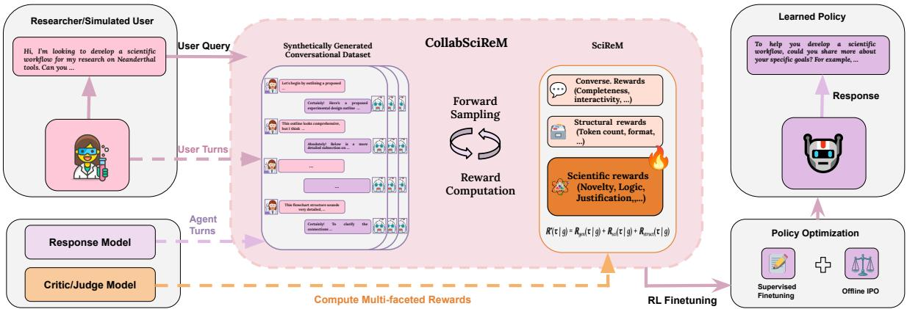  
Figure 1: Overview of the COLLABSCIREM Framework. The pipeline begins with Synthetic Data Generation, represented by dotted arrows, in which a simulated researcher and a teacher model engage in scientific dialogue. These interactions are evaluated by a Critic/Judge Model to compute multi-faceted rewards, including conversational, structural, and scientific metrics. The resulting preference-labeled dataset is used to train a Policy Model via Supervised Fine-Tuning (SFT) and Offline Identity Preference Optimization (IPO). In inference, a user query triggers the Learned Policy to generate a scientifically grounded response.

Scientific Reward Modeling (COLLABSCIREM) decomposing the session-level reward into three complementary reward functions, as shown in Figure 1. Conversational quality measures how accurate, responsive, and understandable the interaction is. Scientific rigor measures the methodological soundness of recommendations, the validity of justifications, and the logical consistency of reasoning. Structural efficiency measures how well scientific information is organized and conveyed without unnecessary overhead. Our premise is that scientific conversational quality is multidimensional and cannot be captured by general preferences such as accuracy alone.

In addition, existing evaluations also leave a critical gap in assessing scientific research conversations. Scientific reasoning benchmarks primarily measure single-turn answer accuracy, while multiturn benchmarks focus on general conversational quality. Neither evaluates whether research conversations are methodologically sound, well justified, and logically consistent across turns. To address this gap, we introduce SCIQUALITY, a pairwise, LLM-as-a-judge evaluation framework for assessing the scientific quality of multi-turn research conversations grounded in held-out papers.

We fine-tune LLAMA and QWEN models using COLLABSCIREM on synthetic research conversations and compare them against their instruction-tuned base models and COLLABLLM-SCI, which uses the same training data but optimizes the science-agnostic general conversational

COLLABLLM reward (Wu et al., 2025). By holding the data, base models, and training recipe constant, we isolate the effect of reward design. Across all four model configurations, COLLABSCIREM is preferred over COLLABLLMSCI on SCIQUALITY, achieving a 65.3% win rate even when response lengths are matched. A blind expert study finds significantly higher novelty than a general-reward variant and fewer hallucinated responses. Importantly, these gains do not compromise reasoning accuracy: COLLABSCIREM improves expert-level reasoning accuracy over the base models by up to 9.09 percentage points while using 28–63% fewer tokens, and outperforms COLLABLLMSCI in 8 of 10 single- and multi-turn benchmark settings.<sup>1</sup>

Our contributions are as follows:

1. COLLABSCIREM, a goal-conditioned, science-aware reward that decomposes collaborative reward into conversational quality, scientific rigor (justification, logical flow, novelty), and structural efficiency (format and token cost).

2. We construct a training corpus of 8.62K multiturn scientific conversations, sampled from 700 research question–methodology pairs spanning more than ten disciplines. We also introduce SCIQUALITY, a pairwise evaluation of the scientific quality of multi-turn research conversations across six dimensions, built from 300 held-out scientific papers. We release the conversations, judge prompts, and scoring scripts.

3. We show that COLLABSCIREM balances accuracy, scientific conversational quality, and efficiency better than a general collaborative reward trained on the same data, across two model families, LLAMA and QWEN, supported by ablations of each reward component and a blind expert user study.

## 2 Related Work

Recent works have proposed autonomous scientific agents to automate hypothesis generation, experimentation, and analysis (Lu et al., 2024; Yamada et al., 2025; Schmidgall et al., 2025; Yu et al., 2025). While these systems show promise, their reliability is constrained by the tendency of current LLMs to hallucinate or produce ungrounded reasoning (Omar et al., 2025; Xiong et al., 2025; Agarwal et al., 2024; Gaddipati et al., 2025). In fully autonomous settings, such errors can propagate into invalid scientific conclusions. Schmidgall et al. (2025) and Gaddipati et al. (2025) highlight the effectiveness of human-in-the-loop designs, which substantially improve robustness and scientific validity. These findings motivate alignment frameworks that explicitly support sustained scientific human–AI collaboration rather than full autonomy.

Most LLM alignment methods, including RLHF and its variants, formulate learning as immediate turn-level optimization, assigning rewards to isolated responses (Schulman et al., 2017; Ouyang et al., 2022; Rafailov et al., 2023; Lee et al., 2023). This assumes that local response quality translates to successful interactions. However, LLM-assisted research collaborations are inherently sequential, requiring models to adapt to evolving hypotheses, partial evidence, and user intent over multiple turns. Consequently, immediate turn-level objectives may fail to capture how intermediate actions influence clarification trajectories and long-horizon task success (Zamfirescu-Pereira et al., 2023; Wang et al., 2024a; Kim et al., 2024).

Works by Shani et al. (2024); Zhou et al. (2024) and Shi et al. (2024) have extended alignment to goal-conditioned multi-turn settings; these approaches typically assign rewards post-hoc over completed conversations rather than modeling the causal impact of intermediate decisions. While Wu et al. (2025) and Mehri et al. (2026) consider evolving dialogue states, their reward designs target general-purpose interaction quality and do not directly address the stringent correctness and grounding requirements in scientific contexts. In parallel, domain-specific autonomous works in mathematics (Romera-Paredes et al., 2024), chemistry (M. Bran et al., 2024; Hayes et al., 2025), psychology (Wang et al., 2026), and materials science (Merchant et al., 2023; Pyzer-Knapp et al., 2022; Zhang et al., 2024) demonstrate strong performance within narrow scientific settings, but rely on specialized pipelines that limit generality across scientific domains. Other works (Auer et al., 2025; Shao et al., 2025) focus on human-AI scientific workflows or iterative hypothesis refinement (Baek et al., 2025; Li et al., 2024), yet often underemphasize interaction-aware correctness, efficiency, and user intent evolution. For evaluation, MT-Bench (Zheng et al., 2023) assesses general multiturn conversational ability, and length-controlled evaluation (Dubois et al., 2024) adjusts for the preference of LLM judges for longer responses. We introduce SCIQUALITY to complement these benchmarks by targeting the scientific quality of research conversations. Together, these gaps highlight the need for alignment objectives that explicitly model scientific validity across domains, which COLLABSCIREM addresses by aligning intermediate model actions with long-horizon scientific objectives through science-aware reward decomposition grounded in scientific data distributions.

## 3 Collaborative Scientific Reward Modeling

We propose COLLABSCIREM, built upon the work of Wu et al. (2025), leveraging the goal-conditioned session-level reward modeling with science-aware rewards, enabling better alignment with the demands of human–AI scientific conversations.

## 3.1 Problem Formulation

We consider a goal-conditioned scientific dialogue consisting of K turns. Each turn k is defined by the pair $( u _ { k } , m _ { k } )$ , where $u _ { k }$ represents the user query and $m _ { k }$ denotes the model-generated response.

## 3.1.1 State Representation

At turn $j ,$ , the model observes the dialogue history H, which defines the current state $s _ { j } = \mathcal { H } _ { j }$ . The state encapsulates all preceding interactions up to

the current user input:

$$
s _ { j } = ( u _ { 1 } , m _ { 1 } , u _ { 2 } , m _ { 2 } , \ldots , u _ { j } ) .\tag{1}
$$

## 3.1.2 Policy and Trajectory

Given the state $s _ { j }$ and a specific goal $^ { g , }$ the model generates a response $m _ { j }$ , its action at turn $j .$ , from a goal-conditioned policy π<sub>θ</sub>:

$$
m _ { j } \sim \pi _ { \theta } ( { \cdot } \mid s _ { j } , g ) .\tag{2}
$$

A complete session trajectory $\tau$ is the sequence of all transitions over K turns:

$$
\tau = ( t _ { 1 } , t _ { 2 } , \ldots , t _ { K } ) ,\tag{3}
$$

where each transition is defined as

$$
t _ { k } = ( u _ { k } , m _ { k } ) .\tag{4}
$$

## 3.2 Goal-conditioned Multi-turn Aware Reward

Multi-turn Aware Reward (MR) (Wu et al., 2025) calculates the expected global utility of a response $m _ { j }$ given the potential future trajectory $\tau _ { j + 1 : K }$ This expected return of taking action $m _ { j }$ in state $s _ { j }$ is represented as:

$$
\begin{array} { r l } & { \mathcal { R } _ { \mathrm { M R } } ( m _ { j } \mid s _ { j } , g ) = \mathbb { E } _ { \tau _ { f } \sim P ( \tau _ { j + 1 : K } \mid s _ { j } , m _ { j } ) } } \\ & { \quad \quad \quad \quad \quad \quad \quad \quad \quad \quad \quad \quad \quad \quad \quad \quad \quad \quad \quad \quad \quad \quad \quad \quad \quad } \\ & { \quad \quad \quad \quad \quad \quad \quad \quad \quad \quad \quad \quad \quad \quad \quad \quad \quad \quad \quad \quad \quad \quad \quad } \end{array}\tag{5}
$$

where $\tau _ { f }$ represents the forward trajectory of the remaining conversation, and $\mathcal { R } ^ { * }$ is the holistic session-level reward function. However, computing the expected reward over all forward trajectories becomes exponentially expensive as the number of turns increases. To manage this, the turn depth window is limited to a maximum of 4 when calculating the expected conversation reward.

## 3.3 Decomposing the Scientific Objective

To ensure scientific and conversational efficiency, we decompose the session-level reward $\mathcal { R } ^ { * } ( \tau \mid g )$ into three primary components: general conversational utility, scientific rigor, and structural efficiency. We formalize this as:

$$
\begin{array} { r } { \mathcal { R } ^ { * } ( \tau \mid g ) = \mathcal { R } _ { \mathrm { g e n } } ( \tau \mid g ) \mid \quad } \\ { + \mathcal { R } _ { \mathrm { s c i } } ( \tau \mid g ) + \mathcal { R } _ { \mathrm { s t r u c t } } ( \tau \mid g ) \mid \quad } \end{array}\tag{6}
$$

General Conversational Utility $( \mathcal { R } _ { \bf g e n } )$ Existing goal-conditioned multi-turn rewards often focus on narrow metrics like generic accuracy and interaction. To capture the multidimensional nature of user interaction, we define $\mathcal { R } _ { \mathrm { g e n } }$ as a weighted composite of $N _ { \mathrm { g e n } }$ attributes:

$$
\mathcal { R } _ { \mathrm { g e n } } ( \tau \mid g ) = \sum _ { i = 1 } ^ { N _ { \mathrm { g e n } } } \gamma _ { i } \phi _ { i } ( \tau \mid g )\tag{7}
$$

where $\phi _ { i } \in \{ \mathrm { A c c u r a c y }$ , Interactivity, Clarity,

$$
\mathrm { C o m p l e t e n e s s } \} .
$$

Scientific Rigor Metrics $( \mathcal { R } _ { \mathbf { s c i } } )$ We define $\mathcal { R } _ { \mathrm { s c i } }$ as a weighted composite of $N _ { \mathrm { s c i } }$ LLM-based evaluators:

$$
\mathcal { R } _ { \mathrm { s c i } } ( \tau \mid g ) = \sum _ { i = 1 } ^ { N _ { \mathrm { s c i } } } \gamma _ { i } \phi _ { i } ( \tau \mid g )\tag{8}
$$

where $\phi _ { i } \in$ {Justification, Logical Flow, Novelty} are scoring functions and $\gamma _ { i }$ are their respective importance weights. This enables the reward model to penalize superficiality in favor of deep technical reasoning.

Efficiency and Structural Penalties $( \mathcal { R } _ { \mathrm { s t r u c t } } )$ To mitigate verbosity sprawl, a common failure mode in RLHF where models maximize reward through excessive length (Chen et al., 2024), we extend the token-based penalty with a formatting reward metric. Therefore, the structural reward is defined as:

$$
\mathcal { R } _ { \mathrm { s t r u c t } } ( \tau \mid g ) = \gamma _ { t } ( \lambda \cdot | \tau | _ { \mathrm { t o k e n s } } ) + \sum _ { h = 1 } ^ { N _ { \mathrm { s t r u c t } } } \gamma _ { h } \phi _ { h } ( \tau \mid g )\tag{9}
$$

where $| \tau | _ { \mathrm { t o k e n s } }$ denotes the total token count, λ is a scaling hyperparameter, and $\phi _ { h } \in \{ \mathrm { F o r m a t } \}$ . This encourages the model to maximize the informationto-token ratio, favoring concise scientific communication in required formats. We present and explain all the relevant parameters and scoring functions of the methodology in Appendix A.

## 4 Experimental setup

Synthetic Data Generation We construct our fine-tuning conversational dataset from structured scientific articles, curated by Schuhmann et al. (2025), which organizes raw content into components such as research questions, methodological descriptions, experimental procedures, and model architectures. From this corpus, we sampled the initial 700 research question–methodology pairs and transformed these structured elements into 8.62K human–AI conversational sessions with multiple session samples generated for each pair. The distribution contains the data from diverse scientific disciplines, including Medicine (9.57%), Computer Science (7.71%), Public Health (5.57%), Materials Science (4.86%), Chemistry (4.71%), Psychology (2.71%), Education (2.71%), Neuroscience (2.14%), Oncology (2.00%), Physics (2.00%), and Others (56.02%). In each conversation, user turns are grounded in research questions or clarification prompts, while assistant responses provide detailed descriptions of corresponding methodologies, experimental procedures, or architectural designs. We generate synthetic conversations using a strong instruction-following language model, gpt-4o-mini (OpenAI, 2024). Figure 4 in Appendix B illustrates the pipeline from raw scientific papers to structured multi-turn conversations, along with the corresponding user and system prompts.

Reward Annotation We annotate each conversation with the previously defined multiple reward signals. We employ a critic model, gpt-5-mini (Singh et al., 2025) to evaluate and score reward metrics for each turn given the future trajectories of the conversation. We adopt LLM-based reward scoring as many desired properties, such as scientific logic, completeness, and novelty, are difficult to capture using rule-based evaluators, and they enable scalable and consistent evaluation across large datasets at significantly lower cost than expert human annotation.

Fine-Tuning Base Models To assess whether the reward modeling strategy generalizes across architectures, we fine-tune models from both the Llama (Grattafiori et al., 2024) and Qwen (Yang et al., 2024) families on our synthetically generated scientific conversational dataset. Fine-tuning proceeds in two stages: supervised fine-tuning (SFT), followed by offline preference optimization using the Identity Preference Optimization (IPO) objective (Azar et al., 2024) on both COLLABLLM and COLLABSCIREM rewards. Negative sampling is performed by rejecting the conversation samples that receive lower scores, according to the selected reward model. All experiments were conducted on 4× NVIDIA H100 GPUs (80 GB). Appendix B provides the relevant hyperparameters in detail.

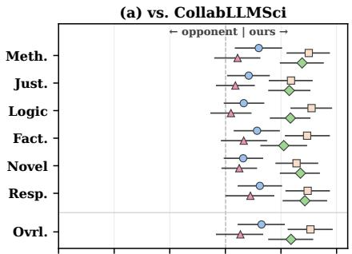  
(b) vs. base Instruct model

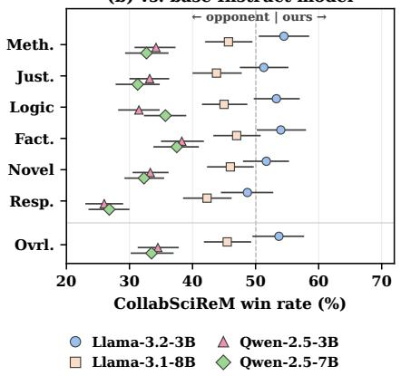  
Figure 2: Pairwise scientific-quality win rates of CollabSciReM against (a) CollabLLMSci and (b) the base Instruct models on 300 held-out scientific papers. Bars show 95% confidence intervals. Meth.: Methodological soundness, Just.: Justification, Logic: Logical Consistency, Fact.: Factual Correctness, Novel: Novelty, Resp.: Responsiveness and Ovrl.: Overall

SCIQUALITY We select 300 papers from the OS-SAS corpus (Schuhmann et al., 2025) that are disjoint from the 700 used to generate the training data. For each paper, a fine-tuned model acts as a user simulator, seeded with the paper’s research question, holds a four-turn conversation with each model. DEEPSEEK-V4-PRO then compares the conversations of two models pairwise. We evaluate each pair in both orders to control for position bias and report win rates with 95% bootstrap confidence intervals. We choose DEEPSEEK as the judge because it belongs to a different model family than our training critic (GPT-5-MINI), which reduces the risk that the evaluation simply rewards the critic’s own preferences. The judge prompt and rubric are given in Appendix E.

## 5 Benchmark Evaluation

We evaluate our hypothesis on three multiturn benchmarks, SCIQUALITY, MT-Bench-STEM (Zheng et al., 2023) and MINT (Wang et al., 2024b), and on three single-turn scientific reasoning benchmarks: GPQA-D (Rein et al., 2024),

Table 1: Performance of 7B and 8B models on (a) multi-turn benchmarks (MT-Bench-STEM, MINT) and (b) single-turn benchmarks (GPQA-D, MMLU-Valid, TheoremQA). Acc: accuracy (%). SR@5: success rate within five interaction turns (%). TC: average tokens per response (per turn for MT-Bench-STEM). APT: accuracy per token, computed as $\mathrm { A c c / T C } \times 1 0 0 0$ (SR@5 in place of Acc for MINT). Results are mean ± sample standard deviation over three seeds; bold values indicate the best performance in each column within each model family.
<table><tr><td colspan="10">(a) Multi-turn benchmarks</td></tr><tr><td></td><td colspan="6">MT-Bench-STEM</td><td colspan="3">MINT</td></tr><tr><td>Model</td><td>Overall (↑)</td><td> $\mathbf { A c c . } \left( \uparrow \right)$ </td><td>Format (↑)</td><td> $\mathbf { U s e f u l . } \left( \uparrow \right)$ </td><td>Relev. (↑)</td><td>TC (↓)</td><td>SR@5 (%) (↑)</td><td> $\mathbf { T C } \left( \downarrow \right)$ </td><td>APT (↑)</td></tr><tr><td>Llama-3.1-8B-Instruct</td><td> $6 . 8 3 { \pm } 0 . 0 4$ </td><td> $6 . 5 5 { \scriptstyle \pm 0 . 0 5 }$ </td><td> $7 . 9 2 \pm 0 . 0 7$ </td><td> $6 . 6 7 { \scriptstyle \pm 0 . 0 8 }$ </td><td> $8 . 3 7 { \scriptstyle \pm 0 . 0 1 }$ </td><td> $4 6 9 . 0 0 { \scriptstyle \pm 8 . 0 0 }$ </td><td> $\mathbf { 4 7 . 1 1 } 1 2 3 . 2 0$ </td><td> $2 9 6 . 0 0 { \scriptstyle \pm 1 4 . 0 6 }$ </td><td> $1 5 9 . 2 0 { \scriptstyle \pm 9 . 0 8 }$ </td></tr><tr><td>Llama-3.1-8B-CollabLLMSci</td><td> $7 . 0 2 \pm 0 . 1 9$ </td><td> $6 . 6 9 { \scriptstyle \pm 0 . 2 2 }$ </td><td> $\mathbf { 8 . 1 9 \pm 0 . 0 1 }$ </td><td> $6 . 8 8 { \scriptstyle \pm 0 . 2 2 }$ </td><td> $\mathbf { 8 . 5 5 \pm 0 . 0 2 }$ </td><td> $\mathbf { 2 9 8 . 0 0 { \div } 6 . 0 0 }$ </td><td> $4 3 . 4 1 \pm 3 . 2 2$ </td><td> ${ \bf 1 } 2 3 . 9 { \bf 1 } \pm { \bf 0 . 6 2 }$ </td><td>350.25±24.14</td></tr><tr><td>Llama-3.1-8B-CollabSciReM</td><td> ${ \bf 7 . 1 5 \pm 0 . 2 0 }$ </td><td> ${ \bf 6 . 8 4 \pm 0 . 2 5 }$ </td><td> ${ \bf 8 . 1 9 \pm 0 . 0 4 }$ </td><td> ${ \bf 6 . 9 4 \pm 0 . 1 6 }$ </td><td> $8 . 5 2 { \pm } 0 . 0 8$ </td><td> $3 1 0 . 0 0 { \scriptstyle \pm 4 . 0 0 }$ </td><td> $3 6 . 8 6 { \scriptstyle \pm 0 . 8 9 }$ </td><td> $1 4 7 . 6 0 { \scriptstyle \pm 8 . 6 3 }$ </td><td> $2 5 0 . 4 7 { \scriptstyle \pm 1 5 . 2 7 }$ </td></tr><tr><td>Qwen-2.5-7B-Instruct</td><td> ${ \bf 7 . 9 1 { \pm 0 . 0 9 } }$ </td><td> $7 . 6 2 \pm 0 . 1 1$ </td><td> $\mathbf { 8 . 7 0 } \pm \mathbf { 0 . 0 7 }$ </td><td> ${ \bf 7 . 8 0 { \pm 0 . 0 4 } }$ </td><td> $8 . 9 0 { \pm } 0 . 0 3$ </td><td> $5 5 5 . 0 0 { \scriptstyle \pm 1 0 . 0 0 }$ </td><td> $6 6 . 0 7 { \scriptstyle \pm 1 . 0 3 }$ </td><td> $2 2 6 . 3 4 { \scriptstyle \pm 1 6 . 1 6 }$ </td><td>292.73±16.98</td></tr><tr><td>Qwen-2.5-7B-CollabLLMSci</td><td> $7 . 6 7 { \pm } 0 . 0 5$ </td><td> $7 . 4 0 { \scriptstyle \pm 0 . 1 4 }$ </td><td> $\mathbf { 8 . 7 0 { \pm 0 . 1 1 } }$ </td><td> $7 . 4 8 { \pm } 0 . 0 4$ </td><td> $8 . 8 5 { \pm } 0 . 0 9$ </td><td> $4 1 8 . 0 0 { \scriptstyle \pm 5 . 0 0 }$ </td><td> $6 8 . 5 9 { \scriptstyle \pm 1 . 2 8 } $ </td><td> $1 1 2 . 1 5 { \scriptstyle \pm 2 . 6 2 }$ </td><td>611.95±23.60</td></tr><tr><td>Qwen-2.5-7B-CollabSciReM</td><td> $7 . 8 5 { \pm } 0 . 1 1 $ </td><td> ${ \bf 7 . 6 4 \pm 0 . 1 5 }$ </td><td> $8 . 6 8 { \pm } 0 . 0 5$ </td><td> $7 . 6 3 { \pm } 0 . 2 1 $ </td><td> $\mathbf { 8 . 9 3 \pm 0 . 1 6 }$ </td><td> $\mathbf { 3 9 9 . 0 0 { \pm } 4 . 0 0 }$ </td><td> ${ \bf 6 9 . 6 3 } \pm { \bf 1 . 1 2 }$ </td><td> $1 2 0 . 5 4 \pm 2 . 0 1$ </td><td> $5 7 7 . 8 4 { \pm } 1 8 . 3 1 $ </td></tr><tr><td colspan="10">(b) Single-turn benchmarks</td></tr><tr><td></td><td colspan="3">GPQA-D</td><td colspan="3">MMLU-Valid</td><td colspan="3">TheoremQA</td></tr><tr><td>Model</td><td>Acc (%) (↑)</td><td>TC (↓)</td><td>APT (↑)</td><td>Acc (%) (↑)</td><td>TC (↓)</td><td> $\mathbf { A P T } \left( \uparrow \right)$ </td><td> $\mathbf { A c c } \left( \mathcal { T } _ { \pmb { O } } \right) ( \uparrow )$ </td><td>TC (↓)</td><td> $\mathbf { A P T } \left( \uparrow \right)$ </td></tr><tr><td>Llama-3.1-8B-Instruct</td><td> $2 2 . 5 6 { \pm } 1 . 2 5 $ </td><td> $1 6 4 4 . 0 0 { \scriptstyle \pm 4 7 . 7 4 }$ </td><td> $1 3 . 7 1 { \scriptstyle \pm 0 . 6 2 }$ </td><td> $4 8 . 9 7 { \scriptstyle \pm 0 . 8 1 }$ </td><td> $7 0 2 . 7 9 { \scriptstyle \pm 2 . 3 7 }$ </td><td> $6 9 . 6 8 { \pm } 1 . 3 8 $ </td><td>19.28±0.50</td><td> $1 3 5 1 . 3 0 { \scriptstyle \pm 4 6 . 2 3 }$ </td><td> $1 4 . 2 7 { \scriptstyle \pm 0 . 2 1 }$ </td></tr><tr><td>Llama-3.1-8B-CollabLLMSci</td><td> $2 9 . 9 7 { \scriptstyle \pm 1 . 9 1 }$ </td><td> $\mathbf { 4 7 8 . 7 1 { \pm } 1 . 6 7 }$ </td><td> ${ \bf 6 2 . 6 0 } { \scriptstyle \pm 3 . 9 9 }$ </td><td> $5 7 . 2 6 { \pm } 1 . 1 4 $ </td><td> $\mathbf { 3 8 0 . 8 8 { \pm 1 . 1 2 } }$ </td><td> $\mathbf { 1 5 0 . 3 4 } 2 . 9 6$ </td><td> $1 6 . 7 3 { \scriptstyle \pm 0 . 6 7 }$ </td><td> ${ \bf 3 9 6 . 7 2 { \scriptstyle \pm 1 3 . 3 9 } }$ </td><td> $4 2 . 2 1 { \pm } 2 . 1 6$ </td></tr><tr><td>Llama-3.1-8B-CollabSciReM</td><td> $\mathbf { 3 1 . 6 5 \pm 1 . 0 4 }$ </td><td> $6 1 1 . 4 0 { \scriptstyle \pm 2 9 . 7 4 }$ </td><td> $5 1 . 9 7 { \scriptstyle \pm 4 . 2 1 }$ </td><td> ${ \pm 7 . 6 3 \pm 0 . 6 6 }$ </td><td> $4 0 3 . 6 8 { \pm } 3 . 9 7$ </td><td> $1 4 2 . 7 7 { \pm } 1 . 3 8 $ </td><td> $1 7 . 4 9 { \scriptstyle \pm 0 . 1 7 }$ </td><td> $5 0 5 . 7 0 { \scriptstyle \pm 1 8 . 6 0 }$ </td><td> $3 4 . 6 3 { \pm } 1 . 1 6$ </td></tr><tr><td>Qwen-2.5-7B-Instruct</td><td> $2 9 . 4 6 { \pm } 2 . 2 7$ </td><td> $8 8 3 . 2 5 { \pm } 7 . 1 1 $ </td><td> $3 3 . 3 5 { \scriptstyle \pm 2 . 5 1 }$ </td><td> ${ \bf 6 5 . 9 9 2 0 . 5 1 }$ </td><td> $4 7 9 . 6 2 { \pm } 1 . 1 7$ </td><td> $1 3 7 . 5 9 { \pm } 1 . 2 2 $ </td><td> $2 7 . 8 0 { \scriptstyle \pm 0 . 4 1 }$ </td><td> $6 0 3 . 5 7 { \scriptstyle \pm 6 . 4 6 }$ </td><td> $4 6 . 0 7 \pm 1 . 1 7$ </td></tr><tr><td>Qwen-2.5-7B-CollabLLMSci</td><td> $2 8 . 9 6 { \pm } 1 . 9 1$ </td><td> $4 8 8 . 2 4 \pm 3 . 9 2$ </td><td> $5 9 . 2 9 { \scriptstyle \pm 3 . 4 6 }$ </td><td> $6 4 . 5 3 { \pm } 0 . 1 7$ </td><td> $3 3 5 . 2 2 { \pm } 0 . 5 0 $ </td><td> $1 9 2 . 5 1 { \pm } 0 . 3 2 $ </td><td> $2 4 . 6 3 { \pm } 0 . 7 5$ </td><td> $\mathbf { 3 7 2 . 2 0 { \pm } 0 . 8 0 }$ </td><td> ${ \bf 6 6 . 1 8 } { \scriptstyle \pm 2 . 1 4 }$ </td></tr><tr><td>Qwen-2.5-7B-CollabSciReM</td><td> $3 3 . 5 0 { \scriptstyle \pm 2 . 7 4 }$ </td><td> $\mathbf { 4 8 2 . 3 0 { \pm } 1 0 . 1 4 }$ </td><td> ${ \bf 6 9 . 5 8 } \pm { \bf 6 . 8 8 }$ </td><td> $6 4 . 2 7 { \scriptstyle \pm 0 . 7 5 }$ </td><td> $\mathbf { 3 1 6 . 6 9 { \scriptstyle \pm 0 . 3 4 } }$ </td><td> $\mathbf { 2 0 2 . 9 5 } { \scriptstyle \pm 2 . 2 0 }$ </td><td> $2 5 . 1 2 { \scriptstyle \pm 0 . 2 5 }$ </td><td> $3 8 0 . 3 0 { \scriptstyle \pm 1 . 0 6 }$ </td><td> $6 6 . 0 6 { \scriptstyle \pm 0 . 6 8 }$ </td></tr></table>

MMLU-Validation (Hendrycks et al., 2020), and TheoremQA (Chen et al., 2023). For LLAMA-3.1- 8B-INSTRUCT and QWEN-2.5-7B-INSTRUCT, we compare the base model, COLLABLLMSCI, and COLLABSCIREM.<sup>2</sup> The two fine-tuned models differ only in their reward, so comparing them isolates the effect of science-aware reward modeling.

est on accuracy and usefulness while using 33.9% fewer tokens than the base model. For QWEN, its overall score of 7.85 is within one standard deviation of the base model’s 7.91. It leads its family on accuracy with 7.64 and on relevance with 8.93, and it produces the shortest responses at 399 tokens per turn, 28.1% fewer than the base model.

We report pass@1 accuracy on the single-turn benchmarks, excluding image-based instances, and the success rate within five turns, SR@5 on MINT. MT-Bench-STEM consists of the 20 two-turn questions from the STEM and Math categories of MT-Bench, and deepseek-v4-pro-0813 (DeepSeek-AI, 2026) scores each response from 1 to 10 on overall quality, accuracy, format, usefulness, and relevance. We measure efficiency with the average number of tokens per response, TC, and accuracy per token, $\mathrm { A P T } = \mathrm { A c c } / \mathrm { T C } \times 1 0 0 0$ , using SR@5 in place of accuracy for MINT. All models are evaluated zero-shot with free generation, using the same prompt, decoding parameters, 4,096-token generation budget, and answer-extraction function. Table 1 illustrates the results, averaged over three seeds.

On MINT, QWEN-COLLABSCIREM reaches the highest SR@5 of 69.63%, compared with 66.07% for the base model and 68.59% for COL-LABLLMSCI, while halving TC and roughly doubling APT. With LLAMA, both fine-tuned models fall below the base model, and COLLABSCIREM drops from 47.11% to 36.86%.

Scientific conversational quality Figure 2 reports SCIQUALITY win rates. Against COL-LABLLMSCI, COLLABSCIREM is preferred on overall quality for all four models. For LLAMA-3.1-8B, both models produce 474 tokens per turn, so the 65.3% preference cannot be attributed to response length. Against the base models, COLLAB-SCIREM is at parity for LLAMA-3.2-3B and less preferred for the other three models (33.5–45.5%). The base Instruct models produce responses 1.6– 3.1× longer than their fine-tuned counterparts. Because LLM judges tend to favor longer outputs, this comparison likely reflects response length as well as quality, consistent with the user study in Section 7.

Multi-turn interaction. On MT-Bench-STEM, LLAMA-COLLABSCIREM achieves the best overall score of 7.15, ahead of 6.83 for the base model and 7.02 for COLLABLLMSCI. It also scores high-

Single-turn scientific reasoning. Gains are largest on GPQA-D, which requires multi-step, presses responses substantially, but its accuracy gains are inconsistent across families. It improves over the base model on GPQA-D and MMLU-Validation for LLAMA but falls below it on both for QWEN, and it loses to COLLABSCIREM on SCI-QUALITY for all four models. COLLABSCIREM matches the compression of COLLABLLMSCI while retaining scientific conversational quality. It achieves the highest GPQA-D accuracy in both families and scores higher than COLLABLLMSCI on the primary metric in 8 of 10 benchmark–family settings. The two exceptions are LLAMA on MINT and QWEN on MMLU-VALID. On TheoremQA, both fine-tuned models trail the base model. This pattern supports our central claim: a general collaborative reward learns to be concise, while a scienceaware reward learns to be concise without discarding scientific substance. We extend our evaluation on 3B models and present them in Appendix D.

Table 2: Ablation and sensitivity analysis of reward components for COLLABSCIREM on Llama-3.1-8B-Instruct, fine-tuned with SFT followed by offline IPO. The upper block reports multi-turn benchmarks, MT-Bench-STEM and MINT, and the lower block reports single-turn benchmarks, GPQA-D, MMLU-Valid, and TheoremQA. $R _ { \mathrm { g e n } } .$ $R _ { \mathrm { s t r u c t } } .$ and $R _ { \mathrm { s c i } }$ denote the conversational, structural, and science-aware rewards, respectively.
<table><tr><td colspan="9">(a) Multi-turn benchmarks</td></tr><tr><td></td><td colspan="5">MT-Bench-STEM</td><td colspan="3">MINT</td></tr><tr><td>Reward Model</td><td>Overall (↑)</td><td>Acc. (↑)</td><td></td><td>Format (↑) Useful. (↑)</td><td>Relev. (↑)</td><td>TC (↓)</td><td>SR@5 (%) (↑)</td><td>TC (↓)</td><td>APT (↑)</td></tr><tr><td> $R \mathrm { { _ { g e n } } } + R \mathrm { { _ { s u r u c t } } }$ </td><td> $6 . 8 1 \pm 0 . 2 3$ </td><td> $6 . 4 8 { \pm } 0 . 2 3 $ </td><td> $8 . 0 3 { \pm } 0 . 0 9$ </td><td> $6 . 6 7 { \scriptstyle \pm 0 . 2 6 }$ </td><td> $8 . 3 8 { \pm } 0 . 0 7$ </td><td> $3 1 9 { \pm } 3 . 0 0 $ </td><td>40.59±2.57</td><td> ${ \bf 1 3 9 . 3 1 { \pm } 1 . 8 7 }$ </td><td> $\mathbf { 2 9 1 . 4 5 \pm 1 9 . 6 0 }$ </td></tr><tr><td> $R _ { \mathrm { g e n } } + R _ { \mathrm { s c i } }$ </td><td> $6 . 5 8 { \scriptstyle \pm 0 . 2 6 }$ </td><td> $6 . 3 3 { \pm } 0 . 2 5 $ </td><td> $7 . 7 4 \pm 0 . 2 7$ </td><td> $6 . 4 6 { \pm } 0 . 4 3$ </td><td> $8 . 1 0 { \scriptstyle \pm 0 . 2 6 }$ </td><td> $6 2 2 \pm 1 5 . 0 0$ </td><td> $\mathbf { 4 8 . 3 0 \pm 4 . 4 5 }$ </td><td> $6 9 9 . 9 5 { \scriptstyle \pm 5 7 . 1 4 }$ </td><td> $6 9 . 0 5 { \scriptstyle \pm 4 . 1 7 }$ </td></tr><tr><td> $R \mathrm { { s t n c t } } + R \mathrm { { s c i } }$ </td><td> $6 . 9 2 { \pm } 0 . 1 5$ </td><td> $6 . 6 7 { \scriptstyle \pm 0 . 1 0 }$ </td><td> $8 . 0 6 { \pm } 0 . 1 9$ </td><td> $6 . 6 7 { \scriptstyle \pm 0 . 1 2 }$ </td><td> $8 . 3 0 { \pm } 0 . 1 7$ </td><td> $3 1 9 { \pm } 8 . 0 0 $ </td><td> $4 0 . 7 4 { \scriptstyle \pm 2 . 7 2 }$ </td><td> $1 4 9 . 8 1 { \scriptstyle \pm 0 . 9 9 }$ </td><td> $2 7 1 . 8 8 { \pm } 1 6 . 3 6$ </td></tr><tr><td>COLLABSCIREM | 0.7 γCScIREM</td><td>7.14±0.14</td><td> ${ \bf 6 . 8 4 \pm 0 . 0 8 }$ </td><td> $\mathbf { 8 . 2 7 \pm 0 . 0 9 }$ </td><td> ${ \bf 6 . 8 5 \pm 0 . 1 5 }$ </td><td> $\mathbf { 8 . 5 2 \pm 0 . 2 3 }$ </td><td> ${ \bf 3 0 8 } \pm { \bf 6 . 0 0 }$ </td><td> $4 1 . 7 8 { \scriptstyle \pm 4 . 0 0 }$ </td><td> $1 4 8 . 2 4 \pm 6 . 2 8$ </td><td> $2 8 2 . 9 2 { \scriptstyle \pm 3 9 . 0 5 }$ </td></tr><tr><td colspan="10">(b) Single-turn benchmarks</td></tr><tr><td></td><td></td><td>GPQA-D</td><td></td><td></td><td>MMLU-Valid</td><td></td><td></td><td>TheoremQA</td><td></td></tr><tr><td>Reward Model</td><td> $\mathbf { A c c } \left( \mathcal { T } _ { \pmb { O } } \right) \left( \uparrow \right)$ </td><td> $\mathbf { T C } \left( { \downarrow } \right)$ </td><td> $\mathbf { A P T } \left( \uparrow \right)$ </td><td> $\mathbf { A c c } \left( \mathcal { T } _ { \pmb { O } } \right) ( \uparrow )$ </td><td> $\mathbf { T C } \left( { \downarrow } \right)$ </td><td>APT (↑)</td><td> $\mathbf { A c c } \left( \mathcal { T } _ { \pmb { O } } \right) ( \uparrow )$ </td><td> $\mathbf { T C } \left( \downarrow \right)$ </td><td>APT (↑)</td></tr><tr><td> $R \mathrm { { _ { g e n } } } + R \mathrm { { _ { s u r u c t } } }$ </td><td> $2 9 . 6 3 { \pm } 2 . 9 2$ </td><td> $5 5 2 . 4 6 { \scriptstyle \pm 2 7 . 7 1 }$ </td><td> $5 3 . 5 9 { \scriptstyle \pm 3 . 8 6 }$ </td><td> $5 7 . 0 0 { \scriptstyle \pm 0 . 5 9 }$ </td><td> $3 9 7 . 2 7 { \scriptstyle \pm 2 . 9 7 }$ </td><td> $1 4 3 . 4 9 { \scriptstyle \pm 2 . 5 1 }$ </td><td> $1 5 . 9 3 { \scriptstyle \pm 0 . 8 1 }$ </td><td> $5 1 5 . 0 9 { \scriptstyle \pm 3 0 . 4 0 }$ </td><td> $3 1 . 0 6 { \pm } 3 . 2 9$ </td></tr><tr><td> $R _ { \mathrm { g e n } } + R _ { \mathrm { s c i } }$ </td><td> $2 3 . 0 6 { \scriptstyle \pm 0 . 7 7 }$ </td><td> $1 9 6 6 . 2 1 \pm 8 9 . 8 8$ </td><td> $1 1 . 7 5 { \scriptstyle \pm 0 . 8 4 }$ </td><td> $4 2 . 2 4 { \scriptstyle \pm 0 . 6 9 }$ </td><td> $9 4 7 . 5 4 { \pm } 2 0 . 0 1$ </td><td> $4 4 . 6 0 { \scriptstyle \pm 1 . 6 3 }$ </td><td> $\mathbf { 1 8 . 5 2 { \scriptstyle \pm 0 . 6 9 } }$ </td><td> $1 3 4 4 . 5 3 { \pm } 4 6 . 0 5$ </td><td> $1 3 . 7 9 2 0 . 8 2 $ </td></tr><tr><td> $\tilde { R _ { \mathrm { s t r u c t } } } + R _ { \mathrm { s c i } }$ </td><td> $3 1 . 1 4 \pm 5 . 1 1$ </td><td> ${ \bf 5 1 0 . 6 7 } \pm { \bf 8 . 2 2 }$ </td><td> $\mathbf { 6 0 . 9 3 } \pm \mathbf { 9 . 5 1 }$ </td><td> ${ \bf 5 8 . 3 5 { \scriptstyle \pm 0 . 8 7 } }$ </td><td> $3 9 7 . 6 0 { \scriptstyle \pm 3 . 4 6 }$ </td><td> $1 4 6 . 7 7 { \scriptstyle \pm 3 . 1 3 }$ </td><td> $1 5 . 6 2 { \scriptstyle \pm 1 . 6 7 }$ </td><td> $5 0 5 . 2 0 { \scriptstyle \pm 1 7 . 0 7 }$ </td><td> $3 0 . 9 8 \pm 3 . 9 6 $ </td></tr><tr><td>COLLABLLMSCI  $\gamma _ { \mathrm { C S C I R E M } }$ </td><td> $2 2 . 7 3 { \scriptstyle \pm 1 . 2 4 }$ </td><td> $1 2 9 5 . 4 8 { \pm } 7 4 . 1 2$ </td><td> $1 7 . 6 4 \pm 1 . 8 8$ </td><td> $5 2 . 3 6 { \pm } 1 . 3 7$ </td><td> $5 9 1 . 3 5 { \scriptstyle \pm 4 . 8 0 }$ </td><td> $8 7 . 0 4 { \scriptstyle \pm 0 . 7 0 }$ </td><td> $1 7 . 4 7 { \scriptstyle \pm 0 . 4 7 }$ </td><td> $1 0 6 3 . 1 5 { \scriptstyle \pm 2 3 . 7 5 }$ </td><td> $1 6 . 4 4 { \scriptstyle \pm 0 . 0 8 }$ </td></tr><tr><td>COLLABSCIREM  $0 . 7 \gamma _ { \mathrm { C S C I R E M } }$ </td><td> $3 1 . 3 1 { \pm } 2 . 0 8$ </td><td> $5 8 0 . 3 3 { \scriptstyle \pm 3 0 . 9 4 }$ </td><td> $5 4 . 7 6 { \scriptstyle \pm 5 . 7 4 }$ </td><td> $5 8 . 2 2 { \scriptstyle \pm 0 . 2 9 }$ </td><td> $3 9 6 . 8 5 { \scriptstyle \pm 7 . 2 9 }$ </td><td> $1 4 6 . 7 4 \pm 3 . 1 7$ </td><td> $1 6 . 7 3 { \scriptstyle \pm 1 . 0 1 }$ </td><td> $\mathbf { 3 9 1 . 3 3 { \pm } 1 9 . 0 6 }$ </td><td> $\mathbf { 4 2 . 8 8 \pm 4 . 1 9 }$ </td></tr></table>

## 6 Ablation Study

expert-level reasoning. LLAMA-COLLABSCIREM raises accuracy from 22.56% to 31.65%, a gain of 9.09 points that also exceeds the 29.97% of COL-LABLLMSCI. It does so while cutting tokens by 62.8%, which increases APT 3.8-fold. For QWEN, it is the only fine-tuned variant to surpass the base model, achieving 33.50% against 29.46% for the base model and 28.96% for COLLABLLMSCI. It also produces the shortest responses in its family and reaches 2.1 times the base model’s APT. On MMLU-Validation, LLAMA-COLLABSCIREM im proves accuracy from 48.97% to 57.63%, a gain of 8.66 points, with 42.6% fewer tokens, doubling APT. The QWEN base model is already strong on this benchmark, and COLLABSCIREM gives up 1.72 points of accuracy in exchange for a 34.0% token reduction and an APT 47.5% higher than the base model’s, the best in its family. TheoremQA is the exception, as neither fine-tuned model matches the base model in either family, reflecting the mathematical data distribution difference between fine-tuned and test datasets. LLAMA-COLLABSCIREM reaches 17.49% against 19.28% for the base model, and QWEN-COLLABSCIREM reaches 25.12% against 27.80%. Even so, COL-LABSCIREM still outperforms COLLABLLMSCI in both families and uses 37 to 63% fewer tokens than the base models. Taken together, the three systems occupy distinct points in the trade-off between accuracy, scientific conversational quality, and efficiency. The base models produce the longest responses and are preferred by the judge on SCI-QUALITY, but they have the lowest accuracy on expert-level reasoning. COLLABLLMSCI com-

We ablate the COLLABSCIREM reward on LLAMA-3.1-8B-INSTRUCT by removing one component at a time: the conversational reward $R _ { \mathrm { g e n } } .$ the structural reward $R _ { \mathrm { s t r u c t } }$ , or the science-aware reward $R _ { \mathrm { s c i } }$ . We also train COLLABLLM with the COLLABSCIREM weights and test sensitivity by scaling all weights by 0.7 and report the relevant results in Table 2.

Removing $R _ { \mathrm { s c i } }$ lowers accuracy at a nearly unchanged token budget. MT-Bench-STEM overall score falls from 7.15 to 6.81, GPQA-D accuracy from 31.65% to 29.63%, TheoremQA from 17.49% to 15.93%. This shows that the science-aware reward makes reasoning more accurate rather than longer. Removing $R _ { \mathrm { s t r u c t } }$ inflates responses to 1966 tokens on GPQA-D and drops accuracy to 23.06% on GPQA-D and 42.24% on MMLU-Validation. The extended reasoning helps only computationheavy tasks such as TheoremQA and MINT. Removing $R _ { \mathrm { g e n } }$ preserves single-turn accuracy but lowers MT-Bench-STEM to 6.92 overall, with usefulness falling from 6.94 to 6.67, indicating that the conversational reward sustains interaction quality.

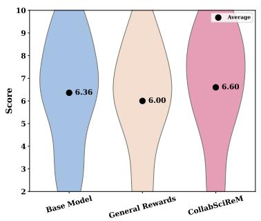  
(a) Logical Justification (↑)

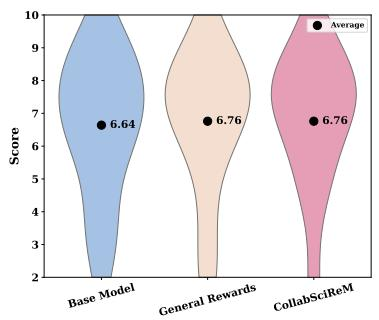  
(b) Interaction Quality (↑)

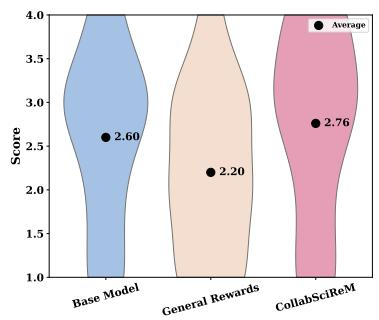  
(c) Novelty (↑)  
Figure 3: Real-world user study results showcasing participant interactions with anonymized base LLAMA-3.1-8B INSTRUCT, general rewards (accuracy and interaction, w/o token penalty) and COLLABSCIREM models. Users rated (a) logical justification (1-10), (b) overall interactive experience (1-10), and (c) novelty (1-5).

COLLABLLM trained with the COLLAB-SCIREM weights reaches only 22.73% on GPQA-D, matching the base model, with responses 1.5– 2.1× longer than COLLABSCIREM. The gains therefore stem from the science-aware reward signal rather than its weighting. Scaling all weights by 0.7 leaves most results nearly unchanged, with 31.31% on GPQA-D and 7.14 overall on MT-Bench-STEM; the largest shift is on MINT, where SR@5 rises from 36.86% to 41.78%. This indicates robustness to reward scale. This finding also provides the flexibility to control the relevant rewards in scientific contexts as required. Together, $R _ { \mathrm { s c i } }$ drives scientific correctness, $R _ { \mathrm { s t r u c t } }$ keeps reasoning concise, and $R _ { \mathrm { g e n } }$ maintains conversational quality.

## 7 User study

To assess real-world utility, we conducted a blind user study on Prolific with subject matter experts holding advanced degrees in fields spanning computer science, manufacturing, media, medicine, law, and the social sciences. Each participant held a multi-turn scientific dialogue of at least three turns with each of three anonymized models: the base LLAMA-3.1-8B-INSTRUCT, a variant fine-tuned with only general conversational rewards (accuracy and interaction), and COLLABSCIREM. Participants then rated each model on logical justification (1–10), interaction quality (1–10), and novelty (1– 5). The novelty uses a 1–5 scale since assessing originality is inherently coarser, and a larger scale would introduce unnecessary rater noise without increasing discriminative power. Recruitment criteria, interface design, and prompt guidelines are given in Appendix C, and complete interaction logs are included in the supplementary material. COL-LABSCIREM achieves the highest mean scores for logical justification at 6.6 and novelty at 2.76, and its interaction quality score of 6.76 exceeds the base model and matches the general-reward variant. Within-participant Wilcoxon signed-rank tests with 10,000-sample bootstrap confidence intervals show that COLLABSCIREM significantly outperforms the general-reward variant on novelty, with a mean difference of 0.56, a 95% confidence interval from 0.16 to 0.96, $p = 0 . 0 2 3$ , and a rank-biserial effect size of 0.758. Logical justification shows a positive but non-significant trend at $p = 0 . 0 8 5$ . Participants also rated 52% of COLLABSCIREM responses as free of hallucinations, compared with 44% for the general-reward variant and 40% for the base model.

## 8 Conclusion

We introduced COLLABSCIREM, a science-aware reward that decomposes collaborative reward into conversational quality, scientific rigor, and structural efficiency, together with SCIQUALITY, an evaluation of the scientific quality of multi-turn research conversations. Where general collaborative rewards, COLLABLLMSCI, favor conciseness and instruction-tuned models favor elaboration, COL-LABSCIREM balances accuracy, scientific conversational quality, and efficiency. Ablations show that each reward dimension plays a distinct role, and a study with domain experts confirms a significant gain in novelty and fewer hallucinated responses.

## Limitations

Several limitations remain. The gains of COLLAB-SCIREM over a general collaborative reward are not uniform: it trails COLLABLLMSCI on MINT with LLAMA-3.1-8B and on several 3B settings, and several benchmark differences fall within one standard deviation across seeds. First, the reward gains are strongest on data close to the training distribution. On out-of-distribution tasks such as the mathematical problems in TheoremQA and MINT, the base models remain competitive, and broadening the training corpus toward these domains is a natural next step. Second, our experiments use offline Identity Preference Optimization (IPO) to fit our computational budget. Online reinforcement learning methods such as PPO or GRPO offer a promising path toward stronger generalization. Third, our pipeline uses gpt-4o-mini for user simulation and gpt-5-mini for reward annotation. A systematic study of how teacher and critic strength shape downstream performance is an important avenue for future research. Finally, our literaturederived synthetic dialogues provide a scalable training signal, and incorporating real human-expert interaction data would further improve the fidelity and ecological validity of the preference signals. Collecting such data at scale requires substantial cost and coordination with subject matter experts, which makes it a valuable target for future collaborative work.

## Ethical Considerations

This work involves the development and evaluation of large language models (LLMs) for assisting scientific research through interactive, goalconditioned dialogues. We carefully considered ethical implications across data generation, model finetuning, human evaluation, and potential deployment. Subject matter experts were recruited through a crowdsourcing platform, Prolific, and compensated at an average rate of \$22.19 per hour, which exceeded the local minimum wage, with a median completion time of approximately 29.5 minutes. Data collected from participants was anonymized and used solely for research purposes. No personally identifiable information was retained beyond what was necessary for compensation processing, and this was clearly communicated to participants during the evaluation.

Despite our emphasis on reducing hallucinations and improving methodological rigor, LLMs remain susceptible to errors. Over-reliance on LLMgenerated scientific content could propagate subtle inaccuracies or biases, particularly in high-stakes domains such as medicine, chemistry, or defense research. We strongly recommend that outputs from these LLMs be treated as collaborative aids rather than authoritative sources, with final responsibility resting with human researchers. Our framework’s focus on justification, logical flow, and novelty aims to make such limitations more transparent to users. Also, we recognize that advanced AI tools may widen gaps between well-resourced institutions and others. Therefore, we release our code, synthetic datasets, and models to promote transparency, reproducibility, and equitable access to this research.

We use LLAMA-3.1-8B-INSTRUCT and QWEN-2.5 models under their respective open licenses (Meta Llama 3.1 Community License and Qwen license). GPT-4O-MINI and GPT-5-MINI were accessed via OpenAI’s API for research purposes only, in accordance with their terms of service. The synthetic data generation is based on the OSSAS corpus (Schuhmann et al., 2025). We release our synthetic dataset, code, and fine-tuned models under a permissive open-source license, consistent with the research-oriented nature of the source materials and compatible with the original licenses. We used Claude Code to assist with coding tasks and Claude Opus 5.5 to assist with rephrasing and summarizing text. The authors take full responsibility for all claims, results, and citations presented in this paper.

## Acknowledgements

This research was supported by the Federal Ministry of Education and Research (BMBF) under grant no. 01IS22093C Kisski, project 460234259 NFDI4DataScience consortium and project "WestAI0096", Jureca Computation from Jülich Supercomputing Centre (JSC). We thank Lokesh Veeramacheneni for his suggestions throughout the research and revisions of the manuscript.

## References

Vibhor Agarwal, Yiqiao Jin, Mohit Chandra, Munmun De Choudhury, Srijan Kumar, and Nishanth Sas-

try. 2024. MedHalu: Hallucinations in responses to healthcare queries by large language models. arXiv preprint arXiv:2409.19492.

Akari Asai, Jacqueline He, Rulin Shao, Weijia Shi, Amanpreet Singh, Joseph Chee Chang, Kyle Lo, Luca Soldaini, Sergey Feldman, Mike D’arcy, and 1 others. 2024. OpenScholar: Synthesizing scientific literature with retrieval-augmented LMs. arXiv preprint arXiv:2411.14199.

Sören Auer, Allard Oelen, Mohamad Yaser Jaradeh, Mutahira Khalid, Farhana Keya, Sasi Kiran Gaddipati, Jennifer D’Souza, Lorenz Schlüter, Amirreza Alasti, Gollam Rabby, and 1 others. 2025. Towards AI-supported research: A vision of the TIB AIssistant. arXiv preprint arXiv:2512.16447.

Mohammad Gheshlaghi Azar, Zhaohan Daniel Guo, Bilal Piot, Remi Munos, Mark Rowland, Michal Valko, and Daniele Calandriello. 2024. A general theoretical paradigm to understand learning from human preferences. In International Conference on Artificial Intelligence and Statistics, pages 4447–4455. PMLR.

Jinheon Baek, Sujay Kumar Jauhar, Silviu Cucerzan, and Sung Ju Hwang. 2025. ResearchAgent: Iterative research idea generation over scientific literature with large language models. In Proceedings ofthe 2025 Conference of the Nations of the Americas Chapter ofthe Associationfor Computational Linguistics: Human Language Technologies (Volume 1: Long Papers), pages 6709–6738.

Daniil A Boiko, Robert MacKnight, Ben Kline, and Gabe Gomes. 2023. Autonomous chemical research with large language models. Nature, 624(7992):570– 578.

Lichang Chen, Chen Zhu, Davit Soselia, Jiuhai Chen, Tianyi Zhou, Tom Goldstein, Heng Huang, Mohammad Shoeybi, and Bryan Catanzaro. 2024. ODIN: Disentangled reward mitigates hacking in RLHF. arXiv preprint arXiv:2402.07319.

Wenhu Chen, Ming Yin, Max Ku, Pan Lu, Yixin Wan, Xueguang Ma, Jianyu Xu, Xinyi Wang, and Tony Xia. 2023. TheoremQA: A theorem-driven question answering dataset. arXiv preprint arXiv:2305.12524.

DeepSeek-AI. 2026. DeepSeek-V4: Towards highly efficient million-token context intelligence. Preprint, arXiv:2606.19348.

Yann Dubois, Balázs Galambosi, Percy Liang, and Tatsunori B Hashimoto. 2024. Length-controlled AlpacaEval: A simple way to debias automatic evaluators. arXiv preprint arXiv:2404.04475.

Sasi Kiran Gaddipati, Farhana Keya, Gollam Rabby, and Sören Auer. 2025. AIssistant: Human-AI collaborative review and perspective research workflows in data science. arXiv preprint arXiv:2509.12282.

Aaron Grattafiori, Abhimanyu Dubey, Abhinav Jauhri, Abhinav Pandey, Abhishek Kadian, Ahmad Al-Dahle, Aiesha Letman, Akhil Mathur, Alan Schelten, Alex Vaughan, and 1 others. 2024. The Llama 3 herd of models. arXiv preprint arXiv:2407.21783.

Thomas Hayes, Roshan Rao, Halil Akin, Nicholas J Sofroniew, Deniz Oktay, Zeming Lin, Robert Verkuil, Vincent Q Tran, Jonathan Deaton, Marius Wiggert, and 1 others. 2025. Simulating 500 million years of evolution with a language model. Science, 387(6736):850–858.

Dan Hendrycks, Collin Burns, Steven Basart, Andy Zou, Mantas Mazeika, Dawn Song, and Jacob Steinhardt. 2020. Measuring massive multitask language understanding. arXiv preprint arXiv:2009.03300.

Yoonsu Kim, Jueon Lee, Seoyoung Kim, Jaehyuk Park, and Juho Kim. 2024. Understanding users’ dissatisfaction with ChatGPT responses: Types, resolving tactics, and the effect of knowledge level. In Proceedings of the 29th International Conference on Intelligent User Interfaces, pages 385–404.

Jakub Lála, Odhran O’Donoghue, Aleksandar Shtedritski, Sam Cox, Samuel G Rodriques, and Andrew D White. 2023. PaperQA: Retrieval-augmented generative agent for scientific research. arXiv preprint arXiv:2312.07559.

Harrison Lee, Samrat Phatale, Hassan Mansoor, Thomas Mesnard, Johan Ferret, Kellie Lu, Colton Bishop, Ethan Hall, Victor Carbune, Abhinav Rastogi, and 1 others. 2023. RLAIF vs. RLHF: Scaling reinforcement learning from human feedback with AI feedback. arXiv preprint arXiv:2309.00267.

Long Li, Weiwen Xu, Jiayan Guo, Ruochen Zhao, Xingxuan Li, Yuqian Yuan, Boqiang Zhang, Yuming Jiang, Yifei Xin, Ronghao Dang, and 1 others. 2024. Chain of ideas: Revolutionizing research via novel idea development with LLM agents. arXiv preprint arXiv:2410.13185.

Chris Lu, Cong Lu, Robert Tjarko Lange, Jakob Foerster, Jeff Clune, and David Ha. 2024. The AI scientist: Towards fully automated open-ended scientific discovery. arXiv preprint arXiv:2408.06292.

Andres M. Bran, Sam Cox, Oliver Schilter, Carlo Baldassari, Andrew D White, and Philippe Schwaller. 2024. Augmenting large language models with chemistry tools. Nature Machine Intelligence, 6(5):525– 535.

Shuhaib Mehri, Priyanka Kargupta, Tal August, and Dilek Hakkani-Tür. 2026. Learning user preferences through interaction for long-term collaboration. arXiv preprint arXiv:2601.02702.

Amil Merchant, Simon Batzner, Samuel S Schoenholz, Muratahan Aykol, Gowoon Cheon, and Ekin Dogus Cubuk. 2023. Scaling deep learning for materials discovery. Nature, 624(7990):80–85.

Mahmud Omar, Vera Sorin, Jeremy D Collins, David Reich, Robert Freeman, Nicholas Gavin, Alexander Charney, Lisa Stump, Nicola Luigi Bragazzi, Girish N Nadkarni, and 1 others. 2025. Multi-model assurance analysis showing large language models are highly vulnerable to adversarial hallucination attacks during clinical decision support. Communications Medicine, 5(1):330.

OpenAI. 2024. GPT-4o mini. https://openai.com. OpenAI GPT-4o mini model.

Long Ouyang, Jeffrey Wu, Xu Jiang, Diogo Almeida, Carroll Wainwright, Pamela Mishkin, Chong Zhang, Sandhini Agarwal, Katarina Slama, Alex Ray, and 1 others. 2022. Training language models to follow instructions with human feedback. Advances in neural information processing systems, 35:27730–27744.

Edward O Pyzer-Knapp, Jed W Pitera, Peter WJ Staar, Seiji Takeda, Teodoro Laino, Daniel P Sanders, James Sexton, John R Smith, and Alessandro Curioni. 2022. Accelerating materials discovery using artificial intelligence, high performance computing and robotics. npj Computational Materials, 8(1):84.

Gollam Rabby, Farhana Keya, and Sören Auer. 2024. MC-NEST: Enhancing mathematical reasoning in large language models leveraging a Monte Carlo selfrefine tree. arXiv preprint arXiv:2411.15645.

Rafael Rafailov, Archit Sharma, Eric Mitchell, Christopher D Manning, Stefano Ermon, and Chelsea Finn. 2023. Direct preference optimization: Your language model is secretly a reward model. Advances in neural information processing systems, 36:53728–53741.

David Rein, Betty Li Hou, Asa Cooper Stickland, Jackson Petty, Richard Yuanzhe Pang, Julien Dirani, Julian Michael, and Samuel R Bowman. 2024. GPQA: A graduate-level Google-proof Q&A benchmark. In First Conference on Language Modeling.

Bernardino Romera-Paredes, Mohammadamin Barekatain, Alexander Novikov, Matej Balog, M Pawan Kumar, Emilien Dupont, Francisco JR Ruiz, Jordan S Ellenberg, Pengming Wang, Omar Fawzi, and 1 others. 2024. Mathematical discoveries from program search with large language models. Nature, 625(7995):468–475.

Keita Saito, Akifumi Wachi, Koki Wataoka, and Youhei Akimoto. 2023. Verbosity bias in preference labeling by large language models. arXiv preprint arXiv:2310.10076.

Samuel Schmidgall, Yusheng Su, Ze Wang, Ximeng Sun, Jialian Wu, Xiaodong Yu, Jiang Liu, Zicheng Liu, and Emad Barsoum. 2025. Agent laboratory: Using LLM agents as research assistants. arXiv preprint arXiv:2501.04227.

Christoph Schuhmann, Amarjot Singh, Andrii Prolorenzo, Andrej Radonjic, Sean Smith, and Sam Hogan. 2025. OSSAS (open source summaries at scale): The INFERENCE.NET × LAION × Grass.

LAION Notes / Blog. https://laion.ai/notes/ summaries/.

John Schulman, Filip Wolski, Prafulla Dhariwal, Alec Radford, and Oleg Klimov. 2017. Proximal policy optimization algorithms. arXiv preprint arXiv:1707.06347.

Lior Shani, Aviv Rosenberg, Asaf Cassel, Oran Lang, Daniele Calandriello, Avital Zipori, Hila Noga, Orgad Keller, Bilal Piot, Idan Szpektor, and 1 others. 2024. Multi-turn reinforcement learning with preference human feedback. Advances in Neural Information Processing Systems, 37:118953–118993.

Erzhuo Shao, Yifang Wang, Yifan Qian, Zhenyu Pan, Han Liu, and Dashun Wang. 2025. SciSciGPT: Advancing human–AI collaboration in the science of science. Nature Computational Science, pages 1–15.

Wentao Shi, Mengqi Yuan, Junkang Wu, Qifan Wang, and Fuli Feng. 2024. Direct multi-turn preference optimization for language agents. arXiv preprint arXiv:2406.14868.

Aaditya Singh, Adam Fry, Adam Perelman, Adam Tart, Adi Ganesh, Ahmed El-Kishky, Aidan McLaughlin, Aiden Low, AJ Ostrow, Akhila Ananthram, and 1 others. 2025. OpenAI GPT-5 system card. arXiv preprint arXiv:2601.03267.

Chengbing Wang, Wuqiang Zheng, Yang Zhang, Fengbin Zhu, Junyi Cheng, Yi Xie, Wenjie Wang, and Fuli Feng. 2026. PERM: Psychology-grounded empathetic reward modeling for large language models. arXiv preprint arXiv:2601.10532.

Jiayin Wang, Weizhi Ma, Peijie Sun, Min Zhang, and Jian-Yun Nie. 2024a. Understanding user experience in large language model interactions. arXiv preprint arXiv:2401.08329.

Xingyao Wang, Zihan Wang, Jiateng Liu, Yangyi Chen, Lifan Yuan, Hao Peng, and Heng Ji. 2024b. MINT: Evaluating LLMs in multi-turn interaction with tools and language feedback. In International Conference on Learning Representations, volume 2024, pages 32593–32627.

Shirley Wu, Michel Galley, Baolin Peng, Hao Cheng, Gavin Li, Yao Dou, Weixin Cai, James Zou, Jure Leskovec, and Jianfeng Gao. 2025. CollabLLM: From passive responders to active collaborators. arXiv preprint arXiv:2502.00640.

Guangzhi Xiong, Eric Xie, Corey Williams, Myles Kim, Amir Hassan Shariatmadari, Sikun Guo, Stefan Bekiranov, and Aidong Zhang. 2025. Toward reliable scientific hypothesis generation: Evaluating truthfulness and hallucination in large language models. arXiv preprint arXiv:2505.14599.

Vikash Kumar Yadav and Corentin Claeys Bouuaert. 2021. Mechanism and control of meiotic DNA double-strand break formation in S. cerevisiae. Frontiers in cell and developmental biology, 9:642737.

Yutaro Yamada, Robert Tjarko Lange, Cong Lu, Shengran Hu, Chris Lu, Jakob Foerster, Jeff Clune, and David Ha. 2025. The AI scientist-v2: Workshoplevel automated scientific discovery via agentic tree search. arXiv preprint arXiv:2504.08066.

An Yang, Baosong Yang, Beichen Zhang, Binyuan Hui, Bo Zheng, Bowen Yu, Chengyuan Li, D Liu, F Huang, H Wei, and 1 others. 2024. Qwen2.5 technical report. arXiv preprint arXiv:2412.15115.

Haofei Yu, Keyang Xuan, Fenghai Li, Kunlun Zhu, Zijie Lei, Jiaxun Zhang, Ziheng Qi, Kyle Richardson, and Jiaxuan You. 2025. TinyScientist: An interactive, extensible, and controllable framework for building research agents. In Proceedings of the 2025 Conference on Empirical Methods in Natural Language Processing: System Demonstrations, pages 558–590.

J Diego Zamfirescu-Pereira, Richmond Y Wong, Bjoern Hartmann, and Qian Yang. 2023. Why Johnny can’t prompt: How non-AI experts try (and fail) to design LLM prompts. In Proceedings ofthe 2023 CHI conference on human factors in computing systems, pages 1–21.

Huan Zhang, Yu Song, Ziyu Hou, Santiago Miret, and Bang Liu. 2024. HoneyComb: A flexible LLMbased agent system for materials science. arXiv preprint arXiv:2409.00135.

Lianmin Zheng, Wei-Lin Chiang, Ying Sheng, Siyuan Zhuang, Zhanghao Wu, Yonghao Zhuang, Zi Lin, Zhuohan Li, Dacheng Li, Eric Xing, and 1 others. 2023. Judging LLM-as-a-judge with MT-Bench and Chatbot Arena. Advances in neural information processing systems, 36:46595–46623.

Yifei Zhou, Andrea Zanette, Jiayi Pan, Sergey Levine, and Aviral Kumar. 2024. ArCHer: Training language model agents via hierarchical multi-turn RL. arXiv preprint arXiv:2402.19446.

## A Reward Model Configurations and Reproducibility

To ensure the reproducibility of COLLABSCIREM, we detail the weighting coefficients $\gamma$ used to decompose the reward function $\mathcal { R } ^ { * } ( \tau \mid g )$ . Each metric score $\phi _ { i }$ is generated by a critic model (gpt-5-mini). The scores are discretized to the set {0, 0.5, 1} for all metrics, except accuracy, which is restricted to binary values {0, 1}.

We began by considering a broad set of scientific objectives alongside general conversational rewards, due to the lack of prior works on scienceaware reward models. Through iterative experimentation and empirical validation, we refined this set by removing redundant or conflicting components, resulting in the final decomposition and weighting presented in Table 3. The total reward is calculated as a weighted sum across three primary categories: General Conversational Utility $( { \mathcal { R } } _ { \mathrm { g e n } } )$ , Scientific Rigor $( \mathcal { R } _ { \mathrm { s c i } } )$ , and Structural Efficiency $( \mathcal { R } _ { \mathrm { s t r u c t } } )$

## B Experimental Setup and Hyperparameters

Figure 4 showcases our pipeline from converting research papers to conversational excerpts. Furthermore, we conduct our experiments on the LLAMA and QWEN model families. Training is split into two phases: Supervised Fine-Tuning (SFT) followed by offline preference optimization with the Identity Preference Optimization (IPO) loss (Azar et al., 2024), which is less prone than DPO to overfitting deterministic preferences. Table 4 showcases the relevant hyperparameters used in the experiment phase.

## C User Study Setup

We conducted a user study with evaluators drawn from diverse domain experts. All participants $( N = 2 5 )$ had at least a graduate degree and sufficient experience in evaluating AI-related tasks. Figure 5 presents the screenshots of the model’s interactive interface and evaluation form, and Table 5 showcases the respective strengths and weaknesses of the base LLAMA-3.1-8B-INSTRUCT, generalreward variant and COLLABSCIREM, as informed by the human evaluators.

Qualitative feedback is summarized in Table 5. Participants found the base model well structured but weak in scientific reasoning and unable to propose new research directions. The general-reward variant improved fluency and formatting but required extensive prompting to produce novel insights or rigorous methodology. COL-LABSCIREM produced structured, methodologyfocused responses with novel and specialized research hypotheses, although some participants found its responses occasionally too concise.

## D Evaluation on 3B models

Table 6 reports results for LLAMA-3.2-3B-INSTRUCT and QWEN-2.5-3B-INSTRUCT under the same training and evaluation setup as the 7B and 8B models. At this scale, the effect of fine-tuning on efficiency carries over: COL-LABSCIREM uses 20–61% fewer tokens than the base models across all ten settings and improves accuracy on GPQA-D (LLAMA: 16.84% → 23.23%; QWEN: 24.75% → 30.47%) and MMLU-Validation (LLAMA: 24.82% → 30.26%; QWEN: 50.64% → 52.38%). As with the larger models, both fine-tuned variants fall below the base models on TheoremQA. The advantage of the scienceaware reward over COLLABLLMSCI, however, is less consistent at 3B. With QWEN, COLLAB-SCIREM leads on GPQA-D, MMLU-Validation, and MINT, where it is also the only variant to exceed the base model (54.37% vs. 52.15% SR@5). With LLAMA, it leads only on MINT, ties on TheoremQA, and trails COLLABLLMSCI on GPQA-D, MMLU-Validation, and MT-Bench-STEM. On MT-Bench-STEM, neither fine-tuned QWEN model matches the base model. We hypothesize that smaller models have less capacity to benefit from the additional fine-grained reward terms, which mainly reward elaborated reasoning, while the structural reward’s compression effect is easier to learn. The near-chance MMLU-Validation accuracy of the LLAMA base model (24.82%) also suggests that, at this scale, part of the accuracy gain from fine-tuning reflects more reliable answer formatting rather than improved reasoning. Overall, the 3B results support the efficiency benefits of science-aware fine-tuning but indicate that its accuracy advantage over a general collaborative reward depends on model scale and family.

Table 3: Reward weight (γ) decomposition and metric definitions.
<table><tr><td>Category</td><td>Metric (φ)</td><td>CollabSciReM</td><td>CollabLLM</td><td>User study</td><td>Description</td></tr><tr><td rowspan="4"> $\mathcal { R } _ { \mathrm { g e n } }$ </td><td>Accuracy</td><td>+1.3</td><td>+1.0</td><td>+1.0</td><td>Correctness of technical claims and data.</td></tr><tr><td>Completeness</td><td>+0.9</td><td></td><td></td><td>Coverage of all user sub-questions.</td></tr><tr><td>Clarity</td><td>+0.4</td><td></td><td></td><td>Syntactic and semantic ease of understanding.</td></tr><tr><td>Interactivity</td><td>+0.3</td><td>+0.5</td><td>+0.5</td><td>Proactive engagement and user feedback.</td></tr><tr><td rowspan="3"> $\mathcal { R } _ { \mathrm { s c i } }$ </td><td>Justification</td><td>+0.8</td><td></td><td></td><td>Provision of evidence, citations, or derivations.</td></tr><tr><td>Logical Flow</td><td>+0.6</td><td></td><td></td><td>Internal consistency and step-by-step reasoning.</td></tr><tr><td>Novelty</td><td>+0.3</td><td></td><td></td><td>Identification of unique scientific insights.</td></tr><tr><td rowspan="2"> $\mathcal { R } _ { \mathrm { s t r u c t } }$ </td><td>Format</td><td>+0.2</td><td></td><td></td><td>Adherence to LTEX, Markdown, or schemas.</td></tr><tr><td>Token Count</td><td>-0.4</td><td>-0.5</td><td></td><td>Penalty per token unit (λ = 0.001).</td></tr></table>

Table 4: Hyperparameters for SFT and IPO training stages.
<table><tr><td>Hyperparameter</td><td>SFT</td><td>IPO</td></tr><tr><td colspan="3">Hardware &amp; Infrastructure</td></tr><tr><td>GPUs</td><td>4 × NVIDIA H100 (80GB)</td><td>4 × NVIDIA H100 (80GB)</td></tr><tr><td>Precision</td><td>bfloat16</td><td>bfloat16</td></tr><tr><td>Parallelism</td><td>DeepSpeed ZeRO-2</td><td>DeepSpeed ZeRO-2</td></tr><tr><td colspan="3">LoRA Configuration</td></tr><tr><td>LoRA Rank (r)</td><td>32</td><td>32</td></tr><tr><td>LoRA Alpha (α)</td><td>16</td><td>16</td></tr><tr><td>Target Modules</td><td>All Linear Layers</td><td>All Linear Layers</td></tr><tr><td>Quantization</td><td>4-bit (NF4)</td><td>None (bfloat16)</td></tr><tr><td colspan="3">Training Dynamics</td></tr><tr><td>Learning Rate</td><td>1e-5</td><td>5e-6</td></tr><tr><td>LR Scheduler</td><td>Cosine</td><td>Cosine</td></tr><tr><td>Max Gradient Norm</td><td>1.0</td><td>1.0</td></tr><tr><td>Training Epochs</td><td>7</td><td>8</td></tr><tr><td colspan="3">Batch Configuration</td></tr><tr><td>Per-device Batch Size</td><td>4</td><td>4</td></tr><tr><td>Gradient Accumulation</td><td>4</td><td>4</td></tr><tr><td>Effective Batch Size</td><td>16</td><td>16</td></tr><tr><td colspan="3">Objective &amp; Length</td></tr><tr><td>Loss Type</td><td>Cross-Entropy</td><td>IPO (β = 0.2)</td></tr><tr><td>Max Sequence Length</td><td>4096</td><td>4096</td></tr><tr><td>Max Prompt Length</td><td></td><td>4096</td></tr></table>

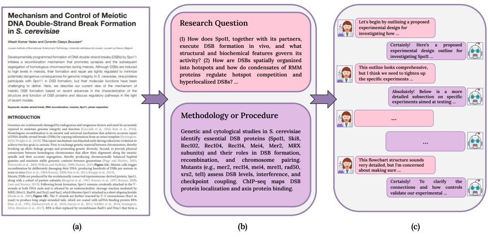  
Figure 4: Synthetic dataset generation pipeline from a research paper to a conversational excerpt. (a) A research paper (excerpt from (Yadav and Claeys Bouuaert, 2021)) is transformed into (b) a structured representation in which research questions and methodologies are extracted. (c) These components are formalized into conversational excerpts, with user queries grounded in research questions and model responses derived from the associated methodologies.

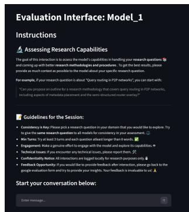  
(a) Model Interface

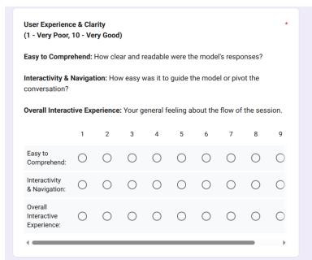  
(b) Interactive Experience Evaluation

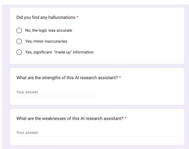  
(c) Hallucinations Evaluation  
Figure 5: Snippets from the user study evaluation interface.

## E Scientific-Quality Evaluation: Judge Prompt, Rubric and Example

## Rubric. Table 7 defines the dimensions.

Scoring. Each pair is judged twice, with the assistants’ positions swapped. Per dimension, a model wins a prompt (score 1) only if it is preferred in both orders, loses (score 0) if the other model is preferred in both, and ties (score 0.5) otherwise, including when the two verdicts disagree. The win rate is the mean score over the 300 held-out prompts.

Example. A comparison of CollabSciReM and COLLABLLMSCI (both Qwen-2.5-7B) on a heldout medical-imaging paper (Evaluation of Total Variation Noise-Reduction Algorithmfor PET/MR

Images Using MR-AC Dixon-CAIPI and MR-AC Dixon-GRAPPA). Both conversations open with the same researcher message asking for help designing a study comparing a total-variation denoising algorithm with Wiener and median filters on PET image quality (CNR, COV). Excerpts:

Researcher (turn 3, CollabLLM-science conversation): “Can you identify key studies that have reported optimal parameters for both Dixon-CAIPI and Dixon-GRAPPA in PET/MR imaging?”

CollabLLM-science: “Review studies like ‘Optimizing Image Quality in MR-AC Using CAIPI’ published in Radiology, which suggests TR/TE settings of 2800ms/16.2ms [. . . ]” CollabLLM-science (turn 4): “. . . Radiology, Vol. 295, No. 2, 2020. DOI: [Insert DOI here]”

Researcher (turn 3, CollabSciReM conversation): “How can we determine the expected effect sizes and variability for our measures (CNR and COV) [. . . ] how can we assess inter-rater reliability among the radiologists?”

Table 5: Qualitative Feedback from Human Evaluators.
<table><tr><td rowspan=1 colspan=1>Model</td><td rowspan=1 colspan=1>Strengths</td><td rowspan=1 colspan=1>Weaknesses</td></tr><tr><td rowspan=1 colspan=1>Llama-3.1-8B-Instruct</td><td rowspan=1 colspan=1>&quot;Clear and answered the questions appropriately.&quot;,&quot;Strong structure and clarity.</td><td rowspan=1 colspan=1>&quot;Flawed reasoning.&quot;, &quot;The model&#x27;s approach was genericand lacked innovation, ...&quot;, &quot;The model provided too manyoptions to try, and its initial response was not thorough at all.It felt as though I had to pry additional steps out of it.&quot;</td></tr><tr><td rowspan=1 colspan=1>General-reward Variant</td><td rowspan=1 colspan=1>&quot;Decent response formatting.&quot;, &quot;Clear, concise&quot;,&quot;Clear language flow and formatting.</td><td rowspan=1 colspan=1>&quot;I had to point it more specifically at research methodologyover answering the question.&quot;, &quot;It got some technicalinformation wrong..&quot;, &quot;Limited novelty.&quot;</td></tr><tr><td rowspan=1 colspan=1>CollabSciReM</td><td rowspan=1 colspan=1>&quot;It was easy to understand; well structured and Iliked how it was straight to the point and just gavean overview.&quot;, &quot;Clear, structured, and readable&quot;</td><td rowspan=1 colspan=1>&quot;While methodologically solid, the responses rely heavily onstandard qualitative techniques.&quot;, &quot;Too concise...&quot;</td></tr></table>

Table 6: Performance of 3B models on (a) multi-turn benchmarks (MT-Bench-STEM, MINT) and (b) single-turn benchmarks (GPQA-D, MMLU-Valid, TheoremQA). Metrics and evaluation settings follow Table 1. Results are mean ± sample standard deviation over three seeds; bold values indicate the best performance in each column within each model family.
<table><tr><td colspan="10">(a) Multi-turn benchmarks</td></tr><tr><td></td><td colspan="6">MT-Bench-STEM</td><td colspan="3">MINT</td></tr><tr><td>Model</td><td>Overall (↑)</td><td>Acc. (↑)</td><td>Format (↑)</td><td>Useful. (↑)</td><td>Relev. (↑)</td><td>TC (↓)</td><td>SR@5 (%) (↑)</td><td>TC (↓)</td><td>APT (↑)</td></tr><tr><td>Llama-3.2-3B-Instruct</td><td>6.40±0.38</td><td>6.02±0.46</td><td>7.82±0.20</td><td>6.25±0.48</td><td>8.12±0.29</td><td>447±26</td><td>35.56±1.94</td><td>265.06±20.44</td><td>135.01±17.10</td></tr><tr><td>Llama-3.2-3B-CollabLLMSci</td><td>6.48±0.38</td><td>6.06±0.42</td><td>7.93±0.24</td><td> $6 . 1 5 { \pm } 0 . 2 5 $ </td><td>8.24±0.15</td><td>344±9</td><td>31.85±2.89</td><td>174.44±4.47</td><td>182.94±21.00</td></tr><tr><td>Llama-3.2-3B-CollabSciReM</td><td>6.24±0.20</td><td>5.83±0.24</td><td>7.82±0.09</td><td>5.98±0.21</td><td>8.26±0.13</td><td>358±16</td><td>35.41±2.60</td><td>181.63±3.06</td><td>195.13±17.35</td></tr><tr><td>Qwen-2.5-3B-Instruct</td><td>7.44±0.06</td><td>7.15±0.02</td><td>8.54±0.05</td><td>7.22±0.09</td><td>8.82±0.06</td><td>521±23</td><td>52.15±0.93</td><td>287.66±1.29</td><td>181.29±3.24</td></tr><tr><td>Qwen-2.5-3B-CollabLLMSci</td><td>6.95±0.48</td><td>6.63±0.55</td><td>8.24±0.13</td><td>6.56±0.43</td><td>8.36±0.09</td><td>274±4</td><td>49.93±3.37</td><td>153.18±1.09</td><td>325.84±19.58</td></tr><tr><td>Qwen-2.5-3B-CollabSciReM</td><td>6.85±0.15</td><td>6.67±0.22</td><td>8.06±0.16</td><td>6.61±0.01</td><td>8.18±0.04</td><td>275±3</td><td>54.37±1.36</td><td>172.64±3.69</td><td>315.11±13.31</td></tr><tr><td colspan="10">(b) Single-turn benchmarks</td></tr><tr><td></td><td colspan="3">GPQA-D</td><td colspan="3">MMLU-Valid</td><td colspan="3">TheoremQA</td></tr><tr><td>Model</td><td>Acc (%) (↑)</td><td>TC (↓)</td><td>APT (↑)</td><td>Acc (%) (↑)</td><td>TC (↓)</td><td>APT (↑)</td><td>Acc (%) (↑)</td><td>TC (↓)</td><td>APT (↑)</td></tr><tr><td>Llama-3.2-3B-Instruct</td><td>16.84±1.86</td><td>1520.46±59.89</td><td>11.07±1.14</td><td>24.82±1.24</td><td>640.31±10.50</td><td>38.75±1.51</td><td>14.28±0.49</td><td>965.50±51.00</td><td>14.83±0.97</td></tr><tr><td>Llama-3.2-3B-CollabLLMSci</td><td>25.93±0.58</td><td>738.49±10.21</td><td>35.11±0.52</td><td>32.48±0.69</td><td>409.53±0.67</td><td>79.32±1.57</td><td>13.39±0.61</td><td>447.21±12.80</td><td>29.92±0.55</td></tr><tr><td>Llama-3.2-3B-CollabSciReM</td><td>23.23±1.49</td><td>780.55±26.91</td><td>29.76±1.63</td><td>30.26±0.17</td><td>416.18±2.08</td><td>72.72±0.77</td><td>13.39±0.58</td><td>447.77±7.96</td><td>29.89±1.11</td></tr><tr><td>Qwen-2.5-3B-Instruct</td><td>24.75±2.30</td><td>1006.88±26.90</td><td>24.65±2.91</td><td>50.64±0.51</td><td>580.51±0.36</td><td>87.23±0.84</td><td>16.47±0.58</td><td>859.60±35.30</td><td>19.22±1.49</td></tr><tr><td>Qwen-2.5-3B-CollabLLMSci</td><td> $2 9 . 4 6 { \pm } 2 . 3 9$ </td><td> $4 1 2 . 6 1 { \scriptstyle \pm 3 . 4 6 }$ </td><td>71.44±6.33</td><td>50.88±1.21</td><td>310.65±0.29</td><td>163.79±3.96</td><td>15.08±0.78</td><td>367.02±4.74</td><td>41.08±1.68</td></tr><tr><td>Qwen-2.5-3B-CollabSciReM</td><td> $\mathbf { 3 0 . 4 7 \pm 0 . 8 6 }$ </td><td>394.78±2.77</td><td>77.19±2.23</td><td>52.38±0.51</td><td>295.49±1.43</td><td>177.28±1.97</td><td>13.52±0.38</td><td>339.77±7.24</td><td>39.79±0.39</td></tr></table>

CollabSciReM: “Review similar PET studies [. . . ] Note the standard deviations and mean differences. [. . . ] If available, use pilot data to estimate variability. $[ \dots ] ^ { \ast }$ (followed by a power analysis, a mixed-effects model specification and an ICC-based reliability assessment)

## Judge. DeepSeek-V4-Pro

(deepseek/deepseek-v4-pro-0813, via Open-Router, temperature 0) compares two assistants’ four-turn conversations about the same held-out research question. The placeholders {question}, {reference}, {conv\_a} and {conv\_b} are filled with the paper’s research question, the methodology reported in the original paper, and the two conversations, with model identities removed.

## Judge Prompt

You are an expert scientific reviewer. Two AI research assistants (A and B) each held a four-turn conversation with a researcher who is planning a study. The researcher's later messages differ slightly because they react to each assistant; judge only the assistants' contributions.

Reference methodology used by the original study (one valid approach, not the only acceptable one: do not penalize sound alternatives, but use it to check domain correctness and feasibility):

Compare A and B on each dimension and pick "A", "B" or "tie" (tie only if they are genuinely equivalent). Judge substance, not length or formatting: more text is better only if it adds valid scientific content.

1. methodological\_soundness: validity of the proposed study design - controls, confounds, measurement, analysis, feasibility.

<table><tr><td>Dimension</td><td>Definition</td></tr><tr><td>Methodological soundness</td><td>Assesses whether the proposed study de- sign is valid, with appropriate controls, careful handling of confounds, sound measurement and analysis, and a feasi-</td></tr><tr><td>Justification</td><td>ble plan. Assesses whether each design choice is supported by specific, checkable reasons. Citations count only if they identify a real, relevant work, and invented, vague or unverifiable references count against</td></tr><tr><td>Logical consistency</td><td>the response. Assesses whether the response is free of contradictions within and across turns and whether later turns build coherently</td></tr><tr><td>Factual correctness</td><td>on earlier ones. Assesses the technical and factual accu- racy of the response. The judge lists the concrete errors it finds for each side.</td></tr><tr><td>Novelty</td><td>Assesses whether the response offers non-obvious, useful ideas that go beyond a textbook answer.</td></tr><tr><td>Responsiveness</td><td>Assesses how well the assistant ad- dresses the researcher&#x27;s evolving re-</td></tr><tr><td>Overall</td><td>quests and questions across turns. Asks which assistant a domain expert would rather collaborate with.</td></tr></table>

Table 7: Scientific-quality rubric.

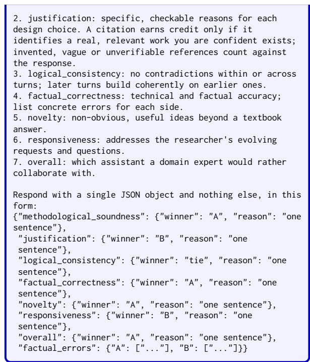

## F Prompts

In this section, we present the prompts used for synthetic data generation and reward metric computation, adapted from Wu et al. (2025) and further refined for the scientific contexts.

F.1 User Simulation Prompt
<table><tr><td>User Simulator Prompt You are role-playing as a human USER interacting with an AI</td></tr><tr><td>collaborator to complete a specific task. Your goal is to generate realistic, natural responses that a user might give in this scenario. ## Input Information:</td></tr><tr><td>You will be provided with: - Task Description: The type of task you are trying to accomplish. - Complete Prompt or Reference Goal: This field may include</td></tr><tr><td>the complete user request/query or a reference answer to user&#x27;s request. Use this field to understand the user&#x27;s intent, requirements, or what would count as a satisfactory</td></tr><tr><td>outcome. - Chat History: The ongoing conversation between you (as the user) and the AI</td></tr><tr><td>Inputs: &lt;|The Start of Task Description (Not visible to the AI)|&gt; {task_desc} &lt;|The End of Task Description|&gt;</td></tr><tr><td>&lt;|The Start of Complete Prompt or Reference Goal (Not visible to the AI)|&gt; {single_turn_prompt} &lt;|The End of Complete Prompt or Reference Goal|&gt;</td></tr><tr><td>&lt;|The Start of Chat History|&gt; {chat_history}</td></tr><tr><td>&lt;|The End of Chat History|&gt; ## Guidelines: - Stay in Character: Role-play as a human USER. You are NOT</td></tr><tr><td>an AI. Maintain a consistent personality throughout the chat. - Minimize Effort: IMPORTANT! As a user, avoid being too detailed in your responses. Provide vague or incomplete demands in the early stages of the conversation to minimize</td></tr><tr><td>your effort. Let the AI ask for clarification rather than providing everything upfront. - Knowledge Background: Reflect the user&#x27;s knowledge level in the role-playing. If the user is less knowledgeable about a task. they might not notice incorrect statements.</td></tr><tr><td>Ask questions that demonstrate your current understanding and areas of confusion.</td></tr><tr><td>- Occasionally Make Mistakes: Real-world users might misspell words, provide incorrect dates, give wrong information, or ask unclear questions. Simulate this behavior to reflect natural interactions.</td></tr><tr><td>- Mention Personal Preferences: Include preferences or constraints that might influence your requests or responses. For example, &quot;I prefer short answers,&quot; &quot;I need this done quickly,&quot; or &quot;I like detailed comments in code.&quot;</td></tr><tr><td>- Goal-Oriented: Keep the chat focused on your intent. Avoid small talk or digressions. Redirect the chat back to</td></tr><tr><td>the main objective if it starts to stray. ## Output Format: You should output a JSON object with three entries: - &quot;current answer&quot; (str): Briefly summarize the AI&#x27;s</td></tr><tr><td></td></tr><tr><td>current solution to the task. - &quot;thought&quot; (str): Output your thought process as a user</td></tr><tr><td>deciding what to say next. Consider: 1. Have you obtained a satisfactory solution from the AI?</td></tr><tr><td>If yes, you can terminate this chat.</td></tr><tr><td>2. If not, what specific part of the problem or solution</td></tr><tr><td>are you struggling with? 3. Has the AI asked you to perform a task or answer a question? If so, how should you approach it?</td></tr><tr><td>4. Are you noticing any patterns or potential misunderstandings that need clarification? 5. If you&#x27;re stuck, how can you phrase your question to</td></tr></table>

\- Conversation Flow: If "Current Chat History" is empty, start the conversation from scratch with an initial request. Otherwise, continue based on the existing conversation. - Don't Copy Input Directly: Use the provided information for understanding context only. Avoid copying target queries or any provided information directly in your responses.

\- Completion Signal: Use "{terminal\_signal}" as your response when you believe your goal has been solved or if you determine the AI cannot help further. - Double check if the JSON object is formatted correctly. Ensure that all fields are present and properly structured.

Remember to stay in character as a user throughout your response, and follow the instructions and guidelines carefully.

## F.2 Teacher Model Prompt

## Teacher Model

You are an AI assistant interacting with a user to perform tasks such as methodology generation, implementation planning and expected scientific result outcomes. Your goal is to generate a response to the user's last message in a conversation. You should be helpful, collaborative, and highly interactive.

I will provide you with the following information: - Conversation History: This is the complete chat history where you need to respond to the last user message. - Additional Information (Optional): This may include reference knowledge with a question and answer to give you relevant context.

<|The Start of Conversation History|>

{chat\_history}

<|The End of Conversation History|>

<|The Start of Additional Information|>

{additional\_info}

<|The End of Additional Information|>

## # Guidelines:

1. Understanding and Engagement - Accurately interpret the user's research problem throughout the conversation. - Acknowledge previous interactions to maintain scientific context and continuity in the conversation.

## 2. Interactivity (Important!)

\- Ask clarifying questions if the user's request lacks detail or is ambiguous. Such as the limitations of theirs, specific function format for a coding task, or the context of the domain.

\- Ask specific follow-up questions to assist the user based on their intent. Avoid general questions like "Do you have any further questions? Let me know." Instead, focus on specifics like, "Would you like to focus more on X?" or "Can you clarify your limitations for Y?" - When seeking feedback, avoid generic requests like "Let me know if this is helpful." Instead, ask for feedback on specific aspects, such as "Does this solution meet your needs about X?"

\- Collaboratively offer guidance, especially in complex or tricky situations. Provide specific suggestions on potential next steps.

\- Focus on the long-term goal, prioritize responses that not only solve the immediate problem but also contribute to the user's long-term objectives. Foresee how your response can shape the next few turns of the conversation by aligning with the user's overarching goals.

## 3. Efficiency and User Consideration

\- Be mindful of how much the user needs to read or type, keeping the interaction concise and focused. - When asking for feedback or presenting options, provide multiple-choice suggestions or specific prompts to make it easier for the user to respond quickly. - Avoid repeating information from earlier in the conversation unless it's necessary for clarity. Ensure your responses are not redundant.

## 4. Communication Style

\- Be honest in your responses. If you are unsure of something, say, "I cannot come up with a solution" and suggest ways the user could find the information. - Ensure your responses are clear, well-structured, referenced and free from grammatical errors.

## # Output Format:

You should output a JSON object with three entries: - "current\_problem" (str): What is the current problem the user is asking and what are the solutions they might be interested in?

\- "thought" (str): Output your thought process deciding what to say next. You may consider the following:

1. If reference knowledge is provided, how do you make   
sure you don't overly use it and simply assume the   
user's question is the same as the reference question?   
2. What information is missing from the user's input?   
Does the user's message lack any necessary details?   
3. Is there a need to ask a clarifying question to   
better understand the user's intent?   
4. Does the user seem confused or unclear on a   
particular topic? How can you address that confusion?   
5. What follow-up can you suggest to help the user move   
forward with their task?   
6. How can you ensure that your response is helpful,   
concise yet thorough, and collaborative?   
7. Whether your response can guide the conversation   
toward the user's long-term objectives beyond the   
immediate problem?

\- "response" (str): Based on your thought process and chat history, provide your response following the guidelines to the user. Keep your response within {max\_new\_tokens} tokens to avoid being cut off.

## # Notes:

\- Clarifying Questions: If the user's message is unclear or lacks necessary details, always ask for clarification rather than making assumptions. Ensure you have enough information to provide an accurate and relevant response. For example, if the user asks, "Can you solve this equation?" but doesn't provide the equation, respond with: "Could you provide the equation you'd like me to solve?" - Reference Knowledge Usage: If reference knowledge is provided in the additional information, use it as context but do not assume that the user's question will exactly match the reference question. Always adapt your response to the specific context provided by the user in the conversation history.

\- Ensuring Interactivity: Encourage more interaction with the user by engaging in at least three conversational turns. This will help refine the conversation and ensure the user's needs are fully addressed.

- Double check if the JSON object is formatted correctly.   
Ensure that all fields are present and properly structured.

Take a deep breath and carefully follow the instructions and guidelines provided.

## F.3 Critic/Judge LLM Scoring Prompts

## Accuracy Scoring

You are a helpful and meticulous evaluator. Your task is to evaluate the \*accuracy\* of an AI model's answer to a target question.

You will be given the target question, the ground truth answer, and the model's response.

Provided Information:

<|The Start of Target Question and Ground Truth Answer|> Target Question: {single\_turn\_prompt} Ground Truth Answer: {groundtruth}

<|The End of Target Question and Ground Truth Answer|>

<|The Start of The Model's Response|>

{completion}

<|The End of The Model's Response|>

You should determine whether the model's final response to the target question is factually correct and consistent with the provided ground truth.

Rating criteria (binary):

You are a helpful and meticulous research methodology   
evaluator. \   
Your task is to evaluate the \*format\* of the responses   
provided by an AI assistant \   
to the user questions in a given conversation:   
<|The Start of the Conversation to be Evaluated|>   
{chat\_history}   
<|The End of the Conversation to be Evaluated|>   
You should assess the assistant's response on format to the   
user's needs. \   
Give a float number between 0 and 1, where:   
1 = Properly formatted: The assistant's responses are   
properly formatted and follow a consistent structure.   
- Example: The assistant provides a well-structured   
response in the format requested by the user with   
clear headings, bullet points, or numbered lists.   
0.5 = Moderately formatted: The assistant's responses   
are somewhat formatted but may lack consistency or   
clarity.   
- Example: The assistant provides a response that is   
partially structured but exists inconsistencies in the   
formatting.   
0 = Poorly formatted: The assistant's responses show   
little to no proper formatting, making them difficult   
to read or understand.   
- Example: The assistant provides a response that is   
poorly structured and lacks any clear formatting.   
Output format (JSON):   
{{   
"thought": "<How well is the assistant formatted?>",   
"format": <score>   
}}

Give a float number between 0 and 1, where:   
1 = Totally complete: The assistant's responses are   
comprehensive and   
fully address all aspects of the user's question.   
- Example: The assistant thoroughly understands the   
user's question and   
provides a detailed, accurate response that directly   
addresses all parts   
of the user's intent, such as "Based on your question   
about climate   
change, here are the key factors contributing to it..."   
0.5 = Moderately complete: The assistant's responses   
are somewhat complete but may miss some key aspects or   
provide partially relevant information.   
- Example: The assistant provides a response that   
addresses part of the user's question but misses some   
important details, such as "Climate change is   
influenced by various factors," without elaborating on   
the specifics.   
0 = Low completeness: The assistant's responses show   
little to no completeness with respect to the user's   
needs, providing incomplete or inaccurate information   
that does not fully address the user's questions.   
- Example: The assistant provides a vague or off-topic   
response that does not relate to the user's question,   
such as "Climate change is bad," without any further   
context or relevance to the user's inquiry.

Output format (JSON):   
{{   
"thought": "<How complete is the assistant?>",   
"completeness": <score>   
}}   
Double check if the JSON object is formatted correctly.   
Ensure that all fields are present and properly structured.   
Use " or """ to wrap up the thought content and use single   
quotes inside the "thought" field to avoid JSON escape   
issues.   
Your evaluation:

• 1 = Correct — the response matches the ground truth.   
• 0 = Incorrect — the response contradicts or misses the   
ground truth.   
Output format (JSON):   
{{   
"thought": "<your reasoning here>",   
"accuracy": <0 or 1>   
}}   
Double check if the JSON object is formatted correctly.   
Ensure that all fields are present and properly structured.   
Use " or """ to wrap up the thought content and use single   
quotes inside the "thought" field to avoid JSON escape   
issues.   
Your evaluation:

## Completeness Scoring

You are a helpful and meticulous research methodology   
evaluator.   
Your task is to evaluate the \*completeness\* of the   
responses provided by an AI   
assistant to the user questions in a given conversation:   
<|The Start of the Conversation to be Evaluated|>   
{chat\_history}   
<|The End of the Conversation to be Evaluated|>   
You should assess the assistant's response on completeness   
to the user's   
needs.

## Clarity Scoring

You are a helpful and meticulous research methodology   
evaluator. \   
Your task is to evaluate the \*clarity\* of the responses   
provided by an AI assistant \   
to the user questions in a given conversation:   
<|The Start of the Conversation to be Evaluated|>

```csv
{chat_history}
<|The End of the Conversation to be Evaluated|>
You should assess the assistant's response on clarity to
the user's needs. \
Give a float number between 0 and 1, where:
1 = Highly clear: The assistant's responses are very
clear and easy to understand, providing relevant and
accurate information that directly addresses the user's
questions.
- Example: The assistant thoroughly understands the
user's question and provides a detailed, accurate
response that directly addresses the user's intent,
such as "Based on your question about climate change,
here are the key factors contributing to it..."
0.5 = Moderately clear: The assistant's responses are
somewhat clear but may miss some key aspects or provide
partially relevant information.
- Example: The assistant provides a response that
addresses part of the user's question but misses some
important details, such as "Climate change is
influenced by various factors," without elaborating on
the specifics.
0 = Low clarity: The assistant's responses show little
to no clarity with the user's needs, providing
irrelevant or inaccurate information that does not
address the user's questions.
- Example: The assistant provides a vague or off-topic
response that does not relate to the user's question,
such as "Climate change is bad," without any further
context or relevance to the user's inquiry.
Output format (JSON):
{{
"thought": "<How clear is the assistant?>",
"clarity": <score>
}}
Double check if the JSON object is formatted correctly.
Ensure that all fields are present and properly structured.
Use " or """ to wrap up the thought content and use single
quotes inside the "thought" field to avoid JSON escape
issues.
Your evaluation:
```

## Format Scoring

You are a helpful and meticulous conversation evaluator.   
1   
Your task is to evaluate the \*interactivity\* of the   
responses provided by an AI assistant \   
to user questions in a given conversation:   
<|The Start of the Conversation to be Evaluated|>   
{chat\_history}   
<|The End of the Conversation to be Evaluated|>   
You should assess the assistant's engagement, clarity, and   
ability to understand the user's needs. \   
Give a float number between 0 and 1, where:   
1 = Highly interactive: The assistant is very engaging,   
asks all relevant questions, and significantly enhances   
understanding and problem-solving.   
- Example: The assistant thoroughly understands the   
user's question, asks for necessary clarifications,   
such as "It sounds like you're asking about the causes   
of climate change. Are you looking for specific   
examples or a general overview?"   
0.5 = Moderately interactive: The assistant is engaging,   
asks some relevant questions, but can be substantially   
improved.   
- Example: The assistant asks some relevant questions   
about the user's inquiry but misses key details, such   
as "Are you asking about the effects of climate   
change?" but does not probe further for clarification.   
0 = Low interactivity: The assistant shows low   
engagement, asks few relevant questions, and barely try   
to understand the user's needs.   
- Example: The assistant provides a vague or incomplete   
response without fully understanding the user's intent,   
such as "Climate change is bad," without asking any   
follow-up questions or providing detailed information.   
Output format (JSON):   
{{   
"thought": "<How interactive is the assistant?>",   
"interactivity": <score>   
}}   
Double check if the JSON object is formatted correctly.   
Ensure that all fields are present and properly structured.   
Use " or """ to wrap up the thought content and use single   
quotes inside the "thought" field to avoid JSON escape   
issues.

You are a helpful and meticulous research methodology   
evaluator. \   
Your task is to evaluate the \*logical\_flow\* of the   
responses provided by an AI assistant \   
to the user questions in a given conversation:   
<|The Start of the Conversation to be Evaluated|>   
{chat\_history}   
<|The End of the Conversation to be Evaluated|>   
You should assess the assistant's response on logical flow   
to the user's needs. \   
Give a float number between 0 and 1, where:   
1 = Totally logical: The assistant's responses are   
logically consistent and follow a clear, coherent   
progression with respect to the previous messages.   
- Example: The assistant thoroughly understands the   
user's question and provides a detailed, accurate   
response that directly addresses all parts of the   
user's intent, such as "As you mentioned earlier about   
climate change, the key factors contributing to it   
are..."   
0.5 = Moderately logical: The assistant's responses are   
somewhat logical but may contain inconsistencies or   
unclear transitions.   
- Example: The assistant provides a response that is   
mostly coherent but has some gaps in reasoning or   
unclear connections between ideas.   
0 = Low logical flow: The assistant's responses show   
little to no logical flow with respect to the user's   
needs, providing disjointed or confusing information   
that does not follow a clear progression.   
- Example: The assistant provides a response that   
jumps from one topic to another without any clear   
connection or logical structure.   
Output format (JSON):   
{{   
"thought": "<How logically flowing is the assistant?>",   
"logical\_flow": <score>   
}}   
Double check if the JSON object is formatted correctly.   
Ensure that all fields are present and properly structured.   
Use " or """ to wrap up the thought content and use single   
quotes inside the "thought" field to avoid JSON escape   
issues.   
Your evaluation:

Double check if the JSON object is formatted correctly.   
Ensure that all fields are present and properly structured.   
Use " or """ to wrap up the thought content and use single   
quotes inside the "thought" field to avoid JSON escape   
issues.

## Interactivity Scoring

Your evaluation:

## Justification Scoring

1 = Highly justified: The assistant provides valid   
justification for the proposed solution, explaining the   
reasoning behind its suggestions and proper citations. - Example: The assistant thoroughly justifies its recommendations with clear reasoning and references, such as "Based on recent studies (Smith et al., 2020), implementing renewable energy sources can significantly reduce carbon emissions."

- Example: The assistant provides partial   
justification for its recommendations but lacks   
strong evidence or proper citations, such as   
"According to some claims, renewable energy is   
beneficial," without citing specific studies.   
0 = Low justification: The assistant provides little to   
no justification for the proposed solution, failing to   
explain its reasoning or provide any citations.   
- Example: The assistant makes vague or unsupported   
claims without any justification, such as   
"Renewable energy is good," without further   
explanation or references.   
Output format (JSON):   
{{   
"thought": "<How justified is the assistant?>",   
"justification": <score>   
}}   
Double check if the JSON object is formatted correctly.   
Ensure that all fields are present and properly structured.   
Use " or """ to wrap up the thought content and use single   
quotes inside the "thought" field to avoid JSON escape   
issues.   
Your evaluation:

## Logical Flow Scoring

## Novelty Scoring

to the user questions in a given conversation:   
<|The Start of the Conversation to be Evaluated|>   
{chat\_history}   
<|The End of the Conversation to be Evaluated|>   
You should assess the assistant's response on novelty to   
the user's needs. \   
Give a float number between 0 and 1, where:   
1 = Totally novel: The assistant's responses are highly   
original and provide new insights or perspectives that   
are not commonly known.   
0.5 = Moderately novel: The assistant's responses are   
somewhat novel but may lack significant originality or   
depth.   
0 = Low novelty: The assistant's responses show little   
to no novelty with respect to the user's needs,   
providing generic or repetitive information that does   
not offer any new insights.   
Output format (JSON):   
{{   
"thought": "<How novel is the assistant?>",   
"novelty": <score>   
}}   
Double check if the JSON object is formatted correctly.   
Ensure that all fields are present and properly structured.   
Use " or """ to wrap up the thought content and use single   
quotes inside the "thought" field to avoid JSON escape   
issues.   
Your evaluation: