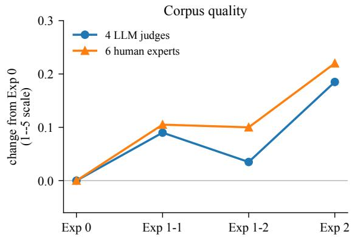
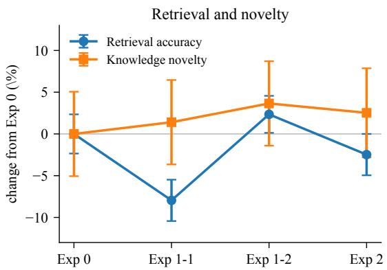
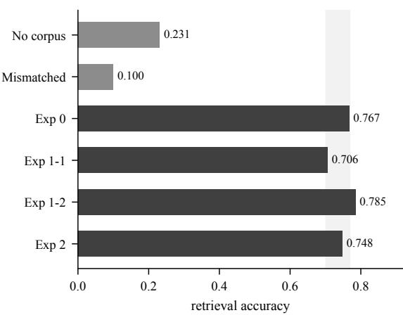
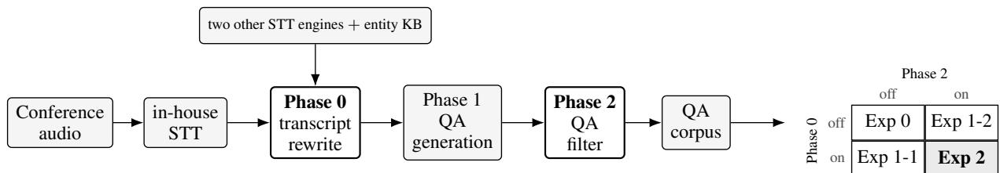

# Corpus Quality Improves, Retrieval Utility Does Not: An Ablation of Preprocessing and Refinement in a Speech-to-QA Pipeline

Wonsup Shin Flitto wonsup.shin@flitto.com

Jingu Kim   
Flitto   
jin@flitto.com

## Abstract

Practitioners building training corpora with a pipeline of language models keep a preprocessing or refinement (post-process) stage when switching it on raises the corpus quality. We ablate a production pipeline that turns conference speech into question–answer pairs. The preprocessing stage rewrites the transcript, and the refinement stage filters the generated pairs. Switching each on and off gives four corpora from the same 40 Korean medical and finance sessions. On the corpus itself, quality rises as the stages switch on. Four LLM judges and six human domain experts rank the four corpora the same way, and the fully refined corpus leads by +0.18 and +0.22 on a 1–5 scale. We then ask whether that gain carries downstream. We supply each corpus to six models at inference and measure retrieval accuracy. The ranking does not hold. Enabling the transcript rewrite lowers retrieval accuracy by 0.061, the only stage effect that survives correction for multiple comparisons. That stage also reads the whole session, so it almost doubles the cost of one. With both stages on, accuracy does not change. An equivalence test we declared in advance confirms this. The corpus itself is clearly valuable. It lifts retrieval accuracy from 0.231 to 0.748 in every model and domain we test. More than a third of its pairs carry knowledge that neither of two frontier models produces on its own. On our data, the null does not come from weak corpora. A rising score on a rubric of this kind did not predict what the corpus holds for a model.

## 1 Introduction

Practitioners building training corpora with a pipeline of language models face a practical question. Such a pipeline has several preprocessing and refinement stages, each of them costly. One stage in the pipeline we study rewrites the speech transcript before generation. It reads the whole session rather than finished question–answer pairs, so turning it on almost doubles the cost of a session and adds six minutes of wall-clock time. The question is which stages are worth that cost.

The usual answer is to score the corpus. A judge rates a sample before and after a stage, the score goes up, and the stage stays. Sometimes a human panel confirms the gain. The procedure is reasonable, and it rests on an assumption that is rarely tested: a corpus that scores higher works better.

We test that assumption on a production pipeline. It turns conference speech into question– answer pairs and has two stages that can be switched off, one preprocessing and one refinement. One rewrites the transcript before generation, and the other filters generated pairs. Switching each on and off gives four corpora from the same 40 Korean medical and finance sessions.

On the corpus itself, quality rises as the stages switch on. Four LLM judges and six human domain experts rank the four corpora the same way. Each stage helps alone, and both together help most, by +0.18 and +0.22 on a 1–5 scale. All five rated dimensions move up (Figure 1, left).

That ranking does not carry to retrieval. We supply each corpus to six instruction-tuned models at inference and measure retrieval accuracy. This needs no training run, so a corpus that cannot help here is unlikely to help when a model must learn from it. The fully refined corpus is not the best of the four (Figure 1, right). Each stage moves accuracy the opposite way. The transcript rewrite lowers accuracy by 0.061. The QA filter raises it by 0.018, which we cannot separate from noise. Run together, the two stages cancel. The corpus ends 0.020 below where it started, and that gap falls inside a bound we declared in advance.

Part of the reason lies in what the two stages do. The QA filter passes two thirds of its pairs through unchanged, character for character, and its prompt forbids new factual claims. The transcript rewrite is more invasive and carries the penalty, but it rebuilds the corpus rather than editing it, which limits what we can attribute the penalty to.

  
Figure 1: The same four corpora, measured two ways. Left: two scoring sources, each shifted to start at its value for Exp 0, the unrefined corpus, so they share an axis. Right: two downstream instruments, in percent change from Exp 0, with 95% intervals. Retrieval intervals come from the six models crossed with the two domains (§4.2). Novelty intervals come from the pairs. Note the different vertical scales.

The corpus itself has clear value, which sharpens the dissociation. Supplying it raises accuracy from 0.231 to 0.748 in every one of the six models on both domains, and the gain over a wrongdomain control is +0.648. We also ask how much of each corpus a frontier model already knows. More than a third of the pairs carry knowledge that neither of two frontier models produces on its own, and the four corpora do not differ (Figure 1, right). The corpus is valuable. Refining it does not make it more valuable.

We make three contributions. First, we show a dissociation between corpus quality scores and what the corpus holds for a model, with human experts on the quality side and two instruments on the other. Earlier studies report that fine-tuning is a weak route for knowledge injection (Zhou et al., 2023; Ovadia et al., 2024; Gekhman et al., 2024). Our result differs in kind: the corpus improved by every measure practitioners would use, and neither instrument moved with it. Second, neither stage adds knowledge. The share of pairs a frontier model cannot answer is flat across the four corpora, and the stages that raise the quality score move retrieval slightly down. This suggests they improve how the corpus reads, not what it holds. The full pipeline is therefore not always the right choice. When the goal is to extract knowledge, our results give no reason to pay for either stage: leaving both off costs less than half as much and gives a corpus that retrieves as well and is no less novel. Third, we propose a retrieval protocol for judging the QA a speech pipeline produces. The corpus goes to a model at inference, and closedbook questions bound how much a model does not already know. The control is a corpus from the same pipeline with only the domain wrong. Supplying it drops accuracy to 0.100, below the 0.231 a model reaches with no corpus at all, so a gain over that control cannot come from merely having text to read. The protocol also needs a wording filter. Questions taken from the transcripts a corpus was built from leave their wording in the reference answers, and scoring then favors whichever corpus shares it. The more such questions we admit, the more the comparison shifts toward the corpora that share the wording. We see this across nine settings of the filter. That shift is what the wording alone would produce. We fix its threshold without reference to any accuracy score.

## 2 Related Work

Building and filtering synthetic training data. One line of work constructs training data with large language models, from seed instructions (Wang et al., 2023; Xu et al., 2024) or from documents (Ben Allal et al., 2024; Li et al., 2024a; Yang et al., 2025; Yehudai et al., 2024), and Nemotron-4 340B constructs almost all of its alignment data this way (NVIDIA, 2024).

A second line keeps part of that data and drops the rest, from LIMA’s 1,000 hand-picked examples (Zhou et al., 2023) to automatic scoring that keeps a fraction (Chen et al., 2024b; Liu et al., 2024; Li et al., 2024b). All of this work validates a score in one direction: select on the score, then show that the selected data trains a better model.

Xia et al. (2025) replicate several such methods at scale and find few beat random selection. Our refinement stage is a filter of this kind, and we report what it changes and what it leaves alone.

LLM judges as measures of data quality. LLM-as-judge scoring is the common way to measure data quality (Zheng et al., 2023). Judges agree with human raters often enough to be useful and run cheaply at scale. Their scores also follow surface properties: judges favor their own generations (Panickssery et al., 2024) and longer answers (Dubois et al., 2024).

That line of work asks whether a judge score matches human preference. We ask whether a gain that judges and humans both confirm predicts anything downstream. Four LLM judges and six human domain experts rank our four corpora the same way, so the gain is not an artifact of one judge, yet it does not carry to retrieval accuracy or knowledge novelty. That gap is our main result.

Knowledge injection. Where new knowledge can enter a model is a settled question in prior work. Fine-tuning teaches format and style while knowledge comes from pretraining (Zhou et al., 2023). Retrieval beats fine-tuning on new facts (Ovadia et al., 2024), fine-tuning on unheld facts raises hallucination (Gekhman et al., 2024), and a model extracts a fact only after seeing it in varied form (Allen-Zhu and Li, 2024). Every training route is lossy for knowledge, so a null under training would confound the corpus with the route. Retrieval avoids that by supplying the content to the model at inference (Lewis et al., 2020), which makes it the most favorable and the cheapest test of content value. It is our main instrument; we use fine-tuning only as a consistency check.

Speech corpora and retrieval-based measurement. Speech recognition now feeds text pipelines (Radford et al., 2023), and several works construct training data from it (Pan et al., 2024; Chen et al., 2025; Jia et al., 2025). These target speech or multimodal ability. None measures what a transcript-preprocessing stage adds to the corpus that follows it. Retrieval places a corpus beside a model at inference time (Lewis et al., 2020), which makes it a direct test of what the corpus holds. RAGAs scores a retrieval system and holds the corpus fixed (Es et al., 2024). We invert that setup: we fix the retriever, the models, and the questions, and swap only the index.

## 3 Pipeline and Corpus

## 3.1 What the pipeline does

The pipeline turns conference speech into question–answer pairs in three phases. We toggle the first and the third and keep the middle one fixed, which gives a 2×2 design (Figure 3).

An in-house system transcribes the audio into sentences, and Phase 0 rewrites that transcript. It corrects the text, but it corrects from evidence rather than from fluency. The model reads two further transcripts of the same audio, each from a different commercial automatic speech recognition (ASR) system, and rewrites each sentence with all three in view. The in-house transcript is what gets corrected, and the other two serve as evidence. When both diverge from it in the same way, the prompt treats that as grounds for a change. It also applies official spellings from a domain knowledge base, which is how proper nouns that ASR misses are recovered. The prompt does not ask it to label speakers or drop fillers. It works in small batches at temperature 0, and a failed batch leaves the original sentences in place.

Phase 1 reads the transcript and writes QA pairs, each carrying a domain, a sub-domain, a difficulty label, and a question type. We hold Phase 1 fixed in every condition, so the ablation measures the two stages rather than generation.

Phase 2 filters the finished pairs, keeping, rewriting, or dropping each one. Six steps run in order. Two remove near-duplicates by embedding similarity, one scores pairs with a judge, two drop pairs whose wording is tied to the session, and one rewrites the pairs the judge rejected.

The judge is a single model that scores each pair on four dimensions. A pair that clears every dimension passes untouched. One that does not enters a refinement loop of at most three rounds, and it is exported only if a later round clears the same cutoffs. Pairs that never clear them are dropped. Appendix B gives the cutoffs. The prompt forbids new factual claims, so the stage cannot add facts. One of the four judge dimensions asks whether a pair stands on its own without the session around it. We return to both in §8.

Exp 0 runs neither stage, Exp 1-1 runs Phase 0 alone, Exp 1-2 runs Phase 2 alone, and Exp 2 runs both. The two stages act at different points, and this shapes what we can compare. Phase 0 changes the transcript, so Phase 1 regenerates every QA pair from new text: turning it on yields a different corpus, not an edited one, and only 1.3% of the pairs in Exp 1-1 carry a question that also appears in Exp 0. Phase 2 acts on finished pairs, labeling each and rewriting only the ones it rejects: in the two contrasts that toggle it, 68% and 64% of its input comes out unchanged, character for character (App. B, Table 3). Pair-level comparison is therefore available for the Phase 2 contrasts but not the Phase 0 ones, and we report corpus-level statistics where pair matching is not available.

## 3.2 Corpus

The corpus covers 40 conference sessions, 19 medical and 21 finance, from speakers who consented to research use. We capture the audio live at the venue with our own recording stack, so it is clean. The pipeline handles several languages, and we draw only on Korean sessions. Segments spoken in another language are kept in that language rather than translated.

Each condition yields between 2,598 and 2,765 pairs, the full output of the pipeline on these sessions, or 10,698 pairs across the four. The same question often appears in more than one condition, so the four hold 6,888 distinct ones. Mean answer length grows from 160 characters in Exp 0 to 192 in Exp 2, mostly from Phase 2.

## 4 Experimental Setup

We ask whether the two stages make the four corpora more useful. One instrument scores the pairs themselves (§5). Two measure the corpus against a model’s own baseline (§6, §7).

## 4.1 Corpus quality

We draw 200 QA pairs, 25 per condition per domain. Four LLM judges and six human domain experts score each pair from 1 to 5 on five dimensions: faithfulness, domain accuracy, question quality, answer depth, and coherence. No rater sees which condition produced a pair. Appendix C lists the judges, the rubric, and the expert protocol.

## 4.2 Retrieval utility

A corpus is useful if a model answers better when it can read it. We test this with 163 questions. A domain expert wrote 43 of them from the session topics. For the other 120, three per session, a language model read one session transcript and wrote a question with its reference answer. Neither writer saw any of the four corpora. That is not enough. The transcript a writer reads leaves its wording in the reference answer, and scoring then favors whichever corpus shares it. We call this the wording effect. A wording filter therefore keeps only the 115 questions whose reference answer does not lean toward the refined or the unrefined corpus. Its threshold is fixed on the expert questions without reference to any accuracy score. Appendix E gives both values and reports every threshold.

For each question we retrieve the three closest pairs with bge-m3 (Chen et al., 2024a). We run six instruction-tuned open-weight models from four families, 2.4B to 9B parameters, with greedy decoding (App. C). We compare eight conditions. Four are the ablation corpora. One supplies no corpus, and a mismatched control supplies the other domain’s Exp 2 corpus. The last two replace our in-house transcripts with Whisper-medium output, running Phase 2 in one condition and not the other. They test whether the results hold when a public system transcribes the speech. Those two were generated only on the 43 expert-written questions, so their contrasts use the 33 of those that pass the wording filter. A model may score higher just for receiving extra text, or because retrieval reshapes its answer format. The mismatched control supplies text of the same kind from the same pipeline with only the domain wrong, so a gain over it is a gain from content.

Two judges from different providers score each answer against the reference answer as correct, partial, or incorrect, mapped to 1.0, 0.5, and 0.0. Judge inputs carry no identifier of model or condition, and we instruct the judges not to reward longer answers. A model’s scores correlate across questions, so we work at the level of one model crossed with one domain, which we call a cell. Within a cell we compare conditions question by question and average the differences. That gives 12 scores, and every interval comes from resampling them.

We release a separate 200-pair sample of the corpora and 10 of these questions (App. A).

## 4.3 Knowledge novelty

Retrieval shows that the corpus helps, not that its knowledge is new. We therefore ask two frontier models, claude-sonnet-5 and gpt-5.6-sol, each question in the corpus with no documents, and check whether their answers carry the same core content as our reference answer. We instruct them to say they do not know rather than guess.

<table><tr><td></td><td>Exp 0 Exp 1-1 Exp 1-2 Exp 2</td><td></td><td></td><td></td></tr><tr><td>corpus quality, 1–5</td><td></td><td></td><td></td><td></td></tr><tr><td>4LLM judges</td><td>3.81</td><td>3.90</td><td>3.84</td><td>3.99</td></tr><tr><td>6 human experts</td><td>3.36</td><td>3.46</td><td>3.46</td><td>3.58</td></tr><tr><td>downstream</td><td></td><td></td><td></td><td></td></tr><tr><td>Retrieval accuracy</td><td>0.767</td><td>0.706</td><td>0.785</td><td>0.748</td></tr><tr><td>Effectively novel, %</td><td>35.6</td><td>36.1</td><td>36.9</td><td>36.5</td></tr></table>

Table 1: The dissociation in one place. Best value in each row is bold. Novelty is the strict count, pairs that both frontier models miss (§4.3).

A pair is novel when the closed-book answer misses the core content, grounded when our answer is real domain content rather than transcription noise, and correct when it is factually sound. A pair is effectively novel when all three hold. Novelty alone would reward noise, which no closed-book answer reproduces and which therefore always counts as new.

Each model grades the other’s closed-book answers, so neither judges its own output. We report two counts. A pair is novel under the lenient count when either model misses the core content, and under the strict count only when both do. Appendix C gives the question mapping and the rules for combining the three axes.

## 5 Refinement Improves Corpus Quality

Both scoring sources rank the four corpora the same way, and Exp 2 is top on both (Table 1). From Exp 0 to Exp 2 the gap is +0.18 $[ + 0 . 0 6 , + 0 . 3 2 ]$ for the LLM judges and +0.22 $[ + 0 . 0 7 , + 0 . 4 0 ]$ for the human experts. All six experts put Exp 2 above Exp 0. Restricting the panel to opus-4.7 and gpt-5.4 gives +0.23 $[ + 0 . 0 3 , + 0 . 4 4 ]$ , so the ranking does not depend on the weaker two (App. I, Table 9).

The ranking holds inside every dimension, and no dimension moves the other way. Faithfulness and domain accuracy, the two that appear to measure content, each rise by +0.17 (App. I). If the study stopped here, the two stages would look worth their cost.

## 6 Retrieval Utility

## 6.1 The corpus adds large value

Accuracy rises from 0.231 without the corpus to 0.748 with Exp 2, a gap of +0.517 [+0.489, +0.544] (Figure 2). Against the mismatched control the gap is larger, +0.648 [+0.589, +0.707]. Both hold in all 12 model-bydomain cells and survive correction for the nine contrasts we run (Table 2). Wrong-domain passages hurt, dropping accuracy to 0.100, below the no-corpus baseline, so the gain is not a side effect of adding text or of the retrieval format.

Figure 2: Retrieval accuracy with each corpus, on the 115 questions that pass the wording filter. Grey bars are the two controls, dark bars the four corpora. The shaded band marks the range the four corpora occupy.
<table><tr><td>Contrast</td><td>Estimate</td><td>p</td></tr><tr><td>anchoring</td><td></td><td></td></tr><tr><td>Exp 2 vs. no corpus</td><td>+0.517</td><td>&lt; 0.0001*</td></tr><tr><td>Exp 2 vs. mismatched</td><td>+0.648</td><td>&lt; 0.0001*</td></tr><tr><td>ablation Exp 1-1 vs. Exp 0</td><td>-0.061</td><td>0.0015*</td></tr><tr><td>Exp 1-2 vs. Exp 0</td><td>+0.018</td><td></td></tr><tr><td>Exp 2 vs. Exp 0</td><td>-0.020</td><td>0.025 0.115</td></tr><tr><td>transcript source, 33 questions</td><td></td><td></td></tr><tr><td>In-house vs. Whisper, stages off</td><td>+0.009</td><td>0.49</td></tr><tr><td>In-house vs. Whisper, stages on</td><td>-0.001</td><td>0.95</td></tr><tr><td>novelty, Phase 2</td><td></td><td></td></tr><tr><td>Exp 1-2 vs. Exp 0</td><td>+1.4pp</td><td>0.30</td></tr><tr><td>Exp 2 vs. Exp 1-1</td><td>+0.4pp</td><td>0.73</td></tr></table>

Table 2: All nine planned contrasts. An asterisk marks the three that clear $0 . 0 5 / 9 \ : = \ : 0 . 0 0 5 6$ . Retrieval estimates are accuracy points on the cell unit; novelty estimates are percentage points over pairs (App. F).

## 6.2 Running both stages leaves retrieval unchanged

The ranking of §5 does not appear here. Exp 1-2 is the best of the four corpora, not Exp 2. The two stages pull in opposite directions. The transcript rewrite alone drops accuracy from 0.767 to 0.706; the QA filter alone raises it to 0.785. Table 2 lists nine planned contrasts, so we correct for them and require $p < 0 . 0 5 / 9 = 0 . 0 0 5 6$ . The rewrite penalty clears that level and the filter gain does not, so we report the gain as nominal.

Exp 2 and Exp 0 retrieve equally well. Before running the experiment we registered what would count as a gain worth having, 0.045, the size the quality gain would take in retrieval accuracy if it carried one for one (App. F). The 90% interval for Exp 2 against Exp 0 is [−0.040, +0.001], which falls inside that bound. The contrast stays inside that bound at every setting of the wording threshold (App. E). The absence of a gain is measured here, not a failure to measure.

Two explanations would undercut this, and neither holds. The first is that retrieval fails on the refined corpora, so the models never see the right material. It does not. The top three pairs include one from the question’s own session for 95 to 98% of questions, with no condition differing from Exp 0. The second is that the stages merely reword the pairs, and the scores follow that rewording rather than any content. Lexical drift is too weak for that, correlating with the accuracy change at only r = 0.10 (App. H).

Set against the corpus itself, none of these differences is large. The four corpora span 0.079, while supplying any of them is worth 0.517.

## 7 Knowledge Novelty

Asked without documents, the two frontier models miss the core content of our answer at similar rates, 44.3 to 46.0% of pairs for one and 45.9 to 47.3% for the other. Exp 0 is 55.6% effectively novel under the lenient count and 35.6% under the strict one, so more than one pair in three carries knowledge that neither frontier model produces on its own.

The four corpora span 1.9 percentage points on the lenient count and 1.3 on the strict one. Every contrast against Exp 0 has a 95% interval that includes zero, on both counts (Table 5). Pairs cluster inside the 40 shared sessions, so we read this as small and near zero rather than as a well-powered null. Appendix D explains why the measure had little room to move. Phase 2 leaves most pairs untouched, so this contrast is diluted by pairs that cannot differ. Restricting to the pairs it altered raises the gap but not out of the noise (App. G).

## 8 What Each Stage Actually Does

Two scoring sources show a gain in §5 and two downstream instruments show none in §6 and §7. The two stages do different work, and neither adds much knowledge to the corpus.

Phase 2 keeps two thirds of its pairs unchanged (§3), and among the pairs it does rewrite, fewer than one in a hundred changes a number or a term.

Its prompt forbids new factual claims, and one judge dimension tests whether a pair stands on its own rather than what it says, so a pair can keep every fact, fail on wording alone, and pass once the wording changes. The stage that raises the quality score moves presentation and leaves content alone.

Phase 0 acts earlier. It edits the transcript, and Phase 1 then writes new pairs from it, so only 1.3% of the pairs in Exp 1-1 carry a question that also appears in Exp 0. That is why pair-level comparison works for the Phase 2 contrasts but not the Phase 0 ones. It also means we cannot say why Phase 0 costs accuracy. Turning it on changes the transcript and rebuilds every pair at once, and we cannot separate the two. One candidate is lexical drift, since Phase 0 moves far more text than Phase 2 does, but §6 rules it out at r = 0.10. What we have is a pattern, not a cause.

## 9 Discussion

A quality score is what keeps these stages in a pipeline. On our corpora it did not predict what they hold for a model. What to run therefore depends on what the corpus is for. We measured one pipeline on Korean conference speech with clean capture, so read what follows as starting points rather than settled defaults.

A corpus people will read. Refine it. Both stages help and six domain experts agree.

A corpus for retrieval. Run the QA filter, which keeps most pairs and drops weak ones at no retrieval cost, and measure the transcript rewrite in the target deployment rather than assuming it helps. Where recording quality varies, the rewrite has more to repair and the balance may tip the other way.

A corpus for injecting knowledge. Do not expect these stages to help, since we found no gain on any knowledge axis. The corpus itself more than doubles retrieval accuracy, so more sessions is the more likely buy. Before paying for a training run, put the corpus behind a retriever and ask the questions there. It costs almost nothing, and finetuning on these corpora shows no stage contrast either (App. J).

## Limitations

What the equivalence test does and does not settle. The bound we registered is tied to our own quality measurement, so practitioners who care about a smaller gain than we do would need a tighter test. Pairs also cluster inside the 40 sessions that all conditions share, which a mixedeffects refit accounts for without changing the estimate (App. F).

The source audio is already clean. We capture these sessions live at the venue with our own recording stack and transcribe them with an ASR model tuned for it. The audio is clean because the capture is good, not because the setting is controlled. The transcript entering the pipeline is therefore accurate to begin with, and the rewrite has little to fix. Our Whisper-medium condition does not stand in for a noisier setting. Its word error rate against the in-house transcript runs from 21 to 37 percent, and its character error rate from 8 to 15. Korean scoring counts a whole word wrong for a one-character slip, so the word-level figure overstates how far the two transcripts sit apart. The corpora built from them are indistinguishable downstream, +0.009 [−0.016, +0.035]. Noisy or uneven capture is the case our result does not cover, and it is the first setting we would test next. There the rewrite has real damage to repair, and the trade-off we report could reverse.

One language, two domains, small models. Our sessions are Korean conference speech in medicine and finance. Our six models span 2.4B to 9B parameters, the range practitioners serve cheaply, and a larger model may use retrieved text differently.

Continued pretraining is untested. The pipeline produces QA pairs for training. Those pairs carry knowledge both frontier models miss (§7), which makes continued pretraining a natural use for them. We did not test that route, since it costs orders of magnitude more than the ones we ran. We chose retrieval as the main instrument because it is the most favorable test of content value, with nothing lost to what training can or cannot absorb. A corpus that does not help there is unlikely to help through a lossier route, but the converse does not follow.

Phase 0 ran with two models. An operational change during data production switched the rewriting model partway through. Of the rewriting calls, 77.7% used one model and 22.3% the other. The prompt was identical, and the switch follows the run date, not the session. The later model covers a near-identical share of the Phase 0 runs in each domain, 92.1% in medicine against 92.9% in finance, so the switch adds variance rather than bias.

## Ethics Statement

The sessions come from service data where speakers consented to research and non-commercial use. Appendix A lists what we release and the settings behind every number. The released samples are filtered for personally identifiable information and for anything that identifies a speaker, an organization, or a company’s own business figures. Human experts were compensated at professional rates and knew how their ratings would be used.

## References

Zeyuan Allen-Zhu and Yuanzhi Li. 2024. Physics of language models: Part 3.1, knowledge storage and extraction. In Proceedings of the 41st International Conference on Machine Learning (ICML).

Loubna Ben Allal, Anton Lozhkov, Guilherme Penedo, Thomas Wolf, and Leandro von Werra. 2024. Cosmopedia v0.1. https://huggingface.co/ datasets/HuggingFaceTB/cosmopedia.

Jianlv Chen, Shitao Xiao, Peitian Zhang, Kun Luo, Defu Lian, and Zheng Liu. 2024a. M3- embedding: Multi-linguality, multi-functionality, multi-granularity text embeddings through selfknowledge distillation. In Findings of the Associationfor Computational Linguistics: ACL 2024.

Joya Chen and 1 others. 2025. LiveCC: Learning video LLM with streaming speech transcription at scale. In Conference on Computer Vision and Pattern Recognition (CVPR).

Lichang Chen, Shiyang Li, Jun Yan, Hai Wang, Kalpa Gunaratna, Vikas Yadav, Zheng Tang, Vijay Srinivasan, Tianyi Zhou, Heng Huang, and Hongxia Jin. 2024b. AlpaGasus: Training a better Alpaca with fewer data. In International Conference on Learning Representations (ICLR).

Yann Dubois, Balázs Galambosi, Percy Liang, and Tatsunori B. Hashimoto. 2024. Length-controlled AlpacaEval: A simple way to debias automatic evaluators. Preprint, arXiv:2404.04475.

Shahul Es, Jithin James, Luis Espinosa-Anke, and Steven Schockaert. 2024. RAGAs: Automated evaluation of retrieval augmented generation. In Proceedings of the 18th Conference of the European Chapter of the Association for Computational Linguistics (EACL): System Demonstrations.

Zorik Gekhman, Gal Yona, Roee Aharoni, Matan Eyal, Amir Feder, Roi Reichart, and Jonathan Herzig. 2024. Does fine-tuning LLMs on new knowledge

encourage hallucinations? In Proceedings of the 2024 Conference on Empirical Methods in Natural Language Processing (EMNLP).

Shuyue Jia, Subhrangshu Bit, Edward Searls, Meagan V. Lauber, Pengrui Fan, William M. Wang, Lindsey A. Claus, Varuna H. Jasodanand, Divya Veerapaneni, and 1 others. 2025. PodGPT: An audio-augmented large language model for research and education. npj Biomedical Innovations, 2.

Patrick Lewis, Ethan Perez, Aleksandra Piktus, Fabio Petroni, Vladimir Karpukhin, Naman Goyal, Heinrich Küttler, Mike Lewis, Wen-tau Yih, Tim Rocktäschel, Sebastian Riedel, and Douwe Kiela. 2020. Retrieval-augmented generation for knowledgeintensive NLP tasks. In Advances in Neural Information Processing Systems (NeurIPS).

Haoran Li, Qingxiu Dong, Zhengyang Tang, Chaojun Wang, Xingxing Zhang, Haoyang Huang, Shaohan Huang, Xiaolong Huang, Zeqiang Huang, Dongdong Zhang, Yuxian Gu, Xin Cheng, Xun Wang, Si-Qing Chen, Li Dong, Wei Lu, Zhifang Sui, Benyou Wang, Wai Lam, and Furu Wei. 2024a. Synthetic data (almost) from scratch: Generalized instruction tuning for language models. Preprint, arXiv:2402.13064.

Ming Li, Yong Zhang, Shwai He, Zhitao Li, Hongyu Zhao, Jianzong Wang, Ning Cheng, and Tianyi Zhou. 2024b. Superfiltering: Weak-to-strong data filtering for fast instruction-tuning. In Proceedings of the 62nd Annual Meeting of the Association for Computational Linguistics (ACL).

Wei Liu, Weihao Zeng, Keqing He, Yong Jiang, and Junxian He. 2024. What makes good data for alignment? a comprehensive study of automatic data selection in instruction tuning. In International Conference on Learning Representations (ICLR).

NVIDIA. 2024. Nemotron-4 340B technical report. Preprint, arXiv:2406.11704.

Oded Ovadia, Menachem Brief, Moshik Mishaeli, and Oren Elisha. 2024. Fine-tuning or retrieval? comparing knowledge injection in LLMs. In Proceedings of the 2024 Conference on Empirical Methods in Natural Language Processing (EMNLP).

Jing Pan and 1 others. 2024. COSMIC: Data efficient instruction-tuning for speech in-context learning. In Interspeech.

Arjun Panickssery, Samuel R. Bowman, and Shi Feng. 2024. LLM evaluators recognize and favor their own generations. In Advances in Neural Information Processing Systems (NeurIPS).

Alec Radford, Jong Wook Kim, Tao Xu, Greg Brockman, Christine McLeavey, and Ilya Sutskever. 2023. Robust speech recognition via large-scale weak supervision. In Proceedings of the 40th International Conference on Machine Learning (ICML), pages 28492–28518.

Yizhong Wang, Yeganeh Kordi, Swaroop Mishra, Alisa Liu, Noah A. Smith, Daniel Khashabi, and Hannaneh Hajishirzi. 2023. Self-instruct: Aligning language models with self-generated instructions. In Proceedings ofthe 61st Annual Meeting ofthe Associationfor Computational Linguistics (ACL).

Tingyu Xia, Bowen Yu, Kai Dang, An Yang, Yuan Wu, Yuan Tian, Yi Chang, and Junyang Lin. 2025. Rethinking data selection at scale: Random selection is almost all you need. In Findings of the Association for Computational Linguistics: EMNLP 2025, pages 2698–2711.

Can Xu, Qingfeng Sun, Kai Zheng, Xiubo Geng, Pu Zhao, Jiazhan Feng, Chongyang Tao, and Daxin Jiang. 2024. WizardLM: Empowering large pretrained language models to follow complex instructions. In International Conference on Learning Representations (ICLR).

Zitong Yang, Neil Band, Shuangping Li, Emmanuel Candès, and Tatsunori Hashimoto. 2025. Synthetic continued pretraining. In International Conference on Learning Representations (ICLR).

Asaf Yehudai, Boaz Carmeli, Yosi Mass, Ofir Arviv, Nathaniel Mills, Assaf Toledo, Eyal Shnarch, and Leshem Choshen. 2024. Genie: Achieving human parity in content-grounded datasets generation. In International Conference on Learning Representations (ICLR).

Lianmin Zheng, Wei-Lin Chiang, Ying Sheng, Siyuan Zhuang, Zhanghao Wu, Yonghao Zhuang, Zi Lin, Zhuohan Li, Dacheng Li, Eric P. Xing, Hao Zhang, Joseph E. Gonzalez, and Ion Stoica. 2023. Judging LLM-as-a-judge with MT-bench and chatbot arena. In Advances in Neural Information Processing Systems (NeurIPS).

Chunting Zhou, Pengfei Liu, Puxin Xu, Srinivasan Iyer, Jiao Sun, Yuning Mao, Xuezhe Ma, Avia Efrat, Ping Yu, Lili Yu, Susan Zhang, Gargi Ghosh, Mike Lewis, Luke Zettlemoyer, and Omer Levy. 2023. LIMA: Less is more for alignment. In Advances in Neural Information Processing Systems (NeurIPS).

## A Reproducibility

We release 200 corpus pairs, 25 per condition per domain, and 10 of the evaluation questions with their reference answers. The package is at https://github.com/wonsupshin-flitto/ speech-corpus-ablation. The sessions are third-party talks, so we keep what reads as domain knowledge on its own and drop anything that points back at a talk or a company. The same filter runs on all four conditions and uses no quality signal, so it favors none of them. We also release the per-item judge verdicts for every instrument, with the maps that attach each verdict to a model, a domain, a question, and a condition, and the scripts that produce every number and figure in this paper. Retrieval uses bge-m3 with k = 3 and greedy decoding at a 512-token limit; judges run at temperature 0. Bootstrap intervals use 10,000 resamples with a fixed seed. The code carries an MIT license and the data a CC BY-NC 4.0 one, which matches the consent the speakers gave. Appendix F states the analysis choices, and Appendix B gives the pipeline cutoffs.

<table><tr><td>Fate of an input pair</td><td>0 → 1-2</td><td>1-1 → 2</td></tr><tr><td>Unchanged, character for character</td><td>67.8%</td><td>64.2%</td></tr><tr><td>Kept, answer reworded</td><td>0.7%</td><td>1.0%</td></tr><tr><td>Kept, answer expanded</td><td>0.2%</td><td>0.4%</td></tr><tr><td>Kept, a fact changed</td><td>0.0%</td><td>0.1%</td></tr><tr><td>Dropped or rewritten</td><td>31.3%</td><td>34.3%</td></tr></table>

Table 3: What Phase 2 does to the pairs entering it, matched on exact question text. Columns name the two contrasts that toggle Phase 2 alone.

## B Pipeline settings

Phase 0. The rewriting model reads five transcript sentences at a time at temperature 0. It receives the in-house transcript, two transcripts of the same audio from commercial ASR models, and entity candidates retrieved from a domain knowledge base with k = 3 and a similarity floor of 0.15. Entity extraction runs on a separate small model. When a batch fails, the pipeline keeps the original sentences and continues.

Phase 2. The judge is a single model, gpt-5.2, at temperature 0. It scores four dimensions from 0 to 10. A pair passes when every dimension reaches 7.0 and fails when any falls below 4.0. In between it is marked for human review. Every pair that does not pass, failed or marked alike, enters a refinement loop of at most three rounds, which stops early when the pair passes, when the score drops, or when the gain falls below 0.5. The export keeps passed and refined pairs and drops the rest, so no pair waits on a human. Deduplication uses embedding similarity, at 0.95 in the early pass and 0.85 in the late one.

Cost accounting. We price recorded calls from their prompt and completion tokens at the provider’s public per-token rates. Per generated pair, generation costs about \$0.016, Phase 0 about \$0.017, and the Phase 2 judge about \$0.006. Phase 0 reads roughly six times the text Phase 2 sees, so turning it on doubles what a pair costs.

<table><tr><td>Dimension</td><td>What the rater judges</td></tr><tr><td>Faithfulness</td><td>The answer is factually right and invents nothing.</td></tr><tr><td>Domain accuracy</td><td>The medical or finance content is right.</td></tr><tr><td>Question quality</td><td>The question is worth learning from. Plain recall scores 1-2, reasoning or</td></tr><tr><td>Answer depth</td><td>synthesis 4–5. The answer lists facts (1–2) or reasons through cause, comparison, or synthesis</td></tr><tr><td>Coherence</td><td>(4–5). The answer addresses the question it was asked.</td></tr></table>

Table 4: The quality rubric. Each dimension runs 1 to 5, where 1 is very poor, 3 acceptable, and 5 excellent. Raters are told not to reward length, since a long recall answer is still shallow. A sixth dimension checks whether the difficulty and type labels match the content. It rates the labels rather than the pair, so it stays out of the average.

Sessions. Medical sessions cover surgery, cardiology, endocrinology, dentistry, and oncology. Finance sessions cover venture capital, banking, fintech, AI policy, and trade.

## C Evaluation settings

Corpus quality. Four LLM judges score the 200-QA sample. The frontier-tier pair is opus-4.7 and gpt-5.4, and the production-tier pair is sonnet-4.6 and gpt-4o. Two come from each provider, so no single vendor decides the ranking. Six human domain experts, three per domain, score the same sample. Every rater sees inputs with no condition label and no source label. The frontier-tier pair is a subset of the four, not an independent third source; we report it separately only to show that the ranking survives when the weaker two judges are dropped. Table 4 gives the rubric every rater follows.

Retrieval. We run EXAONE-3.5 at 2.4B and 7.8B, Gemma-3 at 4B, Llama-3.2 at 3B, and Qwen3.5 at 4B and 9B, all instruction-tuned and open-weight. Retrieval uses bge-m3 with k = 3. Generation is greedy with a 512-token limit. Six models and two domains give 12 cells. The four ablation conditions plus two controls run on all 163 questions. A domain expert wrote 43 of those, and the two Whisper conditions run on that subset, of which 33 pass the wording filter. That is 6,384 generated answers, each scored by both judges. Headline retrieval results are computed on the 115 questions that pass the wording filter of §4.2.

  
Figure 3: The pipeline and the four ablation conditions. Bold boxes are the two stages we switch on and off.

<table><tr><td>Missed by</td><td>Exp 0</td><td>Exp 1-1</td><td>Exp 1-2</td><td>Exp 2</td></tr><tr><td>sonnet-5</td><td>45.0</td><td>44.3</td><td>46.0</td><td>44.6</td></tr><tr><td>gpt-5.6</td><td>46.1</td><td>45.9</td><td>47.1</td><td>47.3</td></tr><tr><td>either model</td><td>55.6</td><td>54.2</td><td>56.1</td><td>55.3</td></tr><tr><td>both models</td><td>35.6</td><td>36.1</td><td>36.9</td><td>36.5</td></tr></table>

Table 5: Percent of pairs whose core content the closed-book answer misses. Model names abbreviate claude-sonnet-5 and gpt-5.6-sol. Every row already requires the grounded and correct axes, and a pair clears those only when both models say yes. The last two rows are the lenient and strict counts of §4.3.

Judges. Correctness judging uses gpt-5.6-sol and claude-sonnet-5, and we average their scores.

Novelty. Both models answer every question closed-book, and each grades the other’s answers on novel. Neither grades its own output. The grounded and correct axes judge our own pair rather than the closed-book answer, so both models grade every pair on those, and a pair passes only when both say yes. A pair counts as effectively novel when it clears those two axes and the novel axis, under whichever of the two counts is in use. Closed-book answers depend only on the question, so we ask each of the 6,886 distinct questions once and map the answer back to every condition that uses it, giving 10,695 graded pairs. A question that repeats inside its own condition is graded once, so the graded set is two questions and three pairs smaller than the corpora.

## D Why novelty had little room

Table 5 reports each frontier model separately and both counts. Only the strict count appears in the body, since the two gating axes barely move and the two models agree closely.

We built this measure expecting Exp 0 to carry transcription errors and filler, which appear in no reference and so count as novel. That is not what happened. The grounding axis stays near 99.6% everywhere, and it is a sensitive check rather than one that always passes (App. H). There was almost no noise to filter, because Exp 0 is not a raw transcript. Phase 1 runs in every condition, so even Exp 0 is QA that a language model wrote from the transcript. Filler and recognition errors rarely survive that step. The starting point was clean, so the two stages had little room to help.

## E Question sources

The wording filter of §4.2 works per question. We take the gap in character 4-gram overlap between the reference answer and the Exp 2 and Exp 0 pairs from that question’s session, and we keep the question when that gap is at most 10.9 percentage points in either direction. The threshold is the 80th percentile of the same quantity on the expert-written questions, computed without looking at any accuracy score. It keeps 33 of the 43 expert questions and 82 of the 120 model-written ones.

We also check the outcome rather than trusting the protocol. First, the transcripts the model read are the corrected ones, not the raw ASR output. They therefore cannot sit closer to the unrefined corpora, though they could sit closer to the refined ones. Second, we measure how much of each corpus appears verbatim in those transcripts. The four corpora sit within 2.3 points of one another, at 28.0, 28.9, 26.6, and 27.7 percent for Exp 0, Exp 1-1, Exp 1-2, and Exp 2, so the lean the first point allows does not appear. Third, we compute session-level recall separately for the two question sets. The Exp 0 minus Exp 2 gap is +0.0 points on the expert questions and +2.5 on the model-written ones, and the difference between those gaps is [−4.7, +9.5], which covers zero. No condition is favored by where the questions came from.

Sensitivity to the wording threshold. The threshold decides which questions we keep. For each question we measure the gap in character 4- gram overlap between its reference answer and the Exp 2 and Exp 0 pairs from the same session, and we keep the question when that gap stays under the threshold in either direction. A low threshold keeps only questions whose wording leans toward neither corpus, at the cost of a smaller set. We fixed ours at 10.9 pp from the expert questions without looking at any accuracy score, but a reader may ask what other choices would give. Table 6 sweeps it.

<table><tr><td>Threshold Qs</td><td>1-1-0</td><td>2-0</td><td>Equiv.</td></tr><tr><td>4pp 52</td><td>-0.040*</td><td>-0.029*</td><td>no</td></tr><tr><td>6pp 68</td><td>-0.058*</td><td>-0.023*</td><td>yes</td></tr><tr><td>8pp</td><td>95 -0.070*</td><td>-0.031*</td><td>no</td></tr><tr><td>10.9pp 115</td><td>-0.061 *</td><td>-0.020</td><td>yes</td></tr><tr><td>14pp</td><td>125 -0.050*</td><td>-0.014</td><td>yes</td></tr><tr><td>18 pp 138</td><td>-0.030</td><td>+0.005</td><td>yes</td></tr><tr><td>25 pp</td><td>148 -0.022</td><td>+0.009</td><td>yes</td></tr><tr><td>40pp</td><td>158 -0.006</td><td>+0.031*</td><td>no</td></tr><tr><td>no filter</td><td>163 -0.007</td><td>+0.023*</td><td>yes</td></tr></table>

Table 6: Both ablation contrasts as the wording threshold varies. Columns are the threshold, the number of questions kept out of 163, the Exp 1-1 and Exp 2 contrasts against Exp 0, and whether the 90% interval for Exp 2 falls inside the ±0.045 bound we registered in advance (App. F). An asterisk marks a 95% interval that excludes zero. The bold row is the one we use.

Both estimates move toward positive as the threshold admits more pairs whose reference answers lean toward the refined corpora, which is the direction the wording effect predicts. The two contrasts behave differently under that pressure. Exp 2 against Exp 0 changes sign, while the rewrite penalty stays negative at every threshold and remains significant at the five tightest. No estimate of the combined contrast exceeds 0.031 in size against a bound of 0.045, and equivalence holds at six of the nine settings, including no filter at all.

Session-level recall. Each question was written from one session’s transcript, so the pairs that can answer it are the pairs generated from that session. We score a question as a hit when at least one of the top three retrieved pairs comes from its own session. We use the session rather than the individual pair because the four corpora share almost no pairs once Phase 0 is on, which leaves the session as the only coordinate that survives every condition. Provenance comes from the directory layout of the generation output, and it resolves 99.7 to 100% of corpus pairs. The retriever, the index, and k match the generation experiment.

Expert agreement. All six domain experts rank Exp 2 above Exp 0. A sign test on six independent raters gives p = 0.031 two-sided, so the shared direction is unlikely to arise by chance.

Phase 0 coverage. Phase 0 runs in batches, and a failed batch would leave the original sentences in place and weaken the treatment. Across the 61 runs with recorded metadata, all 5,182 batches returned a response, and every run logged processing for the full transcript, a median of 419 sentences. Phase 0 covered every session it was applied to.

Judge agreement. On the 4,536 answers behind the main analysis the two correctness judges agree exactly 82% of the time. Cohen’s κ is 0.726, and squared-weighted κ, which counts a one-step disagreement as smaller than a two-step one, is 0.875. Eight answers are called correct by one judge and incorrect by the other. The main contrast holds under either judge alone. Exp 2 minus Exp 0 is −0.019 with gpt-5.6-sol and −0.020 with claude-sonnet-5, against the −0.020 we report from their average.

Validating the correctness axis. Effective novelty requires a pair to pass a correct check, so we test that check against independent raters. We draw 120 pairs on which the two judges agreed, 60 called correct and 60 called incorrect, and give them to two raters who see only the question and the answer, with no judge verdict and no condition label. Of the 60 pairs the judges called correct, the raters confirm 60 and 59. Of the 60 called incorrect, they confirm 39 and 47, so the judges reject somewhat more than independent raters would. The correct axis removes 1,029 of the 10,695 pairs, so this over-rejection reaches a few percent of the set at most, and it pushes effective novelty down rather than up. The two raters agree with each other on 92.5% of the sample.

## F Statistical methods

Retrieval contrasts are paired at the question level, since the two sides answer the same evaluation questions. We take the mean paired difference inside each model-by-domain cell, and the percentile bootstrap resamples those 12 cell means, with 10,000 draws and a fixed seed. Contrasts between disjoint pair sets, such as the non-shared Phase 2 comparison, cannot be paired and instead bootstrap the difference of two independent means. Because we pair before averaging, a contrast need not equal the difference of the two rounded means in Table 1.

<table><tr><td>Contrast</td><td></td><td>Cell means</td><td></td><td>Mixed effects</td></tr><tr><td>Exp 1-1 vs. Exp 0</td><td>-0.061</td><td>[−0.090, -0.032]</td><td>-0.058</td><td>[−0.083, -0.034]</td></tr><tr><td>Exp 1-2 vs. Exp 0</td><td>+0.018</td><td>[+0.004, +0.031]</td><td>+0.019</td><td>[-0.005, +0.043]</td></tr><tr><td>Exp 2 vs. Exp 0</td><td></td><td>−0.020 [−0.042, +0.003]</td><td>-0.018</td><td>[−0.042, +0.006]</td></tr></table>

Table 7: The three ablation contrasts under both analyses, with 95% intervals. Cell means resample the 12 modelby-domain cells. The mixed-effects fit carries random effects for session, question, and model over the 2,760 scored answers.

We report nine planned contrasts: three ablation contrasts against Exp 0 (Exp 1-1, Exp 1-2, Exp 2), two anchoring contrasts (retrieval against no retrieval, and matched against wrong-domain retrieval), two transcript-source contrasts (the two Whisper conditions against their in-house counterparts), and two Phase 2 contrasts on novelty (Exp 0 against Exp 1-2, Exp 1-1 against Exp 2). Under Bonferroni correction the threshold is 0.05/9 = 0.0056. Table 2 lists every one with its p value; it is the single place we state significance, and the rest of the paper follows it.

Where the equivalence bound comes from. An equivalence test needs a smallest effect worth caring about, and choosing one after seeing the result would let us reach whichever conclusion we prefer. We therefore derived ours from our own quality measurement and registered it before running the experiment. The judges score on a 1– 5 scale, whose range is 4 points, and refinement moved them by +0.18 to +0.22. Retrieval accuracy runs on a 0–1 scale, whose range is 1 point. A quality gain of +0.18 that carried to retrieval one for one would therefore show up as 0.18/4 = 0.045 in accuracy. We take the low end of the measured range rather than the high one, since a larger bound would make equivalence easier to declare. The test is a TOST, or two one-sided tests, on the Exp 2 against Exp 0 contrast over the 12 cells, with bounds at ±0.045 and one-sided α = 0.05 on each side, and it declares equivalence when the 90% interval lies inside those bounds.

Do the two stages add up? Taken alone the rewrite gives −0.061 and the filter +0.018. Those would sum to −0.043, while running both gives −0.020. The interaction contrast, Exp 2 minus Exp 1-1 minus Exp 1-2 plus Exp 0, is +0.024 [−0.006, +0.053], p = 0.14. We cannot reject additivity.

Mixed-effects check. Cell means treat the twelve cells as independent, but the same questions appear in every cell and the questions sit inside sessions. We refit the three ablation contrasts over the 2,760 scored answers of the main analysis, with random effects for session, question, and model. Each coefficient is close to the cell summary it replaces (Table 7). Only Exp 1-2 differs in whether its interval covers zero. It excludes zero in the cell summary and covers it here. The body already reports that gain as nominal. Model identity carries the largest random-effect variance at 0.049, against 0.008 for session and 0.002 for question. Models differ in overall accuracy rather than in how they respond to the two stages.

<table><tr><td>Contrast</td><td>Shared</td><td>All pairs</td><td>Non-shared</td></tr><tr><td>Exp 0 → Exp 1-2</td><td>69%</td><td>+1.4</td><td>+4.2</td></tr><tr><td>Exp 1-1 → Exp 2</td><td>66%</td><td>+0.4</td><td>+2.2</td></tr></table>

Table 8: Effective novelty under the strict count, in percentage points. Shared is the share of pairs whose question appears on both sides, which runs slightly above the share left unchanged character for character (Table 3). The last two columns score all pairs and then only the pairs one side does not share.

We decompose the variance of the Exp 2 minus Exp 0 cell means into a between-cell and a withincell part. The between-cell part is zero. The observed variance of cell means, 0.0029, is smaller than the within-cell variance divided by the number of questions. The twelve cells are therefore not distinguishable from one another, and the clustering that matters is at the question and session level, not the model level.

## G Non-shared Phase 2 comparison

Phase 2 leaves most pairs untouched, so a contrast over all pairs mixes those that can differ with those that cannot. Restricting to pairs that appear in only one side of a contrast isolates what Phase 2 actually changed (Table 8).

The non-shared intervals are [−0.4, +8.8] and [−2.4, +6.9], both covering zero. On shared pairs the contrast is +0.02 and +0.04 points, confirming that identical text receives near-identical judgments.

## H Confound checks

Lexical drift under Phase 0. Phase 0 rewrites the transcript, so the corpus wording moves away from the wording of an incoming question. Retrieval could then fail for reasons unrelated to content quality. We measure the drift as character 3-gram overlap between each question and the three passages it retrieves, averaged over the three. Overlap falls from 0.0535 in Exp 0 to 0.0512 in Exp 1-1, 0.0503 in Exp 1-2, and 0.0480 in Exp 2. The drops for Exp 1-2 and Exp 2 both exclude zero.

The drift is real but too weak to carry the result. Across pairs, the change in overlap correlates with the change in accuracy at $r = 0 . 1 0 \mathrm { . }$ which explains about one percent of the variance. Regressing accuracy change on overlap change and reading the intercept gives −0.031 (t = −2.42) for Phase 0 alone, +0.025 (t = +2.39) for Phase 2 alone, and −0.013 (not significant) for both. Both single stages keep their sign after the confound is controlled.

Transcript quality interaction. The gap between the in-house transcript and Whispermedium is +0.009 [−0.016, +0.035] with both stages off and −0.001 [−0.045, +0.042] with both on. Testing the difference between the two gaps on the cell unit gives +0.011 [−0.026, +0.048] with $t = 0 . 5 7$ . Detecting a change of this size would need more than 12 cells.

The wording effect reaches this contrast too. The reference answers come from the corrected in-house transcript, so a question that leans toward the refined corpora leans toward the in-house ones for the same reason. Scored on all 43 expert questions instead of the 33 that pass the wording filter, the stages-off gap reads +0.045 $\left[ + 0 . 0 2 0 , + 0 . 0 7 0 \right]$ . Removing those ten questions removes most of the in-house advantage.

Does the grounding axis fire? A dimension that returns true on 99.6% of pairs could be measuring nothing. It is not. The two judges flag 35 and 13 pairs, and 5 of those overlap, against 0.04 expected by chance. The flagged text is genuine transcription damage, not arbitrary text. The axis is sensitive; the signal is small because there is little noise to find.

<table><tr><td>Source</td><td>Exp 0</td><td>Exp 1-1</td><td>Exp 1-2</td><td>Exp 2</td></tr><tr><td>4 LLM judges</td><td>3.81</td><td>3.90</td><td>3.84</td><td>3.99</td></tr><tr><td>6 human experts</td><td>3.36</td><td>3.46</td><td>3.46</td><td>3.58</td></tr><tr><td>2 frontier judges</td><td>3.41</td><td>3.50</td><td>3.45</td><td>3.65</td></tr></table>

Table 9: The first two rows repeat Table 1. The third is the frontier-tier subset of the LLM panel, which shows the ranking without the weaker two judges.

## I Additional observations

Judges can reward a longer answer, so the gain from supplying a corpus could be an artifact of answer length. It is not. Answers written with the corpus are shorter than closed-book ones, 272 characters against 346, and they score higher.

How models fail under wrong-domain retrieval. Models fail in two ways. Four of the six stop answering and score near zero, 0.030 and 0.000 for Qwen at 4B and 9B, 0.059 for Gemma and 0.068 for Llama. EXAONE keeps answering and lands near its own closed-book baseline, 0.225 against 0.229 at 2.4B and 0.218 against 0.280 at 7.8B. Every model scores at or below its baseline, so the drop is not one family’s artifact.

Per-dimension quality scores. All five rated dimensions rise from Exp 0 to Exp 2: faithfulness 3.89 to 4.06, domain accuracy 3.88 to 4.05, question quality 3.42 to 3.60, answer depth 3.15 to 3.40, and coherence 4.70 to 4.84.

## J Secondary results

Transcript quality. Two of the eight retrieval conditions use corpora built from Whispermedium transcripts instead of the in-house transcript. Neither gap is detectable on the 33 questions that pass the wording filter. The gap is +0.009 [−0.016, +0.035] with both stages off and −0.001 [−0.045, +0.042] with both on, each positive in 5 of 12 cells. Appendix H gives the interaction test and the unfiltered counterpart.

Fine-tuning. We fine-tuned two model families on the four corpora with a single standard recipe and two seeds each, and evaluated on multiplechoice benchmarks. Fine-tuning lowers accuracy by 1.6 points when each model is measured at the prompt format that suits it best, and only 9 of 96 model-task cells land above the un-fine-tuned model. Fine-tuning aligns a model to a chat format, so scoring both sides under raw completion penalizes the fine-tuned one. Measuring every model in one fixed format that way reports a 3.1- point drop, so part of the apparent damage is a format mismatch rather than a loss of ability. The sign does not change either way. The stage contrast, Exp 2 against Exp 0, is +0.51 percentage points and is not significant once the unit of analysis rises above the individual cell. This experiment covers two models rather than the full set, so we report it as a consistency check with the other two instruments rather than as an independent result.

A drop on every corpus invites the reading that the training recipe, not the data, is at fault. Three signatures would show that, and none appears. Forgetting would hit the general benchmark hardest, but MMLU falls least, −0.98 points against −1.93 on the domain benchmarks. Overfitting would scale the damage with training set size, but the correlation across conditions is −0.27 and runs the wrong way. Instability would leave seed-toseed spread larger than the effect, but the median spread is 0.46 points against the 1.6-point drop. The drop is also small in absolute terms. MMLU moves from 71.8% to 70.8%. We fit LoRA adapters at rank 16 with a learning rate of $2 \times 1 0 ^ { - 4 }$ for three epochs, which is a conventional setting and adapts far less of the model than full fine-tuning. The instrument works; it simply finds no gain.