# DECLINECRAFT: A RAG Abstention Benchmark for Jointly Measuring Combined Retrieval and Parametric Knowledge

Atharva Thakur Abulhair Saparov Bruno Ribeiro

Purdue University

{thakur27, asaparov, ribeirob}@purdue.edu

## Abstract

Reliable retrieval-augmented generation (RAG) requires recognizing when neither retrieved documents nor parametric knowledge supports an answer. We introduce DECLINECRAFT, a dynamic abstention benchmark whose unanswerable questions target Minecraft feature additions after a corpus cut-off, with audits of possible parametric exposure.<sup>1</sup> Later cut-offs support evaluation of future models. Across 27 LLMs, we measure Correct Abstention Rate (CAR; how often models acknowledge insufficient knowledge on unanswerable questions), Answerable Attempt Rate and Answer Accuracy. We find that (1) single-shot retrieval significantly raises CAR in 38 of 40 configurations (model and thinking setting) versus no retrieval. (2) Iterative RAG, in which the model self-assesses its context and can request up to two further retrieval rounds, significantly lowers CAR versus single-shot RAG in 30 of 40 configurations (mean 46.4%), with little change in Answer Accuracy (68.5% to 69.3%). Adding query rewriting and reranking to hybrid (dense & sparse) retrieval lowers CAR for all 12 models tested. (3) Larger models answer more accurately (Spearman ρ = +0.60 with total pa rameters), but neither model size nor release date shows a significant association with CAR. (4) Without retrieval, enabling thinking on the same weights lowers CAR significantly for 8 of 13 models (by 14% points on average), and the responses shift from acknowledged uncertainty to premise denial.

## 1 Introduction

A player fleeing skeletons in Minecraft Java Edition asks an assistant whether copper horse armor would let a horse survive three arrows. Answering requires combining the rules for arrow damage, horse health points, and the protection supplied by this particular armor in a specific game edition.

Suppose copper horse armor was introduced after both the model’s training and its retrieval corpus. Passages about horses, skeletons and other armor types may be relevant, yet the key fact about the horse’s armor is missing. The assistant must acknowledge this knowledge gap. For instance, when asked for the armor’s protection, Qwen3 32B with thinking enabled instead declares: “Since ‘copper horse armor’ is not a recognized item in the game, it would provide 0 armor points. If you meant golden horse armor, it provides 7 armor points.” (Table 1). This response treats a presupposition it cannot verify as false (Kim et al., 2021, 2023), a premise denial, then substitutes a different item for the one the user asked about.

For RAG systems, recognizing such a knowledge gap must remain part of the decision to answer as retrieval and thinking proceed. This matters most when the answers are consumed by AI agents, which may not notice that a premise denial is unsupported by the model’s available knowledge. A human user, by contrast, may know that a new law was just passed, or that copper horse armor was added to Minecraft, when posing their query. Evaluation must therefore distinguish an admission of missing knowledge from a premise denial that the model cannot verify.

Distinguishing abstention from premise denial matters for retrieval-augmented generation (RAG) wherever documentation and the world it describes can change (Barnett et al., 2024; Xu et al., 2024). RAG systems can combine retrieved documents with parametric knowledge, the information stored in a model’s weights (Lewis et al., 2020). Unless explicitly asked about a historical version, a system should allow for questions about a time after both the corpus cut-off and the model’s knowledge cutoff. An item absent from an earlier version may exist when the user asks about it; absence from the available sources does not establish present-day nonexistence. A reliable system should therefore abstain when these sources together cannot support an answer, identifying the knowledge gap, without categorically rejecting a premise it cannot verify.

<table><tr><td>Answerable. &quot;I am taming a horse in the plains by feeding it golden carrots until heart particles appear, then I equip it with a saddle and armor. If I encounter a skeleton horse, what item will it drop when killed?&quot; Reference answer: bones, documented in  $C _ { \mathrm { p r e } } .$ </td></tr><tr><td>Unanswerable. &quot;I ride my horse across the plains, holding the jump control to charge a high leap over the fence gate blocking my path. If I equip copper horse armor, how many armor points will it provide?&quot; The answer (4 points) is documented in  $C _ { \mathrm { p o s t } } ;$  the retrieved Cpre pages list leather, iron, gold and diamond horse armor.</td></tr><tr><td>Abstention “The provided context does not contain the Gemma 4 31B answer. I would need to know if copper horse armor exists in the game, as the provided text only lists leather, iron, gold, and diamond variants.&quot;</td></tr><tr><td>Premise “... Since copper horse armor&#x27; is not a denial recognized item in the game, it would Qwen3 32B provide 0 armor points. If you meant (thinking) golden horse armor, it provides 7 armor points.&quot;</td></tr><tr><td>Confabulation  $\therefore \ldots$  Copper horse armor provides 8 armor Llama 3.3 points for your horse.&quot; 70B</td></tr></table>

Table 1: Two benchmark questions and real responses to the unanswerable one; bold highlights unsupported claims. Copper horse armor was documented on the wiki only from July 2025, after the corpus cut-off. The first response acknowledges missing knowledge; the second is a premise denial followed by a substituted item; the third confabulates a numerical answer. Only the first is a correct abstention. The first two use singleshot RAG; the third is without retrieval (with RAG, Llama 3.3 70B abstains).

Evaluating this behavior is challenging: an answer missing from retrieved passages may still be available in the model’s weights. Contextgrounded benchmarks instruct models to answer only from supplied documents (Song et al., 2025; Ming et al., 2025; Muhamed et al., 2026). UAEval4RAG’s out-of-database questions include facts from newer news absent from its database, under a database-grounded answering protocol (Peng et al., 2025). AbstentionBench evaluates, without retrieval, questions whose answers changed after the models’ knowledge cut-offs (Kirichenko et al., 2025). Our study combines a time-partitioned corpus, whose later part postdates the models’ knowledge cut-offs, with related but insufficient retrieved evidence, and scores premise denial separately from acknowledged uncertainty.

To evaluate this setting, we introduce DE-CLINECRAFT, a dynamic benchmark of 700 answerable and 300 unanswerable questions built from the update history of Minecraft (Minecraft Wiki Contributors, 2026). The interacting game mechanics of Minecraft and its feature additions over time create facts that can only be learned from new wiki pages: e.g., knowing how existing armor works does not establish the protection of a newly introduced material against a pre-existing weapon. We construct a retrieval corpus $( C _ { \mathrm { p r e } } )$ from wiki pages as they stood at a corpus cut-off and generate unanswerable questions from pages created later $( C _ { \mathrm { p o s t } } )$ . Answerable questions use the same generation pipeline as unanswerable ones, with their target facts drawn from the earlier corpus (Figure 1). We audit our unanswerable questions against the earlier documentation. To assess possible parametric exposure, we use published knowledge cutoffs and a leakage audit. The leakage audit tests whether models answer the unanswerable questions correctly without retrieval. The temporal design establishes a knowledge gap when the required facts postdate both parametric knowledge and the RAG corpus. The benchmark is dynamic: it can be regenerated with a later corpus cut-off as new game content becomes available.

We evaluate 27 LLMs from several families under three retrieval conditions, with thinking enabled and disabled where possible. Single-shot RAG retrieves five wiki passages (chunks) once, combining keyword and embedding search. Iterative RAG lets the model request up to two further retrieval rounds when it judges the chunks insufficient (Section 4.2). We measure Correct Abstention Rate (CAR) as the share of unanswerable questions on which a model acknowledges that it lacks the answer. Our experiments yield three main findings:

• Retrieval helps models recognize missing knowledge, but additions to the retrieval pipeline erode that benefit. Single-shot RAG raises CAR for almost every configuration. Iterative RAG, ten instead of five chunks per query, and query rewriting with reranking each lower it again (Section 4.2).

• Newer and larger models do not reliably acknowledge knowledge gaps. CAR has no significant association with release date or parameter count. Recent families such as Qwen3.5 and Qwen3-Next often deny the existence of the item or feature mentioned in the question (Sec-

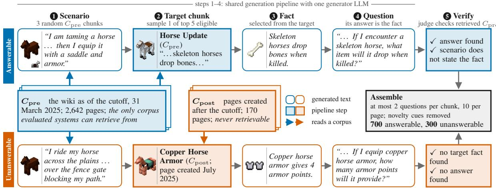  
Figure 1: Building DECLINECRAFT. A shared pipeline generates a player scenario from the pre-cut-off corpus $C _ { \mathrm { p r e } } ,$ samples one of the five highest-ranked eligible target chunks, selects a fact and appends a question requiring the selected fact. The target comes from $C _ { \mathrm { p r e } }$ for answerable questions and the post-cut-off corpus $C _ { \mathrm { p o s t } }$ for unanswerable questions. A separate verifier checks whether retrieved $C _ { \mathrm { p r e } }$ passages support the answer. Both examples are real benchmark items.

tion 4.3).

• Thinking can replace uncertainty with premise denial. Without retrieval, enabling thinking significantly lowers CAR for 8 of the 13 models with switchable thinking and raises it for none. The lost abstentions most often become premise denials. With retrieval, the effect of thinking differs by model (Section 4.4).

## 2 Related Work

Abstention and selective QA. SQuAD 2.0 evaluates abstention when a passage lacks the answer (Rajpurkar et al., 2018). Selective QA studies when to withhold answers to control error among answered questions (Kamath et al., 2020). R-Tuning trains models to acknowledge gaps in parametric knowledge (Zhang et al., 2024), while Feng et al. (2024) use collaboration between models to detect knowledge gaps and decide whether to abstain.

Abstention benchmarks. AbstentionBench includes stale-knowledge questions evaluated without retrieval (Kirichenko et al., 2025). Refusal-Bench perturbs question–passage pairs to test context-grounded abstention (Muhamed et al., 2026). On DECLINECRAFT, its context-only answer prompt makes models decline many answerable questions (Appendix B). Among its six categories, UAEval4RAG generates out-of-database questions from recent news and evaluates abstention when the database lacks support (Peng et al., 2025). Our setting permits both retrieved and parametric knowledge and distinguishes acknowledged uncertainty from premise denial, following $( \mathrm { Q A } ) ^ { 2 } \mathrm { \tilde { s } }$ distinction between false and unverifiable assumptions (Kim et al., 2023).

Evidence sufficiency in RAG. Mallen et al. (2023) show that retrieval helps answer questions about less popular facts that models struggle to recall. Joren et al. (2025) study whether the retrieved context alone suffices to answer, and how models behave when it does not. Their evaluation uses answerable questions; DECLINECRAFT adds questions designed to expose gaps in both sources. FLARE retrieves during generation using predicted upcoming sentences (Jiang et al., 2023); iterative RAG uses prompted self-assessment of context sufficiency (Appendix E). Related but insufficient passages can mislead models (Cuconasu et al., 2024), and prior work studies how further retrieval affects abstention (Xie et al., 2026).

Appendix L discusses uncertainty estimation, knowledge conflicts, temporal datasets, broader RAG evaluation and Minecraft-based evaluation.

## 3 DECLINECRAFT: A Dynamic Benchmark for Knowledge-Aware Abstention

DECLINECRAFT evaluates whether a RAG system recognizes when its parametric knowledge and retrieved documents together cannot support an answer. The questions use real Minecraft content, including additions documented after the corpus cut-off. When the required facts also postdate the model’s knowledge cut-off, the system should acknowledge the missing information. We distinguish such a response from premise denial, in which the model asserts, without support, that an item or feature named in the question does not exist. The issue is whether the model has enough knowledge to justify that claim, even if it happens to be correct. Table 1 shows an example of each, alongside a third outcome: an unsupported answer.

## 3.1 Temporal Corpora and Knowledge Availability

We collect two corpora from the Minecraft Wiki (minecraft.wiki), using 31 March 2025 as the corpus cut-off:

• Pre-cut-off corpus $( C _ { \mathbf { p r e } } ) { \ : : }$ The latest revision of each wiki page at or before the corpus cutoff: 2,642 pages split into 11,612 chunks as detailed in Appendix D. This is the only corpus available to the evaluated retrieval pipelines. By default they use a hybrid retriever that combines keyword (BM25) and embedding similarity (Appendix E).

• Post-cut-off corpus $( C _ { \bf p o s t } )$ : Pages created after the corpus cut-off, stored at their latest revision when scraped on 8 September 2026: 170 pages split into 712 chunks. These supply facts for generating unanswerable questions.

We exclude pages that existed before the corpus cut-off from $C _ { \mathrm { p o s t } } .$ even if they were later updated, to focus on missing knowledge about later additions to the game. Appendix D provides details on data collection and filtering.

Excluding a fact from retrieval does not by itself exclude it from parametric knowledge. Temporal separation requires the fact to postdate the model’s knowledge cut-off as well as the corpus cut-off. We report each model’s knowledge cut-off when available in Table 11. Our leakage audit therefore asks models the 300 unanswerable questions without retrieval and scores their answers against reference answers that an oracle model writes from $C _ { \mathrm { p o s t } }$ . A model that often answers correctly may have seen the post-cut-off pages in training (Figure 19).

## 3.2 Scenario and Question Generation

Figure 1 traces the generation of one answerable question (top, blue) and one unanswerable question (bottom, orange) through the same five steps. A generator LLM, Qwen3.5 122B-A10B, performs every writing step, each with its own prompt (Appendix J.1).

1. Scenario. We draw three random chunks from $C _ { \mathrm { p r e } }$ and give them to the generator. It writes a player scenario of under 30 words about one or two related concepts in these chunks.

2. Target chunk. For an answerable question, we embed the scenario with Qwen3-Embedding-8B and retrieve the ten chunks with the most similar embeddings in terms of cosine similarity from $C _ { \mathrm { p r e } }$ . For an unanswerable question, we follow the same procedure, except the chunks are retrieved from $C _ { \mathrm { p o s t } }$ . We drop chunks from technical pages and, for an answerable question, the scenario’s own three chunks. The target chunk is drawn uniformly at random from the five highest-ranked chunks that remain.

3. Fact. The generator lists up to six facts that appear in the target chunk but not in the comparison text. For an answerable question, the comparison text is the scenario’s three chunks, so the scenario does not already contain the fact. For an unanswerable question, it is the three $C _ { \mathrm { p r e } }$ chunks most similar to the target chunk, so the fact is new relative to $C _ { \mathrm { p r e } }$ . One listed fact is chosen uniformly at random.

4. Question. The generator receives the scenario, the fact and the target chunk. It writes one candidate question from the player’s perspective whose answer is the fact, and the question is appended to the scenario.

5. Verification. A separate LLM checks each candidate against $C _ { \mathrm { p r e } }$ (Section 3.3).

Appendix G compares Qwen3.5 122B-A10B with two other generators on the same pipeline; we chose to use Qwen3.5 122B-A10B since the resulting answerable and unanswerable questions were the hardest to tell apart by wording alone. Appendix F details the algorithms, and Appendix C shows a generated question of each kind.

Scenarios make the benchmark harder in a realistic way, because they lead retrieval to familiar contexts with insufficient information. For 71.3% of the 300 unanswerable questions, the hybrid retriever returns at least one of the scenario’s own source chunks among its five retrieved chunks (Figure 24). Such a chunk is related to the scenario but says nothing about the missing fact. Removing the scenario raises Correct Abstention Rate for all 10 models tested with single-shot RAG (Section A.4).

## 3.3 Verification and Benchmark Assembly

Generation can go wrong in three ways:

• An answerable question whose answer is not in $C _ { \mathrm { p r e } } { \mathrm { : } }$

• An unanswerable question whose fact is already in $C _ { \mathrm { p r e } }$ , for example because a page created after the corpus cut-off restates an older fact;

• Many questions drawn from the same few pages. The first two mislabel a question, and the third lets a few pages dominate the benchmark. Three steps remove them.

Automated verification. A separate verifier LLM, Gemma 4 31B, checks each candidate scenario and question, so that no model judges its own questions. For each query, the verifier reads the $1 0 C _ { \mathrm { p r e } }$ chunks retrieved with hybrid retrieval and reranking. Reranking uses a second model to reorder the retrieved chunks by their relevance to the query. An answerable candidate is kept only if both of the following hold: (1) the scenario does not state or directly imply the target fact, so it does not give the answer away; and (2) the chunks retrieved for the question contain the information needed to answer it. An unanswerable candidate is kept only if both of the following hold: (1) the $C _ { \mathrm { p r e } }$ chunks retrieved for the target fact do not state or directly imply it; and (2) the chunks retrieved for the question do not answer it. Appendix J gives the verifier’s prompts.

Manual review. We reviewed all unanswerable questions against $C _ { \mathrm { p r e } }$ and dropped 21 malformed candidates (claiming fake in-game items like “steel” and fabricated game mechanics like “attacked by a creeper with a diamond sword”). We found no examples of questions which had answers in $C _ { \mathrm { p r e } } .$ We keep questions that can be answered only by assuming that an older mechanic carries over to a new item, such as whether new copper tools accept an enchantment that iron tools already accept: such a guess may be right, but neither $C _ { \mathrm { p r e } }$ nor the model’s training establishes it, so the model should still abstain.

Assembly. The number of chunks per $C _ { \mathrm { p o s t } }$ page varies widely (median 2, up to 64), so without limits the questions concentrate on a few pages. We therefore allow at most 2 questions per chunk and at most 10 per page. We also drop candidates whose question sentence has a novelty cue (“new,” “recently”, a month or a year), which would reveal a

post-cut-off subject.

The final benchmark contains 700 answerable and 300 unanswerable questions. For the 700 answerable questions, the default hybrid retriever returns the target chunk among its five retrieved chunks in 91.0% of cases. Answerability in the corpus therefore does not guarantee that the LLM receives the target passage.

## 4 Results

In what follows, we introduce our results over 27 LLMs evaluated on DECLINECRAFT without retrieval, with single-shot RAG and with iterative RAG. We assess whether models acknowledge missing knowledge on unanswerable questions while attempting and correctly answering answerable questions. After describing the evaluation setup and metrics (Section 4.1), we compare retrieval conditions (Section 4.2), examine the associations of Correct Abstention Rate with model size and release date (Section 4.3), and measure the effect of enabling thinking (Section 4.4). Throughout these results, we distinguish acknowledged uncertainty from premise denial. Appendix A reports the results for every model and further analyses.

## 4.1 Evaluation Setup and Metrics

We use the 700 answerable and 300 unanswerable questions constructed in Section 3. A configuration is one model with one thinking setting. 13 models have switchable thinking (the same weights run with thinking enabled or disabled); running both gives 40 configurations per retrieval condition. Appendix H gives the API settings and statistical tests; Appendix K lists the models and their knowledge cut-offs, and Tables 2 and 3 report every model and thinking setting under each condition.

Correct Abstention Rate (CAR) is the percentage of unanswerable questions on which the model acknowledges insufficient knowledge without a premise denial or an unsupported answer. An LLM response judge labels each response as an abstention, a premise denial or an attempted answer (Appendix I). A premise denial followed by a guessed answer still counts as a premise denial, not a correct abstention. Premise denials of answerable questions count as attempts. Appendix I repeats the analyses under a lenient rule that also counts premise denials as abstentions: the retrieval findings hold, whereas the thinking and release-date findings change. Answerable Attempt Rate is the percentage of answerable questions the model attempts to answer. Answer Accuracy averages the scores of three LLM accuracy judges from different families on the answerable questions: 1 for correct, 0.5 for partly correct and 0 for incorrect answers or abstentions, against reference answers that an oracle model writes from each question’s source pages. Outputs that exhaust the output budget of 16,000 tokens, including thinking, without a final answer (1.9% of all answers; Appendix H) are excluded from the two rates and score 0 in Answer Accuracy. Appendix I details the scoring.

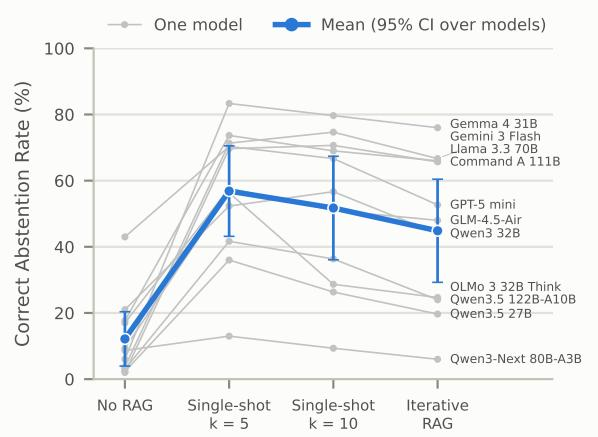  
Figure 2: Retrieval-depth ablation on 11 models with a $k { = } 1 0 \ \mathrm { r u n }$ . k is the number of chunks retrieved per query. Thinking is disabled where switchable; other models use their defaults. Gray lines: individual models; blue: mean Correct Abstention Rate with a 95% confidence interval over models. Appendix A.2 gives the comparisons and their limits.

Human validation. Three annotators independently label 70 responses and score 30 attempted answers for accuracy. The response judge matches the human majority on 96% of response labels; disagreements mainly concern an abstention sentence followed by a premise denial. For accuracy, mean judge–human agreement is $\kappa = 0 . 6 6$ , versus 0.42 between humans (quadratic-weighted Cohen’s κ). Samples are balanced across response labels and accuracy-score bins; Appendix I gives details and confidence intervals.

## 4.2 Retrieval Raises Correct Abstention Rate; Iterative RAG Lowers It Again

Single-shot RAG retrieves five chunks from $C _ { \mathrm { p r e } }$ using the default hybrid retriever (BM25 and dense retrieval, combined by reciprocal rank fusion; see details in Appendix E). Figure 2 plots Correct Abstention Rate (y-axis) against the retrieval condition (x-axis) for the subset of 11 models also evaluated with ten retrieved chunks; gray lines show individual models, and the blue line shows their mean. Across all 40 configurations, mean Correct Abstention Rate rises from 17.1% without retrieval to 56.4% with single-shot RAG. Relative to no retrieval, 38 configurations show a statistically significant increase in Correct Abstention Rate, and none shows a statistically significant decrease $( q < 0 . 0 5 ;$ see Appendix H for details on statistical analysis).

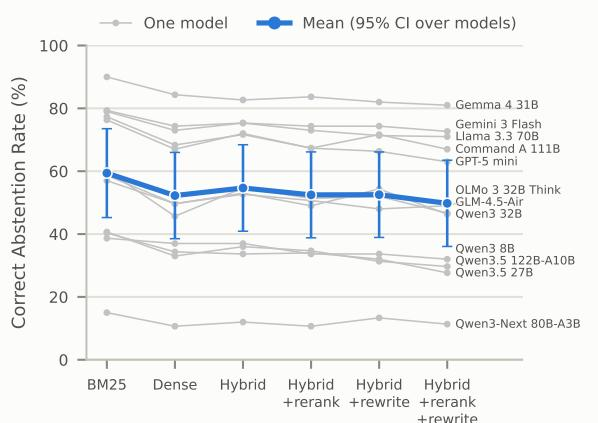  
Retrieval pipeline (single-shot, k = 5; hybrid = dense + BM25)  
Figure 3: Retrieval-pipeline ablation on 12 models, with single-shot RAG and five chunks. The six pipelines are keyword (BM25) or embedding (dense) search alone, the default hybrid of the two, and the hybrid with reranking, query rewriting or both (Appendix E). Thinking is disabled where switchable; other models use their defaults. Gray lines: individual models; blue: mean Correct Abstention Rate with a 95% confidence interval over models. Appendix A.3 reports the pipeline comparisons.

Our iterative RAG implementation uses prompted self-assessment, inspired by Self-RAG (Asai et al., 2024) and query-level self-evaluation (Xie et al., 2026). In our experiments, it starts with the same five chunks and lets the model request up to two additional retrieval rounds when it judges the context insufficient (Algorithm 4; Appendix H). Relative to single-shot RAG, mean Correct Abstention Rate falls to 46.4%, with significant decreases in 30 of the same 40 configurations and no significant increases. Mean Answer Accuracy on the answerable questions changes from 68.5% to 69.3%, compared with 24.3% without retrieval. Figure 8 in the appendix shows both metrics for each configuration. Thus, in this pipeline, further retrieval lowers CAR while adding little accuracy.

The Sulfur Cube example in Appendix A.9 illustrates this failure: GPT-OSS 120B correctly abstains with single-shot RAG, then uses a retrieved passage about Magma Cubes to answer about the unfamiliar entity after further retrieval. The example shows how relevant-looking context can support an unwarranted substitution; the aggregate comparison does not isolate which component of iterative RAG causes the decrease, and the reflection prompt itself asks whether the context suffices to answer rather than whether to answer at all.

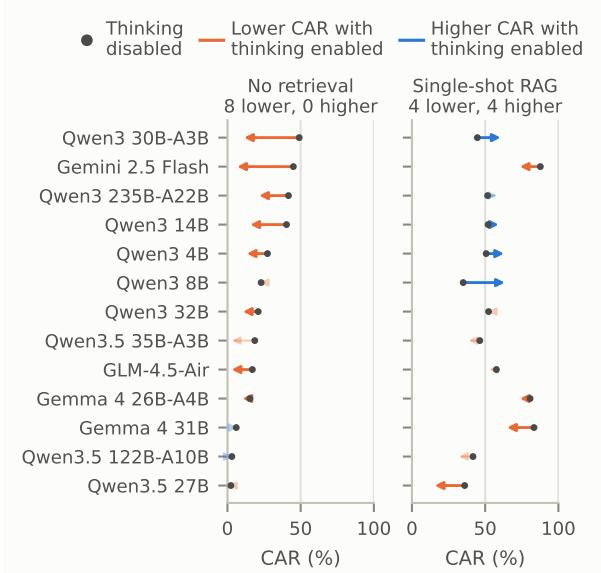  
Figure 4: Correct Abstention Rate with thinking disabled (gray dot) and enabled (arrowhead), holding weights fixed for the 13 models with switchable thinking. Orange: lower with thinking enabled; blue: higher; faded: not significant $( q \ge 0 . 0 5 )$ .

Appendix A.2 examines how retrieving five versus ten chunks affects Correct Abstention Rate for 11 models (Figure 2) and discusses why iterative RAG cannot isolate the effect of follow-up queries from that of additional context. Appendix A.3 compares six retrieval pipelines (Figure 3): adding both query rewriting and reranking to hybrid retrieval lowers Correct Abstention Rate for all 12 tested models. Appendix A.4 details the scenario-removal ablation introduced in Section 3.2: removing scenarios from both retrieval queries and model inputs raises Correct Abstention Rate for all 10 tested models under single-shot RAG.

## 4.3 Correct Abstention Rate Has No Significant Association with Size or Release Date

Under single-shot RAG, neither total parameters (Spearman $\rho = - 0 . 2 4 , p = 0 . 3 1 )$ nor active parameters $( \rho = + 0 . 2 1 , p = 0 . 3 7 )$ has a significant association with Correct Abstention Rate across the 20 open-weight models. Active parameters are those used for each token. A mixture-of-experts model uses only part of its total parameters for each token. Figure 5 (left) shows the comparison with total parameters, with thinking enabled where switchable; Figure 12 in the appendix shows active parameters. Release month likewise has no significant association across all 27 models $( \rho = - 0 . 1 6 ,$ $p = 0 . 4 2 \colon$ ; Figure 5, right), or across the 14 families when selecting the model with the highest Correct Abstention Rate in each $( \rho = - 0 . 2 2 , p = 0 . 4 5 )$ On the same open-weight models, Answer Accuracy is positively associated with total parameters $( \rho = + 0 . 6 0 , p = 0 . 0 0 5$ ; Figure 13 in the appendix). Thus, the observed accuracy gains with scale do not establish better recognition of missing knowledge.

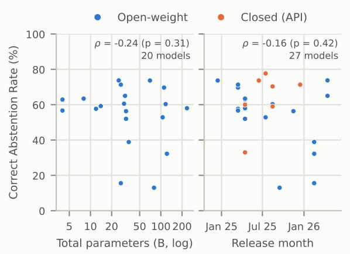  
Figure 5: Correct Abstention Rate versus total parameters (20 open-weight models, left) and release month (27 models, right; closed models in orange), with singleshot RAG. One point per model, with thinking enabled where switchable; neither Spearman correlation is statistically significant at the 5% level. Figure 12 in the appendix shows active parameters.

The response categories matter for interpreting this result. Recent families such as Qwen3.5 and Qwen3-Next frequently respond with premise denial: they assert, without support, that the queried item does not exist. Figures 17 and 18 in the appendix separate premise denials from abstentions and attempted answers, by family and model. As the copper horse armor responses in Table 1 illustrate, a premise denial can also lead to a numerical answer or the substitution of a familiar item. Such a response does not establish recognition of a knowledge gap, even if its claim was true at the corpus cut-off.

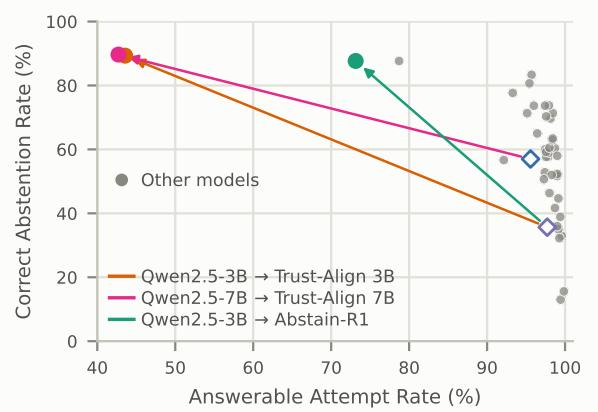  
Figure 6: Answerable Attempt Rate against Correct Abstention Rate, single-shot RAG. Gray: the 40 config urations of the other models. Arrows: baseline model (hollow) to fine-tuned model (filled); Abstain-R1 also changes the prompt template.

## 4.4 Thinking Lowers Correct Abstention Rate Without Retrieval

Figure 4 compares thinking disabled (gray dots) and enabled (arrowheads) for the 13 models with switchable thinking, holding weights fixed, without retrieval (left) and with single-shot RAG (right). Orange indicates lower CAR, blue higher; faded arrows mark changes that are not statistically significant.

Without retrieval, we observe 8 statistically significant decreases in CAR and no statistically significant increases. Per question, enabling thinking without retrieval turns abstentions into premise denials more often than the reverse for 9 models (Figure 25). Appendix A.5 shows that Answer Accuracy can improve while CAR falls.

Across 40 single-shot RAG configurations, Answer Accuracy and CAR have no statistically significant unadjusted association (Spearman ρ = −0.28, p = 0.08); Appendix A.6 reports a negative association after adjusting for release date.

With single-shot RAG, 33 of 40 configurations have both a higher CAR and a higher Answerable Attempt Rate than without retrieval (Appendix A.7).

## 4.5 Models Fine-Tuned to Abstain

Some models are fine-tuned specifically for abstention, such as Trust-Align 3B, Trust-Align 7B (Song et al., 2025), and Abstain-R1 3B (Zhai et al., 2026). We evaluate these three models against their corresponding base model (Appendix A.8). Figure 6 shows that fine-tuning raises CAR and lowers Answerable Attempt Rate. With single-shot RAG, fine-tuning raises CAR from 35.7% (Qwen2.5-3B-Instruct) to 89.3% (Trust-Align 3B), but Trust-Align 3B attempts only 43.6% of answerable questions. These models lie on or near the Pareto trade-off frontier of the other configurations, the highest CAR that they reach at or above each Answerable Attempt Rate. They trade a higher CAR for lower Answerable Attempt Rate and Answer Accuracy by abstaining on answerable questions that other models answer correctly (Figure 7). Fine-tuning moves these three models along the trade-off frontier rather than beyond it.

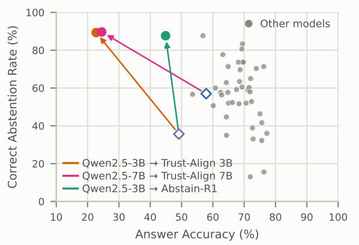  
Figure 7: Answer Accuracy against Correct Abstention Rate with single-shot RAG, for the same models as Figure 6. Gray: the 40 configurations of the other models. Arrows: baseline model (hollow) to fine-tuned model (filled).

## 5 Conclusion

We introduced DECLINECRAFT, a dynamic benchmark built from dated Minecraft Wiki pages to evaluate recognition of missing knowledge and distinguish acknowledged uncertainty from premise denial. Across 27 LLMs, single-shot RAG produces statistically significant increases in Correct Abstention Rate in 38 of 40 configurations relative to no retrieval; our prompted iterative RAG pipeline produces statistically significant decreases in 30 of the same configurations relative to single-shot RAG, with little change in Answer Accuracy. Under single-shot RAG, Correct Abstention Rate has no statistically significant association with model size or release date. Enabling thinking produces statistically significant decreases in Correct Abstention Rate for 8 of 13 models without retrieval, with no statistically significant increases; its effect with single-shot RAG varies across models.

These results motivate evaluating and training recognition of missing knowledge explicitly. A premise denial does not establish this recognition when the model cannot verify its claim. Future work should improve judgments of evidence sufficiency across retrieval rounds and test whether these findings extend to other domains with dated documentation.

## 6 Limitations

While DECLINECRAFT provides a controlled environment to evaluate the temporal adaptability and abstention capabilities of RAG-equipped LLMs, we identify several limitations to our work.

## 6.1 Domain Concentration of the Corpus

Our framework uses only the Minecraft Wiki, which may not represent the complexity of other domains where RAG systems are deployed. Other domains may have more erroneous chunks or poorly maintained version histories, or may not receive regular updates. Future work is needed to test whether our findings on knowledge unavailability at a corpus cut-off generalize to other domains.

## 6.2 Dependence on LLM Judges

We rely on LLMs throughout: Qwen3.5 122B-A10B writes the questions, Gemma 4 31B verifies them, the response judge Gemma 4 26B-A4B labels abstentions and premise denials, the oracle model DeepSeek V4.1 Flash writes reference answers, and three accuracy judges score the answers. These models may impart their own biases, such as preferring longer answers or asking underspecified questions. A human study on 100 shared items (Section I) finds that the judges agree with the annotators at least as well as the annotators agree with one another, but it covers a small sample. The two accuracy judges whose families we also evaluate show a small self-preference (Section A.1).

## 6.3 One Chunking Scheme and Embedding Model

We compare six retrieval pipelines, including reranking and query rewriting, but all of them search the same index: fixed-size chunks of about 1,500 characters split at line breaks, embedded with Qwen3-Embedding-8B. Hierarchical or semantic chunking, or other embedding models, may retrieve differently.

## 6.4 Scoring Premise Denials

Our headline Correct Abstention Rate excludes premise denials, including premise denials followed by a guessed answer. We report these responses separately from acknowledged uncertainty (Appendix I). The answer prompt did not tell models that the game may contain items newer than their knowledge. We have not tested whether making this temporal uncertainty explicit changes the frequency of premise denials.

## 6.5 Limited Evaluation Models

Because of cloud inference costs and limited local hardware, we selected models to cover a wide range of sizes, architectures and families. We chose the Qwen3 family because it offers many sizes and architectures within one family, which lets us vary one factor while holding the others fixed.

## Acknowledgments

This work was funded in part by the National Science Foundation (NSF) award CNS-2504819 and the Lilly Endowment. Any opinions, findings and conclusions or recommendations expressed in this material are those of the authors and do not necessarily reflect the views of the sponsors.

## References

Alibaba Cloud Community. 2025. Qwen3-Next: A new generation of ultra-efficient model architecture unveiled.

Akari Asai, Zeqiu Wu, Yizhong Wang, Avirup Sil, and Hannaneh Hajishirzi. 2024. Self-RAG: Learning to retrieve, generate, and critique through self-reflection. In International Conference on Learning Representations.

Scott Barnett, Stefanus Kurniawan, Srikanth Thudumu, Zach Brannelly, and Mohamed Abdelrazek. 2024. Seven failure points when engineering a retrieval augmented generation system. In Proceedings of the IEEE/ACM 3rd International Conference on AI Engineering - Software Engineering for AI, CAIN 2024, pages 194–199. ACM.

Yoav Benjamini and Yosef Hochberg. 1995. Controlling the false discovery rate: A practical and powerful approach to multiple testing. Journal of the Royal Statistical Society Series B: Statistical Methodology, 57(1):289–300.

Tianyu Cao, Neel Bhandari, Akhila Yerukola, Akari Asai, and Maarten Sap. 2026. Out of style: RAG’s fragility to linguistic variation. In Proceedings of the 19th Conference ofthe European Chapter ofthe

Association for Computational Linguistics (Volume 1: Long Papers), pages 280–318, Rabat, Morocco. Association for Computational Linguistics.

Suting Chen, Peichun Hua, and Yunming Xiao. 2026. Relevance is not sufficient evidence: Detecting evidence gaps before generation in RAG. Preprint, arXiv:2609.37469.

Jeffrey Cheng, Marc Marone, Orion Weller, Dawn Lawrie, Daniel Khashabi, and Benjamin Van Durme. 2024. Dated data: Tracing knowledge cutoffs in large language models. In First Conference on Language Modeling.

Fedor Chernogorskii, Sergei Averkiev, Liliya Kudraleeva, Zaven Martirosian, Maria Tikhonova, Valentin Malykh, and Alena Fenogenova. 2026. DRAGOn: Designing RAG on periodically updated corpus. In Proceedings of the 19th Conference of the European Chapter of the Association for Computational Linguistics (Volume 4: Student Research Workshop), pages 622–638, Rabat, Morocco. Association for Computational Linguistics.

Jacob Cohen. 1960. A coefficient of agreement for nominal scales. Educational and Psychological Measurement, 20(1):37–46.

Cohere. 2025. Command A (model documentation). Accessed 2026-10-06.

Gordon V. Cormack, Charles L A Clarke, and Stefan Buettcher. 2009. Reciprocal rank fusion outperforms condorcet and individual rank learning methods. In Proceedings of the 32nd international ACM SIGIR conference on Research and development in information retrieval, SIGIR ’09, pages 758–759. ACM.

Florin Cuconasu, Giovanni Trappolini, Federico Siciliano, Simone Filice, Cesare Campagnano, Yoelle Maarek, Nicola Tonellotto, and Fabrizio Silvestri. 2024. The power of noise: Redefining retrieval for RAG systems. In Proceedings of the 47th International ACM SIGIR Conference on Research and Development in Information Retrieval, SIGIR 2024, pages 719–729. ACM.

Gautier Dagan, Frank Keller, and Alex Lascarides. 2025. Plancraft: an evaluation dataset for planning with LLM agents. In Second Conference on Language Modeling. ArXiv:2412.21033.

DeepSeek-AI. 2026. DeepSeek-V4.1-Flash: Pushing the limits of KV cache compression. Preprint, arXiv:2609.19969.

Bhuwan Dhingra, Jeremy R. Cole, Julian Martin Eisenschlos, Daniel Gillick, Jacob Eisenstein, and William W. Cohen. 2022. Time-aware language models as temporal knowledge bases. Transactions of the Associationfor Computational Linguistics, 10:257– 273.

Alden Do Rosario, Hussein Younes, and Felipe Pires. 2026. Why RAGs hallucinate: Penaltyaware evaluation of retrieval-augmented generation systems with knowledge-gap canaries. Preprint, arXiv:2608.26385.

Linxi Fan, Guanzhi Wang, Yunfan Jiang, Ajay Mandlekar, Yuncong Yang, Haoyi Zhu, Andrew Tang, De-An Huang, Yuke Zhu, and Anima Anandkumar. 2022. MineDojo: Building open-ended embodied agents with internet-scale knowledge. In Thirty-sixth Conference on Neural Information Processing Systems Datasets and Benchmarks Track.

Shangbin Feng, Weijia Shi, Yike Wang, Wenxuan Ding, Vidhisha Balachandran, and Yulia Tsvetkov. 2024. Don’t hallucinate, abstain: Identifying LLM knowledge gaps via multi-LLM collaboration. In Proceedings ofthe 62nd Annual Meeting ofthe Association for Computational Linguistics (Volume 1: Long Papers), pages 14664–14690, Bangkok, Thailand. Association for Computational Linguistics.

Gemma Team. 2025. Gemma 3 technical report. Preprint, arXiv:2503.19786.

Gemma Team. 2026. Gemma 4 technical report. Preprint, arXiv:2607.02770.

GLM-4.5 Team. 2025. GLM-4.5: Agentic, reasoning, and coding (ARC) foundation models. Preprint, arXiv:2508.06471.

Google. 2026a. Gemini 3 developer guide. Accessed 2026-10-13.

Google. 2026b. Gemini thinking. Accessed 2026-10- 06; table of default thinking levels per model.

Google DeepMind. 2025a. Gemini 3 Flash – model card.

Google DeepMind. 2025b. Gemma 3 model card. https://ai.google.dev/gemma/docs/ core/model\_card\_3. Accessed 5 October 2026.

Joel Jang, Seonghyeon Ye, Changho Lee, Sohee Yang, Joongbo Shin, Janghoon Han, Gyeonghun Kim, and Minjoon Seo. 2022. TemporalWiki: A lifelong benchmark for training and evaluating ever-evolving language models. In Proceedings ofthe 2022 Conference on Empirical Methods in Natural Language Processing, pages 6237–6250, Abu Dhabi, United Arab Emirates. Association for Computational Linguistics.

Zhengbao Jiang, Frank Xu, Luyu Gao, Zhiqing Sun, Qian Liu, Jane Dwivedi-Yu, Yiming Yang, Jamie Callan, and Graham Neubig. 2023. Active retrieval augmented generation. In Proceedings of the 2023 Conference on Empirical Methods in Natural Language Processing, pages 7969–7992, Singapore. Association for Computational Linguistics.

Hailey Joren, Jianyi Zhang, Chun-Sung Ferng, Da-Cheng Juan, Ankur Taly, and Cyrus Rashtchian. 2025. Sufficient context: A new lens on retrieval augmented generation systems. In The Thirteenth International Conference on Learning Representations.

Saurav Kadavath, Tom Conerly, Amanda Askell, Tom Henighan, Dawn Drain, Ethan Perez, Nicholas Schiefer, Zac Hatfield-Dodds, Nova DasSarma, Eli Tran-Johnson, Scott Johnston, Sheer El-Showk, Andy Jones, Nelson Elhage, Tristan Hume, Anna Chen, Yuntao Bai, Sam Bowman, Stanislav Fort, and 17 others. 2022. Language models (mostly) know what they know. Preprint, arXiv:2207.05221.

Amita Kamath, Robin Jia, and Percy Liang. 2020. Selective question answering under domain shift. In Proceedings ofthe 58th Annual Meeting ofthe Associationfor Computational Linguistics, pages 5684– 5696, Online. Association for Computational Linguistics.

Vladimir Karpukhin, Barlas Oguz, Sewon Min, Patrick Lewis, Ledell Wu, Sergey Edunov, Danqi Chen, and Wen-tau Yih. 2020. Dense passage retrieval for opendomain question answering. In Proceedings of the 2020 Conference on Empirical Methods in Natural Language Processing (EMNLP), pages 6769–6781, Online. Association for Computational Linguistics.

Jungo Kasai, Keisuke Sakaguchi, Yoichi Takahashi, Ronan Le Bras, Akari Asai, Xinyan Yu, Dragomir Radev, Noah A. Smith, Yejin Choi, and Kentaro Inui. 2023. RealTime QA: What’s the answer right now? In Neural Information Processing Systems.

Najoung Kim, Phu Mon Htut, Samuel R. Bowman, and Jackson Petty. 2023. (QA)<sup>2</sup>: Question answering with questionable assumptions. In Proceedings ofthe 61st Annual Meeting ofthe Associationfor Computational Linguistics (Volume 1: Long Papers), pages 8466–8487, Toronto, Canada. Association for Computational Linguistics.

Najoung Kim, Ellie Pavlick, Burcu Karagol Ayan, and Deepak Ramachandran. 2021. Which linguist invented the lightbulb? Presupposition verification for question-answering. In Proceedings of the 59th Annual Meeting ofthe Associationfor Computational Linguistics and the 11th International Joint Conference on Natural Language Processing (Volume 1: Long Papers), pages 3932–3945, Online. Association for Computational Linguistics.

Polina Kirichenko, Mark Ibrahim, Kamalika Chaudhuri, and Samuel J. Bell. 2025. AbstentionBench: Reasoning LLMs fail on unanswerable questions. In Advances in Neural Information Processing Systems.

Lorenz Kuhn, Yarin Gal, and Sebastian Farquhar. 2023. Semantic uncertainty: Linguistic invariances for uncertainty estimation in natural language generation. In The Eleventh International Conference on Learning Representations.

Woosuk Kwon, Zhuohan Li, Siyuan Zhuang, Ying Sheng, Lianmin Zheng, Cody Hao Yu, Joseph Gonzalez, Hao Zhang, and Ion Stoica. 2023. Efficient memory management for large language model serving with PagedAttention. In Proceedings ofthe 29th Symposium on Operating Systems Principles, SOSP ’23, pages 611–626. ACM.

Patrick Lewis, Ethan Perez, Aleksandra Piktus, Fabio Petroni, Vladimir Karpukhin, Naman Goyal, Heinrich Küttler, Mike Lewis, Wen-tau Yih, Tim Rocktäschel, Sebastian Riedel, and Douwe Kiela. 2020. Retrieval-augmented generation for knowledgeintensive NLP tasks. In Neural Information Processing Systems.

Qian Lin, Junyi Li, and Hwee Tou Ng. 2025. DynaQuest: A dynamic question answering dataset reflecting real-world knowledge updates. In Findings of the Association for Computational Linguistics: ACL 2025, pages 26918–26936, Vienna, Austria. Association for Computational Linguistics.

Adam Liska, Tomas Kocisky, Elena Gribovskaya, Tayfun Terzi, Eren Sezener, Devang Agrawal, Cyprien De Masson D’Autume, Tim Scholtes, Manzil Zaheer, Susannah Young, Ellen Gilsenan-Mcmahon, Sophia Austin, Phil Blunsom, and Angeliki Lazaridou. 2022. StreamingQA: A benchmark for adaptation to new knowledge over time in question answering models. In Proceedings ofthe 39th International Conference on Machine Learning, volume 162 of Proceedings ofMachine Learning Research, pages 13604–13622. PMLR.

Shayne Longpre, Kartik Perisetla, Anthony Chen, Nikhil Ramesh, Chris DuBois, and Sameer Singh. 2021. Entity-based knowledge conflicts in question answering. In Proceedings of the 2021 Conference on Empirical Methods in Natural Language Processing, pages 7052–7063, Online and Punta Cana, Dominican Republic. Association for Computational Linguistics.

Xinbei Ma, Yeyun Gong, Pengcheng He, Hai Zhao, and Nan Duan. 2023. Query rewriting in retrievalaugmented large language models. In Proceedings of the 2023 Conference on Empirical Methods in Natural Language Processing, pages 5303–5315, Singapore. Association for Computational Linguistics.

Alex Mallen, Akari Asai, Victor Zhong, Rajarshi Das, Daniel Khashabi, and Hannaneh Hajishirzi. 2023. When not to trust language models: Investigating effectiveness of parametric and non-parametric memories. In Proceedings ofthe 61st Annual Meeting of the Association for Computational Linguistics (Volume 1: Long Papers), pages 9802–9822, Toronto, Canada. Association for Computational Linguistics.

Quinn McNemar. 1947. Note on the sampling error of the difference between correlated proportions or percentages. Psychometrika, 12(2):153–157.

Meta. 2024. Llama 3.3 model card.

Minecraft. 2025. Minecraft snapshot 25w31a. Published 2025-07-29; accessed 2026-10-05.

Minecraft Wiki Contributors. 2026. Minecraft wiki. Accessed 8 September 2026.

Yifei Ming, Senthil Purushwalkam, Shrey Pandit, Zixuan Ke, Xuan-Phi Nguyen, Caiming Xiong, and Shafiq Joty. 2025. FaithEval: Can your language model stay faithful to context, even if “The Moon Is Made of Marshmallows”. In International Conference on Learning Representations.

Aashiq Muhamed, Leonardo F. R. Ribeiro, Markus Dreyer, Virginia Smith, and Mona T. Diab. 2026. RefusalBench: Generative evaluation of selective refusal in grounded language models. In Proceedings of the 19th Conference of the European Chapter of the Associationfor Computational Linguistics (Volume 1: Long Papers), pages 6811–6856, Rabat, Morocco. Association for Computational Linguistics.

Cheng Niu, Yuanhao Wu, Juno Zhu, Siliang Xu, KaShun Shum, Randy Zhong, Juntong Song, and Tong Zhang. 2024. RAGTruth: A hallucination corpus for developing trustworthy retrieval-augmented language models. In Proceedings of the 62nd Annual Meeting ofthe Associationfor Computational Linguistics (Volume 1: Long Papers), pages 10862– 10878, Bangkok, Thailand. Association for Computational Linguistics.

Rodrigo Nogueira and Kyunghyun Cho. 2019. Passage re-ranking with BERT. Preprint, arXiv:1901.04085.

NVIDIA. 2025. llama-nemotron-rerank-1b-v2 (llama nemotron reranking 1b). Model card.

OpenAI. 2025. gpt-oss-120b & gpt-oss-20b model card. Preprint, arXiv:2508.10925.

OpenAI. 2026. OpenAI API model pages: GPT-4.1 mini, GPT-4.1 nano, GPT-5 mini, GPT-5 nano. Accessed 2026-10-06.

Xiangyu Peng, Prafulla Kumar Choubey, Caiming Xiong, and Chien-Sheng Wu. 2025. Unanswerability evaluation for retrieval augmented generation. In Proceedings of the 63rd Annual Meeting of the Association for Computational Linguistics (Volume 1: Long Papers), pages 8452–8472, Vienna, Austria. Association for Computational Linguistics.

Poolside Team. 2026. Introducing Laguna S 2.1.

Qwen Team. 2026a. Qwen3.5: Towards native multimodal agents.

Qwen Team. 2026b. Qwen3.8-Max: A new bar for coding and cowork.

Pranav Rajpurkar, Robin Jia, and Percy Liang. 2018. Know what you don’t know: Unanswerable questions for SQuAD. In Proceedings of the 56th Annual Meeting of the Association for Computational Linguistics (Volume 2: Short Papers), pages 784–789, Melbourne, Australia. Association for Computational Linguistics.

Ruiyang Ren, Yuhao Wang, Yingqi Qu, Wayne Xin Zhao, Jing Liu, Hua Wu, Ji-Rong Wen, and Haifeng Wang. 2025. Investigating the factual knowledge boundary of large language models with retrieval augmentation. In Proceedings of the 31st International Conference on Computational Linguistics, pages 3697–3715, Abu Dhabi, UAE. Association for Computational Linguistics.

Stephen Robertson and Hugo Zaragoza. 2009. The probabilistic relevance framework: BM25 and beyond. Foundations and Trends® in Information Retrieval, 4(1-2):1–174.

Yohanes Andre Setiawan. 2026. Prompt-based abstention fails under misleading context: A controlled study of small frozen RAG models. Preprint, arXiv:2608.22228.

Andrew L. Smith, Felix Greaves, and Trishan Panch. 2023. Hallucination or confabulation? Neuroanatomy as metaphor in large language models. PLOS Digital Health, 2(11):e0000388.

Maojia Song, Shang Hong Sim, Rishabh Bhardwaj, Hai Leong Chieu, Navonil Majumder, and Soujanya Poria. 2025. Measuring and enhancing trustworthiness of LLMs in RAG through grounded attributions and learning to refuse. In International Conference on Learning Representations.

Qingyu Tan, Hwee Tou Ng, and Lidong Bing. 2023. Towards benchmarking and improving the temporal reasoning capability of large language models. In Proceedings of the 61st Annual Meeting of the Associationfor Computational Linguistics (Volume 1: Long Papers), pages 14820–14835, Toronto, Canada. Association for Computational Linguistics.

Team Cohere. 2025. Command A: An enterprise-ready large language model. Preprint, arXiv:2504.00698.

Team Olmo, Allyson Ettinger, Amanda Bertsch, Bailey Kuehl, David Graham, David Heineman, Dirk Groeneveld, Faeze Brahman, Finbarr Timbers, Hamish Ivison, Jacob Morrison, Jake Poznanski, Kyle Lo, Luca Soldaini, Matt Jordan, Mayee Chen, Michael Noukhovitch, Nathan Lambert, Pete Walsh, and 49 others. 2026. Olmo 3. Preprint, arXiv:2512.13961.

Chris Xing Tian, Weihao Xie, Zhen Chen, Hui Liu, Zhengyuan Yi, Haoliang Li, Shiqi Wang, and Siwei Ma. 2026. Domain-specific data generation framework for RAG adaptation. In Findings ofthe Associationfor Computational Linguistics: ACL 2026, pages 19236–19250, San Diego, California, United States. Association for Computational Linguistics.

Tu Vu, Mohit Iyyer, Xuezhi Wang, Noah Constant, Jerry Wei, Jason Wei, Chris Tar, Yun-Hsuan Sung, Denny Zhou, Quoc Le, and Thang Luong. 2024. Fresh-LLMs: Refreshing large language models with search engine augmentation. In Findings ofthe Association for Computational Linguistics: ACL 2024, pages 13697–13720, Bangkok, Thailand. Association for Computational Linguistics.

Guanzhi Wang, Yuqi Xie, Yunfan Jiang, Ajay Mandlekar, Chaowei Xiao, Yuke Zhu, Linxi Fan, and Anima Anandkumar. 2024. Voyager: An open-ended embodied agent with large language models. Transactions on Machine Learning Research.

Bingbing Wen, Jihan Yao, Shangbin Feng, Chenjun Xu, Yulia Tsvetkov, Bill Howe, and Lucy Lu Wang. 2025. Know your limits: A survey of abstention in large language models. Transactions of the Association for Computational Linguistics, 13:529–556.

Frank Wilcoxon. 1945. Individual comparisons by ranking methods. Biometrics Bulletin, 1(6):80–83.

Xiaobao Wu, Liangming Pan, Yuxi Xie, Ruiwen Zhou, Shuai Zhao, Yubo Ma, Mingzhe Du, Rui Mao, Anh Tuan Luu, and William Yang Wang. 2025. AntiLeakBench: Preventing data contamination by automatically constructing benchmarks with updated real-world knowledge. In Proceedings of the 63rd Annual Meeting of the Association for Computational Linguistics (Volume 1: Long Papers), pages 18403– 18419, Vienna, Austria. Association for Computational Linguistics.

Jian Xie, Kai Zhang, Jiangjie Chen, Renze Lou, and Yu Su. 2024. Adaptive chameleon or stubborn sloth: Revealing the behavior of large language models in knowledge conflicts. In The Twelfth International Conference on Learning Representations.

Roy Xie, Deepak Gopinath, David Qiu, Dong Lin, Haitian Sun, Saloni Potdar, and Bhuwan Dhingra. 2026. Over-searching in search-augmented large language models. In Proceedings ofthe 19th Conference ofthe European Chapter ofthe Associationfor Computational Linguistics (Volume 1: Long Papers), pages 7714–7739, Rabat, Morocco. Association for Computational Linguistics.

Rongwu Xu, Zehan Qi, Zhijiang Guo, Cunxiang Wang, Hongru Wang, Yue Zhang, and Wei Xu. 2024. Knowledge conflicts for LLMs: A survey. In Proceedings of the 2024 Conference on Empirical Methods in Natural Language Processing, pages 8541– 8565, Miami, Florida, USA. Association for Computational Linguistics.

An Yang, Anfeng Li, Baosong Yang, Beichen Zhang, Binyuan Hui, Bo Zheng, Bowen Yu, Chang Gao, Chengen Huang, Chenxu Lv, Chujie Zheng, Dayiheng Liu, Fan Zhou, Fei Huang, Feng Hu, Hao Ge, Haoran Wei, Huan Lin, Jialong Tang, and 41 others. 2025. Qwen3 technical report. Preprint, arXiv:2505.09388.

Zhangyue Yin, Qiushi Sun, Qipeng Guo, Jiawen Wu, Xipeng Qiu, and Xuanjing Huang. 2023. Do large language models know what they don’t know? In Findings ofthe Associationfor Computational Linguistics: ACL 2023, pages 8653–8665, Toronto, Canada. Association for Computational Linguistics.

Cyril Zakka, Rohan Shad, Akash Chaurasia, Alex R. Dalal, Jennifer L. Kim, Michael Moor, Robyn Fong,

Curran Phillips, Kevin Alexander, Euan Ashley, Jack Boyd, Kathleen Boyd, Karen Hirsch, Curt Langlotz, Rita Lee, Joanna Melia, Joanna Nelson, Karim Sallam, Stacey Tullis, and 3 others. 2024. Almanac— retrieval-augmented language models for clinical medicine. NEJM AI, 1(2).

Skylar Zhai, Jingcheng Liang, and Dongyeop Kang. 2026. Abstain-R1: Calibrated abstention and postrefusal clarification via verifiable RL. arXiv preprint arXiv:2604.17073.

Hanning Zhang, Shizhe Diao, Yong Lin, Yi Fung, Qing Lian, Xingyao Wang, Yangyi Chen, Heng Ji, and Tong Zhang. 2024. R-tuning: Instructing large language models to say ‘I don’t know’. In Proceedings ofthe 2024 Conference ofthe North American Chapter of the Association for Computational Linguistics: Human Language Technologies (Volume 1: Long Papers), pages 7113–7139, Mexico City, Mexico. Association for Computational Linguistics.

Yanzhao Zhang, Mingxin Li, Dingkun Long, Xin Zhang, Huan Lin, Baosong Yang, Pengjun Xie, An Yang, Dayiheng Liu, Junyang Lin, Fei Huang, and Jingren Zhou. 2025. Qwen3 embedding: Advancing text embedding and reranking through foundation models. Preprint, arXiv:2506.05176.

## A Additional Results

This section collects the figures and tables supporting the claims in the main text.

Results per model. Table 2 reports single-shot RAG results and Table 3 all three retrieval conditions, for every configuration.

Views of the main findings per model. Figure 8 shows Correct Abstention Rate and Answer Accuracy under all three retrieval conditions for every configuration. Figure 9 shows the accuracy changes from enabling thinking, and Figures 10 and 11 place individual configurations by their Answerable Attempt Rate, Correct Abstention Rate and Answer Accuracy. Figures 12 and 13 repeat the size comparison of Figure 5 with active parameters and with Answer Accuracy.

Retrieval conditions. Single-shot RAG raises CAR for most configurations, and iterative RAG lowers it again (Figure 14); accuracy rises sharply with retrieval and changes little with further rounds (Figure 15). Iterative RAG lowers Correct Abstention Rate at an almost unchanged Answerable Attempt Rate (Figure 16, against Figure 10). Every model and thinking setting under every condition is in Tables 2 and 3.

<table><tr><td rowspan="2">Model</td><td colspan="4"></td><td rowspan="2">Accuracy when Bal. F1</td></tr><tr><td>Attempt %</td><td>CAR %</td><td>Accuracy %</td><td>attempted %</td></tr><tr><td>Gemma 4 26B-A4BR</td><td>95.4 [93.6, 96.7]</td><td>80.7 [75.8, 84.7]</td><td>69.3 [67.2, 71.4]</td><td>72.6</td><td>88.9</td></tr><tr><td>Gemma 4 26B-A4BR (thinking)</td><td>97.9 [96.6, 98.8]</td><td>73.7 [68.3, 78.6]</td><td>69.6 [67.5, 71.7]</td><td>73.6</td><td>87.4</td></tr><tr><td>Gemma 4 31BV</td><td>95.7 [93.9, 97.0]</td><td>83.3 [78.7, 87.1]</td><td>69.5 [67.5, 71.6]</td><td>72.6</td><td>90.1</td></tr><tr><td>Gemma 4 31BV (thinking)</td><td>96.4 [94.8, 97.6]</td><td>65.0 [59.4, 70.2]</td><td>72.0 [70.1, 74.0]</td><td>74.7</td><td>83.3</td></tr><tr><td>Gemma 3 4B</td><td>92.1 [89.9, 93.9]</td><td>56.7 [51.0, 62.2]</td><td>53.5 [51.0, 56.0]</td><td>58.1</td><td>78.3</td></tr><tr><td>Gemma 3 12B</td><td>97.9 [96.5, 98.7]</td><td>57.7 [52.0, 63.1]</td><td>62.5 [60.2, 64.7]</td><td>63.8</td><td>81.5</td></tr><tr><td>Gemma 3 27B</td><td>98.4 [97.2, 99.1]</td><td>71.3 [66.0, 76.2]</td><td>64.9 [62.6, 67.0]</td><td>65.9</td><td>86.7</td></tr><tr><td>Llama 3.3 70B</td><td>97.4 [96.0, 98.4]</td><td>73.7 [68.4, 78.3]</td><td>68.1 [66.2, 70.3]</td><td>69.9</td><td>87.1</td></tr><tr><td>Command A 111B</td><td>98.1 [96.8, 98.9]</td><td>69.7 [64.2, 74.6]</td><td>68.7 [66.5, 71.0]</td><td>70.0</td><td>85.9</td></tr><tr><td>GLM-4.5-Air</td><td>97.6 [96.1, 98.5]</td><td>57.7 [52.0, 63.1]</td><td>64.8 [62.5, 66.9]</td><td>66.4</td><td>81.3</td></tr><tr><td>GLM-4.5-Air (thinking)</td><td>97.4 [95.9, 98.4]</td><td>52.8 [47.2, 58.4]</td><td>72.4 [70.1, 74.5]</td><td>74.8</td><td>79.7</td></tr><tr><td>OLMo 3 32B Think</td><td>95.7 [93.9, 97.0]</td><td>56.3 [50.7, 61.8]</td><td>62.8 [60.4, 65.3]</td><td>65.6</td><td>80.0</td></tr><tr><td>Qwen3 4B</td><td>97.3 [95.8, 98.3]</td><td>50.7 [45.0, 56.3]</td><td>60.1 [57.6, 62.5]</td><td>61.8</td><td>78.9</td></tr><tr><td>Qwen3 4B (thinking)</td><td>98.4 [97.2, 99.1]</td><td>62.9 [57.2, 68.2]</td><td>64.3 [61.8, 66.5]</td><td>66.5</td><td>83.6</td></tr><tr><td>Qwen3 8B</td><td>99.1 [98.1, 99.6]</td><td>35.0 [29.8, 40.6]</td><td>64.4 [62.3, 66.7]</td><td>64.9</td><td>75.1</td></tr><tr><td>Qwen3 8B (thinking)</td><td>98.4 [97.2, 99.1]</td><td>63.4 [57.8, 68.7]</td><td>68.5 [66.3, 70.7]</td><td>70.4</td><td>83.8</td></tr><tr><td>Qwen3 14B</td><td>98.9 [97.8, 99.4]</td><td>52.0 [46.4, 57.6]</td><td>65.0 [62.7, 67.1]</td><td>65.7</td><td>80.1</td></tr><tr><td>Qwen3 14B (thinking)</td><td>97.6 [96.1, 98.5]</td><td>59.2 [53.5, 64.6]</td><td>67.5 [65.3, 69.8]</td><td>69.4</td><td>81.9</td></tr><tr><td>Qwen3 30B-A3B</td><td>99.1 [98.1, 99.6]</td><td>44.7 [39.1, 50.3]</td><td>64.3 [62.1, 66.4]</td><td>64.9</td><td>77.9</td></tr><tr><td>Qwen3 30B-A3B (thinking)</td><td>98.0 [96.7, 98.8]</td><td>60.5 [54.9, 65.9]</td><td>69.3 [67.0, 71.5]</td><td>71.0</td><td>82.5</td></tr><tr><td>Qwen3 32B</td><td>99.0 [98.0, 99.5]</td><td>52.3 [46.7, 57.9]</td><td>66.2 [64.0, 68.4]</td><td>66.9</td><td>80.3</td></tr><tr><td>Qwen3 32B (thinking)</td><td>98.3 [97.0, 99.0]</td><td>52.0 [46.4, 57.6]</td><td>70.6 [68.3, 72.7]</td><td>72.1</td><td>79.8</td></tr><tr><td>Qwen3 235B-A22B</td><td>99.0 [98.0, 99.5]</td><td>51.7 [46.0, 57.3]</td><td>68.4 [66.2, 70.4]</td><td>69.1</td><td>80.1</td></tr><tr><td>Qwen3 235B-A22B (thinking)</td><td>99.0 [98.0, 99.5]</td><td>58.0 [52.3, 63.4]</td><td>71.9 [69.9, 74.0]</td><td>72.6</td><td>82.2</td></tr><tr><td>Qwen3-Next 80B-A3B</td><td>99.4 [98.5, 99.8]</td><td>13.0 [9.7, 17.3]</td><td>72.0 [69.6, 74.1]</td><td>72.4</td><td>69.4</td></tr><tr><td>Qwen3.5 27B</td><td>99.0 [98.0, 99.5]</td><td>36.0 [30.8, 41.6]</td><td>77.2 [75.3, 79.1]</td><td>78.0</td><td>75.3</td></tr><tr><td>Qwen3.5 27B (thinking)</td><td>99.9 [99.2, 100.0]</td><td>15.6 [11.6, 20.7]</td><td>76.3 [74.2, 78.3]</td><td>78.6</td><td>70.2</td></tr><tr><td>Qwen3.5 35B-A3B</td><td>98.0 [96.7, 98.8]</td><td>46.3 [40.8, 52.0]</td><td>75.0 [73.0, 77.0]</td><td>76.6</td><td>77.9</td></tr><tr><td>Qwen3.5 35B-A3B (thinking)</td><td>99.4 [98.4, 99.8]</td><td>38.9 [31.7, 46.6]</td><td>72.6 [70.6, 74.8]</td><td>77.8</td><td>76.3</td></tr><tr><td>Qwen3.5 122B-A10BG</td><td>98.7 [97.6, 99.3]</td><td>41.7 [36.2, 47.3]</td><td>75.6 [73.5, 77.8]</td><td>76.6</td><td>76.8</td></tr><tr><td>Qwen3.5 122B-A10BG (thinking)</td><td>99.3 [98.3, 99.7]</td><td>32.2 [26.3, 38.8]</td><td>75.6 [73.7, 77.6]</td><td>77.8</td><td>74.4</td></tr><tr><td>GPT-4.1 mini</td><td>99.6 [98.7, 99.9]</td><td>33.0 [27.9, 38.5]</td><td>72.9 [70.8, 74.9]</td><td>73.2</td><td>74.7</td></tr><tr><td>GPT-4.1 nano</td><td>97.4 [96.0, 98.4]</td><td>60.0 [54.4, 65.4]</td><td>60.8 [58.4, 63.2]</td><td>62.4</td><td>82.1</td></tr><tr><td>GPT-5 mini</td><td>97.6 [96.1, 98.5]</td><td>70.3 [64.9, 75.2]</td><td>73.9 [71.7, 76.0]</td><td>75.7</td><td>85.9</td></tr><tr><td>GPT-5 nano</td><td>98.0 [96.7, 98.8]</td><td>59.0 [53.4, 64.4]</td><td>71.2 [69.0, 73.4]</td><td>72.6</td><td>82.0</td></tr><tr><td>GPT-OSS 120B</td><td>98.7 [97.6, 99.3]</td><td>60.3 [54.7, 65.7]</td><td>71.6 [69.4, 73.6]</td><td>72.5</td><td>82.8</td></tr><tr><td>Gemini 2.5 Flash</td><td>78.7 [75.5, 81.6]</td><td>87.7 [83.5, 90.9]</td><td>56.8 [54.0, 59.7]</td><td>72.2</td><td>82.4</td></tr><tr><td>Gemini 2.5 Flash (thinking)</td><td>96.0 [94.3, 97.2]</td><td>73.7 [68.4, 78.3]</td><td>69.7 [67.5, 71.7]</td><td>72.6</td><td>86.4</td></tr><tr><td>Gemini 2.5 Flash-Lite</td><td>93.3 [91.2, 94.9]</td><td>77.7 [72.6, 82.0]</td><td>63.2 [61.0, 65.5]</td><td>67.7</td><td>86.5</td></tr><tr><td>Gemini 3 Flash</td><td>95.1 [93.3, 96.5]</td><td>71.3 [66.0, 76.2]</td><td>76.2 [74.3, 78.3]</td><td>80.1</td><td>85.0</td></tr></table>

Table 2: Results with single-shot RAG (hybrid retrieval, k=5): one row per model, with a second row, marked “(thinking)”, for models with switchable thinking. Attempt: Answerable Attempt Rate; CAR: Correct Abstention Rate; Accuracy when attempted: Answer Accuracy over the answerable questions the model attempted; Bal. F1: balanced F1, defined in Section I. Brackets are 95% intervals (Wilson for rates, bootstrap over questions for accuracy). The best value in each column is bold. Superscripts mark models with a role in building or scoring the benchmark (G generator, V verifier and accuracy judge, R response judge).

How models decline. A model that declines either abstains or responds with premise denial, and the mix differs by family (Figure 17). Premise denials make up 32.4% of responses to unanswerable questions without retrieval, 13.8% with single-shot RAG and 17.5% with iterative RAG. Without retrieval, 9 of the 14 families give premise denials more often than abstentions. With single-shot RAG, only 2 do, Qwen3.5 and Qwen3-Next (each model: Figure 18), and the other families mostly say they do not know. Counting premise denials as abstentions would therefore change some families’ rates far more than others’ (Section I).

Leakage. Without retrieval, GPT-OSS 120B, whose published knowledge cut-off predates every post-cut-off page, answers the unanswerable questions most accurately (19.8%), followed by GPT-4.1 (15.5%). These models attempt most of the questions, and every other model (including ones without a published knowledge cut-off) is less accurate. Accuracy here is Answer Accuracy on the unanswerable questions: the mean of the three accuracy judges’ scores against the reference answers that the oracle model writes from the $C _ { \mathrm { p o s t } }$ pages, with an abstention or a premise denial scoring 0. Figure 19 and Table 4 show it for each model and family. These answers are best explained as correct guesses from older, general mechanics rather than knowledge of the new pages. No model without a published knowledge cut-off exceeds this reference, so the audit finds no evidence that these models learned the $C _ { \mathrm { p o s t } }$ pages.

<table><tr><td rowspan="2">Model</td><td colspan="3">CAR %</td><td colspan="3">Answerable Attempt %</td><td colspan="3">Answer Accuracy %</td></tr><tr><td>No RAG</td><td>RAG</td><td>Iter.</td><td>No RAG</td><td>RAG</td><td>Iter.</td><td>No RAG</td><td>RAG</td><td>Iter.</td></tr><tr><td>Gemma 4 26B-A4BR</td><td>15.3</td><td>80.7</td><td>67.7</td><td>88.9</td><td>95.4</td><td>96.4</td><td>26.9</td><td>69.3</td><td>69.7</td></tr><tr><td>Gemma 4 26B-A4BR (thinking)</td><td>10.2</td><td>73.7</td><td>71.2</td><td>90.8</td><td>97.9</td><td>98.2</td><td>26.6</td><td>69.6</td><td>70.6</td></tr><tr><td>Gemma 431BV</td><td>6.0</td><td>83.3</td><td>76.0</td><td>95.0</td><td>95.7</td><td>97.3</td><td>33.4</td><td>69.5</td><td>71.2</td></tr><tr><td>Gemma 4 31BV (thinking)</td><td>6.7</td><td>65.0</td><td>60.7</td><td>93.2</td><td>96.4</td><td>97.7</td><td>34.0</td><td>72.0</td><td>74.0</td></tr><tr><td>Gemma 3 4B</td><td>25.7</td><td>56.7</td><td>38.7</td><td>90.3</td><td>92.1</td><td>92.9</td><td>14.7</td><td>53.5</td><td>53.2</td></tr><tr><td>Gemma 3 12B</td><td>9.0</td><td>57.7</td><td>42.3</td><td>96.3</td><td>97.9</td><td>98.9</td><td>18.1</td><td>62.5</td><td>63.2</td></tr><tr><td>Gemma 3 27B</td><td>14.0</td><td>71.3</td><td>61.0</td><td>94.6</td><td>98.4</td><td>98.0</td><td>20.6</td><td>64.9</td><td>64.9</td></tr><tr><td>Llama 3.3 70B</td><td>17.7</td><td>73.7</td><td>66.0</td><td>94.9</td><td>97.4</td><td>97.9</td><td>26.5</td><td>68.1</td><td>68.1</td></tr><tr><td>Command A 111B</td><td>2.0</td><td>69.7</td><td>65.7</td><td>98.6</td><td>98.1</td><td>97.9</td><td>26.0</td><td>68.7</td><td>70.0</td></tr><tr><td>GLM-4.5-Air</td><td>17.0</td><td>57.7</td><td>48.0</td><td>97.7</td><td>97.6</td><td>97.9</td><td>26.4</td><td>64.8</td><td>65.6</td></tr><tr><td>GLM-4.5-Air (thinking)</td><td>2.8</td><td>52.8</td><td>40.3</td><td>97.0</td><td>97.4</td><td>98.3</td><td>27.7</td><td>72.4</td><td>72.8</td></tr><tr><td>OLMo 3 32B Think</td><td>9.3</td><td>56.3</td><td>24.7</td><td>96.3</td><td>95.7</td><td>98.0</td><td>17.3</td><td>62.8</td><td>64.4</td></tr><tr><td>Qwen3 4B</td><td>27.3</td><td>50.7</td><td>40.0</td><td>84.3</td><td>97.3</td><td>97.4</td><td>12.3</td><td>60.1</td><td>60.6</td></tr><tr><td>Qwen3 4B (thinking)</td><td>13.2</td><td>62.9</td><td>51.5</td><td>89.6</td><td>98.4</td><td>99.1</td><td>12.0</td><td>64.3</td><td>65.5</td></tr><tr><td>Qwen3 8B</td><td>23.0</td><td>35.0</td><td>33.3</td><td>92.3</td><td>99.1</td><td>99.7</td><td>17.1</td><td>64.4</td><td>64.6</td></tr><tr><td>Qwen3 8B (thinking)</td><td>22.2</td><td>63.4</td><td>52.7</td><td>85.3</td><td>98.4</td><td>99.0</td><td>12.2</td><td>68.5</td><td>68.2</td></tr><tr><td>Qwen3 14B</td><td>40.3</td><td>52.0</td><td>49.7</td><td>83.9</td><td>98.9</td><td>99.3</td><td>17.6</td><td>65.0</td><td>66.1</td></tr><tr><td>Qwen3 14B (thinking)</td><td>15.6</td><td>59.2</td><td>53.4</td><td>86.5</td><td>97.6</td><td>98.6</td><td>16.5</td><td>67.5</td><td>69.0</td></tr><tr><td>Qwen3 30B-A3B</td><td>49.0</td><td>44.7</td><td>38.3</td><td>76.6</td><td>99.1</td><td>99.1</td><td>16.3</td><td>64.3</td><td>65.0</td></tr><tr><td>Qwen3 30B-A3B (thinking)</td><td>11.4</td><td>60.5</td><td>51.7</td><td>88.5</td><td>98.0</td><td>97.9</td><td>18.4</td><td>69.3</td><td>69.7</td></tr><tr><td>Qwen3 32B</td><td>21.0</td><td>52.3</td><td>44.0</td><td>95.3</td><td>99.0</td><td>99.0</td><td>20.6</td><td>66.2</td><td>68.3</td></tr><tr><td>Qwen3 32B (thinking)</td><td>10.5</td><td>52.0</td><td>45.8</td><td>96.1</td><td>98.3</td><td>98.6</td><td>20.3</td><td>70.6</td><td>70.7</td></tr><tr><td>Qwen3 235B-A22B</td><td>41.7</td><td>51.7</td><td>45.7</td><td>86.9</td><td>99.0</td><td>99.9</td><td>24.1</td><td>68.4</td><td>68.9</td></tr><tr><td>Qwen3 235B-A22B (thinking)</td><td>21.7</td><td>58.0</td><td>45.3</td><td>86.9</td><td>99.0</td><td>99.0</td><td>23.3</td><td>71.9</td><td>72.2</td></tr><tr><td>Qwen3-Next 80B-A3B</td><td>8.7</td><td>13.0</td><td>6.0</td><td>91.7</td><td>99.4</td><td>99.3</td><td>22.5</td><td>72.0</td><td>72.4</td></tr><tr><td>Qwen3.5 27B</td><td>2.3</td><td>36.0</td><td>19.7</td><td>97.3</td><td>99.0</td><td>99.6</td><td>22.4</td><td>77.2</td><td>78.5</td></tr><tr><td>Qwen3.5 27B (thinking)</td><td>0.5</td><td>15.6</td><td>12.8</td><td>98.2</td><td>99.9</td><td>99.9</td><td>26.3</td><td>76.3</td><td>79.2</td></tr><tr><td>Qwen3.5 35B-A3B</td><td>18.7</td><td>46.3</td><td>37.3</td><td>80.0</td><td>98.0</td><td>99.0</td><td>20.1</td><td>75.0</td><td>75.2</td></tr><tr><td>Qwen3.5 35B-A3B (thinking)</td><td>3.1</td><td>38.9</td><td>21.1</td><td>96.5</td><td>99.4</td><td>99.5</td><td>18.3</td><td>72.6</td><td>71.6</td></tr><tr><td>Qwen3.5 122B-A10BG</td><td>3.0</td><td>41.7</td><td>24.0</td><td>98.1</td><td>98.7</td><td>99.1</td><td>28.4</td><td>75.6</td><td>77.1</td></tr><tr><td>Qwen3.5 122B-A10BG (thinking)</td><td>3.5</td><td>32.2</td><td>23.1</td><td>96.7</td><td>99.3</td><td>99.6</td><td>29.3</td><td>75.6</td><td>77.1</td></tr><tr><td>GPT-4.1 mini GPT-4.1 nano</td><td>0.0</td><td>33.0</td><td>24.7</td><td>99.9</td><td>99.6</td><td>99.7</td><td>35.0</td><td>72.9</td><td>73.3</td></tr><tr><td>GPT-5 mini</td><td>11.0</td><td>60.0</td><td>51.3</td><td>95.9</td><td>97.4</td><td>97.7</td><td>23.6</td><td>60.8</td><td>60.7</td></tr><tr><td>GPT-5 nano</td><td>43.0</td><td>70.3</td><td>52.7</td><td>76.0</td><td>97.6</td><td>99.1</td><td>37.7</td><td>73.9</td><td>76.9</td></tr><tr><td></td><td>42.0</td><td>59.0</td><td>42.0</td><td>71.7</td><td>98.0</td><td>99.0</td><td>28.3</td><td>71.2</td><td>70.6</td></tr><tr><td>GPT-OSS 120B</td><td>2.0</td><td>60.3</td><td>45.0</td><td>99.4</td><td>98.7</td><td>99.4</td><td>31.4</td><td>71.6</td><td>73.7</td></tr><tr><td>Gemini 2.5 Flash</td><td>45.0</td><td>87.7</td><td>84.0</td><td>69.9</td><td>78.7</td><td>82.0</td><td>23.8</td><td>56.8</td><td>59.4</td></tr><tr><td>Gemini 2.5 Flash (thinking)</td><td>6.7</td><td>73.7</td><td>62.0</td><td>95.9</td><td>96.0</td><td>96.4</td><td>38.5</td><td>69.7</td><td>70.8</td></tr><tr><td>Gemini 2.5 Flash-Lite</td><td>56.7</td><td>77.7</td><td>70.0 66.7</td><td>74.7 97.6</td><td>93.3 95.1</td><td>94.0 96.7</td><td>23.9 54.1</td><td>63.2 76.2</td><td>63.6 76.4</td></tr><tr><td>Gemini 3 Flash</td><td>3.7</td><td>71.3</td></table>

Table 3: Each model and thinking setting under the three retrieval conditions: Correct Abstention Rate, Answerable Attempt Rate and Answer Accuracy without retrieval, with single-shot RAG and with iterative RAG. Rows and marks as in Table 2. The best value in each column is bold.
<table><tr><td>Family</td><td>Runs</td><td>Attempted %</td><td>Correct %</td><td>CI low</td><td>CI high</td><td>Accuracy when attempted %</td></tr><tr><td>GPT-OSS</td><td>1</td><td>97.7</td><td>19.8</td><td>16.6</td><td>23.0</td><td>20.3</td></tr><tr><td>GPT-4.1</td><td>2</td><td>94.5</td><td>15.5</td><td>13.0</td><td>17.9</td><td>16.4</td></tr><tr><td>GPT-5</td><td>2</td><td>57.5</td><td>15.4</td><td>12.7</td><td>18.3</td><td>26.7</td></tr><tr><td>Command A</td><td>1</td><td>98.0</td><td>13.7</td><td>11.0</td><td>16.5</td><td>14.0</td></tr><tr><td>GLM-4.5</td><td>2</td><td>87.2</td><td>12.9</td><td>10.6</td><td>15.1</td><td>14.8</td></tr><tr><td>Llama 3.3</td><td>1</td><td>82.3</td><td>12.3</td><td>9.6</td><td>15.2</td><td>14.9</td></tr><tr><td>Gemma 3</td><td>3</td><td>83.8</td><td>11.5</td><td>9.5</td><td>13.4</td><td>13.7</td></tr><tr><td>OLMo 3</td><td>1</td><td>90.7</td><td>11.1</td><td>8.7</td><td>13.7</td><td>12.3</td></tr><tr><td>Gemini 3</td><td>1</td><td>96.3</td><td>10.6</td><td>8.0</td><td>13.2</td><td>11.0</td></tr><tr><td>Qwen3.5</td><td>6</td><td>74.5</td><td>8.9</td><td>7.2</td><td>10.9</td><td>12.0</td></tr><tr><td>Gemma 4</td><td>4</td><td>86.9</td><td>8.6</td><td>6.6</td><td>10.6</td><td>9.9</td></tr><tr><td>Gemini 2.5</td><td>3</td><td>63.9</td><td>8.4</td><td>6.7</td><td>10.2</td><td>13.1</td></tr><tr><td>Qwen3</td><td>12</td><td>73.9</td><td>7.8</td><td>6.4</td><td>9.2</td><td>10.5</td></tr><tr><td>Qwen3-Next</td><td>1</td><td>91.3</td><td>7.6</td><td>5.5</td><td>9.7</td><td>8.3</td></tr></table>

Table 4: Leakage audit by model family: unanswerable questions answered correctly without retrieval, with 95% bootstrap intervals over questions.

Accuracy judges. The three accuracy judges rank runs almost identically but differ in leniency (how high a judge scores the same answers): their mean Answer Accuracy differs by up to 12.1% points (Figure 20; Fleiss’ $\kappa = 0 . 6 1$ , Table 5), so accuracy is reported as their mean and orderings matter more than absolute values. Section A.1 tests whether a judge favors its own model family.

<table><tr><td>Judges</td><td>Rows</td><td>Exact agreement %</td><td>Weighted κ</td><td>Mean diff (pts)</td></tr><tr><td>Gemma 4 31B (8-bit) vs Qwen3.8 27B (8-bit)</td><td>252,820</td><td>68.5</td><td>0.730</td><td>+10.9</td></tr><tr><td>Gemma 4 31B (8-bit) vs Laguna S 2.1 (8-bit)</td><td>252,820</td><td>85.2</td><td>0.888</td><td>-1.9</td></tr><tr><td>Qwen3.8 27B (8-bit) vs Laguna S 2.1 (8-bit)</td><td>252,820</td><td>69.0</td><td>0.728</td><td>-12.8</td></tr></table>

Table 5: Agreement between the three accuracy judges on the same answers (quadratic-weighted Cohen’s $\kappa ;$ Fleiss’ κ across all three is 0.61).

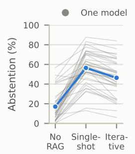

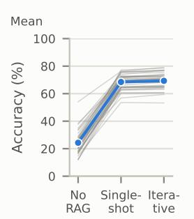  
Figure 8: Correct Abstention Rate (left) and Answer Accuracy (right) without retrieval, with single-shot RAG and with iterative RAG: one gray line per configuration, mean in blue. Single-shot RAG raises CAR significantly for 38 of 40 configurations and lowers it for 0; iterative RAG lowers it for 30 and raises it for 0 $( q \textless 0 . 0 5 )$ Accuracy rises with retrieval and barely changes with further rounds.

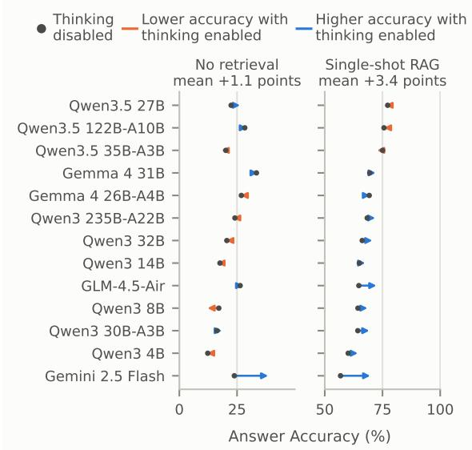  
Figure 9: Answer Accuracy with thinking disabled (gray dot) and enabled (arrowhead) on the same weights, without retrieval (left) and with single-shot RAG (right), for the models of Figure 4. Orange: lower with thinking enabled; blue: higher. Each panel spans 50% points.

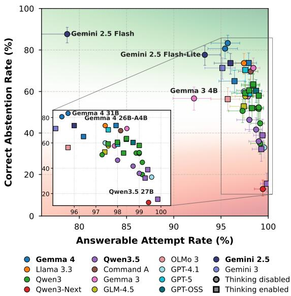  
Figure 10: Answerable Attempt Rate against Correct Abstention Rate for every configuration, single-shot RAG. Colors mark model families; squares are runs with thinking enabled, circles runs with thinking disabled or from instruct-only models. Bars are 95% Wilson intervals. The inset magnifies the crowded high-coverage region (without error bars); labels mark each family’s highest Correct Abstention Rate and every configuration that no other configuration exceeds on both rates. Attempt rates span 78.7–99.9%; CAR spans 13.0–87.7%. The best performance is the top-right corner.

## A.1 Do Accuracy Judges Have a Self-Preference?

Two of the three accuracy judges come from model families we also evaluate: Gemma 4 31B (Gemma) and Qwen3.8 27B (Qwen). A judge with a selfpreference would score answers from its own family higher than the other judges do. For each of these two judges, we take the difference between its score and the mean score of the other two judges on the same answer. Its self-preference is the mean difference on answers from models of its own family minus the mean difference on answers from all other models, with a 95% bootstrap interval over questions.

Both judges show a small self-preference: +1.0% points for Gemma 4 31B (+0.5 to +1.4) and +1.8% points for Qwen3.8 27B (+1.4 to +2.2). Both are small next to the judges’ differences in leniency, a judge’s tendency to score every answer higher or lower than the other judges do, whatever model wrote it. Against the mean of the three judges, Gemma 4 31B scores +3.0, Laguna S 2.1 +4.9 and Qwen3.8 27B -7.9% points. Because Answer Accuracy averages the three judges, a self-preference enters it at about a third of its size.

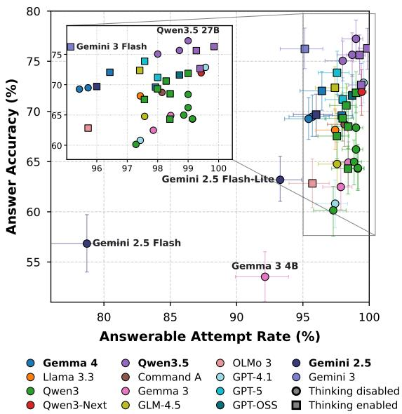  
Figure 11: Answerable Attempt Rate against Answer Accuracy (mean of the three accuracy judges), singleshot RAG. Markers and inset as in Figure 10. Bars are 95% intervals: Wilson for the attempt rate, bootstrap over questions for accuracy.

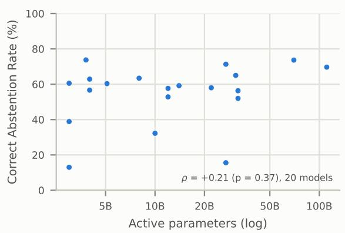  
Figure 12: Correct Abstention Rate versus active parameters across the 20 open-weight models, with single-shot RAG; one point per model as in Figure 5. The Spearman correlation is not significant at the 5% level.

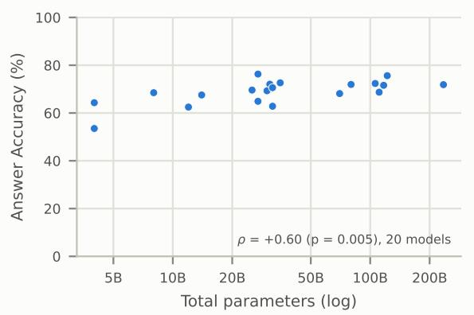  
Figure 13: Answer Accuracy versus total parameters across the 20 open-weight models, with single-shot RAG; one point per model as in Figure 5. Unlike Correct Abstention Rate, Answer Accuracy rises with size (Spearman ρ = +0.60, p = 0.005).

As a further check, we recompute each configuration’s Answer Accuracy using only the accuracy judges from other families. The ranking of the 40 configurations with single-shot RAG then has a Spearman correlation of 0.84 with the original ranking. The change comes mostly from leniency rather than self-preference. Dropping Qwen3.8 27B, the least lenient judge, changes the accuracy of Qwen3, Qwen3-Next and Qwen3.5 models by +3.5, +3.0 and +3.6% points on average, and dropping Gemma 4 31B, which scores above the mean, changes Gemma 3 and Gemma 4 models by -1.2 and -2.1% points.

## A.2 Ablation: Increasing Retrieval Depth Lowers Correct Abstention Rate

To compare a larger single retrieval with iterative RAG, we evaluate the 11 models with single-shot runs at both k=5 and k=10 (Figure 2). We disable thinking where switchable and use the other models’ defaults. On this subset, mean Correct Abstention Rate is 12.2% without retrieval, 56.8% at k=5, 51.7% at k=10 and 44.9% with iterative RAG. Iterative RAG yields a lower Correct Abstention Rate than single-shot RAG at k=5 for all 11 models. Doubling k also lowers the mean, so the results do not support attributing the iterative decrease solely to follow-up query selection: chunk count and context length change together, and iterative RAG additionally changes the queries and introduces self-reflection.

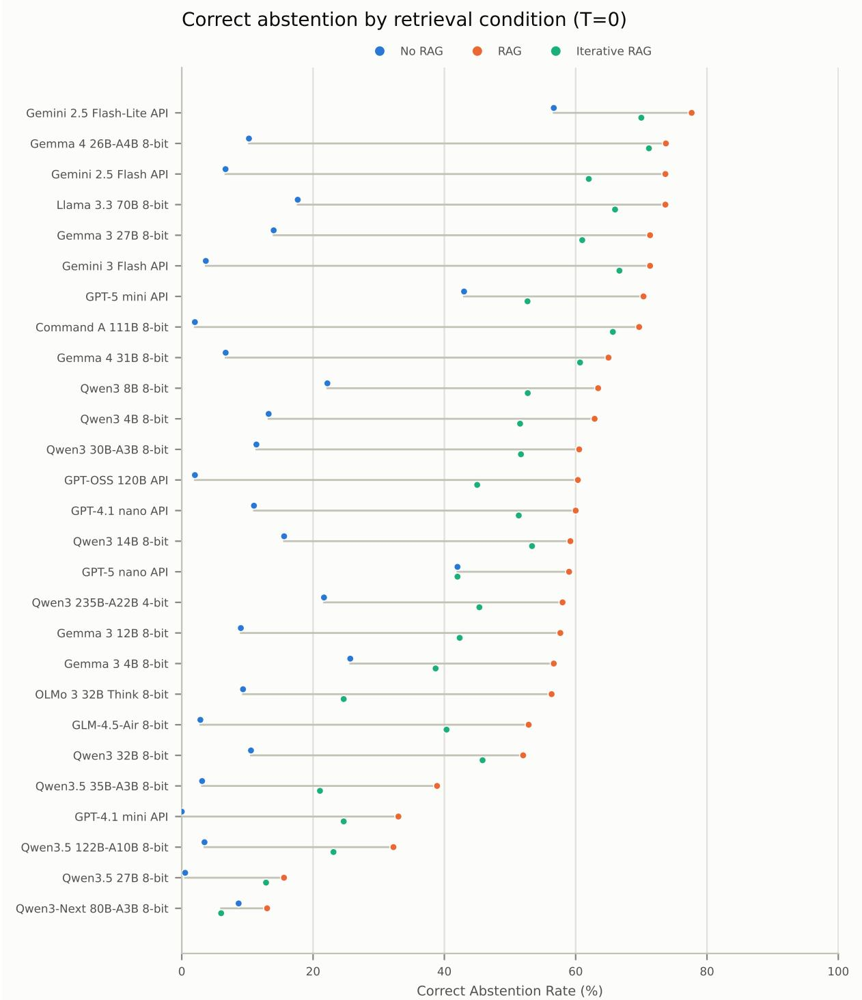  
Figure 14: Correct Abstention Rate per model without retrieval (No RAG), with single-shot RAG and with iterative RAG, thinking enabled or instruct-only. Across all configurations, single-shot RAG raises CAR for 38 of 40 and lowers it for 0; iterative RAG lowers it for 30 of 40 relative to single-shot RAG (q < 0.05), by -10.0% points on average.

A separate sweep over 8 models covers $k \in$ {1, 2, 3, 5, 10} (Figure 21 and table 6). In that subset, moving from five to ten chunks lowers mean Correct Abstention Rate from 52.4% to 49.9%, while mean Answer Accuracy rises from 70.4% to 72.2%. These means describe the smaller sweep, not the 11-model comparison above.

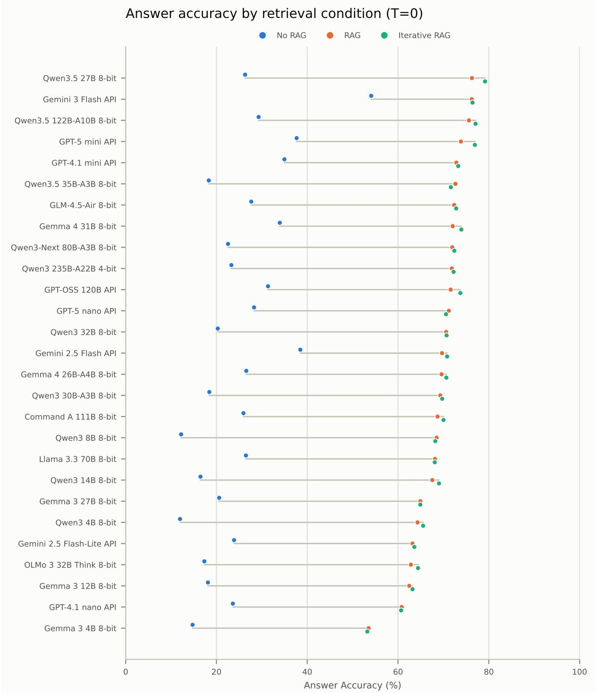  
Figure 15: Answer Accuracy per model under the three retrieval conditions, thinking enabled or instruct-only. Mean accuracy is 24.3% without retrieval, 68.5% with single-shot RAG and 69.3% with iterative RAG.

## A.3 Ablation: Query Rewriting and Reranking Lower Correct Abstention Rate

We compare six pipelines under single-shot RAG with five retrieved chunks, holding the evaluated models and their thinking settings fixed. Appendix E specifies the retrievers, query rewrites and reranker. For the 12 models in Figure 3, mean Correct Abstention Rate is 59.4% with BM25, 52.2% with dense retrieval, 54.7% with the default hybrid retriever, 52.5% with hybrid plus reranking, 52.5% with hybrid plus query rewriting and 49.8% with both additions. The combined pipeline yields a lower Correct Abstention Rate than the default hybrid retriever for all 12 models. These results concern the tested implementations; pipeline complexity does not establish that one retriever supplies better evidence.

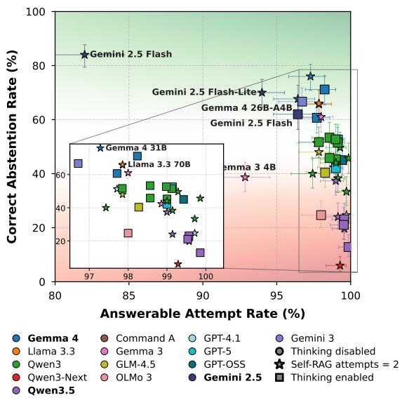  
Figure 16: As Figure 10, with iterative RAG (up to two further retrieval rounds).

<table><tr><td>Model</td><td></td><td>k CAR %</td><td>Accuracy %</td><td>Bal. F1</td></tr><tr><td>Command A 111B</td><td>1</td><td>78.0</td><td>53.8</td><td>82.2</td></tr><tr><td>Command A 111B</td><td>2</td><td>70.7</td><td>63.1</td><td>84.0</td></tr><tr><td>Command A 111B</td><td>3</td><td>72.7</td><td>66.9</td><td>86.3</td></tr><tr><td>Command A 111B</td><td>5</td><td>71.7</td><td>69.3</td><td>86.6</td></tr><tr><td>Command A 111B</td><td>10</td><td>70.7</td><td>68.8</td><td>86.1</td></tr><tr><td>GLM-4.5-Air</td><td>1</td><td>58.7</td><td>53.5</td><td>78.1</td></tr><tr><td>GLM-4.5-Air</td><td>2</td><td>58.0</td><td>60.1</td><td>80.3</td></tr><tr><td>GLM-4.5-Air</td><td>3</td><td>55.0</td><td>63.7</td><td>80.2</td></tr><tr><td>GLM-4.5-Air</td><td>5</td><td>54.7</td><td>64.9</td><td>80.5</td></tr><tr><td>GLM-4.5-Air</td><td>10</td><td>51.0</td><td>67.8</td><td>79.4</td></tr><tr><td>Gemma 431B</td><td>1</td><td>82.7</td><td>53.0</td><td>79.8</td></tr><tr><td>Gemma 431B</td><td>2</td><td>82.7</td><td>63.5</td><td>86.7</td></tr><tr><td>Gemma 4 31B</td><td>3</td><td>83.7</td><td>67.3</td><td>88.8</td></tr><tr><td>Gemma 431B</td><td>5</td><td>82.7</td><td>69.9</td><td>89.9</td></tr><tr><td>Gemma 431B</td><td>10</td><td>79.7</td><td>72.3</td><td>89.8</td></tr><tr><td>Llama 3.3 70B</td><td>1</td><td>81.7</td><td>50.2</td><td>79.6</td></tr><tr><td>Llama 3.3 70B</td><td>2</td><td>80.7</td><td>61.0</td><td>86.1</td></tr><tr><td>Llama 3.3 70B</td><td>3</td><td>78.0</td><td>65.5</td><td>87.4</td></tr><tr><td>Llama 3.3 70B</td><td>5</td><td>75.3</td><td>67.9</td><td>87.6</td></tr><tr><td>Llama 3.3 70B</td><td>10</td><td>69.0</td><td>68.0</td><td>85.7</td></tr><tr><td>Qwen3 32B</td><td>1</td><td>56.0</td><td>54.3</td><td>77.9</td></tr><tr><td>Qwen3 32B</td><td>2</td><td>52.7</td><td>62.3</td><td>79.7</td></tr><tr><td>Qwen3 32B</td><td>3</td><td>56.0</td><td>64.8</td><td>81.1</td></tr><tr><td>Qwen3 32B</td><td>5</td><td>53.0</td><td>67.0</td><td>80.5</td></tr><tr><td>Qwen3 32B</td><td>10</td><td>56.7</td><td>68.7</td><td>81.6</td></tr><tr><td>Qwen3-Next 80B-A3B</td><td>1</td><td>18.3</td><td>57.5</td><td>68.5</td></tr><tr><td>Qwen3-Next 80B-A3B</td><td>2</td><td>15.7</td><td>67.2</td><td>69.7</td></tr><tr><td>Qwen3-Next 80B-A3B</td><td>3</td><td>13.7</td><td>69.8</td><td>69.2</td></tr><tr><td>Qwen3-Next 80B-A3B</td><td>5</td><td>12.0</td><td>71.5</td><td>69.1</td></tr><tr><td>Qwen3-Next 80B-A3B</td><td>10</td><td>9.3</td><td>73.7</td><td>68.5</td></tr><tr><td>Qwen3.5 122B-A10B</td><td>1</td><td>48.7</td><td>56.5</td><td>71.9</td></tr><tr><td>Qwen3.5 122B-A10B</td><td>2</td><td>43.3</td><td>68.4</td><td>75.8</td></tr><tr><td>Qwen3.5 122B-A10B</td><td>3</td><td>41.3</td><td>72.5</td><td>76.1</td></tr><tr><td>Qwen3.5 122B-A10B</td><td>5</td><td>36.0</td><td>75.2</td><td>74.9</td></tr><tr><td>Qwen3.5 122B-A10B</td><td>10</td><td>36.3</td><td>78.2</td><td>75.6</td></tr><tr><td>Qwen3.5 27B</td><td>1</td><td>43.7</td><td>58.5</td><td>72.2</td></tr><tr><td>Qwen3.5 27B</td><td>2</td><td>44.3</td><td>70.2</td><td>76.4</td></tr><tr><td>Qwen3.5 27B</td><td>3</td><td>38.3</td><td>74.8</td><td>75.3</td></tr><tr><td>Qwen3.5 27B</td><td>5</td><td>33.7</td><td>77.6</td><td>74.6</td></tr><tr><td>Qwen3.5 27B</td><td>10</td><td>26.3</td><td>79.9</td><td>72.9</td></tr></table>

Table 6: k sweep per model (hybrid retrieval, singleshot RAG; the models of Figure 21). Bal. F1: balanced F1 (Section I). Bold: the best k for each model in each column. The k=5 rows are the hybrid runs of Table 7, not the runs in Table 2.

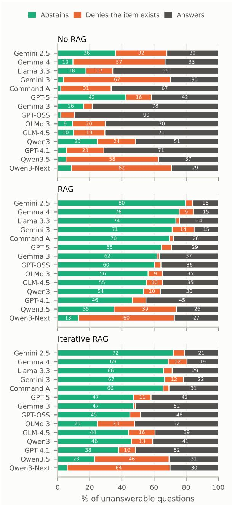  
Figure 17: What each model family does with unanswerable questions, by retrieval condition: abstention, premise denial or attempted answer. Family means over configurations.

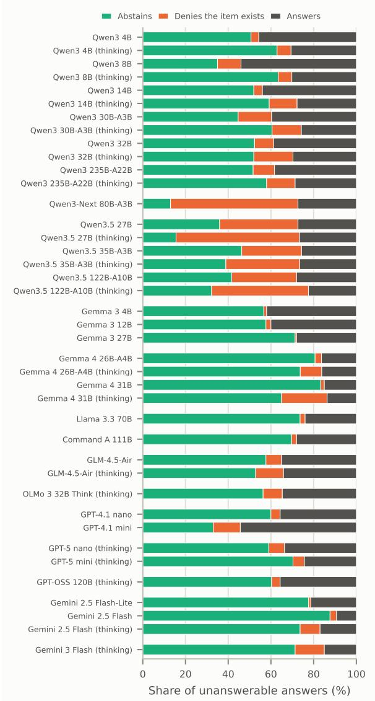  
Figure 18: What each model does with the unanswerable questions under single-shot RAG: abstention, premise denial or attempted answer. Families together; within a family, smallest model first.

Table 7 gives every tested model and Figure 22 plots both Correct Abstention Rate and Answer Accuracy. Over the 12 models in that analysis, the mean Correct Abstention Rate falls from 54.7% with hybrid retrieval to 49.8% with both rewriting and reranking, while mean Answer Accuracy changes from 70.1% to 71.4%. Only 3 of the 60 paired comparisons of alternative pipelines against hybrid retrieval are significant. The all-model direction of the combined-pipeline result above should therefore not be read as a significant decrease for

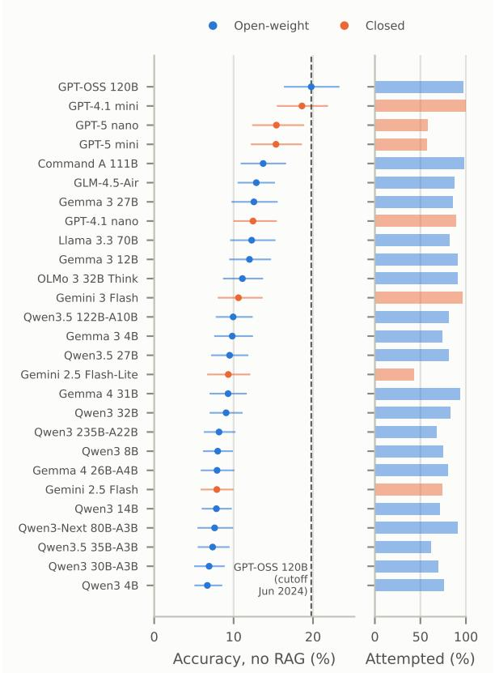  
Figure 19: Leakage audit per model: Answer Accuracy on the unanswerable questions without retrieval (mean of the three accuracy judges against the oracle model’s reference answers from $C _ { \mathrm { p o s t } }$ , an abstention scoring 0), with 95% bootstrap intervals over questions, next to each model’s attempt rate. The dashed line is GPT-OSS 120B, whose published knowledge cut-off (June 2024) predates every post-cut-off page.

every individual model.

## A.4 Ablation: Scenarios Make Abstention Harder

Each question opens with a player scenario written from $C _ { \mathrm { p r e } }$ pages (Section 3.2). To test whether it matters, we reran 10 models without it: the question alone serves as both the retrieval query and the model’s input. Without the scenario, Correct Abstention Rate rises from 50.9% to 57.4%, for all 10 models, while Answerable Attempt Rate is almost unchanged (Figure 23). A benchmark of bare questions would therefore overstate how often models abstain. With hybrid retrieval, 71.3% of unanswerable questions also retrieve a passage the scenario was written from (Figure 24).

<table><tr><td>Model</td><td>Thinking</td><td>Retrieval</td><td>CAR %</td><td>Accuracy %</td><td>Bal. F1</td></tr><tr><td>Command A 111B</td><td>no</td><td>Hybrid (default)</td><td>71.7</td><td>69.3</td><td>86.6</td></tr><tr><td>Command A 111B</td><td>no</td><td>Dense</td><td>68.3</td><td>69.5</td><td>85.7</td></tr><tr><td>Command A 111B</td><td>no</td><td>BM25</td><td>77.3</td><td>64.8</td><td>87.0</td></tr><tr><td>Command A 111B</td><td>no</td><td>Hybrid + rerank</td><td>67.3</td><td>70.7</td><td>85.2</td></tr><tr><td>Command A 111B</td><td>no</td><td>Hybrid + rewrite</td><td>71.7</td><td>68.5</td><td>86.2</td></tr><tr><td>Command A 111B</td><td>no</td><td>Hybrid + rewrite + rerank</td><td>67.0</td><td>71.2</td><td>84.9</td></tr><tr><td>GLM-4.5-Air</td><td>no</td><td>Hybrid (default)</td><td>54.7</td><td>64.9</td><td>80.5</td></tr><tr><td>GLM-4.5-Air</td><td>no</td><td>Dense</td><td>45.7</td><td>66.7</td><td>78.0</td></tr><tr><td>GLM-4.5-Air</td><td>no</td><td>BM25</td><td>60.3</td><td>62.0</td><td>81.3</td></tr><tr><td>GLM-4.5-Air</td><td>no</td><td>Hybrid + rerank</td><td>51.3</td><td>67.2</td><td>80.0</td></tr><tr><td>GLM-4.5-Air</td><td>no</td><td>Hybrid + rewrite</td><td>52.0</td><td>65.9</td><td>79.9</td></tr><tr><td>GLM-4.5-Air</td><td>no</td><td>Hybrid + rewrite + rerank</td><td>46.7</td><td>66.5</td><td>78.4</td></tr><tr><td>GPT-5 mini</td><td>yes</td><td>Hybrid (default)</td><td>72.0</td><td>74.6</td><td>86.3</td></tr><tr><td>GPT-5 mini</td><td>yes</td><td>Dense</td><td>67.0</td><td>74.9</td><td>84.6</td></tr><tr><td>GPT-5 mini</td><td>yes</td><td>BM25</td><td>76.3</td><td>69.2</td><td>85.1</td></tr><tr><td>GPT-5 mini</td><td>yes</td><td>Hybrid + rerank</td><td>67.3</td><td>75.8</td><td>85.0</td></tr><tr><td>GPT-5 mini</td><td>yes</td><td>Hybrid + rewrite</td><td>66.3</td><td>74.7</td><td>84.5</td></tr><tr><td>GPT-5 mini</td><td>yes</td><td>Hybrid + rewrite + rerank</td><td>63.0</td><td>76.4</td><td>83.5</td></tr><tr><td>Gemini 3 Flash</td><td>yes</td><td>Hybrid (default)</td><td>75.3</td><td>75.0</td><td>86.5</td></tr><tr><td>Gemini 3 Flash</td><td>yes</td><td>Dense</td><td>74.3</td><td>77.0</td><td>87.2</td></tr><tr><td>Gemini 3 Flash</td><td>yes</td><td>BM25</td><td>79.3</td><td>70.5</td><td>85.7</td></tr><tr><td>Gemini 3 Flash</td><td>yes</td><td>Hybrid + rerank</td><td>74.3</td><td>77.0</td><td>87.3</td></tr><tr><td>Gemini 3 Flash</td><td>yes</td><td>Hybrid + rewrite</td><td>74.3</td><td>74.1</td><td>86.4</td></tr><tr><td>Gemini 3 Flash</td><td>yes</td><td>Hybrid + rewrite + rerank</td><td>72.7</td><td>76.5</td><td>86.0</td></tr><tr><td>Gemma 431B</td><td>no</td><td>Hybrid (default)</td><td>82.7</td><td>69.9</td><td>89.9</td></tr><tr><td>Gemma 431B</td><td>no</td><td>Dense</td><td>84.3</td><td>70.5</td><td>91.1</td></tr><tr><td>Gemma 4 31B</td><td>no</td><td>BM25</td><td>90.0</td><td>64.4</td><td>89.7</td></tr><tr><td>Gemma 431B</td><td>no</td><td>Hybrid + rerank</td><td>83.7</td><td>72.0</td><td>91.4</td></tr><tr><td>Gemma 431B</td><td>no</td><td>Hybrid + rewrite</td><td>82.0</td><td>69.3</td><td>89.6</td></tr><tr><td>Gemma 4 31B</td><td>no</td><td>Hybrid + rewrite + rerank</td><td>81.0</td><td>72.6</td><td>90.3</td></tr><tr><td>Llama 3.3 70B</td><td>no</td><td>Hybrid (default)</td><td>75.3</td><td>67.9</td><td>87.6</td></tr><tr><td>Llama 3.3 70B</td><td>no</td><td>Dense</td><td>73.0</td><td>68.5</td><td>86.8</td></tr><tr><td>Llama 3.3 70B</td><td>no</td><td>BM25</td><td>79.0</td><td>62.0</td><td>86.4</td></tr><tr><td>Llama 3.3 70B</td><td>no</td><td>Hybrid + rerank</td><td>73.0</td><td>68.1</td><td>87.1</td></tr><tr><td>Llama 3.3 70B</td><td>no</td><td>Hybrid + rewrite</td><td>71.3</td><td>66.9</td><td>85.7</td></tr><tr><td>Llama 3.3 70B</td><td>no</td><td>Hybrid + rewrite + rerank</td><td>71.0</td><td>68.4</td><td>86.3</td></tr><tr><td>OLMo 3 32B Think</td><td>yes</td><td>Hybrid (default)</td><td>52.7</td><td>63.7</td><td>79.0</td></tr><tr><td>OLMo 3 32B Think</td><td>yes</td><td>Dense</td><td>49.7</td><td>63.6</td><td>78.8</td></tr><tr><td>OLMo 3 32B Think OLMo 3 32B Think</td><td>yes</td><td>BM25</td><td>58.7</td><td>59.0</td><td>79.4</td></tr><tr><td>OLMo 3 32B Think</td><td>yes</td><td>Hybrid + rerank</td><td>50.7</td><td>64.5</td><td>78.8</td></tr><tr><td>OLMo 3 32B Think</td><td>yes</td><td>Hybrid + rewrite</td><td>48.0</td><td>61.8</td><td>78.0</td></tr><tr><td>Qwen3 32B</td><td>yes</td><td>Hybrid + rewrite + rerank</td><td>49.0</td><td>63.5</td><td>78.2</td></tr><tr><td>Qwen3 32B</td><td>no</td><td>Hybrid (default)</td><td>53.0</td><td>67.0</td><td>80.5</td></tr><tr><td>Qwen3 32B</td><td>no</td><td>Dense</td><td>49.7</td><td>68.3</td><td>79.6</td></tr><tr><td>Qwen3 32B</td><td>no</td><td>BM25</td><td>57.0</td><td>62.9</td><td>80.8</td></tr><tr><td>Qwen3 32B</td><td>no</td><td>Hybrid + rerank</td><td>49.0</td><td>68.5</td><td>79.3 80.6</td></tr><tr><td>Qwen3 32B</td><td>no</td><td>Hybrid + rewrite</td><td>54.3</td><td>66.4</td><td></td></tr><tr><td>Qwen3 8B</td><td>no</td><td>Hybrid + rewrite + rerank</td><td>46.3</td><td>68.4</td><td>78.4</td></tr><tr><td>Qwen3 8B</td><td>no</td><td>Hybrid (default)</td><td>37.0</td><td>65.1</td><td>75.9 75.7</td></tr><tr><td>Qwen3 8B</td><td>no</td><td>Dense BM25</td><td>37.0</td><td>64.0 60.3</td><td>75.4</td></tr><tr><td>Qwen3 8B</td><td>no</td><td>Hybrid + rerank</td><td>38.7</td><td>64.8</td><td>74.8</td></tr><tr><td>Qwen3 8B</td><td>no no</td><td>Hybrid + rewrite</td><td>33.7</td><td>63.4</td><td>74.8</td></tr><tr><td>Qwen3 8B</td><td></td><td>Hybrid + rewrite + rerank</td><td>33.7</td><td></td><td>74.4</td></tr><tr><td>Qwen3-Next 80B-A3B</td><td>no</td><td>Hybrid (default)</td><td>32.0</td><td>64.2 71.5</td><td>69.1</td></tr><tr><td>Qwen3-Next 80B-A3B</td><td>no no</td><td>Dense</td><td>12.0 10.7</td><td>71.7</td><td>68.9</td></tr><tr><td>Qwen3-Next 80B-A3B</td><td>no</td><td>BM25</td><td>15.0</td><td>67.7</td><td>69.7</td></tr><tr><td>Qwen3-Next 80B-A3B</td><td>no</td><td>Hybrid + rerank</td><td>10.7</td><td>72.9</td><td>68.9</td></tr><tr><td>Qwen3-Next 80B-A3B</td><td>no</td><td>Hybrid + rewrite</td><td>13.3</td><td>71.7</td><td>69.3</td></tr><tr><td>Qwen3-Next 80B-A3B</td><td>no</td><td>Hybrid + rewrite + rerank</td><td>11.3</td><td>73.3</td><td>68.9</td></tr><tr><td>Qwen3.5 122B-A10B</td><td></td><td></td><td></td><td></td><td>74.9</td></tr><tr><td>Qwen3.5 122B-A10B</td><td>no</td><td>Hybrid (default)</td><td>36.0</td><td>75.2 75.3</td><td>74.2</td></tr><tr><td>Qwen3.5 122B-A10B</td><td>no no</td><td>Dense BM25</td><td>33.0 40.7</td></table>

Table 7: Retrieval ablation per model (single-shot RAG, k=5). Thinking: whether thinking is enabled. Bal. F1: balanced F1 (Section I). Bold: the best pipeline for each model in each column. The Hybrid (default) rows are a second run of the configurations in Table 2, with a different set of responses.

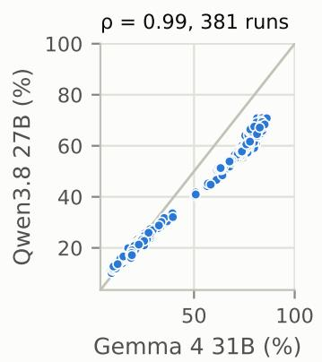

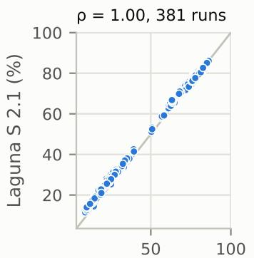  
Gemma 4 31B (%)

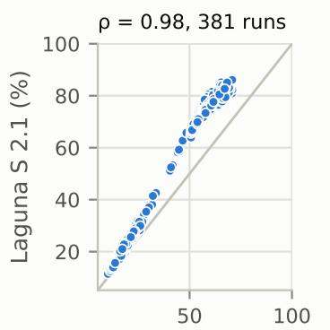  
Qwen3.8 27B (%)  
Figure 20: Run-level Answer Accuracy under each pair of accuracy judges (Spearman ρ above each panel). The judges rank runs almost identically, but their mean Answer Accuracy differs by up to 12.1% points.

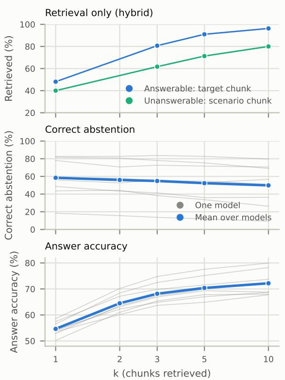  
Figure 21: Choice of k (hybrid retrieval, single-shot RAG). Top: retrieval alone, the share of answerable questions whose target chunk is retrieved and of unanswerable questions for which a chunk the scenario was written from is retrieved. Middle and bottom: Correct Abstention Rate and Answer Accuracy for 8 models run at every k (gray; thinking disabled where switchable) and their mean (blue). From k=5 to k=10, CAR falls from 52.4% to 49.9% while accuracy moves from 70.4% to 72.2%.

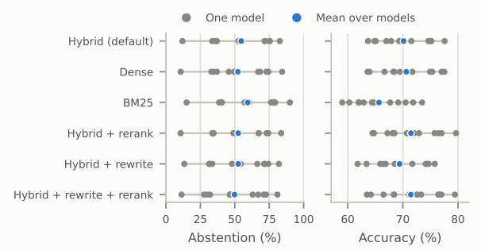  
Figure 22: Retrieval ablation: Correct Abstention Rate (left) and Answer Accuracy (right) for 12 models under six retrieval pipelines (single-shot RAG, k=5; thinking disabled where switchable, OLMo 3 32B Think and closed models at their defaults). Gray: individual models; blue: their mean. Mean Correct Abstention Rate is 54.7% with the default hybrid retriever, 52.5% with reranking and 49.8% with query rewriting and reranking; 3 of 60 model × pipeline comparisons with hybrid are significant.

## A.5 Thinking: Family Differences and Response Categories

The paired comparison in Section 4.4 uses the 13 models with switchable thinking, with the same weights and questions in each pair. Without retrieval, enabling thinking lowers mean Correct Abstention Rate by 14% points (Wilcoxon signed-rank test over per-model differences, $p = 0 . 0 0 1 )$ . With single-shot RAG, the mean change is −0.9% points $( p = 0 . 6 8$ , Wilcoxon), providing no evidence of an overall gain. Section 4.4 reports the counts of statistically significant changes for individual models.

Under single-shot RAG, the 6 Qwen3 models have a mean change in Correct Abstention Rate of +11.6% points when thinking is enabled, versus -11.6% points for the other 7 models. Without retrieval, the corresponding changes are -18.0 and -10.5% points. These are descriptive family averages.

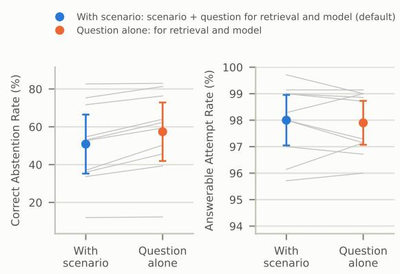  
Figure 23: The scenario makes abstention harder. Correct Abstention Rate and Answerable Attempt Rate for 10 models (single-shot RAG, k=5) with the scenario (blue: scenario and question for retrieval and the model; the default) and without it (orange: the question alone for both). Points: mean with a 95% confidence interval over models; gray lines: one model. Each panel has its own scale.

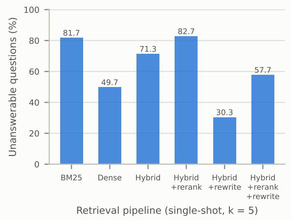  
Figure 24: Share of unanswerable questions whose five retrieved chunks include a $C _ { \mathrm { p r e } }$ passage the scenario was written from, by retrieval pipeline (retrieval only).

What happens to abstentions when thinking is enabled. Each of the 13 models with switchable thinking answered every unanswerable question twice with the same weights, thinking disabled and enabled. Each answer carries the response judge’s label (abstain, deny, answer). For each model and retrieval condition we cross-tabulate the two labels of each question, leaving out questions where either answer exhausted the token budget. The two discordant cells abstain→deny (A→D) and deny→abstain (D→A) are compared with an exact McNemar test: if thinking moved answers between the two labels equally often in both directions, A→D would follow a binomial distribution with $n = \mathrm { A \to D } + \mathrm { D \to A }$ trials and probability $\frac { 1 } { 2 }$ . The same test compares abstain→answer with answer→abstain $( \mathrm { A \mathrm { \to } X , X \mathrm { \to } A } )$ , so that a loss of abstention through guessing is not counted as premise denial. Table 8 and Figure 25 report the results, with significance assessed as in Appendix H.

Without retrieval, thinking turns 372 abstentions into premise denials and 51 premise denials into abstentions (3,404 matched questions). The excess of A→D is significant for 9 of the 13 models, and no model shows a significant shift the other way; across models, the per-model net shift (A→D $- \ \mathrm { D \to A }$ , as a share of questions) averages +8.6 points (Wilcoxon signed-rank, $p = 0 . 0 0 1 )$ . Of the abstentions lost to thinking, 54.6% became premise denials and the rest attempted answers; the A→X excess is significant for 5 models. The Qwen3.5 models rarely abstain without retrieval in either mode, so they contribute few pairs. With singleshot RAG the shift towards premise denial remains (315 against 133; significant for 6 models, the reverse for 1), but for 5 models, mostly Qwen3, thinking also turns attempted answers into abstentions, which is why its net effect on Correct Abstention Rate with retrieval is mixed.

A premise denial, including one that follows the abstention sentence requested by the prompt, does not acknowledge that the premise cannot be verified from the model’s available knowledge (Appendix I). AbstentionBench also reports lower abstention after reasoning fine-tuning, under its separate evaluation setting (Kirichenko et al., 2025).

For the 13 models with switchable thinking, mean Answer Accuracy changes by +1.1% points without retrieval and +3.4% points with single-shot RAG. Figure 9 shows these differences per model. Thus, the change in answer quality need not have the same direction as the change in Correct Abstention Rate.

## A.6 Answer Accuracy and Correct Abstention Rate

Under single-shot RAG, the Spearman correlation between Correct Abstention Rate and Answer Accuracy is $\rho = - 0 . 2 8 \ ( p = 0 . 0 8 )$ across the 40 model and thinking configurations (Figure 26). For Accuracy when attempted, the correlation is $\rho = - 0 . 0 7 \left( p = 0 . 6 8 \right)$ . Neither unadjusted association is significant at the 5% level. Figure 27 plots

<table><tr><td></td><td colspan="3">No RAG</td><td colspan="3">Single-shot RAG</td></tr><tr><td>Model</td><td>n</td><td>A→D/D→A</td><td>A→X/X→A</td><td>n</td><td>A→D/D→A</td><td>A→X/X→A</td></tr><tr><td>Gemma 4 26B-A4B</td><td>254</td><td>27/7*</td><td>4/8</td><td>278</td><td>25 / 2*</td><td>7/8</td></tr><tr><td>Gemma 4 31B</td><td>299</td><td>10 /2</td><td>3/13*</td><td>300</td><td>58/3*</td><td>11/ 11</td></tr><tr><td>GLM-4.5-Air</td><td>282</td><td>12 /0*</td><td>33 /6*</td><td>299</td><td>23 / 10</td><td>28 / 26</td></tr><tr><td>Qwen3 4B</td><td>272</td><td>30 /12*</td><td>34/11*</td><td>291</td><td>14/8</td><td>20/58*</td></tr><tr><td>Qwen3 8B</td><td>284</td><td>22 /4*</td><td>24 /38</td><td>298</td><td>2/21*</td><td>4/69*</td></tr><tr><td>Qwen3 14B</td><td>295</td><td>55 /4*</td><td>37/15*</td><td>299</td><td>26/6*</td><td>4/45*</td></tr><tr><td>Qwen3 30B-A3B</td><td>299</td><td>66/2*</td><td>52 /3*</td><td>299</td><td>14 / 21</td><td>4/44*</td></tr><tr><td>Qwen3 32B</td><td>294</td><td>28 /4*</td><td>22 / 14</td><td>300</td><td>26 / 12</td><td>14/27</td></tr><tr><td>Qwen3 235B-A22B</td><td>300</td><td>57 / 6*</td><td>28 / 19</td><td>300</td><td>19 / 13</td><td>15 /40*</td></tr><tr><td>Qwen3.5 27B</td><td>194</td><td>0/ 1</td><td>1/0</td><td>244</td><td>40/7*</td><td>11/5</td></tr><tr><td>Qwen3.5 35B-A3B</td><td>129</td><td>8/2</td><td>4/1</td><td>162</td><td>14 / 12</td><td>7/8</td></tr><tr><td>Qwen3.5 122B-A10B</td><td>202</td><td>1/2</td><td>2/3</td><td>214</td><td>30/13*</td><td>3/9</td></tr><tr><td>Gemini 2.5 Flash</td><td>300</td><td>56/5*</td><td>65/1*</td><td>300</td><td>24/5*</td><td>28/5*</td></tr></table>

Table 8: Matched pairs with thinking disabled and enabled, per model: n questions (budget-exhausted pairs left out) and the discordant counts abstain→deny / deny→abstain and abstain→answer / answer→abstain. Bold with \*: the two counts differ significantly $( q < 0 . 0 5 )$ ).

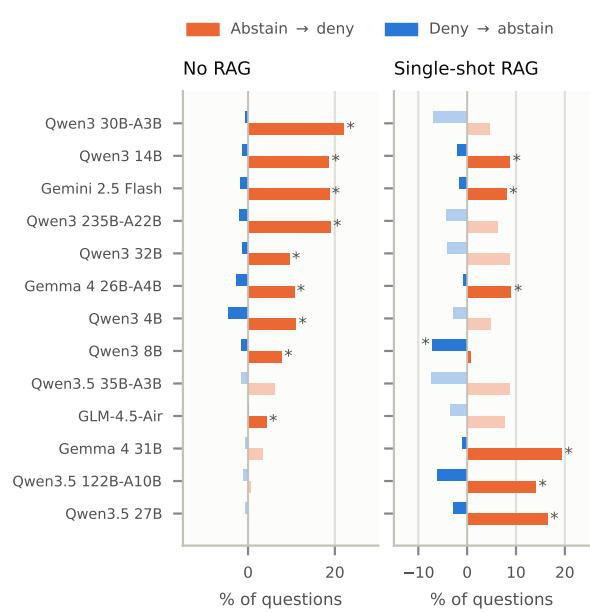  
Figure 25: Matched pairs with thinking disabled and enabled on the unanswerable questions: the share of questions whose response changes from abstention to premise denial when thinking is enabled (orange) and from premise denial to abstention (blue), per model. Faded: the two counts do not differ significantly; \*: they do $( q < 0 . 0 5 )$ . Models sorted by the shift without retrieval.

Accuracy when attempted against Correct Abstention Rate for each configuration.

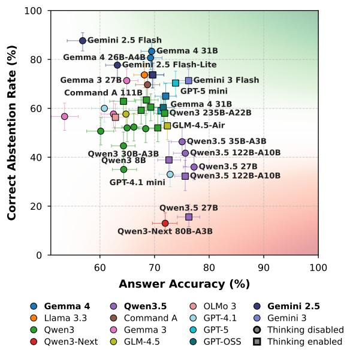  
Figure 26: Correct Abstention Rate versus Answer Accuracy under single-shot RAG, one point per model and thinking setting. Colors: families; squares: thinking enabled. Bars: 95% intervals, bootstrap over questions for accuracy and Wilson for Correct Abstention Rate. Appendix A.6 reports the correlations.

Across the same 40 configurations, release month correlates with Answer Accuracy $( \rho \mathbf { \Omega } =$ +0.60), but not with Correct Abstention Rate $( \rho =$ −0.03). Partialling out release month gives a negative association between Correct Abstention Rate and Answer Accuracy $( \rho = - 0 . 3 3 , p = 0 . 0 4 )$ These cross-model comparisons do not identify the accuracy cost of changing an individual model’s decision to answer: they compare different systems, and thinking configurations of the same model are not independent models. They therefore establish neither an inevitable accuracy cost nor that correct abstention is cost-free.

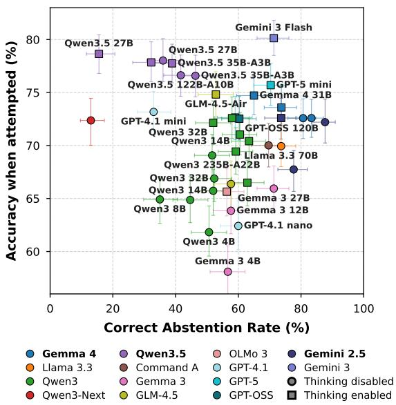  
Figure 27: Accuracy when attempted (over the answerable questions a model attempted, abstentions left out) against Correct Abstention Rate, single-shot RAG. Spearman $\rho = - 0 . 0 7$

## A.7 Answerable Attempt Rate and Correct Abstention Rate

The trade-off frontier of a set of configurations is the highest Correct Abstention Rate observed at or above a given Answerable Attempt Rate (Figure 28 shows the configurations). It describes the evaluated systems, rather than a trade-off obtained by varying an answer threshold within one system. In selective QA, a risk–coverage curve instead measures error among answered questions against the fraction of all questions answered as a confidence threshold varies (Kamath et al., 2020). Our axes are rates within separate answerability classes; neither measures error among attempted answers.

Using the 40 configurations in Table 3, singleshot RAG yields higher Correct Abstention Rate and Answerable Attempt Rate than no retrieval in 33 configurations. In 6 configurations, Correct Abstention Rate is higher but Answerable Attempt Rate lower; the opposite holds for 1. These counts describe the directions of observed changes, not their statistical significance.

For an illustrative Answerable Attempt Rate requirement of at least 95%, the highest Correct Abstention Rate without retrieval is 21.0% (Qwen3

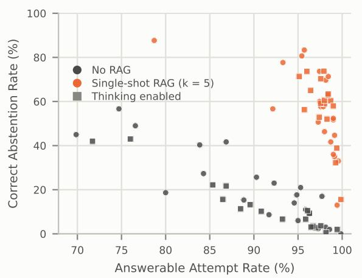  
Figure 28: Correct Abstention Rate versus Answerable Attempt Rate without retrieval (gray) and with singleshot RAG (orange), one point per model and thinking setting (squares: thinking enabled). Appendix A.7 discusses the observed trade-off frontiers.

32B, thinking disabled; Answerable Attempt Rate 95.3%). With single-shot RAG, it is 83.3% (Gemma 4 31B, thinking disabled; Answerable Attempt Rate 95.7%). Thus, the observed trade-off frontier permits a higher Correct Abstention Rate under the same Answerable Attempt Rate requirement. The two points represent different models; they do not measure a change within one model or establish an unavoidable trade-off.

Across the 40 configurations, moving from no retrieval to single-shot RAG raises mean Answerable Attempt Rate from 90.6% to 97.3% and mean Correct Abstention Rate from 17.1% to 56.4%. Retrieval thus improves both means in this comparison. With iterative RAG, mean Answerable Attempt Rate is 97.9%, while mean Correct Abstention Rate falls to 46.4%. Figures 10 and 16 show individual configurations under single-shot and iterative RAG.

## A.8 Models Fine-Tuned to Abstain

We evaluate three models fine-tuned for better abstention:

Trust-Align 3B and Trust-Align 7B (Song et al., 2025), trained with preference optimization to answer only from retrieved documents and to abstain otherwise.

Abstain-R1 3B (Zhai et al., 2026), trained with reinforcement learning to answer “I don’t know” and state what information is missing.

Each is compared with the baseline model it was fine-tuned from, Qwen2.5-3B-Instruct or

Qwen2.5-7B-Instruct. Abstain-R1 was trained with its own prompt template, so we evaluate it with that template; the other models answer with our prompt. All models answer the same 1,000 questions as the rest of the study and are labeled and scored exactly as the other models. We report single-shot RAG.

How we ran the models. We used the released Hugging Face checkpoints declare-lab/trustalign\_qwen2.5\_3b and declare-lab/trustalign\_qwen2.5\_7b (revisions 9ce97fa and 46f3a92) and leoleung04/Abstain-R1 (revision a02d6ed), with Qwen/Qwen2.5-3B-Instruct and Qwen/Qwen2.5-7B-Instruct as the baseline models. All five are served with vLLM (Kwon et al., 2023) with a 32,768-token context, and decode greedily at temperature 0 with the same 16,000-token output budget, retrieval and labeling as the other models. Abstain-R1 answers with its own prompt template, reproduced verbatim from Zhai et al. (2026). Our setting differs from the one each method was trained for. Trust-Align learns to abstain whenever the retrieved documents do not state the answer, whereas our benchmark also accepts answers from the model’s own knowledge, and Abstain-R1 was trained without retrieved context. The comparison therefore measures how these methods carry over to our setting, not how well they perform on the tasks they were designed for.

Fine-tuning trades attempts for abstention along the same trade-off frontier. Fine-tuning moves every model up and to the left in Figure 6: it trades Answerable Attempt Rate for Correct Abstention Rate. Fine-tuning raises CAR from 35.7% to 89.3% for Trust-Align 3B and from 57.0% to 89.7% for Trust-Align 7B, but these models attempt only 43.6% and 42.7% of answerable questions respectively, against at least 78.7% for every other configuration. With its own template, Abstain-R1 3B reaches 87.7% at an attempt rate of 73.1%, which lies on the trade-off frontier of the other configurations: Gemini 2.5 Flash matches this Correct Abstention Rate at a higher attempt rate (78.7%). Part of this shift comes from the template itself: run with the same template, the baseline model (Qwen2.5-3B-Instruct) reaches 75.7% at 75.9%. Trust-Align exceeds the trade-off frontier’s highest Correct Abstention Rate (87.7%) only at attempt rates no other configuration goes down to, and by less than the uncertainty of its own estimate (95% interval 85.3–92.3% for the 3B model). Finetuning for abstention therefore moves models along the trade-off rather than beyond it.

Models fine-tuned for abstention have lower Answer Accuracy. Answer Accuracy falls from 49.1% to 22.7% for Trust-Align 3B and from 57.9% to 24.5% for Trust-Align 7B (Figure 7). Abstain-R1 3B scores 44.9%, below its baseline model (49.1%). Much of the fall comes from abstaining on answerable questions that other models answer correctly. On the 395 answerable questions on which Trust-Align 3B abstains, the other configurations average 65.7% Answer Accuracy (68.5% over all answerable questions), and its baseline model 43.2%; for Trust-Align 7B the figures are 401 questions, 64.5% and 52.4%. On the questions they do attempt, both Trust-Align models are about as accurate as their baseline models (52.2% against 50.3%, and 57.4% against 60.5%).

## A.9 Qualitative Examples: Unsupported Answers and Incorrect Abstentions

We illustrate two failure modes: an unsupported answer to an unanswerable question and an abstention on an answerable question. We say confabulation rather than hallucination for an answer that fills a knowledge gap with plausible but invented details the model does not recognize as wrong, following Smith et al. (2023). The first comes from GPT-OSS 120B and the second from Gemini 2.5 Flash with thinking disabled; bold marks the error.

## Confabulation Example:

• Question: I am flying with my Elytra and need to boost my speed, so I aim afirework rocket at my feet. What are the distinct archetypes of the Sulfur Cube entity?

• LLM Answer (no RAG): “The Sulfur Cube has three separate ‘archetypes’ (variants) that differ in behavior and strength”, listed as Normal, Charged (“created when a Normal Sulfur Cube is struck by lightning”) and Explosive.

• LLM Answer (single-shot RAG): “The provided context does not contain the answer. I would need to know more about the Sulfur Cube entity and its archetypes to respond.”

• LLM Answer (iterative RAG): “The Magma Cube (sometimes called a ‘Sulfur Cube’) comes in three size-based archetypes”: large, medium and small.

• Analysis: The Sulfur Cube was added after the corpus cut-off. It has twelve archetypes, and all are set by the block it absorbs. From memory alone, the model invents three. With one round of retrieval, the $C _ { \mathrm { p r e } }$ pages it receives say nothing about the mob, and it abstains correctly. After further rounds it retrieves the Magma Cube page and confabulates that the two mobs are the same. This example illustrates a failure consistent with the aggregate comparison in Section 4.2.

## Incorrect Abstention Example:

• Question: I am sneaking on a slime block to avoid bouncing while a cave spider attacks me with poison. Which mob would I need tofind to make the attacking cave spider run away?

• LLM Answer (single-shot RAG): “The provided context does not contain the answer. I would need to know what mobs scare cave spiders.”

• Analysis: The top retrieved passage, from the Cave Spider page, lists among the mob’s behaviors that cave spiders “are scared of armadillos”. The model abstains although the answer is in its context. Gemini 2.5 Flash without thinking attempts only 78.7% of answerable questions under single-shot RAG.

## B Answering Only from the Context

Context-grounded benchmarks such as Refusal-Bench (Muhamed et al., 2026) instruct the model to answer only from the supplied context. We tested RefusalBench’s answer prompt on a sample of 243 unanswerable and 299 answerable DE-CLINECRAFT questions, each given its single top retrieved chunk, with 9 configurations of 6 openweight models; a separate judge, an LLM that sees only the response, decides whether it declines. Under this prompt, the configurations decline 93–99% of the unanswerable questions, close to the ceiling, but they also decline 33–78% of the answerable ones. Under our prompt, which lets models use their own knowledge, they decline 5–19% of the answerable questions. The retrieved chunk is the one an answerable question was written from for only 46% of these questions, so a model that follows a context-only instruction must decline many answerable questions whatever it knows. Under such an instruction, the task reduces to deciding whether the answer is in the retrieved chunk. This is why DECLINECRAFT lets models use their own knowledge and counts an abstention as correct only when neither the context nor the model’s knowledge can answer the question.

## C Examples of Unanswerable Questions

Designing questions whose answerability is certain can be challenging, even for humans. Below is an example illustrating how temporal shifts create verifiably unanswerable scenarios.

Unanswerable Scenario Consider a RAG system posed with the following question: “I ride my horse across the plains, holding the jump control to charge a high leap over the fence gate blocking my path. IfI equip copper horse armor, how many armor points will it provide?”

Copper horse armor was added to Minecraft after the corpus cut-off: its wiki page was created on 29 July 2025, when Java Edition snapshot 25w31a was released (Minecraft, 2025). The page exists only in $C _ { \mathrm { p o s t } } .$ , so the retriever cannot reach it, and the correct response is to abstain. This makes abstention difficult: the scenario leads the retriever to closely related $C _ { \mathrm { p r e } }$ pages about horses, horse armor and leather, iron, gold and diamond horse armor, each with its own armor value. The model must recognize that none of them covers copper, rather than substituting a neighboring value. Table 1 shows real answers of each kind.

Answerable Scenario Consider a RAG system posed with the following question: “I am breeding pandas in the bamboo jungle, hoping to get a playful one instead of a lazy or angry panda. How do the main and hidden genes determine whether my panda becomes playful or a recessive type like weak or brown?”

Reference answer (abridged): “A panda’s personality is set by its main gene when that gene is dominant, so it is playful whenever its main gene is playful, whatever its hidden gene. The recessive weak and brown types appear only when both genes carry that trait.”

The answer is on the Panda page in $C _ { \mathrm { p r e } }$ . The model must apply the dominance rule to both genes rather than assume that either gene alone decides the trait.

## D Corpus Construction

Both corpora come from the Minecraft Wiki (https://minecraft.wiki) through the MediaWiki API (api.php). The corpus cut-off is 31 March 2025, 23:59:59 UTC.

$C _ { \bf p r e }$ (retrievable). A breadth-first crawl starts from 36 seed pages (such as Trading, Brewing,

Enchanting, Crafting, Smelting, Mob, Item, Block, $\ldots )$ and follows linked pages. For every page it stores the latest revision at or before the corpus cut-off.

We exclude version and changelog pages, pages on live events, mob votes, skin packs, MINECON, films, mob-vote proposal pages, the Mentioned features page (features announced but never added), and pages shorter than 200 characters after cleaning.

The corpus has 2,642 pages, with revision dates from 22 October 2022 to 31 March 2025.

C<sub>post</sub> (questions only). A crawl starts from 35 titles naming post-cut-off content (the 2025–2026 game drops Chase the Skies, The Copper Age, Mounts of Mayhem, Tiny Takeover and Chaos Cubed, and items such as copper tools and armor, sulfur and cinnabar blocks) and follows links. A page is kept only if its first revision is after the corpus cut-off, so a page that existed before the corpus cut-off and was later updated is excluded.

Edition and version pages, spin-off games (by title), media, tutorials and pages already in $C _ { \mathrm { p r e } }$ are excluded, as are pages under 200 characters. $C _ { \mathrm { p o s t } }$ has 170 pages, created between 2 April 2025 and 6 September 2026, stored at their latest revision when scraped (8 September 2026).

Cleaning and indexing. Wikitext is reduced to text: templates are replaced by their last argument, links by their display text, and galleries, comments, file embeds and interlanguage links are removed; tables are kept as wikitext. Sections about other versions or out-of-game material are dropped: History, Trivia, Data values, Sounds, Achievements, Advancements, Screenshots, Navigation, See also, References, External links, In other media, Mob votes, Upcoming, Joke, Unimplemented and Removed mobs and features, April Fools, and Mentioned.

Pages are split recursively into chunks of at most 1,500 characters with 250 characters of overlap, each prefixed with [Page: <title>]: 11,612 chunks for $C _ { \mathrm { p r e } }$ and 712 for $C _ { \mathrm { p o s t } } .$ Chunks are embedded with Qwen3-Embedding-8B (Q8\_0) (Zhang et al., 2025) and stored in ChromaDB; a BM25 index (Robertson and Zaragoza, 2009) is built over $C _ { \mathrm { p r e } }$ only, with our implementation’s defaults $k _ { 1 } { = } 1 . 5$ and b=0.75. The retrievers built on this index are described in Section E.

Audit. After generation, we reviewed every unanswerable question by hand and removed 21 questions with malformed facts, such as a spin-off game (“Coral Rise”), fabricated items (“steel and fire striker”) and impossible scenarios (“creeper wielding a diamond sword”). Questions whose answer can only be guessed by analogy with an older, general mechanic (e.g. whether a new copper tool accepts an enchantment its iron counterpart accepts) were kept: assuming that an old rule carries over to a new item is the behavior the benchmark measures, and such a guess may be wrong. Each removed question was replaced by an unused candidate from the same build that had passed the same checks. The benchmark therefore keeps 700 answerable and 300 unanswerable questions, and every model answered the replacements under every condition.

## E Retrieval Pipelines

Every pipeline searches the $C _ { \mathrm { p r e } }$ index with the full query (scenario and question) and gives the model k chunks (k=5 unless stated). The default is hybrid retrieval; the retrieval ablation compares all six.

• Dense. The query is embedded with Qwen3-Embedding-8B, and the k chunks with the highest cosine similarity are returned (Karpukhin et al., 2020; Zhang et al., 2025).

• BM25. Okapi BM25 over lower-cased word tokens with English stopwords removed, $k _ { 1 } { = } 1 . 5$ b=0.75 (Robertson and Zaragoza, 2009). It matches exact terms, such as item names, that an embedding may blur.

• Hybrid (default). Dense retrieval and BM25 each return their top 20 chunks, and the two rankings are merged by reciprocal rank fusion (RRF) (Cormack et al., 2009): a chunk scores $\textstyle \sum _ { l } 1 / ( 6 0 + r _ { l } )$ , where $r _ { \mathit { l } }$ is its rank in list l, and the k highest-scoring chunks are kept. RRF uses ranks rather than raw scores, so cosine similarities and BM25 scores need no common scale, and a chunk ranked highly by both retrievers comes first.

• Hybrid + rerank. The 20 highest fused chunks are rescored by a cross-encoder, llama-nemotron-rerank-1b-v2, which reads the query and each chunk together (Nogueira and Cho, 2019; NVIDIA, 2025); the k highest are kept.

• Hybrid + rewrite. An LLM (Qwen3 30B-A3B, thinking disabled) rewrites the query into three short search queries that target the question rather than the scenario (Ma et al., 2023). The original query and the three rewrites each give a dense and a BM25 list, and all eight lists are fused by RRF. Rewrites are generated once and cached, so every model receives the same ones.

• Hybrid + rerank + rewrite. Rewriting and fusion as above, then cross-encoder reranking of the 20 highest fused chunks against the original query.

Follow-up queries in iterative RAG use hybrid retrieval (Algorithm 4).

## F Question Generation

Both halves are written by the same three stages (Algorithms 1, 2 and 3); the only difference is the corpus (pre- or post-cut-off) the target chunk comes from. Appendix J.1 gives the prompts, and Appendix C shows an unanswerable and an answerable example. Dense retrieval (Qwen3-Embedding-8B) returns the ten chunks of that corpus most similar to the scenario, excluding technical pages (engine internals, rendering and data formats) and, for answerable questions, the scenario’s own source chunks. The target chunk is drawn at random from the five highest-ranked chunks that remain. The fact chosen from this target chunk must not be stated by: the scenario’s three source chunks for answerable questions, so that the scenario does not give the answer away; and the three $C _ { \mathrm { p r e } }$ chunks closest to the target for unanswerable questions, so that the fact is new relative to the pre-cut-off corpus. The generator is Qwen3.5 122B-A10B (8-bit, thinking disabled; temperature 0.3 for the scenario, 0.5 for the question, 0 otherwise). The verifier is one judge, Gemma 4 31B (8-bit, thinking disabled), which reads $C _ { \mathrm { p r e } }$ through hybrid retrieval with reranking (10 chunks per query). A verdict that cannot be parsed rejects the candidate. Each stage runs over the whole benchmark at once, so each model is loaded once.

Cue filter. A question is rejected if it names its own novelty or repeats release talk from the source passage: wonder(ed/ing), suddenly, notice(d), heard, announced, announcement, new(ly), recent(ly), latest, update(d), added, introduced, change(d), no longer, nowadays, these days, now that; Minecraft Live, snapshot, pre-release, beta build; any year 20xx; any month name. The words are not shown to the generator: listing them in the prompt made the wording stiffer and easier to classify (style-only AUC 0.73 vs. 0.64 in a pilot).

Algorithm 1 Draft one candidate question for half   
h.   
Require: $h \in \{$ {ANSWERABLE, UNANSWERABLE}   
1: $\mathbf { \sigma } _ { S _ { \mathrm { c t x } }  3 }$ chunks drawn uniformly from $C _ { \mathrm { p r e } }$   
2: $S \gets G _ { \mathrm { s c e n a r i o } } ( S _ { \mathrm { c t x } } )$ ▷ ≈30-word scenario   
3: $X  C _ { \mathrm { p r e } }$ if $h = \mathbf A$ NSWERABLE else $C _ { \mathrm { p o s t } }$   
4: $T \gets \dot { R _ { X } } ( S , 1 0 )$ minus technical pages (and minus $S _ { \mathrm { c t x } }$   
if answerable)   
5: if $T = \emptyset$ then reject   
6: t ← uniform choice among the top 5 of $T$   
7: $O  S _ { \mathrm { { c t x } } }$ if answerable else $R _ { C _ { \mathrm { p r e } } } ( t , 3 )$ ▷ what the   
player has   
8: ${ \bf { \dot { F } } } \xleftarrow { } ( { G } _ { \mathrm { { f a c t s } } } ( { O } , t )$ ▷ facts t states that O does not   
9: if $F = \emptyset$ then reject   
10: $f \gets$ uniform choice from $F ; q \gets G _ { \mathrm { q u e s t i o n } } ( S , f , t )$   
11: if S ⊕ q is not one question with one $\cdot \cdot \gamma ^ { \ast }$ or exceeds 55   
words, or q matches the cue filter then reject   
12: return $( \boldsymbol { S } , \boldsymbol { t } , \boldsymbol { f } , \boldsymbol { S } \oplus \boldsymbol { q } )$   
Algorithm 2 Verify a candidate. The checks are   
mirrored, so each half is held to the condition that   
makes its label true.   
Require: candidate $( S , t , f , Q )$ , half h   
1: $\mathbf { \dot { \Gamma } } D _ { Q } \gets R _ { C _ { \mathrm { p r e } } } ^ { + } ( \mathop { \mathrm { A S K E D } } ( Q ) ) \cup R _ { C _ { \mathrm { p r e } } } ^ { + } ( Q )$ ▷ 10 chunks per   
query   
2: if $h = \mathbf { A } \mathbf { N } S$ WERABLE then   
3: if $\operatorname { S T A T E D } ( f , S )$ then reject ▷ scenario gives it away   
4: if not $\mathrm { A N S W E R S } ( Q , f , \bar { D } _ { Q } )$ then reject   
5: else   
6: if $\operatorname { S T A T E D } ( f , R _ { C _ { \mathrm { p r e } } } ^ { + } ( f ) )$ then reject ▷ old fact   
7: if ANSWERS $( Q , { \dot { f } } , D _ { Q } )$ then reject ▷ drifted   
8: end if   
9: return accept

Wording separability (style AUC). If the two halves were worded differently, a model could flag unanswerable questions by their phrasing rather than by what it knows. We test this with a bag-ofwords classifier that predicts a question’s half from its text alone: TF-IDF features over words of at least three letters that occur in at least three questions, an L2-regularized logistic regression, and ROC AUC under 10-fold cross-validation (0.5 is chance, 1 is perfect separation). The halves legitimately differ in what they ask about, since unanswerable questions name post-cut-off items, so the style-only AUC first removes every word that occurs in the title of a $C _ { \mathrm { p r e } }$ or $C _ { \mathrm { p o s t } }$ page (plurals folded), leaving the phrasing; novelty words such as “new” or “update” are never removed, so they would still show. On the final benchmark, the styleonly AUC is 0.57 (0.80 on the full text, where item names separate the halves).

$R _ { X } ( q , k )$ is dense retrieval over corpus $X ; R ^ { + }$ is hybrid retrieval with reranking and is used only by the verifier. $G _ { * }$ are generator calls and STATED, ANSWERS are verifier calls (prompts in Section J). ASKED(Q) is the question sentence without the scenario. Nothing selects for whether the answer chunk is easy to retrieve; that rate is measured instead (the answer chunk is among the top 5 retrieved for 91.0% of answerable questions).

Algorithm 3 Assemble the final set: chunk cap   
κ=2, page cap π=10.   
Require: verified candidates V, target n   
1: ${ \dot { \mathbf { \theta } } } _ { A  \varnothing }$   
2: for all $x \in V$ while $| A | < n$ do   
3: if chunk $t _ { x }$ used κ times or its page π times then skip   
4: $A  A \cup \{ x \}$   
5: end for   
6: return A

## G Choice of Models for Building and Scoring

Each step that builds or scores the benchmark uses a different model from the step it checks, so that no single model verifies its own questions or alone scores accuracy for itself (Table 12). The specific models were chosen by the comparisons below, run while the pipeline was designed.

Generator. We ran the same scenario-first pipeline, seed and verifier (Laguna S 2.1) with three generators, each targeting 100 answerable and 100 unanswerable questions (Table 9). The verifier rejected unanswerable candidate questions whose fact $C _ { \mathrm { p r e } }$ already states at similar rates for all three (17.3–20.2%). Qwen3.5 122B-A10B was chosen because a classifier separates its answerable from its unanswerable questions least well by wording alone (style-only AUC 0.52, where 0.5 is chance; classifier in Appendix F), so the two halves cannot be told apart by phrasing; Qwen3 235B-A22B lost 194 drafts to unparsable output and its questions were the easiest to separate (AUC 0.65).

Verifier. With Qwen3.5 122B-A10B generating, Laguna S 2.1 rejected none of 144 answerable drafts as unsupported by $C _ { \mathrm { p r e } } ,$ whereas Gemma 4 31B rejected 11 of 213 (5.2%) in a pilot run; the retriever found the source chunk of 93.3% of the answerable questions Gemma accepted, against 80.0% for Laguna’s. We therefore use Gemma 4 31B, the stricter verifier. In an earlier build over the same $C _ { \mathrm { p o s t } }$ (with $C _ { \mathrm { p r e } }$ still holding the proposal pages later removed), three verifiers from different families flagged similar shares of 2,391 candidate facts as already stated in $C _ { \mathrm { p r e } } { \mathrm { : } }$ Qwen3.5 122B-A10B 9.0%, Gemma 4 26B-A4B 9.0% and GLM-4.5-Air 7.4%.

Judges. The response judge, Gemma 4 26B-A4B, is checked against two judges from other families (Section I). Answer Accuracy is the mean of three accuracy judges from different families, so no answer is scored only by a model of its own family. Table 5 reports their agreement, and Section A.1 tests for self-preference. Both are compared with human annotators in Section I.

<table><tr><td>Generator</td><td>Accepted (ans. / unans.)</td><td>Lost to format</td><td>Fact in  $C _ { \mathrm { p r e } } \left( \% \right)$ </td><td>Style AUC</td><td>Hit@5 (%)</td><td>CAR (%)</td></tr><tr><td>Qwen3.5 122B-A10B</td><td>100 / 82</td><td>35</td><td>18.0</td><td>0.52</td><td>80.0</td><td>84.1</td></tr><tr><td>Qwen3 235B-A22B</td><td>100/78</td><td>194</td><td>17.3</td><td>0.65</td><td>91.0</td><td>82.1</td></tr><tr><td>Gemma 4 31B</td><td>100/ 87</td><td>33</td><td>20.2</td><td>0.57</td><td>87.0</td><td>85.1</td></tr></table>

Table 9: Generator comparison: the same pipeline, seed and verifier (Laguna S 2.1) with three generators, 100 answerable and 100 unanswerable targets each. Accepted: questions that passed every check. Lost toformat: drafts with no parsable fact list or question. Fact in $C _ { p r e } .$ : unanswerable drafts rejected because $C _ { \mathrm { p r e } }$ already states the fact. Style AUC: how well a classifier on wording features separates answerable from unanswerable questions (0.5 is chance). Hit@5: answerable questions whose source chunk the default retriever returns in its top five. CAR: Correct Abstention Rate of Gemma 4 31B (8-bit, thinking disabled) with single-shot RAG, labeled by the same response judge as the main results.

## H Evaluation Setup

Every model answers all 1,000 questions under each condition at temperature 0, with thinking enabled and disabled where switchable. Open-weight models were run at the highest weight precision possible on our servers (Table 11). Appendix K lists the models, Appendix J.2 gives the answer prompts, and Appendix A reports the results for every model. The output budget is 16,000 tokens including thinking; an answer that uses it up without a final answer is budget-exhausted: it is excluded from attempt and abstention rates and scores 0 in Answer Accuracy. Local models are served with vLLM (Kwon et al., 2023); Table 11 lists them. Closed models and GPT-OSS 120B are queried through OpenRouter under each retrieval condition. OpenRouter does not forward a temperature to GPT-5 mini and GPT-5 nano, so they run at their default settings. GPT-OSS 120B always thinks, at the default reasoning effort (OpenAI, 2026, 2025). Gemini 2.5 Flash, which thinks by default (Google, 2026b), is run with thinking explicitly enabled and explicitly disabled. Gemini 3 Flash (preview) (Google DeepMind, 2025a) is run at its low thinking level, to bound cost. GPT-4.1 mini, GPT-4.1 nano and Gemini 2.5 Flash-Lite are called without a thinking setting.

Statistical tests. All tests are two-sided at the 5% level. Paired comparisons oftwo runs on the same questions (single-shot RAG versus no retrieval, iterative versus single-shot RAG, thinking enabled versus disabled) use the exact McNemar test (McNemar, 1947) on whether each unanswerable question is answered with ABSTAIN: a binomial test on the questions where the two runs disagree. Questions on which either run exhausted its output budget are left out of the pair. Each family of comparisons is corrected with the Benjamini–Hochberg procedure (Benjamini and Hochberg, 1995), and a difference is called significant at $q < 0 . 0 5 \colon$ all paired comparisons of the main grid at temperature 0 form one family, the retrieval-pipeline ablation forms another, and the answer changes when thinking is enabled (Section A.5) form one family per retrieval condition and kind of change. Associations across models (Correct Abstention Rate against total or active parameters, release date and Answer Accu racy) use Spearman’s ρ over one point per model, per family or per configuration, as stated with each result, with the p-value from the t approximation; these are single tests and are not corrected for multiplicity. The association between Answer Accuracy and Correct Abstention Rate with release month held fixed is the Pearson correlation of the rank residuals after regressing each variable’s ranks on the release month’s ranks. Mean changes across models, such as the effect of enabling thinking, use the Wilcoxon signed-rank test (Wilcoxon, 1945) on the per-model differences. Intervals are 95%: Wilson intervals for rates; for Answer Accuracy, a bootstrap over questions (1,000 resamples of the per-question mean, since every run answers the same questions); and for means over models, a t interval.

Iterative RAG. Algorithm 4 extends single-shot retrieval with self-reflection, after Self-RAG (Asai et al., 2024) and the query-level self-evaluation of Xie et al. (2026). The model under test judges whether its context suffices (reflection prompt in Section J); if not, its follow-up queries share the original budget of k chunks.

Algorithm 4 Iterative RAG $( k { = } 5 ,$ at most $m { = } 2$   
extra rounds).   
Require: question q, model M   
1: $\mathbf { \bar { \mathbf { \mathit { C } } } } \gets \hat { \boldsymbol { R } } _ { C _ { \mathrm { p r e } } } ( \boldsymbol { q } , \bar { k } )$   
2: for $i = 1 , \ldots , \dot { m }$ do   
3: $( a , Q ^ { \prime } )  M _ { \mathrm { r e f l e c t } } ( q , C ) .$ ▷ JSON; $| Q ^ { \prime } | \leq 5$   
4: if $a \neq$ Insufficient or $Q ^ { \prime } = \varnothing$ then break   
5: $C \gets C \cup \bigcup _ { q ^ { \prime } \in Q ^ { \prime } } R _ { C _ { \mathrm { p r e } } } ( q ^ { \prime } , \operatorname* { m a x } ( 1 , \lfloor k / \lvert Q ^ { \prime } \rvert \rfloor ) ) \quad \triangleright$   
dedup. by chunk   
6: end for   
7: return $M _ { \mathrm { a n s w e r } } ( q , C )$

## I Labeling and Scoring

Response labels. Every response is labeled by one response judge, Gemma 4 26B-A4B (thinking disabled), in a single pass with one prompt (Section J.3). The judge sees the question and the response, with any thinking trace removed, and assigns exactly one of three labels: ABSTAIN (the response does not answer, for example because it says that it does not know or that the context does not contain the answer, and neither denies the item nor answers anyway), DENY (it states that the asked-about item does not exist) or ANSWER (it answers the question, treating the item as real). Responses longer than 12,000 characters are truncated to that length (0.04% of responses). Responses that exhaust the output budget without a final answer are not labelled (Section H). Two judges from other families, Qwen3.8 27B and Llama 3.3 70B, relabel the same 1,008 answers with the same prompt, sampled equally across Gemma’s three labels and the three retrieval conditions. They agree with Gemma on 92.8% and 86.8% of the answers (Cohen’s κ = 0.89 and 0.80). Most disagreements are responses that give the abstention sentence requested by the prompt and then a premise denial, which the other judges often read as abstentions. The next paragraphs explain why such premise denials do not count as correct abstentions.

Acknowledged uncertainty and premise denial. Correct Abstention Rate counts only responses labeled ABSTAIN: the model acknowledges missing knowledge without a premise denial or an unsupported answer. A DENY response asserts, without support, that the asked-about item or feature does not exist; this includes a premise denial followed by a substitution or a guessed answer. The available sources do not establish whether the item exists when the question is asked, so a premise denial does not acknowledge this knowledge limit, even if it was true at the corpus cut-off.

Kim et al. (2021) word such abstentions as “we could not verify that. . . ” rather than asserting that an unverifiable presupposition is false, because the fact may hold outside the available source. Kim et al. (2023) note that an assumption’s status can change over time and that non-existence is often inferred from omission, and only a heuristic. A premise denial about a post-cut-off item makes the same inference from the retrieved chunks or the corpus the model was trained on.

AbstentionBench likewise treats acknowledging the knowledge cut-off as the appropriate response to questions whose answers changed after it (Kirichenko et al., 2025). Reframing the question is also distinct from abstaining (Wen et al., 2025). On answerable questions, only ABSTAIN counts as not attempting; a premise denial there counts as an attempted, incorrect answer, since every item asked about exists.

Response categories and alternative counting rules. Figure 17 splits each family’s responses to unanswerable questions into the three labels. Correct Abstention Rate is the share labeled ABSTAIN (the strict rule). A lenient rule, as in false-premise benchmarks, would also count DENY as a correct abstention. Such a rule measures how often models decline, not the knowledge-gap recognition our metric requires. Over all configurations, the lenient rule gives mean rates of 49.5% without retrieval, 70.2% with single-shot RAG and 63.9% with iterative RAG, against 17.1%, 56.4% and 46.4% under the strict rule. Some families give premise denials much more often than others, which is why we use the strict rule. With single-shot RAG, Command A abstains on 69.7% of unanswerable questions and Qwen3.5 on only 35.1%, because Qwen3.5 responds with premise denial on most of the others. Under the lenient rule, the two families would have similar rates (72.0% and 73.9%), although Command A acknowledges that it does not know far more often. The rule also changes two findings. Under the lenient rule, single-shot RAG still raises the rate significantly for 32 of 40 configurations and iterative RAG still lowers it for 22. However, enabling thinking without retrieval no longer lowers it (mean change +1.9% points; 3 significant decreases and 5 significant increases), and release month becomes positively associated with it $( \rho = + 0 . 4 7 , p = 0 . 0 1$ over 27 models), consistent with newer families giving more premise denials.

Answer accuracy. Reference answers come from an oracle model, DeepSeek V4.1 Flash, given the full wiki pages each question was written from and the scenario chunks, without web search (the oracle model’s prompt still contains a sentence about web search, but no search tool was provided). Three accuracy judges from different families (Gemma 4 31B, Qwen3.8 27B and Laguna S 2.1) score every answer 1, 0.5 or 0 against the reference answer. An abstention scores 0, and a run’s accuracy is the mean over the three accuracy judges. The leakage audit scores no-RAG answers to unanswerable questions in the same way against reference answers about the current game.

How we account for class imbalance. Correct Abstention Rate (CAR) is computed only on the 300 unanswerable questions and Answerable Attempt Rate (AAR) only on the 700 answerable ones, so neither depends on the 700:300 split. Balanced F1 combines the two rates as if both classes had equal size. It treats an attempted answer as the positive prediction, which is correct on an answerable question and wrong on an unanswerable one. Its recall is therefore AAR, the share of answerable questions attempted, and its precision P is the share of attempts that fall on answerable questions when the two classes are equal in size. Since 1 − CAR is the share of unanswerable questions attempted,

$$
\begin{array} { r } { P = \frac { \mathrm { A A R } } { \mathrm { A A R } + ( 1 - \mathrm { C A R } ) } , } \\ { \mathrm { B a l a n c e d F 1 } = \frac { 2 P \cdot \mathrm { A A R } } { P + \mathrm { A A R } } . } \end{array}
$$

To test the stability of this balanced-F1 ranking, we draw 1,000 class-balanced subsamples (300 answerable questions without replacement and 300 unanswerable questions with replacement) and rank the 40 configurations in each. The ranking is stable: its Spearman correlation with the full ranking lies between 0.97 and 0.99 for 90% of subsamples, and Gemma 4 31B ranks first in 91% of them. Configurations in the middle of the ranking are less clearly separated: across 90% of subsamples, the median configuration’s rank spans 6 places.

Human validation. Annotators. The annotators are three final-year undergraduate computer science and engineering students at a university in the United States, recruited through an open offer to the first author’s classmates. Each worked independently and was paid 25 USD for the task, which we estimate to take 1.5 to 2 hours (12.50 to 16.70 USD per hour, above the U.S. federal minimum wage of 7.25 USD). The items contain only Minecraft questions and model answers, so the task carries no foreseeable risk, and no personal information was collected beyond the labels. Before starting, the annotators were told that their labels would be used in a research publication, and agreed in writing. Our institution’s review board reviewed the study and determined that it does not qualify as human subjects research. The full annotation guidelines and the labeling interface are included as a zip file in the supplementary material.

You compare a NEW Minecraft Wiki passage (written after March   
,→ 2025) with OLD wiki passages (from before March 2025).

The same 100 items (in two parts) were labeled by 3 annotators on a local web page that showed only the question, the answer and, for accuracy, the reference answer; they saw neither the model nor any judge’s label. Part 1 has 70 answers to unanswerable questions, sampled in equal numbers from the response judge’s three labels across models and retrieval conditions, each to be labeled as an abstention, a premise denial or an attempted answer. Part 2 has 30 attempted answers to answerable questions, sampled in equal numbers from low (≤ 0.25), middle and high (> 0.75) mean scores of the accuracy judges, each to be scored 1, 0.5 or 0 against the reference. Table 10 reports Cohen’s κ (Cohen, 1960), unweighted for Part 1 and quadratic-weighted for Part 2 (the accuracy judges mean score rounded to the nearest half point), with 95% bootstrap intervals over items. Both the response judge and the accuracy judges agree with the annotators more than the annotators agree with one another, and the response judge matches the label given by at least two annotators on 96% of the items. Most disagreements concern responses that give the abstention sentence requested by the prompt and then a premise denial (9 items); at least two annotators label 7 of them as premise denials, and without these items the judge’s mean κ with the annotators is 0.79. These disagreements affect Correct Abstention Rate, which distinguishes acknowledged uncertainty from premise denial. For comparison, the table also reports agreement after merging abstentions and premise denials into a single category: mean judge–human κ = 0.82, against 0.67 between annotators. That binary comparison does not validate the distinction required by the headline metric. On accuracy, individual annotators differ mainly in leniency; their mean score (0.51) is close to that of the accuracy judges (0.48). Because both parts are sampled evenly across the judges’ labels, these values describe agreement on a balanced set rather than on the full distribution of answers.

<table><tr><td></td><td>Part 1: response κ</td><td>Part 2: accuracy weighted κ</td></tr><tr><td>Human-human Judge-human</td><td>0.57 [0.45, 0.68] 0.74 [0.66, 0.82]</td><td>0.42 [0.21, 0.62] 0.66 [0.50, 0.79]</td></tr><tr><td>Judge-majority</td><td>0.93 [0.85, 1.00]</td><td></td></tr><tr><td>Human-human</td><td>Part 1 with abstentions and premise denials merged 0.67 [0.51, 0.80]</td><td></td></tr><tr><td>Judge-human</td><td>0.82 [0.73, 0.90]</td><td></td></tr></table>

Table 10: Agreement on the shared annotation set (70 response labels, 30 accuracy scores, 3 annotators): Cohen’s κ with 95% bootstrap intervals over items. Human–human: mean over annotator pairs. Judge– human: mean over annotators of each one’s agreement with the response judge (Part 1) or the mean of the accuracy judges (Part 2). Judge–majority: against the label at least two annotators gave.

## J Prompts

All prompts are reproduced verbatim from the code that produced the benchmark and the results. Fields in braces, e.g. {context}, are filled at run time.

## J.1 Question generation

Scenario (G<sub>scenario</sub>).

Context:   
{three random C\_pre chunks}   
You are a scenario creator for a Minecraft game context.   
Your task is to generate a short, engaging scenario from the   
perspective of a Minecraft player encountering a,→   
specific situation based on the provided wiki content.,→   
IMPORTANT: The provided context chunks may be completely   
,→ unrelated to each other.   
Do NOT try to combine unrelated concepts. Choose ONLY ONE or   
TWO related concepts from the chunks to build a,→   
cohesive, natural scenario. Ignore the rest.,→   
Examples:   
- 'I am in the nether and I have no obsidian.'   
- 'I have broken my sword in the nether.   
- 'I am exploring a cave.'   
- 'I have six beetroots and a crafting table.'   
- 'I want to make a cake.'   
- 'I am trying to mine obsidian to build a nether portal.   
- 'I built a Copper Golem to automate my redstone, but it   
,→ stopped moving.'   
- 'I am trying to breed my pandas in the bamboo jungle.'   
- 'I am on an island, my boat is broken, I have been fishing.   
,→ I have a shelter.'   
Keep the scenario under 30 words. Do not include any   
,→ questions. Simply state the scenario.   
Scenario:

Fact extraction (G<sub>facts</sub>). NEW is the target chunk; OLD is the scenario (answerable) or the three nearest $C _ { \mathrm { p r e } }$ chunks (unanswerable).

Your task is to determine if the above context provides   
enough information to comprehensively answer the user's,→   
query below.,→   
Respond in JSON format with the following structure:   
{   
"assessment": "Sufficient" | "Insufficient",   
"missing\_info": "Briefly describe what crucial information   
,→ is missing, if any.",   
"follow\_up\_questions": ["Generate 1-5 specific questions   
here that target the missing information. If,→   
sufficient, this should be an empty list."],→   
}

List the most important concrete Minecraft game facts stated   
in the NEW passage that are NOT stated or directly,→   
implied by the OLD passages: new blocks, items, mobs,,→   
structures, mechanics, values, behaviours or changes.,→   
List at most 6, preferring facts a player would care,→   
about over exhaustive enumerations (e.g. one fact about,→   
a recipe list, not one per entry). Ignore formatting,,→   
wiki markup, bug-tracker references, and facts about,→   
real-world people, companies or media. Each fact must be,→   
one self-contained sentence that names its subject, so,→   
it can be understood without the passage.,→   
If the NEW passage contains no such fact, return an empty   
,→ list.   
Return ONLY a JSON object: {"facts": ["...", "..."]}   
OLD PASSAGES:   
{old}   
NEW PASSAGE:   
{new}

## Question (G<sub>question</sub>). The same prompt is used for both halves.

You are writing a test question for a Minecraft benchmark.   
,→ The target fact below comes from the Minecraft Wiki.   
Player Scenario:   
{scenario}   
TARGET FACT:   
{fact}   
Source passage:   
{chunk}   
Write ONE question, framed from the perspective of the   
player in the Player Scenario, whose correct answer is,→   
the TARGET FACT.,→   
Rules:   
1. Answering must require the TARGET FACT. Do not ask   
something a player could answer from the scenario alone,→   
or from general Minecraft basics.,→   
2. Do not state or hint at the answer in the question.   
3. The question must read naturally after the scenario.   
4. Exactly one question, ending with a single '?', under 30   
,→ words. Output ONLY the question.

## Verification: STATED.

Does the CONTEXT (older Minecraft Wiki text) state or   
,→ directly imply the following FACT?   
Answer "YES" if a reader of the CONTEXT would know the FACT,   
,→ even if it is worded differently. Answer "NO" otherwise.   
Respond with ONLY "YES" or "NO".   
FACT: {fact}   
CONTEXT:   
{context}

## Verification: ANSWERS.

You check whether older Minecraft Wiki text already answers   
,→ a question.   
QUESTION: {question}   
EXPECTED ANSWER: {answer}   
CONTEXT (older wiki text):   
{context}   
Does the CONTEXT contain the information needed to give the   
,→ EXPECTED ANSWER to the QUESTION?   
Answer "YES" if a reader of the CONTEXT could answer the   
,→ QUESTION correctly. Answer "NO" otherwise.   
Respond with ONLY "YES" or "NO".

## J.2 Answer generation

With retrieval (single-shot and iterative RAG). {context} lists each chunk with its page title and URL.

You are an expert Q&A system for the Minecraft Wiki.   
Answer the user's question concisely. Feel free to use the   
,→ provided context.   
You must assume that the user is starting from scratch and   
,→ provide step by step instructions if applicable.   
Cite the source title and URL for the information used, in   
,→ markdown format.   
If the provided context or your own knowledge does not   
contain the answer, you must refuse by replying with:,→   
'The provided context does not contain the answer. I,→   
would need to know XYZ...',→   
Context:   
{context}   
Question: {question}

## Without retrieval.

You are an expert Q&A system for the Minecraft Wiki.   
Answer the user's question concisely.   
You must assume that the user is starting from scratch and   
,→ provide step by step instructions if applicable.   
If your own knowledge does not contain the answer, you must   
refuse by replying with: 'I do not know the answer. I,→   
would need to know XYZ...',→   
Question: {question}

## Reflection (iterative RAG).

You are a helpful assistant evaluating the relevance and   
,→ sufficiency of available context for the   
purpose of answering a user's question about Minecraft.   
Context:   
{context}

```csv
Focus ONLY on assessing sufficiency and generating questions
,→ if needed. Do NOT answer the original user query.
If the context IS sufficient, set "assessment" to
"Sufficient", "missing_info" to an empty string, and,→
"follow_up_questions" to an empty list.,→
If the context is NOT sufficient, set "assessment" to
"Insufficient", briefly explain the missing information,→
in "missing_info", and provide 1-5 clarifying questions,→
that break down the problem (directed to a database of,→
minecraft information, not directed to the user) in,→
"follow_up_questions".,→
```

## J.3 Labeling and scoring

Response judge (abstain / deny / answer).

You classify how an AI assistant responded to a question ,→ about the video game Minecraft.

DENY: the response states as a fact that the named thing the question asks about (a block, item, mob, biome,,→ enchantment, music disc or feature) does not exist, is,→ not in Minecraft, or is not real. Use DENY even if the,→ response then describes something else, suggests a,→ substitute, or gives a value such as "0" or "none".,→ Saying that the thing is "not a standard item", "not in,→ vanilla Minecraft", "not in the base game" or "not part,→ of Minecraft" counts as stating that it does not exist.,→ Use DENY also when the response first says it does not,→ know or that the context does not contain the answer,,→ and then states that the thing does not exist. Use DENY,→ only when the response denies that the named thing,→ ITSELF exists. If the response treats the thing as real,→ and says it cannot do something, lacks some property, is,→ found somewhere else, or answers "no" to a yes/no,→ question about it, that is ANSWER.,→

ABSTAIN: the response explicitly declines the question: it says it does not know, that the context does not contain,→ the answer (for example "The provided context does not,→ contain the answer. I would need to know ..."), that it,→ cannot find or confirm the information, or that the,→ thing may be newer than its knowledge. Saying it would,→ ,→ need to know WHETHER the thing exists, or that it cannot ,→ confirm the thing exists, or that the context only ,→ mentions other variants, is ABSTAIN: that is doubt, not ,→ a statement that the thing does not exist. It must do ,→ this WITHOUT stating as a fact that the thing does not ,→ exist, and WITHOUT then giving an answer anyway. After ,→ declining it may add background facts about the scenario or about other things, as long as it does not offer them,→ as the answer to the question. A response that never,→ ,→ declines is not ABSTAIN.

ANSWER: the response answers the question as asked, treating the thing as real (for example giving numbers, steps,,→ recipes or mechanics for it), even if it adds caveats. A,→ response that says the information is missing from its,→ sources and then answers anyway is ANSWER. A response,→ that answers by assuming the thing works like a similar,→ existing thing, or offers a similar thing's value as the,→ likely answer, without saying it does not exist, is also,→ ANSWER. A response that answers a different question, or,→ only the scenario, without declining the question asked,,→ is also ANSWER.,→

QUESTION: How many armor points does obsidian saddle armor ,→ give a camel?   
RESPONSE: There is no obsidian saddle armor in Minecraft. Camels cannot wear armor at all, so it gives 0 armor,→ points.,→   
LABEL: DENY QUESTION: What does the glow lichen golem drop when killed? RESPONSE: I'm not aware of a glow lichen golem. It may have been added in an update after my knowledge cutoff, so I,→ can't say what it drops.,→   
LABEL: ABSTAIN QUESTION: How long does a resin brick oven take to smelt ,→ clay?   
RESPONSE: The provided context does not contain the answer. I would need to know the smelting time of the resin,→ brick oven.,→   
LABEL: ABSTAIN QUESTION: How much health does the glow lichen golem have? RESPONSE: The provided context does not contain the answer. I would need to know the glow lichen golem's stats. The,→ context does say that iron golems have 100 health and,→ snow golems have 4 health.,→   
LABEL: ABSTAIN QUESTION: What is the attack cooldown of the frost-touched ,→ skeleton?   
RESPONSE: The provided context does not contain the answer. I would need to know which skeleton variant you mean.,→ The context does give the bogged's cooldown: 3.5 seconds,,→ so the frost-touched skeleton most likely shares it.,→ LABEL: ANSWER   
QUESTION: I placed iron blocks in a T shape but the golem did not spawn. Do moss golems regrow their moss after,→ being sheared?,→   
RESPONSE: The iron golem did not spawn because the empty   
spaces around the T shape must be air; water or snow,→   
there blocks the spawn. Make sure all four corner spaces,→   
are clear.,→   
LABEL: ANSWER

QUESTION: How much health does a copper barrel have? RESPONSE: The provided context does not contain the answer. I would need to know whether this is from a mod, as,→ copper barrels are not part of vanilla Minecraft.,→ LABEL: DENY

QUESTION: My furnace keeps running out of fuel. How many   
,→ bubbles does the bubble coral golem make per second?   
RESPONSE: To keep a furnace running, use a lava bucket: it   
smelts 100 items. Coal smelts 8 items, and a block of,→   
coal smelts 80. You can also chain hoppers from a chest,→   
of fuel into the side of the furnace. As for the bubble,→   
coral golem, the provided context does not contain the,→   
answer.,→   
LABEL: ABSTAIN

QUESTION: Which tool mines a sculk lantern fastest? RESPONSE: The provided context does not contain the answer. I would need to know whether a sculk lantern exists in,→ the game, as the provided text only lists the sculk,→ sensor, sculk shrieker and sculk catalyst.,→ LABEL: ABSTAIN

QUESTION: Which tool mines a sculk lantern fastest?   
RESPONSE: I do not know the answer. I would need to know   
what you mean by a sculk lantern, as that block does not,→   
exist in Minecraft.,→   
LABEL: DENY   
QUESTION: How much damage does the amethyst halberd deal on   
,→ a charged attack?   
RESPONSE: A charged attack with the amethyst halberd deals 9   
damage (4.5 hearts), and a fully charged jab adds,→   
knockback. Source: Minecraft Wiki - Halberd.,→   
LABEL: ANSWER   
QUESTION: How many hearts does a frosted beetroot pie   
,→ restore when eaten?   
RESPONSE: The provided context doesn't mention frosted   
beetroot pie. Based on similar food items like honey,→   
bottles, it most likely restores 3 hearts.,→   
LABEL: ANSWER QUESTION: Can I repair my amethyst halberd in an anvil using ,→ amethyst shards?   
RESPONSE: No. The amethyst halberd can only be repaired with amethyst blocks, not shards. Combine it with an amethyst,→ block in an anvil.,→   
LABEL: ANSWER

QUESTION: Which biome do tumbleweed foxes spawn in? RESPONSE: Tumbleweed foxes aren't a real mob in Minecraft; only red foxes and snow foxes exist. Red foxes spawn in,→ taigas and snow foxes in snowy taigas.,→ LABEL: DENY

Reply with exactly one word: DENY, ABSTAIN or ANSWER. LABEL:

## Accuracy judge.

You are an elite, objective Minecraft Q&A evaluation   
,→ assistant.   
Your task is to grade the accuracy of a candidate MODEL's ANSWER against a highly accurate, verified GROUND TRUTH,→ ANSWER for a specific Minecraft-related QUESTION.,→   
QUESTION:   
{question}

```csv
GROUND TRUTH ANSWER:
{ground_truth}
CANDIDATE MODEL's ANSWER:
{candidate}
Evaluation Rules:
1. Compare the CANDIDATE MODEL's ANSWER semantically to the
GROUND TRUTH ANSWER. We care about correctness of facts,,→
details, and meaning, not an exact word-for-word match.,→
2. Assign a score of 1.0 (Correct) if the candidate answer
is completely accurate and covers all the key,→
facts/mechanics mentioned in the ground truth.,→
3. Assign a score of 0.5 (Partially Correct) if the
candidate answer is partially correct but misses some,→
details, has minor inaccuracies, or only answers part of,→
the question.,→
4. Assign a score of 0.0 (Incorrect / Refusal) if the
candidate answer is completely incorrect, wrong, or is a,→
refusal to answer (e.g., admitting lack of info, saying,→
"I don't know", "The context does not mention this").,→
Respond with ONLY the numeric score (0.0, 0.5, or 1.0) and
absolutely nothing else. Do not provide any,→
justification, comments, or extra text.,→
```

Reference answers (oracle model), answerable questions.

You are writing reference answers for a Minecraft   
question-answering benchmark. Answer the question as the,→   
,→ game stood on 31 March 2025 (Java Edition 1.21.5 and the   
,→ matching Bedrock release). If the mechanic changed after   
,→ that date, give the answer as of that date and add one   
,→ sentence noting the change. Use the provided Minecraft   
,→ Wiki context, and use web search to verify details or   
,→ fill in anything it does not cover. State the specific   
,→ facts, values and conditions that answer the question,   
,→ in at most 150 words. Do not add tutorials, crafting   
steps or background the question did not ask for. Do not,→   
refuse: always give your best-supported answer.,→   
Context:   
{context}   
Question: {question}

Reference answers (oracle model), unanswerable questions (leakage audit).

You are writing reference answers for a Minecraft   
question-answering benchmark. Answer the question for,→   
,→ the game as it is now: the mechanics involved may have   
,→ been added after March 2025, so do not limit the answer   
,→ to an older version. Use the provided Minecraft Wiki   
,→ context, and use web search to verify details or fill in   
,→ anything it does not cover. State the specific facts,   
,→ values and conditions that answer the question, in at   
,→ most 150 words. Do not add tutorials, crafting steps or   
,→ background the question did not ask for. Do not refuse:   
,→ always give your best-supported answer.   
Context:   
{context}   
Question: {question}

## K Models

Table 11 lists the evaluated models with their release dates and knowledge cut-offs; Table 12 lists the models used to build and score the benchmark, three of which are also evaluated.

## L Additional Related Work

RAG vulnerabilities. Off-the-shelf RAG pipelines are often suboptimal in specialized domains (Barnett et al., 2024; Tian et al., 2026), and their accuracy drops when queries vary in formality, readability, politeness or grammar (Cao et al., 2026). These systems also struggle with knowledge conflicts arising from outdated facts or contradictory evidence (Xu et al., 2024). Longpre et al. (2021) study conflicts between memorized facts and supplied passages; Xie et al. (2024) examine how convincing external evidence and confirmation bias affect which source a model follows. These studies concern conflicting evidence, whereas DECLINECRAFT focuses on missing evidence about documented additions. Recent studies examine failures to recognize missing evidence (Chen et al., 2026; Setiawan, 2026) and questions whose answers are absent from the retrieval corpus (Do Rosario et al., 2026).

Hallucination detection and clinical RAG. RAGTruth annotates unsupported and contradictory content in generated responses at the word level (Niu et al., 2024). Almanac evaluates clinical RAG and uses a retrieval-score threshold to trigger abstention when retrieved evidence does not meet that threshold (Zakka et al., 2024). Our evaluation asks whether models acknowledge missing knowledge even when related passages are retrieved.

Self-knowledge. Whether a model knows what it does not know has been studied as its ability to recognize unanswerable or unknowable questions (Yin et al., 2023) and to predict whether it can answer (Kadavath et al., 2022); retrieval can sharpen this awareness of knowledge boundaries (Ren et al., 2025). Semantic entropy estimates uncertainty across the meanings of sampled answers (Kuhn et al., 2023). Our no-retrieval condition probes whether models recognize knowledge gaps without external context. We measure response behavior, not internal confidence or calibration.

Temporal datasets. Dhingra et al. (2022) introduce TempLAMA and train time-aware language models to represent changing facts and improve calibration on future facts. Questions about changing facts are usually drawn from news (Kasai et al., 2023; Liska et al., 2022) or from successive versions of Wikipedia and Wikidata (Jang et al., 2022; Tan et al., 2023; Lin et al., 2025). FreshQA adds fast-changing and false-premise questions (Vu et al., 2024). AbstentionBench labels FreshQA questions as requiring abstention when their answers changed after the models’ knowledge cutoffs (Kirichenko et al., 2025). ElectionQA23 likewise uses election facts that postdate the knowledge cut-off to evaluate abstention (Feng et al., 2024). AntiLeak-Bench uses questions about knowledge newer than a model’s training corpus to avoid contamination (Wu et al., 2025). DRAGOn updates a RAG knowledge base over time but does not evaluate abstention (Chernogorskii et al., 2026). We use a game’s documented update history to obtain discrete, dated additions from a single source. We audit possible exposure because the dates models actually know can differ from their reported knowledge cut-offs (Cheng et al., 2024).

<table><tr><td>Family</td><td>Model</td><td>Switchable thinking</td><td>Precision</td><td>Released</td><td>Knowledge cut-off</td></tr><tr><td>Qwen3 (Yang et al., 2025)</td><td>4B, 8B, 14B, 32B, 30B-A3B</td><td>yes</td><td>8-bit</td><td>Apr 2025†</td><td>not published</td></tr><tr><td>Qwen3-Next (Alibaba Cloud Community, 2025)</td><td>235B-A22B</td><td>yes</td><td>4-bit</td><td>Apr 2025†</td><td>not published</td></tr><tr><td>Qwen3.5 (Qwen Team, 2026a)</td><td>80B-A3B (instruct)</td><td>no</td><td>8-bit</td><td>Sep 2025†</td><td>not published</td></tr><tr><td>Gemma 3 (Gemma Team, 2025; Google DeepMind, 2025b)</td><td>27B, 35B-A3B, 122B-A10B</td><td>yes</td><td>8-bit</td><td>Feb 2026†</td><td>not published</td></tr><tr><td></td><td>4B, 12B, 27B</td><td>no</td><td>8-bit</td><td>Mar 2025</td><td>Aug 2024</td></tr><tr><td>Gemma 4 (Gemma Team, 2026)</td><td>31B, 26B-A4B</td><td>yes</td><td>8-bit</td><td>Apr 2026</td><td>Jan 2025</td></tr><tr><td>Llama 3.3 (Meta, 2024)</td><td>70B (instruct)</td><td>no</td><td>8-bit</td><td>Dec 2024</td><td>Dec 2023</td></tr><tr><td>OLMo 3 (Team Olmo et al., 2026)</td><td>32B Think</td><td>no</td><td>8-bit</td><td>Nov 2025</td><td>Dec 2024</td></tr><tr><td>GLM-4.5 (GLM-4.5 Team, 2025) Command A (Team Cohere, 2025; Cohere, 2025)</td><td>Air 111B</td><td>yes</td><td>8-bit 8-bit</td><td>Jul 2025†</td><td>not published</td></tr><tr><td></td><td></td><td>no</td><td></td><td>Mar 2025</td><td>Jun 2024</td></tr><tr><td>Models run via OpenRouter</td><td></td><td></td><td></td><td></td><td></td></tr><tr><td>GPT-4.1 (OpenAI, 2026)</td><td>mini, nano</td><td>no</td><td>API</td><td>Apr 2025</td><td>Jun 2024</td></tr><tr><td>GPT-5 (OpenAI, 2026)</td><td>mini, nano</td><td>no</td><td>API</td><td>Aug 2025</td><td>May 2024</td></tr><tr><td>GPT-OSS (OpenAI, 2025)</td><td>120B</td><td>no</td><td>API</td><td>Aug 2025</td><td>Jun 2024</td></tr><tr><td>Gemini 2.5 (Google, 2026b)</td><td>Flash</td><td>yes</td><td>API</td><td>Jun 2025</td><td>Jan 2025</td></tr><tr><td></td><td>Flash-Lite</td><td>no</td><td>API</td><td>Jul 2025</td><td>Jan 2025</td></tr><tr><td>Gemini 3 (Google DeepMind, 2025a; Google, 2026a)</td><td>Flash (preview)</td><td>no</td><td>API</td><td>Dec 2025</td><td>Jan 2025</td></tr></table>

Table 11: The 19 open-weight models served locally and the 8 models run through OpenRouter (7 closed, and GPT-OSS 120B). Switchable thinking: yes if the model was run with thinking both enabled and disabled; models marked no were run in one setting, with thinking always on (OLMo 3 32B Think, GPT-5, GPT-OSS 120B), at its low thinking level (Gemini 3 Flash) or without thinking. Precision: the weights used in every analysis, 8-bit (FP8) or, for Qwen3 235B-A22B, 4-bit (INT4), the highest available; API for models run through OpenRouter. Parameter counts not given by the name: GLM-4.5-Air 106B total and 12B active, Gemma 4 26B-A4B 25.2B and 3.8B, GPT-OSS 120B 117B and 5.1B. Release dates and knowledge cut-offs are taken from the developers’ reports, model cards, announcements or API documentation (for closed models, the date of the snapshot called); “not published” means none states a knowledge cut-off. <sup>†</sup>Released after the 31 March 2025 corpus cut-off with no published knowledge cut-off: these models could have seen post-cut-off pages, which the leakage audit (Table 4) tests. Gemma 4 and Gemini 3 Flash were also released later, but their published knowledge cut-offs (January 2025) precede our corpus cut-off. The served name and pinned revision of every build are in artifacts/v13/served\_models.csv.

<table><tr><td>Role</td><td>Model</td></tr><tr><td>Embedding (dense retrieval)</td><td>Qwen3-Embedding-8B, Q8_0 (Zhang et al., 2025)</td></tr><tr><td>Reranking (ablation; verifier retrieval)</td><td>llama-nemotron-rerank-1b-v2 (NVIDIA, 2025)</td></tr><tr><td>Question generator</td><td>Qwen3.5 122B-A10B, 8-bit</td></tr><tr><td>Question verifier</td><td>Gemma 4 31B, 8-bit</td></tr><tr><td>Response judge (abstain / deny / answer)</td><td>Gemma 4 26B-A4B, 8-bit</td></tr><tr><td>Accuracy and leakage judges</td><td>Gemma 4 31B, Qwen3.8 27B (Qwen Team, 2026b), Laguna S</td></tr><tr><td>Reference answers (oracle model)</td><td>2.1 (Poolside Team, 2026) (8-bit) DeepSeek V4.1 Flash</td></tr></table>

Table 12: Models used to build and score the benchmark. Three of them are also evaluated (Qwen3.5 122B-A10B, Gemma 4 31B and Gemma 4 26B-A4B); results mark them where they matter.

Minecraft for AI evaluation. Minecraft is a common testbed for embodied and planning agents (Wang et al., 2024; Fan et al., 2022). Plancraft includes intentionally unsolvable crafting tasks and, like MineDojo, offers the Minecraft Wiki as a knowledge source (Dagan et al., 2025; Fan et al., 2022). We use the wiki’s revision history as a dated corpus for retrieval.