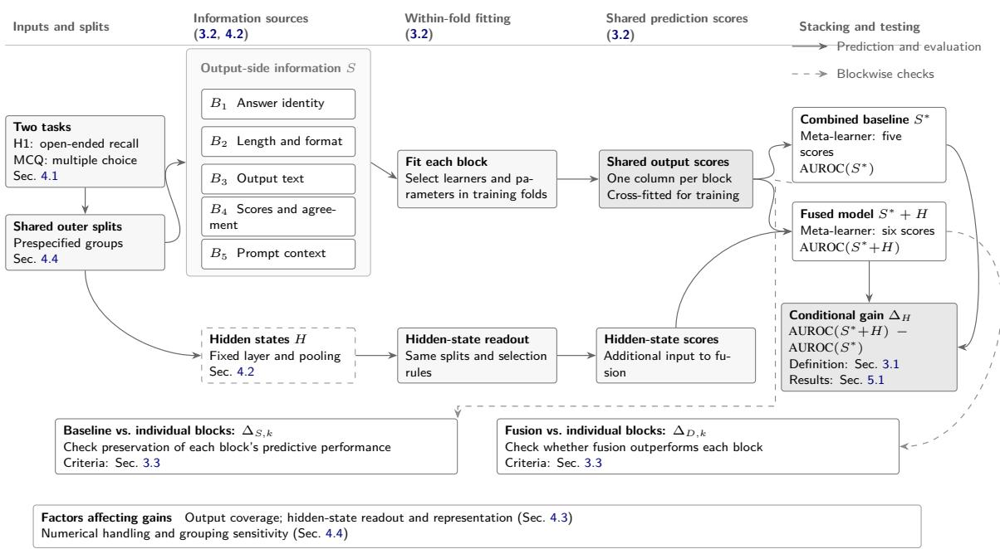
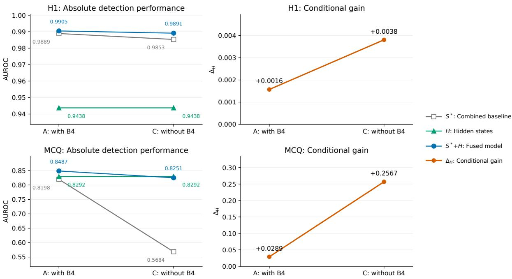
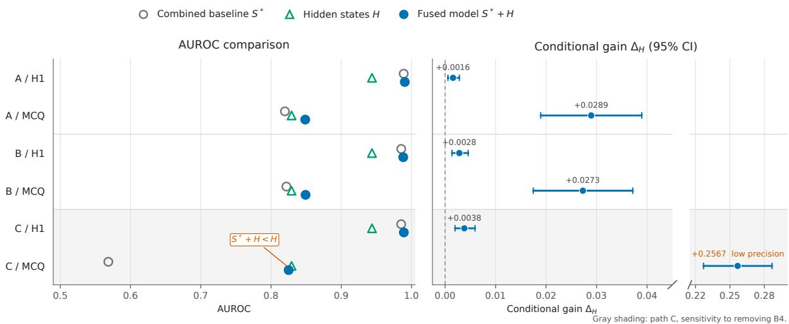
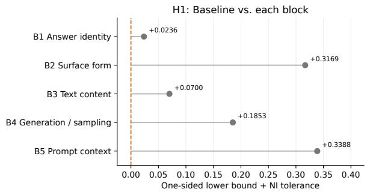
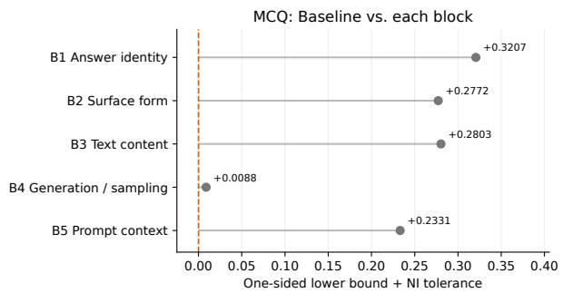
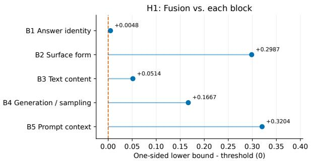
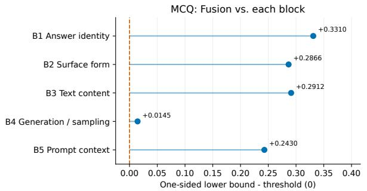

# Detecting Errors in Large Language Model Responses: The Incremental Predictive Value of Hidden States

Ningzhi Li Xiaojun Ma Xiaofei Wang

Beijing Institute of Computer Technology and Application

Beijing, China

inobrain0.0@gmail.com

## Abstract

Although large language models support a wide range of tasks, hallucinations remain a major obstacle to user trust. When a model generates an answer, both its internal processing and final output vary with the question. Internal states are often expected to offer richer signals for hallucination detection. However, studies using these states typically report their standalone discrimination performance, while output-side comparisons often use simple baselines with weaker modeling capacity. We integrate output-side information available at inference time into a combined baseline and compare detection performance before and after adding hidden states under identical data splits and evaluation rules. Experiments cover open-ended generation and constrained multiple-choice tasks across diferent models. Adding hidden states improves AUROC by approximately 0.004 and 0.039 on the two tasks, respectively. Hidden states thus provide additional predictive information, but strong standalone detection performance can still yield only limited additional gains.

## 1 Introduction

Large language models (LLMs) have become widely used as interactive assistants (Chatterji et al., 2025). Users obtain knowledge and information through natural-language questions, and retrieval-based systems generate answers supported by web sources (Nakano et al., 2021). A central requirement is that these models answer accurately and reliably without producing false information (Lin et al., 2022; Nakano et al., 2021). Yet fluent responses can depart from facts or contradict the given context. This phenomenon is commonly called hallucination. For example, a model may fabricate a reference or add unsupported information when summarizing a document. Fluency alone therefore provides an unreliable basis for assessing factuality, motivating hallucination detection.

Prior work detects hallucinations using information available at the model’s output and hidden states recorded during generation (Snyder et al., 2024; Azaria and Mitchell, 2023). When decoding scores are accessible, logits and token probabilities can be retained at each generation step; statistics derived from them have been used to estimate uncertainty (Snyder et al., 2024; Vashurin et al., 2025). Agreement among responses sampled for the same question also provides evidence of reliability (Manakul et al., 2023; Kadavath et al., 2022). Semantic entropy further accounts for diferences in meaning to estimate uncertainty and detect some factual hallucinations (Kuhn et al., 2023; Farquhar et al., 2024). These findings show that output-side information available at inference time can help predict hallucinations. Hidden states, in turn, encode internal representations during answer generation and have been used to distinguish true from false statements or detect factual errors in generated answers (Azaria and Mitchell, 2023; Snyder et al., 2024). However, probe performance de pends on classifier capacity and control settings, so high predictive performance alone does not establish the role of an internal representation (Hewitt and Liang, 2019; Belinkov, 2022). Richer hidden representations need not yield larger improvements once output-side information is used. Noise may impede access to useful signals, while overlap with output-side information means that some predictive capability is already available. Thus, even when hidden states distinguish correct from incorrect answers well, their standalone performance does not reveal which capabilities remain useful beyond existing output-side information. This motivates our question: after using the available output side information, can hidden states further improve error detection, and how large is the additional gain?

We jointly model several types of output-side information as a combined baseline, check whether it preserves the predictive performance of each component block, and compare detection performance before and after adding hidden states. The diference measures their incremental predictive value relative to this baseline. Experiments on open-ended generation and constrained multiplechoice tasks examine this value under diferent output conditions. On open-ended generation, Qwen’s standalone-statement adaptation yields a gain of 0.0043, while Llama gains 0.0040 over the combined baseline. On multiple-choice questions, Llama retains a gain of 0.0387 after jointly including the selected option text and the full response in the output baseline, with a 95% confidence interval of [0.0264, 0.0515]. Hidden states can therefore further improve error detection, but strong standalone performance does not necessarily yield a large additional gain. Standalone detection performance is consequently insuficient to establish their added value over output-side information.

Our contributions are:

1. We formulate the question of conditional gain from hidden states, shifting attention from their standalone detection performance to their added predictive value over available non-activation information.

2. We develop and apply an experimental and identification protocol fixed before analysis, using a combined baseline and blockwise comparisons to establish how incremental results should be interpreted.

3. Cross-model and readout comparisons show that hidden states provide gains beyond a combined output-side baseline, while strong standalone performance need not translate into large additional improvements.1

## 2 Related Work

Chakraborty et al. (2025) classify hallucination detectors as black-box, gray-box, or white-box according to their access to the generating model. Black-box methods use generated text; gray-box methods also use decoding signals such as token probabilities and sequence likelihoods; white-box methods access internal representations such as hidden states and attention. Within approaches that do not rely on external knowledge bases or auxiliary evaluation models, information used by the first two categories can be grouped as output-side information. We therefore compare output-side information with hidden states, focusing primarily on factual errors.

Output-side detection. Output-side detectors assess reliability through decoding confidence and generation behavior. Token probabilities, sequence likelihoods, and generation entropy capture uncertainty and have been used for confidence estimation and hallucination detection (Kadavath et al., 2022; Fadeeva et al., 2023; Vashurin et al., 2025). Signals from a single decoding pass provide limited evidence about stability across possible responses. SelfCheckGPT addresses this by checking factual consistency between a target response and repeatedly sampled responses (Manakul et al., 2023). Since diferent phrasings may express the same meaning, semantic entropy groups semantically equivalent responses before measuring dispersion across meanings (Farquhar et al., 2024). Beyond probabilities and consistency, Kadavath et al. (2022) study models’ direct assessments of answer correctness, and Pedapati et al. (2025) investigate confidence estimation under black-box access. These studies primarily compare output-side measures, including response consistency and semantic uncertainty, and their detection performance (Manakul et al., 2023; Farquhar et al., 2024; Vashurin et al., 2025). They do not directly estimate the conditional gain from hidden states over a baseline that jointly models multiple types of output information.

Hidden-state detection. SAPLMA trains a multilayer perceptron (MLP) on intermediate activations for true and false statements, demonstrating that hidden states can distinguish the two (Azaria and Mitchell, 2023). CH-Wang et al. (2024) further compare probe performance across layers and readout methods. Because supervised probes require labeled examples, later work explores unsupervised detection. MIND exploits statistical patterns in hidden states, while HaloScope learns useful internal representations from unlabeled model generations (Su et al., 2024; Du et al., 2024). Other work extends consistency analysis to internal representations. INSIDE measures reliability through diferences among hidden representations from repeated generations (Chen et al., 2024); DRIFT uses internal representational inconsistency to assess factuality (Bhatnagar et al., 2026); and semantic entropy probes predict semantic uncertainty directly from hidden states, reducing the computation required for repeated sampling (Kossen et al., 2024). Han et al. (2025) apply lightweight probes to long-form factuality detection and compare their performance and computational cost with methods requiring repeated sampling. Orgad et al. (2025) examine cross-dataset generalization and find limited additional generalization over an output-logit baseline. The former compares against repeatedsampling detectors, and the latter controls for a single output-side signal. Neither design establishes how much predictive information hidden states add after multiple output-side sources are jointly modeled.

Some studies evaluate several detection signals within a common framework. Snyder et al. (2024) use a unified classifier to compare output probabilities, input attributions, self-attention, and feed-forward activations for factual error detection. LLM-Check uses an auxiliary language model’s hidden states, attention, and output probabilities to detect hallucinations in a single response (Sriramanan et al., 2024). Probe performance nevertheless depends on classifier capacity, training, and controls (Hewitt and Liang, 2019; Voita and Titov, 2020; Pimentel et al., 2020; Belinkov, 2022), and non-target dataset cues can also produce high detection performance (Hussain and Kantarcioglu, 2026). Strong performance from hidden states, alone or combined with other signals, is therefore insuficient to establish their added value. We use a combined baseline of multiple output-side sources to assess whether hidden states provide additional predictive gains.

## 3 Method

## 3.1 Overall Design and Conditional Gain

We evaluate the predictive value that hidden states add to existing output-side information. To account for the predictive capabilities of multiple output-side sources, we construct a combined baseline and use blockwise comparisons to check whether it preserves each block’s performance. We then hold the data splits, learning procedure, and output-side prediction scores fixed, compare detection performance before and after adding hidden states, and check whether the fused model outperforms each block. Because additional gains also depend on output-side coverage and hidden-state readout, we vary these settings separately to exam-

ine both dependencies.

Standalone prediction from hidden states evaluates their detection capability; the performance diference between the combined baseline and the fused model evaluates their added value.

Let $Y \in \{ 0 , 1 \}$ denote the error label of a generated response, and let S denote the non-activation information allowed by the protocol, including prompts, generated outputs, repeated-generation statistics, and accessible decoding signals. We use output-side information as an umbrella term that also includes prompt-side controls. Let H denote hidden states extracted using a predetermined layer and pooling rule.

We measure error prediction performance by the area under the receiver operating characteristic curve (AUROC). The combined baseline $S ^ { * }$ is constructed from $S ,$ and adding the hidden-state readout yields the fused model $S ^ { * } + H$ . We define the conditional gain as

$$
\Delta _ { H } = \mathrm { \bf A U R O C } ( S ^ { * } + H ) - \mathrm { \bf A U R O C } ( S ^ { * } ) .\tag{1}
$$

Under the current experimental setting, $\Delta _ { H } > 0$ indicates that adding hidden states improves error detection over the combined output-side baseline.

Table 1 summarizes the notation.

Both models use this conditional comparison; Figure 1 illustrates the main procedure.

## 3.2 Combined Baseline and Hidden-State Fusion

Information blocks. Diferent output-side sources ofer diferent cues for error prediction. To evaluate hidden states after jointly using these cues, the baseline contains five predefined blocks covering the answer, generation behavior, and prompt context. Both tasks use the same information categories, with representations adapted to their output formats:

$$
\begin{array} { r } { S ^ { \ast } = g ( B _ { 1 } , B _ { 2 } , B _ { 3 } , B _ { 4 } , B _ { 5 } ) . } \end{array}\tag{2}
$$

Table 2 specifies the blocks for each task.

Two-level stacking. Because the blocks have different representations, we first fit a base learner to each block and then combine their prediction scores through two-level stacking (Wolpert, 1992). The baseline and fused model share the output-side scores; the fused model receives only one additional column of hidden-state scores. This evaluates improvement over the same output-side predictions.

Table 1: Main notation.
<table><tr><td>Symbol</td><td>Meaning</td></tr><tr><td> $Y$ </td><td>Error label: 1 for an erroneous response and 0 otherwise</td></tr><tr><td> $S$ </td><td>Output-side information included in this study, including prompt-side controls</td></tr><tr><td> $B _ { k }$ </td><td>Information block k  $( k = 1 , \ldots , 5 ) ;$  its predictor in performance comparisons</td></tr><tr><td> $H$ </td><td>Hidden representation from a prespecified layer and pooling rule; its predictor when standalone performance is reported</td></tr><tr><td> $S ^ { * }$ </td><td>Combined baseline constructed from the five information blocks</td></tr><tr><td> $S ^ { * } + H$ </td><td>Fused model adding the hidden-state readout to the combined baseline</td></tr><tr><td> $\Delta _ { H }$ </td><td>AUROC gain of the fused model over the combined baseline</td></tr><tr><td> $\Delta _ { S , k }$ </td><td>AUROC difference between the combined baseline and block-k predictor</td></tr><tr><td> $\Delta _ { D , k }$ </td><td>AUROC difference between the fused model and block-k predictor</td></tr><tr><td>ENI</td><td>Prespecified tolerance for baseline loss in the non-inferiority check</td></tr></table>

  
Figure 1: Framework for evaluating conditional gain.

Table 2: Five information blocks in the main-analysis baseline.
<table><tr><td>Block</td><td>Category</td><td>H1</td><td>MCQ</td></tr><tr><td> $B _ { 1 }$ </td><td>Answer identity</td><td>Eligible generated identifier strings</td><td>Selected answer letter</td></tr><tr><td> $B _ { 2 }$ </td><td>Surface form</td><td>Length, format, identifier count and positions</td><td>Option lengths and lexical overlap</td></tr><tr><td> $B _ { 3 }$ </td><td>Text content</td><td>Full generated text</td><td>Selected option text</td></tr><tr><td> $B _ { 4 }$ </td><td>Generation and sampling signals</td><td>Token scores, cross-sample consistency, and explicit confidence</td><td>Candidate-answer scores and cross-sample statistics</td></tr><tr><td> $B _ { 5 }$ </td><td>Prompt context</td><td>Prompt text, task family, and generation route</td><td>Question stem and all options</td></tr></table>

The meta-learner is trained on cross-fitted scores within each outer training fold, avoiding combinations learned from base learners’ insample fitted scores. At test time, the base learners score the shared outer test fold, and the metalearner produces the final predictions. All preprocessing and hyperparameter selection are confined to training folds (Varma and Simon, 2006). The

Within-fold fitting and Stacking and testing stages of Figure 1 illustrate training and prediction.

## 3.3 Blockwise Comparisons and Criteria

Joint modeling requires checking whether individual blocks’ predictive capabilities are preserved. If the combined baseline performs worse than a single block, an improvement from fusion may still leave the fused model below that block. We therefore assess baseline preservation and fused-model improvement relative to each block separately.

To check whether the baseline preserves each block’s performance, we first compute its diference from the single-block predictor $B _ { k }$ :

$$
\Delta _ { S , k } = \mathrm { A U R O C } ( S ^ { * } ) - \mathrm { A U R O C } ( B _ { k } ) .\tag{3}
$$

The non-inferiority check allows an AUROC decrease of ${ \varepsilon } _ { N I } = 0 . 0 2$ relative to each block and requires every one-sided lower confidence bound for $\Delta _ { S , k }$ to exceed $- \varepsilon N I$ . This tolerance was fixed before the formal analysis first accessed the true labels.

To determine whether adding hidden states yields performance above each block, we also compute

$$
\Delta _ { D , k } = \mathrm { \bf A U R O C } ( S ^ { * } + H ) - \mathrm { \bf A U R O C } ( B _ { k } ) .\tag{4}
$$

The direct blockwise comparison requires every one-sided lower bound for $\Delta _ { D , k }$ to exceed zero. Passing all comparisons establishes that the fused model outperforms every block included in the comparison.

Non-inferiority allows a small baseline loss relative to individual blocks. To assess whether the hidden-state gain exceeds this allowed loss, we add a more conservative consistency check: the baseline must pass non-inferiority, and the lower confidence bound for $\Delta _ { H }$ must exceed $\varepsilon _ { N I }$

## 4 Experimental Setup

## 4.1 Tasks and Data

We examine open-ended recall (H1) and constrained multiple-choice questions (MCQ) to assess the added value of hidden states under different task settings. H1 generates text containing identifiers; MCQ asks the model to select a given option and return its answer letter.

Both tasks require explicit correctness criteria. Cybersecurity provides standardized identifier systems and question-answering datasets with reference answers. We therefore construct H1 from MITRE ATT&CK and CWE entries (Strom et al., 2020; MITRE, 2026) and use CyberMetric for MCQ (Tihanyi et al., 2024).

Open-ended recall (H1). The model generates an identifier from the name and description of a technique or weakness. The task detects fabricated identifiers by checking their existence in a fixed knowledge base. After excluding identifiers copied verbatim from the prompt, a response is labeled erroneous if any remaining ATT&CK or CWE identifier is absent from the knowledge base. Each generation record is one analysis unit.

Constrained multiple choice (MCQ). The model selects an answer from the given options. A selection that difers from the reference answer is labeled erroneous. Each question is one analysis unit.

For both models, only samples with valid labels and hidden states are analyzed; the two analysis pipelines are called the H1 and MCQ arms. Qwen includes 8,664 H1 and 1,750 MCQ records; Llama includes 8,810 and 1,746, respectively\*. H1 generations from the same prompt remain in the same group, while each MCQ question forms its own group. Training and test sets are split by group, as shown in the Inputs and splits stage of Figure 1.

## 4.2 Models and Training

We use Qwen2.5-7B-Instruct (Qwen Team, 2024) and Llama-3.1-8B-Instruct, both with a local 8- bit quantized backend. Each model uses the same learning procedure and sampling parameters across tasks. To apply a common layer-selection rule across architectures, we select the hidden-state layer at a fixed fraction of total model depth, set in advance to 0.7. H1 averages hidden vectors over all eligible identifier tokens; MCQ uses the vector at the answer-letter position.

Text blocks use word- and character-level term frequency–inverse document frequency (TF-IDF) features; dense blocks and hidden states are standardized. Base learners and meta-learners use L2- regularized logistic regression. Base-learner regularization is selected by grouped cross-validation within each outer training fold. Feature extraction and predictor training correspond to Information sources and Within-fold fitting in Figure 1.

## 4.3 Output Coverage and Readout Comparisons

The output-coverage comparison tests whether hidden states remain useful when more response text is incorporated. Within each model, we hold the analyzable samples, splits, hidden states, and statistical protocol fixed and vary only the MCQ text block $B _ { 3 }$ . The three conditions use the selected option text, the full model response, and their concatenation. Text representations and predictors are refitted within training folds for each condition.

Readout comparisons test whether diferent learners can make fuller use of hidden-state signals. Using Qwen’s existing vectors and outputside scores, we compare L2 tuning ranges, MLPs, L1 logistic regression, and XGBoost. H1 representation adaptation converts each distinct identifier into a standalone statement about its existence in the catalog, extracts new statement representations, trains on statement labels, and aggregates predictions to generation records using a prespecified maximum score.

## 4.4 Evaluation and Sensitivity Comparisons

Primary evaluation. The combined baseline and fused model are evaluated on the same outer test folds to compare performance on identical samples. Both models use the grouping described above, with five outer folds, three inner folds, and three repetitions. We compute the out-of-fold AU-ROC diference within each repetition and then average the diferences.

We estimate 95% confidence intervals using a paired grouped bootstrap (Field and Welsh, 2007), comparing predictors on the same resampled records. Each MCQ question contributes one evaluated response, so sampling a question includes that response. Each H1 prompt has multiple responses; sampling a prompt group includes all its responses to preserve their within-group dependence. A question or prompt group may be sampled more than once.

Information and numerical controls. To examine dependence on generation and sampling signals, both models compare path A, which retains all five blocks, with path C, which removes $B _ { 4 }$ from both the baseline and fused model. Qwen’s H1 $B _ { 4 }$ has a non-finite-value handling issue. Path Btherefore reconstructs the afected features while holding hidden states fixed to examine the efect of numerical handling.

Grouping sensitivity. The main H1 split allows identifiers to be shared between training and test sets. To examine dependence on such sharing, Qwen is also evaluated using groups defined by identifiers, vocabulary blocks, and joint prompt–fabricated-identifier relationships. The vocabulary-block comparison redefines labels and hidden states by block; the other comparisons retain the original prediction task.

## 5 Results

## 5.1 Additional Predictive Gains from Hidden States

To assess whether hidden states improve error detection beyond output-side information, we compare the combined baseline, standalone hiddenstate predictor, and fused model for Qwen and Llama. Table 3 reports these results alongside readout and representation comparisons.

Both models improve on both tasks. On H1, AU-ROC increases by 0.0016 for Qwen and 0.0040 for Llama; on MCQ, the gains are 0.0289 and 0.0596, respectively\*. All four main-result confidence intervals lie above zero, showing that hidden states provide additional predictive information.

Both models exhibit the same pattern: standalone hidden-state detection is stronger on H1 than on MCQ, but its improvement over the output baseline is smaller. H1 labels depend on identifier existence in a fixed knowledge base. Using identifier identity alone, Qwen already achieves an AU-ROC of 0.9826\*, indicating strong predictive cues from identity. The combined baseline approaches the AUROC ceiling, leaving little room for absolute improvement. Strong standalone detection can therefore yield only limited additional gains.

Both models pass baseline non-inferiority on both tasks, and their fused models outperform every compared block. The more conservative consistency check passes only for Llama’s main MCQ result: its gain interval has a lower bound of 0.0447, above 0.02. The other three settings do not reach this threshold\*.

## 5.2 Efect of Output-Side Information

To explain how conditional gain changes with the output baseline, we first compare retaining and removing generation and sampling signals. For both models, removing these signals increases the conditional gain while lowering fused-model performance. Figure 2 shows the Qwen comparison: removing $B _ { 4 }$ reduces baseline performance more than fused-model performance on both tasks, widening their gap. The larger gain thus reflects a weaker output baseline, while final detection performance decreases.

In the numerical control, reconstructing the affected features yields Qwen gains of 0.0028 on H1 and 0.0273 on MCQ, preserving the positive direction and respective magnitudes.

We next jointly include the selected option text and the full response in the MCQ baseline (Table 4). Qwen typically returns an answer letter, whereas Llama produces explanatory text; joint encoding therefore adds more previously uncovered text for Llama. Its baseline AUROC rises from 0.7465 to 0.7689, while fused performance changes from 0.8061 to 0.8075. The larger baseline improvement reduces the hidden-state gain from 0.0596 to 0.0387. Qwen’s gain changes only slightly, from 0.0289 to 0.0277.

Table 3: Error detection for both models, with readout and representation comparisons.
<table><tr><td>Model</td><td>Task</td><td> $S ^ { * }$ </td><td>H</td><td> $S ^ { * } + H$ </td><td colspan="2"> $\Delta _ { H }$  (95% CI)</td></tr><tr><td rowspan="2">Qwen</td><td>H1</td><td>0.9889</td><td>0.9438</td><td>0.9905</td><td></td><td>+0.0016 [+0.0006, +0.0028]</td></tr><tr><td>MCQ</td><td>0.8198</td><td>0.8292</td><td>0.8487</td><td>+0.0289</td><td>[+0.0189, +0.0389]</td></tr><tr><td rowspan="2">Llama</td><td>H1</td><td>0.9712</td><td>0.9148</td><td>0.9752</td><td>+0.0040</td><td>[+0.0014, +0.0075]</td></tr><tr><td>MCQ</td><td>0.7465</td><td>0.7916</td><td>0.8061</td><td></td><td>+0.0596 [+0.0447, +0.0751]</td></tr><tr><td>Task</td><td>Readout or representation</td><td> $S ^ { * }$ </td><td>H</td><td> $S ^ { * } + H$ </td><td colspan="2"> $\Delta _ { H }$  (95% CI)</td></tr><tr><td rowspan="6">H1</td><td>L2, wide grid</td><td rowspan="6">0.9889</td><td>0.9482</td><td>0.9910</td><td>+0.0021</td><td>[+0.0008, +0.0037]</td></tr><tr><td>MLP adaptation</td><td>0.9330</td><td>0.9913</td><td>+0.0024</td><td>[+0.0009, +0.0043]</td></tr><tr><td>L1 adaptation</td><td>0.9328</td><td>0.9906</td><td>+0.0017</td><td>[+0.0006, +0.0029]</td></tr><tr><td>XGBoost adaptation</td><td>0.9586</td><td>0.9910</td><td>+0.0021</td><td>[+0.0009, +0.0035]</td></tr><tr><td>L1, wide grid</td><td>0.9193</td><td>0.9876</td><td>-0.0013</td><td>[-0.0039, +0.0011]</td></tr><tr><td>Standalone statements</td><td>0.9780</td><td>0.9931</td><td>+0.0043</td><td>[+0.0020, +0.0070]</td></tr><tr><td rowspan="5">MCQ</td><td>L2, wide grid</td><td rowspan="5">0.8198</td><td>0.8292</td><td>0.8487</td><td>+0.0289</td><td>[+0.0189, +0.0389]</td></tr><tr><td>MLP adaptation</td><td>0.7826</td><td>0.8242</td><td>+0.0045</td><td>[-0.0005, +0.0095]</td></tr><tr><td>L1 adaptation</td><td>0.8030</td><td>0.8445</td><td>+0.0247</td><td>+0.0151, +0.0345]</td></tr><tr><td>XGBoost adaptation</td><td>0.8085</td><td>0.8426</td><td>+0.0228</td><td>[+0.0134, +0.0326]</td></tr><tr><td>L1, wide grid</td><td>0.8030</td><td>0.8445</td><td></td><td>+0.0247 [+0.0151, +0.0345]</td></tr></table>

Model comparisons use the original L2 grid; readout and representation comparisons use Qwen. The baseline contains five output-side blocks. The first three numerical columns report AUROC averaged over three repetitions. Readout comparisons share output-side scores; statement adaptation aggregates statement predictions to generation records before evaluation.

  
Figure 2: Absolute performance and conditional gain with and without $B _ { 4 }$ . Each panel has its own vertical scale; points and connecting lines show point estimates only.

Both models retain positive gains after the full response is added, while improvements to the output baseline reduce the additional benefit from hidden states. The gain thus depends both on the improvement contributed by hidden states and on how fully existing output-side cues are used.

## 5.3 Efect of Readout and Representation

We examine the readout and representation comparisons in Table 3 to assess whether better access to hidden-state signals increases their added value.

Table 4: Output coverage of the MCQ text block.
<table><tr><td>Model</td><td> $B _ { 3 }$  source</td><td> $S ^ { * }$ </td><td> $H$ </td><td> $S ^ { * } + H$ </td><td> $\Delta _ { H } ~ ( 9 5 \% \mathrm { C I } )$ </td></tr><tr><td>Qwen</td><td>Option text</td><td>0.8198</td><td>0.8292</td><td>0.8487</td><td>+0.0289 [  $+ 0 . 0 1 8 9 , + 0 . 0 3 8 9 ]$ </td></tr><tr><td>Qwen</td><td>Full response</td><td>0.8221</td><td>0.8292</td><td>0.8495</td><td>+0.0274  $+ 0 . 0 1 7 2 , + 0 . 0 3 7 8 ]$ </td></tr><tr><td>Qwen</td><td>Option + response</td><td>0.8221</td><td>0.8292</td><td>0.8498</td><td>+0.0277 [  $+ 0 . 0 1 7 6 , + 0 . 0 3 7 9 ]$ </td></tr><tr><td>Llama</td><td>Option text</td><td>0.7465</td><td>0.7916</td><td>0.8061</td><td>+0.0596  $[ + 0 . 0 4 4 7 , + 0 . 0 7 5 1 ]$ </td></tr><tr><td>Llama</td><td>Full response</td><td>0.7699</td><td>0.7916</td><td>0.8076</td><td>+0.0377  $\left[ + 0 . 0 2 5 5 , + 0 . 0 5 0 2 \right]$ </td></tr><tr><td>Llama</td><td>Option + response</td><td>0.7689</td><td>0.7916</td><td>0.8075</td><td>+0.0387  $[ + 0 . 0 2 6 4 , + 0 . 0 5 1 5 ]$ </td></tr></table>

Samples, splits, and H are fixed within each model. The first three numerical columns report AUROC; intervals are 95% confidence intervals.

With alternative readouts and wider regularization searches, H1 gain estimates range from −0.0013 to 0.0024. Standalone-statement adaptation raises hidden-state AUROC from 0.9438 to 0.9780, but increases the gain over the output baseline only from 0.0016 to 0.0043. The improvement in standalone detection does not translate into an equally large additional gain, as the strong output baseline continues to limit absolute headroom.

MCQ gains are more sensitive to readout choice. L2, L1, and XGBoost yield positive improvements, whereas the MLP gain is 0.0045 with a confidence interval containing zero. These diferences occur under the same output baseline, indicating that the readout afects how efectively the additional predictive capability of hidden states is used.

## 6 Conclusion and Discussion

We evaluate the added predictive value of hidden states using a combined baseline of multiple output-side sources and blockwise comparisons. Hidden states provide predictive information beyond the available output-side information, but strong standalone detection does not necessarily yield large additional gains. On H1, the combined baseline already performs well, improvements from hidden states are small, and the tested readout and representation adaptations preserve this pattern. On MCQ, hidden states continue to add predictive value over the combined outputside baseline. Standalone detection performance is therefore insuficient to establish their added value over existing output-side information.

Baseline construction and information coverage afect gain estimates. Removing generation and sampling signals can increase the gain while reducing fused-model performance. Evaluations should report baseline performance, standalone hiddenstate performance, fused performance, and conditional gain together, and specify the output information being compared. These conclusions concern predictive gains under this study’s tasks, models, backends, and learning procedures.

## Limitations

This study has limitations in numerical integrity, parsing conventions, and probe training coverage. The current data do not support an estimate of generalization to unseen identifiers, and the fused model’s advantage over individual blocks varies formance for error prediction; practical utility also depends on detection thresholds, probability calibration, and readout cost. Future work can assess whether predictive gains translate into practical benefits under explicitly specified conditions.

## References

Amos Azaria and Tom Mitchell. 2023. The internal state of an LLM knows when it is lying. In Findings of the Association for Computational Linguistics: EMNLP 2023, pages 967–976.

Yonatan Belinkov. 2022. Probing classifiers: Promises, shortcomings, and advances. Computational Linguistics, 48(1):207–219.

Roger L. Berger and Jason C. Hsu. 1996. Bioequivalence trials, intersection–union tests and equivalence confidence sets. Statistical Science, 11(4):283–319.

Rohan Bhatnagar, Youran Sun, Chi Andrew Zhang, Yixin Wen, and Haizhao Yang. 2026. DRIFT: Detecting representational inconsistencies for factual truthfulness. arXiv preprint arXiv:2601.14210. Preprint.

Sky CH-Wang, Benjamin Van Durme, Jason Eisner, and Chris Kedzie. 2024. Do androids know they’re only dreaming of electric sheep? In Findings of the Associationfor Computational Linguistics: ACL 2024, pages 4401–4420.

Neeloy Chakraborty, Melkior Ornik, and Katherine Driggs-Campbell. 2025. Hallucination detection in

foundation models for decision-making: A flexible definition and review of the state of the art. ACM Computing Surveys, 57(7):1–35.

Aaron Chatterji, Thomas Cunningham, David J. Deming, Zoe Hitzig, Christopher Ong, Carl Yan Shan, and Kevin Wadman. 2025. How people use Chat-GPT. Working Paper 34255, National Bureau of Economic Research.

Chao Chen, Kai Liu, Ze Chen, Yi Gu, Yue Wu, Mingyuan Tao, Zhihang Fu, and Jieping Ye. 2024. INSIDE: LLMs’ internal states retain the power of hallucination detection. In International Conference on Learning Representations.

Xuefeng Du, Chaowei Xiao, and Yixuan Li. 2024. HaloScope: Harnessing unlabeled LLM generations for hallucination detection. In Advances in Neural Information Processing Systems 37 (NeurIPS 2024).

Aparna Elangovan, Jiayuan He, and Karin Verspoor. 2021. Memorization vs. generalization: Quantifying data leakage in NLP performance evaluation. In Proceedings of EACL, pages 1325–1335.

Ekaterina Fadeeva, Roman Vashurin, Akim Tsvigun, Artem Vazhentsev, Sergey Petrakov, Kirill Fedyanin, Daniil Vasilev, Elizaveta Goncharova, Alexander Panchenko, Maxim Panov, Timothy Baldwin, and Artem Shelmanov. 2023. LM-Polygraph: Uncertainty estimation for language models. In Proceedings of EMNLP 2023: System Demonstrations, pages 446–461.

Sebastian Farquhar, Jannik Kossen, Lorenz Kuhn, and Yarin Gal. 2024. Detecting hallucinations in large language models using semantic entropy. Nature, 630:625–630.

C. A. Field and A. H. Welsh. 2007. Bootstrapping clustered data. Journal of the Royal Statistical Society: Series B (Statistical Methodology), 69(3):369–390.

Suchin Gururangan, Swabha Swayamdipta, Omer Levy, Roy Schwartz, Samuel R. Bowman, and Noah A. Smith. 2018. Annotation artifacts in natural language inference data. In Proceedings of NAACL-HLT, pages 107–112.

Jiatong Han, Neil Band, Muhammed Razzak, Jannik Kossen, Tim G. J. Rudner, and Yarin Gal. 2025. Simple factuality probes detect hallucinations in longform natural language generation. In Findings of the Association for Computational Linguistics: EMNLP 2025, pages 16209–16226.

John Hewitt and Percy Liang. 2019. Designing and interpreting probes with control tasks. In Proceedings of EMNLP-IJCNLP, pages 2733–2743.

Khizar Hussain and Murat Kantarcioglu. 2026. PAR-ALLAX: Separating genuine hallucination detection from benchmark construction artifacts. arXiv preprint arXiv:2605.17028. Preprint.

Saurav Kadavath, Tom Conerly, Amanda Askell, et al. 2022. Language models (mostly) know what they know. arXiv preprint arXiv:2207.05221.

Jannik Kossen, Jiatong Han, Muhammed Razzak, Lisa Schut, Shreshth Malik, and Yarin Gal. 2024. Semantic entropy probes: Robust and cheap hallucination detection in LLMs. arXiv preprint arXiv:2406.15927.

Lorenz Kuhn, Yarin Gal, and Sebastian Farquhar. 2023. Semantic uncertainty: Linguistic invariances for uncertainty estimation in natural language generation. In International Conference on Learning Representations.

Stephanie Lin, Jacob Hilton, and Owain Evans. 2022. TruthfulQA: Measuring how models mimic human falsehoods. In Proceedings ofthe 60th Annual Meeting ofthe Associationfor Computational Linguistics (Volume 1: Long Papers), pages 3214–3252.

Potsawee Manakul, Adian Liusie, and Mark J. F. Gales. 2023. SelfCheckGPT: Zero-resource black-box hallucination detection for generative large language models. In Proceedings of EMNLP, pages 9004– 9017.

MITRE. 2026. Common weakness enumeration. Accessed 2026-07-30.

Reiichiro Nakano, Jacob Hilton, Suchir Balaji, Jef Wu, Long Ouyang, Christina Kim, Christopher Hesse, Shantanu Jain, Vineet Kosaraju, William Saunders, Xu Jiang, Karl Cobbe, Tyna Eloundou, Gretchen Krueger, Kevin Button, Matthew Knight, Benjamin Chess, and John Schulman. 2021. WebGPT: Browser-assisted question-answering with human feedback. arXiv preprint arXiv:2112.09332.

Brian A. Nosek, Charles R. Ebersole, Alexander C. De-Haven, and David T. Mellor. 2018. The preregistration revolution. Proceedings of the National Academy ofSciences, 115(11):2600–2606.

Hadas Orgad, Michael Toker, Zorik Gekhman, Roi Reichart, Idan Szpektor, Hadas Kotek, and Yonatan Belinkov. 2025. LLMs know more than they show: On the intrinsic representation of LLM hallucinations. In International Conference on Learning Representations.

Tejaswini Pedapati, Amit Dhurandhar, Soumya Ghosh, Soham Dan, and Prasanna Sattigeri. 2025. Large language model confidence estimation via black-box access. Transactions on Machine Learning Research.

Tiago Pimentel, Josef Valvoda, Rowan Hall Maudslay, Ran Zmigrod, Adina Williams, and Ryan Cotterell. 2020. Information-theoretic probing for linguistic structure. In Proceedings ofACL, pages 4609–4622.

Adam Poliak, Jason Naradowsky, Aparajita Haldar, Rachel Rudinger, and Benjamin Van Durme. 2018. Hypothesis only baselines in natural language inference. In Proceedings of\*SEM, pages 180–191.

Qwen Team. 2024. Qwen2.5 technical report. Technical Report arXiv:2412.15115, Alibaba Cloud.

David R. Roberts, Volker Bahn, Simone Ciuti, Mark S. Boyce, Jane Elith, Gurutzeta Guillera-Arroita, Severin Hauenstein, José J. Lahoz-Monfort, Boris Schröder, Wilfried Thuiller, David I. Warton, Brendan A. Wintle, Florian Hartig, and Carsten F. Dormann. 2017. Cross-validation strategies for data with temporal, spatial, hierarchical, or phylogenetic structure. Ecography, 40(8):913–929.

Ben Snyder, Marius Moisescu, and Muhammad Bilal Zafar. 2024. On early detection of hallucinations in factual question answering. In Proceedings of the 30th ACM SIGKDD Conference on Knowledge Discovery and Data Mining (KDD ’24), pages 2721– 2732.

Gaurang Sriramanan, Siddhant Bharti, Vinu Sankar Sadasivan, Shoumik Saha, Priyatham Kattakinda, and Soheil Feizi. 2024. LLM-Check: Investigating detection of hallucinations in large language models. In Advances in Neural Information Processing Systems 37 (NeurIPS 2024).

Blake Strom, Andy Applebaum, Douglas P. Miller, Kathryn Nickels, Adam Pennington, and Cody Thomas. 2020. MITRE ATT&CK: Design and philosophy. Technical report, MITRE.

Weihang Su, Changyue Wang, Qingyao Ai, Yiran Hu, Zhijing Wu, Yujia Zhou, and Yiqun Liu. 2024. Unsupervised real-time hallucination detection based on the internal states of large language models. In Findings of the Association for Computational Linguistics: ACL 2024, pages 14379–14391.

Norbert Tihanyi, Mohamed Amine Ferrag, Ridhi Jain, Tamas Bisztray, and Merouane Debbah. 2024. CyberMetric: A benchmark dataset based on retrieval-augmented generation for evaluating LLMs in cybersecurity knowledge. arXiv preprint arXiv:2402.07688.

Sudhir Varma and Richard Simon. 2006. Bias in error estimation when using cross-validation for model selection. BMC Bioinformatics, 7:91.

Roman Vashurin, Ekaterina Fadeeva, Artem Vazhentsev, Lyudmila Rvanova, Daniil Vasilev, Akim Tsvigun, Sergey Petrakov, Rui Xing, Abdelrahman Sadallah, Kirill Grishchenkov, Alexander Panchenko, Timothy Baldwin, Preslav Nakov, Maxim Panov, and Artem Shelmanov. 2025. Benchmarking uncertainty quantification methods for large language models with LM-Polygraph. Transactions ofthe Association for Computational Linguistics, 13:220–248.

Elena Voita and Ivan Titov. 2020. Informationtheoretic probing with minimum description length. In Proceedings of EMNLP, pages 183–196.

David H. Wolpert. 1992. Stacked generalization. Neural Networks, 5(2):241–259.

## A Methodological Details

## A.1 Five Non-Activation Blocks in Each Arm

The table below specifies the fields and dimensions of the five output-side blocks for H1 and MCQ.

$B _ { 1 } { - } B _ { 5 }$ form the combined baseline $S ^ { * } ;$ adding the hidden-state block yields $S ^ { * } + H$ Path Cremoves $B _ { 4 }$ from both arms, so its baseline uses the remaining four blocks and its fused model adds H to those blocks.

## A.2 Within-Fold Preprocessing and Nested Stacking

The baseline and fused model share within-fold preprocessing and base-learner scores. We detail the feature transformations, cross-fitting procedure, and learner settings below.

Text blocks use word 1–2-gram and wordboundary character 3–5-gram TF-IDF features. Both vocabularies use min\_df=2, at most 50,000 features each, and sublinear term frequency. The two representations are concatenated and each row is L2-normalized. Vocabularies, inverse document frequencies, and all transformations are fitted only on the current training fold and then applied to the corresponding outer test fold.

Dense blocks are standardized using dimensionwise means and standard deviations from the training fold, replacing zero standard deviations with 1. The standardized matrix is divided by ${ \sqrt { d } } ,$ where d is the block dimension, to give dense blocks a scale comparable to row-normalized text features. Test folds do not contribute to means, standard deviations, vocabularies, or hyperparameter estimates. Hidden states use the same dense preprocessing.

S∗ stacks five blocks, and $S ^ { * } + H$ stacks six. Within each outer training fold, a base learner is fitted independently to each block. Cross-fitted training scores are used to train the meta-learner. The base learners are then refitted on the complete outer training fold and score the outer test fold; the meta-learner produces final predictions from these scores. Both models share the same baselearner cache. Within a repetition, they difer only in whether the meta-learner receives the column of H scores. Table 6 lists fixed learning and resampling settings.

## A.3 M1b, iv-a, iv-b, and Task-Construct Checks

The protocol denotes baseline non-inferiority, direct blockwise comparison, and the consistency

check as M1b, iv-a, and iv-b, respectively. It also includes a task-construct check for identity and format cues.

For each block $B _ { k }$ , define

$$
\begin{array} { r l } & { \Delta _ { S , k } = \mathrm { A U R O C } ( S ^ { * } ) - \mathrm { A U R O C } ( B _ { k } ) , } \\ & { \Delta _ { D , k } = \mathrm { A U R O C } ( S ^ { * } + H ) - \mathrm { A U R O C } ( B _ { k } ) . } \end{array}\tag{5}
$$

(6)

The non-inferiority tolerance is fixed at $\varepsilon _ { N I } ~ =$ 0.02. This operational threshold specifies the allowed baseline loss and has not been externally validated. M1b checks whether each marginal onesided 95% lower bound for $\Delta _ { S , k }$ exceeds −εNI and combines the checks through an intersection– union test (Berger and Hsu, 1996). The primary procedure uses no multiplicity correction. Simultaneous lower bounds based on the maximum statistic are reported descriptively as secondary results; their nominal coverage relies on asymptotic approximation. M1b is determined by the intersection–union rule applied to the marginal checks.

iv-a checks whether every marginal one-sided lower bound for $\Delta _ { D , k }$ exceeds zero, assessing whether the fused model outperforms every compared block. The more conservative iv-b check requires M1b to pass and the lower confidence bound for $\Delta _ { H }$ to exceed $\varepsilon N I$ . The two checks are reported separately under their respective conditions.

Within a prespecified branch, the fused model is judged superior to all compared blocks only if every direct blockwise comparison passes. This is an intersection–union test (Berger and Hsu, 1996): if any component null hypothesis holds, the probability of incorrectly passing all comparisons is no greater than that component test’s significance level. Thus, valid component tests require no further adjustment for the joint decision within a branch. Reported bounds are marginal bounds for individual blockwise comparisons. The six branches are reported separately without crossbranch multiplicity correction, retaining the prespecified primary path.

The task-construct check compares the full output-text block $B _ { 3 }$ with identity and format blocks $B _ { 1 }$ and $B _ { 2 } { \mathrm { : } }$ :

$$
\begin{array} { c } { \Delta _ { \mathrm { t a s k } , k } = \mathrm { A U R O C } ( B _ { 3 } ) - \mathrm { A U R O C } ( B _ { k } ) , } \\ { k \in \{ 1 , 2 \} . } \end{array}\tag{7}
$$

The primary analysis uses marginal one-sided upper bounds for conservative screening. An upper bound below 0.02 indicates that the full-text improvement over identity or format cues does not reach the prespecified threshold. Results from triggered branches describe predictive performance under the current label definition.

Table 5: Implementation of $B _ { 1 } { - } B _ { 5 }$ in H1 and MCQ.
<table><tr><td>Block</td><td>H1</td><td>MCQ</td></tr><tr><td> $B _ { 1 }$ </td><td>Text representation of eligible identifier strings in the response</td><td>Four-dimensional one-hot encoding of the selected answer letter A-D</td></tr><tr><td> $B _ { 2 }$ </td><td>9 surface and format features: length, line count, list structure, identifier count and positions</td><td>6 surface features: selected-option length, relative option lengths, and lexical overlap</td></tr><tr><td> $B _ { 3 }$   $B _ { 4 }$ </td><td>Full generated text 14 features: identifier-token and response</td><td>Text of the selected option 6 features: margins and entropy over four candidate</td></tr><tr><td></td><td>log-probabilities, entropy, ranks, length-normalized scores, cross-sample consistency, and explicit</td><td>letters, full-vocabulary entropy, answer-token log-probability, and cross-sample consistency</td></tr><tr><td> $B _ { 5 }$ </td><td>confidence Prompt text with prespecified task-family and generation-route indicators</td><td>Question stem and all options, excluding the model&#x27;s selection</td></tr></table>

Table 6: Prespecified learning and resampling parameters.
<table><tr><td>Item</td><td>Prespecified setting</td></tr><tr><td>Outer and inner splits</td><td>5 outer folds and 3 inner folds; grouping depends on E1, E2, E3, or M2c</td></tr><tr><td>Base learner</td><td>L2 logistic regression, liblinear, maximum 2,000 iterations</td></tr><tr><td>Base-learner tuning</td><td> $C \in \{ 0 . 0 1 , 0 . 1 , 1 , 1 0 \}$  , selected by grouped inner cross-validation within outer training folds L2 logistic regression,  $1 0 ^ { - 6 }$ </td></tr><tr><td>Meta-learner</td><td> $C = 1$  , 1bfgs, maximum 5,000 iterations, tolerance , intercept, no class weights</td></tr><tr><td>Meta-learner inputs</td><td>Base learners&#x27;decision_function scores, without further standardization</td></tr><tr><td>Repetitions and seeds</td><td>3 repetitions; outer-fold seed 20260804 + 100r</td></tr><tr><td>Bootstrap</td><td>20 batches of 1,000 samples (20,000 total); batch seed 20260804 + 7j</td></tr></table>

## B Data and Experimental Details

## B.1 Model, Hidden States, and Eligibility

We specify Qwen’s model, hidden-state extraction, sample eligibility, and final analysis populations below.

Both arms of the Qwen confirmatory analysis use Qwen2.5-7B-Instruct with a local 8-bit quantized backend. The model has 28 decoder blocks and a hidden dimension of 3,584. Relative depth 0.7 selects the output of block 19 (zeroindexed), corresponding to hidden\_states[20] in the model interface. Model, tokenizer, extraction layer, temperature, nucleus-sampling settings, and random seeds are identical across arms. Maximum generation lengths were set by task to 384 tokens for H1 and 16 for MCQ.

H1 enters hidden-state analysis only when a response contains at least one ATT&CK or CWE identifier not copied from the prompt. The vector H averages target-layer states over all eligible identifier tokens, counting each token position once. MCQ is eligible only when the answer can be normalized to an option in A–D; H is the state of the single answer-letter token. Both arms store float32 vectors of shape (3584, ). H1 has 9,264 final records, of which 8,664 are eligible; MCQ has 1,751 final records, of which 1,750 are eligible. Table 7 provides the full accounting.

The 8,664 analyzable H1 records come from 1,508 prompt groups, 345 of which contain at least one error. Another 600 records remain in the final population but are ineligible: 477 only copy prompt identifiers, 122 contain no identifier, and 1 contains only a CVE identifier. These lack the primary identifier label and corresponding hidden states. The nominal MCQ population contains 1,760 questions: 9 are excluded as whole groups after runtime technical failures and 1 is lost during normalization or parsing, leaving 1,750 for analysis. This arm generated 10,520 raw units, 10,506 belonging to retained questions and 14 failed attempts kept only for auditing. Excluded questions are not replaced, and missing hidden states are not imputed. The analyzable populations contain 8,664 and 1,750 hidden-state vectors, respectively.

## B.2 Llama Comparability and Sample Accounting

The cross-model Llama comparison is nonconfirmatory and uses the same type of local 8-bit backend to estimate paths A and C on both tasks. Its MCQ generation budget is 512 tokens, compared with 16 for Qwen. Llama uses a corrected parser that remained unchanged during formal production. Gains are estimated separately under each model’s generation budget, parser version, and analyzable population.

Table 7: Sample accounting for Qwen.
<table><tr><td>Arm</td><td>Unit</td><td>Final</td><td>Analyzable</td><td>Ineligible</td><td>Groups G</td><td>Errors (rate)</td></tr><tr><td>H1</td><td>Generation</td><td>9,264</td><td>8,664</td><td>600</td><td>1,508</td><td>693 (0.0800)</td></tr><tr><td>MCQ</td><td>Question</td><td>1,751</td><td>1,750</td><td>1</td><td>1,750</td><td>318 (0.1817)</td></tr></table>

G is the number of resampling groups: prompts for H1 and questions for MCQ. In H1, 345 prompt groups contain at least one error.

Both models share the same finalized H1 list of 9,264 generation records. Qwen’s analyzable population has 8,664 records, 693 positives, and 1,508 groups; Llama’s has 8,810 records, 339 positives, and 1,516 groups. The intersection contains 8,450 records. Qwen excludes 477 prompt-copying responses, 122 with no identifier, and 1 containing only CVE; Llama excludes 376 prompt-copying responses and 78 with no identifier.

Qwen’s finalized MCQ list contains 1,751 questions after 9 runtime technical exclusions. Excluding 1 failed greedy-response parse leaves 1,750 analyzable questions and 318 positives. Llama finalizes all 1,760 questions without these technical exclusions; removing 14 failed greedy-response parses leaves 1,746 questions and 328 positives. The analyzable intersection contains 1,737 questions. These intersections are used only to audit comparability; no models were retrained on common-sample subsets.

Llama did not run tail-reconstruction path B or vocabulary-block analysis E3, and its $B _ { 4 }$ numerical integrity remains unaudited. The initial A/C run retained summaries without complete persample predictions. The joint full-response MCQ condition was later rerun in a separate directory, retaining eight columns of out-of-fold predictions for three repetitions, fold mappings, and per-fold audits. Its summary matched the initial run.

## B.3 MCQ Output Coverage and Parsing Denominators

The MCQ output-coverage comparison is nonconfirmatory. The original $B _ { 3 }$ uses selected option text and does not directly include the full model response. Median analyzable response length is 1 character for Qwen and 886 for Llama, while the original $B _ { 3 }$ has a median length of approximately 32 characters for both. The comparison holds samples and splits fixed within each model, changes only the text source, and refits the text block and fused model. Llama’s joint-condition interval was reproduced from saved predictions under the original resampling plan. This check uses the same statistical library and verifies the computation from saved predictions to metrics and intervals. Intervals for diferences between conditions were not computed.

Sampling-consistency features retain successfully parsed labels from the six responses per question and use the number of successful parses as the denominator. Among Llama’s 10,560 raw responses, 168 fail parsing: 14 greedy responses and 154 sampled responses. The numbers of questions with 6, 5, 4, and 3 successful parses are 1,618, 120, 18, and 4, respectively. After excluding greedy failures, 128 of the 1,746 analysis records use a denominator below 6. None of Qwen’s 1,750 analysis records has this issue.

Both consistency features can be recomputed record by record from the raw data under the current rules and match their stored values. However, the original protocol fixed six responses per question without specifying how parsing failures afect the denominator. Using successful parses is a deterministic implementation choice. The effect of alternative denominators on predictive performance and hidden-state gain has not been measured.

## B.4 Readouts, Training Budgets, and Scoring

The readout comparisons and standalonestatement adaptation are non-confirmatory. The first five readout conditions were fixed before that run; the wide-grid L1 condition was added after the first run, and statement adaptation was conducted separately.

To examine dependence on hidden-state readout, these analyses reuse Qwen’s existing vectors, samples, and outer splits. The original L2 grid is $C \in$ {0.01, 0.1, 1, 10}; the wide grid has eight logarithmically spaced values from $1 0 ^ { - 3 } \mathrm { t o } 1 0 ^ { 4 }$ . The original L1 candidates are {0.01, 0.1, 0.5, 1, 10}, with 100, 1000, 10000 added after the initial run. XG-Boost combines depths {3, 6} with {200, 1000} trees at learning rate 0.1. All candidate selection is confined to training folds.

Following the SAPLMA architecture, the MLP has three hidden layers of widths 256, 128, 64, with ReLU and Adam (Azaria and Mitchell, 2023). Candidate epoch limits are {5, 50} and regularization coeficients are $\{ 1 0 ^ { - 5 } , 1 0 ^ { - 3 } , 1 0 ^ { - 1 } \}$ L1 and XGBoost reuse classifier construction from the authors’ implementation of Han et al. (2025), adapted to this study’s single-layer input, standardization, and grouped evaluation.

Across the six readout conditions, logistic regression outputs decision scores directly. MLP and XGBoost probabilities for the positive class are clipped to $[ 1 0 ^ { - 6 } , 1 ~ - ~ 1 0 ^ { - 6 } ]$ and converted to log-odds before fusion. This may create ties among extreme scores; the fusion layer receives the clipped and transformed scores. The full combination of raw activations, complete author-specified settings, and native scoring was not evaluated.

For H1, the original L2 grid selects its upper bound in all 60 selections; the wider grid selects $C ~ = ~ 1 0 0$ in 54. Widening L2 changes neither the selected parameters nor predictions on MCQ. Wide-grid L1 selects larger C values at a few H1 stages but reduces the overall gain estimate.

For final outer-fold MLP fits, H1 selects the 50- epoch limit in 15/15 cases; MCQ selects 5 epochs in 12/15 and 50 in 3/15. These are selected iteration limits; complete final-fit iteration logs were not retained. Among 180 validation records for 50- epoch candidates, 165 on H1 and 67 on MCQ contain at least one inner fit that does not satisfy the convergence criterion. Counts are at the candidatevalidation-record level. MLP conclusions apply to this training budget and scoring convention.

## B.5 Standalone-Statement Adaptation for H1

This adaptation follows the use of final-token representations of standalone statements. Each distinct primary identifier is converted into a fixedtemplate statement about its existence in the catalog, with an existence label from the fixed catalog. There are 10,168 statement records, 870 distinct texts, and 8,664 original H1 evaluation records. Encoding deduplicates identical texts, but training keeps each statement record as a separate row without combining weights.

Outer splits are first materialized on the original generation records; statements inherit their parent record’s fold and prompt group. On the training side, statements are cross-fitted within inner folds, and the prespecified maximum raw score aggregates them back to generation records for fusion training. Test predictions use the same aggregation. The maximum raw score serves as a record-level feature for the fusion layer. Hyperparameters are selected using AUROC after record-level aggregation. This condition changes representation, training unit, and aggregation together.

Across the three repetitions, approximately 93.4%–93.8% of test statement records have identical text in the corresponding training fold. Results therefore describe the current prompt-grouped population, which allows repeated identifiers. All 60/60 selections reach the original grid’s upper bound; other tuning ranges were not evaluated. Statement-level raw scores, fusion-training columns, and some final-fit logs were not retained.

All saved target-layer vectors and upstream checks are finite, but all 870/870 distinct texts produce non-finite values in the returned final-layer states and output scores. Hooks directly locate the anomaly within the final decoder block for two inputs; equivalent internal localization was not completed for the remaining texts.

## B.6 Repetition-Averaged Estimand and Uncertainty

Performance diferences are averaged over three repetitions, with intervals estimated by paired grouped bootstrap. Numerical error due to finite resampling is estimated separately.

Each repetition produces out-of-fold scores for $S ^ { * } , H ,$ , and $S ^ { * } + H ,$ , with AUROC first calculated within that repetition. The primary estimand is the mean AUROC diference across three repetitions:

$$
\begin{array} { l } { \displaystyle \Delta _ { H } = \frac { 1 } { 3 } \sum _ { r = 1 } ^ { 3 } \Delta _ { H , r } , } \\ { \displaystyle \Delta _ { H , r } = \mathrm { A U R O C } _ { r } ( S ^ { * } + H ) - \mathrm { A U R O C } _ { r } ( S ^ { * } ) . } \end{array}\tag{8}
$$

Intervals use a grouped bootstrap. The same group sample is shared across all three repetitions to preserve pairing. H1 resamples 1,508 prompt groups; MCQ resamples 1,750 questions. Every E1 branch has 20,000 valid bootstrap samples, with none discarded for containing only one class. Two-sided 95% intervals use the 2.5th and

97.5th percentiles of the pooled bootstrap distribution. Marginal one-sided lower and upper bounds use the 5th and 95th percentiles.

Each bootstrap sample draws the original number of groups with replacement and concatenates all records in the selected groups, retaining repetitions of groups. H1’s 693 error records are sampled with their groups, preserving within-group label composition. The same resampled records are used for all predictors and repetitions to estimate paired AUROC diferences. Based on fixed outof-fold predictions, the intervals quantify variation induced by group resampling. Their endpoints are the corresponding distribution percentiles, and the group count denotes the number of sampling units. Interpretation assumes independence between groups.

The 20,000 samples are split into 20 batches. Monte Carlo error in interval endpoints and widths is estimated primarily by a delete-one-batch jackknife and checked secondarily by the batch-means method. Width error bands are centered on the interval width from the pooled distribution and use $t _ { 0 . 9 7 5 , 1 9 } = 2 . 0 9 3$ . These bands quantify numerical error from finite resampling. A 95% interval width above 0.04 for $\Delta _ { H }$ is classified as insuficient precision.

## B.7 Numerical Paths, Analysis Freeze, and Unblinding

The numerical control holds hidden states fixed and reconstructs afected generation features. We document the checks, path settings, and data and rules fixed before formal analysis below.

Path Byields an MCQ gain of 0.0273 ([0.0175, 0.0372]), close to path A, and an H1 gain of 0.0028 ([0.0014, 0.0046]), still on the order of a few thousandths. This numerical check preserves the direction of E1 gains and their respective magnitudes.

The original H1 $B _ { 4 }$ computation filters nonfinite token log-probabilities, making features depend on a record-specific subset of valid tokens; this issue afects almost all records. Verification of path Bconfirms that H1 E3 block-level hidden states match the original cache elementwise and that reconstructed fields are finite in both arms. Numerical handling preserves the main E1 direction while changing some E3 criteria. Path Bmeasures sensitivity to numerical handling in the original implementation.

Samples, features, splits, and interpretation rules were fixed before the formal analysis accessed true labels (Nosek et al., 2018); analyses modified after unblinding are identified separately. We report protocol hashes and the unblinding time below. Appendix C.4 describes the cross-arm contrast and confidence-stratified analysis that did not yield valid estimates.

Path Afollows the original implementation fixed before unblinding. Path Bpreserves hidden states read from block 19 and reconstructs $B _ { 4 }$ using a stabilized tail in the same forward pass. The 8,664 H1 block-level hidden-state files are elementwise identical to the existing canonical repooling cache. Path Cremoves $B _ { 4 }$ from both arms to examine dependence on that block. The set and order of paths and their interpretation were fixed before accessing true labels. Ais the primary result; Band Creport sensitivity to numerical handling and block dependence.

The one-time confirmatory analysis invokes both arms, all three paths, and all estimand branches in a prespecified order. Validity of each branch’s estimate follows the stated criteria and audit records. The protocol SHA-256 begins with d483914c; the finalized-record hash begins with 38a20718; and the analysis-input hash begins with 2bad2870. Unblinding occurred at 2026-08-23T05:47:11.928-04:00. The confirmatory result SHA-256 is ba467c67…9eeff5a. Full hashes are retained in the analysis-input and result-lineage manifests. Analyses added after unblinding are identified and reported separately as non-confirmatory.

## B.8 Estimands and Group Definitions

The primary estimand E1, entity generalization E2, vocabulary-block generalization E3, and labeldependent grouping M2c use the following split rules.

• E1 (primary estimand). Outer splits keep prompt groups disjoint to estimate conditional predictive gain when training and test sets share no prompt groups. H1 has six generation records per prompt, all assigned to the same fold. Each MCQ question forms a separate group.

• E2 (entity generalization). H1 is split by connected components of the identifier cooccurrence graph so that an identifier never crosses folds. E2 is non-estimable if the largest component covers more than 20% of records or there are fewer than $5 F = 2 5$ components; only graph structure is then reported. Here $F = 5$ is the fixed number of outer folds, and 25 components ensure at least five per fold on average. These estimability conditions were prespecified for this grouping and cross-validation design.

• E3 (vocabulary-block generalization). H1’s identifier vocabulary is partitioned into five fixed blocks without labels; the blocks serve as outer test folds. Labels use only primary identifier mentions within the current vocabulary block, and hidden states are pooled only over token positions corresponding to that block.

• M2c (label-dependent grouping sensitivity). H1 is split by connected components formed from prompts and fabricated identifiers. Because grouping uses outcome labels, M2c is reported as a grouping-sensitivity analysis.

E2, E3, and M2c apply only to H1. MCQ lacks the corresponding identifier-entity and vocabularyblock structures, so all three are marked not applicable for MCQ.

Conditional gain can vary with baseline information, numerical handling, and grouping. To examine these dependencies, we remove information blocks, reconstruct afected features, and change sample grouping. Identity and format controls examine task constructs (Hewitt and Liang, 2019; Gururangan et al., 2018; Poliak et al., 2018); identifier and vocabulary grouping examine performance under diferent sharing conditions (Roberts et al., 2017; Elangovan et al., 2021). Table 8 summarizes these comparisons and their analytical roles.

## C Full Results and Checks

## C.1 Prediction Results for All Paths

Qwen paths A, B, and C are confirmatory, with values from the August 23, 2026 confirmatory results. Llama paths A and C are non-confirmatory. Table 9 reports all Qwen estimates. The left panel of Figure 3 compares AUROC for S∗, H, and $S ^ { * } { + } H ;$ the right panel shows the corresponding gains and 95% confidence intervals. Gray shading identifies path C, and a broken axis accommodates its MCQ gain. Table 10 reports interval widths and their Monte Carlo error bands.

Efect of numerical handling. Path Breconstructs afected generation features while preserving hidden states to test whether numerical handling changes the gain. The resulting gains are 0.0028 on H1 and 0.0273 on MCQ, preserving path A’s direction and magnitude. Table 9 and Figure 3 show that H1 gains are on the order of thousandths and MCQ gains on the order of hundredths under paths A and B, with all intervals excluding zero. Predictive improvements on both tasks remain stable after this reconstruction.

The C/MCQ gain is substantially larger but accompanies a weaker combined baseline. Its interval width is 0.05969, exceeding the prespecified limit of 0.04.

Jackknife standard errors of the endpoints range from $7 . 6 \times 1 0 ^ { - 6 }$ to $4 . 2 \times 1 0 ^ { - 4 }$ , indicating that 20,000 bootstrap samples reliably distinguish the precision classifications in this table. Monte Carlo error captures numerical variation from finite resampling; confidence intervals capture sample variation estimated through group resampling.

Table 11 reports Llama’s paths A and C.

## C.2 Blockwise Performance and Baseline Comparisons

To assess preservation of individual blocks’ predictive performance, Table 12 reports their AUROC values and the baseline’s diferences from them. These comparisons characterize H1’s main predictive cues and MCQ’s loss from combination.

Identifier identity versus text content. To assess whether H1’s high detection performance can already be explained by identifier identity, we compare $B _ { 1 }$ with full-text block $B _ { 3 }$ . Their AUROC values in Table 12 are 0.9826 and 0.9286, respectively: identity alone performs better. Identifier identity therefore supplies strong error-prediction cues. The AUROC gap between $B _ { 1 }$ and the combined baseline is 0.0063.

On $\operatorname { M C Q } , S ^ { * }$ falls 0.0059 below $B _ { 4 }$ . This difference is within the prespecified non-inferiority tolerance, and M1b passes. The value 0.0059 is a descriptive diference between point estimates; its confidence interval was not separately estimated. $\Delta _ { H } ~ = ~ 0 . 0 2 8 9 3$ measures the total improvement over the five-block stacked baseline.

## C.3 Numerical Results for the Criteria

This section reports criterion outcomes, the most constraining blocks, and lower confidence bounds for the six E1 branches. Direct blockwise improvement and the more conservative consistency requirement are distinguished, using frozen confirmatory results throughout. iv-b requires M1b to pass and the lower confidence bound for $\Delta _ { H }$ to exceed $\varepsilon _ { N I } = 0 . 0 2$

Table 8: Purposes and settings of additional comparisons.
<table><tr><td>Purpose</td><td>Comparison setting</td><td>Analysis role</td></tr><tr><td>Dependence on generation and sampling signals</td><td>Path Cremoves  $B _ { 4 }$  from the baseline and fused model in both arms</td><td>Block-dependence diagnostic</td></tr><tr><td>Sensitivity to numerical handling</td><td>Path Bretains information coverage and hidden states, reconstructing affected features through tail stabilization for comparison with path A</td><td>Protocol-deviation sensitivity</td></tr><tr><td>Performance without shared identifiers (E2)</td><td>Split by prompt-identifier co-occurrence components without using error labels; do not estimate performance if structural conditions fail</td><td>Prespecified generalization evaluation</td></tr><tr><td>vocabulary scope (E3)</td><td>Performance under changed Partition vocabulary by a fixed hash rule and redefine block-level labels and hidden states, yielding a separate estimand</td><td>Prespecified additional estimand</td></tr><tr><td>Sensitivity to grouping (M2c)</td><td>Construct label-dependent groups from prompts and fabricated identifiers; use only for sensitivity because bias direction is unknown</td><td>Grouping sensitivity</td></tr><tr><td>Dependence on identity and format cues</td><td>Compare full-text block  $B _ { 3 }$  with identity block  $B _ { 1 }$  and format block  $B _ { 2 }$  to check the task construct</td><td>Prespecified construct check</td></tr></table>

Table 9: Confirmatory estimates for the six E1 branches.
<table><tr><td>Path</td><td>Arm</td><td>n</td><td>G</td><td> $S ^ { * }$ </td><td> $H$ </td><td> $S ^ { * } + H$ </td><td>∆H (95% CI)</td><td></td><td>CI width</td><td>Precision</td></tr><tr><td>A</td><td>H1</td><td>8,664</td><td>1,508</td><td>0.9889</td><td>0.9438</td><td>0.9905</td><td>0.00157</td><td>[0.00056, 0.00283]</td><td>0.00226</td><td>Adequate</td></tr><tr><td>A</td><td>MCQ</td><td>1,750</td><td>1,750</td><td>0.8198</td><td>0.8292</td><td>0.8487</td><td>0.02893</td><td>[0.01894, 0.03895]</td><td>0.02001</td><td>Adequate</td></tr><tr><td>B</td><td>H1</td><td>8,664</td><td>1,508</td><td>0.9854</td><td>0.9438</td><td>0.9882</td><td>0.00282</td><td>[0.00137, 0.00456]</td><td>0.00319</td><td>Adequate</td></tr><tr><td>B</td><td>MCQ</td><td>1,750</td><td>1,750</td><td>0.8219</td><td>0.8292</td><td>0.8492</td><td>0.02728</td><td>[0.01747,0.03717]</td><td>0.01970</td><td>Adequate</td></tr><tr><td>C</td><td>H1</td><td>8,664</td><td>1,508</td><td>0.9853</td><td>0.9438</td><td>0.9891</td><td>0.00381</td><td>[0.00197,0.00592]</td><td>0.00394</td><td>Adequate</td></tr><tr><td>C</td><td>MCQ</td><td>1,750</td><td>1,750</td><td>0.5684</td><td>0.8292</td><td>0.8251</td><td>0.25672</td><td>[0.22699,0.28668]</td><td>0.05969</td><td>Insufficient</td></tr></table>

n is the number of records, and G is the number of groups resampled by the grouped bootstrap.

  
Figure 3: AUROC and conditional gain across E1 paths.

Table 10: E1 confidence interval widths and Monte Carlo error bands.
<table><tr><td>Path</td><td>Arm</td><td>CI width</td><td>Monte Carlo band for width</td><td>Precision</td></tr><tr><td>A</td><td>H1</td><td>0.00226</td><td>[0.00221, 0.00232]</td><td>Adequate</td></tr><tr><td>A</td><td>MCQ</td><td>0.02001</td><td>[0.01973, 0.02028]</td><td>Adequate</td></tr><tr><td>B</td><td>H1</td><td>0.00319</td><td>[0.00312,0.00326]</td><td>Adequate</td></tr><tr><td>B</td><td>MCQ</td><td>0.01970</td><td>[0.01951,0.01989]</td><td>Adequate</td></tr><tr><td>C</td><td>H1</td><td>0.00394</td><td>[0.00390, 0.00399]</td><td>Adequate</td></tr><tr><td>C</td><td>MCQ</td><td>0.05969</td><td>[0.05881, 0.06058]</td><td>Insufficient</td></tr></table>

In Table 13, paths A and B and C/H1 fail iv-b because their gain lower bounds do not exceed 0.02. Although C/MCQ has a lower bound of 0.2270, the baseline fails non-inferiority against $B _ { 5 } ,$ , so it also fails the conjunction required by iv-b.

For both tasks on Qwen path A, the fused model’s diferences from all individual blocks have positive lower confidence bounds, supporting superiority over every compared block. The following path-A bounds show the M1b and iv-a calculations, with thresholds of −0.02 and 0, respectively.

Table 11: Llama detection performance and conditional gains on paths A and C.
<table><tr><td>Path / task</td><td> $S ^ { * }$ </td><td>H</td><td> $S ^ { * } + H$ </td><td> $\Delta _ { H }$  (95% CI)</td></tr><tr><td>A/H1</td><td>0.9712</td><td>0.9148</td><td>0.9752</td><td>+0.0040 [  $+ 0 . 0 0 1 4 , + 0 . 0 0 7 5 ]$ </td></tr><tr><td>A/MCQ</td><td>0.7465</td><td>0.7916</td><td>0.8061</td><td>+0.0596  $+ 0 . 0 4 4 7 , + 0 . 0 7 5 1 ]$ </td></tr><tr><td>C /H1</td><td>0.9668</td><td>0.9148</td><td>0.9725</td><td>+0.0057 [  $+ 0 . 0 0 2 1 , + 0 . 0 1 0 4 ]$ </td></tr><tr><td>C/MCQ</td><td>0.5595</td><td>0.7916</td><td>0.7816</td><td>+0.2221  $\left[ + 0 . 1 9 3 7 , + 0 . 2 5 0 6 \right]$ </td></tr></table>

The first three numerical columns report AUROC. H1 has 8,810 records and 1,516 groups; MCQ has 1,746 records and 1,746 groups. A retains all five blocks; C removes $B _ { 4 }$ . C/MCQ fails baseline non-inferiority and has insuficient interval precision.

Table 12: Single-block AUROC and baseline point-estimate diferences on path A.
<table><tr><td colspan="2">Arm and metric</td><td> $B _ { 1 }$ </td><td> $B _ { 2 }$ </td><td> $B _ { 3 }$ </td><td> $B _ { 4 }$ </td><td> $B _ { 5 }$ </td><td> $S ^ { * }$ </td></tr><tr><td rowspan="2">H1 H1</td><td>AUROC</td><td>0.9826</td><td>0.6662</td><td>0.9286</td><td>0.8023</td><td>0.6456</td><td>0.9889</td></tr><tr><td> $\Delta _ { S , k }$ </td><td>0.0063</td><td>0.3227</td><td>0.0603</td><td>0.1865</td><td>0.3433</td><td>一</td></tr><tr><td colspan="2">MCQ MCQ</td><td>0.4884 0.3314</td><td>0.5329</td><td>0.5304</td><td>0.8256</td><td>0.5783</td><td>0.8198</td></tr></table>

Table 13: Blockwise criteria for the six E1 branches.
<table><tr><td>Path</td><td>Arm</td><td>iv-a min. bound (block)</td><td>M1b</td><td> $\Delta _ { H }$  lower bound</td><td>iv-b</td></tr><tr><td>A</td><td>H1</td><td>0.0048 (B1)</td><td>Pass</td><td>0.0006</td><td>Fail</td></tr><tr><td>A</td><td>MCQ</td><td>0.0145  $( B _ { 4 } )$ </td><td>Pass</td><td>0.0189</td><td>Fail</td></tr><tr><td>B</td><td>H1</td><td>0.0016  $( B _ { 1 } )$ </td><td>Pass</td><td>0.0014</td><td>Fail</td></tr><tr><td>B</td><td>MCQ</td><td>0.0158  $( B _ { 4 } )$ </td><td>Pass</td><td>0.0175</td><td>Fail</td></tr><tr><td>C</td><td>H1</td><td>0.0038  $( B _ { 1 } )$ </td><td>Pass</td><td>0.0020</td><td>Fail</td></tr><tr><td>C</td><td>MCQ</td><td>0.2194  $( B _ { 5 } )$ </td><td>Fail  $( B _ { 5 } )$ </td><td>0.2270</td><td>Fail</td></tr></table>

The iv-a column gives the smallest marginal one-sided 95% lower bound for the fused model’s diference from individual block predictors.

Figure 4 subtracts each criterion’s threshold from the marginal one-sided 95% lower bounds on the primary path. The non-inferiority panels show lower bounds plus 0.02; the direct-comparison panels show the lower bounds themselves. All points lie to the right of zero, so every corresponding blockwise check passes. Blocks closer to zero constrain the joint decision more strongly.

On path A, both arms fail iv-b. The MCQ lower bound for $\Delta _ { H }$ is 0.018941, falling 0.00106 below 0.02. H1’s bound is 0.000562, an order of magnitude below the threshold. Both arms pass the direct blockwise comparison iv-a but fail the more conservative conjunction in iv-b.

The path-A task-construct check is triggered on H1 by $B _ { 1 } \colon \Delta _ { \mathrm { t a s k , 1 } } = - 0 . 0 5 3 9$ , with marginal onesided upper bound −0.0437. The $B _ { 2 }$ diference is 0.2624 and does not trigger the check. Neither

MCQ comparison triggers it. H1 thus shows strong prediction from identity cues under the current label definition; conditional gain is still reported under the same evaluation protocol.

Both Llama tasks on path A pass M1b and iv-a. H1’s smallest non-inferiority and directcomparison lower bounds are 0.0017 and 0.0057, both constrained by $B _ { 1 }$ . MCQ’s corresponding bounds are −0.0165 and 0.0372, both constrained by $B _ { 4 }$ and exceeding −0.02 and zero, respectively. H1’s gain lower bound is 0.0014, so iv-b fails; MCQ’s is 0.0447, so it passes. With joint optiontext and full-response encoding, Llama MCQ still passes M1b and iv-a, and its gain lower bound of 0.0264 also passes iv-b.

## C.4 Additional Estimands and Incomplete Analyses

We report generalization and grouping-sensitivity results, followed by the reasons why the cross-arm contrast and RQ2 did not yield valid estimates.

Table 14: Marginal one-sided 95% lower bounds for M1b and iv-a on path A.
<table><tr><td>Criterion</td><td>Arm</td><td> $B _ { 1 }$ </td><td> $B _ { 2 }$ </td><td> $B _ { 3 }$ </td><td> $B _ { 4 }$ </td><td> $B _ { 5 }$ </td><td>Decision</td></tr><tr><td>M1b</td><td>H1</td><td>0.0036</td><td>0.2969</td><td>0.0500</td><td>0.1653</td><td>0.3188</td><td>Pass</td></tr><tr><td>M1b</td><td>MCQ</td><td>0.3007</td><td>0.2572</td><td>0.2603</td><td>-0.0112</td><td>0.2131</td><td>Pass</td></tr><tr><td>iv-a</td><td>H1</td><td>0.0048</td><td>0.2987</td><td>0.0514</td><td>0.1667</td><td>0.3204</td><td>Pass</td></tr><tr><td>iv-a</td><td>MCQ</td><td>0.3310</td><td>0.2866</td><td>0.2912</td><td>0.0145</td><td>0.2430</td><td>Pass</td></tr></table>

  
Figure 4: Distance between blockwise lower bounds and criterion thresholds on primary path A. Points show the marginal one-sided 95% lower bound minus its threshold; positive values satisfy the corresponding criterion.

## C.4.1 Generalization and Grouping Sensitivity

To examine generalization to unseen identifiers, E2 connects records sharing a prompt or identifier and uses connected components to define disjoint training and test groups. H1’s entity co-occurrence graph contains 889 identifier identities and 10,494 identity edges, forming 17 components, fewer than the required 25. The largest component covers 8,595/8,664 records (99.20%), exceeding the 20% limit. Both prespecified structural conditions fail, so E2 is non-estimable and the analysis stops at structural statistics.

E3 assigns 1,445 prompt groups to five fixed vocabulary blocks. No target block can be assigned to 161 records, and another 2,418 records lack eligible labels and hidden states within their own test block, leaving 6,085 analyzable records. All five test folds and their training complements contain both classes.

In Table 15, all three E3 gain intervals exclude zero and all pass direct comparison iv-a, but the remaining criteria difer. Path A fails baseline non-inferiority against $B _ { 4 }$ . Path B passes noninferiority, but its gain lower bound remains below 0.02. Only path C satisfies both conditions and passes iv-b. E3 estimates conditional gain after redefining labels and hidden states by vocabulary block.

M2c uses 238 fabricated identifiers and 1,124 identity edges, producing 1,283 components with a largest-component share of 0.0464. Gains across the three paths are 0.0142, 0.0205, and 0.0236, respectively, but all fail M1b against $B _ { 1 }$ and all fail iv-a. This grouping prevents only fabricated identifiers from crossing folds; known correct identifiers may still be shared. Grouping also depends on labels, with an unknown direction of bias. These gain estimates characterize sensitivity to label-dependent grouping. Superiority of the fused model over every compared block is sensitive to the grouping rule.

Table 16 reports the E3 and M2c criterion bounds and thresholds, identifying the blocks or conditions that constrain these decisions.

Table 15: Confirmatory E3 estimates and criteria.
<table><tr><td>Path</td><td> $S ^ { * }$ </td><td>H</td><td> $S ^ { * } + H$ </td><td> $\Delta _ { H } ~ ( 9 5 \% \mathrm { C I } )$ </td><td>M1b</td><td>iv-a</td><td>iv-b</td></tr><tr><td>A</td><td>0.8094</td><td>0.8319</td><td>0.8379</td><td> $0 . 0 2 8 5 \ : [ 0 . 0 1 4 2 , 0 . 0 4 3 4 ]$ </td><td> $\mathrm { N o t c e r t i f i e d } \left( B _ { 4 } \right)$ </td><td>Pass</td><td>Fail</td></tr><tr><td>B</td><td>0.8114</td><td>0.8319</td><td>0.8382</td><td>0.0268  $[ 0 . 0 1 1 6 , 0 . 0 4 2 6 ]$ </td><td>Certified</td><td>Pass</td><td>Fail</td></tr><tr><td>C</td><td>0.7629</td><td>0.8319</td><td>0.8192</td><td>0.0562  $\left[ 0 . 0 3 8 2 , 0 . 0 7 4 7 \right]$ </td><td>Certified</td><td>Pass</td><td>Pass</td></tr></table>

Table 16: Vocabulary-block generalization (E3) and grouping sensitivity (M2c).
<table><tr><td>Estimand Path</td><td></td><td>n</td><td> $\Delta _ { H } ~ ( 9 5 \% \mathrm { C I } )$ </td><td>Non-inferiority Min. bound / threshold</td><td>Direct comparison Min. bound / threshold</td><td>Consistency  $\Delta _ { H }$  bound / threshold</td></tr><tr><td>E3</td><td>A</td><td>6,085</td><td>+0.0285 [0.0142, 0.0434]</td><td> $- 0 . 0 2 2 9 / - 0 . 0 2 0 0 ( B _ { 4 } )$ </td><td> $0 . 0 0 5 3 / 0 \left( B _ { 4 } \right)$ </td><td>0.0142/0.0200</td></tr><tr><td>E3</td><td>B</td><td>6,085</td><td>+0.0268 [0.0116, 0.0426]</td><td> $- 0 . 0 1 2 2 / - 0 . 0 2 0 0 ( B _ { 4 } )$ </td><td> $0 . 0 1 3 9 / 0 ( B _ { 4 } )$ </td><td>0.0116/0.0200</td></tr><tr><td>E3</td><td>C</td><td>6,085</td><td>+0.0562 [0.0382, 0.0747]</td><td> $0 . 0 0 6 5 / - 0 . 0 2 0 0 ( B _ { 1 } )$ </td><td> $0 . 0 5 1 9 / 0 ( B _ { 1 } )$ </td><td>0.0382/0.0200</td></tr><tr><td>M2c</td><td>A</td><td>8,664</td><td>+0.0142 [0.0087, 0.0192]</td><td> $- 0 . 0 4 6 3 / - 0 . 0 2 0 0 ( B _ { 1 } )$ </td><td> $- 0 . 0 3 3 2 / 0 \left( B _ { 1 } \right)$ </td><td>0.0087/0.0200</td></tr><tr><td>M2c</td><td>B</td><td>8,664</td><td>+0.0205 [0.0136, 0.0270]</td><td> $- 0 . 0 5 6 4 / - 0 . 0 2 0 0 ( B _ { 1 } )$ </td><td> $- 0 . 0 3 8 5 / 0 ( B _ { 1 } )$ </td><td>0.0136/0.0200</td></tr><tr><td>M2c</td><td>C</td><td>8,664</td><td>+0.0236 [0.0177, 0.0291]</td><td> $- 0 . 0 6 3 7 / - 0 . 0 2 0 0 ( B _ { 1 } )$ </td><td> $- 0 . 0 4 1 5 / 0 \left( B _ { 1 } \right)$ </td><td> $0 . 0 1 7 7 / 0 . 0 2 0 0$ </td></tr></table>

n is the record count. Criterion columns give lower bound / threshold; parentheses identify the block with the smallest bound. Consistency requires non-inferiority and a gain lower bound above 0.02.

## C.4.2 Cross-Arm Contrast and Stratified Analysis

The prespecified cross-arm contrast is D = $S _ { M C Q } ~ - ~ S _ { H 1 }$ and requires out-of-fold predictions from the output-side observable predictor $O ,$ which combines generation scores and visible output text. The implementation mistakenly supplied out-of-fold predictions from the fused model $S ^ { * } + H$ , so the prespecified D was not validly estimated. The frozen procedure returned nominal estimates of −0.2835, −0.2781, and −0.3280, with nominal 95% intervals [−0.3262, −0.2413], $[ - 0 . 3 2 1 0 , - 0 . 2 3 5 1 ]$ , and [−0.3731, −0.2836], respectively. These values are retained only as audit records of the input mismatch and cannot determine the prespecified cross-arm gate or compare the tasks. Recalculation under the original definition would be a post hoc recovery analysis.

RQ2 was intended to stratify by identifier-token log-probability and describe conditional gain at different observable confidence levels. Its prespecified primary stratifier depends on the H1 $B _ { 4 }$ field afected by non-finite-value filtering. Following the branch fixed before unblinding, the primary analysis marks it uninterpretable and stops computation. The stratifier was not replaced with tailstabilized fields, so no confirmatory RQ2 estimates are reported.

## D Discussion and Limitations

## D.1 Additional Discussion

Output-baseline performance, task labels, and sample grouping jointly shape the interpretation of

hidden-state gains.

Hidden states and output-side information may share predictive cues. Conditional gain measures the additional predictive capability obtained by the current learning procedure beyond existing output information. H1’s output baseline approaches the AUROC ceiling, limiting absolute headroom. Qwen’s baseline is 0.9889: even a fused AUROC of 1 would leave only about 0.0111 of improvement at the point-estimate level. Llama H1 and the tested Qwen readout adaptations likewise show small gains under the current labels, learners, and evaluation populations.

MCQ retains more pronounced gains. Llama improves by 0.0387 after joint full-response encoding, showing that positive gains persist with broader output-text coverage. The same result illustrates coverage dependence: adding the full response changes both baseline and fused performance and reduces the gain estimate.

Blockwise checks define the baseline’s comparison scope. Non-inferiority assesses the combined baseline against the selected blocks within a specified tolerance. Passing direct comparisons supports fused-model superiority over those blocks; consistency is a separate, more conservative condition. All six Qwen E1 branches fail the consistency check, whereas Llama MCQ path A and the joint full-response condition pass. The lowerbound threshold for this study’s consistency check is 0.02.

Reducing baseline information can increase the gain while decreasing final detection performance. This occurs on MCQ path C for both models. Ranking readout methods solely by gain would therefore overlook changes in the reference baseline. Studies should report the combined baseline, standalone hidden-state performance, fused performance, and conditional gain together, specifying the output sources and blockwise baseline comparisons.

Future output-side comparisons could include semantic entropy, SelfCheckGPT, and other text encoders, separately estimating changes in baseline and fused performance. The efect of the parsing-failure denominator also requires reestimating both.

H1 labels depend on identifier existence in a fixed knowledge base, directly linking identity to the label. Identity alone supplies strong errorprediction cues. In standalone-statement adaptation, about 93.4%–93.8% of test-record texts occur in the corresponding training fold. Identifier memorization is one possible explanation, but its contribution has not been separated from generalization. E2 is non-estimable, leaving generalization to unseen identifiers without a valid estimate. E3 concerns a prediction task with labels and hidden states redefined by vocabulary block. M2c retains positive gains but fails direct blockwise comparison, further limiting generalization across grouping schemes.

## D.2 Limitations and Unevaluated Comparisons

The experiments leave the following conditions and data-processing limitations unresolved:

1. Models, tasks, and analysis status. We study Qwen2.5-7B-Instruct and Llama-3.1-8B-Instruct. Qwen A/B/C analyses are confirmatory; Llama A/C analyses are non-confirmatory. Both use local 8-bit quantized backends; other precisions and domains are not covered. Gains are estimated under each model’s generation budget, parser version, and analyzable population. H1 labels verify whether generated identifiers exist in a fixed knowledge base.

2. Information access and output baselines. The study uses decoding scores and repeatedsampling statistics, requiring access to those signals. Output controls cover five block types and TF-IDF text encoding; other output-side methods and encoders remain to be compared. Blockwise non-inferiority applies to the selected blocks and prespecified tolerance.

3. Readout settings and adaptation scope. The main analysis uses a fixed layer and linear readout, while additional experiments cover limited MLP, L1, and XGBoost settings. MLP candidate training budgets are limited, and probability clipping in the earlier readout conditions may change extreme scores and fusion inputs. Actual iteration counts for selected models and complete execution traces were not retained. H1 representation adaptation still has upper-bound tuning selections, extensive crossfold text duplication, and missing intermediate logs. Results concern these representations, budgets, and scoring settings.

4. Numerical integrity and parsing conventions. Non-finite-value filtering in Qwen’s original H1 $B _ { 4 }$ continues to constrain related conclusions. Llama’s $B _ { 4 }$ has not undergone an independent numerical integrity audit. Although all target-layer vectors in Qwen statement extraction are finite, downstream layers and output scores widely contain non-finite values. MCQ consistency features use successful parses as the denominator, afecting 128/1,746 Llama analysis rows through failure exclusion. Recalculation agrees with the current implementation, but the failure-denominator rule was not specified in the original protocol. Its directional efect on predictive performance and gain has not been measured.

5. Absolute gain and practical utility. A baseline near the AUROC ceiling limits absolute headroom. Label composition and baseline levels across tasks and models also afect comparisons. This study evaluates ranking performance through AUROC gain and uses an operational tolerance of 0.02. Decisions at fixed thresholds, probability calibration, and readout cost remain unevaluated.