# FACTUAL ACCESS STATES IN DIFFUSION LANGUAGE MODELS: FROM MECHANISM TO KNOWLEDGE EDIT-ING AND RETRIEVAL

Yuchen Guo<sup>∗</sup>   
The University of Tokyo   
guo-yuchen027@g.ecc.u-tokyo.ac.jp   
Zhuoyuan Mao   
LIGHTSPEED   
zhuoyuanmao@global.tencent.com

Yiwen Guo<sup>†</sup> Independent Researcher guoyiwen89@gmail.com

Code: https://github.com/Guoyuchen1/dlm-factual-access

## ABSTRACT

Factual recall is a lookup: some representation inside the network serves as the key, and what that key is made of decides which queries can retrieve the fact, what an edit must cover, and what a retriever can read. We call it the factual access state. In autoregressive (AR) models the subject position enriches attributes largely independently of the relation, and relation-specific selection happens later, at the readout position. In masked diffusion language models (DLMs) we find the state is assembled differently, and much earlier: in the first attention layer the wording of the relation is routed into the position of whichever entity is visible and the early feed-forward layers look the fact up on this fused representation. The state therefore varies with the relation’s surface form and with the query direction, so the queries about one fact occupy a region of state space rather than a point, and an operation on the fact succeeds only for queries that enter it. We treat the state as an interface to a DLM’s factual knowledge, and put it to two uses. Writing to the state gives a knowledge editor: from one declarative statement, MULTI-VIEW EDIT fits one shared value per direction across that region and installs it in the early-MLP block, preserving source-prompt reliability while substantially improving paraphrase and reverse question answering, where AR editors gain near zero. Reading it suggests a complementary use: the state at each entity position can serve as a relation-specific retrieval vector with no training, returning both pieces of evidence for two-entity queries on which pooled, prompted and lexical retrievers almost never return both.

## 1 INTRODUCTION

A language model recalls a fact by using an internal representation as a lookup key. We call it the factual access state: its composition determines which queries reach a fact, which states an edit must cover, and what a retriever can read. Knowledge editing changes the value associated with a key (Meng et al., 2022; 2023); evidence retrieval succeeds when query and evidence representations align. Figure 1 previews the mechanism, its contrast with an AR key, and its two uses.

In autoregressive (AR) models, causal masking separates entity access from relation selection. Subject positions accumulate attributes without seeing relation tokens to their right; relation-specific selection occurs later at the final position (Geva et al., 2023; Meng et al., 2022). Locate-then-edit methods therefore update an entity key at the last subject token and recover it from similar prefixes. This is also their limit: the edit is reachable from near-copies of the prefix, but not reliably from paraphrases or reverse questions (Berglund et al., 2023; Kitouni et al., 2024; Yang et al., 2025).

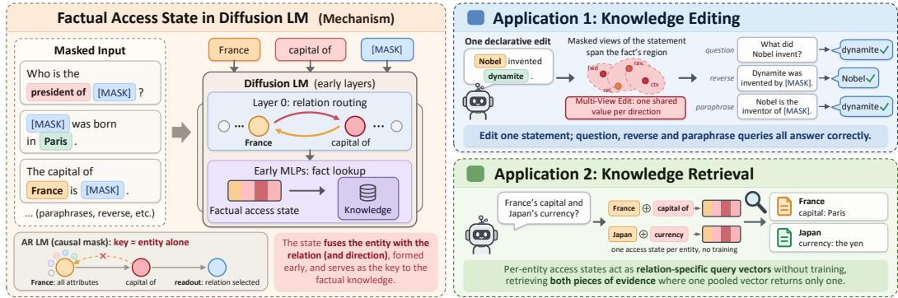  
Figure 1: Factual access states. A masked DLM fuses an entity with the queried relation early; the resulting state supports knowledge editing and evidence retrieval.

Masked diffusion language models (DLMs) break this premise. They predict any masked subset with bidirectional attention (Sahoo et al., 2024; Nie et al., 2025; Ye et al., 2025), so a subject can see relation tokens to its right and an object can become a key in its own direction. Recent work transfers AR edit sites to DLMs and makes edits robust to diffusion decoding (Park & Jo, 2026; Yao et al., 2026). Such ports retain edit-prompt reliability, yet generalise poorly to paraphrases and leave reverse retrieval unchanged. If the key were still the entity alone, these failures would be hard to explain. We therefore ask what representation actually drives lookup (App. A).

Mask-native causal tracing (§2) shows that layer-0 attention routes relation wording into the visible entity; those edges carry 84% of the layer’s causal effect. MLPs 1–8 then retrieve the fact from the fused state. The pipeline replicates in a second DLM and with subject and object roles swapped. The state therefore depends on the entity, the relation’s surface form, and query direction: queries about one fact occupy a region of state space rather than a point. An operation on the fact succeeds only when a query’s state enters that region.

A single-view editor fits one point; MULTI-VIEW EDIT (§3) instead builds masked forward, reverse, relation, and contextual views, fitting one shared value per direction in the early MLPs. Sourceprompt reliability remains at least 97.6% on CounterFact and BAKE. On BAKE, reverse question answering rises from 22.4% to 63.2% on LLaDA-8B and from 20.3% to 83.6% on Dream-7B, while published AR editors gain under three points. On QAEdit, 32.5% and 44.6% of previously wrong free-form answers become at least partially correct; unrelated-query activation is unchanged.

To read the state, we use each entity position as a relation-specific retrieval vector (§4). Without training or question decomposition, these vectors retrieve both pieces of evidence for two-entity queries on which a pooled vector usually returns one. Removing the layer-0 relation messages eliminates the advantage.

Our contributions are:

• Mechanism of factual access states. Causal tracing and attention surgery locate the relationfused entity state, with replication across two DLMs and both mask directions.

• Writing to the state: multi-view editing. A shared value per direction covers the statement’s query views; matched-budget ablations and key-space analysis account for the gains.

• Reading the state: evidence retrieval. Per-entity states retrieve both facts in two-entity queries, with early readout and causal support from relation-routing interventions.

## 2 HOW A MASKED DLM ACCESSES A FACT

We first locate factual lookup in LLaDA-8B (§2.2) and show how layer-0 attention assembles the state read by the early MLPs (§2.3). The findings replicate on Dream-7B (App. B.4) and when the object is visible instead of the subject (App. B.5).

## 2.1 PRELIMINARIES

Masked diffusion language models. A masked DLM $p _ { \theta }$ reconstructs randomly hidden tokens. Given x and a mask rate $t \sim \mathcal { U } ( 0 , 1 )$ , the corruption operator $q _ { t }$ replaces each token independently by [MASK] with probability t, and the model is trained to recover the hidden tokens from the visible ones with bidirectional attention (the masked-diffusion ELBO; App. E.1). Two consequences matter here. Where an AR model exposes only $p ( o \mid s , r )$ , a masked DLM exposes a whole family of conditionals about the same fact, any subset conditioned on and any subset predicted; this is what §3 exploits. And because the model is queried under $q _ { t }$ at both training and decoding time, the states it reaches at test time come from partially masked inputs, which is why the tracing below corrupts with [MASK] rather than with noise.

Mask-based causal tracing. Causal tracing corrupts the input until the answer is lost, then restores internal states one at a time to see which bring it back. We adapt ROME’s formulation (Meng et al., 2022) in two places: next-token prediction becomes masked-position prediction, and Gaussian noise becomes the native [MASK] corruption. For each CounterFact (Meng et al., 2022) triple $( s , r , o )$ the clean input $x ^ { \mathrm { c l e a n } }$ masks the object span, so the task is exactly what the model was trained on, and the corrupted input $x ^ { \mathrm { c o r r } }$ masks both subject and object, removing the cue. Restoring a hidden state $h _ { \ell } ^ { ( i ) }$ to its clean value during the corrupted pass defines the indirect effect

$$
\operatorname { I E } ( \ell , i ) \ = \ \frac { p _ { \mathrm { r e s t } } \bigl ( o \mid x ^ { \mathrm { c o r r } } , \ : h _ { \ell } ^ { ( i ) }  h _ { \ell } ^ { \mathrm { c l e a n } , ( i ) } \bigr ) - p \bigl ( o \mid x ^ { \mathrm { c o r r } } \bigr ) } { p \bigl ( o \mid x ^ { \mathrm { c l e a n } } \bigr ) - p \bigl ( o \mid x ^ { \mathrm { c o r r } } \bigr ) } ,\tag{1}
$$

where IE=1 means that state alone recovers the clean answer and 0 means it contributes nothing.

## 2.2 WHERE THE FACT IS LOOKED UP

Restoring a sliding window of w=10 adjacent layers (Fig. 2) concentrates the effect almost exclusively on the subject tokens. The profile is bimodal, with an early peak at layers 0–8 and a late peak at 18–25, both MLP-dominated. This mirrors a retrieve-then-decode view.

The second peak is an artefact of window stacking. When a single layer is ablated at a time (Fig. 3), only layer-0 attention produces a large effect $( \mathrm { I \bar { E } \approx 0 . 2 3 } )$ , while every individual MLP layer contributes ${ \lesssim } 0 . 0 3$ . The late peak is a sum of many small redundant contributions, not a second retrieval site.

What survives is an early block that is jointly, but only jointly, sufficient. Restoring ℓ=0−8 reaches $\mathrm { { I E { = } 0 . 9 3 6 } }$ , essentially the whole-network ceiling. Layer-0 attention alone (0.238), MLPs 1–8 alone (0.781) and layer-0 MLP alone (−0.015) each fall short, but layer-0 attention combined with MLPs 1–8 recovers 0.943 (Fig. 5). This is consistent with early-MLP retrieval being conditioned on what layer-0 attention writes into the subject positions, and the block is the site that $\bar { \ S } 3$ writes into. App. B adds two further analyses: why the late peak is a serial conduit rather than a second retrieval site, and how the causal locus migrates from subject tokens to the [MASK] readout position.

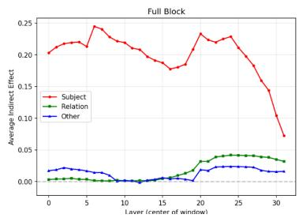

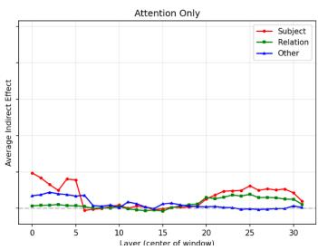

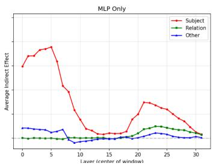  
Figure 2: Window-tracing on a masked DLM (LLaDA-8B). Sliding-window causal tracing with $w { = } 1 0 ,$ , showing the indirect effect across layers at subject, relation, and other token positions. Left: full block; middle: attention only; right: FF/MLP only. The subject signal is bimodal and MLPdominated.

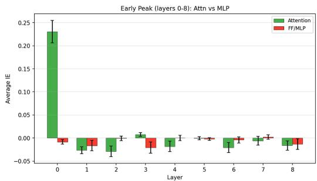

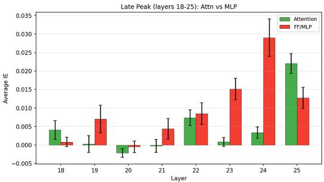  
Figure 3: Single-layer causal effect. Per-layer IE inside the early (0–8) and late (18–25) peaks, split by attention vs. MLP. Only layer-0 attention stands out; no single MLP layer exceeds ∼0.03.

## 2.3 LAYER 0 ASSEMBLES THE ACCESS STATE

The trace says layer 0 matters but not what it computes. We therefore run five attention-surgery ablations: in each, subject tokens may attend along only one class of edges and all others are zeroed (Table 1).

Table 1: Layer-0 attention surgery on LLaDA-8B. Each row keeps only the listed class of edges out of the subject tokens; % is normalised by the full layer-0 attention IE of 0.238.
<table><tr><td>Layer-0 restriction on subject tokens</td><td>IE (mean ± sem) ↑</td><td>% of full L0 attn ↑</td></tr><tr><td>sink removed (sink_off)</td><td> $\overline { { + 0 . 1 8 7 \pm 0 . 0 4 7 } }$ </td><td>79%</td></tr><tr><td>subject → relation only</td><td> $\mathbf { + 0 . 1 9 9 \pm 0 . 0 4 4 }$ </td><td>84%</td></tr><tr><td>subject → subject-internal only</td><td> $+ 0 . 0 4 9 \pm 0 . 0 3 5$ </td><td>21%</td></tr><tr><td>subject → self only</td><td> $+ 0 . 0 0 8 \pm 0 . 0 1 0$ </td><td>3%</td></tr><tr><td>subject → [MASK] only</td><td> $- 0 . 0 0 8 \pm 0 . 0 1 0$ </td><td>0%</td></tr></table>

Letting subject tokens read only from the relation template recovers 84% of the effect, while subjectinternal binding, self-attention and the sink are each dispensable. Layer-0 attention thus merges the relation wording into the subject residual stream, producing the relation-sensitive representation that the layer-1–8 MLPs read. We give this representation a name.

Definition 1 (Factual access state). For a query in which entity e is visible and the relation is worded as r, the factual access state $a ( e , r , d )$ is the residual-stream representation at the position of e in the early block, after layer-0 attention has routed the wording of r into it; $d \in \{ \mathrm { f w o l } , \mathrm { r e v } \}$ records whether e is the subject or the object of the fact. The early MLPs read it as their input key, $k ^ { ( \ell ) } ( \cdot , p _ { e } )$ being its image at layer $\ell ; \ \ S 3$ writes at $k ^ { ( 7 ) }$ and §4 reads a at the output of block 0 or at a deeper layer. Because layer 0 routes the relation into e, the state is a function of all three arguments,

$$
a = f { \big ( } e , s u r f a c e f o r m o f r , d { \big ) } ,\tag{2}
$$

not of the entity alone.

The routing is bidirectional, and so is the state. When the object is kept visible and the subject is hidden instead, the same pipeline runs with the roles swapped: the object position now carries the early-block hidden and MLP effect, its layer-0 attention spikes in the same way, and relation and prefix positions stay flat (App. B.5). The state is therefore formed at whichever entity is visible, with the relation routed into it from either side. Under a causal mask none of this is available: a subject position cannot see a relation to its right, so an autoregressive model keys a fact on the subject and the prefix alone, forms no state on the object side, and cannot express a reverse association natively.

Take-aways. The factual access state has three properties that guide the rest of the paper. First, it depends on the relation’s surface form, so queries about the same fact occupy a region of state space rather than a point. Second, it forms at whichever entity is visible, enabling both forward and reverse access. Third, it is available from the first block and refined by deeper layers, making early readout possible. These properties motivate the multi-view editing method in $\ S 3$ and suggest a complementary use for evidence retrieval in $\ S 4$ . The state is also present on fully observed inputs, as confirmed in $\dot { \ S } 4$ and App. F.3.

## 3 WRITING TO THE STATE: MULTI-VIEW EDITING FROM A SINGLESTATEMENT

MULTI-VIEW EDIT follows $\ S 2$ on both counts: it leaves attention untouched, since the routing is shared by every query about the fact, and rewrites the early MLPs using a family of masked views covering the access states the same statement induces at test time.

## 3.1 METHOD

## 3.1.1 EDITING TASK AND THE STATES AN EDIT MUST COVER

A fact $( s , r , o )$ is given as a statement x with spans $\mathcal { S } _ { s } , \mathcal { S } _ { r } , \mathcal { S } _ { o }$ and a new object $o ^ { * } ;$ the goal is to modify θ so the model behaves as if $( s , r , o ^ { * } )$ held, leaving unrelated behaviour intact. Following $\ S 2$ we edit the down-projections $W _ { \mathrm { d o w n } } ^ { ( \ell ) }$ of the early block, $\ell \in \mathcal { L } = \{ \ell _ { 1 } , \dots , \ell _ { L } \} \subset [ 1 , 8 ]$ . For input u at position $p , k ^ { ( \ell ) } ( u , p ) \in \mathbb { R } ^ { d _ { \operatorname* { m l p } } }$ denotes the input to $W _ { \mathrm { d o w n } } ^ { ( \ell ) }$ , that is, the representation retrieval reads: the $k e y .$ . Its output $z ^ { ( \ell ) } ( u , p ) = W _ { \mathrm { d o w n } } ^ { ( \ell ) } k ^ { ( \ell ) } ( u , p )$ is the value. An edit installs one key–value association.

By Definition 1, the key at an entity position is the access state of that query as the layer-ℓ MLP reads it, so it depends on the relation’s surface form and on the query direction, equation 2: an edit fitted to the user’s sentence covers one point in key space, and rephrased or reverse queries activate it weakly. Our design principle is therefore:

Fit the edit to the average of the keys the fact will be queried from, read from either side ofit, rather than to the key ofthe one sentence it happens to be written in.

App. E formalises this principle as expected activation over the fact’s forward and reverse query families and analyses why the view family approximates the desired keys.

## 3.1.2 VIEW FAMILY CONSTRUCTION

We construct views with the model’s own corruption operator. Writing $\mathcal { M } ( u ; \mathcal { P } )$ for the input with tokens at $\mathcal { P }$ replaced by [MASK], the forward family hides the object and reads the key at a subject position,

$$
\mathcal { V } _ { \mathrm { o b j } } : ~ \mathcal { M } ( x ; S _ { o } ) ,
$$

supervise $o ^ { * }$ at the masked object span,

(3)

$$
\begin{array} { r } { \mathcal { V } _ { \mathrm { r e l } } ( \rho ) : ~ \mathcal { M } \left( x ; S _ { o } \cup \mathcal { R } _ { \rho } \right) , \mathcal { R } _ { \rho } \subset S _ { r } , ~ | \mathcal { R } _ { \rho } | = \lceil \rho | S _ { r } \rceil \rceil , \quad \mathrm { r e l a t i o n ~ p a r t l y ~ m a s k e d } , } \end{array}\tag{4}
$$

$$
\begin{array} { r l r } { \mathcal { V } _ { \mathrm { c t x } } : } & { \mathcal { M } \big ( c _ { \mathrm { p r e } } \oplus x \oplus c _ { \mathrm { p o s t } } ; S _ { o } \big ) , } & { \qquad } & { \mathrm { p r e f i x / s u f f i x ~ c o n t e x t ~ t e m p l a t e s } , } \end{array}\tag{5}
$$

and the reverse family swaps the roles, replacing the object span with the new object and hiding the subject, so the key is read at $o ^ { * } \colon$

$$
\begin{array} { r } { \mathcal { V } ^ { \mathrm { r e v } } : \mathcal { M } \big ( x [ \mathcal { S } _ { o } \gets o ^ { * } ] ; \mathcal { S } _ { s } \cup \mathcal { R } _ { \rho } \big ) , \qquad \mathrm { s u p e r v i s e } s \mathrm { a t t h e ~ m a s k e d ~ s u b j e c t ~ s p a n } , } \end{array}\tag{6}
$$

For $\mathcal { V } _ { \mathrm { r e l } }$ and $\mathcal { V } ^ { \mathrm { r e v } }$ we draw $n _ { \rho }$ occlusion patterns per ratio $\rho \in \mathcal { P } _ { \rho } \left( \mathcal { P } _ { \rho } = \{ 0 . 4 , 0 . 7 \} , n _ { \rho } = 3 \right)$ Whichever span carries the key is never masked. ROME averages the key over a set of prefix templates so that it does not depend on the text around the prompt; $\mathcal { V } _ { \mathrm { c t x } }$ does the same. Because a DLM also conditions on what follows the prediction slot, $c _ { \mathrm { p o s t } }$ may be non-empty, and we add suffix templates alongside the prefix ones $( { \mathrm { A p p . } } { \mathrm { C } } )$

Two axes organise these views, both instantiated by the same $q _ { t }$ . The direction axis decides how many key–value directions are installed: $\mathcal { V } ^ { \mathrm { r e v } }$ adds the object-side one and, by equation 6, carries relation occlusions on that side too. The masking axis decides how much of each installed direction a reformulated query reaches: $\mathcal { V } _ { \mathrm { o b j } }$ fixes the association, $\mathcal { V } _ { \mathrm { c t x } }$ decorrelates the key from the surrounding discourse, and $\mathcal { V } _ { \mathrm { r e l } }$ decorrelates it from the relation’s surface form, which by equation 2 is what layer-0 merges in. Together they form a Monte-Carlo sample, restricted to this fact, of the conditionals the model is trained on under $q _ { t }$ . Setting $\mathcal { P } _ { \rho } = \emptyset$ leaves $\nu _ { \mathrm { o b j } } \cup \nu _ { \mathrm { c t x } }$ . This is the direct port of a locate-then-edit editor, which already averages keys over context templates, and it is the SINGLE-VIEW baseline of Table $2 ;$ those two rows therefore isolate $\mathcal { V } _ { \mathrm { r e l } }$ . Table 15 ablates $\mathcal { V } _ { \mathrm { c t x } }$ separately.

## 3.1.3 ONE SHARED VALUE PER DIRECTION

Let $\mathcal { V } = \mathcal { V } _ { \mathrm { o b j } } \cup \mathcal { V } _ { \mathrm { r e l } } \cup \mathcal { V } _ { \mathrm { c t x } }$ and $\ell ^ { * } = \operatorname* { m a x } \mathcal { L }$ . Writing $p _ { \theta [ \ell ^ { * }  z ] }$ for the model with $W _ { \mathrm { d o w n } } ^ { ( \ell ^ { * } ) } { } _ { \mathrm { s } }$ output at the key position replaced by $z ,$ we solve

$$
z _ { \mathrm { f w d } } ^ { * } =  \arg \operatorname* { m i n } _ { z }  \frac { 1 } { | \mathcal { V } | } \sum _ { v \in \mathcal { V } } w _ { v } [ - \log p _ { \theta [ \ell ^ { * }  z ] } \big ( o ^ { * } \big | \tilde { x } _ { v } \big ) ] + v _ { \mathrm { w d } } \| z - z _ { 0 } \| ^ { 2 } , \qquad \| z - z _ { 0 } \| \leq \kappa \| z _ { 0 } \| ,\tag{7}
$$

with $z _ { \mathrm { 0 } }$ the unedited value, $w _ { v }$ per-view weights (uniform here, since all views are drawn at comparable mask rates), $v _ { \mathrm { w d } }$ a relative norm penalty and κ a clamp. Adam optimises z alone; model parameters stay frozen. $z _ { \mathrm { r e v } } ^ { \ast }$ is obtained the same way over $\mathcal { V } ^ { \mathrm { r e v } }$ , averaging the loss over masked subject positions instead of the object span.

One value is shared across all views of a direction, making equation 7 an intersection rather than a union: one $( k , z )$ pair per view would install |V| separate associations, each reachable only from its own point of key space. Instead we ask for a single value that is correct when read out from every key the fact induces. Hard views therefore reshape $z ^ { * }$ as constraints rather than becoming separate edits, and the installed rank does not grow with |V|.

## 3.1.4 KEYS AND THE WEIGHT UPDATE

With $p _ { v }$ the key position in view v (a subject position forward, the chosen token of $o ^ { * }$ in reverse), the key written along is the average over the same views used in equation 7,

$$
k _ { \mathrm { a v g \it ~ } } = \ : \frac { 1 } { | \mathcal { V } | } \sum _ { v \in \mathcal { V } } k ^ { ( \ell ) } \big ( \tilde { x } _ { v } , p _ { v } \big ) ,\tag{8}
$$

so that the direction itself is averaged over occlusions and contexts; $k _ { \mathrm { a v g } } ^ { \mathrm { r e v } }$ follows identically over $\mathcal { V } ^ { \mathrm { r e v } }$ . The update is applied along the whitened direction $\hat { k } = C ^ { - 1 } k _ { \mathrm { a v g } } \bar { / } ( k _ { \mathrm { a v g } } ^ { \top } C ^ { - 1 } k _ { \mathrm { a v g } } )$ , where C is the second moment of keys collected from randomly masked inputs under the same $q _ { t }$ the model traverses during decoding, so that the edit does not fire along directions that are already high-variance across ordinary text (App. C.1; ablated in App. D.4). With $\ell _ { i }$ the i-th edit layer and $m = L - i + 1$ the remaining layers, the residual is distributed across L as in MEMIT:

$$
W _ { \mathrm { d o w n } } ^ { ( \ell _ { i } ) } \gets W _ { \mathrm { d o w n } } ^ { ( \ell _ { i } ) } + \frac { z ^ { * } - W _ { \mathrm { d o w n } } ^ { ( \ell _ { i } ) } k _ { \mathrm { a v g } } } { m } \hat { k } ^ { \top } .\tag{9}
$$

Forward and reverse pairs go into the same layers, so one statement installs one forward and one or more reverse directions in one early-MLP block. Attention is never modified: the problem lies in what the state is made of, which the view family addresses, not in the mechanism that assembles it.

## 3.2 RESULTS

We evaluate on CounterFact (source reliability, paraphrase transfer, neighborhood specificity and locality preservation), BAKE (reverse QA and judgment probes) and QAEdit (free-form answers to natural questions, scored exact, partial or wrong), on LLaDA-8B and Dream-7B. ROME at layer 7 is the base editor, constrained fine-tuning (FT+L) the reproducible DLM baseline, and matched single-view and single-direction variants the controlled comparisons. Benchmark definitions, scoring, configuration and published autoregressive references are in App. D.

## 3.2.1 COUNTERFACT

Table 2 isolates the relation-masked views against the matched single-view editor. Multi-View keeps source reliability high and consistently improves paraphrase transfer. On LLaDA it also improves neighborhood specificity and locality preservation; on Dream, locality is comparable to Single-View, indicating model-dependent spillover. Locality does not degrade under the wider view family, which agrees with the neighborhood trigger strength of §3.2.4: it is unchanged between the two constructions.

Table 2: CounterFact. ROME-based rows use a last-subject-token write; FT+L is a constrained fine-tuning baseline. SINGLE-VIEW uses $\mathcal { V } _ { \mathrm { o b j } } \cup \mathcal { V } _ { \mathrm { c t x } } ;$ ; MULTI-VIEW adds $\mathcal { V } _ { \mathrm { r e l } }$ . Published AR references are collected in App. D.2.
<table><tr><td>Model</td><td>Method</td><td>Rel. ↑</td><td>Para. ↑</td><td>Neigh. ↑</td><td>Loc-Pres. ↑</td></tr><tr><td rowspan="3">Dream-7B</td><td>FT+L</td><td>99.67</td><td>86.47</td><td>18.95</td><td>31.33</td></tr><tr><td>SINGLE-VIEW</td><td>94.83</td><td>72.05</td><td>74.48</td><td>89.91</td></tr><tr><td>MULTI-VIEW</td><td>99.88</td><td>99.24</td><td>73.04</td><td>88.29</td></tr><tr><td rowspan="3">LLaDA-8B</td><td>FT+L</td><td>99.27</td><td>51.94</td><td>47.28</td><td>65.04</td></tr><tr><td>SINGLE-VIEW</td><td>96.87</td><td>53.65</td><td>57.13</td><td>68.31</td></tr><tr><td>MULTI-VIEW</td><td>98.14</td><td>67.92</td><td>73.73</td><td>89.92</td></tr></table>

## 3.2.2 BAKE: REVERSE ACCESS

The no-edit row of Table 3 measures the model’s pre-existing preference for the target. SINGLE-FORWARD edits only the source direction; SINGLE-BINARY adds the reverse direction; and MULTI-BINARY replaces each with the masked view family. BAKE uses a different edit pool from CounterFact. The two axes separate cleanly. Forward-only editing leaves Reverse-QA at the no-edit baseline: bidirectional attention makes the reverse conditional expressible, but a forward update is not reachable from it, so the reverse direction has to be installed explicitly. Once it is, the masking axis governs how much of that direction a reverse query reaches. It adds 21.2 points on LLaDA and 10.6 on Dream (21.8 at a matched view budget, Table 11) and recovers the paraphrase accuracy that SINGLE-BINARY gives up. Published autoregressive editors gain under three points on Reverse-QA on GPT-J and LLaMA-2 (App. D.2).

Table 3: BAKE. R-QA and R-Judge are reverse probes; $\Delta$ is measured from each DLM’s no-edit baseline. Single/Multi denotes one view versus the masked family; Forward/Binary denotes whether the explicit reverse group is installed. FT+L is a constrained fine-tuning baseline. Published AR references are collected in App. D.2.
<table><tr><td>Model</td><td>Method</td><td>Rel. 个</td><td>Para. ↑</td><td>R-QA↑</td><td>R-Judge ↑</td><td>∆ (R-QA / R-Judge) ↑</td></tr><tr><td rowspan="5">LLaDA-8B</td><td>no edit (baseline)</td><td></td><td></td><td>22.35</td><td>30.59</td><td>0.00 / 0.00</td></tr><tr><td>FT+L</td><td>74.76</td><td>45.73</td><td>19.94</td><td>28.79</td><td>-2.417-1.80</td></tr><tr><td>SINGLE-FORWARD</td><td>95.53</td><td>73.03</td><td>22.52</td><td>38.88</td><td>+0.17/+8.29</td></tr><tr><td>SINGLE-BINARY</td><td>97.04</td><td>65.48</td><td>42.03</td><td>41.03</td><td>+19.68/+10.44</td></tr><tr><td>MULTI-BINARY</td><td>98.49</td><td>84.56</td><td>63.24</td><td>55.60</td><td>+40.89/+25.01</td></tr><tr><td rowspan="5">Dream-7B</td><td>no edit (baseline)</td><td></td><td></td><td>20.26</td><td>18.15</td><td>0.00 /0.00</td></tr><tr><td>FT+L</td><td>92.91</td><td>72.82</td><td>18.42</td><td>19.42</td><td>-1.84/+1.27</td></tr><tr><td>SINGLE-FORWARD</td><td>94.93</td><td>88.43</td><td>20.13</td><td>32.13</td><td>-0.13/+13.98</td></tr><tr><td>SINGLE-BINARY</td><td>94.10</td><td>87.45</td><td>72.97</td><td>44.12</td><td>+52.71/+25.97</td></tr><tr><td>MULTI-BINARY</td><td>97.65</td><td>96.25</td><td>83.57</td><td>55.75</td><td>+63.31/+37.60</td></tr></table>

## 3.2.3 QAEDIT: OPEN-ENDED GENERATION

QAEdit tests the statement-level setting directly: the edit is declarative, whereas evaluation uses an open-ended question and free decoding. For each model and method we evaluate the same 2,272 examples that were answered fully wrongly before editing (Table 4). Multi-View gives the strongest source-prompt recovery and question transfer on both models, outperforming FT+L and Single-View on the principal success metrics. The gains are larger on Dream, but free-generation transfer remains incomplete: wrong answers are still the majority on the Gen. split (App. G). The view family also composes with the decoding-state views of Park & Jo (2026): adding them raises the LLaDA-8B weighted score from 0.250 to 0.430 on source prompts and from 0.187 to 0.352 on paraphrased questions (App. D.7).

## 3.2.4 EDITS FIRE WHERE THE STATE IS: A TRIGGER-STRENGTH ANALYSIS

We compare M1 (one forward key), M2 (forward and reverse keys), and M3 (both directions expanded over the masked view family). For a query key k, equation 9 gives the trigger strength

$$
\alpha ( k ) = \hat { k } ^ { \top } k = \frac { k _ { \mathrm { a v g } } ^ { \top } C ^ { - 1 } k } { k _ { \mathrm { a v g } } ^ { \top } C ^ { - 1 } k _ { \mathrm { a v g } } } ,\tag{10}
$$

the fraction of the installed update activated by the query. We report $\alpha _ { \mathrm { f i r e } }$ at its most strongly activated position, alongside the editing effect $\Delta \mathrm { l o g i t } = \log p _ { \mathrm { p o s t } } ( o _ { \mathrm { n e w } } ) - \log p _ { \mathrm { p o s t } } ( o _ { \mathrm { t r u e } } )$ . On n=1000

Table 4: QAEdit on pre-edit-wrong examples. Fraction of answers scored exact (= 1.0) or at least partially correct $\left( \geq 0 . 5 \right)$ , and weighted score $s = ( n _ { 1 . 0 } + 0 . 5 n _ { 0 . 5 } ) / n$ . Rel. denotes source prompts and Gen. paraphrased questions. Target-length results are in App. D.6.
<table><tr><td rowspan="2">Model</td><td rowspan="2">Method</td><td colspan="3">Rel.</td><td colspan="3">Gen.</td></tr><tr><td> $= 1 . 0 \uparrow$ </td><td> $\overline { { \ge 0 . 5 ~ \mathrm { \uparrow } } }$ </td><td>Weighted s ↑</td><td> $= 1 . 0 \uparrow$ </td><td> $\overline { { \ge 0 . 5 \mathrm { ~ ‰ ~ } } }$ </td><td>Weighted s ↑</td></tr><tr><td rowspan="3">LLaDA-8B</td><td>FT+L</td><td>15.0%</td><td>26.3%</td><td>0.206</td><td>11.9%</td><td>22.9%</td><td>0.174</td></tr><tr><td>Single-View</td><td>14.9%</td><td>26.2%</td><td>0.205</td><td>11.7%</td><td>23.3%</td><td>0.175</td></tr><tr><td>Multi-View</td><td>17.6%</td><td>32.5%</td><td>0.250</td><td>12.6%</td><td>25.5%</td><td>0.187</td></tr><tr><td rowspan="3">Dream-7B</td><td>FT+L</td><td>16.2%</td><td>32.4%</td><td>0.243</td><td>13.4%</td><td>26.8%</td><td>0.201</td></tr><tr><td>Single-View</td><td>20.1%</td><td>38.1%</td><td>0.291</td><td>16.5%</td><td>33.1%</td><td>0.248</td></tr><tr><td>Multi-View</td><td>23.8%</td><td>44.6%</td><td>0.342</td><td>20.2%</td><td>39.3%</td><td>0.297</td></tr></table>

BAKE edits with LLaDA-8B and the ROME base editor, Fig. 4 shows that reverse keys strengthen reverse-query activation, while the full view family further improves paraphrase and reverse probes: on Reverse- $Q \mathrm { A } , \alpha _ { \mathrm { f i r e } }$ rises from 0.08 with a forward key alone to 0.56 once a reverse key is installed and to 0.61 with the full family, while paraphrase activation stays at 0.61–0.62 throughout and its ∆logit more than doubles. On CounterFact neighborhood prompts about other subjects, α = 0.03 for both single-view and Multi-View edits, well below the queried-fact values. The wider coverage preserves specificity.

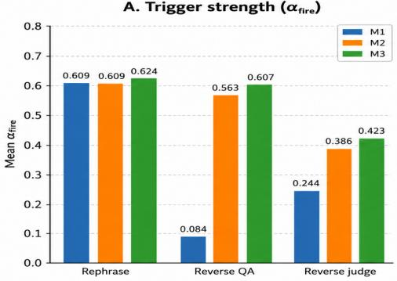

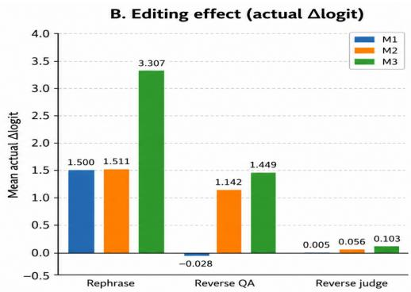  
Figure 4: Multi-View trigger and editing effect. Left: mean trigger strength $\alpha _ { \mathrm { f i r e } } ;$ right: mean actual ∆logit. M1 = forward single-view, M2 = forward + reverse single-view, $\mathbf { M } 3 = \mathbf { f u l l }$ Multi-View (ours). LLaDA-8B. Query difficulty increases from Paraphrase (left) to Reverse-Judge (right).

## 4 READING THE STATE: EVIDENCE RETRIEVAL

## 4.1 METHOD

The access state is also an interface to external evidence. We read one retrieval vector per query entity from its state $a ( e , r , d )$ , at the output of block 0 (L0) or at a validation-selected deeper layer. For a token span S in input u, write its layer-ℓ readout as

$$
v ^ { ( \ell ) } ( u , \mathcal { S } ) = \mathrm { p o o l } _ { p \in S } h _ { \ell } ^ { ( p ) } ( u ) .\tag{11}
$$

The pool selects the last entity token at L0 and averages the span at deeper layers. For query q with entity span $\boldsymbol { S _ { e _ { i } } }$ and evidence card $x _ { j }$ with subject span $\boldsymbol { \mathcal { S } } _ { s _ { j } }$ , we rank cards by

$$
\begin{array} { r } { \mathrm { s c o r e } _ { \ell } ( i , j ) = \mathrm { c o s } \Big ( v ^ { ( \ell ) } ( q , S _ { e _ { i } } ) , v ^ { ( \ell ) } ( x _ { j } , S _ { s _ { j } } ) \Big ) . } \end{array}\tag{12}
$$

We fill a shared budget by alternating between the entities’ rankings; no retriever is trained and no query is decomposed. We evaluate on Dream-7B-Instruct and LLaDA-8B-Instruct.

The benchmark is built from PopQA facts (Mallen et al., 2023) and is designed around relations: 5,528 evidence cards over five domains and 19 relations, every entity carrying exactly the four relations of its domain, searched globally for 10,800 test queries balanced over the domains and over three layouts, which name one entity, two entities with adjacent entity–relation clauses, or two entities with crossed references ${ } ^ { ( \ 6 \ 4 ) }$ and B: the director of the former and the composer of the latter”).

Single R@1 scores the correct card; dual-target All@2 requires both correct cards within two retrieved cards. A second, entity-conditioned protocol hands every method the same entity-linked candidates, four cards per entity, so that only the relation has to be chosen. Baselines are BM25, whole-query pooling on the same backbones, DiffRetriever’s parallel representative tokens (Wang et al., 2026), and PromptReps on Qwen2.5-7B-Instruct (Zhuang et al., 2024). Construction, readout selection and protocols are in App. F.

## 4.2 RESULTS

Table 5 reports both protocols. On single-entity queries every method retrieves well. On twoentity queries every single-vector method collapses: BM25, pooling, DiffRetriever and PromptReps retrieve both cards for at most 3.06% of adjacent and 2.50% of crossed queries, because one vector cannot hold two entity–relation bindings. Per-entity access states retrieve both for 38.28–41.94% of adjacent and 21.78–38.08% of crossed queries from the selected layers. The entity-conditioned protocol, which removes entity coverage as a factor, leaves the ordering unchanged (41.94/38.08 against at most 16.35/16.26): the advantage lies in choosing the relation within an entity’s cards, which is what the state binds.

Table 5: Controlled benchmark: global search and entity-conditioned retrieval (%). All methods search the same 5,528 cards for the same 10,800 test queries. Single is R@1; Adj./Cross. are dual-target All@2. Time is measured in ms/query. Shaded cells mark the best value in each column.
<table><tr><td rowspan="2">Method</td><td colspan="3">Global corpus</td><td colspan="3">Entity-conditioned</td><td colspan="2">Time↓</td></tr><tr><td>Single R@1↑</td><td>Adj.</td><td>Cross. All@2↑</td><td>Single</td><td>Adj.</td><td>Cross.</td><td>Global</td><td>Entity</td></tr><tr><td></td><td></td><td>All@2↑</td><td></td><td>R@1↑</td><td>All@2↑</td><td>All@2</td><td>ms/query</td><td>ms/query</td></tr><tr><td>Shared baselines BM25</td><td>92.82</td><td></td><td>1.01</td><td>95.35</td><td></td><td></td><td></td><td></td></tr><tr><td>Qwen2.5 pooling</td><td>69.06</td><td>1.38 1.28</td><td>0.00</td><td>81.19</td><td>11.83</td><td>11.83</td><td>0.51</td><td>0.31</td></tr><tr><td>PromptReps (20/20), hybrid</td><td>92.53</td><td>1.58</td><td>1.56</td><td>93.47</td><td>8.83 16.35</td><td>8.14 16.26</td><td>12.76</td><td>0.43</td></tr><tr><td></td><td></td><td></td><td></td><td></td><td></td><td></td><td>264.98</td><td>263.20</td></tr><tr><td>Dream-7B-Instruct</td><td>83.53</td><td></td><td>0.58</td><td></td><td></td><td></td><td></td><td></td></tr><tr><td>Whole-query pooling DiffRetriever (4/16), dense</td><td>80.03</td><td>3.06 0.89</td><td></td><td>87.03</td><td>13.67</td><td>11.92</td><td>13.41</td><td>13.26</td></tr><tr><td></td><td>97.14</td><td>1.25</td><td>0.25 1.28</td><td>86.17</td><td>9.81</td><td>9.42</td><td>14.27</td><td>13.87</td></tr><tr><td>DiffRetriever (4/16), hybrid</td><td>78.50</td><td>24.44</td><td>13.33</td><td>99.17 78.61</td><td>7.28</td><td>6.69</td><td>17.52</td><td>16.73</td></tr><tr><td>Subject (L0) Subject (L27)</td><td>81.01</td><td>38.28</td><td>21.78</td><td>81.03</td><td>24.56 38.28</td><td>13.42 21.76</td><td>1.88</td><td>1.47 13.29</td></tr><tr><td></td><td></td><td></td><td></td><td></td><td></td><td></td><td>13.64</td><td></td></tr><tr><td>LLaDA-8B-Instruct</td><td>88.25</td><td>2.11</td><td>2.50</td><td>90.08</td><td></td><td></td><td></td><td></td></tr><tr><td>Whole-query pooling DiffRetriever (4/16), dense</td><td>76.36</td><td>0.61</td><td>0.67</td><td>82.53</td><td>9.72 10.64</td><td>10.56</td><td>20.68</td><td>20.37</td></tr><tr><td>DiffRetriever (4/16), hybrid</td><td>97.69</td><td>1.36</td><td>1.03</td><td>98.61</td><td>9.19</td><td>10.11 8.78</td><td>21.72</td><td>21.05</td></tr><tr><td>Subject (L0)</td><td>68.03</td><td>13.32</td><td>9.44</td><td>68.42</td><td>13.61</td><td>9.78</td><td>25.88 2.00</td><td>24.88</td></tr><tr><td>Subject (L31)</td><td>89.08</td><td>41.94</td><td>38.08</td><td>89.08</td><td>41.94</td><td>38.08</td><td>20.97</td><td>1.45 20.35</td></tr></table>

The state is usable as soon as it is formed. Read after the first block, the access state already retrieves both cards for 24.44%/13.33% of adjacent/crossed queries on Dream, and the deeper layers refine it to 38.28/21.78 (LLaDA: 13.32/9.44 → 41.94/38.08). The readout carries to natural text (App. F.2): on the comparison questions of HotpotQA and 2WikiMultiHopQA, the first-block readout returns evidence from both gold paragraphs (Both@2) for 41.82% and 37.37% of questions against 25.15%/26.93% for BM25, at 2.6 ms per query against 29–93 ms for full-depth encoders, and a frozen reader given that evidence gains 4–8 F1 points over the strongest baseline. The early readout is also cheap: reading the state at L0 costs 1.5–2.0 ms per query on both backbones, agains 13–26 ms for the full-depth neural retrievers and 265 ms for PromptReps (Table 5).

The retrieval behaviour is causal. Subtracting the first attention layer’s relation-token messages at the subject positions drops within-entity relation accuracy to the four-way chance level in all three layouts while entity identification stays at 100%, and substituting the messages of a different relation redirects retrieval toward that relation (App. F.3). Reading the state is thus the counterpart of the write in §3: the layer-0 routing that an edit must cover is what a retrieval vector taken from the state already contains.

## 5 CONCLUSION

We asked what a masked DLM computes when it accesses a fact, before asking how to change or use it. Causal tracing reveals a two-stage mechanism: layer-0 attention routes relation wording into the visible entity, and early MLPs look up the fact on the resulting access state. This state depends on the relation’s surface form and query direction, rather than on the entity alone. Writing to this state, MULTI-VIEW EDIT fits shared values across multiple query views, improving paraphrase and reverse generalisation while preserving source-prompt reliability and locality. Reading it provides a complementary insight: per-entity access states can serve as relation-specific retrieval vectors. Our experiments offer a proof of concept for using these states to access external evidence, connecting knowledge editing and retrieval through a shared mechanism of factual access. Two limitations bound these claims. The editor assumes identifiable subject, relation and object spans, which CounterFact and BAKE supply but arbitrary user statements may not, and free-generation transfer on QAEdit remains incomplete, since wrong answers are still the majority on paraphrased questions (App. G).

## AI USE STATEMENT

Generative AI models were used as experimental components, as described in the paper. AIassisted tools were otherwise used only for limited language polishing and code troubleshooting. All methodological decisions, experimental results, interpretations, and final manuscript content were reviewed and approved by the authors, who take full responsibility for this work.

## REPRODUCIBILITY STATEMENT

The paper specifies the mask-native causal tracing protocol, multi-view editing procedure, and per-entity retrieval readouts. Appendix B reports additional mechanism and role-reversal checks. Appendix C records editing hyperparameters, context templates, seed, precision, and compute, while Appendix C.1 details covariance estimation under the DLM masking distribution. Appendix D documents editing benchmarks, baselines, and ablations. Appendix F specifies corpus construction, validation and test splits, readout selection, scoring, and evaluation protocols for both controlled and natural retrieval settings. Seed 42 fixes sampled masks and covariance estimation; the editor uses no random initialisation or stochastic retraining. Code is available at https://github.com/Guoyuchen1/dlm-factual-access.

## ETHICS STATEMENT

Knowledge editing can be misused to make false claims accessible through multiple phrasings and query directions. Our experiments use controlled factual-edit benchmarks and report locality and neighborhood specificity to assess unintended changes; these results do not establish safety for deployment. The retrieval experiments use public benchmark corpora and may inherit errors or biases in their source material. We collected no private user data and conducted no human-subject experiments.

## REFERENCES

Parishad BehnamGhader, Vaibhav Adlakha, Marius Mosbach, Dzmitry Bahdanau, Nicolas Chapados, and Siva Reddy. LLM2Vec: Large language models are secretly powerful text encoders. In First Conference on Language Modeling, 2024. URL https://openreview.net/forum? id=IW1PR7vEBf.

Lukas Berglund, Meg Tong, Max Kaufmann, Mikita Balesni, Asa Cooper Stickland, Tomasz Korbak, and Owain Evans. The reversal curse: LLMs trained on “A is B” fail to learn “B is A”. arXiv preprint arXiv:2309.12288, 2023. URL https://arxiv.org/abs/2309.12288.

Roi Cohen, Eden Biran, Ori Yoran, Amir Globerson, and Mor Geva. Evaluating the ripple effects of knowledge editing in language models. Transactions of the Association for Computational

Linguistics, 12:283–298, 2024. doi: 10.1162/tacl a 00644. URL https://aclanthology. org/2024.tacl-1.16/.

Nicola De Cao, Wilker Aziz, and Ivan Titov. Editing factual knowledge in language models. In Proceedings of the 2021 Conference on Empirical Methods in Natural Language Processing, pp. 6491–6506, Online and Punta Cana, Dominican Republic, November 2021. Association for Computational Linguistics. doi: 10.18653/v1/2021.emnlp-main.522. URL https: //aclanthology.org/2021.emnlp-main.522/.

Junfeng Fang, Houcheng Jiang, Kun Wang, Yunshan Ma, Jie Shi, Xiang Wang, Xiangnan He, and Tat-Seng Chua. AlphaEdit: Null-space constrained knowledge editing for language models. In International Conference on Learning Representations, 2025. URL https://openreview. net/forum?id=HvSytvg3Jh.

Mor Geva, Jasmijn Bastings, Katja Filippova, and Amir Globerson. Dissecting recall of factual associations in auto-regressive language models. In Houda Bouamor, Juan Pino, and Kalika Bali (eds.), Proceedings of the 2023 Conference on Empirical Methods in Natural Language Processing, pp. 12216–12235, Singapore, December 2023. Association for Computational Linguistics. doi: 10.18653/v1/2023.emnlp-main.751. URL https://aclanthology.org/2023. emnlp-main.751.

Thomas Hartvigsen, Swami Sankaranarayanan, Hamid Palangi, Yoon Kim, and Marzyeh Ghassemi. Aging with GRACE: Lifelong model editing with discrete key-value adaptors. In Advances in Neural Information Processing Systems, volume 36, pp. 47934–47959, 2023. URL https://proceedings.neurips.cc/paper\_files/paper/2023/ hash/95b6e2ff961580e03c0a662a63a71812-Abstract-Conference.html.

Shaokai He, Kaiwen Wei, Xinyi Zeng, Xiang Chen, Xue Yang, Zhenyang Li, Jiang Zhong, and Yu Tian. DiffER: Diffusion entity-relation modeling for reversal curse in diffusion large language models. arXiv preprint arXiv:2601.07347, 2026. URL https://arxiv.org/abs/2601. 07347.

Xanh Ho, Anh-Khoa Duong Nguyen, Saku Sugawara, and Akiko Aizawa. Constructing a multihop QA dataset for comprehensive evaluation of reasoning steps. In Proceedings of the 28th International Conference on Computational Linguistics, pp. 6609–6625, Barcelona, Spain (Online), 2020. International Committee on Computational Linguistics. doi: 10.18653/v1/2020. coling-main.580. URL https://aclanthology.org/2020.coling-main.580/.

Moongyu Jeon, Sangwoo Shin, BumJun Kim, Kyelim Lee, and Albert No. A theoretical analysis of why masked diffusion models mitigate the reversal curse. arXiv preprint arXiv:2602.02133, 2026. URL https://arxiv.org/abs/2602.02133.

Vladimir Karpukhin, Barlas Oguz, Sewon Min, Patrick Lewis, Ledell Wu, Sergey Edunov, Danqi Chen, and Wen-tau Yih. Dense passage retrieval for open-domain question answering. In Proceedings of the 2020 Conference on Empirical Methods in Natural Language Processing (EMNLP), pp. 6769–6781. Association for Computational Linguistics, 2020. doi: 10.18653/ v1/2020.emnlp-main.550. URL https://aclanthology.org/2020.emnlp-main. 550/.

Omar Khattab and Matei Zaharia. ColBERT: Efficient and effective passage search via contextualized late interaction over BERT. In Proceedings ofthe 43rd International ACM SIGIR Conference on Research and Development in Information Retrieval, pp. 39–48. Association for Computing Machinery, 2020. doi: 10.1145/3397271.3401075. URL https://doi.org/10.1145/ 3397271.3401075.

Tushar Khot, Harsh Trivedi, Matthew Finlayson, Yao Fu, Kyle Richardson, Peter Clark, and Ashish Sabharwal. Decomposed prompting: A modular approach for solving complex tasks. In The Eleventh International Conference on Learning Representations, 2023. URL https: //openreview.net/forum?id=\_nGgzQjzaRy.

Ouail Kitouni, Niklas Nolte, Diane Bouchacourt, Adina Williams, Mike Rabbat, and Mark Ibrahim. The factorization curse: Which tokens you predict underlie the reversal curse and more. In Advances in Neural Information Processing Systems, volume 37, pp. 112329–112355, 2024. URL https://arxiv.org/abs/2406.05183.

Xiaopeng Li, Shasha Li, Shezheng Song, Jing Yang, Jun Ma, and Jie Yu. PMET: Precise model editing in a transformer. In Proceedings of the AAAI Conference on Artificial Intelligence, volume 38, pp. 18564–18572, 2024. doi: 10.1609/aaai.v38i17.29818. URL https: //ojs.aaai.org/index.php/AAAI/article/view/29818.

Jun-Yu Ma, Jia-Chen Gu, Zhen-Hua Ling, Quan Liu, and Cong Liu. Untying the reversal curse via bidirectional language model editing. arXiv preprint arXiv:2310.10322v2, 2023. URL https: //arxiv.org/abs/2310.10322v2.

Alex Mallen, Akari Asai, Victor Zhong, Rajarshi Das, Daniel Khashabi, and Hannaneh Hajishirzi. When not to trust language models: Investigating effectiveness of parametric and nonparametric memories. In Proceedings of the 61st Annual Meeting of the Association for Computational Linguistics (Volume 1: Long Papers), pp. 9802–9822, Toronto, Canada, 2023. Association for Computational Linguistics. doi: 10.18653/v1/2023.acl-long.546. URL https: //aclanthology.org/2023.acl-long.546/.

Kevin Meng, David Bau, Alex Andonian, and Yonatan Belinkov. Locating and editing factual associations in GPT. In Advances in Neural Information Processing Systems, volume 35, pp. 17359–17372, 2022. URL https://arxiv.org/abs/2202.05262.

Kevin Meng, Arnab Sen Sharma, Alex Andonian, Yonatan Belinkov, and David Bau. Mass-editing memory in a transformer. In International Conference on Learning Representations, 2023. URL https://openreview.net/forum?id=MkbcAHIYgyS.

Eric Mitchell, Charles Lin, Antoine Bosselut, Chelsea Finn, and Christopher D. Manning. Fast model editing at scale. In International Conference on Learning Representations, 2022a. URL https://openreview.net/forum?id=0DcZxeWfOPt.

Eric Mitchell, Charles Lin, Antoine Bosselut, Christopher D. Manning, and Chelsea Finn. Memorybased model editing at scale. In Proceedings of the 39th International Conference on Machine Learning, volume 162 of Proceedings of Machine Learning Research, pp. 15817–15831. PMLR, 2022b. URL https://proceedings.mlr.press/v162/mitchell22a.html.

Shen Nie, Fengqi Zhu, Zebin You, Xiaolu Zhang, Jingyang Ou, Jun Hu, Jun Zhou, Yankai Lin, Ji-Rong Wen, and Chongxuan Li. Large language diffusion models. arXiv preprint arXiv:2502.09992, 2025. URL https://arxiv.org/abs/2502.09992.

Haewon Park and Yohan Jo. Knowledge editing for masked diffusion language models. In Proceedings of the 2026 Conference on Empirical Methods in Natural Language Processing, 2026. URL https://arxiv.org/abs/2606.03924v2. To appear.

Ofir Press, Muru Zhang, Sewon Min, Ludwig Schmidt, Noah A. Smith, and Mike Lewis. Measuring and narrowing the compositionality gap in language models. In Findings of the Association for Computational Linguistics: EMNLP 2023, 2023. arXiv:2210.03350.

Stephen E. Robertson and Hugo Zaragoza. The probabilistic relevance framework: BM25 and beyond. Foundations and Trends in Information Retrieval, 3(4):333–389, 2009. doi: 10.1561/ 1500000019. URL https://doi.org/10.1561/1500000019.

Subham Sekhar Sahoo, Marianne Arriola, Yair Schiff, Aaron Gokaslan, Edgar Marroquin, Justin T. Chiu, Alexander Rush, and Volodymyr Kuleshov. Simple and effective masked diffusion language models. In Advances in Neural Information Processing Systems, volume 37, pp. 130136–130184, 2024. URL https://arxiv.org/abs/2406.07524.

Christopher Sciavolino, Zexuan Zhong, Jinhyuk Lee, and Danqi Chen. Simple entity-centric questions challenge dense retrievers. In Proceedings of the 2021 Conference on Empirical Meth ods in Natural Language Processing, pp. 6138–6148. Association for Computational Linguistics, 2021. doi: 10.18653/v1/2021.emnlp-main.496. URL https://aclanthology.org/ 2021.emnlp-main.496/.

Jacob Mitchell Springer, Suhas Kotha, Daniel Fried, Graham Neubig, and Aditi Raghunathan. Repetition improves language model embeddings. In International Conference on Learning Repre sentations (ICLR), 2025. arXiv:2402.15449.

Peng Wang, Zexi Li, Ningyu Zhang, Ziwen Xu, Yunzhi Yao, Yong Jiang, Pengjun Xie, Fei Huang, and Huajun Chen. WISE: Rethinking the knowledge memory for lifelong model editing of large language models. In Advances in Neural Information Processing Systems, volume 37, pp. 53764– 53797, 2024. URL https://proceedings.neurips.cc/paper\_files/paper/ 2024/hash/60960ad78868fce5c165295fbd895060-Abstract-Conference. html.

Shuai Wang, Yu Yin, Shengyao Zhuang, Bevan Koopman, and Guido Zuccon. Diffretriever: Parallel representative tokens for retrieval with diffusion language models. arXiv preprint arXiv:2605.07210, 2026.

Wanli Yang, Fei Sun, Jiajun Tan, Xinyu Ma, Qi Cao, Dawei Yin, Huawei Shen, and Xueqi Cheng. The mirage of model editing: Revisiting evaluation in the wild. In Proceedings ofthe 63rd Annual Meeting of the Association for Computational Linguistics (Volume 1: Long Papers), pp. 15336– 15354, Vienna, Austria, July 2025. Association for Computational Linguistics. doi: 10.18653/v1/ 2025.acl-long.745. URL https://aclanthology.org/2025.acl-long.745/.

Zhilin Yang, Peng Qi, Saizheng Zhang, Yoshua Bengio, William Cohen, Ruslan Salakhutdinov, and Christopher D. Manning. HotpotQA: A dataset for diverse, explainable multi-hop question answering. In Proceedings of the 2018 Conference on Empirical Methods in Natural Language Processing, pp. 2369–2380, Brussels, Belgium, 2018. Association for Computational Linguistics. doi: 10.18653/v1/D18-1259. URL https://aclanthology.org/D18-1259/.

Zhengtao Yao, Liuyang Song, Hongbo Zhang, Chenhao Wei, Haoyan Xu, Guang Yang, and Siheng Wang. TimeROME-DLM: Temporal causal tracing and low-rank inference-time knowledge editing for masked diffusion language models. arXiv preprint arXiv:2606.12841, 2026. URL https://arxiv.org/abs/2606.12841.

Jiacheng Ye, Zhihui Xie, Lin Zheng, Jiahui Gao, Zirui Wu, Xin Jiang, Zhenguo Li, and Lingpeng Kong. Dream 7B: Diffusion large language models. arXiv preprint arXiv:2508.15487, 2025. URL https://arxiv.org/abs/2508.15487.

Ce Zheng, Lei Li, Qingxiu Dong, Yuxuan Fan, Zhiyong Wu, Jingjing Xu, and Baobao Chang. Can we edit factual knowledge by in-context learning? In Proceedings of the 2023 Conference on Empirical Methods in Natural Language Processing, pp. 4862–4876, Singapore, December 2023. Association for Computational Linguistics. doi: 10.18653/v1/2023.emnlp-main.296. URL https://aclanthology.org/2023.emnlp-main.296/.

Zexuan Zhong, Zhengxuan Wu, Christopher D. Manning, Christopher Potts, and Danqi Chen. MQuAKE: Assessing knowledge editing in language models via multi-hop questions. In Proceedings of the 2023 Conference on Empirical Methods in Natural Language Processing, pp. 15686–15702, Singapore, December 2023. Association for Computational Linguistics. doi: 10.18653/v1/2023.emnlp-main.971. URL https://aclanthology.org/2023. emnlp-main.971/.

Chen Zhu, Ankit Singh Rawat, Manzil Zaheer, Srinadh Bhojanapalli, Daliang Li, Felix Yu, and Sanjiv Kumar. Modifying memories in transformer models. arXiv preprint arXiv:2012.00363, 2020. URL https://arxiv.org/abs/2012.00363.

Shengyao Zhuang, Xueguang Ma, Bevan Koopman, Jimmy Lin, and Guido Zuccon. Promptreps: Prompting large language models to generate dense and sparse representations for zero-shot document retrieval. In Proceedings of the 2024 Conference on Empirical Methods in Natural Language Processing, pp. 4375–4391, 2024.

## A DETAILED RELATED WORK

## A.1 KNOWLEDGE EDITING IN AUTOREGRESSIVE LANGUAGE MODELS

Knowledge editing aims to change selected model behaviour while preserving unrelated predictions. Existing approaches include constrained fine-tuning and learned editors (Zhu et al., 2020; De Cao et al., 2021; Mitchell et al., 2022a), direct parameter rewriting (Meng et al., 2022; 2023; Li et al., 2024; Fang et al., 2025), and external or semi-external memories designed for scalable and lifelong updates (Mitchell et al., 2022b; Zheng et al., 2023; Hartvigsen et al., 2023; Wang et al., 2024). The locate-then-edit family is closest to our work. ROME models an MLP as a key–value memory and installs one association with a rank-one update; MEMIT distributes related updates across several layers. Later methods refine the edited subspace or update rule, but retain the AR factorisation in which a subject-side representation is read from a prefix and the target is predicted to its right.

This literature has traditionally evaluated three properties: reliability on the source prompt, generalisation to paraphrases, and locality on unrelated prompts. More recent benchmarks expose dimensions not captured by this triad. MQuAKE and RippleEdits test whether a local change propagates to related or multi-hop consequences (Zhong et al., 2023; Cohen et al., 2024); QAEdit shows that edited-prompt success can degrade under natural questions, free-form decoding, and sequential editing (Yang et al., 2025). Our experiments therefore include both conventional forced-choice scores and open-ended statement-to-question transfer.

## A.2 FROM PROMPT EDITING TO STATEMENT-LEVEL EDITING

Most locate-then-edit methods receive a natural-language statement but reduce it to one directional conditional. For a fact $( s , r , o )$ , an AR editor typically optimises the association queried by $p ( o$ $s , r )$ . This is sufficient for the source continuation, but it is not equivalent to making the model use the statement as knowledge. The same proposition may be queried by masking the object, recovering the subject from $( r , o )$ , judging whether the proposition is true, omitting part of the relation, or embedding it in a question and generating an answer. Under left-to-right attention, several of these conditionals cannot be formed from the same token order because the desired target appears before some of its evidence.

Our use of statement-level editing refers to this distinction. The user still supplies one declarative edit, not a hand-written set of questions or paraphrases. The editor then uses the DLM’s native corruption operator to derive multiple conditional views of that statement. This differs from ordinary prompt augmentation in two ways. First, the views include different prediction directions, not only surface rewrites of the same forward prompt. Second, they are generated from the model’s masking distribution rather than from the evaluation benchmark’s paraphrase set. Consequently, success on a held-out question or reverse probe tests whether the installed association is reachable from a new conditional view, rather than whether the exact evaluation prompt was used during editing.

This framing should not be read as claiming that one forward update automatically induces all reverse knowledge. Our BAKE ablation shows the opposite: bidirectional attention makes an objectside conditional expressible, but most reverse gains arise only after the reverse direction is explicitly included in the edit group. The contribution is that both directions, relation occlusions, and contextual variants can be derived from one statement and installed in a common early-MLP block.

## A.3 REVERSAL, BIDIRECTIONAL KNOWLEDGE, AND MODEL EDITING

The reversal curse describes the failure of AR models trained on $^ { 6 6 } A$ is $B ^ { \prime \prime }$ to reliably answer the inverse query $^ { 6 6 } B$ is $A ^ { \prime \prime }$ (Berglund et al., 2023). The factorisation account attributes this failure to which tokens are predicted from which contexts during language modelling (Kitouni et al., 2024). BAKE transfers the issue from training to model editing: an editor may successfully change the forward association while leaving reverse retrieval unchanged. BIRD introduces bidirectional objectives within the AR setting (Ma et al., 2023), but AR token order still constrains which conditionals can be represented as ordinary target-final prompts.

Masked DLMs reconstruct arbitrary masked subsets and therefore weaken this structural asymmetry (Sahoo et al., 2024; Nie et al., 2025; Ye et al., 2025). Recent analyses nevertheless find that bidirectional attention does not eliminate reversal failures; proposed explanations include entity fragmentation, asymmetry in data or relations, and the degree to which forward and reverse queries share representations (He et al., 2026; Jeon et al., 2026). These findings motivate our separation between availability and reachability: a reverse conditional can exist in the architecture while a parameter update fitted to one key still fails to activate from the reverse query. MULTI-VIEW EDIT addresses reachability by constructing and installing keys from both sides of the same statement.

## A.4 KNOWLEDGE EDITING IN MASKED DIFFUSION LANGUAGE MODELS

Concurrent work has established that factual associations can be edited in masked diffusion language models. Park & Jo (2026) transfer locate-then-edit to masked DLMs and show that the edit site carries over from the AR setting: causal tracing highlights an early-to-mid-layer MLP at the last subject token, and editing is most effective there. They then identify a failure mode specific to diffusion decoding: a value fitted on a fully masked target degrades once some target tokens have been revealed, because the edit was never optimised for those intermediate states. They correct it by exposing partially unmasked target states during value optimisation. TimeROME-DLM instead combines temporal causal tracing with a low-rank residual memory applied at inference time, leaving the backbone parameters unchanged (Yao et al., 2026).

Two orthogonal failure modes. We take the localisation of Park & Jo (2026) as given and ask a different question about the same site: what the retrieval step there actually reads. The two diagnoses concern different axes of the same editor. Theirs is about the decoding trajectory: a value optimised on one masking state of the target is not optimised for the intermediate states traversed while that target is generated. Ours is about the query entrance: a value optimised at one key is only weakly activated when the relation is reworded or the query is posed from the object side (equation 2). Neither subsumes the other, and they compose: in the notation of §3.1.2 their correction is a further view type supervised on the same shared value, a partial reveal of $\scriptstyle { S _ { o } }$ rather than an occlusion of $S _ { r }$ . App. D.7 carries this composition out on QAEdit and confirms it: adding their partial-reveal views to our view family raises the weighted score on LLaDA-8B from 0.250 to 0.430 on source prompts and from 0.187 to 0.352 on paraphrased questions, and largely removes the multi-token degradation of App. D.6. Their method is therefore complementary to ours rather than a competing one.

Why no concurrent DLM editor appears in Table 3. The reason is structural rather than empirical. Both concurrent methods supervise a forward conditional in which the subject stays visible and the key is read on the subject side; neither installs an object-side association, so neither can make a forward edit reachable from a reverse query, which is the quantity the reverse columns of Table 3 measure. The SINGLE-FORWARD rows already bound what any forward-only construction achieves there. TimeROME-DLM is further removed, since it leaves the backbone unchanged and edits through an inference-time residual memory, which is not commensurable with a key-coverage account of a weight update. We therefore use constrained fine-tuning (FT+L) as a reproducible masked-DLM baseline and, more importantly, compare MULTI-VIEW EDIT against matched singleview and single-direction variants that isolate the contribution of each proposed design axis. Published AR results are collected in App. D.2 as scale references rather than controlled comparisons.

## A.5 READING LANGUAGE-MODEL REPRESENTATIONS FOR RETRIEVAL

Dense retrieval encodes a query and a passage into one vector each and ranks by inner product (Karpukhin et al., 2020); late-interaction models keep one vector per token and score with MaxSim (Khattab & Zaharia, 2020); BM25 ranks by lexical overlap (Robertson & Zaragoza, 2009). A second line uses a frozen language model as the encoder. PromptReps prompts an autoregressive LM to emit representative tokens whose hidden states serve as dense and sparse representations (Zhuang et al., 2024); LLM2Vec and Echo embeddings obtain a pooled representation from a decoder by enabling bidirectional attention or repeating the input (BehnamGhader et al., 2024; Springer et al., 2025); DiffRetriever carries the representative-token recipe to masked diffusion LMs, appending mask positions to query and passage and encoding them in parallel (Wang et al., 2026). In all of these the query becomes one vector, or a small set of vectors placed by a prompt, rather than a representation read from the model’s own processing of the entities the query mentions.

Table 6: Positioning of closely related editing settings. Existing masked-DLM editors primarily address robustness across diffusion states or introduce inference-time memories. MULTI-VIEW EDIT instead expands one declarative statement into a family of conditional retrieval views.
<table><tr><td>Setting</td><td>Backbone</td><td>Update mechanism</td><td>Variation explicitly covered</td><td>Reverse edit</td></tr><tr><td>ROME / MEMIT</td><td>AR</td><td>Backbone MLP weights</td><td>Context templates around one forward conditional</td><td>Not native</td></tr><tr><td>BIRD / BAKE</td><td>AR</td><td>Bidirectional objectives / evaluation</td><td>Forward-reverse objectives under AR factorisation</td><td>Explicit</td></tr><tr><td>Park &amp; Jo</td><td>Masked DLM</td><td>Early-middle MLP weights</td><td>Partially unmasked target states during decoding</td><td>Not central</td></tr><tr><td>TimeROME- DLM</td><td>Masked DLM</td><td>Inference-time residual memory</td><td>Diffusion-time / temporal retrieval states</td><td>Not central</td></tr><tr><td>MULTI-VIEW EDIT</td><td>Masked DLM</td><td>Early-MLP down-projections</td><td>Relation form, bidirectional context, and forward-reverse views from one statement</td><td>Explicit</td></tr></table>

Entity-centric questions are a known weak point of pooled dense retrievers (Sciavolino et al., 2021), and PopQA, from which our evidence corpus is built, isolates the long-tail entity facts on which retrieval augmentation is most needed (Mallen et al., 2023). Questions that ask about several entities, such as the comparison questions of HotpotQA and 2WikiMultiHopQA (Yang et al., 2018; Ho et al., 2020), are usually handled upstream, by decomposing the question into sub-questions before retrieval (Press et al., 2023; Khot et al., 2023) or by entity linking followed by per-entity retrieval.

Our retriever differs on both counts. It reads representations the model already computes, the access state at each entity position, so the per-entity, relation-bound query vectors that decomposition methods construct externally are obtained from the contextualised entity positions of the query itself, with no retriever training, no prompt-placed representative tokens and no parser. Because the state is present from the first block on (§2), the query encoder can read it early, and because the same state is what the early MLPs read for parametric lookup, the retrieval readout and the editing write of §3 operate on one representation. Benchmarks, protocols and controls are reported in App. F.

## B ADDITIONAL MECHANISM ANALYSES

This appendix reports five auxiliary causal-tracing analyses that complement §2. The first three characterise the retrieval pipeline on LLaDA-8B in more detail and justify claims made in passing in the main text: (i) the early peak is dominated by MLP rather than attention (App. B.1), (ii) the two visual “peaks” are arranged in a strict retrieve-then-decode series, not in parallel (App. B.2), and (iii) the causal locus migrates from subject tokens to the [MASK] position only in the last few layers (App. B.3). The last two establish that the pipeline is not an artefact of one checkpoint or one mask layout: it replicates on Dream-7B (App. B.4) and runs role-swapped when the subject rather than the object is masked (App. B.5), which is the property that Definition 1 and the reverse views of §3 rely on. Unless otherwise stated, all numbers are on CounterFact with LLaDA-8B and follow the tracing protocol of §2.1.

## B.1 SELECTIVE PEAK ABLATION & CHANNEL DECOMPOSITION

We compare four restoration policies applied to subject tokens under the mask-corruption protocol of §2.1: Early Only (restore layers 0–8), Late Only (restore layers 18–25), Both Peaks (restore both windows), and All Layers (restore the entire stack). For each policy we further split the restored signal by channel into Full Block, Attention Only, and FF/MLP Only (Fig. 6, n=550).

Findings. Three observations follow directly from Fig. 6. First, on the Full Block the four policies are nearly indistinguishable (0.946–1.012), which by itself would suggest that either peak is sufficient. Second, this appearance is entirely carried by MLPs: the MLP-only panel shows Early Only = 0.917 compared with Late Only = 0.207, a ∼ 4.4× gap. Third, the attention channel is uniformly weak (all four conditions $\leq 0 . 3 8 9 )$ , consistent with the single-layer analysis in §2.2 that attributes essentially all attention-side causal mass to layer 0.

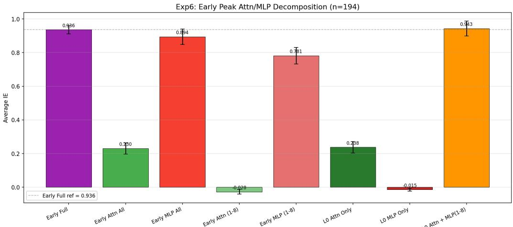

Figure 5: Early-block decomposition (referenced in §2.2). IE recovered by restoring different subsets of the early block. Layer-0 attention combined with MLPs 1–8 (0.943) matches the full early block (0.936), while either sub-component alone falls short.  
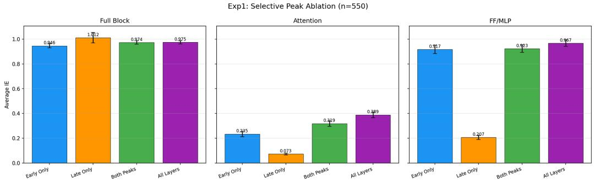  
Figure 6: Selective peak ablation with channel decomposition (n=550). Restoring the early peak alone already recovers most of the causal effect on the MLP channel (0.917 vs. 0.967 for all layers), while restoring the late peak alone leaves the attention channel almost silent (0.073).

## B.2 CROSS-PEAK PATCHING: ARE THE TWO PEAKS IN SERIES OR IN PARALLEL?

Sec. B.1 shows that either peak, restored alone on the Full Block, produces near-ceiling IE. This is compatible with two very different mechanisms: the peaks could be redundant parallel channels (each independently reconstructs the answer), or a serial pipeline (the late peak only works because the early peak feeds it). We disambiguate by conditional patching: we restore one peak while simultaneously blocking the other, i.e. pinning the blocked peak’s hidden states to their corrupted values so that no information can flow through it.

Findings. The asymmetry in Fig. 7 is striking:

• Late Only = 1.012 and Late + Block Early = 1.012 (Full Block): blocking the early peak leaves the late peak’s performance untouched, because when we restore the late peak we hand it a clean representation directly.

• Early Only = 0.946 but Early + Block Late = 0.019: restoring the early peak alone is useless if the late peak is blocked, because the recovered representation cannot reach the readout.

The MLP channel shows the same pattern with an even larger gap (0.917 → 0.148).

Take-away. The two peaks are serially composed, not parallel. The early peak is the source of the fact-relevant signal; the late peak is a downstream conduit that carries the already-retrieved representation toward the [MASK] readout. This is exactly what one expects from the retrieve-thendecode view articulated in §2.2.

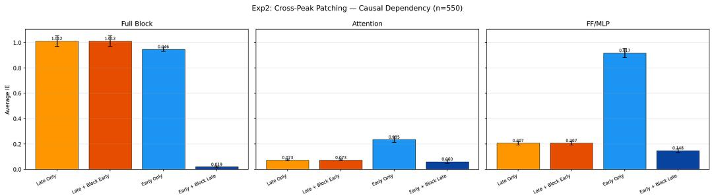  
Figure 7: Cross-peak conditional patching (n=550). Late + Block Early preserves the late peak’s IE (1.012 → 1.012 on Full Block), whereas Early + Block Late destroys the early peak’s effect (0.946 → 0.019). The asymmetry is strongest on the MLP channel (0.917 → 0.148).

## B.3 SUBJECT-TO-[MASK] HANDOFF: MIRROR ANALYSIS ON THE READOUT POSITION

The analyses so far restore hidden states at subject tokens. To see how and when the signal migrates to the position that actually emits the prediction, we run a mirror experiment (Exp 7) that keeps the tracing protocol identical to Exp 3 (§2.2) but restores hidden states at the [MASK] position instead of at the subject range. Fig. 8 overlays the two curves.

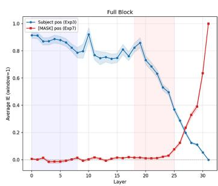

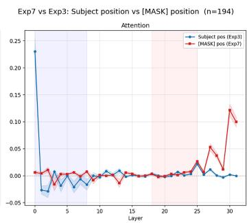

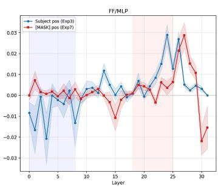  
Figure 8: Subject position (Exp 3) vs. [MASK] position (Exp 7), n=194. Left: full-block IE per layer. Middle / Right: attention-only and MLP-only splits. The two positions are almost mutually exclusive as causal loci: subject-side dominance gives way to [MASK]-side dominance only in the last few layers.

Findings. Reading Fig. 8 from left to right along the layer axis gives a four-stage picture of fact recall in a masked DLM:

1. Layer ∼0: subject-side anchoring by attention. The attention panel shows a single dominant spike at layer 0 on the subject curve (≈ 0.23), with the [MASK] curve near zero. This is the context-fusion step characterised in §2.3.

2. Layers ∼ 1–24: subject-side persistence and processing. On the Full Block the subject curve stays in [0.7, 0.9] while the [MASK] curve remains near zero, indicating that the fact-relevant representation continues to live at the subject positions throughout most of the network.

3. Layers ∼ 25–28: subject → [MASK] handoff. The two curves cross: the subject curve drops sharply while the [MASK] curve rises. Bidirectional attention allows this transfer to happen in a narrow band rather than being smeared across many layers.

4. Top layers: [MASK]-side local readout. In the last few layers the [MASK] curve dominates (Full Block → 1.0; attention ≈ 0.12; MLP peaks around layer 27). The final decoding is performed locally at the readout position, after the retrieved representation has been delivered there.

## B.4 CROSS-MODEL ROBUSTNESS: DREAM-7B REPRODUCES THE LLADA PIPELINE

We rerun the 1-D causal trace of §2.1 on Dream-7B, an independently trained masked DLM whose architecture, training data and mask schedule differ from LLaDA-8B. For each fact we compute the average indirect effect AIE(ℓ, τ) separately at each layer ℓ and each role-typed position $\tau \in$ {Subject, Relation, Prefix, [MASK]}.

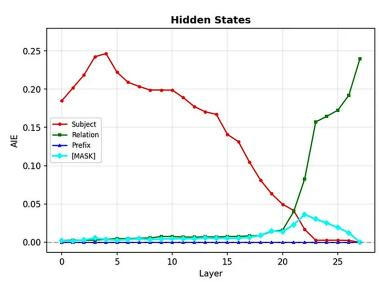

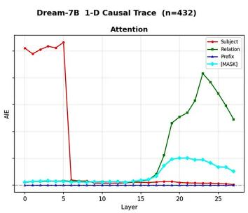

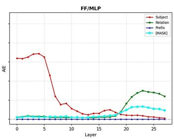  
Figure 9: Dream-7B 1-D causal trace, n=432. Left: hidden states. Middle: attention only. Right: FF/MLP only. Four curves correspond to the four role-typed positions. Dream-7B reproduces every qualitative feature reported on LLaDA-8B: a subject-anchored early peak in Hidden and MLP, a very large low-layer spike on the Attention channel at the subject positions (layers 0–5, AIE≈0.25), a Relation-side attention peak around layers 18–23, and a [MASK]-side takeover in the top layers.

Findings. Fig. 9 matches the LLaDA fingerprint on every axis we tested:

1. Low-layer subject-side attention dominates. On the attention panel, the Subject curve reaches AIE ≈ 0.25 at layers 0–5 and then collapses to near zero from layer 6 onwards, mirroring the single-layer-0 dominance we established on LLaDA (§2.2).

2. Subject-anchored bimodal footprint on Hidden / MLP. The Subject curve on Hidden states peaks around layer 5 and remains elevated up to layer ∼ 20; the MLP panel shows the same subjectside elevation over the early block.

3. Relation-side second peak in the top block. An attention-side Relation peak appears at layers 18–23 (AIE ≈ 0.20), consistent with the subject→readout handoff band identified on LLaDA (App. B.3).

4. [MASK]-side local readout. The [MASK] curve stays near zero for most of the network and rises only in the last few layers, exactly as observed for LLaDA.

Because Dream-7B shares neither pretraining data nor exact model shape with LLaDA-8B yet reproduces all four features, the “low-layer context fusion + early-MLP lookup” pipeline appears to be shared across the two masked DLMs studied rather than specific to the LLaDA checkpoint. This is the mechanistic version of the empirical cross-model transfer already reported in §3.2, and it is what makes it safe to apply the same Multi-View recipe unchanged across the two DLMs. It does not by itself explain why the editor’s quantitative gains differ so much between the two checkpoints (App. G).

## B.5 CROSS-LAYOUT ROBUSTNESS: THE MECHANISM SURVIVES A SUBJECT-SIDE MASK

The tracing setup in §2.1 always masks the object span at the tail of the prompt. This raises a legitimate concern that the pipeline we characterise is specific to tail-side prediction, and that observed “fact retrieval” merely reflects how DLMs handle their canonical next-mask completion. To rule this out we construct a subject-side variant in which we keep the object visible and instead mask the subject span in the middle of the prompt (denoted [MASK subj]). We then re-run the 1-D causal trace at each role-typed position, using LLaDA-8B as the reference model.

Findings. Compared with the tail-mask setting, Fig. 10 shows that the shape of the pipeline is preserved and that only the token roles rotate to their new positions:

1. The Object position now inherits the role previously played by the subject: Hidden AIE rises above 0.9 in the early block, MLP AIE peaks around 0.9 in layers 0–8, and the Attention channel spikes to ∼ 0.45 at layer 0, the same low-layer context-fusion signature reported for the subject side.

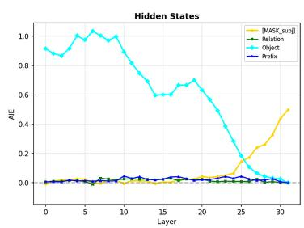

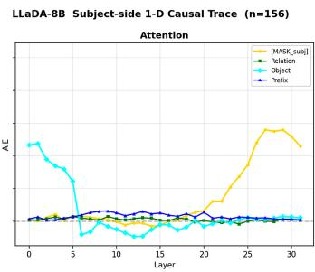

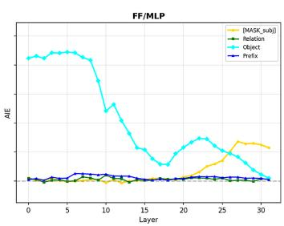  
Figure 10: LLaDA-8B subject-side 1-D causal trace, $n { = } 1 5 6 .$ . Setting: the object is kept clean; the subject span is replaced by [MASK subj]. Curves show AIE at each role-typed position across layers. The Object position now plays the causal role that the subject played in the tail-mask setting: it dominates Hidden / MLP in the early-to-mid layers and its attention spikes at the lowest layers. The [MASK subj] position takes over in the top layers, exactly mirroring the [MASK] takeover of App. B.3.

2. The [MASK subj] position (mid-sentence) takes over in the top layers on all three channels: Hidden and Attention $\mathrm { A I E } { \approx } 0 . 5$ at the last layer, and $\mathbf { M L P \approx 0 . 2 \bar { 5 } }$ , mirroring the [MASK]-side readout of App. B.3.

3. Relation and Prefix positions remain flat throughout, i.e. they still do not carry fact-specific causal mass, regardless of whether they precede or follow the masked span.

This is precisely the property that legitimises the bidirectional access state of Definition 1. When we build a reverse key by masking the subject and keeping the object visible, we are not constructing an out-of-distribution probe; we are exercising the same pipeline in a role-swapped configuration that the model already supports natively. It is also, in our view, the mechanistic reason why Binary / bidirectional editing is a well-defined operation on a masked DLM but not on an autoregressive one: only in the DLM does the subject position causally depend on tokens that appear to its right. Combined with the cross-model replication of App. B.4, the pipeline used by MULTI-VIEW EDIT is thus doubly robust: it survives a change of model (LLaDA-8B ↔ Dream-7B) and a change of mask layout (object-side ↔ subject-side), which justifies treating the forward and reverse keys as symmetric, first-class ingredients of a single editing rule.

## C EDITOR IMPLEMENTATION DETAILS

Table 7 lists all hyperparameters shared across LLaDA-8B and Dream-7B, and Table 8 enumerates the context templates used for $z ^ { * }$ optimisation and key extraction.

## C.1 COVARIANCE ESTIMATION UNDER THE MASKING DISTRIBUTION

The update of equation 9 is written along $\hat { k } = C ^ { - 1 } k _ { \mathrm { a v g } } / ( k _ { \mathrm { a v g } } ^ { \top } C ^ { - 1 } k _ { \mathrm { a v g } } )$ , with

$$
C = \mathbb { E } _ { \boldsymbol { x } \sim \mathcal { D } } \mathbb { E } _ { t \sim \mathcal { U } ( 0 . 1 5 , 0 . 7 5 ) } \mathbb { E } _ { \boldsymbol { \tilde { x } } \sim \boldsymbol { q } _ { t } ( \cdot \vert \boldsymbol { x } ) } \Big [ k ^ { ( \ell ) } \big ( \boldsymbol { \tilde { x } } , \cdot \big ) k ^ { ( \ell ) } \big ( \boldsymbol { \tilde { x } } , \cdot \big ) ^ { \top } \Big ] ,\tag{13}
$$

estimated offline on a corpus sample D. Rescaling by the second moment of keys the model actually produces suppresses directions that are already high-variance across ordinary text, so that the edit does not fire on unrelated inputs. The DLM-specific choice is the second expectation: keys are collected from randomly masked inputs, drawn from the same $q _ { t }$ the model traverses during decoding, not from clean text, so the statistics mirror what the view family of §3.1.2 does in the supervision.

Concretely, we estimate the key covariance at each edit layer as $\hat { C } _ { \ell } = \mathbb { E } [ k _ { \ell } ^ { ( i ) } k _ { \ell } ^ { ( i ) ^ { \top } } \mid i \notin M ]$ , where the expectation marginalises over the DLM’s mask-ratio schedule and the conditioning $i \notin M$ restricts to unmasked (content) positions, matching the distribution of keys seen during actual editing. The inputs are masked; it is the positions at which keys are read that are restricted to unmasked tokens. We invert with Tikhonov regularisation: $\hat { C } _ { \ell } ^ { - 1 } \gets ( \hat { C } _ { \ell } + \lambda I ) ^ { - 1 } . \mathrm { A p p }$ . D.4 isolates the choice: relative to clean-text covariance, estimating the statistics under $q _ { t }$ adds 2.6 pp of paraphrase transfer

Table 7: Editing hyperparameters.
<table><tr><td>Category</td><td>Parameter</td><td>Value</td></tr><tr><td rowspan="4"> $z ^ { * }$  optimisation</td><td>Optimiser</td><td>Adam  $5 \times 1 0 ^ { - 2 }$ </td></tr><tr><td>Learning rate</td><td></td></tr><tr><td>Max steps</td><td>100 (early stop at loss &lt; 0.09)</td></tr><tr><td>Weight decay  $v _ { \mathrm { w d } }$  Clamp factor κ</td><td>0.5 3.0</td></tr><tr><td rowspan="2">Weight update</td><td>Cov. regularisation λ</td><td> $( \| \delta \| \leq \kappa \| z _ { 0 } \| )$   $\overline { { 1 0 ^ { - 5 } } }$ </td></tr><tr><td>Base editor Write position</td><td>ROME (single layer) / MEMIT (multi-layer)</td></tr><tr><td rowspan="2">FT+L baseline</td><td>Learning rate</td><td>last subject token (App. D.3)  $\overline { { 5 \times 1 0 ^ { - 4 } } }$ </td></tr><tr><td>Steps</td><td>80</td></tr><tr><td rowspan="4">Covariance </td><td>ft_norm_constraint</td><td> $5 \times 1 0 ^ { - 4 }$  (default)</td></tr><tr><td>Corpus D</td><td>WikiText-103</td></tr><tr><td>Samples</td><td>100 000 chunks (≤ 256 tokens each)</td></tr><tr><td>Mask ratio</td><td> $r \sim U ( 0 . 1 5 , 0 . 7 5 )$ </td></tr><tr><td rowspan="4">Reproducibility and compute</td><td>Views / sentence</td><td>2 (independent r and mask positions)</td></tr><tr><td></td><td></td></tr><tr><td>Key collection</td><td>Non-masked positions only (~5M keys/layer)</td></tr><tr><td>Sampling seed Peak GPU memory</td><td>42 ≈ 50,000 MiB per run</td></tr></table>

Table 8: Context templates. Each prompt is wrapped as [prefix] + prompt + [MASK] + [suffix]. Suffix templates exploit the DLM’s bidirectional attention to condition on context after the prediction slot.  
```markdown
# Template (prefix || suffix)
Prefix templates (prepended before prompt):
1 " n (identity, no wrapper)
2 $\mathfrak { n } _ { \mathtt { T n } }$ one context, II
3 "According to records, I
4 "In this case, II
5 "For reference, II
6 "In general, II
7 "As noted, "
8 "At that time, II
Suffix templates (appended after [MASK]):
9 II according to records"
10 I as documented"
11 as indicated"
12 based on records"
13 II in context"
14 ", in this instance"
```  
and improves neighborhood specificity and locality monotonically, while reliability is unaffected. The covariance is estimated once per model on WikiText-103 (Table 7) and cached.

## C.2 REPRODUCIBILITY

The editor involves no random initialisation or stochastic retraining. Seed 42 fixes sampled masking patterns and covariance estimation. Each run fits in a single GPU with approximately 50,000 MiB of memory, which is the peak observed for LLaDA-8B with the largest view family; covariance estimation is performed once per model and cached. We will release the full editing and evaluation code, together with the cached covariance statistics and the view-construction scripts, upon acceptance.

## D EDITING EXPERIMENTS: DETAILS AND ADDITIONAL RESULTS

## D.1 BENCHMARKS, SCORING, AND CONFIGURATION

Models and benchmarks. CounterFact measures source reliability, paraphrase transfer, neighborhood specificity and locality preservation; BAKE adds reverse QA and judgment probes (Meng et al., 2022; Ma et al., 2023); QAEdit supplies declarative edits and scores freely generated answers to natural questions as exact (1), partial (0.5) or wrong (0) (Yang et al., 2025). Neighborhood (Neigh.) scores interference on similar subjects. Locality preservation (Loc-Pres.) is the fraction of unrelated prompts on which the edited model’s top-ranked continuation is unchanged from the pre-edit model, so it scores interference on unrelated text.

Scoring. CounterFact and BAKE follow the ROME forced-choice criterion: $O _ { \mathrm { n e w } }$ must outrank $O _ { \mathrm { t r u e } }$ (or Yes must outrank No). For QAEdit we report score-bucket frequencies and $s = ( n _ { 1 . 0 } +$ $0 . 5 n _ { 0 . 5 } ) / n$ . We retain only examples the base model answers fully wrongly $( \mathsf { p r e } < 0 . 5 )$ , so every non-zero score is attributable to the edit.

Editor configuration. MULTI-VIEW changes key/value construction and can use a standard weight-update rule underneath. Main results use ROME at layer 7, written at the last subject token; App. D.3 reports the position sweep. MEMIT spreads the same construction over layers 5–7, all within the mechanistic block. Concurrent DLM editors address a different failure mode and install no object-side key, so they are not comparable on the reverse probes of §3.2.2 (App. A). On QAEdit, where their correction does apply, we reproduce one of them and compose it with ours (App. D.7). We include constrained fine-tuning (FT+L) as a reproducible DLM baseline and show published AR results only as scale references (App. D.2). Hyperparameters are listed in App. C.

## D.2 PUBLISHED AUTOREGRESSIVE REFERENCES

Tables 2 and 3 compare MULTI-VIEW EDIT against matched single-view and single-direction variants and against constrained fine-tuning on the same DLMs. Published results for autoregressive editors on GPT-J (6B) and LLaMA-2 (7B), reproduced from the original papers (Meng et al., 2022; 2023; Ma et al., 2023), are collected in Table 9 as scale references: they concern different models and different edit pools, so they are not controlled comparisons. On the reverse probes they show the pattern the main text refers to: Reverse-QA gains of at most 2.9 points from a forward edit. The AR Reverse-Judge deltas should be read as upper bounds, because BAKE reports a pre-edit floor of zero that is inherited from the QA probe rather than measured on the judgment probe (see below).

Table 9: Published autoregressive references. CounterFact and BAKE results reported by the original papers for GPT-J (6B) and LLaMA-2 (7B). BAKE reports a pre-edit score of 0.00 on both reverse probes for every base LLM, so the published $\Delta$ equals the post-edit value. BIRD does not report CounterFact numbers.
<table><tr><td></td><td></td><td colspan="3">CounterFact</td><td colspan="4">BAKE</td></tr><tr><td>Model</td><td>Method</td><td>Rel. ↑</td><td>Para. ↑</td><td>Neigh. ↑</td><td>Rel. ↑</td><td>Para. ↑</td><td>R-QA↑</td><td>R-Judge↑</td></tr><tr><td>GPT-J (6B)</td><td>ROME MEMIT BIRD</td><td>100.00 100.00</td><td>97.95 97.10</td><td>81.46 81.96</td><td>98.01 96.21</td><td>94.60 86.99</td><td>2.80 0.16</td><td>33.89 13.47</td></tr><tr><td>LLaMA-2 (7B)</td><td>ROME MEMIT BIRD</td><td>99.68 99.58</td><td>98.10 97.99</td><td>77.59 77.80</td><td>99.33 99.70 99.85 99.90</td><td>96.00 94.74 96.92 96.20</td><td>2.90 0.26 0.14 0.28</td><td>34.96 40.78 30.10 42.72</td></tr></table>

The pre-edit floor of BAKE’s judgment probe. BAKE reports a pre-edit score of zero on both reverse probes for every base LLM, attributing this to the filtering of edits whose reverse fact the model already holds. The filter, however, is defined only in the QA direction: given $o ^ { * }$ and $r ^ { - 1 }$ , an edit is retained if the base model prefers $s ^ { * }$ over s, which is exactly the RQS criterion $P ( s ) > P ( s ^ { * } )$ RJS scores a different quantity, $P ( \mathrm { y e s } ) > P ( \mathrm { n o } )$ on a judgment prompt, and nothing in the filter constrains it. A model that has been filtered to not prefer s in the QA direction may still answer yes to “Whether the capital of England is Paris?”, through acquiescence bias, through sensitivity to the surface form of the question, or simply because the judgment prompt makes the target explicit rather than requiring it to be generated. The zero is thus inherited from the QA probe rather than measured on the judgment probe.

Two consequences. First, the AR ∆ on R-Judge should be read as an upper bound: whatever fraction ofjudgment prompts the unedited model already answers affirmatively is being credited to the editor. Second, this asymmetry works against the DLMs in a naive reading of Table 3, since our pre-edit rows are measured rather than assumed (30.6% on LLaDA-8B and 18.2% on Dream-7B) and are subtracted in full. That these measured floors are far from zero on the same style of prompt is itself the clearest evidence that a judgment probe carries a non-trivial affirmative baseline. Directly measuring the AR judgment floor on the released BAKE prompts would settle the question and is a straightforward addition we did not have the compute budget to include.

## D.3 WHICH SUBJECT POSITION SHOULD THE EDIT BE WRITTEN AT?

Why the question is different in a DLM. Locate-then-edit methods developed for AR models write the update at the last subject token. This convention is a consequence of the causal mask: under left-to-right attention, an earlier subject token has not yet seen the remainder of the subject span, and no subject token can see the relation template placed to its right, so the last subject position is the only one whose residual stream carries the complete (s, r) context by the time the early MLPs read it. The choice is therefore forced rather than empirical.

Section 2 shows that this argument does not carry over. Layer-0 attention in a masked DLM fuses the relation template into the subject residual stream (Table 1), and because attention is bidirectional it does so at every subject position simultaneously: each subject token attends to the full relation span regardless of its index within the span. The $( s , r )$ -conditioned key of equation 2 is thus available at any position inside $S _ { s }$ , and which one we write the rank-one update at becomes an empirical choice rather than a structural constraint.

Selection protocol. Because the position is not fixed by the architecture and the design space is small, we settle it empirically, but we separate selection from reporting. The sweep is run on a development pool of n=4694 BAKE edits (Table 10, top block), the winning setting is fixed, and it is then re-evaluated once on a disjoint held-out split of n=1000 edits that is used for no other tuning decision in this paper (Table 10, bottom block). The held-out split reproduces the development ranking exactly: last is best on all four columns on both splits, and the full three-way ordering is identical column by column (last > mean > first on Reliability and Paraphrase, last > first > mean on both reverse probes). The Paraphrase advantage of last shrinks from 17.1 to 14.5 pp under held-out evaluation, i.e. some but not all of it was selection effect.

Table 10: Subject-position sweep on LLaDA-8B (BAKE, ROME base editor). first / mean / last write the update at the first subject token, at the mean over the subject span, and at the last subject token respectively. The top block is the development pool on which the position was selected; the bottom block is a disjoint held-out split evaluated once after the choice was fixed. Reliability and both reverse probes are insensitive to the choice on both splits; Paraphrase is not. last is best on all four columns on both splits, and the three-way ordering is identical column by column. The last setting is the configuration reported throughout the main text.

<table><tr><td>Split</td><td>Position</td><td>Rel. ↑</td><td>Para. ↑</td><td>R-QA↑</td><td>R-Judge ↑</td></tr><tr><td rowspan="3">Development (n=4694)</td><td>first</td><td>97.23</td><td>67.22</td><td>60.94</td><td>52.53</td></tr><tr><td>mean</td><td>98.27</td><td>73.63</td><td>61.02</td><td>50.79</td></tr><tr><td>last</td><td>98.49</td><td>84.56</td><td>63.24</td><td>55.60</td></tr><tr><td rowspan="4">Held-out (n=1000)</td><td>spread</td><td>1.26</td><td>17.34</td><td>2.30</td><td>4.81</td></tr><tr><td>first</td><td>97.50</td><td>67.60</td><td>58.60</td><td>56.60</td></tr><tr><td>mean</td><td>97.90</td><td>75.40</td><td>58.60</td><td>55.90</td></tr><tr><td>last (main text) spread</td><td>98.20 0.70</td><td>82.10 14.50</td><td>61.00 2.40</td><td>57.80 1.90</td></tr></table>

Findings. On the held-out split, three of the four columns are largely insensitive to where in the subject span the update is written: Reliability varies by 0.7 pp, Reverse-QA by 2.4 pp and Reverse-Judge by 1.9 pp across the three settings, differences that are small relative to the effect of the design axes in §3.2.2. This is what §2.3 predicts, and it is the sense in which our result is not a recovery of the AR convention: that convention rests on the last subject token being the only position with a usable key, whereas here first and mean both remain serviceable (≥ 97.5% Reliability, ≥ 58.6% R-QA), i.e. every subject position carries a usable (s, r)-conditioned key.

Paraphrase is the exception, ranging over 67.6%–82.1%: a 14.5 pp spread on held-out data, comparable to the effect of the view family itself. The write position therefore deserves treatment as a first-class design axis rather than an implementation detail. We read the Paraphrase gap as a quantitative effect layered on top of the layer-0 mechanism rather than a structural one: positions later in the subject span aggregate more of the surrounding context into the key even though all positions can access it, so an update written there is triggered by a slightly broader region of key space.

## D.4 ABLATIONS

Matched view budget. MULTI-VIEW supervises the shared value over more views than SINGLE-VIEW does, so its gains could in principle come from the extra optimisation signal rather than from the relation-masked views themselves. We therefore construct a budget-matched variant, MULTI-BINARY (matched), that keeps the relation-masked and reverse construction but removes six views from the context family, leaving it with the same number of views as SINGLE-BINARY. Any remaining gap is then attributable to which views are used, not how many. Tables 11 and 12 report this comparison on BAKE and CounterFact; all other components of the editor, including the base editor, the write position, and the number of optimisation steps, are held fixed.

Table 11: Matched view budget on BAKE (LLaDA-8B). #Views counts the supervised views per direction. MULTI-BINARY (matched) uses the relation-masked and reverse construction with six context views removed, giving it the same budget as SINGLE-BINARY. All other components are held fixed.
<table><tr><td>Variant</td><td>#Views</td><td>Rel. ↑</td><td>Para. ↑</td><td>R-QA ↑</td><td>R-Judge ↑</td></tr><tr><td>SINGLE-BINARY</td><td>14</td><td>97.04</td><td>65.48</td><td>42.03</td><td>41.03</td></tr><tr><td>MULTI-BINARY (matched)</td><td>14</td><td>97.81</td><td>82.24</td><td>63.81</td><td>55.92</td></tr><tr><td>MULTI-BINARY</td><td>20</td><td>98.49</td><td>84.56</td><td>63.24</td><td>55.60</td></tr></table>

Table 12: Matched view budget on CounterFact (LLaDA-8B). Same three configurations as Table 11, evaluated on the CounterFact edit pool.
<table><tr><td>Variant</td><td>#Views</td><td>Rel. ↑</td><td>Para. ↑</td><td>Neigh. ↑</td><td>Loc-Pres. ↑</td></tr><tr><td>SINGLE-VIEW</td><td>14</td><td>96.87</td><td>53.65</td><td>57.13</td><td>68.31</td></tr><tr><td>MULTI-VIEW (matched)</td><td>14</td><td>98.03</td><td>66.85</td><td>71.05</td><td>89.64</td></tr><tr><td>MULTI-VIEW</td><td>20</td><td>98.14</td><td>67.92</td><td>73.73</td><td>89.92</td></tr></table>

Findings. At a matched budget of 14 views, the relation-masked construction already recovers almost all of the gain. On BAKE it lifts Paraphrase from 65.5% to 82.2% and Reverse-QA from 42.0% to 63.8%, against 84.6% and 63.2% for the full 20-view configuration; on Reverse-QA the matched variant is in fact marginally ahead. CounterFact shows the same pattern, with the matched variant within 1.1 pp of the full configuration on Paraphrase (66.9% vs. 67.9%) and within 2.7 and 0.3 pp on Neighborhood and Loc-Pres. The gains of MULTI-VIEW therefore come from which views the shared value is supervised on rather than from how many: adding six further context views on top of the relation-masked family buys a further 2.3 pp of Paraphrase on BAKE and little elsewhere. Since the number of installed directions is fixed by construction (§3.1.3), this also rules out the alternative explanation that the improvement merely reflects more values being written into the weights.

KL locality regularisation. Table 13 moves the KL comparison out of the main results. Overall, KL has little influence on the result: on LLaDA-8B all changes are within 1.6 percentage points, while on Dream-7B its modest locality gains (0.9–1.9 points) are offset by lower reliability and paraphrase accuracy. We therefore use the simpler unregularised objective as the default.

Table 13: KL regularisation ablation on CounterFact. All rows use the ROME base editor.
<table><tr><td>Model</td><td>Variant</td><td>Rel. ↑</td><td>Para. ↑</td><td>Neigh. ↑</td><td>Loc-Pres. ↑</td></tr><tr><td rowspan="2">Dream-7B</td><td>MULTI-VIEW</td><td>99.88</td><td>99.24</td><td>73.04</td><td>88.29</td></tr><tr><td>MULTI-VIEW+KL</td><td>98.27</td><td>92.47</td><td>74.89</td><td>89.21</td></tr><tr><td rowspan="2">LLaDA-8B</td><td>MULTI-VIEW</td><td>98.14</td><td>67.92</td><td>73.73</td><td>89.92</td></tr><tr><td>MULTI-VIEW+KL</td><td>96.83</td><td>66.38</td><td>74.03</td><td>90.18</td></tr></table>

Whitening covariance. equation 13 estimates covariance from randomly masked inputs so that whitening matches the DLM deployment distribution. Table 14 isolates that choice against cleantext covariance and against no whitening at all, holding the model, base editor, data split and every non-covariance hyperparameter fixed.

Findings. Reliability is essentially unaffected by the choice of statistics (97.2%–98.1%): whitening does not determine whether the association is installed. It determines how well the installed direction generalises and how much it leaks. Moving from no whitening to clean-text covariance recovers 5.8 pp of Paraphrase, and estimating the covariance under the model’s own masking distribution adds a further 2.6 pp; Neighborhood and Loc-Pres. improve monotonically in the same order $( 7 0 . 9 \% \to 7 2 . 9 \% \to 7 3 . 7 \%$ and $8 3 . 4 \%  8 8 . 0 \%  8 \bar { 9 } . 9 \%$ . The gap between the two whitened rows is the part attributable to equation 13 specifically, and it is consistent with the motivation given there: the keys an edit is actually queried from at decoding time are drawn from $q _ { t } ,$ not from clean text, so second-order statistics collected under $q _ { t }$ describe the deployment geometry more accurately.

Table 14: Whitening covariance ablation on CounterFact (LLaDA-8B). The model, base editor, data split, and all non-covariance hyperparameters are held fixed.
<table><tr><td>Whitening statistics</td><td>Rel. ↑</td><td>Para. ↑</td><td>Neigh. ↑</td><td>Loc-Pres. ↑</td></tr><tr><td>No whitening</td><td>97.20</td><td>59.55</td><td>70.94</td><td>83.41</td></tr><tr><td>Clean-text covariance</td><td>97.20</td><td>65.32</td><td>72.85</td><td>87.96</td></tr><tr><td>Random-mask covariance (ours)</td><td>98.14</td><td>67.92</td><td>73.73</td><td>89.92</td></tr></table>

Prefix and suffix contexts. Because a DLM conditions bidirectionally, contextual templates can be placed before or after the masked prediction span. Table 15 compares three configurations on CounterFact: no contextual templates, prefix-only templates, and the full prefix-plus-suffix family. All other components of the editor are held fixed.

Table 15: Prefix/suffix context ablation on CounterFact. None uses no contextual templates, Prefix uses only templates before the prompt, and $P r e \hbar x + s u f f u x$ combines prefix and suffix templates; the last row of each block is the MULTI-VIEW configuration of Table 2. All other components of the editor are held fixed. Bold indicates the best result within each model and metric; note that Neighborhood and Loc-Pres. are best without contextual views, i.e. the gains in Rel. and Para. are traded against a small locality cost.
<table><tr><td>Model</td><td>Context views</td><td>Rel. ↑</td><td>Para. ↑</td><td>Neigh. ↑</td><td>Loc-Pres. ↑</td></tr><tr><td rowspan="3">LLaDA-8B</td><td>None</td><td>91.60</td><td>38.20</td><td>76.08</td><td>92.48</td></tr><tr><td>Prefix</td><td>95.40</td><td>49.40</td><td>75.10</td><td>91.90</td></tr><tr><td>Prefix + suffix</td><td>98.14</td><td>67.92</td><td>73.73</td><td>89.92</td></tr><tr><td rowspan="3">Dream-7B</td><td>None</td><td>84.72</td><td>68.20</td><td>76.44</td><td>90.50</td></tr><tr><td>Prefix</td><td>96.98</td><td>85.40</td><td>74.58</td><td>89.84</td></tr><tr><td> $\mathrm { P r e f i x } + \mathrm { s u f f i x }$ </td><td>99.88</td><td>99.24</td><td>73.04</td><td>88.29</td></tr></table>

Findings. Contextual views substantially improve edit success and generalisation on both models. Relative to using no context templates, prefix-plus-suffix supervision raises Reliability by 6.5 percentage points and Paraphrase by 29.7 points on LLaDA-8B; the corresponding gains on Dream-7B are 15.2 and 31.0 points. Adding suffix templates on top of prefix-only supervision accounts for a substantial share of the paraphrase gain on both models (+18.5 points on LLaDA-8B and +13.8 on Dream-7B), confirming that the extra conditioning direction available to a bidirectional model is not redundant with prefix context. These improvements come with modest locality costs: compared with no contextual templates, Neighborhood decreases by 2.4/3.4 points and Loc-Pres. by 2.6/2.2 points on LLaDA/Dream. Overall, bidirectional prefix-plus-suffix conditioning offers a favourable trade-off, producing large gains in reliability and paraphrase transfer for a relatively small reduction in locality.

## D.5 STABILITY UNDER SEQUENTIAL EDITING

We additionally evaluate whether the edits remain stable when multiple facts are installed sequentially. Starting from the same base model, we apply ROME updates one at a time without restoring the original weights, and evaluate the cumulatively edited model after up to $T = 1 0 0$ edits. We compare SINGLE-BINARY with MULTI-BINARY under the same editing protocol.

Findings. Reliability is unaffected by accumulation: both methods stay at 100% through $T = 2 5$ and at ≈ 99% after 100 sequential edits, so previously installed associations are not overwritten by later ones. Generalisation and locality both take their largest hit between T = 1 and T = 10 and then plateau or partly recover, and all three metrics remain well above the 0.5 reference line at every T. On generalisation the two constructions separate: MULTI-BINARY drops to 80% at T = 10 against 70% for SINGLE-BINARY, the two coincide at 86% at $T = 2 5$ , and thereafter MULTI-BINARY holds

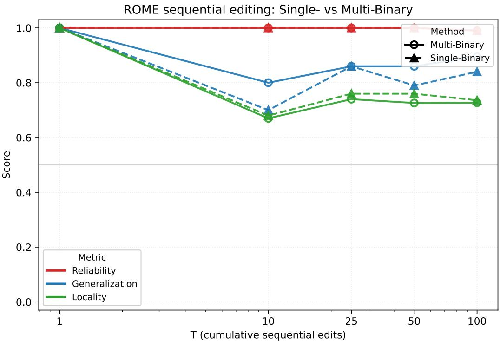  
Figure 11: ROME sequential-edit stability. SINGLE-BINARY and MULTI-BINARY are applied cumulatively without restoring the model weights. Scores are evaluated after $T \in \{ 1 , 1 0 , 2 5 , 5 0 , 1 0 0 \}$ sequential edits.

86% at $T = 5 0$ and 89.5% at $T = 1 0 0$ while SINGLE-BINARY falls to 79% and 84%. The wider key coverage therefore mainly buys resistance to generalisation decay under accumulated interference: a 10-point advantage at $\dot { T } = 1 0$ and 5.5 points at $T = 1 0 0$ . Locality is comparable between the two: from 100% after a single edit it falls to about 67–68% at $T = 1 0$ for both methods and settles at $7 6 \% / 7 4 \%$ (Single/Multi) at $T = 2 5$ and 73.6%/72.7% at $T = 1 0 0$ , with MULTI-BINARY within 3.5 points of SINGLE-BINARY throughout. The stronger generalisation retention is thus not bought with additional interference on unrelated examples.

## D.6 QAEDIT: BREAKDOWN BY TARGET LENGTH

Table 16 breaks the LLaDA-8B source-prompt results of Table 4 down by the token length of the gold answer. Free-generation quality varies only mildly over 1–4 word targets (0.224–0.297 weighted) and is lowest on ≥ 5-word targets (0.198), i.e. the editor degrades gracefully rather than failing outright on multi-token objects, but longer targets remain the harder case. This is consistent with the multi-token degradation reported by Park & Jo (2026), whose correction we compose with our view family in App. D.7.

Table 16: QAEdit LLaDA-8B breakdown by target length (source prompt, MULTI-VIEW).
<table><tr><td>Target length</td><td>n</td><td>=1.0 ↑</td><td>=0.5</td><td>≥0.5↑</td><td>Weighted s ↑</td></tr><tr><td>1 word</td><td>677</td><td>21.3%</td><td>16.8%</td><td>38.1%</td><td>0.297</td></tr><tr><td>2 words</td><td>820</td><td>16.2%</td><td>12.4%</td><td>28.7%</td><td>0.224</td></tr><tr><td>3 words</td><td>437</td><td>16.2%</td><td>15.3%</td><td>31.6%</td><td>0.239</td></tr><tr><td>4 words</td><td>176</td><td>18.2%</td><td>17.0%</td><td>35.2%</td><td>0.267</td></tr><tr><td>≥5</td><td>162</td><td>11.7%</td><td>16.0%</td><td>27.8%</td><td>0.198</td></tr></table>

## D.7 COMPOSING WITH DECODING-STATE VIEWS: REPRODUCING PARK & JO ON QAEDIT

App. A argues that the failure mode identified by Park & Jo (2026) (a value fitted on a fully masked target is not optimised for the partially revealed target states traversed during diffusion decoding) is orthogonal to the key-coverage failure mode this paper addresses, and that in the notation of §3.1.2 their correction is simply a further view type: a partial reveal of $\scriptstyle { S _ { o } }$ rather than an occlusion of $S _ { r }$ Because the two concern different axes of the same editor, the additional views can be supervised on the same shared value without any other change to equation 7. This appendix tests that composition empirically.

QAEdit is the setting in which the comparison is well posed. The reverse probes of §3.2.2 cannot discriminate a forward-only editor at all, but QAEdit scores freely decoded answers, which is exactly the regime the decoding-state correction targets: every answer token beyond the first is produced from a partially revealed target. We therefore reimplement the partial-reveal views on LLaDA-8B and add them to V, holding the view family, the key aggregation equation 8, the whitening equation 13, the write position and every hyperparameter of Table 7 fixed. The evaluation pool is unchanged from §3.2.3.

Table 17: Composing decoding-state views with the multi-view family on QAEdit (LLaDA-8B, pre-edit-wrong examples). The MULTI-VIEW rows repeat Table 4. + PARTIAL REVEAL adds the partially revealed target states of Park & Jo (2026) to V as an additional view type; all other components of the editor are held fixed.
<table><tr><td>Method</td><td>Split</td><td>=1.0 ↑</td><td>=0.5</td><td>=0.0↓</td><td>≥0.5↑</td><td>Weighted s ↑</td></tr><tr><td rowspan="2">MULTI-VIEW</td><td>Rel.</td><td>17.6%</td><td>14.9%</td><td>67.5%</td><td>32.5%</td><td>0.250</td></tr><tr><td>Gen.</td><td>12.6%</td><td>12.9%</td><td>74.5%</td><td>25.5%</td><td>0.187</td></tr><tr><td rowspan="2">MULTI-VIEW + partial reveal</td><td>Rel.</td><td>35.0%</td><td>16.1%</td><td>48.9%</td><td>51.1%</td><td>0.430</td></tr><tr><td>Gen.</td><td>26.7%</td><td>17.0%</td><td>56.3%</td><td>43.7%</td><td>0.352</td></tr></table>

Table 18: QAEdit LLaDA-8B breakdown by target length for the composed editor (source prompt, MULTI-VIEW + partial reveal). Table 16 reports the same breakdown for MULTI-VIEW alone.
<table><tr><td>Target length</td><td>=1.0 ↑</td><td>=0.5</td><td>≥0.5↑</td><td>Weighted s ↑</td></tr><tr><td>1 word</td><td>34.3%</td><td>18.2%</td><td>52.5%</td><td>0.434</td></tr><tr><td>2 words</td><td>25.9%</td><td>12.0%</td><td>38.0%</td><td>0.319</td></tr><tr><td>3 words</td><td>21.3%</td><td>21.3%</td><td>42.7%</td><td>0.320</td></tr><tr><td>4 words</td><td>21.7%</td><td>17.4%</td><td>39.1%</td><td>0.304</td></tr><tr><td>≥5</td><td>20.0%</td><td>20.0%</td><td>40.0%</td><td>0.300</td></tr></table>

Findings. The two corrections compose. On source prompts the weighted score rises from 0.250 to 0.430 and the fraction of previously wrong answers made at least partially correct from 32.5% to 51.1%, so the composed editor is at least partly right on a majority of the examples the unedited model got fully wrong; on paraphrased questions the corresponding figures are 0.187 → 0.352 and 25.5% → 43.7%. Fully correct answers roughly double on both splits. The gain is obtained on top of the full view family of §3.1.2, with the key construction and the number of installed directions unchanged, so it is attributable to the view type Park & Jo (2026) contribute rather than to additional optimisation signal along an axis we already cover.

Table 18 locates that gain where the two-failure-mode reading predicts it. The multi-token degradation of Table 16 is largely removed: the ≥5-word bucket, the worst case for MULTI-VIEW at 0.198, reaches 0.300, and every multi-token bucket now scores above the best single-token result of the uncomposed editor (0.297). What remains is a single step from one-word to multi-word targets (0.434 vs. 0.300–0.320) rather than continued decay with length: across the 2–≥ 5 buckets the spread falls from 6.9 to 2.0 points. The component of the length effect that the decoding-state views remove is thus the component that accumulates with the number of revealed target tokens, as their diagnosis implies; the residual one-word advantage is not a decoding-trajectory effect and we do not account for it here.

## E A KEY-SPACE ACCOUNT OF STATEMENT-LEVEL GENERALISATION

The design principle of §3.1.1 (supervise the edit on views that span the region of key space the fact is queried from) can be made precise. We define generalisation as an objective over the conditionals a fact induces at deployment, note that under the rank-one update of equation 9 this objective is governed entirely by the trigger strength of equation 10, and show that (i) the expected trigger over a query family is maximised by the family’s mean key, with the single-view editor suffering a closedform attenuation (Prop. 1); (ii) no single rank-one association serves both query directions, one per direction suffices, and reverse generalisation decomposes into a direction term and a within-direction coverage term (Prop. 2); (iii) the finite view family of §3.1.2 attains the population optimum up to a view-shift term controlled by sampling from the model’s own $q _ { t }$ and a sampling term decaying with the view budget (Prop. 3). The treatment is a first-order analysis of the editor’s linear algebra; its one modelling assumption is stated explicitly and is checkable against the measured triggers of §3.2.4.

## E.1 SETUP AND NOTATION

Masked-diffusion objective. A masked DLM p is trained to reconstruct randomly hidden tokens. Given x and a mask rate $t \sim \mathcal { U } ( 0 , 1 )$ , the corruption operator $q _ { t }$ replaces each token independently by [MASK] with probability t, and the training loss is the (negative) ELBO

$$
\mathcal { L } _ { \mathrm { E L B O } } ( x ) = \mathbb { E } _ { t \sim \mathcal { U } ( 0 , 1 ) } \mathbb { E } _ { \tilde { x } \sim q _ { t } ( \cdot | x ) } \Big [ \frac { 1 } { t } \sum _ { \substack { p : \tilde { x } _ { p } = [ \mathtt { M a S K } ] } } - \log p _ { \theta } ( x _ { p } \mid \tilde { x } ) \Big ] .\tag{14}
$$

Two features of equation 14 underlie the analysis below. Where an AR model is trained on $p ( o \mid s , r )$ alone, equation 14 trains the model on every conditional in which one subset of x is visible and another is predicted, so the forward and reverse queries of Definition 2 are draws from the same family the model was trained on. And because the model is queried under $q _ { t }$ at decoding time as well, the keys an edit meets at test time come from partially masked inputs; this is why both the view family of §3.1.2 and the whitening covariance of equation 13 are drawn under $q _ { t }$

Editor notation. Fix an edit $( s , r , o ) \to ( s , r , o ^ { * } )$ and an edit layer (suppressed throughout; the MEMIT spreading of equation 9 divides one residual across layers and changes nothing below). Let $C \succ 0$ be the regularised second moment of equation 13, estimated on keys of the corpus $\mathcal { D }$ under the masking distribution $q _ { t } ;$ we write $\tilde { D }$ for that key distribution and $\varphi ( k ) = C ^ { - 1 / 2 } k$ for the whitened key, so that $\mathbb { E } _ { \tilde { D } } [ \varphi ( k ) \tilde { \varphi } ( k ) ^ { \top } ] = I$ up to the Tikhonov term. Let a denote the aggregation key the update is written along $( a = k _ { \mathrm { a v g } }$ in equation 8). In whitened coordinates equation 10 reads

$$
\alpha _ { a } ( k ) = \frac { \langle \varphi ( a ) , \varphi ( k ) \rangle } { \| \varphi ( a ) \| ^ { 2 } } , \qquad \alpha _ { a } ( a ) = 1 .\tag{15}
$$

Definition 2 (Fact-query distribution). At deployment the fact is interrogated through masked conditionals under the corruption $q _ { t }$ of equation 14: object-prediction queries with varying relation wording, context and mask pattern (forward, $Q _ { f } ) ,$ , and subject-prediction queries from the object side (reverse, $Q _ { r } ) .$ Model this as the mixture $\dot { Q } = \pi _ { f } Q _ { f } + \pi _ { r } Q _ { \ i }$ with weights $\pi _ { f } + \pi _ { r } = 1$ For a query q let $\kappa ( q )$ be the key read at its retrieval position (a subject position forward, the first token of $o ^ { * }$ in reverse; $\ S 3 . I . 4 )$ and $\varphi _ { q } ~ = ~ \varphi ( \kappa ( q ) )$ . For $d \in \{ f , r \}$ write $\mu _ { d } = \mathbb { E } _ { Q _ { d } } [ \varphi _ { q } ]$ and $\Sigma _ { d } = \bar { \mathrm { C o v } } _ { Q _ { d } } ( \varphi _ { q } )$ , and assume $\mu _ { d } \neq 0$

By equation 2 the key depends on the relation’s surface form and on direction, so $\Sigma _ { d } \neq 0$ and $\mu _ { f } \neq \mu _ { r } ;$ the queries about one fact occupy a region of key space, not a point. $\mu _ { d } \neq 0$ says the region has a common component, which is necessary for any rank-one edit to cover it.

Assumption 1 (Linear response). Fix the installed value z. For a query $q$ in direction d, the editing effect $\Delta \log \mathrm { i t } ( q )$ of §3.2.4 (with the target subject in place of $O _ { \mathrm { n e w } }$ for reverse queries) satisfies ∆logit $; ( q ) = \gamma _ { d } \alpha _ { a } ( \kappa ( q ) )$ , where $\gamma _ { d } > 0 \ i f z$ is adequate on $Q _ { d }$ (attains the stopping loss of equation 7 on thatfamily) and $\gamma _ { d } \leq 0$ otherwise. A query succeeds $i f f \alpha _ { a } ( \kappa ( q ) ) \geq \tau _ { q } f o r$ some threshold $\tau _ { q } < 1$

This is the single step bridging the editor’s linear algebra to scores: it takes the additive form of a rank-one update literally and ignores second-order interaction with the frozen network. It is directly falsifiable, because $\ S 3 . 2 . { \bar { 4 } }$ measures $\alpha _ { \mathrm { f i r e } }$ and ∆logit per edit and per query type. It predicts (a) ∆logit ≈ 0 wherever α ≈ 0, as observed for M1 on Reverse-QA $( \alpha ~ = ~ 0 . 0 8 4$ $\mathrm { \bar { \Delta } l o g i t } \ = \ - 0 . 0 \bar { 2 } 8 ) ;$ (b) at a fixed value, equal α implies equal ∆logit: M1 and M2 share the forward value and give (0.609, 1.500) vs. (0.609, 1.511) on paraphrase; (c) a per-edit regression of ∆logit on $\alpha _ { \mathrm { f i r e } }$ within a query type should be approximately linear through the origin, its slope estimating $\gamma _ { d } .$ . Where α is constant but ∆logit moves (M1→M3 on paraphrase, $0 . 6 0 9  0 . 6 2 4$ vs. $1 . 5 0 0  \mathbf { \bar { 3 } . \dot { 3 } 0 7 } )$ , the assumption attributes the change to $\gamma _ { d } ,$ i.e. to the value: the family supervision of equation 7 improves value adequacy on paraphrases, a channel separate from key coverage. For an edit with aggregation keys $a _ { f }$ and $^ { a _ { r } , }$ let $d ( q )$ select the direction of query $q .$ Under Assumption 1, the expected activation over the fact-query distribution is

$$
\begin{array} { r } { G ( { a } _ { f } , { a } _ { r } ) = \mathbb { E } _ { q \sim Q } \left[ \alpha _ { { a } _ { d ( q ) } } ( \kappa ( q ) ) \right] = \pi _ { f } G _ { f } ( { a } _ { f } ) + \pi _ { r } G _ { r } ( { a } _ { r } ) , \qquad G _ { d } ( { a } ) = \mathbb { E } _ { Q _ { d } } \left[ \alpha _ { a } ( \kappa ( q ) ) \right] , } \end{array}\tag{16}
$$

with $G _ { d }$ its per-direction surrogate (dependence on the value suppressed). Under Assumption 1 success on $q$ is a threshold on α, so maximising equation 16 maximises expected accuracy to first order.

## E.2 COVERAGE: THE VIEW MEAN MAXIMISES THE EXPECTED TRIGGER

Proposition 1 (Expected trigger and single-view attenuation). Fix a direction, write $\boldsymbol { \mu } = \mu _ { d } , \boldsymbol { \Sigma } =$ $\Sigma _ { d } ,$ and decompose $\varphi ( a ) = \mu + e .$ for an arbitrary error vector e. Then

$$
G _ { d } ( a ) = \frac { \| \mu \| ^ { 2 } + \langle e , \mu \rangle } { \| \mu \| ^ { 2 } + 2 \langle e , \mu \rangle + \| e \| ^ { 2 } } .\tag{17}
$$

(i) (Population multi-view.) $I f \varphi ( a ) = \mu$ then $G _ { d } ( a ) = 1 , \mathrm { V a r } _ { Q _ { d } } [ \alpha _ { a } ] = \mu ^ { \top } \Sigma \mu / \| \mu \| ^ { 4 }$ , and for any $\tau < 1$

$$
\mathbb { P } _ { Q _ { d } } [ \alpha _ { a } \ge \tau ] \ge 1 - \frac { \mu ^ { \top } \Sigma \mu } { \mu ^ { \top } \Sigma \mu + \| \mu \| ^ { 4 } ( 1 - \tau ) ^ { 2 } } .\tag{18}
$$

(ii) (Single view.) $\begin{array} { r } { I f \varphi ( a ) = \mu + \nu } \end{array}$ with $\langle \nu , \mu \rangle = 0 ,$ , then $G _ { d } ( a ) = 1 / ( 1 + \beta ^ { 2 } )$ with dispersion ratio $\beta = \| \nu \| / \| \mu \|$

Proof. $\mathbb { E } _ { Q _ { d } } [ \alpha _ { a } ] = \langle \varphi ( a ) , \mu \rangle / \| \varphi ( a ) \| ^ { 2 }$ ; substituting $\varphi ( a ) = \mu + e$ gives equation 17. For $( \mathrm { i } ) .$ $\alpha _ { a } - 1 = \langle \mu , \varphi _ { q } - \mu \rangle / \| \mu \| ^ { 2 }$ has the stated variance and Cantelli’s inequality gives the tail bound. (ii) sets $\langle e , \mu \rangle = { \bar { 0 } }$ in equation 17. □

Remark 1. SINGLE-VIEW fits a to the key of one edit sentence; its deviation ν from $\mu _ { d }$ is exactly the surface-form and residual-context component that equation 2 identifies and that $\mathcal { V } _ { \mathrm { r e l } }$ and $\mathcal { V } _ { \mathrm { c t x } }$ marginalise out. Prop. 1 thus locates the paraphrase failure of prompt-fitted editors in one scalar, $\beta ^ { \breve { 2 } }$ , and predicts that replacing the point key by the family mean removes the attenuation without increasing the installed rank; (ii) is checkable as $\hat { \beta } ^ { 2 } = 1 / \bar { \alpha } _ { \mathrm { M 1 } } - 1$ , where $\bar { \alpha } _ { \mathrm { M 1 } }$ is the mean single-view trigger in Fig. 4. Maximising $G _ { d }$ alone would be degenerate (shrinking ∥a∥ inflates $\alpha _ { a }$ on every query), but because $\mathbb { E } _ { \tilde { D } } [ \varphi \varphi ^ { \top } ] \ = \ I ,$ the signal-to-leakage ratio $( \bar { \mathbb { E } } _ { Q _ { d } } \overset { \cdot } { \alpha _ { a } } ) ^ { 2 } / \mathbb { E } _ { \tilde { D } } [ \alpha _ { a } ^ { 2 } ] = \langle \varphi ( a ) , \bar { \mu _ { d } } \rangle ^ { 2 } / \Vert \varphi ( a ) \Vert ^ { 2 }$ is scale-free and maximised by the same direction µ<sub>d</sub> (Cauchy–Schwarz). Mean aggregation is therefore also specificity-optimal, consistent with the unchanged neighborhood trigger of§3.2.4; this identity is what deployment-matched whitening (equation 13) buys.

## E.3 DIRECTION: REVERSAL REQUIRES, AND ONLY REQUIRES, A SECOND ASSOCIATION

Assumption 2 (ε-separated directions). $| \langle \mu _ { f } , \mu _ { r } \rangle | \leq \varepsilon \| \mu _ { f } \| \| \mu _ { r } \|$ and $\| \mu _ { r } \| / \| \mu _ { f } \| , \ \| \mu _ { f } \| / \| \mu _ { r } \| \leq$ R for constants $\varepsilon \in [ 0 , 1 ) , R \geq 1$ . Moreover no single value is adequate on both $Q _ { f }$ and Q<sub>r</sub> (they emit different tokens at different roles).

Forward and reverse keys are read at different token roles after the role-swapped fusion of App. B.5; the measured trigger of a forward-only edit on reverse queries, α ≈ 0.08 (M1, Fig. 4), gives εR ≲ 0.1 empirically.

Proposition 2 (The direction axis). Under Assumptions 1–2:

(i) $I f \varphi ( a ) = \mu _ { f }$ then, whatever the value, $G _ { r } ( a ) = \langle \mu _ { f } , \mu _ { r } \rangle / \| \mu _ { f } \| ^ { 2 } \leq \varepsilon R \mathrm { . }$ forward-only editing leaves reverse success within $O ( \varepsilon R )$ ofthe unedited baseline, so architectural availability of the reverse conditional does not confer reachability.

(ii) For any single pair $( a , z )$ the value is inadequate on at least one of $\cdot Q _ { f } , Q _ { r }$ , where $\gamma _ { d } \leq 0 .$ a rank-one edit improves at most one direction.

(iii) Installing $\{ ( a _ { f } , z _ { f } ^ { * } ) , ( a _ { r } , z _ { r } ^ { * } ) \}$ with $\varphi ( a _ { d } ) = \mu _ { d }$ and each $z _ { d } ^ { * }$ adequate on $Q _ { d } ( \ S 3 . I . 3 - 3 . I . 4 )$ gives within-direction expected trigger 1 in each family, cross-direction interference at most εR in expectation, and hence $G \subseteq \pi _ { f } \mathbb { P } _ { Q _ { f } } [ \alpha _ { a _ { f } } \geq \tau ] + \pi _ { r } \mathbb { P } _ { Q _ { r } } [ \alpha _ { a _ { r } } \geq \tau ] - O ( \varepsilon R )$ , with each probability bounded as in Prop. 1(i) and the installed rankfixed at one per direction independently of |V|.

Proof. (i) is $\mathbb { E } _ { Q _ { r } } [ \alpha _ { a } ] ~ = ~ \langle \mu _ { f } , \mu _ { r } \rangle / \| \mu _ { f } \| ^ { 2 }$ plus Assumption 2. (ii): on the inadequate family $\Delta \mathrm { l o g i t } ~ = ~ \gamma _ { d } \alpha ~ \stackrel { \textstyle < } { \mathrm { \Omega } } 0 . ~ \mathrm { ( i i i ) }$ : let $\Delta _ { d } = \ : \dot { ( } z _ { d } ^ { * } - W _ { \mathrm { d o w n } } a _ { d } ) / m$ be the residual installed for direction $d$ in equation $9 . \ \mathrm { ~ A ~ }$ direction-d query with key κ receives $\Delta _ { d } \alpha _ { a _ { d } } ( \kappa ) + \Delta _ { d ^ { \prime } } \alpha _ { a _ { d ^ { \prime } } } ( \kappa ) , d ^ { \prime } \neq d ;$ the second coefficient has expectation $\langle \mu _ { d ^ { \prime } } , \mu _ { d } \rangle / \| \mu _ { d ^ { \prime } } \| ^ { 2 } \leq \varepsilon R$ by Assumption 2, and the first reduces to Prop. 1(i). □

Remark 2 (Reversal is inversion plus rewording). Reverse probes realise $r ^ { - 1 }$ in fresh wording, so $Q _ { r }$ has its own dispersion $\beta _ { r } > 0 ,$ , and the single reverse-view key of SINGLE-BINARY deviates from $\mu _ { r }$ by an inversion-template and a wording component. Applying Prop. 1 within $\boldsymbol { Q } _ { r } \boldsymbol { : }$ SINGLE-FORWARD attains $G _ { r } \ \leq \ \varepsilon \dot { R }$ (Prop. 2(i)); SINGLE-BINARY lifts this to $\begin{array} { r } { \hat { 1 } / ( 1 + \beta _ { r } ^ { 2 } ) , } \end{array}$ the reverse occlusions $\mathcal { R } _ { \rho }$ of equation 6 marginalise the wording component and move ${ \dot { G } } _ { r }$ toward 1 (MULTI-BINARY). Reverse generalisation decomposes exactly into a direction term and a within-direction coverage term (the two axes of§3.1.2), predicting the two-step gains ofTable $3 \ : ( 2 2 . 4 \%  4 2 . 0 \% $ 63.2% R-QA on LLaDA-8B) and their persistence at a matched view budget (Table 11).

## E.4 FINITE VIEWS, AND WHY THEY ARE DRAWN FROM $q _ { t }$

Let $P _ { V }$ denote the distribution over direction-d views induced by the construction of §3.1.2 (occlusion ratio drawn from $\mathcal { P } _ { \rho } .$ , occlusion pattern, context template), and write $\mu _ { P _ { V } } = \mathbb { E } _ { v \sim P _ { V } } [ \varphi ( k ( v ) ) ] _ { }$ and $\Sigma _ { V }$ for the mean and covariance of the whitened view keys.

Proposition 3 (Approximate maximisation from finitely many views). Let $v _ { 1 } , \ldots , v _ { n } \stackrel { \mathrm { i i d } } { \sim } P _ { V }$ and let aˆ be their aggregated key (equation $g ; \varphi i s$ linear, so $\varphi ( \hat { a } )$ is the mean of the whitened view keys). For a failure probability $\delta \in ( 0 , 1 )$ put $\eta = \left( \| \mu _ { P _ { V } } - \mu _ { d } \| + \sqrt { \mathrm { t r } \Sigma _ { V } / ( n \delta ) } \right) / \| \mu _ { d } \|$ . With probability $\geq 1 - \delta$ over the draw ofthe views,

$$
G _ { d } ( \hat { a } ) \geq \frac { 1 - \eta } { ( 1 + \eta ) ^ { 2 } } \geq 1 - 3 \eta .\tag{19}
$$

Proof. $\varphi ( \hat { a } ) = \mu _ { d } + \epsilon$ with $e = ( \mu _ { P _ { V } } - \mu _ { d } ) + \xi _ { n }$ , where $\xi _ { n }$ is the sampling deviation of the empirical mean, $\bar { \mathbb { E } } \| \dot { \xi } _ { n } \| ^ { 2 } = \mathrm { t r } \Sigma _ { V } / n$ . Chebyshev gives $\lVert e \rVert \leq \eta \lVert \mu _ { d } \rVert \mathrm { ~ w . p . ~ } \geq \bar { 1 } - \bar { \delta }$ , and Cauchy–Schwarz in equation 17 yields the first bound; $( 1 - \eta ) - ( \bar { 1 - 3 } \eta ) ( \bar { 1 + \eta } ) ^ { \bar { 2 } } = \bar { 5 } \eta ^ { 2 } + 3 \eta ^ { 3 } \ge 0$ gives the second.

The bound separates two errors. The sampling term decays with the view budget n. The viewshift term $\| \mu _ { P _ { V } } - \mu _ { d } \|$ does not decay with n: it depends only on which distribution the views are drawn from. Generating views with the model’s own $q _ { t }$ (the operator that defines the deployment conditionals in equation 14) and marginalising the occlusion ratio over $\mathcal { P } _ { \rho }$ ties $P _ { V } \tan Q _ { d }$ structurally, without a paraphrase resource; SINGLE-VIEW is the degenerate case in which $P _ { V }$ is a point mass at the edit sentence, whose shift equals the full dispersion $\beta \Vert \mu \Vert$ of Prop. 1(ii) and which no budget reduces. This is the reading of the budget-matched ablation (Tables 11–12): at fixed $n ,$ changing the composition of the family changes $\mu _ { P _ { V } }$ , and nearly all of the gain moves with it.

## E.5 PREDICTIONS AND SCOPE

The account predicts, and the paper confirms: (P1) forward-only editing leaves reverse metrics at baseline despite the reverse conditional being available (Prop. 2(i); SINGLE-FORWARD, Table 3); (P2) reverse gains arrive in two separable steps (Remark 2; Table 3); (P3) at matched budget, gains track the composition of the view family, not its size (Prop. 3; Tables 11–12); (P4) widening the family leaves the unrelated-query trigger unchanged (Remark 1; $\alpha \approx 0 . 0 3$ in §3.2.4); (P5) paraphrase gains split into a small trigger and a large value component (Assumption 1(c); Fig. 4).

The analysis is idealised: Assumption 1 linearises a small rank-one update; $\varepsilon , R , \beta$ and the view shift are measured, not derived from the architecture; the treatment is per-fact and does not model sequential interference (App. D.5) or the decoding-trajectory failure mode, which is orthogonal to the key-coverage axis (App. A, App. D.7). Within these limits, the view family is not an augmentation heuristic but a Monte-Carlo estimator of the two population directions, one per query direction, that maximise equation 16 under the editor’s own update rule.

## F EVIDENCE RETRIEVAL: BENCHMARKS, PROTOCOLS AND CONTROLS

## F.1 CONTROLLED BENCHMARK FROM POPQA FACTS

Corpus and queries. The controlled benchmark is built from PopQA facts (Mallen et al., 2023) and is strictly balanced over five domains (Table 19). It contains 1,382 entities and 5,528 evidence cards over 19 distinct relations (citizenship appears in both the person and the sports domain); every entity carries exactly the four relations of its domain. Each card states the subject first, then its relation and the source answer string(s), for example $F o r \ ^ { \cdots } F i l m A ^ { \cdots } $ , the director is Person X. Ambiguous names are removed globally and the entity sets of different domains are disjoint. Each domain contributes 20 validation and 60 test entities, giving 3,600 validation and 10,800 test queries; each test domain has 720 single-target, 720 adjacent dual-target and 720 crossed dual-target queries, so the five domains and three layouts are weighted equally. No example is filtered by whether a model answers it. Adjacent queries place each entity next to its relation clause $( F o r \ ^ { \cdots } A ^ { \prime \prime }$ , identify the director; $f o r \ ^ { \cdots } B ^ { \prime \bar { \prime } }$ , identify the producer); crossed queries name both entities first and assign relations by reference $( F o r ^ { \cdots } A ^ { \prime \prime }$ and $\mathbf { \Gamma } ^ { \mathrm { e } } B ^ { \prime \prime }$ , identify the directorfor theformer and the producerfor the latter). Entity spans are recorded when rendering each template.

Table 19: Domains of the controlled benchmark.
<table><tr><td>Domain</td><td>Relations</td><td>Entities</td></tr><tr><td>Film production</td><td>director, composer, screenwriter, producer</td><td>590</td></tr><tr><td>Person attributes</td><td>occupation, citizenship, birthplace, language</td><td>351</td></tr><tr><td>Sports people</td><td>sport, team, playing position, citizenship</td><td>236</td></tr><tr><td>Family relations</td><td>father, mother, spouse, sibling</td><td>116</td></tr><tr><td>Written works</td><td>author, genre, publisher, language</td><td>89</td></tr></table>

Readouts and baselines. For subject retrieval, the vector for target j is the hidden state at the last subject token (L0, plain input) or the mean over its subject span at the selected deeper layer under the retrieval prompt; each card is represented at its own subject span, and the branch-specific score is the cosine similarity between the two. Whole-query pooling averages the hidden states of the original input text, excluding chat wrappers, padding and representative-token suffixes. DiffRetriever uses its released zero-shot single-step encoding with four query and sixteen passage representations; PromptReps uses up to twenty sequential representative tokens on Qwen2.5-7B-Instruct. Dense scoring uses normalized vectors with nonnegative MaxSim; hybrid scoring equally combines min– max-normalized dense and sparse scores. BM25 uses Porter stemming. One setting per method maximizes the validation mean of single R@1, adjacent All@2 and crossed All@2, and all settings are fixed before test evaluation.

Protocols. In global search each subject branch ranks the full corpus; retrieval alternates between branches and removes duplicate cards until the total budget of two is met, with no entity-based candidate filter. Global pooling and the official retrievers return a single ranking. Single R@1 measures retrieval of the exact target card; dual All@2 measures whether both target cards occur within two retrieved cards. The entity-conditioned protocol gives every method the same visible entity spans and an exact unique-title linker: each target has four candidate cards (its four relations), and at budget two each entity receives one card, so the protocol isolates relation choice from entity coverage. Global methods reuse their scores within each candidate set; hybrid normalization and fusion are performed within it. Readout selection is repeated on validation under this protocol.

Findings. On two-entity queries every single-vector method collapses in global search: the best adjacent and crossed All@2 among BM25, pooling, DiffRetriever and PromptReps are 3.06 and 2.50. Per-entity access states retrieve both cards for 38.28–41.94% of adjacent and 21.78–38.08% of crossed queries from the deeper layers, and for 13.32–24.44% and 9.44–13.33% from the first block. The entity-conditioned protocol, which removes entity coverage as a factor, leaves the ordering unchanged: subject L31 reaches 41.94/38.08 against at most 16.35/16.26 for the baselines, so the advantage lies in relation choice within an entity’s cards, not in finding the entity. Single-entity search over the full corpus is where the representative-token and lexical retrievers are strongest (DiffRetriever hybrid 97.69, BM25 92.82, against 89.08 for subject L31); the deeper readouts also lead the first-block readout there, in contrast to the natural setting of App. F.2, where the candidate set is a question’s own context and the first-block state is the best allocator.

## F.2 NATURAL COMPARISON-QUESTION RAG

We evaluate multi-entity evidence retrieval and answer generation on the comparison subsets of HotpotQA and 2WikiMultiHopQA. A question is retained when its official ten-paragraph distractor context provides two unambiguous entity mentions and two valid gold evidence groups. We reserve 100 questions from each dataset for validation and evaluate on all remaining eligible questions: 1,296 from HotpotQA and 2,933 from 2WikiMultiHopQA. One additional 2Wiki question is excluded because its annotated supporting-sentence index is outside the corresponding paragraph. The resulting frozen corpus contains 106,329 unique Wikipedia sentences, each prefixed with its paragraph title. For every question, a retriever ranks the sentences in its official distractor context and returns two total sentences. These sentences are placed in an identical prompt for a frozen Qwen2.5-7B-Instruct reader, which generates a short answer with greedy decoding.

We compare BM25, whole-query pooling, PromptReps, the released dense and hybrid DiffRetriever variants, and subject-state retrieval on Dream-7B and LLaDA-8B. Dream and LLaDA DiffRetriever use four query and sixteen passage representations; Qwen PromptReps uses twenty of each. L0 subject retrieval reads the last subject token from the plain input. The deeper subject variants read the mean subject state at Dream L27 or LLaDA L31 under the retrieval prompt. For a two-entity question, subject retrieval forms one ranking per entity, alternates between the two rankings, and removes duplicate sentences until the shared budget of two is filled. All configurations are fixed before test evaluation. Support R@2 measures recall over annotated supporting sentences, while Both@2 measures whether the retrieved pair covers both gold evidence titles. End-to-end answer quality is reported with normalized exact match and token F1. Latency is the median per-query time from question to retrieved evidence, excluding answer generation, at batch size 1 with resident model and index; neural methods run on one H200 and BM25 on the host CPU.

Dream L0 provides the strongest evidence retrieval on both datasets (Table 20). Its Both@2 exceeds Dream DiffRetriever hybrid by 25.54 points on HotpotQA (paired 95% CI [22.30, 28.78]) and by 28.37 points on 2WikiMultiHopQA ([26.49, 30.24]). The improved evidence allocation raises answer F1 by 6.71 points ([4.02, 9.48]) and 19.14 points ([17.12, 21.22]), respectively. Relative to BM25, Dream L0 improves Both@2 by 16.67 points on HotpotQA and 10.44 points on 2Wiki, together with EM gains of 5.87 and 3.99 points. On HotpotQA, the LLaDA L31 subject state gives the strongest final answers, reaching 61.34 EM and 69.81 F1; on 2Wiki, Dream L0 is the strongest non-oracle method on all four metrics. Entity-specific subject states thus allocate a fixed retrieval budget across the two targets of a natural comparison question, and the improvement carries through to the generated answer.

## F.3 CAUSAL INTERVENTION AND MATCHING CONTROLS

The interventions in this subsection use Dream-7B-Instruct and the earlier, film-only version of the controlled benchmark (3,745 cards, 5,196 queries in the same single, adjacent and crossed layouts).

Summary. The dependence on relation fusion is causal. On Dream, we subtract the first attention layer’s relation-token value messages at the subject positions, keeping all other attention weights and the document index fixed. Within-entity relation R@1 falls to the 25% four-choice chance level in all three layouts (54.3 → 27.1 single, 59.1 → 25.3 adjacent, 42.5 → 25.4 crossed), while mass-matched and norm-matched random messages leave it at the clean level (Fig. 12; Holm-adjusted p ≃ 0.0003 in each layout), and entity identification stays at 100%. The same loss appears at the L1 MLP key, the representation that §2 identified as the lookup key (Table 21). Replacing the removed message with a norm-matched message of a different relation from the same entity redirects retrieval toward that relation: donor-relation selection rises from 14.89% to 56.38% on single queries and from 33.83% to 57.57% on adjacent queries. Early access states thus carry the relation information that

Table 20: Natural comparison-question retrieval and end-to-end RAG. Every retriever receives the same per-question distractor corpus and a total budget of two sentences; all retrieved evidence goes to the same frozen Qwen2.5-7B-Instruct reader. Accuracy in percent; time in ms per query, from question to retrieved evidence, excluding answer generation. Shaded cells mark the best nonoracle method in each column.
<table><tr><td></td><td colspan="5">HotpotQA (n = 1,296)</td><td colspan="5">2WikiMultiHopQA (n = 2,933)</td></tr><tr><td>Method</td><td>Sup. R@2↑ Both@2↑</td><td></td><td>EM↑</td><td>F1↑</td><td>ms↓</td><td>Sup. R@2↑ Both@2↑</td><td></td><td>EM↑</td><td>F1↑</td><td>ms↓</td></tr><tr><td>Shared baselines</td><td></td><td></td><td></td><td></td><td></td><td></td><td></td><td></td><td></td><td></td></tr><tr><td>BM25</td><td>52.10</td><td>25.15</td><td></td><td>52.31 61.23</td><td>0.38</td><td>56.50</td><td></td><td>26.9361.61</td><td>62.18</td><td>0.38</td></tr><tr><td>Qwen2.5 pooling</td><td>18.46</td><td>3.32</td><td></td><td>45.0653.19</td><td>31.43</td><td>14.31</td><td></td><td>1.94 38.56</td><td>43.20</td><td>31.44</td></tr><tr><td>PromptReps (20/20), hybrid</td><td>41.86</td><td>11.34</td><td></td><td>49.0056.94</td><td>456.18</td><td>44.85</td><td>13.1655.74</td><td></td><td>56.33</td><td>456.94</td></tr><tr><td>Dream-7B-Instruct</td><td></td><td></td><td></td><td></td><td></td><td></td><td></td><td></td><td></td><td></td></tr><tr><td>Whole-query pooling</td><td>32.91</td><td>11.11 47.61 56.07</td><td></td><td></td><td>29.33</td><td>36.25</td><td>11.1852.27 54.64</td><td></td><td></td><td>29.37</td></tr><tr><td>DiffRetriever (4/16), dense</td><td>40.33</td><td>13.97 51.0059.94</td><td></td><td></td><td>32.29</td><td>27.82</td><td></td><td>6.65 39.99</td><td>44.14</td><td>32.28</td></tr><tr><td>DiffRetriever (4/16), hybrid</td><td>44.86</td><td>16.28</td><td></td><td>50.77 59.60</td><td>35.85</td><td>37.17</td><td></td><td>9.0044.6647.13</td><td></td><td>39.03</td></tr><tr><td>Subject (L0)</td><td>58.33</td><td>41.82</td><td></td><td>58.1866.31</td><td>2.64</td><td>59.34</td><td>37.3765.6066.26</td><td></td><td></td><td>2.64</td></tr><tr><td>Subject (L27)</td><td>39.17</td><td>20.7655.5663.67</td><td></td><td></td><td>31.95</td><td>34.24</td><td>12.04 59.77 60.06</td><td></td><td></td><td>31.95</td></tr><tr><td>LLaDA-8B-Instruct</td><td></td><td></td><td></td><td></td><td></td><td></td><td></td><td></td><td></td><td></td></tr><tr><td>Whole-query pooling</td><td>42.19</td><td>16.44 53.32 61.41</td><td></td><td></td><td>33.10</td><td>35.90</td><td>10.13 50.90 53.02</td><td></td><td></td><td>33.08</td></tr><tr><td>DiffRetriever (4/16), dense</td><td>39.89</td><td></td><td></td><td>14.04 50.85 59.56</td><td>34.40</td><td>33.16</td><td>6.65</td><td>43.23</td><td>45.70</td><td>23.47</td></tr><tr><td>DiffRetriever (4/16), hybrid</td><td>46.85</td><td></td><td></td><td>19.21 53.01 61.57</td><td>93.40</td><td>43.51</td><td>13.6052.88</td><td></td><td>54.16</td><td>93.38</td></tr><tr><td>Subject (L0)</td><td>58.01</td><td>40.82 57.56 65.52</td><td></td><td></td><td>2.62</td><td>56.60</td><td>33.17</td><td>63.55</td><td>64.14</td><td>2.63</td></tr><tr><td>Subject (L31)</td><td>56.98</td><td>41.20</td><td></td><td>61.34 69.81</td><td>35.44</td><td>44.04</td><td>20.39</td><td>62.60</td><td>62.77</td><td>35.48</td></tr><tr><td>Closed-book reader</td><td></td><td></td><td></td><td>55.48 63.09</td><td>一</td><td></td><td></td><td>47.87</td><td>48.41</td><td></td></tr><tr><td>Oracle evidence</td><td></td><td></td><td></td><td>62.7371.77</td><td>1</td><td></td><td></td><td>82.07 82.14</td><td></td><td>一</td></tr></table>

Protocol. Subject rows use the entity-position readout; L0 reads the last subject token of the plain input, L27/L31 the mean subject state under the retrieval prompt, selected on validation. DiffRetriever uses four query and sixteen passage representations; PromptReps twenty of each. Timing. Median per query at batch size 1 with resident model and index; neural methods on one H200, BM25 on the host CPU.  
selects evidence, and reading them is the counterpart of the write in §3: the layer-0 routing that an edit must cover is what a retrieval vector taken from the state already contains.

Single  
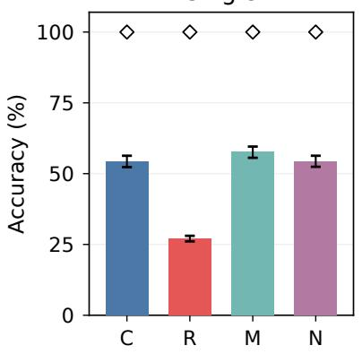

Adjacent  
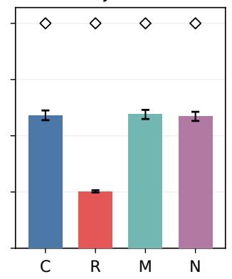

Crossed  
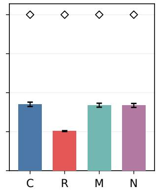  
Figure 12: Relation messages support early evidence selection. Query-side layer-0 interventions on Dream with a fixed document index. Bars: within-entity relation R@1 averaged over targets; diamonds: global entity identification; error bars: entity/pair-clustered 95% confidence intervals. C: clean; R: relation messages removed; M: mass-matched random messages (three-seed mean); N: norm-matched random messages.

Protocol. The causal experiment uses plain queries in Dream Instruct. We recompute queries and all document states in float32, keep the document index fixed, and intervene only on query-side L0 attention. For subject position i and relation-token set R, let

<table><tr><td>Query-side L0 intervention</td><td>Single</td><td>Adjacent</td><td>Crossed</td></tr><tr><td>Clean</td><td>54.31</td><td>59.11</td><td>42.53</td></tr><tr><td>Remove relation messages</td><td>27.07</td><td>25.26</td><td>25.35</td></tr><tr><td>Native random removal, mean of three</td><td>54.73</td><td>59.07</td><td>42.39</td></tr><tr><td>Exact-mass random message, mean of three</td><td>57.61</td><td>59.51</td><td>41.97</td></tr><tr><td>Norm-matched random message</td><td>54.37</td><td>58.56</td><td>41.81</td></tr><tr><td>Clean relation add-back</td><td>54.31</td><td>59.11</td><td>42.53</td></tr><tr><td>Wrong-relation add-back</td><td>10.29</td><td>35.39</td><td>48.34</td></tr><tr><td>Remove former/latter messages</td><td>54.31</td><td>59.11</td><td>41.96</td></tr><tr><td>Remove non-subject template messages</td><td>24.94</td><td>25.04</td><td>25.03</td></tr><tr><td>L2 residual: clean / relation removal</td><td>51.12 /35.17</td><td>47.87 / 31.42</td><td>37.91 / 29.14</td></tr><tr><td>L1 MLP key: clean / relation removal</td><td>41.84 / 30.23</td><td>41.78 / 28.36</td><td>35.56 / 27.94</td></tr></table>

Table 21: Causal readout results: within-entity relation R@1 (%). The first nine rows read the L0 residual. Random-seed rows are averaged only for display; all thirteen conditions are stored individually. Former/latter removal is a no-op in layouts without these tokens.

$$
m _ { R } ( i ) = W _ { O } \ c o n c a t { _ { h } \left[ \sum _ { t \in R } \alpha _ { i t } ^ { h } v _ { t } ^ { h } \right] } .\tag{20}
$$

We subtract $m _ { R } ( i )$ from the attention output at every token in each subject span. R includes the visible relation-word tokens from all target clauses in the query. Other attention weights remain unchanged: there is no softmax renormalization. We read the resulting L0 residual, L2 residual, and actual input to the L1 MLP down-projection (the MLP key). These have dimensions 3,584, 3,584, and 18,944, respectively. The clean float32 global scores differ from the original bfloat16 scores by at most 0.87 percentage points; every causal contrast uses the same float32 computation.

The thirteen conditions comprise clean input; relation-message removal; three native randommessage removals; three exact-mass random-message controls; a residual-norm-matched random control; clean relation add-back; wrong-relation add-back; former/latter-message removal; and all non-subject-template-message removal. Random token sets exclude subject, relation, reference, and special tokens. For each seed, subject position, and attention head, we sample 256 same-cardinality subsets and select the closest attention-mass match without retrieval scores or correctness labels.

The native random subsets have mean relative mass errors of 32.39%, 32.68%, and 32.51%. The exact controls reweight each selected set to the relation mass before output projection, achieving maximum effective relative errors below $2 . 4 \times 1 0 ^ { - 7 }$ . Their maximum scaling factor is $1 . 9 7 \times 1 0 ^ { 7 } $ these are reweighted message interventions rather than native-edge deletions. Independently, the norm control scales a random projected message to $\| m _ { R } ( i ) \| _ { 2 }$ , matching the residual perturbation size with relative error below $\bar { 1 . 6 7 } \times 1 0 ^ { - 7 }$ . We report both control families because they constrain different aspects of the intervention.

Content transfer and reference binding. The donor uses the same entity and template with a different requested relation. Single-target donors cycle to another relation; dual-target donors swap the two relations while preserving both entities and the word bag. We replace $m _ { R } ( i )$ by the donor’s relation contribution, aligned to the same subject tokens and scaled to its original norm. Wrong-relation selection increases by 41.49 points on single queries (95% CI [38.56, 44.43]) and 23.74 points on adjacent queries ([20.75, 26.91]). In crossed queries it decreases by 5.45 points $( [ - 7 . 1 6 , - 3 . 7 9 ] )$ : clean states already favor the donor relation (47.95%) over the intended relation (42.53%). After transfer, correct-relation accuracy rises to 48.34%. Relation availability and reference binding are therefore empirically separable. Removing the messages from former/latter tokens has a small effect on this L0 subject readout; directly reading or patching those tokens is a separate localization experiment.

Inference and implementation checks. The prespecified primary contrast is the mean of the three exact-mass controls minus relation removal in L0 relation R@1, separately for each layout. Differences are 30.54, 34.25, and 16.62 points, with 95% paired cluster-bootstrap intervals [28.49, 32.53], [32.17, 36.39], and [15.30, 17.88]. We use 10,000 bootstrap and sign-flip draws; Holm correction across the three primary tests gives $p \simeq 0 . 0 0 0 3 0$ for each. Norm-matched contrasts have the same direction. Global entity identification remains 100% for clean and relation removal; the paired interval [0, 0] lies inside the fixed ±2-point equivalence margin. This is preservation of the measured identification endpoint at ceiling, rather than identity of the full entity representation.

Clean-message add-back restores all saved readouts exactly, serving as an algebraic implementation check. Reconstructed attention contributions match native scaled-dot-product attention with maximum relative error $6 . 0 8 \times 1 0 ^ { - 5 }$ . A six-query preflight verifies every non-subject L0 position is unchanged; the full run saves subject readouts only. The audit checks all 77 entity-conditioned result rows, all 5,196 causal queries at three readouts, donor alignment, finite features, validation selections, metric aggregation, and code/data hashes. The follow-up protocol was frozen before these evaluations and reuses the already-inspected main-table test set. The resulting claim concern frozen-model factual evidence selection and its causal dependence on early relation messages; answer generation and latency are reported in App. F.2.

## G LIMITATIONS

We list the limitations we consider most material, in rough order of how much they constrain the claims of the paper.

Free-generation transfer is improved, not solved. The QAEdit results of §3.2.3 show that Multi-View produces a clear improvement in free generation after a statement-only edit: 44.6% and 32.5% of previously wrong answers become at least partially correct. We want to be explicit that this is not the same as having solved statement-to-question transfer. In absolute terms the weighted scores are 0.342 (Dream) and 0.250 (LLaDA); fully correct answers are 23.8% and 17.6%; and 55.4% and 67.5% of edits are still answered wrongly. On a paraphrased question (the Gen. split) the numbers fall further. A user who edits a fact by stating it and then asks about it in natural question form should therefore still expect the edited model to be wrong more often than right. The contribution here is a measurable step on a metric where AR editors have been brittle, not a deployable level of reliability.

The edit specification is structured. Although we describe the input as a declarative statement, the current construction assumes identifiable subject, relation, and object spans. Benchmarks such as CounterFact and BAKE provide this structure naturally, whereas arbitrary user statements may contain multiple predicates, qualifiers, or non-contiguous relations. Extending statement-level editing to such inputs requires a mechanism for proposition decomposition and span discovery, which is outside the scope of the present editor.

Retrieval assumes identifiable entity spans and two-entity questions. Both settings provide the entity spans: matched paragraph titles in the natural setting, templated spans in the controlled benchmark. Questions with more than two entities, implicit or nested mentions, or spans that must be detected first are untested, and the natural setting ranks within a question’s official distracto context rather than an open corpus.

Global single-entity search favours representative-token and lexical retrievers. On the con trolled benchmark, DiffRetriever hybrid and BM25 reach 97.7% and 92.8% single R@1 against 89.1% for the best access-state readout (Table 5). The access state’s advantage is in allocating evidence across entities; there the deeper readouts help in global search and cost a full forward pass, while the first-block readout is best where the candidate set is a question’s own context.