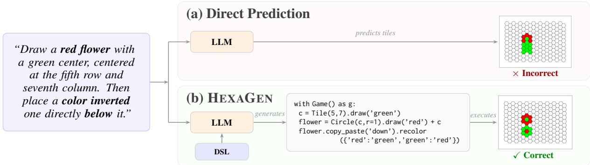
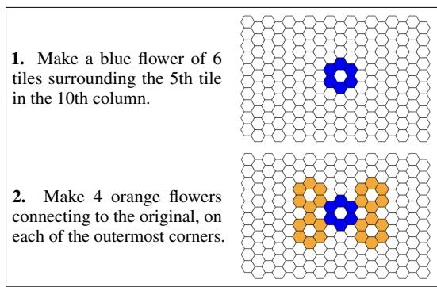
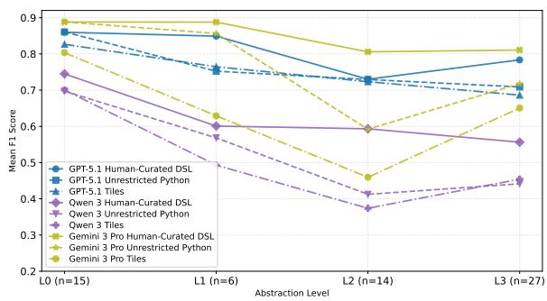
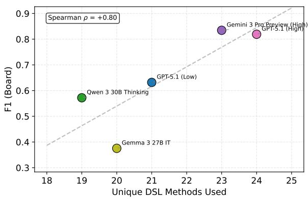
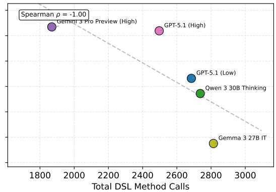
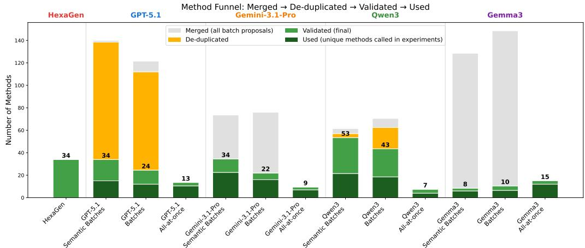

# From Abstraction to Action: DSLs for Natural Language Abstraction Interpretation and Execution

Amit Lisha and Reut Tsarfaty Bar-Ilan University, Israel {amit.lisha,reut.tsarfaty}@biu.ac.il

## Abstract

Natural-language instructions often rely on high-level abstractions, such as asking an agent to “stack blocks in a pyramid.” Interpreting abstract instructions requires models to both identify the abstraction intended by the speaker, and unroll it into the many concrete actions that instantiate it. Language models struggle here: prior work has shown that performance degrades as the level of abstraction in the instruction rises. To bridge the gap between natural language abstraction and concrete actions, we propose to borrow from coding environments the notion of a domain-specific language (DSL), an explicit representation layer whose documented primitives name recurring abstractions that expand into concrete actions. We demonstrate the efficacy of DSLs for NL interpretation on HEXAGONS, a visually-grounded instruction-following task graded for abstraction. We further ask whether language models can induce such DSLs themselves from domain data. Our results show that while code generation consistently improves over direct inference, code generation over a human-curated DSL yields dramatic gains, up to 10 absolute F1 points, reaching the human skyline, with gains concentrated at higher abstraction levels. We confirm a similar pattern on the TEXT2CAD benchmark. At the same time, model-induced DSLs recover only part of this gain, remaining inconsistent across runs and short of their human-curated counterpart. Overall, the right representation closes much of the gap caused by high abstraction — but inducing that layer of representation automatically is where models still fall short, and where we see a strong opportunity for the community to make progress.<sup>1</sup>

## 1 Introduction

Language models are increasingly deployed as agents that must act on natural-language instructions: editing, drawing, operating software, manipulating an environment, and a lot more. However, the instructions users write are rarely explicit sequences of actions. A user asking an agent to “add a ‘total’ row to each table in the report” expects it to recover the many concrete edits compressed into this phrase, rather than be instructed for each one.

This tendency for compression is unsurprising: human speakers typically provide the minimal amount of information that is needed for a successful interpretation (Grice, 1975). Speakers thus convey multiple actions through abstraction, defined by Wing (2010) as “the representation of many instances through a single higher-level object, capturing essential structure while suppressing lower-level details.”

For a language model to carry out abstract instructions, it must identify the abstract concepts and reconstruct the sequence of actions they leave implicit (MacMahon et al., 2006; Artzi and Zettlemoyer, 2013). Models are unevenly good at this: performance declines as instructions grow more abstract (Shridhar et al., 2020; Ruis et al., 2020; Wu et al., 2021; Ahn et al., 2022), particularly evident in HEXAGONS (Lachmy et al., 2022), where instructions are annotated with abstraction levels.

This suggests a simple hypothesis: if the gap between language and action arises because abstract instructions leave task-relevant steps implicit, then unfolding those abstractions explicitly should help bridge it. Code generation is a natural first step to explore (Chen et al., 2021; Liang et al., 2022): programming languages provide built-in mechanisms for unfolding abstraction — variables, loops, functions, conditions — so mapping instructions to code gives the model computational structure that exposes the structures implicit in language.

However, general-purpose code may not suffice: the model may still need to recover task-specific abstractions from scratch, e.g., what counts as a “table” or a “header” in a document, and reflect them as concrete operations.

  
Figure 1: Abstract instructions compress many low-level drawing actions on the board. (a) Direct prediction must recover this structure directly, in an end-2-end fashion. (b) HEXAGEN makes task-relevant abstractions explicit, letting the model generate code that executes to the correct output.

In business environments, such recurring domain concepts are often provided as reusable operations through a domain-specific language (DSL) (Mernik et al., 2005) that is then used in code to map abstraction to action. In this work we ask: (i) can language models use task-specific DSLs to effectively follow natural language instructions? and, moreover, (ii) may language models come up with such DSLs themselves?

Our primary empirical investigation focuses on HEXAGONS, a visually grounded instructionfollowing benchmark designed to elicit abstraction in natural language. Its instructions refer to higher-level structures: complex objects, patterns, arrangements; and successful execution depends on producing the right low-level actions (Figure 2). Furthermore, HEXAGONS’s abstraction-level annotation lets us control performance on abstraction, and isolate where the interpretation breaks down.

We investigate the first question via a three-way comparison of strategies to solve the HEXAGONS board: direct inference, unrestricted Python generation, and Python generation over a DSL. In particular, we assess performance given HEXAGEN, a human-authored Python DSL we designed for this purpose, which defines decomposable abstractions on top of the HEXAGON tiles: named shapes, spatial queries and geometric transformations. The model may write an ordinary Python program and invoke DSL functions as needed, retaining full interpretive responsibility while offloading low-level domain-specific reasoning to the DSL (Figure 1).

Our results show that a human-curated DSL indeed leads to substantial performance gains, closing much of the gap with the human skyline, an effect we show on both HEXAGON (Section 5) and a TEXT2CAD real-world scenario (Section 6).

This success begs our second question, namely, can LLMs induce such DSLs themselves?

We investigate this by augmenting the HEXAGONS task training data, instructions paired with the denotations on the board, with a minimal API covering only low-level drawing actions. Models are asked to identify recurring patterns and implement respective DSL functions, producing executable Python code and documentation for downstream use. Replacing HEXAGEN with such induced DSLs shows mixed results relative to a minimal-API baseline, with improvements varying across models, but consistently underperforming the human-curated DSL counterpart.

Taken together, our experiments show that interpreting and executing natural language instruction using a curated DSL consistently outperforms both direct inference and unrestricted code generation, with the largest gains where interpretation is hardest: at higher abstraction levels. At the same time, we demonstrate that current LLMs fall short of human experts on the task of reliably inducing such abstraction layers themselves from natural language domain-specific data — leaving the automatic discovery of task-relevant abstraction layers from natural language texts as an open challenge for further investigation.

## 2 From Abstraction to Action:

## 2.1 Challenge and Key Hypotheses

Interpreting and grounding abstract instructions poses a genuine challenge for LLMs, as it requires mapping natural-language abstractions to their underlying implicit and concrete actions to execute. Here we argue that tackling this challenge is inherently multifaceted.

First we observe that formal coding languages are a natural, unambiguous way to express abstractions and how they unfold. Providing the model access to explicit computation — variables, loops, functions — alongside the language utterances, may help recover the actions that natural language leaves implicit. We therefore hypothesize that mapping instructions to executable code (rather than, e.g., relying on thinking trajectories) is a better strategy than direct inference on the task at hand.

  
Figure 2: The HEXAGONS task illustration: Natural language instructions and respective target board states.

Following this intuition, we cast instructionfollowing as a program-synthesis problem over a grounding environment: given a natural-language instruction x and an initial state $s _ { 0 }$ , the model must produce a program $p$ whose execution yields the target state $s ^ { * }$

Yet, code generation in a general-purpose language does not fully close the abstraction gap for a specific task. Plain Python lacks task-specific notions, (in HEXAGONS (§2.2), for example, these may be hexagonal grids, spatial neighbors, or geometric objects,) forcing the model to learn and implement every domain concept from scratch. Generally, we argue that code generation alone may not suffice for many real-world tasks, whose relevant abstractions are often domain-specific and lack, or are divorced from, their interpretation in a generalpurpose language. So, just as SQL encapsulates relational operations like joins and aggregations rather than requiring repetitive iterations, a domainspecific language (DSL) can encapsulate recurring domain concepts as reusable operations (Mernik et al., 2005).

We draw from this a key conclusion: while code generation provides the machinery of computation, what is still missing is a way to encapsulate recurring domain concepts as reusable operations that the model can compose and reuse rather than rederive. For this, a DSL can help.

## 2.2 The HEXAGONS benchmark

The HEXAGONS benchmark (Lachmy et al., 2022) is an instruction-following benchmark designed to elicit abstraction in natural language, derived from a collaborative drawing game in which one player describes how to recreate an image on a hexagonal grid while the other follows the instructions on an empty board. Since players are rewarded for both accuracy and speed, speakers naturally resort to compressed, abstract descriptions characteristic of natural communication — referring to objects, loops, spatial transformations, and conditions — each standing for many low-level actions, with missing details left to be filled by the hearer.

The core challenge in solving the HEXAGONS task is that carrying out such instructions requires more than understanding explicit content: the model must identify the abstract constructions in the instruction, ground them in exact tile coordinates, and execute the implied actions correctly. As illustrated in Figure 2, “a blue flower” compresses a spatial arrangement of seven tiles into a single reference, while “on each of the outermost corners” implicitly specifies four locations dependent on the geometry of the previously constructed object. These stages are tightly coupled — errors in interpretation propagate through grounding into execution — and each grows harder as abstraction increases, as confirmed empirically by Lachmy et al. (2022). HEXAGONS therefore provides a controlled testbed for studying how to improve the interpretation, grounding, and execution of abstract instructions in contemporary LLMs.

## 3 DSLs for Natural Language Abstraction

## 3.1 From General Code to Task-Specific Libraries

The notion of a domain-specific language (DSL) is known from coding environments, and it refers to a specialized library tailored to a particular application domain, for defining, breaking down and spelling out domain-specific abstract notions (Mernik et al., 2005). By raising the level of abstraction to match the problem at hand, DSLs reduce both the effort and the error rate of programming within their target domain. In our setting, we aim to use DSLs for interpreting naturally occurring language instructions in different domains, likewise reducing the effort and errors in interpreting and following natural language instructions.

On the way to obtain this, we face several concerns in the design of DSLs for NL. The first is representation: the DSL should provide first-class constructs for the abstractions that genuinely organize solutions in the target domain. The second is transparency: because our DSL is to be consumed by a language model, what each primitive does and how it should be called must be clearly evident from its name, signature, and documentation (Qu et al., 2025). The third is robustness: constrained semantics, safe defaults, and failure-resistant interfaces should ensure that when a program fails, it fails because the intended construction is wrong, not because the programming interface is fragile.

From Hexagons to HexaGen We apply these principles to HEXAGONS to deliver HEXAGEN, an expert-curated Python DSL that supplies the missing abstraction layer for following instrucions on the HEXAGONS board. On the representational side, we identified its core primitives by manually analyzing training examples, guided by the abstraction categories in Lachmy et al. (2022). For transparency, the API exposes non-overlapping, self-explanatory methods with thorough documentation. For robustness, it validates inputs eagerly, provides safe defaults, and raises descriptive exceptions for common pitfalls, thus errors reflect flawed usage, not interface fragility. The full DSL specification, including all constructors, actions, queries, and their signatures, is provided in in Appendix E. A representative example is given in Figure 1.

## 3.2 Inducing DSLs from Data

Creating useful and adeqaute DSLs, such as HEXA-GEN, is a human-intensive and costly engineering effort. The theoretical benefits of DSLs in general, and of HEXAGEN in particular, beg a natural follow-up question: can LLMs induce such abstraction layers themselves, given only examples of the task?

We formulate this problem as follows. Let $\mathcal { A } _ { 0 }$ denote afoundation library exposing only the taskspecific primitives. Let $\mathbfcal { D } = \{ ( x _ { i } , s _ { i } ) \} _ { i = } ^ { N }$ <sub>1</sub> be a training set of paired natural-language instructions and their denotation (in HEAXGONS (§2.2) for example, these are instruction paired with target board states represented as tile-level descriptions). The induction task is, given $\mathcal { A } _ { 0 }$ and D produce an extended library $A \supseteq A _ { 0 }$ , consisting of new callable functions, together with API documentation Doc(A) suitable for downstream prompting.

We suggest that the induction pipeline be comprised of three stages: (i) abstraction discovery, which identifies recurring, non-trivial computational patterns in the instruction corpus, (ii) method implementation, which translates the discovered method specifications into validated executable code on top of the foundation library, and (iii) documentation authoring, which produces a compact API specification that serves as the sole downstream prompting interface.

## 4 Experimental Setup

Goal. We set out to empirically investigate two questions: whether a task-aligned DSLs improve LLM performance over plain code generation, and whether LLMs can induce useful DSLs themselves. Data. We use the original HEXAGONS dataset (Lachmy et al., 2022), consisting of 620 procedures and 4,177 language instructions overall, where each procedure is a sequence of instructions paired with the corresponding board state. Later, we also use the Text2CAD (Khan et al., 2024) benchmark. Task. The HEXAGONS task is defined as follows. The input is a procedure describing a complex image, composed of multiple instructions. The procedure is processed all at once.<sup>2</sup> We evaluated models under one of three execution scenarios: (i) Direct Prediction, which outputs a list of (row, col, color) tuples specifying the tiles to paint; (ii) Unrestricted Python Generation, which outputs Python code implementing get\_tiles() to return the same tuples; and finally, (iii) DSL-based Code Generation, where the input includes the DSL API documentation and the output is code using the DSL, whose execution yields the target. Prompts. All scenarios use a two-phase prompt: a system prompt defining the board, colors, output requirements, and scenario-specific information, if any (API specification, tuple format, or board dimensions), and a user message containing the instructions. The exact are stated in Appendix G. Models. We evaluate both proprietary and openweight models, both low and high reasoning (thinking) settings: GPT-5.1 and Gemini-3-Pro (high/low), Gemini-3.1-Pro (high), Qwen3-30B-A3B (a reasoning model) (Yang et al., 2025), and Gemma-3-27B-IT (Team, 2025). The open models are served locally via vLLM on 2 A100 GPUs. Inference. All models are decoded with temperature 0 and a maximum output length of 15K tokens. Generated programs are executed in an isolated environment with a 60-sec. timeout and up to 3 retries conditioned on the resulting exception message. Metrics. Following Lachmy et al. (2022), we report F1 and exact match on the final board state. In the all-at-once setting, board-level F1 equals actionlevel F1 in Lachmy et al. (2022). Table 1 reports mean ± standard deviation over three execution runs. Table 3 reports mean ± standard deviation across three independently induced libraries, each evaluated over three execution runs.

<table><tr><td rowspan="3"></td><td colspan="8">Proprietary Models</td><td colspan="4">Open-Source Models</td></tr><tr><td colspan="2">GPT-5.1 (Low)</td><td colspan="2">GPT-5.1 (High)</td><td colspan="2">Gemini 3 Pro (Low)</td><td colspan="2">Gemini 3 Pro (High)</td><td colspan="2">Qwen3 30B</td><td colspan="2">Gemma3 27B</td></tr><tr><td>F1</td><td>EM</td><td>F1</td><td>EM</td><td>F1</td><td>EM</td><td>F1</td><td>EM</td><td>F1</td><td>EM</td><td>F1</td><td>EM</td></tr><tr><td>Tiles</td><td>0.683±0.006</td><td>0.236±0.018</td><td>0.765±0.016</td><td>0.322±0.032</td><td>0.743±0.009</td><td>0.301±0.009</td><td>0.745±0.02</td><td>0.382±0.037</td><td>0.556±0.016</td><td>0.177±0.013</td><td>0.407±0.005 0.123±0.007</td><td></td></tr><tr><td>Unrestricted Python</td><td>0.708±0.011</td><td>0.231±0.009</td><td>0.757±0.009 0.296±0.009</td><td></td><td>0.807±0.003</td><td>0.376±0.040</td><td>0.793±0.021</td><td>0.419±0.000</td><td>0.587±0.012</td><td>0.172±0.007</td><td>0.495±0.005</td><td>0.145±0.000</td></tr><tr><td>Human-Curated DSL</td><td>0.774±0.021</td><td>0.371±0.000</td><td>0.831±0.010 0.441±0.025</td><td></td><td>0.825±0.002</td><td>0.457±0.024</td><td>0.853±0.016</td><td>0.511±0.046</td><td>0.663±0.019</td><td>0.237±0.033 0.512±0.007</td><td></td><td>0.140±0.007</td></tr></table>

Table 1: Hexagons execution results across all models and strategies. We report F1 and board-level exact match (EM) as mean ± standard deviation over three runs.

## 5 Does Explicit Abstraction Help?

Results Table 1 presents execution results across all models and strategies. Overall in terms of F1, Unrestricted Python Generation improves over Direct Prediction in five of six settings, while exact match remains broadly similar overall. This suggests that generating an executable program is often more effective than predicting tiles directly. Then, DSL-based Code Generation pushes the results further, essentially closing the gap with the human skyline of F1=82.06 reported by Lachmy et al. (2022). It achieves the highest F1 across all six models and the highest exact match in five of six, indicating that explicit, executable abstractions improve grounding beyond code execution alone. We further see that weaker models benefit more from the DSL-based strategy: relative to Direct Prediction, the three weakest models improve F1 by 13.3–25.8%, compared with 8.6–14.5% for the three strongest.

Analysis Lachmy et al. (2022) showed that model performance degrades as abstraction increases. We now ask the respective question, whether the DSL is especially helpful in the harder, more abstract, scenarios. Figure 3 suggests that it is indeed the case. At Level 0 the DSL method performs on par with the other strategies for every model, but at Levels 2–3 it leads by up to 0.21 F1, essentially showing that the more abstract the instruction, the more the DSL helps.

  
Figure 3: F1 as a function of abstraction level under the 3 strategies.

We next ask how models use the DSL. Figure 4 reports the breadth of DSL usage (i.e., the number of unique DSL methods invoked, out of the 41 available) and the volume of DSL usage (i.e., the total number of DSL method calls issued), each plotted against board F1. In terms of breadth, stronger models use more of the DSL; Gemini 3 Pro (High) and GPT-5.1 (High) invoke 23–24 unique methods, versus 19–20 for Gemma 3 and Qwen 3 (Spearman ρ = +0.80 with F1). Volume runs the other way, and tracks F1 almost perfectly (Spearman ρ = −1.00): weaker models issue substantially more DSL calls. This suggests that weaker models rely on fewer methods and call them more repetitively, while stronger models spread their calls across a wider slice of the DSL and invoke it more sparingly overall, hinting at more targeted abstraction selection. All in all, the DSL helps all models, but the gain scales with the model’s ability to exploit the structure it provides.

Finally, we test whether the models’ errors stem from lacking visual feedback. Showing the board after each instruction does not help: when adding the visual signal, for HEXAGEN-based generation the difference is negligible, for direct tile prediction performance degrades markedly (Appendix A).



  
Figure 4: DSL usage patterns vs. performance, for 5 model configurations sorted by overall F1. Left: breadth of DSL usage (unique methods invoked) against board F1. Right: volume of DSL usage (total method calls) against board F1.

<table><tr><td rowspan="2">Level</td><td colspan="3">Qwen3-30B-A3B-Thinking</td><td colspan="3">Gemini-3.1-Pro</td></tr><tr><td>DSL</td><td>Direct</td><td>Undec.</td><td>DSL</td><td>Direct</td><td>Undec.</td></tr><tr><td>Expert</td><td>43.8%</td><td>20.9%</td><td>35.3%</td><td>13.8%</td><td>4.8%</td><td>81.4%</td></tr><tr><td>Intermediate</td><td>25.6%</td><td>20.4%</td><td>54.0%</td><td>17.6%</td><td>12.1%</td><td>70.3%</td></tr><tr><td>Beginner</td><td>23.0%</td><td>22.1%</td><td>54.9%</td><td>17.1%</td><td>17.5%</td><td>65.3%</td></tr><tr><td>Abstract</td><td>31.1%</td><td>30.1%</td><td>38.9%</td><td>31.1%</td><td>24.0%</td><td>45.0%</td></tr></table>

Table 2: Text2CAD pairwise VLM-judge preferences between DSL and direct CadQuery generation, across abstraction levels and two models (single seed, 885 examples/level/model). Percentages are over pairs for which a judgment was reached.

## 6 Does This Hold Beyond HEXAGONS?

To test whether our results generalize beyond the HEXAGONS task, we turn to Text2CAD (Khan et al., 2024) with its CadQuery annotations (Xie and Ju, 2025), where each object is paired with design instructions at four levels of abstraction, from expert to abstract. Taking CadQuery as the foundation library, we hand-curate a small DSL of eight recurring abstractions following the design principles of Section 3. We follow the evaluation setup of Khan et al. (2024) and simplify by using a single protocol across all four abstraction levels: a VLM judge compares renders of the DSL and direct programs pairwise, with position randomized, and returns a preference or declares the pair indistinguishable. Programs that fail to execute count as losses, and pairs where both fail are dropped. Full details are provided in Appendix C.

Table 2 shows that the DSL is preferred in seven of eight model–level comparisons, the exception being Gemini-3.1-Pro at the beginner level, where the two are effectively tied (17.1% vs. 17.5%). Some of this gain is a matter of reliability: the DSL lowers the execution-failure rate for both models, most sharply at the expert level, from 51.3% to 35.1% for Qwen3-30B-A3B-Thinking and from 21.7% to 13.4% for Gemini-3.1-Pro.

## 7 Can LLMs Induce DSLs Themselves?

Observing the substantial gains using HEXAGEN, our human-curated DSL, we ask whether LLMs can induce useful and effective DSLs themselves.

Experimental Setup We design an experiment where each evaluated model induces its own DSL. Each induction variant is run 3 times per model, producing 3 independently induced libraries. Each library is evaluated over 3 execution runs. For proprietary models, we use only the high reasoning setting.

Induction As mentioned in Section 4, the induction pipeline has three stages: abstraction discovery, method implementation, and documentation authoring, which we detail here in turn.

In the discovery stage, we vary how the instruction corpus is presented to the model: (1) flat, which seeks and proposes abstractions for all instructions in a single prompt; (2) arbitrary batching, which partitions the corpus into fixed-size batches, analyzes each independently, and then deduplicates and merges the resulting proposals; and (3) semantic batching, which replaces arbitrary batches with sets of similar instructions, obtained by k-means clustering over BGE-M3 instruction embeddings (Chen et al., 2025), targeting batches of 100 instructions for both batched variants. Grouping related examples before prompting resembles the clustered-sampling variant of Grand et al. (2024, Appendix C.2).

<table><tr><td rowspan="3"></td><td colspan="4">Proprietary Models</td><td colspan="4">Open-Source Models</td></tr><tr><td colspan="2">GPT-5.1 (High)</td><td colspan="2">Gemini 3.1 Pro (High)</td><td colspan="2">Qwen3 30B Thinking</td><td colspan="2">Gemma3 27B Instruct</td></tr><tr><td>F1</td><td>EM</td><td>F1</td><td>EM</td><td>F1</td><td>EM</td><td>F1</td><td>EM</td></tr><tr><td>Minimal DSL</td><td> $\overline { { 0 . 7 4 0 { \pm } 0 . 0 0 8 } }$ </td><td> $\overline { { 0 . 2 8 2 \pm 0 . 0 3 4 } }$ </td><td>0.839±0.033</td><td>0.484±0.028</td><td> $\overline { { 0 . 5 4 2 { \scriptstyle \pm 0 . 0 0 3 } } }$ </td><td>0.145±0.016</td><td> $\overline { { 0 . 3 7 1 { \scriptstyle \pm 0 . 0 1 9 } } }$ </td><td> $\overline { { 0 . 0 9 7 { \scriptstyle \pm 0 . 0 0 0 } } }$ </td></tr><tr><td>All-at-once</td><td> $\underline { { 0 . 7 5 7 \pm 0 . 0 8 2 } }$ </td><td> $0 . 3 1 4 { \scriptstyle \pm 0 . 1 0 3 }$ </td><td>0.776±0.069</td><td>0.321±0.099</td><td>0.565±0.019</td><td>0.152±0.018</td><td> $0 . 4 1 6 { \scriptstyle \pm 0 . 0 5 5 }$ </td><td> $\underline { { 0 . 1 2 9 \pm 0 . 0 2 3 } }$ </td></tr><tr><td>Batches</td><td> $0 . 7 4 5 { \scriptstyle \pm 0 . 0 8 8 }$ </td><td> $0 . 3 3 9 { \scriptstyle \pm 0 . 1 6 0 }$ </td><td>0.828±0.032</td><td>0.518±0.023</td><td>0.480±0.041</td><td>0.100±0.034</td><td> $0 . 3 8 9 { \scriptstyle \pm 0 . 0 6 0 }$ </td><td> $0 . 1 0 5 { \scriptstyle \pm 0 . 0 3 4 }$ </td></tr><tr><td>Semantic Batches</td><td> $0 . 7 0 4 { \scriptstyle \pm 0 . 0 0 7 }$ </td><td> $0 . 2 2 5 { \scriptstyle \pm 0 . 0 2 2 }$ </td><td>0.788±0.077</td><td>0.396±0.129</td><td>0.531±0.025</td><td> $0 . 1 4 9 { \scriptstyle \pm 0 . 0 1 9 }$ </td><td> $\underline { { 0 . 4 4 1 \pm 0 . 0 2 0 } }$ </td><td> $0 . 1 2 1 { \scriptstyle \pm 0 . 0 1 1 }$ </td></tr><tr><td>Human-Curated DSL</td><td> $\mathbf { 0 . 8 3 1 { \scriptstyle \pm 0 . 0 1 0 } }$ </td><td> $\mathbf { 0 . 4 4 1 { \scriptstyle \pm 0 . 0 2 5 } }$ </td><td>0.861±0.016</td><td>0.591±0.019</td><td>0.663±0.019</td><td> $\mathbf { 0 . 2 3 7 { \scriptstyle \pm 0 . 0 3 3 } }$ </td><td> $\mathbf { 0 . 5 1 2 { \scriptstyle \pm 0 . 0 0 7 } }$ </td><td> $\mathbf { 0 . 1 4 0 { \scriptstyle \pm 0 . 0 0 7 } }$ </td></tr></table>

Table 3: Results for induced DSL variants and the human-curated DSL. We report F1 and board-level exact match (EM) as mean ± standard deviation across three independently induced libraries; each library is evaluated over three execution runs. Gemini rows use Gemini 3.1 Pro and are not comparable to Table 1.

In the implementation stage, given the proposed method signatures, the model receives the foundation-library source and doc and generates complete implementations, including docstrings and executable examples. Methods that fail to compile or fail their doctest examples are removed. Validation and deduplication are standard in LLM tool-creation pipelines (Yuan et al., 2024).

In the documentation stage, the model produces the final documentation, which serves as the only interface provided for inference. It is written for LLMs rather than human readability, favoring clarity and unambiguous information. This follows LILO’s AutoDoc procedure (Grand et al., 2024).

Results. Table 3 shows that the human-curated HEXAGEN achieves the highest F1 and exact match in all four model settings, outperforming the best induced variant by 3–10 F1 points. Still, some induced DSLs perform strongly in individual runs: all-at-once induction with GPT-5.1 (High) reaches 0.816 F1 / 0.452 EM. The main limitation is thus consistency rather than capability, as the same induction settings that produce strong libraries also produce runs falling below the minimal baseline. For Gemini 3.1 Pro the pattern is stronger: no induced variant beats the minimal API they extend.<sup>3</sup>

Beyond execution quality, the strategies differ in how many methods they induce: batched discovery yields substantially more methods than flat analysis, though library size does not correlate with downstream performance (Appendix D).

Finally, we manually inspect two induced libraries to learn about the type of errors they produce. This shows how a single foundational error in the library’s design can make an induced library perform worse than no library at all. Both come from the same setup, GPT-5.1 (High) with the flat induction variant, yet Run A reaches 0.816 board-F1 while Run B reaches 0.700, below both non-DSL baselines for this model (0.765 Tiles, 0.757 Unrestricted Python). They cover about the same abstractions and differ in one fundamental choice: Run B falsely treats the board as a rectangular lattice. Seven of its ten methods rest on that assumption, and all seven run without failing while producing wrong tiles. Run A gets the geometry right, and its remaining distance to HEXAGEN is of a different kind: it has no compositional layer, no firstclass Shape with set operations, spatial queries, or anchor-based copy (Table 4).

## 8 Related Work

Grounded instruction following maps natural language to executable actions in situated environments, spanning navigation (MacMahon et al., 2006; Chen and Mooney, 2011; Anderson et al., 2018), robotic manipulation (Tellex et al., 2011; Ahn et al., 2022), and collaborative construction (MacMahon et al., 2006; Artzi and Zettlemoyer, 2013). Across these settings, performance degrades as instructions become more abstract (Shridhar et al., 2020; Ruis et al., 2020; Wu et al., 2021; Ahn et al., 2022). In HEXAGONS (Lachmy et al., 2022), where instructions are annotated by abstraction level, this trend is measured directly. We take this gap as a starting point and ask whether an executable target language that makes abstractions explicit can help close it.

A growing body of work treats grounded reasoning as program synthesis: instead of predicting outputs directly, the model generates executable code. This paradigm has been effective in mathematical reasoning (e.g., Gao et al., 2023; Chen et al., 2023), visual question answering (Gupta and Kembhavi, 2022; Suris et al., 2023), and embodied control (Liang et al., 2022; Singh et al., 2022; Ahn et al., 2022). Code generation is a natural fit for abstract instructions because programming languages already provide mechanisms such as variables, loops, and functions. However, when models generate in a general-purpose language or over low-level action sets, they must still recover taskspecific abstractions on their own. Our comparison of direct inference, unrestricted Python, and DSLbased generation shows that making these abstractions explicit and executable is itself a major factor in execution quality.

<table><tr><td>Capability</td><td>HEXAGEN</td><td>Run A</td><td>Run B</td></tr><tr><td>Shape constructors (rays, lines, rings, triangles, fill)</td><td>√</td><td>√</td><td>x</td></tr><tr><td>Rotation / mirror / translation</td><td>√</td><td>√</td><td>x</td></tr><tr><td>Hex distance metric</td><td>√</td><td>√</td><td>一</td></tr><tr><td>Hex adjacency (neighbors)</td><td>√</td><td>√</td><td>x</td></tr><tr><td>Compositional Shape algebra</td><td>√</td><td></td><td>一</td></tr><tr><td>Spatial / topological queries</td><td>√</td><td></td><td>一</td></tr><tr><td>Tiling / anchor-based copy</td><td>√</td><td></td><td>x</td></tr><tr><td>Board &amp; color queries</td><td>√</td><td></td><td>一</td></tr><tr><td>Board-F1</td><td>0.831 ±0.010</td><td>0.816</td><td>0.700</td></tr></table>

Table 4: Capability coverage and board-F1 for HEXAGEN and the two GPT-5.1 (High) all-at-once induced DSLs. ✓ = supported, – = absent, ✗ = present but broken.

Domain-specific abstractions for code generation have often taken the form of external DSLs that restrict the target language, both in classical program synthesis and semantic parsing (Gulwani, 2011; Berant et al., 2013) and in recent LLM systems that translate natural language into formal domain-specific targets (Wong et al., 2023). HEX-AGEN, by contrast, is an internal DSL: the model writes unrestricted Python, while the DSL supplies callable abstractions such as named shapes, spatial queries, and composable transformations. In this respect, it is closer to API-augmented generation (Liang et al., 2022; Singh et al., 2022), though those systems expose fixed low-level action primitives rather than abstractions aligned with the level at which people give instructions.

The question of whether models can discover reusable abstractions connects to prior work on library learning and tool induction, which differs from ours in the signal abstractions are found in: recurring code rather than recurring language. In the external DSL setting, DreamCoder (Ellis et al., 2021) compresses solved programs, keeping an abstraction when it shortens the corpus by more than it costs to define; LAPS (Wong et al., 2021) adds word alignments to that objective, but only to score candidates compression already extracted; and LILO (Grand et al., 2024) adds an

LLM searcher and documentation, reporting abstractions proposed by an LLM prompted with programs as an appendix negative result only. On the internal side, LATM (Cai et al., 2024) and CRE-ATOR (Qian et al., 2023) build per-task tools rather than a library, while Voyager (Wang et al., 2023) admits skills by execution success during open-ended play. We instead induce a library from instructions paired with board states, with no solved programs to compress: what recurs across the instructions is the only signal available, and the abstractions we seek are those a speaker compresses into a phrase — not the fragments that recur across solutions.

## 9 Conclusions

The core challenge in grounded instruction following is mapping abstract, underspecified language to concrete, executable actions. We show that a DSL is a useful device for making task-relevant abstractions explicit. Concretely, we show on HEXAGONS that generating executable code with HEXAGEN, a human-curated DSL, substantially outperforms both direct prediction and unrestricted code generation — with higher gains at higher abstraction levels. However, current LLMs still do not reliably induce such DSLs with similar efficacy on their own right. Model-authored DSLs in our settings occasionally approach the human-curated baseline but remain far more unstable, with no discovery strategy consistently resolving this instability. Enabling models to automatically construct robust, transparent, task-specific abstraction layers therefore remains an intriguing open challenge. To promote research progress on this matter, we release our code, data, evaluation pipeline, and all DSLs, encouraging the community to advance work on executable abstraction and DSL induction.

## Limitations

Benchmark coverage. Our evaluation covers HEXAGONS and TEXT2CAD. The two differ in domain and output space, but broader coverage across additional testbeds would strengthen the generality of our claims. The TEXT2CAD replication is also deliberately lightweight: its DSL comprises eight functions, against the 41 of HEXAGEN. It therefore establishes that the effect transfers, and does not measure how large that effect can be in a second domain.

Induction without execution feedback. All three induction strategies share one design: the model authors a DSL from a fixed pool of examples and never runs the result. Run B suggests this may matter — its rectangular-lattice assumption breaks seven of ten methods and would surface on the first execution — though a single case does not establish how much an iterative variant would recover.

Future work. Two directions follow from these results. The first is multi-turn interaction, which our setting does not consider. The second is DSL induction itself. Our results establish that a good abstraction layer helps and that current models do not reliably produce one, which leaves the induction problem open.

## References

Michael Ahn, Anthony Brohan, Noah Brown, Yevgen Chebotar, Omar Cortes, Byron David, Chelsea Finn, Chuyuan Fu, Keerthana Gopalakrishnan, Karol Hausman, Alex Herzog, Daniel Ho, Jasmine Hsu, Julian Ibarz, Brian Ichter, Alex Irpan, Eric Jang, Rosario Jauregui Ruano, Kyle Jeffrey, and 26 oth ers. 2022. Do as i can and not as i say: Grounding language in robotic affordances. In arXiv preprint arXiv:2204.01691.

Peter Anderson, Qi Wu, Damien Teney, Jake Bruce, Mark Johnson, Niko Sünderhauf, Ian Reid, Stephen Gould, and Anton van den Hengel. 2018. Vision-andlanguage navigation: Interpreting visually-grounded navigation instructions in real environments. In 2018 IEEE/CVF Conference on Computer Vision and Pattern Recognition, pages 3674–3683.

Yoav Artzi and Luke Zettlemoyer. 2013. Weakly supervised learning of semantic parsers for mapping instructions to actions. Transactions ofthe Associationfor Computational Linguistics, 1:49–62.

Jonathan Berant, Andrew Chou, Roy Frostig, and Percy Liang. 2013. Semantic parsing on Freebase from

question-answer pairs. In Proceedings of the 2013 Conference on Empirical Methods in Natural Language Processing, pages 1533–1544, Seattle, Washington, USA. Association for Computational Linguistics.

Tianle Cai, Xuezhi Wang, Tengyu Ma, Xinyun Chen, and Denny Zhou. 2024. Large language models as tool makers. Preprint, arXiv:2305.17126.

David Chen and Raymond Mooney. 2011. Learning to interpret natural language navigation instructions from observations. Proceedings of the AAAI Conference on Artificial Intelligence, 25(1):859–865.

Jianlv Chen, Shitao Xiao, Peitian Zhang, Kun Luo, Defu Lian, and Zheng Liu. 2025. M3-embedding: Multilinguality, multi-functionality, multi-granularity text embeddings through self-knowledge distillation. Preprint, arXiv:2402.03216.

Mark Chen, Jerry Tworek, Heewoo Jun, Qiming Yuan, Henrique Ponde de Oliveira Pinto, Jared Kaplan, Harri Edwards, Yuri Burda, Nicholas Joseph, Greg Brockman, Alex Ray, Raul Puri, Gretchen Krueger, Michael Petrov, Heidy Khlaaf, Girish Sastry, Pamela Mishkin, Brooke Chan, Scott Gray, and 39 others. 2021. Evaluating large language models trained on code.

Wenhu Chen, Xueguang Ma, Xinyi Wang, and William W. Cohen. 2023. Program of thoughts prompting: Disentangling computation from reasoning for numerical reasoning tasks. Transactions on Machine Learning Research.

Kevin Ellis, Catherine Wong, Maxwell Nye, Mathias Sablé-Meyer, Lucas Morales, Luke Hewitt, Luc Cary, Armando Solar-Lezama, and Joshua B. Tenenbaum. 2021. Dreamcoder: bootstrapping inductive program synthesis with wake-sleep library learning. In Proceedings ofthe 42nd ACM SIGPLAN International Conference on Programming Language Design and Implementation, PLDI 2021, page 835–850, New York, NY, USA. Association for Computing Machinery.

Luyu Gao, Aman Madaan, Shuyan Zhou, Uri Alon, Pengfei Liu, Yiming Yang, Jamie Callan, and Graham Neubig. 2023. Pal: program-aided language models. In Proceedings of the 40th International Conference on Machine Learning, ICML’23. JMLR.org.

Gabriel Grand, Lionel Wong, Maddy Bowers, Theo X. Olausson, Muxin Liu, Joshua B. Tenenbaum, and Jacob Andreas. 2024. Lilo: Learning interpretable libraries by compressing and documenting code. Preprint, arXiv:2310.19791.

Herbert P Grice. 1975. Logic and conversation. In Speech acts, pages 41–58. Brill.

Sumit Gulwani. 2011. Automating string processing in spreadsheets using input-output examples. SIGPLAN Not., 46(1):317–330.

Tanmay Gupta and Aniruddha Kembhavi. 2022. Visual programming: Compositional visual reasoning without training. ArXiv, abs/2211.11559.

Mohammad Sadil Khan, Sankalp Sinha, Talha Uddin Sheikh, Didier Stricker, Sk Aziz Ali, and Muhammad Zeshan Afzal. 2024. Text2cad: Generating sequential cad models from beginner-to-expert level text prompts. Preprint, arXiv:2409.17106.

Royi Lachmy, Valentina Pyatkin, Avshalom Manevich, and Reut Tsarfaty. 2022. Draw me a flower: Processing and grounding abstraction in natural language. Transactions of the Association for Computational Linguistics, 10:1341–1356.

Jacky Liang, Wenlong Huang, Fei Xia, Peng Xu, Karol Hausman, Brian Ichter, Pete Florence, and Andy Zeng. 2022. Code as policies: Language model programs for embodied control. In arXiv preprint arXiv:2209.07753.

Matt MacMahon, Brian Stankiewicz, and Benjamin Kuipers. 2006. Walk the talk: connecting language, knowledge, and action in route instructions. In Proceedings ofthe 21st National Conference on Artificial Intelligence - Volume 2, AAAI’06, page 1475–1482. AAAI Press.

Marjan Mernik, Jan Heering, and Anthony M. Sloane. 2005. When and how to develop domain-specific languages. ACM Comput. Surv., 37(4):316–344.

Cheng Qian, Chi Han, Yi Fung, Yujia Qin, Zhiyuan Liu, and Heng Ji. 2023. CREATOR: Tool creation for disentangling abstract and concrete reasoning of large language models. In Findings of the Association for Computational Linguistics: EMNLP 2023, pages 6922–6939, Singapore. Association for Computational Linguistics.

Changle Qu, Sunhao Dai, Xiaochi Wei, Hengyi Cai, Shuaiqiang Wang, Dawei Yin, Jun Xu, and Ji-Rong Wen. 2025. From exploration to mastery: Enabling llms to master tools via self-driven interactions. In The Thirteenth International Conference on Learning Representations.

Laura Ruis, Jacob Andreas, Marco Baroni, Diane Bouchacourt, and Brenden M. Lake. 2020. A benchmark for systematic generalization in grounded language understanding. Preprint, arXiv:2003.05161.

Mohit Shridhar, Jesse Thomason, Daniel Gordon, Yonatan Bisk, Winson Han, Roozbeh Mottaghi, Luke Zettlemoyer, and Dieter Fox. 2020. ALFRED: A Benchmark for Interpreting Grounded Instructions for Everyday Tasks. In The IEEE Conference on Computer Vision and Pattern Recognition (CVPR).

Ishika Singh, Valts Blukis, Arsalan Mousavian, Ankit Goyal, Danfei Xu, Jonathan Tremblay, Dieter Fox, Jesse Thomason, and Animesh Garg. 2022. Progprompt: Generating situated robot task plans using large language models. Preprint, arXiv:2209.11302.

Didac Suris, Sachit Menon, and Carl Vondrick. 2023. ViperGPT: Visual Inference via Python Execution for Reasoning . In 2023 IEEE/CVF International Conference on Computer Vision (ICCV), pages 11854– 11864, Los Alamitos, CA, USA. IEEE Computer Society.

Gemma Team. 2025. Gemma 3 technical report. Preprint, arXiv:2503.19786.

Stefanie Tellex, Thomas Kollar, Steven Dickerson, Matthew Walter, Ashis Banerjee, Seth Teller, and Nicholas Roy. 2011. Understanding natural language commands for robotic navigation and mobile manipulation. Proceedings ofthe AAAI Conference on Artificial Intelligence, 25(1):1507–1514.

Guanzhi Wang, Yuqi Xie, Yunfan Jiang, Ajay Mandlekar, Chaowei Xiao, Yuke Zhu, Linxi Fan, and Anima Anandkumar. 2023. Voyager: An openended embodied agent with large language models. Preprint, arXiv:2305.16291.

Jeannette M. Wing. 2010. Computational thinking: What and why?

Lionel Wong, Kevin M Ellis, Joshua Tenenbaum, and Jacob Andreas. 2021. Leveraging language to learn program abstractions and search heuristics. In Proceedings of the 38th International Conference on Machine Learning, volume 139 of Proceedings of Machine Learning Research, pages 11193–11204. PMLR.

Lionel Wong, Gabriel Grand, Alexander K. Lew, Noah D. Goodman, Vikash K. Mansinghka, Jacob Andreas, and Joshua B. Tenenbaum. 2023. From word models to world models: Translating from natural language to the probabilistic language of thought. Preprint, arXiv:2306.12672.

Zhengxuan Wu, Elisa Kreiss, Desmond C. Ong, and Christopher Potts. 2021. ReaSCAN: Compositional reasoning in language grounding. NeurIPS 2021 Datasets and Benchmarks Track.

Haoyang Xie and Feng Ju. 2025. Text-to-cadquery: A new paradigm for cad generation with scalable large model capabilities. Preprint, arXiv:2505.06507.

An Yang, Anfeng Li, Baosong Yang, Beichen Zhang, Binyuan Hui, Bo Zheng, Bowen Yu, Chang Gao, Chengen Huang, Chenxu Lv, Chujie Zheng, Dayiheng Liu, Fan Zhou, Fei Huang, Feng Hu, Hao Ge, Haoran Wei, Huan Lin, Jialong Tang, and 41 others. 2025. Qwen3 technical report. arXiv preprint arXiv:2505.09388.

Lifan Yuan, Yangyi Chen, Xingyao Wang, Yi R. Fung, Hao Peng, and Heng Ji. 2024. Craft: Customizing llms by creating and retrieving from specialized toolsets. Preprint, arXiv:2309.17428.

## A Visual Feedback

We test whether giving the model visual access to the board it is constructing improves execution.

Setup. We use the step-by-step protocol (Appendix B) rather than our full-procedure formulation, since the latter emits the entire procedure in one turn and leaves no point at which an intermediate board could be shown. After each instruction is executed, we render the resulting board and supply the image alongside the next instruction. We evaluate both execution strategies, Tiles and HEX-AGEN, with and without the rendered board, using Gemini 3.1 Pro on the validation set.

<table><tr><td>Setup</td><td>EM B-F1</td><td>A-F1</td></tr><tr><td>Tiles</td><td>0.590 0.864</td><td>0.819</td></tr><tr><td>Tiles + Vision</td><td>0.464 0.830</td><td>0.782</td></tr><tr><td>HEXAGEN</td><td>0.744</td><td>0.902 0.867</td></tr><tr><td>HEXAGEN + Vision</td><td>0.727 0.896</td><td>0.860</td></tr></table>

Table 5: Effect of visual feedback under step-by-step prompting (Gemini 3.1 Pro, validation set, 446 instructions). EM is board-level exact match; B-F1 and A-F1 are board- and action-level F1.

Results. Visual feedback does not help either strategy. For HEXAGEN the difference is negligible; for direct tile prediction it costs over twelve points of exact match. We report this as a negative preliminary result, and leave the interactive setting — where the model can act on visual feedback rather than only observe it — to future work.

## B Full-Procedure vs. Step-by-Step Prompting

To determine the querying setup for our generation framework, we compared ourfull-procedure formulation against the default HEXAGONS evaluation protocol. The original benchmark uses step-by-step prompting with access to the full conversational history, whereas our framework provides the model with the entire instruction sequence at once.

As shown in Table 6, full-procedure prompting performs comparably to the original benchmark protocol across both tested models, and is even slightly better. We therefore use it throughout. This choice simplifies the generation pipeline, reduces inference overhead, better matches real-life settings where the full task is available upfront, and avoids conflating execution quality with dialogue-history

effects.

<table><tr><td></td><td colspan="4">Original Benchmark Comparison</td></tr><tr><td>Setup</td><td>GPT-5.1 (Low)</td><td>Gemma 3</td><td>DeBERTa</td><td>T5</td></tr><tr><td>Step-by-step + Full History</td><td>0.520±0.003</td><td>0.404±0.002</td><td>0.404</td><td>0.386</td></tr><tr><td>Full-Procedure</td><td>0.541±0.007</td><td>0.407±0.005</td><td>1</td><td>一</td></tr></table>

Table 6: Comparison to the original HEXAGONS benchmark in F1.

## C Text2CAD Evaluation Details

Data. Text2CAD (Khan et al., 2024) with Cad-Query annotations (Xie and Ju, 2025); the 1,000- object test split, each object with instructions at four abstraction levels (expert, intermediate, beginner, abstract) and a gold CadQuery program. We retain the 885 objects whose gold program executes and evaluate on these at every level. Gold executions are cached and deduplicated. Single seed.

Conditions. Direct: raw CadQuery. DSL: an 8-function hand-curated library over CadQuery, built following the design principles of Section 3. Both conditions are generated by Qwen3-30B-A3B-Thinking and Gemini-3.1-Pro.

Evaluation. We apply one protocol at all four levels. Renders of the two conditions are shown paired to Qwen3.6-27B as a VLM judge, which selects the better match to the instruction or returns undecided; the gold object is never shown and presentation order is randomized. An example on which exactly one condition fails to execute is awarded to the other; where both fail, no comparison is possible and the example is dropped.

## D Method Counts Across Induction Strategies

Figure 5 tracks how many candidate methods survive each stage of induction — proposal, deduplication, and validation — under the three induction strategies. For the three stronger models, both batched strategies produce substantially more validated methods than flat analysis, suggesting that a single pass over the full instruction corpus is too coarse for the model to attend to recurring patterns. Gemma 3 is the least consistent, with method counts varying greatly across strategies. A larger library is not in itself better, however: many candidates are removed during deduplication or validation, and only a subset is ever called downstream. Method count is therefore best read as a diagnostic of the induction process rather than as a quality measure, with the execution results in Table 3 providing the relevant comparison.

  
Figure 5: For each model and induction variant, we report how many methods remain after each pipeline stage: merge, deduplication, validation, and downstream use.

## E HexaGen API

Table 7 lists the public classes, methods, properties, and operators available in the HEXAGEN DSL. This is the full API exposed to the language model; internal mathematical and coordinate helper functions remain private and are not accessible during generation.

Constants. The library also exposes the constants WIDTH=18, HEIGHT=10, the color set {white, black, yellow, green, red, blue, purple, orange}, and the six hex-grid directions {up, down, up\_right, down\_left, up\_left, down\_right}.

## F Minimal API

Table 8 lists the public classes, methods, and properties available in the minimal HEXAGEN API. This is the full API exposed to the language model; internal helper classes and mathematical or coordinate utilities remain private and are not accessible during generation.

<table><tr><td>Class</td><td>Method / Property</td><td>Description</td></tr><tr><td>Game</td><td>height) start(width, height) __enter__(), __exit__(...) plot(...)</td><td>init__(width, Initializes the board with the given dimensions. Creates a new game instance with the given dimensions. Supports context-managed execution inside a Game block. Visualizes the board state, optionally against a gold</td></tr><tr><td>Tile</td><td>__init__(row, column, game) draw(color)</td><td>reference. Creates a tile at the specified coordinates. Paints the tile with the specified color.</td></tr><tr><td></td><td>color, row, column</td><td>Properties returning the current color and 1-based coordinates.</td></tr></table>

Table 8: Public classes, methods, and properties exposed in the minimal HEXAGEN API.

Constants. The API also exposes the board dimensions WIDTH=18 and HEIGHT=10, the color set {white, black, yellow, green, red, blue, purple, orange}, and the six hex-grid directions {up, down, up\_right, down\_left, up\_left, down\_right}.

## G Standard Experiment Prompts

## Shared game-context system prompt.

```markdown
# HEXAGONS GAME OVERVIEW
# Board geometry
- 18 columns x 10 rows, both **1-indexed** (column 1 = left
edge; row 1 = top).
- Address any tile by the tuple **(row, column)**.
- Every tile starts as **white** and keeps its color until
repainted.
# Colors
- Allowed colors: ['white','black','yellow','green','red',
blue','purple','orange'].
# Game flow
```

<table><tr><td>Class</td><td>Method / Property</td><td>Description</td></tr><tr><td>Game</td><td>init__(width, height)</td><td>Initializes a game with board dimensions (defaults to WIDTH=18, HEIGHT=10).</td></tr><tr><td></td><td>start(width, height)  $\mathsf { \_ e n t e r { \_ } . . . } ( \mathsf { ) , \_ e x i t { \_ } . . . } ( \mathsf { . . . } )$ </td><td>Factory method returning a new game instance. Context-manager interface for writing programs inside a Game block.</td></tr><tr><td></td><td>record_step(name) get_record(names)</td><td>Saves a snapshot of the current painted tiles under a step name. Returns the tiles painted in one or more named steps.</td></tr><tr><td></td><td>plot(...)</td><td>Visualizes the board state, optionally against a gold reference.</td></tr><tr><td>Shape</td><td> $\underline { { \mathrm { ~ \ i n i t } } } _ { -- } ( \dots )$ </td><td>Constructs a shape from tiles or other shapes.</td></tr><tr><td></td><td>draw(color)</td><td>Paints all active tiles in the shape with the specified color.</td></tr><tr><td></td><td></td><td>Copies the shape along a direction, shift vector, or source-destination</td></tr><tr><td></td><td>copy_paste(...)</td><td>mapping.</td></tr><tr><td></td><td>reflect(...)</td><td>Reflects the shape across a line, coordinate axis, or directional axis</td></tr><tr><td></td><td> $\mathrm { g r i d ( \dots { } } . . . )$ </td><td>Repeats the shape multiple times along a direction.</td></tr><tr><td></td><td>rotate(center, angle)</td><td>Rotates the shape around a tile by a multiple of 60 degrees.</td></tr><tr><td></td><td>recolor(color_map)</td><td>Recolors tiles inside the shape according to a mapping dictionary.</td></tr><tr><td></td><td>get(criterion)</td><td>Selects tiles satisfying a geometric or color criterion (e.g., outside, above, a direction, or a color).</td></tr><tr><td></td><td>neighbors(criterion)</td><td>Returns neighboring tiles satisfying a criterion such as all, white, inside, or a direction.</td></tr><tr><td></td><td>boundary(...)</td><td>Returns the shape&#x27;s boundary tiles, including outer or inner boundary</td></tr><tr><td></td><td>edge(direction)</td><td>modes. Returns the outermost boundary segment in a specified direction.</td></tr><tr><td></td><td>extreme(direction)</td><td>Returns the furthest tile in a specified hex direction.</td></tr><tr><td></td><td>intersection(other)</td><td>Returns the tiles shared by this and another shape.</td></tr><tr><td></td><td>overlaps(other)</td><td>Returns whether this shape shares any tiles with another.</td></tr><tr><td></td><td>is_empty()</td><td>Returns whether the shape contains no tiles.</td></tr><tr><td></td><td>center()</td><td>Returns the center-of-mass tile of the shape.</td></tr><tr><td></td><td> $\_ { \_ } \mathrm { { a d d } } _ { \_ } , \_ \_ { \_ } \mathrm { { s u b } } _ { \_ } , \_ \_ \_ \_ \mathrm { { n u } } \mathrm { { l } } _ { \_ } . \_$ </td><td>Set-style union, difference, and intersection operators over shapes.</td></tr><tr><td></td><td> $\mathsf { g e t \_ e n t i r e \_ b o a r d ( ) }$ </td><td>Static method returning a shape containing all board tiles.</td></tr><tr><td></td><td> $\mathsf { g e t \_ b o a r d \_ p e r i m e t e r ( ) }$ </td><td>Static method returning the perimeter of the board.</td></tr><tr><td></td><td> $\mathsf { g e t \mathrm { \mathrm { _ { - } c o l o r } ( c o l o r ) } }$ </td><td>Static method returning all active tiles of a given color (or all colors).</td></tr><tr><td></td><td>get_column(column)</td><td>Static method returning all tiles in a given column.</td></tr><tr><td></td><td>polygon(...)</td><td>Static method connecting consecutive vertices with Lines.</td></tr><tr><td>Tile</td><td> $\_ \mathrm { i n i t \_ s . } ( \mathsf { r o w } , \mathsf { c o l u m n } )$ </td><td>Creates a tile at the specified 1-based coordinates.</td></tr><tr><td></td><td>neighbor(direction)</td><td>Returns the adjacent tile in a hex-grid direction.</td></tr><tr><td></td><td>on_board()</td><td>Returns whether the tile lies on the board.</td></tr><tr><td></td><td>color, row, column</td><td>Properties returning the current color and 1-based coordinates.</td></tr><tr><td></td><td>offset</td><td>Property returning the (row, column) pair.</td></tr><tr><td>Line</td><td>_init__(...)</td><td>Creates a line from a start tile and either an end tile or a direction and</td></tr><tr><td></td><td></td><td>length.</td></tr><tr><td></td><td>parallel(shift, space)</td><td>Returns a parallel line translated by the specified spacing.</td></tr><tr><td>Circle Triangle</td><td>_init__(center, radius) __init__(...)</td><td>Creates a circular outline around a center tile with a given radius. Creates a directional triangular border shape from a start tile, orientation,</td></tr></table>

Table 7: Public classes, methods, properties, and operators exposed in the HEXAGEN base library.

- A human \*\*Instructor\*\* writes natural-language steps.   
- You are the \*\*Executor\*\* who must ground each step on the   
board.   
- Previously painted tiles stay as they are unless a step   
changes them.   
# Abstraction note   
- Instructions may employ higher-level abstractions (objects,   
loops, conditions, symmetry); a single sentence can   
cover many low-level paint actions.

## Code-generation prompt.

## System prompt:

# ==== CODE-GENERATION ====   
# Role   
- You are an expert \*\*Python\*\* assistant for the Hexagons   
drawing game.   
# Task   
- Each turn you receive an \*open\* Python code block that   
ends with a \`# TODO\`.   
- Complete the code so it satisfies the \`# TODO\`, then   
finish with:   
board\_state = g.board\_state   
# Rules   
1. \*\*Write only Python -- no prose -- until the fence closes   
.\*\*   
2. Do \*\*not\*\* add imports or create a Game; the script   
already begins with:   
from hexagen import Game, Tile, Shape, Line, Circle,   
Triangle   
with Game() as g:   
3. Store every new shape or tile in a descriptive variable   
(e.g. \`red\_flower\`, \`flower\_stack\`) so later steps can   
reuse them.   
4. Write all lines of code using the \*same\* \*\*4-space   
indentation\*\* that the \`# TODO\` line uses; indent the   
first line as well. This instruction is super important   
as the code won't run without the proper indentations.   
5. Never overwrite previously defined variables and add \*\*no   
\*\* extra comments, prints, or plots.   
6. Columns and rows are \*\*1-indexed\*\*.   
7. Use \*\*only\*\* the functions, classes, and parameters   
explicitly defined in the provided library API   
specification. Do not invent, guess, or call any methods,   
arguments, or attributes that are not listed there.

[... Injected HexaGen API Spec ...]

## User message template:

##### CONTEXT (completed instructions so far)   
{HISTORY\_BLOCK}   
##### CURRENT SCRIPT   
{CODE\_SO\_FAR}   
{NEXT\_STEP}

## Tile-prediction prompt.

## System prompt:

```prolog
TILE-SELECTION
# Role
- You are an assistant for a hexagonal drawing game.
# Task
- Given natural-language instructions, output which tiles
should be colored.
# Return format
- A list of tuples in the form **(row, column, color)**.
# Rules
1. Rows and columns start at **1**.
2. Allowed colors: ['white','black','yellow','green','red',
blue','purple','orange'].
3. Reply **only** with the list of tuples -- no extra prose.
```

## User message template:

##### CONTEXT (completed instructions so far)   
{HISTORY\_BLOCK}   
##### NEXT INSTRUCTION   
{NEXT\_STEP}   
Provide the tiles as a list of (row,column,color) tuples:

## Unrestricted-Python ablation prompt. System prompt:

```markdown
# PYTHON-BASED TILE GENERATION
# Role
- You are an assistant for a hexagonal drawing game.
# Task
- Given natural-language instructions, write unrestricted
Python code to compute which tiles should be colored.
- Output the tiles as a list of tuples in the form **(row,
column, color)**.
# Constraints
- You may use any Python logic (loops, conditions, functions,
list comprehensions, etc.).
- You are NOT given a drawing DSL or library. Use pure
Python to calculate tile positions.
- The board has 10 rows and 18 columns, both **1-indexed**.
# Return format
- Write a Python function named `get_tiles()` that returns a
list of (row, column, color) tuples.
- The function must return the result as a list: `return [(
row, col, color), ...]`
- Reply **only** with Python code -- no extra prose before
or after.
- Do not include markdown code blocks.
```

## User message template:

##### CONTEXT (completed instructions so far)   
{HISTORY\_BLOCK}   
##### INSTRUCTIONS   
{NEXT\_STEP}   
Write Python code with a \`get\_tiles()\` function that returns   
the list of (row, column, color) tuples:

## HexaGen API specification.

```python
# ==== HEXAGEN API SPEC ====
# One entity per line; two-space indentation shows containment.
# Extra 'Notes:' lines clarify hidden behaviour.
Import: from hexagen import Game, Tile, Shape, Line, Circle,
Triangle
Constant: WIDTH = 18
Constant: HEIGHT = 10
Constant: COLORS = ['white','black','yellow','green','red','
blue','purple','orange']
# These are the hexagon board directions, most methods use
these directions, some of them also extends the list to
more directions.
Constant: DIRECTIONS = ['up','down','up_right','down_left','
up_left','down_right']
Class: Game
Method: __init__(width:int = WIDTH, height:int = HEIGHT)
Method: start(width:int = WIDTH, height:int = HEIGHT) ->
Game
Method: __enter__() -> Game
Method: __exit__(exc_type, exc, tb) -> bool
Method: record_step(step_name:str) #
Notes: closes previous step snapshot
Method: get_record(step_names:str | list[str]) -> Shape #
tiles drawn in named step(s)
Method: plot(gold_boards:list[int] | list[list[int]] | None
= None,
```

```coffeescript
multiple:bool = False, file_name:str | None = # -- Utilities (static)
None, show:bool = True) -> Figure
Static: get_entire_board(game:Game | None = None) -> Shape
Static: get board perimeter(game:Game ↓ None = None) ->
Class: Shape # Base class for collections of tiles Shape
Method: __init__(tiles:list[Tile] | Tile | Shape, from_linds Static: get_color(color:str | {'all','any'}, game:Game |
:bool = False, None = None) -> Shape
from_hexagons:bool = False, game:Game | Static: get_column(column:int, game:Game | None = None) ->
None = None) Shape
Notes: duplicate tiles removed; single-tile => auto-up- Static: polygon(vertices:Shape | list[Tile] | Tile, *
casts to Tile. extra_vertices:Tile) -> Shape
# CRITICAL: polygon() connects consecutive vertices with
# -- Painting helpers (ALL mutate active board **and** Line(), so every
return the new Shape) -- # consecutive vertex pair must be colinear on a hex axis.
Method: draw(color:str) -> Shape If vertices are
# auto-paints # not hex-colinear, draw each edge as a separate Line(
Notes: draw() overwrites the tile's previous color. To start, direction=..., length=...).
find where two shapes overlap,
compute the intersection BEFORE drawing: overlap = shape_a #
* shape_b (or shape_a.intersection(shape_b)). Class: Tile (inherits Shape)
Method: copy_paste(shift_direction:str | None = None, Method: __init__(row:int, column:int, game:Game | None =
# auto-paints None)
spacing:int = 0, reference_shape:Shape | Notes: negative indices wrap from opposite edge.
None = None, Method: neighbor(direction:str) -> Tile #
source:Tile | None = None, destination: direction in DIRECTIONS only -- 'left'/'right' are NOT
Tile | None = None, valid here
shift:_Vec | None = None) -> Shape Method: on_board() -> boo
Notes: Returns a NEW Shape at the destination. To chain Property: color:str
multiple copies, Property: column:int
call copy_paste on the RETURNED shape. For repeated copies Property: row:int
in one direction, use grid() instead. Property: offset:tuple[int,int] # (
Param options: shift_direction in {'left','right'} OR row,col) 1-based
DIRECTIONS OR None
Method: reflect(axis_line:Line | None = None, column:int |
None = None, # auto-paints Class: Line (inherits Shape)
axis_direction:str | None = None, # Note creating a line from two tiles is only valid
tile_on_axis:Tile | None = None) -> Shape if the tiles lie on a straight hex direction
Param options: axis_direction in {'horizontal','vertical'} Method: __init__(start_tile:Tile, end_tile:Tile | None =
None,
Method: grid(shift_direction:str, spacing:int, num_copies: direction:str | None = None, length:int |
int | None = None) -> Shape # auto-paints None = None,
shift_direction in {'left','right'} OR DIRECTIONS OR None;
num_copies=None => 'fill board'. include_start_tile:bool = True,
Method: rotate(center_tile:Tile, angle:int) -> Shape include_end_tile:bool = True)
# auto-paints Param options: direction in DIRECTIONS only ('left'/'right
angle must be multiple of 60. NoT valid here): if end tile supplied. direction
Method: recolor(color_map:dict[str,str]) -> Shape length ignored.
Notes: If direction is given but length is omitted (None),
the line extends to the board edge.
# -- Geometric queries Only specify length when you need a shorter line.
# CRITICAL: Line(start, end) raises an error if the two
Method: get(criterion:str) -> Shape # the method returns a tiles are not colinear
new Shape object that has the criterion geometric # on a hex axis (i.e. do NOT share the same q, r, or s
relation to the original shape or the tiles with cube coordinate).
selected colors # Prefer Line(start, direction=..., length=...) for
Param options: {'outside','inside','above','below','top',
bottom', Method: parallel(shift_direction:str, spacing:int) -> Line
'corners','endpoints'} OR DIRECTIONS OR # shift_direction in {'left','right'} OR DIRECTIONS
COLORS OR None
Method: neighbors(criterion:str = 'all') -> Shape Method: draw(color:str) -> Line
Param options: {'all','right','left','above','below',
outside','inside','white'} OR DIRECTIONS
Method: boundary(criterion:str = 'all') -> Shape # #
criterion in {'all','outer','inner'} # The method Class: Circle (inherits Shape) # The created Circle
returns the boundary tiles belonging to the shape itself, has a hollow center
without including any tiles outside the shape. Method: __init__(center_tile:Tile, radius:int = 1)
Method: edge(direction:str) -> Shape # Method: draw(color:str) -> Circle # inherited auto
direction in {'left','right','top','bottom'} OR paints
DIRECTIONS
Method: extreme(direction:str) -> Shape # #
Class: Triangle (inherits Shape) # The created
Method: is_empty() -> bool triangle has only sides with the center beign hollow
Method: overlaps(other:Shape) -> bool Method: __init__(start_tile:Tile, point:str, start_tile_type
Method: intersection(other:Shape) -> Shape # :str, side_length:int = 2)
same as shape_a * shape_b Param options: point in {'left','right'}; start_tile_type
Method: center() -> Tile # in {'side','top','bottom'}.
center of mass (rounded) # CRITICAL: side_length must be >= 2. For a single-tile
annotation, use Tile.draw() instead.
# -- Set operators Method: draw(color:str) -> Triangle # inherited auto
paints
Operator: shape_a + shape_b -> Shape #
```

## H Library Generation Pipeline Prompts

Stage 1: API discovery.

You have a minimal base library:   
{base\_lib\_docs}   
Analyze these {len(batch)} instructions and design NEW methods   
to extend the base library:   
{io\_note}   
{format\_instructions(batch)}   
OUTPUT FORMAT:   
Class: ClassName   
Method: method\_name(param: type) -> ReturnType   
Description: [1 sentence - what it does]   
Rationale: [What problem this solves + how often this   
pattern appears in the instructions]   
Necessity: [Why users need this abstraction]   
DESIGN CRITERIA:   
Each method must:   
- Address a complex pattern found in the instructions above   
- Be non-trivial - users would struggle to implement correctly   
Involve non-trivial algorithms or domain-specific logic   
- Require knowledge of internal data structures or complex   
rules   
NOT:   
- Easily composable from existing methods   
- Simple wrapper or utility   
- Simple property access, collection builders, thin wrappers   
Quality > Quantity. Propose only methods meeting all criteria.

## Stage 3: Method implementation.

Implement the NEW methods from this API proposal{   
domain\_context}.   
API PROPOSAL:   
{api\_proposal}   
BASE LIBRARY (reference):   
OUTPUT FORMAT - Use this exact structure:   
# CLASS: ClassName   
def method\_name(self, param1: type1, param2: type2) ->   
ReturnType:   
'''Brief description.   
Args: ...   
Returns: ...   
Examples:   
>>> obj = ClassName(...)   
>>> obj.method\_name(arg1, arg2)   
expected\_result   
# Implementation   
pass   
REQUIREMENTS:   
- Complete implementations with docstrings   
- Each method MUST include at least one doctest example in its   
docstring   
- Handle edge cases (None, empty, out-of-bounds)   
- Match base library coding style   
Provide ONLY the new method implementations.

## Stage 4: Documentation spec generation.

Write the API spec section for class \`{class\_name}\`{   
domain\_context}.   
CLASS SOURCE CODE:   
EXAMPLE INSTRUCTIONS this library handles:   
{instructions\_text}   
OUTPUT FORMAT -- produce ONLY a Class section like this:

Class: ClassName # optional brief   
role comment   
# -- Category Name -- --- # group related   
methods   
Method: method\_name(param1:type, param2:type) -> ReturnType   
# brief inline note   
Param options: param1 in {'val1','val2'} OR SOME\_CONSTANT   
Notes: One sentence max. Only when inline comment isn't   
enough.   
# CRITICAL: warning about non-obvious constraint or common   
mistake   
RULES:   
1. Document ONLY public methods (no \_ prefix). Skip \_\_repr\_\_,   
\_\_str\_\_, \_\_hash\_\_, \_\_eq\_\_.   
2. Be CONCISE: prefer inline \`#\` comments over multi-line   
Notes.   
3. GROUP methods by function (e.g. 'Drawing/painting', '   
Navigation'). Use \`# --\` headers.   
4. Mark methods that modify state with \`# auto-paints\` or \`#   
mutates\` inline.   
5. Add \`# CRITICAL:\` warnings for methods that are easy to   
misuse.   
6. Use compact set notation for param options.