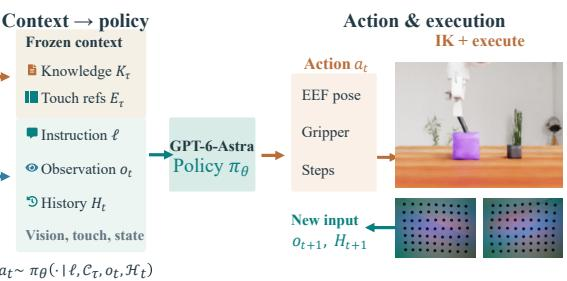
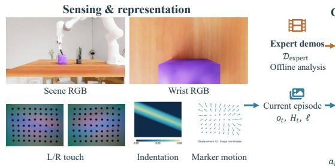
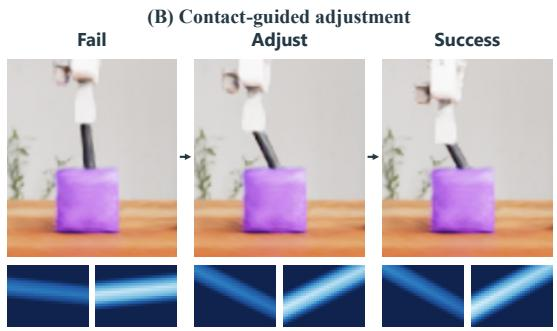
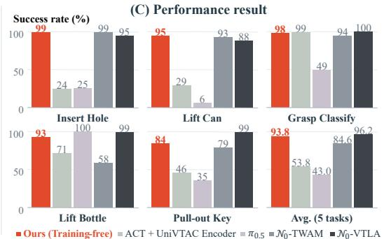
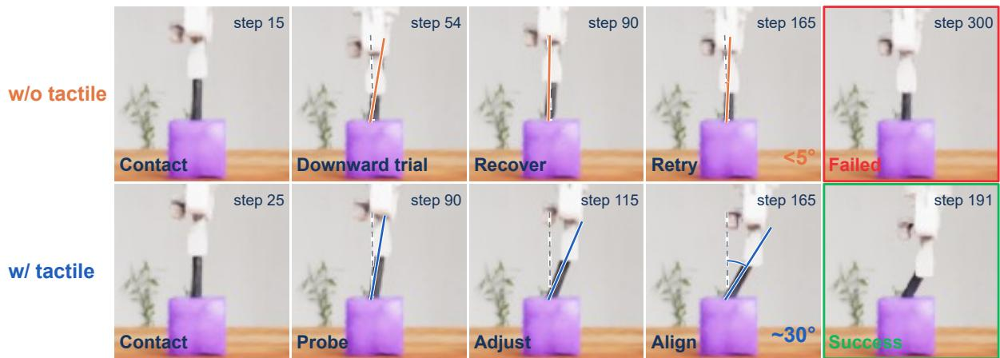
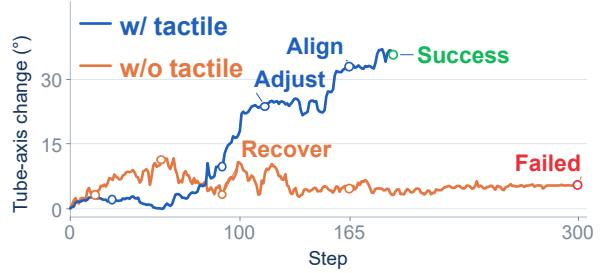
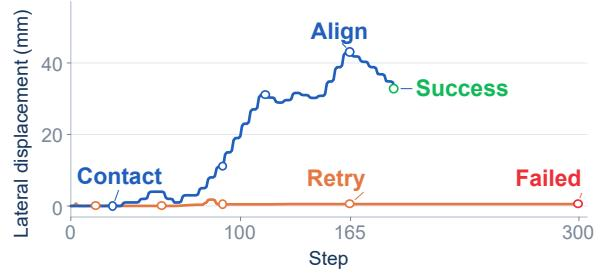
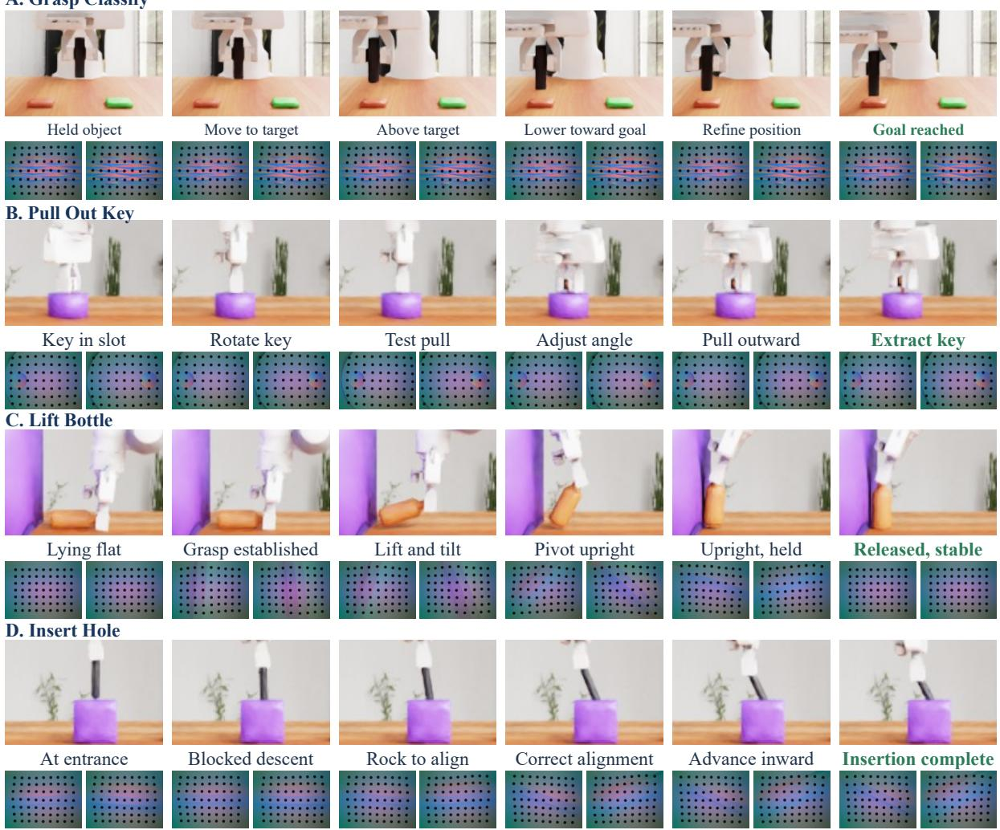
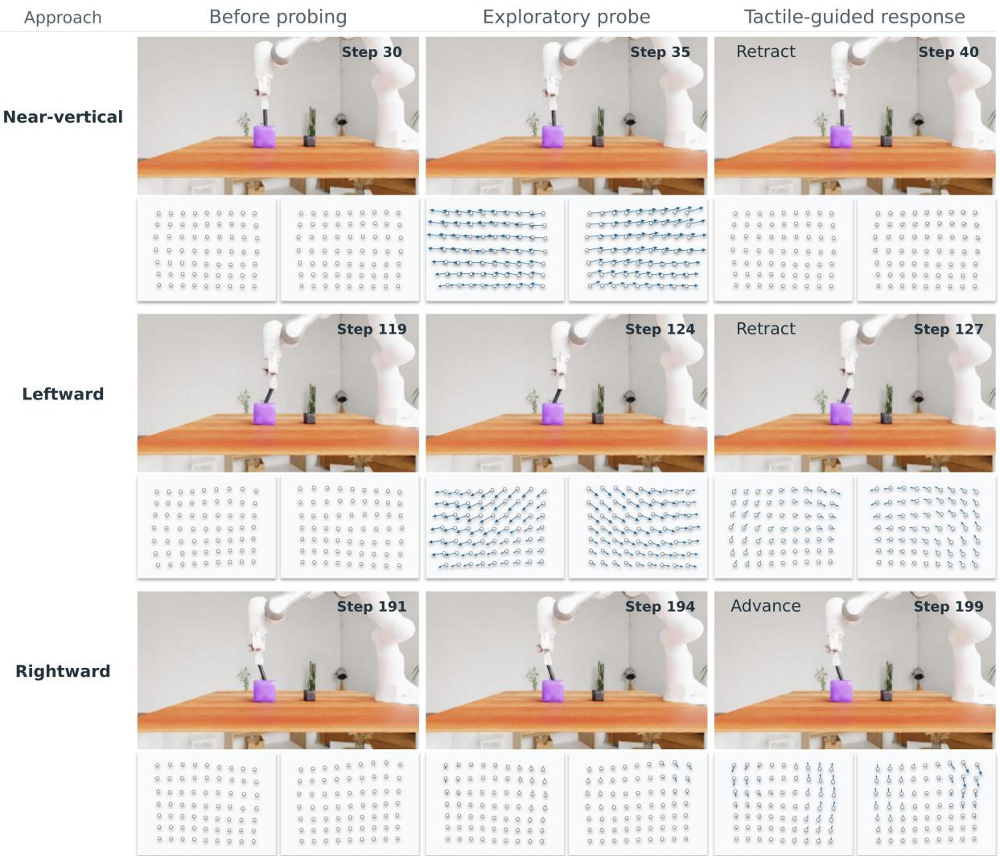

# GPT-6-Astra Understands Touch and Outperform Vision–Tactile–Language–Action Models

Ziyong Wang, Yupei Lin, Runxuan Huang, Liang Lin, Dongyu Zhang†, Guangrun Wang†

Sun Yat-sen University, X-Era AI Lab, The Hong Kong Polytechnic University wangzy369@mail2.sysu.edu.cn, donny.zhang@cpce-polyu.edu.hk, wanggrun@gmail.com https://gpt-as-tactile-policy.github.io/

## Abstract

General-purpose multimodal models have shown promise as direct robot action policies, yet whether they grasp the physics underlying real-world interactions and can apply that understanding to guide action remains underexplored. We investigate this question using contact-rich manipulation as a representative testbed, examining tactile understanding as a concrete instance of this broader capability. Contact-rich manipulation requires interpreting tactile feedback and adjusting actions after obstruction. Existing learned tactile policies acquire these capabilities through specialized pretraining and per-task optimization, with substantial data and training costs. We present GPT-as-Tactile-Policy, which summarizes expert demonstrations into task guidance and tactile references for contact assessment and corrective action. GPT-6-Astra combines this context with multimodal observations and interaction history to generate control commands and adjust actions through contact feedback. Without additional robotics-specific pretraining or per-task policy fine-tuning, our method achieves 93.8% mean success across five UniVTAC tasks. Overall performance is comparable to state-of-the-art policies, with higher success on selected tasks. On Insert Hole, tactile feedback improves success from 31% to 99%. Execution analysis further demonstrates contact-guided probing and correction, supporting manipulation progress through explicit expert experience and online feedback.

(A) GPT-as-Tactile-Policy Overview  

  
Figure 1 | GPT-as-Tactile-Policy for contact-rich manipulation. (A) Offline task knowledge construction and online closed-loop control. (B) Contact-guided insertion using visual and bilateral tactile feedback. (C) Task-wise success rates and average performance on UniVTAC.

## 1. Introduction

The role of general-purpose large models in robotics is expanding from task planning and skill selection (Brohan et al., 2023) and control program generation (Liang et al., 2023) to direct action decisions. Recent evaluations of GPT-6-Astra show that a general-purpose multimodal model can generate numerical robot actions from observations, task instructions, and execution history, using feedback to determine subsequent behavior (Team et al., 2026a). These studies progressively connect general knowledge to robot action, raising a fundamental question: do general-purpose multimodal models grasp the physics underlying real-world interactions, and can they apply that understanding to guide their actions? Exploring this question requires examining how models reason the physical consequences of their actions and use interaction feedback to adjust subsequent behavior (Huang et al., 2022; Liu et al., 2023).

Tactile understanding provides a representative test case for a model’s grasp of physics, because interpreting tactile feedback involves making sense of physical phenomena such as contact, deformation, and constrained motion. We therefore choose contact-rich tasks such as insertion and alignment as our experimental setting (Huang et al., 2025; Bi et al., 2026). Even after identifying a target and reaching the contact location, a robot can be obstructed by local pose errors and hidden geometric constraints (Huang et al., 2024; Xue et al., 2025). External vision provides scene layout and visible object motion, but offers limited access to deformation and motion constraints at the contact interface (Chen et al., 2026; Higuera et al., 2026). In this setting, tactile feedback allows us to examine whether models can connect the observed physical effects to their own actions and use that understanding to guide subsequent control.

Existing research has developed learned policies that integrate touch into contact-rich manipulation. Representative approaches include ACT with the UniVTAC encoder (Chen et al., 2026), the tactile-predictive N0-VTLA (Team et al., 2026c), and the tactile-native world-action model N0- TWAM (Team et al., 2026b). These approaches acquire contact representations and manipulation capabilities through representation learning, pretraining, and downstream policy optimization. Their use of expert experience therefore involves training dedicated representations or updating policy parameters for downstream tasks. This motivates exploring an alternative: making expert manipulation experience directly available to a general-purpose model as task guidance, without an additional task-specific policy training stage.

Table 1 | Training costs and knowledge-guided probing. Our method uses explicit expert knowledge without additional pretraining or per-task policy optimization.
<table><tr><td>Method</td><td>Specialized pretraining</td><td>Per-task training</td><td>Knowledge-guided probing</td></tr><tr><td>ACT + UniVTAC</td><td>Tactile encoder</td><td>50 demos; 4,000 steps</td><td>X</td></tr><tr><td>N0-VTLA</td><td>Multi-node cluster</td><td>One policy per task</td><td>X</td></tr><tr><td>N0-TWAM</td><td>128H800; 8A100</td><td>One policy/task; 1k steps</td><td>X</td></tr><tr><td>Ours</td><td>No additional pretraining</td><td>No parameter updates</td><td>√</td></tr></table>

To investigate this question without additional specialized pretraining or per-task policy finetuning, we introduce GPT-as-Tactile-Policy, which summarizes expert manipulation experience into task guidance that a general-purpose model can use directly. As shown in Fig. 1A, the model combines this experience with current visual and tactile observations and interaction history to directly generate robot actions, revising subsequent attempts based on contact changes. Expert experience provides principles for probing and correction, while real-time tactile feedback helps the model determine how to apply them to the current interaction. This process requires no policy parameter updates; Tab. 1 compares its training requirements with those of existing methods.

  
Figure 2 | Our GPT-as-Policy on Insert Hole. w/o tactile and w/ tactile denote our policy without and with tactile feedback, respectively. Keyframes and pose-change curves contrast failed retries with successful alignment, followed by completion of the insertion.

Fig. 1B and Fig. 2 illustrate how tactile feedback changes the policy’s response to obstruction. Without tactile feedback, the policy repeatedly presses downward, retracts, and retries, but its orientation and lateral adjustments remain limited, leaving insertion incomplete. With tactile feedback, the policy actively explores alternative insertion directions and progressively adjusts the tube orientation and lateral position until insertion succeeds. This contrast illustrates how tactile feedback helps identify ineffective attempts, guide local correction, and restore manipulation progress. Across five contact-rich UniVTAC tasks, our method achieves overall performance comparable to extensively pretrained state-of-the-art methods and higher success rates on selected tasks, without additional robotics-specific pretraining or per-task policy finetuning, as shown in Fig. 1C. Our main contributions are:

• Direct visuo-tactile control. We introduce GPT-as-Tactile-Policy, enabling a fixed-parameter general-purpose multimodal model to translate tactile feedback into effective action adjustments. By relating contact changes to preceding motions, the model revises its approach and pose to improve alignment and make progress after obstruction.

• Experience-guided tactile reasoning. We summarize expert manipulation experience into fixed task guidance covering contact cues, probing, and corrective strategies. Together with representative tactile references, this guidance helps the model apply prior experience to current interactions.

• SOTA-level performance without policy fine-tuning. Across five UniVTAC tasks, evaluated over 100 seeds per task following the benchmark protocol, our method achieves overall performance comparable to extensively pretrained state-of-the-art methods and higher success rates on selected tasks, without additional robotics-specific pretraining or per-task policy fine-tuning. Execution analyses further demonstrate how the model uses tactile feedback to select probing directions, correct its pose, and make progress after obstruction.

## 2. Related Work

## 2.1. Language Models as Robot Policies

Language models have been used to translate pretrained task knowledge into robot behavior through skill selection, program generation, and motion planning. SayCan Brohan et al. (2023) combines language-model estimates of task relevance with value-function estimates of skill feasibility to select skill sequences for long-horizon manipulation. Code as Policies Liang et al. (2023) generates policy programs that process perception outputs and parameterize control primitives, using program logic to express motion parameters, conditional behavior, and feedback loops. Instruct2Act Huang et al. (2023a) maps multimodal instructions to Python policy programs that invoke perception, planning, and action interfaces. RoboScript Chen et al. (2024) emphasizes the deployability of generated programs by integrating perception, motion planning, and control through a unified interface for simulation and real robots. VoxPoser Huang et al. (2023b) grounds language-inferred affordances and constraints in visual observations through composable 3D value maps, which support closed-loop trajectory generation through modelbased planning. These approaches connect language-model knowledge to robot execution through different intermediate representations.

Execution feedback further enables language models to revise their decisions based on observed outcomes. Inner Monologue Huang et al. (2022) incorporates success detection, scene descriptions, and human interaction as language feedback to update task plans during execution. REFLECT Liu et al. (2023) constructs hierarchical summaries of robot experiences from multisensory observations, uses a language model to explain failures, and provides these explanations to a language-based planner for corrective planning. These studies incorporate the consequences of previous actions into subsequent decisions.

Another line of work investigates language models that generate explicit action parameters. Natural Language as Policies Mikami et al. (2024) reasons over textual descriptions of tasks and scene objects to generate coordinate-level parameters for pick-and-place or sweeping actions, reducing reliance on intermediate policy code. GPT-as-Policy Team et al. (2026a) systematically evaluates GPT-6-Astra as an embodied policy across multiple domains, examining numerical action generation, cooperation with learned policies, and feedback-driven adaptation. Following this direct action-decision paradigm, We study this direct-policy paradigm in contactrich manipulation, focusing on how a general-purpose multimodal model uses visual–tactile feedback to interpret contact and select subsequent actions.

## 2.2. Visuo-Tactile Manipulation Policies

Visuo-tactile manipulation combines scene observations with local contact feedback to support fine-grained perception and control. VITaL Pretraining George et al. (2025) investigates visuotactile pretraining for imitation learning, showing benefits for both policies that use touch during execution and policies deployed without tactile input. 3D-ViTac Huang et al. (2024) integrates visual and tactile observations into a unified 3D representation that preserves their spatial structure and relationships, and combines this representation with diffusion policies for fine-grained manipulation. Reactive Diffusion Policy Xue et al. (2025) introduces a slow-fast hierarchy that combines latent action-chunk generation with high-frequency tactile feedback control, allowing the policy to respond to contact changes during chunk execution. These studies investigate how tactile information supports skill learning and execution through representation learning and feedback-aware control architectures.

Recent work further integrates tactile sensing with the task knowledge of vision-languageaction (VLA) models. VLA-Touch Bi et al. (2026) keeps the base VLA fixed while using a pretrained tactile-language model to provide semantic feedback for high-level planning and a diffusion-based controller to refine actions using tactile signals. Tactile-VLA Huang et al. (2025) combines tactile sensing with hybrid position-force control to connect vision-language knowledge to physical interaction; its CoT variant further explores tactile-feedback-driven failure analysis and strategy adaptation. OmniVTLA Cheng et al. (2026) addresses heterogeneous tactile inputs through a dual-path tactile encoder and semantically aligned representations. �0-VTLA Team et al. (2026c) further explores large-scale visuo-tactile pretraining, a predictive latent tactile pathway, and offline policy improvement from stored deployment data. Together, these approaches incorporate touch into semantic understanding, policy adaptation, and action generation at different decision levels.

Another line of work uses predictions of physical interactions to support manipulation. Visuo-Tactile World Models Higuera et al. (2026) incorporate touch into action-conditioned world models to improve the physical consistency of imagined futures and support robot planning. Tactile-WAM Wu et al. (2026) introduces asymmetric attention that isolates the visual prediction pathway from tactile tokens while preserving tactile access for action generation. VT-WAM Tian et al. (2026) jointly learns future visual, tactile-deformation, and action prediction, and uses training-time contact-gated attention guidance to strengthen the use of tactile evidence in action generation. � -TWAM Team et al. (2026b) further combines large-scale visuo-tactile joint training, a unified force-based tactile representation, and contact-event-based task staging to support multi-stage manipulation. These studies extend the role of touch from observing the current contact state to anticipating how contact evolves under robot actions.

Our work studies a complementary setting in which a general-purpose multimodal model serves as a direct action policy with its parameters fixed. Task knowledge is supplied through in-context guidance, and the model combines this guidance with visual–tactile observations and execution history to select subsequent actions. Our focus is on how the model interprets contact feedback and uses it to make online action decisions, complementing research on learned visuo-tactile representations, control architectures, and predictive models.

## 3. Method

## 3.1. GPT-as-Tactile-Policy

GPT-as-Policy uses a general-purpose multimodal model as a closed-loop robot action policy, selecting actions from the task instruction, observations, and interaction history (Team et al., 2026a). In its direct-control formulation, GPT generates numerical end-effector and gripper targets, which a generic inverse-kinematics controller converts into robot motion; new observations after execution return to the model. The model therefore selects the next operation using available observations and feedback from preceding actions.

For contact-rich manipulation, we incorporate bilateral tactile feedback and task guidance summarized from expert demonstrations into this decision process. As shown in Fig. 1A, the framework comprises offline experience summarization and online feedback control. Offline, GPT-6-Astra jointly analyzes expert actions, contact changes, and task progress to construct fixed context C� for task �. Online, the same model serves as the sole action policy, combining task guidance, visuo-tactile observations, and robot proprioception to interpret current contact responses and select actions. The resulting policy uses both fixed task experience and observations and history that evolve throughout the current interaction.

We formulate this policy as conditional action generation. At step �, the observation is denoted by $o _ { t } = \left( V _ { t } , s _ { t } , \mathcal { T } _ { t } \right)$ , where $V _ { t }$ contains scene and wrist-camera images, $s _ { t }$ denotes the robot’s proprioceptive state, and $\mathcal { T } _ { t }$ comprises tactile observations from fingertips. Given a natural-language task instruction ℓ, the policy generates an action as

$$
a _ { t } \sim \pi _ { \boldsymbol \theta } ( \cdot \mid \boldsymbol { \ell } , C _ { \tau } , o _ { t } , \mathcal { H } _ { t } ) ,\tag{1}
$$

where $C _ { \tau }$ denotes the fixed task context comprising a textual Task Skill and reference tactile observations, $\mathcal { H } _ { t }$ records preceding observations, actions, and execution feedback within the episode, and $a _ { t }$ specifies the target end-effector pose, gripper position, and a short execution horizon. After each execution, new observations enter the interaction history and provide feedback for subsequent actions. Model parameters � remain fixed throughout offline experience summarization and online execution.

## 3.2. Task Knowledge Construction from Expert Demonstrations

To provide task guidance for the online policy in Section 3.1, we construct fixed task context from expert demonstrations before execution. These demonstrations contain sequential visual and tactile observations, robot states, and expert actions, recording changes in contact and task progress during manipulation. As shown in Fig. 1A, GPT-6-Astra jointly analyzes these sequences, relating contact changes and object motion before and after actions to summarize how experts assess progress, select adjustments, and evaluate their effects. The resulting guidance forms the textual Task Skill $K _ { \tau }$

The Task Skill organizes this experience into task objectives, manipulation principles, evidence for stage transitions, and corrective strategies for obstructions. It specifies which observations to examine and how they should inform subsequent actions. For example, increasing deformation without object advancement during insertion prompts retraction to relieve contact, followed by a positional or angular adjustment evaluated through subsequent feedback. This knowledge gives tactile changes operational meaning, helping the model determine when to advance, when to adjust, and which feedback to examine when assessing an adjustment.

GPT-6-Astra also extracts representative tactile observations from expert demonstrations to form the reference set $\mathcal { E } _ { \tau } ^ { \mathrm { t a c } }$ , preserving bilateral contact distributions and local deformation patterns. The Task Skill provides principles for contact assessment and manipulation adjustment, while tactile references provide perceptual grounding for these principles. We organize both components into the task context

$$
\begin{array} { r } { C _ { \tau } = \left( K _ { \tau } , \mathcal { E } _ { \tau } ^ { \mathrm { t a c } } \right) , } \end{array}\tag{2}
$$

which serves as a fixed conditioning input to the GPT policy defined in Section 3.1. At each decision step, the model combines this context with current observations and interaction history to assess whether tactile changes accompany manipulation progress and to select continued advancement, probing, or corrective actions. New observations after execution reveal the effects of the selected action and inform the next decision.

## 3.3. Online Visuo-Tactile Observation Representation

During online execution, we provide both bilateral tactile images and structured tactile descriptions to preserve local contact details and support comparison of contact distributions and deformation changes. Following Section 3.1, we expand $\mathcal { T } _ { t }$ as

$$
\mathcal { T } _ { t } = \left\{ \left( I _ { t } ^ { f } , D _ { t } ^ { f } , M _ { t } ^ { f } \right) \right\} _ { f \in \{ L , R \} } ,\tag{3}
$$

where $f \in \{ L , R \}$ indexes the left and right fingertips, respectively, and $I _ { t } ^ { f }$ denotes the tactile image. The descriptors $D _ { t } ^ { f }$ summarize the spatial distribution and statistics of indentation depth, while $M _ { t } ^ { f }$ records two-dimensional marker displacements relative to reference positions.

For spatial contact distributions, we spatially pool gel indentation maps and provide statistical descriptions, including mean indentation, peak indentation, contact regions, and centroids, characterizing contact location, extent, and indentation distribution. Marker displacements further describe local deformation directions and spatial patterns within contact regions. Information from the two fingertips is retained separately, allowing the model to compare bilateral contact differences and their evolution.

To relate contact changes to executed actions, the model considers indentation distributions and marker displacements across successive observations together with the measured endeffector and gripper motion over the same interval. Visual observations further reveal object motion relative to the target and gripper, connecting actual robot motion, object response, and tactile changes. Updated through execution, these observations provide current contact evidence for applying the Task Skill and feedback for subsequent closed-loop action generation.

## 3.4. Closed-Loop Action Generation from Interaction Feedback

During online execution, the decision policy $\pi _ { \theta }$ assesses manipulation progress using the current observation $o _ { t }$ and interaction history $\mathcal { H } _ { t }$ . It constructs action $a _ { t }$ from the latest measured robot state. After checks on command bounds and format, a generic inverse-kinematics controller executes the target for one to five control steps. A new observation $o _ { t + 1 }$ is then acquired. Short execution horizons allow prompt contact assessment and adjustment of subsequent motion.

After each execution, the decision policy �� compares $o _ { t }$ and $o _ { t + 1 }$ to assess the effects of action $a _ { t }$ . It jointly examines end-effector motion, object responses, and tactile changes to determine whether manipulation has progressed. Guided by Task Skill $K _ { \tau } ,$ the policy determines whether alignment or grasp adjustments are needed. It then generates the next action $a _ { t + 1 }$

When observations leave the adjustment direction uncertain, the decision policy $\pi _ { \theta }$ actively explores to acquire additional contact information. Exploratory actions include small translations, orientation adjustments, and changes in gripper opening. The policy assesses contact changes and task progress using object motion and bilateral tactile feedback. This feedback guides the direction and magnitude of subsequent actions. Exploratory actions and their observed outcomes are incorporated into the interaction history $\mathcal { H } _ { t } .$ Subsequent decisions therefore build on accumulated interaction evidence to progressively refine manipulation.

## 4. Experiments

We compare our method with visual, visuo-tactile, and world-action baselines on five UniVTAC tasks and conduct a tactile ablation on Insert Hole.

## 4.1. Experimental Setup

Tasks and data. We evaluate on five contact-rich manipulation tasks from UniVTAC (Chen et al., 2026): Insert Hole, Lift Can, Grasp Classify, Lift Bottle, and Pull-out Key. These tasks cover geometric alignment, grasped-object manipulation, constrained motion, and tactile classification.

For each task, we use 50 expert demonstrations, split at the episode level into 40 for knowledge construction and 10 for offline validation. From the construction subset, GPT-6-Astra analyzes contact changes and object motion before and after expert actions to distill the Task Skill for progress assessment and manipulation adjustment. It also extracts tactile references preserving bilateral contact distributions and local deformation patterns. Together, these components form the task context, which is fixed before formal evaluation and used across all test episodes of the same task.

Baselines. We compare against four methods previously evaluated on UniVTAC. E0 (Zhan et al., 2026)and �0.5 provide a vision-only baseline to assess manipulation under contact constraints (Intelligence et al., 2025). ACT + UniVTAC Encoder uses pretrained visuo-tactile representations (Chen et al., 2026). N0-VTLA is a state-of-the-art policy with latent tactile prediction (Team et al., 2026c). N0-TWAM jointly models future vision, touch, and actions (Team et al., 2026b).

Policy configuration. We use GPT-6-Astra as the decision policy ��, with reasoning effort fixed to xhigh. The same model and reasoning configuration is used across all tasks. Each test episode starts an independent model session, with interaction history H� updated within the episode and reset between episodes. Observations and action execution follow Sections 3.3 and 3.4, respectively.

Evaluation protocol. Our evaluation comprises 100 fixed test episodes per task, for a total of 500 episodes. Episode outcomes are determined by the environment’s native success criteria. We report per-task success rates and the average over the five tasks, assigning equal weight to each task. Terminated episodes that do not satisfy the success conditions are counted as failures.

## 4.2. Main Result

Tab. 2 compares GPT-as-Policy with ACT + UniVTAC Encoder, �0.5, N0-VTLA, and N0-TWAM on five UniVTAC tasks. Our GPT-as-Policy achieves competitive performance without additional robotics-specific pretraining or per-task policy fine-tuning. Its mean success rate of 93.8% approaches the 96.2% achieved by N0-VTLA and exceeds the 84.6% of N0-TWAM. Viewed alongside the training requirements in Tab. 1, these results highlight a different route to task adaptation: expert demonstrations are organized into task guidance that a general-purpose model can apply during online control.

On Insert Hole, GPT-as-Policy achieves 99% success, matching N0-TWAM and outperforming N0-VTLA. On Lift Can, it achieves 95%, the highest success rate among the compared methods. Across all five tasks, it matches or outperforms $N _ { 0 } .$ -TWAM, demonstrating consistent performance across tasks.

Table 2 | Success rates on five UniVTAC tasks, in percent. Mean denotes the task average.
<table><tr><td>Method</td><td>Insert Hole</td><td>Lift Can</td><td>Grasp Classify</td><td>Lift Bottle</td><td>Pull-out Key</td><td>Mean</td></tr><tr><td>ACT + UniVTAC Encoder</td><td>24.0</td><td>29.0</td><td>99.0</td><td>71.0</td><td>46.0</td><td>53.8</td></tr><tr><td>π0.5</td><td>25.0</td><td>6.0</td><td>49.0</td><td>100.0</td><td>35.0</td><td>43.0</td></tr><tr><td>N0-VTLA</td><td>95.0</td><td>88.0</td><td>100.0</td><td>99.0</td><td>99.0</td><td>96.2</td></tr><tr><td>N0-TWAM</td><td>99.0</td><td>93.0</td><td>94.0</td><td>58.0</td><td>79.0</td><td>84.6</td></tr><tr><td>Ours</td><td>99.0</td><td>95.0</td><td>98.0</td><td>93.0</td><td>84.0</td><td>93.8</td></tr></table>

Table 3 | Tactile ablation on Insert Hole. V, P, and T denote vision, proprioception, and touch.
<table><tr><td>Method</td><td>Online observations</td><td>Success rate (%) ↑</td></tr><tr><td>Ours</td><td>V + P + T</td><td>99.0</td></tr><tr><td>w/o tactile</td><td>V+P</td><td>31.0</td></tr></table>

Qualitative Results. Fig. 3 presents successful executions on Grasp Classify, Pull-out Key, Lift Bottle, and Insert Hole, together with bilateral tactile observations. In Grasp Classify, the policy refines the object position near the target region to complete placement. In Pull-out Key, a test pull is followed by an angle adjustment, outward motion, and extraction. In Lift Bottle, the policy establishes a grasp, lifts and reorients the bottle, and releases it in a stable pose. In Insert Hole, the policy adjusts the tube alignment after a blocked descent, then advances inward to complete insertion. These sequences illustrate how the decision policy �� completes manipulation through successive adjustments under different contact constraints.

## 4.3. Ablation on Tactile Information

We evaluate the role of tactile feedback in corrective actions and reliable insertion on Insert Hole. We compare the full policy Ours with a tactile-free variant w/o tactile. The variant retains vision, proprioception, and the action interface, while removing tactile information and tactile references. Each configuration uses a fixed Task Skill matched to its available observations. Both are evaluated on the same 100 test configurations with identical initialization, low-level controllers, and execution budgets. Model and session settings follow Section 4.1.

Tab. 3 shows that, on Insert Hole, the full policy achieves 99% success, compared with 31% for w/o tactile. This represents an improvement of 68 percentage points. The gap highlights the difficulty of reliable insertion using vision and proprioception alone. Tactile feedback substantially improves task completion under the evaluated contact constraints.

Execution behavior with and without tactile feedback. To illustrate how tactile feedback affects adjustments after obstruction, we visualize representative insertion episodes with and without touch in Fig. 2. Without touch, repeated attempts produce limited changes in tube orientation and lateral end-effector position. Insertion remains incomplete at step 300. With touch, the policy actively explores alternative insertion directions and progressively adjusts the tube orientation and lateral position. It completes insertion at step 191. The angle and displacement traces record these adjustments relative to each episode’s initial state. The tactileenabled policy revises its local approach, illustrating how contact feedback supports exploration of alternative insertion directions and restores manipulation progress.

  
Figure 3 | Successful executions across four tasks. (A) Grasp Classify. (B) Pull-out Key. (C) Lift Bottle. (D) Insert Hole. Selected keyframes at representative timesteps are arranged chronologically from left to right. Beneath each RGB frame, the left and right images show the corresponding tactile observations from the left and right fingertips, respectively.

## 4.4. Qualitative Analysis on Insert Hole

To examine how tactile feedback guides active exploration, we visualize three probing sequences from a single Insert Hole episode in Fig. 4. They correspond to near-vertical, leftward, and rightward approaches. Each sequence shows the state before probing, the bilateral tactile response, and the subsequent action.

For the near-vertical approach, steps 30, 35, and 40 show the states and corresponding contact responses before probing, during probing, and after retraction. The policy then retracts, and displacement decreases. The leftward attempt at steps 119, 124, and 127 follows a similar pattern. In both attempts, withdrawal accompanies reduced marker displacement, showing that motion adjustment can relieve the local deformation induced by probing. These responses provide evidence for ending the current attempt and reconsidering the approach direction.

The rightward attempt at steps 191, 194, and 199 exhibits a different response. Probing produces smaller marker displacement, followed by continued advancement. Here, tactile feedback and subsequent motion jointly support direction selection: smaller contact changes accompany further advancement, supporting retention of the current approach. Comparing actions and outcomes across directions progressively identifies a local motion that permits insertion under the observed contact conditions.

  
Figure 4 | Tactile-guided exploration on Insert Hole. Scene images and bilateral markerdisplacement fields show exploratory probing followed by retraction for near-vertical and leftward approaches, or advancement for the rightward approach.

These sequences illustrate the information-gathering role of active exploration in contact-rich manipulation. Probing reveals contact responses to candidate directions, while withdrawal enables realignment. The decision policy �� uses this feedback to withdraw or advance, restoring progress after obstruction. The responses retained in H� also inform subsequent local action adjustments within the same episode.

## 5. Conclusion

To enable general-purpose multimodal models to use contact feedback for action adjustment, we present GPT-as-Tactile-Policy, which combines expert-derived task guidance with online tactile observations. Expert experience provides task guidance for contact assessment and manipulation adjustment. Online tactile feedback provides evidence for evaluating action outcomes and selecting subsequent adjustments. Without additional robotics-specific pretraining or per-task policy fine-tuning, our method achieves overall performance comparable to state-ofthe-art policies across five UniVTAC tasks, matching or exceeding the compared methods on selected tasks. Tactile ablation and execution analysis further demonstrate the role of contact feedback in local probing, directional adjustment, and restoring progress after obstruction. These results establish explicit task knowledge combined with online interaction feedback as an effective route to efficient contact-rich manipulation.

## References

J. Bi, K. Y. Ma, C. Hao, M. S. Zheng, and H. Soh. Vla-touch: Enhancing vision-language-action model with dual-level tactile feedback. IEEE Robotics and Automation Letters, 2026.

A. Brohan, Y. Chebotar, C. Finn, K. Hausman, A. Herzog, D. Ho, J. Ibarz, A. Irpan, E. Jang, R. Julian, et al. Do as i can, not as i say: Grounding language in robotic affordances. In Conference on robot learning, pages 287–318. Pmlr, 2023.

B. Chen, W. Wan, T. Chen, X. Guo, C. Xu, Y. Qi, H. Zhang, L. Wu, T. Xu, Z. Li, et al. Univtac: A unified simulation platform for visuo-tactile manipulation data generation, learning, and benchmarking. arXiv preprint arXiv:2602.10093, 2026.

J. Chen, Y. Mu, Q. Yu, T. Wei, S. Wu, Z. Yuan, Z. Liang, C. Yang, K. Zhang, W. Shao, et al. Roboscript: Code generation for free-form manipulation tasks across real and simulation. arXiv preprint arXiv:2402.14623, 2024.

Z. Cheng, Y. Zhang, A. Tang, K. Wang, W. Zhang, H. Li, H. Zhang, and L. Song. Omnivtla: Vision-tactile-language-action models with semantic-aligned tactile sensing. IEEE Robotics and Automation Letters, 2026.

A. George, S. Gano, P. Katragadda, and A. B. Farimani. Vital pretraining: Visuo-tactile pretraining for tactile and non-tactile manipulation policies. In 2025 IEEE International Conference on Robotics and Automation (ICRA), pages 258–264. IEEE, 2025.

C. Higuera, S. Arnaud, B. Boots, M. Mukadam, F. R. Hogan, and F. Meier. Visuo-tactile world models. arXiv preprint arXiv:2602.06001, 2026.

B. Huang, Y. Wang, X. Yang, Y. Luo, and Y. Li. 3d-vitac: Learning fine-grained manipulation with visuo-tactile sensing. arXiv preprint arXiv:2410.24091, 2024.

J. Huang, S. Wang, F. Lin, Y. Hu, C. Wen, and Y. Gao. Tactile-vla: unlocking vision-languageaction model’s physical knowledge for tactile generalization. arXiv preprint arXiv:2507.09160, 2025.

S. Huang, Z. Jiang, H. Dong, Y. Qiao, P. Gao, and H. Li. Instruct2act: Mapping multi-modality instructions to robotic actions with large language model. arXiv preprint arXiv:2305.11176, 2023a.

W. Huang, F. Xia, T. Xiao, H. Chan, J. Liang, P. Florence, A. Zeng, J. Tompson, I. Mordatch, Y. Chebotar, et al. Inner monologue: Embodied reasoning through planning with language models. arXiv preprint arXiv:2207.05608, 2022.

W. Huang, C. Wang, R. Zhang, Y. Li, J. Wu, and L. Fei-Fei. Voxposer: Composable 3d value maps for robotic manipulation with language models. arXiv preprint arXiv:2307.05973, 2023b.

P. Intelligence, K. Black, N. Brown, J. Darpinian, K. Dhabalia, D. Driess, A. Esmail, M. Equi, C. Finn, N. Fusai, et al. �0.5: a vision-language-action model with open-world generalization. arXiv preprint arXiv:2504.16054, 2025.

J. Liang, W. Huang, F. Xia, P. Xu, K. Hausman, B. Ichter, P. Florence, and A. Zeng. Code as policies: Language model programs for embodied control. In 2023 IEEE International conference on robotics and automation (ICRA), pages 9493–9500. IEEE, 2023.

Z. Liu, A. Bahety, and S. Song. Reflect: Summarizing robot experiences for failure explanation and correction. arXiv preprint arXiv:2306.15724, 2023.

Y. Mikami, A. Melnik, J. Miura, and V. Hautamäki. Natural language as policies: Reasoning for coordinate-level embodied control with llms. arXiv preprint arXiv:2403.13801, 2024.

G. Team, X. Chen, X. Cheng, Y. Deng, L. Ding, S. Dong, X. Gao, H. Jia, Z. Li, Z. Li, et al. Systematically exploring the capabilities of gpt-6 astra as embodied policies. arXiv preprint arXiv:2609.38537, 2026a.

N. Team, F. T. Team, et al. �\_0-twam: Scaling tactile-native world-action model for contact-rich manipulation. arXiv preprint arXiv:2607.23783, 2026b.

N. Team, F. T. Team, et al. �\_0-vtla: Scaling vision-tactile-language-action model with latent tactile tokens. arXiv preprint arXiv:2607.23782, 2026c.

S. Tian, Y. Zheng, Y. Zheng, S. Gu, Y. Zang, Y. Qin, W. Li, H. Li, W. Ding, and D. Zhao. Vt-wam: Visual-tactile world action model for contact-rich manipulation. arXiv preprint arXiv:2607.02503, 2026.

S. Wu, L. You, J. Zhu, Y. Liu, H. Kaixiang, C. Yonghang, J. Li, C. Zhang, J. Liu, H. Chu, et al. Tactile-wam: Touch-aware world action model with tactile asymmetric attention. arXiv preprint arXiv:2606.26663, 2026.

H. Xue, J. Ren, W. Chen, G. Zhang, Y. Fang, G. Gu, H. Xu, and C. Lu. Reactive diffusion policy: Slow-fast visual-tactile policy learning for contact-rich manipulation. arXiv preprint arXiv:2503.02881, 2025.

Z. Zhan, J. Zhou, L. Zhang, Q. Lyu, H. Liu, W. Li, J. Zhang, Z. Chen, T. Chen, R. Zhai, K. Wang, L. Lin, and G. Wang. E0: Expressive fine-grained discrete action prediction for vision-languageaction models via tweedie discrete diffusion. In Advances in Neural Information Processing Systems, 2026.