# Large Flow Language Models

Arnav Chavan<sup>∗,1,2</sup>, Chanhyuk Lee<sup>∗,3</sup>, Udbhav Bamba<sup>∗,2</sup>, Jaehoon Yoo<sup>3</sup>, Seunghoon Hong<sup>3</sup>

Aditi Raghunathan<sup>†,4</sup>, Jinwoo Kim<sup>†,3</sup>

<sup>1</sup>UC Berkeley <sup>2</sup>Amazon <sup>3</sup>KAIST <sup>4</sup>Carnegie Mellon University

<sup>∗</sup>Equal contribution <sup>†</sup>Equal advising

Abstract. Continuous flow language models ofer a path to parallel generation with tools for control and acceleration unavailable to discrete difusion, yet efective techniques for building them at the billion-parameter scale remain less established. We present Lafa (Large flow language model), a fast, high-performing flow language model scaled to 8B parameters in a data-eficient manner. Lafa is a blockwise flow model with causal attention on the prefix and bidirectional, asynchronous flow within each block. This design enables eficient adaptation of pretrained autoregressive (AR) models and fast inference via prefix caching and blockwise parallel decoding. We train Lafa at 0.5B, 7B, and 8B scales with fewer than 30B tokens, more eficient than previous difusion models, and evaluate it on instruction following, math, and coding, where the learned flow matches or surpasses the quality of AR and can be distilled into flow maps for one- and few-step generation. Notably, flow training preserves or even improves pretrained AR capabilities via a multi-token prediction efect, which we leverage in a self-speculative decoding scheme that verifies flow-based drafts autoregressively within a single model. This yields 2.54× throughput of an AR model at comparable quality, outperforming multi-token prediction and discrete difusion methods. Our findings show that continuous flows can serve as a scalable foundation for language modeling.

Code: github.com/lafa-gh/large-flow-lmsModels: huggingface.co/lafa-hf/models

## 1 Introduction

Today’s large language models are predominantly trained as autoregressive (AR) models that predict the next token from the preceding text [1–3]. The parallelism of the transformer architecture and teacher forcing [4, 5] allows these models to be trained eficiently at the scale of billions of parameters and trillions of data tokens. However, their generation is inherently sequential, producing one token per forward pass, which makes inference latency a bottleneck. To accelerate inference, prior work has explored approaches to parallel generation, namely multi-token prediction (MTP) [6–8], discrete difusion models [9–11], and continuous flow language models [12–14].

Distinguished from the other approaches, flow language models perform parallel generation by integrating a continuous flow from noise to token representations [12]. By operating in a continuous space, they can leverage powerful techniques developed for controllable and accelerated generation of images and video, many of which are unavailable to discrete methods [13, 14]. Yet, existing flow language models have been demonstrated at small scales and on simple tasks [13–17], and a prior attempt of scaling has identified challenges in training ineficiency [18]. Together, efective techniques for building performant flow language models at the billion-parameter scale remain less established.

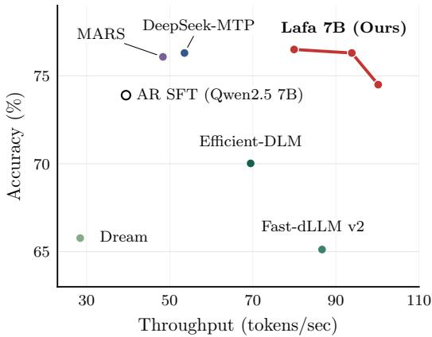  
Figure 1: Large flow language models. Lafa 7B attains 2.02–2.54× the throughput of an AR model at a matched or better quality, outperforming existing MTP and difusion-based approaches.

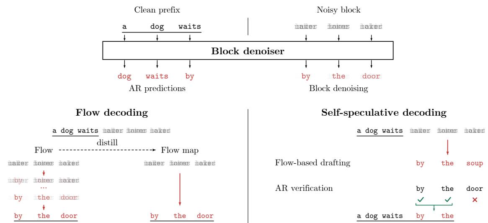  
Figure 2: Overview. (Top) Lafa learns a block denoiser that also performs AR prediction on the prefix. (Bottom) Lafa supports flow decoding, which can be further distilled into a flow map for one-step generation. Together, AR and flow support self-speculative decoding, which accepts flow-based drafts from left to right via AR verification.

In this paper, we present Lafa (Large flow language model), a fast and high-performing flow language model scaled to 8B parameters in a data-eficient manner. Motivated by the left-to-right directionality of text [19], we design Lafa as a blockwise flow model, with causal attention on the prefix, and bidirectional but left-to-right-biased asynchronous flow within each block. This brings its architecture and inductive bias close to AR models, enabling eficient training by adapting pretrained models. Further, this allows fast inference via prefix caching and parallel flow decoding, which can be further distilled into flow maps for one- and few-step generation. We train Lafa with blockwise denoising for the flow, along with AR prediction on the prefix, and find that flow training preserves or even enhances pretrained AR capabilities through a multi-token prediction efect. We leverage this in a self-speculative decoding scheme that verifies flow-based drafts autoregressively. With these techniques, we train Lafa across 0.5B, 7B, and 8B scales with fewer than 30B tokens, cheaper than comparable adaptation of discrete difusion models that use up to 500B tokens [20, 21]. Across benchmarks spanning instruction following, reasoning, and coding, Lafa attains a quality–speed frontier that surpasses similarly sized AR, MTP, and discrete difusion language models, as shown in Figure 1.

## An overview of the approach is in Figure 2. Our main contributions are as follows:

• We introduce Lafa, a large flow language model that learns blockwise asynchronous flow, enabling eficient training by adapting pretrained AR models and fast inference through prefix caching and parallel flows.

• We identify key design choices for scalability, including the architecture and asynchronous flow formulation, training and flow map distillation objectives, and inference schemes including self-speculative decoding.

• We scale Lafa to 7–8B parameters with <30B tokens and show that its learned flow matches or surpasses the quality of AR and is distillable into flow maps, and its learning improves pretrained AR capabilities.

• By jointly leveraging the flow and AR capabilities for self-speculative decoding, Lafa attains 2.54× the throughput of a strong AR baseline at matched quality, outperforming existing parallel generation methods.

Our findings show that continuous flows ofer a practical, scalable foundation for parallel language modeling.

## 2 Large flow language models

In this section, we introduce Lafa, a class of scalable and high-performing large flow language models. We first formulate blockwise asynchronous flows, then describe the architecture, training, and inference procedures. See Appendix A for theoretical results and Appendix B for algorithmic details.

## 2.1 Block asynchronous flows

Blockwise formulation. We develop our method upon standard block-autoregressive factorization [22], as in block discrete difusion [23], retaining causal generation and prefix caching across blocks. For vocabulary $V ,$ prefix $\mathbf { c } \in V ^ { N }$ , and continuation $\mathbf { y } \in V ^ { M }$ , we factorize into blocks of size B (assuming $B \mid M )$ :

$$
p ( \mathbf { y } \mid \mathbf { c } ) = \prod _ { r = 0 } ^ { M / B - 1 } p \big ( \mathbf { y } ^ { r B + 1 : ( r + 1 ) B } \mid \mathbf { c } , \mathbf { y } ^ { \le r B } \big ) .\tag{1}
$$

Embedded flows. We embed each block $\mathbf { y } \in V ^ { B }$ using vocabulary embeddings $\mathbf { E } \in \mathbb { R } ^ { | V | \times d }$ as $\mathbf { x } _ { 1 } : =$ $\left( \mathbf { E } _ { \mathbf { y } ^ { 1 } } , \ldots , \mathbf { E } _ { \mathbf { y } ^ { B } } \right) ^ { \top } \in \mathbb { R } ^ { B \times d }$ . This reduces the per-token dimension from $| V |$ of one-hot embeddings [13] to $d ,$ making training more scalable. Using flow matching [24, 25], we construct a conditional probability path $p _ { t } ( \cdot \mid \mathbf { c } ) , t \in [ 0 , 1 ]$ , from Gaussian noise $\mathbf { x } _ { 0 } \sim \mathsf { N } ( 0 , \sigma ^ { 2 } I )$ with $\sigma > 0$ to the distribution of embedded data $\mathbf { x } _ { 1 }$

Asynchronous flows. Standard flow matching uses the interpolant $I _ { t } : = ( 1 - t ) \mathbf { x } _ { 0 } + t \mathbf { x } _ { 1 }$ , where $I _ { t } \sim p _ { t }$ with a shared time t for all tokens. To introduce a left-to-right bias within each block to match the inherent directionality of text [19], we use tokenwise time [26–30], allowing earlier positions to progress faster. A tokenwise time is a function $\tau : [ 0 , 1 ] \to [ 0 , 1 ] ^ { B }$ , diferentiable and increasing in each coordinate, mapping a base time t to a tokenwise time $\tau ^ { i } ( t )$ for each $i = 1 , . . . , B$ , satisfying $\boldsymbol { \tau } ( 0 ) = \mathbf { 0 }$ and $\tau ( 1 ) = \mathbf { 1 }$ . Given τ, we can construct a probability path $p _ { t } ( \cdot \mid \mathbf { c } )$ in base time t through an interpolant $I _ { t }$ defined positionwise [27]:

$$
I _ { t } ^ { i } : = ( 1 - \tau ^ { i } ( t ) ) { \bf x } _ { 0 } ^ { i } + \tau ^ { i } ( t ) { \bf x } _ { 1 } ^ { i } , \qquad i \in [ { \cal B } ] , \qquad I _ { t } \sim p _ { t } ( \cdot \vert \ { \bf c } ) , \qquad t \in [ 0 , 1 ] .\tag{2}
$$

For each given $\mathbf { c } ,$ the probability path $p _ { t } ( \cdot \mid \mathbf { c } )$ admits a velocity field $b _ { t } ( \cdot ; { \mathbf { c } } ) : \mathbb { R } ^ { B \times d } \to \mathbb { R } ^ { B \times d }$ that transports a block of noise to clean data embeddings through the following ODE [27], which can be used for generation:

$$
\begin{array} { r } { \dot { \mathbf { x } } _ { t } = b _ { t } ( \mathbf { x } _ { t } ; \mathbf { c } ) , \qquad \mathbf { x } _ { 0 } \sim p _ { 0 } , \qquad \mathbf { x } _ { t } \sim p _ { t } ( \cdot \mid \mathbf { c } ) , \qquad t \in [ 0 , 1 ] . } \end{array}\tag{3}
$$

If τ progresses faster for the earlier tokens $( \mathrm { i . e . , } \tau ^ { i } ( t ) > \tau ^ { j } ( t )$ for $i < j )$ , both interpolation and generation will reveal earlier tokens faster. In practice, we learn τ from data instead of fixing it, with details in Section 2.2.

Block denoiser. Instead of learning the asynchronous velocity $b _ { t } ( \cdot ; { \mathbf c } )$ directly, following related work [12, 13], we learn a block denoiser $D _ { t } ( \cdot ; \mathbf { c } ) : \mathbb { R } ^ { \smile \to } \to ^ { \bullet } ( \Delta ^ { | V | - 1 } ) ^ { B }$ that predicts clean tokens via tokenwise classification:

$$
D _ { t } ( \mathbf { x } ; \mathbf { c } ) ^ { i } : = p ( \mathbf { y } ^ { i } = \cdot \mid \mathbf { c } , I _ { t } = \mathbf { x } ) , \qquad i \in [ B ] ,\tag{4}
$$

where $\Delta ^ { | V | - 1 }$ is the space of probability vectors of length |V |. Notably, learning the denoiser recovers the velocity through the following identity that involves embedding interpolation, which we prove in Appendix A.1:

$$
b _ { t } ( { \bf x } ; { \bf c } ) ^ { i } = \frac { \dot { \tau } ^ { i } ( t ) } { 1 - \tau ^ { i } ( t ) } ( D _ { t } ( { \bf x } ; { \bf c } ) ^ { i } { \bf E } - { \bf x } ^ { i } ) .\tag{5}
$$

The formula scales the direction from noisy input x to its denoising $D _ { t } ( \mathbf { x } ; \mathbf { c } ) \mathbf { E }$ by the tokenwise rate of progress ˙τ(t), thereby implementing the asynchronous progress prescribed by tokenwise time τ.

## 2.2 Learning the flow from an autoregressive model

As our formulation keeps a causal structure, we learn the blockwise flow by adapting a pretrained AR model f into a block denoiser. The challenge is parallel denoising of continuous, noisy embeddings while retaining AR prediction and prefix caching. Our adaptation combines tokenwise time conditioning, block-bidirectional attention, and constrained updates to pretrained embeddings with joint AR and denoising training.

Tokenwise time conditioning. We feed f the embedded prefix c followed by the noisy block x, and condition each position on its corruption level through adaptive layer normalization (adaLN) [31]. Prefix positions always receive time 1, indicating the absence of noise, while each block position $i \in [ B ]$ receives its tokenwise time $\tau ^ { i } ( t )$ . This lets a single forward pass handle both the clean prefix and asynchronous denoising within the block. We initialize adaLN to the identity, so that adding time conditioning initially leaves the pretrained computation unchanged. We denote the resulting model by $f _ { t } ( \mathbf { x } ; \mathbf { c } )$

Block-bidirectional attention. We make attention bidirectional within the noisy block, allowing partially denoised later tokens to inform earlier ones (Figure 3). Block positions also attend to the entire clean prefix, whose attention remains causal and excludes the noisy block [32, 33]. Together with conditioning prefix positions on time 1, this makes their keys and values independent of the block state $( { \bf x } , t )$ , allowing reuse across denoising steps and subsequent blocks. The prefix outputs retain their AR role: $f _ { t } ( \mathbf { x } ; \mathbf { c } ) ^ { i }$ predicts $\mathbf { c } ^ { i + 1 }$ for $i < N$ , and the first block token $\mathbf { y } ^ { 1 }$ for $i = N$ . We write these block-independent predictions as $f ( \mathbf { c } ) ^ { i }$ and use them to verify the denoiser’s drafts in self-speculative decoding (Section 2.3). This requires retaining or improving pretrained AR capabilities, which we achieve through training. We find that bidirectional attention within blocks outperforms causal (Table 3).

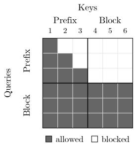  
Figure 3: Attention mask for block-bidirectional attention.

Shared and learned embeddings. We initialize the vocabulary embeddings E from the pretrained model, share them between the prefix and the embedded flow, and train them jointly with the denoiser. Unconstrained updates, however, can inflate embedding norms relative to the fixed noise scale $\sigma ,$ making denoising easier by reducing the efective corruption [12, 13]. We therefore fix the L2 norm of each embedding $\mathbf { E } _ { v }$ to its pretrained value and learn only its direction, allowing adaptation to the flow while preserving the embedding scale. This outperforms both frozen and unconstrained embeddings (Table 3).

Training loss. We train the block denoiser $\hat { D } _ { t } ( \mathbf { x } ; \mathbf { c } ) ^ { i } : = f _ { t } ( \mathbf { x } ; \mathbf { c } ) ^ { N + i }$ jointly with AR on the prefix. For each training pair $( \mathbf { c } , \mathbf { y } )$ , we draw $t \sim \mathsf { U } [ 0 , 1 ]$ and noise $\mathbf { x } _ { 0 } \sim p _ { 0 }$ , and build $I _ { t }$ via (2) with $\mathbf { x } _ { 1 } ^ { i } = \mathbf { E } _ { \mathbf { y } ^ { i } }$ . We minimize

$$
\mathcal { L } ( \hat { D } ) : = \mathbb { E } _ { \mathbf { c } , \mathbf { y } , t , \mathbf { x } _ { 0 } } \left[ \underbrace { \sum _ { i = 1 } ^ { N } - \log f ( \mathbf { c } ) _ { \mathbf { c } ^ { i + 1 } } ^ { i } } _ { \mathrm { A R ~ c r o s s ~ e n t r o p y } } + \underbrace { \sum _ { i = 1 } ^ { B } - \log \hat { D } _ { t } ( I _ { t } ; \mathbf { c } ) _ { \mathbf { y } ^ { i } } ^ { i } } _ { \mathrm { d e n o i s i n g ~ c r o s s ~ e n t r o p y } } + \underbrace { \sum _ { i = 1 } ^ { B } \bigl | \hat { D } _ { t } ( I _ { t } ; \mathbf { c } ) ^ { i } \mathbf { E } - \mathbf { E } _ { \mathbf { y } ^ { i } } \bigr | ^ { 2 } } _ { \mathrm { e m b e d d i n g ~ s q u a r e d ~ e r r o r } } \right] ,\tag{6}
$$

where $\mathbf { c } ^ { N + 1 } : = \mathbf { y } ^ { 1 }$ , and the AR and denoising predictions share the transformer parameters. The denoising cross entropy supervises token probabilities (4), while the squared error supervises the mean embedding that determines the flow velocity (5). Combining these denoising losses improves flow accuracy, and we unexpectedly find that AR supervision improves it further (Table 3). Notably, joint training also improves AR accuracy over matched AR SFT (Section 3.2), consistent with the benefits of multi-token prediction [6, 8, 34].

Parallel training. To avoid recomputing overlapping prefixes, we train all blocks of a sequence in parallel. Following prior work on block difusion [23, 32, 33, 35], we pair each clean training sequence with a copy partitioned into noisy blocks of size B (Figure 4). Clean positions attend causally, while each noisy block attends only to the preceding clean tokens and bidirectionally within itself. A single forward pass then produces AR predictions for the clean sequence and denoising predictions for every block (details in Appendix B.1).

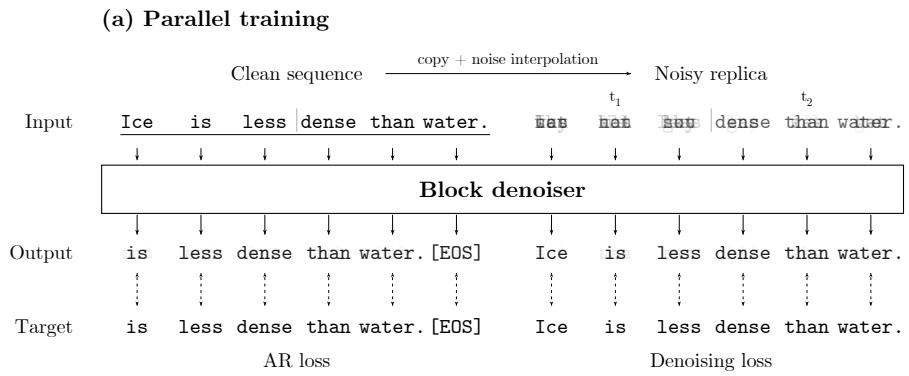

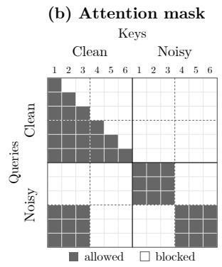  
Figure 4: Parallelized training over a sequence composed of two blocks of size three. The uncorrupted sequence uses causal attention and the AR loss, while each noisy block attends to the preceding clean tokens and bidirectionally within itself, and uses the denoising losses.

Learning tokenwise time. We learn the tokenwise time $\tau : [ 0 , 1 ] $ $[ 0 , 1 ] ^ { B }$ from the denoising loss during training. Inspired by the loss-aware time warping of CDCD [12], we construct each $\tau ^ { i }$ as the inverse CDF of the normalized denoising loss across noise levels, estimated online for position i (details in Appendix B.1). This slows progress where the loss is high, so uniform sampling and discretization of base time t allocate more training samples and integration steps to dificult noise levels. The learned schedules generally satisfy $\tau ^ { i } ( t ) > \tau ^ { j } ( t )$ for $i < j$ (Figure 5), with earlier positions denoised ahead of later ones, even though this left-to-right bias is not manually imposed.

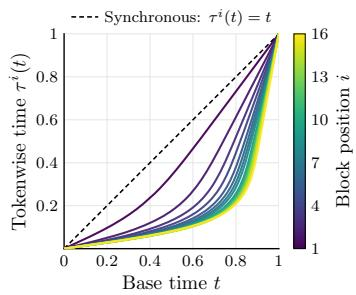  
Figure 5: Tokenwise time for each block position learned by Lafa 7B.

Self-conditioning. Following prior work [14, 15, 36], we use self-conditioning [37] to improve sample quality. With a fixed probability during training, we obtain a denoising prediction without gradients, feed it back as an additional input, and compute the loss on a second forward pass (details in Appendix B.2). During flow decoding, each Euler step reuses the previous step’s prediction for conditioning, requiring no added forward.

Flow map distillation. Flow decoding requires multiple denoiser evaluations per block. To reduce this cost, we distill the learned flow into a flow map $X _ { s , t }$ that transports a state directly from time s to t [38]. For this, we make a novel extension of simplex-valued two-time denoisers [13] to asynchronous flows over vocabulary embeddings. Specifically, $\delta _ { s , t } ( \mathbf { \bar { x } } ; \mathbf { c } ) \in ( \Delta ^ { | V | - 1 } ) ^ { B }$ predicts token probabilities, which we map through E before interpolating with the noisy state x:

$$
X _ { s , t } ( \mathbf { x } ; \mathbf { c } ) ^ { i } : = { \frac { 1 - \tau ^ { i } ( t ) } { 1 - \tau ^ { i } ( s ) } } \mathbf { x } ^ { i } + { \frac { \tau ^ { i } ( t ) - \tau ^ { i } ( s ) } { 1 - \tau ^ { i } ( s ) } } \delta _ { s , t } ( \mathbf { x } ; \mathbf { c } ) ^ { i } \mathbf { E } , \qquad i \in [ B ] , \quad 0 \leq s < t \leq 1 .\tag{7}
$$

This retains categorical predictions for distillation while transporting states in embedding space. We initialize the student $\hat { \delta } _ { s , t }$ from the frozen teacher $\hat { D } _ { s } .$ , adding an identity-initialized adaLN for the destination time t. Following semigroup-based distillation [13, 36], we match the student’s diagonal predictions at $s = t$ to the teacher $\hat { D } _ { s }$ and its of-diagonal predictions at $s \neq t$ to a stop-gradient target formed by composing two shorter student transitions. We use KL losses for both terms and additionally distill the teacher’s prefix AR predictions. The student preserves prefix caching and supports generation in as few as one step through $\hat { X } _ { 0 , 1 }$ The derivation and full objective are in Appendix A.2.

## 2.3 Inference schemes

We generate each block by integrating the learned flow or evaluating its distilled flow map. We further accelerate generation through self-speculative decoding, using the retained AR predictor $f$ to verify flow-based drafts. All schemes reuse the prefix key-value (KV) cache and extend it with newly committed tokens.

Flow and flow map decoding. Starting from $\hat { \mathbf { x } } _ { 0 } \sim p _ { 0 }$ , we take K steps on the grid of base times $t _ { k } = k / K$ which induces an asynchronous temporal grid $\tau ( t _ { k } ) \in [ 0 , 1 ] ^ { B }$ . With $\mathbf { p } _ { k } : = \hat { D } _ { t _ { k } } ( \hat { \mathbf { x } } _ { t _ { k } } ; \mathbf { c } )$ , an Euler step gives

$$
\hat { \mathbf { x } } _ { t _ { k + 1 } } ^ { i } = \hat { \mathbf { x } } _ { t _ { k } } ^ { i } + \frac { \tau ^ { i } ( t _ { k + 1 } ) - \tau ^ { i } ( t _ { k } ) } { 1 - \tau ^ { i } ( t _ { k } ) } ( \mathbf { p } _ { k } ^ { i } \mathbf { E } - \hat { \mathbf { x } } _ { t _ { k } } ^ { i } ) , \qquad \hat { \mathbf { y } } ^ { i } = \mathbf { a r g m a x } ( \mathbf { p } _ { K - 1 } ^ { i } ) , \qquad i \in [ B ] ,\tag{8}
$$

where the final prediction determines the generated tokens $\hat { \mathbf { y } }$ . Each step reuses the previous prediction for self-conditioning. We further strengthen prefix conditioning with prefix guidance [39], analogous to classifier-free guidance [40] (details in Appendix B.2). This adds one prefix-free evaluation per step, which is eficient as it processes only the B block tokens. The distilled flow map model replaces each Euler step with a learned jump, which amounts to using $\hat { \delta } _ { t _ { k } , t _ { k + 1 } }$ in place of $\hat { D } _ { t _ { k } }$ in (8):

$$
\hat { \mathbf { x } } _ { t _ { k + 1 } } = \hat { X } _ { t _ { k } , t _ { k + 1 } } \big ( \hat { \mathbf { x } } _ { t _ { k } } ; \mathbf { c } \big ) , \qquad \hat { \mathbf { y } } ^ { i } = \mathsf { a r g m a x } \big ( \hat { \delta } _ { t _ { K - 1 } , 1 } \big ( \hat { \mathbf { x } } _ { t _ { K - 1 } } ; \mathbf { c } \big ) ^ { i } \big ) , \qquad i \in [ B ] .\tag{9}
$$

Setting K = 1 gives one-step block generation through $\hat { X } _ { 0 , 1 }$

Self-speculative decoding. We draft a block with one Euler step in tokenwise time (8), without prefix guidance. Since $\tau ^ { i } ( 0 ) = 0$ and $\tau ^ { i } ( 1 ) = 1$ , this reduces to a single denoiser evaluation from $\hat { \mathbf { x } } _ { 0 } \sim p _ { 0 } ;$

$$
\mathbf { p } ^ { i } : = \hat { D } _ { 0 } ( \hat { \mathbf { x } } _ { 0 } ; \mathbf { c } ) ^ { i } , \qquad \hat { \mathbf { x } } _ { 1 } ^ { i } = \mathbf { p } ^ { i } \mathbf { E } , \qquad \hat { \mathbf { y } } ^ { i } = \mathsf { a r g m a x } ( \mathbf { p } ^ { i } ) , \qquad i \in [ B ] .\tag{10}
$$

One-step drafts can be inconsistent across positions, so we verify them with the retained AR predictor f [41]. We commit the longest draft prefix agreeing with greedy AR predictions, and if the first token disagrees, we instead commit argmax $( f ( \mathbf { c } ) ^ { N } )$ . The resulting output therefore matches greedy AR decoding with f. To improve eficiency, following fused drafting and verification schemes [41], we verify the previous draft while generating candidate next drafts with one-step flow decoding in a single forward pass. Here, each candidate conditions on a possible accepted prefix, and after verification, we keep the candidate corresponding to the verified acceptance length (details in Appendix B.3). As an alternative to self-speculation, a draft may be accepted by confidence thresholding [33], which we detail in Appendix C.3.

## 3 Experiments

In our experiments, we evaluate whether Lafa learns flows that reach AR quality through data-eficient adaptation, and whether flow map distillation improves few-step generation (Section 3.1). We then examine how flow training afects AR accuracy (Section 3.2) and use the retained AR predictor for self-speculative decoding, measuring both parallelism and wall-clock throughput (Section 3.3). Finally, we ablate the main training and inference choices (Section 3.4). Evaluation details are in Appendix C.

Models and data. We build Lafa at 0.5B and 7B by adapting the corresponding Qwen2.5 Instruct checkpoints [42] as described in Section 2. At 8B, we use Qwen3 8B Base [43], as further training of its heavily post-trained Instruct counterpart degraded performance in our experiments. We train all models on Dolci-Instruct-SFT [44] for 5–15 epochs (9–27B tokens), using at least 18× fewer training tokens than the reported budgets of Dream, LLaDA, and Eficient-DLM at comparable scales [20, 21, 45]. We use 0.5B for ablations, 7B for the main results, and 8B for scale-matched comparisons with additional baselines.

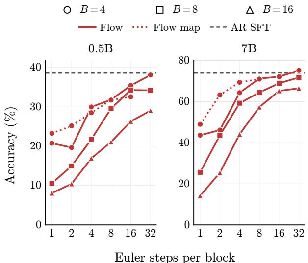  
Figure 6: Flow and flow map decoding results. Accuracy averaged over IFEval, GSM8K, and HumanEval.

Table 1: Single-token decoding accuracy (%) ↑ averaged across all six benchmarks. † denotes matched initialization, data, and training.
<table><tr><td>Method</td><td>0.5B</td><td>7B</td><td>8B</td></tr><tr><td>AR SFT†</td><td>28.7</td><td>58.4</td><td>56.8</td></tr><tr><td>MTP† [6]</td><td>25.9</td><td>53.9</td><td></td></tr><tr><td>DeepSeek-MTP† [8]</td><td>30.2</td><td>60.0</td><td></td></tr><tr><td>MARS† [33]</td><td>30.4</td><td>59.7</td><td></td></tr><tr><td>SBD† [46]</td><td>27.6</td><td></td><td></td></tr><tr><td>BD3-LM† [23]</td><td>22.8</td><td></td><td></td></tr><tr><td>Fast-dLLM v2† [48]</td><td></td><td>49.3</td><td></td></tr><tr><td>Fast-dLLM v2 [48]</td><td></td><td>54.4</td><td></td></tr><tr><td>Dream [20]</td><td></td><td>55.6</td><td></td></tr><tr><td>LLaDA [45]</td><td></td><td></td><td>43.5</td></tr><tr><td>Efficient-DLM [21]</td><td></td><td></td><td>63.5</td></tr><tr><td>Lafa (Ours)†</td><td>31.6</td><td>60.9</td><td>63.1</td></tr></table>

Baselines. We compare against multi-token prediction, block-parallel decoding, and discrete difusion methods that represent existing approaches for parallel language modeling (Section 4). At 0.5B, we evaluate MTP [6], DeepSeek-MTP [8], MARS [33], SBD [46], BD3-LM [23], and PTP [47]. At 7–8B, we additionally compare against Fast-dLLM v2 [48], Dream [20], LLaDA [45], and Eficient-DLM [21]. Baselines marked <sup>†</sup> are trained by us with the same AR initialization, data, and training budget as Lafa, providing controlled comparisons. The remaining baselines use released checkpoints with diferent training data and budgets. We also fine-tune each AR initialization on the same data to obtain AR SFT, our reference for both quality and speed. Unless stated otherwise, we use each method’s native decoding protocol.

Benchmarks. We evaluate on six benchmarks spanning instruction following, reasoning, and code generation: IFEval (0-shot) [49], BBH (3-shot) [50], MMLU-Pro (0-shot) [51], GPQA (0-shot) [52], GSM8K (0-shot) [53], and HumanEval (0-shot) [54]. These downstream tasks assess generation quality without relying on generative perplexity, whose limitations are documented by Franca and Tong [55]. All methods are evaluated with lm-evaluation-harness [56] using each benchmark’s default prompts. We report prompt-level strict accuracy for IFEval, pass@1 for HumanEval, and accuracy for the remaining tasks. Generation is capped at 1024 tokens per sample, except 512 for GSM8K and 640 for HumanEval. We report six-benchmark macro-averages for single-token accuracy and self-speculative accuracy and TPF (Tables 1 and 2 and Figure 7). For flow and flow map decoding, throughput, and ablations, we average over IFEval, GSM8K, and HumanEval, covering instruction following, math, and coding, considering their more costly evaluations.

## 3.1 Flow and flow map decoding

We first evaluate flow generation with block sizes B ∈ {4, 8, 16}, varying the number of Euler integration steps in (8). We also test whether flow map distillation improves few-step generation. Figure 6 summarizes the results (per-benchmark scores in Appendix C.1). Across scales and block sizes, flow accuracy generally improves with more integration steps, demonstrating efective iterative refinement. With suficient steps, flow decoding with block size four approaches AR SFT accuracy at 0.5B and surpasses it at 7B. At a fixed number of steps, larger blocks generally trade accuracy for greater parallelism. For flow map decoding, we distill the models with block size four and observe improved accuracy in the one- and two-step regimes. The gains are largest at 7B, where the two-step student approaches the four-step teacher; the student also outperforms the teacher at four steps and reaches similar accuracy at eight steps. Nevertheless, a quality gap remains relative to flow decoding with more integration steps. We leave better incorporation of self-conditioning and prefix guidance into flow map distillation to future work.

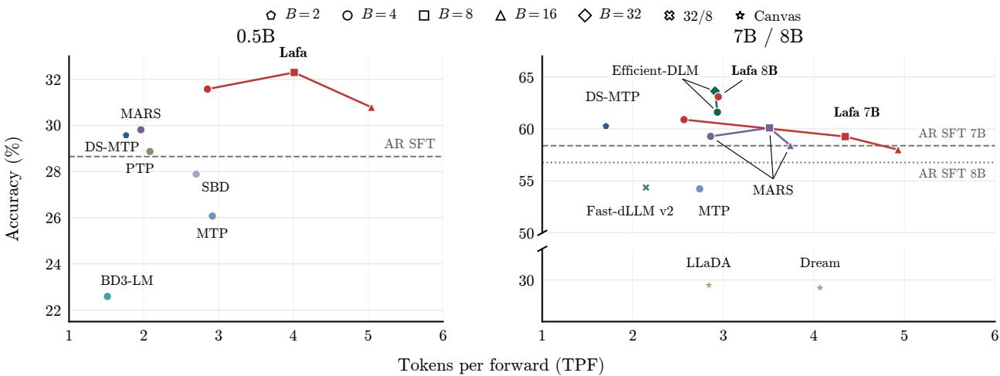  
Figure 7: Self-speculative decoding. Accuracy ↑ vs. TPF ↑ averaged over all six benchmarks. In the right panel, Eficient-DLM and LLaDA are 8B and the other baselines are 7B. “Canvas” denotes iterative completion over the full sequence, while $^ { \mathrm { * } } \mathrm { 3 2 } / 8 ^ { \mathrm { * } }$ denotes decoding 32-token blocks in four 8-token sub-blocks. Further details in Appendix C.1.

Table 2: Self-speculative decoding accuracy (%) ↑ and TPF ↑.
<table><tr><td rowspan="3">Method</td><td rowspan="3">B</td><td colspan="2">IFEval</td><td colspan="2">BBH</td><td colspan="2">MMLU-Pro</td><td colspan="2">GPQA</td><td colspan="2">GSM8K</td><td colspan="2">HumanEval</td><td colspan="2">Average</td></tr><tr><td>Acc.</td><td>TPF</td><td></td><td>Acc. TPF</td><td>Acc.</td><td>TPF</td><td>Acc.</td><td>TPF</td><td>Acc.</td><td>TPF</td><td>Acc.</td><td>TPF</td><td>Acc.</td><td>TPF</td></tr><tr><td colspan="10">0.5B scale</td><td colspan="7"></td></tr><tr><td rowspan="3">Qwen2.5 SFT Lafa (Ours)</td><td></td><td>48.4</td><td>1.0</td><td>26.3</td><td>1.0</td><td>11.9</td><td>1.0</td><td>17.9</td><td>1.0</td><td>32.0</td><td>1.0</td><td>35.4</td><td>1.0</td><td>28.7</td><td>1.0</td></tr><tr><td>4</td><td>55.1</td><td>2.2</td><td>27.6</td><td>3.3</td><td>12.1</td><td>3.1</td><td>21.9</td><td>2.9</td><td>36.1</td><td>2.7</td><td>36.6</td><td>2.9</td><td>31.6</td><td>2.9</td></tr><tr><td>8 16</td><td>55.3 54.2</td><td>2.7 3.1</td><td>27.9 27.0</td><td>5.1 6.3</td><td>10.0 9.1</td><td>5.5 9.2</td><td>23.7 18.1</td><td>4.2 4.8</td><td>37.8 36.7</td><td>3.6</td><td>39.0 39.6</td><td>3.0 3.3</td><td>32.3 30.8</td><td>4.0 5.0</td></tr><tr><td colspan="10"></td><td colspan="7">3.6</td></tr><tr><td rowspan="3">Qwen2.5 SFT</td><td></td><td></td><td></td><td></td><td></td><td></td><td>7B scale</td><td></td><td></td><td></td><td></td><td></td><td></td><td></td><td></td></tr><tr><td></td><td>73.8</td><td>1.0</td><td>59.2</td><td>1.0</td><td>41.6</td><td>1.0</td><td>27.9</td><td>1.0</td><td>69.1</td><td>1.0</td><td>78.7</td><td>1.0</td><td>58.4</td><td>1.0</td></tr><tr><td>4 8</td><td>78.9</td><td>1.7 2.8</td><td>63.0</td><td>3.4</td><td>41.8</td><td>2.4</td><td>31.0</td><td>2.3</td><td>73.8</td><td>2.8</td><td>76.8</td><td>2.8</td><td>60.9</td><td>2.6</td></tr><tr><td rowspan="3">Lafa (Ours)</td><td></td><td>77.5</td><td></td><td>59.1 57.3</td><td>6.3 7.9</td><td>39.4 39.0</td><td>3.7 3.8</td><td>28.1</td><td>4.0</td><td>75.3</td><td>4.8 5.8</td><td>76.2</td><td>4.6</td><td>59.3</td><td>4.3 4.9</td></tr><tr><td>16</td><td>74.9</td><td>2.8</td><td></td><td></td><td></td><td></td><td>28.1</td><td>4.0</td><td>75.0</td><td></td><td>73.8</td><td>5.4</td><td>58.0</td><td></td></tr><tr><td></td><td></td><td></td><td></td><td></td><td></td><td>8B scale</td><td></td><td></td><td></td><td></td><td></td><td></td><td></td><td></td></tr><tr><td colspan="10"></td><td colspan="7"></td></tr><tr><td>Qwen3 SFT Lafa (Ours)</td><td>4</td><td>38.1 62.3</td><td>1.0 2.4</td><td>71.6</td><td>1.0</td><td>56.2</td><td>1.0</td><td>29.5</td><td>1.0 3.1</td><td>62.9 77.8</td><td>1.0 2.6</td><td>82.3 79.9</td><td>1.0 2.9</td><td>56.8</td><td>1.0</td></tr><tr><td></td><td></td><td></td><td></td><td>70.7</td><td>3.4</td><td>56.2</td><td>3.2</td><td>31.7</td><td></td><td></td><td></td><td></td><td></td><td>63.1</td><td>2.9</td></tr></table>

## 3.2 Autoregressive decoding

We next examine how joint flow training afects the retained AR capability (Section 2.2), evaluating Lafa and baselines under single-token decoding. As shown in Table 1, Lafa improves average accuracy over matched AR SFT across all three model scales (per-benchmark results in Appendix C.1). It also outperforms the matched multi-token and block-parallel baselines on average at 0.5B and 7B. At 8B, Lafa achieves similar accuracy to Eficient-DLM evaluated with single-token unmasking, while using at least 18× fewer training tokens. These results show that learning the flow can also improve AR prediction, consistent with the benefits of multi-token training [6, 8, 34]. We therefore use this retained AR predictor to verify flow-based drafts for self-speculative decoding (Section 3.3).

## 3.3 Self-speculative decoding

We now evaluate self-speculative decoding, which verifies one-step flow drafts with the retained AR predictor (Section 2.3). We measure both parallelism, in tokens committed per forward pass (TPF), and end-to-end wall-clock throughput. Each block size uses its corresponding trained checkpoint, and self-speculation preserves that checkpoint’s greedy AR output.

Parallelism. Figure 7 and Table 2 report accuracy and TPF averaged over all six benchmarks (protocols detailed in Appendix C.1). At 0.5B, Lafa with block size eight achieves about twice the TPF of DeepSeek-MTP, MARS, and PTP while attaining higher average accuracy. At 7B, increasing the block size from four to sixteen nearly doubles TPF while keeping accuracy close to AR SFT. With block size four, Lafa exceeds DeepSeek-MTP in both accuracy and TPF; with block size eight, it matches the accuracy of MARS with block size four at about 1.5× its TPF. At 8B, Lafa achieves similar accuracy and TPF to Eficient-DLM despite using at least 18× fewer training tokens. Across scales, Lafa achieves approximately 2.5–5 TPF while remaining close to or above AR SFT accuracy.

Wall-clock throughput. Since forward-pass costs difer across methods, we also measure end-to-end throughput at 7–8B scales on a single H100 GPU with batch size one, using each method’s native decoder. Figure 8 reports accuracy and throughput in tokens per second (TPS), averaged over IFEval, GSM8K, and HumanEval (settings and perbenchmark results in Appendix C.2). With block size sixteen, Lafa 7B achieves 2.54× the throughput of 7B AR SFT at comparable average accuracy. With block size four, it is about twice as fast while also more accurate on average. DeepSeek-MTP and MARS match or exceed AR SFT accuracy but achieve at most 1.4× its throughput. Difusion baselines fall below 7B AR SFT accuracy, faster settings showing larger losses. Thus, while flow decoding requires multiple integration steps to reach AR quality (Section 3.1), verifying one-step flow drafts enables substantially faster generation at comparable quality.

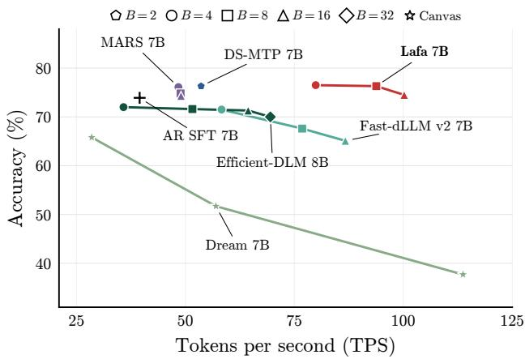  
Figure 8: Accuracy ↑ vs. end-to-end throughput measured in tokens per second (TPS) ↑ at 7–8B scales, averaged over IFEval, GSM8K, and HumanEval.

Accepting drafts by confidence thresholding instead of AR verification trades accuracy for speed. We therefore use self-speculation as our default fast decoding mode and report confidence decoding results in Appendix C.3.

## 3.4 Ablations

We ablate the main training and inference choices in Section 2 using flow decoding to assess their efect on the learned flow. All comparisons use 0.5B models with block size four and 32 Euler integration steps (Table 3). For training, block-bidirectional attention and learned tokenwise time both improve accuracy over their causal and synchronous counterparts. Learning embedding directions while fixing their norms outperforms both frozen embeddings and unconstrained updates. Combining denoising cross entropy and embedding squared error improves accuracy over either objective alone. Adding prefix AR loss improves flow accuracy further, showing that retaining AR capabilities need not compromise flow generation. For inference, both self-conditioning and prefix guidance improve accuracy. Self-conditioning provides the larger gain while requiring no additional model evaluations during decoding. These results motivate better incorporation of both components into the flow map.

Table 3: Ablations. We use flow decoding and report mean accuracy over IFEval, GSM8K, and HumanEval.
<table><tr><td>Configuration</td><td>Average (%)</td></tr><tr><td>Training</td><td></td></tr><tr><td>Fully causal attention</td><td>32.7</td></tr><tr><td>Block-bidirectional attention</td><td>38.0</td></tr><tr><td>Synchronous time</td><td>36.2</td></tr><tr><td>Asynchronous tokenwise time</td><td>38.0</td></tr><tr><td>Frozen embeddings</td><td>34.4</td></tr><tr><td>Unconstrained training Norm-frozen training</td><td>36.9</td></tr><tr><td></td><td>38.0</td></tr><tr><td>Denoising CE Denoising MSE</td><td>33.6</td></tr><tr><td>Denoising CE &amp; MSE</td><td>29.7</td></tr><tr><td>Denoising CE &amp; MSE + AR</td><td>35.8</td></tr><tr><td></td><td>38.0</td></tr><tr><td>Inference</td><td></td></tr><tr><td>No self-conditioning</td><td>32.3</td></tr><tr><td>Self-conditioning</td><td>38.1</td></tr><tr><td>No guidance Prefix guidance</td><td>34.3 38.1</td></tr></table>

## 4 Related work

In this section, we review existing representative approaches for parallel language modeling.

Block-autoregressive language models. Block-autoregressive models reduce sequential generation by producing blocks of tokens conditioned on preceding blocks. Approaches to parallel block generation include multi-token prediction (MTP) heads or modules [6, 8], and predictors that take masked or noisy blocks as input [23, 33, 46]. Many parallel decoders predict tokens independently within an update, which can degrade quality when many tokens are committed at once [13]. Some methods mitigate this through AR verification or confidence-based acceptance of a draft prefix [8, 33, 41]. Some recent methods learn deterministic noise-to-token maps that can capture joint dependencies without independent output sampling [47, 57].

Discrete difusion language models. Discrete difusion models generate text by reversing a discrete corruption process, such as masking or random token replacement, through iterative denoising [58–61]. As with other parallel decoders, independent sampling within each update can limit quality in few-step generation [62, 63]. These models have been scaled to billions of parameters [11, 20, 21, 45], with generation performed over entire sequences or individual blocks. Block difusion [23] combines iterative denoising within each block with autoregressive generation and prefix caching across blocks.

Continuous difusion and flow language models. Continuous difusion and flow models generate text through noisy continuous representations, including token embeddings, simplex representations, and binary encodings [12, 18, 28, 37, 64–67]. Continuous flows transport joint sequence representations and admit flow maps that can be learned for few-step generation [13, 38]. Recent work has demonstrated competitive generation quality and improved few-step decoding [13–17, 36, 68], while a few recent eforts have explored billion-parameter scales [69–72]. Related approaches also study autoregression and difusion over autoencoded continuous representations [73–76]. Realizing the benefits of continuous flows at large and practical scale calls for data-eficient training and fast inference. Lafa addresses both by aligning blockwise asynchronous flows with the causal structure of pretrained AR models. This enables eficient adaptation and prefix caching, while retained AR prediction supports self-speculative generation.

## 5 Conclusion

We introduced Lafa, a blockwise flow language model scaled to 8B parameters by adapting pretrained AR models with fewer than 30B training tokens. Lafa combines causal generation across blocks with learned asynchronous flows within each block, preserving prefix caching while enabling parallel generation. With suficient integration steps, flow decoding approaches or surpasses AR SFT accuracy, and flow map distillation improves few-step generation. Joint training also improves AR accuracy over matched AR SFT. This retained AR predictor verifies one-step flow drafts within the same model, enabling self-speculative decoding. With this approach, Lafa 7B achieves 2.54× the throughput of the 7B AR SFT baseline at comparable average accuracy. These results demonstrate a practical path to scaling continuous flows for language modeling through data-eficient AR adaptation. Improving flow map distillation, particularly its incorporation of self-conditioning and prefix guidance, remains a promising direction for further accelerating flow generation.

## Acknowledgments

The authors would like to thank Sheel Shah, Manan Agarwal, Nick Bofi, Sander Dieleman, Jiaxin Shi, and Kyunghyun Cho for valuable discussions.

## References

[1] Josh Achiam, Steven Adler, Sandhini Agarwal, Lama Ahmad, Ilge Akkaya, Florencia Leoni Aleman, Diogo Almeida, Janko Altenschmidt, Sam Altman, Shyamal Anadkat, et al. GPT-4 technical report. arXiv preprint arXiv:2303.08774, 2023. (page 1)

[2] Rohan Anil, Sebastian Borgeaud, Jean-Baptiste Alayrac, Jiahui Yu, Radu Soricut, Johan Schalkwyk, Andrew M Dai, Anja Hauth, Katie Millican, et al. Gemini: A family of highly capable multimodal models. arXiv preprint arXiv:2312.11805, 2023. (page 1)

[3] Daya Guo, Dejian Yang, Haowei Zhang, Junxiao Song, Peiyi Wang, Qihao Zhu, Runxin Xu, Ruoyu Zhang, Shirong Ma, Xiao Bi, et al. Deepseek-r1 incentivizes reasoning in llms through reinforcement learning. Nature, 645(8081):633–638, 2025. (page 1)

[4] Ashish Vaswani, Noam Shazeer, Niki Parmar, Jakob Uszkoreit, Llion Jones, Aidan N Gomez, Lukasz Kaiser, and Illia Polosukhin. Attention is all you need. Advances in neural information processing systems, 30, 2017. (page 1)

[5] Ronald J Williams and David Zipser. A learning algorithm for continually running fully recurrent neural networks. Neural computation, 1(2):270–280, 1989. (page 1)

[6] Fabian Gloeckle, Badr Youbi Idrissi, Baptiste Rozi\`ere, David Lopez-Paz, and Gabriel Synnaeve. Better & faster large language models via multi-token prediction. arXiv preprint arXiv:2404.19737, 2024. (pages 1, 4, 7, 8, 10, and 24)

[7] Tianle Cai, Yuhong Li, Zhengyang Geng, Hongwu Peng, Jason D Lee, Deming Chen, and Tri Dao. Medusa: Simple llm inference acceleration framework with multiple decoding heads. arXiv preprint arXiv:2401.10774, 2024. (page 1)

[8] DeepSeek-AI. Deepseek-v3 technical report. arXiv preprint arXiv:2412.19437, 2024. (pages 1, 4, 7, 8, 10, 24, and 26)

[9] Inception Labs, Samar Khanna, Siddhant Kharbanda, Shufan Li, Harshit Varma, Eric Wang, Sawyer Birnbaum, Ziyang Luo, Yanis Miraoui, Akash Palrecha, et al. Mercury: Ultra-fast language models based on difusion. arXiv preprint arXiv:2506.17298, 2025. (page 1)

[10] Yuxuan Song, Zheng Zhang, Cheng Luo, Pengyang Gao, Fan Xia, Hao Luo, Zheng Li, Yuehang Yang, Hongli Yu, Xingwei Qu, et al. Seed difusion: A large-scale difusion language model with high-speed inference. arXiv preprint arXiv:2508.02193, 2025. (page 1)

[11] DifusionGemma Team, Adrien Ali Ta¨ıga, James Assiene, Daniele Calandriello, Rahma Chaabouni, Jo˜ao Gante, Tamara von Glehn, Nate Keating, Chris Knutsen, Martin Kukla, et al. Difusiongemma technical report. arXiv preprint arXiv:2608.00146, 2026. (pages 1 and 10)

[12] Sander Dieleman, Laurent Sartran, Arman Roshannai, Nikolay Savinov, Yaroslav Ganin, Pierre H Richemond, Arnaud Doucet, Robin Strudel, Chris Dyer, Conor Durkan, et al. Continuous difusion for categorical data. arXiv preprint arXiv:2211.15089, 2022. (pages 1, 3, 4, 5, 10, and 20)

[13] Chanhyuk Lee, Jaehoon Yoo, Manan Agarwal, Sheel Shah, Jerry Huang, Aditi Raghunathan, Seunghoon Hong, Nicholas M Bofi, and Jinwoo Kim. Flow map language models: One-step language modeling via continuous denoising. arXiv preprint arXiv:2602.16813, 2026. (pages 1, 3, 4, 5, 10, 18, and 19)

[14] Keya Hu, Linlu Qiu, Yiyang Lu, Hanhong Zhao, Tianhong Li, Yoon Kim, Jacob Andreas, and Kaiming He. Elf: Embedded language flows. arXiv preprint arXiv:2605.10938, 2026. (pages 1, 5, and 10)

[15] Yuxin Chen, Chumeng Liang, Hangke Sui, Ruihan Guo, Chaoran Cheng, Jiaxuan You, and Ge Liu. Langflow: Continuous difusion rivals discrete in language modeling. arXiv preprint arXiv:2604.11748, 2026. (pages 1, 5, 10, and 20)

[16] Georgios Batzolis, Mark Girolami, and Luca Ambrogioni. Cobit: Language modeling with bitstream difusion. arXiv preprint arXiv:2605.07013, 2026. (pages 1 and 10)

[17] Zhihan Yang, Wei Guo, Shuibai Zhang, Subham Sekhar Sahoo, Yongxin Chen, Arash Vahdat, Morteza Mardani, and John Thickstun. Continuous difusion scales competitively with discrete difusion for language. arXiv preprint arXiv:2605.18530, 2026. (pages 1 and 10)

[18] Ishaan Gulrajani and Tatsunori B Hashimoto. Likelihood-based difusion language models. Advances in Neural Information Processing Systems, 36:16693–16715, 2023. (pages 2 and 10)

[19] Vassilis Papadopoulos, J´er´emie Wenger, and Cl´ement Hongler. Arrows of time for large language models. arXiv preprint arXiv:2401.17505, 2024. (pages 2 and 3)

[20] Jiacheng Ye, Zhihui Xie, Lin Zheng, Jiahui Gao, Zirui Wu, Xin Jiang, Zhenguo Li, and Lingpeng Kong. Dream 7b: Difusion large language models. arXiv preprint arXiv:2508.15487, 2025. (pages 2, 6, 7, 10, 24, and 26)

[21] Yonggan Fu, Lexington Whalen, Zhifan Ye, Xin Dong, Shizhe Diao, Jingyu Liu, Chengyue Wu, Hao Zhang, Enze Xie, Song Han, et al. Eficient-dlm: From autoregressive to difusion language models, and beyond in speed. arXiv preprint arXiv:2512.14067, 2025. (pages 2, 6, 7, 10, 24, and 26)

[22] Chunqi Wang, Ji Zhang, and Haiqing Chen. Semi-autoregressive neural machine translation. In Proceedings of the 2018 Conference on Empirical Methods in Natural Language Processing, pages 479–488, 2018. (page 3)

[23] Marianne Arriola, Aaron Gokaslan, Justin Chiu, Zhihan Yang, Zhixuan Qi, Jiaqi Han, Subham Sahoo, and Volodymyr Kuleshov. Block difusion: Interpolating between autoregressive and difusion language models. In International Conference on Learning Representations, volume 2025, pages 50726–50753, 2025. (pages 3, 4, 7, 10, 19, and 24)

[24] Yaron Lipman, Ricky TQ Chen, Heli Ben-Hamu, Maximilian Nickel, and Matt Le. Flow matching for generative modeling. arXiv preprint arXiv:2210.02747, 2022. (page 3)

[25] Michael Albergo, Nicholas M Bofi, and Eric Vanden-Eijnden. Stochastic interpolants: A unifying framework for flows and difusions. Journal of Machine Learning Research, 26(209):1–80, 2025. (pages 3 and 17)

[26] Alan Baade, Eric Ryan Chan, Kyle Sargent, Changan Chen, Justin Johnson, Ehsan Adeli, and Li Fei-Fei. Latent forcing: Reordering the difusion trajectory for pixel-space image generation. arXiv preprint arXiv:2602.11401, 2026. (page 3)

[27] Bingshuo Qian and Xiang Cheng. Learning when to denoise: Optimizing asynchronous schedules for latent difusion. arXiv preprint arXiv:2606.19662, 2026. (pages 3 and 17)

[28] Tong Wu, Zhihao Fan, Xiao Liu, Hai-Tao Zheng, Yeyun Gong, Jian Jiao, Juntao Li, Jian Guo, Nan Duan, Weizhu Chen, et al. Ar-difusion: Auto-regressive difusion model for text generation. Advances in Neural Information Processing Systems, 36:39957–39974, 2023. (pages 3 and 10)

[29] Parikshit Bansal and Sujay Sanghavi. Token time continuous difusion for language modeling. arXiv preprint arXiv:2607.14106, 2026. (pages 3 and 17)

[30] Chanhyuk Lee, Wonjung Kim, Patrick Pynadath, Jaehoon Yoo, Satoshi Hayakawa, Ruqi Zhang, Jinwoo Kim, and Seunghoon Hong. Asynchronous flow maps for flow language models, 2026. Forthcoming. (pages 3 and 17)

[31] William Peebles and Saining Xie. Scalable difusion models with transformers. In 2023 IEEE/CVF International Conference on Computer Vision (ICCV), pages 4172–4182. IEEE, 2023. (page 4)

[32] Yuchuan Tian, Yuchen Liang, Shuo Zhang, Yingte Shu, Guangwen Yang, Wei He, Sibo Fang, Tianyu Guo, Kai Han, Chao Xu, Hanting Chen, Xinghao Chen, and Yunhe Wang. From next-token to next-block: A principled adaptation path for difusion LLMs. arXiv preprint arXiv:2512.06776, 2025. (pages 4 and 19)

[33] Ziqi Jin, Lei Wang, Ziwei Luo, and Aixin Sun. Mars: Enabling autoregressive models multi-token generation. arXiv preprint arXiv:2604.07023, 2026. (pages 4, 6, 7, 10, 19, 24, and 26)

[34] Divyat Mahajan, Sachin Goyal, Badr Youbi Idrissi, Mohammad Pezeshki, Ioannis Mitliagkas, David Lopez-Paz, and Kartik Ahuja. Beyond multi-token prediction: Pretraining llms with future summaries. In International Conference on Learning Representations, volume 2026, pages 64342–64364, 2026. (pages 4 and 8)

[35] Aiwei Liu, Minghua He, Shaoxun Zeng, Sijun Zhang, Linhao Zhang, Chuhan Wu, Wei Jia, Yuan Liu, Xiao Zhou, and Jie Zhou. Wedlm: Reconciling difusion language models with standard causal attention for fast inference. arXiv preprint arXiv:2512.22737, 2025. (pages 4 and 19)

[36] Jaehoon Yoo, Wonjung Kim, Floor Eijkelboom, Chanhyuk Lee, Nicholas M Bofi, Seunghoon Hong, and Jinwoo Kim. Self-conditioned flow map language models via fixed-point flows. arXiv preprint arXiv:2607.00714, 2026. (pages 5 and 10)

[37] Ting Chen, Ruixiang Zhang, and Geofrey Hinton. Analog bits: Generating discrete data using difusion models with self-conditioning. arXiv preprint arXiv:2208.04202, 2022. (pages 5 and 10)

[38] Nicholas Bofi, Michael Albergo, and Eric Vanden-Eijnden. How to build a consistency model: Learning flow maps via self-distillation. Advances in Neural Information Processing Systems, 38:33346–33382, 2026. (pages 5, 10, and 18)

[39] Kiwhan Song, Boyuan Chen, Max Simchowitz, Yilun Du, Russ Tedrake, and Vincent Sitzmann. Historyguided video difusion. arXiv preprint arXiv:2502.06764, 2025. (pages 6 and 21)

[40] Jonathan Ho and Tim Salimans. Classifier-free difusion guidance. arXiv preprint arXiv:2207.12598, 2022. (page 6)

[41] Mitchell Stern, Noam Shazeer, and Jakob Uszkoreit. Blockwise parallel decoding for deep autoregressive models. Advances in Neural Information Processing Systems, 31, 2018. (pages 6 and 10)

[42] An Yang, Baosong Yang, Beichen Zhang, Binyuan Hui, Bo Zheng, Bowen Yu, Chengyuan Li, Dayiheng Liu, Fei Huang, Haoran Wei, Huan Lin, Jian Yang, Jianhong Tu, Jianwei Zhang, Jianxin Yang, Jiaxi Yang, Jingren Zhou, Junyang Lin, Kai Dang, Keming Lu, Keqin Bao, Kexin Yang, Le Yu, Mei Li, Mingfeng Xue, Pei Zhang, Qin Zhu, Rui Men, Runji Lin, Tianhao Li, Tingyu Xia, Xingzhang Ren, Xuancheng Ren, Yang Fan, Yang Su, Yichang Zhang, Yu Wan, Yuqiong Liu, Zeyu Cui, Zhenru Zhang, and Zihan Qiu. Qwen2.5 technical report. arXiv preprint arXiv:2412.15115, 2024. (page 6)

[43] An Yang, Anfeng Li, Baosong Yang, Beichen Zhang, Binyuan Hui, Bo Zheng, Bowen Yu, Chang Gao, Chengen Huang, Chenxu Lv, et al. Qwen3 technical report. arXiv preprint arXiv:2505.09388, 2025. (page 6)

[44] Team Olmo, Allyson Ettinger, Amanda Bertsch, Bailey Kuehl, David Graham, David Heineman, Dirk Groeneveld, Faeze Brahman, Finbarr Timbers, Hamish Ivison, et al. Olmo 3. arXiv preprint arXiv:2512.13961, 2025. (page 6)

[45] Shen Nie, Fengqi Zhu, Zebin You, Xiaolu Zhang, Jingyang Ou, Jun Hu, Jun Zhou, Yankai Lin, Ji-Rong Wen, and Chongxuan Li. Large language difusion models. Advances in Neural Information Processing Systems, 38:50608–50646, 2026. (pages 6, 7, 10, and 24)

[46] Itai Gat, Heli Ben-Hamu, Marton Havasi, Daniel Haziza, Jeremy Reizenstein, Gabriel Synnaeve, David Lopez-Paz, Brian Karrer, and Yaron Lipman. Set block decoding is a language model inference accelerator. arXiv preprint arXiv:2509.04185, 2025. (pages 7, 10, and 24)

[47] Felix Draxler, Justus Will, Farrin Sofian, Theofanis Karaletsos, Sameer Singh, and Stephan Mandt. Parallel token prediction for language models. In International Conference on Learning Representations, volume 2026, pages 5624–5652, 2026. (pages 7 and 10)

[48] Chengyue Wu, Hao Zhang, Shuchen Xue, Shizhe Diao, Yonggan Fu, Zhijian Liu, Pavlo Molchanov, Ping Luo, Song Han, and Enze Xie. Fast-dllm v2: Eficient block-difusion llm. In International Conference on Learning Representations, volume 2026, pages 128353–128370, 2026. (pages 7, 24, and 26)

[49] Jefrey Zhou, Tianjian Lu, Swaroop Mishra, Siddhartha Brahma, Sujoy Basu, Yi Luan, Denny Zhou, and Le Hou. Instruction-following evaluation for large language models. arXiv preprint arXiv:2311.07911, 2023. (page 7)

[50] Mirac Suzgun, Nathan Scales, Nathanael Sch¨arli, Sebastian Gehrmann, Yi Tay, Hyung Won Chung, Aakanksha Chowdhery, Quoc Le, Ed H Chi, Denny Zhou, et al. Challenging big-bench tasks and whether chain-of-thought can solve them. In Findings of the Association for Computational Linguistics: ACL 2023, pages 13003–13051, 2023. (page 7)

[51] Yubo Wang, Xueguang Ma, Ge Zhang, Yuansheng Ni, Abhranil Chandra, Shiguang Guo, Weiming Ren, Aaran Arulraj, Xuan He, Ziyan Jiang, et al. Mmlu-pro: A more robust and challenging multi-task language understanding benchmark. Advances in Neural Information Processing Systems, 37:95266–95290, 2024. (page 7)

[52] David Rein, Betty Li Hou, Asa Cooper Stickland, Jackson Petty, Richard Yuanzhe Pang, Julien Dirani, Julian Michael, and Samuel R Bowman. Gpqa: A graduate-level google-proof q&a benchmark. arXiv preprint arXiv:2311.12022, 2023. (page 7)

[53] Karl Cobbe, Vineet Kosaraju, Mohammad Bavarian, Mark Chen, Heewoo Jun, Lukasz Kaiser, Matthias Plappert, Jerry Tworek, Jacob Hilton, Reiichiro Nakano, et al. Training verifiers to solve math word problems. arXiv preprint arXiv:2110.14168, 2021. (page 7)

[54] Mark Chen, Jerry Tworek, Heewoo Jun, Qiming Yuan, Henrique Ponde De Oliveira Pinto, Jared Kaplan, Harri Edwards, Yuri Burda, Nicholas Joseph, Greg Brockman, et al. Evaluating large language models trained on code. arXiv preprint arXiv:2107.03374, 2021. (page 7)

[55] Antonio Franca and Alexander Tong. Hacking generative perplexity: Why unconditional text evaluation needs distributional metrics. arXiv preprint arXiv:2606.08417, 2026. (page 7)

[56] Lintang Sutawika, Hailey Schoelkopf, Leo Gao, Baber Abbasi, Stella Biderman, Jonathan Tow, et al. EleutherAI/lm-evaluation-harness: v0.4.3, 07 2024. URL https://zenodo.org/records/12608602. (page 7)

[57] Chi Zhang, Xixi Hu, Bo Liu, and Qiang Liu. Gumbel distillation for parallel text generation. arXiv preprint arXiv:2603.22216, 2026. (page 10)

[58] Subham S Sahoo, Marianne Arriola, Yair Schif, Aaron Gokaslan, Edgar Marroquin, Justin T Chiu, Alexander Rush, and Volodymyr Kuleshov. Simple and efective masked difusion language models. Advances in Neural Information Processing Systems, 37:130136–130184, 2024. (page 10)

[59] Jiaxin Shi, Kehang Han, Zhe Wang, Arnaud Doucet, and Michalis Titsias. Simplified and generalized masked difusion for discrete data. Advances in neural information processing systems, 37:103131–103167, 2024. (page 10)

[60] Aaron Lou, Chenlin Meng, and Stefano Ermon. Discrete difusion modeling by estimating the ratios of the data distribution. arXiv preprint arXiv:2310.16834, 2023. (page 10)

[61] Yair Schif, Subham Sahoo, Hao Phung, Guanghan Wang, Sam Boshar, Hugo Dalla-Torre, Bernardo Almeida, Alexander Rush, Thomas Pierrot, and Volodymyr Kuleshov. Simple guidance mechanisms for discrete difusion models. In International Conference on Learning Representations, volume 2025, pages 43776–43821, 2025. (page 10)

[62] Jacob Austin, Daniel D Johnson, Jonathan Ho, Daniel Tarlow, and Rianne Van Den Berg. Structured denoising difusion models in discrete state-spaces. Advances in neural information processing systems, 34:17981–17993, 2021. (page 10)

[63] Itai Gat, Tal Remez, Neta Shaul, Felix Kreuk, Ricky TQ Chen, Gabriel Synnaeve, Yossi Adi, and Yaron Lipman. Discrete flow matching. Advances in Neural Information Processing Systems, 37:133345–133385, 2024. (page 10)

[64] Xiang Li, John Thickstun, Ishaan Gulrajani, Percy S Liang, and Tatsunori B Hashimoto. Difusion-lm improves controllable text generation. Advances in neural information processing systems, 35:4328–4343, 2022. (page 10)

[65] Xiaochuang Han, Sachin Kumar, and Yulia Tsvetkov. Ssd-lm: Semi-autoregressive simplex-based difusion language model for text generation and modular control. In Proceedings of the 61st Annual Meeting of the Association for Computational Linguistics (Volume 1: Long Papers), pages 11575–11596, 2023. (page 10)

[66] Robin Strudel, Corentin Tallec, Florent Altch´e, Yilun Du, Yaroslav Ganin, Arthur Mensch, Will Grathwohl, Nikolay Savinov, Sander Dieleman, Laurent Sifre, et al. Self-conditioned embedding difusion for text generation. arXiv preprint arXiv:2211.04236, 2022. (page 10)

[67] Justin Lovelace, Varsha Kishore, Chao Wan, Eliot Shekhtman, and Kilian Q Weinberger. Latent difusion for language generation. Advances in Neural Information Processing Systems, 36:56998–57025, 2023. (page 10)

[68] Manan Agarwal, Sheel Shah, Chanhyuk Lee, Jaehoon Yoo, Jerry Huang, Seunghoon Hong, Aditi Raghunathan, Jinwoo Kim, and Nicholas M Bofi. Posterior refinement: Fast language generation via any-order flow maps. arXiv preprint arXiv:2606.24773, 2026. (page 10)

[69] Jaesung Tae, Hamish Ivison, Sachin Kumar, and Arman Cohan. Tess 2: A large-scale generalist difusion language model. In Proceedings of the 63rd Annual Meeting of the Association for Computational Linguistics (Volume 1: Long Papers), pages 21171–21188, 2025. (page 10)

[70] Oscar Davis, Anastasiia Filippova, Pierre Ablin, Victor Turrisi, Amitis Shidani, Marco Cuturi, and Louis B´ethune. Scaling categorical flow maps. arXiv preprint arXiv:2605.07820, 2026. (page 10)

[71] Shaobin Zhuang, Yuang Ai, Jiaming Han, Xiaohui Li, Huaibo Huang, Xiangyu Yue, Xuefeng Hu, Kun Xu, Yali Wang, and Hao Chen. Bitlm: Unlocking multi-token language generation with bitwise continuous difusion. arXiv preprint arXiv:2605.11577, 2026. (page 10)

[72] Longxuan Yu, Yunshu Wu, Yu Fu, Siheng Xiong, Rob Brekelmans, Hui Liu, Yue Dong, and Greg Ver Steeg. Dsl-llada: Scaling continuous denoising to 8b masked difusion lms. arXiv preprint arXiv:2606.01024, 2026. (page 10)

[73] Chenze Shao, Darren Li, Fandong Meng, and Jie Zhou. Continuous autoregressive language models. arXiv preprint arXiv:2510.27688, 2025. (page 10)

[74] Hongcan Guo, Qinyu Zhao, Yian Zhao, Shen Nie, Rui Zhu, Qiushan Guo, Feng Wang, Tao Yang, Hengshuang Zhao, Guoqiang Wei, et al. Continuous latent difusion language model. arXiv preprint arXiv:2605.06548, 2026. (page 10)

[75] Jiaxiu Jiang, Jingjing Ren, Wenbo Li, Bo Wang, Haoze Sun, Yijun Yang, Jianhui Liu, Yanbing Zhang, Shenghe Zheng, Yuan Zhang, et al. Textldm: Language modeling with continuous latent difusion. arXiv preprint arXiv:2605.07748, 2026. (page 10)

[76] Jiajun Liang, Yucheng Liao, Yukang Cao, Jiazhe Wei, Ken Li, Wende Tan, Jiankun Zhang, ZY Cui, Jingkang Yang, Liucheng Guo, et al. Aurora-lm: Autoencoding unified representation for continuous latent difusion language modeling. arXiv preprint arXiv:2608.02602, 2026. (page 10)

[77] Yiyang Lu, Susie Lu, Qiao Sun, Hanhong Zhao, Zhicheng Jiang, Xianbang Wang, Tianhong Li, Zhengyang Geng, and Kaiming He. One-step latent-free image generation with pixel mean flows. arXiv preprint arXiv:2601.22158, 2026. (page 18)

## A Theoretical results

## A.1 Asynchronous flow velocity and denoiser

In this subsection, we derive the relationship between the velocity field and the denoiser of the asynchronous flow (5) used in Section 2.1.

Proposition A.1. For the interpolant (2), the velocity $b _ { t } ( \mathbf { x } ; \mathbf { c } ) = \mathbb { E } [ \dot { I } _ { t } \mid \mathbf { c } , I _ { t } = \mathbf { x } ]$ satisfies, at each position i,

$$
b _ { t } ( { \bf x } ; { \bf c } ) ^ { i } = \frac { \dot { \tau } ^ { i } ( t ) } { 1 - \tau ^ { i } ( t ) } \big ( { \cal D } _ { t } ( { \bf x } ; { \bf c } ) ^ { i } { \bf E } - { \bf x } ^ { i } \big ) , \qquad t \in [ 0 , 1 ) .
$$

Proof. The time derivative of the interpolant is

$$
\dot { I } _ { t } ^ { i } = \dot { \tau } ^ { i } ( t ) ( \mathbf { x } _ { 1 } ^ { i } - \mathbf { x } _ { 0 } ^ { i } ) ,\tag{11}
$$

and its conditional expectation gives the velocity [25, 27]. Solving (2) for the noise gives

$$
\mathbf { x } _ { 0 } ^ { i } = \frac { I _ { t } ^ { i } - \tau ^ { i } ( t ) \mathbf { x } _ { 1 } ^ { i } } { 1 - \tau ^ { i } ( t ) } , \qquad \mathrm { s o } \qquad \mathbf { x } _ { 1 } ^ { i } - \mathbf { x } _ { 0 } ^ { i } = \frac { \mathbf { x } _ { 1 } ^ { i } - I _ { t } ^ { i } } { 1 - \tau ^ { i } ( t ) } .
$$

Substituting into $b _ { t } ( \mathbf { x } ; \mathbf { c } ) = \mathbb { E } [ \dot { I } _ { t } \mid \mathbf { c } , I _ { t } = \mathbf { x } ]$ with $\dot { I } _ { t } ^ { i } = \dot { \tau } ^ { i } ( t ) ( \mathbf { x } _ { 1 } ^ { i } - \mathbf { x } _ { 0 } ^ { i } )$ 2

$$
b _ { t } ( \mathbf { x } ; \mathbf { c } ) ^ { i } = \frac { \dot { \tau } ^ { i } ( t ) } { 1 - \tau ^ { i } ( t ) } \mathbb { E } \big [ \mathbf { x } _ { 1 } ^ { i } - I _ { t } ^ { i } \mid \mathbf { c } , I _ { t } = \mathbf { x } \big ] = \frac { \dot { \tau } ^ { i } ( t ) } { 1 - \tau ^ { i } ( t ) } \Big ( \mathbb { E } \big [ \mathbf { x } _ { 1 } ^ { i } \mid \mathbf { c } , I _ { t } = \mathbf { x } \big ] - \mathbf { x } ^ { i } \Big ) .
$$

Since $\mathbf { x } _ { 1 } ^ { i } = \mathbf { E _ { y } } .$ i, the conditional mean is the posterior mean embedding under (4),

$$
\mathbb { E } [ \mathbf { x } _ { 1 } ^ { i } \mid \mathbf { c } , I _ { t } = \mathbf { x } ] = \sum _ { v \in V } p ( \mathbf { y } ^ { i } = v \mid \mathbf { c } , I _ { t } = \mathbf { x } ) \mathbf { E } _ { v } = D _ { t } ( \mathbf { x } ; \mathbf { c } ) ^ { i } \mathbf { E } .\tag{12}
$$

## A.2 Asynchronous embedded flow maps

In this subsection, we derive the embedded flow map used in Section 2.2, first characterizing the two-time denoiser (7) and then giving the full distillation objective (20).

Setup. Throughout, the prefix c is fixed, and the vocabulary embeddings $\mathbf { E } \in \mathbb { R } ^ { | V | \times d }$ and tokenwise schedules are held fixed. A block has positions $i = 1 , . . . , B$ with clean embeddings $\mathbf { x } _ { 1 } ^ { i } = \mathbf { E } _ { \mathbf { y } ^ { i } }$ . For each position $i ,$ let $\tau ^ { i }$ be continuously diferentiable with $\dot { \tau } ^ { i } ( t ) > 0$ for $t < 1 , \tau ^ { i } ( 0 ) = 0 .$ , and $\tau ^ { i } ( 1 ) = 1$ , and write $\tau _ { t } ^ { i } : = \tau ^ { i } ( t )$ Since all tokenwise times are driven by the single global time t, they trace a one-dimensional monotone curve in $[ 0 , 1 ] ^ { B }$ , and the flow map is indexed by two global times [29, 30]. Let $\hat { D } _ { t }$ be the frozen teacher denoiser (Section 2.2). As in (5), it induces the velocity and flow map

$$
\begin{array} { r l r } { \displaystyle { b _ { t } ( { \bf x } ; { \bf c } ) ^ { i } = \frac { \dot { \tau } ^ { i } ( t ) } { 1 - \tau _ { t } ^ { i } } \big ( \hat { D } _ { t } ( { \bf x } ; { \bf c } ) ^ { i } { \bf E } - { \bf x } ^ { i } \big ) } , } & { } & \\ { \displaystyle { \partial _ { t } X _ { s , t } ( { \bf x } ; { \bf c } ) = b _ { t } \big ( X _ { s , t } ( { \bf x } ; { \bf c } ) ; { \bf c } \big ) , \qquad X _ { s , s } ( { \bf x } ; { \bf c } ) = { \bf x } } . } & { } \end{array}\tag{13}
$$

We work on $0 \leq s \leq t < 1$ and assume unique ODE solutions and that all denoisers are continuous and diferentiable in time. Expressions at the endpoint $t = 1$ , used in flow map inference, are understood as limits when they exist.

Two-time denoiser. For $0 \leq s < t < 1$ , we define the average velocity $v _ { s , t }$ between s and t as [38]

$$
v _ { s , t } ( \mathbf { x } ; \mathbf { c } ) : = \frac { X _ { s , t } ( \mathbf { x } ; \mathbf { c } ) - \mathbf { x } } { t - s } .\tag{14}
$$

To express transport between two times through a denoising prediction, we define a two-time denoiser [13, 77] $\delta _ { s , t } ( \mathbf { x } ; \mathbf { c } ) \in ( \Delta ^ { | V | - 1 } ) ^ { B }$ through its mean embedding,

$$
\delta _ { s , t } ( \mathbf { x } ; \mathbf { c } ) ^ { i } \mathbf { E } = \mathbf { x } ^ { i } + \frac { ( 1 - \tau _ { s } ^ { i } ) ( t - s ) } { \tau _ { t } ^ { i } - \tau _ { s } ^ { i } } v _ { s , t } ( \mathbf { x } ; \mathbf { c } ) ^ { i } .\tag{15}
$$

Substituting (14) and rearranging gives (7). Since $| V | \gg d ,$ distinct probability vectors can share the same mean embedding. Thus (15) fixes only the mean embedding $\delta _ { s , t } \mathbf { E }$ and not δ itself. The following proposition constructs a specific δ and identifies the conditions under which a learned denoiser recovers the flow.

Proposition A.2. There exists a two-time denoiser δ satisfying (15) with the following two conditions.

1. (Diagonal condition) $\delta _ { s , t }  \hat { D } _ { s }$ as $t  s ,$ so that $\delta _ { s , s } : = \hat { D } _ { s }$

2. (Semigroup condition) For $s < u < t$ 2

$$
\delta _ { s , t } ( \mathbf { x } ; \mathbf { c } ) ^ { i } = \gamma ^ { i } \delta _ { s , u } ( \mathbf { x } ; \mathbf { c } ) ^ { i } + ( 1 - \gamma ^ { i } ) \delta _ { u , t } ( X _ { s , u } ( \mathbf { x } ; \mathbf { c } ) ; \mathbf { c } ) ^ { i } , \qquad \gamma ^ { i } = \frac { ( 1 - \tau _ { t } ^ { i } ) ( \tau _ { u } ^ { i } - \tau _ { s } ^ { i } ) } { ( 1 - \tau _ { u } ^ { i } ) ( \tau _ { t } ^ { i } - \tau _ { s } ^ { i } ) } .\tag{16}
$$

Conversely, for any two-time denoiser $\delta _ { s , \ i }$ <sub>t</sub> satisfying the diagonal and semigroup conditions, its associated flow map defined by (7) equals the true flow map $X _ { s , t }$

Proof. By the velocity in the setup,

$$
\frac { \mathrm { d } } { \mathrm { d } r } \frac { X _ { s , r } ^ { i } } { 1 - \tau _ { r } ^ { i } } = \frac { \left( 1 - \tau _ { r } ^ { i } \right) \partial _ { r } X _ { s , r } ^ { i } + \dot { \tau } ^ { i } ( r ) X _ { s , r } ^ { i } } { \left( 1 - \tau _ { r } ^ { i } \right) ^ { 2 } } = w ^ { i } ( r ) \hat { D } _ { r } ( X _ { s , r } ) ^ { i } \mathbf { E } , \qquad w ^ { i } ( r ) : = \frac { \dot { \tau } ^ { i } ( r ) } { ( 1 - \tau _ { r } ^ { i } ) ^ { 2 } } ,\tag{17}
$$

where we suppress x and c. Define

$$
\delta _ { s , t } ^ { i } : = \frac { 1 } { Z _ { s , t } ^ { i } } \int _ { s } ^ { t } w ^ { i } ( r ) \hat { D } _ { r } ( X _ { s , r } ) ^ { i } \mathrm { d } r , \qquad Z _ { s , t } ^ { i } : = \int _ { s } ^ { t } w ^ { i } ( r ) \mathrm { d } r = \frac { \tau _ { t } ^ { i } - \tau _ { s } ^ { i } } { ( 1 - \tau _ { t } ^ { i } ) ( 1 - \tau _ { s } ^ { i } ) } .\tag{18}
$$

This is a weighted average of probability vectors, hence a probability vector.

Integrating (17) over [s, t] and multiplying by $1 - \tau _ { t } ^ { i }$ gives $\begin{array} { r } { X _ { s , t } ^ { i } = \frac { 1 - \tau _ { t } ^ { i } } { 1 - \tau _ { s } ^ { i } } \mathbf { x } ^ { i } + \frac { \tau _ { t } ^ { i } - \tau _ { s } ^ { i } } { 1 - \tau _ { s } ^ { i } } \delta _ { s , t } ^ { i } \mathbf { E } } \end{array}$ , which is (15).

Diagonal condition. As $t \to s$ , the normalized weights $w ^ { i } / Z _ { s , t } ^ { i }$ concentrate at $r = s , \mathrm { s o } \ \delta _ { s , t }  \hat { D } _ { \ast }$ <sub>s</sub> by continuity of the teacher along the trajectory.

Semigroup condition. Split the integral at u. The part over [s, u] is $Z _ { s , u } ^ { i } \delta _ { s , u } ^ { i }$ . For $r \geq u , X _ { s , r } = X _ { u , r } ( X _ { s , u } )$ so the part over [u, t] is $Z _ { u , t } ^ { i } \delta _ { u , t } ( X _ { s , u } ) ^ { i }$ . Dividing by $Z _ { s , t } ^ { i } = Z _ { s , u } ^ { i } + Z _ { u , t } ^ { i }$ gives (16) with $\gamma ^ { i } = Z _ { s , u } ^ { i } / Z _ { s , t } ^ { i } .$

Converse. Let $\hat { X }$ be defined from δ by (7). Then $\hat { X }$ is the flow map of $b _ { t }$ if $\hat { X } _ { s , s } = \operatorname { I d }$ and it satisfies the tangent condition $\partial _ { t } \hat { X } _ { s , t } | _ { t = s } = b _ { s }$ and the semigroup condition $\hat { X } _ { s , t } = \hat { X } _ { u , t } \circ \hat { X } _ { s , u } \ [ 3 8 ]$ . We verify each. $\hat { X } _ { s , s } = \operatorname { I d }$ holds by construction. The tangent condition follows from the diagonal condition by diferentiating (7) at $t = s$ . Substituting (7) twice, $\hat { X } _ { u , t } \circ \hat { X } _ { s , u }$ has the form of (7) with denoiser $\gamma ^ { i } \delta _ { s , u } ^ { i } + ( 1 - \gamma ^ { i } ) \delta _ { u , t } ( \hat { X } _ { s , u } ) ^ { i }$ so the semigroup condition on δ gives the semigroup condition on ${ \hat { X } } .$ Hence ${ \hat { X } } = X$ □

Distillation objective. By Theorem A.2, learning the flow map reduces to satisfying the diagonal and semigroup conditions. We impose both with KL losses on a student $\hat { \delta } _ { s , t }$ initialized from the frozen teacher $\hat { D } _ { s }$ (Section 2.2).

For $0 \leq s < u < t < 1$ , the of-diagonal target composes two shorter student transitions [13],

$$
\bar { \delta } _ { s , t } ( \mathbf { x } _ { s } ; \mathbf { c } ) ^ { i } : = { \mathrm { s g } } \Bigl [ \gamma ^ { i } \hat { \delta } _ { s , u } ( \mathbf { x } _ { s } ; \mathbf { c } ) ^ { i } + ( 1 - \gamma ^ { i } ) \hat { \delta } _ { u , t } ( \mathbf { x } _ { u } ; \mathbf { c } ) ^ { i } \Bigr ] , \qquad \mathbf { x } _ { u } : = \hat { X } _ { s , u } ( \mathbf { x } _ { s } ; \mathbf { c } ) ,\tag{19}
$$

with $\gamma ^ { i }$ as in (16). Since $0 \leq \gamma ^ { i } \leq 1$ , the target is a categorical distribution. The intermediate state $\mathbf { x } _ { u }$ is computed by the student, and sg stops gradients through the entire target. Since prefix positions are conditioned on time 1, the student retains the prefix cache and an autoregressive predictor $f ^ { \hat { \delta } } .$ . We train the student with semigroup-based flow map distillation [13] plus autoregressive distillation:

$$
\begin{array} { r } { \mathcal { L } _ { \mathrm { d i s t i l l } } ( \hat { \delta } ) : = \underbrace { \mathbb { E } _ { \mathbf { c } } \operatorname { K L } ( f ( \mathbf { c } ) | | f ^ { \hat { \delta } } ( \mathbf { c } ) ) } _ { \mathrm { A R ~ d i s t i l l a t i o n ~ l o s s } } + \underbrace { \mathbb { E } _ { t , \mathbf { c } , I _ { t } } \operatorname { K L } ( \hat { D } _ { t } ( I _ { t } ; \mathbf { c } ) | | \hat { \delta } _ { t , t } ( I _ { t } ; \mathbf { c } ) ) } _ { \mathrm { d i a g o n a l ~ d i s t i l l a t i o n ~ l o s s } } + \underbrace { \mathbb { E } _ { s , u , t , \mathbf { c } , I _ { s } } \operatorname { K L } ( \bar { \delta } _ { s , t } ( I _ { s } ; \mathbf { c } ) | | \hat { \delta } _ { s , t } ( I _ { s } ; \mathbf { c } ) ) } _ { \mathrm { o f f - d i a g o n a l ~ d i s t i l a t i o n ~ l o s s } } , } \end{array}\tag{20}
$$

where each KL sums tokenwise over prefix or block positions. The first two loss terms match the student’s AR predictions and instantaneous denoising with the teacher, while the of-diagonal term enforces the semigroup property $\hat { X } _ { s , t } \approx \hat { X } _ { u , t } \circ \hat { X } _ { s , u } .$ , bootstrapping long jumps from short ones up to one-step generation $\hat { X } _ { 0 , 1 }$

The following proposition shows that the two flow map terms of this objective are well posed, in that their population minimizers recover the teacher flow map.

Proposition A.3. Assume full support of the sampling distributions over $( s , u , t )$ and the states. Over all two-time denoisers δ, the population objective

$$
\mathcal { L } ( \delta ) = \mathbb { E } _ { t , I _ { t } } \sum _ { i = 1 } ^ { B } \mathsf { K L } \big ( \hat { D } _ { t } ( I _ { t } ; \mathbf { c } ) ^ { i } \parallel \delta _ { t , t } ( I _ { t } ; \mathbf { c } ) ^ { i } \big ) + \mathbb { E } _ { s , u , t , I _ { s } } \sum _ { i = 1 } ^ { B } \mathsf { K L } \big ( \bar { \delta } _ { s , t } ( I _ { s } ; \mathbf { c } ) ^ { i } \parallel \delta _ { s , t } ( I _ { s } ; \mathbf { c } ) ^ { i } \big )\tag{21}
$$

attains its minimum zero, and every population minimizer recovers the teacher flow map X through (7).

Proof. The denoiser constructed in Theorem A.2 satisfies both conditions, so both KL terms are zero. Conversely, a zero loss implies the diagonal and semigroup conditions almost surely, and by full support and continuity, everywhere. By the converse of Theorem $\mathrm { A . 2 } , \hat { X } = X$ □

Note that the two terms of (21) are the diagonal and of-diagonal terms of (20). The autoregressive term depends only on the prefix readout and is zero at $f = f ^ { \hat { \delta } }$ , so it does not change the population minimizers of the two flow map terms.

## B Algorithmic details

We provide training and inference pseudocode in Algorithms 1 to 4, and provide the hyperparameters used for our main results in Table 4.

## B.1 Training

To train on many blocks at once, following prior work on block difusion [23, 32, 33, 35], we pair each clean training sequence with a copy which is split into noisy blocks of size B. The attention mask applies prefix-causal and block-bidirectional structure to every block at once, such that clean positions attend causally, and each noisy block attends to all clean tokens preceding it and bidirectionally within itself, but not to later clean tokens or other noisy blocks. Under this setting, each step of training progresses as in Algorithm 1.

```latex
Algorithm 1: A step of parallel denoiser training Algorithm 2: A step of updating tokenwise time
Input: Training sequence $\mathbf { y } \in V ^ { R \times B } ,$ , block size B, Input: Denoiser D with embeddings E, loss matrix
transformer f with embeddings E, tokenwise time $\mathbf { L } \in \mathbb { R } ^ { B \times M }$ , block size B, time bins M, a batch of
τ, noise scale σ, self-conditioning probability $p _ { \mathsf { s c } }$ training sequences y, noise scale σ, EMA decay β
$( { \bf y } ^ { ( 1 ) } , . . . , { \bf y } ^ { ( R ) } )  { \bf y } \qquad \triangleright \ R$ $\bar { \mathbf { L } }  \mathbf { 0 } \in \mathbb { R } ^ { B \times M }$ ▷ position-time bins
blocks of B clean tokens
for each sequence y do
for each block r do
$t _ { r } \sim \mathsf { U } [ 0 , 1 ]$ ▷ uniform base time Sample a block $\mathbf { y } ^ { ( r ) } \in V ^ { B }$ from y
$t _ { r } \sim \mathsf { U } [ 0 , 1 ]$ ▷ uniform base time
$\mathbf { x } _ { 1 } ^ { ( r ) } \gets \mathbf { E } _ { \mathbf { y } ^ { ( r ) } }$ ▷ data embedding
$\mathbf { x } _ { 1 } ^ { ( r ) }  \mathbf { E } _ { \mathbf { y } ^ { ( r ) } }$ ▷ embedding
$\mathbf { x } _ { 0 } ^ { ( r ) } \sim \mathsf { N } ( 0 , \sigma ^ { 2 } I )$ ▷ noise
$\bar { I _ { t _ { r } } ^ { ( r ) } } \gets ( 1 - \tau ( t _ { r } ) ) \mathbf { x } _ { 0 } ^ { ( r ) } + \tau ( t _ { r } ) \mathbf { x } _ { 1 } ^ { ( r ) }$ ▷ interpolant (2) $\mathbf { x } _ { 0 } ^ { ( r ) } \sim \mathsf { N } ( 0 , \sigma ^ { 2 } I )$ ▷ noise
$I _ { t _ { r } } ^ { ( r ) } \gets ( 1 - t _ { r } ) \mathbf { x } _ { 0 } ^ { ( r ) } + t _ { r } \mathbf { x } _ { 1 } ^ { ( r ) }$ ▷ synced interpolant
$I \gets ( I _ { t _ { 1 } } ^ { ( 1 ) } , . . . , I _ { t _ { R } } ^ { ( R ) } ) \qquad \triangleright R$ blocks of B noisy tokens $\mathbf { p } ^ { ( r ) } \gets D _ { t _ { r } } ( I _ { t _ { r } } ^ { ( r ) } ; \mathbf { y } ^ { ( 1 : r - 1 ) } )$ ▷ block denoising
$\pmb { \tau }  ( \tau ( t _ { 1 } ) , . . . , \tau ( t _ { R } ) ) \qquad \triangleright$ times R blocks of B tokenwise L<sup>¯</sup> ← record $( \bar { \mathbf { L } } , \mathbf { \dot { C } } \mathbf { E } ( \mathbf { p } ^ { ( r ) } , \mathbf { y } ^ { ( r ) } ) , t _ { r } )$ ▷ running mean
if $\mathsf { U } [ 0 , 1 ] < p _ { \mathsf { s c } }$ then $\mathbf { L } _ { : , m } \gets \beta \mathbf { L } _ { : , m } + ( 1 - \beta ) \bar { \mathbf { L } } _ { : , m }$ for each visited m ▷ EMA (23)
Self-condition the noisy blocks following (24) for each position $i = \stackrel { \cdot } { 1 } , . . . , B$ do
$( \mathbf { q } , \mathbf { p } )  f _ { ( \mathbf { 1 } , \tau ) } ( \mathbf { y } , I ) \qquad \triangleright \mathrm { ~ A R ~ }$ and denoising (Figure 4) $F _ { i } \gets \mathsf { C D F } ( \frac { \mathbf { L } _ { i , : } } { \sum _ { m } \mathbf { L } _ { i , m } } )$ ▷ piecewise linear CDF
$\begin{array} { r } { \mathcal { L } ( f )  \mathsf { C E } ( \mathbf { q } , \mathbf { y } ) + \mathsf { C E } ( \mathbf { p } , \mathbf { y } ) + | \mathbf { p E } - \mathbf { E } _ { \mathbf { y } } | ^ { 2 } \qquad \triangleright } \end{array}$ loss (6) $\tau ^ { i } \gets F _ { i } ^ { - 1 }$ ▷ tokenwise time (22)
Update f including E using $\textstyle { \mathcal { L } } ( f )$ return $\mathbf { L } , \tau$
Project each E to its pretrained norm
return f
```

During training, inspired by the loss-aware time warping of Dieleman et al. [12], applied separately to each block position, we learn each tokenwise time as the inverse cumulative distribution of its denoising loss. Let $\ell _ { i } ( \tau ) > 0$ be the expected denoising cross-entropy loss of position i at tokenwise time τ , and define

$$
\tau ^ { i } ( t ) : = F _ { i } ^ { - 1 } ( t ) , \qquad F _ { i } ( \tau ) : = \frac { \int _ { 0 } ^ { \tau } \ell _ { i } ( r ) \mathrm { d } r } { \int _ { 0 } ^ { 1 } \ell _ { i } ( r ) \mathrm { d } r } .\tag{22}
$$

Since $\dot { \tau } ^ { i } \propto 1 / \ell _ { i } ( \tau ^ { i } )$ is small where the loss is high, both a uniform temporal grid over t during inference and uniform sampling of t during training concentrate on the hardest noise levels.

To estimate F during training, we keep an exponential moving average $\mathbf { L } \in \mathbb { R } ^ { B \times M }$ of the per-position denoising cross entropy in M uniform time bins, and set each $F _ { i }$ to the piecewise-linear CDF of the normalized row $\mathbf { L } _ { i , : }$ . We initialize L uniformly, and every $S \in \mathbb { N }$ optimization steps, run four gradient-free forward passes with independently sampled uniform times for each noisy block (see Algorithm 2 for details). For every position-time bin (i, m) encountered during these forward passes, we update

$$
\mathbf { L } _ { i , m } \gets \beta \mathbf { L } _ { i , m } + ( 1 - \beta ) \bar { \mathbf { L } } _ { i , m } ,\tag{23}
$$

where $\bar { \mathbf { L } } _ { i , m }$ is the mean cross entropy recorded at position i in time bin m, and bins that are not visited retain their previous value. This independent uniform estimation prevents the learned sampling distribution from starving low-probability regions.

## B.2 Flow decoding

To improve flow decoding, we apply self-conditioning during training with a fixed probability by obtaining an initial prediction without gradient and using its expected token embeddings to condition a second forward pass. Following Chen et al. [15], we incorporate this prediction through additional projection layers:

$$
\bar { \mathbf { x } } _ { 1 } = \mathsf { s g } \big ( D _ { t } ( I _ { t } ; \mathbf { c } ) \mathbf { E } \big ) , \qquad \tilde { I } _ { t } = I _ { t } + I _ { t } \mathbf { W } _ { 1 } ^ { \top } + \bar { \mathbf { x } } _ { 1 } \mathbf { W } _ { 2 } ^ { \top } ,\tag{24}
$$

where $\mathbf { W } _ { 1 } , \mathbf { W } _ { 2 } \in \mathbb { R } ^ { d \times d }$ are trainable and initialized to zero. For training under self-conditioning, we replace the noisy block input with ${ \tilde { I } } _ { t }$ and compute the training loss on the second pass. Otherwise, we train with a single pass on $I _ { t }$ . In practice, we use a probability $p _ { \mathsf { s c } } = 0 . 5$ of using self-conditioning for each training batch.

Algorithm 3: Flow decoding   
Input: Denoiser D with embeddings E, prefix c,   
tokenwise time τ, block size B, Euler steps K,   
guidance scale $g \geq 1 ,$ , noise scale σ   
xˆ<sub>0</sub> $\mathsf { \Omega } _ { | } \sim \mathsf { N } ( 0 , \sigma ^ { 2 } I )$ ▷ initial noise   
$t _ { k } \gets k / K$ for $k = 0 , \ldots , K$ ▷ base time grid   
$\mathbf { s } , \mathbf { s } ^ { \prime } \gets \emptyset , \emptyset$ ▷ self-conditioning   
for each step $k = 0 , . . . , K - 1$ do   
$\mathbf { s } \gets D _ { t _ { k } } ( \mathsf { S C } ( \hat { \mathbf { x } } _ { k } , \mathbf { s } ) ; \mathbf { c } )$ ▷ usual forward   
if g > 1 then   
$\mathbf { s } ^ { \prime } \gets D _ { t _ { k } } ( \mathsf { S C } ( \hat { \mathbf { x } } _ { k } , \mathbf { s } ^ { \prime } ) ; \mathcal { D } )$ ▷ prefix-free forward   
$\tilde { \mathbf { x } } _ { k } \gets \mathbf { s ^ { \prime } } \tilde { \mathbf { E } } + g ( \mathbf { s } \mathbf { E } - \mathbf { s ^ { \prime } } \mathbf { E } )$ ▷ guided   
else   
${ \bf \Big \lfloor } \tilde { \bf x } _ { k } \gets { \bf s } { \bf E }$ ▷ unguided   
for each position $i = 1 , . . . , B$ do   
$\begin{array} { r } { \hat { \mathbf { x } } _ { k + 1 } ^ { i }  \hat { \mathbf { x } } _ { k } ^ { i } + \frac { \tau ^ { i } ( t _ { k + 1 } ) - \tau ^ { i } ( t _ { k } ) } { 1 - \tau ^ { i } ( t _ { k } ) } ( \tilde { \mathbf { x } } _ { k } ^ { i } - \hat { \mathbf { x } } _ { k } ^ { i } ) } \end{array}$ ▷ step   
yˆ ← (argmax $( \mathbf { s } ^ { j } ) ) _ { j = 1 } ^ { B }$ ▷ decoding   
return yˆ

```latex
Algorithm 4: Fused self-speculative decoding
Input: Denoiser D and AR predictor f sharing a
transformer, prefix c with KV cache h, block size
$B ,$ scale σ
$\mathbf { p } \gets D _ { 0 } ( \mathbf { z } ; \mathbf { c } ) , \mathbf { z } \sim \mathsf { N } ( 0 , \sigma ^ { 2 } I ) , \mathbf { q } \gets f ( \mathbf { c } )$ ▷ draft & AR
prediction
while the stopping condition is not met do
$\hat { \mathbf { y } }  ( \mathbf { a r g m a x } ( \mathbf { p } ^ { i } ) ) _ { i = 1 } ^ { B }$ ▷ rounding
if $\mathbf { \hat { y } } ^ { 1 } \neq \mathbf { a r g m a x } ( \mathbf { q } ^ { | c | } )$ then
$\hat { \mathbf { y } } ^ { 1 }  \mathsf { a r g m a x } ( \mathbf { q } ^ { | c | } ) , A  \{ 1 \}$ ▷ correction
else
${ \lfloor \begin{array} { l l } { A  [ B ] } & { \triangleright } \end{array}  }$ all possible acceptance lengths
$\mathbf { z } ^ { ( j ) } \sim \mathsf { N } ( 0 , \sigma ^ { 2 } I )$ for $j \in A$ ▷ noise blocks
Run a single forward pass on prefix c ⊕ yˆ<sup>1:max</sup> <sup>A</sup> and
blocks $( \bar { \mathbf { z } ^ { ( j ) } } ) _ { j \in A }$ with KV cache h ▷ (Figure 9)
$( \mathbf { q } ; \mathbf { h } ) \gets f ( \mathbf { c } \oplus { \hat { \mathbf { y } } } ^ { 1 : \operatorname* { m a x } A } )$ ▷ get AR prediction and
KV
$\mathbf { p } ^ { ( j ) }  D _ { 0 } \big ( \mathbf { z } ^ { ( j ) } ; \mathbf { c } \oplus \hat { \mathbf { y } } ^ { 1 : j } \big )$ for $j \in A$ ▷ get drafts
a ← max $\{ j \in A : \hat { \mathbf { y } } ^ { i + 1 } = \mathsf { a r g m a x } ( \mathbf { q } ^ { | c | + i } ) \ \forall 1 \leq i < j \}$
$( \mathbf { c } , \mathbf { h } , \mathbf { q } , \mathbf { p } ) \gets ( \mathbf { c } \oplus \hat { \mathbf { y } } ^ { 1 : a } , \mathbf { h } ^ { : | c | + a } , \mathbf { q } ^ { : | c | + a } , \mathbf { p } ^ { ( a ) } )$ ▷ update
return c
```

During inference, we use the denoiser prediction from the previous integration step for self-conditioning. In single-step update of Euler integration of (8), we replace $D _ { t _ { k } } ( \hat { \mathbf { x } } _ { t _ { k } } ; \mathbf { c } )$ with $\mathbf { q } _ { k } .$ , defined by

$$
\begin{array} { r } { \tilde { \mathbf { x } } _ { t _ { k } } = \hat { \mathbf { x } } _ { t _ { k } } + \hat { \mathbf { x } } _ { t _ { k } } \mathbf { W } _ { 1 } ^ { \top } + ( \mathbf { q } _ { k - 1 } \mathbf { E } ) \mathbf { W } _ { 2 } ^ { \top } , \qquad \mathbf { q } _ { k } = D _ { t _ { k } } ( \tilde { \mathbf { x } } _ { t _ { k } } ; \mathbf { c } ) , \qquad \mathbf { q } _ { 0 } = D _ { 0 } ( \hat { \mathbf { x } } _ { 0 } ; \mathbf { c } ) . } \end{array}\tag{25}
$$

Detailed procedure for flow decoding can be found in Algorithm 3, where we write, for compactness:

$$
\mathsf { S C } ( \mathbf { x } , \mathbf { q } ) : = \mathbf { x } + \mathbf { x W } _ { 1 } ^ { \top } + ( \mathbf { q E } ) \mathbf { W } _ { 2 } ^ { \top } , \qquad \mathsf { S C } ( \mathbf { x } , \boldsymbol { \varpi } ) : = \mathbf { x } .\tag{26}
$$

In addition to self-conditioning, during flow decoding, we employ prefix guidance to strengthen the conditioning on the prefix, analogously to history guidance in video difusion models [39]. We define the guided denoiser as

$$
D _ { t } ^ { g } ( \mathbf { x } ; \mathbf { c } ) : = D _ { t } ( \mathbf { x } ; \mathcal { O } ) + g ( D _ { t } ( \mathbf { x } ; \mathbf { c } ) - D _ { t } ( \mathbf { x } ; \mathcal { O } ) ) , \qquad g \geq 1 ,\tag{27}
$$

and replace $D _ { t _ { k } } ( \hat { \mathbf { x } } _ { t _ { k } } ; \mathbf { c } ) \mathbf { E }$ in (self-conditioned) Euler integration (8) with $D _ { t _ { k } } ^ { g } ( \hat { \mathbf { x } } _ { t _ { k } } ; \mathbf { c } ) \mathbf { E }$ . Guidance scale $g = 1$ recovers the usual prediction, whereas $g > 1$ changes the velocity and hence the sampled distribution.

## B.3 Self-speculative decoding

Self-speculative decoding drafts a block using the denoiser D and commits its longest accepted prefix using AR verification with f. We find it possible to build a fused operation that uses a single forward pass to simultaneously perform verification of a previously drafted block and drafting of the next block.

In each step of the fused decoding, we are given a prefix $\textbf { c } \in \mathbf { \nabla } V ^ { N }$ , the AR prediction on the prefix $\mathbf { q } : = f ( \mathbf { c } ) \in \overline { { ( \Delta ^ { | V | - 1 } ) ^ { N } } }$ , and a previously drafted block $\mathbf { \bar { p } } \in ( \Delta ^ { | V | - 1 } ) ^ { B }$ with $\hat { \mathbf { y } } = \mathsf { a r g m a x } ( \mathbf { p } ^ { i } ) _ { i = 1 } ^ { B } \in V ^ { \hat { B } }$ . We would like to simultaneously accept a prefix $\hat { \mathbf { y } } ^ { 1 : a }$ using AR verification with $f ,$ and also draft the next block via $D _ { 0 } ( \mathbf { z } ; \mathbf { c } \oplus \hat { \mathbf { y } } ^ { 1 : a } )$ where z denotes noise and ⊕ denotes concatenation.

Since we have the AR prediction q on the prefix, the verification for the first token $\hat { \mathbf { y } } ^ { 1 }$ can be done for free by comparing against $\mathbf { q } ^ { N }$ . If $\hat { \mathbf { y } } ^ { 1 } \neq \mathsf { a r g m a x } ( \mathbf { q } ^ { N } )$ , then we simply replace $\hat { \mathbf { y } } ^ { 1 }$ by $\mathsf { a r g m a x } ( \mathbf { q } ^ { N } )$ and accept $a = 1$ Drafting then evaluates $D _ { 0 } ( { \bf z } ; { \bf c } \oplus \hat { { \bf y } } ^ { 1 } )$ , which simultaneously produces the AR prediction $f ( \mathbf { c } \oplus { \hat { \mathbf { y } } } ^ { \bar { 1 } } )$ on the extended prefix.

(a) Verification and next-block drafting  
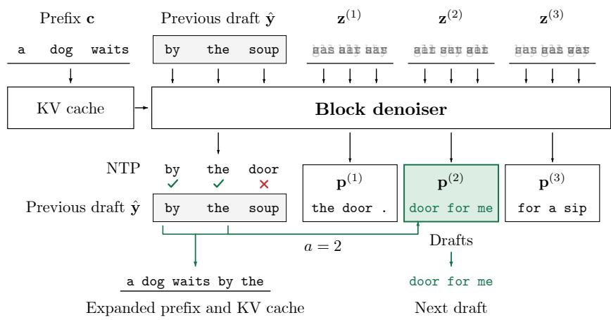

(b) Attention mask  
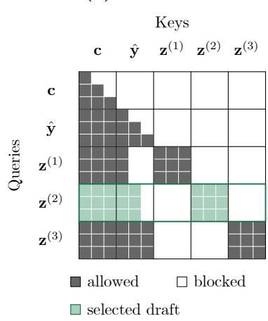  
Figure 9: Fused self-speculative decoding with block size three. A single forward pass verifies previous draft with AR prediction and performs next-block drafting. This is done by decoding next drafts corresponding to every possible acceptance of the previous draft in parallel and selecting one based on verification.

Table 4: Main hyperparameters. For block size four, we use batches of 384 sequences for training, whereas for large blocks, we use memory-matched microbatches and, when applicable, continue training from smaller-block checkpoint.
<table><tr><td>Setting</td><td>Lafa 0.5B</td><td>Lafa 7B</td><td>Lafa 8B</td></tr><tr><td colspan="4">Model and data</td></tr><tr><td colspan="4">Initialization Qwen2.5 0.5B Instruct</td></tr><tr><td>Training data / epochs / tokens</td><td colspan="3">Dolci-Instruct-SFT / 5 epochs / approximately 9B</td></tr><tr><td>Block sizes B</td><td>4, 8, 16</td><td>4, 8, 16</td><td>4</td></tr><tr><td>Maximum sequence length</td><td>512-1024</td><td>512-1024</td><td>512</td></tr><tr><td>adaLN</td><td>Per-layer</td><td>Shared across layers</td><td>Shared across layers</td></tr><tr><td colspan="4">Optimization</td></tr><tr><td>Optimizer</td><td rowspan="4"> $1 \times 1 0 ^ { - 4 }$ </td><td>AdamW</td><td rowspan="4">1×10−5</td></tr><tr><td>Learning rate</td><td>1×10−5</td></tr><tr><td>Schedule / warm-up</td><td>Constant / first 1% of steps</td></tr><tr><td>Adam (β1, β2)</td><td>(0.9, 0.999)</td></tr><tr><td>Weight decay / gradient clipping / batch size Precision</td><td></td><td>0 / 1.0 / 384 sequences bfloat16</td><td></td></tr><tr><td>Distributed training</td><td>DDP</td><td>ZeRO-3</td><td>ZeRO-3</td></tr><tr><td colspan="4">Training objective and architecture</td></tr><tr><td colspan="4">Training noise scale σ</td></tr><tr><td>Self-conditioning probability psc</td><td colspan="2"></td><td></td></tr><tr><td>adaLN learning rate multiplier</td><td colspan="2"></td><td></td></tr><tr><td>Parameter EMA decay</td><td colspan="3">5.0 0.999 (enabled from step 500)</td></tr><tr><td colspan="4">Learned tokenwise time</td></tr><tr><td>Histogram bins M</td><td colspan="2">200</td><td></td></tr><tr><td>Histogram EMA decay β</td><td colspan="2">0.99</td><td></td></tr><tr><td>Update interval S</td><td colspan="2">100 steps</td><td></td></tr><tr><td colspan="4">Flow decoding</td></tr><tr><td>Inference noise scale σ</td><td colspan="2"></td><td></td></tr><tr><td>prefix guidance scale g</td><td colspan="2">0.1 8.0</td><td></td></tr></table>

When $\hat { \mathbf { y } } ^ { 1 } = \mathsf { a r g m a x } ( \mathbf { q } ^ { N } )$ , we need block verification. To perform this verification and next-block drafting in a single forward pass, we construct the input to the transformer underlying D and f as a concatenation of a clean prefix $\mathbf { c } \oplus { \hat { \mathbf { y } } }$ and B blocks of B noise tokens, $\mathbf { z } ^ { ( 1 ) } , . . . , \mathbf { z } ^ { ( B ) } \in \mathbb { R } ^ { \tilde { B } \times d }$ , each drawn from ${ \mathsf { N } } ( 0 , \sigma ^ { 2 } I )$ . We then construct the attention mask such that the prefix c ⊕ yˆ attends causally to itself, while each block $\mathbf { z } ^ { ( j ) }$ attends bidirectionally to itself and causally to a prefix of the prefix, $\mathbf { c } \oplus \hat { \mathbf { y } } ^ { 1 : j }$ (Figure 9). Accordingly, we build tokenwise time such that $\mathbf { c } \oplus { \hat { \mathbf { y } } }$ is conditioned on one and all $\mathbf { z } ^ { ( j ) }$ on zero. Since this produces the AR prediction $f ( \mathbf { c } \oplus { \hat { \mathbf { y } } } )$ on the prefix, we can determine acceptance $\hat { \mathbf { y } } ^ { 1 : a }$ as follows (Section 2.3):

Table 5: Flow and flow map decoding accuracies.
<table><tr><td colspan="2"></td><td colspan="4">0.5B scale</td><td colspan="4">7B scale</td></tr><tr><td>Method</td><td>B</td><td>Euler steps</td><td>GSM8K</td><td>HumanEval</td><td>IFEval</td><td>Average</td><td>GSM8K</td><td>HumanEval</td><td>IFEval</td><td>Average</td></tr><tr><td>AR SFT</td><td></td><td></td><td>32.0</td><td>35.4</td><td>48.4</td><td>38.6</td><td>69.1</td><td>78.7</td><td>73.8</td><td>73.9</td></tr><tr><td colspan="3"></td><td colspan="4">Flow decoding</td><td></td><td></td><td>14.2</td></tr><tr><td rowspan="15">Lafa (Ours)</td><td></td><td>1 2</td><td>0.8 1.7</td><td>3.0 6.1</td><td>20.3 23.5</td><td>8.1 10.4</td><td>2.4 18.7</td><td>10.4 21.3</td><td>29.8 36.2</td></tr><tr><td></td><td>4</td><td></td><td>12.2</td><td>27.0</td><td></td><td></td><td></td><td>25.4</td></tr><tr><td>8</td><td></td><td>11.7</td><td>14.0</td><td>17.0</td><td>47.5</td><td>40.2</td><td>44.7</td><td>44.1</td></tr><tr><td>16 16</td><td></td><td>18.3</td><td>30.9</td><td>21.1</td><td>60.2</td><td>54.9</td><td>56.9</td><td>57.3</td></tr><tr><td></td><td></td><td>24.8 17.1</td><td>37.2</td><td>26.3</td><td>65.6</td><td>65.2</td><td>64.9</td><td>65.2</td></tr><tr><td></td><td>32 64</td><td>25.9 28.1</td><td>21.3 21.3</td><td>39.9</td><td>29.1 66.9</td><td>68.3</td><td>64.1</td><td>66.5</td></tr><tr><td>128</td><td></td><td>28.1</td><td>42.3 44.2</td><td>30.6 31.0</td><td>67.5 68.7</td><td>66.5</td><td>66.5</td><td>66.8</td></tr><tr><td></td><td></td><td></td><td>20.7</td><td></td><td></td><td>67.7</td><td>65.2</td><td>67.2</td></tr><tr><td>2</td><td>1</td><td>2.4 9.2</td><td>6.1 12.2</td><td>23.3</td><td>10.6</td><td>20.1</td><td>22.0</td><td>34.8 25.6</td></tr><tr><td rowspan="5">8</td><td>4</td><td>17.4</td><td>18.9</td><td>23.5 29.0</td><td>15.0 21.8</td><td>47.4 64.0</td><td>41.5 57.9</td><td>42.1 55.8</td><td>43.7 59.2</td></tr><tr><td>8</td><td>24.8</td><td>25.6</td><td></td><td></td><td></td><td></td><td></td><td></td></tr><tr><td>16</td><td></td><td></td><td>38.4</td><td>29.6</td><td>64.8</td><td>64.0</td><td>64.5</td><td>64.5</td></tr><tr><td>32</td><td>28.4</td><td>28.0</td><td>46.4</td><td>34.3</td><td>71.6</td><td>70.7</td><td>64.5</td><td>68.9</td></tr><tr><td>64</td><td>29.1</td><td>28.0</td><td>45.5</td><td>34.2</td><td>72.3</td><td>72.0</td><td>71.0</td><td>71.7</td></tr><tr><td>128</td><td></td><td>28.4 28.7</td><td>28.0 28.7</td><td>47.1 49.0</td><td>34.5 35.5</td><td>71.7 71.0</td><td>72.6 72.6</td><td>68.8</td><td>71.0</td></tr><tr><td></td><td>1</td><td>16.4</td><td>13.4</td><td>32.5</td><td>20.8</td><td>53.9</td><td>32.3</td><td>69.3</td><td>70.9 43.7</td></tr><tr><td rowspan="8">4</td><td>2</td><td>14.7</td><td></td><td></td><td></td><td></td><td></td><td></td><td>44.7</td></tr><tr><td>4</td><td>25.0</td><td>9.1 21.3</td><td>35.1</td><td>19.7 30.0</td><td>60.0 69.5</td><td>34.8</td><td>43.8</td><td>46.2</td></tr><tr><td>8</td><td>27.0</td><td>22.0</td><td>43.6</td><td></td><td></td><td>63.4</td><td>60.1</td><td>64.3</td></tr><tr><td></td><td>28.8</td><td></td><td>46.6</td><td>31.8</td><td>73.0</td><td>71.3</td><td>69.3</td><td>71.2</td></tr><tr><td>16</td><td></td><td>27.4</td><td>50.1</td><td>35.4</td><td>71.9</td><td>75.0</td><td>69.5</td><td>72.1</td></tr><tr><td>32</td><td>30.4</td><td>31.1</td><td>52.9</td><td>38.1</td><td>73.8</td><td>78.7</td><td>73.0</td><td>75.2</td></tr><tr><td>64</td><td>29.6</td><td>32.9</td><td>53.0</td><td>38.5</td><td>74.6</td><td>78.7</td><td>74.3</td><td>75.9</td></tr><tr><td>128</td><td>30.1</td><td>31.7</td><td>49.4</td><td>37.1</td><td>75.6</td><td>78.0</td><td>73.6</td><td>75.7</td></tr><tr><td colspan="9">Flow map decoding</td></tr><tr><td rowspan="5">Lafa (Ours)</td><td rowspan="5">4</td><td>1</td><td>19.2</td><td>17.1</td><td>33.6</td><td>23.3</td><td>54.2</td><td>50.0</td><td>42.7</td><td>49.0</td></tr><tr><td>2</td><td>21.1</td><td>18.3</td><td></td><td>25.2</td><td>66.4</td><td>68.3</td><td>55.1</td><td>63.3</td></tr><tr><td>4</td><td>24.9</td><td>21.3</td><td>36.2</td><td>28.5</td><td>69.7</td><td>73.8</td><td>64.7</td><td>69.4</td></tr><tr><td>8</td><td>28.1</td><td>26.8</td><td>39.4</td><td>31.8</td><td>70.9</td><td></td><td></td><td></td></tr><tr><td>16</td><td>28.9</td><td>25.6</td><td>40.3 43.3</td><td>32.6</td><td></td><td>73.8</td><td>68.2</td><td>71.0</td></tr></table>

$$
a = \operatorname* { m a x } \{ j \in [ B ] : { \hat { \mathbf { y } } } ^ { i + 1 } = \operatorname { a r g m a x } ( f ( \mathbf { c } \oplus { \hat { \mathbf { y } } } ) ^ { N + i } ) { \mathrm { ~ f o r ~ e v e r y ~ } } 1 \leq i < j \} .\tag{28}
$$

Then, instead of an additional forward pass, we simply take output tokens corresponding to $\mathbf { z } ^ { ( a ) }$ since their production is computationally identical to $D _ { 0 } ( \mathbf { z } ^ { ( a ) } ; \mathbf { c } \oplus \hat { \mathbf { y } } ^ { 1 : a } )$ . The next step of fused decoding then operates on extended prefix c⊕ $\hat { \mathbf { y } } ^ { 1 : a }$ , drafted block $D _ { 0 } ( \mathbf { z } ^ { ( a ) } ; \mathbf { c } \oplus \hat { \mathbf { y } } ^ { 1 : a } )$ , and prefix $\mathrm { A R }$ prediction $f ( \mathbf { c } \oplus \hat { \mathbf { y } } ^ { 1 : a } ) = f ( \mathbf { \bar { c } } \oplus \hat { \mathbf { y } } ) ^ { 1 : N + a }$ In practice, we further reuse the key-value cache of the prefix to improve eficiency (Algorithm 4).

## C Evaluation details

We describe the evaluation setup and metrics, then report detailed results including per-benchmark scores.

## C.1 TPF evaluation and per-benchmark scores

Tokens per forward (TPF). Across evaluation examples $j ,$ we compute TPF as

$$
\mathrm { T P F } = \frac { \sum _ { j } T _ { j } } { \sum _ { j } F _ { j } } ,\tag{29}
$$

Table 6: Single-token decoding. For difusion models, we decode exactly one highest-probability token per forward. Models marked <sup>†</sup> are trained by us from the matched AR model on Dolci-Instruct-SFT for five epochs.
<table><tr><td>Method</td><td>IFEval</td><td>BBH</td><td>MMLU-Pro</td><td>GPQA</td><td>GSM8K</td><td>HumanEval</td><td>Average</td></tr><tr><td colspan="8">0.5B scale</td></tr><tr><td>Qwen2.5 SFT†</td><td>48.4</td><td>26.3</td><td>11.9</td><td>17.9</td><td>32.0</td><td>35.4</td><td>28.7</td></tr><tr><td>MTP† [6]</td><td>50.6</td><td>17.3</td><td>9.2</td><td>18.8</td><td>27.1</td><td>32.3</td><td>25.9</td></tr><tr><td>DeepSeek-MTP† [8]</td><td>53.2</td><td>24.1</td><td>14.0</td><td>18.5</td><td>35.5</td><td>36.0</td><td>30.2</td></tr><tr><td>MARS† [33]</td><td>51.3</td><td>26.6</td><td>12.4</td><td>19.4</td><td>32.8</td><td>40.2</td><td>30.4</td></tr><tr><td>SBD† [46]</td><td>55.3</td><td>20.6</td><td>9.2</td><td>22.5</td><td>27.2</td><td>30.8</td><td>27.6</td></tr><tr><td>BD3LM† [23]</td><td>47.1</td><td>7.5</td><td>2.0</td><td>17.9</td><td>30.6</td><td>31.7</td><td>22.8</td></tr><tr><td>Lafa 0.5B (Ours)†</td><td>55.1</td><td>27.6</td><td>12.1</td><td>21.9</td><td>36.1</td><td>36.6</td><td>31.6</td></tr><tr><td colspan="8">7B scale</td></tr><tr><td>Qwen2.5 SFT†</td><td>73.8</td><td>59.2</td><td>41.6</td><td>27.9</td><td>69.1</td><td>78.7</td><td>58.4</td></tr><tr><td>MTP† [6]</td><td>73.2</td><td>51.7</td><td>37.3</td><td>26.8</td><td>60.5</td><td>73.8</td><td>53.9</td></tr><tr><td>DeepSeek-MTP† [8]</td><td>78.0</td><td>60.7</td><td>40.6</td><td>30.1</td><td>70.3</td><td>80.5</td><td>60.0</td></tr><tr><td>MARS† [33]</td><td>77.8</td><td>54.6</td><td>44.4</td><td>26.6</td><td>73.2</td><td>81.7</td><td>59.7</td></tr><tr><td>Fast-dLLM v2†</td><td>70.6</td><td>53.5</td><td>43.1</td><td>28.6</td><td>67.2</td><td>32.9</td><td>49.3</td></tr><tr><td>Fast-dLLM v2 [48]</td><td>64.5</td><td>58.1</td><td>39.7</td><td>21.4</td><td>80.3</td><td>62.2</td><td>54.4</td></tr><tr><td>Dream [20]</td><td>57.1</td><td>66.0</td><td>43.6</td><td>26.6</td><td>81.7</td><td>58.5</td><td>55.6</td></tr><tr><td>Lafa (Òurs)†</td><td>78.9</td><td>63.0</td><td>41.8</td><td>31.0</td><td>73.8</td><td>76.8</td><td>60.9</td></tr><tr><td colspan="8"></td></tr><tr><td>Qwen3 SFT†</td><td>38.1</td><td>71.6</td><td>8B scale 56.2</td><td>29.5</td><td>62.9</td><td>82.3</td><td></td></tr><tr><td>LLaDA [45]</td><td>58.0</td><td>30.9</td><td>28.7</td><td>25.4</td><td>76.0</td><td>42.1</td><td>56.8 43.5</td></tr><tr><td>Efficient-DLM [21]</td><td>58.4</td><td>70.8</td><td>61.5</td><td>33.7</td><td>87.4</td><td>68.9</td><td>63.5</td></tr><tr><td>Lafa (Ours)†</td><td>62.3</td><td>70.7</td><td>56.2</td><td>31.7</td><td>77.8</td><td>79.9</td><td>63.1</td></tr></table>

Table 7: Self-speculative and parallel decoding accuracy (%) and TPF across model scales.
<table><tr><td></td><td></td><td colspan="2">IFEval</td><td colspan="2">BBH</td><td colspan="2">MMLU-Pro</td><td colspan="2">GPQA</td><td colspan="2">GSM8K</td><td colspan="2">HumanEval</td><td colspan="2">Average</td></tr><tr><td>Method</td><td>B</td><td>Acc.</td><td>TPF</td><td>Acc.</td><td>TPF</td><td>Acc.</td><td>TPF</td><td>Acc.</td><td>TPF</td><td>Acc.</td><td>TPF</td><td>Acc.</td><td>TPF</td><td>Acc.</td><td>TPF</td></tr><tr><td colspan="10">0.5B scale</td><td></td><td></td><td></td><td></td><td></td><td></td></tr><tr><td>AR SFT</td><td></td><td>48.4</td><td>1.0</td><td>26.3</td><td>1.0</td><td>11.9</td><td>1.0</td><td>17.9</td><td>1.0</td><td>32.0</td><td>1.0</td><td>35.4</td><td>1.0</td><td>28.7</td><td>1.0</td></tr><tr><td>MARS</td><td>4</td><td>51.0</td><td>1.8</td><td>31.7</td><td>2.3</td><td>13.9</td><td>1.7</td><td>18.3</td><td>2.0</td><td>31.7</td><td>2.1</td><td>32.3</td><td>1.9</td><td>29.8</td><td>2.0</td></tr><tr><td>MTP</td><td>4</td><td>51.2</td><td>2.5</td><td>17.6</td><td>3.3</td><td>9.4</td><td>3.1</td><td>17.9</td><td>2.8</td><td>26.8</td><td>2.9</td><td>33.5</td><td>2.9</td><td>26.1</td><td>2.9</td></tr><tr><td>DeepSeek-MTP</td><td>2</td><td>51.9</td><td>1.6</td><td>23.7</td><td>1.8</td><td>12.1</td><td>1.9</td><td>18.8</td><td>1.9</td><td>35.5</td><td>1.8</td><td>35.4</td><td>1.7</td><td>29.6</td><td>1.8</td></tr><tr><td>BD3LM</td><td>4</td><td>46.8</td><td>1.5</td><td>8.3</td><td>1.6</td><td>1.3</td><td>1.5</td><td>19.4</td><td>1.5</td><td>29.8</td><td>1.5</td><td>29.9</td><td>1.5</td><td>22.6</td><td>1.5</td></tr><tr><td>SBD PTP</td><td>4</td><td>56.4</td><td>2.2 1.7</td><td>20.6</td><td>3.2</td><td>9.4</td><td>2.7</td><td>23.2</td><td>2.7</td><td>26.7</td><td>2.7</td><td>31.1</td><td>2.8</td><td>27.9</td><td>2.7</td></tr><tr><td></td><td>4</td><td>42.3</td><td>2.2</td><td>26.0</td><td>2.5</td><td>11.9</td><td>2.0</td><td>15.0</td><td>1.9</td><td>35.3</td><td>2.3</td><td>42.7</td><td>2.1</td><td>28.9</td><td>2.1</td></tr><tr><td>Lafa (Ours)</td><td>4</td><td>55.1</td><td></td><td>27.6</td><td>3.3</td><td>12.1</td><td>3.1</td><td>21.9</td><td>2.9</td><td>36.1</td><td>2.7</td><td>36.6</td><td>2.9</td><td>31.6</td><td>2.9</td></tr><tr><td></td><td>8 16</td><td>55.3 54.2</td><td>2.7 3.1</td><td>27.9</td><td>5.1</td><td>10.0</td><td>5.5</td><td>23.7</td><td>4.2</td><td>37.8</td><td>3.6</td><td>39.0</td><td>3.0</td><td>32.3</td><td>4.0</td></tr><tr><td></td><td></td><td></td><td></td><td>27.0</td><td>6.3</td><td>9.1</td><td>9.2</td><td>18.1</td><td>4.8</td><td>36.7</td><td>3.6</td><td>39.6</td><td>3.3</td><td>30.8</td><td>5.0</td></tr><tr><td colspan="10">7B scale</td><td colspan="7"></td></tr><tr><td>AR SFT</td><td>一</td><td>73.8</td><td>1.0</td><td>59.2</td><td>1.0</td><td>41.6</td><td>1.0</td><td>27.9</td><td>1.0</td><td>69.1</td><td>1.0</td><td>78.7</td><td>1.0</td><td>58.4</td><td>1.0</td></tr><tr><td>MTP</td><td>4</td><td>73.2</td><td>1.9</td><td>51.9</td><td>3.3</td><td>38.3</td><td>2.5</td><td>27.7</td><td>2.6</td><td>60.5</td><td>3.0</td><td>73.8</td><td>3.1</td><td>54.2</td><td>2.7</td></tr><tr><td>DeepSeek-MTP</td><td>2</td><td>78.0</td><td>1.5</td><td>60.8</td><td>1.8</td><td>42.5</td><td>1.6</td><td>29.5</td><td>1.7</td><td>70.3</td><td>1.7</td><td>80.5</td><td>1.9</td><td>60.3</td><td>1.7</td></tr><tr><td>Fast-dLLM v2</td><td>32/8</td><td>62.8</td><td>1.9</td><td>58.1</td><td>2.3</td><td>39.2</td><td>2.2</td><td>22.3</td><td>2.2</td><td>80.4</td><td>2.5</td><td>63.4</td><td>1.8</td><td>54.4</td><td>2.1</td></tr><tr><td>Dream</td><td>Canvas</td><td>18.9</td><td>4.2</td><td>42.5</td><td>4.2</td><td>42.2</td><td>4.4</td><td>9.8</td><td>4.4</td><td>38.4</td><td>3.5</td><td>23.8</td><td>3.8</td><td>29.3</td><td>4.1</td></tr><tr><td>MARS</td><td>4</td><td>77.8</td><td>1.9</td><td>52.9</td><td>4.1</td><td>40.0</td><td>2.8</td><td>29.2</td><td>2.8</td><td>74.0</td><td>2.8</td><td>81.7</td><td>2.9</td><td>59.3</td><td>2.9</td></tr><tr><td></td><td>8</td><td>76.3</td><td>2.0</td><td>59.6</td><td>5.7</td><td>41.5</td><td>3.3</td><td>30.8</td><td>3.2</td><td>71.3</td><td>3.5</td><td>81.1</td><td>3.5</td><td>60.1</td><td>3.5</td></tr><tr><td></td><td>16</td><td>75.8</td><td>2.0</td><td>55.8</td><td>6.3</td><td>39.2</td><td>3.6</td><td>26.8</td><td>3.2</td><td>75.4</td><td>3.7</td><td>77.4</td><td>3.7</td><td>58.4</td><td>3.7</td></tr><tr><td>Lafa (Ours)</td><td>4</td><td>78.9</td><td>1.7</td><td>63.0</td><td>3.4</td><td>41.8</td><td>2.4</td><td>31.0</td><td>2.3</td><td>73.8</td><td>2.8</td><td>76.8</td><td>2.8</td><td>60.9</td><td>2.6</td></tr><tr><td></td><td>8</td><td>77.5</td><td>2.8</td><td>59.1</td><td>6.3 7.9</td><td>39.4</td><td>3.7</td><td>28.1</td><td>4.0</td><td>75.3</td><td>4.8</td><td>76.2</td><td>4.6</td><td>59.3</td><td>4.3</td></tr><tr><td></td><td>16</td><td>74.9</td><td>2.8</td><td>57.3</td><td></td><td>39.0</td><td>3.8</td><td>28.1</td><td>4.0</td><td>75.0</td><td>5.8</td><td>73.8</td><td>5.4</td><td>58.0</td><td>4.9</td></tr><tr><td colspan="10">8B scale</td><td colspan="7"></td></tr><tr><td>AR SFT LLaDA</td><td></td><td>38.1</td><td>1.0</td><td>71.6</td><td>1.0</td><td>56.2</td><td>1.0</td><td>29.5</td><td>1.0</td><td>62.9</td><td>1.0</td><td>82.3</td><td>1.0</td><td>56.8</td><td>1.0</td></tr><tr><td></td><td>Canvas 4</td><td>36.8 57.1</td><td>3.2 2.6</td><td>31.0 66.9</td><td>3.2 3.2</td><td>28.8 60.7</td><td>2.7 3.0</td><td>9.4 33.0</td><td>2.7 2.8</td><td>47.2 85.4</td><td>2.7 2.9</td><td>23.8 66.5</td><td>2.5 3.0</td><td>29.5 61.6</td><td>2.8 2.9</td></tr><tr><td>Efficient-DLM</td></table>

Table 8: Per-task accuracy (%) and throughput in tokens per second (TPS) at 7–8B scales, measured using one H100 GPU with batch size one. Eficient-DLM is 8B and other methods are 7B.
<table><tr><td rowspan="2">Method</td><td rowspan="2">Setting</td><td rowspan="2">Threshold</td><td colspan="2">IFEval</td><td colspan="2">GSM8K</td><td colspan="2">HumanEval</td><td colspan="2">Average</td></tr><tr><td>Accuracy</td><td>TPS</td><td>Accuracy</td><td>TPS</td><td>Accuracy</td><td>TPS</td><td>Accuracy</td><td>TPS</td></tr><tr><td>AR SFT</td><td>一</td><td>一</td><td>73.8</td><td>40.9</td><td>69.1</td><td>40.6</td><td>78.7</td><td>37.0</td><td>73.9</td><td>39.5</td></tr><tr><td>DeepSeek-MTP</td><td> $B = 2$ </td><td>一</td><td>78.0</td><td>45.1</td><td>70.3</td><td>57.2</td><td>80.5</td><td>58.4</td><td>76.3</td><td>53.6</td></tr><tr><td rowspan="3">MARS</td><td> $B = 4$ </td><td>0.95</td><td>77.6</td><td>42.0</td><td>70.7</td><td>59.8</td><td>79.9</td><td>43.3</td><td>76.1</td><td>48.4</td></tr><tr><td> $B = 8$ </td><td>0.95</td><td>77.3</td><td>40.9</td><td>69.1</td><td>62.7</td><td>78.0</td><td>43.1</td><td>74.8</td><td>48.9</td></tr><tr><td> $B = 1 6$ </td><td>0.95</td><td>75.0</td><td>41.1</td><td>72.9</td><td>61.3</td><td>75.0</td><td>44.6</td><td>74.3</td><td>49.0</td></tr><tr><td rowspan="3">Fast-dLLM v2</td><td> $B = 4$ </td><td>0.90</td><td>65.8</td><td>52.1</td><td>81.6</td><td>66.2</td><td>67.1</td><td>56.5</td><td>71.5</td><td>58.3</td></tr><tr><td> $B = 8$ </td><td>0.90</td><td>65.4</td><td>60.9</td><td>80.1</td><td>98.5</td><td>57.3</td><td>71.1</td><td>67.6</td><td>76.8</td></tr><tr><td> $B = 1 6$ </td><td>0.90</td><td>61.9</td><td>65.1</td><td>77.3</td><td>116.0</td><td>56.1</td><td>78.9</td><td>65.1</td><td>86.7</td></tr><tr><td rowspan="6">Efficient-DLM</td><td> $B = 4$ </td><td>0.70</td><td>58.2</td><td>31.8</td><td>87.8</td><td>37.1</td><td>70.1</td><td>38.4</td><td>72.0</td><td>35.8</td></tr><tr><td> $B = 8$ </td><td>0.70</td><td>58.2</td><td>40.7</td><td>87.7</td><td>55.6</td><td>68.9</td><td>58.5</td><td>71.6</td><td>51.6</td></tr><tr><td> $B = 1 6$ </td><td>0.70</td><td>58.4</td><td>47.2</td><td>88.4</td><td>70.5</td><td>67.1</td><td>75.4</td><td>71.3</td><td>64.4</td></tr><tr><td> $B = 3 2$ </td><td>0.70</td><td>59.1</td><td>49.3</td><td>87.5</td><td>74.4</td><td>63.4</td><td>84.8</td><td>70.0</td><td>69.5</td></tr><tr><td> $B = 3 2$ </td><td>0.60</td><td>58.6</td><td>56.1</td><td>82.2</td><td>87.1</td><td>55.5</td><td>96.3</td><td>65.4</td><td>79.9</td></tr><tr><td> $B = 3 2$ </td><td>0.50</td><td>52.9</td><td>71.9</td><td>72.0</td><td>102.9</td><td>42.1</td><td>111.2</td><td>55.7</td><td>95.3</td></tr><tr><td rowspan="3">Dream</td><td> $k = 1$ </td><td></td><td>57.1</td><td>22.7</td><td>81.7</td><td>36.0</td><td>58.5</td><td>26.7</td><td>65.8</td><td>28.5</td></tr><tr><td> $k = 2$ </td><td></td><td>44.7</td><td>45.6</td><td>75.0</td><td>72.0</td><td>35.4</td><td>53.3</td><td>51.7</td><td>57.0</td></tr><tr><td> $k = 4$ </td><td></td><td>33.8</td><td>91.2</td><td>59.3</td><td>143.5</td><td>20.1</td><td>106.3</td><td>37.7</td><td>113.7</td></tr><tr><td rowspan="3">Lafa (Ours)</td><td> $B = 4$ </td><td></td><td>78.9</td><td>60.9</td><td>73.8</td><td>91.7</td><td>76.8</td><td>87.2</td><td>76.5</td><td>79.9</td></tr><tr><td> $B = 8$ </td><td></td><td>77.5</td><td>61.1</td><td>75.3</td><td>116.1</td><td>76.2</td><td>104.3</td><td>76.3</td><td>93.8</td></tr><tr><td> $B = 1 6$ </td><td></td><td>74.9</td><td>59.7</td><td>75.0</td><td>125.2</td><td>73.8</td><td>115.7</td><td>74.5</td><td>100.2</td></tr></table>

where $T _ { j }$ is the number of committed tokens and $F _ { j }$ is the number of forward passes. AR has TPF one by definition. For Lafa and Eficient-DLM, $F _ { j }$ counts the number of fused verification-and-redraft forward passes in addition to one forward pass for initial drafting, excluding prompt prefill and cache refreshes for Eficient-DLM. For Fast-dLLM $\mathrm { v } 2 , F _ { j }$ includes top-level denoising, prefill, and cache update forward passes.

Per-benchmark scores. Table 5 gives the per-benchmark scores of flow and flow map decoding used to construct Figure 6. Table 6 expands single-token decoding Table 1 into per-benchmark accuracies. Table 7 gives the per-benchmark values underlying the parallel decoding results in Figure 7 including our self-speculative decoding results. All methods in Figure 7 decode by drafting and verifying, and the verifier follows the native configuration of each method. Causal block predictors verify against greedy AR, MARS uses its released batched verifier, and Eficient-DLM uses its exact verifier. Fast-dLLM v2, Dream, and LLaDA instead verify against their deterministic one-position decoding trajectories.

## C.2 Decoding throughput

Figure 8 shows end-to-end generation throughput measured on a single H100 GPU with batch size one with bfloat16 inference and a 32-token warm-up. We report tokens per second (TPS), which is the total generated tokens divided by total generation time. Table 8 reports the per-task values underlying Figure 8, and method-specific settings are given below.

• AR SFT. Qwen2.5 7B AR SFT uses standard HuggingFace greedy generation and emits one new token per decoding forward.

• Lafa (Ours). For each block size $B \in \{ 4 , 8 , 1 6 \}$ , we use the corresponding trained checkpoint with self-speculative decoding. A one-step denoiser draft of the next block is verified against the model’s own greedy AR predictions. The fused pass packs the clean draft with B noisy successor blocks, one for each possible accepted-prefix length. Clean draft positions attend causally to produce the verification logits, while each successor block attends to the prefix and its candidate accepted draft prefix and bidirectionally within the block. After selecting the longest verified prefix, we retain its KV states and use the corresponding successor block as the next draft, avoiding a separate redrafting forward.

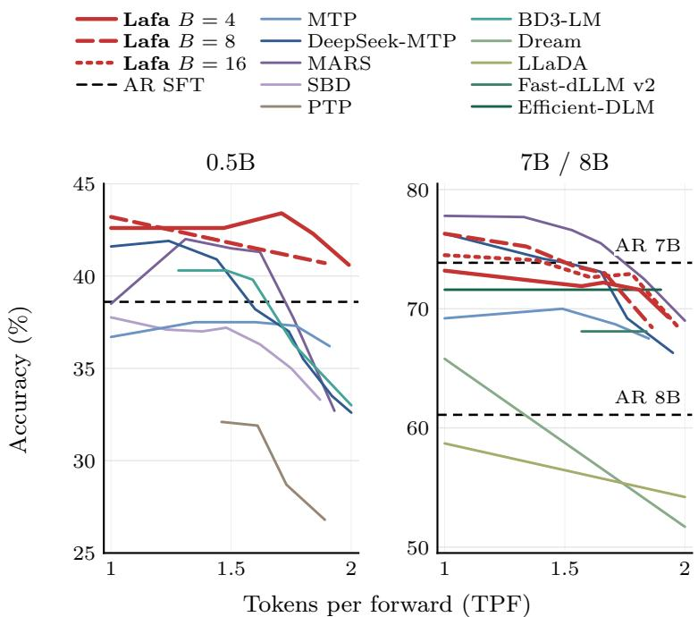  
Figure 10: Confidence decoding, averaged over GSM8K, HumanEval, and IFEval. In the right panel, Lafa uses 8B for $B = 4$ and 7B for $B \in \{ 8 , 1 6 \}$ . Eficient-DLM (B = 32) and LLaDA are 8B, and other baselines are 7B.

• DeepSeek-MTP. We train 7B scale DeepSeek-MTP with one DeepSeek-style auxiliary multi-tokenprediction stage $( D = 1 [ 8 ] )$ . Greedy verified self-speculation compares the multi-token proposal against the base model’s greedy AR prediction.

• MARS. We use the released MARS Qwen2.5 7B checkpoints [33] for $B \in \{ 4 , 8 , 1 6 \}$ . We report results using the paper’s probability-threshold decoder at threshold 0.95, with its sliding KV cache. Each round commits the leftmost proposal, then commits the longest consecutive continuation whose top-token probabilities remain at least the confidence threshold.

• Fast-dLLM v2. We use the released Fast-dLLM v2 7B checkpoint [48] with its native confidence decoder at threshold 0.9. Block caching is disabled, and the global and sub-block sizes are both set to $B \in \{ 4 , 8 , 1 6 \}$

• Eficient-DLM. We evaluate Eficient-DLM 8B [21] with its native confidence-threshold decoder at threshold 0.7 for $B \in \{ 4 , 8 , 1 6 , 3 2 \}$ , together with the $B = 3 2$ speed–quality sweep at confidence thresholds in {0.5, 0.6}. We use the model’s native prompt format over Qwen chat templates.

• Dream. We use Dream-v0 7B Instruct [20] with its native entropy-based unmasking, targeting a mean of $k \in \{ 1 , 2 , 4 \}$ filled canvas positions per denoising forward. For throughput, we follow Eficient-DLM [21] and compute TPS as the total number of generated canvas tokens divided by total generation time.

## C.3 Confidence decoding

As an alternative to self-speculative decoding, we follow MARS [33] and accept the longest left-to-right prefix of a one-step flow draft whose token confidence exceeds a threshold $\lambda \ ( \mathrm { A p p e n d i x \ B . 3 } )$ , and apply the same rule to block-autoregressive baselines. We implement it with the fused decoding of Algorithm 4, where $\hat { \mathbf { y } } ^ { 1 : a }$ is instead the longest prefix of yˆ with confidences $( \mathbf { p } ^ { i } ) _ { \hat { \mathbf { y } } ^ { i } } \geq \lambda$ (where we always set $a \geq 1 )$ . Since a is known before the forward pass, only the block $\mathbf { z } ^ { ( a ) }$ is needed instead of all B blocks. To apply this strategy, Dream and LLaDA use their native global entropy or confidence ordering over masked positions, whereas Fast-dLLM v2 applies the threshold within the active sub-block. In Figure 10, we show an accuracy–TPF tradeof measured by sweeping over confidence thresholds. At 0.5B, Lafa with block size four attains the highest peak accuracy among all methods, including AR SFT, and its accuracy remains at or above that of pure AR at high thresholds. At 7B, Lafa exceeds AR SFT at high thresholds, while MARS, which is trained for confidence decoding, degrades more gracefully as the threshold is lowered. At 8B, Lafa remains above AR SFT across the tested range and on par with Eficient-DLM.

Since AR verification avoids the degradation at lower thresholds without tuning a threshold, we use selfspeculative decoding as our default in the main text.