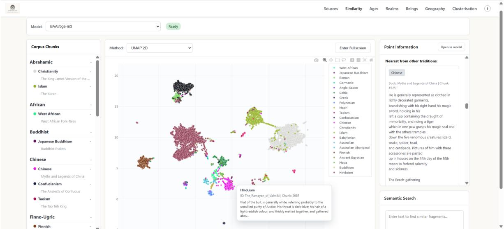
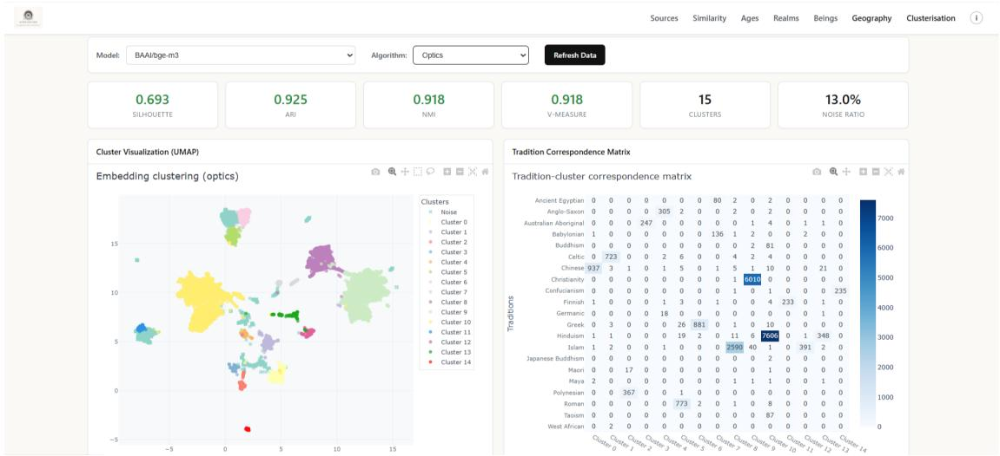
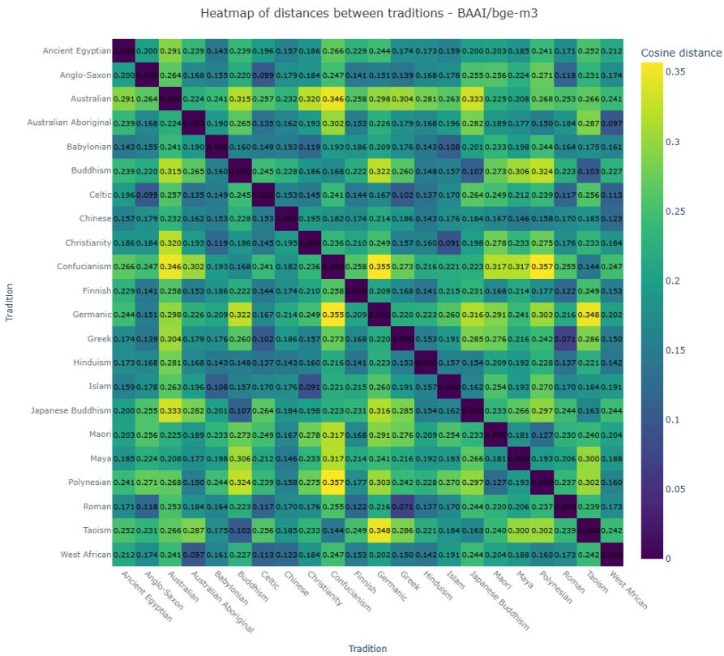
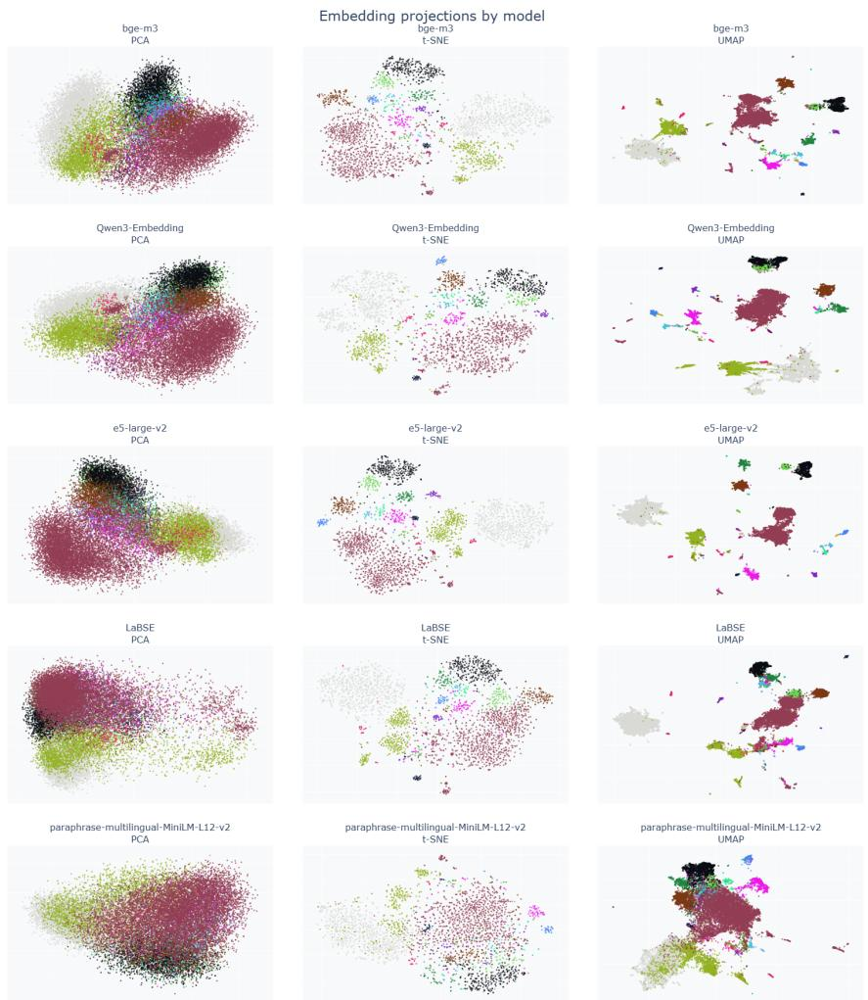

# MYTHOSEMANTIC: AN INTERACTIVE SYSTEM FOR DISCOVERING SEMANTIC PARALLELS ACROSS MYTHOLOGICAL AND RELIGIOUS TRADITIONS

A PREPRINT

Nikita Ganziuk 1, Innokentiy S. Humonen2, 3, Ilya Makarov2, 3, 4, Pavel Lebedev 5

1HSE University, 2AXXX, 3 Trusted AI Research Center, RAS 4 AI Talent Hub, ITMO University 5 Independent researcher Correspondence: haafus@gmail.com

October 21, 2026

## ABSTRACT

We present a tool for the comparative study of mythological and religious texts. Traditional manual analysis is highly labor-intensive and difficult to scale. To address this, we use neural language models to embed texts into a shared semantic space, so that users can find semantic parallels across cultural traditions in an interactive interface. Embedded fragments form distinct semantic structures whose coarse geometry aligns with well-documented historical relations between traditions. We quantify how much of that geometry is already explained by lexical overlap and by proper names. The current system is available at https://mythoscope.io, and the installable package is available at https://github.com/haafus/MythoSemantic/blob/main/RUN.md.

## 1 Introduction

The comparative analysis of mythological narratives and motifs remains a predominantly manual process. It needs specialists, who are few, takes a great deal of labor, and does not scale to large corpora. Neural language models now make it possible to search such texts for semantic parallels and similar motifs across traditions. An automated tool that shows semantic relationships among such texts is therefore useful for comparative mythology and digital humanities research. Such a system lets one scholar scan a corpus that would take a career to read by hand, and lets the same query be repeated whenever the corpus grows or the embedding model is replaced. While the term “motif” is vague, the system (Figure 1, Figure 2) is a guiding map for deeper research by anthropologists and ethnologists.

## 2 Related Work

Historically, the comparative analysis of mythological and religious narratives has relied on the manual extraction and cross-referencing of motifs across distinct cultural traditions (Thompson, 1955; Uther, 2004). Structuralist approaches, such as those by Propp (1968), demonstrated the possibility of identifying universal structural elements in diverse narratives. These qualitative methods are labor-intensive, depend on subjective interpretation, and do not scale to fragmented global corpora.

The development of distributional semantics (Mikolov et al., 2013) initiated the transition from traditional lexical matching to word embeddings. This trajectory continued with the introduction of the attention mechanism and the Transformer architecture (Vaswani et al., 2017), which made representations depend on context and led to large language models and their corresponding text-embedding counterparts, such as the Qwen3 Embedding series (Zhang et al., 2025). Such models turn whole passages into embeddings that capture much of their meaning.

  
Figure 1: The Similarity view of the MythoSemantic interface. The left panel provides a tradition-grouped browser of the corpus; the central panel shows a 2D UMAP projection of BAAI/bge-m3 embeddings, with a tooltip surfacing the tradition, source text, and passage for the fragment under the cursor; the right panel displays the nearest cross-tradition neighbor of the currently selected fragment alongside a free-text semantic search box.

  
Figure 2: The Clusterisation view: quality metrics (silhouette, ARI, NMI, V-measure, cluster count, noise ratio), a UMAP cluster visualization, and the tradition-cluster correspondence matrix, shown here for BAAI/bge-m3 with OPTICS.

Consequently, passages with similar meanings are mapped to nearby regions of the embedding space, even when they differ lexically. The synthesis of computational methods and humanities research led to the concept of “distant reading” (Moretti, 2013), shifting the focus from the close reading of individual texts to the macro-analysis of large corpora. Within the framework of “computational folkloristics” (Abello et al., 2012), researchers have tried to find connections between texts algorithmically. Several recent NLP systems address closely related sub-problems, targeting motif and narrative similarity within modern texts, single tale types, or individual traditions (Yarlott et al., 2024; Hatzel and Biemann, 2024a,b; Arcon et al., 2025; Alyami and Finlayson, 2026; Hatzel et al., 2026). None of these systems,ˇ however, is interactive or supports open-ended, cross-tradition exploration by non-programmer users; MythoSemantic fills this gap. Multilingual embeddings have rarely been used to map belief systems across the world. Such a study needs a browsable map: the whole corpus laid out in one space, every fragment clickable, and every retrieved neighbor traceable back to its source text and tradition.

## 3 Data

The dataset comprises 28 mythological and religious texts, representing 22 traditions across 12 major cultural areas, all provided in English translations and derived from open sources, mainly Project Gutenberg, with source-specific boilerplate removed by a dedicated cleaning script. Table A.1 in the appendix lists the traditions and their corresponding source text(s); several traditions (e.g. Hinduism, Babylonian, Greek) are represented by multiple texts, while others are represented by a single one, so the corpus is imbalanced across traditions, and larger traditions form correspondingly larger regions in the learned semantic space. A single language of translation makes the traditions directly comparable; §5.2 measures how much of the resulting structure comes from shared vocabulary. We compare the semantic structure the system finds with the tradition label of each text (section 5).

Instead of embedding complete documents, the corpus is first divided into overlapping fragments. Although such fragments should not be equated with motifs, they provide a practical approximation of this abstract concept by representing relatively self-contained semantic units that can be compared computationally across texts. This approach also satisfies the input length constraints of embedding models while reducing the risk that multiple independent storylines within a single source are merged into a single representation. The chunking procedure is described in Appendix B. Each resulting chunk is stored with a sequential index and its source metadata, yielding 25,671 overlapping fragments across the corpus.

## 4 System Overview

MythoSemantic is built for digital humanities researchers, comparative-religion and folklore scholars, and students who explore semantic relationships across mythological corpora without programming. We turn the texts into vectors and hand the resulting structure back to a human reader to interpret.

Minimum system requirements. The server requires Python 3.9 or later and runs on Linux, macOS, and Windows; the interface is accessed through any modern web browser. No GPU is required: precomputed vector databases for all five embedding models are downloaded automatically on first launch, so a standard laptop with a multi-core CPU, 8 GB of RAM and approximately 2 GB of free disk space is sufficient for the default corpus. An internet connection is needed only for installation and the initial download; all subsequent analysis runs fully locally.

## 4.1 Pipeline

Source texts are ingested, converted to a unified format, and organized by cultural-historical tradition (Loader) Documents are then segmented into overlapping fragments, as individual sources typically interleave multiple distinct storylines, and each fragment is embedded using one of the five embedding models listed in Table 1; the resulting vectors are stored for fast nearest-neighbor retrieval, enabling both point-based and free-text similarity queries (Embeddings). The precise definition of a “motif” remains contested in the folkloristics literature (Thompson, 1955), and recent benchmarks show that embedding size alone is a poor predictor of narrative-similarity quality (Hatzel et al., 2026); we therefore evaluate five embedding models spanning different architectures, training eras, and parameter scales, rather than assuming a single optimal embedding model. For exploratory analysis, embeddings are projected to two dimensions via PCA, t-SNE, and UMAP, and an inter-tradition distance heatmap is computed from averaged per-tradition vectors (Visualization). Finally, seven clustering algorithms, namely KMeans (MacQueen, 1967), HDBSCAN (Campello et al., 2013), OPTICS (Ankerst et al., 1999), Spectral Clustering (Ng et al., 2002), Gaussian Mixture Models (Dempster et al., 1977), BIRCH (Zhang et al., 1996), and MeanShift (Comaniciu and Meer, 2002) group fragments in the semantic space independently of any predefined schema, and the resulting clusters are compared against tradition labels to reveal both expected and unforeseen cross-cultural connections (Clustering)

## 4.2 Interface

The web interface brings the pipeline’s outputs together in four linked views, so scholars can interpret them without writing code. The Sources view provides a tradition-grouped browser of the corpus, a reading pane for individual texts, and per-document metadata with export options. The Similarity view is the primary analytical surface: it displays the two-dimensional projection for a chosen embedding model, where clicking any point surfaces its nearest neighbors across the corpus, and offers a free-text search box that embeds an arbitrary user query and retrieves the closest matching fragments regardless of tradition (Figure 1). The Geography view situates traditions on an interactive map, linking each region to its associated source texts. The Clusterisation view exposes the quantitative results of section 5 interactively: selecting an embedding model and clustering algorithm returns the corresponding quality metrics alongside a colored projection and a cluster-to-tradition confusion matrix (Figure 2).

<table><tr><td>Model</td><td>Vector Dimension</td></tr><tr><td>sentence-transformers/ paraphrase-multilingual-MiniLM-</td><td>384</td></tr><tr><td>L12-v2 sentence-transformers/</td><td>768</td></tr><tr><td>LaBSE intfloat/e5-large-v2</td><td>1024</td></tr><tr><td>BAAI/bge-m3</td><td>1024</td></tr><tr><td>Qwen/Qwen3-Embedding-4B</td><td>2560</td></tr></table>

Table 1: Embedding models and their respective vector dimensions.

For example, a researcher browsing the Ramayana ofValmiki (Hinduism) in Sources can switch to Similarity and click on a passage describing a deity’s bull, throat dark-blue and hair reddish; the nearest cross-tradition neighbor surfaced in the right-hand panel is a passage from Myths and Legends ofChina (Chinese tradition) describing a deity clothed in richly decorated garments who holds a cup containing the elixir of immortality and rides a tiger: a parallel the researcher can inspect, compare, and follow up on without ever leaving the browser or engaging with the underlying embedding models.

Each answer the system gives is a passage from the corpus. A retrieved parallel arrives with its tradition, its source text and its position in that text, and the free-text box lets a scholar ask for one in ordinary language instead of in code. We keep generation out of this path deliberately, because a fluent gloss of why two passages match is easy to believe and hard to check, and in comparative mythology such a claim is expensive to retract once it has been repeated. The system reports what a scholar can verify against the text itself, namely the provenance of every fragment, the cluster-to-tradition matrix, and the fragments that sit outside their own tradition’s cluster.

## 5 Evaluation

We manually reviewed the two-dimensional projections and distance heatmaps for all five embedding models (Figure D.1 in the appendix) and selected BGE-M3 as a representative example for the discussion below, because it separates traditions clearly while keeping closely related groups of texts near each other.

## 5.1 Qualitative Validation

An analysis of the distance heatmap (Figure 3) reveals several clear groups of closely related traditions. The closest pair in the corpus is Greek and Roman, with a distance of 0.071, as expected given the deep historical relationship between the two traditions. §5.2 measures how much of this proximity comes from the vocabulary of the English translations. The second distinct group consists of Abrahamic and Middle Eastern texts. The distance between Christianity and Islam is 0.091, between Babylonian and Islam is 0.108, and between Babylonian and Christianity is 0.119. Such proximity may reflect the shared religious and cultural environment of the Middle East. The third group is formed by East Asian and Buddhist traditions. Buddhism and Taoism appear closely related with a distance of 0.103, Buddhism and Japanese Buddhism with a distance of 0.107, as well as Confucianism and Taoism with 0.144. These traditions are united by the philosophical and religious nature of their texts and by a shared aphoristic, didactic register.

A separate European block is formed by Anglo-Saxon, Celtic, and Roman. The distance between Anglo-Saxon and Celtic is 0.099, between Celtic and Roman is 0.117, and between Anglo-Saxon and Roman is 0.118. An unexpected result is the proximity of Australian Aboriginal and West African, with a distance of 0.097. The proximity of Polynesian and Maori is also evident, with a distance of 0.127, as is that of Polynesian and West African, at 0.160. In the case of Maori and Polynesian, the result is expected, as these traditions are culturally connected. The Australian Aboriginal ↔ West African pair, by contrast, corresponds to no documented contact; the system surfaces such pairs as leads for a philologist to follow.

## 5.2 What the Geometry Is Made Of

A proximity between two traditions in Figure 3 may reflect shared narrative content, or only the vocabulary and onomastics of their English translations. A lexical control separates the two. Over the same 25,671 fragments we fit a

Figure 3: Distance heatmap between traditions for BAAI/bge-m3, as rendered in the Similarity view (Method: Distance Heatmap).
<table><tr><td rowspan="2">Tradition pair</td><td colspan="4">Rank among 231 pairs</td></tr><tr><td>Emb.</td><td>Lex.</td><td>No names</td><td>Names</td></tr><tr><td>Greek ↔ Roman</td><td>1</td><td>9</td><td>17</td><td>5</td></tr><tr><td>Christianity ↔ Islam</td><td>2</td><td>1</td><td>5</td><td>1</td></tr><tr><td>Austr. Abor. ↔ W. African</td><td>3</td><td>8</td><td>10</td><td>131</td></tr><tr><td>Anglo-Saxon ↔ Celtic</td><td>4</td><td>73</td><td>53</td><td>90</td></tr><tr><td>Buddhism ↔ Taoism</td><td>6</td><td>27</td><td>31</td><td>223</td></tr><tr><td>Babylonian ↔ Islam</td><td>8</td><td>43</td><td>76</td><td>3</td></tr><tr><td>Polynesian ↔ Maori</td><td>15</td><td>56</td><td>63</td><td>10</td></tr></table>

Table 2: The tradition pairs discussed in §5.1, ranked by closeness under the BGE-M3 embedding and under three TF-IDF views of the same fragments: full text, text with proper names removed, and proper names only. A low embedding rank next to a high lexical rank marks a proximity that word overlap does not explain.

TF-IDF model and derive a tradition-by-tradition distance matrix by the same construction used for the embedding heatmap. We then repeat it twice, once with proper names removed and once with proper names alone, counting as a proper name any token capitalized in at least 85% of its non-sentence-initial occurrences (3,814 types).

Across the 231 tradition pairs the lexical matrix correlates with the BGE-M3 matrix at Spearman $\rho = 0 . 7 6$ (Mantel permutation test, $p < 1 0 ^ { \frac { . } { - 3 } } )$ , leaving 42% of the rank variance unexplained by word overlap. The structure does not come from proper names: the names-only matrix reaches $\rho = 0 . 4 0 \mathrm { { ; } }$ , clustering fragments by names alone recovers traditions at ARI 0.09, and deleting every name from the corpus moves the lexical matrix by $\Delta \rho = 0 . 0 1 1$

The control also works lead by lead (Table 2). Greek ↔ Roman, Anglo-Saxon ↔ Celtic and Buddhism ↔ Taoism rank higher under the embedding than under any lexical view, the last two by a wide margin, so shared words do not explain them. Christianity ↔ Islam is the closest pair both lexically and by proper names alone, and Babylonian ↔ Islam ranks third by names alone; a scholar should read both as partly onomastic. The Australian Aboriginal ↔ West African proximity survives the removal of names but is visible to the lexical model as well, which points to a shared folk-tale register rather than to contact.

<table><tr><td>Algorithm</td><td>Sil.</td><td>ARI</td><td>NMI</td><td>V</td><td>Clusters</td><td>Noise</td></tr><tr><td>BIRCH</td><td>0.019</td><td>0.410</td><td>0.690</td><td>0.690</td><td>22</td><td>0.0%</td></tr><tr><td>Gaussian Mixture</td><td>0.472</td><td>0.463</td><td>0.770</td><td>0.770</td><td>22</td><td>0.0%</td></tr><tr><td>HDBSCAN</td><td>0.688</td><td>0.904</td><td>0.908</td><td>0.908</td><td>15</td><td>3.1%</td></tr><tr><td>K-means</td><td>0.033</td><td>0.320</td><td>0.651</td><td>0.651</td><td>22</td><td>0.0%</td></tr><tr><td>MeanShift</td><td>0.573</td><td>0.823</td><td>0.783</td><td>0.783</td><td>7</td><td>0.0%</td></tr><tr><td>OPTICS</td><td>0.693</td><td>0.925</td><td>0.918</td><td>0.918</td><td>15</td><td>13.0%</td></tr><tr><td>Spectral</td><td>0.032</td><td>0.841</td><td>0.849</td><td>0.849</td><td>22</td><td>0.0%</td></tr></table>

Table 3: Clustering metrics for BAAI/bge-m3. Sil. = silhouette coefficient; ARI = Adjusted Rand Index against tradition labels; NMI = Normalized Mutual Information; V = V-measure; Clusters and Noise = number of clusters discovered and the percentage of fragments left unassigned as noise (applicable to density-based algorithms only).

## 5.3 Quantitative Clustering Results

Across different embedding models and clustering algorithms, unsupervised clusters recover the original tradition labels with high fidelity: density-based methods reach ARI values of 0.90–0.98 (HDBSCAN/OPTICS on BGE-M3 and E5-large-v2), and even the weaker fixed-k algorithms (KMeans, GMM, BIRCH) still recover a coherent, non-random partial structure $( \mathrm { A R I } \approx 0 . 3 – 0 . 5 )$ despite being forced into a suboptimal number of clusters. This consistency across five architecturally distinct embedding models and seven clustering algorithms indicates that the semantic space itself is well-formed, rather than the result of a single fortunate model–algorithm combination.

Two aspects of this structure are, however, more informative than the raw scores. First, the number of clusters (see Table 3) that density-based algorithms discover is consistently lower than the nominal number of traditions, 15 for HDBSCAN and OPTICS, and as few as 7 under MeanShift, indicating that several traditions are not semantically distinct at this level of granularity and instead merge into shared superclusters (cf. the Greco-Roman and Abrahamic groupings in §5.1). Second, even the best-performing configurations leave a non-trivial fraction of fragments unassigned relative to their nominal tradition (3.1% noise for HDBSCAN and 13.0% for OPTICS on BGE-M3, Table 3). Each such outlier is a fragment whose content diverges from its own tradition’s cluster, which makes it a natural candidate for a cross-tradition parallel and, in our view, the most useful output of the pipeline for domain experts. The full per-model, per-algorithm breakdown for the remaining four embedding models is provided in the Appendix (Tables C.1–C.4).

MiniLM-L12-v2 is a clear exception to this pattern: at 384 dimensions the smallest backbone evaluated, it fails to form usable structure altogether (HDBSCAN: 3 clusters, ARI 0.019, see Table C.4), which suggests that a minimum representational capacity is necessary.

## 6 Availability and Licensing

MythoSemantic is publicly available at https://github.com/haafus/MythoSemantic under the MIT license, covering the corpus-collection, embedding, and clustering pipeline as well as the web interface described above; setup and running instructions are provided in the repository’s RUN.md.

## 7 Conclusion

We have presented MythoSemantic, an interactive platform for the computational comparative analysis of mythological texts, built on the premise that modern natural language processing methods can complement the classical objectives of comparative mythology. Our analysis shows that mythological and religious texts form distinct, semantically coherent regions within the embedding space, and that the coarse geometry of those regions is consistent with well-documented cross-tradition relations while remaining only partly reducible to lexical overlap. The system therefore hands the scholar a ranked set of candidates: neighboring fragments, adjacent traditions, and fragments that sit outside their own tradition’s cluster. Philological work decides whether any of them is a genuine parallel.

## 8 Future Work

The controls of §5.2 measure how much of the embedding geometry comes from vocabulary. Future work will separate narrative structure from style further through explicit character- and relationship-graph representations, continual adoption of newer embedding backbones as they emerge, corpus expansion, and linking discovered clusters to established motif indices such as Thompson’s Motif-Index and the Aarne–Thompson–Uther catalog (Thompson, 1955; Uther, 2004). The interface additionally includes experimental graph-based Ages, Realms, and Beings views for browsing the corpus by temporal, spatial, and entity-based facets respectively. The latest version of MythoSemantic is available at https://mythoscope.io.

## References

James Abello, Peter Broadwell, and Timothy R Tangherlini. 2012. Computational folkloristics. Communications ofthe ACM, 55(7):60–70.

Ibrahim H. Alyami and Mark A. Finlayson. 2026. Automated motif indexing on the Arabian Nights. arXiv preprint arXiv:2603.19283.

Mihael Ankerst, Markus M. Breunig, Hans-Peter Kriegel, and Jörg Sander. 1999. OPTICS: Ordering points to identify the clustering structure. ACM SIGMOD Record, 28(2):49–60.

Tjaša Arcon, Marko Robnik-Šikonja, and Polona Tratnik. 2025. Large language models for folktale type automation ˇ based on motifs: Cinderella case study. arXiv preprint arXiv:2510.18561.

Ricardo J. G. B. Campello, Davoud Moulavi, and Joerg Sander. 2013. Density-based clustering based on hierarchical density estimates. In Advances in Knowledge Discovery and Data Mining (PAKDD 2013), pages 160–172. Springer.

Dorin Comaniciu and Peter Meer. 2002. Mean shift: A robust approach toward feature space analysis. IEEE Transactions on Pattern Analysis and Machine Intelligence, 24(5):603–619.

Arthur P. Dempster, Nan M. Laird, and Donald B. Rubin. 1977. Maximum likelihood from incomplete data via the EM algorithm. Journal ofthe Royal Statistical Society: Series B, 39(1):1–38.

Hans Ole Hatzel, Ekaterina Artemova, Haimo Stiemer, Evelyn Gius, and Chris Biemann. 2026. SemEval-2026 task 4: Narrative story similarity and narrative representation learning. In Proceedings ofthe 20th International Workshop on Semantic Evaluation (2026), pages 3460–3478, San Diego, California, USA. Association for Computational Linguistics.

Hans Ole Hatzel and Chris Biemann. 2024a. Story embeddings — narrative-focused representations of fictional stories. In Proceedings ofthe 2024 Conference on Empirical Methods in Natural Language Processing, pages 5931–5943, Miami, Florida, USA. Association for Computational Linguistics.

Hans Ole Hatzel and Chris Biemann. 2024b. Tell me again! a large-scale dataset of multiple summaries for the same story. In Proceedings ofthe 2024 Joint International Conference on Computational Linguistics, Language Resources and Evaluation (LREC-COLING 2024), pages 15732–15741, Torino, Italia. ELRA and ICCL.

James MacQueen. 1967. Some methods for classification and analysis of multivariate observations. In Proceedings ofthe Fifth Berkeley Symposium on Mathematical Statistics and Probability, Volume 1: Statistics, pages 281–297. University of California Press.

Tomas Mikolov, Ilya Sutskever, Kai Chen, Greg S Corrado, and Jeff Dean. 2013. Distributed representations of words and phrases and their compositionality. In Advances in neural information processing systems, volume 26, pages 3111–3119.

Franco Moretti. 2013. Distant reading. Verso Books.

Andrew Y. Ng, Michael I. Jordan, and Yair Weiss. 2002. On spectral clustering: Analysis and an algorithm. In Advances in Neural Information Processing Systems, volume 14.

Vladimir Propp. 1968. Morphology of the Folktale, volume 9. University of Texas Press.

Stith Thompson. 1955. Motif-index of folk-literature: a classification of narrative elements in folktales, ballads, myths, fables, mediaeval romances, exempla,fabliaux, jest-books, and local legends. Indiana University Press.

Hans-Jörg Uther. 2004. The types of international folktales: A classification and bibliography, based on the system of Antti Aarne and Stith Thompson. Suomalainen Tiedeakatemia.

Ashish Vaswani, Noam Shazeer, Niki Parmar, Jakob Uszkoreit, Llion Jones, Aidan N Gomez, Łukasz Kaiser, and Illia Polosukhin. 2017. Attention is all you need. In Advances in neural information processing systems, volume 30.

W. Victor Yarlott, Anurag Acharya, Diego Castro Estrada, Diana Gomez, and Mark Finlayson. 2024. GOLEM: GOld standard for learning and evaluation of motifs. In Proceedings of the 2024 Joint International Conference on Computational Linguistics, Language Resources and Evaluation (LREC-COLING 2024), pages 7801–7813, Torino, Italia. ELRA and ICCL.

Tian Zhang, Raghu Ramakrishnan, and Miron Livny. 1996. BIRCH: An efficient data clustering method for very large databases. In Proceedings ofthe ACM SIGMOD International Conference on Management ofData, pages 103–114.

Yanzhao Zhang, Mingxin Li, Dingkun Long, Xin Zhang, Huan Lin, Baosong Yang, Pengjun Xie, An Yang, Dayiheng Liu, Junyang Lin, Fei Huang, and Jingren Zhou. 2025. Qwen3 embedding: Advancing text embedding and reranking through foundation models. arXiv preprint arXiv:2506.05176.

## A Corpus

<table><tr><td>Tradition</td><td>Source text(s)</td></tr><tr><td>Christianity</td><td>King James Bible</td></tr><tr><td>Islam</td><td>Quran</td></tr><tr><td>Confucianism</td><td>Analects of Confucius</td></tr><tr><td>Hinduism</td><td>Upanishads; Ramayana of Valmiki;</td></tr><tr><td>Buddhism</td><td>Bhagavad Gita; Mahabharata Dhammapada</td></tr><tr><td>Taoism</td><td>Tao Te Ching</td></tr><tr><td>Chinese</td><td>Myths and Legends of China</td></tr><tr><td>Japanese Buddhism</td><td>Buddhist Psalms</td></tr><tr><td>Ancient Egyptian Babylonian</td><td>Book of the Dead</td></tr><tr><td></td><td>Babylonian Legends of Creation; Code of Hammurabi</td></tr><tr><td>Greek</td><td>Iliad; Odyssey</td></tr><tr><td>Roman</td><td>Aeneid</td></tr><tr><td>Germanic</td><td>Nibelungenlied; Poetic (Elder) Edda</td></tr><tr><td>Anglo-Saxon</td><td>Beowulf</td></tr><tr><td>Celtic</td><td>Mabinogion</td></tr><tr><td>Finnish</td><td>Kalevala</td></tr><tr><td>West African</td><td>West African Folk-Tales</td></tr><tr><td>Australian</td><td>Australian Legendary Tales</td></tr><tr><td>Australian Aboriginal</td><td>Myths of the Australian Aborigines</td></tr><tr><td>Maori</td><td>Te Tohunga</td></tr><tr><td>Polynesian</td><td>Legends of Maui</td></tr><tr><td></td><td></td></tr><tr><td>Maya</td><td>Popol Vuh</td></tr></table>

Table A.1: The 22 traditions in the corpus and their source text(s).

## B Chunking

We chunk documents recursively to keep each fragment semantically coherent. Documents are first split at paragraph boundaries, with adjacent paragraphs merged until a configurable length limit is reached. If a paragraph exceeds this limit, it is recursively divided into sentences; oversized sentences are then split at punctuation boundaries, and only as a last resort at the word or character level. This order of separators keeps paragraphs and sentences intact whenever possible. To maintain continuity across chunk boundaries, a configurable overlap is introduced between adjacent fragments, with both sentence-based and character-based overlap strategies implemented.

## C Clustering tables

<table><tr><td>Algorithm</td><td>Sil.</td><td>ARI</td><td>NMI</td><td>V</td><td>Clusters/Noise</td></tr><tr><td>BIRCH</td><td>0.033</td><td>0.332</td><td>0.662</td><td>0.662</td><td>22 / 0.0%</td></tr><tr><td>Gaussian Mixture</td><td>0.525</td><td>0.497</td><td>0.748</td><td>0.748</td><td>22 / 0.0%</td></tr><tr><td>HDBSCAN</td><td>0.633</td><td>0.764</td><td>0.850</td><td>0.850</td><td>14 / 2.4%</td></tr><tr><td>K-means</td><td>0.042</td><td>0.306</td><td>0.648</td><td>0.648</td><td>22 / 0.0%</td></tr><tr><td>MeanShift</td><td>0.566</td><td>0.797</td><td>0.782</td><td>0.782</td><td>7 /0.0%</td></tr><tr><td>OPTICS</td><td>0.731</td><td>0.878</td><td>0.888</td><td>0.888</td><td>14 / 33.6%</td></tr><tr><td>Spectral</td><td>0.041</td><td>0.791</td><td>0.830</td><td>0.830</td><td>22 / 0.0%</td></tr></table>

Table C.1: Clustering metrics for Qwen/Qwen3-Embedding-4B. Sil. = silhouette coefficient; ARI = Adjusted Rand Index against tradition labels; NMI = Normalized Mutual Information; V = V-measure; Clusters/Noise = number of clusters discovered and the percentage of fragments left unassigned as noise (applicable to density-based algorithms only).

<table><tr><td>Algorithm</td><td>Sil.</td><td>ARI</td><td>NMI</td><td>V</td><td>Clusters/Noise</td></tr><tr><td>BIRCH</td><td></td><td></td><td></td><td></td><td>1 / 0.0%</td></tr><tr><td>Gaussian Mixture</td><td>0.507</td><td>0.498</td><td>0.807</td><td>0.807</td><td>22 / 0.0%</td></tr><tr><td>HDBSCAN</td><td>0.699</td><td>0.977</td><td>0.960</td><td>0.960</td><td>16 / 3.4%</td></tr><tr><td>K-means</td><td>0.031</td><td>0.368</td><td>0.701</td><td>0.701</td><td>22 / 0.0%</td></tr><tr><td>MeanShift</td><td>0.394</td><td>0.564</td><td>0.666</td><td>0.666</td><td>6 /0.0%</td></tr><tr><td>OPTICS</td><td>0.687</td><td>0.973</td><td>0.956</td><td>0.956</td><td>16 / 1.8%</td></tr><tr><td>Spectral</td><td>0.037</td><td>0.887</td><td>0.889</td><td>0.889</td><td>22 / 0.0%</td></tr><tr><td>BIRCH</td><td>0.024</td><td>0.402</td><td>0.647</td><td>0.647</td><td>22 / 0.0%</td></tr><tr><td>Gaussian Mixture</td><td>0.436</td><td>0.471</td><td>0.737</td><td>0.737</td><td>22 / 0.0%</td></tr><tr><td>HDBSCAN</td><td>0.616</td><td>0.716</td><td>0.793</td><td>0.793</td><td>15 / 4.8%</td></tr><tr><td>K-means</td><td>0.029</td><td>0.287</td><td>0.592</td><td>0.592</td><td>22 / 0.0%</td></tr><tr><td>MeanShift</td><td>0.615</td><td>0.688</td><td>0.755</td><td>0.755</td><td>11 / 0.0%</td></tr><tr><td>OPTICS</td><td>0.801</td><td>0.906</td><td>0.906</td><td>0.906</td><td>13 / 40.0%</td></tr><tr><td>Spectral</td><td>0.020</td><td>0.731</td><td>0.734</td><td>0.734</td><td>22 / 0.0%</td></tr></table>

Table C.2: Clustering metrics for intfloat/e5-large-v2. Sil. = silhouette coefficient; ARI = Adjusted Rand Index against tradition labels; NMI = Normalized Mutual Information; V = V-measure; Clusters/Noise = number of clusters discovered and the percentage of fragments left unassigned as noise (applicable to density-based algorithms only).

Table C.3: Clustering metrics for sentence-transformers/LaBSE. Sil. = silhouette coefficient; ARI = Adjusted Rand Index against tradition labels; NMI = Normalized Mutual Information; V = V-measure; Clusters/Noise = number of clusters discovered and the percentage of fragments left unassigned as noise (applicable to density-based algorithms only).

<table><tr><td>Algorithm</td><td>Sil.</td><td>ARI</td><td>NMI</td><td>V</td><td>Clusters/Noise</td></tr><tr><td>BIRCH</td><td>0.006</td><td>0.247</td><td>0.455</td><td>0.455</td><td>22 / 0.0%</td></tr><tr><td>Gaussian Mixture</td><td>0.312</td><td>0.334</td><td>0.569</td><td>0.569</td><td>22 / 0.0%</td></tr><tr><td>HDBSCAN</td><td>0.102</td><td>0.019</td><td>0.088</td><td>0.088</td><td>3 / 2.4%</td></tr><tr><td>K-means</td><td>0.026</td><td>0.221</td><td>0.451</td><td>0.451</td><td>22 / 0.0%</td></tr><tr><td>MeanShift</td><td>0.429</td><td>0.533</td><td>0.540</td><td>0.540</td><td>4/0.0%</td></tr><tr><td>OPTICS</td><td>0.099</td><td>0.018</td><td>0.086</td><td>0.086</td><td>3 / 1.1%</td></tr><tr><td>Spectral</td><td>-0.003</td><td>0.450</td><td>0.540</td><td>0.540</td><td>22 / 0.0%</td></tr></table>

Table C.4: Clustering metrics for MiniLM-L12-v2. Sil. = silhouette coefficient; ARI = Adjusted Rand Index against tradition labels; NMI = Normalized Mutual Information; V = V-measure; Clusters/Noise = number of clusters discovered and the percentage of fragments left unassigned as noise (applicable to density-based algorithms only).

## D Projections for all models

  
Figure D.1: Visualizations for all used models and dimension reduction algorithms.