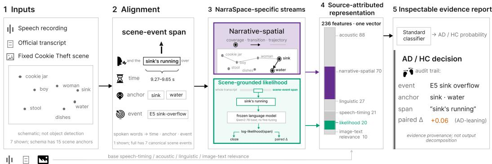
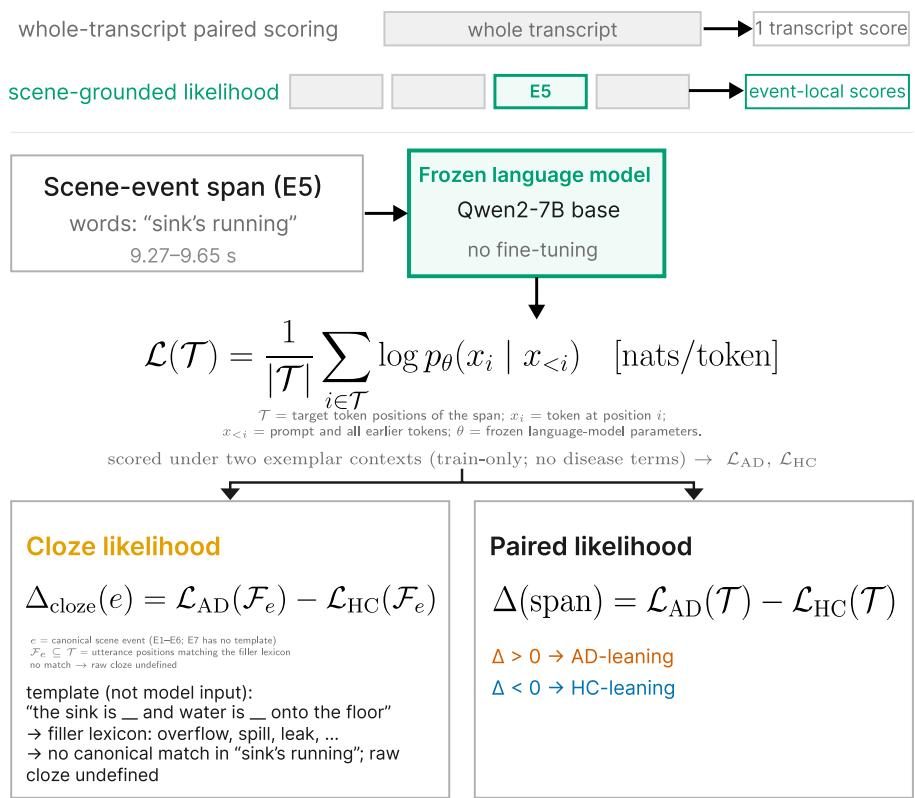
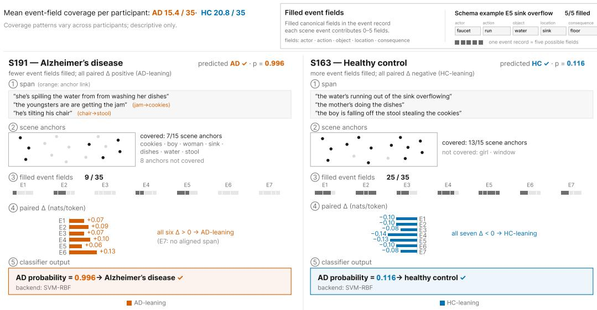

# NARRASPACE: MULTIMODAL SCENE-GROUNDEDEVIDENCE FOR PICTURE-DESCRIPTION DEMENTIACLASSIFICATION

Qingming Li∗ Ruiyan Sun∗ Satoshi Nakamura†

The Chinese University of Hong Kong Shenzhen

## ABSTRACT

Picture-description dementia classification uses a shared visual scene, but a transcript-level prediction alone does not identify the scene evidence underlying its inputs. NarraSpace links words and speech times to named picture elements and retrieves utterances for predefined scene events. Narrative-spatial descriptors summarize coverage and temporal organization. A frozen language model contrasts each event’s text under examples from Alzheimer’s disease and healthycontrol training participants, alongside transcript surprisal and coverage measurements. Retained source records link event scores to their source utterances, speech intervals, and lexical matches. On the official 48-participant test set of the Alzheimer’s Dementia Recognition through Spontaneous Speech benchmark, a fixed support vector classifier achieves 80.88% ± 2.56% mean accuracy over fifty seeds; averaged probabilities yield 81.25% accuracy and 91.32% area under the receiver operating characteristic curve. NarraSpace makes the construction of scene-linked classification inputs explicit and inspectable by connecting eventindexed language-model measurements to their source utterances, speech timing, and extraction records. Such source-linked measurements could support clinician review of picture descriptions by presenting quantitative summaries alongside the original speech evidence.

## 1 INTRODUCTION

Picture-description dementia classification has a useful constraint: the picture supplies a shared reference for what a participant could describe. In the Alzheimer’s Dementia Recognition through Spontaneous Speech (ADReSS) benchmark, every participant describes the Cookie Theft scene (Luz et al., 2020). Descriptions differ in the objects mentioned, their order, the time spent describing them, and the relations expressed. Clinical picture-description assessment counts information units: depicted objects, actions, and facts conveyed by the speaker (Goodglass et al., 2001; Croisile et al., 1996; Fraser et al., 2016). These analyses suggest a representation question: how can a classifier’s input retain the connection between a linguistic measurement and the particular scene content from which it was obtained?

Acoustic and linguistic features, pretrained representations, and whole-transcript language-model scores provide useful classification signals (Yuan et al., 2021; Martinc et al., 2021; Wang et al., 2023; Xiao et al., 2025). A scalar score, however, does not itself identify the phrase, event, or scene location associated with that signal. Prior work already represents picture descriptions as spatio-semantic paths, aligns spoken words with image regions, and models image–text consistency (Ambadi et al., 2021; Heidarzadeh & Ratte´, 2023; Ng et al., 2025b; Li et al., 2025). The connection we study is between an event in the picture, its retrieved utterances, and their likelihood under classderived example contexts. Keeping these together allows the score and its extraction choices to be inspected.

NarraSpace constructs an evidence representation around a fixed scene schema. It links words to speech intervals and fifteen named picture elements (scene anchors), retrieves utterances for seven predefined events, and contrasts the same retrieved text under examples from Alzheimer’s disease and healthy-control training participants using one frozen language model. A conventional classifier combines this evidence with speech, linguistic, and image–text descriptors. Retained source records allow a reader to move from a displayed event score back to its utterances, lexical matches, and scene anchors. This is source attribution: it specifies where evidence came from. It is distinct from attributing a classifier’s decision to individual features or demonstrating that an explanation improves clinical judgment.

Our contribution connects scene structure, event-indexed language-model measurements, and source records. We provide (1) a representation separating anchor trajectories, event retrieval, and classification features; (2) paired likelihood measurements for retrieved utterances, alongside scene-token and coverage descriptors; and (3) an assessment with shared transcript processing, family removals, participant-level uncertainty, and auditable cases. The event index lets a reader locate a measurement’s source and inspect its extraction choices. Whether this organization improves inspection accuracy or speed over simple retrieval remains an empirical question.

## 2 RELATED WORK

Speech and language representations. ADReSS standardizes picture-description classification with an official participant split (Luz et al., 2020). Relevant representations include linguistic and acoustic descriptors, temporal integration, pause-aware language models, ensembles, and prompt learning (Fraser et al., 2016; Yuan et al., 2021; Syed et al., 2021; Martinc et al., 2021; Wang et al., 2023). Word-level multimodal alignment provides another route to relating the speech signal to its transcription (Ortiz-Perez et al., 2025). Transcript construction matters: manual and automatic transcripts, annotation handling, and retained disfluencies can change the information available to a model (Liu et al., 2025). We use official participant transcripts and specify their normalization to make the input available to each feature family explicit.

Scene structure and contextual evidence. Spatio-semantic graphs encode paths through picture information units (Ambadi et al., 2021; Ng et al., 2025b). A separate study by Ng et al. (2025a) learns information-unit detection and ordering with a pretrained text encoder, evaluating both against human annotations and validating derived features externally. Word–region alignment, eye movements, image–text relevance, and topic evolution also connect descriptions to scenes (Heidarzadeh & Ratte´, 2023; Wang et al., 2024; Zhu et al., 2023; Li et al., 2025). NarraSpace builds on this structural premise: its fixed event records index class-context likelihood measurements and their source utterances.

Language-model evidence and explanations. Xiao et al. (2025) contrast whole-transcript perplexities from class-conditioned models. Zhu et al. (2024) use training-derived feature context, including picture content, for adversarial generation and perplexity-based detection; Su et al. (2026) study demonstration-centered anchoring. NarraSpace applies class-derived contexts within one frozen model to event text and retains each contrast’s source. The event, scored text, contrast, and extraction rules are available together for inspection. This measurement-level contribution complements the decision explanations studied in clinician-facing systems (Ntampakis et al., 2025).

## 3 METHOD

NarraSpace constructs classifier features and retains their source records (Figure 1). A scene anchor is a named picture element, such as the sink. A visit groups consecutive mentions of one anchor along the timed word sequence. An event record groups utterances associated with a predefined scene event, such as sink overflow; its five lexical fields record actor, action, object, location, and consequence matches. These records remain available for inspection even when their derived fea tures are not selected by the classifier.

## 3.1 INPUTS, SCENE ANCHORS, AND EVENT RETRIEVAL

The inputs are audio, the official transcript, and the shared Cookie Theft image. Transcript processing has two branches. Language-model scoring uses participant speech after removing examiner turns, task instructions, annotation markers, and angle-bracketed retraced text, including its words; retained spoken forms are not replaced by standard-form corrections. Linguistic features additionally use the original morphological and grammatical annotations and raw disfluency markers. WhisperX forced alignment attaches word times to the cleaned participant text without generating a new transcript (Bain et al., 2023).

  
Classifier path: 236 features + 20 missingness flags −→ 256 candidates −→ 60 selected inputs −→ classifier.  
Figure 1: NarraSpace constructs features while retaining links to their source text and speech times. The highlighted fragment illustrates a match; the language model scores the complete utterances retrieved for an event, concatenated in narrative order. The classifier path below the diagram expands its feature-selection step. Event-record summaries support source inspection and are excluded from classifier inputs (Appendix A.5). AD denotes Alzheimer’s disease and HC healthy control.

Fifteen fixed scene anchors cover depicted entities, locations, and dish drying (Appendix A.5). Words are assigned by phrase rules, then lexical lookup, then text-embedding similarity. For the last step, each anchor’s prototype averages embeddings of its natural-language descriptions. The query is the target word with up to two preceding words and one following word, or the word alone when that context has fewer than two tokens. The all-mpnet-base-v2 encoder supplies both representations. Assignment requires cosine similarity at least 0.45 and a top-two margin at least 0.08; other words remain unassigned. These text-to-schema matches assign the spoken content to fixed elements of the shared picture.

Seven events cover cookie reaching, stool instability, girl observing, dishwashing, overflow, unawareness of the hazard, and kitchen context. An utterance is retrieved when any event-field lexicon or associated anchor matches. Its complete text is retained. We call the concatenation of all such utterances in narrative order the event text; it may be noncontiguous in the original transcript and shared across events. A field is filled when its lexicon matches in any retrieved utterance. These lexical matches neither resolve negation nor establish semantic entailment.

## 3.2 NARRATIVE-SPATIAL MEASUREMENTS

We compute seventy narrative-spatial features describing anchor coverage, order, and timing. They form one part of the candidate pool: the full system selects sixty inputs from the combined 256 candidates (Section 3.4). Descriptions mentioning the same anchors can differ in revisits or pauses. The inventory includes coverage, path, graph, timing, mapping-quality summaries, and healthycontrol reference deviations; Appendix A.6 details its five subfamilies.

After unassigned words are removed, assigned words are sorted by onset. Adjacent entries with the same anchor form one visit, even across intervening unassigned words or pauses; there is no gap threshold. Write visit j as $v _ { j } = ( r _ { j } , t _ { j } ^ { \mathrm { s t a r t } } , t _ { j } ^ { \mathrm { e n d } } )$ and let c(r) be the anchor’s fixed boundingbox center in reference-image pixels. Coverage is $| \{ r _ { j } \} | / 1 5 ;$ dwell sums visit durations; transition distance is $\| c ( r _ { j + 1 } ) - c ( r _ { j } ) \| _ { 2 } .$ A revisit returns to an already visited anchor. The resulting sequence describes how speech moves between scene anchors.

Three features compare coverage, first-mention order, and normalized dwell allocation with a reference constructed from permitted healthy-control training participants. They respectively use the fraction of reference anchors not observed, one minus Kendall’s rank correlation, and Kullback– Leibler divergence. The reference is rebuilt within each evaluation partition.

  
Figure 2: Two inputs, one scoring model: AD training examples followed by the target event text, and HC training examples followed by that same text. Only target tokens are scored. Their mean log-likelihood difference gives an event contrast; the cloze contrast restricts the average to lexicon matched subwords of that text. The illustrated excerpt is abridged, and the hand-written cloze template is not a model input.

## 3.3 SCENE-GROUNDED LIKELIHOOD

The twenty-feature likelihood stream combines event-text contrasts, transcript-context surprisal, and lexical coverage. For the contrasts, a frozen Qwen2-7B causal language model (Yang et al., 2024) scores the same event text with examples from either Alzheimer’s disease (AD) or healthy-control (HC) training participants. Labels select the example pools but are absent from the prompt; weights are not fine-tuned. This is supervised context construction, illustrated in Figure 2.

For target-token positions $\mathcal { T } _ { e }$ in event text $e ,$ the mean log-likelihood under exemplar context C is

$$
\mathcal { L } _ { C } ( \mathcal { T } _ { e } ) = \frac { 1 } { | \mathcal { T } _ { e } | } \sum _ { i \in \mathcal { T } _ { e } } \log p _ { \theta } ( x _ { i } \mid C , x _ { < i } ) \quad [ \mathrm { n a t s / t o k e n } ] .\tag{1}
$$

Tokenizer offsets separate target tokens from the unscored examples. The paired event contrast is

$$
\Delta _ { e } = \mathcal { L } _ { C _ { \mathrm { A D } } } ( \mathcal { T } _ { e } ) - \mathcal { L } _ { C _ { \mathrm { H C } } } ( \mathcal { T } _ { e } ) .\tag{2}
$$

Positive $\Delta _ { e }$ means higher mean target log-likelihood under AD examples; its scale is the loglikelihood difference in nats per token. For each event and seed, two independently sampled AD/HC context pairs yield two contrasts, which are averaged. Both classes use the same number of examples: all n if the smaller eligible pool has $n < 1 0$ , otherwise min(30, ⌊0.70n⌋), sampled without replacement. Appendix B specifies the prompt and exclusions.

The cloze contrast scores a lexicon-selected subset $\mathcal { F } _ { e } \subseteq \mathcal { T } _ { e }$ using the same difference. Handwritten templates supply the filler lexicons used to select these positions, such as overflow, spill, and leak; the selected positions are matching subword surfaces in the participant’s text, not necessarily all pieces of a matched word. Events 1–6 have these lexicons; event 7 does not. A cloze score is undefined without matching subwords; a paired score is undefined without retrieved utterances.

Four cloze summaries and nine paired descriptors contribute thirteen columns. Six further columns summarize surprisal, $- \log p _ { \theta } ( x _ { i } \mid x _ { < i } )$ , for scene-related words in their original transcript context; these use whole-word intervals to select subwords. One unmatched-concept count completes the twenty. The feature inventory in Appendix B.2 also separates the twelve score-derived columns from two coverage counts and six surprisal summaries for the targeted controls. Removing the entire stream therefore removes more than the paired-likelihood contrasts alone.

## 3.4 CLASSIFIER INPUTS AND PROBABILITY ESTIMATES

The representation has $1 4 6 + 7 0 + 2 0 = 2 3 6$ features. The 146 base features are 21 speech-timing, 88 acoustic, 27 linguistic, and 10 image–text descriptors. Acoustics use the extended Geneva Minimalistic Acoustic Parameter Set with openSMILE (Eyben et al., 2016; 2010); image–text features use frozen Contrastive Language–Image Pretraining representations (Radford et al., 2021). Three linguistic features also measure anchor coverage or repetition, so removing narrative-spatial features does not remove all scene information. Event-record summaries form a separate source-inspection branch (Appendix A.5); they are excluded from this feature pool.

Each likelihood column is median-imputed using fitting rows and paired with a binary missingness flag, giving $2 3 6 + 2 0 = 2 5 6$ candidates for the full system. Selection combines two label-dependent rankings: larger mutual information ranks first; smaller two-sided Mann–Whitney p-values rank first. The sixty candidates with the lowest average ranks across the combined pool are standardized and given to a support vector machine with radial basis function kernel $( C = 3 0 , \gamma = 0 . 0 0 1 )$ Family removals and targeted controls also select sixty inputs from their respective pools; removing the likelihood stream and its flags, for example, leaves 216 candidates.

The classifier internally fits a sigmoid to decision scores using five-fold probability estimation. This internal operation does not repeat upstream feature construction or selection; it differs from the outer validation procedure below. Reports retain source records independently of selection; the selection record identifies which derived features enter each classifier fit.

## 4 EVALUATION SETTING

Data and fixed system. ADReSS provides 108 official training and 48 official test participants. All current analyses use the same fixed support vector machine $( C = 3 0 , \gamma = 0 . 0 0 1$ , sixty selected inputs), including six whole-family removals. Earlier evaluations fitted supervised feature selection outside validation folds and incompletely excluded validation participants from example pools. We corrected those fitting boundaries while retaining the classifier and parameters; no replacement is selected from the new results. Earlier work had already inspected the test set, so this remains an exploratory assessment. Historical results are identified separately in Table 1B.

Training references and validation. Class-conditioned examples and the healthy-control reference depend on training participants, so feature values depend on the evaluation partition. For each of five fixed outer folds, we construct features for both fitting and validation participants using only the other four folds. Every fitting target is additionally excluded from its own examples and reference. Imputation, selection, scaling, and classifier fitting use fitting rows only. The held-out probabilities are concatenated to select thresholds.

For the final classifier, each training participant uses the feature version constructed when its own fold was held out; all 108 such rows fit the final preprocessing and classifier. Test participants instead use references from all 108 training participants. These reference sizes differ. The classifier’s internal five-fold sigmoid fitting operates on the already constructed features and does not refit upstream steps. Appendix C tabulates these distinct scopes. Existing language-model scores are reaggregated for the permitted pools; this correction performs no new language-model inference.

Metrics and uncertainty. Fifty seeds vary example sampling and classifier randomness (classifier states 237–286); the participant fold partition stays fixed. Mean test accuracy is primary, with population standard deviation across seeds. Area under the receiver operating characteristic curve (AUC) measures ranking. For each seed, the decision threshold maximizes Youden’s statistic on the training validation probabilities, using 0.10–0.90 in 0.01 steps and choosing the smallest tied threshold (Youden, 1950). Aggregated predictions first average the fifty probabilities for each participant, then apply a threshold selected from averaged training probabilities. Threshold-optimized validation accuracy is not reported as an unbiased estimate, since the same labels select the threshold.

Participant uncertainty uses 10,000 diagnosis-stratified bootstrap samples: participants are sampled with replacement within each class, using identical samples for both systems in a comparison. Fits and thresholds stay fixed. For mean accuracy, each participant contributes its fraction of correct seedspecific decisions; for aggregated accuracy, one correct/incorrect decision; for aggregated AUC, its mean probability. The resulting 95% intervals concern performance or performance differences, not seed variation. Exact two-sided McNemar tests use discordant aggregated decisions (McNemar, 1947). Neither analysis reverses prior test exposure; one test participant still changes accuracy by 1/48, or 2.08 percentage points.

Questions tested by feature removal. Whole-family removals test each family’s contribution to the fitted system; each refits selection and thresholds, and likelihood removal also deletes its flags. Targeted controls ask whether event-score values add information beyond coverage and surprisal, and whether compact or less redundant spatial features suffice. They were specified after test exposure, retain all twenty flags as candidates, and select no replacement primary system (Appendix I). Historical whole-transcript and permutation controls retain their earlier evaluation procedures.

## 5 RESULTS AND EVIDENCE ANALYSIS

## 5.1 PRIMARY SYSTEM AND REFERENCE CONFIGURATIONS

The current analyses ask how the representation classifies participants, which feature groups affect those predictions, and what its source records show. Table 1A presents the fixed primary system used in the subsequent family-removal and participant-level analyses. Block B shows three Xiao–Mistral reproductions and eight NarraSpace classifier backends under their original evaluation procedures. Some NarraSpace backends exceed the reconstructed Xiao–Mistral scores on individual metrics; the largest aggregated accuracy in each group is 83.33%. Different configurations attain the maxima across metrics. Appendix E.2 details the fitting and aggregation procedures; Appendix E.1 define the three Xiao scores and lists original published results separately.

## 5.2 CLASSIFICATION AND EVIDENCE-FAMILY REMOVALS

Table 2 reports the fixed classifier under the partition-isolated procedure. The full representation achieves 80.88% ± 2.56% mean accuracy and 90.65% ± 1.32% mean AUC. Its aggregated decision rule correctly classifies 39 of 48 participants (81.25%), with AUC 91.32% and trainingselected threshold 0.56. The participant-bootstrap 95% interval is [70.75, 89.88]% for mean accuracy, [68.75, 91.67]% for aggregated accuracy, and [82.47, 97.57]% for aggregated AUC. The wider bootstrap intervals reflect participant-sampling uncertainty in the 48-person test set; the standard deviations describe variability across construction seeds.

Removing the narrative-spatial family gives the largest decrease in mean accuracy, from 80.88% to 78.21%. The full-minus-removal difference is 2.67 percentage points, with paired 95% interval [−3.67, 9.00]; its aggregated AUC difference is 3.65 points, with interval [−2.78, 10.59]. Both intervals include zero, leaving the direction and magnitude of the family’s benefit uncertain. These estimates concern the seventy-feature family as a whole. Aggregated accuracy is unchanged, with three corrected and three regressed decisions.

Removing speech timing gives 83.25% mean accuracy and 41 correct aggregated decisions. Its 2.38- point advantage has paired interval [−0.46, 6.63]; none of the six mean-accuracy intervals excludes zero. The specified full system remains primary. Appendix D gives all paired intervals and decision counts for these alternative feature sets.

Table 1: Classification performance on the 48 official-test participants. Block A presents the primary NarraSpace system; block B presents Xiao–Mistral reproductions and NarraSpace classifier backends under their original evaluation procedures. Values are percentages. Mean ± standard deviation summarizes fifty seeds; Best denotes the maximum for each metric. Bold marks column maxima within block B, including ties. Aggregation and evaluation procedures are specified below and in Appendix E.
<table><tr><td rowspan="2">Method</td><td colspan="3">Accuracy (%)</td><td colspan="3">AUC (%)</td></tr><tr><td> $\mathbf { M e a n } \pm \mathbf { s t d } .$ </td><td>Best Aggregated</td><td></td><td> $\mathbf { M e a n } \pm \mathbf { s t d } .$ </td><td></td><td>Best Aggregated</td></tr><tr><td colspan="7">A. Primary NarraSpace system</td></tr><tr><td>Support vector machine (radial basis function)</td><td> $8 0 . 8 8 \pm 2 . 5 6$ </td><td>85.42</td><td>81.25</td><td> $9 0 . 6 5 \pm 1 . 3 2 \ 9 3 . 2 3$ </td><td></td><td>91.32</td></tr><tr><td colspan="7">B. Reference configurations under their original evaluation procedures Xiao–Mistral reproductions with harmonized transcripts†</td></tr><tr><td colspan="7"></td></tr><tr><td> $\frac { \tilde { D } _ { \mathrm { l o g } } } { \bar { D } }$ </td><td> $8 0 . 9 2 \pm 4 . 4 0$ </td><td>87.50</td><td>79.17</td><td> $8 8 . 6 2 \pm 1 . 8 6$ </td><td>93.23</td><td>89.41</td></tr><tr><td> $\bar { D } ^ { * }$ </td><td> $8 0 . 6 7 \pm 4 . 2 7$   $8 0 . 5 0 \pm 4 . 4 8$ </td><td>87.50 87.50</td><td>83.33 83.33</td><td> $9 0 . 0 3 \pm 2 . 1 7$   $8 9 . 9 2 \pm 2 . 2 3 $ </td><td>94.27 94.27</td><td>91.84 87.33</td></tr><tr><td colspan="7"></td></tr><tr><td colspan="7">NarraSpace classifier backends with the same 236-feature representation‡</td></tr><tr><td>Support vector machine (radial basis function)</td><td> $8 0 . 2 5 \pm 2 . 5 4$ </td><td>85.42</td><td>81.25</td><td> $9 0 . 7 0 \pm 1 . 3 0$ </td><td>92.88</td><td>91.32</td></tr><tr><td>Logistic regression Random forest</td><td> $8 1 . 2 9 \pm 1 . 9 3$   $7 8 . 6 7 \pm 2 . 6 9$ </td><td>85.42 83.33</td><td>79.17 81.25</td><td> ${ \bf 9 1 . 1 9 \pm 0 . 9 0 }$   $9 0 . 4 4 \pm 0 . 5 4$ </td><td>93.23</td><td>91.15</td></tr><tr><td>Extreme gradient boosting</td><td> $7 9 . 3 3 \pm 3 . 7 0$ </td><td>87.50</td><td>81.25</td><td> $8 7 . 3 8 \pm 2 . 1 7$ </td><td>92.01</td><td>90.45 88.02</td></tr><tr><td>Multilayer perceptron</td><td> $7 5 . 1 3 \pm 6 . 9 1$ </td><td>87.50</td><td>81.25</td><td> $8 4 . 5 9 \pm 6 . 8 8$ </td><td>91.15 94.79</td><td></td></tr><tr><td>Compact bottleneck</td><td> $7 6 . 5 8 \pm 6 . 9 3$ </td><td>91.67</td><td>83.33</td><td> $8 3 . 5 1 \pm 6 . 6 9$ </td><td>92.19</td><td>93.06</td></tr><tr><td>classifier</td><td></td><td></td><td></td><td></td><td></td><td>92.71</td></tr><tr><td>Soft voting ensemble</td><td> $7 9 . 7 5 \pm 3 . 2 0 \ 8 5 . 4 2$ </td><td></td><td>83.33</td><td> $8 7 . 2 3 \pm 1 . 1 0$ </td><td>89.58</td><td>88.02</td></tr><tr><td>Stacking ensemble</td><td> ${ \bf 8 1 . 4 6 \pm 2 . 3 3 }$ </td><td>85.42</td><td>81.25</td><td> $9 0 . 3 7 \pm 1 . 2 7$ </td><td>92.36</td><td>91.15</td></tr></table>

†Xiao–Mistral averages perplexities before scoring and uses test-derived equal-error-rate thresholds. Definitions of ${ \tilde { D } } _ { \log } , { \bar { D } } ,$ , and $\bar { D } ^ { * }$ are provided in Appendix E.1. ‡NarraSpace averages classifier probabilities and uses training-derived thresholds. Fitting procedures for blocks A and B are detailed in Appendices C and E.2. AUC denotes area under the receiver operating characteristic curve.

Table 2: Corrected official-test results with the same support vector machine and sixty selected inputs throughout. Values are percentages; ± is the population standard deviation over fifty seeds. The full representation is the primary system fixed before these family-removal comparisons. Each removal refits preprocessing, feature selection, classifier, and training-derived thresholds. AUC denotes area under the receiver operating characteristic curve.
<table><tr><td rowspan="2">Removed evidence family</td><td colspan="2">Fifty-seed mean</td><td colspan="2">Aggregated probability</td></tr><tr><td>Accuracy</td><td>AUC</td><td>Accuracy</td><td>AUC</td></tr><tr><td>None (full)</td><td> $8 0 . 8 8 \pm 2 . 5 6$ </td><td> $9 0 . 6 5 \pm 1 . 3 2$ </td><td>81.25</td><td>91.32</td></tr><tr><td>Speech timing</td><td> $8 3 . 2 5 \pm 2 . 2 4$ </td><td> $9 1 . 1 4 \pm 1 . 4 2$ </td><td>85.42</td><td>92.19</td></tr><tr><td>Acoustic</td><td> $8 1 . 0 8 \pm 2 . 4 9$ </td><td> $9 0 . 8 9 \pm 1 . 3 9$ </td><td>79.17</td><td>91.15</td></tr><tr><td>Linguistic</td><td> $8 0 . 8 8 \pm 2 . 6 3 $ </td><td> $8 9 . 7 6 \pm 1 . 7 1 $ </td><td>81.25</td><td>90.97</td></tr><tr><td>Image-text relevance</td><td> $8 1 . 2 5 \pm 2 . 5 7$ </td><td> $9 1 . 2 3 \pm 1 . 2 0 $ </td><td>79.17</td><td>91.84</td></tr><tr><td>Narrative-spatial</td><td> $7 8 . 2 1 \pm 3 . 8 0$ </td><td> $8 6 . 8 0 \pm 1 . 6 9$ </td><td>81.25</td><td>87.67</td></tr><tr><td>Scene-grounded likelihood</td><td> $8 1 . 6 3 \pm 2 . 9 7$ </td><td> $8 8 . 8 9 \pm 0 . 0 2$ </td><td>81.25</td><td>88.89</td></tr></table>

Targeted representation controls. We first ask whether event-score descriptors add information beyond coverage, transcript surprisal, and missingness. The comparison retains all base and narrative-spatial features, together with coverage and transcript-surprisal descriptors and all missingness flags. Adding the twelve event-score descriptors changes mean accuracy from 80.17% to 80.88%, a difference of 0.71 percentage points.

A second control replaces the seventy narrative-spatial features with a compact six-feature alternative, retaining all other feature groups and missingness flags. Mean accuracy is 80.88% for the full representation and 77.96% for the compact alternative, a difference of 2.92 percentage points; aggregated accuracy is 81.25% and 83.33%, respectively. For each candidate pool, feature selection, classifier fitting, and training-derived threshold selection are repeated, with sixty selected inputs throughout. These comparisons describe observed differences; paired uncertainty estimates are re ported in Appendix I.

## 5.3 PARTICIPANT-LEVEL DECISION CHANGES

Aggregate accuracy can conceal changes in which participants are classified correctly. With and without the likelihood stream, the aggregated systems each classify 39 of 48 participants correctly, yet their predictions differ for ten participants. Adding the stream corrects five errors and introduces five new errors. Four of the corrected decisions concern healthy controls, whereas four of the new errors concern participants with Alzheimer’s disease. Thus, the unchanged aggregate accuracy accompanies a shift in the distribution of errors across the two groups.

This comparison concerns the complete fitted systems, including their training-selected thresholds. Table 12 documents every changed decision and its associated probabilities; Appendix D reports the paired statistical analysis. The event-score-specific comparison in Section 5.2 separately examines the contribution of numerical event descriptors while retaining coverage and missingness information.

## 5.4 INSPECTING SCENE-LINKED MEASUREMENTS

NarraSpace retains the link between a numerical measurement and the speech from which it was constructed. Figure 3 illustrates this connection through two scene events. For S163, the utterance “the water’s running out of the sink overflowing” is retrieved for sink overflow. For S191, “he’s tilting his chair” reaches the stool anchor through a chair-to-stool match. Figure 3 presents these utterances alongside scene-anchor matches, event-field coverage, and likelihood contrasts, allowing readers to examine the textual evidence and mapping choices behind the measurements.

These examples make different parts of feature construction accessible to inspection: the overflow example exposes the text retrieved for an event, while the chair example exposes the mapping between a participant’s wording and the predefined scene vocabulary. The feature-selection record identifies which derived measurements enter a fitted classifier. Both participants are classified correctly with and without the likelihood stream; the examples illustrate how the inputs can be examined alongside the predictions.

A single-annotator audit of 404 accepted phrase-rule and prototype mappings from 80 participants found 388 correct assignments, corresponding to 96.04% precision. Appendix G reports the sampling procedure, mapping-tier results, and audit scope. Unfilled event fields record that no expression matched the predefined lexical rules; the reports therefore label them as undetected evidence.

When an utterance is retrieved for multiple events, the records retain the shared text so that its use across those events can be examined (Appendix I). By retaining the original utterances and their mapping records, NarraSpace makes the construction of scene-linked classification inputs available for direct examination.

## 6 DISCUSSION

The shared picture provides a reference for connecting what a participant says with how the description unfolds. NarraSpace uses scene anchors to organize the timed word sequence and events to index retrieved utterances and their class-context likelihood contrasts. Its contribution lies in keeping these measurements connected to the speech and extraction choices that produced them. A reader can examine the wording behind a score, inspect a mapping between words and scene anchors, and identify text shared by several events. These connections make the construction of classification inputs explicit and available for review.

  
Figure 3: Inspecting scene-linked measurements through their source speech. Reports for two test participants connect retrieved utterances with scene-anchor matches, event-field coverage, and likelihood contrasts. E1–E7 denote cookie reaching, stool instability, girl observing, dishwashing, overflow, unawareness, and kitchen context. Filled fields indicate lexical matches; excerpts are abridged, while scores use the full retrieved text. Header means summarize event-field coverage across the 48 official-test participants. For each participant, the displayed probability is the model-estimated probability of Alzheimer’s disease, averaged across fifty runs. E7’s “no aligned span” indicates an unavailable event-text contrast.

The empirical findings show why measurement construction and predictive performance need to be examined together. Removing narrative-spatial features lowers mean accuracy, while the compact alternative performs differently across mean and aggregated accuracy. The likelihood stream changes which participants are classified correctly even when aggregate accuracy is unchanged. These observations motivate examining the selected features and participant decisions alongside overall metrics; their paired uncertainty estimates are reported in the appendices. Source records support this examination at the level of input construction. Attributing a prediction to a particular measurement additionally requires analysis of the fitted classifier and its threshold.

The present evaluation is exploratory, using one English-language benchmark with prior test exposure. The mapping audit assesses accepted anchor assignments; direct event-level annotation and same-model comparisons of local and whole-transcript scoring would test further aspects of the representation. Independent participant cohorts would assess transfer beyond this setting. For clinical research, source-linked measurements could help reviewers examine quantitative summaries alongside the original speech, including the wording and timing associated with a scene event. Evaluating that use requires measuring inspection accuracy and effort, followed by assessment of its contribution to clinical judgment.

## 7 CONCLUSION

NarraSpace connects scene structure, event-indexed language-model measurements, and speech timing in a representation whose sources remain available for inspection. On the official 48-participant test set, the fixed classifier achieves 80.88% mean accuracy over fifty seeds and 81.25% accuracy after probability aggregation. Feature controls and participant-level comparisons characterize how the representation affects classification, while source-linked cases show how its measurements can be examined. Together, the representation and evaluation provide a basis for studying picture descriptions through both quantitative summaries and their original speech evidence, with a concrete route toward evaluating their use in human review.

## REFERENCES

Shagufta Abid, Dongyu Zhang, Ahsan Shehzad, Jing Ren, Shuo Yu, Hongfei Lin, and Feng Xia. Speechhgt: A multimodal hypergraph transformer for speech-based early alzheimer’s disease detection. In James Kwok (ed.), Proceedings ofthe Thirty-Fourth International Joint Conference on Artificial Intelligence, IJCAI-25, pp. 9131–9139. International Joint Conferences on Artificial Intelligence Organization, 8 2025. doi: 10.24963/ijcai.2025/1015. URL https://doi.org/ 10.24963/ijcai.2025/1015. AI4Tech: AI Enabling Technologies.

Pranav S. Ambadi, Kristin Basche, Rebecca L. Koscik, Visar Berisha, Julie M. Liss, and Kimberly D. Mueller. Spatio-semantic graphs from picture description: Applications to detection of cognitive impairment. Frontiers in Neurology, Volume 12 - 2021, 2021. ISSN 1664-2295. doi: 10.3389/fneur.2021.795374. URL https://www.frontiersin.org/journals/ neurology/articles/10.3389/fneur.2021.795374.

Max Bain, Jaesung Huh, Tengda Han, and Andrew Zisserman. WhisperX: Time-Accurate Speech Transcription of Long-Form Audio. In Interspeech 2023, pp. 4489–4493, 2023. doi: 10.21437/ Interspeech.2023-78.

Bernard Croisile, Bernadette Ska, Marie-Josee Brabant, Annick Duchene, Yves Lepage, Gilbert Aimard, and Marc Trillet. Comparative study of oral and written picture description in patients with alzheimer’s disease. Brain and Language, 53(1):1–19, 1996. ISSN 0093-934X. doi: https:// doi.org/10.1006/brln.1996.0033. URL https://www.sciencedirect.com/science/ article/pii/S0093934X96900334.

Florian Eyben, Martin Wollmer, and Bj¨ orn Schuller. Opensmile: the munich versatile and fast¨ open-source audio feature extractor. In Proceedings of the 18th ACM International Conference on Multimedia, MM ’10, pp. 1459–1462, New York, NY, USA, 2010. Association for Computing Machinery. ISBN 9781605589336. doi: 10.1145/1873951.1874246. URL https://doi. org/10.1145/1873951.1874246.

Florian Eyben, Klaus R. Scherer, Bjorn W. Schuller, Johan Sundberg, Elisabeth Andr¨ e, Carlos´ Busso, Laurence Y. Devillers, Julien Epps, Petri Laukka, Shrikanth S. Narayanan, and Khiet P. Truong. The geneva minimalistic acoustic parameter set (gemaps) for voice research and affective computing. IEEE Transactions on Affective Computing, 7(2):190–202, 2016. doi: 10.1109/TAFFC.2015.2457417.

Kathleen C. Fraser, Jed A. Meltzer, and Frank Rudzicz. Linguistic features identify alzheimer’s disease in narrative speech. Journal of Alzheimer’s Disease, 49(2):407–422, 2016. doi: 10.3233/JAD-150520. URL https://journals.sagepub.com/doi/abs/10.3233/ JAD-150520. PMID: 26484921.

Harold Goodglass, Edith Kaplan, and Barbara Barresi. The Assessment of Aphasia and Related Disorders. Lippincott Williams & Wilkins, Philadelphia, 3 edition, 2001. ISBN 9780683305593.

Neda Heidarzadeh and Sylvie Ratte. ‘eye-tracking’ with words for alzheimer’s disease detection:´ Time alignment of words enunciation with image regions during image description tasks. Journal of Alzheimer’s Disease, 95(3):855–868, 2023. doi: 10.3233/JAD-220711. URL https:// doi.org/10.3233/JAD-220711. PMID: 37661875.

Jinchao Li, Yuejiao Wang, Junan Li, Jiawen Kang, Bo Zheng, Ka Ho Wong, Brian Kan-Wing Mak, Helene H. Fung, Jean Woo, Man-Wai Mak, Timothy Kwok, Vincent Mok, Xianmin Gong, Xixin Wu, Xunying Liu, Patrick C. M. Wong, and Helen Meng. Detecting neurocognitive disorders through analyses of topic evolution and cross-modal consistency in visual-stimulated narratives. IEEE Journal ofSelected Topics in Signal Processing, 19(5):741–756, 2025. doi: 10.1109/JSTSP. 2025.3622049.

Yin-Long Liu, Rui Feng, Jia-Xin Chen, Yi-Ming Wang, Jia-Hong Yuan, and Zhen-Hua Ling. Beyond Manual Transcripts: The Potential of Automated Speech Recognition Errors in Improving Alzheimer’s Disease Detection. In Interspeech 2025, pp. 5678–5682, 2025. doi: 10.21437/Interspeech.2025-1598.

Saturnino Luz, Fasih Haider, Sofia de la Fuente, Davida Fromm, and Brian MacWhinney. Alzheimer’s Dementia Recognition Through Spontaneous Speech: The ADReSS Challenge. In Interspeech 2020, pp. 2172–2176, 2020. doi: 10.21437/Interspeech.2020-2571.

Matej Martinc, Fasih Haider, Senja Pollak, and Saturnino Luz. Temporal integration of text transcripts and acoustic features for alzheimer’s diagnosis based on spontaneous speech. Frontiers in Aging Neuroscience, Volume 13 - 2021, 2021. ISSN 1663-4365. doi: 10.3389/fnagi.2021.642647. URL https://www.frontiersin.org/journals/ aging-neuroscience/articles/10.3389/fnagi.2021.642647.

Quinn McNemar. Note on the sampling error of the difference between correlated proportions or percentages. Psychometrika, 12(2):153–157, 1947. doi: 10.1007/BF02295996.

Si-Ioi Ng, Pranav S. Ambadi, Kimberly D. Mueller, Julie Liss, and Visar Berisha. Advancing automated spatio-semantic analysis in picture description using language models, 2025a. URL https://arxiv.org/abs/2510.05128v1.

Si-Ioi Ng, Pranav S. Ambadi, Kimberly D. Mueller, Julie Liss, and Visar Berisha. Automated extraction of spatio-semantic graphs for identifying cognitive impairment. In ICASSP 2025 - 2025 IEEE International Conference on Acoustics, Speech and Signal Processing (ICASSP), pp. 1–5, 2025b. doi: 10.1109/ICASSP49660.2025.10890726.

Nikolaos Ntampakis, Konstantinos Diamantaras, Ioanna Chouvarda, Magda Tsolaki, Panagiotis Sarigianndis, and Vasileios Argyriou. NeuroXVocal: Detection and Explanation of Alzheimer’s Disease through Non-invasive Analysis of Picture-prompted Speech . In proceedings of Medical Image Computing and Computer Assisted Intervention – MICCAI 2025, volume LNCS 15973, pp. 410–419. Springer Nature Switzerland, September 2025.

David Ortiz-Perez, Manuel Benavent-Lledo, Javier Rodriguez-Juan, Jose Garcia-Rodriguez, and David Tomas. Cognialign: Word-level multimodal speech alignment with gated cross-attention´ for alzheimer’s detection. Knowledge-Based Systems, 329:114264, 2025. ISSN 0950-7051. doi: https://doi.org/10.1016/j.knosys.2025.114264. URL https://www.sciencedirect. com/science/article/pii/S095070512501305X.

Madhurananda Pahar, Bahman Mirheidari, Caitlin Illingworth, Dorota Braun, Fuxiang Tao, Lise Sproson, Daniel Blackburn, and Heidi Christensen. Automatic detection of early cognitive decline using multimodal feature fusion and transfer learning on real-world conversational speech. IEEE Journal of Biomedical and Health Informatics, 29(12):8727–8734, 2025. doi: 10.1109/JBHI. 2025.3624043.

Alec Radford, Jong Wook Kim, Chris Hallacy, Aditya Ramesh, Gabriel Goh, Sandhini Agarwal, Girish Sastry, Amanda Askell, Pamela Mishkin, Jack Clark, Gretchen Krueger, and Ilya Sutskever. Learning transferable visual models from natural language supervision. In Marina Meila and Tong Zhang (eds.), Proceedings of the 38th International Conference on Machine Learning, volume 139 of Proceedings of Machine Learning Research, pp. 8748–8763. PMLR, 18–24 Jul 2021. URL https://proceedings.mlr.press/v139/radford21a. html.

Puzhen Su, Haoran Yin, Miao Yongzhu, Jintao Tang, Shasha Li, and Ting Wang. Beyond plain demos: A demo-centric anchoring paradigm for in-context learning in Alzheimer’s disease detection. Proceedings of the AAAI Conference on Artificial Intelligence, 40(39):33074–33082, 2026. doi: 10.1609/aaai.v40i39.40590. URL https://ojs.aaai.org/index.php/ AAAI/article/view/40590.

Zafi Sherhan Syed, Muhammad Shehram Shah Syed, Margaret Lech, and Elena Pirogova. Automated recognition of alzheimer’s dementia using bag-of-deep-features and model ensembling. IEEE Access, 9:88377–88390, 2021. doi: 10.1109/ACCESS.2021.3090321.

Yi Wang, Jiajun Deng, Tianzi Wang, Bo Zheng, Shoukang Hu, Xunying Liu, and Helen Meng. Exploiting prompt learning with pre-trained language models for alzheimer’s disease detection. In ICASSP 2023 - 2023 IEEE International Conference on Acoustics, Speech and Signal Processing (ICASSP), pp. 1–5, 2023. doi: 10.1109/ICASSP49357.2023.10095993.

Yuzhe Wang, Anna Favaro, Thomas Thebaud, Jesus Villalba, Najim Dehak, and Laureano Moro-Velazquez. Exploring the Complementary Nature of Speech and Eye Movements for Profiling Neurological Disorders. In Interspeech 2024, pp. 1475–1479, 2024. doi: 10.21437/Interspeech. 2024-2186.

Yao Xiao, Heidi Christensen, and Stefan Goetze. Alzheimer’s Dementia Detection Using Perplexity from Paired Large Language Models. In Interspeech 2025, pp. 1423–1427, 2025. doi: 10.21437/ Interspeech.2025-2428.

An Yang, Baosong Yang, Binyuan Hui, Bo Zheng, Bowen Yu, Chang Zhou, Chengpeng Li, Chengyuan Li, Dayiheng Liu, Fei Huang, Guanting Dong, Haoran Wei, Huan Lin, Jialong Tang, Jialin Wang, Jian Yang, Jianhong Tu, Jianwei Zhang, Jianxin Ma, Jianxin Yang, Jin Xu, Jingren Zhou, Jinze Bai, Jinzheng He, Junyang Lin, Kai Dang, Keming Lu, Keqin Chen, Kexin Yang, Mei Li, Mingfeng Xue, Na Ni, Pei Zhang, Peng Wang, Ru Peng, Rui Men, Ruize Gao, Runji Lin, Shijie Wang, Shuai Bai, Sinan Tan, Tianhang Zhu, Tianhao Li, Tianyu Liu, Wenbin Ge, Xiaodong Deng, Xiaohuan Zhou, Xingzhang Ren, Xinyu Zhang, Xipin Wei, Xuancheng Ren, Xuejing Liu, Yang Fan, Yang Yao, Yichang Zhang, Yu Wan, Yunfei Chu, Yuqiong Liu, Zeyu Cui, Zhenru Zhang, Zhifang Guo, and Zhihao Fan. Qwen2 technical report, 2024. URL https://arxiv.org/abs/2407.10671.

W. J. Youden. Index for rating diagnostic tests. Cancer, 3(1):32–35, 1950. doi: 10.1002/ 1097-0142(1950)3:1⟨32::AID-CNCR2820030106⟩3.0.CO;2-3.

Jiahong Yuan, Xingyu Cai, Yuchen Bian, Zheng Ye, and Kenneth Church. Pauses for detection of alzheimer’s disease. Frontiers in Computer Science, Volume 2 - 2020, 2021. ISSN 2624-9898. doi: 10.3389/fcomp.2020.624488. URL https://www.frontiersin.org/journals/ computer-science/articles/10.3389/fcomp.2020.624488.

Youxiang Zhu, Nana Lin, Xiaohui Liang, John A. Batsis, Robert M. Roth, and Brian MacWhinney. Evaluating picture description speech for dementia detection using image-text alignment. arXiv preprint arXiv:2308.07933, 2023. doi: 10.48550/arXiv.2308.07933. URL https://arxiv. org/abs/2308.07933v1. Version 1.

Youxiang Zhu, Nana Lin, Kiran Sandilya Balivada, Daniel Haehn, and Xiaohui Liang. Adversarial text generation using large language models for dementia detection. In Proceedings of the 2024 Conference on Empirical Methods in Natural Language Processing, pp. 21918–21933. Association for Computational Linguistics, 2024. doi: 10.18653/v1/2024.emnlp-main.1222. URL https://aclanthology.org/2024.emnlp-main.1222/.

## A APPENDIX

This supplement specifies the feature construction, the scope of the mapping audit, and the distinction between evidence provenance and classifier explanation. The dataset is the Alzheimer’s Dementia Recognition through Spontaneous Speech (ADReSS) Cookie Theft benchmark, with 108 official training participants and 48 official test participants (Luz et al., 2020). Alzheimer’s disease (AD) is the positive class and healthy control (HC) is the negative class. The reference image, recordings, and transcripts are subject to their original access terms.

## A.1 FEATURE ACCOUNTING

Table 3 distinguishes constructed features, selection candidates, and selected classifier inputs for the full system. The representation contains $1 4 6 + 7 0 + 2 0 = 2 3 6$ features. Median imputation and one missingness indicator for each of the twenty likelihood-stream columns produce $\bar { 2 } 3 6 + 2 0 = 2 5 6$ candidates. Feature selection retains $K _ { \mathrm { f e a t } } = 6 0$ columns across this combined pool for the fixed support vector machine with radial basis function kernel. The number selected from each family depends on its ranks in that fit. Family removals and targeted controls use their specified candidate pools and the same sixty-input selection.

The twenty-column stream contains four cloze summaries, nine paired-likelihood features, six transcript-context surprisal summaries, and one unmatched-concept count. This combines event scores with transcript and coverage measures. Removing this stream removes all twenty semantic columns and their twenty missingness indicators, leaving 216 base and narrative-spatial candidates. The stream contributes twenty numeric columns and twenty flags to the full pool. A separate set of 31 event-record summaries supports source inspection; Appendix A.5 gives their construction.

Table 3: Full-system feature accounting: 236 constructed features, 256 selection candidates, and sixty selected inputs. The 31 event-record summaries are separate from all three stages and are used for source inspection only.
<table><tr><td>Evidence family</td><td>Representation</td><td>Added indicators</td></tr><tr><td>Speech timing</td><td>21</td><td>0</td></tr><tr><td>Acoustic</td><td>88</td><td>0</td></tr><tr><td>Linguistic</td><td>27</td><td>0</td></tr><tr><td>Image-text relevance</td><td>10</td><td>0</td></tr><tr><td>Narrative-spatial</td><td>70</td><td>0</td></tr><tr><td>Scene-likelihood and coverage</td><td>20</td><td>20</td></tr><tr><td>Total</td><td>236</td><td>20</td></tr><tr><td>Classifier candidate pool</td><td></td><td>256</td></tr><tr><td>Selected classifier input</td><td></td><td>60</td></tr></table>

## A.2 TRANSCRIPT CONSTRUCTION AND TIMING

Each official Codes for the Human Analysis of Transcripts (CHAT) .cha file is reduced to participant-only words. Interviewer and examiner turns and task instructions are excluded. The scored text removes CHAT filler codes (&uh, &um), retracing and self-correction markers ([/], $[ / / ] )$ , standard-form targets ([: ...]), error tags ([\* ...]), and unintelligibility markers (xxx). It also removes complete angle-bracketed retraced spans, including the words inside them. For example, <the boy> [/] the boy becomes the boy; the first occurrence is not retained. Spoken forms remaining after these rules are not replaced with standard-form corrections. The procedure neither diagnoses paraphasias nor preserves every original repetition.

Word timing uses WhisperX 3.8.5 in forced-alignment mode (Bain et al., 2023), with the participant transcript as the target and the English WAV2VEC2 ASR BASE 960H checkpoint. The timing stage does not generate the scored transcript using automatic speech recognition. The anchor mapper and WhisperX produce separate word lists. To attach WhisperX times to mapped words, their normalized spellings are compared using Levenshtein similarity of at least 0.8 and a length difference of at most two characters. Multiword grounding phrases retain the interval from the first aligned word to the last aligned word for their anchor token. The fallback divides an utterance interval among its remaining grounded words when word matches are unavailable. The archived alignment check for the 156 participants recorded no use of this fallback; the reported timings therefore came from word matching, including phrase intervals. Such timing estimates the allocation of speech to the mentioned scene anchors.

## A.3 SPEECH-TIMING AND LINGUISTIC BASE FEATURES

The 21 speech-timing and 27 linguistic descriptors form 48 of the 146 base features. Demographic metadata are excluded from classifier inputs; pauses are represented by the timing statistics below.

Speech timing: twenty-one features. Nonnegative-timestamp words are processed in input order. Four descriptors are word count, first-onset-to-last-offset duration, and mean/population-standard deviation word duration. Four rate descriptors are global words/second and local-rate mean, standard deviation, and coefficient of variation. Local rates count words intersecting inclusive fivesecond windows with a 2.5-second stride; only complete windows are used. Without one, the mean falls back to global rate and dispersion is zero. Ten pause descriptors summarize nonnegative consecutive inter-word gaps: mean, standard deviation, maximum, median, coefficient of variation, SciPy-default skewness and excess kurtosis, count and fraction exceeding one second, and count below 0.15 seconds. Zero gaps enter these statistics. Three further descriptors are summed word durations, summed gaps, and their pause-to-speech ratio. Empty word sequences yield zeros; skewness/kurtosis use zero when fewer than three gaps exist.

Linguistic evidence: twenty-seven features. Cleaned participant words supply lexical counts, but official CHAT morphological (%mor) and grammatical $( \frac { \circ } { \circ } \ g \tt { r a } )$ annotations and raw utterance markers remain inputs to this family. Let N denote words, V lowercase types, and $V _ { 1 }$ types occurring once.

Five lexical descriptors are $V / N$ , its moving-window mean with window min $( 2 0 , N )$ and unit stride, Brunet’s $N ^ { V ^ { - 0 . 1 7 2 } }$ , Honore’s´ $1 0 0 \log ( N ) / ( 1 - V _ { 1 } / V )$ , and $V _ { 1 } / V$ . Honore’s value defaults to zero´ when undefined. Eight morphological descriptors are noun, verb, adjective, and pronoun fractions; pronoun/noun, verb/noun, content-word, and light-verb ratios. The four part-of-speech fractions and content fraction use all parsed morphological tags; content comprises nouns, verbs, adjectives, and adverbs. Light verbs are go/get/do/make/take/have/be/come/put/give, divided by verb count. With no nouns, numerator/noun ratios return one for a positive numerator, otherwise zero.

Five syntactic descriptors are mean utterance length, mean per-utterance dependency distance excluding root/punctuation arcs, maximum dependency depth, subordinate relations per utterance, and clausal relations per parsed dependency. Subordination counts COMP,CJCT,CPRED,CMOD,XCOMP,XJCT,XMOD; the clausal subset excludes the final two. Six disfluency descriptors are raw &word, retracing ([/]), and revision $( [ / / / ] )$ counts per word; incomplete $( + \dots . . \dots ^ { } / + / \dots )$ and empty-utterance fractions; and filler/content-word ratio. Finally, three anchor-derived descriptors are the fraction of word records assigned an anchor (the denominator includes unassigned records), the number of distinct assigned anchors, and assigned word records divided by distinct anchors. An assigned word record is one anchor mention for these counts. Empty lexical input yields 27 zeros; absent mapping yields zero for its three descriptors. These annotationdependent features require more than the normalized text scored by the language model.

## A.4 ACOUSTIC BASE FEATURES

The 88 acoustic descriptors are file-level functionals from openSMILE’s extended Geneva Minimalistic Acoustic Parameter Set, version 02 (Eyben et al., 2016; 2010). They are computed once per benchmark-provided enhanced full recording. This extractor does not trim the audio using the participant-only transcript turns; transcript filtering and the acoustic recording boundary are distinct.

## A.5 SCENE ANCHORS, GROUNDING, AND EVENT RECORDS

The fixed schema contains fifteen anchors: boy, girl, woman, stool, cookie jar, cookies, sink, water, dishes, curtain, window, counter, floor, garden, and dish drying. The last anchor denotes an action; the other fourteen denote depicted entities, elements, or locations. Each anchor therefore specifies a category of scene content with a fixed image location. The schema operationalizes scene content considered in picture-description and spatio-semantic analyses (Croisile et al., 1996; Fraser et al., 2016; Ambadi et al., 2021; Ng et al., 2025b).

Eligible words are mapped in the order phrase rule, lexical lookup, then prototype matching. Phrase rules take priority to preserve the assignment of a complete multiword expression. Rule-specific anchor positions determine which token receives the phrase assignment. The prototype fallback uses sentence-transformers $/ \mathsf { a } \mathsf { l } \mathsf { 1 } - \mathsf { m p n e t - b a s e - v } 2$ through the Transformers tokenizer and model interfaces. Each anchor prototype is the normalized mean of normalized embeddings of its natural-language descriptions. The query contains up to two words before the target and one after it, excluding punctuation; when fewer than two tokens remain, the target word alone is used. A candidate is accepted only if its largest cosine similarity is at least 0.45 and its margin over the second-largest similarity is at least 0.08. Tokens excluded as non-groundable and eligible tokens that fail these gates remain distinguishable in the mapping records. Neither state is a human-verified omission.

Event assignment is deterministic. An utterance supports an event when at least one normalized token matches a term in any of that event’s five field lexicons, or when an accepted anchor overlaps the event’s anchor set. The entire supporting utterance is retained, and supporting utterances are concatenated in narrative order to form the event text. A field is marked present if its lexicon has a hit in any supporting utterance. The same utterance can support several events; no cross-event deduplication is applied. Retrieval retains complete utterances and accepts partial lexical evidence. Actor–action relations and negation scope are outside the matching rule, so a negated mention can still contribute a lexical or anchor hit.

Table 4: The seven canonical event records. Each has actor, action, object, location, and consequence fields. Utterances are assigned through lexical or anchor matches to this schema.
<table><tr><td>Identifier</td><td>Canonical scene event</td></tr><tr><td>E1</td><td>Boy reaching for cookies</td></tr><tr><td>E2</td><td>Stool instability</td></tr><tr><td>E3</td><td>Girl observing</td></tr><tr><td>E4</td><td>Woman dishwashing</td></tr><tr><td>E5</td><td>Sink overflow</td></tr><tr><td>E6</td><td>Woman unaware of the hazard</td></tr><tr><td>E7</td><td>Global kitchen context</td></tr></table>

Table 5: The seventy narrative-spatial candidate features comprise $4 0 + 3 + 1 0 + 1 4 + 3$ descriptors. The forty-feature narrative-profile group is included within this total. The family-removal analysis evaluates all seventy descriptors together; Appendix I examines specified smaller alternatives.
<table><tr><td>Subfamily</td><td>Count</td><td>Represented property</td></tr><tr><td>Narrative profile</td><td>40</td><td>Coverage, duration, path, graph structure, and mapping status</td></tr><tr><td>Reference deviation</td><td>3</td><td>Coverage, first-mention order, and dwell allocation relative to a healthy-control reference</td></tr><tr><td>Timing-space interaction</td><td>10</td><td>Relationships between pauses, dwell, and anchor transitions</td></tr><tr><td>Temporal segmentation</td><td>14</td><td>Changes between the first and second halves of the visit interval</td></tr><tr><td>Transition sequences</td><td>3</td><td>Repetition and entropy of anchor pairs and triples</td></tr><tr><td>Total</td><td>70</td><td></td></tr></table>

For each participant, seven events with five fields give $7 \times 5 = 3 5$ event-field positions. These records yield $7 \times 3 + 5 + 5 = 3 1$ source-inspection summaries. For each event, these include filled-field fraction, actor–action–object co-occurrence, and absence of retrieved utterances (21). Co-occurrence means that all three field types have hits somewhere in the event record, possibly in different utterances. Five descriptors average each field type across events (5), followed by five overall descriptors: mean completeness, missing consequence count, missing object count, vague-term count, and event-order agreement. Their purpose is to summarize recorded evidence for inspection. They are excluded from the 236 classification features, the 256 selection candidates, and the sixty selected inputs.

## A.6 THE SEVENTY NARRATIVE-SPATIAL FEATURES

Unassigned words are removed and the remaining time-aligned words are ordered by onset. Adjacent entries with the same anchor form one visit, spanning the first onset to the last offset. Intervening unassigned words and long pauses do not split a visit; there is no elapsed-time cutoff. Consecutive visits define the narrative sequence $v _ { i } = ( r _ { i } , s _ { i } , e _ { i } , c _ { i } )$ , where $r _ { i }$ is the anchor, $[ s _ { i } , e _ { i } ]$ its speech interval, and $c _ { i }$ the anchor’s fixed image centroid. Define dwell duration $d _ { i } = e _ { i } - s _ { i } ,$ transition distance $a _ { i } = \| c _ { i + 1 } - c _ { i } \| _ { 2 }$ , and nonnegative transition pause $g _ { i } = \operatorname* { m a x } ( 0 , s _ { i + 1 } - e _ { i } )$ Each centroid is the center of its fixed bounding box in reference-image pixels, including the box associated with dish drying. Transition distances therefore describe positions on the reference image.

Narrative profile: forty features. This subfamily contributes $3 + 2 1 + 6 + 7 + 3 = 4 0$ of the seventy narrative-spatial features: coverage, timing, path, graph, and mapping status, respectively. Three coverage features are the number of unique anchors, that number divided by fifteen, and the number of unvisited critical anchors. The critical set is boy, girl, woman, stool, cookie jar, cookies, sink, and water. Twenty-one timing features comprise the mean, standard deviation, coefficient of variation, maximum, and minimum visit duration; fifteen anchor-specific sums of duration; and the onset of the first visit. Six path features are the transition count, mean and standard deviation of transition distance, total path length, unique-anchor count divided by transition count, and the fraction of visits to an already visited anchor.

Seven graph features use a directed graph whose nodes are visited anchors and whose edges are observed consecutive transitions. Transition counts are retained as edge weights. The descriptors are node count, edge count, graph density, maximum in-degree, maximum out-degree, entropy of normalized total degrees, and the size of the largest strongly connected component. Finally, three mapping-status features are failed grounding divided by eligible content words, non-groundable words divided by all words, and directly groundable words divided by all words. These last three can encode behavior of the extraction procedure as well as properties of the description; they are not independent measurements of cognitive impairment.

Reference deviation: three features. For a supplied healthy-control reference set, the reference anchors are those mentioned by at least half its participants. First-mention ranks are averaged across reference participants, assigning rank fifteen to an unmentioned anchor. The reference dwell distribution is the average normalized anchor-duration distribution. For participant anchor set R, refer ence set $R _ { 0 } ,$ , first-mention ranks $q , q _ { 0 }$ , and dwell distributions $p , p _ { 0 }$ , the three descriptors are

$$
\delta _ { \mathrm { c o v e r a g e } } = 1 - \frac { | R \cap R _ { 0 } | } { | R _ { 0 } | } ,\tag{3}
$$

$$
\delta _ { \mathrm { o r d e r } } = 1 - \tau ( q , q _ { 0 } ) ,\tag{4}
$$

$$
\delta _ { \mathrm { t i m e } } = \sum _ { r = 1 } ^ { 1 5 } p _ { r } \log { \frac { p _ { r } } { p _ { 0 r } } } .\tag{5}
$$

Kendall’s τ compares the participant’s observed anchors with their reference ranks. The reference has a rank for every anchor, including the rank-fifteen penalties for absent mentions used when averaging across controls; therefore the comparison uses all anchors observed in the target participant, not only anchors meeting the reference coverage threshold. Fewer than two observed anchors gives order deviation two; an undefined correlation uses zero. Dwell distributions use a $1 0 ^ { - 1 0 }$ additive floor followed by normalization, and an empty-duration sample has a uniform distribution. The reference is a fitted, label-dependent object: its participant set must be specified for every evaluation fold rather than inferred from the descriptor formula.

Timing–space interactions: ten features. The descriptors are the mean, standard deviation, and maximum of $g _ { i } ;$ ; fraction of gaps exceeding one second; mean of ${ \mathit { g } } _ { i } a _ { i } ;$ Pearson correlation between gap and distance; Pearson correlation between a visit’s dwell and its following gap; transitions per second over the visit interval; mean gap on recorded revisit transitions; and fraction of transitions for which both preceding dwell exceeds the sample median and the following gap exceeds one second. A transition from visit i to $i + 1$ contributes to the revisit-gap mean when its target anchor occurs among visits $1 , \ldots , i - 1$ . For example, in boy–sink–boy, the gap on sink–boy is included. The current source is excluded from this comparison. This defines the transition-level statistic separately from the visit-level revisit fraction. Undefined correlations and summaries of empty transition sets are assigned zero.

Temporal segments: fourteen features. The interval from the first visit onset to the last visit offset is divided at its temporal midpoint; a visit belongs to the first half when its own midpoint is at or before that boundary. Each half contributes five values: unique-anchor count, coverage divided by fifteen, transition count, path efficiency (unique-anchor count divided by the maximum of transition count and one), and entropy of visit-anchor frequencies. Four further descriptors are first-minussecond differences in coverage, transition count, and path efficiency, and second-minus-first change in entropy.

Transition sequences: three features. Contiguous anchor pairs and triples are extracted from the visit sequence. The descriptors are entropy of empirical pair frequencies, entropy of triple frequencies, and the fraction of distinct pair types occurring more than once. Pair and triple frequencies are computed separately within each participant’s visit sequence.

The representation combines content coverage, ordering, and timing because two narratives may mention the same anchors in different sequences or with different timing. Appendix I evaluates a specified six-feature compact alternative and a two-coordinate removal under the same classifier and selection procedure. These comparisons assess the implemented inventory; neither the feature definitions nor the observed intervals establish that all seventy descriptors are necessary.

## A.7 IMAGE–TEXT RELEVANCE

Ten image–text features use frozen Contrastive Language–Image Pretraining (CLIP), ViT-L/14 (Radford et al., 2021), with the shared Cookie Theft image and participant utterances. They are the mean, standard deviation, minimum, and maximum whole-image–utterance similarity; its slope against utterance order; fractions above 0.25 and below 0.18; the mean maximum anchor–utterance similarity; entropy of mean anchor similarities; and the fraction of anchors with maximum utterance similarity above 0.22. Image and text embeddings are unit-normalized before their dot products. Each anchor has three separate representations: a text prototype for word assignment, a pixel centroid for path distance, and a fixed image crop for image–text similarity. The image encoder embeds each crop, while the anchor mapper uses the corresponding text prototype. For entropy, negative mean anchor similarities are set to zero before normalizing to sum to one; a zero sum yields zero entropy. Utterances are truncated to 300 characters and then to 77 model tokens. All participants share the same visual stimulus and fixed anchor crops.

## B LIKELIHOOD, CONTEXT, AND MISSING EVIDENCE

## B.1 TARGET-ONLY EVENT SCORING

The language model is the frozen Qwen/Qwen2-7B base causal model (Yang et al., 2024); no disease-specific fine-tuning is performed. Both model and Qwen2TokenizerFast use the archived repository revision 453ed1575b739b5b03ce3758b23befdb0967f40e. The tokenizer’s character offsets locate scored target tokens. The archived inference configuration uses bfloat16 and scaled dot-product attention. Given a prompt context $C ,$ target event text x, and its target-token index set $\mathcal { T } _ { e } \mathrm { : }$ , the score is

$$
\mathcal { L } _ { C } ( \mathcal { T } _ { e } ) = \frac { 1 } { | \mathcal { T } _ { e } | } \sum _ { j \in \mathcal { T } _ { e } } \log p _ { \theta } ( x _ { j } \mid C , x _ { < j } ) ,\tag{6}
$$

in nats per token. Prompt headers and exemplars condition the prediction; the average includes target tokens only. The same frozen model and scoring operation are used for the two class contexts.

For each event, class-specific exemplar pools contain event text from permitted training participants. Disease labels determine the pool outside the prompt; no disease name or diagnostic label is serialized in the prompt. Both classes use the following layout: CONTEXT EXAMPLES

1. [Example event text 1]   
...   
K. [Example event text K]   
NOW CONSIDER THE FOLLOWING UTTERANCE

[Target event text]   
Each exemplar occupies one numbered line. A blank line precedes the target header and only a terminal newline follows the target text. Let $n \ = \ \operatorname* { m i n } ( n _ { \mathrm { A D } } , n _ { \mathrm { H C } } )$ be the smaller eligible nonempty class pool. Both classes use the same $K _ { \mathrm { c t x } } \colon \ K _ { \mathrm { c t x } } \ = \ n$ when $n \ < \ 1 0 .$ , otherwise $K _ { \mathrm { c t x } } = \mathrm { m i n } ( 3 0 , \lfloor 0 . 7 0 n \rfloor )$ , sampled without replacement. For each event and seed, two independently drawn context pairs produce two contrasts, which are averaged. Each draw samples one context from each class; two draws therefore give two AD/HC context pairs and two contrasts to average. Fifty seeds vary exemplar sampling and classifier randomness; the participant fold partition has fixed random state 42. The declared context limit is 4,096 tokens. Per-instance prompt lengths were not retained in the historical logs; approximately 930 tokens at the thirty-exemplar cap is a descriptive estimate, not a verified maximum for every prompt.

Self-exclusion and fold exclusion are different requirements. Self-exclusion removes every span from the participant being scored from both class pools, including when that participant be longs to a classifier’s training set. Fold exclusion additionally prevents any validation participant from contributing exemplars to any feature used to train or validate the classifier in that fold. A single precomputed matrix whose rows were individually scored out of fold does not necessarily satisfy this second requirement after repartitioning: a training row’s context may have contained a participant now in validation. The classifier training and validation rows must therefore use the same explicitly defined outer-training exemplar pool, with additional per-target self-exclusion where applicable.

## B.2 THE TWENTY LIKELIHOOD-STREAM FEATURES

Table 6 maps the same twenty columns to their construction and experimental roles. The construction groups count $4 + 9 + 6 + 1$ ; the targeted controls regroup them as twelve score-derived, two coverage, and six surprisal columns. Reaggregation concerns the thirteen class-context columns, including cloze coverage; the other seven are reused because they do not depend on exemplar pools.

Table 6: One inventory of the twenty likelihood-stream columns. “Reaggregated” means recomputed from existing class-context scoring records; “reused” means copied from saved features without new model inference. Positive-event counts depend on score signs.
<table><tr><td>Descriptors</td><td>Count</td><td>Control group</td><td>Evaluation handling</td></tr><tr><td>Cloze mean, minimum, positive count</td><td>3</td><td>Event scores</td><td>Reaggregated</td></tr><tr><td>Cloze defined-event coverage</td><td>1</td><td>Coverage</td><td>Reaggregated</td></tr><tr><td>Seven paired contrasts, mean, positive count</td><td>9</td><td>Event scores</td><td>Reaggregated</td></tr><tr><td>Scene mean, maximum, variance; vague, action, object sur- prisal</td><td>6</td><td>Surprisal</td><td>Reused</td></tr><tr><td>Unmatched-concept count</td><td>1</td><td>Coverage</td><td>Reused</td></tr></table>

Four cloze summaries. For events E1–E6, a fixed filler lexicon identifies positions in the retained participant text. The event’s hand-authored template defines this lexicon; the template itself is not the scored target. The cloze contrast is $\mathcal { L } _ { C _ { \mathrm { A D } } } ( \mathcal { F } _ { e } ) \dot { { } } - \mathcal { L } _ { C _ { \mathrm { H C } } } ( \mathcal { F } _ { e } )$ , where $\mathcal { F } _ { e }$ contains subword positions whose original character substrings match normalized canonical fillers. Selection compares each subword’s character substring with the normalized filler lexicon. It is not whole-word matching followed by inclusion of every subword of that word. This differs from transcript-surprisal selection below. Its four aggregate descriptors are the mean and minimum finite event contrast, the fraction of the six events with a defined contrast, and the number of defined contrasts greater than zero. E7 has no cloze template. No matched filler produces an undefined contrast rather than a neutral zero.

Nine paired-likelihood features. Each of E1–E7 has the full-target contrast $\mathcal { L } _ { C _ { \mathrm { A D } } } ( \mathcal { T } _ { e } ) ~ -$ $\mathcal { L } _ { C _ { \mathrm { H C } } } ( \mathcal { T } _ { e } )$ . Their mean and count of positive finite contrasts add two summaries. An event with no retained text has an undefined paired contrast. A positive contrast means that the frozen model assigns greater average log likelihood under the AD exemplar context; it is not an event-level clinical diagnosis or a causal contribution to the final classifier score.

Six transcript-context surprisal summaries. The participant transcript is also scored under its own preceding textual context. Fixed object, actor, action, and vague-term lexicons select token positions in two steps: first match full words to these lexicons, then include subwords whose character intervals lie wholly within the matched word intervals. Unlike cloze selection, this step does not independently match each subword surface to a filler lexicon. With surprisal $u _ { j } = - \log p _ { \theta } ( x _ { j } \mid x _ { < j } )$ the descriptors are mean, maximum, and variance over the union of object, actor, and action positions, plus mean surprisal over vague, action, and object positions separately. These six values use transcript context and scene-lexicon selection; they are not exemplar-conditioned local event scores. Transcripts longer than 256 tokens use windows of 256 with 64-token overlap and stride 192. The first window emits its scored positions; later windows emit positions after their 64-token overlap, so every scored transcript token contributes once. The first transcript token has no preceding context and its undefined score is excluded from finite-score summaries.

One unmatched-concept count. Canonical concept clusters specify lexical alternatives. The fea ture counts clusters not recovered from scene-lexicon matches in the transcript. It therefore measures unmatched canonical content under a particular normalization and lexicon. It does not distinguish genuine participant omission from a false-negative lexical match.

## B.3 NORMALIZATION AND MISSINGNESS INDICATORS

Likelihood matching lowercases tokens, strips boundary punctuation, and applies the first eligible suffix rule in the order ies, ied, ing, ed, es, er, and s. This is the normalization used for the likelihood lexicons; anchor assignment and event-field matching have their own rules. A word matched by one channel is therefore not automatically a match in another. It has no irregular-word table or doubled-consonant recovery: for example, running becomes runn. Consequently, a spoken concept may fail a canonical match even when a human would recognize it.

For each of the twenty columns, a nonfinite value is replaced by a median estimated from the fitting partition and accompanied by a binary flag. A wholly missing fitting column uses zero as the numeric fallback. The flags retain whether the original quantity was defined; all forty resulting columns are eligible for selection. Other evidence families do not receive these flags. Therefore, deleting the entire twenty-feature stream also changes the availability of missingness signals. A comparison that deletes the stream cannot attribute its effect solely to language-model likelihood values without a separate missingness-only control.

## C CLASSIFIER AND EVALUATION BOUNDARIES

## C.1 FIXED CLASSIFIER AND FEATURE SELECTION

The classifier specification is a support vector machine with radial basis function kernel, $C = 3 0$ $\gamma = 0 . 0 0 1$ , and $K _ { \mathrm { f e a t } } = 6 0$ . The kernel is $\exp ( - \gamma \| z - z ^ { \prime } \| _ { 2 } ^ { 2 } )$ on standardized selected features. Feature ranking averages two ordinal ranks: decreasing estimated mutual information with the class label, and increasing two-sided Mann–Whitney test p-value. The sixty smallest average ranks are retained. Both quantities depend on labels and must be fitted using only the applicable training partition.

The support vector machine estimates probabilities by fitting a sigmoid to its decision scores through internal five-fold fitting. This produces probability estimates rather than raw distances from the decision boundary. There is no additional shared calibration model after the classifier. Classifier randomness includes this internal probability estimation.

Median estimates, supervised feature ranks, standardization, healthy-control references, and exemplar pools each have a fitting scope. Generating classifier out-of-fold probabilities after preprocessing all 108 training participants is insufficient to call the entire procedure out of fold. The fitting scope of each stage must be specified independently of whether official test labels were used. The fixed classifier configuration is not presented here as the outcome of an independently validated ranking of eight backends.

Prior test exposure. Official-test model comparisons and feature-family analyses preceded the corrective evaluation. The correction retained the classifier and its parameters, but the same test participants had already been inspected; the corrected results therefore remain exploratory. The development record does not establish which design choices were influenced by test performance.

## C.2 CORRECTIVE FITTING PROCEDURE

The correction fixes the historical model and all family masks before reanalysis; it does not search configurations against test accuracy. Only the downstream fitting and the required summaries are recomputed: class-context language-model scores already exist for the allowed outer-fold pools. They are filtered and reaggregated, not generated again. Table 7 separates the outer folds from the classifier’s internal probability folds. For each of the fifty seeds and each of the five fixed outer training folds:

Table 7: Data available at each fitting stage. An outer validation fold is one fifth of the 108 official training participants; the official test participants never enter these training pools. “Own fold” is the outer fold containing the target participant.
<table><tr><td>Stage / target row</td><td>Exemplars and healthy-control reference</td><td>Preprocessing and classifier</td></tr><tr><td>Outer fitting rows</td><td>Other four folds; also exclude the target itself</td><td>Fit medians, ranks, scaler, and classifier on these rows</td></tr><tr><td>Outer validation rows</td><td>Same other four folds</td><td>Apply that outer fit; save held-out proba- bilities</td></tr><tr><td>Final training rows</td><td>Each target&#x27;s own-fold-excluded version</td><td>Fit final preprocessing and classifier on all 108 rows</td></tr><tr><td>Official test rows Internal probability folds</td><td>All 108 training participants Keep the feature values already supplied</td><td>Apply the final fit Fit the sigmoid internally; do not rebuild references or upstream selection</td></tr></table>

1. Reaggregate the four cloze and nine paired descriptors for every training participant from persisted scores conditioned on the same held-out fold. No participant in that fold contributes an exemplar to any fitting or validation row. A fitting target is additionally excluded from its own contexts.

2. Rebuild the healthy-control reference from the fitting partition only. Exclude a fitting target from its own reference. Validation participants use the full reference allowed by that fold.

3. Apply the fixed family mask. Fit likelihood medians and missingness augmentation, supervised top-sixty selection, standardization, and the support vector classifier using fitting rows only. Predict the held-out rows.

Concatenating the five validation predictions gives one probability for each of the 108 training participants. The final classifier uses all 108 rows, with each row’s own held-out-fold likelihood and healthy-control reference. The 48 test rows use full-training contexts and the full-training control reference. All final preprocessing quantities are fitted on the 108 training rows. Thus, the final fitting and test rows use different reference-pool sizes; the correction does not claim to eliminate this distributional difference.

The support vector classifier’s internal five-fold sigmoid fitting occurs within its allowed fitting partition. These internal folds do not separately refit the upstream feature selector or class-conditioned feature construction. This probability mechanism is retained from the historical specification, without claiming independently established calibration quality.

Thirteen of the twenty likelihood-stream columns are thus reaggregated from the class-context scoring logs. The six transcript-context surprisal columns and unmatched-concept count are reused from accepted feature tables, with exact equality checked against the archived combined features. These seven columns do not depend on the class exemplar pools. No new language-model inference was performed for this correction; reaggregation does not constitute an independent reproduction of token-level model scores.

Computational checks. Independent scripts checked saved participant splits, reference memberships, selected-feature records, probabilities, thresholds, decisions, and reported metrics. For the targeted controls in Appendix I, a separate statistical script recomputed result rows and paired comparisons from saved predictions and the original bootstrap indices. These checks did not refit models, regenerate language-model scores or bootstrap draws, independently rerun mutual-information ranking, or validate event semantics. They establish computational consistency rather than independent replication, external generalization, or human inspection benefit. Original scoring records lack exemplar identifiers; exemplar isolation is supported by the frozen generator and fold keys rather than a per-record membership audit.

## C.3 METRICS AND PARTICIPANT-LEVEL UNCERTAINTY

For fifty fitted seeds, mean accuracy and mean area under the receiver operating characteristic curve (AUC) average the fifty per-seed values, and population standard deviation describes variation across those seeds. A per-seed maximum is descriptive and is not an unbiased estimate of generalization. Aggregated metrics use each participant’s mean predicted probability across the fifty seeds; they are different estimands from the mean of per-seed metrics.

The decision threshold maximizes Youden’s statistic, sensitivity plus specificity minus one (Youden, 1950), over the grid 0.10 to 0.90 with step 0.01, using the concatenated training validation probabilities; the smallest threshold resolves ties. AUC does not depend on this threshold. Thresholddependent results require the verified prediction and threshold provenance described above. The official test partition contains 48 participants, so one changed correct decision corresponds to ap proximately 2.08 percentage points of accuracy. Fifty seeds do not increase the number of independent test participants.

Participant uncertainty uses 10,000 diagnosis-stratified bootstrap resamples with random seed 20260925, paired across systems and holding thresholds fixed. For mean accuracy, a participant contributes the fraction of fifty seed decisions that were correct; aggregated accuracy instead uses one binary correctness value, and aggregated AUC uses the mean probability. Percentile limits at 2.5% and 97.5% form the intervals. Such intervals describe participant sampling conditional on the fitted systems; they do not capture all uncertainty from training-set selection or methodological development. Exact two-sided McNemar tests compare discordant correctness decisions (McNemar, 1947). If there are no discordant decisions, the comparison is reported as degenerate rather than used as evidence of equality.

## D CORRECTED PARTICIPANT-LEVEL STATISTICS

The following tables report the verified corrective evaluation on the 48 official-test participants. Alzheimer’s disease (AD) is the positive class; healthy control (HC) is the negative class. All intervals use the diagnosis-stratified participant bootstrap specified in Section C.3, with predictions and thresholds held fixed. They quantify participant sampling uncertainty conditional on the fitted systems, rather than variation across random seeds.

## D.1 UNCERTAINTY AND OPERATING POINTS

Table 8 gives point estimates and 95% confidence intervals. Table 9 reports the training-derived threshold and the corresponding sensitivity and specificity after averaging probabilities across fifty seeds. Sensitivity is the fraction of AD participants classified as AD; specificity is the fraction of HC participants classified as HC.

Table 8: Corrected point estimates with participant-bootstrap 95% confidence intervals underneath. Accuracy and area under the receiver operating characteristic curve (AUC) are shown on a 0–100 scale. Mean accuracy averages fifty seed-specific accuracies; aggregated metrics use each participant’s mean probability.
<table><tr><td>System</td><td>Mean accuracy</td><td>Aggregated accuracy</td><td>Aggregated AUC</td></tr><tr><td></td><td>80.88</td><td>81.25</td><td>91.32 [82.47,97.57]</td></tr><tr><td>Full</td><td>[70.75, 89.88] 83.25</td><td>[68.75, 91.67] 85.42</td><td>92.19</td></tr><tr><td>Without speech timing</td><td>[73.63, 91.75] 81.08</td><td>[75.00, 93.75] 79.17</td><td>[83.68, 98.26] 91.15</td></tr><tr><td>Without acoustic</td><td>[70.83,90.17] 80.88</td><td>[66.67, 89.58] 81.25</td><td>[82.12,97.40] 90.97</td></tr><tr><td>Without linguistic Without image-text</td><td>[71.29, 89.63] 81.25</td><td>[68.75, 91.67] 79.17</td><td>[81.77, 97.57] 91.84</td></tr><tr><td>Without narrative-spatial</td><td>[71.29, 90.21] 78.21</td><td>[66.67, 89.58] 81.25</td><td>[83.33,97.74] 87.67</td></tr><tr><td></td><td>[67.58, 87.79] 81.63</td><td>[68.75, 91.67] 81.25</td><td>[76.56, 96.18] 88.89</td></tr><tr><td>Without likelihood stream</td><td>[71.46,90.75]</td><td>[70.83, 91.67]</td><td>[78.30, 97.05]</td></tr></table>

Table 9: Operating points for aggregated predictions. Thresholds are on the 0–1 probability scale; sensitivity and specificity are percentages. Each system uses its own training-derived threshold.
<table><tr><td>System</td><td>Threshold</td><td>Sensitivity</td><td>Specificity</td></tr><tr><td>Full</td><td>0.56</td><td>75.00</td><td>87.50</td></tr><tr><td>Without speech timing</td><td>0.59</td><td>79.17</td><td>91.67</td></tr><tr><td>Without acoustic</td><td>0.62</td><td>70.83</td><td>87.50</td></tr><tr><td>Without linguistic</td><td>0.41</td><td>79.17</td><td>83.33</td></tr><tr><td>Without image-text</td><td>0.51</td><td>75.00</td><td>83.33</td></tr><tr><td>Without narrative-spatial</td><td>0.47</td><td>83.33</td><td>79.17</td></tr><tr><td>Without likelihood stream</td><td>0.45</td><td>87.50</td><td>75.00</td></tr></table>

## D.2 PAIRED FAMILY-REMOVAL COMPARISONS

Table 10 reports the full system minus each family-removal system, so a positive difference favors the full system. The resampled participant indices are shared by the two systems in each comparison. Every displayed paired interval includes zero. Table 11 reports the complete discordant decision counts: improved means full correct and removal incorrect; regressed means full incorrect and removal correct. The exact two-sided McNemar test applies to these aggregated decisions, not to mean-over-seed correctness.

Table 10: Full-minus-removal differences and paired participant-bootstrap 95% confidence intervals underneath. All values are differences on the 0–100 metric scale: percentage points for accuracy and AUC points for AUC. Positive values favor the full system.
<table><tr><td>Removed family</td><td>Mean accuracy</td><td>Aggregated accuracy</td><td>Aggregated AUC</td></tr><tr><td>speech timing</td><td>-2.38 [−6.63, 0.46]</td><td>-4.17 [-10.42,0.00]</td><td>-0.87 [-4.86, 2.78]</td></tr><tr><td>acoustic</td><td>-0.21 [−1.54, 1.25]</td><td>2.08 [0.00, 6.25]</td><td>0.17 [−1.56, 2.08]</td></tr><tr><td>linguistic</td><td>0.00 [−2.71, 3.17]</td><td>0.00 [-6.25, 6.25]</td><td>0.35 [−2.43,3.47]</td></tr><tr><td>image-text</td><td>-0.38 [-2.08,1.25]</td><td>2.08 [0.00, 6.25]</td><td>-0.52 [-3.13, 1.56]</td></tr><tr><td>narrative-spatial</td><td>2.67 [-3.67,9.00]</td><td>0.00 [-10.42, 10.42]</td><td>3.65 [-2.78, 10.59]</td></tr><tr><td>likelihood stream</td><td>-0.75 [-9.33, 7.71]</td><td>0.00 [-12.50, 12.50]</td><td>2.43 [-4.86,9.90]</td></tr></table>

Table 11: Discordant aggregated decisions comparing the full system with each family removal. Counts are participants; p is the exact two-sided McNemar test p-value.
<table><tr><td>Removed family</td><td>Improved</td><td>Regressed</td><td>p</td></tr><tr><td>speech timing</td><td>0</td><td>2</td><td>0.500</td></tr><tr><td>acoustic</td><td>1</td><td>0</td><td>1.000</td></tr><tr><td>linguistic</td><td>1</td><td>1</td><td>1.000</td></tr><tr><td>image-text</td><td>1</td><td>0</td><td>1.000</td></tr><tr><td>narrative-spatial</td><td>3</td><td>3</td><td>1.000</td></tr><tr><td>likelihood stream</td><td>5</td><td>5</td><td>1.000</td></tr></table>

## D.3 EVERY CHANGED DECISION IN THE LIKELIHOOD-STREAM COMPARISON

Table 12 lists all ten participants whose aggregated predicted class differs between the full system and the system without the likelihood stream. The full-system threshold is 0.56 and the withoutlikelihood threshold is 0.45. The latter removal excludes both the twenty likelihood-stream features and their twenty missingness indicators.

Five decisions improve: four HC participants and one AD participant. Five regress: four AD participants and one HC participant. Both systems therefore classify 39 of 48 participants correctly, although their sensitivities and specificities differ. These are all changed decisions, not a selection of successful examples. The comparison concerns two refitted systems and their respective thresh olds; it is not a causal attribution to an individual event score.

Reading a changed decision. S197 illustrates why probability changes and decision changes must be read together. This healthy-control participant’s AD probability rises from 0.4695 without the likelihood stream to 0.5163 with it, yet the classification changes from AD to HC because the training-selected threshold also rises from 0.45 to 0.56. The corrected decision therefore cannot be described as the stream lowering the estimated disease probability. By contrast, S168 has a true AD label and a full-system probability of 0.5184, just above S197’s value, and becomes a false negative under the same 0.56 threshold. Inspecting only the successful S197 case would hide this nearby failure. The complete case table preserves both directions of change.

Table 12: All ten changed aggregated decisions. Probabilities are the mean AD probability over fifty seeds, rounded to four decimals for display; decisions use the unrounded values and thresholds 0.45 (without likelihood) and 0.56 (full). Change is defined when moving from without likelihood to the full system.
<table><tr><td colspan="2"></td><td colspan="2">Without likelihood</td><td colspan="2">Full system</td><td rowspan="2"></td></tr><tr><td>Sample</td><td>True</td><td> $p _ { \mathrm { A D } }$ </td><td>Decision</td><td> $p _ { \mathrm { A D } }$ </td><td>Decision</td><td>Change</td></tr><tr><td>S162</td><td>AD</td><td>0.6159</td><td>AD</td><td>0.2339</td><td>HC</td><td>Regressed</td></tr><tr><td>S164</td><td>AD</td><td>0.3121</td><td>HC</td><td>0.7523</td><td>AD</td><td>Improved</td></tr><tr><td>S168</td><td>AD</td><td>0.5966</td><td>AD</td><td>0.5184</td><td>HC</td><td>Regressed</td></tr><tr><td>S169</td><td>AD</td><td>0.4828</td><td>AD</td><td>0.3436</td><td>HC</td><td>Regressed</td></tr><tr><td>S170</td><td>HC</td><td>0.5071</td><td>AD</td><td>0.3320</td><td>HC</td><td>Improved</td></tr><tr><td>S175</td><td>HC</td><td>0.5593</td><td>AD</td><td>0.3814</td><td>HC</td><td>Improved</td></tr><tr><td>S177</td><td>HC</td><td>0.1066</td><td>HC</td><td>0.6675</td><td>AD</td><td>Regressed</td></tr><tr><td>S180</td><td>HC</td><td>0.7724</td><td>AD</td><td>0.4042</td><td>HC</td><td>Improved</td></tr><tr><td>S189</td><td>AD</td><td>0.6615</td><td>AD</td><td>0.4080</td><td>HC</td><td>Regressed</td></tr><tr><td>S197</td><td>HC</td><td>0.4695</td><td>AD</td><td>0.5163</td><td>HC</td><td>Improved</td></tr></table>

## E PUBLISHED REFERENCES AND HISTORICAL COMPARISONS

## E.1 PUBLISHED REFERENCE RESULTS

The three Xiao–Mistral scores. For a transcript, let $P _ { \mathrm { A D } }$ and $P _ { \mathrm { H C } }$ be its perplexities under the separately class-adapted models, and let $d = P _ { \mathrm { A D } } - P _ { \mathrm { H C } }$ . Let $\mu _ { c }$ and $\sigma _ { c }$ be the training-class mean and standard deviation of d. The reported scores of Xiao et al. (2025) are

$$
\tilde { D } _ { \mathrm { l o g } } = \frac { \log P _ { \mathrm { H C } } - \log P _ { \mathrm { A D } } } { \log P _ { \mathrm { H C } } } ,\tag{7}
$$

$$
\bar { D } = | d - \mu _ { \mathrm { H C } } | - | d - \mu _ { \mathrm { A D } } | ,\tag{8}
$$

$$
\bar { D } ^ { * } = | d - ( \mu _ { \mathrm { H C } } - 2 \sigma _ { \mathrm { H C } } ) | - | d - ( \mu _ { \mathrm { A D } } + 2 \sigma _ { \mathrm { A D } } ) | .\tag{9}
$$

Thus the first normalizes a log-perplexity difference; the other two compare distance to trainingclass means, with the starred version shifting those means by two standard deviations. The historical reproduced accuracies use test-derived equal-error operating points, not the current NarraSpace training-selected threshold.

Table 13 retains the original literature results separately from the harmonized-transcript reproductions in Table 1. The official participant split alone does not align transcript preprocessing, training data, model adaptation, aggregation, or threshold estimation. SpeechHGT repartitions all 156 participants, the transfer model trains on CognoMemory, and Xiao–Mistral reports accuracy at an equal-error operating point derived from test scores and labels. NarraSpace uses training-selected thresholds. These differences preclude a common-protocol ranking; the present results do not establish a performance advantage over the published methods.

Table 13: Published results under their original evaluation protocols. This table separates reported point estimates from explicitly reported fifty-seed statistics. These literature values provide context; they are not a common-protocol ranking with Table 1. A dash denotes an unreported metric. All values are percentages.
<table><tr><td>Method</td><td>Protocol / reported summary</td><td>Accuracy</td><td>AUC</td></tr><tr><td colspan="4">Published point estimates</td></tr><tr><td>Official linguistic baseline (Luz et al., 2020)</td><td>Official 108/48 split</td><td>75.00</td><td></td></tr><tr><td>SpeechHGT (Abid et al., 2025)</td><td>New 70/30 split of all 156</td><td>86.32</td><td></td></tr><tr><td>Bidirectional long short-term memory transfer (Pahar et al., 2025)</td><td>CognoMemory training; official 48 external test</td><td>85.00</td><td>84.00</td></tr><tr><td>TITAN (Li et al., 2025)</td><td>Official 108/48; last-five-epoch average</td><td>89.58</td><td>94.10</td></tr><tr><td>Pause-augmented ERNIE3p (Yuan et al., 2021)</td><td>Official 108/48; 35-model</td><td>89.60</td><td></td></tr><tr><td>Picture relevance (Zhu et al., 2023)</td><td>majority vote Official 108/48; reported best configuration</td><td>89.58</td><td></td></tr></table>

Published Xiao–Mistral results (Xiao et al., 2025)  
Official 108/48 split;fifty seeds; accuracy at the equal-error operating point
<table><tr><td></td><td colspan="2">Accuracy (%)</td><td colspan="2">AUC (%)</td></tr><tr><td>Published score</td><td> $\mathbf { M e a n } \pm \mathbf { s t d } .$ </td><td>Best Aggregated</td><td> $\mathbf { M e a n } \pm \mathbf { s t d } .$ </td><td>Best Aggregated</td></tr><tr><td> $\tilde { \underline { D } } _ { \mathrm { l o g } }$ </td><td> $8 6 . 3 7 \pm 3 . 6 1$ </td><td>91.67</td><td> $9 2 . 7 1 \pm 1 . 6 0$ </td><td>95.31 92.71</td></tr><tr><td>D</td><td>93.75  $8 5 . 9 6 \pm 3 . 3 3$  93.75</td><td>89.58</td><td> $9 3 . 9 1 \pm 1 . 2 0$ </td><td>94.97</td></tr><tr><td> $\bar { D } ^ { * }$ </td><td> $8 5 . 9 6 \pm 3 . 3 3$  93.75</td><td>87.50</td><td> $9 3 . 6 5 \pm 1 . 4 6$ </td><td>89.76</td></tr></table>

## E.2 SCOPE OF THE HISTORICAL BACKEND COMPARISON

Table 1B preserves all three Xiao–Mistral reproductions and all eight NarraSpace backends with their complete six-metric summaries. Its NarraSpace rows share the 236-feature raw representation, with backend-specific historical feature selection. They retain the earlier fitting and featureconstruction limitations and have not been rerun under the corrected partition-isolated procedure. In particular, the historical support vector machine has mean accuracy 80.25%, whereas the corrected primary result is 80.88%. The shared parser aligns transcript reconstruction; backbones, adaptation, feature dimensions, and threshold estimation remain specific to each method. Best-seed values describe observed maxima, and the two best-seed metrics can come from different seeds. Each row retains one concrete configuration.

For aggregated Xiao–Mistral results, AD-model and HC-model perplexities are averaged separately across fifty runs for each participant before applying the score definitions in Appendix E.1. Accuracy uses a test-derived equal-error-rate threshold. NarraSpace instead averages the fifty classifier probabilities for each participant, then applies a threshold selected from training predictions. Aggregation thus occurs before score construction for Xiao–Mistral and after classifier probability estimation for NarraSpace. Appendix C specifies the primary system’s fitting procedure; block B retains the historical fitting scope described above.

## E.3 HISTORICAL WHOLE-TRANSCRIPT AND PERMUTATION CONTROLS

The controls in this subsection belong to historical evaluation pipelines. The whole-transcript inputs do not have certified fold-specific upstream model provenance for the corrected downstream threshold procedure. Their numbers are therefore retained separately in Table 14, not inserted into the corrected block of the main table or treated as a fair comparison with newly corrected predictions.

The six replacement inputs are HC-model perplexity, AD-model perplexity, their AD-minus-HC difference, their HC/AD ratio, the HC-minus-AD log difference, and that log difference divided by log HC perplexity. They are not six versions of the three classification scores in Table 1. Replacing the twenty likelihood-stream descriptors with these six Xiao–Mistral whole-transcript descriptors (Xiao et al., 2025) simultaneously changes backbone, adaptation, scoring granularity, and dimension. The resulting raw pool has 222 columns, or 228 after six missingness indicators. This comparison changes both the model and the scoring unit. A matched locality experiment would hold the language model, fitting data, exemplar construction, classifier, and missingness treatment fixed while varying the scoring unit.

The fixed cyclic control applies E1←E4, E2←E5, E3←E6, E4←E7, E5←E1, E6←E2, and E7←E3 to the seven paired columns in both training and test data, followed by refitting. A shared column permutation preserves their values and much of the feature-space geometry. It is therefore a permutation-invariance check of the fitted feature representation. Correct event names remain necessary for a semantically accurate evidence report.

Table 14: Historical descriptive results under the previous evaluation pipelines, before the partitionisolation correction. These numbers are retained for transparency and are not corrected head-to-head comparisons. Values are percentages; the first two columns are means over fifty seeds.
<table><tr><td rowspan="2">Historical configuration</td><td colspan="2">Fifty-seed mean</td><td colspan="2">Aggregated probability</td></tr><tr><td>Accuracy</td><td>AUC</td><td>Accuracy</td><td>AUC</td></tr><tr><td>NarraSpace full representation</td><td>80.25</td><td>90.70</td><td>81.25</td><td>91.32</td></tr><tr><td>Whole-transcript replacement</td><td>81.38</td><td>93.25</td><td>87.50</td><td>94.79</td></tr><tr><td>Consistent event-column permutation</td><td>80.71</td><td>90.94</td><td>81.25</td><td>91.32</td></tr><tr><td>Xiao–Mistral,  ${ \tilde { D } } _ { \mathrm { l o g } }$ </td><td>80.92</td><td>88.62</td><td>79.17</td><td>89.41</td></tr><tr><td>Xiao-Mistral,  $\bar { D }$ </td><td>80.67</td><td>90.03</td><td>83.33</td><td>91.84</td></tr><tr><td>Xiao-Mistral,  $\bar { D } ^ { * }$ </td><td>80.50</td><td>89.92</td><td>83.33</td><td>87.33</td></tr></table>

The whole-transcript replacement exceeded the historical full system on the aggregated metrics. The result is specific to that cross-model comparison: the reproduced Xiao–Mistral rows share transcript processing while retaining different backbones, adaptation, feature dimensions, and fitting protocols. A matched-backbone locality comparison remains unresolved.

The reproduced Xiao–Mistral accuracies use an equal-error operating point estimated from the test scores and labels, rather than a threshold locked from training predictions. This additional evaluation difference prevents interpreting those accuracies as same-protocol comparisons with either the historical or corrected NarraSpace classifier.

## F HISTORICAL TRANSCRIPT-CONSTRUCTION COMPARISON

The annotation-stripped reconstruction retains participant lines and removes bracketed annotations, marked fillers, parenthetical content, and punctuation other than periods and apostrophes, with a fixed phonetic-symbol substitution list. It strips angle brackets but retains their enclosed words. The shared NarraSpace parser instead removes the entire retraced angle-bracketed span and its words, and preserves retained spoken forms as described in Appendix A.2. These are distinct reconstruction procedures, with different retained spoken content.

Earlier whole-transcript reproductions used these distinct transcript constructions and test-derived equal-error operating thresholds. Their accuracies and historical NarraSpace reference do not establish a performance difference under the corrected procedure, nor do they isolate transcript construction as the sole explanation for differences from published results.

## G PRECISION AUDIT OF ACCEPTED ANCHOR MAPPINGS

The mapping rules, prototypes, and acceptance thresholds were fixed before the formal audit. A single annotator reviewed accepted phrase-rule and prototype-based assignments from eighty participants. Sampling began with twenty participants: seven training healthy controls, seven training participants with Alzheimer’s disease, three official-test healthy controls, and three official-test participants with Alzheimer’s disease. Fixed-seed within-stratum top-up sampling was used to exceed the predefined minimum of 300 reviewed assignments. This yielded 404 judgments: 388 correct, sixteen incorrect, and no unsure or unfilled judgments. Audit labels did not revise the mapping rules or classifier.

Table 15: Per-anchor precision for the single-annotator audit of accepted phrase-rule and prototype assignments. The cookies and curtain rows have only one and four reviewed assignments; their percentages are not stable anchor-specific estimates.
<table><tr><td>Scene anchor</td><td>Correct / reviewed</td><td>Precision (%)</td></tr><tr><td>Boy</td><td>33 / 33</td><td>100.00</td></tr><tr><td>Girl</td><td>43 / 44</td><td>97.73</td></tr><tr><td>Woman</td><td>14 / 15</td><td>93.33</td></tr><tr><td>Stool</td><td>25 / 26</td><td>96.15</td></tr><tr><td>Cookie jar</td><td>68 / 68</td><td>100.00</td></tr><tr><td>Cookies</td><td>0/ 1</td><td>0.00</td></tr><tr><td>Sink</td><td>12 / 13</td><td>92.31</td></tr><tr><td>Water</td><td>62 / 62</td><td>100.00</td></tr><tr><td>Dishes</td><td>42 / 45</td><td>93.33</td></tr><tr><td>Curtain</td><td>3/4</td><td>75.00</td></tr><tr><td>Window</td><td>20 / 24</td><td>83.33</td></tr><tr><td>Counter</td><td>10 / 10</td><td>100.00</td></tr><tr><td>Floor</td><td>31 / 34</td><td>91.18</td></tr><tr><td>Garden</td><td>9/9</td><td>100.00</td></tr><tr><td>Dish-drying action</td><td>16 / 16</td><td>100.00</td></tr></table>

Precision was 96.04% overall, 100% for phrase-rule assignments, and 92.45% for prototype assignments. All sixteen errors occurred in the prototype tier. These estimates apply only to the accepted phrase-rule and prototype assignments sampled by the audit. They do not measure deterministic lexical mapping, word-level timing, event assignment, actor–action binding, or the accuracy of interpreting missing evidence. Unassigned candidates were not annotated, so there is no false-negative denominator for recall or an F1 score. One annotator provides no inter-annotator agreement estimate.

Accepted-map precision describes the reviewed assignments, rather than the fraction of all clinically relevant content recovered. A correctly spoken paraphrase can remain unassigned and appear as an empty field in a downstream report. Report labels therefore denote undetected evidence, not verified participant omissions. Rejected candidates and event assignment are outside this audit’s sampling frame, so these results do not estimate event-level recall or semantic accuracy.

## H EVIDENCE REPORTS AND REPRODUCIBILITY SCOPE

Records link text, speech intervals, anchors, lexical hits, and likelihoods. Scoring logs identify class context, fold, seed, and independent draw; exact exemplar identifiers and serialized prompts require reconstruction from frozen pools and randomization rules. Source links expose feature construction through its recorded inputs and extraction choices. An AD-leaning contrast can coexist with an HC prediction because the classifier combines other selected features. Clinician usefulness and explanation faithfulness have not been evaluated.

Table 12 enumerates all ten changed decisions. Figure 3 shows the source records for two participants classified correctly by both systems. Case records use dataset sample codes rather than names.

## H.1 IMPLEMENTATION AVAILABILITY

The manuscript source archive contains the paper and figures, not the full experimental pipeline or fitted artifacts. Reproducing participant predictions requires authorized benchmark data, the specified model snapshots, transcript parsing and alignment, feature extractors, split-aware orchestration, and fitted preprocessing and classifiers. Feature definitions and evaluation procedures are specified in Appendices A–C.

Corrected classification used Python 3.10.12, NumPy 1.24.4, pandas 2.2.1, SciPy 1.13.1, and scikitlearn 1.5.0. Computational checks and their limits are summarized in Appendix C.

Table 16: All targeted representation controls. Each of the three coverage-based rows retains the 216 base and narrative-spatial features in addition to the named groups. Candidate dimensions include twenty missingness flags; every row selects sixty inputs. Performance values are percentages, with population standard deviations over fifty seeds. Thresholds are selected from training validation probabilities. These post-exposure controls do not replace the fixed primary system.
<table><tr><td rowspan="2">Pool</td><td rowspan="2"></td><td colspan="2">Fifty-seed mean</td><td colspan="2">Aggregated</td></tr><tr><td>Accuracy</td><td>AUC</td><td>Accuracy</td><td>AUC</td></tr><tr><td>Full reference</td><td>256</td><td> $8 0 . 8 8 \pm 2 . 5 6$ </td><td> $9 0 . 6 5 \pm 1 . 3 2$ </td><td>81.25</td><td>91.32</td></tr><tr><td>Coverage + flags</td><td>238</td><td> $7 9 . 3 3 \pm 0 . 5 7$ </td><td> $8 9 . 9 3 \pm 0 . 0 0$ </td><td>79.17</td><td>89.93</td></tr><tr><td>Coverage + surprisal + flags</td><td>244</td><td> $8 0 . 1 7 \pm 1 . 7 3$ </td><td> $9 2 . 0 1 \pm 0 . 0 0$ </td><td>79.17</td><td>92.01</td></tr><tr><td>Coverage + event scores + flags</td><td>250</td><td> $7 9 . 8 8 \pm 2 . 9 1$ </td><td> $8 9 . 7 3 \pm 1 . 8 1$ </td><td>81.25</td><td>90.63</td></tr><tr><td>Compact spatial</td><td>192</td><td> $7 7 . 9 6 \pm 3 . 7 8$ </td><td> $8 7 . 9 2 \pm 1 . 4 7$ </td><td>83.33</td><td>89.06</td></tr><tr><td>Two-coordinate removal</td><td>254</td><td> $8 0 . 9 6 \pm 2 . 6 4$ </td><td>90.74 ± 1.52</td><td>81.25</td><td>92.19</td></tr><tr><td>Mapping quality removed</td><td>253</td><td>80.29 ± 2.71</td><td>90.60 ± 1.33</td><td>79.17</td><td>91.67</td></tr><tr><td colspan="2">Pool</td><td>Threshold</td><td>Sensitivity (%)</td><td>Specificity (%)</td><td></td></tr><tr><td>Full reference</td><td></td><td>0.56</td><td>75.00</td><td></td><td>87.50</td></tr><tr><td>Coverage + flags</td><td></td><td>0.40</td><td>87.50</td><td></td><td>70.83</td></tr><tr><td>Coverage + surprisal + flags</td><td></td><td>0.43</td><td>87.50</td><td></td><td>70.83</td></tr><tr><td>Coverage + event scores + flags</td><td></td><td>0.51</td><td>75.00</td><td></td><td>87.50</td></tr><tr><td>Compact spatial</td><td></td><td>0.46</td><td>87.50</td><td></td><td>79.17</td></tr><tr><td>Two-coordinate removal</td><td></td><td>0.42</td><td>79.17</td><td></td><td>83.33</td></tr><tr><td>Mapping quality removed</td><td></td><td>0.52</td><td>75.00</td><td></td><td>83.33</td></tr></table>

## I TARGETED REPRESENTATION CONTROLS AFTER TEST EXPOSURE

## I.1 FIXED QUESTIONS AND FEATURE POOLS

We specified a finite set of controls after the corrective evaluation and prior exposure to the official test set. The specification preceded this control batch, not initial test access. All seven rows, including the full reference, and all eight paired comparisons are reported. No result selects a replacement primary system or changes its parameters.

The controls reuse the verified corrective feature caches, participant order, five training folds, fifty seeds, and fitting procedure. Every pool uses the same support vector classifier, $C = 3 0 , \gamma = 0 . 0 0 1$ and sixty selected inputs. Imputation, supervised ranking, standardization, classifier fitting, and training-derived threshold selection are repeated within the permitted partitions. The final training/test reference-pool asymmetry and internal probability-fitting scope in Appendix C remain unchanged. All twenty original likelihood missingness flags are constructed before any numeric mask and retained as candidates in every row. Thus, these controls differ from removing the entire likelihood family and its flags.

The controls regroup the twenty likelihood-stream columns as two coverage, six transcript-context surprisal, and twelve event-score descriptors (Table 6). Positive-event counts belong to the score group because they depend on likelihood signs. This grouping isolates feature types; the thirteen reaggregated versus seven reused columns instead describe dependence on training exemplars. The three coverage-based rows retain all 216 inherited descriptors and the indicated likelihood groups, together with all flags.

The compact spatial row replaces all seventy narrative-spatial descriptors with six specified coordi nates: unique-anchor count, total transitions, revisit rate, mean transition distance, bigram entropy, and first-mention-order deviation from the healthy-control reference. It retains the other 146 base descriptors, all twenty likelihood numbers, and all flags. This is one specified six-feature alternative evaluated with the same fitting procedure. The two-coordinate removal drops graph node count and normalized anchor coverage from the full pool. It retains narrative and linguistic anchor counts, so it does not eliminate all redundant coordinates. A separate mapping-quality control removes the failed-grounding, non-groundable-word, and directly-groundable-word ratios defined in Appendix A.6.

Table 17: All eight paired representation-control contrasts, in percentage points. Each cell gives left-minus-right difference and its unadjusted participant bootstrap 95% interval. “Coverage,” “surprisal,” and “scores” refer to the numeric groups in Table 6. Coverage-based pools also retain all 216 base and narrative-spatial features; every pool retains the twenty flags.
<table><tr><td>Left minus right</td><td>Mean accuracy</td><td>Aggregated accuracy</td><td>Aggregated AUC</td></tr><tr><td>Full – coverage</td><td>1.54</td><td>2.08</td><td>1.39</td></tr><tr><td rowspan="2">Full – (coverage + surprisal)</td><td>[-8.62, 11.67] 0.71</td><td>[-10.42, 14.58] 2.08</td><td>[-4.86, 7.64] -0.69</td></tr><tr><td></td><td></td><td></td></tr><tr><td rowspan="2">Full — (coverage + scores)</td><td>[−6.42, 7.92]</td><td>[-8.33, 12.50]</td><td>[-6.94, 4.69]</td></tr><tr><td>1.00</td><td>0.00</td><td>0.69</td></tr><tr><td rowspan="2">Full — compact spatial</td><td>[-4.75,6.75] 2.92</td><td>[-8.33, 8.33]</td><td>[-4.17,5.38]</td></tr><tr><td>[-3.67,10.00]</td><td>-2.08 [-14.58, 10.42]</td><td>2.26 [-3.47, 8.68]</td></tr><tr><td>Full — two-coordinate removal</td><td>-0.08</td><td>0.00</td><td>-0.87</td></tr><tr><td rowspan="2">Full — quality removed</td><td>[-5.71, 5.79]</td><td>[-10.42, 10.42]</td><td>[-5.73,3.47]</td></tr><tr><td>0.58 [-0.75, 2.00]</td><td>2.08 [0.00, 6.25]</td><td>-0.35 [-2.95, 1.91]</td></tr><tr><td>Coverage + surprisal – coverage</td><td>0.83</td><td>0.00</td><td>2.08</td></tr><tr><td rowspan="2">Coverage + scores —</td><td>[-5.79, 7.58]</td><td>[-8.33, 8.33]</td><td>[-2.43, 7.64]</td></tr><tr><td>0.54</td><td>2.08</td><td>0.69</td></tr><tr><td rowspan="2">coverage</td><td></td><td></td><td></td></tr><tr><td>[-7.33,8.17]</td><td>[-8.33, 12.50]</td><td>[-5.03, 6.25]</td></tr></table>

## I.2 PAIRED COMPARISONS AND THEIR INTERPRETATION

Table 16 gives all point estimates and operating points. Table 17 reports full minus each of the six alternatives, plus the addition of surprisal or event scores to coverage and flags. Intervals use the same 10,000 stratified participant index draws as the corrective analysis, recomputing differences from the new predictions. Fits and thresholds are held fixed within resampling. The intervals are descriptive and unadjusted for these eight comparisons; they do not capture repeated-test-exposure or development uncertainty.

Holding coverage, surprisal, and flags available, adding event-score numbers changes mean accuracy by 0.71 points, with interval [−6.42, 7.92], while aggregated AUC changes by −0.69 points. The full-versus-compact comparison also depends on the metric: full mean accuracy is higher by 2.92 points, but compact aggregated accuracy is 83.33% versus 81.25%. Two-coordinate removal has mean accuracy 80.96% versus 80.88% for full. None of the eight mean-accuracy intervals excludes zero, and all exact McNemar tests give $p = 1 . 0 0$ (Table 18). These results neither establish the necessity of the full design nor show that the compared decision rules are equivalent. Each contrast includes refitted selection, classifier, and threshold; it is not an individual-feature causal effect.

## I.3 SELECTION, REDUNDANT COORDINATES, AND RETRIEVAL BEHAVIOR

Graph node count and linguistic anchor count each exactly equal narrative anchor count for all 108 training and 48 test participants. Normalized anchor coverage equals that count divided by fifteen and rounded to four decimals; its maximum absolute difference from the unrounded ratio is $3 . 3 3 \times 1 0 ^ { - 5 }$ . All four coordinates were selected in all fifty final fits and all 250 outer-fold fits of the full reference. The two-coordinate removal leaves two equal coordinates, so it tests that specified removal while retaining the other equal pair.

Table 19 names the selection counts for the full reference. None of the twenty missingness flags is selected in the fifty final fits. Across 250 outer-fold fits, the E7 flag is selected fifty times and the other flags never. The three mapping-quality ratios are absent from all final fits, but two occur in outer-fold fits. Their removal therefore need not leave the refitted procedure identical. Frequencies summarize feature use across these correlated fits.

Table 18: Hard-decision discordance for the same eight contrasts. Improved means left correct and right incorrect; regressed means the reverse. Exact two-sided McNemar tests concern aggregated decisions, not fractional mean-over-seed correctness. No comparison has zero discordance.
<table><tr><td>Left minus right</td><td>Improved</td><td>Regressed</td><td>p</td></tr><tr><td>Full — coverage</td><td>6</td><td>5</td><td>1.00</td></tr><tr><td>Full — (coverage + surprisal)</td><td>4</td><td>3</td><td>1.00</td></tr><tr><td>Full – (coverage + scores)</td><td>2</td><td>2</td><td>1.00</td></tr><tr><td>Full — compact spatial</td><td>4</td><td>5</td><td>1.00</td></tr><tr><td>Full — two-coordinate removal</td><td>3</td><td>3</td><td>1.00</td></tr><tr><td>Full — quality removed</td><td>1</td><td>0</td><td>1.00</td></tr><tr><td>Coverage + surprisal – coverage</td><td>2</td><td>2</td><td>1.00</td></tr><tr><td>Coverage + scores – coverage</td><td>4</td><td>3</td><td>1.00</td></tr></table>

Table 19: Full-reference feature-selection counts. Counts for grouped rows apply to each named feature separately. A dash denotes a count not tabulated here, not zero. Event names follow Table 4.
<table><tr><td>Feature</td><td>Final fits / 50</td><td>Outer-fold fits / 250</td></tr><tr><td>Cloze mean</td><td>49</td><td></td></tr><tr><td>Cloze minimum</td><td>47</td><td></td></tr><tr><td>Cloze coverage</td><td>0</td><td></td></tr><tr><td>Cloze positive-event count</td><td>2</td><td></td></tr><tr><td>E1: cookie reaching</td><td>35</td><td></td></tr><tr><td>E2: stool instability</td><td>8</td><td></td></tr><tr><td>E3: girl observing</td><td>31</td><td></td></tr><tr><td>E4: dishwashing; E5: overflow; E6: unawareness</td><td>50</td><td></td></tr><tr><td>E7: kitchen context</td><td>39</td><td></td></tr><tr><td>Paired mean; paired positive-event count</td><td>50</td><td></td></tr><tr><td>Scene maximum surprisal; unmatched-concept count</td><td>50</td><td></td></tr><tr><td>Other five surprisal descriptors</td><td>0</td><td></td></tr><tr><td>E7 missingness flag</td><td>0</td><td>50</td></tr><tr><td>Other nineteen missingness flags</td><td>0</td><td>0</td></tr><tr><td>Failed-grounding ratio</td><td>0</td><td>0</td></tr><tr><td>Non-groundable-word ratio</td><td>0</td><td>4</td></tr><tr><td>Directly-groundable-word ratio</td><td>0</td><td>50</td></tr></table>

Table 20 describes retrieval records with participants as the group-summary unit and separate training/test strata. The shared-utterance fraction is the fraction of a participant’s unique retrieved utterance identifiers assigned to more than one event. Group means are approximately 79–82%; this is permitted by the retrieval rule and describes overlap in the retrieved content. Record-completeness counts use 3,528 event–utterance records, where one utterance can occur under several events. Ev ery record contains nonempty text, a numeric valid interval, and complete hit-field containers; 2,728 have a slot hit and 3,106 a nonempty region hit. Field-container presence does not imply a positive hit. Numeric interval validity does not establish word-timestamp accuracy.

Table 20: Mechanical source descriptions, separated by official split and diagnosis. Participant-level entries are group means: filled fields out of 35, nonempty events out of seven, and distinct retrieved utterances. Shared utterances are those retrieved for multiple events, divided by unique retrieved utterances within each participant, then averaged. Record counts describe field availability; they are not semantic or timing accuracy estimates.
<table><tr><td>Group</td><td>n</td><td>Filled fields</td><td>Nonempty events</td><td>Unique utterances</td><td>Shared (%)</td></tr><tr><td>Training HC</td><td>54</td><td>19.26</td><td>6.81</td><td>9.57</td><td>80.12</td></tr><tr><td>Training AD</td><td>54</td><td>14.65</td><td>6.20</td><td>8.44</td><td>79.08</td></tr><tr><td>Test HC</td><td>24</td><td>20.75</td><td>6.88</td><td>9.63</td><td>81.59</td></tr><tr><td>Test AD</td><td>24</td><td>15.42</td><td>6.71</td><td>7.54</td><td>81.11</td></tr><tr><td colspan="4">Event-utterance record property</td><td colspan="2">Count / 3,528</td></tr><tr><td colspan="5">Nonempty text</td><td>3,528</td></tr><tr><td colspan="5">Numeric valid time interval</td><td>3,528</td></tr><tr><td colspan="5">All slot-hit fields present</td><td>3,528</td></tr><tr><td colspan="5">Region-hit field present</td><td>3,528</td></tr><tr><td colspan="5">At least one slot hit</td><td>2,728</td></tr><tr><td colspan="5">Nonempty region hits</td><td>3,106</td></tr></table>

These summaries use the archived event cache, whose lineage was checked against scoring inputs and the earlier training-only records. Those checks do not independently audit the target text of every language-model call. Group differences can reflect vocabulary, description length, or mapping behavior. Without independent annotation, these records do not estimate semantic precision, recall, false negatives, participant omissions, or inter-annotator agreement.