# Object-Oriented Harness: Evolving Agent Harnesses through Object-Oriented Design

Gaotang Li<sup>1,\*</sup>, Bhavana Dalvi Mishra<sup>2</sup>, Yifei Ming<sup>2</sup>, Yanfei Chen<sup>2</sup>, Zhongying CuiZhu<sup>2</sup>, Lesly Miculicich<sup>2</sup>, Long T. Le<sup>2</sup>, Rui Meng<sup>2</sup>, Chun-Liang Li<sup>2</sup>, Hanghang Tong<sup>1</sup>, Chen-Yu Lee<sup>2</sup> and Tomas Pfister<sup>2</sup> <sup>1</sup>U<sub>n</sub>i<sub>vers</sub>it<sub>y o</sub>f Illi<sub>no</sub>i<sub>s</sub> U<sub>r</sub>b<sub>ana-</sub>Ch<sub>ampa</sub>i<sub>gn,</sub> <sup>2</sup>G<sub>oog</sub>l<sub>e</sub> Cl<sub>ou</sub>d AI R<sub>esearc</sub>h

Agent harnesses are executable code that specifies the prompts, tools, and control flow around a language model. A single global harness can struggle with heterogeneous tasks that require diferent execution strategies. In this work, we introduce Object-Oriented Harness (OO-Harness), a harness optimization framework that evolves a hierarchy of executable harness classes using object-oriented design. During training, an evolution agent uses execution records to create a family of specialized harnesses, each implemented as a subclass of the base or an existing specialized harness via inheritance. At test time, a harness router uses routing lessons accumulated during training to select a specific harness for each task. Across three long-horizon benchmarks spanning business workflows, workspace tasks, and tool use, OO-Harness achieves the best performance among the compared methods, with an absolute improvement of up to 15.79% over the base harness. Extensive ablation studies examine the contributions of its core components.

## 1. Introduction

G<sub>enera</sub>li<sub>z</sub>i<sub>ng</sub> t<sub>o</sub> t<sub>as</sub>k<sub>s</sub> b<sub>eyon</sub>d th<sub>e</sub> t<sub>ra</sub>i<sub>n</sub>i<sub>ng</sub> di<sub>s-</sub> t<sub>r</sub>ib<sub>u</sub>ti<sub>on</sub> i<sub>s</sub> <sub>a</sub> <sub>cen</sub>t<sub>ra</sub>l <sub>goa</sub>l <sub>o</sub>f l<sub>anguage-agen</sub>t <sub>re-</sub> search (Xi et al., 2024; Zen<sub>g</sub> et al., 2023). Recent b<sub>enc</sub>h<sub>mar</sub>k<sub>s</sub> ill<sub>us</sub>t<sub>ra</sub>t<sub>e</sub> th<sub>e</sub> b<sub>rea</sub>dth <sub>o</sub>f t<sub>as</sub>k<sub>s agen</sub>t<sub>s</sub> <sub>mus</sub>t h<sub>an</sub>dl<sub>e:</sub> F<sub>u</sub>t<sub>ure</sub>X <sub>eva</sub>l<sub>ua</sub>t<sub>es</sub> <sub>agen</sub>t<sub>s</sub> <sub>on</sub> f<sub>ore-</sub> <sub>cas</sub>ti<sub>ng rea</sub>l<sub>-wor</sub>ld <sub>even</sub>t<sub>s us</sub>i<sub>ng ex</sub>t<sub>erna</sub>l i<sub>n</sub>f<sub>orma-</sub> tion (Zen<sub>g</sub> et al., 2025), while APEX-A<sub>g</sub>ents eval-<sub>ua</sub>t<sub>es cross-app</sub>li<sub>ca</sub>ti<sub>on wor</sub>kfl<sub>ows</sub> i<sub>n</sub> i<sub>nves</sub>t<sub>men</sub>t b<sub>an</sub>ki<sub>ng,</sub> <sub>managemen</sub>t <sub>consu</sub>lti<sub>ng,</sub> <sub>an</sub>d <sub>corpora</sub>t<sub>e</sub> law (Vid<sub>g</sub>en et al., 2026). These workloads diff<sub>er</sub> i<sub>n</sub> th<sub>e</sub> t<sub>oo</sub>l <sub>use,</sub> <sub>con</sub>t<sub>ex</sub>t <sub>managemen</sub>t<sub>,</sub> <sub>an</sub>d completion checks they require. An agent’s harness implements these choices as executable code around a lan<sub>g</sub>ua<sub>g</sub>e model (Yan<sub>g</sub> et al., 2024).

Recent a<sub>pp</sub>roaches automate a<sub>g</sub>ent desi<sub>g</sub>n and h<sub>arness op</sub>ti<sub>m</sub>i<sub>za</sub>ti<sub>on</sub> b<sub>y re</sub>fi<sub>n</sub>i<sub>ng execu</sub>t<sub>a</sub>bl<sub>e co</sub>d<sub>e</sub> <sub>an</sub>d <sub>o</sub>th<sub>er</sub> h<sub>arness componen</sub>t<sub>s us</sub>i<sub>ng execu</sub>ti<sub>on</sub> feedback (Hu et al., 2024; Jian<sub>g</sub> et al., 2026; Karten et al.<sub>,</sub> 2026<sub>;</sub> Lee et al.<sub>,</sub> 2026<sub>;</sub> Lin et al.<sub>,</sub> 2026a<sub>;</sub> Lou et al.<sub>,</sub> 2026<sub>;</sub> Nie et al.<sub>,</sub> 2026<sub>;</sub> Zhan<sub>g</sub> et al., 2025). Meta-Harness, for exam<sub>p</sub>le, evolves <sub>can</sub>did<sub>a</sub>t<sub>e programs us</sub>i<sub>ng</sub> di<sub>scovery-se</sub>t f<sub>ee</sub>db<sub>ac</sub>k <sub>an</sub>d <sub>se</sub>l<sub>ec</sub>t<sub>s a g</sub>l<sub>o</sub>b<sub>a</sub>l h<sub>arness</sub> b<sub>ase</sub>d <sub>on per</sub>f<sub>or-</sub> mance on that set (Lee et al., 2026). Such sel<sub>ec</sub>ti<sub>on</sub> d<sub>oes no</sub>t <sub>guaran</sub>t<sub>ee</sub> th<sub>a</sub>t th<sub>e same c</sub>h<sub>anges</sub> <sub>rema</sub>i<sub>n</sub> b<sub>ene</sub>fi<sub>c</sub>i<sub>a</sub>l <sub>un</sub>d<sub>er</sub> di<sub>s</sub>t<sub>r</sub>ib<sub>u</sub>ti<sub>on s</sub>hift<sub>.</sub> E<sub>ven</sub> <sub>w</sub>ithi<sub>n a</sub> b<sub>enc</sub>h<sub>mar</sub>k<sub>,</sub> A<sub>gen</sub>ti<sub>c</sub> H<sub>arness</sub> E<sub>ng</sub>i<sub>neer-</sub> i<sub>ng</sub>’<sub>s</sub> <sub>componen</sub>t <sub>a</sub>bl<sub>a</sub>ti<sub>ons</sub> <sub>s</sub>h<sub>ow</sub> th<sub>a</sub>t <sub>a</sub>ddi<sub>ng</sub> <sub>evo</sub>l<sub>ve</sub>d <sub>memory</sub> i<sub>mproves per</sub>f<sub>ormance on</sub> h<sub>ar</sub>d tasks but reduces it on eas<sub>y</sub> ones (Lin et al., 2026a). EvoHarnessBench further shows that <sub>a</sub>ddi<sub>ng</sub> t<sub>oo</sub>l<sub>s, s</sub>kill<sub>s, an</sub>d <sub>spec</sub>i<sub>a</sub>li<sub>s</sub>t <sub>agen</sub>t<sub>s can</sub> de<sub>g</sub>rade <sub>p</sub>reviousl<sub>y</sub> efective behavior (Ke et al., 2026). These findin<sub>g</sub>s motivate s<sub>p</sub>ecialized har-<sub>nesses</sub> th<sub>a</sub>t <sub>s</sub>h<sub>are</sub> <sub>common</sub> <sub>co</sub>d<sub>e</sub> <sub>w</sub>hil<sub>e</sub> <sub>preserv</sub>i<sub>ng</sub> dif<sub>eren</sub>t <sub>execu</sub>ti<sub>on s</sub>t<sub>ra</sub>t<sub>eg</sub>i<sub>es, w</sub>ith <sub>a rou</sub>t<sub>er se-</sub> l<sub>ec</sub>ti<sub>ng</sub> <sub>a</sub> h<sub>arness</sub> f<sub>or</sub> <sub>eac</sub>h t<sub>as</sub>k<sub>.</sub>

Because harnesses are executable code (Nin<sub>g</sub> et al., 2026), object-oriented design ofers a <sub>na</sub>t<sub>ura</sub>l <sub>way</sub> t<sub>o</sub> <sub>express</sub> <sub>s</sub>h<sub>are</sub>d <sub>an</sub>d <sub>spec</sub>i<sub>a</sub>li<sub>ze</sub>d behavior. We introduce Object-Oriented Harness (OO-Harness), a harness o<sub>p</sub>timization f<sub>ramewor</sub>k th<sub>a</sub>t <sub>evo</sub>l<sub>ves a</sub> hi<sub>erarc</sub>h<sub>y o</sub>f <sub>execu</sub>t<sub>a</sub>bl<sub>e</sub> classes (Fi<sub>g</sub>ure 1). Each s<sub>p</sub>ecialized harness inh<sub>er</sub>it<sub>s</sub> f<sub>rom</sub> th<sub>e</sub> b<sub>ase or an ex</sub>i<sub>s</sub>ti<sub>ng spec</sub>i<sub>a</sub>li<sub>ze</sub>d h<sub>arness, overr</sub>idi<sub>ng</sub> i<sub>n</sub>h<sub>er</sub>it<sub>e</sub>d <sub>me</sub>th<sub>o</sub>d<sub>s or a</sub>ddi<sub>ng</sub> new ones.

D<sub>ur</sub>i<sub>ng</sub> t<sub>ra</sub>i<sub>n</sub>i<sub>ng, we</sub> fi<sub>rs</sub>t <sub>c</sub>l<sub>us</sub>t<sub>er</sub> di<sub>scovery</sub> t<sub>as</sub>k<sub>s</sub> b<sub>y s</sub>h<sub>are</sub>d <sub>execu</sub>ti<sub>on nee</sub>d<sub>s</sub> id<sub>en</sub>tifi<sub>e</sub>d i<sub>n</sub> b<sub>ase-</sub> harness execution records. An evolution agent it<sub>era</sub>ti<sub>ve</sub>l<sub>y se</sub>l<sub>ec</sub>t<sub>s a c</sub>l<sub>us</sub>t<sub>er an</sub>d <sub>paren</sub>t h<sub>arness,</sub> <sub>crea</sub>t<sub>es</sub> <sub>a</sub> <sub>su</sub>b<sub>c</sub>l<sub>ass,</sub> <sub>an</sub>d <sub>eva</sub>l<sub>ua</sub>t<sub>es</sub> it <sub>across</sub> th<sub>e</sub> <sub>c</sub>l<sub>us</sub>t<sub>er</sub>’<sub>s</sub> t<sub>as</sub>k<sub>s.</sub> Thi<sub>s</sub> f<sub>ee</sub>db<sub>ac</sub>k <sub>gu</sub>id<sub>es su</sub>b<sub>sequen</sub>t <sub>rev</sub>i<sub>s</sub>i<sub>ons</sub> <sub>an</sub>d <sub>accumu</sub>l<sub>a</sub>t<sub>es</sub> <sub>as</sub> d<sub>es</sub>i<sub>gn</sub> <sub>an</sub>d <sub>rou</sub>ti<sub>ng</sub> lessons. This ofers two advantages. Eficiency: <sub>eva</sub>l<sub>ua</sub>ti<sub>ng can</sub>did<sub>a</sub>t<sub>es on</sub> th<sub>e</sub>i<sub>r</sub> t<sub>arge</sub>t <sub>c</sub>l<sub>us</sub>t<sub>ers</sub> avoids rerunning the entire discovery set. Generalization: specialized changes leave the base <sub>an</sub>d <sub>o</sub>th<sub>er</sub> l<sub>earne</sub>d h<sub>arnesses</sub> i<sub>n</sub>t<sub>ac</sub>t<sub>, so new</sub> t<sub>as</sub>k<sub>s</sub> <sub>can use an appropr</sub>i<sub>a</sub>t<sub>e</sub> h<sub>arness w</sub>ith<sub>ou</sub>t i<sub>n</sub>h<sub>er-</sub> iting unrelated changes. At test time, polymorphism allows the executor to run a selected har-<sub>ness</sub> th<sub>roug</sub>h <sub>a common execu</sub>ti<sub>on</sub> i<sub>n</sub>t<sub>er</sub>f<sub>ace.</sub> A harness router uses the task, an observable base trajectory, and routing lessons to select a speciali<sub>ze</sub>d h<sub>arness or re</sub>t<sub>a</sub>i<sub>n</sub> th<sub>e</sub> b<sub>ase resu</sub>lt<sub>.</sub> Th<sub>e</sub> hi<sub>er-</sub> <sub>arc</sub>h<sub>y an</sub>d l<sub>essons are</sub> f<sub>rozen</sub> b<sub>e</sub>f<sub>ore</sub> d<sub>ep</sub>l<sub>oymen</sub>t<sub>;</sub> <sub>execu</sub>t<sub>or we</sub>i<sub>g</sub>ht<sub>s rema</sub>i<sub>n</sub> fi<sub>xe</sub>d i<sub>n</sub> b<sub>o</sub>th <sub>p</sub>h<sub>ases.</sub>

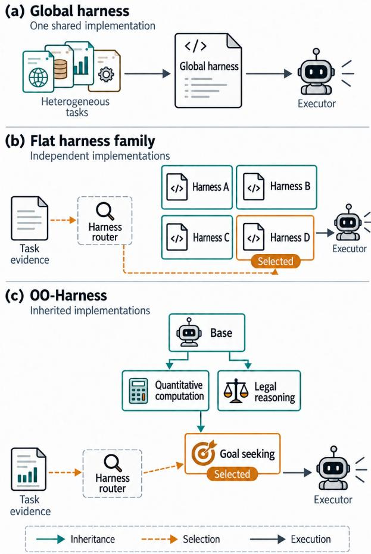  
Figure 1 | Three ways to organize harness adaptation. (a) A single global harness serves all tasks. (b) A <sub>rou</sub>t<sub>er</sub> <sub>se</sub>l<sub>ec</sub>t<sub>s</sub> <sub>among</sub> i<sub>n</sub>d<sub>epen</sub>d<sub>en</sub>t h<sub>arness</sub> i<sub>mp</sub>l<sub>emen-</sub> tations. (c) OO -Harness selects amon<sub>g</sub> s<sub>p</sub>ecialized h<sub>arnesses</sub> th<sub>a</sub>t <sub>s</sub>h<sub>are co</sub>d<sub>e</sub> th<sub>roug</sub>h i<sub>n</sub>h<sub>er</sub>it<sub>ance.</sub>

C<sub>oncurren</sub>t <sub>wor</sub>k <sub>a</sub>l<sub>so exp</sub>l<sub>ores</sub> t<sub>as</sub>k<sub>-spec</sub>ifi<sub>c</sub> h<sub>ar-</sub> ness selection. Ada<sub>p</sub>tive Auto-Harness routes tasks amon<sub>g</sub> s<sub>p</sub>ecialized Git branches (Liu et al., 2026b). In OO-Harness, inheritance shares <sub>co</sub>d<sub>e</sub> <sub>across</sub> h<sub>arnesses,</sub> <sub>an</sub>d <sub>rou</sub>ti<sub>ng</sub> l<sub>essons</sub> l<sub>earne</sub>d d<sub>ur</sub>i<sub>ng</sub> t<sub>ra</sub>i<sub>n</sub>i<sub>ng gu</sub>id<sub>e se</sub>l<sub>ec</sub>ti<sub>on a</sub>l<sub>ongs</sub>id<sub>e</sub> class descriptions and observable base trajecto-<sub>r</sub>i<sub>es.</sub>

We evaluate OO-Harness on Automation-Bench<sub>,</sub> Works<sub>p</sub>ace-Bench<sub>,</sub> and Toolathlon-GYM<sub>,</sub> <sub>w</sub>h<sub>ere</sub> it <sub>ac</sub>hi<sub>eves</sub> th<sub>e</sub> hi<sub>g</sub>h<sub>es</sub>t <sub>pr</sub>i<sub>mary score</sub> <sub>among</sub> th<sub>e</sub> <sub>compare</sub>d <sub>me</sub>th<sub>o</sub>d<sub>s.</sub>

Our contributions are:

• A h<sub>arness</sub> <sub>represen</sub>t<sub>a</sub>ti<sub>on</sub> <sub>com</sub>bi<sub>n</sub>i<sub>ng</sub> <sub>s</sub>h<sub>are</sub>d <sub>co</sub>d<sub>e an</sub>d <sub>spec</sub>i<sub>a</sub>li<sub>ze</sub>d b<sub>e</sub>h<sub>av</sub>i<sub>or</sub> th<sub>roug</sub>h i<sub>n</sub>h<sub>er-</sub> it<sub>ance, me</sub>th<sub>o</sub>d <sub>overr</sub>id<sub>es, an</sub>d <sub>new me</sub>th<sub>o</sub>d<sub>s.</sub>

• A<sub>n</sub> <sub>evo</sub>l<sub>u</sub>ti<sub>on</sub> f<sub>ramewor</sub>k th<sub>a</sub>t l<sub>earns</sub> <sub>spec</sub>i<sub>a</sub>l<sub>-</sub> i<sub>ze</sub>d h<sub>arnesses an</sub>d <sub>rou</sub>ti<sub>ng</sub> l<sub>essons</sub> f<sub>rom exe-</sub> <sub>cu</sub>ti<sub>on recor</sub>d<sub>s</sub> t<sub>o suppor</sub>t t<sub>as</sub>k<sub>-spec</sub>ifi<sub>c se</sub>l<sub>ec-</sub> ti<sub>on.</sub>

• St<sub>rong</sub> <sub>emp</sub>i<sub>r</sub>i<sub>ca</sub>l <sub>resu</sub>lt<sub>s</sub> <sub>across</sub> th<sub>ree</sub> l<sub>ong-</sub> h<sub>or</sub>i<sub>zon</sub> b<sub>enc</sub>h<sub>mar</sub>k<sub>s, w</sub>ith <sub>ex</sub>t<sub>ens</sub>i<sub>ve a</sub>bl<sub>a-</sub> ti<sub>ons va</sub>lid<sub>a</sub>ti<sub>ng</sub> i<sub>n</sub>di<sub>v</sub>id<sub>ua</sub>l <sub>componen</sub>t<sub>s.</sub>

## 2. Related Work

Self-evolving agents. Self-evolving agents use execu<sup>ti</sup>on exper<sup>i</sup>ence <sup>t</sup>o <sup>i</sup>mprove promp<sup>t</sup>s, mem-<sub>or</sub>i<sub>es,</sub> <sub>s</sub>kill<sub>s,</sub> <sub>an</sub>d <sub>o</sub>th<sub>er</sub> <sub>pers</sub>i<sub>s</sub>t<sub>en</sub>t <sub>componen</sub>t<sub>s.</sub> GEPA reflects on trajectories to optimize prompts (A<sub>g</sub>rawal et al., 2025), while Reasonin<sub>g</sub>Bank di<sub>s</sub>till<sub>s success</sub>f<sub>u</sub>l <sub>an</sub>d f<sub>a</sub>il<sub>e</sub>d <sub>exper</sub>i<sub>ences</sub> i<sub>n</sub>t<sub>o</sub> reusable memories (Ou<sub>y</sub>an<sub>g</sub> et al., 2026). A-E<sub>vo</sub>l<sub>ve</sub> <sub>cons</sub>id<sub>ers</sub> d<sub>e</sub>lib<sub>era</sub>t<sub>e</sub> <sub>up</sub>d<sub>a</sub>t<sub>es</sub> t<sub>o</sub> <sub>pers</sub>i<sub>s</sub>t<sub>en</sub>t a<sub>g</sub>ent state (Lin et al., 2026b), and HASP re<sub>p</sub>re-<sub>sen</sub>t<sub>s s</sub>kill<sub>s as execu</sub>t<sub>a</sub>bl<sub>e</sub> f<sub>unc</sub>ti<sub>ons</sub> th<sub>a</sub>t <sub>mo</sub>dif<sub>y</sub> actions or su<sub>pp</sub>l<sub>y</sub> corrective context (Liu et al., 2026a). These forms of ada<sub>p</sub>tation <sub>p</sub>rovide buildi<sub>ng</sub> bl<sub>oc</sub>k<sub>s</sub> f<sub>or</sub> h<sub>arness evo</sub>l<sub>u</sub>ti<sub>on.</sub> OO<sub>-</sub>H<sub>arness</sub> <sub>evo</sub>l<sub>ves</sub> <sub>spec</sub>i<sub>a</sub>li<sub>ze</sub>d h<sub>arnesses</sub> th<sub>roug</sub>h i<sub>n</sub>h<sub>er</sub>it<sub>ance</sub> <sub>an</sub>d <sub>uses a</sub> h<sub>arness rou</sub>t<sub>er</sub> t<sub>o se</sub>l<sub>ec</sub>t <sub>one</sub> f<sub>or eac</sub>h t<sub>as</sub>k<sub>.</sub>

Automatic harness evolution. Recent work <sub>au</sub>t<sub>oma</sub>t<sub>es</sub> h<sub>arness cons</sub>t<sub>ruc</sub>ti<sub>on an</sub>d <sub>rev</sub>i<sub>s</sub>i<sub>on</sub> th<sub>roug</sub>h <sub>co</sub>d<sub>e searc</sub>h <sub>an</sub>d <sub>execu</sub>ti<sub>on</sub> f<sub>ee</sub>db<sub>ac</sub>k<sub>,</sub> i<sub>n-</sub> cludin<sub>g</sub> Meta-Harness (Lee et al., 2026), A<sub>g</sub>entic Harness En<sub>g</sub>ineerin<sub>g</sub> (Lin et al., 2026a), and HarnessEvolve (Jian<sub>g</sub> et al., 2026). These a<sub>pp</sub>roaches <sub>pr</sub>i<sub>mar</sub>il<sub>y op</sub>ti<sub>m</sub>i<sub>ze a g</sub>l<sub>o</sub>b<sub>a</sub>l h<sub>arness across</sub> t<sub>as</sub>k<sub>s,</sub> <sub>a</sub>lth<sub>oug</sub>h <sub>c</sub>h<sub>anges</sub> th<sub>a</sub>t b<sub>ene</sub>fit <sub>one</sub> t<sub>as</sub>k <sub>group may</sub> <sub>no</sub>t b<sub>ene</sub>fit <sub>ano</sub>th<sub>er.</sub> H<sub>arness</sub>D<sub>ev</sub> b<sub>enc</sub>h<sub>mar</sub>k<sub>s</sub> h<sub>ar-</sub> ness creation and evolution (Wu et al., 2026), <sub>w</sub>hil<sub>e</sub> E<sub>vo</sub>H<sub>arness</sub>B<sub>enc</sub>h <sub>s</sub>h<sub>ows</sub> th<sub>a</sub>t <sub>expan</sub>di<sub>ng</sub> t<sub>oo</sub>l<sub>s, s</sub>kill<sub>s, an</sub>d <sub>spec</sub>i<sub>a</sub>li<sub>s</sub>t <sub>agen</sub>t<sub>s can</sub> d<sub>egra</sub>d<sub>e</sub> <sub>p</sub>reviousl<sub>y</sub> efective behavior (Ke et al., 2026). C<sub>oncurren</sub>t <sub>wor</sub>k <sub>exp</sub>l<sub>ores a</sub>d<sub>ap</sub>t<sub>a</sub>ti<sub>on across</sub> t<sub>as</sub>k<sub>s</sub> and de<sub>p</sub>lo<sub>y</sub>ments: Ada<sub>p</sub>tive Auto-Harness shares <sub>an</sub>d <sub>spec</sub>i<sub>a</sub>li<sub>zes wor</sub>k<sub>space con</sub>t<sub>en</sub>t<sub>s</sub> th<sub>roug</sub>h Git branchin<sub>g</sub> and rebasin<sub>g</sub> (Liu et al., 2026b), while E<sub>vo</sub>l<sub>ve</sub>N<sub>e</sub>t i<sub>n</sub>t<sub>egra</sub>t<sub>es a</sub>d<sub>ap</sub>t<sub>a</sub>ti<sub>ons</sub> f<sub>rom</sub> di<sub>s</sub>t<sub>r</sub>ib<sub>u</sub>t<sub>e</sub>d de<sub>p</sub>lo<sub>y</sub>ments into a <sub>g</sub>lobal harness (Nie et al., 2026). At the re<sub>p</sub>resentation level, NOOA <sub>p</sub>ro-<sub>v</sub>id<sub>es</sub> <sub>a</sub> <sub>programm</sub>i<sub>ng</sub> <sub>mo</sub>d<sub>e</sub>l th<sub>a</sub>t <sub>expresses</sub> <sub>agen</sub>t<sub>s</sub> as native P<sub>y</sub>thon objects (Fur<sub>g</sub>ale et al., 2026). OO<sub>-</sub>H<sub>arness evo</sub>l<sub>ves a</sub> hi<sub>erarc</sub>h<sub>y o</sub>f <sub>execu</sub>t<sub>a</sub>bl<sub>e</sub> h<sub>arness c</sub>l<sub>asses</sub> th<sub>roug</sub>h i<sub>n</sub>h<sub>er</sub>it<sub>ance, me</sub>th<sub>o</sub>d <sub>over-</sub> <sub>r</sub>id<sub>es, an</sub>d <sub>new me</sub>th<sub>o</sub>d<sub>s.</sub> It<sub>s</sub> h<sub>arness rou</sub>t<sub>er se</sub>l<sub>ec</sub>t<sub>s</sub> <sub>a</sub> h<sub>arness us</sub>i<sub>ng rou</sub>ti<sub>ng</sub> l<sub>essons accumu</sub>l<sub>a</sub>t<sub>e</sub>d d<sub>ur-</sub> i<sub>ng</sub> t<sub>ra</sub>i<sub>n</sub>i<sub>ng,</sub> <sub>c</sub>l<sub>ass</sub> d<sub>escr</sub>i<sub>p</sub>ti<sub>ons,</sub> th<sub>e</sub> t<sub>as</sub>k<sub>,</sub> <sub>an</sub>d <sub>an</sub> observable base trajectory.

## 3. Method

## 3.1. Problem setting and overview

A h<sub>arness</sub> i<sub>mp</sub>l<sub>emen</sub>t<sub>s</sub> th<sub>e promp</sub>t<sub>s,</sub> t<sub>oo</sub>l<sub>s, an</sub>d execution rules around an executor, the language model � that carries out tasks (Nin<sub>g</sub> et al., 2026). OO-Harness evolves this code on dis-<sub>covery</sub> t<sub>as</sub>k<sub>s w</sub>hil<sub>e</sub> k<sub>eep</sub>i<sub>ng</sub> � fi<sub>xe</sub>d<sub>,</sub> th<sub>en eva</sub>l<sub>-</sub> uates the frozen harnesses on disjoint held-out tasks (Fi<sub>g</sub>ure 2). This difers from Meta-Harness’s T<sub>erm</sub>i<sub>na</sub>lB<sub>enc</sub>h<sub>-</sub>2 di<sub>scovery exper</sub>i<sub>men</sub>t<sub>, w</sub>hi<sub>c</sub>h <sub>uses</sub> th<sub>e same</sub> t<sub>as</sub>k<sub>s</sub> f<sub>or searc</sub>h <sub>an</sub>d fi<sub>na</sub>l <sub>eva</sub>l<sub>ua-</sub> tion (Lee et al., 2026). Se<sub>p</sub>aratin<sub>g</sub> discover<sub>y</sub> from <sub>eva</sub>l<sub>ua</sub>ti<sub>on</sub> i<sub>s</sub> <sub>essen</sub>ti<sub>a</sub>l f<sub>or</sub> <sub>assess</sub>i<sub>ng</sub> <sub>genera</sub>li<sub>za</sub>ti<sub>on</sub> be<sub>y</sub>ond the search set (Wan<sub>g</sub> et al., 2026).

A harness hierarchy $\mathcal { T } _ { H }$ <sub>s</sub>t<sub>ores comp</sub>l<sub>e</sub>t<sub>e</sub> h<sub>ar-</sub> <sub>ness c</sub>l<sub>asses, s</sub>t<sub>ar</sub>ti<sub>ng</sub> f<sub>rom</sub> th<sub>e</sub> b<sub>ase</sub> $H _ { 0 }$ <sub>.</sub> E<sub>ac</sub>h <sub>c</sub>hild i<sub>n</sub>h<sub>er</sub>it<sub>s</sub> it<sub>s paren</sub>t’<sub>s me</sub>th<sub>o</sub>d<sub>s an</sub>d <sub>can overr</sub>id<sub>e ex-</sub> isting methods or add new ones. Task clusters C <sub>g</sub>rou<sub>p</sub> discover<sub>y</sub> tasks with related execution <sub>nee</sub>d<sub>s.</sub> F<sub>or c</sub>l<sub>us</sub>t<sub>er</sub> $c ,$ l<sub>e</sub>t $\mathcal { D } _ { c }$ d<sub>eno</sub>t<sub>e</sub> it<sub>s</sub> di<sub>scov-</sub> <sub>ery</sub> t<sub>as</sub>k<sub>s</sub> <sub>an</sub>d $H _ { c }$ th<sub>e</sub> h<sub>arness</sub> <sub>curren</sub>tl<sub>y</sub> <sub>c</sub>h<sub>osen</sub> f<sub>or</sub> th<sub>a</sub>t <sub>c</sub>l<sub>us</sub>t<sub>er.</sub> Cl<sub>us</sub>t<sub>ers organ</sub>i<sub>ze</sub> t<sub>as</sub>k <sub>ev</sub>id<sub>ence;</sub> th<sub>e</sub> hi<sub>erarc</sub>h<sub>y organ</sub>i<sub>zes reusa</sub>bl<sub>e</sub> h<sub>arness co</sub>d<sub>e.</sub> The evolution agent � constructs candidate sub-<sub>c</sub>l<sub>asses</sub> f<sub>rom</sub> di<sub>scovery-</sub>t<sub>as</sub>k <sub>ev</sub>id<sub>ence, w</sub>hil<sub>e</sub> th<sub>e</sub> harness router � selects the base or a specialized harness (Fi<sub>g</sub>ure 3). A.1,A.4 describe model-<sub>p</sub>r<sub>o</sub>m<sub>p</sub>t<sub>s</sub>/im<sub>p</sub>l<sub>e</sub>m<sub>e</sub>nt<sub>a</sub>ti<sub>o</sub>n d<sub>e</sub>t<sub>a</sub>il<sub>s;</sub> T<sub>a</sub>bl<sub>e</sub> 2 <sub>co</sub>mpa<sup>r</sup>es <sup>r</sup>ou<sup>tin</sup>g <sup>in</sup>pu<sup>t</sup>s.

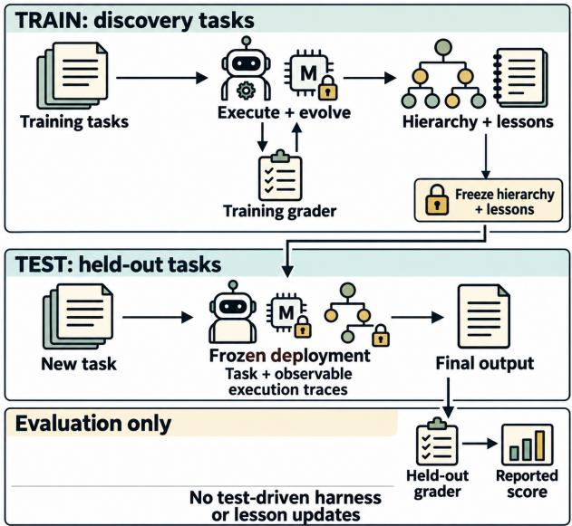  
Figure 2 | Problem setting. We use a train/test split: h<sub>arnesses evo</sub>l<sub>ve on</sub> di<sub>scovery</sub> t<sub>as</sub>k<sub>s an</sub>d <sub>are eva</sub>l<sub>ua</sub>t<sub>e</sub>d on disjoint held-out tasks.

Execution records E store candidate code, discovery-task trajectories, outcomes, and reflecti<sub>ons</sub> f<sub>rom</sub> <sub>success</sub>f<sub>u</sub>l <sub>an</sub>d <sub>unsuccess</sub>f<sub>u</sub>l <sub>proposa</sub>l<sub>s.</sub> Wh<sub>ere</sub> l<sub>esson s</sub>t<sub>ores are ena</sub>bl<sub>e</sub>d<sub>, we summar</sub>i<sub>ze</sub> these records into design lessons $\mathcal { L } _ { \pi }$ f<sub>or co</sub>d<sub>e rev</sub>i<sub>-</sub> sion and routing lessons $\mathcal { L } _ { \rho }$ f<sub>or</sub> h<sub>arness se</sub>l<sub>ec</sub>ti<sub>on.</sub> D<sub>es</sub>i<sub>gn</sub> l<sub>essons</sub> d<sub>escr</sub>ib<sub>e</sub> <sub>use</sub>f<sub>u</sub>l <sub>c</sub>h<sub>anges</sub> <sub>an</sub>d f<sub>a</sub>il<sub>e</sub>d <sub>approac</sub>h<sub>es; rou</sub>ti<sub>ng</sub> l<sub>essons</sub> d<sub>escr</sub>ib<sub>e w</sub>h<sub>en a</sub> h<sub>ar-</sub> <sub>ness app</sub>li<sub>es.</sub> B<sub>o</sub>th <sub>accumu</sub>l<sub>a</sub>t<sub>e</sub> d<sub>ur</sub>i<sub>ng</sub> di<sub>scovery</sub> <sub>an</sub>d <sub>rema</sub>i<sub>n</sub> f<sub>rozen</sub> <sub>a</sub>t d<sub>ep</sub>l<sub>oymen</sub>t<sub>.</sub> Th<sub>e</sub> <sub>rou</sub>t<sub>er</sub>’<sub>s</sub> <sub>mo</sub>d<sub>e</sub>l <sub>we</sub>i<sub>g</sub>ht<sub>s s</sub>t<sub>ay</sub> fi<sub>xe</sub>d<sub>;</sub> t<sub>ra</sub>i<sub>n</sub>i<sub>ng c</sub>h<sub>anges</sub> th<sub>e</sub> <sub>ev</sub>id<sub>ence</sub> th<sub>a</sub>t <sub>gu</sub>id<sub>es</sub> it<sub>s</sub> d<sub>ec</sub>i<sub>s</sub>i<sub>ons.</sub>

## 3.2. Representing the harness hierarchy

Interfaces and inheritance. Harness evoluti<sub>on opera</sub>t<sub>es on execu</sub>t<sub>a</sub>bl<sub>e c</sub>l<sub>ass</sub> d<sub>e</sub>fi<sub>n</sub>iti<sub>ons an</sub>d su<sub>pp</sub>ortin<sub>g</sub> source files. The a<sub>g</sub>ent can chan<sub>g</sub>e p<sup>r</sup>o<sup>m</sup>p<sup>t</sup>s, <sup>t</sup>oo<sup>l</sup>s, co<sup>nt</sup>e<sup>xt</sup> <sup>m</sup>a<sup>n</sup>age<sup>m</sup>e<sup>nt</sup>, a<sup>nd</sup> e<sup>x</sup>ecu<sup>-</sup> ti<sub>on con</sub>t<sub>ro</sub>l<sub>, an</sub>d i<sub>n</sub>t<sub>ro</sub>d<sub>uce a</sub>dditi<sub>ona</sub>l <sub>me</sub>th<sub>o</sub>d<sub>s.</sub> Wh<sub>ere</sub> <sub>suppor</sub>t<sub>e</sub>d b<sub>y</sub> th<sub>e</sub> <sub>sca</sub>f<sub>o</sub>ld<sub>,</sub> it <sub>can</sub> <sub>a</sub>l<sub>so</sub> <sub>con-</sub> fi<sub>gure</sub> <sub>m</sub>iddl<sub>eware,</sub> fil<sub>e</sub> b<sub>ac</sub>k<sub>en</sub>d<sub>s,</sub> <sub>an</sub>d <sub>su</sub>b<sub>agen</sub>t<sub>s.</sub> Th<sub>e resu</sub>lti<sub>ng c</sub>l<sub>ass mus</sub>t <sub>rema</sub>i<sub>n compa</sub>tibl<sub>e w</sub>ith th<sub>e sca</sub>f<sub>o</sub>ld’<sub>s execu</sub>ti<sub>on</sub> i<sub>n</sub>t<sub>er</sub>f<sub>ace.</sub>

A <sub>su</sub>b<sub>c</sub>l<sub>ass reuses</sub> i<sub>n</sub>h<sub>er</sub>it<sub>e</sub>d <sub>me</sub>th<sub>o</sub>d<sub>s an</sub>d <sub>over-</sub> <sub>r</sub>id<sub>es or a</sub>dd<sub>s me</sub>th<sub>o</sub>d<sub>s</sub> f<sub>or a</sub> t<sub>arge</sub>t<sub>e</sub>d <sub>c</sub>h<sub>ange.</sub> <sup>O</sup>verr<sup>id</sup>es can ca<sup>ll</sup> parent met<sup>h</sup>o<sup>d</sup>s t<sup>h</sup>roug<sup>h</sup> super (). Figure 1 illustrates the hierarchy; Listing 1 <sub>s</sub>h<sub>ows</sub> i<sub>n</sub>h<sub>er</sub>it<sub>ance</sub> i<sub>n</sub> <sub>a</sub> <sub>save</sub>d h<sub>arness</sub> li<sub>neage.</sub>

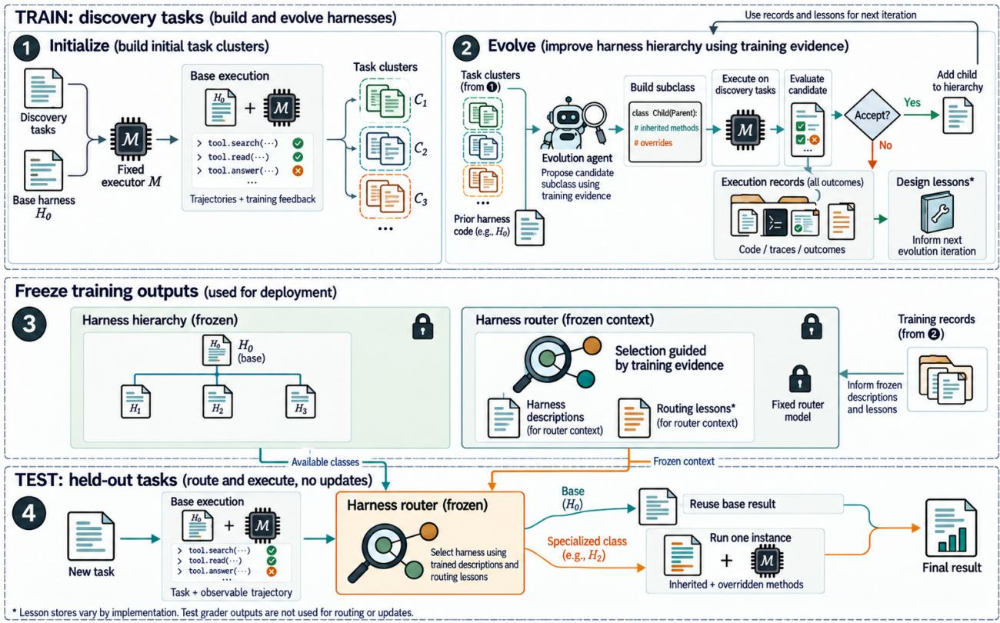  
Figure 3 | OO-Harness training and test-time execution. (1) Base execution records initialize task clusters. (2) The evolution agent builds and evaluates subclasses, updating lessons from execution feedback. (3) The resulting harness hierarchy, harness descriptions, and routing lessons are frozen for testing. (4) The harness router uses the task, observable base trajectory, and frozen routing lessons to select a specialized harness or <sub>reuse</sub> th<sub>e</sub> b<sub>ase resu</sub>lt<sub>.</sub>

Execution within one instance. The harness <sub>rou</sub>t<sub>er</sub> <sub>se</sub>l<sub>ec</sub>t<sub>s</sub> <sub>a</sub> <sub>comp</sub>l<sub>e</sub>t<sub>e</sub> <sub>c</sub>l<sub>ass</sub> <sub>w</sub>h<sub>ose</sub> <sub>me</sub>th<sub>o</sub>d<sub>s</sub> <sub>execu</sub>t<sub>e</sub> <sub>w</sub>ithi<sub>n</sub> <sub>one</sub> i<sub>ns</sub>t<sub>ance;</sub> <sub>ances</sub>t<sub>ors</sub> <sub>are</sub> <sub>no</sub>t <sub>separa</sub>t<sub>e agen</sub>t <sub>runs.</sub> M<sub>e</sub>th<sub>o</sub>d<sub>s can con</sub>diti<sub>on</sub> th<sub>e</sub>i<sub>r</sub> b<sub>e</sub>h<sub>av</sub>i<sub>or on run</sub>ti<sub>me ev</sub>id<sub>ence, suc</sub>h <sub>as repea</sub>t<sub>e</sub>d t<sub>oo</sub>l <sub>errors or un</sub>fi<sub>n</sub>i<sub>s</sub>h<sub>e</sub>d <sub>ou</sub>t<sub>pu</sub>t <sub>ar</sub>tif<sub>ac</sub>t<sub>s.</sub>

## 3.3. Training initialization

W<sub>e</sub> fi<sub>rs</sub>t <sub>run</sub> $H _ { 0 }$ <sub>on</sub> di<sub>scovery</sub> t<sub>as</sub>k<sub>s</sub> ${ \mathcal { D } } _ { \mathrm { t r } }$ <sub>an</sub>d <sub>re-</sub> tain trajectories and evaluation feedback. We <sub>group</sub> t<sub>as</sub>k<sub>s</sub> <sub>w</sub>h<sub>ose</sub> b<sub>ase</sub> <sub>execu</sub>ti<sub>ons</sub> <sub>sugges</sub>t th<sub>a</sub>t th<sub>ey may</sub> b<sub>ene</sub>fit f<sub>rom a s</sub>h<sub>are</sub>d h<sub>arness c</sub>h<sub>ange,</sub> <sub>y</sub>i<sub>e</sub>ldi<sub>ng</sub> <sub>c</sub>l<sub>us</sub>t<sub>ers</sub> $c$ <sub>an</sub>d t<sub>as</sub>k <sub>se</sub>t<sub>s</sub> $\mathcal { D } _ { c }$ <sub>.</sub> E<sub>ac</sub>h <sub>c</sub>l<sub>us</sub>t<sub>er</sub> <sub>recor</sub>d<sub>s</sub> it<sub>s s</sub>h<sub>are</sub>d <sub>execu</sub>ti<sub>on nee</sub>d<sub>s an</sub>d <sub>s</sub>t<sub>ar</sub>t<sub>s w</sub>ith $H _ { c } = H _ { 0 } ;$ th<sub>e</sub> i<sub>n</sub>iti<sub>a</sub>l hi<sub>erarc</sub>h<sub>y</sub> i<sub>s</sub> $\mathcal { T } _ { H } = \{ H _ { 0 } \}$

## 3.4. Training iteration

At <sub>eac</sub>h it<sub>era</sub>ti<sub>on,</sub> th<sub>e evo</sub>l<sub>u</sub>ti<sub>on agen</sub>t <sub>wor</sub>k<sub>s</sub> i<sub>n a</sub> <sub>co</sub>d<sub>e wor</sub>k<sub>space w</sub>ith fil<sub>esys</sub>t<sub>em access</sub> t<sub>o</sub> h<sub>arness</sub> <sub>source,</sub> t<sub>as</sub>k <sub>c</sub>l<sub>us</sub>t<sub>ers, an</sub>d <sub>execu</sub>ti<sub>on recor</sub>d<sub>s.</sub> It <sub>can</sub> i<sub>nspec</sub>t fil<sub>es,</sub> d<sub>e</sub>l<sub>ega</sub>t<sub>e</sub> <sub>ana</sub>l<sub>ys</sub>i<sub>s</sub> t<sub>o</sub> <sub>su</sub>b<sub>agen</sub>t<sub>s,</sub> <sub>an</sub>d <sub>wr</sub>it<sub>e or e</sub>dit <sub>can</sub>did<sub>a</sub>t<sub>e co</sub>d<sub>e.</sub> It <sub>se</sub>l<sub>ec</sub>t<sub>s a</sub> t<sub>ar-</sub> <sub>ge</sub>t <sub>c</sub>l<sub>us</sub>t<sub>er an</sub>d <sub>paren</sub>t <sub>c</sub>l<sub>ass, s</sub>t<sub>a</sub>t<sub>es</sub> th<sub>e</sub> i<sub>n</sub>t<sub>en</sub>d<sub>e</sub>d <sub>c</sub>h<sub>ange, an</sub>d i<sub>mp</sub>l<sub>emen</sub>t<sub>s an execu</sub>t<sub>a</sub>bl<sub>e su</sub>b<sub>c</sub>l<sub>ass.</sub> S<sub>uccess</sub>f<sub>u</sub>l <sub>an</sub>d <sub>unsuccess</sub>f<sub>u</sub>l <sub>proposa</sub>l<sub>s</sub> <sub>rema</sub>i<sub>n</sub> <sub>ava</sub>il<sub>a</sub>bl<sub>e</sub> f<sub>or</sub> l<sub>a</sub>t<sub>er</sub> i<sub>nspec</sub>ti<sub>on.</sub>

W<sub>e execu</sub>t<sub>e</sub> th<sub>e can</sub>did<sub>a</sub>t<sub>e</sub> $H ^ { \prime }$ on $\mathcal { D } _ { c }$ <sub>w</sub>ith th<sub>e</sub> fi<sub>xe</sub>d <sub>mo</sub>d<sub>e</sub>l �<sub>.</sub> L<sub>e</sub>t $S _ { c } ( H ^ { \prime } )$ d<sub>eno</sub>t<sub>e</sub> it<sub>s c</sub>l<sub>us</sub>t<sub>er score</sub> <sub>an</sub>d �<sup>current</sup> th<sub>e</sub> <sub>s</sub>t<sub>ore</sub>d <sub>score</sub> <sub>un</sub>d<sub>er</sub> <sub>curren</sub>t h<sub>arness</sub> <sub>ass</sub>i<sub>gnmen</sub>t<sub>s.</sub> Th<sub>e</sub> <sub>can</sub>did<sub>a</sub>t<sub>e</sub>’<sub>s</sub> <sub>source</sub> <sub>paren</sub>t <sub>nee</sub>d <sub>no</sub>t b<sub>e</sub> $H _ { c } .$ E<sub>va</sub>l<sub>ua</sub>ti<sub>on</sub> <sub>runs</sub> di<sub>rec</sub>tl<sub>y</sub> <sub>on</sub> th<sub>e</sub> t<sub>arge</sub>t cluster without routing, avoiding rerunning the full discovery set for every candidate.

We accept $H ^ { \prime }$ <sub>w</sub>h<sub>en</sub> $\begin{array} { l l l } { S _ { c } ( H ^ { \prime } ) } & { > } & { S _ { c } ^ { \mathrm { c u r r e n t } } } \end{array}$ <sub>an</sub>d b<sub>enc</sub>h<sub>mar</sub>k<sub>-spec</sub>ifi<sub>c accep</sub>t<sub>ance c</sub>h<sub>ec</sub>k<sub>s pass; o</sub>th<sub>-</sub> erwise, we reject it. These checks consider taskl<sub>eve</sub>l <sub>ou</sub>t<sub>comes an</sub>d <sub>execu</sub>ti<sub>on</sub> f<sub>ee</sub>db<sub>ac</sub>k<sub>, w</sub>ith <sub>a</sub> judging agent for ambiguous cases where config-<sub>ure</sub>d<sub>.</sub> A<sub>ccep</sub>t<sub>e</sub>d <sub>c</sub>l<sub>asses en</sub>t<sub>er</sub> $\mathcal { T } _ { H }$ <sub>an</sub>d <sub>can</sub> b<sub>ecome</sub> th<sub>e c</sub>l<sub>us</sub>t<sub>er</sub>’<sub>s se</sub>l<sub>ec</sub>t<sub>e</sub>d h<sub>arness</sub> $H _ { c }$ <sub>.</sub> All <sub>ou</sub>t<sub>comes</sub> <sub>gu</sub>id<sub>e</sub> l<sub>a</sub>t<sub>er</sub> <sub>rev</sub>i<sub>s</sub>i<sub>ons</sub> <sub>an</sub>d l<sub>esson</sub> <sub>up</sub>d<sub>a</sub>t<sub>es.</sub> I<sub>mprove-</sub> <sub>men</sub>t i<sub>s requ</sub>i<sub>re</sub>d <sub>on</sub> th<sub>e</sub> t<sub>arge</sub>t <sub>c</sub>l<sub>us</sub>t<sub>er, no</sub>t <sub>a</sub>ll t<sub>as</sub>k<sub>s.</sub> A <sub>paren</sub>t <sub>rema</sub>i<sub>ns reusa</sub>bl<sub>e</sub> th<sub>roug</sub>h i<sub>n</sub>h<sub>er</sub>it<sub>ance</sub> <sub>an</sub>d<sub>,</sub> if <sub>ac</sub>ti<sub>ve, can s</sub>till b<sub>e se</sub>l<sub>ec</sub>t<sub>e</sub>d <sub>separa</sub>t<sub>e</sub>l<sub>y</sub> f<sub>rom</sub> it<sub>s spec</sub>i<sub>a</sub>li<sub>ze</sub>d <sub>c</sub>hild<sub>ren.</sub>

Algorithm 1 Harness evolution on discovery tasks   
1: Input: $H _ { 0 }$ <sub>,</sub> fi<sub>xe</sub>d $M ,$ <sub>,</sub> t<sub>as</sub>k<sub>s</sub> $\mathcal { D } _ { \mathrm { t r } }$ <sub>,</sub> b<sub>u</sub>d<sub>ge</sub>t �   
2<sub>:</sub> Run $H _ { 0 }$ on $\mathcal { D } _ { \mathrm { t r } } ;$ <sub>s</sub>t<sub>ore execu</sub>ti<sub>on recor</sub>d<sub>s</sub>   
3<sub>:</sub> Cl<sub>us</sub>t<sub>er</sub> t<sub>as</sub>k<sub>s</sub> f<sub>rom</sub> th<sub>ese recor</sub>d<sub>s</sub> i<sub>n</sub>t<sub>o</sub> $\{ \mathcal { D } _ { c } \}$   
4<sub>:</sub> I<sub>n</sub>iti<sub>a</sub>li<sub>ze</sub> $\mathcal { T } _ { H }$ <sub>an</sub>d $H _ { c } \gets H _ { 0 }$   
5: for $i = 1 , \dots , T$ do   
Review clusters; adjust task assignments if   
<sub>nee</sub>d<sub>e</sub>d   
7: <sub>� c</sub>h<sub>ooses a c</sub>l<sub>us</sub>t<sub>er � an</sub>d <sub>paren</sub>t i<sub>n</sub> $\mathcal { T } _ { H }$   
8: B<sub>u</sub>ild <sub>su</sub>b<sub>c</sub>l<sub>ass</sub> $H ^ { \prime } ;$ <sub>overr</sub>id<sub>e or a</sub>dd <sub>me</sub>th<sub>o</sub>d<sub>s</sub>   
9: Run $H ^ { \prime }$ on $\mathcal { D } _ { c } ;$ <sub>co</sub>ll<sub>ec</sub>t <sub>scores an</sub>d f<sub>ee</sub>db<sub>ac</sub>k   
10: <sup>C</sup>o<sup>m</sup>pa<sup>r</sup>e <sup>t</sup>as<sup>k</sup> ou<sup>t</sup>co<sup>m</sup>es; app<sup>l</sup>y accep<sup>t</sup>a<sup>n</sup>ce   
<sub>c</sub>h<sub>ec</sub>k<sub>s</sub>   
11: Retain acce<sub>p</sub>ted $H ^ { \prime } ;$ u<sub>p</sub><sup>d</sup>ate $H _ { c }$ if <sub>pre</sub>f<sub>erre</sub>d   
12: U<sub>p</sub>d<sub>a</sub>t<sub>e</sub> <sub>c</sub>l<sub>us</sub>t<sub>er</sub> <sub>pr</sub>i<sub>or</sub>it<sub>y</sub> f<sub>rom</sub> <sub>accep</sub>t<sub>ance</sub> hi<sub>s-</sub>   
<sup>t</sup>o<sup>r</sup>y   
13<sub>:</sub> St<sub>ore ou</sub>t<sub>comes;</sub> di<sub>s</sub>till <sub>ena</sub>bl<sub>e</sub>d l<sub>essons</sub>   
14: end for   
15: Output: freeze $\mathcal { T } _ { H } .$ , {� }, records, lessons

Repeated rejections lower a cluster’s search pri-<sub>or</sub>it<sub>y, a</sub>ll<sub>ow</sub>i<sub>ng evo</sub>l<sub>u</sub>ti<sub>on</sub> t<sub>o exp</sub>l<sub>ore o</sub>th<sub>er</sub> t<sub>as</sub>k <sub>groups.</sub> Cl<sub>us</sub>t<sub>er ass</sub>i<sub>gnmen</sub>t<sub>s are a</sub>l<sub>so re-exam</sub>i<sub>ne</sub>d <sub>a</sub>t <sub>eac</sub>h it<sub>era</sub>ti<sub>on: execu</sub>ti<sub>on</sub> f<sub>ee</sub>db<sub>ac</sub>k <sub>can mo</sub>ti<sub>-</sub> <sub>va</sub>t<sub>e</sub> <sub>reass</sub>i<sub>gn</sub>i<sub>ng</sub> t<sub>as</sub>k<sub>s</sub> <sub>or</sub> <sub>sp</sub>litti<sub>ng</sub> <sub>or</sub> <sub>merg</sub>i<sub>ng</sub> <sub>c</sub>l<sub>us-</sub> t<sub>ers,</sub> i<sub>nc</sub>l<sub>u</sub>di<sub>ng w</sub>h<sub>en repea</sub>t<sub>e</sub>d h<sub>arness rev</sub>i<sub>s</sub>i<sub>ons</sub> f<sub>a</sub>il t<sub>o</sub> i<sub>mprove a group.</sub> Al<sub>gor</sub>ith<sub>m</sub> 1 <sub>summar</sub>i<sub>zes</sub> <sub>evo</sub>l<sub>u</sub>ti<sub>on;</sub> A<sub>ppen</sub>di<sub>x</sub> A<sub>.</sub>4 <sub>g</sub>i<sub>ves</sub> i<sub>mp</sub>l<sub>emen</sub>t<sub>a</sub>ti<sub>on</sub> d<sub>e</sub>t<sub>a</sub>il<sub>s.</sub>

## 3.5. Test-time selection and execution

F<sub>o</sub>r <sub>a</sub> n<sub>e</sub>w t<sub>as</sub>k $t ,$ th<sub>e</sub> h<sub>arness rou</sub>t<sub>er o</sub>b<sub>serves</sub> th<sub>e</sub> base trajectory $\omega ( t )$ <sub>an</sub>d <sub>se</sub>l<sub>ec</sub>t<sub>s</sub>

$$
H ^ { \star } = \rho \big ( t , \omega ( t ) , \{ H _ { 0 } \} \cup \{ H _ { c } \} _ { c \in C } , \mathcal { L } _ { \rho } \big ) .
$$

It <sub>uses c</sub>l<sub>ass</sub> d<sub>escr</sub>i<sub>p</sub>ti<sub>ons, app</sub>li<sub>ca</sub>bilit<sub>y con</sub>diti<sub>ons,</sub> <sub>an</sub>d f<sub>rozen rou</sub>ti<sub>ng</sub> l<sub>essons.</sub> If $H ^ { \star } = H _ { 0 }$ , we reuse th<sub>e</sub> b<sub>ase</sub> <sub>resu</sub>lt<sub>.</sub> Oth<sub>erw</sub>i<sub>se,</sub> <sub>we</sub> <sub>execu</sub>t<sub>e</sub> <sub>one</sub> i<sub>n-</sub> <sub>s</sub>t<sub>ance o</sub>f $H ^ { \star }$ <sub>w</sub>ith it<sub>s</sub> i<sub>n</sub>h<sub>er</sub>it<sub>e</sub>d <sub>an</sub>d <sub>spec</sub>i<sub>a</sub>li<sub>ze</sub>d b<sub>e</sub>h<sub>av</sub>i<sub>or.</sub> Th<sub>e</sub> hi<sub>erarc</sub>h<sub>y</sub> <sub>an</sub>d <sub>s</sub>t<sub>ore</sub>d <sub>ev</sub>id<sub>ence</sub> <sub>re-</sub> <sub>ma</sub>i<sub>n</sub> fi<sub>xe</sub>d <sub>across a</sub>ll h<sub>e</sub>ld<sub>-ou</sub>t t<sub>as</sub>k<sub>s.</sub> G<sub>ra</sub>d<sub>er</sub> f<sub>ee</sub>d<sub>-</sub> b<sub>ac</sub>k <sub>suppor</sub>t<sub>s</sub> <sub>evo</sub>l<sub>u</sub>ti<sub>on</sub> <sub>on</sub> t<sub>ra</sub>i<sub>n</sub>i<sub>ng</sub> t<sub>as</sub>k<sub>s</sub> <sub>on</sub>l<sub>y.</sub>

At t<sub>es</sub>t ti<sub>me,</sub> <sub>gra</sub>d<sub>er</sub> <sub>scores,</sub> <sub>ver</sub>di<sub>c</sub>t<sub>s,</sub> <sub>an</sub>d hidd<sub>en</sub> <sub>re</sub>f<sub>erence answers are unava</sub>il<sub>a</sub>bl<sub>e</sub> t<sub>o</sub> th<sub>e rou</sub>t<sub>er</sub> or executor.

## 4. Experiments

## 4.1. Evaluation setup

Benchmarks and metrics. We evaluate on AutomationBench (She<sub>p</sub>ard and Salimans, 2026) for business workflows (300 discover<sub>y</sub> and 300 held-out tasks), Works<sub>p</sub>ace-Bench (Tan<sub>g</sub> et al., 2026) for work across files and a<sub>pp</sub>lications (288 discover<sub>y</sub> and 100 held-out tasks, Lite-100), and Toolathlon-GYM (Zhan<sub>g</sub> et al., 2026) for multitool task com<sub>p</sub>letion (251 discover<sub>y</sub> and 252 heldout tasks). AutomationBench and Toolathlon-GYM <sub>use</sub> d<sub>e</sub>t<sub>erm</sub>i<sub>n</sub>i<sub>s</sub>ti<sub>c gra</sub>d<sub>ers</sub> t<sub>o assess</sub> t<sub>as</sub>k com<sub>p</sub>letion<sub>;</sub> Works<sub>p</sub>ace-Bench evaluates out<sub>p</sub>uts <sub>aga</sub>i<sub>ns</sub>t t<sub>as</sub>k<sub>-spec</sub>ifi<sub>c ru</sub>b<sub>r</sub>i<sub>cs.</sub>

We re<sub>p</sub>ort Mean and strict task success (PASS) f<sub>or</sub> <sub>a</sub>ll th<sub>ree</sub> b<sub>enc</sub>h<sub>mar</sub>k<sub>s.</sub> M<sub>ean</sub> d<sub>eno</sub>t<sub>es</sub> <sub>mean</sub> <sub>par-</sub> ti<sub>a</sub>l <sub>cre</sub>dit <sub>on</sub> A<sub>u</sub>t<sub>oma</sub>ti<sub>on</sub>B<sub>enc</sub>h<sub>, m</sub>i<sub>cro-average</sub>d <sub>ru</sub>b<sub>r</sub>i<sub>c</sub> <sub>pass</sub> <sub>ra</sub>t<sub>e</sub> <sub>on</sub> W<sub>or</sub>k<sub>space-</sub>B<sub>enc</sub>h<sub>,</sub> <sub>an</sub>d <sub>mean</sub> reward on Toolathlon-GYM. PASS re<sub>q</sub>uires reward at least 0<sub>.</sub>999 on AutomationBench and T<sub>oo</sub>l<sub>a</sub>thl<sub>on-</sub>GYM<sub>, or a</sub>ll <sub>ru</sub>b<sub>r</sub>i<sub>cs sa</sub>ti<sub>s</sub>fi<sub>e</sub>d <sub>on</sub> Works<sub>p</sub>ace-Bench. The <sub>p</sub>rimar<sub>y</sub> metric is Mean f<sub>or</sub> A<sub>u</sub>t<sub>oma</sub>ti<sub>on</sub>B<sub>enc</sub>h <sub>an</sub>d W<sub>or</sub>k<sub>space-</sub>B<sub>enc</sub>h<sub>, an</sub>d PASS for Toolathlon-GYM. All scores are re<sub>p</sub>orted as pe<sup>r</sup>ce<sup>nt</sup>ages.

Comparators. We compare with the unevolved <sub>b</sub>a<sub>se</sub> h<sub>arness; g</sub>l<sub>o</sub>b<sub>a</sub>l h<sub>arness op</sub>ti<sub>m</sub>i<sub>za</sub>ti<sub>on us</sub>i<sub>ng</sub> Meta-Harness (Lee et al., 2026) and A<sub>g</sub>entic Harness En<sub>g</sub>ineerin<sub>g</sub> (AHE; Lin et al., 2026a); <sub>an</sub>d <sub>spec</sub>i<sub>a</sub>li<sub>ze</sub>d h<sub>arnesses us</sub>i<sub>ng</sub> Ad<sub>ap</sub>ti<sub>ve</sub> A<sub>u</sub>t<sub>o-</sub> Harness (AAH; Liu et al., 2026b). Our AHE <sub>a</sub>d<sub>ap</sub>t<sub>a</sub>ti<sub>on</sub> it<sub>era</sub>ti<sub>ve</sub>l<sub>y e</sub>dit<sub>s a g</sub>l<sub>o</sub>b<sub>a</sub>l h<sub>arness</sub> f<sub>rom</sub> <sub>a</sub> f<sub>ramewor</sub>k<sub>-on</sub>l<sub>y</sub> b<sub>un</sub>dl<sub>e.</sub> Si<sub>nce</sub> OO<sub>-</sub>H<sub>arness</sub> uses a base trajectory for routing, we also com-<sub>pare w</sub>ith t<sub>es</sub>t<sub>-</sub>ti<sub>me sca</sub>li<sub>ng o</sub>f th<sub>e</sub> b<sub>ase</sub> h<sub>arness</sub> t<sub>o assess ga</sub>i<sub>ns</sub> f<sub>rom a</sub>dditi<sub>ona</sub>l i<sub>n</sub>f<sub>erence.</sub> I<sub>n-</sub> s<sub>p</sub>ired b<sub>y</sub> Wan<sub>g</sub> et al. (2026), we evaluate <sub>p</sub>arallel best-of-� selection (� ∈ {2<sub>,</sub> 5}) and se<sub>q</sub>uential <sub>se</sub>lf<sub>-re</sub>fi<sub>nemen</sub>t $( K = 2 ;$ Madaan et al., 2023). Both methods use observable trajectories without <sub>gra</sub>d<sub>er</sub> f<sub>ee</sub>db<sub>ac</sub>k<sub>.</sub>

Evaluation and reporting. All methods use the same gemini-3.5-flash executor an<sup>d f</sup>o<sup>ll</sup>ow <sub>eac</sub>h b<sub>enc</sub>h<sub>mar</sub>k’<sub>s na</sub>ti<sub>ve execu</sub>ti<sub>on pro</sub>t<sub>oco</sub>l<sub>.</sub> W<sub>e</sub> fi<sub>x</sub> th<sub>e</sub> <sub>evo</sub>l<sub>u</sub>ti<sub>on</sub> <sub>agen</sub>t t<sub>o</sub> Cl<sub>au</sub>d<sub>e</sub> O<sub>pus</sub> 4<sub>.</sub>8 <sub>across</sub> h<sub>arness op</sub>ti<sub>m</sub>i<sub>za</sub>ti<sub>on me</sub>th<sub>o</sub>d<sub>s</sub> f<sub>or up</sub> t<sub>o</sub> 40 it<sub>era-</sub> tions and use the same model for test-time traject<sub>ory</sub> <sub>se</sub>l<sub>ec</sub>ti<sub>on</sub> <sub>or</sub> <sub>gu</sub>id<sub>ance</sub> <sub>w</sub>h<sub>ere</sub> <sub>requ</sub>i<sub>re</sub>d<sub>.</sub> Th<sub>e</sub> OO-Harness harness router uses Claude Sonnet 5 (A<sub>pp</sub>endix A.4.2). Harnesses and lessons <sub>rema</sub>i<sub>n</sub> f<sub>rozen</sub> d<sub>ur</sub>i<sub>ng</sub> h<sub>e</sub>ld<sub>-ou</sub>t <sub>eva</sub>l<sub>ua</sub>ti<sub>on, an</sub>d <sub>gra</sub>d<sub>er ou</sub>t<sub>pu</sub>t<sub>s are use</sub>d <sub>on</sub>l<sub>y</sub> f<sub>or</sub> fi<sub>na</sub>l <sub>scor</sub>i<sub>ng</sub> (§3.5). For the main com<sub>p</sub>arison, we <sub>p</sub>erform th<sub>ree</sub> i<sub>n</sub>d<sub>epen</sub>d<sub>en</sub>t <sub>execu</sub>t<sub>or</sub> <sub>runs</sub> <sub>per</sub> <sub>me</sub>th<sub>o</sub>d <sub>an</sub>d benchmark and re<sub>p</sub>ort mean ± standard deviation. Steps is the mean number of steps in the finally selected trajectory, excluding other roll-<sub>ou</sub>t<sub>s an</sub>d <sub>aux</sub>ili<sub>ary se</sub>l<sub>ec</sub>ti<sub>on ca</sub>ll<sub>s.</sub>

## 4.2. Main results

Strong empirical results. OO -Harness <sub>ac</sub>hi<sub>eves</sub> th<sub>e</sub> hi<sub>g</sub>h<sub>es</sub>t <sub>pr</sub>i<sub>mary score on a</sub>ll th<sub>ree</sub> benchmarks (Table 1), out<sub>p</sub>erformin<sub>g p</sub>rior <sub>g</sub>lobal h<sub>arness</sub> <sub>op</sub>ti<sub>m</sub>i<sub>za</sub>ti<sub>on</sub> <sub>approac</sub>h<sub>es</sub> <sub>an</sub>d AAH’<sub>s</sub> <sub>spec</sub>i<sub>a</sub>li<sub>ze</sub>d h<sub>arnesses.</sub> Th<sub>ese resu</sub>lt<sub>s suppor</sub>t th<sub>e</sub> expressiveness of object-oriented programming <sub>as a na</sub>t<sub>ura</sub>l fit f<sub>or co</sub>d<sub>e-</sub>b<sub>ase</sub>d h<sub>arness evo</sub>l<sub>u</sub>ti<sub>on:</sub> i<sub>n</sub>h<sub>er</sub>it<sub>ance s</sub>h<sub>ares use</sub>f<sub>u</sub>l b<sub>e</sub>h<sub>av</sub>i<sub>or, w</sub>hil<sub>e me</sub>th<sub>o</sub>d <sub>overr</sub>id<sub>es an</sub>d <sub>a</sub>dditi<sub>ons spec</sub>i<sub>a</sub>li<sub>ze</sub> it f<sub>or</sub> dif<sub>eren</sub>t tasks. On AutomationBench<sub>,</sub> OO-Harness also has the lowest mean trajectory step count among <sub>a</sub>ll <sub>compare</sub>d <sub>me</sub>th<sub>o</sub>d<sub>s.</sub> T<sub>a</sub>bl<sub>e</sub> 1 <sub>a</sub>l<sub>so</sub> <sub>s</sub>h<sub>ows</sub> th<sub>a</sub>t t<sub>es</sub>t<sub>-</sub>ti<sub>me sca</sub>li<sub>ng w</sub>ith <sub>para</sub>ll<sub>e</sub>l b<sub>es</sub>t<sub>-o</sub>f<sub>-</sub>� <sub>se</sub>l<sub>ec</sub>ti<sub>on</sub> $\begin{array} { r l r } { ( K } & { { } \in } & { \{ 2 , 5 \} ) } \end{array}$ <sub>an</sub>d <sub>sequen</sub>ti<sub>a</sub>l <sub>se</sub>lf<sub>-re</sub>fi<sub>nemen</sub>t (� = 2) does not consistentl<sub>y</sub> im<sub>p</sub>rove <sub>p</sub>erfor-<sub>mance.</sub> Additi<sub>ona</sub>l i<sub>n</sub>f<sub>erence</sub> <sub>a</sub>l<sub>one</sub> th<sub>ere</sub>f<sub>ore</sub> d<sub>oes</sub> <sub>no</sub>t <sub>guaran</sub>t<sub>ee ga</sub>i<sub>ns,</sub> hi<sub>g</sub>hli<sub>g</sub>hti<sub>ng</sub> th<sub>e va</sub>l<sub>ue o</sub>f l<sub>earn</sub>i<sub>ng</sub> t<sub>as</sub>k<sub>-appropr</sub>i<sub>a</sub>t<sub>e</sub> h<sub>arnesses</sub> th<sub>roug</sub>h <sub>our</sub> t<sub>ra</sub>i<sub>n</sub>i<sub>ng</sub> <sub>p</sub>i<sub>pe</sub>li<sub>ne.</sub>

Global versus hierarchical approaches. We com<sub>p</sub>are more closel<sub>y</sub> with Meta-Harness<sub>,</sub> <sub>a prom</sub>i<sub>nen</sub>t <sub>pr</sub>i<sub>or approac</sub>h t<sub>o g</sub>l<sub>o</sub>b<sub>a</sub>l h<sub>ar-</sub> ness o<sub>p</sub>timization. Durin<sub>g</sub> trainin<sub>g,</sub> Meta-H<sub>arness evo</sub>l<sub>ves one g</sub>l<sub>o</sub>b<sub>a</sub>l h<sub>arness, w</sub>h<sub>ereas</sub> OO<sub>-</sub>Ha<sub>rness</sub> b<sub>u</sub>ild<sub>s a</sub> hi<sub>erarc</sub>h<sub>y o</sub>f <sub>spec</sub>i<sub>a</sub>l<sub>-</sub> i<sub>ze</sub>d h<sub>arnesses</sub> th<sub>roug</sub>h <sub>c</sub>l<sub>us</sub>t<sub>er-spec</sub>ifi<sub>c evo</sub>l<sub>u-</sub> ti<sub>on.</sub> B<sub>o</sub>th f<sub>reeze</sub> <sub>co</sub>d<sub>e</sub> b<sub>e</sub>f<sub>ore</sub> t<sub>es</sub>ti<sub>ng;</sub> M<sub>eta-</sub> Ha<sub>rness app</sub>li<sub>es one</sub> h<sub>arness</sub> t<sub>o every</sub> t<sub>as</sub>k<sub>, w</sub>hil<sub>e</sub>

OO <sub>-</sub>H<sub>arness</sub> <sub>se</sub>l<sub>ec</sub>t<sub>s</sub> f<sub>rom</sub> it<sub>s</sub> l<sub>earne</sub>d hi<sub>erar-</sub> <sub>c</sub>h<sub>y.</sub> Fi<sub>gure</sub> 4 hi<sub>g</sub>hli<sub>g</sub>ht<sub>s</sub> th<sub>ree a</sub>d<sub>van</sub>t<sub>ages o</sub>f OO -Harness: training progress, with larger earl<sub>y</sub> <sub>g</sub>ains in the avera<sub>g</sub>ed discover<sub>y</sub> curve (a); training eficiency, with shorter recorded search duration (b); and generalization performance, with hi<sub>g</sub>her held-out scores (c). Evaluatin<sub>g</sub> revi-<sub>s</sub>i<sub>ons</sub> <sub>on</sub> t<sub>arge</sub>t <sub>c</sub>l<sub>us</sub>t<sub>ers</sub> i<sub>ns</sub>t<sub>ea</sub>d <sub>o</sub>f <sub>rerunn</sub>i<sub>ng</sub> th<sub>e</sub> f<sub>u</sub>ll di<sub>scovery se</sub>t <sub>can re</sub>d<sub>uce</sub> API <sub>ca</sub>ll<sub>s an</sub>d <sub>assoc</sub>i<sub>-</sub> <sub>a</sub>t<sub>e</sub>d <sub>cos</sub>t <sub>per can</sub>did<sub>a</sub>t<sub>e.</sub> Th<sub>ese resu</sub>lt<sub>s mo</sub>ti<sub>va</sub>t<sub>e</sub> hi<sub>erarc</sub>hi<sub>ca</sub>l<sub>, a</sub>d<sub>ap</sub>ti<sub>ve</sub> h<sub>arness op</sub>ti<sub>m</sub>i<sub>za</sub>ti<sub>on</sub> f<sub>or</sub> h<sub>e</sub>t<sub>erogeneous</sub> t<sub>as</sub>k<sub>s.</sub>

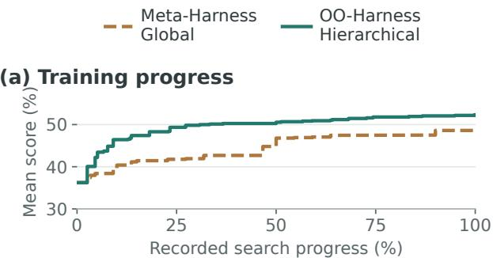

(b) Search time  
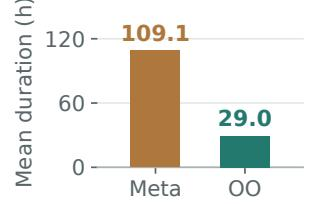

(c) Held-out score  
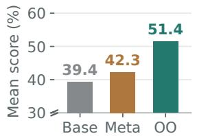  
Figure 4 | Global versus hierarchical harness optimization. Compared with Meta-Harness, OO -Harness shows (a) lar<sub>g</sub>er earl<sub>y</sub> trainin<sub>g</sub> <sub>g</sub>ains, (b) shorter recorded search time, and (c) hi<sub>g</sub>her held-<sub>ou</sub>t <sub>scores.</sub> C<sub>urves a</sub>li<sub>gn runs</sub> b<sub>y</sub> th<sub>e</sub>i<sub>r</sub> f<sub>rac</sub>ti<sub>on o</sub>f <sub>recor</sub>d<sub>e</sub>d <sub>up</sub>d<sub>a</sub>t<sub>es.</sub>

## 5. Analysis

I<sub>n</sub> thi<sub>s sec</sub>ti<sub>on, we a</sub>i<sub>m</sub> t<sub>o un</sub>d<sub>ers</sub>t<sub>an</sub>d th<sub>e e</sub>f<sub>ec-</sub> ti<sub>veness o</sub>f OO<sub>-</sub>H<sub>arness</sub> th<sub>roug</sub>h <sub>a</sub>bl<sub>a</sub>ti<sub>ons o</sub>f (1) task- and execution-informed harness routin<sub>g</sub> (§5.1.1) and (2) hierarchical harness o<sub>p</sub>timization throu<sub>g</sub>h inheritance (§5.1.2). These com-<sub>par</sub>i<sub>sons assess</sub> th<sub>e ro</sub>l<sub>es o</sub>f <sub>execu</sub>ti<sub>on ev</sub>id<sub>ence</sub> <sub>an</sub>d hi<sub>erarc</sub>hi<sub>ca</sub>l <sub>co</sub>d<sub>e reuse.</sub> W<sub>e</sub> th<sub>en con</sub>d<sub>uc</sub>t d<sub>e-</sub> t<sub>a</sub>il<sub>e</sub>d <sub>case s</sub>t<sub>u</sub>di<sub>es o</sub>f b<sub>ase-</sub>h<sub>arness reuse,</sub> l<sub>earne</sub>d t<sub>as</sub>k <sub>c</sub>l<sub>us</sub>t<sub>ers, an</sub>d <sub>concre</sub>t<sub>e</sub> h<sub>arness c</sub>h<sub>anges</sub> t<sub>o</sub> <sub>re</sub>l<sub>a</sub>t<sub>e execu</sub>ti<sub>on nee</sub>d<sub>s</sub> t<sub>o co</sub>d<sub>e an</sub>d <sub>rou</sub>ti<sub>ng</sub> d<sub>e-</sub> cisions (§5.2). Finall<sub>y</sub>, we construct an out-ofdistribution (OOD) settin<sub>g</sub> with disjoint trainin<sub>g</sub> <sub>an</sub>d t<sub>es</sub>t <sub>app</sub>li<sub>ca</sub>ti<sub>on</sub> f<sub>am</sub>ili<sub>es, an</sub>d <sub>exam</sub>i<sub>ne</sub> B<sub>ase</sub> reuse on the selected test tasks (§5.3).

Table 1 | Held-out results with a frozen executor. Mean: mean artial credit on AutomationBench microaveraged rubric pass rate on Workspace-Bench, and mean reward on Toolathlon-GYM. PASS: strict task success (reward ≥ 0.999 on AutomationBench and Toolathlon-GYM; all rubrics satisfied on Works<sub>p</sub>ace-Bench). The primary metric is Mean for AutomationBench and Workspace-Bench, and PASS for Toolathlon-GYM. Steps counts only the finally selected trajectory, excluding other rollouts and auxiliary selection calls. Values are mean ± standard deviation over three runs; scores are <sub>p</sub>ercenta<sub>g</sub>es. Bold marks each column’s maximum score (↑) or minimum ste<sub>p</sub>s (↓). <sup>†</sup>: su<sub>p</sub>ervised harness evolution with discover<sub>y</sub>-task feedback. <sup>‡</sup>: unsu<sub>p</sub>ervised t<sub>es</sub>t<sub>-</sub>ti<sub>me sca</sub>li<sub>n o</sub>f th<sub>e</sub> b<sub>ase</sub> h<sub>arness.</sub> H<sub>e</sub>ld<sub>-ou</sub>t <sub>ra</sub>d<sub>er</sub> f<sub>ee</sub>db<sub>ac</sub>k i<sub>s unava</sub>il<sub>a</sub>bl<sub>e</sub> t<sub>o a</sub>ll <sub>me</sub>th<sub>o</sub>d<sub>s.</sub>
<table><tr><td></td><td colspan="3">AutomationBench</td><td colspan="3">Workspace-Bench</td><td colspan="3">Toolathlon-GYM</td></tr><tr><td>Method</td><td>Mean ↑</td><td> $\mathrm { P A S S } \uparrow$ </td><td>Steps ↓</td><td>Mean ↑</td><td>PASS ↑</td><td>Steps ↓</td><td>Mean ↑</td><td>PASS ↑</td><td>Steps ↓</td></tr><tr><td>BASE</td><td> $6 1 . 6 2 _ { \pm 0 . 1 5 }$ </td><td> $2 5 . 4 4 _ { \pm 0 . 5 1 }$ </td><td> $3 1 . 2 7 _ { \pm 0 . 1 3 }$ </td><td> $2 5 . 4 5 _ { \pm 2 . 9 8 }$ </td><td> $\underline { { 3 . 6 7 _ { \pm 0 . 5 8 } } }$ </td><td> $^ { 3 4 . 4 1 \_ 1 . 3 4 } _ { - }$ </td><td> $Z ^ { 1 . 8 7 _ { \pm 0 . 6 5 } }$ </td><td> $3 1 . 1 5 _ { \pm 0 . 2 8 }$ </td><td> ${ \underline { { 4 0 . 5 0 _ { \pm 0 . 9 9 } } } }$ </td></tr><tr><td colspan="10">Test-time scaling</td></tr><tr><td>Parallel  $( K { = } 2 ) ^ { \sharp }$ </td><td> $6 1 . 4 6 _ { \pm 2 . 3 8 }$ </td><td> $2 4 . 6 7 _ { \pm 2 . 8 3 }$ </td><td> $3 1 . 6 4 _ { \pm 0 . 2 3 }$ </td><td> $3 2 . 5 4 _ { \pm 4 . 3 0 }$ </td><td> $5 . 6 7 _ { \pm 1 . 1 5 }$ </td><td> $4 1 . 6 2 _ { \pm 2 . 5 6 }$ </td><td> $7 4 . 8 5 _ { \pm 1 . 4 5 }$ </td><td> $3 1 . 5 5 _ { \pm 1 . 9 6 }$ </td><td> $3 9 . 9 4 _ { \pm 0 . 3 2 }$ </td></tr><tr><td>Parallel  $( K { = } 5 ) ^ { \sharp }$ </td><td> $6 0 . 2 4 _ { \pm 1 . 0 7 }$ </td><td> $2 4 . 0 0 _ { \pm 0 . 4 7 }$ </td><td> $3 1 . 2 9 _ { \pm 0 . 0 5 }$ </td><td> $3 7 . 7 1 _ { \pm 0 . 4 5 }$ </td><td> $7 . 6 7 _ { \pm 0 . 5 8 }$ </td><td> $4 8 . 6 3 _ { \pm 1 . 9 2 }$ </td><td> $7 5 . 6 9 _ { \pm 0 . 7 9 }$ </td><td> $3 2 . 1 4 _ { \pm 0 . 5 6 }$ </td><td> $3 8 . 9 0 _ { \pm 0 . 0 0 }$ </td></tr><tr><td>Sequential  $( K { = } 2 ) ^ { \sharp }$ </td><td> $5 9 . 2 9 _ { \pm 0 . 2 5 }$ </td><td> $2 5 . 0 0 _ { \pm 1 . 4 1 }$ </td><td> $3 1 . 8 6 _ { \pm 0 . 1 2 }$ </td><td> $2 7 . 9 3 _ { \pm 2 . 1 3 }$ </td><td> $3 . 3 3 _ { \pm 2 . 5 2 }$ </td><td> $3 2 . 9 1 _ { \pm 2 . 0 7 }$ </td><td> ${ \underline { { 7 } } } 3 . 5 3 _ { \pm 1 . 6 7 }$ </td><td> $\underline { { { 3 3 . 3 3 } } } _ { - } \underline { { { 2 . 8 1 } } }$ </td><td> ${ \underline { { 4 0 . 9 7 } } } _ { - } { \underline { { 3 } } } 2$ </td></tr><tr><td colspan="10">Global harness  $o p t i m i z a t i o n$ </td></tr><tr><td>META-HARNESS</td><td> $6 3 . 9 2 _ { \pm 0 . 8 9 }$ </td><td> $2 6 . 3 3 _ { \pm 1 . 3 3 }$ </td><td> $3 0 . 0 5 _ { \pm 0 . 0 3 }$ </td><td> $2 9 . 5 6 _ { \pm 1 . 2 3 }$ </td><td> $5 . 5 4 _ { \pm 1 . 2 3 }$ </td><td> $3 5 . 2 3 _ { \pm 1 . 4 4 }$ </td><td> $7 5 . 8 4 _ { \pm 0 . 7 6 }$ </td><td> $3 3 . 4 5 _ { \pm 1 . 2 3 }$ </td><td> $3 9 . 8 5 _ { \pm 1 . 0 3 }$ </td></tr><tr><td> $\mathrm { \sf A H E ^ { \dagger } }$ </td><td> $6 4 . 1 8 _ { \pm 0 . 9 1 }$ </td><td> $2 8 . 1 1 _ { \pm 1 . 8 4 }$ </td><td> $3 0 . 6 1 _ { \pm 0 . 1 8 }$ </td><td> $3 8 . 4 3 _ { \pm 4 . 3 2 }$ </td><td> $7 . 7 8 _ { \pm 0 . 8 7 }$ </td><td> $3 4 . 5 9 _ { \pm 1 . 2 1 }$ </td><td> $7 4 . 4 8 _ { \pm 1 . 2 3 }$ </td><td> $3 6 . 2 3 _ { \pm 1 . 1 9 }$ </td><td> $4 1 . 0 2 _ { \pm 0 . 8 9 }$ </td></tr><tr><td colspan="10">Specialized harness families</td></tr><tr><td> $\mathrm { \sf A A H } ^ { \dagger }$ </td><td> $7 5 . 4 0 _ { \pm 1 . 2 6 }$ </td><td> $3 4 . 3 1 _ { \pm 1 . 1 9 }$ </td><td> $2 8 . 8 9 _ { \pm 0 . 0 3 }$ </td><td> $3 8 . 6 2 _ { \pm 2 . 9 8 }$ </td><td> $8 . 0 0 _ { \pm 0 . 8 2 }$ </td><td> $3 3 . 5 8 _ { \pm 2 . 4 8 }$ </td><td> $7 4 . 9 9 _ { \pm 1 . 6 3 }$ </td><td> $3 4 . 3 2 _ { \pm 1 . 4 7 }$ </td><td> $4 1 . 2 3 _ { \pm 0 . 8 8 }$ </td></tr><tr><td> $0 0 { \cdot } \mathrm { H A R N E } s s ^ { \dagger }$ </td><td> $7 7 . 4 1 _ { \pm 1 . 3 7 }$ </td><td> $3 7 . 2 2 _ { \pm 2 . 1 4 }$ </td><td> $2 7 . 9 9 _ { \pm 0 . 0 2 }$ </td><td> $3 9 . 4 8 _ { \pm 3 . 2 1 }$ </td><td> $8 . 3 3 _ { \pm 2 . 5 2 }$ </td><td> $3 2 . 7 8 _ { \pm 1 . 9 7 }$ </td><td> $7 7 . 1 8 _ { \pm 1 . 1 5 }$ </td><td> $3 7 . 4 5 _ { \pm 0 . 9 8 }$ </td><td> $\mathbf { 3 7 . 2 5 _ { \pm 0 . 3 8 } }$ </td></tr></table>

## 5.1. Ablation studies

## 5.1.1. Harness routing

W<sub>e compare</sub> t<sub>wo rou</sub>t<sub>ers w</sub>ith th<sub>e same</sub> f<sub>rozen</sub> h<sub>arness</sub> <sub>ca</sub>t<sub>a</sub>l<sub>ogue,</sub> <sub>execu</sub>t<sub>or,</sub> <sub>gra</sub>d<sub>er,</sub> <sub>an</sub>d h<sub>e</sub>ld<sub>-ou</sub>t split. The task-only router uses task descriptions <sub>an</sub>d <sub>me</sub>t<sub>a</sub>d<sub>a</sub>t<sub>a,</sub> <sub>requ</sub>i<sub>r</sub>i<sub>ng</sub> <sub>se</sub>lf<sub>-repor</sub>t<sub>e</sub>d <sub>app</sub>li<sub>ca</sub>bil<sub>-</sub> it<sub>y con</sub>fid<sub>ence o</sub>f <sub>a</sub>t l<sub>eas</sub>t 0<sub>.</sub>7 t<sub>o se</sub>l<sub>ec</sub>t <sub>a spec</sub>i<sub>a</sub>l<sub>-</sub> ist. The trajectory-based router also observes the b<sub>ase execu</sub>ti<sub>on.</sub> N<sub>e</sub>ith<sub>er rece</sub>i<sub>ves</sub> h<sub>e</sub>ld<sub>-ou</sub>t <sub>gra</sub>d<sub>er</sub> f<sub>ee</sub>db<sub>ac</sub>k<sub>.</sub> A<sub>ppen</sub>di<sub>x</sub> A<sub>.</sub>6<sub>.</sub>1 d<sub>e</sub>t<sub>a</sub>il<sub>s</sub> th<sub>e</sub> t<sub>as</sub>k<sub>-on</sub>l<sub>y</sub> p<sup>r</sup>o<sup>m</sup>p<sup>t</sup> se<sup>t</sup>up.

<table><tr><td colspan="2"></td><td colspan="2">OO-HARNESS routing evidence Task Task +</td></tr><tr><td>Benchmark / metric</td><td>Base 61.30</td><td>only</td><td>trajectory</td></tr><tr><td colspan="2">Automation / Mean</td><td>64.88</td><td>77.52</td></tr><tr><td colspan="2">Workspace / Mean</td><td>24.57 40.03</td><td>40.56</td></tr><tr><td colspan="2">Toolathlon / PASS 31.35</td><td>33.33</td><td>37.70</td></tr></table>

Table 2 | Routing ablation on a frozen OO-Harness catalogue. Task only uses the task description and available task metadata; Task + trajectory also observes the base execution. Base executes without routin<sub>g</sub>. Entries re<sub>p</sub>ort <sub>p</sub>rimar<sub>y</sub> scores (%) from sin<sub>g</sub>le ablation runs, distinct from th<sub>e repea</sub>t<sub>e</sub>d <sub>runs</sub> i<sub>n</sub> T<sub>a</sub>bl<sub>e</sub> 1<sub>.</sub>

T<sub>a</sub>bl<sub>e</sub> 2 <sub>s</sub>h<sub>ows</sub> th<sub>a</sub>t th<sub>e va</sub>l<sub>ue o</sub>f <sub>execu</sub>ti<sub>on ev</sub>i<sub>-</sub> d<sub>ence</sub> d<sub>epen</sub>d<sub>s</sub> <sub>on</sub> th<sub>e</sub> <sub>wor</sub>kl<sub>oa</sub>d<sub>.</sub> C<sub>ompare</sub>d <sub>w</sub>ith task-only routing, trajectory-based routing im-<sub>proves</sub> A<sub>u</sub>t<sub>oma</sub>ti<sub>on</sub>B<sub>enc</sub>h <sub>mean</sub> <sub>par</sub>ti<sub>a</sub>l <sub>cre</sub>dit b<sub>y</sub> 12<sub>.</sub>64 <sub>p</sub>oints and Toolathlon-GYM PASS b<sub>y</sub> 4<sub>.</sub>37 <sub>p</sub>oints. The <sub>g</sub>a<sub>p</sub> on Works<sub>p</sub>ace-Bench is onl<sub>y</sub> 0<sub>.</sub>53 <sub>po</sub>i<sub>n</sub>t<sub>s.</sub> T<sub>o un</sub>d<sub>ers</sub>t<sub>an</sub>d <sub>w</sub>h<sub>y</sub> th<sub>ese ga</sub>i<sub>ns</sub> dif<sub>er, we</sub> f<sub>ur</sub>th<sub>er</sub> i<sub>nspec</sub>t th<sub>e</sub> l<sub>earne</sub>d t<sub>as</sub>k <sub>c</sub>l<sub>us</sub>t<sub>ers an</sub>d th<sub>e</sub> h<sub>arness c</sub>h<sub>anges</sub> d<sub>eve</sub>l<sub>ope</sub>d f<sub>or</sub> th<sub>em.</sub> Thi<sub>s</sub> i<sub>nspec-</sub> ti<sub>on sugges</sub>t<sub>s</sub> th<sub>a</sub>t th<sub>e</sub> i<sub>n</sub>f<sub>orma</sub>ti<sub>on nee</sub>d<sub>e</sub>d f<sub>or rou</sub>t<sub>-</sub> i<sub>ng</sub> d<sub>epen</sub>d<sub>s</sub> <sub>on</sub> h<sub>ow</sub> th<sub>e</sub> <sub>evo</sub>l<sub>u</sub>ti<sub>on</sub> <sub>agen</sub>t <sub>groups</sub> t<sub>as</sub>k<sub>s an</sub>d <sub>spec</sub>i<sub>a</sub>li<sub>zes</sub> h<sub>arnesses</sub> t<sub>o a</sub>dd<sub>ress</sub> th<sub>e</sub>i<sub>r</sub> <sub>s</sub>h<sub>are</sub>d <sub>execu</sub>ti<sub>on nee</sub>d<sub>s.</sub> O<sub>n</sub> W<sub>or</sub>k<sub>space-</sub>B<sub>enc</sub>h<sub>,</sub> th<sub>e</sub> l<sub>earne</sub>d <sub>c</sub>l<sub>us</sub>t<sub>er</sub> l<sub>a</sub>b<sub>e</sub>l<sub>s a</sub>li<sub>gn w</sub>ith t<sub>as</sub>k t<sub>ypes</sub> <sub>suc</sub>h <sub>as</sub> d<sub>ocumen</sub>t <sub>wr</sub>iti<sub>ng an</sub>d <sub>sprea</sub>d<sub>s</sub>h<sub>ee</sub>t <sub>e</sub>dit<sub>-</sub> in<sub>g</sub> (Fi<sub>g</sub>ure 6b), makin<sub>g</sub> the re<sub>q</sub>uested out<sub>p</sub>ut <sub>a use</sub>f<sub>u</sub>l <sub>cue</sub> f<sub>or</sub> h<sub>arness se</sub>l<sub>ec</sub>ti<sub>on.</sub> O<sub>n</sub> A<sub>u</sub>t<sub>oma-</sub> ti<sub>on</sub>B<sub>enc</sub>h <sub>an</sub>d T<sub>oo</sub>l<sub>a</sub>thl<sub>on-</sub>GYM<sub>, some</sub> h<sub>arnesses</sub> <sub>a</sub>dd<sub>ress execu</sub>ti<sub>on</sub> i<sub>ssues s</sub>h<sub>are</sub>d <sub>across</sub> d<sub>oma</sub>i<sub>ns</sub> <sub>or apps, suc</sub>h <sub>as</sub> l<sub>eav</sub>i<sub>ng requ</sub>i<sub>re</sub>d <sub>wr</sub>it<sub>es</sub> i<sub>ncom-</sub> <sub>p</sub>l<sub>e</sub>t<sub>e</sub> <sub>or</sub> f<sub>a</sub>ili<sub>ng</sub> t<sub>o</sub> fi<sub>na</sub>li<sub>ze</sub> <sub>w</sub>ithi<sub>n</sub> th<sub>e</sub> t<sub>oo</sub>l<sub>-ca</sub>ll b<sub>u</sub>d<sub>-</sub> get. The base trajectory helps reveal whether th<sub>ese</sub> i<sub>ssues occurre</sub>d<sub>, a</sub>ll<sub>ow</sub>i<sub>ng</sub> th<sub>e rou</sub>t<sub>er</sub> t<sub>o se</sub>l<sub>ec</sub>t <sub>a</sub> h<sub>arness</sub> d<sub>es</sub>i<sub>gne</sub>d t<sub>o</sub> <sub>a</sub>dd<sub>ress</sub> th<sub>em.</sub> A<sub>ppen</sub>di<sub>x</sub>

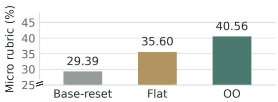  
Figure 5 | Inheritance ablation on Workspace-Bench. W<sub>e</sub> fi<sub>n</sub>d th<sub>a</sub>t l<sub>earn</sub>i<sub>ng</sub> th<sub>roug</sub>h i<sub>n</sub>h<sub>er</sub>it<sub>ance ou</sub>t<sub>per</sub>f<sub>orms</sub> Fl<sub>a</sub>t <sub>a</sub>nd B<sub>ase</sub>-r<sub>ese</sub>t<sub>.</sub>

Fi<sub>gures</sub> 8 <sub>an</sub>d 9 ill<sub>us</sub>t<sub>ra</sub>t<sub>e</sub> d<sub>ocumen</sub>t<sub>-wr</sub>iti<sub>ng an</sub>d <sub>comp</sub>l<sub>e</sub>ti<sub>on-c</sub>h<sub>ec</sub>k <sub>c</sub>h<sub>anges.</sub>

## 5.1.2. Hierarchical evolution structure

O<sub>ne cen</sub>t<sub>ra</sub>l d<sub>es</sub>i<sub>gn c</sub>h<sub>o</sub>i<sub>ce o</sub>f OO<sub>-</sub>Ha<sub>rness</sub> i<sub>s</sub> <sub>evo</sub>l<sub>u</sub>ti<sub>on v</sub>i<sub>a</sub> i<sub>n</sub>h<sub>er</sub>it<sub>ance.</sub> W<sub>e exam</sub>i<sub>ne</sub> it<sub>s con-</sub> t<sub>r</sub>ib<sub>u</sub>ti<sub>on on</sub> W<sub>or</sub>k<sub>space-</sub>B<sub>enc</sub>h <sub>w</sub>ith th<sub>ree ways</sub> <sub>o</sub>f l<sub>earn</sub>i<sub>ng</sub> h<sub>arnesses.</sub> Th<sub>e rou</sub>ti<sub>ng proce</sub>d<sub>ure,</sub> <sub>execu</sub>t<sub>or,</sub> t<sub>as</sub>k <sub>sp</sub>lit<sub>s, an</sub>d <sub>nom</sub>i<sub>na</sub>l <sub>searc</sub>h b<sub>u</sub>d<sub>ge</sub>t <sub>are</sub> th<sub>e same across var</sub>i<sub>an</sub>t<sub>s; on</sub>l<sub>y</sub> h<sub>ow</sub> h<sub>arness</sub> code is learned changes. OO extends earlier harnesses through subclasses. Flat copies previously <sub>evo</sub>l<sub>ve</sub>d <sub>co</sub>d<sub>e</sub> i<sub>n</sub>t<sub>o a c</sub>l<sub>ass</sub> d<sub>er</sub>i<sub>ve</sub>d di<sub>rec</sub>tl<sub>y</sub> f<sub>rom</sub> th<sub>e</sub> b<sub>ase, w</sub>ith<sub>ou</sub>t i<sub>n</sub>h<sub>er</sub>iti<sub>ng</sub> f<sub>rom a spec</sub>i<sub>a</sub>li<sub>ze</sub>d harness. Base-reset starts from the base and adds <sub>new</sub> <sub>c</sub>h<sub>anges</sub> <sub>w</sub>ith<sub>ou</sub>t <sub>carry</sub>i<sub>ng</sub> f<sub>orwar</sub>d <sub>prev</sub>i<sub>ous</sub>l<sub>y</sub> <sub>evo</sub>l<sub>ve</sub>d <sub>co</sub>d<sub>e.</sub> E<sub>ac</sub>h <sub>var</sub>i<sub>an</sub>t <sub>con</sub>d<sub>uc</sub>t<sub>s a separa</sub>t<sub>e</sub> <sub>searc</sub>h <sub>an</sub>d i<sub>s eva</sub>l<sub>ua</sub>t<sub>e</sub>d <sub>once on</sub> Lit<sub>e-</sub>100<sub>.</sub>

OO <sub>ac</sub>hi<sub>eves</sub> th<sub>e</sub> hi<sub>g</sub>h<sub>es</sub>t <sub>m</sub>i<sub>cro ru</sub>b<sub>r</sub>i<sub>c pass o</sub>f 40.56%, exceedin<sub>g</sub> Flat b<sub>y</sub> 4.96 <sub>p</sub>oints (Fi<sub>g</sub>ure 5). Flat also im<sub>p</sub>roves over Base-reset<sub>,</sub> su<sub>pp</sub>ortin<sub>g</sub> th<sub>e va</sub>l<sub>ue o</sub>f <sub>reus</sub>i<sub>ng use</sub>f<sub>u</sub>l <sub>co</sub>d<sub>e across rev</sub>i<sub>s</sub>i<sub>ons.</sub> Si<sub>nce</sub> Fl<sub>a</sub>t <sub>a</sub>l<sub>so carr</sub>i<sub>es</sub> f<sub>orwar</sub>d <sub>evo</sub>l<sub>ve</sub>d <sub>co</sub>d<sub>e,</sub> it<sub>s</sub> <sub>g</sub>a<sub>p</sub> to OO su<sub>gg</sub>ests a benefit from or<sub>g</sub>anizin<sub>g</sub> re-<sub>v</sub>i<sub>s</sub>i<sub>ons</sub> th<sub>roug</sub>h i<sub>n</sub>h<sub>er</sub>it<sub>ance.</sub> E<sub>ac</sub>h <sub>var</sub>i<sub>an</sub>t <sub>evo</sub>l<sub>ves</sub> <sub>separa</sub>t<sub>e</sub>l<sub>y, so</sub> th<sub>ese resu</sub>lt<sub>s compare</sub> th<sub>e</sub> h<sub>arnesses</sub> l<sub>earne</sub>d b<sub>y</sub> <sub>eac</sub>h <sub>searc</sub>h <sub>s</sub>t<sub>ra</sub>t<sub>egy.</sub>

## 5.2. Case studies

Reusing the base harness. In OO-Harness, <sub>a</sub> t<sub>as</sub>k i<sub>s</sub> <sub>rerun</sub> <sub>w</sub>ith <sub>an</sub> <sub>evo</sub>l<sub>ve</sub>d <sub>spec</sub>i<sub>a</sub>li<sub>ze</sub>d h<sub>ar-</sub> <sub>ness on</sub>l<sub>y w</sub>h<sub>en</sub> th<sub>e rou</sub>t<sub>er se</sub>l<sub>ec</sub>t<sub>s one; o</sub>th<sub>erw</sub>i<sub>se,</sub> th<sub>e</sub> B<sub>ase resu</sub>lt i<sub>s reuse</sub>d<sub>.</sub> I<sub>n</sub> thi<sub>s case s</sub>t<sub>u</sub>d<sub>y, we ex-</sub> <sub>am</sub>i<sub>ne one</sub> A<sub>u</sub>t<sub>oma</sub>ti<sub>on</sub>B<sub>enc</sub>h <sub>run w</sub>ith 300 t<sub>as</sub>k<sub>s,</sub> of which 134 (44.7%) reuse Base and 166 select <sub>spec</sub>i<sub>a</sub>li<sub>ze</sub>d h<sub>arnesses.</sub> T<sub>a</sub>bl<sub>e</sub> 3 <sub>compares</sub> th<sub>e</sub> <sub>or</sub>i<sub>g</sub>i<sub>-</sub> <sub>na</sub>l B<sub>ase</sub> <sub>per</sub>f<sub>ormance</sub> <sub>o</sub>f th<sub>ese</sub> t<sub>wo</sub> <sub>groups,</sub> b<sub>e</sub>f<sub>ore</sub> <sub>any</sub> <sub>spec</sub>i<sub>a</sub>li<sub>ze</sub>d <sub>execu</sub>ti<sub>on.</sub> T<sub>as</sub>k<sub>s</sub> <sub>sen</sub>t t<sub>o</sub> <sub>spec</sub>i<sub>a</sub>l<sub>-</sub> ists have lower Base mean reward (44.40%) than those selected for Base reuse (77.15%); strict PASS follows the same <sub>p</sub>attern. These results su<sub>g</sub>- <sub>ges</sub>t th<sub>a</sub>t <sub>rou</sub>ti<sub>ng</sub> di<sub>rec</sub>t<sub>s</sub> <sub>spec</sub>i<sub>a</sub>li<sub>za</sub>ti<sub>on</sub> t<sub>owar</sub>d t<sub>as</sub>k<sub>s w</sub>ith <sub>wea</sub>k<sub>er</sub> B<sub>ase execu</sub>ti<sub>ons, w</sub>hil<sub>e preserv-</sub> in<sub>g</sub> stron<sub>g</sub>er Base results throu<sub>g</sub>h reuse. Routin<sub>g</sub> l<sub>essons gu</sub>id<sub>e</sub> thi<sub>s c</sub>h<sub>o</sub>i<sub>ce</sub> b<sub>y</sub> li<sub>n</sub>ki<sub>ng o</sub>b<sub>serve</sub>d <sub>exe-</sub> cution <sub>p</sub>roblems to suitable harnesses (Fi<sub>g</sub>ure 6c).

<table><tr><td colspan="3">Original Base performance</td></tr><tr><td>Routing destination Tasks</td><td></td><td>Mean reward Strict PASS</td></tr><tr><td>Reuse Base</td><td>134</td><td>77.15 36.57</td></tr><tr><td>Specialized harness 166</td><td>44.40</td><td>14.25</td></tr></table>

Table 3 | Base performance by routing destination on AutomationBench. We find that tasks routed to <sub>spec</sub>i<sub>a</sub>li<sub>ze</sub>d h<sub>arnesses</sub> h<sub>ave su</sub>b<sub>s</sub>t<sub>an</sub>ti<sub>a</sub>ll<sub>y wea</sub>k<sub>er</sub> B<sub>ase</sub> <sub>p</sub>erformance on avera<sub>g</sub>e<sub>,</sub> while OO-Harness <sub>p</sub>reserves stron<sub>g</sub>er Base executions throu<sub>g</sub>h reuse.

How task clusters reflect execution needs. Th<sub>e evo</sub>l<sub>u</sub>ti<sub>on agen</sub>t <sub>can crea</sub>t<sub>e an</sub>d <sub>rev</sub>i<sub>se</sub> t<sub>as</sub>k <sub>c</sub>l<sub>us</sub>t<sub>ers</sub> f<sub>rom</sub> di<sub>scovery execu</sub>ti<sub>ons, w</sub>ith<sub>ou</sub>t <sub>a</sub> fi<sub>xe</sub>d d<sub>oma</sub>i<sub>n or</sub> t<sub>as</sub>k<sub>-</sub>t<sub>ype</sub> t<sub>axonomy.</sub> Fi<sub>gure</sub> 6 <sub>con</sub>t<sub>ras</sub>t<sub>s</sub> t<sub>wo</sub> l<sub>earne</sub>d <sub>organ</sub>i<sub>za</sub>ti<sub>ons.</sub> O<sub>n</sub> A<sub>u</sub>t<sub>oma-</sub> ti<sub>on</sub>B<sub>enc</sub>h<sub>, c</sub>l<sub>us</sub>t<sub>ers cap</sub>t<sub>ure</sub> f<sub>a</sub>il<sub>ures an</sub>d <sub>correc-</sub> t<sup>i</sup>ve nee<sup>d</sup>s v<sup>i</sup>s<sup>ibl</sup>e <sup>i</sup>n trajector<sup>i</sup>es: commit-gate targets m<sup>i</sup>ss<sup>i</sup>ng wr<sup>i</sup>tes, w<sup>hil</sup>e compute-verify <sub>groups</sub> t<sub>as</sub>k<sub>s requ</sub>i<sub>r</sub>i<sub>ng ar</sub>ith<sub>me</sub>ti<sub>c or</sub> ti<sub>me-</sub>b<sub>ase</sub>d d<sub>er</sub>i<sub>va</sub>ti<sub>ons across</sub> fi<sub>ve</sub> b<sub>us</sub>i<sub>ness</sub> d<sub>oma</sub>i<sub>ns.</sub> O<sub>n</sub> W<sub>or</sub>k<sub>space-</sub>B<sub>enc</sub>h<sub>, a</sub>ll <sub>s</sub>i<sub>x</sub> l<sub>earne</sub>d <sub>c</sub>l<sub>us</sub>t<sub>er</sub> l<sub>a</sub>b<sub>e</sub>l<sub>s</sub> ali<sub>g</sub>n with the evaluated AAH task-t<sub>yp</sub>e <sub>g</sub>rou<sub>p</sub>s<sub>,</sub> i<sub>nc</sub>l<sub>u</sub>di<sub>ng</sub> d<sub>ocumen</sub>t <sub>wr</sub>iti<sub>ng an</sub>d <sub>sprea</sub>d<sub>s</sub>h<sub>ee</sub>t <sub>e</sub>dit<sub>-</sub> in<sub>g</sub>. Tasks re<sub>q</sub>uestin<sub>g</sub> the same out<sub>p</sub>ut format <sub>o</sub>ft<sub>en s</sub>h<sub>are</sub> b<sub>ac</sub>k<sub>en</sub>d <sub>requ</sub>i<sub>remen</sub>t<sub>s, so</sub> t<sub>as</sub>k<sub>-</sub>t<sub>ype</sub> <sub>c</sub>l<sub>us</sub>t<sub>ers can emerge na</sub>t<sub>ura</sub>ll<sub>y</sub> f<sub>rom execu</sub>ti<sub>on ev</sub>i<sub>-</sub> d<sub>ence.</sub> Th<sub>e evo</sub>l<sub>u</sub>ti<sub>on agen</sub>t <sub>can</sub> th<sub>us group</sub> t<sub>as</sub>k<sub>s</sub> b<sub>y a s</sub>h<sub>are</sub>d f<sub>a</sub>il<sub>ure or</sub> b<sub>y a s</sub>h<sub>are</sub>d <sub>capa</sub>bilit<sub>y,</sub> d<sub>e-</sub> <sub>pen</sub>di<sub>ng on</sub> th<sub>e wor</sub>kl<sub>oa</sub>d<sub>.</sub>

R<sub>ou</sub>ti<sub>ng</sub> l<sub>essons connec</sub>t <sub>execu</sub>ti<sub>on pro</sub>bl<sub>ems</sub> t<sub>o</sub> h<sub>arness capa</sub>biliti<sub>es.</sub> I<sub>n</sub> Fi<sub>gure</sub> 6<sub>c,</sub> th<sub>e rou</sub>t<sub>er</sub> <sup>m</sup>a<sup>t</sup>c<sup>h</sup>es <sup>r</sup>epea<sup>t</sup>e<sup>d</sup> que<sup>r</sup>y<sup>-</sup>pa<sup>r</sup>s<sup>in</sup>g e<sup>rr</sup>o<sup>r</sup>s <sup>t</sup>o a sa<sup>v</sup>e<sup>d</sup> l<sub>esson an</sub>d <sub>se</sub>l<sub>ec</sub>t<sub>s an</sub> API <sub>error-norma</sub>li<sub>zer</sub> th<sub>a</sub>t <sub>p</sub>rovides <sub>q</sub>uer<sub>y</sub>-re<sub>p</sub>air instructions. A<sub>pp</sub>endix Tabl<sub>e</sub> 4 <sub>s</sub>h<sub>ows</sub> l<sub>essons</sub> th<sub>a</sub>t <sub>se</sub>l<sub>ec</sub>t <sub>a resource-man</sub>if<sub>es</sub>t h<sub>arness or preserve a c</sub>l<sub>ean</sub> B<sub>ase execu</sub>ti<sub>on.</sub>

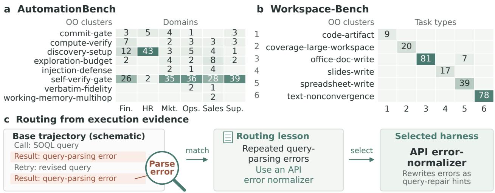  
Figure 6 | Learned clusters and an example router lesson. Panels (a,b) compare learned clusters (rows) with domains or task t<sub>yp</sub>es (columns); cells count shared discover<sub>y</sub> tasks. AutomationBench clusters lar<sub>g</sub>el<sub>y</sub> reflect execution needs, while Works<sub>p</sub>ace-Bench clusters lar<sub>g</sub>el<sub>y</sub> follow task t<sub>yp</sub>es. Panel (c) schematicall<sub>y</sub> shows how repeated query-parsing errors in a Base trajectory match a saved routing lesson, leading to selection of an API <sub>error-norma</sub>li<sub>zer</sub> h<sub>arness.</sub> Bl<sub>an</sub>k <sub>ce</sub>ll<sub>s are zero;</sub> W<sub>or</sub>k<sub>space-</sub>B<sub>enc</sub>h <sub>co</sub>l<sub>umn</sub> ID<sub>s ma</sub>t<sub>c</sub>h th<sub>e num</sub>b<sub>ere</sub>d <sub>rows.</sub>

Concrete harness changes. Inheritance <sub>suppor</sub>t<sub>s</sub> b<sub>o</sub>th <sub>s</sub>h<sub>are</sub>d b<sub>e</sub>h<sub>av</sub>i<sub>or</sub> <sub>an</sub>d t<sub>arge</sub>t<sub>e</sub>d <sub>spec</sub>i<sub>a</sub>li<sub>za</sub>ti<sub>on.</sub> O<sub>n</sub> A<sub>u</sub>t<sub>oma</sub>ti<sub>on</sub>B<sub>enc</sub>h<sub>,</sub> th<sub>e</sub> discovery-setup <sup>li</sup>neage exten<sup>d</sup>s a m<sup>i</sup>ss<sup>i</sup>ng-<sub>wr</sub>it<sub>e comp</sub>l<sub>e</sub>ti<sub>on c</sub>h<sub>ec</sub>k <sub>w</sub>ith <sub>a near-</sub>b<sub>u</sub>d<sub>ge</sub>t reminder and tool-error <sub>g</sub>uidance (A<sub>pp</sub>endix Fi<sub>g</sub>- ure 9). Each node is a com<sub>p</sub>lete executable h<sub>arness.</sub> A <sub>paren</sub>t <sub>supp</sub>li<sub>es s</sub>h<sub>are</sub>d b<sub>e</sub>h<sub>av</sub>i<sub>or an</sub>d<sub>,</sub> if <sub>ac</sub>ti<sub>ve, can serve</sub> t<sub>as</sub>k<sub>s</sub> th<sub>a</sub>t d<sub>o no</sub>t <sub>nee</sub>d <sub>a</sub> d<sub>escen</sub>d<sub>an</sub>t’<sub>s a</sub>dditi<sub>ona</sub>l <sub>c</sub>h<sub>anges.</sub> A d<sub>ocumen</sub>t<sub>-</sub> b<sub>ac</sub>k<sub>en</sub>d <sub>spec</sub>i<sub>a</sub>li<sub>za</sub>ti<sub>on</sub> <sub>on</sub> W<sub>or</sub>k<sub>space-</sub>B<sub>enc</sub>h a<sub>pp</sub>ears in A<sub>pp</sub>endix Fi<sub>g</sub>ure 8.

## 5.3. Base harness reuse in OOD settings

T<sub>o exam</sub>i<sub>ne</sub> b<sub>e</sub>h<sub>av</sub>i<sub>or</sub> i<sub>n ex</sub>t<sub>reme</sub> OOD <sub>scenar</sub>i<sub>os,</sub> we construct a settin<sub>g</sub> with 254 Toolathlon-GYM trainin<sub>g</sub> tasks and 49 Toolathlon test tasks (Li et al., 2025). Their named a<sub>pp</sub>lication families are disjoint, making the test set largely out of distribution relative to the trainin<sub>g</sub> set (A<sub>p</sub>- <sub>p</sub>endix A.7). We evolve harnesses on this trainin<sub>g</sub> s<sub>p</sub>lit and com<sub>p</sub>are OO-Harness a<sub>g</sub>ainst Meta-Harness. At test time<sub>,</sub> Meta-Harness a<sub>p</sub>- <sub>p</sub>li<sub>es</sub> it<sub>s</sub> l<sub>earne</sub>d <sub>g</sub>l<sub>o</sub>b<sub>a</sub>l h<sub>arness, w</sub>h<sub>ereas</sub> th<sub>e</sub> OO -Harness router selects the <sub>g</sub>eneral Base harness for ever<sub>y</sub> test task. As Fi<sub>g</sub>ure 7 shows<sub>,</sub> reusin<sub>g</sub> Base <sub>p</sub>reserves its <sub>p</sub>erformance<sub>,</sub> while a<sub>pp</sub>l<sub>y</sub>in<sub>g</sub> the Meta-Harness harness <sub>y</sub>ields a lower PASS rate. Kee<sub>p</sub>in<sub>g</sub> Base as a routin<sub>g</sub> o<sub>p</sub>tion allows

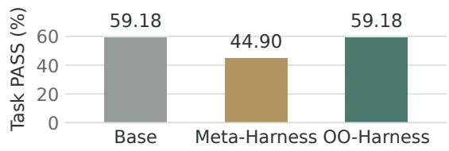  
Figure 7 | Base reuse on the selected OOD test tasks. After evolution on the disjoint training split, OO-Harness reuses Base on ever<sub>y</sub> test task<sub>, p</sub>reservi<sub>ng</sub> it<sub>s</sub> <sub>per</sub>f<sub>ormance,</sub> <sub>w</sub>hil<sub>e</sub> <sub>app</sub>l<sub>y</sub>i<sub>ng</sub> th<sub>e</sub> l<sub>earne</sub>d M<sub>et</sub>a<sub>-</sub> Harness harness reduces PASS.

OO<sub>-</sub>H<sub>arness</sub> t<sub>o</sub> h<sub>an</sub>dl<sub>e un</sub>f<sub>am</sub>ili<sub>ar</sub> t<sub>as</sub>k<sub>s w</sub>ith<sub>-</sub> <sub>ou</sub>t <sub>requ</sub>i<sub>r</sub>i<sub>ng</sub> th<sub>em</sub> t<sub>o</sub> <sub>use</sub> <sub>a</sub> <sub>spec</sub>i<sub>a</sub>li<sub>za</sub>ti<sub>on</sub> l<sub>earne</sub>d <sub>on</sub> dif<sub>eren</sub>t <sub>app</sub>li<sub>ca</sub>ti<sub>on</sub> f<sub>am</sub>ili<sub>es.</sub>

## 6. Conclusion

OO<sub>-</sub>Ha<sub>rness evo</sub>l<sub>ves spec</sub>i<sub>a</sub>li<sub>ze</sub>d h<sub>arnesses</sub> th<sub>roug</sub>h i<sub>n</sub>h<sub>er</sub>it<sub>ance an</sub>d <sub>rou</sub>t<sub>es</sub> t<sub>as</sub>k<sub>s us</sub>i<sub>ng ex-</sub> <sub>ecu</sub>ti<sub>on ev</sub>id<sub>ence.</sub> T<sub>as</sub>k <sub>c</sub>l<sub>us</sub>t<sub>ers cap</sub>t<sub>ure s</sub>h<sub>are</sub>d <sub>ex-</sub> <sub>ecu</sub>ti<sub>on</sub> <sub>nee</sub>d<sub>s,</sub> <sub>an</sub>d i<sub>n</sub>h<sub>er</sub>it<sub>ance</sub> <sub>a</sub>ll<sub>ows</sub> <sub>spec</sub>i<sub>a</sub>li<sub>ze</sub>d h<sub>arnesses</sub> t<sub>o s</sub>h<sub>are use</sub>f<sub>u</sub>l <sub>co</sub>d<sub>e.</sub> OO<sub>-</sub>H<sub>arness</sub> <sub>ac</sub>hi<sub>eves</sub> th<sub>e</sub> b<sub>es</sub>t <sub>per</sub>f<sub>ormance</sub> <sub>among</sub> b<sub>ase</sub>li<sub>nes.</sub> Ablations support inheritance and trajectoryi<sub>n</sub>f<sub>orme</sub>d <sub>rou</sub>ti<sub>ng,</sub> <sub>w</sub>hil<sub>e</sub> <sub>case</sub> <sub>s</sub>t<sub>u</sub>di<sub>es</sub> ill<sub>us</sub>t<sub>ra</sub>t<sub>e</sub> th<sub>e e</sub>f<sub>ec</sub>ti<sub>veness o</sub>f <sub>spec</sub>i<sub>a</sub>li<sub>za</sub>ti<sub>on an</sub>d B<sub>ase reuse.</sub>

## Limitations

OO-Harness relies on the APIs and execution <sub>env</sub>i<sub>ronmen</sub>t <sub>prov</sub>id<sub>e</sub>d b<sub>y</sub> it<sub>s</sub> h<sub>os</sub>t<sub>.</sub> S<sub>erv</sub>i<sub>ce ou</sub>t<sub>-</sub> <sub>ages an</sub>d <sub>ra</sub>t<sub>e</sub> li<sub>m</sub>it<sub>s can a</sub>f<sub>ec</sub>t <sub>re</sub>li<sub>a</sub>bilit<sub>y, w</sub>hil<sub>e</sub> i<sub>n</sub>t<sub>er</sub>f<sub>ace</sub> <sub>c</sub>h<sub>anges</sub> <sub>may</sub> <sub>requ</sub>i<sub>re</sub> <sub>up</sub>d<sub>a</sub>t<sub>es</sub> t<sub>o</sub> <sub>evo</sub>l<sub>ve</sub>d h<sub>arnesses.</sub> I<sub>n</sub>t<sub>egra</sub>ti<sub>ng pr</sub>i<sub>va</sub>t<sub>e or au</sub>th<sub>en</sub>ti<sub>ca</sub>t<sub>e</sub>d <sub>serv</sub>i<sub>ces</sub> <sub>a</sub>l<sub>so</sub> <sub>requ</sub>i<sub>res</sub> <sub>secure</sub> <sub>cre</sub>d<sub>en</sub>ti<sub>a</sub>l h<sub>an</sub>dli<sub>ng</sub> <sub>an</sub>d <sub>perm</sub>i<sub>ss</sub>i<sub>on con</sub>fi<sub>gura</sub>ti<sub>on.</sub> Th<sub>ese</sub> d<sub>epen</sub>d<sub>en-</sub> <sub>c</sub>i<sub>es mo</sub>ti<sub>va</sub>t<sub>e</sub> f<sub>ur</sub>th<sub>er wor</sub>k <sub>on ro</sub>b<sub>us</sub>t API i<sub>n</sub>t<sub>egra-</sub> ti<sub>on an</sub>d d<sub>ep</sub>l<sub>oymen</sub>t <sub>across env</sub>i<sub>ronmen</sub>t<sub>s.</sub>

## References

Laksh<sub>y</sub>a A. A<sub>g</sub>rawal<sub>,</sub> Shan<sub>gy</sub>in Tan<sub>,</sub> Dilara So<sub>y</sub>lu<sub>,</sub> Noah Ziems<sub>,</sub> Rishi Khare<sub>,</sub> Krista O<sub>p</sub>sahl-On<sub>g,</sub> Arnav Sin<sub>g</sub>hvi<sub>,</sub> Herumb Shandil<sub>y</sub>a<sub>,</sub> Michael J. R<sub>y</sub>an<sub>,</sub> Men<sub>g</sub> Jian<sub>g,</sub> Christo<sub>p</sub>her Potts<sub>,</sub> Koushik Sen<sub>,</sub> Alexandros G. Dimakis<sub>,</sub> Ion Stoica<sub>,</sub> Dan Klein<sub>,</sub> Matei Zaharia<sub>,</sub> and Omar Khattab. GEPA: Reflective <sub>p</sub>rom<sub>p</sub>t <sub>evo</sub>l<sub>u</sub>ti<sub>on</sub> <sub>can</sub> <sub>ou</sub>t<sub>per</sub>f<sub>orm</sub> <sub>re</sub>i<sub>n</sub>f<sub>orcemen</sub>t l<sub>earn</sub>i<sub>ng.</sub> arXiv preprint arXiv:2507.19457, 2025. Accepted to ICLR 2026.

Anthro<sub>p</sub>ic. Claude models overview<sub>,</sub> 2026. URL https://platform.claude.com/docs/en/ models/overview. Prov<sup>id</sup>er <sup>d</sup>ocumentat<sup>i</sup>on; accessed October 10<sub>,</sub> 2026.

Paul Fur<sub>g</sub>ale<sub>,</sub> Severin Klin<sub>g</sub>ler<sub>,</sub> James Nolan<sub>,</sub> Matt Staats<sub>,</sub> Gaia Di Lorenzo<sub>,</sub> Elisa Martinez Abad<sub>,</sub> Ch<sub>r</sub>i<sub>s</sub>ti<sub>an</sub> S<sub>c</sub>hüll<sub>er,</sub> R<sub>azvan</sub> Di<sub>nu,</sub> Al<sub>ess</sub>i<sub>o</sub> D<sub>evo</sub>t<sub>o,</sub> P<sub>asca</sub>l B<sub>erar</sub>d<sub>,</sub> G<sub>a</sub>l K<sub>ap</sub>l<sub>un,</sub> El<sub>a</sub>d S<sub>ara</sub>fi<sub>an,</sub> Ri<sub>c-</sub> <sub>car</sub>d<sub>o</sub> R<sub>over</sub>i<sub>,</sub> L<sub>eon</sub> D<sub>erczyns</sub>ki<sub>, an</sub>d Ri<sub>car</sub>d<sub>o</sub> Sil<sub>-</sub> veira Cabral. NVIDIA-labs OO A<sub>g</sub>ents: Native Python object-oriented agents. arXiv preprint arXiv:2607.20709, 2026. URL https://arxiv. org/abs/2607.20709.

Google. Gemini API models, 2026. URL https:// ai.google.dev/gemini-api/docs/models. P<sub>rov</sub>id<sub>er</sub> d<sub>ocumen</sub>t<sub>a</sub>ti<sub>on; accesse</sub>d O<sub>c</sub>t<sub>o</sub>b<sub>er</sub> 10<sub>,</sub> 2026.

Shen<sub>g</sub>ran Hu<sub>,</sub> Con<sub>g</sub> Lu<sub>,</sub> and Jef Clune. Automated design of agentic systems. arXiv preprint arXiv:2408.08435, 2024.

Wen Jiang, Mingmin Chu, Yimeng Tian, Qianxin Zhan<sub>g,</sub> Haofei Yan<sub>g,</sub> Rui Yan<sub>g,</sub> Yan<sub>g</sub> Liu<sub>,</sub> Tao Lv<sub>,</sub> and Fan<sub>g</sub>min<sub>g</sub> Li. HarnessEvolve: Learnin<sub>g</sub> from reference trajectories for reliable agent self-evolution. arXiv preprint arXiv:2609.00829, 2026.

Seth Karten<sub>,</sub> Joel Zhan<sub>g,</sub> Tersoo U<sub>p</sub>aa Jr<sub>,</sub> Ruiron<sub>g</sub> F<sub>eng,</sub> W<sub>enz</sub>h<sub>e</sub> Li<sub>,</sub> Ch<sub>engs</sub>h<sub>ua</sub>i Shi<sub>,</sub> Chi Ji<sub>n, an</sub>d Ki<sub>-</sub> <sub>ran</sub> V<sub>o</sub>d<sub>ra</sub>h<sub>a</sub>lli<sub>.</sub> C<sub>on</sub>ti<sub>nua</sub>l H<sub>arness:</sub> O<sub>n</sub>li<sub>ne a</sub>d<sub>ap</sub>t<sub>a-</sub> tion for self-improving foundation agents. arXiv preprint arXiv:2605.09998, 2026. URL https: //arxiv.org/abs/2605.09998.

Zi<sub>xuan</sub> K<sub>e,</sub> V<sub>a</sub>id<sub>e</sub>hi P<sub>a</sub>til<sub>,</sub> H<sub>a</sub>i<sub>z</sub>h<sub>ou</sub> Shi<sub>,</sub> Y<sub>ang</sub> Li<sub>,</sub> Ye Liu<sub>,</sub> Sarath Shekkizhar<sub>,</sub> Anura<sub>g</sub> Koul<sub>,</sub> Jia<sub>y</sub>u Wan<sub>g,</sub> Xuan Phi N<sub>g</sub>u<sub>y</sub>en<sub>,</sub> Semih Yavuz<sub>,</sub> Mohit Bansal<sub>,</sub> and Shafi<sub>q</sub> Jot<sub>y</sub>. EvoHarnessBench: Can <sub>y</sub>our a<sub>g</sub>ents keep pace with an evolving harness? arXiv preprint arXiv:2609.04280, 2026. URL https://arxiv. org/abs/2609.04280.

Yoonho Lee, Roshen Nair, Qizheng Zhang, Kang-<sub>woo</sub>k L<sub>ee,</sub> O<sub>mar</sub> Kh<sub>a</sub>tt<sub>a</sub>b<sub>, an</sub>d Ch<sub>e</sub>l<sub>sea</sub> Fi<sub>nn.</sub> M<sub>e</sub>t<sub>a-</sub> H<sub>arness:</sub> E<sub>n</sub>d<sub>-</sub>t<sub>o-en</sub>d <sub>op</sub>ti<sub>m</sub>i<sub>za</sub>ti<sub>on o</sub>f <sub>mo</sub>d<sub>e</sub>l h<sub>ar-</sub> nesses. arXiv preprint arXiv:2603.28052, 2026.

Junlon<sub>g</sub> Li<sub>,</sub> Wenshuo Zhao<sub>,</sub> Jian Zhao<sub>,</sub> Weihao Zen<sub>g,</sub> Haoze Wu<sub>,</sub> Xiaochen Wan<sub>g,</sub> Rui Ge<sub>,</sub> Yuxuan Cao<sub>,</sub> Yuzhen Huan<sub>g,</sub> Wei Liu<sub>,</sub> Junten<sub>g</sub> Liu<sub>,</sub> Zhaochen Su<sub>,</sub> Yi<sub>y</sub>an<sub>g</sub> Guo<sub>,</sub> Fan Zhou<sub>,</sub> Lue<sub>y</sub>an<sub>g</sub> Zhan<sub>g,</sub> Juan Michelini<sub>,</sub> Xin<sub>gy</sub>ao Wan<sub>g,</sub> Xian<sub>g</sub> Yue<sub>,</sub> Shu<sub>y</sub>an Zhou<sub>,</sub> Grah<sub>am</sub> N<sub>eu</sub>bi<sub>g, an</sub>d J<sub>unx</sub>i<sub>an</sub> H<sub>e.</sub> Th<sub>e</sub> t<sub>oo</sub>l d<sub>eca</sub>thl<sub>on:</sub> B<sub>enc</sub>h<sub>mar</sub>ki<sub>ng</sub> l<sub>anguage agen</sub>t<sub>s</sub> f<sub>or</sub> di<sub>verse, rea</sub>li<sub>s-</sub> tic<sub>,</sub> and lon<sub>g</sub>-horizon task execution. 2025. URL https://arxiv.org/abs/2510.25726.

Jiahang Lin, Shichun Liu, Chengjun Pan, Lizhi Lin, Shihan Dou, Zhiheng Xi, Xuanjing Huang, Hang Yan, Zhenhua Han<sub>,</sub> Tao Gui<sub>,</sub> and Yu-Gan<sub>g</sub> Jian<sub>g</sub>. A<sub>g</sub>enti<sub>c</sub> h<sub>arness eng</sub>i<sub>neer</sub>i<sub>ng:</sub> Ob<sub>serva</sub>bilit<sub>y-</sub>d<sub>r</sub>i<sub>ven au</sub>t<sub>o-</sub> matic evolution of coding-agent harnesses. arXiv preprint arXiv:2604.25850, 2026a.

Minhua Lin<sub>,</sub> Han<sub>q</sub>in<sub>g</sub> Lu<sub>,</sub> Zhan Shi<sub>,</sub> Bin<sub>g</sub> He<sub>,</sub> Rui Mao<sub>,</sub> Zhiwei Zhan<sub>g,</sub> Zon<sub>gy</sub>u Wu<sub>,</sub> Xianfen<sub>g</sub> Tan<sub>g,</sub> Hui Liu<sub>,</sub> Zhenwei Dai<sub>,</sub> Xian<sub>g</sub> Zhan<sub>g,</sub> Suhan<sub>g</sub> Wan<sub>g,</sub> Benoit D<sub>umou</sub>li<sub>n,</sub> <sub>an</sub>d Ji<sub>an</sub> P<sub>e</sub>i<sub>.</sub> P<sub>os</sub>iti<sub>on:</sub> A<sub>gen</sub>ti<sub>c</sub> <sub>evo</sub>l<sub>u-</sub> tion is the path to evolving LLMs. arXiv preprint arXiv:2602.00359, 2026b.

Hongjun Liu, Yifei Ming, Shafiq Joty, and Chen Zhao. Harnessing LLM agents with skill programs. arXiv preprint arXiv:2605.17734, 2026a. URL https: //arxiv.org/abs/2605.17734.

Zewen Liu<sub>,</sub> Zhan Shi<sub>,</sub> Yisi San<sub>g,</sub> Bin<sub>g</sub> He<sub>,</sub> Minhua Lin<sub>,</sub> Tianxin Wei<sub>,</sub> Dakuo Wan<sub>g,</sub> Benoit Dumoulin<sub>,</sub> Wei Jin<sub>,</sub> and Han<sub>q</sub>in<sub>g</sub> Lu. Ada<sub>p</sub>tive auto-harness: Sust<sub>a</sub>i<sub>ne</sub>d <sub>se</sub>lf<sub>-</sub>i<sub>mprovemen</sub>t f<sub>or agen</sub>ti<sub>c sys</sub>t<sub>em</sub> d<sub>ep</sub>l<sub>oy-</sub> ment on open-ended task streams. arXiv preprint arXiv:2606.01770, 2026b.

Xi<sub>ng</sub>h<sub>ua</sub> L<sub>ou,</sub> Mi<sub>gue</sub>l Lá<sub>zaro-</sub>G<sub>re</sub>dill<sub>a,</sub> A<sub>n</sub>t<sub>o</sub>i<sub>ne</sub> D<sub>e</sub>di<sub>eu,</sub> C<sub>ar</sub>t<sub>er</sub> W<sub>en</sub>d<sub>e</sub>lk<sub>en,</sub> W<sub>o</sub>lf<sub>gang</sub> L<sub>e</sub>h<sub>rac</sub>h<sub>,</sub> <sub>an</sub>d K<sub>ev</sub>i<sub>n</sub> P<sub>.</sub> Mur<sub>p</sub>h<sub>y</sub>. AutoHarness: Im<sub>p</sub>rovin<sub>g</sub> LLM a<sub>g</sub>ents b<sub>y</sub> automatically synthesizing a code harness. arXiv preprint arXiv:2603.03329, 2026. URL https:// arxiv.org/abs/2603.03329.

Aman Madaan<sub>,</sub> Niket Tandon<sub>,</sub> Prakhar Gu<sub>p</sub>ta<sub>,</sub> Sk<sub>y</sub>ler Hallinan<sub>,</sub> Lu<sub>y</sub>u Gao<sub>,</sub> Sarah Wie<sub>g</sub>refe<sub>,</sub> Uri Alon<sub>,</sub> N<sub>ou</sub>h<sub>a</sub> D<sub>z</sub>i<sub>r</sub>i<sub>,</sub> Sh<sub>r</sub>i<sub>ma</sub>i P<sub>ra</sub>bh<sub>umoye,</sub> Yi<sub>m</sub>i<sub>ng</sub> Y<sub>ang,</sub> Shashank Gupta, Bodhisattwa Prasad Majumder, K<sub>a</sub>th<sub>er</sub>i<sub>ne</sub> H<sub>ermann,</sub> S<sub>ean</sub> W<sub>e</sub>ll<sub>ec</sub>k<sub>,</sub> A<sub>m</sub>i<sub>r</sub> Y<sub>az</sub>d<sub>an-</sub> b<sub>a</sub>kh<sub>s</sub>h<sub>, an</sub>d P<sub>e</sub>t<sub>er</sub> Cl<sub>ar</sub>k<sub>.</sub> S<sub>e</sub>lf<sub>-re</sub>fi<sub>ne:</sub> It<sub>era</sub>ti<sub>ve re-</sub> finement with self-feedback. Advances in Neural Information Processing Systems (NeurIPS), 2023.

Jun Nie, Yonggang Zhang, Qianshu Cai, Yiu-ming Cheun<sub>g,</sub> Xinmei Tian<sub>,</sub> and Bo Han. EvolveNet: Collabo-<sub>ra</sub>ti<sub>ve</sub> h<sub>arness</sub> <sub>evo</sub>l<sub>u</sub>ti<sub>on</sub> f<sub>or</sub> <sub>agen</sub>t <sub>se</sub>lf<sub>-</sub>i<sub>mprovemen</sub>t<sub>.</sub> arXiv preprint arXiv:2608.04968, 2026.

Xu<sub>y</sub>in<sub>g</sub> Nin<sub>g,</sub> Katherine Tieu<sub>,</sub> Don<sub>gq</sub>i Fu<sub>,</sub> Tianxin Wei<sub>,</sub> Zihao Li<sub>,</sub> Yuanchen Bei<sub>,</sub> Jiaru Zou<sub>,</sub> Men<sub>g</sub>tin<sub>g</sub> Ai<sub>,</sub> Zhining Liu, Ting-Wei Li, Lingjie Chen, Yanjun Zhao, Ke Yang, Bingxuan Li, Cheng Qian, Gaotang Li, Xiao Lin, Zhichen Zeng, Ruizhong Qiu, Sirui Chen, Yifan Sun<sub>,</sub> Xi<sub>y</sub>uan Yan<sub>g,</sub> Ruida Wan<sub>g,</sub> Rui Pan<sub>,</sub> Chen<sub>y</sub>uan Yan<sub>g,</sub> D<sub>y</sub>lan Zhan<sub>g,</sub> Liri Fan<sub>g,</sub> Zikun Cui<sub>,</sub> Yan<sub>g</sub> Cao<sub>,</sub> Pan Chen<sub>,</sub> Doroth<sub>y</sub> Sun<sub>,</sub> Ren Chen<sub>,</sub> Mahesh Srinivasan<sub>,</sub> Ni<sub>p</sub>un Mathur<sub>,</sub> Yin<sub>g</sub>lon<sub>g</sub> Xia<sub>,</sub> Hon<sub>g</sub> Li<sub>,</sub> Hon<sub>g</sub> Yan<sub>,</sub> Pan Lu<sub>,</sub> Lin<sub>g</sub>min<sub>g</sub> Zhan<sub>g,</sub> Ton<sub>g</sub> Zhan<sub>g,</sub> Han<sub>g</sub>- han<sub>g</sub> Ton<sub>g,</sub> and Jin<sub>g</sub>rui He. Code as a<sub>g</sub>ent harness. arXiv preprint arXiv:2605.18747, 2026.

Siru Ou<sub>y</sub>an<sub>g,</sub> Jun Yan<sub>,</sub> I-Hun<sub>g</sub> Hsu<sub>,</sub> Yanfei Chen<sub>,</sub> Ke Jiang, Zifeng Wang, Rujun Han, Long T. Le, Samira Daruki<sub>,</sub> Xian<sub>g</sub>ru Tan<sub>g,</sub> Vish<sub>y</sub> Tirumalashett<sub>y,</sub> Geor<sub>g</sub>e Lee<sub>,</sub> Mahsan Rofouei<sub>,</sub> Han<sub>g</sub>fei Lin<sub>,</sub> Jiawei Han<sub>,</sub> Chen-Yu Lee<sub>,</sub> and Tomas Pfister. Reasonin<sub>g</sub>- B<sub>an</sub>k<sub>:</sub> S<sub>ca</sub>li<sub>ng</sub> <sub>agen</sub>t <sub>se</sub>lf<sub>-evo</sub>l<sub>v</sub>i<sub>ng</sub> <sub>w</sub>ith <sub>reason</sub>i<sub>ng</sub> memory. In The Fourteenth International Conference on Learning Representations, 2026. URL https: //openreview.net/forum?id=jL7fwchScm.

D<sub>an</sub>i<sub>e</sub>l Sh<sub>epar</sub>d <sub>an</sub>d R<sub>o</sub>bi<sub>n</sub> S<sub>a</sub>li<sub>mans.</sub> A<sub>u</sub>t<sub>oma</sub>ti<sub>on-</sub> Bench, 2026. URL https://arxiv.org/abs/ 2604.18934.

Zirui Tan<sub>g,</sub> Xuanhe Zhou<sub>,</sub> Yumou Liu<sub>,</sub> Linchun Li<sub>,</sub> Yukai Wu<sub>,</sub> Weizhen<sub>g</sub> Wan<sub>g,</sub> Hon<sub>g</sub>zhan<sub>g</sub> Huan<sub>g,</sub> Wei Zhou<sub>,</sub> Jun Zhou<sub>,</sub> Jiachen Son<sub>g,</sub> Shaoli Yu<sub>,</sub> Jin<sub>q</sub>i Wan<sub>g,</sub> Zihan<sub>g</sub> Zhou<sub>,</sub> Hon<sub>gy</sub>i Zhou<sub>,</sub> Yutin<sub>g</sub> Lv<sub>,</sub> Jin<sub>y</sub>an<sub>g</sub> Li<sub>,</sub> Jiashuo Liu<sub>,</sub> Ruo<sub>y</sub>u Chen<sub>,</sub> Chunwei Liu<sub>,</sub> GuoLian<sub>g</sub> Li<sub>,</sub> Jihua Kan<sub>g,</sub> and Fan Wu. Works<sub>p</sub>ace-Bench 1.0: Benchmarkin<sub>g</sub> AI a<sub>g</sub>ents on works<sub>p</sub>ace t<sub>as</sub>k<sub>s</sub> with l<sub>a</sub>r<sub>ge</sub>-<sub>sca</sub>l<sub>e</sub> fil<sub>e</sub> d<sub>epe</sub>nd<sub>e</sub>n<sub>c</sub>i<sub>es,</sub> 2026<sub>.</sub> URL https://arxiv.org/abs/2605.03596.

Bertie Vid<sub>g</sub>en<sub>,</sub> Austin Mann<sub>,</sub> Abb<sub>y</sub> Fennell<sub>y,</sub> John Wri<sub>g</sub>ht Stanl<sub>y,</sub> Lucas Rothman<sub>,</sub> Marco B<sub>urs</sub>t<sub>e</sub>i<sub>n,</sub> J<sub>u</sub>li<sub>en</sub> B<sub>enc</sub>h<sub>e</sub>k<sub>,</sub> D<sub>av</sub>id O<sub>s</sub>t<sub>ro</sub>f<sub>s</sub>k<sub>y,</sub> A<sub>n</sub>i<sub>ru</sub>dh R<sub>av</sub>i<sub>c</sub>h<sub>an</sub>d<sub>ran,</sub> D<sub>e</sub>b<sub>n</sub>il S<sub>ur,</sub> N<sub>ee</sub>l V<sub>enugopa</sub>l<sub>,</sub> Al<sub>an-</sub> <sub>na</sub>h H<sub>s</sub>i<sub>a,</sub> I<sub>saac</sub> R<sub>o</sub>bi<sub>nson,</sub> C<sub>a</sub>li<sub>x</sub> H<sub>uang,</sub> Oli<sub>v</sub>i<sub>a</sub> V<sub>arones,</sub> D<sub>an</sub>i<sub>ya</sub>l Kh<sub>an,</sub> Mi<sub>c</sub>h<sub>ae</sub>l H<sub>a</sub>i<sub>nes,</sub> A<sub>us</sub>ti<sub>n</sub> Brid<sub>g</sub>es<sub>,</sub> Jesse Bo<sub>y</sub>le<sub>,</sub> Kob<sub>y</sub> Twist<sub>,</sub> Zach Richards<sub>,</sub> Chira<sub>g</sub> Maha<sub>p</sub>atra<sub>,</sub> Brendan Food<sub>y,</sub> and Osvald Nitski. APEX-Agents. arXiv preprint arXiv:2601.14242, 2026.

Yike Wan<sub>g,</sub> Huaishen<sub>g</sub> Zhu<sub>,</sub> Zhen<sub>gy</sub>u Hu<sub>,</sub> Yi<sub>g</sub>e Yuan<sub>,</sub> Zh<sub>engyu</sub> Ch<sub>en,</sub> Sh<sub>a</sub>kti S<sub>en</sub>thil<sub>,</sub> H<sub>annane</sub>h H<sub>a-</sub> jishirzi, Yulia Tsvetkov, Noah A. Smith, Pradeep D<sub>as</sub>i<sub>g</sub>i<sub>, an</sub>d T<sub>eng</sub> Xi<sub>ao.</sub> R<sub>e</sub>thi<sub>n</sub>ki<sub>ng</sub> th<sub>e eva</sub>l<sub>ua</sub>ti<sub>on</sub>

of harness evolution for agents. arXiv preprint arXiv:2607.12227, 2026.

Yuhao Wu, Jingyuan Zhang, Jiajun Shi, Xinping Lei, Qingshui Gu, Yuxuan Zhang, Zexuan Wang, Chen He, Chen Huang, Maojia Song, Zhiyuan Zeng, Shaowen Wan<sub>g,</sub> Jinkai Liu<sub>,</sub> Yunfen<sub>g</sub> Shi<sub>,</sub> Jiahen<sub>g</sub> Liu<sub>,</sub> Shen Yan<sub>,</sub> Wenhao Huan<sub>g,</sub> Ge Zhan<sub>g,</sub> and Wenxuan Zhan<sub>g</sub>. HarnessDev: Can LLMs create and evolve their own agent harness? arXiv preprint arXiv:2609.01437, 2026.

Zhihen<sub>g</sub> Xi<sub>,</sub> Yiwen Din<sub>g,</sub> Wenxian<sub>g</sub> Chen<sub>,</sub> Bo<sub>y</sub>an<sub>g</sub> Hon<sub>g,</sub> Hon<sub>g</sub>lin Guo<sub>,</sub> Junzhe Wan<sub>g,</sub> Din<sub>g</sub>wen Yan<sub>g,</sub> Chen<sub>y</sub>an<sub>g</sub> Liao<sub>,</sub> Xin Guo<sub>,</sub> Wei He<sub>,</sub> Son<sub>gy</sub>an<sub>g</sub> Gao<sub>,</sub> Lu Chen<sub>,</sub> Rui Zhen<sub>g,</sub> Yichen<sub>g</sub> Zou<sub>,</sub> Tao Gui<sub>,</sub> Qi Zhang, Xipeng Qiu, Xuanjing Huang, Zuxuan Wu<sub>,</sub> and Yu-Gan<sub>g</sub> Jian<sub>g</sub>. A<sub>g</sub>entG<sub>y</sub>m: Evolvin<sub>g</sub> lar<sub>g</sub>e l<sub>anguage mo</sub>d<sub>e</sub>l<sub>-</sub>b<sub>ase</sub>d <sub>agen</sub>t<sub>s across</sub> di<sub>verse env</sub>i<sub>-</sub> ronments. arXiv preprint arXiv:2406.04151, 2024.

John Yan<sub>g,</sub> Carlos E. Jimenez<sub>,</sub> Alexander Wetti<sub>g,</sub> Kili<sub>an</sub> Li<sub>ere</sub>t<sub>,</sub> Sh<sub>unyu</sub> Y<sub>ao,</sub> K<sub>ar</sub>thik N<sub>aras</sub>i<sub>m</sub>h<sub>an,</sub> <sub>an</sub>d Ofir Press. SWE-a<sub>g</sub>ent: A<sub>g</sub>ent-com<sub>p</sub>uter interfaces enable automated software engineering. Advances in Neural Information Processing Systems (NeurIPS), 2024.

Aohan Zen<sub>g,</sub> Min<sub>g</sub>dao Liu<sub>,</sub> Rui Lu<sub>,</sub> Bowen Wan<sub>g,</sub> Xiao Liu<sub>,</sub> Yuxiao Don<sub>g,</sub> and Jie Tan<sub>g</sub>. A<sub>g</sub>entTunin<sub>g</sub>: Enabling generalized agent abilities for LLMs. arXiv preprint arXiv:2310.12823, 2023.

Zhi<sub>y</sub>uan Zen<sub>g,</sub> Jiashuo Liu<sub>,</sub> Si<sub>y</sub>uan Chen<sub>,</sub> Tianci He<sub>,</sub> Yali Liao<sub>,</sub> Yixiao Tian<sub>,</sub> Jin<sub>p</sub>en<sub>g</sub> Wan<sub>g,</sub> Zai<sub>y</sub>uan Wan<sub>g,</sub> Yan<sub>g</sub> Yan<sub>g,</sub> Lin<sub>gy</sub>ue Yin<sub>,</sub> Min<sub>g</sub>ren Yin<sub>,</sub> Zhenwei Zhu<sub>,</sub> Tianle Cai<sub>,</sub> Zehui Chen<sub>,</sub> Jiecao Chen<sub>,</sub> Yantao Du<sub>,</sub> Xian<sub>g</sub> Gao<sub>,</sub> Jiachen<sub>g</sub> Guo<sub>,</sub> Lian<sub>g</sub> Hu<sub>,</sub> Jian<sub>p</sub>en<sub>g</sub> Jiao<sub>,</sub> Xian<sub>g</sub>shen<sub>g</sub> Li<sub>,</sub> Jin<sub>g</sub>kai Liu<sub>,</sub> Shuan<sub>g</sub> Ni<sub>,</sub> Zhoufutu Wen<sub>,</sub> Ge Zhan<sub>g,</sub> Kai<sub>y</sub>uan Zhan<sub>g,</sub> Xin Zhou<sub>,</sub> Jose Blanchet, Xipeng Qiu, Mengdi Wang, and Wenhao Huan<sub>g</sub>. FutureX: An Advanced Live Benchmark for LLM Agents in Future Prediction. arXiv preprint arXiv:2508.11987, 2025.

Jenn<sub>y</sub> Zhan<sub>g,</sub> Shen<sub>g</sub>ran Hu<sub>,</sub> Con<sub>g</sub> Lu<sub>,</sub> Robert Lan<sub>g</sub>e<sub>,</sub> <sub>an</sub>d J<sub>e</sub>f Cl<sub>une.</sub> D<sub>arw</sub>i<sub>n</sub> <sub>g</sub>öd<sub>e</sub>l <sub>mac</sub>hi<sub>ne:</sub> O<sub>pen-</sub> ended evolution of self-improving agents. arXiv preprint arXiv:2505.22954, 2025.

Puzhen Zhang, Weijie Bai, Wendong Fan, and Guohao Li. Toolathlon-GYM: Lar<sub>g</sub>e-Scale Lon<sub>g</sub>-Horizon Env<sup>i</sup>ronments <sup>f</sup>or Too<sup>l</sup>-Use Agents, 202<sup>6</sup>. URL https: //github.com/eigent-ai/toolathlon\_gym.

## A. Implementation and evaluation details

Th<sub>e</sub> i<sub>mp</sub>l<sub>emen</sub>t<sub>a</sub>ti<sub>ons s</sub>h<sub>are</sub> th<sub>e pro</sub>bl<sub>em se</sub>tti<sub>ng</sub> described in §3, with benchmark-s<sub>p</sub>ecific settin<sub>g</sub>s d<sub>escr</sub>ib<sub>e</sub>d b<sub>e</sub>l<sub>ow.</sub>

## A.1. Model configuration

F<sub>or</sub> th<sub>e ma</sub>i<sub>n compar</sub>i<sub>son across a</sub>ll th<sub>ree</sub> b<sub>enc</sub>h<sub>mar</sub>k<sub>s, we use</sub> A<sub>n</sub>th<sub>rop</sub>i<sub>c</sub>’<sub>s</sub> Cl<sub>au</sub>d<sub>e</sub> O<sub>pus</sub> 4<sub>.</sub>8 f<sub>or evo</sub>l<sub>u</sub>ti<sub>on across</sub> h<sub>arness-op</sub>ti<sub>m</sub>i<sub>za</sub>ti<sub>on</sub> methods (Anthro<sub>p</sub>ic, 2026). We use Goo<sub>g</sub>le’s gemini-3.5-flash as t<sup>h</sup>e <sup>fi</sup>xe<sup>d</sup> executor (Goo<sub>g</sub>le, 2026) for all methods. Execution f<sub>o</sub>ll<sub>ows eac</sub>h b<sub>enc</sub>h<sub>mar</sub>k’<sub>s na</sub>ti<sub>ve pro</sub>t<sub>oco</sub>l<sub>,</sub> i<sub>nc</sub>l<sub>u</sub>di<sub>ng</sub> it<sub>s agen</sub>t <sub>sca</sub>f<sub>o</sub>ld<sub>,</sub> t<sub>oo</sub>l <sub>env</sub>i<sub>ronmen</sub>t<sub>,</sub> <sub>execu</sub>ti<sub>on</sub> li<sub>m</sub>it<sub>s,</sub> <sub>an</sub>d <sub>eva</sub>l<sub>ua</sub>ti<sub>on</sub> <sub>proce</sub>d<sub>ure.</sub> H<sub>arness</sub> <sub>evo</sub>l<sub>u</sub>ti<sub>on</sub> <sub>c</sub>h<sub>anges</sub> th<sub>e</sub> <sub>co</sub>d<sub>e</sub> <sub>aroun</sub>d th<sub>e</sub> <sub>execu</sub>t<sub>or w</sub>hil<sub>e</sub> k<sub>eep</sub>i<sub>ng</sub> it<sub>s mo</sub>d<sub>e</sub>l <sub>we</sub>i<sub>g</sub>ht<sub>s</sub> fi<sub>xe</sub>d<sub>.</sub>

## A.2. Common training configuration

W<sub>e con</sub>fi<sub>gure a</sub> b<sub>u</sub>d<sub>ge</sub>t <sub>o</sub>f <sub>up</sub> t<sub>o</sub> 40 <sub>evo</sub>l<sub>u</sub>ti<sub>on</sub> it<sub>-</sub> <sub>era</sub>ti<sub>ons</sub> f<sub>or eac</sub>h h<sub>arness-op</sub>ti<sub>m</sub>i<sub>za</sub>ti<sub>on me</sub>th<sub>o</sub>d <sub>on eac</sub>h b<sub>enc</sub>h<sub>mar</sub>k<sub>, w</sub>hi<sub>c</sub>h <sub>we</sub> f<sub>oun</sub>d <sub>su</sub>fi<sub>c</sub>i<sub>en</sub>t f<sub>or</sub> h<sub>arness searc</sub>h <sub>across</sub> th<sub>e eva</sub>l<sub>ua</sub>t<sub>e</sub>d <sub>me</sub>th<sub>o</sub>d<sub>s.</sub> C<sub>an</sub>did<sub>a</sub>t<sub>e eva</sub>l<sub>ua</sub>ti<sub>on an</sub>d <sub>se</sub>l<sub>ec</sub>ti<sub>on use on</sub>l<sub>y</sub> di<sub>s-</sub> <sub>covery</sub> t<sub>as</sub>k<sub>s.</sub> Th<sub>e resu</sub>lti<sub>ng</sub> h<sub>arnesses are</sub> f<sub>rozen</sub> b<sub>e</sub>f<sub>ore</sub> h<sub>e</sub>ld<sub>-ou</sub>t <sub>eva</sub>l<sub>ua</sub>ti<sub>on.</sub>

## A.3. Benchmark implementations

W<sub>e re</sub>t<sub>a</sub>i<sub>n eac</sub>h b<sub>enc</sub>h<sub>mar</sub>k’<sub>s na</sub>ti<sub>ve</sub> t<sub>as</sub>k <sub>env</sub>i<sub>ron-</sub> <sub>men</sub>t <sub>an</sub>d <sub>eva</sub>l<sub>ua</sub>ti<sub>on proce</sub>d<sub>ure.</sub> T<sub>as</sub>k <sub>coun</sub>t<sub>s,</sub> di<sub>scovery</sub>/h<sub>e</sub>ld<sub>-ou</sub>t <sub>sp</sub>lit<sub>s,</sub> <sub>an</sub>d <sub>pr</sub>i<sub>mary</sub> <sub>me</sub>t<sub>r</sub>i<sub>cs</sub> are <sub>g</sub>iven in §4.1.

AutomationBench. Tasks execute business <sub>wor</sub>kfl<sub>ows</sub> i<sub>n a s</sub>i<sub>mu</sub>l<sub>a</sub>t<sub>e</sub>d <sub>app</sub>li<sub>ca</sub>ti<sub>on env</sub>i<sub>ron-</sub> ment. The a<sub>g</sub>ent uses API search and re<sub>q</sub>uest t<sub>oo</sub>l<sub>s</sub> t<sub>o</sub> i<sub>nspec</sub>t <sub>an</sub>d <sub>mo</sub>dif<sub>y an</sub> i<sub>n</sub>iti<sub>a</sub>li<sub>ze</sub>d <sub>wor</sub>ld <sub>s</sub>t<sub>a</sub>t<sub>e.</sub> W<sub>e</sub> <sub>re</sub>t<sub>a</sub>i<sub>n</sub> th<sub>e</sub> <sub>na</sub>ti<sub>ve</sub> <sub>execu</sub>ti<sub>on</sub> l<sub>oop</sub> <sub>an</sub>d t<sub>oo</sub>l<sub>s.</sub> D<sub>e</sub>t<sub>erm</sub>i<sub>n</sub>i<sub>s</sub>ti<sub>c asser</sub>ti<sub>ons eva</sub>l<sub>ua</sub>t<sub>e</sub> th<sub>e</sub> fi<sub>na</sub>l <sub>s</sub>t<sub>a</sub>t<sub>e,</sub> <sub>y</sub>i<sub>e</sub>ldi<sub>ng</sub> <sub>par</sub>ti<sub>a</sub>l<sub>-cre</sub>dit <sub>scores</sub> <sub>an</sub>d <sub>s</sub>t<sub>r</sub>i<sub>c</sub>t t<sub>as</sub>k<sub>-comp</sub>l<sub>e</sub>ti<sub>on ver</sub>di<sub>c</sub>t<sub>s.</sub>

Workspace-Bench. Tasks operate on files in a t<sub>as</sub>k <sub>wor</sub>k<sub>space an</sub>d <sub>requ</sub>i<sub>re ou</sub>t<sub>pu</sub>t<sub>s suc</sub>h <sub>as</sub> d<sub>oc-</sub> <sub>umen</sub>t<sub>s,</sub> <sub>sprea</sub>d<sub>s</sub>h<sub>ee</sub>t<sub>s,</sub> <sub>presen</sub>t<sub>a</sub>ti<sub>ons,</sub> <sub>an</sub>d <sub>co</sub>d<sub>e</sub> <sub>ar</sub>tif<sub>ac</sub>t<sub>s.</sub> W<sub>e</sub> <sub>use</sub> th<sub>e</sub> D<sub>eep</sub>A<sub>gen</sub>t<sub>s</sub> <sub>sca</sub>f<sub>o</sub>ld <sub>w</sub>ith <sub>a</sub> l<sub>oca</sub>l <sub>s</sub>h<sub>e</sub>ll <sub>an</sub>d fil<sub>esys</sub>t<sub>em</sub> b<sub>ac</sub>k<sub>en</sub>d<sub>.</sub> Th<sub>e</sub> b<sub>enc</sub>h<sub>-</sub> mark’s agent-as-a-judge pipeline evaluates task-<sub>spec</sub>ifi<sub>c</sub> <sub>ru</sub>b<sub>r</sub>i<sub>cs</sub> <sub>over</sub> th<sub>e</sub> <sub>resu</sub>lti<sub>ng</sub> <sub>ou</sub>t<sub>pu</sub>t<sub>s.</sub> W<sub>e</sub> <sub>repor</sub>t <sub>m</sub>i<sub>cro-average</sub>d <sub>ru</sub>b<sub>r</sub>i<sub>c</sub> <sub>pass</sub> <sub>an</sub>d f<sub>u</sub>ll<sub>-</sub>t<sub>as</sub>k <sub>pass, w</sub>hi<sub>c</sub>h <sub>requ</sub>i<sub>res sa</sub>ti<sub>s</sub>f<sub>y</sub>i<sub>ng every ru</sub>b<sub>r</sub>i<sub>c</sub> f<sub>or a</sub> t<sub>as</sub>k<sub>.</sub>

Toolathlon-GYM. Tasks combine tools and ap-<sub>p</sub>li<sub>ca</sub>ti<sub>on serv</sub>i<sub>ces expose</sub>d th<sub>roug</sub>h <sub>con</sub>fi<sub>gure</sub>d MCP <sub>servers.</sub> Th<sub>e na</sub>ti<sub>ve runner</sub> i<sub>n</sub>iti<sub>a</sub>li<sub>zes eac</sub>h t<sub>as</sub>k’<sub>s wor</sub>k<sub>space an</sub>d <sub>serv</sub>i<sub>ce connec</sub>ti<sub>ons,</sub> th<sub>en</sub> <sub>execu</sub>t<sub>es</sub> th<sub>e</sub> <sub>agen</sub>t th<sub>roug</sub>h th<sub>e</sub> b<sub>enc</sub>h<sub>mar</sub>k’<sub>s</sub> <sub>con</sub>t<sub>a</sub>i<sub>ner</sub>i<sub>ze</sub>d <sub>eva</sub>l<sub>ua</sub>ti<sub>on p</sub>i<sub>pe</sub>li<sub>ne.</sub> T<sub>as</sub>k<sub>-spec</sub>ifi<sub>c</sub> <sub>gra</sub>d<sub>ers assess comp</sub>l<sub>e</sub>ti<sub>on an</sub>d <sub>pro</sub>d<sub>uce</sub> th<sub>e eva</sub>l<sub>u-</sub> <sub>a</sub>ti<sub>on recor</sub>d<sub>s use</sub>d t<sub>o compu</sub>t<sub>e mean rewar</sub>d <sub>an</sub>d strict PASS.

## A.4. OO -Harness implementation

Thi<sub>s sec</sub>ti<sub>on</sub> d<sub>escr</sub>ib<sub>es</sub> th<sub>e co</sub>d<sub>e wor</sub>k<sub>space,</sub> <sub>promp</sub>t<sub>s,</sub> <sub>an</sub>d h<sub>arness</sub> i<sub>n</sub>t<sub>er</sub>f<sub>ace</sub> <sub>use</sub>d t<sub>o</sub> i<sub>mp</sub>l<sub>e-</sub> ment OO -Harness (§3).

## A.4.1. Evolution workspace and code authoring

W<sub>e</sub> <sub>run</sub> th<sub>e</sub> <sub>evo</sub>l<sub>u</sub>ti<sub>on</sub> <sub>agen</sub>t <sub>as</sub> <sub>a</sub> <sub>co</sub>di<sub>ng</sub> <sub>agen</sub>t <sub>w</sub>ith fil<sub>esys</sub>t<sub>em</sub> <sub>access</sub> t<sub>o</sub> h<sub>arness</sub> i<sub>n</sub>t<sub>er</sub>f<sub>aces,</sub> <sub>ex</sub>i<sub>s</sub>ti<sub>ng</sub> source code, task clusters, discovery trajectories, <sub>eva</sub>l<sub>ua</sub>ti<sub>on</sub> f<sub>ee</sub>db<sub>ac</sub>k<sub>, an</sub>d <sub>pr</sub>i<sub>or re</sub>fl<sub>ec</sub>ti<sub>ons.</sub> It <sub>can</sub> <sub>searc</sub>h <sub>an</sub>d <sub>rea</sub>d th<sub>ese</sub> fil<sub>es,</sub> d<sub>e</sub>l<sub>ega</sub>t<sub>e ev</sub>id<sub>ence</sub> i<sub>nspec</sub>ti<sub>on</sub> t<sub>o su</sub>b<sub>agen</sub>t<sub>s, an</sub>d <sub>wr</sub>it<sub>e execu</sub>t<sub>a</sub>bl<sub>e</sub> <sub>can</sub>did<sub>a</sub>t<sub>e su</sub>b<sub>c</sub>l<sub>asses a</sub>t d<sub>es</sub>i<sub>gna</sub>t<sub>e</sub>d <sub>pa</sub>th<sub>s.</sub> A<sub>u-</sub> t<sub>oma</sub>ti<sub>on</sub>B<sub>enc</sub>h <sub>an</sub>d W<sub>or</sub>k<sub>space-</sub>B<sub>enc</sub>h <sub>a</sub>l<sub>so</sub> <sub>sup-</sub> <sub>por</sub>t <sub>s</sub>h<sub>are</sub>d h<sub>e</sub>l<sub>per mo</sub>d<sub>u</sub>l<sub>es.</sub> Th<sub>e resu</sub>lti<sub>ng co</sub>d<sub>e</sub> i<sub>s</sub> l<sub>oa</sub>d<sub>e</sub>d<sub>,</sub> <sub>va</sub>lid<sub>a</sub>t<sub>e</sub>d<sub>,</sub> <sub>an</sub>d <sub>eva</sub>l<sub>ua</sub>t<sub>e</sub>d b<sub>y</sub> th<sub>e</sub> <sub>evo</sub>l<sub>u</sub>ti<sub>on</sub> <sub>p</sub>roce<sup>d</sup>ure.

Th<sub>e</sub> W<sub>or</sub>k<sub>space-</sub>B<sub>enc</sub>h <sub>au</sub>th<sub>or</sub>i<sub>ng</sub> i<sub>n</sub>t<sub>er</sub>f<sub>ace ex-</sub> <sub>poses</sub> fil<sub>e-rea</sub>di<sub>ng, searc</sub>h<sub>, wr</sub>iti<sub>ng, e</sub>diti<sub>ng, an</sub>d <sub>su</sub>b<sub>agen</sub>t t<sub>oo</sub>l<sub>s.</sub> It<sub>s</sub> h<sub>arness</sub> i<sub>n</sub>t<sub>er</sub>f<sub>ace sepa-</sub> <sub>ra</sub>t<sub>e</sub>l<sub>y suppor</sub>t<sub>s</sub> t<sub>oo</sub>l<sub>s, m</sub>iddl<sub>eware,</sub> fil<sub>e</sub> b<sub>ac</sub>k<sub>en</sub>d<sub>s,</sub> <sub>an</sub>d <sub>su</sub>b<sub>agen</sub>t <sub>con</sub>fi<sub>gura</sub>ti<sub>ons.</sub> F<sub>or examp</sub>l<sub>e,</sub> th<sub>e</sub> subagents() method supplies subagents used d<sub>ur</sub>i<sub>ng</sub> b<sub>enc</sub>h<sub>mar</sub>k t<sub>as</sub>k <sub>execu</sub>ti<sub>on, w</sub>hil<sub>e</sub> th<sub>e evo-</sub> l<sub>u</sub>ti<sub>on</sub> <sub>agen</sub>t’<sub>s</sub> <sub>su</sub>b<sub>agen</sub>t<sub>s</sub> i<sub>nspec</sub>t t<sub>ra</sub>i<sub>n</sub>i<sub>ng</sub> <sub>ev</sub>id<sub>ence.</sub> Th<sub>e</sub> <sub>ava</sub>il<sub>a</sub>bl<sub>e</sub> <sub>mo</sub>difi<sub>ca</sub>ti<sub>ons</sub> <sub>are</sub> d<sub>e</sub>t<sub>erm</sub>i<sub>ne</sub>d b<sub>y</sub> <sub>eac</sub>h b<sub>enc</sub>h<sub>mar</sub>k’<sub>s</sub> h<sub>arness</sub> i<sub>n</sub>t<sub>er</sub>f<sub>ace.</sub>

## A.4.2. Evolution and routing prompts

Evolution prompt. The evolution agent re-<sub>ce</sub>i<sub>ves</sub> th<sub>e</sub> h<sub>arness</sub> i<sub>n</sub>t<sub>er</sub>f<sub>ace, curren</sub>t hi<sub>erarc</sub>h<sub>y,</sub> t<sub>arge</sub>t <sub>c</sub>l<sub>us</sub>t<sub>er or ava</sub>il<sub>a</sub>bl<sub>e c</sub>l<sub>us</sub>t<sub>ers, an</sub>d <sub>pa</sub>th<sub>s</sub> t<sub>o</sub> discovery-task trajectories, evaluation feedback, <sub>an</sub>d <sub>pr</sub>i<sub>or re</sub>fl<sub>ec</sub>ti<sub>ons.</sub> A <sub>con</sub>d<sub>ense</sub>d <sub>promp</sub>t i<sub>s:</sub>

Read the training trajectories and prior   
changes.   
Use subagents to inspect the execution   
evidence.   
Identify one shared, harness-fixable   
mechanism.   
Write one subclass of the selected parent;   
call   
super() to preserve the inherited behavior.   
Do not hardcode task IDs, answers, or   
filenames.   
Return a JSON manifest describing the   
change.

A<sub>u</sub>t<sub>oma</sub>ti<sub>on</sub>B<sub>enc</sub>h <sub>an</sub>d W<sub>or</sub>k<sub>space-</sub>B<sub>enc</sub>h bi<sub>n</sub>d t<sup>h</sup>e parent as \_Parent; Too<sup>l</sup>at<sup>hl</sup>on uses \_Base. A<sub>u</sub>t<sub>oma</sub>ti<sub>on</sub>B<sub>enc</sub>h <sub>a</sub>ll<sub>ows</sub> <sub>a</sub>dd<sub>,</sub> <sub>merge,</sub> <sub>an</sub>d <sub>sp</sub>lit <sub>proposa</sub>l<sub>s</sub> <sub>an</sub>d l<sub>e</sub>t<sub>s</sub> th<sub>e</sub> t<sub>eac</sub>h<sub>er</sub> <sub>c</sub>h<sub>oose</sub> <sub>a</sub> <sub>c</sub>l<sub>us</sub>t<sub>er;</sub> Works<sub>p</sub>ace-Bench su<sub>pp</sub>lies a tar<sub>g</sub>et cluster and <sub>paren</sub>t<sub>.</sub> T<sub>oo</sub>l<sub>a</sub>thl<sub>on a</sub>l<sub>so prov</sub>id<sub>es</sub> it<sub>s</sub> d<sub>es</sub>i<sub>gn pr</sub>i<sub>n-</sub> <sub>c</sub>i<sub>p</sub>l<sub>es</sub> <sub>an</sub>d <sub>requ</sub>i<sub>res</sub> <sub>an</sub> <sub>o</sub>b<sub>serva</sub>bl<sub>e</sub> <sub>app</sub>li<sub>ca</sub>bilit<sub>y</sub> gate. Supp<sup>li</sup>e<sup>d</sup> <sup>l</sup>esson text <sup>i</sup>s cappe<sup>d</sup> at <sup>6</sup>,000 <sub>c</sub>h<sub>arac</sub>t<sub>ers</sub> i<sub>n a</sub>ll th<sub>ree</sub> i<sub>mp</sub>l<sub>emen</sub>t<sub>a</sub>ti<sub>ons.</sub> Th<sub>e</sub> d<sub>e-</sub> fault <sub>p</sub>ro<sub>p</sub>osal timeout is 2<sub>,</sub>400 seconds<sub>,</sub> se<sub>p</sub>arate f<sub>rom</sub> th<sub>e execu</sub>t<sub>or ro</sub>ll<sub>ou</sub>t b<sub>u</sub>d<sub>ge</sub>t<sub>.</sub> A <sub>represen</sub>t<sub>a-</sub> ti<sub>ve man</sub>if<sub>es</sub>t i<sub>s:</sub>

```json
{"op": "add", "cluster": "<training cluster
>",
"parent": "<existing node or base>",
"name": "<candidate name>",
"seam": "<modified interface>",
"hypothesis": "<shared failure and
mechanism>"}
```

Too<sup>l</sup>at<sup>hl</sup>on a<sup>dd</sup>s gate; Wor<sup>k</sup>space-Benc<sup>h</sup> a<sup>dd</sup>s changes an<sup>d</sup> names t<sup>h</sup>e seam as system\_prompt, tools, middleware, subagents, or backend. Merge an<sup>d</sup> sp<sup>li</sup>t <sub>proposa</sub>l<sub>s</sub> id<sub>en</sub>tif<sub>y</sub> th<sub>e a</sub>f<sub>ec</sub>t<sub>e</sub>d <sub>c</sub>l<sub>us</sub>t<sub>ers or an</sub> <sub>o</sub>b<sub>serva</sub>bl<sub>e</sub> <sub>sp</sub>lit <sub>cr</sub>it<sub>er</sub>i<sub>on.</sub> Th<sub>e</sub> t<sub>emp</sub>l<sub>a</sub>t<sub>e</sub> fil<sub>es</sub> <sub>g</sub>i<sub>ve</sub> th<sub>e exac</sub>t b<sub>enc</sub>h<sub>mar</sub>k<sub>-spec</sub>ifi<sub>c sc</sub>h<sub>emas;</sub> th<sub>e</sub> <sub>evo</sub>l<sub>u</sub>ti<sub>on</sub> <sub>proce</sub>d<sub>ure</sub> <sub>va</sub>lid<sub>a</sub>t<sub>es</sub> <sub>can</sub>did<sub>a</sub>t<sub>es</sub> <sub>an</sub>d d<sub>e</sub>t<sub>erm</sub>i<sub>nes accep</sub>t<sub>ance</sub> f<sub>rom</sub> t<sub>ra</sub>i<sub>n</sub>i<sub>ng eva</sub>l<sub>ua</sub>ti<sub>ons.</sub>

Routing prompt. The router receives the task, <sub>an o</sub>b<sub>serva</sub>bl<sub>e</sub> B<sub>ase-execu</sub>ti<sub>on summary, an</sub>d <sub>a</sub> f<sub>rozen</sub> h<sub>arness</sub> <sub>ca</sub>t<sub>a</sub>l<sub>ogue,</sub> t<sub>oge</sub>th<sub>er</sub> <sub>w</sub>ith <sub>rou</sub>ti<sub>ng</sub> l<sub>essons w</sub>h<sub>ere supp</sub>li<sub>e</sub>d<sub>.</sub> W<sub>e use</sub> Cl<sub>au</sub>d<sub>e</sub> S<sub>on-</sub> <sub>ne</sub>t 5 f<sub>or</sub> <sub>rou</sub>ti<sub>ng</sub> i<sub>n</sub> th<sub>e</sub> <sub>ma</sub>i<sub>n</sub> <sub>compar</sub>i<sub>son.</sub> Th<sub>e</sub> <sub>con</sub>d<sub>ense</sub>d A<sub>u</sub>t<sub>oma</sub>ti<sub>on</sub>B<sub>enc</sub>h <sub>promp</sub>t b<sub>e</sub>l<sub>ow</sub> ill<sub>us-</sub> t<sub>ra</sub>t<sub>es</sub> th<sub>e se</sub>l<sub>ec</sub>ti<sub>on</sub> i<sub>ns</sub>t<sub>ruc</sub>ti<sub>on:</sub>

Choose one available harness or base using   
only the Base query, observable trajectory,   
and retrieved training context.   
Choose base when no mechanism clearly fits   
or a learned anti-pattern applies.   
AVAILABLE HARNESSES: <frozen catalogue>   
RETRIEVED CONTEXT: <retrieval response>   
BASE QUERY + DIGEST: <observable evidence>   
Return only JSON with choice, rule, and why.

H<sub>e</sub>ld<sub>-ou</sub>t <sub>gra</sub>d<sub>es an</sub>d <sub>re</sub>f<sub>erence answers are ex-</sub> <sub>c</sub>l<sub>u</sub>d<sub>e</sub>d f<sub>rom</sub> th<sub>e</sub> <sub>rou</sub>ti<sub>ng</sub> i<sub>npu</sub>t<sub>.</sub>

Inputs supplied to the router. We summa-<sub>r</sub>i<sub>ze eac</sub>h b<sub>enc</sub>h<sub>mar</sub>k’<sub>s</sub> t<sub>as</sub>k <sub>me</sub>t<sub>a</sub>d<sub>a</sub>t<sub>a an</sub>d <sub>o</sub>b<sub>serv-</sub> able Base execution as a com<sub>p</sub>act <sub>p</sub>rom<sub>p</sub>t record. Th<sub>ese recor</sub>d<sub>s prov</sub>id<sub>e cues</sub> f<sub>or ma</sub>t<sub>c</sub>hi<sub>ng a</sub> t<sub>as</sub>k t<sub>o a</sub> l<sub>earne</sub>d <sub>c</sub>l<sub>us</sub>t<sub>er, suc</sub>h <sub>as</sub> th<sub>e</sub> t<sub>oo</sub>l<sub>s</sub> i<sub>nvo</sub>l<sub>ve</sub>d<sub>,</sub> <sub>encoun</sub>t<sub>ere</sub>d <sub>errors, an</sub>d <sub>requ</sub>i<sub>re</sub>d <sub>ou</sub>t<sub>pu</sub>t f<sub>orma</sub>t<sub>.</sub>

A<sub>u</sub>t<sub>oma</sub>ti<sub>on</sub>B<sub>enc</sub>h <sub>supp</sub>li<sub>es</sub> th<sub>e</sub> t<sub>as</sub>k <sub>query an</sub>d <sub>a</sub> b<sub>oun</sub>d<sub>e</sub>d di<sub>ges</sub>t <sub>o</sub>f B<sub>ase</sub> t<sub>oo</sub>l <sub>ca</sub>ll<sub>s an</sub>d <sub>resu</sub>lt<sub>s,</sub> i<sub>nc</sub>l<sub>u</sub>di<sub>ng</sub> <sub>wr</sub>it<sub>e</sub> <sub>coun</sub>t<sub>s</sub> <sub>an</sub>d <sub>execu</sub>ti<sub>on-error</sub> <sub>pa</sub>t<sub>-</sub> t<sub>erns.</sub> A fi<sub>rs</sub>t <sub>promp</sub>t <sub>re</sub>t<sub>r</sub>i<sub>eves re</sub>l<sub>evan</sub>t f<sub>rozen</sub> <sub>rou</sub>ti<sub>ng ru</sub>l<sub>es; a secon</sub>d <sub>promp</sub>t <sub>se</sub>l<sub>ec</sub>t<sub>s one ava</sub>il<sub>-</sub> <sub>a</sub>bl<sub>e</sub> h<sub>arness.</sub> Th<sub>e</sub> fi<sub>na</sub>l <sub>response</sub> h<sub>as</sub> th<sub>e</sub> f<sub>o</sub>ll<sub>ow</sub>i<sub>ng</sub> <sub>sc</sub>h<sub>ema:</sub>

{"choice": "<harness-id|base>",   
"rule": "<rule-id or empty>",   
"why": "<one sentence>"}

F<sub>or</sub> T<sub>oo</sub>l<sub>a</sub>thl<sub>on, eac</sub>h <sub>recor</sub>d <sub>con</sub>t<sub>a</sub>i<sub>ns</sub> th<sub>e</sub> t<sub>as</sub>k id<sub>en</sub>tifi<sub>er,</sub> t<sub>oo</sub>l f<sub>am</sub>ili<sub>es, num</sub>b<sub>er o</sub>f <sub>recor</sub>d<sub>e</sub>d hi<sub>s-</sub> <sup>t</sup>o<sup>r</sup>y e<sup>v</sup>e<sup>nt</sup>s, <sup>fr</sup>eque<sup>nt</sup> <sup>t</sup>oo<sup>l</sup> o<sup>r</sup> e<sup>v</sup>e<sup>nt</sup> <sup>t</sup>ypes, a<sup>nd</sup> <sub>execu</sub>ti<sub>on-error ca</sub>t<sub>egor</sub>i<sub>es.</sub> Th<sub>ese</sub> fi<sub>e</sub>ld<sub>s summa-</sub> <sub>r</sub>i<sub>ze</sub> th<sub>e</sub> t<sub>oo</sub>l <sub>env</sub>i<sub>ronmen</sub>t<sub>,</sub> i<sub>n</sub>t<sub>erac</sub>ti<sub>on</sub> hi<sub>s</sub>t<sub>ory, an</sub>d <sub>errors o</sub>b<sub>serve</sub>d d<sub>ur</sub>i<sub>ng</sub> B<sub>ase execu</sub>ti<sub>on.</sub>

F<sub>or</sub> W<sub>or</sub>k<sub>space-</sub>B<sub>enc</sub>h<sub>, eac</sub>h <sub>recor</sub>d <sub>con</sub>t<sub>a</sub>i<sub>ns</sub> b<sub>enc</sub>h<sub>mar</sub>k<sub>-prov</sub>id<sub>e</sub>d t<sub>as</sub>k <sub>me</sub>t<sub>a</sub>d<sub>a</sub>t<sub>a:</sub> <sub>persona</sub> <sub>an</sub>d difi<sub>cu</sub>lt<sub>y</sub> l<sub>a</sub>b<sub>e</sub>l<sub>s, reques</sub>t<sub>e</sub>d <sub>ou</sub>t<sub>pu</sub>t<sub>-</sub>fil<sub>e ex-</sub> t<sub>ens</sub>i<sub>ons, an</sub>d th<sub>e num</sub>b<sub>er o</sub>f li<sub>n</sub>k<sub>s</sub> i<sub>n</sub> th<sub>e</sub> fil<sub>e-</sub> d<sub>epen</sub>d<sub>ency</sub> <sub>grap</sub>h<sub>.</sub> It <sub>a</sub>l<sub>so</sub> i<sub>nc</sub>l<sub>u</sub>d<sub>es</sub> B<sub>ase</sub> <sub>ass</sub>i<sub>s</sub>t<sub>an</sub>t<sub>-</sub> t<sub>urn</sub> <sub>an</sub>d t<sub>oo</sub>l<sub>-ca</sub>ll <sub>coun</sub>t<sub>s.</sub> O<sub>u</sub>t<sub>pu</sub>t t<sub>ypes</sub> <sub>an</sub>d fil<sub>e</sub> d<sub>epen</sub>d<sub>enc</sub>i<sub>es</sub> d<sub>escr</sub>ib<sub>e</sub> th<sub>e</sub> <sub>reques</sub>t<sub>e</sub>d <sub>ar</sub>tif<sub>ac</sub>t <sub>an</sub>d <sub>wor</sub>k<sub>space, w</sub>hil<sub>e</sub> th<sub>e execu</sub>ti<sub>on coun</sub>t<sub>s summa-</sub> <sub>r</sub>i<sub>ze</sub> B<sub>ase</sub>’<sub>s ac</sub>ti<sub>v</sub>it<sub>y.</sub> Th<sub>e rou</sub>t<sub>er can</sub> th<sub>ere</sub>f<sub>ore</sub> <sub>ma</sub>t<sub>c</sub>h b<sub>o</sub>th t<sub>as</sub>k <sub>requ</sub>i<sub>remen</sub>t<sub>s an</sub>d <sub>execu</sub>ti<sub>on pa</sub>t<sub>-</sub> t<sub>erns</sub> t<sub>o</sub> th<sub>e</sub> l<sub>earne</sub>d <sub>c</sub>l<sub>us</sub>t<sub>er</sub> d<sub>escr</sub>i<sub>p</sub>ti<sub>ons.</sub>

B<sub>o</sub>th <sub>rou</sub>t<sub>ers rece</sub>i<sub>ve</sub> th<sub>e</sub> f<sub>rozen c</sub>l<sub>us</sub>t<sub>er menu</sub> <sub>a</sub>l<sub>ongs</sub>id<sub>e</sub> th<sub>ese recor</sub>d<sub>s;</sub> T<sub>oo</sub>l<sub>a</sub>thl<sub>on a</sub>l<sub>so rece</sub>i<sub>ves</sub> f<sub>rozen rou</sub>ti<sub>ng</sub> l<sub>essons.</sub> Th<sub>ey re</sub>t<sub>urn one ass</sub>i<sub>gn-</sub> ment <sub>p</sub>er tas<sup>k</sup>:

{"task\_to\_cluster": {   
"<task-id>": "<cluster-id|leave-on-base>"   
}}

Router invocation. The router is called with <sub>agen</sub>t t<sub>oo</sub>l<sub>s</sub> di<sub>sa</sub>bl<sub>e</sub>d <sub>an</sub>d <sub>rece</sub>i<sub>ves</sub> <sub>on</sub>l<sub>y</sub> th<sub>e</sub> <sub>pre-</sub> <sub>pare</sub>d t<sub>as</sub>k <sub>recor</sub>d<sub>s</sub> <sub>an</sub>d f<sub>rozen</sub> <sub>rou</sub>ti<sub>ng</sub> <sub>con</sub>t<sub>ex</sub>t<sub>.</sub>

Router settings. The following code defaults <sub>spec</sub>if<sub>y</sub> li<sub>m</sub>it<sub>s on promp</sub>t l<sub>eng</sub>th<sub>,</sub> b<sub>a</sub>t<sub>c</sub>h <sub>s</sub>i<sub>zes,</sub> <sub>mo</sub>d<sub>e</sub>l <sub>c</sub>h<sub>o</sub>i<sub>ces, an</sub>d <sub>ca</sub>ll ti<sub>meou</sub>t<sub>s.</sub> I<sub>n</sub> th<sub>e</sub> A<sub>u</sub>t<sub>oma-</sub> ti<sub>on</sub>B<sub>enc</sub>h <sub>re</sub>f<sub>erence rou</sub>t<sub>er,</sub> th<sub>e query</sub> i<sub>s</sub> li<sub>m</sub>it<sub>e</sub>d t<sub>o</sub> 600 <sub>c</sub>h<sub>a</sub>r<sub>ac</sub>t<sub>e</sub>r<sub>s</sub> <sub>a</sub>nd th<sub>e</sub> di<sub>ges</sub>t <sub>p</sub>r<sub>ocesses</sub> <sub>a</sub>t m<sub>os</sub>t 60 <sub>o</sub>b<sub>serva</sub>bl<sub>e message en</sub>t<sub>r</sub>i<sub>es;</sub> th<sub>e</sub> fi<sub>na</sub>l di<sub>ges</sub>t i<sub>s</sub> ca<sub>pp</sub>ed at 5<sub>,</sub>000 characters. Each com<sub>p</sub>act routi<sub>ng</sub> l<sub>esson con</sub>t<sub>r</sub>ib<sub>u</sub>t<sub>es a</sub>t <sub>mos</sub>t 180 <sub>c</sub>h<sub>arac</sub>t<sub>ers o</sub>f l<sub>esson</sub> t<sub>ex</sub>t <sub>an</sub>d <sub>eac</sub>h <sub>ava</sub>il<sub>a</sub>bl<sub>e-</sub>h<sub>arness</sub> d<sub>escr</sub>i<sub>p-</sub> tion at most 120 characters. Retrieval re<sub>q</sub>uests <sub>a syn</sub>th<sub>es</sub>i<sub>s o</sub>f <sub>a</sub>t <sub>mos</sub>t t<sub>en</sub> li<sub>nes.</sub> D<sub>e</sub>f<sub>au</sub>lt<sub>s are</sub> S<sub>onne</sub>t 5 f<sub>or re</sub>t<sub>r</sub>i<sub>eva</sub>l <sub>an</sub>d O<sub>pus</sub> 4<sub>.</sub>8 f<sub>or se</sub>l<sub>ec</sub>ti<sub>on,</sub> with 400- and 1<sub>,</sub>200-second timeouts res<sub>p</sub>ectivel<sub>y</sub>. T<sub>oo</sub>l<sub>a</sub>thl<sub>on</sub> d<sub>e</sub>f<sub>au</sub>lt<sub>s</sub> t<sub>o</sub> b<sub>a</sub>t<sub>c</sub>h<sub>es</sub> <sub>o</sub>f 25 t<sub>as</sub>k<sub>s,</sub> <sub>up</sub> to twelve frozen routin<sub>g</sub> rules ca<sub>pp</sub>ed at 4<sub>,</sub>000 <sub>c</sub>h<sub>arac</sub>t<sub>ers</sub> i<sub>n</sub> t<sub>o</sub>t<sub>a</sub>l<sub>, an</sub>d <sub>a</sub> 1<sub>,</sub>800<sub>-secon</sub>d <sub>ca</sub>ll ti<sub>me-</sub> out. Works<sub>p</sub>ace-Bench su<sub>pp</sub>lies the re<sub>q</sub>uested <sub>co</sub>h<sub>or</sub>t’<sub>s</sub> f<sub>ea</sub>t<sub>ure</sub> t<sub>a</sub>bl<sub>e</sub> i<sub>n one ca</sub>ll<sub>, w</sub>ith <sub>a</sub> 1<sub>,</sub>200<sub>-</sub> <sub>secon</sub>d ti<sub>meou</sub>t<sub>.</sub> It<sub>s me</sub>t<sub>a</sub>d<sub>a</sub>t<sub>a</sub> f<sub>a</sub>llb<sub>ac</sub>k <sub>uses</sub> d<sub>epen-</sub> d<sub>ency</sub> <sub>coun</sub>t<sub>s</sub> <sub>an</sub>d <sub>ou</sub>t<sub>pu</sub>t <sub>ex</sub>t<sub>ens</sub>i<sub>ons;</sub> T<sub>oo</sub>l<sub>a</sub>thl<sub>on</sub>’<sub>s</sub> <sup>i</sup>nva<sup>lid</sup>-menu <sup>f</sup>a<sup>llb</sup>ac<sup>k</sup> se<sup>l</sup>ects leave-on-base. B<sub>o</sub>th <sub>a</sub>ll<sub>ow rou</sub>t<sub>er-mo</sub>d<sub>e</sub>l <sub>overr</sub>id<sub>es, o</sub>th<sub>erw</sub>i<sub>se us-</sub> in<sub>g</sub> the <sub>p</sub>ro<sub>p</sub>oser model (default O<sub>p</sub>us 4.8). The case stud<sub>y</sub> in Table 3 uses O<sub>p</sub>us 4.8 for both ret<sub>r</sub>i<sub>eva</sub>l <sub>an</sub>d <sub>se</sub>l<sub>ec</sub>ti<sub>on.</sub>

## A.4.3. Inheritance example

Li<sub>s</sub>ti<sub>ng</sub> 1 ill<sub>us</sub>t<sub>ra</sub>t<sub>es</sub> h<sub>ow a spec</sub>i<sub>a</sub>li<sub>ze</sub>d h<sub>arness re-</sub> t<sub>a</sub>i<sub>ns</sub> <sub>an</sub> <sub>ear</sub>li<sub>er</sub> <sub>capa</sub>bilit<sub>y</sub> <sub>w</sub>hil<sub>e</sub> <sub>a</sub>ddi<sub>ng</sub> <sub>a</sub> <sub>new</sub> <sub>one.</sub> I<sub>n</sub> thi<sub>s save</sub>d T<sub>oo</sub>l<sub>a</sub>thl<sub>on</sub> li<sub>neage, paren</sub>t <sub>s</sub>7 <sup>d</sup>etects <sup>f</sup>ormu<sup>l</sup>a-<sup>lik</sup>e wr<sup>i</sup>tes to .xlsx wor<sup>kb</sup>oo<sup>k</sup>s <sub>an</sub>d <sub>a</sub>dd<sub>s a rem</sub>i<sub>n</sub>d<sub>er</sub> t<sub>o save compu</sub>t<sub>e</sub>d <sub>va</sub>l<sub>ues</sub> <sub>ra</sub>th<sub>er</sub> th<sub>an uneva</sub>l<sub>ua</sub>t<sub>e</sub>d f<sub>ormu</sub>l<sub>a s</sub>t<sub>r</sub>i<sub>ngs.</sub> Child <sub>s</sub>30 i<sub>n</sub>h<sub>er</sub>it<sub>s</sub> thi<sub>s gu</sub>id<sub>ance an</sub>d <sub>a</sub>dd<sub>s a c</sub>h<sub>ec</sub>k <sub>o</sub>f <sub>percen</sub>t<sub>age-</sub>l<sub>a</sub>b<sub>e</sub>ll<sub>e</sub>d <sub>ce</sub>ll<sub>s</sub> i<sub>n save</sub>d <sub>wor</sub>kb<sub>oo</sub>k<sub>s</sub> b<sub>e-</sub> f<sub>ore</sub> fi<sub>n</sub>i<sub>s</sub>hi<sub>ng.</sub> Th<sub>e</sub> <sub>c</sub>h<sub>ec</sub>k <sub>can</sub> <sub>reques</sub>t <sub>one</sub> <sub>correc-</sub> ti<sub>on</sub> <sub>pass</sub> <sub>on</sub> th<sub>e</sub> id<sub>en</sub>tifi<sub>e</sub>d <sub>ce</sub>ll<sub>s;</sub> A<sub>ppen</sub>di<sub>x</sub> B<sub>.</sub>3 d<sub>e</sub>t<sub>a</sub>il<sub>s</sub> it<sub>s</sub> t<sub>r</sub>i<sub>gger an</sub>d <sub>un</sub>it <sub>conven</sub>ti<sub>on.</sub>

T<sup>h</sup>e c<sup>hild</sup> <sup>d</sup>oes not re<sup>d</sup>e<sup>fi</sup>ne manage\_context, <sub>so</sub> th<sub>e paren</sub>t’<sub>s con</sub>t<sub>ex</sub>t <sub>ru</sub>l<sub>e rema</sub>i<sub>ns ac</sub>ti<sub>ve.</sub> It<sub>s</sub> verify\_before\_finish met<sup>h</sup>o<sup>d</sup> ca<sup>ll</sup>s super() t<sub>o preserve</sub> i<sub>n</sub>h<sub>er</sub>it<sub>e</sub>d <sub>comp</sub>l<sub>e</sub>ti<sub>on c</sub>h<sub>ec</sub>k<sub>s</sub> b<sub>e</sub>f<sub>ore</sub> <sub>app</sub>l<sub>y</sub>i<sub>ng</sub> it<sub>s</sub> <sub>own.</sub> Th<sub>e</sub> <sub>se</sub>l<sub>ec</sub>t<sub>e</sub>d <sub>c</sub>hild <sub>com</sub>bi<sub>nes</sub> th<sub>ese capa</sub>biliti<sub>es</sub> i<sub>n one execu</sub>ti<sub>on.</sub> Thi<sub>s</sub> ill<sub>us-</sub> t<sub>ra</sub>t<sub>es</sub> i<sub>ncremen</sub>t<sub>a</sub>l <sub>spec</sub>i<sub>a</sub>li<sub>za</sub>ti<sub>on:</sub> <sub>evo</sub>l<sub>u</sub>ti<sub>on</sub> <sub>can</sub> <sub>a</sub>dd <sub>a</sub> t<sub>arge</sub>t<sub>e</sub>d b<sub>e</sub>h<sub>av</sub>i<sub>or w</sub>hil<sub>e reus</sub>i<sub>ng an ear</sub>li<sub>er</sub> <sub>mec</sub>h<sub>an</sub>i<sub>sm w</sub>ith<sub>ou</sub>t <sub>copy</sub>i<sub>ng</sub> it<sub>s co</sub>d<sub>e.</sub>

## A.5. Baseline method implementations

All b<sub>ase</sub>li<sub>nes use</sub> th<sub>e</sub> t<sub>as</sub>k <sub>sp</sub>lit<sub>s an</sub>d fi<sub>xe</sub>d <sub>execu</sub>t<sub>or</sub> in §4.1. Harness o<sub>p</sub>timization uses discover<sub>y</sub>-task feedback; test-time trajectory selection and refine-<sub>men</sub>t <sub>use o</sub>b<sub>serva</sub>bl<sub>e execu</sub>ti<sub>on recor</sub>d<sub>s w</sub>ith<sub>ou</sub>t <sub>gra</sub>d<sub>er</sub> f<sub>ee</sub>db<sub>ac</sub>k<sub>.</sub>

Base. Base uses the unevolved benchmark-<sub>spec</sub>ifi<sub>c</sub> h<sub>arness,</sub> i<sub>nc</sub>l<sub>u</sub>di<sub>ng</sub> it<sub>s promp</sub>t<sub>s,</sub> t<sub>oo</sub>l<sub>s, an</sub>d <sub>execu</sub>ti<sub>on</sub> l<sub>oop.</sub> It <sub>per</sub>f<sub>orms no</sub> h<sub>arness op</sub>ti<sub>m</sub>i<sub>za-</sub> ti<sub>on or se</sub>l<sub>ec</sub>ti<sub>on among spec</sub>i<sub>a</sub>li<sub>ze</sub>d h<sub>arnesses.</sub>

Meta-Harness. Meta-Harness (Lee et al., 2026)<sup>1</sup> searches for one <sub>g</sub>lobal harness usin<sub>g</sub> di<sub>scovery-</sub>t<sub>as</sub>k <sub>eva</sub>l<sub>ua</sub>ti<sub>ons.</sub> Th<sub>e evo</sub>l<sub>u</sub>ti<sub>on agen</sub>t i<sub>nspec</sub>t<sub>s ear</sub>li<sub>er can</sub>did<sub>a</sub>t<sub>es an</sub>d <sub>execu</sub>ti<sub>on</sub> f<sub>ee</sub>d<sub>-</sub> b<sub>ac</sub>k<sub>, proposes rev</sub>i<sub>se</sub>d h<sub>arness co</sub>d<sub>e, an</sub>d <sub>eva</sub>l<sub>u-</sub> <sub>a</sub>t<sub>es</sub> th<sub>e resu</sub>lti<sub>ng program.</sub> W<sub>e</sub> f<sub>reeze</sub> th<sub>e se</sub>l<sub>ec</sub>t<sub>e</sub>d <sub>g</sub>l<sub>o</sub>b<sub>a</sub>l h<sub>arness</sub> <sub>an</sub>d <sub>app</sub>l<sub>y</sub> it t<sub>o</sub> <sub>every</sub> h<sub>e</sub>ld<sub>-ou</sub>t t<sub>as</sub>k<sub>.</sub>

AHE. AHE (Lin et al., 2026a)<sup>2</sup> begins with f<sub>ramewor</sub>k<sub>-source exp</sub>l<sub>ora</sub>ti<sub>on an</sub>d <sub>ma</sub>i<sub>n</sub>t<sub>a</sub>i<sub>ns an</sub> <sub>e</sub>dit<sub>a</sub>bl<sub>e</sub> <sub>wor</sub>k<sub>space</sub> <sub>o</sub>f f<sub>ramewor</sub>k <sub>componen</sub>t<sub>s.</sub> A debugger analyzes discovery trajectories; the evol<sub>u</sub>ti<sub>on</sub> <sub>agen</sub>t <sub>uses</sub> th<sub>ese</sub> <sub>repor</sub>t<sub>s</sub> <sub>an</sub>d th<sub>e</sub> <sub>c</sub>h<sub>ange</sub> hi<sub>s-</sub> t<sub>ory</sub> t<sub>o</sub> <sub>rev</sub>i<sub>se</sub> <sub>componen</sub>t<sub>s,</sub> <sub>re</sub>t<sub>a</sub>i<sub>n</sub> <sub>use</sub>f<sub>u</sub>l <sub>c</sub>h<sub>anges,</sub> <sub>or ro</sub>ll b<sub>ac</sub>k <sub>unsuccess</sub>f<sub>u</sub>l <sub>e</sub>dit<sub>s.</sub> Th<sub>e se</sub>l<sub>ec</sub>t<sub>e</sub>d <sub>g</sub>l<sub>o</sub>b<sub>a</sub>l <sub>snaps</sub>h<sub>o</sub>t i<sub>s</sub> f<sub>rozen</sub> f<sub>or</sub> h<sub>e</sub>ld<sub>-ou</sub>t <sub>eva</sub>l<sub>ua</sub>ti<sub>on.</sub>

Listin<sub>g</sub> 1 | Inherited context <sub>g</sub>uidance with an added com<sub>p</sub>letion check (Toolathlon s7 → s30). Dis<sub>p</sub>la<sub>y</sub> names <sub>an</sub>d h<sub>e</sub>l<sub>per ca</sub>ll<sub>s are s</sub>h<sub>or</sub>t<sub>ene</sub>d<sub>;</sub> th<sub>e me</sub>th<sub>o</sub>d <sub>names ma</sub>t<sub>c</sub>h th<sub>e</sub> i<sub>mp</sub>l<sub>emen</sub>t<sub>a</sub>ti<sub>on.</sub>

```python
class FormulaLiteralHarness(BaseHarness):
def manage_context(self, messages, state):
messages = super().manage_context(messages, state)
return pin_literals_if_needed(messages, state)
class PercentCheckHarness(FormulaLiteralHarness):
# Inherits manage_context from its parent.
def verify_before_finish(self, messages, state):
parent = super().verify_before_finish(messages, state)
if parent:
return parent
return check_saved_percent_values(messages, state)
```

AAH. AAH (Liu et al., 2026b)<sup>3</sup> organizes tasks i<sub>n</sub>t<sub>o groups us</sub>i<sub>ng</sub> t<sub>as</sub>k d<sub>escr</sub>i<sub>p</sub>ti<sub>ons an</sub>d <sub>me</sub>t<sub>a-</sub> d<sub>a</sub>t<sub>a, an</sub>d i<sub>mproves a separa</sub>t<sub>e</sub> h<sub>arness</sub> f<sub>or eac</sub>h <sub>g</sub>rou<sub>p</sub>. In our benchmark setu<sub>p,</sub> Automation-B<sub>enc</sub>h <sub>groups correspon</sub>d t<sub>o</sub> b<sub>us</sub>i<sub>ness</sub> d<sub>oma</sub>i<sub>ns;</sub> <sup>W</sup>o<sup>rk</sup>space<sup>-B</sup>e<sup>n</sup>c<sup>h</sup> g<sup>r</sup>oups use ou<sup>t</sup>pu<sup>t t</sup>ype a<sup>nd</sup> works<sub>p</sub>ace re<sub>q</sub>uirements<sub>;</sub> and Toolathlon-GYM <sub>groups</sub> f<sub>o</sub>ll<sub>ow app</sub>li<sub>ca</sub>ti<sub>on</sub> f<sub>am</sub>ili<sub>es.</sub> E<sub>ac</sub>h <sub>spec</sub>i<sub>a</sub>li<sub>s</sub>t i<sub>s</sub> <sub>rev</sub>i<sub>se</sub>d <sub>as</sub> <sub>a</sub> <sub>separa</sub>t<sub>e</sub> h<sub>arness</sub> i<sub>mp</sub>l<sub>emen</sub>t<sub>a</sub>ti<sub>on.</sub> At d<sub>ep</sub>l<sub>oymen</sub>t<sub>,</sub> t<sub>as</sub>k d<sub>escr</sub>i<sub>p</sub>ti<sub>ons</sub> <sub>or</sub> <sub>me</sub>t<sub>a</sub>d<sub>a</sub>t<sub>a</sub> d<sub>e-</sub> t<sub>erm</sub>i<sub>ne</sub> <sub>w</sub>hi<sub>c</sub>h f<sub>rozen</sub> <sub>spec</sub>i<sub>a</sub>li<sub>s</sub>t t<sub>o</sub> <sub>use,</sub> <sub>w</sub>ith B<sub>ase</sub> <sub>use</sub>d <sub>w</sub>h<sub>en</sub> <sub>no</sub> <sub>spec</sub>i<sub>a</sub>li<sub>s</sub>t i<sub>s</sub> <sub>ava</sub>il<sub>a</sub>bl<sub>e.</sub>

Parallel sampling. For � = 2 and � = 5, we <sub>o</sub>bt<sub>a</sub>i<sub>n</sub> i<sub>n</sub>d<sub>epen</sub>d<sub>en</sub>t B<sub>ase execu</sub>ti<sub>ons o</sub>f th<sub>e same</sub> task. A Claude O<sub>p</sub>us 4.8 selector com<sub>p</sub>ares their observable trajectories and chooses one result. N<sub>e</sub>ith<sub>er re</sub>f<sub>erence answers nor gra</sub>d<sub>er</sub> f<sub>ee</sub>db<sub>ac</sub>k i<sub>s</sub> <sub>ava</sub>il<sub>a</sub>bl<sub>e</sub> t<sub>o</sub> th<sub>e se</sub>l<sub>ec</sub>t<sub>or.</sub>

Sequential refinement. For � = 2, Claude O<sub>pus</sub> 4<sub>.</sub>8 <sub>summar</sub>i<sub>zes process errors v</sub>i<sub>s</sub>ibl<sub>e</sub> i<sub>n</sub> th<sub>e</sub> fi<sub>rs</sub>t B<sub>ase execu</sub>ti<sub>on.</sub> Th<sub>ese</sub> t<sub>as</sub>k<sub>-</sub>l<sub>oca</sub>l <sub>no</sub>t<sub>es</sub> <sub>gu</sub>id<sub>e</sub> <sub>a</sub> <sub>secon</sub>d B<sub>ase</sub> <sub>execu</sub>ti<sub>on,</sub> <sub>w</sub>ith<sub>ou</sub>t <sub>access</sub> t<sub>o</sub> h<sub>e</sub>ld<sub>-ou</sub>t <sub>gra</sub>d<sub>er</sub> f<sub>ee</sub>db<sub>ac</sub>k <sub>or re</sub>f<sub>erence answers.</sub>

## A.6. Ablation settings

Th<sub>ese</sub> <sub>exper</sub>i<sub>men</sub>t<sub>s</sub> i<sub>so</sub>l<sub>a</sub>t<sub>e</sub> th<sub>e</sub> <sub>ro</sub>l<sub>es</sub> <sub>o</sub>f <sub>rou</sub>ti<sub>ng</sub> <sub>ev-</sub> idence and inheritance in OO-Harness (§5.1).

<sup>3</sup>https://github.com/A-EVO-Lab/a-evolve/   
tree/release/adaptive-auto-harness

## A.6.1. Harness routing

Th<sub>e rou</sub>ti<sub>ng a</sub>bl<sub>a</sub>ti<sub>on</sub> k<sub>eeps</sub> th<sub>e</sub> h<sub>arness ca</sub>t<sub>a</sub>l<sub>ogue,</sub> <sub>execu</sub>t<sub>or,</sub> <sub>gra</sub>d<sub>er,</sub> <sub>an</sub>d h<sub>e</sub>ld<sub>-ou</sub>t <sub>sp</sub>lit fi<sub>xe</sub>d<sub>,</sub> <sub>vary-</sub> in<sub>g</sub> onl<sub>y</sub> the routin<sub>g</sub> in<sub>p</sub>ut (Table 2). Task-onl<sub>y</sub> <sub>rou</sub>ti<sub>ng uses</sub> t<sub>as</sub>k d<sub>escr</sub>i<sub>p</sub>ti<sub>ons an</sub>d <sub>me</sub>t<sub>a</sub>d<sub>a</sub>t<sub>a;</sub> trajectory-based routing also observes the Base execution. The task-onl<sub>y</sub> <sub>p</sub>rom<sub>p</sub>t setu<sub>p</sub>s are <sub>g</sub>iven b<sub>e</sub>l<sub>ow.</sub>

Confidence gate. The router is asked for a <sub>spec</sub>i<sub>a</sub>li<sub>s</sub>t id<sub>en</sub>tifi<sub>er an</sub>d <sub>app</sub>li<sub>ca</sub>bilit<sub>y con</sub>fid<sub>ence</sub> � ∈ [0, 1]. For a valid identifier and numeric confid<sub>ence,</sub> th<sub>e</sub> <sub>rou</sub>ti<sub>ng</sub> <sub>proce</sub>d<sub>ure</sub> <sub>se</sub>l<sub>ec</sub>t<sub>s</sub> th<sub>e</sub> <sub>spec</sub>i<sub>a</sub>li<sub>s</sub>t when � ≥ 0.7, otherwise Base. Confidence is self-<sub>repor</sub>t<sub>e</sub>d<sub>,</sub> <sub>no</sub>t <sub>a</sub> <sub>ca</sub>lib<sub>ra</sub>t<sub>e</sub>d <sub>success</sub> <sub>pro</sub>b<sub>a</sub>bilit<sub>y</sub> <sub>or</sub> a <sub>g</sub>ra<sup>d</sup>er score.

AutomationBench. The prompt includes spe-<sub>c</sub>i<sub>a</sub>li<sub>s</sub>t id<sub>en</sub>tifi<sub>ers w</sub>ith <sub>mec</sub>h<sub>an</sub>i<sub>sms</sub> t<sub>runca</sub>t<sub>e</sub>d t<sub>o</sub> 130 <sub>c</sub>h<sub>arac</sub>t<sub>ers, an</sub>d t<sub>as</sub>k id<sub>en</sub>tifi<sub>ers,</sub> d<sub>oma</sub>i<sub>ns,</sub> and user tri<sub>gg</sub>ers (u<sub>p</sub> to 300 characters each), i<sub>n</sub> b<sub>a</sub>t<sub>c</sub>h<sub>es o</sub>f 25 t<sub>as</sub>k<sub>s:</sub>

Route each task to ONE specialist (or base)   
using ONLY the task description/trigger.   
You have no execution trace, tool output,   
or score. Each specialist fixes a specific   
failure mode of the base agent.   
SPECIALISTS (id | mechanism): <catalogue>   
TASKS (id | domain | trigger): <task batch>   
Pick a specialist only when the description   
clearly fits it; otherwise choose base.   
Return a confidence in [0,1]. Output only   
JSON:   
{"<task-id>": {"cluster": "<id-or-base>",

Choose a specialist only when the task   
requirements clearly match its capability.   
Do not assume that an execution error has   
occurred. If no specialist clearly fits or   
confidence is below 0.7, choose leave-on  
base.   
Return each task exactly once. Output only   
JSON:   
{"routes": {"<task-id>": {   
"cluster": "<cluster-id|leave-on-base>",   
"confidence": <0..1>}, ...}}

"confidence": <0..1>}, ...}

Mi<sub>ss</sub>i<sub>ng en</sub>t<sub>r</sub>i<sub>es or un</sub>k<sub>nown</sub> id<sub>en</sub>tifi<sub>ers se</sub>l<sub>ec</sub>t B<sub>ase; m</sub>i<sub>ss</sub>i<sub>ng con</sub>fid<sub>ence</sub> d<sub>e</sub>f<sub>au</sub>lt<sub>s</sub> t<sub>o zero.</sub>

Workspace-Bench. Catalogue entries contain <sub>c</sub>l<sub>us</sub>t<sub>er</sub> id<sub>en</sub>tifi<sub>ers,</sub> <sub>rou</sub>ti<sub>ng</sub> <sub>s</sub>i<sub>gna</sub>t<sub>ures,</sub> <sub>an</sub>d <sub>a</sub>d<sub>-</sub> d<sub>resse</sub>d f<sub>a</sub>il<sub>ures.</sub> E<sub>ac</sub>h t<sub>as</sub>k <sub>supp</sub>li<sub>es</sub> it<sub>s</sub> id<sub>en</sub>ti<sub>-</sub> fi<sub>er,</sub> <sub>persona,</sub> difi<sub>cu</sub>lt<sub>y,</sub> <sub>ou</sub>t<sub>pu</sub>t<sub>-</sub>fil<sub>e</sub> <sub>ex</sub>t<sub>ens</sub>i<sub>ons,</sub> de<sub>p</sub>endenc<sub>y</sub>-ed<sub>g</sub>e count, tested ca<sub>p</sub>abilities (u<sub>p</sub> to 80 characters), and task text (u<sub>p</sub> to 500 characters). Batches default to 25 tasks:

Assign each new task to ONE cluster in the   
fixed catalogue whose description best   
matches it, using only the task description   
and metadata. No execution trace, score,   
or grader feedback is provided.   
CLUSTERS (id | routing signature |   
failure):   
<frozen catalogue>   
TASKS (description + metadata): <task   
batch>   
If no cluster matches well, or confidence   
is below 0.7, choose leave-on-base.   
Output only JSON: {"routes": {"<task-id>":   
{"cluster":   
"<cluster-id|leave-on-base>",   
"confidence": <0..1>}, ...}}

Mi<sub>ss</sub>i<sub>ng or</sub> i<sub>nva</sub>lid id<sub>en</sub>tifi<sub>ers</sub> i<sub>nvo</sub>k<sub>e a</sub> t<sub>as</sub>k<sub>-</sub> <sub>me</sub>t<sub>a</sub>d<sub>a</sub>t<sub>a</sub> f<sub>a</sub>llb<sub>ac</sub>k b<sub>ase</sub>d <sub>on</sub> <sub>ou</sub>t<sub>pu</sub>t<sub>-</sub>fil<sub>e</sub> t<sub>ype</sub> <sub>an</sub>d d<sub>epen</sub>d<sub>ency coun</sub>t<sub>; m</sub>i<sub>ss</sub>i<sub>ng con</sub>fid<sub>ence</sub> d<sub>e</sub>f<sub>au</sub>lt<sub>s</sub> to one.

Toolathlon-GYM. The following reconstructed t<sub>emp</sub>l<sub>a</sub>t<sub>e</sub> <sub>uses</sub> t<sub>as</sub>k d<sub>escr</sub>i<sub>p</sub>ti<sub>ons</sub> <sub>an</sub>d d<sub>ec</sub>l<sub>are</sub>d <sub>ap-</sub> <sub>p</sub>/t<sub>oo</sub>l <sub>me</sub>t<sub>a</sub>d<sub>a</sub>t<sub>a w</sub>ith th<sub>e</sub> f<sub>rozen</sub> h<sub>arness ca</sub>t<sub>a-</sub> l<sub>ogue</sub> <sub>an</sub>d th<sub>e</sub> <sub>same</sub> <sub>con</sub>fid<sub>ence</sub> <sub>ga</sub>t<sub>e.</sub> C<sub>a</sub>t<sub>a</sub>l<sub>ogue</sub> <sub>en</sub>t<sub>r</sub>i<sub>es</sub> d<sub>escr</sub>ib<sub>e eac</sub>h <sub>spec</sub>i<sub>a</sub>li<sub>s</sub>t’<sub>s mec</sub>h<sub>an</sub>i<sub>sm an</sub>d <sub>app</sub>li<sub>ca</sub>bilit<sub>y</sub> <sub>con</sub>diti<sub>ons:</sub>

Route each Toolathlon-GYM task to ONE   
specialist in the fixed catalogue or   
leave-on-base, using only its description   
and declared app/tool metadata. No Base   
trajectory, tool output, or grader feedback   
is provided.   
SPECIALISTS (id | mechanism | applicability)   
<frozen catalogue>   
TASKS (id | description | apps/tools):   
<task batch>

## A.6.2. Hierarchical structure

Thi<sub>s a</sub>bl<sub>a</sub>ti<sub>on exam</sub>i<sub>nes</sub> h<sub>ow an evo</sub>l<sub>u</sub>ti<sub>on s</sub>t<sub>ep</sub> b<sub>u</sub>ild<sub>s</sub> <sub>on</sub> <sub>prev</sub>i<sub>ous</sub>l<sub>y</sub> l<sub>earne</sub>d h<sub>arness</sub> <sub>co</sub>d<sub>e.</sub> W<sub>e</sub> com<sub>p</sub>are three se<sub>p</sub>arate searches on Works<sub>p</sub>ace-B<sub>enc</sub>h<sub>,</sub> <sub>eac</sub>h l<sub>earn</sub>i<sub>ng</sub> <sub>spec</sub>i<sub>a</sub>li<sub>ze</sub>d h<sub>arnesses</sub> f<sub>or</sub> t<sub>as</sub>k <sub>c</sub>l<sub>us</sub>t<sub>ers:</sub>

• Base-reset (no code carry-over). Each candid<sub>a</sub>t<sub>e</sub> d<sub>er</sub>i<sub>ves</sub> di<sub>rec</sub>tl<sub>y</sub> f<sub>rom</sub> B<sub>ase.</sub> Th<sub>e evo</sub>l<sub>u</sub>ti<sub>on</sub> <sub>agen</sub>t i<sub>s as</sub>k<sub>e</sub>d t<sub>o</sub> i<sub>mp</sub>l<sub>emen</sub>t <sub>one new mec</sub>h<sub>a-</sub> <sub>n</sub>i<sub>sm</sub> <sub>w</sub>ith<sub>ou</sub>t i<sub>ncorpora</sub>ti<sub>ng</sub> <sub>mec</sub>h<sub>an</sub>i<sub>sms</sub> f<sub>rom</sub> <sub>ear</sub>li<sub>er evo</sub>l<sub>ve</sub>d <sub>no</sub>d<sub>es.</sub> P<sub>rev</sub>i<sub>ous execu</sub>ti<sub>on ev</sub>i<sub>-</sub> d<sub>ence an</sub>d <sub>re</sub>fl<sub>ec</sub>ti<sub>ons rema</sub>i<sub>n ava</sub>il<sub>a</sub>bl<sub>e</sub> t<sub>o gu</sub>id<sub>e</sub> th<sub>e</sub> <sub>proposa</sub>l<sub>.</sub> Th<sub>us,</sub> <sub>eac</sub>h <sub>proposa</sub>l <sub>s</sub>t<sub>ar</sub>t<sub>s</sub> <sub>a</sub>f<sub>res</sub>h i<sub>n</sub> it<sub>s co</sub>d<sub>e</sub> i<sub>mp</sub>l<sub>emen</sub>t<sub>a</sub>ti<sub>on w</sub>hil<sub>e re</sub>t<sub>a</sub>i<sub>n</sub>i<sub>ng</sub> th<sub>e</sub> <sub>searc</sub>h’<sub>s</sub> di<sub>agnos</sub>ti<sub>c</sub> hi<sub>s</sub>t<sub>ory.</sub>

• Flat (copy-based reuse). Each candidate also d<sub>er</sub>i<sub>ves</sub> di<sub>rec</sub>tl<sub>y</sub> f<sub>rom</sub> B<sub>ase.</sub> Wh<sub>en</sub> th<sub>e</sub> t<sub>arge</sub>t <sub>c</sub>l<sub>us</sub>t<sub>er a</sub>l<sub>rea</sub>d<sub>y</sub> h<sub>as a</sub> d<sub>ep</sub>l<sub>oye</sub>d h<sub>arness,</sub> th<sub>e</sub> <sub>evo</sub>l<sub>u</sub>ti<sub>on</sub> <sub>agen</sub>t i<sub>s</sub> i<sub>ns</sub>t<sub>ruc</sub>t<sub>e</sub>d t<sub>o</sub> <sub>rea</sub>d it<sub>s</sub> <sub>source,</sub> <sub>copy a</sub>ll it<sub>s accep</sub>t<sub>e</sub>d <sub>mec</sub>h<sub>an</sub>i<sub>sms</sub> i<sub>n</sub>t<sub>o a new</sub> fil<sub>e,</sub> <sub>an</sub>d th<sub>en</sub> <sub>a</sub>dd <sub>one</sub> <sub>new</sub> <sub>mec</sub>h<sub>an</sub>i<sub>sm.</sub> Th<sub>e</sub> <sub>can</sub>did<sub>a</sub>t<sub>e</sub> <sub>canno</sub>t i<sub>mpor</sub>t<sub>,</sub> d<sub>e</sub>l<sub>ega</sub>t<sub>e</sub> t<sub>o,</sub> <sub>or</sub> i<sub>n-</sub> h<sub>er</sub>it f<sub>rom o</sub>th<sub>er evo</sub>l<sub>ve</sub>d <sub>no</sub>d<sub>es.</sub> R<sub>euse</sub> th<sub>ere-</sub> f<sub>ore</sub> <sub>occurs</sub> th<sub>roug</sub>h <sub>co</sub>d<sub>e</sub> <sub>cop</sub>i<sub>e</sub>d i<sub>n</sub>t<sub>o</sub> th<sub>e</sub> <sub>can</sub>di<sub>-</sub> d<sub>a</sub>t<sub>e, w</sub>h<sub>ose re</sub>t<sub>a</sub>i<sub>ne</sub>d b<sub>e</sub>h<sub>av</sub>i<sub>or</sub> i<sub>s</sub> i<sub>mp</sub>l<sub>emen</sub>t<sub>e</sub>d <sub>w</sub>ithi<sub>n</sub> th<sub>e mo</sub>d<sub>u</sub>l<sub>e.</sub>

• OO (inheritance). The target cluster’s cur-<sub>ren</sub>tl<sub>y</sub> d<sub>ep</sub>l<sub>oye</sub>d h<sub>arness</sub> b<sub>ecomes</sub> th<sub>e can</sub>di<sub>-</sub> d<sub>a</sub>t<sub>e</sub>’<sub>s paren</sub>t<sub>;</sub> B<sub>ase</sub> i<sub>s use</sub>d <sub>w</sub>h<sub>en</sub> th<sub>e c</sub>l<sub>us</sub>t<sub>er</sub> h<sub>as</sub> <sub>no</sub> <sub>spec</sub>i<sub>a</sub>li<sub>s</sub>t<sub>.</sub> Th<sub>e</sub> l<sub>oa</sub>d<sub>er</sub> bi<sub>n</sub>d<sub>s</sub> thi<sub>s</sub> <sub>paren</sub>t <sub>c</sub>l<sub>ass</sub> to \_Parent. Met<sup>h</sup>o<sup>d</sup>s t<sup>h</sup>at t<sup>h</sup>e can<sup>did</sup>ate <sup>d</sup>oes <sub>no</sub>t <sub>overr</sub>id<sub>e</sub> <sub>rema</sub>i<sub>n</sub> i<sub>n</sub>h<sub>er</sub>it<sub>e</sub>d<sub>,</sub> <sub>w</sub>hil<sub>e</sub> <sub>an</sub> <sub>over-</sub> ride can call super() to compose the parent’s b<sub>e</sub>h<sub>av</sub>i<sub>or w</sub>ith <sub>a new c</sub>h<sub>ange.</sub> Th<sub>e evo</sub>l<sub>u</sub>ti<sub>on</sub> a<sub>g</sub>ent can ins<sub>p</sub>ect <sub>p</sub>rior source, execution evid<sub>ence, an</sub>d <sub>re</sub>fl<sub>ec</sub>ti<sub>ons,</sub> th<sub>en a</sub>dd <sub>a spec</sub>i<sub>a</sub>li<sub>ze</sub>d b<sub>e</sub>h<sub>av</sub>i<sub>or w</sub>ith<sub>ou</sub>t <sub>nee</sub>di<sub>ng</sub> t<sub>o copy</sub> th<sub>e paren</sub>t’<sub>s</sub> i<sub>mp</sub>l<sub>emen</sub>t<sub>a</sub>ti<sub>on.</sub>

Shared setup and evaluation. The variants use th<sub>e same</sub> di<sub>scovery sp</sub>lit<sub>,</sub> i<sub>n</sub>iti<sub>a</sub>l t<sub>as</sub>k <sub>c</sub>l<sub>us</sub>t<sub>ers, an</sub>d i<sub>n</sub>iti<sub>a</sub>l B<sub>ase</sub> <sub>execu</sub>ti<sub>on</sub> <sub>recor</sub>d<sub>s.</sub> Th<sub>ey</sub> <sub>s</sub>h<sub>are</sub> th<sub>e</sub> <sub>proce</sub>d<sub>ures</sub> f<sub>or</sub> <sub>c</sub>h<sub>oos</sub>i<sub>ng</sub> <sub>a</sub> t<sub>arge</sub>t <sub>c</sub>l<sub>us</sub>t<sub>er,</sub> <sub>scor</sub>i<sub>ng</sub> <sub>can</sub>did<sub>a</sub>t<sub>es,</sub> <sub>accep</sub>ti<sub>ng</sub> <sub>rev</sub>i<sub>s</sub>i<sub>ons,</sub> <sub>an</sub>d <sub>rou</sub>ti<sub>ng</sub> h<sub>e</sub>ld<sub>-</sub> <sub>ou</sub>t t<sub>as</sub>k<sub>s,</sub> <sub>w</sub>ith th<sub>e</sub> <sub>execu</sub>t<sub>or</sub> <sub>an</sub>d <sub>gra</sub>d<sub>er</sub> fi<sub>xe</sub>d<sub>.</sub> Fl<sub>a</sub>t <sub>an</sub>d B<sub>ase-rese</sub>t k<sub>eep</sub> th<sub>e</sub> <sub>s</sub>h<sub>are</sub>d h<sub>e</sub>l<sub>per</sub> li<sub>-</sub> b<sub>rary rea</sub>d<sub>-on</sub>l<sub>y</sub> d<sub>ur</sub>i<sub>ng</sub> th<sub>e</sub>i<sub>r searc</sub>h<sub>es, so can-</sub> did<sub>a</sub>t<sub>e c</sub>h<sub>anges are wr</sub>itt<sub>en</sub> i<sub>n</sub>t<sub>o</sub> th<sub>e new no</sub>d<sub>e</sub> <sub>mo</sub>d<sub>u</sub>l<sub>e.</sub>

E<sub>ac</sub>h <sub>searc</sub>h l<sub>earns</sub> f<sub>rom</sub> th<sub>e</sub> 288<sub>-</sub>t<sub>as</sub>k di<sub>scov-</sub> <sub>ery sp</sub>lit <sub>an</sub>d f<sub>reezes</sub> it<sub>s resu</sub>lti<sub>ng ca</sub>t<sub>a</sub>l<sub>ogue</sub> f<sub>or</sub> <sub>one</sub> h<sub>e</sub>ld<sub>-ou</sub>t <sub>eva</sub>l<sub>ua</sub>ti<sub>on on</sub> Lit<sub>e-</sub>100<sub>.</sub> Th<sub>e rou</sub>ti<sub>ng</sub> <sub>proce</sub>d<sub>ure</sub> i<sub>s s</sub>h<sub>are</sub>d<sub>, w</sub>hil<sub>e</sub> th<sub>e</sub> l<sub>earne</sub>d h<sub>arnesses</sub> <sub>an</sub>d <sub>resu</sub>lti<sub>ng</sub> t<sub>as</sub>k <sub>ass</sub>i<sub>gnmen</sub>t<sub>s can</sub> dif<sub>er across</sub> <sub>searc</sub>h<sub>es.</sub> Fi<sub>gure</sub> 5 <sub>repor</sub>t<sub>s m</sub>i<sub>cro ru</sub>b<sub>r</sub>i<sub>c pass</sub> f<sub>or</sub> th<sub>e</sub> th<sub>ree resu</sub>lti<sub>ng sys</sub>t<sub>ems.</sub> B<sub>ase-rese</sub>t <sub>versus</sub> Fl<sub>a</sub>t <sub>exam</sub>i<sub>nes carry</sub>i<sub>ng</sub> f<sub>orwar</sub>d <sub>evo</sub>l<sub>ve</sub>d <sub>co</sub>d<sub>e;</sub> Fl<sub>a</sub>t <sub>ver-</sub> <sub>sus</sub> OO <sub>exam</sub>i<sub>nes</sub> <sub>organ</sub>i<sub>z</sub>i<sub>ng</sub> th<sub>a</sub>t <sub>reuse</sub> th<sub>roug</sub>h i<sub>n</sub>h<sub>er</sub>it<sub>ance.</sub>

## A.7. OOD evaluation configuration

W<sub>e</sub> <sub>use</sub> <sub>app</sub>li<sub>ca</sub>ti<sub>on</sub> <sub>me</sub>t<sub>a</sub>d<sub>a</sub>t<sub>a</sub> t<sub>o</sub> <sub>cons</sub>t<sub>ruc</sub>t th<sub>e</sub> OOD s<sub>p</sub>lit in §5.3, retainin<sub>g</sub> 254 Toolathlon-GYM t<sub>as</sub>k<sub>s an</sub>d 49 T<sub>oo</sub>l<sub>a</sub>thl<sub>on</sub> t<sub>as</sub>k<sub>s.</sub> W<sub>e no</sub>t<sub>e</sub> th<sub>a</sub>t th<sub>e</sub> em<sub>p</sub>hasis of Toolathon(-GYM) is on usin<sub>g</sub> a<sub>pp</sub>licati<sub>ons</sub> <sub>an</sub>d th<sub>a</sub>t dif<sub>eren</sub>t <sub>app</sub>li<sub>ca</sub>ti<sub>ons</sub> <sub>cou</sub>ld <sub>requ</sub>i<sub>re</sub> <sub>su</sub>b<sub>s</sub>t<sub>an</sub>ti<sub>a</sub>ll<sub>y</sub> dif<sub>eren</sub>t <sub>s</sub>kill<sub>s,</sub> t<sub>oo</sub>l<sub>s, or wor</sub>kfl<sub>ows.</sub> Th<sub>e</sub> <sub>cura</sub>t<sub>e</sub>d <sub>app</sub>li<sub>ca</sub>ti<sub>on</sub> di<sub>s</sub>t<sub>r</sub>ib<sub>u</sub>ti<sub>on</sub> i<sub>s</sub> <sub>as</sub> f<sub>o</sub>ll<sub>ows:</sub>

• Training applications: Google Workspace (Forms, Calendar, and Sheets), HowToCook, N<sub>o</sub>ti<sub>on,</sub> S<sub>now</sub>fl<sub>a</sub>k<sub>e,</sub> <sub>an</sub>d W<sub>oo</sub>C<sub>ommerce.</sub>

• Test applications: Amazon, Canvas, Git/GitH<sub>u</sub>b<sub>,</sub> K<sub>u</sub>b<sub>e</sub>rn<sub>e</sub>t<sub>es,</sub> lit<sub>e</sub>r<sub>a</sub>t<sub>u</sub>r<sub>e</sub> r<sub>esea</sub>r<sub>c</sub>h (arXiv and Scholarl<sub>y</sub>/Goo<sub>g</sub>le Scholar), M<sub>y</sub>SQL, 12306<sub>,</sub> Redis<sub>,</sub> Yahoo Finance<sub>,</sub> and YouTube.

A<sub>s</sub> <sub>a</sub> <sub>resu</sub>lt<sub>,</sub> th<sub>ese</sub> <sub>app</sub>li<sub>ca</sub>ti<sub>on</sub> f<sub>am</sub>ili<sub>es</sub> d<sub>o</sub> <sub>no</sub>t <sub>over-</sub> l<sub>ap</sub> <sub>an</sub>d <sub>o</sub>f<sub>er</sub> <sub>a</sub> <sub>goo</sub>d <sub>con</sub>t<sub>ro</sub>ll<sub>e</sub>d <sub>exper</sub>i<sub>men</sub>t <sub>se</sub>t<sub>-</sub> t<sup>i</sup>n<sub>g</sub>.

## A.8. Artifact sources and resource reporting

Sources and terms. The AutomationBench <sub>repos</sub>it<sub>ory</sub> di<sub>s</sub>t<sub>r</sub>ib<sub>u</sub>t<sub>es</sub> Z<sub>ap</sub>i<sub>er</sub>’<sub>s</sub> <sub>or</sub>i<sub>g</sub>i<sub>na</sub>l <sub>con</sub>t<sub>r</sub>ib<sub>u-</sub> ti<sub>ons un</sub>d<sub>er</sub> th<sub>e</sub> MIT li<sub>cense, w</sub>ith <sub>a separa</sub>t<sub>e scope</sub> notice for third-<sub>p</sub>art<sub>y</sub> API structures.<sup>4</sup> Works<sub>p</sub>ace-B<sub>enc</sub>h’<sub>s co</sub>d<sub>e</sub> i<sub>s</sub> MIT<sub>-</sub>li<sub>cense</sub>d<sub>.</sub><sup>5</sup> It<sub>s</sub> f<sub>u</sub>ll<sub>-</sub>d<sub>a</sub>t<sub>ase</sub>t <sub>car</sub>d li<sub>s</sub>t<sub>s</sub> A<sub>pac</sub>h<sub>e-</sub>2<sub>.</sub>0<sub>;</sub> th<sub>e</sub> i<sub>nspec</sub>t<sub>e</sub>d Lit<sub>e car</sub>d d<sub>oes no</sub>t <sub>separa</sub>t<sub>e</sub>l<sub>y spec</sub>if<sub>y a</sub> li<sub>cense.</sub><sup>6</sup> T<sub>oo</sub>l<sub>a</sub>thl<sub>on-</sub> GYM’s root code license is A<sub>p</sub>ache-2.0.<sup>7</sup> The ori<sub>g</sub>- i<sub>na</sub>l T<sub>oo</sub>l<sub>a</sub>thl<sub>on</sub> <sub>repos</sub>it<sub>ory</sub> <sub>an</sub>d t<sub>as</sub>k<sub>-</sub>d<sub>a</sub>t<sub>a</sub> <sub>car</sub>d d<sub>o</sub> <sub>no</sub>t <sub>spec</sub>if<sub>y</sub> <sub>a</sub> <sub>s</sub>t<sub>an</sub>d<sub>ar</sub>d li<sub>cense.</sub><sup>8</sup> T<sub>as</sub>k fil<sub>es,</sub> b<sub>un-</sub> dl<sub>e</sub>d <sub>componen</sub>t<sub>s,</sub> <sub>an</sub>d <sub>ex</sub>t<sub>erna</sub>l <sub>serv</sub>i<sub>ces</sub> <sub>may</sub> <sub>carry</sub> <sub>separa</sub>t<sub>e</sub> t<sub>erms</sub> th<sub>a</sub>t <sub>a</sub>l<sub>so govern re</sub>di<sub>s</sub>t<sub>r</sub>ib<sub>u</sub>ti<sub>on.</sub>

API access and AI assistance. We access the l<sub>anguage mo</sub>d<sub>e</sub>l<sub>s</sub> th<sub>roug</sub>h h<sub>os</sub>t<sub>e</sub>d API<sub>s, us</sub>i<sub>ng</sub> G<sub>oog</sub>l<sub>e</sub> Cl<sub>ou</sub>d V<sub>e</sub>rt<sub>e</sub>x AI a<sub>s</sub> th<sub>e</sub> back<sub>e</sub>nd<sub>.</sub> AI t<sub>oo</sub>l<sub>s</sub> <sub>ass</sub>i<sub>s</sub>t<sub>e</sub>d <sub>manuscr</sub>i<sub>p</sub>t <sub>rev</sub>i<sub>s</sub>i<sub>on an</sub>d <sub>po</sub>li<sub>s</sub>hi<sub>ng, co</sub>d<sub>e</sub> i<sub>nspec</sub>ti<sub>on,</sub> <sub>an</sub>d fi<sub>gure</sub> <sub>prepara</sub>ti<sub>on.</sub>

Resources. Across all benchmarks and methods, th<sub>e ma</sub>i<sub>n compu</sub>t<sub>a</sub>ti<sub>ona</sub>l <sub>expense</sub> i<sub>s</sub> h<sub>os</sub>t<sub>e</sub>d<sub>-mo</sub>d<sub>e</sub>l API <sub>usage</sub> f<sub>or</sub> t<sub>as</sub>k <sub>execu</sub>ti<sub>on an</sub>d<sub>, w</sub>h<sub>ere app</sub>li<sub>ca-</sub> bl<sub>e,</sub> h<sub>arness evo</sub>l<sub>u</sub>ti<sub>on, rou</sub>ti<sub>ng, an</sub>d <sub>mo</sub>d<sub>e</sub>l<sub>-</sub>b<sub>ase</sub>d <sub>eva</sub>l<sub>ua</sub>ti<sub>on.</sub>

## B. Case studies of specialized harnesses

These cases show how OO-Harness turns ex-<sub>ecu</sub>ti<sub>on nee</sub>d<sub>s</sub> i<sub>n</sub>t<sub>o concre</sub>t<sub>e co</sub>d<sub>e c</sub>h<sub>anges an</sub>d <sub>rou</sub>ti<sub>ng c</sub>h<sub>o</sub>i<sub>ces.</sub> W<sub>e exam</sub>i<sub>ne</sub> d<sub>ocumen</sub>t <sub>gener-</sub> <sub>a</sub>ti<sub>on on</sub> W<sub>or</sub>k<sub>space-</sub>B<sub>enc</sub>h<sub>, s</sub>h<sub>are</sub>d <sub>comp</sub>l<sub>e</sub>ti<sub>on</sub> <sub>c</sub>h<sub>ec</sub>k<sub>s an</sub>d <sub>rou</sub>ti<sub>ng</sub> l<sub>essons on</sub> A<sub>u</sub>t<sub>oma</sub>ti<sub>on</sub>B<sub>enc</sub>h<sub>,</sub> <sub>an</sub>d t<sub>arge</sub>t<sub>e</sub>d <sub>run</sub>ti<sub>me c</sub>h<sub>ec</sub>k<sub>s on</sub> T<sub>oo</sub>l<sub>a</sub>thl<sub>on-</sub>GYM<sub>.</sub>

## B.1. Workspace-Bench: generating Word documents

D<sub>ocumen</sub>t<sub>-wr</sub>iti<sub>ng</sub> t<sub>as</sub>k<sub>s requ</sub>i<sub>re</sub> b<sub>o</sub>th <sub>su</sub>it<sub>a</sub>bl<sub>e con-</sub> t<sub>en</sub>t <sub>an</sub>d <sub>a va</sub>lid <sub>ou</sub>t<sub>pu</sub>t fil<sub>e.</sub> W<sub>r</sub>iti<sub>ng p</sub>l<sub>a</sub>i<sub>n</sub> t<sub>ex</sub>t t<sub>o a</sub> .docx pat<sup>h d</sup>oes not pro<sup>d</sup>uce a Wor<sup>d d</sup>ocument.

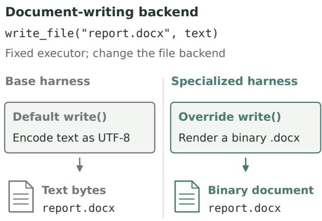  
Valid file format does not imply correct content.  
Figure 8 | Generating a Word document through the file backend. For the same illustrative write\_file ca<sup>ll</sup>, t<sup>h</sup>e <sup>b</sup>ase <sup>b</sup>ac<sup>k</sup>en<sup>d</sup> saves text un<sup>d</sup>er a .docx <sup>fil</sup>e-<sub>name;</sub> th<sub>e spec</sub>i<sub>a</sub>li<sub>ze</sub>d b<sub>ac</sub>k<sub>en</sub>d <sub>ren</sub>d<sub>ers</sub> th<sub>e</sub> t<sub>ex</sub>t i<sub>n</sub>t<sub>o a</sub> bi<sub>nary</sub> d<sub>ocumen</sub>t<sub>.</sub>

T<sup>h</sup>e office-doc-write <sup>h</sup>arness a<sup>dd</sup>resses t<sup>hi</sup>s <sub>pro</sub>bl<sub>em</sub> b<sub>y</sub> <sub>wrapp</sub>i<sub>ng</sub> th<sub>e</sub> fil<sub>e</sub> b<sub>ac</sub>k<sub>en</sub>d <sub>an</sub>d <sub>ren</sub>d<sub>er-</sub> i<sub>ng suppor</sub>t<sub>e</sub>d t<sub>ex</sub>t i<sub>n</sub>t<sub>o a</sub> bi<sub>nary</sub> W<sub>or</sub>d d<sub>ocumen</sub>t (Fi<sub>g</sub>ure 8).

Th<sub>e spec</sub>i<sub>a</sub>li<sub>ze</sub>d b<sub>ac</sub>k<sub>en</sub>d h<sub>an</sub>dl<sub>es</sub> di<sub>rec</sub>t d<sub>oc-</sub> <sub>umen</sub>t <sub>wr</sub>it<sub>es</sub> <sub>an</sub>d <sub>can</sub> <sub>a</sub>l<sub>so</sub> <sub>crea</sub>t<sub>e</sub> <sub>a</sub> <sub>m</sub>i<sub>ss</sub>i<sub>ng</sub> <sub>re-</sub> <sub>ques</sub>t<sub>e</sub>d d<sub>ocumen</sub>t f<sub>rom</sub> <sub>a</sub> t<sub>ex</sub>t d<sub>ra</sub>ft<sub>.</sub> I<sub>n</sub> th<sub>e</sub> l<sub>a</sub>tt<sub>er</sub> <sub>case,</sub> it <sub>preserves</sub> th<sub>e or</sub>i<sub>g</sub>i<sub>na</sub>l t<sub>ex</sub>t <sub>wr</sub>it<sub>e an</sub>d l<sub>eaves</sub> <sub>any ex</sub>i<sub>s</sub>ti<sub>ng</sub> t<sub>arge</sub>t d<sub>ocumen</sub>t <sub>un</sub>t<sub>ouc</sub>h<sub>e</sub>d<sub>.</sub> If <sub>ren-</sub> d<sub>er</sub>i<sub>ng</sub> f<sub>a</sub>il<sub>s,</sub> <sub>execu</sub>ti<sub>on</sub> f<sub>a</sub>ll<sub>s</sub> b<sub>ac</sub>k t<sub>o</sub> th<sub>e</sub> <sub>paren</sub>t b<sub>ac</sub>k<sub>en</sub>d<sub>.</sub> Thi<sub>s</sub> <sub>capa</sub>bilit<sub>y</sub> h<sub>an</sub>dl<sub>es</sub> th<sub>e</sub> fil<sub>e</sub> f<sub>orma</sub>t<sub>;</sub> th<sub>e</sub> b<sub>enc</sub>h<sub>mar</sub>k <sub>separa</sub>t<sub>e</sub>l<sub>y eva</sub>l<sub>ua</sub>t<sub>es w</sub>h<sub>e</sub>th<sub>er</sub> th<sub>e</sub> <sub>con</sub>t<sub>en</sub>t <sub>sa</sub>ti<sub>s</sub>fi<sub>es</sub> th<sub>e</sub> t<sub>as</sub>k<sub>.</sub>

Th<sub>e reques</sub>t<sub>e</sub>d <sub>ou</sub>t<sub>pu</sub>t f<sub>orma</sub>t i<sub>s o</sub>ft<sub>en v</sub>i<sub>s</sub>ibl<sub>e</sub> i<sub>n</sub> th<sub>e</sub> t<sub>as</sub>k d<sub>escr</sub>i<sub>p</sub>ti<sub>on, g</sub>i<sub>v</sub>i<sub>ng</sub> th<sub>e rou</sub>t<sub>er a use</sub>f<sub>u</sub>l <sub>cue</sub> f<sub>or se</sub>l<sub>ec</sub>ti<sub>ng</sub> thi<sub>s capa</sub>bilit<sub>y.</sub> Thi<sub>s</sub> i<sub>s cons</sub>i<sub>s</sub>t<sub>en</sub>t <sub>w</sub>ith th<sub>e sma</sub>ll dif<sub>erence</sub> b<sub>e</sub>t<sub>ween</sub> t<sub>as</sub>k<sub>-on</sub>l<sub>y an</sub>d trajectory-based routing on Workspace-Bench.

## B.2. AutomationBench: inherited checks and routing lessons

Adding execution checks through inheritance. B<sub>us</sub>i<sub>ness wor</sub>kfl<sub>ows o</sub>ft<sub>en requ</sub>i<sub>re c</sub>h<sub>anges</sub> t<sub>o ap-</sub> <sub>p</sub>li<sub>ca</sub>ti<sub>on s</sub>t<sub>a</sub>t<sub>e,</sub> b<sub>u</sub>t <sub>an execu</sub>ti<sub>on may</sub> fi<sub>n</sub>i<sub>s</sub>h <sub>a</sub>ft<sub>er</sub> <sub>searc</sub>hi<sub>ng</sub> <sub>or</sub> <sub>rea</sub>di<sub>ng</sub> <sub>w</sub>ith<sub>ou</sub>t <sub>ma</sub>ki<sub>ng</sub> <sub>an</sub> <sub>up</sub>d<sub>a</sub>t<sub>e.</sub> An ancestor (s9) addresses this <sub>p</sub>roblem with a <sub>comp</sub>l<sub>e</sub>ti<sub>on</sub> <sub>c</sub>h<sub>ec</sub>k<sub>:</sub> <sub>w</sub>h<sub>en</sub> th<sub>e</sub> t<sub>as</sub>k <sub>requ</sub>i<sub>res</sub> <sub>a</sub> <sub>wr</sub>it<sub>e</sub> b<sub>u</sub>t <sub>no mu</sub>t<sub>a</sub>ti<sub>ng</sub> API <sub>ca</sub>ll h<sub>as occurre</sub>d<sub>,</sub> it <sub>can re-</sub> <sub>q</sub>uest anot<sup>h</sup>er turn.

Fi<sub>gure</sub> 9 <sub>s</sub>h<sub>ows success</sub>i<sub>ve ex</sub>t<sub>ens</sub>i<sub>ons w</sub>ithi<sub>n</sub> t<sup>h</sup>e discovery-setup <sup>li</sup>neage. Bu<sup>ildi</sup>ng on s9<sup>’</sup>s <sub>m</sub>i<sub>ss</sub>i<sub>ng-wr</sub>it<sub>e comp</sub>l<sub>e</sub>ti<sub>on c</sub>h<sub>ec</sub>k<sub>, s</sub>12 <sub>a</sub>dd<sub>s a re-</sub> <sub>m</sub>i<sub>n</sub>d<sub>er near</sub> th<sub>e</sub> t<sub>urn</sub> li<sub>m</sub>it <sub>w</sub>h<sub>en no wr</sub>it<sub>e</sub> h<sub>as</sub> <sub>succee</sub>d<sub>e</sub>d<sub>.</sub> It<sub>s c</sub>hild <sub>s</sub>29 <sub>re</sub>t<sub>a</sub>i<sub>ns</sub> b<sub>o</sub>th <sub>mec</sub>h<sub>an</sub>i<sub>sms</sub> <sub>an</sub>d <sub>a</sub>dd<sub>s</sub> <sub>gu</sub>id<sub>ance</sub> f<sub>or</sub> <sub>unrecovera</sub>bl<sub>e</sub> <sub>errors</sub> <sub>an</sub>d <sub>repea</sub>t<sub>e</sub>d <sub>unpro</sub>d<sub>uc</sub>ti<sub>ve</sub> t<sub>oo</sub>l <sub>resu</sub>lt<sub>s.</sub>

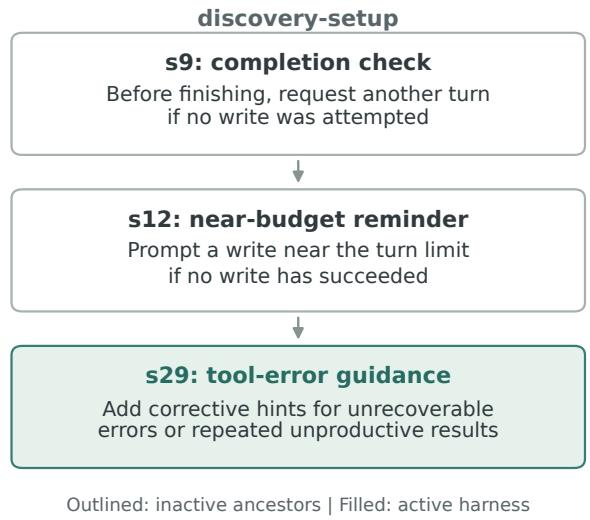  
Figure 9 | Adding execution checks through inheritance. Successive nodes add a missing-write com-<sub>p</sub>l<sub>e</sub>ti<sub>on c</sub>h<sub>ec</sub>k<sub>, a near-</sub>b<sub>u</sub>d<sub>ge</sub>t <sub>rem</sub>i<sub>n</sub>d<sub>er, an</sub>d t<sub>oo</sub>l<sub>-error</sub> <sub>gu</sub>id<sub>ance.</sub> A<sub>rrows s</sub>h<sub>ow</sub> i<sub>n</sub>h<sub>er</sub>it<sub>ance.</sub> Th<sub>e</sub> fill<sub>e</sub>d <sub>no</sub>d<sub>e</sub> <sub>s</sub>29 i<sub>s ac</sub>ti<sub>ve; s</sub>9 <sub>an</sub>d <sub>s</sub>12 <sub>are</sub> i<sub>nac</sub>ti<sub>ve ances</sub>t<sub>ors</sub> th<sub>a</sub>t <sub>supp</sub>l<sub>y</sub> i<sub>n</sub>h<sub>er</sub>it<sub>e</sub>d b<sub>e</sub>h<sub>av</sub>i<sub>or.</sub>

Using execution evidence to choose a harness. R<sub>ou</sub>ti<sub>ng</sub> l<sub>essons connec</sub>t <sub>o</sub>b<sub>serve</sub>d <sub>execu</sub>ti<sub>on pro</sub>b<sub>-</sub> l<sub>ems</sub> t<sub>o</sub> h<sub>arness capa</sub>biliti<sub>es.</sub> F<sub>or examp</sub>l<sub>e, a</sub> l<sub>esson</sub> <sub>recommen</sub>d<sub>s an</sub> API <sub>error-norma</sub>li<sub>zer w</sub>h<sub>en an</sub> e<sup>x</sup>ecu<sup>ti</sup>o<sup>n</sup> <sup>r</sup>epea<sup>t</sup>e<sup>dl</sup>y e<sup>n</sup>cou<sup>nt</sup>e<sup>r</sup>s que<sup>r</sup>y<sup>-</sup>pa<sup>r</sup>s<sup>in</sup>g <sub>errors.</sub> Thi<sub>s</sub> h<sub>arness</sub> t<sub>urns error</sub> f<sub>ee</sub>db<sub>ac</sub>k i<sub>n</sub>t<sub>o</sub> instructions for re<sub>p</sub>airin<sub>g</sub> the <sub>q</sub>uer<sub>y</sub> (Fi<sub>g</sub>ure 6c).

T<sub>a</sub>bl<sub>e</sub> 4 <sub>g</sub>i<sub>ves</sub> t<sub>wo</sub> <sub>recor</sub>d<sub>e</sub>d <sub>rou</sub>ti<sub>ng</sub> <sub>c</sub>h<sub>o</sub>i<sub>ces.</sub> A<sub>n</sub> <sub>execu</sub>ti<sub>on w</sub>ith <sub>no wr</sub>it<sub>es an</sub>d <sub>repea</sub>t<sub>e</sub>d <sub>serv</sub>i<sub>ce</sub> <sub>errors</sub> i<sub>s</sub> <sub>rou</sub>t<sub>e</sub>d t<sub>o</sub> <sub>a</sub> <sub>resource-man</sub>if<sub>es</sub>t h<sub>arness,</sub> <sub>w</sub>hi<sub>c</sub>h <sub>supp</sub>li<sub>es connec</sub>t<sub>e</sub>d<sub>-serv</sub>i<sub>ce an</sub>d <sub>resource</sub> i<sub>n</sub>f<sub>orma</sub>ti<sub>on</sub> t<sub>o</sub> <sub>gu</sub>id<sub>e</sub> API <sub>exp</sub>l<sub>ora</sub>ti<sub>on.</sub> A <sub>c</sub>l<sub>ean</sub> <sub>ex-</sub> <sub>ecu</sub>ti<sub>on w</sub>ith <sub>success</sub>f<sub>u</sub>l <sub>wr</sub>it<sub>es reuses</sub> B<sub>ase.</sub> Th<sub>ese</sub> <sub>examp</sub>l<sub>es s</sub>h<sub>ow</sub> h<sub>ow</sub> l<sub>essons can se</sub>l<sub>ec</sub>t <sub>a re</sub>l<sub>evan</sub>t i<sub>n</sub>t<sub>erven</sub>ti<sub>on or preserve a c</sub>l<sub>ean</sub> B<sub>ase execu</sub>ti<sub>on.</sub>

<table><tr><td>Base execution</td><td>Routing lesson</td><td>Router choice</td></tr><tr><td>A lead-scoring execution makes no writes. HubSpot and Intercom return 401 errors indicating no connected</td><td>Repeated connection errors and failed resource lookups suggest that information about connected services</td><td>Resource-manifest harness.</td></tr><tr><td>account; a Lead lookup returns 404. The final response is empty. Another execution completes three</td><td>and available resources may help.</td><td></td></tr><tr><td>writes, has no errors, and finishes cleanly.</td><td>Successful writes and a clean finish support keeping the Base result.</td><td>Reuse Base.</td></tr></table>

Table 4 | Execution evidence behind two routing choices. Examples from an earlier AutomationBench <sub>wor</sub>kfl<sub>ow pa</sub>i<sub>r o</sub>b<sub>serve</sub>d B<sub>ase</sub> b<sub>e</sub>h<sub>av</sub>i<sub>or w</sub>ith th<sub>e app</sub>li<sub>ca</sub>bl<sub>e rou</sub>ti<sub>ng</sub> l<sub>esson an</sub>d th<sub>e recor</sub>d<sub>e</sub>d <sub>c</sub>h<sub>o</sub>i<sub>ce.</sub>

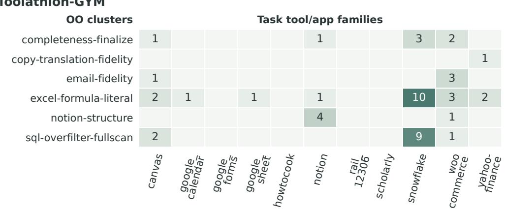  
Fi ure 10 | Learned task clusters on Toolathlon-GYM. Rows are learned clusters and columns are evaluated AAH <sub>app</sub> <sub>groups.</sub> C<sub>e</sub>ll<sub>s</sub> <sub>coun</sub>t <sub>s</sub>h<sub>are</sub>d di<sub>scovery</sub> t<sub>as</sub>k<sub>s,</sub> <sub>s</sub>h<sub>ow</sub>i<sub>ng</sub> h<sub>ow</sub> <sub>a</sub> <sub>c</sub>l<sub>us</sub>t<sub>er</sub> <sub>can</sub> <sub>span</sub> <sub>severa</sub>l <sub>app</sub>li<sub>ca</sub>ti<sub>ons.</sub> Bl<sub>an</sub>k <sub>ce</sub>ll<sub>s are zero;</sub> B<sub>ase an</sub>d <sub>unc</sub>l<sub>us</sub>t<sub>ere</sub>d t<sub>as</sub>k<sub>s are om</sub>itt<sub>e</sub>d<sub>.</sub>

## B.3. Toolathlon-GYM: refining when and what to check

Th<sub>e</sub> l<sub>earne</sub>d <sub>c</sub>l<sub>us</sub>t<sub>ers</sub> <sub>can</sub> <sub>span</sub> <sub>mu</sub>lti<sub>p</sub>l<sub>e</sub> <sub>app</sub>li<sub>ca-</sub> t<sup>i</sup>ons (F<sup>i</sup>gure 10). For examp<sup>l</sup>e, completenessfinalize <sup>i</sup>nc<sup>l</sup>u<sup>d</sup>es tas<sup>k</sup>s us<sup>i</sup>ng Canvas, Not<sup>i</sup>on, S<sub>now</sub>fl<sub>a</sub>k<sub>e, an</sub>d W<sub>oo</sub>C<sub>ommerce.</sub> Th<sub>e</sub> f<sub>o</sub>ll<sub>ow</sub>i<sub>ng</sub> <sub>examp</sub>l<sub>es</sub> <sub>s</sub>h<sub>ow</sub> h<sub>ow</sub> <sub>evo</sub>l<sub>u</sub>ti<sub>on</sub> <sub>re</sub>fi<sub>nes</sub> <sub>a</sub> <sub>s</sub>h<sub>are</sub>d b<sub>e</sub>h<sub>av</sub>i<sub>or</sub> <sub>an</sub>d <sub>a</sub>dd<sub>s</sub> <sub>a</sub> <sub>c</sub>h<sub>ec</sub>k f<sub>or</sub> <sub>a</sub> <sub>par</sub>ti<sub>cu</sub>l<sub>ar</sub> <sub>ou</sub>t<sub>pu</sub>t<sub>.</sub>

Refining when to compress tool output. An ancestor o<sup>f</sup> t<sup>h</sup>e completeness-finalize <sup>h</sup>ar-<sub>ness s</sub>h<sub>or</sub>t<sub>ens unusua</sub>ll<sub>y</sub> l<sub>ong</sub> t<sub>oo</sub>l <sub>responses</sub> t<sub>o</sub> li<sub>m</sub>it th<sub>e amoun</sub>t <sub>o</sub>f t<sub>ex</sub>t i<sub>n</sub> th<sub>e execu</sub>ti<sub>on</sub> hi<sub>s</sub>t<sub>ory.</sub> It<sub>s c</sub>hild <sub>re</sub>t<sub>a</sub>i<sub>ns</sub> thi<sub>s</sub> b<sub>e</sub>h<sub>av</sub>i<sub>or</sub> b<sub>u</sub>t <sub>a</sub>dd<sub>s an ear</sub>l<sub>y-</sub> fi<sub>n</sub>i<sub>s</sub>h <sub>con</sub>diti<sub>on: a</sub>ft<sub>er an ear</sub>l<sub>y comp</sub>l<sub>e</sub>ti<sub>on a</sub>t<sub>-</sub> <sup>t</sup>e<sup>m</sup>p<sup>t</sup>, a<sup>n</sup>y su<sup>b</sup>seque<sup>nt</sup> <sup>t</sup>oo<sup>l</sup> ou<sup>t</sup>pu<sup>t</sup>s <sup>b</sup>ypass co<sup>m-</sup> <sub>press</sub>i<sub>on.</sub> Thi<sub>s a</sub>ll<sub>ows</sub> th<sub>e c</sub>hild t<sub>o narrow w</sub>h<sub>en</sub> <sub>an</sub> i<sub>n</sub>h<sub>er</sub>it<sub>e</sub>d i<sub>n</sub>t<sub>erven</sub>ti<sub>on app</sub>li<sub>es, us</sub>i<sub>ng progress</sub> <sub>o</sub>b<sub>serve</sub>d d<sub>ur</sub>i<sub>ng</sub> <sub>execu</sub>ti<sub>on.</sub>

Checking the saved workbook. The excel-formula-literal <sup>h</sup>arness a<sup>dd</sup>s a fil<sub>e</sub> <sub>c</sub>h<sub>ec</sub>k t<sub>o</sub> i<sub>n</sub>h<sub>er</sub>it<sub>e</sub>d <sub>gu</sub>id<sub>ance</sub> <sub>a</sub>b<sub>ou</sub>t <sub>wr</sub>iti<sub>ng</sub> com<sub>p</sub>uted values to s<sub>p</sub>readsheets (Listin<sub>g</sub> 1). B<sub>e</sub>f<sub>ore</sub> fi<sub>n</sub>i<sub>s</sub>hi<sub>ng,</sub> it <sub>rea</sub>d<sub>s</sub> th<sub>e</sub> <sub>save</sub>d <sub>wor</sub>kb<sub>oo</sub>k <sub>an</sub>d l<sub>oo</sub>k<sub>s</sub> f<sub>or</sub> <sub>ce</sub>ll<sub>s</sub> <sub>w</sub>ith <sub>percen</sub>t<sub>age</sub> l<sub>a</sub>b<sub>e</sub>l<sub>s</sub> <sub>an</sub>d <sub>va</sub>l<sub>ues s</sub>t<sub>r</sub>i<sub>c</sub>tl<sub>y</sub> b<sub>e</sub>t<sub>ween zero an</sub>d <sub>one.</sub> It <sub>can</sub> th<sub>en</sub> <sub>reques</sub>t <sub>one</sub> <sub>correc</sub>ti<sub>on</sub> <sub>pass,</sub> li<sub>s</sub>ti<sub>ng</sub> th<sub>e</sub> id<sub>en</sub>tifi<sub>e</sub>d <sub>ce</sub>ll<sub>s an</sub>d <sub>propose</sub>d <sub>va</sub>l<sub>ues mu</sub>lti<sub>p</sub>li<sub>e</sub>d b<sub>y</sub> 100<sub>.</sub>

Thi<sub>s</sub> <sub>ru</sub>l<sub>e</sub> <sub>assumes</sub> th<sub>a</sub>t th<sub>e</sub> t<sub>as</sub>k <sub>expec</sub>t<sub>s</sub> <sub>percen</sub>t<sub>-</sub> a<sub>g</sub>e <sub>p</sub>oints: for exam<sub>p</sub>le<sub>,</sub> 20 rather than 0.2 for t<sub>wen</sub>t<sub>y percen</sub>t<sub>.</sub> Th<sub>e</sub> i<sub>ns</sub>t<sub>ruc</sub>ti<sub>on as</sub>k<sub>s</sub> th<sub>e execu-</sub> t<sub>or</sub> t<sub>o c</sub>h<sub>ange on</sub>l<sub>y</sub> th<sub>e</sub> li<sub>s</sub>t<sub>e</sub>d <sub>ce</sub>ll<sub>s an</sub>d <sub>preserve</sub> th<sub>e res</sub>t <sub>o</sub>f th<sub>e wor</sub>kb<sub>oo</sub>k<sub>.</sub> Th<sub>e</sub> h<sub>arness</sub> th<sub>ere</sub>f<sub>ore</sub> <sub>uses</sub> th<sub>e con</sub>t<sub>en</sub>t<sub>s o</sub>f th<sub>e pro</sub>d<sub>uce</sub>d fil<sub>e</sub> t<sub>o</sub> d<sub>ec</sub>id<sub>e</sub> <sub>w</sub>h<sub>e</sub>th<sub>er</sub> t<sub>o</sub> <sub>reques</sub>t <sub>a</sub> t<sub>arge</sub>t<sub>e</sub>d <sub>correc</sub>ti<sub>on</sub> b<sub>e</sub>f<sub>ore</sub> fi<sub>n</sub>i<sub>s</sub>hi<sub>ng.</sub>