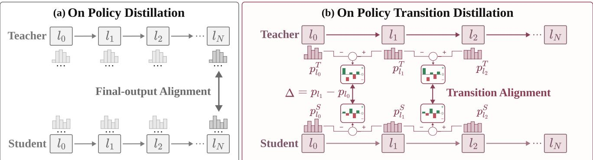
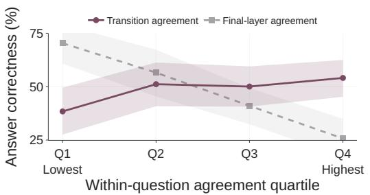
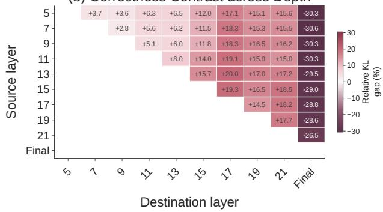
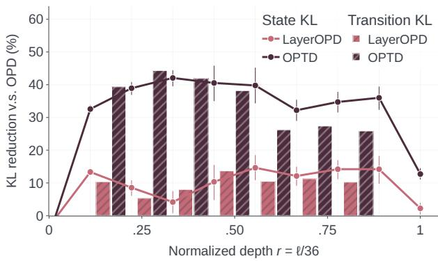
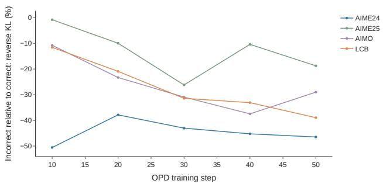

# On-Policy Transition Distillation

Runyang You<sup>1</sup> Yongqi Li<sup>1†</sup> Tiezheng Yu<sup>2</sup> Wenjie Li<sup>1</sup>

<sup>1</sup> The Hong Kong Polytechnic University <sup>2</sup> Huawei Technologies Ltd. runyang.y@outlook.com, liyongqi0@gmail.com

## Abstract

On-policy distillation (OPD) consolidates expert capabilities into a single student by matching teacher and student final-layer distributions on student-generated rollouts. We investigate whether depthwise prediction transitions, the changes in predictions between layers, can provide additional task-relevant supervision. Our diagnostic study finds that stronger teacher–student agreement in intermediate transitions is associated with higher answer correctness within questions, with correct responses exhibiting lower mean transition KL across all measured intermediate layer pairs. These observations motivate On-Policy Transition Distillation (OPTD), which augments final-layer distribution matching by aligning teacher and student layer-to-layer log-probability increments on student-generated rollouts. Evaluations across three backbones and eight benchmarks spanning mathematics, coding, and instruction following show that OPTD achieves the best or tied-best overall performance in both dual- and three-domain distillation. In the three-domain setting, OPTD recovers ≈ 90% of the overall teacher–student capability gap, compared with ≈ 75% for OPD.

<sup>§</sup> Project Page: https://github.com/ModalityDance/optd

  
Figure 1: On-policy transition distillation. (a) Standard OPD aligns only the final-layer predictions of the student and teacher. (b) OPTD additionally aligns their prediction transitions across selected layer segments, transferring how predictions are refined with depth.

## 1 Introduction

On-policy distillation (OPD) has emerged as a core posttraining recipe for consolidating specialized capabilities from expert teachers into a unified student, as exemplified by DeepSeek-V4 and GLM-5 [1, 2]. Specifically, it applies dense supervision at every token position of a student-generated rollout by comparing the teacher’s and student’s distributions conditioned on the same prefix, and uses the resulting KL-derived token-level reward to guide policy distillation [3]. Grounding supervision in the student’s own rollouts, OPD alleviates exposure bias [4], mitigates catastrophic forgetting [2], and learns with substantially fewer samples than outcome-reward RL [5].

OPD methods typically transfer knowledge by solely aligning the student’s final-layer prediction distribution with those of the teacher. The final-layer distribution, however, represents only the endpoint of the teacher’s decision process. Recent studies show that these predictions develop through successive prediction revisions across depth: early layers can favor statistical guesses that deeper layers refine as contextual information develops [6, 7]. Layer-contrastive decoding further demonstrates that diferences between predic tions across depths, which we term depthwise prediction transitions, can be exploited to improve generation factuality [8]. This raises a natural question: can such transitions provide additional task-relevant guidance for on-policy distillation?

To answer this question, we start by comparing teacher–student agreement on correct and incorrect student-generated responses, and found that stronger teacher–student agreement in intermediate prediction transitions is associated with higher answer correctness, while final-layer agreement exhibits the opposite trend (Fig. 2(a)). This correctness-related pattern extends across all measured intermediate layer pairs: correct responses exhibit lower mean transition ${ \mathrm { K L } } ,$ , with larger relative gaps for transitions involving middle-tolate layers (Fig. 2(b)). Together, these findings motivate distilling the teacher’s internal predictive changes alongside its final output distribution.

We therefore propose On-Policy Transition Distillation (OPTD), which complements final-layer supervision with alignment of teacher–student predictive transitions on student-generated rollouts, as illustrated in Fig. 1(b). Rather than aligning only the final-layer distributions as in Fig. 1(a), OPTD examines the prediction changes between selected anchor layers for the same studentvisited prefix. For each candidate token, these changes are represented by the layer-to-layer increment in its log probability, capturing both the direction and magnitude of the prediction revision across depth. We then compare the teacher’s and student’s increments and use their discrepancy as a reward alongside the final-layer OPD objective, encouraging agreement with the teacher’s predictive changes on the same student-generated trajectory.

Evaluations across three model backbones, three domains, and eight benchmarks show that OPTD achieves the best or tied-best overall performance in both dual and three-domain distillation. Under matched training budgets, it consistently improves overall performance over standard OPD across all evaluated backbones and domain settings, supporting the joint transfer of hetero geneous specialist capabilities into a single student. In the three-domain setting, OPTD recovers ≈ 90% of the overall teacher–student capability gap, compared with ≈ 75% for OPD (Tab. 2). Internal diagnostics further show that transition supervision improves alignment with the teacher across depth, including intermediatelayer predictions and the final output.

Our contributions are threefold:

• We characterize the relationship between teacher–student agreement and answer correctness across model depth, identifying a correctness-related pattern in intermediate predictive transitions that motivates transition-based supervision.

• We propose On-Policy Transition Distillation (OPTD), which transfers the teacher’s depthwise prediction refinement by aligning the direction and magnitude of cross-layer prediction increments on studentgenerated rollouts.

• We demonstrate that OPTD achieves optimal overall performance in both dual- and three-domain distillation, consistently improving over OPD across backbones and domain settings.

## 2 Preliminaries and Motivating Observations

We first review on-policy distillation (OPD) in §2.1. We then revisit the assumption underlying standard OPD supervision and compare final-layer output agreement with depthwise transition agreement in §2.2.1. Empirical findings are summarized in §2.2.2.

## 2.1 On-Policy Distillation

OPD trains a student $\pi _ { \theta } ^ { s }$ using teacher feedback on its own trajectories. For a prompt $x \ \sim \ \mathcal { D }$ , the student generates a response $y \ = \ ( y _ { 1 } , \dots , y _ { T } ) \sim \ \pi _ { \theta } ^ { S } ( \cdot \ | \ x )$ of length �. In multi-domain OPD, prompts from diferent task domains are supervised by their respective spe cialist teachers, with $\pi ^ { T }$ denoting the teacher for the current prompt [9]. At each prefix $s _ { t } = ( x , y _ { < t } )$ , where $y _ { < t } = ( y _ { 1 } , \ldots , y _ { t - 1 } )$ denotes the previously generated tokens. Let $\nu \in \mathcal { N }$ denote a candidate next token. Over the full vocabulary $\boldsymbol { \mathcal { V } } _ { i }$ , the fixed supervision policy $\pi ^ { T }$ supplies the token-level reward

$$
R _ { t } ( \nu ) = \log \pi ^ { T } ( \nu \mid s _ { t } ) - \log \pi _ { \theta } ^ { S } ( \nu \mid s _ { t } ) .
$$

At a fixed prefix, the expected reward equals the negative student-to-teacher reverse KL:

$$
\begin{array} { r } { \mathbb { E } _ { \nu \sim \pi _ { \theta } ^ { S } ( \cdot \vert s _ { t } ) } \left[ R _ { t } ( \nu ) \right] = \displaystyle \sum _ { \nu } \pi _ { \theta } ^ { S } ( \nu \mid s _ { t } ) \log \frac { \pi ^ { T } ( \nu \mid s _ { t } ) } { \pi _ { \theta } ^ { S } ( \nu \mid s _ { t } ) } } \\ { = - D _ { \mathrm { K L } } \big ( \pi _ { \theta } ^ { S } ( \cdot \mid s _ { t } ) \big \Vert \pi ^ { T } ( \cdot \mid s _ { t } ) \big ) \enspace . } \end{array}\tag{1}
$$

Maximizing this reward therefore encourages the student’s predictions to match the teacher’s on the student’s own response prefixes. OPD implements this objective through the reward-weighted update

$$
\nabla _ { \boldsymbol { \theta } } J _ { \mathrm { O P D } } = \mathbb { E } _ { \boldsymbol { x } \sim \mathcal { D } , \boldsymbol { y } \sim \pi _ { \boldsymbol { \theta } } ^ { S } } \left[ \sum _ { t = 1 } ^ { T } R _ { t } ( \boldsymbol { y _ { t } } ) \nabla _ { \boldsymbol { \theta } } \log \pi _ { \boldsymbol { \theta } } ^ { S } ( \boldsymbol { y _ { t } } \mid \boldsymbol { s _ { t } } ) \right] .\tag{2}
$$

(a) Agreement and Correctness  


(b) Correctness Contrast across Depth  
  
Figure 2: Teacher agreement and answer correctness. (a) Correctness by within-question agreement quartile; shading shows 95% confidence intervals. (b) Relative transition-KL gaps across layer pairs; positive values indicate closer teacher agreement on correct responses. Diagnostic details are in App. C.6.

Following Fu et al. [10], we evaluate this update on the student’s top-� candidates $\mathcal { K } _ { t } \ = \ \mathrm { T o p K } \big ( \pi _ { \theta } ^ { S } ( { \cdot } \mid s _ { t } ) \big )$ Renormalizing their probabilities defines the truncated weights

$$
w _ { t } ( \nu ) = \frac { \pi _ { \theta } ^ { S } ( \nu \mid s _ { t } ) } { \sum _ { u \in \mathcal { K } _ { t } } \pi _ { \theta } ^ { S } ( u \mid s _ { t } ) } , \qquad \nu \in \mathcal { K } _ { t } ,\tag{3}
$$

and the resulting OPD loss is

$$
\ell _ { \mathrm { O P D } , t } = - \sum _ { \nu \in \mathcal { K } _ { t } } w _ { t } ( \nu ) R _ { t } ( \nu ) \log \pi _ { \theta } ^ { S } ( \nu \mid s _ { t } ) .\tag{4}
$$

## 2.2 Revisiting Teacher Agreement in On-Policy Distillation

Predictions are progressively refined across transformer layers [6, 7]. We investigate whether teacher–student agreement in these predictive changes is associated with answer correctness, and how the relationship varies across depth. We use final-layer agreement as a reference.

## 2.2.1 Diagnostic Setup

Final-Layer Output Divergence. We quantify final layer teacher agreement using the trajectory-averaged reverse KL divergence:

$$
{ \mathcal { D } } _ { \mathrm { f i n a l } } ( y ) = { \frac { 1 } { T } } \sum _ { t = 1 } ^ { T } D _ { \mathrm { K L } } { \big ( } \pi _ { \theta } ^ { S } ( \cdot \mid s _ { t } ) { \big \| } \pi ^ { T } ( \cdot \mid s _ { t } ) { \big ) } ~ .\tag{5}
$$

Depthwise Transition Divergence. A model’s final prediction represents the culmination of layered computation. Across network layers, token predictions undergo progressive revisions, forming depthwise prediction transitions. Let $p _ { \ell , t } ^ { S }$ and $p _ { \ell , t } ^ { T }$ denote the intermediate nexttoken probability distributions obtained by applying the unembedding head to the layer-ℓ hidden states (i.e., the logit lens) for the student and teacher, respectively, where $\ell \in \{ 1 , \ldots , L \}$ and � denotes the final layer. For two layers $\ell < \ell ^ { \prime }$ , we characterize the revision in candidate log-probabilities by the prediction increment:

$$
\begin{array} { r } { \Delta _ { \ell \to \ell ^ { \prime } , t } ^ { S / T } ( \upsilon ) = \log p _ { \ell ^ { \prime } , t } ^ { S / T } ( \upsilon ) - \log p _ { \ell , t } ^ { S / T } ( \upsilon ) . } \end{array}\tag{6}
$$

To evaluate whether the student follows the teacher’s internal revision trajectory over the vocabulary $\boldsymbol { \mathcal { V } } ,$ we normalize the increments into a probability distribution:

$$
q _ { \ell \to \ell ^ { \prime } , t } ^ { S / T } ( \nu ) = \frac { \exp ( \Delta _ { \ell \to \ell ^ { \prime } , t } ^ { S / T } ( \nu ) ) } { \sum _ { j \in \mathcal { V } } \exp ( \Delta _ { \ell \to \ell ^ { \prime } , t } ^ { S / T } ( j ) ) } .\tag{7}
$$

This distribution assigns higher probability mass to candidate tokens whose probabilities increase by a larger factor between the layers. We then measure transition divergence between layers ℓ and $\ell ^ { \prime }$ using response-averaged reverse KL:

$$
\mathcal { D } _ { \mathrm { t r a n s } } ( \ell , \ell ^ { \prime } ; y ) = \frac { 1 } { T } \sum _ { t = 1 } ^ { T } D _ { \mathrm { K L } } \Bigl ( q _ { \ell \to \ell ^ { \prime } , t } ^ { S } \Bigr | \Bigr | q _ { \ell \to \ell ^ { \prime } , t } ^ { T } \Bigr ) .\tag{8}
$$

A lower value of $\mathcal { D } _ { \mathrm { t r a n s } } ( \ell , \ell ^ { \prime } ; y )$ indicates that the student’s internal prediction transitions follow the teacher’s revision trajectory more faithfully.

Comparison Protocol. We analyze 480 responses from 60 mathematics questions that elicit both correct and incorrect answers from an OPD-trained Qwen3-4B student. To compare responses to the same question, we rank its answers by transition agreement, defined as the negative mean divergence over the measured intermediate layer pairs, and report correctness across four agreement groups (Fig. 2(a)). We repeat this ranking using negative final-layer KL as a reference. To examine the depthwise pattern, we compare correct and incorrect responses at each layer pair (Fig. 2(b)). Let $\overline { { \mathcal { D } } } _ { \mathrm { c o r r e c t } }$ and $\overline { { \mathcal { D } } } _ { \mathrm { i } }$ incorrect denote the respective group means, aggregated within questions and then across benchmarks. We report their relative gap:

$$
\Delta \mathcal { D } = \frac { \overline { { \mathcal { D } } } _ { \mathrm { i n c o r r e c t } } - \overline { { \mathcal { D } } } _ { \mathrm { c o r r e c t } } } { \overline { { \mathcal { D } } } _ { \mathrm { c o r r e c t } } } \times 1 0 0 \%\tag{9}
$$

Positive values indicate closer teacher agreement on correct responses. The checkpoint, layer pairs, aggregation, and uncertainty estimation are detailed in App. C.6.

## 2.2.2 Observation and Analysis

Observation 1: Agreement in predictive transitions tracks answer correctness. Agreement with the teacher’s intermediate predictive changes carries a taskrelevant signal: among responses to the same question, those with stronger transition agreement tend to be more accurate (Fig. 2(a)). Correctness rises from 38.4% in the lowest-agreement quartile to 54.1% in the highest, with similar rates in the two middle quartiles. This association links response correctness to how closely the student follows the teacher’s predictive changes across depth, motivating transitions as a candidate distillation target. Final-layer agreement exhibits the opposite trend in the same response cohort.

Observation 2: The correctness contrast is structured across depth. The correctness-related contrast extends across all 36 measured intermediate layer pairs: correct responses exhibit lower mean transition KL than incorrect responses (Fig. 2(b)). Within this internal grid, the relative gaps are more pronounced for transitions involving middle-to-late layers. Transitions ending at the final output exhibit the opposite direction, distinguishing the internal pattern from the changes leading to the output distribution. This depthwise structure is consistent with accounts of predictions being progressively refined as contextual information develops across transformer layers [6, 7]. It motivates examining the teacher’s internal predictive changes as a task-relevant aspect of its behavior.

Together, these findings motivate distilling the teacher’s predictive changes across depth in addition to its final output distribution. We therefore introduce OPTD, which augments final-layer distribution matching with supervision on depthwise prediction transitions.

## 3 On-Policy Transition Distillation

Building on the observations, we propose On-Policy Transition Distillation (OPTD) to distill the teacher’s depthwise prediction increments from on policy rollouts.

Consider an ordered sequence of anchor layers $\ell _ { 0 } <$ $\ell _ { 1 } < \dots < \ell _ { M } = L$ . For each segment $i ,$ from $\ell _ { i - 1 }$ to $\ell _ { i } ,$ the prediction increment $\Delta _ { i , t } ^ { S / T } ( \nu )$ is the quantity defined in Eq. (6). Following the top-� setting introduced in Section $^ { 2 , }$ we apply the same reward-weighted update to these depthwise increments. The transition-level reward is

$$
R _ { i , t } ^ { \mathrm { t r a n s } } ( \nu ) = \Delta _ { i , t } ^ { T } ( \nu ) - \Delta _ { i , t } ^ { S } ( \nu ) .\tag{10}
$$

For the segment ending at $\ell _ { i } ,$ the student probabilities of the retained candidates are renormalized at the destination layer:

$$
w _ { i , t } ( \nu ) = \frac { p _ { \ell _ { i } , t } ^ { S } ( \nu ) } { \sum _ { u \in \mathcal { K } _ { t } } p _ { \ell _ { i } , t } ^ { S } ( u ) } , \qquad \nu \in \mathcal { K } _ { t } .\tag{11}
$$

Using the detached transition signal and weights, the transition loss is

$$
\mathcal { L } _ { \mathrm { t r a n s } } = - \mathbb { E } _ { x \sim \mathcal { D } , y \sim \pi _ { \theta } ^ { S } } \left[ \mathbb { E } _ { t } \left[ \frac { 1 } { M } \sum _ { i = 1 } ^ { M } \sum _ { \upsilon \in \mathcal { K } _ { t } } w _ { i , t } ( \upsilon ) R _ { i , t } ^ { \mathrm { t r a n s } } ( \upsilon ) \Delta _ { i , t } ^ { S } ( \upsilon ) \right] \right] .\tag{12}
$$

During training, we retain the inherited final-layer update and add the transition update above $\nabla _ { \theta } J = \nabla _ { \theta } J _ { \mathrm { O P D } } +$ $\nabla _ { \theta } J _ { \mathrm { t r a n s } } .$ The relation between this practical update and the exact reverse transition-KL gradient is derived in App. B.4; implementation details are given in App. B.

## 4 Experiment Setup

We evaluate OPTD in dual-domain (§5.1) and threedomain (§5.2) distillation settings, covering mathematics and coding, with instruction following added in the latter. Each prompt receives supervision from its corresponding domain specialist, following the protocol described in§2.1.

Datasets and Benchmarks. We train on DAPO-Math-17k [11] and DeepCoder-Preview-Dataset [12]. We evaluate mathematics on AIME24/25 [13] and AIMO [14]; coding on LiveCodeBench v5 [15], CodeContests [16], and Codeforces with CodeElo [17]. For instruction following, we use Rubrics-To-Tokens [18] for training and IFEval [19] for evaluation. Training prompts are sampled equally across domains.

Models. We use DeepSeek-R1-Distill-Qwen-1.5B/7B [20] and Qwen3-4B [5] as students, each supervised by domain specialists detailed in App. C.2.

Baselines. We compare OPTD with OPD and its latentsupervision variants, OPRD [21] and LastOPD [22], which transfer teacher knowledge through hidden representations. We also implement LayerOPD: an absolutelayer supervision baseline that applies OPD across corresponding intermediate layer readouts.

Training. Methods within each setting share the student initialization, teachers, data, and update budget: 150 updates for 1.5B, 50 for 4B, and 100 for 7B. We use a learning rate of $1 0 ^ { - 5 }$ and two on-policy responses per prompt. Qwen3-4B uses non-thinking mode, while the R1-Distill students use reasoning prompts.

Evaluation. We report Avg@16 for mathematics, Avg@8/Pass@8 for LiveCodeBench, Avg@16 for Code-Contests, estimated Codeforces Elo, and average strict/loose IFEval accuracy under 16 samples per question. Dataset links, baseline implementations, and detailed training and evaluation settings are provided in App. C.

## 5 Main Results

## 5.1 Results on Dual-Domain Setting

Table 1 evaluates whether depthwise transition supervision improves the joint transfer of mathematics and coding capabilities under matched training settings.

• Transition supervision improves overall capability transfer across model sizes. The best OPTD configuration achieves the highest Overall score at each of the three model sizes, tying LayerOPD at 4B. At 4B, for example, Late OPTD raises Overall from 33.77% to 34.68% and improves all three mathematics benchmark averages over OPD. At 7B, it improves both Math Avg and Coding Avg over OPD, raising Overall from 49.14% to 50.06%. These results support transition supervision as a useful addition to final-output distillation for consolidating specialist capabilities in a single student. The preferred supervision depth depends on the setting: Middle OPTD leads at 1.5B, whereas Late OPTD leads at 4B and 7B.

• Representation alignment is efective, but its gains can involve cross-domain tradeofs. Representationbased supervision can enhance capability transfer: LastOPD improves Overall over OPD at all three sizes and achieves the highest Coding Avg at 1.5B and 4B, while OPRD improves both domain averages over OPD at 4B. However, LastOPD’s coding gains at 1.5B and 4B accompany lower Math Avg than OPD in both settings. This pattern illustrates a cross-domain tradeof: stronger transfer in one domain does not necessarily translate into stronger transfer in the other. For multi-specialist distillation, these results motivate assessing representation alignment through joint capability transfer, since a leading domain-specific score can coexist with a tradeof elsewhere.

## 5.2 Results on Three-Domain Setting

We extend distillation to a 1.5B student with specialist teachers for mathematics, coding, and instruction following. Table 2 compares OPD and OPTD under identical update budgets.

• The benefits of transition supervision extend to heterogeneous capabilities. OPTD improves every reported mathematics and instruction-following metric over OPD, with instruction-following gains spanning both IFEval and IFBench. These simultaneous improvements raise Overall from 37.89% to 39.57%. The results extend the evidence for OPTD beyond math/coding distillation: transition supervision also supports the integration of instruction-following capabilities alongside specialist reasoning skills in one student.

• OPTD recovers more of the specialist capabilities left untapped by OPD. OPD already reaches the coding teacher’s domain average, while recovering 70.1% and 65.0% of the teacher–student gaps in mathematics and instruction following, respectively. OPTD increases these recovery rates to 85.7% and 74.8%, while retaining a coding domain average above the teacher reference. Thus, the overall improvement reflects additional transfer in the domains with larger remaining teacher gaps, alongside sustained specialistlevel coding performance.

These results support capability transfer from heterogeneous specialists; complete results appear in App. A.2 and Tabs. 8–10.

## 6 Further Analysis

This section examines the design and mechanism of transition supervision. We study how transition geometry affect transfer, how alternative objective formulations compare, and whether OPTD improves the student’s internal prediction alignment with the teacher. Further diagnostic and derivational analyses are provided in Apps. D and B.4.

## 6.1 Transition Geometry Analysis

We examine how the placement and span of a supervised transition path afect capability transfer in the 1.5B multidomain setting, where Math is the average of AIME24, AIME25, and AIMO; Coding is LiveCodeBench, and IF is accuracy on IFEval. We express depth as $r = \ell / L$ , where � = 28 for this backbone, with the final prediction at � = 1. We define placement as the normalized depth � of the central supervised block and span as the normalized distance � from that block to each neighboring block. Given center � and span �, the intermediate readouts are positioned at $( c - s , c , c + s )$ . Early, Middle, and Late placements have centers at approximately 0.393, 0.464, and 0.536, respectively. Under otherwise matched training conditions (§4), we first compare placements at a fixed span of $s \approx 0 . 2 1 4$ , then compare spans of approximately 0.143, 0.214, and 0.286 at the Middle and Late placements. Exact block indices are provided in App. C.3.

<table><tr><td rowspan="3">Method</td><td colspan="7">Math</td><td colspan="8">Coding</td><td rowspan="3">Overall</td></tr><tr><td colspan="2">AIME24</td><td colspan="2">AIME25</td><td colspan="2">AIMO</td><td rowspan="2"> $\operatorname { A v } g .$ </td><td colspan="2">LiveCodeBench</td><td colspan="2">CodeContests</td><td colspan="2">CodeElo</td><td rowspan="2"></td><td rowspan="2">Avg.</td></tr><tr><td>Avg</td><td>Pass</td><td>Avg</td><td>Pass</td><td>Avg Pass</td><td></td><td>Avg Pass</td><td>Avg</td><td>Pass</td><td>Avg</td><td>Pass</td><td>Elo</td></tr><tr><td colspan="10">DeepSeek-R1-Distill-Qwen-1.5B</td><td colspan="7"></td></tr><tr><td>OPD</td><td>47.29</td><td>80.00</td><td>30.00</td><td>53.33</td><td>74.40</td><td>91.57</td><td>50.56</td><td>22.98</td><td>37.63</td><td>9.58</td><td>25.45</td><td>8.55</td><td>19.36</td><td>843.26</td><td>13.70</td><td>32.13</td></tr><tr><td>LastOPD</td><td>43.75</td><td>76.67</td><td>31.46</td><td>56.67</td><td>75.90</td><td>93.98</td><td>50.37</td><td>22.40</td><td>38.35</td><td>10.57</td><td>26.06</td><td>9.87</td><td>21.57</td><td>916.11</td><td>14.28</td><td>32.33</td></tr><tr><td>OPRD</td><td>36.88</td><td>73.33</td><td>27.50</td><td>53.33</td><td>71.46</td><td>91.57</td><td>45.28</td><td>20.03</td><td>34.77</td><td>9.58</td><td>22.42</td><td>8.55</td><td>19.36</td><td>843.26</td><td>12.72</td><td>29.00</td></tr><tr><td>LayerOPD</td><td>41.67</td><td>76.67</td><td>30.00</td><td>50.00</td><td>76.73</td><td>93.98</td><td>49.47</td><td>22.40</td><td>36.92</td><td>9.62</td><td>23.64</td><td>10.26</td><td>22.55</td><td>931.23</td><td>14.09</td><td>31.78</td></tr><tr><td>OPTD (Mid)</td><td>45.42</td><td>73.33</td><td>31.88</td><td>56.67</td><td>75.75</td><td>95.18</td><td>51.02</td><td>22.04</td><td>36.20</td><td>9.77</td><td>23.64</td><td>9.28</td><td>19.85</td><td>852.37</td><td>13.70</td><td>32.36</td></tr><tr><td>OPTD (Late)</td><td>44.17</td><td>80.00</td><td>31.04</td><td>53.33</td><td>74.55</td><td>91.57</td><td>49.92</td><td>22.40</td><td>39.07</td><td>10.11</td><td>26.06</td><td>9.56</td><td>21.81</td><td>953.25</td><td>14.02</td><td>31.97</td></tr><tr><td colspan="10">Qwen3-4B (non-thinking)</td><td colspan="7"></td></tr><tr><td>OPD</td><td>43.75</td><td>73.33</td><td>31.04</td><td>66.67</td><td>73.42</td><td>91.57</td><td>49.40</td><td>32.97</td><td>48.75</td><td>7.99</td><td>27.27</td><td>13.42</td><td>28.43</td><td>1168.12</td><td>18.13</td><td>33.77</td></tr><tr><td>LastOPD</td><td>41.88</td><td>70.00</td><td>30.21</td><td>60.00</td><td>70.86</td><td>89.16</td><td>47.65</td><td>33.65</td><td>49.82</td><td>12.88</td><td>32.12</td><td>13.79</td><td>27.45</td><td>1156.18</td><td>20.11</td><td>33.88</td></tr><tr><td>OPRD</td><td>45.00</td><td>73.33</td><td>31.88</td><td>66.67</td><td>73.57</td><td>90.36</td><td>50.15</td><td>29.66</td><td>44.32</td><td>12.99</td><td>35.15</td><td>13.14</td><td>26.96</td><td>1158.86</td><td>18.60</td><td>34.38</td></tr><tr><td>LayerOPD</td><td>46.25</td><td>76.67</td><td>32.50</td><td>60.00</td><td>73.95</td><td>92.77</td><td>50.90</td><td>30.02</td><td>43.71</td><td>12.50</td><td>35.15</td><td>12.87</td><td>25.98</td><td>1107.25</td><td>18.46</td><td>34.68</td></tr><tr><td>OPTD (Mid)</td><td>45.63</td><td>73.33</td><td>32.29</td><td>66.67</td><td>73.42</td><td>90.36</td><td>50.45</td><td>31.50</td><td>48.75</td><td>8.67</td><td>31.52</td><td>13.69</td><td>25.98</td><td>1110.04</td><td>17.95</td><td>34.20</td></tr><tr><td>OPTD (Late)</td><td>47.29</td><td>70.00</td><td>33.96</td><td>70.00</td><td>74.77</td><td>93.98</td><td>52.01</td><td>30.73</td><td>44.80</td><td>8.48</td><td>28.48</td><td>12.84</td><td>26.47</td><td>1075.77</td><td>17.35</td><td>34.68</td></tr><tr><td colspan="10">DeepSeek-R1-Distill-Qwen-7B</td><td colspan="7"></td></tr><tr><td>OPD</td><td>62.92</td><td>80.00 83.33</td><td>47.71</td><td>76.67</td><td>86.75</td><td>96.39</td><td>65.79</td><td>47.76</td><td>62.01</td><td>23.60</td><td>45.45 43.03</td><td>26.07</td><td>47.30</td><td>1776.93</td><td>32.48</td><td>49.14</td></tr><tr><td>LastOPD LayerOPD</td><td>63.54 67.50</td><td>83.33</td><td>48.96</td><td>80.00</td><td>87.50</td><td>95.18</td><td>66.67</td><td>48.30</td><td>60.22</td><td>22.80 23.41</td><td>47.88</td><td>27.48</td><td>49.51</td><td>1797.07</td><td>32.86</td><td>49.77 49.79</td></tr><tr><td>OPTD (Late)</td><td>63.54</td><td>83.33</td><td>46.46</td><td>70.00 70.00</td><td>86.37</td><td>93.98</td><td>66.78</td><td>47.76</td><td>58.06</td><td>23.98</td><td>44.85</td><td>27.21</td><td>49.02</td><td>1759.54</td><td>32.79</td><td></td></tr><tr><td></td><td></td><td></td><td>49.38</td><td></td><td>88.10</td><td>98.80</td><td>67.01</td><td>48.39</td><td>64.16</td><td></td><td></td><td>26.93</td><td>48.77</td><td>1740.09</td><td>33.10</td><td>50.06</td></tr></table>

Table 1: Dual-domain distillation results on mathematics and coding benchmarks across model backbones. All scores are percentages except CodeElo reports the estimated rating. Highest and second-highest values in each column are bold and underlined, respectively.

<table><tr><td rowspan="3">Method</td><td colspan="4">Math</td><td rowspan="3"></td><td colspan="6">Coding</td><td colspan="4">Instruction Following</td><td rowspan="3">Overall</td></tr><tr><td colspan="2">AIME24</td><td colspan="2">AIME25</td><td rowspan="2"> $\operatorname { A v g } .$  Avg</td><td colspan="2">LiveCodeBench</td><td colspan="2">CodeContests</td><td rowspan="2"> $\operatorname { A v g } .$ </td><td colspan="2">IFEval</td><td colspan="2">IFBench</td><td rowspan="2">Avg.</td></tr><tr><td>Avg</td><td>Pass</td><td>Avg Pass</td><td></td><td>Pass</td><td>Avg</td><td>Pass</td><td>Elo</td><td>prompt</td><td>prompt</td><td>instr.</td><td></td></tr><tr><td>Student</td><td>30.63</td><td>70.00</td><td>21.04</td><td>33.33</td><td>25.84</td><td>14.43</td><td>27.96</td><td>5.15</td><td>21.82</td><td>618.23</td><td>9.79</td><td>41.77</td><td>53.59</td><td>13.84</td><td>15.70</td><td>31.23</td><td>29.11</td></tr><tr><td>Teachers</td><td>48.96</td><td>76.67</td><td>34.79</td><td>56.67</td><td>41.88</td><td>21.86</td><td>36.56</td><td>10.11</td><td>23.03</td><td>943</td><td>15.99</td><td>69.67</td><td>77.90</td><td>16.00</td><td>17.74</td><td>45.33</td><td>40.83</td></tr><tr><td>OPD</td><td>43.54</td><td>73.33</td><td>30.63</td><td>50.00</td><td>37.09</td><td>22.45</td><td>36.56</td><td>10.57</td><td>26.06</td><td>946.11</td><td>16.51</td><td>61.54</td><td>69.74</td><td>13.84</td><td>16.42</td><td>40.39</td><td>37.89</td></tr><tr><td>recovery rate</td><td>70.4%</td><td>49.9%</td><td>69.7%</td><td>71.4%</td><td>70.1%</td><td>107.9%</td><td>100.0%</td><td>109.3%</td><td>350.0%</td><td>100.9%</td><td>108.4%</td><td>70.9%</td><td>66.4%</td><td>0.0%</td><td>35.3%</td><td>65.0%</td><td>74.9%</td></tr><tr><td>OPTD</td><td>46.67</td><td>80.00</td><td>32.50</td><td>53.33</td><td>39.59</td><td>22.13</td><td>36.92</td><td>10.72</td><td>25.45</td><td>958.12</td><td>16.43</td><td>61.79</td><td>72.16</td><td>15.67</td><td>17.45</td><td>41.77</td><td>39.57</td></tr><tr><td>recovery rate</td><td>87.5%</td><td>149.9%</td><td>83.3%</td><td>85.7%</td><td>85.7%</td><td>103.6%</td><td>104.2%</td><td>112.3%</td><td>299.6%</td><td>104.6%</td><td>107.1%</td><td>71.8%</td><td>76.4%</td><td>84.7%</td><td>85.8%</td><td>74.8%</td><td>89.2%</td></tr></table>

Table 2: Three-domain distillation results across mathematics, coding, and instruction following on the 1.5B backbone. Teachers denotes domain-specialized teachers evaluated on their target domains.

<table><tr><td>Placement</td><td>Path</td><td>Math</td><td>Coding</td><td>IF</td><td> $\operatorname { A v g } .$ </td></tr><tr><td>Early</td><td>d ● ● &gt;</td><td>49.32</td><td>21.59</td><td>64.77</td><td>45.23</td></tr><tr><td>Middle</td><td>● ● ● &gt;</td><td>49.93</td><td>20.61</td><td>64.29</td><td>44.94</td></tr><tr><td>Late</td><td></td><td>49.46</td><td>22.67</td><td>64.97</td><td>45.70</td></tr></table>

Table 3: Depth placement comparison at a fixed normalized span of $s \approx 0 . 2 1 4$ . Path glyphs visualize placement along the normalized depth axis $r = \ell / 2 8$

• The best placement depends on the target domain. At a fixed span of � ≈ 0.214 (Tab. 3), Middle achieves the highest Math score, whereas Late achieves the highest Coding and IF scores and the highest overall score. Thus, placement afects which capabilities benefit most from transition supervision, with Late providing the strongest joint transfer in this comparison.

<table><tr><td>Span</td><td>Path</td><td>Math</td><td>Coding</td><td>IF</td><td>Avg.</td></tr><tr><td>Middle</td><td></td><td></td><td></td><td></td><td></td></tr><tr><td>0.14 0.29</td><td>S •</td><td>49.27 48.41</td><td>22.94 21.33</td><td>66.16 65.72</td><td>46.12 45.15</td></tr><tr><td>0.21</td><td></td><td>49.93</td><td>20.61</td><td>64.29</td><td>44.94</td></tr><tr><td>Late</td><td></td><td></td><td></td><td></td><td></td></tr><tr><td>0.14</td><td></td><td>51.16</td><td>22.13</td><td>66.98</td><td>46.76</td></tr><tr><td>0.29</td><td>●</td><td>48.77</td><td>21.60</td><td>65.37</td><td>45.25</td></tr><tr><td></td><td></td><td></td><td></td><td></td><td></td></tr><tr><td>0.21</td><td></td><td>49.46</td><td>22.67</td><td>64.97</td><td>45.70</td></tr></table>

Table 4: Span comparison at Middle and Late placements. Path glyphs visualize placement along the normalized depth axis $r = \ell / 2 8$

• Compact paths achieve the best overall performance. The compact span $s \approx 0 . 1 4 3$ achieves the highest average at both Middle and Late (Tab. 4). Relative to $s \approx 0 . 2 8 6 ,$ , it raises the average by 0.97 at Middle and 1.51 at Late, improving all three domain scores at both placements. This repeated pattern supports supervising more local prediction revisions rather than spanning a broader depth interval in these settings.

<table><tr><td>Formulation</td><td>Weight</td><td>Centered</td><td>Math</td><td>Coding</td><td> $\operatorname { A v g } .$ </td></tr><tr><td>ReverseKL</td><td> $q ^ { S }$ </td><td>√</td><td>50.78</td><td>21.15</td><td>35.97</td></tr><tr><td>OPTD</td><td> $\psi _ { i , t }$ </td><td>×</td><td>51.01</td><td>21.68</td><td>36.35</td></tr><tr><td>Increment weights + raw reward Predictive weights</td><td> $q ^ { S }$ </td><td>X</td><td>50.48</td><td>21.77</td><td>36.13</td></tr><tr><td>+ centered reward</td><td> $\psi _ { i , t }$ </td><td>√</td><td>43.13</td><td>0.36</td><td>21.75</td></tr></table>

Table 5: Transition update comparison on the 1.5B dualdomain setting. Weights use increment softmax $: q ^ { S }$ or predictive probabilities $w _ { i , t } ;$ centering subtracts the $q ^ { S } \cdot$ -weighted mean reward. Math is Math Avg@16 and Coding is LiveCodeBench Avg@4. Avg. is their equal-weight mean; bold marks the best score.

The compact Late path achieves the highest overall score in this sweep (46.76%), supporting its use in the main three-domain experiment. Its intermediate readouts lie at approximately (0.393, 0.536, 0.679), with center � ≈ 0.536 and span � ≈ 0.143.

## 6.2 Objective Formulation Analysis

Our motivating analysis uses transition KL to measure agreement between normalized prediction increments. We now examine how to turn this transition signal into a training update, comparing direct transition-KL minimization with OPTD’s OPD-style formulation. ReverseKL uses increment-softmax weights $q ^ { S }$ and a centered tran sition reward (App. B.4); OPTD uses destination-layer predictive weights $w _ { i , t }$ and the raw transition reward $R _ { i , t } ^ { \mathrm { t r a n s } }$ (Eqs. (10)–(12)). Two hybrid variants pair increment weights with the raw reward and predictive weights with the $q ^ { S } \cdot$ -centered reward, respectively. We compare all four formulations under controlled conditions in the 1.5B dual-domain setting.

• OPTD improves both domains over direct transition-KL matching. OPTD achieves the highest average in Table 5 (36.35%), improving on ReverseKL by 0.23 percentage points in Math and 0.53 points in Coding. Its overall gain therefore reflects improvements in both domains, supporting the OPD-style transition update for capability transfer in this setting.

• Raw rewards work better with predictive weights. To test OPTD’s choice of raw transition rewards, we hold predictive weights fixed and introduce reward centering. The raw-reward update achieves an average of 36.35%, whereas the centered variant reaches 21.75%. Under increment weights, however, centered and raw rewards yield similar averages, locating the adverse efect of centering in its pairing with predictive weights in this comparison. The gradient analysis in App. D.2 further shows very large gradient norms for the centered predictive variant, indicating optimization instability during training. These results support retaining raw transition rewards when using OPTD’s predictive weights.

  
Figure 3: Teacher alignment reductions against OPD along depth. Qwen3-4B students evaluated on a shared set of saved rollout texts. Lines show reductions in layer-wise prediction reverse KL; bars show reductions in normalized-increment teacher-to-student KL between adjacent intermediate readouts. Horizontal axis is normalized depth $r = \ell / 3 6 ;$ error bars denote paired question-bootstrap 95% intervals.

These comparisons support OPTD’s pairing of destination-layer predictive weights with the raw transition reward.

## 6.3 Internal Alignment Analysis

We examine whether OPTD produces the intended transition alignment and whether this improvement also appears in layer predictions. We compare OPD, LayerOPD, and OPTD under controlled conditions on Qwen3-4B, evaluating all three on the same saved rollout texts.

We measure student-to-teacher KL for layer predictions (curves) and teacher-to-student KL for normalized prediction increments (bars). The shared-text protocol and score averaging are detailed in App. C.7. Fig. 3 reports percentage reductions over OPD; larger values indicate closer agreement with the teacher.

• OPTD achieves closer transition alignment than LayerOPD. Across all plotted intermediate-layer intervals, OPTD reduces transition KL by roughly 26%– 44% over OPD, compared with about 5%–14% for LayerOPD. The consistently larger reductions show that transition supervision brings the student’s depthwise prediction revisions closer to the teacher’s than direct alignment of layer predictions does.

• Transition supervision also improves prediction alignment across depth. OPTD reduces layer-wise prediction reverse KL by roughly 32%–42% at intermediate readouts and by 12.7% at the final output. These reductions exceed LayerOPD’s at every plotted readout, including its 2.2% final-output reduction. Thus, supervising how predictions change across layers also improves agreement with the teacher’s prediction states, extending the observed alignment benefit beyond the transitions themselves.

Together, these observations support teacher-guided prediction revisions as an efective target for transferring knowledge across depth.

## 7 Related Work

On-Policy Distillation. Knowledge distillation transfers teacher capabilities through predictive distributions or sequences [23, 24]. To alleviate exposure bias from ofline demonstrations [25], on-policy distillation (OPD) queries the teacher on student rollouts for dense steplevel supervision [26, 3, 27, 4, 9]. While standard OPD optimizes final-layer distributions, complementary approaches align heterogeneous intermediate hidden states through projection heads or staged schedules [28, 29, 21, 22]. However, cross-architecture matching requires careful projection designs, while static feature alignment captures proximity rather than the formation and revision of predictive beliefs across layers.

Depthwise Computation and Prediction Dynamics. A language model’s final output represents the endpoint of hierarchical computations, while vocabulary lenses reveal a depthwise trajectory of hypothesis formation and refinement [6, 30]. Transformer layers introduce geometric displacements that eliminate surface-level lexical fallacies and resolve reasoning dependencies across depth [31, 32, 7]. Recent analyses show that layer-tolayer transitions convey correctness signals separating valid reasoning from spurious correlations [31]. However, depthwise transitions remain predominantly studied through post-hoc interpretability; their potential as on-policy supervision signals for transferring teacher reasoning dynamics remains underexplored.

## 8 Conclusion and Future Work

We studied depthwise prediction transitions as a source of supervision for on-policy distillation. Our diagnostic analysis links stronger teacher–student agreement in intermediate transitions to higher answer correctness, with correct responses exhibiting lower mean transition KL across all measured intermediate layer pairs. Motivated by these observations, we proposed On-Policy Transition Distillation (OPTD), which complements finallayer distribution matching by aligning teacher–student prediction changes across depth on student-generated rollouts. Across three backbones, three domains, and eight benchmarks, OPTD achieves the optimal overall performance in both dual- and three-domain distillation, which demonstrates the value of depthwise transition supervision for consolidating specialist capabilities. Future work could explore how depthwise transitions can provide supervision for general reinforcement learning.

## References

[1] DeepSeek-AI, Anyi Xu, Bangcai Lin, Bing Xue, Bingxuan Wang, Bingzheng Xu, Bochao Wu, Bowei Zhang, Chaofan Lin, Chen Dong, Chenchen Ling, Chengda Lu, Cheng gang Zhao, Chengqi Deng, Chengyu Hou, Chenhao Xu, Chenze Shao, Chong Ruan, Conner Sun, Damai Dai, Daya Guo, Dejian Yang, Deli Chen, Donghao Li, Dongjie Ji, Erhang Li, Fang Wei, Fangyun Lin, Fangzhou Yuan, Feiyu Xia, Fucong Dai, Guangbo Hao, Guanting Chen, Guoai Cao, Guolai Meng, Guowei Li, Han Yu, Han Zhang, Han wei Xu, Hao Li, Haofen Liang, Haoling Zhang, Haoming Luo, Haoran Wei, Haotian Yuan, Haowei Zhang, Haowen Luo, Haoyu Chen, Haozhe Ji, Hengqing Zhang, Honghui Ding, Hongxuan Tang, Huanqi Cao, Huazuo Gao, Hui Qu, Hui Zeng, J Yang, JQ Zhu, Jia Luo, Jia Song, Jia Yu, Jialiang Huang, Jialu Cai, Jian Liang, Jiangting Zhou, Jiasheng Ye, Jiashi Li, Jiaxin Xu, Jiewen Hu, Jieyu Yang, Jin Chen, Jin Yan, Jingchang Chen, Jingli Zhou, Jingt ing Xiang, Jingyang Yuan, Jingyuan Cheng, Jingzi Zhou, Jinhua Zhu, Jiping Yu, Joseph Sun, Jun Ran, Junguang Jiang, Junjie Qiu, Junlong Li, Junmin Zheng, Junxiao Song, Kai Dong, Kaige Gao, Kang Guan, Kexing Zhou, Kezhao Huang, Kuai Yu, Lean Wang, Lecong Zhang, Le Wang, Leyi Xia, Li Zhang, Liang Zhao, Lihua Guo, Lingx iao Luo, Linwang Ma, Linyan Zhu, Litong Wang, Liyu Cai, Liyue Zhang, Longhao Chen, MS Di, MY Xu, Max Mei, Miaojun Wang, Mingchuan Zhang, Minghua Zhang, Minghui Tang, Mingming Li, Mingxu Zhou, Minmin Han, Ning Wang, Panpan Huang, Panpan Wang, Peixin Cong, Peiyi Wang, Peng Zhang, Qiancheng Wang, Qihao Zhu, Qingyang Li, Qinyu Chen, Qiushi Du, Qiwei Jiang, Ru Tian, Ruifan Xu, Ruijie Lu, Ruiling Xu, Ruiqi Ge, Ruisong Zhang, Ruizhe Pan, Runji Wang, Runqian Chen, Runqiu Yin, Runxin Xu, Ruomeng Shen, Ruoyu Zhang, Ruy Chen, SH Liu, Shanghao Lu, Shangmian Sun, Shangyan Zhou, Shanhuang Chen, Shaofei Cai, Shaoheng Nie, Shaoqing Wu, Shaoyuan Chen, Shengding Hu, Shengyu Liu, Shiqiang Hu, Shirong Ma, Shiyu Wang, Shuiping Yu, Shunfeng Zhou, Shuting Pan, Shuying Yu, Songyang Zhou, Tao Ni, Tao Yun, Tian Jin, Tian Pei, Tian Ye, Tianle Lin, Tianran Ji, Tianyi Cui, Tianyuan Yue, Tingting Yu, Tun Wang, W Zhang, WL Xiao, Wangding Zeng, Wei An, Weilin Zhao, Wen Liu, Wenfeng Liang, Wenjie Pang, Wenjing Luo, Wenjing Yao, Wenjun Gao, Wenkai Yang, Wenlve Huang, Wenqing Hou, Wentao Zhang, Went ing Ma, Xi Gao, Xiang He, Xiangwen Wang, Xianzu Wang, Xiao Bi, Xiaodong Liu, Xiaohan Wang, Xiaokang Chen, Xiaokang Zhang, Xiaotao Nie, Xiaowen Sun, Xi [2] GLM-5-Team, :, Aohan Zeng, Xin Lv, Zhenyu Hou, Zhengxiao Du, Qinkai Zheng, Bin Chen, Da Yin, Chendi Ge, Chenghua Huang, Chengxing Xie, Chenzheng Zhu, Congfeng Yin, Cunxiang Wang, Gengzheng Pan, Hao Zeng, Haoke Zhang, Haoran Wang, Huilong Chen, Jiajie Zhang, Jian Jiao, Jiaqi Guo, Jingsen Wang, Jingzhao Du, Jinzhu Wu, Kedong Wang, Lei Li, Lin Fan, Lucen Zhong, Mingdao Liu, Mingming Zhao, Pengfan Du, Qian Dong, Rui Lu, Shuang-Li, Shulin Cao, Song Liu, Ting Jiang, Xiaodong Chen, Xiaohan Zhang, Xuancheng Huang, Xuezhen Dong, Yabo Xu, Yao Wei, Yifan An, Yilin Niu, Yitong Zhu, Yuanhao Wen, Yukuo Cen, Yushi Bai, Zhongpei Qiao, Zihan Wang, Zikang Wang, Zilin Zhu, Ziqiang Liu, Zixuan Li, Bojie Wang, Bosi Wen, Can Huang, Changpeng Cai, Chao Yu, Chen Li, Chengwei Hu, Chenhui Zhang, Dan Zhang, Daoyan Lin, Dayong Yang, Di Wang, Ding Ai, Erle Zhu, Fangzhou Yi, Feiyu Chen, Guohong Wen, Hailong Sun, Haisha Zhao, Haiyi Hu, Hanchen Zhang, Hanrui Liu, Hanyu Zhang, Hao Peng, Hao Tai, Haobo Zhang, He Liu, Hongwei Wang, Hongxi Yan, Hongyu Ge, Huan Liu, Huanpeng Chu, Jia’ni Zhao, Jiachen Wang, Jiajing Zhao, Jiamin Ren, Jiapeng Wang, Jiaxin Zhang, Jiayi Gui, Jiayue Zhao, Jijie Li, Jing An, Jing Li, Jingwei Yuan, Jinhua Du, Jinxin Liu, Junkai Zhi, Junwen Duan, Kaiyue Zhou, Kangjian Wei, Ke Wang, Keyun Luo, Laiqiang Zhang, Leigang Sha, Liang Xu, Lindong Wu, Lintao Ding, Lu Chen, Minghao Li, Nianyi Lin, Pan Ta, Qiang Zou, Rongjun Song, Ruiqi Yang, Shangqing Tu,

aoxiang Wang, Xin Cheng, Xin Liu, Xin Xie, Xingchao Liu, Xingchen Liu, Xingkai Yu, Xingyou Li, Xinyu Yang, Xinyu Zhang, Xu Chen, Xuanyu Wang, Xuecheng Su, Xueyin Chen, Xuheng Lin, Xuwei Fu, YC Yan, YQ Wang, YW Ma, Yanfeng Luo, Yang Zhang, Yanhong Xu, Yanru Ma, Yanwen Huang, Yao Li, Yao Li, Yao Xu, Yao Zhao, Yaofeng Sun, Yaohui Wang, Yi Qian, Yi Shao, Yi Yu, Yichao Zhang, Yifan Ding, Yifan Shi, Yijia Wu, Yiliang Xiong, Yiling Ma, Ying He, Ying Tang, Ying Zhou, Yingjia Luo, Yinmin Zhong, Yishi Piao, Yisong Wang, Yixiang Zhang, Yixiao Chen, Yixuan Tan, Yixuan Wei, Yiyang Ma, Yiyuan Liu, Yonglun Yang, Yongqiang Guo, Yongtong Wu, Yu Wu, YuKun Li, Yuan Cheng, Yuan Ou, Yuanfan Xu, Yuanhao Li, Yuduan Wang, Yuehan Yang, Yuer Xu, Yuhan Wu, Yuhao Meng, Yuheng Zou, Yukun Zha, Yunfan Xiong, Yupeng Chen, Yuping Lin, Yuqian Cao, Yuqian Wang, Yushun Zhang, Yuting Yan, Yutong Lin, Yuxian Gu, Yuxiang Luo, Yuxiang You, Yuxuan Liu, Yuxuan Zhou, Yuyang Zhou, Yuzhen Huang, ZF Wu, Zehao Wang, Zehua Zhao, Zehui Ren, Zekai Zhang, Zhangli Sha, Zhe Fu, Zhe Ju, Zhean Xu, Zhenda Xie, Zhengyan Zhang, Zheren Gao, Zhewen Hao, Zhibin Gou, Zhicheng Ma, Zhigang Yan, Zhihong Shao, Zhixian Huang, Zhixuan Chen, Zhiyu Wu, Zhizhou Ren, Zhongyu Wu, Zhuoshu Li, Zhuping Zhang, Zian Xu, Zihao Wang, Zihua Qu, Zihui Gu, Zijia Zhu, Zilin Li, Zipeng Zhang, Ziwei Xie, Ziyi Gao, Ziyi Wan, Zizheng Pan, and Zongqing Yao. Deepseek-v4: Towards highly eficient million-token context intelligence, 2026. URL https://arxiv.org/abs/2606.19348.

Shangtong Yang, Shaoxiang Wu, Shengyan Zhang, Shijie Li, Shuang Li, Shuyi Fan, Wei Qin, Wei Tian, Weining Zhang, Wenbo Yu, Wenjie Liang, Xiang Kuang, Xiangmeng Cheng, Xiangyang Li, Xiaoquan Yan, Xiaowei Hu, Xiaoying Ling, Xing Fan, Xingye Xia, Xinyuan Zhang, Xinze Zhang, Xirui Pan, Xu Zou, Xunkai Zhang, Yadi Liu, Yandong Wu, Yanfu Li, Yidong Wang, Yifan Zhu, Yijun Tan, Yilin Zhou, Yiming Pan, Ying Zhang, Yinpei Su, Yipeng Geng, Yong Yan, Yonglin Tan, Yuean Bi, Yuhan Shen, Yuhao Yang, Yujiang Li, Yunan Liu, Yunqing Wang, Yuntao Li, Yurong Wu, Yutao Zhang, Yuxi Duan, Yuxuan Zhang, Zezhen Liu, Zhengtao Jiang, Zhenhe Yan, Zheyu Zhang, Zhixiang Wei, Zhuo Chen, Zhuoer Feng, Zijun Yao, Ziwei Chai, Ziyuan Wang, Zuzhou Zhang, Bin Xu, Minlie Huang, Hongning Wang, Juanzi Li, Yuxiao Dong, and Jie Tang. Glm-5: from vibe coding to agentic engineering, 2026. URL https://arxiv.org/abs/2602.15763.

[3] Rishabh Agarwal, Nino Vieillard, Yongchao Zhou, Piotr Stanczyk, Sabela Ramos, Matthieu Geist, and Olivier Bachem. On-policy distillation of language models: Learning from self-generated mistakes, 2024. URL https://arxiv.org/abs/2306.13649.

[4] Yaxuan Li, Yuxin Zuo, Bingxiang He, Jinqian Zhang, Chaojun Xiao, Cheng Qian, Tianyu Yu, Huan ang Gao, Wenkai Yang, Zhiyuan Liu, and Ning Ding. Rethinking on-policy distillation of large language models: Phenomenology, mechanism, and recipe, 2026. URL https: //arxiv.org/abs/2604.13016.

[5] An Yang, Anfeng Li, Baosong Yang, Beichen Zhang, Binyuan Hui, Bo Zheng, Bowen Yu, Chang Gao, Chengen Huang, Chenxu Lv, Chujie Zheng, Dayiheng Liu, Fan Zhou, Fei Huang, Feng Hu, Hao Ge, Haoran Wei, Huan Lin, Jialong Tang, Jian Yang, Jianhong Tu, Jianwei Zhang, Jianxin Yang, Jiaxi Yang, Jing Zhou, Jingren Zhou, Junyang Lin, Kai Dang, Keqin Bao, Kexin Yang, Le Yu, Lianghao Deng, Mei Li, Mingfeng Xue, Mingze Li, Pei Zhang, Peng Wang, Qin Zhu, Rui Men, Ruize Gao, Shixuan Liu, Shuang Luo, Tianhao Li, Tianyi Tang, Wenbiao Yin, Xingzhang Ren, Xinyu Wang, Xinyu Zhang, Xuancheng Ren, Yang Fan, Yang Su, Yichang Zhang, Yinger Zhang, Yu Wan, Yuqiong Liu, Zekun Wang, Zeyu Cui, Zhenru Zhang, Zhipeng Zhou, and Zihan Qiu. Qwen3 technical report, 2025. URL https: //arxiv.org/abs/2505.09388.

[6] Nora Belrose, Igor Ostrovsky, Lev McKinney, Zach Furman, Logan Smith, Danny Halawi, Stella Biderman, and Jacob Steinhardt. Eliciting latent predictions from transformers with the tuned lens, 2023. URL https: //arxiv.org/abs/2303.08112.

[7] Akshat Gupta, Jay Yeung, Gopala Anumanchipalli, and Anna Ivanova. How do LLMs use their depth?, 2025. URL https://arxiv.org/abs/2510.18871.

[8] Yung-Sung Chuang, Yujia Xie, Hongyin Luo, Yoon Kim, James Glass, and Pengcheng He. DoLa: Decoding by contrasting layers improves factuality in large language models, 2024. URL https://arxiv.org/abs/2309.03883.

[9] Wenhan Ma, Jianyu Wei, Liang Zhao, Hailin Zhang, Bangjun Xiao, Lei Li, Qibin Yang, Bofei Gao, Yudong Wang, Rang Li, Jinhao Dong, Zhifang Sui, and Fuli Luo. Mopd: Multi-teacher on-policy distillation for capability integration in llm post-training, 2026. URL https://arxiv.org/abs/2606.30406.

[10] Yuqian Fu, Haohuan Huang, Kaiwen Jiang, Yuanheng Zhu, and Dongbin Zhao. Revisiting on-policy distillation: Empirical failure modes and simple fixes, 2026. URL https://arxiv.org/abs/2603.25562.

[11] Qiying Yu, Zheng Zhang, Ruofei Zhu, Yufeng Yuan, Xiaochen Zuo, Yu Yue, Weinan Dai, Tiantian Fan, Gaohong Liu, Lingjun Liu, Xin Liu, Haibin Lin, Zhiqi Lin, Bole Ma, Guangming Sheng, Yuxuan Tong, Chi Zhang, Mofan Zhang, Wang Zhang, Hang Zhu, Jinhua Zhu, Jiaze Chen, Jiangjie Chen, Chengyi Wang, Hongli Yu, Yuxuan Song, Xiangpeng Wei, Hao Zhou, Jingjing Liu, Wei-Ying Ma, Ya-Qin Zhang, Lin Yan, Mu Qiao, Yonghui Wu, and Mingxuan Wang. Dapo: An open-source llm reinforcement learning system at scale, 2025. URL https://arxiv.org/abs/2503.14476.

[12] Michael Luo, Sijun Tan, Roy Huang, Ameen Patel, Alpay Ariyak, Qingyang Wu, Xiaoxiang Shi, Rachel Xin, Colin Cai, Maurice Weber, Ce Zhang, Li Erran Li, Raluca Ada Popa, and Ion Stoica. DeepCoder: A fully open-source 14b coder at o3-mini level. Notion Blog, 2025. URL https://pretty-radio-b75.notion.site/DeepCoder-A-F ully-Open-Source-14B-Coder-at-O3-mini-Level-1cf81 902c14680b3bee5eb349a512a51.

[13] Mathematical Association of America. American invitational mathematics examination (AIME), 2025. URL https://maa.org/student-programs/amc/.

[14] AI-MO. AIMO validation AMC. Hugging Face dataset, 2024. URL https://huggingface.co/datasets/AI-MO/ai mo-validation-amc.

[15] Naman Jain, King Han, Alex Gu, Wen-Ding Li, Fanjia Yan, Tianjun Zhang, Sida Wang, Armando Solar-Lezama, Koushik Sen, and Ion Stoica. Livecodebench: Holistic and contamination free evaluation of large language models for code, 2024. URL https://arxiv.org/abs/2403.079 74.

[16] Yujia Li, David Choi, Junyoung Chung, Nate Kushman, Julian Schrittwieser, Rémi Leblond, Tom Eccles, James Keeling, Felix Gimeno, Agustin Dal Lago, Thomas Hubert, Peter Choy, Cyprien de Masson d’Autume, Igor Babuschkin, Xinyun Chen, Po-Sen Huang, Johannes Welbl, Sven Gowal, Alexey Cherepanov, James Molloy, Daniel J. Mankowitz, Esme Sutherland Robson, Pushmeet Kohli, Nando de Freitas, Koray Kavukcuoglu, and Oriol Vinyals. Competition-level code generation with alphacode, 2022. URL https://arxiv.org/abs/2203.0 7814.

[17] Shanghaoran Quan, Jiaxi Yang, Bowen Yu, Bo Zheng, Dayiheng Liu, An Yang, Xuancheng Ren, Bofei Gao, Yibo Miao, Yunlong Feng, Zekun Wang, Jian Yang, Zeyu Cui, Yang Fan, Yichang Zhang, Binyuan Hui, and Junyang

Lin. Codeelo: Benchmarking competition-level code generation of llms with human-comparable elo ratings, 2025. URL https://arxiv.org/abs/2501.01257.

[18] TURLEing. Rubrics-to-tokens. Hugging Face dataset, n.d. URL https://huggingface.co/datasets/TURLEing/Rubri cs-To-Tokens.

[19] Jefrey Zhou, Tianjian Lu, Swaroop Mishra, Siddhartha Brahma, Sujoy Basu, Yi Luan, Denny Zhou, and Le Hou. Instruction-following evaluation for large language models, 2023. URL https://arxiv.org/abs/2311.07911.

[20] DeepSeek-AI, Daya Guo, Dejian Yang, Haowei Zhang, Junxiao Song, Peiyi Wang, Qihao Zhu, Runxin Xu, Ruoyu Zhang, Shirong Ma, Xiao Bi, Xiaokang Zhang, Xingkai Yu, Yu Wu, Z. F. Wu, Zhibin Gou, Zhihong Shao, Zhu oshu Li, Ziyi Gao, Aixin Liu, Bing Xue, Bingxuan Wang, Bochao Wu, Bei Feng, Chengda Lu, Chenggang Zhao, Chengqi Deng, Chenyu Zhang, Chong Ruan, Damai Dai, Deli Chen, Dongjie Ji, Erhang Li, Fangyun Lin, Fucong Dai, Fuli Luo, Guangbo Hao, Guanting Chen, Guowei Li, H. Zhang, Han Bao, Hanwei Xu, Haocheng Wang, Honghui Ding, Huajian Xin, Huazuo Gao, Hui Qu, Hui Li, Jianzhong Guo, Jiashi Li, Jiawei Wang, Jingchang Chen, Jingyang Yuan, Junjie Qiu, Junlong Li, J. L. Cai, Ji aqi Ni, Jian Liang, Jin Chen, Kai Dong, Kai Hu, Kaige Gao, Kang Guan, Kexin Huang, Kuai Yu, Lean Wang, Lecong Zhang, Liang Zhao, Litong Wang, Liyue Zhang, Lei Xu, Leyi Xia, Mingchuan Zhang, Minghua Zhang, Minghui Tang, Meng Li, Miaojun Wang, Mingming Li, Ning Tian, Panpan Huang, Peng Zhang, Qiancheng Wang, Qinyu Chen, Qiushi Du, Ruiqi Ge, Ruisong Zhang, Ruizhe Pan, Runji Wang, R. J. Chen, R. L. Jin, Ruyi Chen, Shang hao Lu, Shangyan Zhou, Shanhuang Chen, Shengfeng Ye, Shiyu Wang, Shuiping Yu, Shunfeng Zhou, Shuting Pan, S. S. Li, Shuang Zhou, Shaoqing Wu, Shengfeng Ye, Tao Yun, Tian Pei, Tianyu Sun, T. Wang, Wangding Zeng, Wanjia Zhao, Wen Liu, Wenfeng Liang, Wenjun Gao, Wenqin Yu, Wentao Zhang, W. L. Xiao, Wei An, Xiaodong Liu, Xiaohan Wang, Xiaokang Chen, Xiaotao Nie, Xin Cheng, Xin Liu, Xin Xie, Xingchao Liu, Xinyu Yang, Xinyuan Li, Xuecheng Su, Xuheng Lin, X. Q. Li, Xiangyue Jin, Xiaojin Shen, Xiaosha Chen, Xiaowen Sun, Xiaoxiang Wang, Xinnan Song, Xinyi Zhou, Xianzu Wang Xinxia Shan, Y. K. Li, Y. Q. Wang, Y. X. Wei, Yang Zhang, Yanhong Xu, Yao Li, Yao Zhao, Yaofeng Sun, Yaohui Wang, Yi Yu, Yichao Zhang, Yifan Shi, Yiliang Xiong, Ying He, Yishi Piao, Yisong Wang, Yixuan Tan, Yiyang Ma, Yiyuan Liu, Yongqiang Guo, Yuan Ou, Yuduan Wang, Yue Gong, Yuheng Zou, Yujia He, Yunfan Xiong, Yuxi ang Luo, Yuxiang You, Yuxuan Liu, Yuyang Zhou, Y. X. Zhu, Yanhong Xu, Yanping Huang, Yaohui Li, Yi Zheng, Yuchen Zhu, Yunxian Ma, Ying Tang, Yukun Zha, Yuting Yan, Z. Z. Ren, Zehui Ren, Zhangli Sha, Zhe Fu, Zhean Xu, Zhenda Xie, Zhengyan Zhang, Zhewen Hao, Zhicheng Ma, Zhigang Yan, Zhiyu Wu, Zihui Gu, Zijia Zhu, Zijun Liu, Zilin Li, Ziwei Xie, Ziyang Song, Zizheng Pan, Zhen Huang, Zhipeng Xu, Zhongyu Zhang, and Zhen Zhang. Deepseek-r1: Incentivizing reasoning ca-

pability in llms via reinforcement learning, 2026. URL https://arxiv.org/abs/2501.12948.

[21] Shenzhi Yang, Guangcheng Zhu, Bowen Song, Haobo Wang, Mingxuan Xia, Xing Zheng, Yingfan Ma, Zhongqi Chen, Weiqiang Wang, Junbo Zhao, and Gang Chen. OPRD: On-policy representation distillation, 2026. URL https://arxiv.org/abs/2606.06021.

[22] Jie Yang, Zhengyu Fang, Zelin Xu, Jiarui Sun, Xiran Fan, Junpeng Wang, Liang Wang, Qinghua Liu, Yiwei Cai, and Yan Zheng. LastOPD: Taming collapse in latent on-policy distillation, 2026. URL https://arxiv.org/abs/2609.2 8845.

[23] Geofrey Hinton, Oriol Vinyals, and Jef Dean. Distilling the knowledge in a neural network, 2015. URL https: //arxiv.org/abs/1503.02531.

[24] Yoon Kim and Alexander M. Rush. Sequence-level knowl edge distillation, 2016. URL https://arxiv.org/abs/16 06.07947.

[25] Samy Bengio, Oriol Vinyals, Navdeep Jaitly, and Noam Shazeer. Scheduled sampling for sequence prediction with recurrent neural networks. In Advances in Neural Information Processing Systems (NeurIPS), volume 28, 2015.

[26] Yuxian Gu, Li Dong, Furu Wei, and Minlie Huang. Minillm: On-policy distillation of large language models, 2026. URL https://arxiv.org/abs/2306.08543.

[27] Wenkai Yang, Weijie Liu, Ruobing Xie, Kai Yang, Saiyong Yang, and Yankai Lin. Learning beyond teacher: Generalized on-policy distillation with reward extrapolation, 2026. URL https://arxiv.org/abs/2602.12125.

[28] Adriana Romero, Nicolas Ballas, Samira Ebrahimi Kahou, Antoine Chassang, Carlo Gatta, and Yoshua Ben gio. FitNets: Hints for thin deep nets, 2015. URL https://arxiv.org/abs/1412.6550.

[29] Wenhui Wang, Furu Wei, Li Dong, Hangbo Bao, Nan Yang, and Ming Zhou. MiniLM: Deep self-attention distillation for task-agnostic compression of pre-trained transformers, 2020. URL https://arxiv.org/abs/2002.10957.

[30] Riccardo Ali, Francesco Caso, Christopher Irwin, and Marco Fumero. Entropy-lens: Uncovering decision strategies in LLMs, 2025. URL https://arxiv.org/abs/2502.1 6570.

[31] Hamed Damirchi, Ignacio Meza De la Jara, Ehsan Abbasnejad, Anthony Dick, Ian Reid, and Hamid Rezatofighi. Truth as a trajectory: What internal representations reveal about large language model reasoning, 2026. URL https://arxiv.org/abs/2603.01326.

[32] Shahar Haim and Daniel C McNamee. Emergent causalgeometric dynamics across depth in large language models, 2026. URL https://arxiv.org/abs/2602.04931.

## A Detailed Evaluation Results

## A.1 Student and Teacher Reference Performance

Tab. 6 reports the initial students and their domain teachers before distillation. Model identities are given in Tab. 11. The mathematics scores provide the reference anchors for teacher-gap recovery. Each specialist is reported on its corresponding domain.

## A.2 Full Multi-Domain Results

Tabs. 8–10 present the complete evaluation suite across mathematics, coding, and instruction following in the multi-domain setting. They include detailed breakdowns for AIMO, CodeContests, CodeElo, and individual prompt/instruction criteria on IFEval and IFBench.

## B Method Implementation and Derivation

We compare the candidate-based final-policy OPD update with the transition update used by OPTD. Both use student-generated prefixes and fixed teacher predictions. In the pseudocode below, detach() preserves a tensor’s value while preventing gradients through that occurrence. All softmax operations and candidate sums act on the last dimension. Log-probabilities are computed over the full vocabulary before candidates are selected.

## B.1 Final-Policy OPD

The following pseudocode shows the student-top-� formulation. The teacher is evaluated on the same candidate tokens as the student. For readability, logits below include any configured temperature scaling.

student\_log\_probs = log\_softmax(student\_logits)   
teacher\_log\_probs = log\_softmax(teacher\_logits)   
candidate\_ids = student\_logits.topk(top\_k).indice   
student\_candidate\_log\_probs = gather(   
student\_log\_probs, candidate\_ids   
)   
teacher\_candidate\_log\_probs = gather(   
teacher\_log\_probs, candidate\_ids   
)   
weights = softmax(   
student\_candidate\_log\_probs.detach()   
)   
score\_coeff = (   
weights   
\* (student\_candidate\_log\_probs.detach()   
- teacher\_candidate\_log\_probs.detach())   
).detach()   
per\_token\_loss = (   
score\_coeff \* student\_candidate\_log\_probs

<table><tr><td colspan="9">Mathematics</td></tr><tr><td colspan="2"></td><td colspan="2">AIME24</td><td colspan="2">AIME25</td><td colspan="2">AIMO</td><td></td></tr><tr><td>Size</td><td>Role</td><td>Avg</td><td>Pass</td><td>Avg</td><td>Pass</td><td>Avg</td><td>Pass</td><td></td></tr><tr><td>1.5B</td><td>Initial student</td><td>30.63</td><td>70.00</td><td>21.04</td><td>33.33</td><td>63.33</td><td>89.16</td><td></td></tr><tr><td></td><td>Math teacher</td><td>48.96</td><td>76.67</td><td>34.79</td><td>56.67</td><td>80.05</td><td>93.98</td><td></td></tr><tr><td>4B</td><td>Initial student Math teacher</td><td>22.50 53.54</td><td>53.33 80.00</td><td>19.38 41.04</td><td>46.67 63.33</td><td>60.92 79.82</td><td>84.34</td><td></td></tr><tr><td>7B</td><td>Initial student</td><td>54.58</td><td></td><td>39.38</td><td></td><td></td><td>95.18</td><td></td></tr><tr><td></td><td>Math teacher</td><td>68.54</td><td>86.67 86.67</td><td>55.42</td><td>70.00 83.33</td><td>83.13 88.93</td><td>96.39 95.18</td><td></td></tr><tr><td colspan="9">Coding</td></tr><tr><td></td><td></td><td>LiveCodeBench</td><td></td><td>CodeContests</td><td></td><td></td><td>CodeElo</td><td></td></tr><tr><td>Size</td><td>Role</td><td>Avg</td><td>Pass</td><td>Avg</td><td>Pass</td><td>Avg</td><td>Pass</td><td>Elo</td></tr><tr><td>1.5B</td><td>Initial student</td><td>14.43</td><td>27.96</td><td>5.15</td><td>21.82</td><td>5.45</td><td>14.71</td><td>618.23</td></tr><tr><td>4B</td><td>Coding teacher</td><td>21.86</td><td>36.56</td><td>10.11</td><td>23.03</td><td>9.38</td><td>22.06</td><td>943</td></tr><tr><td></td><td>Initial student Coding teacher</td><td>20.70 29.12</td><td>30.82 40.86</td><td>7.69 14.77</td><td>23.64 35.76</td><td>9.80 12.87</td><td>23.28 25.74</td><td>1112.98 1088.54</td></tr><tr><td>7B</td><td>Initial student</td><td>37.41</td><td>53.41</td><td>一</td><td></td><td></td><td></td><td></td></tr><tr><td></td><td>Coding teacher</td><td>47.58</td><td>63.44</td><td>一</td><td>一 一</td><td>一 一</td><td>一 一</td><td>一 一</td></tr></table>

Table 6: Reference performance of initial students and domain teachers. Accuracy scores are percentages; CodeElo is an estimated rating. Dashes denote unavailable reference scores.

<table><tr><td rowspan="3"></td><td colspan="4">IFEval</td><td colspan="4">IFBench</td></tr><tr><td>strict prompt</td><td>strict instr.</td><td>loose prompt</td><td>loose instr.</td><td>strict prompt</td><td>strict instr.</td><td>loose prompt</td><td>loose instr.</td></tr><tr><td>Initial student</td><td>39.91</td><td>51.72</td><td>43.63</td><td>55.46</td><td>12.67</td><td>13.66</td><td>15.00</td><td>17.73</td></tr><tr><td>IF teacher</td><td>67.51</td><td>76.16</td><td>71.82</td><td>79.64</td><td>14.67</td><td>15.70</td><td>17.33</td><td>19.77</td></tr></table>

Table 7: Instruction-following reference accuracy (%) for the 1.5B initial student and its domain teacher. Prompt accuracy requires all constraints in a prompt to pass; instruction accuracy scores individual constraints under strict or loose checking.

```javascript
).sum(dim=-1)
```

## B.2 OPTD

For each response position, we gather the intermediate and final prediction distributions for the same candidate tokens. The tensors student\_path and teacher\_path have shape [batch, layer, token, candidate], with layers ordered from shallow to deep and ending at the final prediction. Candidate identities are held fixed across layers so that each subtraction compares the same token. The training update is:

```python
teacher_delta = (
teacher_path[:, 1:] - teacher_path[:, :-1]
).detach()
student_delta = (
student_path[:, 1:] - student_path[:, :-1]
)
weights = softmax(student_path[:, 1:].detach())
score_coeff = (
```

weights   
\* (student\_delta.detach() - teacher\_delta)   
).detach()   
per\_transition\_token\_loss = (   
score\_coeff \* student\_delta   
).sum(dim=-1)

Gradients pass through both student readouts that define each transition; the teacher increments, candidate weights, and correction coeficients are detached.

## B.3 Loss Reduction

Using the candidate set K<sub>�</sub> from the main text, let �<sub>�</sub> denote the response-position mask. The loss for transition � is

$$
\mathcal { L } _ { \mathrm { t r a n s } } ^ { ( i ) } = \frac { 1 } { \sum _ { t } m _ { t } } \sum _ { t } m _ { t } \sum _ { k \in \mathcal { K } _ { t } } w _ { i , t } ( k ) \ s g \big [ \Delta _ { i , t } ^ { S } ( k ) - \Delta _ { i , t } ^ { T } ( k ) \big ] \ \Delta _ { i , t } ^ { S } ( k ) ,
$$

<table><tr><td rowspan="2">Method</td><td colspan="2">AIME24</td><td colspan="2">AIME25</td><td colspan="2">AIMO</td></tr><tr><td>Avg</td><td>Pass</td><td>Avg</td><td>Pass</td><td>Avg</td><td>Pass</td></tr><tr><td>Student</td><td>30.63</td><td>70.00</td><td>21.04</td><td>33.33</td><td>63.33</td><td>89.16</td></tr><tr><td>Teachers</td><td>48.96</td><td>76.67</td><td>34.79</td><td>56.67</td><td>80.05</td><td>93.98</td></tr><tr><td>OPD</td><td>43.54</td><td>73.33</td><td>30.63</td><td>50.00</td><td>75.08</td><td>93.98</td></tr><tr><td>recovery</td><td>70.4%</td><td>49.9%</td><td>69.7%</td><td>71.4%</td><td>70.3%</td><td>100.0%</td></tr><tr><td>OPTD</td><td>46.67</td><td>80.00</td><td>32.50</td><td>53.33</td><td>74.32</td><td>91.57</td></tr><tr><td>recovery</td><td>87.5%</td><td>149.9%</td><td>83.3%</td><td>85.7%</td><td>65.7%</td><td>50.0%</td></tr></table>

Table 8: Mathematics results on the 1.5B student. Recovery is the fraction of the student–teacher gap closed by that column’s score.

<table><tr><td rowspan="2">Method</td><td colspan="2">LiveCodeBench</td><td colspan="2">CodeContests</td><td colspan="3">CodeElo</td></tr><tr><td>Avg</td><td>Pass</td><td>Avg</td><td>Pass</td><td>Avg</td><td>Pass</td><td>Elo</td></tr><tr><td>Student</td><td>14.43</td><td>27.96</td><td>5.15</td><td>21.82</td><td>5.45</td><td>14.71</td><td>618.23</td></tr><tr><td>Teachers</td><td>21.86</td><td>36.56</td><td>10.11</td><td>23.03</td><td>9.38</td><td>22.06</td><td>943</td></tr><tr><td>OPD</td><td>22.45</td><td>36.56</td><td>10.57</td><td>26.06</td><td>9.99</td><td>22.79</td><td>946.11</td></tr><tr><td>recovery</td><td>107.9%</td><td>100.0%</td><td>109.3%</td><td>350.0%</td><td>115.5%</td><td>109.9%</td><td>100.9%</td></tr><tr><td>OPTD</td><td>22.13</td><td>36.92</td><td>10.72</td><td>25.45</td><td>9.59</td><td>20.83</td><td>958.12</td></tr><tr><td>recovery</td><td>103.6%</td><td>104.2%</td><td>112.3%</td><td>299.6%</td><td>105.3%</td><td>83.3%</td><td>104.6%</td></tr></table>

Table 9: Coding results on the 1.5B student.

where $w _ { i , t }$ is the destination-layer candidate weight in Eq. (11) and is held fixed during diferentiation. In practice, evaluating the expectation in Eq. (12) over candidate subset $\mathcal { K } _ { t }$ restricts computation to high-probability tokens. Token losses are reduced over the retained response positions, and the selected transitions receive equal weights:

$$
\mathcal { L } _ { \mathrm { t r a n s } } = \frac { 1 } { M } \sum _ { i = 1 } ^ { M } \mathcal { L } _ { \mathrm { t r a n s } } ^ { ( i ) } .
$$

The transition update is combined with final-policy OPD; the executed scaling is specified in App. C.3. Each transition has its own weights and correction, so the objective preserves the contribution from every supervised layer pair.

## B.4 Relation to Reverse Transition KL

The transition reward in Eq. (10) is the increment-level counterpart of the OPD reward. We derive the exact gradient of the reverse transition KL and then relate it to the detached top-� update used in the main text.

Fix a response position � and transition �. Use $q ^ { S }$ and $q ^ { T }$ from Eq. (7), and write $z _ { k } ^ { S } = \Delta _ { i , t } ^ { S } ( k )$ and $z _ { k } ^ { T } = \bar { \Delta } _ { i , t } ^ { T } ( k )$ for brevity. The reverse transition KL is

$$
\begin{array} { r } { \mathcal { K } _ { i , t } = D _ { \mathrm { K L } } ( q ^ { S } \Vert q ^ { T } ) . } \end{array}
$$

Because $q ^ { T }$ is fixed, diferentiating with respect to the student increments gives

$$
\nabla _ { \theta } \mathcal { K } _ { i , t } = \sum _ { k } q _ { k } ^ { S } \left[ ( z _ { k } ^ { S } - z _ { k } ^ { T } ) - \sum _ { j } q _ { j } ^ { S } ( z _ { j } ^ { S } - z _ { j } ^ { T } ) \right] \nabla _ { \theta } z _ { k } ^ { S } .
$$

Defining the teacher-guided correction $R _ { k } = z _ { k } ^ { T } - z _ { k } ^ { S }$ and its $q ^ { S } \cdot$ -weighted mean $\begin{array} { r } { \bar { R } = \sum _ { j } q _ { j } ^ { S } R _ { j ; } } \end{array}$ , this becomes

$$
- \nabla _ { \boldsymbol { \theta } } \mathcal { K } _ { i , t } = \sum _ { k } q _ { k } ^ { S } ( R _ { k } - \bar { R } ) \nabla _ { \boldsymbol { \theta } } z _ { k } ^ { S } .\tag{13}
$$

Thus, a centered reward weighted by the normalized stu dent increments gives the score-function form of reverse transition KL.

The practical OPTD update in Eq. (12) uses $w _ { i , t }$ from Eq. (11), normalized over $\mathcal { K } _ { t } .$ , and the raw transition reward $R _ { i , t } ^ { \mathrm { t r a n s } }$ from Eq. (10). The exact reverse transition-KL gradient instead uses increment-softmax weights $q ^ { S }$ and their centered correction. This distinction motivates the controlled formulation comparison in §6.2.

## C Experimental Setup and Reproducibility

## C.1 Datasets

We use DAPO-Math-17k for mathematics, DeepCoder-Preview-Dataset for coding, and Rubrics-To-Tokens for instruction following. Training prompts are sampled to give each domain equal representation. Each studentgenerated response is assigned to its source-domain specialist. The instruction-following teacher is added in the three-domain setting.

<table><tr><td rowspan="3">Method</td><td colspan="4">IFEval</td><td colspan="4">IFBench</td></tr><tr><td>strict prompt</td><td>strict instr.</td><td>loose prompt</td><td>loose instr.</td><td>strict prompt</td><td>strict instr.</td><td>loose prompt</td><td>loose instr.</td></tr><tr><td>Student</td><td>39.91</td><td>51.72</td><td>43.63</td><td>55.46</td><td>12.67</td><td>13.66</td><td>15.00</td><td>17.73</td></tr><tr><td>Teachers</td><td>67.51</td><td>76.16</td><td>71.82</td><td>79.64</td><td>14.67</td><td>15.70</td><td>17.33</td><td>19.77</td></tr><tr><td>OPD</td><td>60.41</td><td>68.61</td><td>62.67</td><td>70.86</td><td>12.00</td><td>14.24</td><td>15.67</td><td>18.60</td></tr><tr><td>recovery</td><td>74.3%</td><td>69.1%</td><td>67.5%</td><td>63.7%</td><td>-33.5%</td><td>28.4%</td><td>28.8%</td><td>42.6%</td></tr><tr><td>OPTD</td><td>60.50</td><td>71.04</td><td>63.07</td><td>73.27</td><td>13.67</td><td>14.83</td><td>17.67</td><td>20.06</td></tr><tr><td>recovery</td><td>74.5%</td><td>79.1%</td><td>69.0%</td><td>73.7%</td><td>50.0%</td><td>57.4%</td><td>114.6%</td><td>114.2%</td></tr></table>

Table 10: Instruction-following results on the 1.5B student.

## C.2 Students and Domain Teachers

Tab. 11 lists the student and domain teachers for each model size. The instruction-following teacher is added only in the multi-domain 1.5B setting. The link icons open the corresponding Hugging Face repositories.

## C.3 Training Configuration

On-Policy Training. The 1.5B settings use 16 rollout prompts per update and eight prompts per optimization minibatch; the 4B and 7B settings use 128 and $^ { 6 4 , }$ respectively. Each prompt contributes two studentgenerated responses, and each rollout batch supplies two optimization minibatches. Training runs for 150 updates at 1.5B, 50 at 4B, and 100 at 7B. All settings use BF16 and a learning rate of $1 0 ^ { - 5 }$ , held constant after warmup over the first 3% of training. Prompts are capped at 2,048 tokens; responses are capped at $^ { 1 6 , 3 8 4 }$ tokens for dual-domain training and 10,240 for three-domain training.

Supervised Depth Paths. Each OPTD path consists of three intermediate readouts followed by the final output, yielding three supervised transitions. The dualdomain comparisons use intermediate blocks 7/13/19 and 11/15/19 at 1.5B, 7/13/19 and 14/19/24 at 4B, and 13/17/21 at 7B. For the 1.5B student, the mainresult labels Middle and Late denote blocks 7/13/19 and 11/15/19, respectively. The main three-domain configuration uses the latter, a compact Late path with a four-block span. In the 1.5B geometry analysis, Middle and Late denote centers at blocks 13 and 15, respectively. For a block center $c _ { b }$ and block span $s _ { b } ,$ the selected blocks are $( c _ { b } - s _ { b } , c _ { b } , c _ { b } + s _ { b } ) ;$ ; the normalized center and span are $c = c _ { b } / 2 8$ and $s = s _ { b } / 2 8$ . The tested block spans are $4 , 6 ,$ and 8, corresponding to normalized spans of approximately 0.143, 0.214, and 0.286. Other paths are specified in the corresponding analyses. All block indices are zero-based. Intermediate next-token distributions are obtained by applying the model’s final normalization and shared output projection to the selected hidden states, with temperature 1.

Transition Supervision. Final-policy OPD selects the student’s top-16 candidate tokens at each response prefix and evaluates the assigned teacher on the same candidates. OPTD retains these candidate identities across the supervised path and applies transition supervision to the last 2,000 response prediction positions, or the entire response when it is shorter. The three transition losses receive equal weight and are summed with the final-policy OPD loss, corresponding to a weight of 3 on the mean transition objective in Eq. (12). The combined loss updates the student’s intermediate representations and shared output projection, with teacher predictions and reward weights held fixed.

## C.4 Baseline Implementations

All baselines share OPTD’s domain-specific teacher assignment and response supervision span (App. C.3). Where included, final-policy OPD follows the update in App. B.

OPRD. OPRD [21] aligns $\ell _ { 2 } \cdot$ -normalized student and teacher hidden representations using MSE with coeficient 1. The 1.5B baseline supervises all transformer layers with this loss alone; the 4B baseline uses the same intermediate layers as OPTD’s Late path and combines representation alignment with final-policy OPD.

LastOPD. LastOPD [22] applies the same representation loss to the final-layer hidden states. Over training, its weight decreases linearly from 1 toward 0, while the final-policy OPD weight increases from 0 toward 1.

LayerOPD. LayerOPD combines final-policy OPD with independent alignment of the prediction distributions at three intermediate readouts. It uses the same readout construction as OPTD and selects the student’s top-16 candidates separately at each readout for both models to score. The 1.5B and 4B baselines use OPTD’s Middle and Late paths, respectively; the 7B baseline uses blocks 11/15/19.

<table><tr><td>Size</td><td>Role</td><td>Model</td></tr><tr><td>1.5B</td><td>Student</td><td>DeepSeek-R1-Distill-Qwen-1.5B</td></tr><tr><td></td><td>Math teacher</td><td>JustRL-DeepSeek-1.5B</td></tr><tr><td></td><td>Coding teacher</td><td>DeepCoder-1.5B-Preview</td></tr><tr><td></td><td>IF teacher</td><td>Nemotron-Research-Reasoning-Qwen-1.5B (ProRL v2)</td></tr><tr><td>4B</td><td>Student</td><td>Qwen3  $\boldsymbol { \mathbf { \mathcal { A } B } } ^ { \mathcal { I } }$ </td></tr><tr><td></td><td>Math teacher</td><td>Qwen3-4B-Math-RL-Specialist</td></tr><tr><td></td><td>Coding teacher</td><td>Qwen3-4B-Code-RL-Specialist</td></tr><tr><td>7B</td><td>Student</td><td>DeepSeek-R1-Distill-Qwen-7B</td></tr><tr><td></td><td>Math teacher</td><td>Skywork-OR1-Math-7B</td></tr><tr><td></td><td>Coding teacher</td><td>AceReason-Nemotron-7B</td></tr></table>

Table 11: Students and domain teachers grouped by model size. The IF teacher is added only in the multi-domain extension. Link icons point to Hugging Face repositories.

## C.5 Benchmark Evaluation

Sampled responses use BF16 and top-� = 0.95. In the result tables, Avg denotes mean per-problem accuracy and Pass denotes the fraction of problems with at least one correct response; the number of sampled responses used to estimate each metric is specified below.

Mathematics. AIME24 and AIME25 contain 30 problems each, and the AIMO evaluation subset contains 83 problems. We sample 16 responses per problem at temperature 0.7 with a 31,744-token output cap and score final answers using a rule-based grader. Math Avg. gives equal weight to the three benchmark Avg scores. The reference scores use non-thinking prompts for Qwen3-4B and reasoning prompts for the R1-Distill students.

Coding. LiveCodeBench v5 uses the 279-problem Deep-Coder test set at temperature 0.6. The main comparisons report Avg and Pass from eight responses per problem; the output cap is 32,768 tokens. The 1.5B reference scores combine the preserved four-response batch with an independent four-response batch under the archived four-seed protocol; the 7B reference scores use native reasoning templates. CodeContests uses 165 test problems with 16 Python 3 solutions per problem, temperature 0.7, and a 15,360-token output cap. Solutions must pass all public, private, and generated tests, with a 10-second per-test timeout and a 1,024 MiB memory limit. We report a CodeElo estimate [17] on the Deep-Coder evaluation split [12], comprising 408 Codeforces problems across 57 contests, with eight responses per problem, temperature 0.6, and a 32,768-token output cap. Candidates are graded locally with SandboxFusion.

Following the CodeElo methodology (Sections 3.3 and 4.1), we compute contest scores from the first accepted candidate and preceding failed attempts, estimate a rating using human contest standings and pre-contest ratings, and average the ratings across contests.<sup>1</sup> The result is an estimate because verdicts come from local tests; the original CodeElo protocol submits solutions to the oficial Codeforces judge.

Instruction Following. IFEval uses all 541 prompts with 16 responses per prompt, temperature 0.7, and a 31,744-token output cap. IFBench uses all 300 test prompts with one greedy response per prompt and the same output cap. Both benchmarks report strict and loose prompt- and instruction-level accuracies, as defined in Table $7 ;$ both models use the shared rLLM reasoning template within each benchmark.

Teacher-Gap Recovery. Following the gap recovery rate in prior OPD work [4], we measure the fraction of the initial student–teacher performance gap closed by training:

$$
\mathrm { R e c o v e r y } = 1 0 0 \times \frac { s _ { \mathrm { t r a i n e d } } - s _ { \mathrm { i n i t i a l } } } { s _ { \mathrm { t e a c h e r } } - s _ { \mathrm { i n i t i a l } } } \% .
$$

Here, $s _ { \mathrm { i n i t i a l } } , s _ { \mathrm { t r a i n e d } } ,$ , and $s _ { \mathrm { t e a c h e r } }$ denote the scores of the initial student, trained student, and corresponding domain teacher under the same evaluation protocol. A recovery of 0% denotes no change from the initial student; 100% denotes matching the teacher, and values above 100% denote surpassing it. We apply this definition to each reported metric using the reference scores in Tables 6 and 7. For aggregate scores such as Math Avg., we compute recovery from the aggregate scores themselves rather than averaging per-benchmark recovery rates.

## C.6 Teacher Agreement Diagnostic

Data and Readouts. Fig. 2 uses Qwen3-4B after 50 OPD updates and its mathematics specialist teacher in Tab. 11. We retain 60 questions with both correct and incorrect answers among eight archived responses per question: 14 AIME24, 13 AIME25, and 33 AIMO questions, totaling 480 responses. Divergences follow Eqs. (5) and (8), using full-vocabulary student-toteacher KL averaged over response positions. Intermediate predictions use each model’s final normalization and unembedding head; final readouts use the already normalized hidden state. Figure layer labels are zero-based decoder block indices.

Agreement and Correctness (Panel a). Transition agreement is the negative arithmetic mean of transition KL over all 36 layer pairs among blocks $5 , 7 , \ldots , 2 1$ ; final-layer agreement is negative final-output KL. We rank each question’s eight responses separately by each metric and divide them into four groups of two, from lowest to highest agreement. For each group, we average correctness within questions, then across questions within each benchmark, and finally equally across the three benchmarks. Shading denotes pointwise 95% percentile intervals from 10,000 question-bootstrap resamples stratified by benchmark (seed 20261013), retaining all responses and group assignments of each sampled question. Lines connect the observed group means.

Correctness Contrast across Depth (Panel b). We evaluate all 45 layer pairs among blocks $5 , 7 , \ldots , 2 1$ and the final readout. For each pair, divergences are averaged separately over correct and incorrect responses within each question, then across questions within each benchmark, and finally equally across benchmarks. The heatmap reports the relative gap in Eq. (9), computed from these aggregated group means.

## C.7 Internal Alignment Evaluation

The analysis in §6.3 compares Qwen3-4B OPD, LayerOPD, and OPTD at 50 updates under shared token contexts. We select 12 questions from each of AIME24, AIME25, and AIMO without filtering by correctness or response length. Each question contributes one OPD response and one OPTD response, giving 36 questions and 72 texts. All three students and the teacher process the same prompt–response sequences, so alignment is measured at identical contexts.

We measure both layer predictions and prediction transitions over the full vocabulary at all response token positions. Intermediate predictions are obtained using each model’s own final normalization and LM head. The layer-prediction curves in Fig. 3 report student-to-teacher KL, $D _ { \mathrm { K L } } ( p _ { \ell , t } ^ { S } | | p _ { \ell , t } ^ { T } )$ , at zero-based blocks 0, 4, 8, 12, 16, 20, 24, 28, 32 and the final output. The transition bars report teacher-to-student KL, $D _ { \mathrm { K L } } ( q _ { \ell \to \ell ^ { \prime } , t } ^ { T } | | q _ { \ell \to \ell ^ { \prime } , t } ^ { S } )$ , using the normalized increments in Eq. (7) between adjacent intermediate readouts from block 4 to block 32. Readouts are positioned at normalized depth $r = \ell / 3 6$ , with the final output placed at $r = 1$

For each readout or interval, we first average KL over response positions within each text, then over the two response sources within each question. We average questions within each benchmark and give the three benchmarks equal weight. The plotted reduction is 100(1 − method distance/OPD distance), computed from these aggregate distances; positive values indicate closer teacher alignment than OPD.

The layer-prediction curves include 95% percentile intervals from 20,000 paired question-bootstrap resamples. Questions are resampled within each benchmark, keeping both response sources and all students paired, and the aggregate reduction is recomputed in each resample.

## D Additional Analyses

## D.1 Final-Output Agreement Across Training

We examine whether the final-output pattern in §2.2.2 is already present early in training. This supplementary analysis follows a Qwen3-4B OPD run trained on a fixed pool of 1,200 mathematics and 1,200 coding prompts, evaluating after 10, 20, 30, 40, and 50 updates. At each stage, we use the first eight archived responses per mathematics question and all four responses per Live-CodeBench question, retaining questions with both correct and incorrect answers. We compute full-vocabulary student-to-teacher reverse KL on student-generated prefixes, average over response tokens and then responses within each correctness group, and weight questions equally within each benchmark.

Fig. 4 shows lower mean KL for incorrect responses on all four benchmarks at every evaluated stage. The pattern is already pronounced on AIME24 after 10 updates (50.6% lower), while AIME25 is nearly tied at this stage (0.8% lower). By 50 updates, incorrect responses have lower KL by 46.5%, 18.8%, 29.0%, and 38.9% on AIME24, AIME25, AIMO, and LiveCodeBench, respectively. The size of the diference varies across benchmarks and need not increase monotonically with training.

To check whether these changes arise solely from changes in the question set, we also restrict each benchmark to questions with mixed outcomes at all five stages: 9 AIME24, 7 AIME25, 17 AIMO, and 12 LiveCodeBench questions. On these fixed question sets, the lower-KL pattern remains present in every benchmark at every stage. From 10 to 50 updates, the relative reduction grows from 4.4% to 26.2% on AIME25, from 12.4% to 24.6% on AIMO, and from 14.9% to 39.4% on Live-CodeBench; AIME24 remains pronounced at 50.7% and 48.1%, respectively. These observations show that the motivating phenomenon extends across training stages, while its evolution is benchmark-dependent.

  
Figure 4: Lower final-output KL for incorrect responses appears early and persists across training. Each curve shows the percentage diference between the incorrect- and correctresponse means, computed as $\Delta \mathcal { D } _ { \mathrm { f i n a l } }$ in Eq. (9). Negative values indicate closer final-output agreement for incorrect responses. Questions with mixed outcomes are selected separately at each training stage.

## D.2 Predictive Weights and Reward Centering

The Predictive weights + centered reward ablation in §6.2 combines destination-layer predictive weights with the transition reward centered under $q ^ { S }$ . We examine how this pairing changes the update coeficients. For one transition and one response position, let $R _ { k } = z _ { k } ^ { T } - z _ { k } ^ { S }$ and define

$$
\bar { R } _ { q } = \sum _ { k } q _ { k } ^ { S } R _ { k } .
$$

The centered predictive-weighted coeficient is

$$
C _ { k } ^ { \mathrm { p r e d + c e n t e r } } = - w _ { i , t } ( k ) ( R _ { k } - \bar { R } _ { q } ) ,
$$

whereas OPTD’s raw predictive-weighted coeficient is

$$
C _ { k } ^ { \mathrm { p r e d } } = - w _ { i , t } ( k ) R _ { k } .
$$

Their diference is an additional term proportional to the predictive weights:

$$
C _ { k } ^ { \mathrm { p r e d + c e n t e r } } - C _ { k } ^ { \mathrm { p r e d } } = w _ { i , t } ( k ) \bar { R } _ { q } .
$$

The reverse-KL gradient is centered under $q ^ { S }$ and therefore satisfies $\begin{array} { r } { \sum _ { k } \overset { - } { q } _ { k } ^ { S } ( R _ { k } - \bar { R } _ { q } ) = 0 } \end{array}$ . The predictive-weighted

<table><tr><td>Update branch</td><td>Maximum gradient norm</td><td>First update above 100</td></tr><tr><td>Increment weights + raw reward  $( q ^ { S } )$ </td><td>16.06</td><td>never</td></tr><tr><td>Predictive weights + centered reward  $( \boldsymbol { w } _ { i , t } )$ </td><td>4576.0</td><td>34</td></tr><tr><td>ReverseKL  $( q ^ { S } ,$  centered)</td><td>3.10</td><td>never</td></tr></table>

Table 12: Gradient-scale audit over 150 updates for the three transition-update branches shown. Among these branches, only the centered predictive branch has a recorded gradient norm above 100, reaching 4576 before clipping.

coeficient instead has

$$
\sum _ { k } w _ { i , t } ( k ) ( R _ { k } - \bar { R } _ { q } ) = \sum _ { k } w _ { i , t } ( k ) R _ { k } - \sum _ { k } q _ { k } ^ { S } R _ { k } ,
$$

which is generally nonzero. Centering under $q ^ { S }$ therefore adds $w _ { i , t } ( k ) \bar { R } _ { q }$ to the raw predictive-weighted coeficient. The resulting coeficients do not generally retain the zero-sum property of the reverse transition-KL gradient derived in App. B.4. This coeficient diference distinguishes the two updates; we next examine their gradient scales during training.

An analytical and numerical backward-pass audit confirms the implemented formulations, with maximum logit-gradient discrepancies below $1 0 ^ { - 1 6 }$ . Table 12 reports the recorded gradient scales under the matched 150-update setting.

The centered predictive branch reaches a maximum pre-clipping gradient norm of 4576, compared with 16.06 and 3.10 for the two increment-weighted branches. Together with the controlled results in Table 5, this supports pairing predictive weights with the raw transition reward in OPTD.