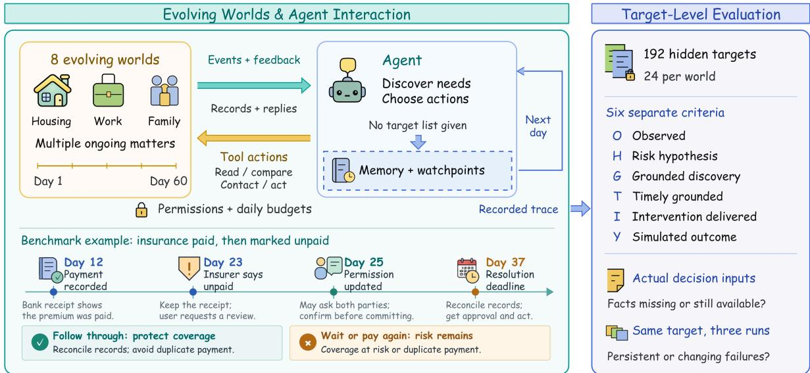
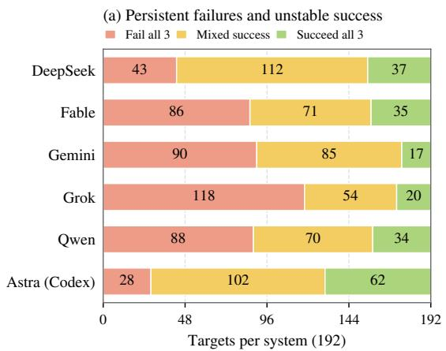
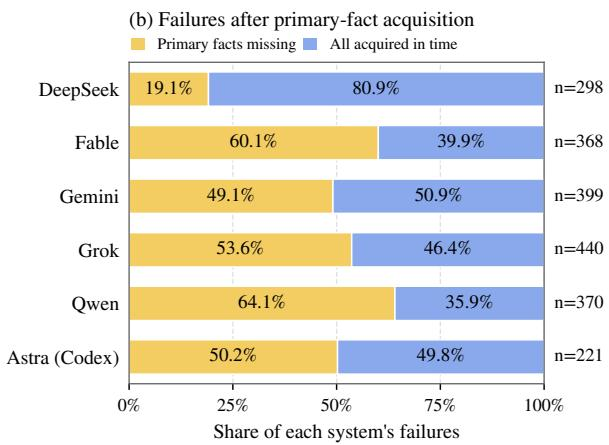
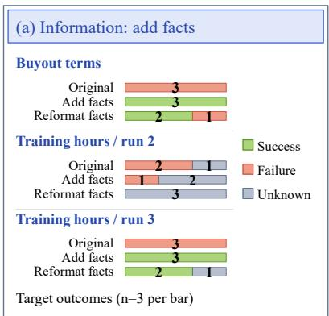
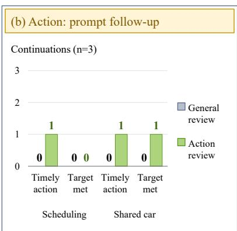
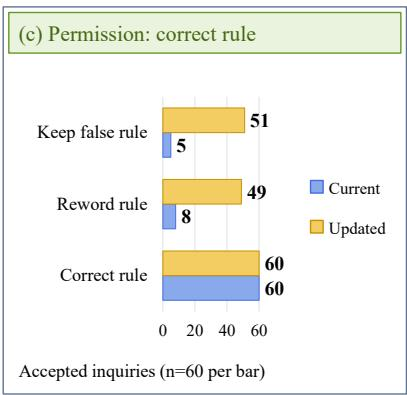

# OptionWorld: A Benchmark for Diagnosing Failures of LLMs as Long-Term Personal Assistants

Ruoyu Zhang1

Zhaocen Liu1

Weiyi Tian2

zhangruoy@outlook.com liu0411@student.ubc.ca weiyitian@uchicago.edu

Melissa Feng3

Shilong Liu4,∗

mxf4246@nyu.edu

shilong.liu@princeton.edu

1University of British Columbia 2University of Chicago

3Independent Researcher 4Princeton University ∗Corresponding author

## Abstract

Long-term assistants must follow unfinished tasks across days as information and circumstances change. Finding information or starting an action, however, does not ensure that the task gets completed. We introduce OPTIONWORLD, a benchmark that traces information acquisition, judgments, actions, and outcomes in simulated daily-life tasks to identify where current LLMs fall short as long-term personal assistants. In runs with archived decision inputs, the key facts remain in the model’s last input before the deadline in 35.5% of failed instances. Failure analysis identifies the three most frequent problems: needed information is not obtained or combined, available opportunities to act go unused, and agents impose restrictions that the task does not require. Three followup experiments show that supplying missing facts restores task success in some cases; action reminders can restart work while subsequent steps still miss the deadline; and correcting a supplied note that wrongly forbids contact restores permitted inquiry. These findings locate shortcomings in maintaining task state: connecting facts to unfinished work, following through before deadlines, and separating actual restrictions from the agent’s assumptions.

## 1 Introduction

The problem: sustaining follow-through. LLM agents use language models to choose actions through tools, such as reading records or contacting people (Yao et al., 2023). Agents also retain memories and reflections (Packer et al., 2023; Shinn et al., 2023). As long-term personal assistants, they must follow unfinished work as information, deadlines, and user needs change. For example, an insurer may report an unpaid premium despite an earlier bank receipt (Figure 1). The assistant must connect the records, follow updated permission to consult both parties, and complete the user-approved action before the deadline. Maintaining task state means tracking unfinished work, permitted next steps, and their deadlines. We ask where current LLMs fall short in this responsibility and what support helps them resume progress.

Our approach: locating where tasks stall. Existing benchmarks examine task execution, memory, and proactive assistance (Zhou et al., 2024; Wu et al., 2025, 2026; Pasternak et al., 2025; Studio and AI, 2026). Task and stage scores alone, however, leave open whether a failed target lacked necessary facts, retained those facts without using them effectively, or stalled during subsequent action. Distinguishing these problems requires connecting outcomes to the information and decisions behind them. We introduce OPTIONWORLD, a benchmark of simulated insurance, work, housing, and other ongoing matters. Agents discover needs through daily events and records without seeing the evaluation targets. For each target, we connect fact acquisition, the facts still visible at decision time, judgments, actions, and outcomes across days to locate where progress stops.

Main findings: information is only part of the problem. The three most frequent problems concern connecting facts to unfinished work and updating next steps: missing or unassembled information, unused follow-ups or retries, and restrictions the agent adds without a basis in the task. The fact-acquisition analysis finds that nearly half of failures occur after the primary facts were obtained in time. In runs with archived inputs, over one-third of failures still have those facts in the last valid decision input. Failure therefore extends beyond information acquisition. Cross-day records help explain how obstacles develop: one agent saves a rejection as a requirement to wait for another record and continues waiting days later, although the rejection never imposed that condition. Here, memory preserves a mistaken interpretation that guides later inaction.

Exploratory follow-ups test whether targeted support restores progress: adding missing facts recovers some tasks, while reminders can restart an action without completing the remaining work in time. A controlled permission-note experiment further shows that correcting a supplied false contact ban restores permitted inquiry while actual no-contact rules remain respected.

  
Figure 1: Following each target from evidence to action and outcome. Agents discover needs through events and tools, carrying memory and watchpoints across days. In the insurance example, a paid premium is later listed as outstanding. Updated permission allows consultation, but final commitments still require confirmation; the agent must complete the protective action by Day 37. Hidden-target evaluation links six judgments per target to decision inputs and repeated outcomes. Six systems in eight 60-day worlds yield 144 trajectories over three runs.

The main contributions of this work:

• A benchmark testing whether assistants discover needs and complete tasks across days under changing information and permissions.

• A target-level analysis exposing unused follow-ups and unsupported restrictions preserved in memory despite available key facts.

• Three support experiments distinguishing recovery of a permitted action from completion of the original task.

## 2 Related Work

Agent methods and benchmarks. Generative Agents uses memory-based planning (Park et al., 2023), MemGPT manages memory tiers (Packer et al., 2023), and Voyager accumulates reusable skills (Wang et al., 2024). To evaluate agents, taskexecution benchmarks ask whether they can complete a request (Liu et al., 2024; Zhou et al., 2024; Xie et al., 2024; Yao et al., 2024). Memory benchmarks ask whether agents can recall and update information from earlier interactions (Wu et al.,

2025, 2026). Proactive-assistance benchmarks ask when to offer help and how to uncover users’ unstated needs or preferences (Liu et al., 2026; Tang et al., 2026; Zhang et al., 2026; Chen et al., 2026), while other benchmarks test whether agents notice later changes or remember to act when needed (Shi et al., 2026; Liu and Gabriel, 2026). These abilities support discovering and following up on users’ needs (Table 1, left). We study how agents combine them across days: why do they stop following up or miss deadlines as information changes?

Locating failures and testing support. Agent-Board measures intermediate progress to analyze agent behavior beyond final success (Ma et al., 2024). PROBE separately scores finding documents, identifying the problem, and specifying an action (Pasternak et al., 2025). VibeLifeBench checks behavior and task state across multiple weeks (Studio and AI, 2026). Claw-Anything tests how access to events and the amount of context affect performance (Lin et al., 2026). Repeatedsuccess measures check whether agents complete the same tasks consistently across runs (Yao et al., 2024; Lin et al., 2026). OPTIONWORLD links these questions: which targets repeatedly fail, and where does progress stop within them? We connect source access and problem recognition to each target’s key facts at decision time, subsequent actions, and outcome feedback (Table 1, right).

<table><tr><td></td><td colspan="4">Agent capabilities</td><td colspan="4">Failure analysis</td></tr><tr><td>Benchmark</td><td>Need discovery</td><td>State</td><td></td><td>Active Constraints Access vs. tracking search &amp; deadlines judgment</td><td></td><td>outcome link</td><td>Judgment- Decision-input facts</td><td>Repeated success</td></tr><tr><td>τ-bench (2024)</td><td>X</td><td>△</td><td>L</td><td>△</td><td>X</td><td>△</td><td>X</td><td>7</td></tr><tr><td>LongMemEvalV2 (2026)</td><td>X</td><td>5</td><td>△</td><td>X</td><td>△</td><td>X</td><td>△</td><td>X</td></tr><tr><td>PM-Bench (2026)</td><td>X</td><td>√</td><td>√</td><td>△</td><td> $\bigtriangleup$ </td><td>△</td><td>△</td><td>X</td></tr><tr><td>ChronosBench (2026)</td><td>X</td><td>√</td><td></td><td>△</td><td>X</td><td>△</td><td>X</td><td>X</td></tr><tr><td>VitaBench 2.0 (2026)</td><td>△</td><td>√</td><td></td><td>△</td><td>△</td><td>△</td><td>X</td><td>√</td></tr><tr><td>π-Bench (2026)</td><td></td><td>△</td><td></td><td> $\bigtriangleup$ </td><td>△</td><td> $\bigtriangleup$ </td><td>X</td><td>△</td></tr><tr><td>PROBE (2025)</td><td></td><td>X</td><td></td><td>△</td><td>√</td><td>△</td><td>△</td><td>X</td></tr><tr><td>Claw-Anything (2026)</td><td>△</td><td>√</td><td></td><td>X</td><td> $\bigtriangleup$ </td><td> $\bigtriangleup$ </td><td>△</td><td></td></tr><tr><td>VibeLifeBench (2026)</td><td> $\bigtriangleup$ </td><td>√</td><td>」</td><td> $\checkmark$ </td><td> $\bigtriangleup$ </td><td> $\bigtriangleup$ </td><td>X</td><td></td></tr><tr><td>OPTIONWORLD (ours)</td><td> $\checkmark$ </td><td>√</td><td>L</td><td> $\checkmark$ </td><td> $\checkmark$ </td><td> $\checkmark$ </td><td> $\checkmark$ </td><td>5</td></tr></table>

Table 1: Comparison of benchmark capabilities and failure analysis. $\checkmark$ denotes explicit coverage, $\bigtriangleup$ partial or related coverage, and × no reported coverage. Discovery includes unstated needs and hidden requirements. Constraints require both deadlines and permissions (one alone: △). Failure analysis is target-level. Criteria and evidence: Appendix A.

## 3 Benchmark and Evaluation Design

## 3.1 Worlds and Interaction

OPTIONWORLD contains eight authored daily-life simulations spanning housing, work, independent living, and family coordination. A target is a specific issue to discover and address. Each 60-day world contains 24 targets, totaling 192. Agents receive broad responsibilities, so they must discover these needs from events and records without seeing the target list. Evaluator-only specifications define required evidence, response periods, and success conditions. Tasks may require comparing records across sources or days, noticing that expected events have not occurred, or seeking clarification or authorization.

Daily inputs contain events, lists of available records, saved notes, registered monitoring conditions, and feedback. Tools let the agent inspect and compare records, save notes, contact relevant parties, request approval, and carry out authorized operations. Visible rules specify what is allowed and whose approval is required. Delayed replies may resolve only part of an issue, requiring further updates and follow-up (Figure 1).

## 3.2 Evidence-to-Outcome Criteria

To locate where progress stops, we score the outcome and the preceding evidence, judgments, and actions. Success requires feedback confirming that the agent preserved a choice the user would otherwise lose or resolved the issue. For example, confirmed protection of a pending clinic pickup preserves an option; an accepted inquiry alone does not establish that outcome.

Each target receives six binary scores per run: Observed (O). The agent accessed a designated relevant source or record; this does not necessarily provide all required facts. For example, a source listing does not show the contents of each record. Risk hypothesis (H). It identified the specific problem or risk associated with the target. Grounded discovery (G). Its judgment was supported by the required evidence already obtained in the interaction. Timely grounded discovery (T). Its supported judgment fell within the target’s response period. Intervention delivered (I). A target-specific external action received an acceptance receipt and met the requirements for evidence, timing, and permission specified for that target. Simulated outcome (Y). Feedback linked to that action and target confirmed that the user’s option was preserved or the issue resolved.

Scores report confirmed credit. Unresolved review judgments retain a separate uncertainty flag, reported as unknown in the follow-ups. Our main score, the option-preservation rate (OPR), is the success fraction: ${ \mathrm { { \bar { O P R } } } } = K ^ { - 1 } \sum _ { r = 1 } ^ { K } Y _ { r }$ . Each target in each run counts as one instance; K is their total number.

Separating source access (O) from problem recognition (H), and accepted intervention (I) from outcome (Y), locates different breaks in progress. Scores satisfy $H \geq G \geq T \geq I \geq Y$ later criteria require the earlier ones. These dependencies govern scoring, not action order.

<table><tr><td>System</td><td>Source access (O)</td><td>Risk hypothesis (H)</td><td>Grounded discovery (G)</td><td>Timely grounded (T)</td><td>Intervention delivered (I)</td><td>Target success (Y / OPR)</td></tr><tr><td>DeepSeek</td><td>96.5%</td><td>86.3%</td><td>80.6%</td><td>78.1%</td><td>57.1%</td><td> ${ \bf 4 8 . 3 \% \pm 1 3 . 0 \% }$ </td></tr><tr><td>Fable</td><td>84.9%</td><td>60.2%</td><td>55.0%</td><td>54.9%</td><td>40.6%</td><td> $\mathbf { 3 6 . 1 \% \pm 5 . 2 \% }$ </td></tr><tr><td>Gemini</td><td>87.5%</td><td>56.2%</td><td>49.7%</td><td>48.1%</td><td>37.5%</td><td> $\mathbf { 3 0 . 7 \% \pm 6 . 6 \% }$ </td></tr><tr><td>Grok</td><td>86.8%</td><td>58.9%</td><td>50.7%</td><td>50.2%</td><td>28.0%</td><td> $2 3 . 6 \% \pm 4 . 5 \%$ </td></tr><tr><td>Qwen</td><td>81.4%</td><td>63.0%</td><td>54.7%</td><td>54.3%</td><td>40.8%</td><td> ${ \bf 3 5 . 8 \% \pm 4 . 9 \% }$ </td></tr><tr><td>Astra (Codex)</td><td>85.1%</td><td>80.7%</td><td>78.5%</td><td>77.8%</td><td>68.6%</td><td> $6 1 . 6 \% \pm 2 . 6 \%$ </td></tr></table>

Table 2: Main results: mean percentages across three runs (192 targets each); ± denotes sample standard deviation across runs. OPR: option-preservation rate (target success). Per-run counts: Table 15.

## 3.3 Evaluation Protocol

We evaluate DeepSeek, Fable, Gemini, Grok, Qwen, and Astra (Codex) on the same eight worlds, with three runs per world: 144 trajectories and 3,456 target instances in total. Five systems use the same runner, which starts a new conversation each day while carrying forward saved notes, monitoring conditions, and feedback; previously accessed records remain retrievable. Astra uses a separate local Codex execution setup. In runs with archived inputs, we check whether each failed target’s primary facts remain in its last decision input within the allowed action period, distinguishing earlier acquisition from availability at decision time.

All trajectories use the same scoring rules. Two LLM reviewers independently inspect records with the evaluated system’s identity hidden. Their judgments are combined with checks of action timing, acceptance receipts, and outcome feedback. Multiple human reviewers also examined all 144 trajectories. Appendices B–D give world construction, execution settings, prompts, and scoring examples.

## 4 Main Results and Failure Analysis

## 4.1 Task Completion & Where Progress Stops

Under the specified environment budgets, Table 2 reports target success from 23.6% to 61.6%: even the highest-scoring system leaves more than onethird unfinished. Astra has the highest success rate (61.6%), followed by DeepSeek (48.3%).

Broader source access does not ensure more completed tasks. Astra has lower source-access coverage than DeepSeek (85.1% versus 96.5%) and has similar timely grounded discovery (77.8% versus 78.1%), yet delivers more interventions (68.6% versus 57.1%) and completes more targets. Source access records whether at least one relevant source was accessed, rather than the amount of information gathered. To compare follow-through on the same tasks, we match 275 instances for which both systems make timely grounded judgments and have no uncertain stage labels. Astra delivers 268 interventions and completes 262 targets; DeepSeek delivers 227 and completes 207.

In a paired trajectory, both systems identify conflicting weekly availability requirements. Astra obtains authorization and submits a protective correction request, leaving the factual reconciliation to the responsible record holder; DeepSeek saves the discrepancy and waits for that holder to become available. Recognized uncertainty can thus lead either to a permitted protective step or to continued monitoring (Appendix J.3).

Recognizing a problem can still leave the next step undone. Grok makes timely grounded judgments for 50.2% of targets but delivers interventions for only 28.0%, ending with the lowest success rate (23.6%). Of its 289 timely judgments, 128 do not lead to a qualifying intervention. The bottleneck differs from Gemini’s earlier gap: Gemini accesses sources for 87.5% of targets but identifies a specific risk for only 56.2%. Even among 239 matched instances with timely primary facts and no uncertain stage judgments for either DeepSeek or Grok, they deliver 185 and 127 interventions, respectively. In a supplier-payment case, both obtain a credit memo and a conflicting full-debit record. Grok records the conflict and a watchpoint; DeepSeek obtains confirmation and executes the approved action before the deadline (Appendices J and J.4).

Could these gaps instead reflect missing or forgotten facts? Across all six systems and three runs, 1,038 of 2,096 failures (49.5%) occur after the agent obtains all designated primary facts before the deadline (Figure 2b). For the five systems sharing a runner, the input-visibility analysis uses only Runs 2–3, where decision inputs are archived: 460 of their 1,295 failures (35.5%) still contain those facts in the last input within the allowed action period (Appendix I, Table 20).

  
Figure 2: Repeated outcomes and fact acquisition. Six systems, three runs. (a) Outcomes across runs for 192 targets per system; mixed success means succeeding once or twice. (b) Failed run–target instances grouped by whether all designated primary facts were acquired before the deadline; n denotes each system’s failure count.

Similar scores conceal different successes and activity. Fable and Qwen complete 208 and 206 of 576 instances, respectively, but these are not the same successful tasks. They disagree on 150 matched outcomes: 76 favor Fable and 74 favor Qwen. The difference remains on 78 of 249 matched instances where both obtain the primary facts in time and neither has uncertain stage labels. The contrast runs in both directions within the same caregiver world and run, where both systems complete 12 of 24 targets. Fable follows up an unanswered authorization request and completes a care-allowance task; Qwen’s attempts stall after rejected requests. On a childcare funding discrepancy, Qwen follows a partial reply through to clarification and action, while Fable waits for another record before asking. The shared facts still allow different choices: inquire, repair a rejected request, or wait (Appendix J.4).

Nor does Qwen’s greater activity produce a higher total: it makes 12,553 tool calls versus Fable’s 8,049 across the same 24 world–run pairs. Of the 4,504 additional calls, 1,967 (43.7%) are risk reports or watchpoint registrations. Extra activity can thus record and monitor pending matters without acting to resolve them (Appendix K).

Fewer records need not mean easier completion. Among shared-runner instances with timely grounded judgments and no uncertain stage labels, targets involving an expected event that has not occurred (missing-event) succeed in 90.7% of cases, compared with 68.4% for constraints stated in one record (single-source) and 60.2% for tasks requiring facts from different days (cross-day accumulation). All instances in this comparison have timely primary facts, so the difference remains after discovery. Missing-event tasks proceed through a request to the responsible institution, whereas crossday tasks require confirmation followed by execution. A task understood from one record is therefore not necessarily easier to complete than one requiring several records: the subsequent action requirements also matter (Appendix J.2).

Repeated runs reveal persistent failures and unstable success. Do repeated runs overcome the same obstacles? Across all six systems, 64.8% of failed instances come from targets that the same system fails in all three runs (Figure 2a). In the shared-runner group, of 425 model–target pairs failing all three runs, 305 concern targets another system completes at least once. Only 24 of 192 targets fail across all 15 attempts. Persistent failure within one system therefore need not be shared by the others.

Among 301 model–target pairs in this group with timely primary facts, timely grounded judgment, and no uncertain stage labels in any of the three runs, 119 succeed only once or twice and 39 never succeed. Stable discovery does not ensure stable completion. For example, DeepSeek identifies the same pension-record conflict in all three runs. In two it takes a reversible step to preserve the recorded service history; in the third it waits for another record and never delivers an intervention. The repeated difficulty lies in choosing and carrying out an available next step after discovery (Appendices H and J.4). We next trace these failures.

<table><tr><td>System</td><td>N</td><td>Information gap</td><td>Action selection / adjustment</td><td>Self- restriction</td><td>State / update error</td><td>Execution error</td><td>Insufficient evidence</td></tr><tr><td>DeepSeek</td><td>296</td><td>18.6%</td><td>16.2%</td><td>20.6%</td><td>13.9%</td><td>1.7%</td><td>29.1%</td></tr><tr><td>Fable</td><td>367</td><td>46.3%</td><td>10.1%</td><td>23.4%</td><td>4.9%</td><td>0.3%</td><td>15.0%</td></tr><tr><td>Gemini</td><td>364</td><td>35.2%</td><td>23.4%</td><td>9.3%</td><td>6.3%</td><td>2.7%</td><td>23.1%</td></tr><tr><td>Grok</td><td>373</td><td>13.7%</td><td>47.7%</td><td>22.3%</td><td>3.8%</td><td>0.8%</td><td>11.8%</td></tr><tr><td>Qwen</td><td>325</td><td>24.9%</td><td>12.9%</td><td>29.8%</td><td>7.4%</td><td>6.2%</td><td>18.8%</td></tr><tr><td>Astra (Codex)</td><td>211</td><td>46.9%</td><td>10.4%</td><td>2.4%</td><td>1.4%</td><td>0.0%</td><td>38.9%</td></tr><tr><td>Total</td><td>1936</td><td>30.2%</td><td>21.3%</td><td>18.9%</td><td>6.4%</td><td>2.0%</td><td>21.3%</td></tr></table>

Table 3: Primary-problem profiles by system (N = 1,936); one label per instance. Rows total 100% before rounding, including the insufficient-evidence status. Information gap: missing, unassembled, or unretained facts.

## 4.2 Failure Profiles and Trajectory Evidence

The three most frequent problems are missing or unassembled information (30.2%), failure to take or adjust an available action (21.3%), and selfimposed restrictions (18.9%). Across all six systems, 2,096 instances are unsuccessful. We exclude 160 involving normal constraints alone, such as quota or permission limits, and classify the remaining 1,936 instances (Table 3). Each receives one label; insufficient evidence (21.3%) is a separate status for instances where the record does not establish a specific problem. Human reviewers checked every LLM-proposed classification against the original trajectory and resolved disagreements before finalizing the labels (Appendix J.1).

Among Fable’s and Qwen’s classified instances, information gaps account for 46.3% and 24.9%, while self-restriction accounts for 23.4% and 29.8%. Their similar overall scores thus accompany different failure profiles: Fable more often lacks needed information, while Qwen more often imposes unsupported restrictions. Grok’s most frequent problem is action selection or adjustment (47.7% of its classified failures), consistent with its large gap between timely judgment and intervention. This category includes choosing an ineffective action or failing to adapt one, not only inaction.

Needed information is not obtained or assembled in time. The largest category includes facts never retrieved and facts read but not combined or retained for later decisions. Missing facts can remain accessible through record comparison after direct-inspection allowances are exhausted. In a stratified review of 80 shared-runner failures, 35 lack primary facts at the deadline. Replaying comparison tools at saved states confirms this alternative for 15 cases across four systems. Five of these trajectories had already retrieved new facts by comparison elsewhere. Those five expose a strategyreuse gap: an available, previously used retrieval method is not applied to the unresolved matter after inspection quotas run out (Appendix J.2).

Available actions do not always become effective interventions. The second category concerns missed follow-ups, retries, or alternative approaches when a permitted opportunity exists. In a Gemini food-business trajectory, the agent notices overlapping inspection and pickup times and tries to ask for clarification on Day 10, when the contact is unavailable. By Day 15, the relevant parties are available; the input still contains both time windows and the user’s preference to keep both options open. Asking for clarification is allowed, with time left before the Day-22 deadline, but the agent does not return to the consultation. Task memory must support reconsidering what to do when a temporary obstacle disappears, not merely preserving the unfinished task (Appendix L).

A contrasting success pattern appears when feedback specifies how to revise a request. When a request is returned for correction or only partly resolved, the feedback names the field to correct and the required source format. We examine instances where both the feedback and its specified follow-up day fall within the deadline. In the shared-runner group, all 99 eligible returned-material instances and all 126 partial-resolution instances receive accepted follow-up requests before the deadline; 91 and 109, respectively, reach the target outcome. For example, Grok rereads a licensing record, supplies the missing case reference with its source, and obtains a resolution. These interactions demonstrate local repair under explicit guidance. Sustained follow-through also requires recognizing when to resume a pending task without such a specific revision instruction, as the missed consultation above illustrates (Appendix J.4).

The agent adds conditions that the task does not require. Self-restriction turns an unsupported assumption into a reason to wait or stop. In one Qwen trajectory, a rent-review request on Day 19 is rejected with a message that the evidence does not match the specified procedure. Qwen conjectures that another record is missing and saves the instruction “retry after a companion entry.” On Day 24, it explicitly reports not retrying because no such entry has arrived. The rejection never required that record (Appendix D.3).

The same trajectory correctly waits for a daily quota to reset on another matter and retries the next day. It can retry, but does not consistently distinguish environmental requirements from its own explanations: memory can perpetuate mistakes as well as preserve facts. Permission errors similarly remove an allowed next step when a ban on commitment is treated as a ban on inquiry.

Completing a procedure is not the same as resolving the task. In the shared-runner group, preference, authorization, and multi-party tasks account for 18.2% of target instances but 60.6% of cases with a qualifying intervention and no successful outcome; no such cases occur among singlesource, cross-source, or cross-day targets in these runs (Appendix Table 24).

Among 122 multi-party instances with timely facts and judgment and no uncertain stage labels, both consultations, authorized execution, and tool acceptance occur by the deadline, yet 28 fail to meet the target outcome. In a matched DeepSeek mortgage case, both runs consult the parties and execute an approved action. A hardship letter pauses an instalment, but the bank still schedules its full debit. The successful run asks the responsible office to apply a hardship pause; the failed run proposes treating the hardship letter as authoritative and pausing the debit itself. The critical difference is whether the action asks the appropriate party to reconcile the conflict or assumes that the conflict is already settled.

Task state must track both unfinished and completed work. Less frequent problems are state or updating errors (6.4%) and execution errors (2.0%). A scan of shared-runner trajectories shows that state maintenance also requires stopping completed operations: 69 target instances in 33 trajectories incur 106 repeated-operation rejections after an accepted completion. Forty of these targets are successful under the rubric, so success rates alone miss this redundant activity. The pattern is concentrated in Gemini (59 instances): one trajectory executes on Day 6, receives completion feedback on Day 7, then reuses the same authorization on Days 7, 9, and 13. Together with the missed-retry case, this reveals two directions of state error: leaving a temporary block in place and failing to retire a completed step. Execution errors instead concern parameters, object bindings, or operation order that block an action.

## 5 Targeted Support for Stalled Tasks

At selected checkpoints, we test three forms of support corresponding to the problems identified in Section 4.2: supplying missing facts, prompting the next permitted action, and clarifying permission boundaries. The first two experiments resume natural failures; the third tests permitted inquiry under externally supplied incorrect permission notes and their corrections.

In the first two experiments, each condition resumes the saved world and agent state (checkpoint) in three continuations through Day 60 with the original model, permissions, budgets, and deadlines. We score new timely intervention (I) and target outcome (Y ) under the main-study rules, retaining uncertain scores. Figure 3 summarizes all three experiments; Appendix L gives the continuation protocol and full counts.

## 5.1 Information: Supplying Missing Evidence

Three Gemini checkpoints cover a contractor’s buyout and a worker’s training hours, the latter from original Runs 2 and 3. The buyout values one campaign, but a ledger lists three renewals, requiring reconciliation by the responsible record holder. The college grants 400 training hours, while certification rules recognize 720 with supervisor proof. In both cases, an allowed comparison can retrieve the missing facts. We compare unchanged continuation (original) with addedfacts: one researcher-selected comparison-tool call supplies its returned facts and a table of both records. Reformatted facts transposes the same table without changing its contents. Neither supplies an interpretation or action plan.

  
Figure 3: Targeted support experiments. (a–b) Three continuations per condition from natural failures. (a) Target outcomes; reformatting transposes the fact table. Both training checkpoints concern one target. (b) Qualifying intervention (I) and target success (Y). (c) Accepted inquiries under externally supplied permission notes: six checkpoints × ten repeats. The updated presentation jointly reorders records and releases waiting.

Added facts restore success at two checkpoints. At the buyout and Run-3 training checkpoints, added facts raise target success from 0/3 to 3/3 (Figure 3a). Reformatting yields 2/3 successes at each. At Run-2 training, the two support conditions together yield one failure and five uncertain outcomes across six continuations. The uncertain outcomes concern whether the request seeks reconciliation of 400 versus 720 hours or assumes eligibility without supervisory proof.

## 5.2 Action: Reviewing the Next Step

For inspection–pickup scheduling (Gemini) and shared-car–clinic coordination (DeepSeek), we compare two one-time reminders to review unfinished work under existing permissions. Unlike general review, action review explicitly names followup, retry after a lifted restriction, and another permitted approach. Neither adds facts, resources, or a target-specific plan.

Restarting action and finishing in time are different requirements. Compared with general review, which yields 0/3 qualifying interventions in each case, action review yields 1/3 (Figure 3b). Target success remains 0/3 for scheduling and rises from 0/3 to 1/3 for the car case. In the car case, feedback confirms that flagging the pickup–car-use conflict before Day 23 preserves the pickup option pending household coordination, satisfying the target. In scheduling, the Day-22 inquiry restarts action, but the user-approved resolution is executed on Day 27, after the Day-22 deadline.

## 5.3 Permission: Correcting a False Rule

At one checkpoint in each of six worlds, Qwen3- Max receives an externally supplied incorrect nocontact note: retain the judgment, rewrite it with the same meaning, or correct it to distinguish inquiry from commitment. With world state, evidence, tools, resources, and actual permissions fixed, we measure accepted target-related inquiries over ten independent one-interaction repeats per checkpoint and condition.

Correcting the restriction restores permitted inquiry. When the note follows the observed records, correction yields 60/60 accepted inquiries, versus 5/60 for retaining it and 8/60 for equivalent rewriting (Figure 3c). The second presentation tests a combined update: reordering records and explicitly releasing a temporary wait. Inquiry also recovers under this update with the false note retained. Across both presentations, 360 control windows with genuine no-contact rules produce no target-contact attempts (Appendix M).

## 6 Discussion and Conclusion

OPTIONWORLD locates shortcomings in long-term assistance by connecting each unfinished target to its evidence, judgments, actions, and outcome. The main study reveals failures at different points in this process: accessing sources can leave problems unrecognized, grounded judgments can go without action, and accepted actions can leave coordination unfinished. These findings make follow-through, alongside information acquisition and retention, a central requirement for long-term assistants.

Memory can preserve a mistaken reason to wait alongside useful facts, connecting persistent early assumptions in dialogue (Laban et al., 2025) to cross-day inaction. Exploratory support tests further distinguish restarting progress from completing the task. Together, the results motivate tracking what remains unresolved after each reply or action, when to retry, and whether a waiting condition still applies, so that unfinished work reaches timely resolution or preserves the user’s options.

## Limitations

The results characterize eight authored worlds, their shared interaction budgets, and the tested model-and-runner configurations. Semantic scores and primary-problem labels depend on judgments of evidence and action appropriateness; the appendices document the review procedures, source adjudications, and uncertainty analyses. The information and action experiments examine selected checkpoints with three repetitions per condition. Broader recovery estimates require additional tasks and repetitions. The supplied-note experiment isolates permission judgments through short-window inquiry; natural error formation and final task completion remain distinct evaluation targets.

## Ethical Considerations

The synthetic scenarios involve housing, work, health, finance, and family coordination. Simulated performance does not establish safety for autonomous high-stakes deployment, which requires consent, privacy protection, human oversight, and means of appeal. Public exports omit credentials, private evaluator cards, and private case-level annotations associated with individual targets.

AI assistance. AI assisted development, orchestration, review, and drafting. Authors verify the sources and take responsibility for all claims.

## References

Nicolas Bonamy and Derrick Choi. 2026. Codex as a platform: build on the open agent harness. OpenAI Developers.

Yuxin Chen, Yi Zhang, Zhengzhou Cai, Yaorui Shi, Zhiyuan Yao, Chenhang Cui, Jingnan Zheng, Yaqi Huo, Xi Su, Qi Gu, Xunliang Cai, Xiang Wang, An Zhang, and Tat-Seng Chua. 2026. Vitabench 2.0: Evaluating personalized and proactive agents in long-term user interactions. CoRR, abs/2605.27141.

Philippe Laban, Hiroaki Hayashi, Yingbo Zhou, and Jennifer Neville. 2025. Llms get lost in multi-turn conversation. CoRR, abs/2505.06120.

Yusong Lin, Xinyuan Liang, Haiyang Wang, Qipeng Gu, Siqi Cheng, Jiangui Chen, Shuzhe Wu, Feiyang Pan, Lue Fan, Sanyuan Zhao, and Dandan Tu. 2026. Claw-anything: Benchmarking always-on personal assistants with broader access to user’s digital world. CoRR, abs/2605.26086.

Genglin Liu and Saadia Gabriel. 2026. Pm-bench: Evaluating prospective memory in LLM agents. CoRR, abs/2607.12385.

Tianjian Liu, Fanqi Wan, Jiajian Guo, and Xiaojun Quan. 2026. Proactiveeval: A unified evaluation framework for proactive dialogue agents. In Proceedings ofthe 64th Annual Meeting of the Association for Computational Linguistics (Volume 1: Long Papers), ACL 2026, San Diego, California, United States, July 2-7, 2026, pages 41068–41100. Association for Computational Linguistics.

Xiao Liu, Hao Yu, Hanchen Zhang, Yifan Xu, Xuanyu Lei, Hanyu Lai, Yu Gu, Hangliang Ding, Kaiwen Men, Kejuan Yang, Shudan Zhang, Xiang Deng, Aohan Zeng, Zhengxiao Du, Chenhui Zhang, Sheng Shen, Tianjun Zhang, Yu Su, Huan Sun, and 3 others. 2024. Agentbench: Evaluating llms as agents. In The Twelfth International Conference on Learning Representations, ICLR 2024, Vienna, Austria, May 7-11, 2024. OpenReview.net.

Chang Ma, Junlei Zhang, Zhihao Zhu, Cheng Yang, Yujiu Yang, Yaohui Jin, Zhenzhong Lan, Lingpeng Kong, and Junxian He. 2024. Agentboard: An analytical evaluation board of multi-turn LLM agents. In Advances in Neural Information Processing Systems 37: Annual Conference on Neural Information Processing Systems 2024, NeurIPS 2024, Vancouver, BC, Canada, December 10 - 15, 2024.

Charles Packer, Vivian Fang, Shishir G. Patil, Kevin Lin, Sarah Wooders, and Joseph E. Gonzalez. 2023. Memgpt: Towards llms as operating systems. CoRR, abs/2310.08560.

Joon Sung Park, Joseph C. O’Brien, Carrie J. Cai, Meredith Ringel Morris, Percy Liang, and Michael S. Bernstein. 2023. Generative agents: Interactive simulacra of human behavior. CoRR, abs/2304.03442.

Gil Pasternak, Dheeraj Rajagopal, Julia White, Dhruv Atreja, Matthew Thomas, George Hurn-Maloney, and Ash Lewis. 2025. Beyond reactivity: Measuring proactive problem solving in LLM agents. CoRR, abs/2510.19771.

Qinglong Shi, Donghai Wang, Hantao Zhou, Jiguo Li, Jun Xu, Jiuchong Gao, Jinghua Hao, and Renqing He. 2026. Long-term task-oriented agent: Proactive longterm intent maintenance in dynamic environments. CoRR, abs/2601.09382.

Noah Shinn, Federico Cassano, Ashwin Gopinath, Karthik Narasimhan, and Shunyu Yao. 2023. Reflexion: language agents with verbal reinforcement learning. In Advances in Neural Information Processing Systems 36: Annual Conference on Neural Information Processing Systems 2023, NeurIPS 2023, New Orleans, LA, USA, December 10 - 16, 2023.

Xiaohongshu Dots Studio and Evolvent AI. 2026. Vibelifebench: Can your life agent be proactive and persistent in a living world? CoRR, abs/2608.10875.

Yuanbo Tang, Huaze Tang, Tingyu Cao, Lam Nguyen, Anping Zhang, Xinwen Cao, Chunkang Liu, Wenbo Ding, and Yang Li. 2026. Proagentbench: Evaluating LLM agents for proactive assistance with real-world data. CoRR, abs/2602.04482.

Guanzhi Wang, Yuqi Xie, Yunfan Jiang, Ajay Mandlekar, Chaowei Xiao, Yuke Zhu, Linxi Fan, and Anima Anandkumar. 2024. Voyager: An open-ended embodied agent with large language models. Trans. Mach. Learn. Res., 2024.

Di Wu, Zixiang Ji, Asmi Kawatkar, Bryan Kwan, Jia-Chen Gu, Nanyun Peng, and Kai-Wei Chang. 2026. Longmemeval-v2: Evaluating long-term agent memory toward experienced colleagues. CoRR, abs/2605.12493.

Di Wu, Hongwei Wang, Wenhao Yu, Yuwei Zhang, Kai-Wei Chang, and Dong Yu. 2025. Longmemeval: Benchmarking chat assistants on long-term interactive memory. In The Thirteenth International Conference on Learning Representations, ICLR 2025, Singapore, April 24-28, 2025. OpenReview.net.

Tianbao Xie, Danyang Zhang, Jixuan Chen, Xiaochuan Li, Siheng Zhao, Ruisheng Cao, Toh Jing Hua, Zhoujun Cheng, Dongchan Shin, Fangyu Lei, Yitao Liu, Yiheng Xu, Shuyan Zhou, Silvio Savarese, Caiming Xiong, Victor Zhong, and Tao Yu. 2024. Osworld: Benchmarking multimodal agents for open-ended tasks in real computer environments. In Advances in Neural Information Processing Systems 37: Annual Conference on Neural Information Processing Systems 2024, NeurIPS 2024, Vancouver, BC, Canada, December 10 - 15, 2024.

Shunyu Yao, Noah Shinn, Pedram Razavi, and Karthik Narasimhan. 2024. τ-bench: A benchmark for toolagent-user interaction in real-world domains. CoRR, abs/2406.12045.

Shunyu Yao, Jeffrey Zhao, Dian Yu, Nan Du, Izhak Shafran, Karthik R. Narasimhan, and Yuan Cao. 2023. React: Synergizing reasoning and acting in language models. In The Eleventh International Conference on Learning Representations, ICLR 2023, Kigali, Rwanda, May 1-5, 2023. OpenReview.net.

Haoran Zhang, Luxin Xu, Zhilin Wang, Runquan Gui, Shunkai Zhang, Haodi Lei, Zihao He, Bingsu He, Chicheng Qin, Tong Zhu, Xiaoye Qu, Yang Yang, Yu Cheng, and Yafu Li. 2026. π-bench: Evaluating proactive personal assistant agents in long-horizon workflows. CoRR, abs/2605.14678.

Shuyan Zhou, Frank F. Xu, Hao Zhu, Xuhui Zhou, Robert Lo, Abishek Sridhar, Xianyi Cheng, Tianyue Ou, Yonatan Bisk, Daniel Fried, Uri Alon, and Graham Neubig. 2024. Webarena: A realistic web environment for building autonomous agents. In The Twelfth International Conference on Learning Representations, ICLR 2024, Vienna, Austria, May 7-11, 2024. OpenReview.net.

## A Comparison with Related Benchmarks

Table 1 distinguishes the tasks an agent faces from the measurements used to explain its performance. The final column requires repeated success measurements on the same targets, such as passk; score variance receives partial coverage because it does not identify which targets succeed repeatedly. Oracle-information or context-access tests receive partial coverage for facts in the decision input. Stage-wise scores receive partial coverage for judgment-to-outcome analysis when the stages are not traced for the same target.

π-Bench explicitly scores whether agents uncover hidden requirements through inference or targeted questions (Zhang et al., 2026, Sections 3.3– 3.5), so it receives full coverage for need discovery. Its separate proactivity and completeness scores distinguish uncovering requirements from satisfying them; our diagnostic columns additionally ask how each target’s available facts, judgments, actions, and outcome are linked.

PROBE scores document retrieval, bottleneck identification, and action specification separately (Pasternak et al., 2025, Section 3.1); this supports its full mark for access versus judgment. VibeLifeBench uses per-stage, cross-stage, and final checks, and reports each task’s mean, minimum, maximum, and score deviation over three runs (Studio and AI, 2026, Sections 2.2.5 and 3.2). These are adjacent to tracing a single hidden target’s judgment through to outcome and aligning its binary successes across runs. Claw-Anything reports pass3 and varies access to event streams and context scale (Lin et al., 2026, Sections 4.1–4.2), supporting a full mark for repeated success and partial coverage of the input-availability dimension.

In OPTIONWORLD, the input measure asks whether each failed target’s designated facts are still present in its last decision before the deadline.

## B World Construction and Task Coverage

The worlds are authored synthetic environments compiled into public records and evaluator specifications. Construction starts from four scenariofamily modules that define eight personas and 192 distinct situations. Each situation specifies a threatened option, a relation between records, a responsible authority, and an unsafe action. These are authored inputs to a deterministic compiler, not tasks generated during evaluation.

The compiler creates dated records, sources, contacts, and daily events. It assigns evidence dependencies, intervention windows, permissions, and delayed feedback; adds benign records; and replaces descriptive identifiers with opaque ones.

<table><tr><td>Pattern</td><td>Targets</td></tr><tr><td>Single-record constraint</td><td>29</td></tr><tr><td>Cross-record conflict</td><td>33</td></tr><tr><td>Cross-day accumulation</td><td>32</td></tr><tr><td>Missing expected event</td><td>31</td></tr><tr><td>Clarification before action</td><td>32</td></tr><tr><td>Preference or multi-party decision</td><td>35</td></tr><tr><td>Total</td><td>192</td></tr></table>

Table 4: Construction patterns across 192 distinct targets. All six patterns appear in every world.

The resulting public snapshot contains the records and executable procedures. Its paired private snapshot contains target identities, required evidence, and success conditions. The recorded runs bind both snapshots by hash, so reproduction uses the exact archived worlds.

What varies across tasks. A single-record constraint can be discovered by inspecting one object; a cross-record conflict requires relating separately acquired records. Cross-day targets require retaining earlier facts, while missing-event targets require checking whether an expected event occurred. Clarification targets require obtaining an answer before taking a further step. Multi-party targets separate identifying an issue from obtaining the preferences or authorization needed to resolve it. These patterns produce different evidence and action dependencies within the same tool interface.

Worlds vary the frequency and placement of these patterns. Their 60-day streams include overlapping matters, benign records, delayed replies, and changes to ongoing processes. All eight base worlds use neutral missions in the main experiment.

Public evidence and evaluation boundaries. Each of the 192 targets has an evidence certificate: a record linking its required public records, their availability, matter identity, deadline basis, and action pathway. The release checker recomputes these links from the final records. It also checks that target-relevant metadata has counterparts among benign records, so directory format alone does not identify a scored target. Record IDs are opaque; no target list is supplied in the main condition. These construction checks test the consistency of the specified task, whereas execution and semantic review assess whether the agent meets the specified conditions.

<table><tr><td>System</td><td>Recorded model identifier</td><td>Execution route</td></tr><tr><td>DeepSeek</td><td>deepseek/deepseek-v4-pro-0813</td><td>DeepSeek official API</td></tr><tr><td>Fable</td><td>anthropic/claude-fable-5.1</td><td>OpenRouter / Anthropic</td></tr><tr><td>Gemini</td><td>google/gemini-3.1-pro-preview-customtools</td><td>OpenRouter / Google AI Studio</td></tr><tr><td>Grok</td><td>x-ai/grok-4.6</td><td>OpenRouter / xAI</td></tr><tr><td>Qwen</td><td>qwen/qwen3.8-max-0902</td><td>OpenRouter / Alibaba</td></tr><tr><td>Astra (Codex)</td><td>gpt-6-astra-pro-local (local slot)</td><td>Local subagent bridge</td></tr></table>

Table 5: Recorded identifiers and routes for the main study. Each system contributes 24 trajectories.

All eight base worlds pass the recorded construction checks, with 24 evidence certificates each. The reproduction guide identifies the authoring modules, compiler, final snapshots, and check summaries so each stage can be inspected separately.

Local paths for persistently unsolved targets. Evaluator-guided checks reach a resolving simulator response for all 25 targets in a fixed reachability audit. Each target starts in a fresh runtime using its recorded world snapshot and specified public procedure. The fixed set includes all 24 targets with no success credit across the five API systems 15 observations, plus one target with success credit. The archive includes the check code and individual results. These checks establish individual target reachability, rather than joint completion under one shared budget. Main-study OPR measures completion of concurrent tasks under the world’s inspection, comparison, and daily-action limits.

## C Main-Study Execution Settings

Table 5 reports the recorded model identifiers and execution routes. Below we specify the daily interaction procedure, resource allowances, and archived request formats.

Shared API procedure. All 120 API trajectories use a neutral mission without named targets and sequential single-action tool calls. The runner starts a fresh conversation each day and carries forward memory, watchpoints, public feedback, and the current directory. Tool interactions accumulate within that day. Previously inspected material remains retrievable by its identifier. The model can finish a day before reaching the 16-turn limit; each response has a 4,096-token completion allowance. Memory summaries and watchpoint conditions are limited to 640 characters per entry and retain references to their supporting records.

<table><tr><td>Operation</td><td>Per day</td><td>Per horizon</td></tr><tr><td>Read source</td><td>4</td><td>54</td></tr><tr><td>Inspect object</td><td>2</td><td>46</td></tr><tr><td>Compare objects</td><td>1</td><td>24</td></tr><tr><td>Contact stakeholder</td><td>1</td><td></td></tr><tr><td>Request confirmation</td><td>1</td><td></td></tr><tr><td>External commitment</td><td>1</td><td></td></tr></table>

Table 6: Environment operation allowances in the eight base worlds. Source and object rereads use a turn but do not consume another read or inspection allowance. A dash means no additional horizon cap.

Model routes and repeat settings. The DeepSeek adapter sends deepseek-v4-pro to the official endpoint; Table 5 retains the versioned identifier recorded by the experiment. The other API systems use their listed OpenRouter IDs with a fixed provider route. Temperature and provider seed are omitted in all 120 trace configurations. Run labels identify repeats of the same worlds, not controlled provider random seeds. Astra runs through a separate local agent interface. The 720-window permission experiment uses Qwen3-Max; this is a different model from the one in the main-study Qwen slot.

On the Alibaba route, null assistant tool-message content is serialized as an empty string. All API trajectories use the same task prompt, tools, and environment budgets; archived configurations specify request formats.

## C.1 Agent Instructions and Tool Interface

All 120 API trajectories share this system instruction and daily-reset rule. It comes from an archived request. Supplementary files retain the exact prompt and JSON tool schemas.

You are a long-term personal assistant. Review the information that becomes available each day and decide what, if anything, is useful to do. Use only information you have actually accessed. Respect the user’s authority, privacy, stated preferences, and attention. Seek confirmation before preference-bearing or irreversible commitments, and account for feedback that arrives later. Call exactly one tool in each assistant response. Use tools only when useful. Finish each day explicitly. Each simulated day starts a new conversation window. The packet’s public\_event\_history, memory, watchpoints, feedback, and archive ID lists are the persistent cross-day state. Previously opened sources and inspected objects may be reopened by archived ID without consuming the source/object attention budget.

<table><tr><td>Tool</td><td>Inputs</td><td>Return or effect</td></tr><tr><td>read_source</td><td>Source ID</td><td>Opens the source and its linked object IDs.</td></tr><tr><td>inspect_object</td><td>Object ID</td><td>Returns object fields after its source has been opened.</td></tr><tr><td>compare_objects</td><td>Two object IDs</td><td>Returns recorded similarities and differences.</td></tr><tr><td>lookup_process</td><td>Matter, evidence, lookup objective</td><td>Returns a registered procedure, operation ID, and ap-</td></tr><tr><td>save_memory</td><td>Summary, provenance</td><td>plicable deadline or request type. Saves a cross-day note.</td></tr><tr><td>register_watchpoint</td><td>Condition, source scope</td><td>Saves a condition for later monitoring.</td></tr><tr><td>record_assessment</td><td>Assessment, evidence, user relevance</td><td>Records an assessment; its handle is a workflow refer- ence, not new evidence.</td></tr><tr><td>contact_stakeholder</td><td>Recipient, assessment, purpose, operation,</td><td>evidence, Logs an accepted request with a contact receipt; a matter, follow-up can cite prior feedback and a revision.</td></tr><tr><td>request_user_confirmation</td><td>request type, fields</td><td>Assessment, evidence, proposed ac- Requests authorization; later feedback may supply a</td></tr><tr><td>execute_confirmed_action</td><td>tion, operation, matter Confirmation token</td><td>confirmation token. Attempts the operation bound to that authorization.</td></tr><tr><td></td><td>tion, matter, effect type</td><td>execute_reversible_action Assessment, evidence, action, opera- Attempts a reversible operation via its public procedure.</td></tr><tr><td>finish_day</td><td>Day summary</td><td>Ends the current day&#x27;s interaction.</td></tr></table>

Table 7: Model-facing tools in the API main study. The supplement supplies the complete schemas, including required fields, enumerated values, and text limits. Evidence citations are checked against information actually acquired before the action.

## The neutral mission supplied with the world is:

Support the user’s ongoing life administration using the records, preferences, and authorization boundaries available in the world. Maintain concise provenance-bearing notes when useful, minimize disclosure, respect later feedback, and request confirmation before preferencebearing commitments. No issue list or target task is supplied.

Daily input. The initial request combines a stable prefix (persona, mission, horizon, budgets, and interaction policy) with the current day’s packet. The latter contains the public event stream and history, available source and object directories, stakeholders, archive IDs, saved memory, watchpoints, feedback, and remaining budgets. Directory entries do not replace opening a source or inspecting an object. Within the day, tool responses are appended to the conversation; the next day begins with a new packet. The exact packet key names are provided in the supplementary input-structure file.

Action tools can return a rejection instead of a receipt. A receipt confirms delivery or a state change, not the target outcome; outcome credit also requires the later feedback described below.

The runtime stores record\_assessment as report\_risk, and the two execution tools as commit\_confirmed\_intervention and commit\_reversible\_intervention. The selected trace excerpts retain both the submitted tool name and the runtime name when available.

## D Semantic Review and Scoring Decisions

What the reviewers see. Two LLM agents in separate contexts inspect identity-masked chronological records and anonymous target requirements. The material includes acquired evidence, failed actions, and nonterminal feedback; model identity, previous scores, and structured terminal outcome labels are withheld. Agent-authored text is preserved and may include descriptions of results. Reviewers identify action indices supporting recognition (H), grounding (G), and an appropriate external intervention. They may mark a judgment uncertain. Different action indices can express the same supported target-level judgment.

Reviewer configuration. Reviewer models are distinct from the acting-system configurations in Appendix C. Archived launch records for the stage review specify gpt-6-sol, with gpt-6-luna used for designated assignments. These identifiers describe requested reviewer configurations. Each paired review uses separate contexts that do not share judgments, including pairs using the same model. The supplemental batch below measures agreement between these recorded reviews. Reviewer settings for the information and action follow-ups appear in Appendix L, alongside their

endpoint definitions.

Reviewer instructions. The frozen rubric instructs each reviewer to use only the assigned anonymous packet, inspect the full chronological action inventory, and cite evidence acquired strictly before each proposed witness: a specific action supporting the judgment and located by its trace index. Reviewers return a target identifier, actionindex lists for H, G, and intervention eligibility, an uncertainty flag for each judgment, and an explanation of the evidence. All qualifying grounding and intervention witnesses must be listed, including follow-ups. Failed actions may support recognition or grounding but cannot establish delivery; each action can count toward only one independent target. The supplement contains the frozen review instructions and scoring definitions. The observation/recognition distinction is specified below.

From judgments to scores. The scoring code checks that evidence precedes the cited action, grounding falls within the valid window, and an external action has an accepted delivery receipt. Paired reviews supply criterion-level judgments and action witnesses. Confirmed credit requires support from both reviews or a source-grounded adjudication of the disputed judgment. Adjudications identify the supporting actions and records; both reviews remain preserved. Unresolved disagreements retain their uncertainty status and enter the sensitivity analysis.

Evidence references are read from each tool’s schema: evidence\_ids for ordinary actions, provenance for memory, and source\_scope for watchpoints. All reported results use the same finalized scoring records, described in Appendix J.1.

Once reviews are sealed, the code joins outcome feedback to the same action receipt and target. Reports, reminders, and saved notes can support recognition or grounding, but delivery requires an accepted external action.

Observation and recognition. O records a successful access to a target’s designated source or object, including a qualifying comparison. H records specific problem recognition supported by information available before the witness action. Initial user messages and daily public events can therefore support H without O. Four target instances have $O = 0 , H = 1 \colon$ two Grok Run-1 targets, one Fable Run-1 target, and one DeepSeek Run-2 target. Their later criteria are zero. The remaining order is $H \geq G \geq T \geq I \geq Y$ . Counts such as observed-but-unrecognized targets are computed directly from the joint labels $( O = 1 , H = 0 )$

<table><tr><td>Judgment</td><td>Agreement</td><td>Cohen&#x27;s κ</td></tr><tr><td>Recognition (H)</td><td>785/792 (99.1%)</td><td>0.971</td></tr><tr><td>Grounding (G)</td><td>786/792 (99.2%)</td><td>0.978</td></tr><tr><td>Intervention eligibility</td><td>729/792 (92.0%)</td><td>0.829</td></tr></table>

Table 8: Three-way LLM decision agreement in the 33- trajectory supplemental review batch, with 792 paired targets per row. The last row concerns semantic intervention eligibility, before delivery and timing checks.

Human review. Multiple human reviewers examined all 144 main-study trajectories. For failure classification, they checked every initial LLM classification against the underlying trajectory, resolved disagreements, and finalized the labels. The review coverage and procedure are described in supplement/human\_review\_ statement.json. The worked examples trace target-level decisions through archived actions and sealed LLM judgments; reviewer agreement is computed from paired LLM decisions.

Reviewer consistency. The supplemental batch supplies two finalized reviews for each of 33 trajectories: eight DeepSeek Run-2 trajectories, one Fable Run-3 trajectory, and all 24 Astra trajectories. Table 8 compares the 792 paired target decisions in this batch. We classify each raw semantic decision as supported, unsupported, or uncertain, before combining reviews and applying timing and receipt checks. The other 111 trajectories have paired judgments outside this agreement batch.

## D.1 Worked Main-Study Example

DeepSeek’s second run in the independentcontractor world provides a complete scoring sequence. The receipt specifies a commercial software plan, while the console shows a personal plan. An expected follow-up is absent from the ledger at Day 8. The relevant intervention window is Days 8–16. Table 9 follows the acquired records, initial request, revision, and linked outcome.

All six final criteria are satisfied, with no uncertainty in either review. Both reviewers accept actions 62 and 97 as interventions; only action 97 links to qualifying outcome feedback. The example distinguishes accepted delivery (I) from simulatorconfirmed resolution (Y).

<table><tr><td>Day</td><td>Index</td><td>Recorded event</td><td>Scoring implication</td></tr><tr><td>7</td><td>45</td><td>Inspection of obj-0008: “receipt includes commercial plan&quot;; follow-up expected by Day 8.</td><td>Successful acquisition supports O.</td></tr><tr><td>8</td><td>57</td><td>Inspection of obj-0025: “console shows personal plan&quot;; the ledger is complete through Day 8 with no matching follow-up. Neither record replaces the other.</td><td>Both substantive records are now acquired.</td></tr><tr><td>8</td><td>62</td><td>A correction request cites both objects, identifies the conflict, and asks the software licensing desk to reconcile the records. The environment returns contact-0001.</td><td>Both reviewers support H, G, T, I; delivery alone does not give Y.</td></tr><tr><td>9</td><td>69</td><td>Feedback to contact-0001 returns the materials and asks for a corrected case-reference field derived from an inspected object.</td><td>The initial request has not resolved the issue.</td></tr><tr><td>10</td><td>97</td><td>A revised request supplies the case reference and its source field, cites the returned feedback and both objects, and receives contact-0002.</td><td>A second grounded, timely, authorized delivery supports I.</td></tr><tr><td>11</td><td>107</td><td>Feedback replies to contact-0002, names the matching target effect, includes both evidence IDs, and reports authoritative issue resolution.</td><td>The same-receipt outcome link establishes Y.</td></tr></table>

Table 9: A recorded scoring sequence: DeepSeek, Run 2, independent-contractor world. Indices are zero-based positions in the original trace. Quoted record contents are verbatim; action descriptions are condensed.

<table><tr><td>Target / actions</td><td>Evidence and decision</td><td>Confirmed score</td></tr><tr><td>97</td><td>Plan mismatch / 62, Both reviewers accept the grounded requests. Feedback 107 resolves the issue and links to request 97.</td><td>O, H, G, T, I, Y = 1.</td></tr><tr><td>112, 134</td><td>Business name / Both reviewers accept the clarification requests. Neither has qualifying outcome feedback. A later operation (166) chooses a governing name</td><td>O, H, G, T, I = 1, Y = 0; no uncertainty.</td></tr><tr><td>Withholding / 317</td><td>without authority established by the reply. The tool accepts a change, but both reviewers find that selecting a governing tax status is unsupported by the inspected records.</td><td>O, H, G, T = 1, I = Y = 0; no uncertainty.</td></tr><tr><td>Residency record / 84</td><td>Reviewer A marks the correction&#x27;s appropriateness uncertain; reviewer B does not accept it. The receipt alone cannot settle whether one record</td><td>O,  $H , G , { \dot { T } } = 1 ; I , Y$  have no confirmed credit and</td></tr><tr><td>Work limit / 519</td><td>may supersede the other. Reviewer A is uncertain whether changing the governing entry implements a work limit; reviewer B accepts the user-confirmed protective operation. Feedback 528 reports option preservation.</td><td>remain uncertain. O, H, G, T = 1; the disagreement leaves I, Y uncertain, with no</td></tr></table>

Table 10: Archived scoring decisions from DeepSeek Run 2 in the independent-contractor world. “Uncertain” remains distinct from a jointly unsupported judgment, even when both receive zero confirmed credit. Reviewer A/B identify the two sealed LLM review contexts.

## D.2 Contrasting Scoring Decisions

Table 10 contrasts this success with four decisions from the same trajectory. These examples illustrate the scoring rules. Outcome credit requires an action appropriate for the target and feedback establishing the required outcome.

The work-limit case enters the sensitivity analysis with uncertain I and Y labels under the scoring rule above.

supplement/scoring\_decision\_examples. json preserves both original opinions, selected action records, final criterion labels, and source hashes for all five cases. The full-record archive can regenerate this file from the sealed records without a new model call.

## D.3 From Rejection to a Waiting Condition

The Qwen rent example in Section 4.2 comes from Run 3 in the retired-tenant world. On Day 19, a process lookup returns a reversible route with a

Day 26 deadline. The attempted action is then rejected. Table 11 shows the model’s interpretation and its later use in the original main-study trace.

The rejection does not require another record. The model introduces that condition, saves it, and cites the record’s absence five days later as the reason for not retrying.

## E Full API Comparison

Table 12 reports the six criteria across all eight worlds and three runs, using the same rubric for every API system. Tables 13 and 14 provide the API-system counts in Figure 2: repeated outcomes on the same targets and failures grouped by timely primary-fact acquisition.

DeepSeek succeeds at least once on 149 distinct targets; the other four systems add 19, for 168/192 targets overall. Each target has 15 observations across five systems and three runs. Twenty-four targets never succeed. Only one succeeds in all 15.

<table><tr><td>Day</td><td>Index</td><td>Event</td><td>Excerpt</td></tr><tr><td>19</td><td>286</td><td>Tool rejection</td><td>“public process identity does not match the complete visible evidence or complete public evidence state&quot;</td></tr><tr><td>19</td><td>287</td><td>Proposed watchpoint</td><td>“so the record set is likely incomplete or the step must be a direct reversible act, not a request to the office.&quot; The watchpoint also proposes waiting for a companion record, but</td></tr><tr><td>19</td><td>288</td><td>Saved watchpoint</td><td>exceeds the length limit and is not saved. &quot;Watch for a companion seq0/b or seq2/b entry; read it, re-run lookup, then retry once by</td></tr><tr><td>19</td><td>292</td><td>Saved memory</td><td>day 24 as a direct reversible step, not a request to the office.&quot; “execute refused (process identity/evidence mismatch), retry after a companion entry.&quot;</td></tr><tr><td>24</td><td>367</td><td>Later assessment</td><td>“No companion entry for obj-0025, so operation-3cc1d15b93ddb3 (by 26) not retried.&quot;</td></tr></table>

Table 11: Selected verbatim excerpts from the Qwen rent trace. Text outside quotation marks describes the event. The supplement preserves the selected structured entries and their source hash.
<table><tr><td>System</td><td>0</td><td>H</td><td>G</td><td>T</td><td>I</td><td>Y</td><td>OPR</td></tr><tr><td>DeepSeek</td><td>556</td><td>497</td><td>464</td><td>450</td><td>329</td><td>278</td><td>48.3%</td></tr><tr><td>Fable</td><td>489</td><td>347</td><td>317</td><td>316</td><td>234</td><td>208</td><td>36.1%</td></tr><tr><td>Gemini</td><td>504</td><td>324</td><td>286</td><td>277</td><td>216</td><td>177</td><td>30.7%</td></tr><tr><td>Grok</td><td>500</td><td>339</td><td>292</td><td>289</td><td>161</td><td>136</td><td>23.6%</td></tr><tr><td>Qwen</td><td>469</td><td>363</td><td>315</td><td>313</td><td>235</td><td>206</td><td>35.8%</td></tr></table>

Table 12: Five API systems under the common rubric: eight worlds and three runs, or 576 target instances per system. OPR is shown as a percentage, $1 0 0 \times Y / 5 7 6$

<table><tr><td>System</td><td>n</td><td>Never Mixed Always Ever</td><td></td><td></td></tr><tr><td>DeepSeek</td><td>192</td><td>43</td><td>112 37</td><td>149</td></tr><tr><td>Fable</td><td>192</td><td>86</td><td>71 35</td><td>106</td></tr><tr><td>Gemini</td><td>192</td><td>90</td><td>85 17</td><td>102</td></tr><tr><td>Grok</td><td>192</td><td>118</td><td>54 20</td><td>74</td></tr><tr><td>Qwen</td><td>192</td><td>88</td><td>70 34</td><td>104</td></tr></table>

Table 13: Same-target consistency in eight worlds (192 targets per system, three runs). Mixed: one or two successes; always: three; ever: at least one.
<table><tr><td>System</td><td>Y = 0 Facts missing All acquired</td></tr><tr><td>DeepSeek 298</td><td>57</td></tr><tr><td>368</td><td>241 221 147</td></tr><tr><td>Fable Gemini 399</td><td>196</td></tr><tr><td>440</td><td>203 236 204</td></tr><tr><td>Grok Qwen 370</td><td>237 133</td></tr><tr><td>Total 1875</td><td>947</td></tr></table>

Table 14: Failure counts by timely primary-fact acqui sition across five API systems, eight worlds, and three runs. Facts must be acquired before the target deadline.

## F Complete Outcome Inventory

Table 15 gives all six criterion counts and OPR for each system and run, underlying the averages in Table 2. Because every run contains 192 targets, each mean percentage also equals the pooled rate across the system’s 576 target instances. Table 16 gives outcomes for every world and run, each with 24 targets. The machine-readable export contains one row per trajectory, including its execution setting and all six criterion counts. World-level ranking checks appear in Appendix G.

## G World-Level Robustness

Do the system comparisons depend on which worlds are included? Each world contributes 24 targets observed in three runs. We resample eight whole worlds with replacement, retaining all targets and runs within each draw. For paired comparisons, both systems receive the same draws. The computation enumerates all $8 ^ { 8 } = 1 6 , 7 7 7 , 2 1 6$ ordered resamples through 6,435 multiplicity vectors, weighted by their multinomial counts. Interval endpoints are the exact 2.5th and 97.5th percentiles of this distribution. Table 17 separates variation across the three runs from sensitivity to which worlds are sampled.

DeepSeek’s pooled lead over each other API system remains positive when any one world is removed. It leads Fable in six worlds, with one tie, Gemini in seven, Grok in eight, and Qwen in five. Its paired lead over Qwen is 12.5 points, with a resampling interval of 2.4–22.4; removing one world at a time leaves a lead of 9.3–15.1 points. The corresponding leave-one-world-out ranges against Fable, Gemini, and Grok are 9.3–14.9, 15.7–20.8, and 20.0–27.0 points.

These intervals quantify sensitivity to the eight authored worlds, conditional on the recorded labels and runs. Review uncertainty is examined separately in Appendix H. This post-hoc descriptive analysis compares the pooled-leading system with each other API system.

<table><tr><td>System</td><td>Run</td><td>Source access (O)</td><td>Risk hypothesis (H)</td><td>Grounded discovery (G)</td><td>Timely grounded (T)</td><td>Intervention delivered (I)</td><td>Target success (Y)</td><td>OPR (%)</td></tr><tr><td>DeepSeek</td><td>1</td><td>187</td><td>163</td><td>153</td><td>148</td><td>112</td><td>105</td><td>54.7%</td></tr><tr><td></td><td>2</td><td>180</td><td>164</td><td>152</td><td>147</td><td>93</td><td>64</td><td>33.3%</td></tr><tr><td></td><td>3</td><td>189</td><td>170</td><td>159</td><td>155</td><td>124</td><td>109</td><td>56.8%</td></tr><tr><td>Fable</td><td>1</td><td>164</td><td>125</td><td>116</td><td>116</td><td>86</td><td>77</td><td>40.1%</td></tr><tr><td></td><td>2</td><td>163</td><td>107</td><td>98</td><td>97</td><td>64</td><td>58</td><td>30.2%</td></tr><tr><td></td><td>3</td><td>162</td><td>115</td><td>103</td><td>103</td><td>84</td><td>73</td><td>38.0%</td></tr><tr><td>Gemini</td><td>1</td><td>171</td><td>123</td><td>106</td><td>100</td><td>85</td><td>73</td><td>38.0%</td></tr><tr><td></td><td>2</td><td>167</td><td>96</td><td>85</td><td>85</td><td>65</td><td>48</td><td>25.0%</td></tr><tr><td></td><td>3</td><td>166</td><td>105</td><td>95</td><td>92</td><td>66</td><td>56</td><td>29.2%</td></tr><tr><td>Grok</td><td>1</td><td>163</td><td>118</td><td>100</td><td>100</td><td>62</td><td>53</td><td>27.6%</td></tr><tr><td></td><td>2</td><td>169</td><td>110</td><td>97</td><td>94</td><td>56</td><td>47</td><td>24.5%</td></tr><tr><td></td><td>3</td><td>168</td><td>111</td><td>95</td><td>95</td><td>43</td><td>36</td><td>18.8%</td></tr><tr><td>Qwen</td><td>1</td><td>158</td><td>124</td><td>111</td><td>109</td><td>80</td><td>72</td><td>37.5%</td></tr><tr><td></td><td>2</td><td>157</td><td>114</td><td>102</td><td>102</td><td>71</td><td>58</td><td>30.2%</td></tr><tr><td></td><td>3</td><td>154</td><td>125</td><td>102</td><td>102</td><td>84</td><td>76</td><td>39.6%</td></tr><tr><td>Astra (Codex)</td><td>1</td><td>155</td><td>153</td><td>151</td><td>150</td><td>132</td><td>115</td><td>59.9%</td></tr><tr><td></td><td>2</td><td>173</td><td>160</td><td>151</td><td>150</td><td>130</td><td>116</td><td>60.4%</td></tr><tr><td></td><td>3</td><td>162</td><td>152</td><td>150</td><td>148</td><td>133</td><td>124</td><td>64.6%</td></tr></table>

Table 15: Complete per-run results under one semantic scoring rubric. Each row covers eight worlds and 192 targets; O–Y count targets meeting each criterion.  
OPR: option-preservation rate, 100 × Y /192 per run. Target success requires simulated feedback confirming option preservation or resolution of the underlying issue.

## H Review Sensitivity

Do the reported patterns change when uncertain judgments are scored differently? Table 18 changes every unsuccessful target with any stage-level uncertainty to success, leaving all others unchanged. The resulting upper bound includes uncertainty in any criterion, including disagreements that do not directly concern the outcome.

Table 19 applies the same stress test to the repeat counts in Table 13. Removing all triplets with any uncertain judgment leaves 538 system–target groups: 582 of their 883 failed instances recur in all three runs (65.9%). Relabelling every uncertain failure as successful gives 582/1,309 (44.5%). Both analyses recompute the repeated-failure share on the recorded runs, using exclusion and success assignment as two explicit treatments of uncertainty in the recorded scores.

## I Facts Available at Decision Time

Primary-fact acquisition requires inspection or comparison to return each designated fact before the target’s deadline. This differs from source access (O), which can expose a relevant source without its required fields. The input-visibility analysis then asks whether those acquired facts remain available at the last valid decision.

Runs 2–3 retain 46,606 pre-action requests or bridge payloads across 96 trajectories: 41,285 API requests and 5,321 Astra bridge inputs. Every retained action in this mapping has an associated input, including actions from recovered continuation segments. The API cohort contains all 80 trajectories from Runs 2–3 and 1,920 targets, including 1,295 failures. Astra’s 16 later local runs remain a separate execution cohort.

For each target, we search the actual non-system input for each designated record’s primary fact, requiring the associated object or matter identifier. Matching normalizes case and whitespace; a catalog listing alone does not qualify. We use the last request within the target’s valid window so that later evidence cannot count as information available before its deadline.

At the last valid-window request, 460 API failures retain matches for all designated primary facts and their matter identifiers. Excluding all stageuncertain targets leaves 1,545 targets, 920 failures, and 310 last-window matches (33.7%).

<table><tr><td>World</td><td>Run</td><td>DeepSeek</td><td>Fable</td><td>Gemini</td><td>Grok</td><td>Qwen</td><td>Astra (Codex)</td></tr><tr><td rowspan="3">Caregiver returning to work</td><td>1</td><td>17</td><td>12</td><td>9</td><td>12</td><td>12</td><td>17</td></tr><tr><td>2</td><td>16</td><td>3</td><td>2</td><td>13</td><td>6</td><td>14</td></tr><tr><td>3</td><td>7</td><td>9</td><td>7</td><td>8</td><td>10</td><td>19</td></tr><tr><td rowspan="3">Independent creative contractor</td><td>1</td><td>18</td><td>11</td><td>9</td><td>6</td><td>11</td><td>16</td></tr><tr><td>2</td><td>4</td><td>1</td><td>3</td><td>10</td><td>12</td><td>10</td></tr><tr><td>3</td><td>10</td><td>11</td><td>6</td><td>8</td><td>13</td><td>18</td></tr><tr><td rowspan="3">Midcareer worker after layoff</td><td>1</td><td>8</td><td>7</td><td>13</td><td>9</td><td>9</td><td>9</td></tr><tr><td>2</td><td>11</td><td>10</td><td>9</td><td>7</td><td>5</td><td>15</td></tr><tr><td>3</td><td>18</td><td>10</td><td>8</td><td>5</td><td>10</td><td>19</td></tr><tr><td rowspan="3">Multigenerational older adult</td><td>1</td><td>17</td><td>12</td><td>9</td><td>4</td><td>2</td><td>15</td></tr><tr><td>2</td><td>5</td><td>9</td><td>3</td><td>5</td><td>6</td><td>16</td></tr><tr><td>3</td><td>15</td><td>9</td><td>6</td><td>4</td><td>4</td><td>13</td></tr><tr><td rowspan="3">Neighborhood food business</td><td>1</td><td>16</td><td>6</td><td>10</td><td>2</td><td>6</td><td>12</td></tr><tr><td>2</td><td>11</td><td>7</td><td>11</td><td>2</td><td>10</td><td>9</td></tr><tr><td>3</td><td>18</td><td>9</td><td>12</td><td>0</td><td>11</td><td>20</td></tr><tr><td rowspan="3">Newcomer family settlement</td><td>1</td><td>9</td><td>10</td><td>7</td><td>8</td><td>10</td><td>19</td></tr><tr><td>2</td><td>3</td><td>10</td><td>10</td><td>6</td><td>2</td><td>17</td></tr><tr><td>3</td><td>8</td><td>5</td><td>7</td><td>0</td><td>11</td><td>10</td></tr><tr><td rowspan="3">Retired tenant living alone</td><td>1</td><td>14</td><td>10</td><td>12</td><td>6</td><td>9</td><td>12</td></tr><tr><td>2</td><td>9</td><td>11</td><td>6</td><td>1</td><td>8</td><td>15</td></tr><tr><td>3</td><td>17</td><td>9</td><td>4</td><td>3</td><td>8</td><td>19</td></tr><tr><td rowspan="3">Transnational worker returning home</td><td>1</td><td>6</td><td>9</td><td>4</td><td>6</td><td>13</td><td>15</td></tr><tr><td>2</td><td>5</td><td>7</td><td>4</td><td>3</td><td>9</td><td>20</td></tr><tr><td>3</td><td>16</td><td>11</td><td>6</td><td>8</td><td>9</td><td>6</td></tr></table>

Table 16: Outcomes for all 144 trajectories, scored with the same rubric. Every entry is out of 24.

## J Model Differences and Strategy Reuse

## J.1 Full-Population Failure Classification

Population and unit. The review covers all 2,096 target instances with Y = 0 in the reported scoring snapshot: 1,875 from the five API systems and 221 from Astra (Codex). One instance is a model–run–world–target combination. We set aside 160 instances with normal constraints from the model-error classification, leaving 1,936 instances: 1,524 with a specific observed problem and 412 with insufficient attribution evidence. Main-result denominators remain unchanged; classification does not itself alter outcome scores. Table 23 lists exclusions and evidence coverage for each system.

## One primary observed problem per instance.

LLM reviewers produced the initial classifications from the existing reviews and adjudications. Human reviewers checked each classification against the original actions and feedback, resolved disagreements, and finalized the labels. The primary label identifies the documented obstacle still blocking the target. When several problems appear, an explicit unsupported prerequisite can explain subsequent inaction, while a repaired parameter error does not displace a remaining obstacle. Each instance receives one primary label; the five problem types are:

• Self-restriction: an unsupported prerequisite or expanded prohibition is explicitly used to wait, refuse, or restrict progress.

• State or updating error: a wrong matter, date, source, or status is used in a decision, or a superseded judgment continues to govern it.

• Action selection or adjustment: the record establishes a permitted opportunity, but the agent fails to take the available action, retry, follow up, or try another approach.

• Execution error: an identifiable agent-side parameter, binding, ordering, or procedure error obstructs the selected operation and remains relevant to progress.

• Information gap: needed facts are not obtained, assembled, or retained in time, without evidence for a more specific primary problem.

Insufficient evidence is a separate status retained in every category-share denominator, so the reported shares describe the full classification set. It includes missing decision records and ambiguous action or scoring interpretations that prevent selection of a primary problem. Fixed quota exhaustion or a genuine permission limit alone does not establish model error. Conversely, a rejected request does not justify exclusion when a documented model mistake or unused permitted alternative explains the blockage.

<table><tr><td>System</td><td>Pooled OPR (%)</td><td>Three-run range (%)</td><td>World-resampling interval (%)</td></tr><tr><td>DeepSeek</td><td>48.3</td><td>33.3-56.8</td><td>40.6–54.9</td></tr><tr><td>Fable</td><td>36.1</td><td>30.2-40.1</td><td>33.5-38.9</td></tr><tr><td>Gemini</td><td>30.7</td><td>25.0–38.0</td><td>25.0–37.0</td></tr><tr><td>Grok</td><td>23.6</td><td>18.8–27.6</td><td>15.8–31.9</td></tr><tr><td>Qwen</td><td>35.8</td><td>30.2-39.6</td><td>29.2–41.7</td></tr><tr><td>Comparison</td><td>Difference</td><td>Paired interval</td><td>W/T/L</td></tr><tr><td>DeepSeek - Fable</td><td>12.2</td><td>[4.3, 20.0]</td><td>6/1/1</td></tr><tr><td>DeepSeek - Gemini</td><td>17.5</td><td>[9.5, 24.1]</td><td>7/0/1</td></tr><tr><td>DeepSeek - Grok</td><td>24.7</td><td>[14.1, 36.8]</td><td>8/0/0</td></tr><tr><td>DeepSeek - Qwen</td><td>12.5</td><td>[2.4, 22.4]</td><td>5/0/3</td></tr></table>

Table 17: Sensitivity to worlds and repeated runs. Intervals are exact 95% percentile world-resampling intervals, retaining all three runs within each resampled world. Paired comparisons use identical world draws. W/T/L counts worlds where DeepSeek wins, ties, or loses. All differences are percentage points.

<table><tr><td>System</td><td>Recorded-permissive Y</td></tr><tr><td>DeepSeek</td><td>278-384</td></tr><tr><td>Fable</td><td>208-316</td></tr><tr><td>Gemini</td><td>177-270</td></tr><tr><td>Grok</td><td>136-232</td></tr><tr><td>Qwen</td><td>206-369</td></tr></table>

Table 18: Review sensitivity in the full API comparison, out of 576 target instances per system. The permissive bound treats every unsuccessful instance with any uncertain stage judgment as successful.
<table><tr><td>Scoring assumption</td><td>Triplets</td><td>Persistent / failed</td></tr><tr><td>Recorded</td><td>960</td><td>1275/1875 (68.0%)</td></tr><tr><td>Unambiguous triplets</td><td>538</td><td>582/883 (65.9%)</td></tr><tr><td>Extreme permissive</td><td>960</td><td>582/1309 (44.5%)</td></tr></table>

Table 19: Persistent-failure sensitivity to uncertain scores. Each triplet contains three outcomes for the same system, world, and target, one from each run.

Evidence and review. Each classification retains its target identity, reason, source records, and event references where applicable. Public rules and agent-visible information establish the relevant constraints; private target definitions do not show that the agent had access to the same information.

User authorization does not by itself resolve conflicting objective facts. A completed procedure can therefore still contain an unsupported state choice. Outcome scoring follows the simulated feedback under the target criteria in Section 3.2.

The initial synthesis combines model identities, offline agent reviews, and recorded adjudications. The full-confirmation review log records separately launched gpt-6.1-sol contexts with fork\_context=false for its assigned evidence checks. Retained review submissions and sourcegrounded adjudications inform the final labels.

<table><tr><td>Cohort</td><td>Y = 0 Visible</td><td></td><td>Share</td></tr><tr><td>All API</td><td>1295</td><td></td><td>46035.5%</td></tr><tr><td>Unambiguous subset</td><td>920</td><td></td><td>31033.7%</td></tr></table>

Table 20: Failed target instances with all designated primary facts in the last input within the valid action window (API Runs 2–3). The unambiguous subset excludes instances with any uncertain stage judgment.
<table><tr><td>System</td><td>Targets Y = 0 Visible</td></tr><tr><td>DeepSeek</td><td>384 211</td></tr><tr><td>Fable 384</td><td>253</td></tr><tr><td>Gemini 384</td><td>71 280 62</td></tr><tr><td>Grok</td><td>301</td></tr><tr><td>384 384</td><td>107 250 62</td></tr><tr><td>Qwen</td><td></td></tr></table>

Table 21: Input visibility across all eight worlds in Runs 2–3: 384 target instances per API system. Visible counts failures with all designated primary facts in the last input within the valid window.

Scoring records. Both the main results and failure labels use the same finalized scoring records. Unresolved stage-level scoring judgments retain their uncertainty flags. The records include source hashes and action witnesses. The reproduction procedure in Appendix N uses these target-level records.

Astra: acknowledging uncertainty while choosing a date. In two returning-worker runs, Astra acknowledges an unresolved date conflict but selects and executes one date. The active records state Day 21 and Day 26. In Run 2, the Day-9 confirmation request explicitly says that neither consultation establishes which date is correct, while its proposed action asks to use Day 21 and align the portal to it. On Day 12, the agent executes that confirmation-bound action. Run 3 similarly states that the consultations do not establish which date governs, then proposes and executes the Day-21 choice (Run 2 indices 59 and 88; Run 3 indices 62 and 95 in the corresponding returning-worker timelines). User approval authorizes a change, but does not establish which conflicting date is correct: the agent chooses a date while acknowledging that the evidence does not settle the conflict.

<table><tr><td></td><td></td><td colspan="2">Action</td><td colspan="2">State /</td><td colspan="2"></td></tr><tr><td>System</td><td>N</td><td>Information gap</td><td>selection / adjustment</td><td>Self- restriction</td><td>update error</td><td>Execution error</td><td>Insufficient evidence</td></tr><tr><td>DeepSeek</td><td>296</td><td>55</td><td>48</td><td>61</td><td>41</td><td>5</td><td>86</td></tr><tr><td>Fable</td><td>367</td><td>170</td><td>37</td><td>86</td><td>18</td><td>1</td><td>55</td></tr><tr><td>Gemini</td><td>364</td><td>128</td><td>85</td><td>34</td><td>23</td><td>10</td><td>84</td></tr><tr><td>Grok</td><td>373</td><td>51</td><td>178</td><td>83</td><td>14</td><td>3</td><td>44</td></tr><tr><td>Qwen</td><td>325</td><td>81</td><td>42</td><td>97</td><td>24</td><td>20</td><td>61</td></tr><tr><td>Astra (Codex)</td><td>211</td><td>99</td><td>22</td><td>5</td><td>3</td><td>0</td><td>82</td></tr><tr><td>Total</td><td>1936</td><td>584</td><td>412</td><td>366</td><td>123</td><td>39</td><td>412</td></tr></table>

Table 22: Counts for the mutually exclusive primary-problem classification. Each row sums to N; insufficient evidence is retained as a separate status.
<table><tr><td></td><td></td><td>Normal constraints</td><td></td><td>Specific</td><td>Insufficient evidence</td></tr><tr><td>System</td><td> $\mathbf { A l l }  Y = 0$ </td><td></td><td>N</td><td>problem</td><td></td></tr><tr><td>DeepSeek</td><td>298</td><td>2</td><td>296</td><td>210</td><td>86</td></tr><tr><td>Fable</td><td>368</td><td>1</td><td>367</td><td>312</td><td>55</td></tr><tr><td>Gemini</td><td>399</td><td>35 67</td><td>364 373</td><td>280 329</td><td>84 44</td></tr><tr><td>Grok</td><td>440 370</td><td>45</td><td>325</td><td>264</td><td>61</td></tr><tr><td>Qwen Astra (Codex)</td><td>221</td><td>10</td><td>211</td><td>129</td><td>82</td></tr><tr><td>Total</td><td>2096</td><td>160</td><td>1936</td><td>1524</td><td>412</td></tr></table>

Table 23: Classification coverage. Normal constraints are excluded only from the error-classification denominator. Within that denominator, specific problems and insufficient evidence sum to N.

## J.2 Stage Profiles and Strategy Reuse

Models differ in where they fall short. The stage counts distinguish failure to recognize a problem from failure to act on a timely judgment. Gemini has 180 cases with accessed evidence but no specific hypothesis. Grok has 128/289 timely judgments without eligible delivery (44.3%), compared with 121/450 (26.9%) for DeepSeek.

Multi-party targets expose a further gap between recognition and outcome. DeepSeek’s high overall observation and recognition coverage (556 and 497 of 576) accompanies its larger outcome count. On multi-party targets, however, it recognizes 103/105 risks while grounding 79 and achieving 22 outcomes. Fable completes 45/96 clarification targets and 17/105 multi-party tasks.

Task pathways after timely discovery. To compare completion after recognition, we retain API instances with T = 1 and no uncertain stage judgments. All retained instances also have timely primary facts. Success counts are 264/291 for missing expected events, 143/209 for single-source constraints, 153/254 for cross-day accumulation, 172/231 for cross-source conflicts, 179/232 for stakeholder clarification, and 94/246 for preference or multi-party tasks. In particular, obtaining and understanding the required evidence does not make single-source tasks the easiest to complete.

The construction links these evidence patterns to different action routes: missing-event tasks use a responsible-party resolution route, while cross-day tasks require confirmed execution. The comparison therefore describes complete task pathways rather than isolating a memory effect. In Grok’s Run-1 retired-tenant trajectory, a request to the responsible institution completes a benefit-renewal matter on Days 10–11 (target 01-02, trace indices 80, 84). For a tax-declaration matter (01-03), it compares the records and recognizes the conflict on Day 14 (107–112), but delivers no qualifying intervention by Day 23. These two instances have timely primary facts and grounded judgments, with no uncertain stage labels, yet differ in outcomes after discovery.

<table><tr><td>Target type</td><td>n</td><td>0</td><td>H</td><td>G</td><td>T</td><td>I</td><td>Y</td></tr><tr><td>Cross-day accumulation</td><td>480</td><td>446</td><td>316</td><td>303</td><td>302</td><td>153</td><td>153</td></tr><tr><td>Cross-source conflict</td><td>495</td><td>465</td><td>308</td><td>277</td><td>268</td><td>172</td><td>172</td></tr><tr><td>Missing expected event</td><td>465</td><td>434</td><td>324</td><td>302</td><td>299</td><td>276</td><td>264</td></tr><tr><td>Preference / multiple parties</td><td>525</td><td>510</td><td>418</td><td>297</td><td>289</td><td>197</td><td>94</td></tr><tr><td>Single-source constraint</td><td>435</td><td>314</td><td>233</td><td>230</td><td>226</td><td>143</td><td>143</td></tr><tr><td>Stakeholder clarification</td><td>480</td><td>349</td><td>271</td><td>265</td><td>261</td><td>234</td><td>179</td></tr></table>

Table 24: Stage counts by target type across five API systems and three runs. Each row pools the same target instances across all six criteria.

<table><tr><td>System</td><td>All (311)</td><td>Unambiguous (139)</td></tr><tr><td>DeepSeek</td><td>161</td><td>110</td></tr><tr><td>Fable</td><td>179</td><td>103</td></tr><tr><td>Gemini</td><td>142</td><td>87</td></tr><tr><td>Grok</td><td>121</td><td>70</td></tr><tr><td>Qwen</td><td>184</td><td>98</td></tr></table>

Table 25: Target successes on shared timely-fact subsets. Both columns require all five systems to obtain the primary facts; the second also excludes any system’s uncertain criterion judgments.

Coverage differences matter for model comparisons. Direct inspection has a horizon quota of 46, whereas each world releases 68–71 records. Comparison can return new facts without another direct inspection. Table 25 compares outcomes on the same 311 target instances whose primary facts all five API systems obtain in time. Removing targets with any system’s review uncertainty leaves 139 instances. Relative outcome counts change with this shared-access selection. This comparison measures success with shared fact access; the full-cohort ranking also captures fact acquisition.

The 239-instance DeepSeek–Grok comparison requires timely fact acquisition by both systems and excludes targets with either system’s uncertain criterion labels. Qualifying interventions number 185 and 127, respectively. Thus, the delivery gap is also present among instances where both systems obtain the designated facts and neither has an uncertain criterion label.

What stage separation reveals. Stage combinations describe breaks in progress and may overlap; they are distinct from the mutually exclusive primary-problem labels. Across the five API systems, 652 of 2,880 target instances have $O \ =$ 1, $H = 0 ;$ , showing that source access can stop short of recognizing a specific risk. Another 470 have $T = 1 , I = 0 \colon$ a timely, grounded judgment does not lead to a qualifying intervention. The gap after delivery is concentrated in preference, authorization, and multi-party targets: these account for 103 of the 170 cases with $I = 1 , Y = 0 ( 6 0 . 6 \% )$ but only 525 of 2,880 instances (18.2%). Within these task types, 418 risk judgments (79.6%) yield 94 outcomes (17.9%).

Table 24 separates evidence and action dependencies by target type. For single-source, crosssource, and cross-day targets, all qualifying delivered interventions have matching outcomes in the observed runs: their combined 1,410 instances contain no I = 1, Y = 0 case. Missing-event, clarification, and preference/multi-party targets contribute 12, 55, and 103 such cases, respectively. The criteria expose where task pathways differ.

Checkpoint evidence for strategy reuse. The fixed stratified sample contains two randomly selected failures per API system and world, for 80 targets across five systems and eight worlds. The sample was drawn from the 1,739 failed target instances in the 111-trajectory screening cohort. The review combines target traces, archived judgments, input checks, and checkpoint replays. Each replay uses the corresponding public object identifiers and remaining comparison allowance; the original dayclose operation is also reproduced. Each replay tests whether the missing facts could be acquired from that target’s original state using the resources still available.

Among the 35 targets missing primary facts, 15 have successful comparison replays at checkpoints 5–10 days before their deadlines: six Fable, three Gemini, two Grok, and four Qwen cases. Five of these trajectories previously acquired fresh facts by comparison (three Fable and two Gemini cases).

Table 26 records the resources at these checkpoints. All 15 have exhausted the 46-object inspection allowance but retain an unused daily comparison slot and 9–22 remaining horizon comparisons. Direct access fails under the original quotas; comparison returns the missing primary facts 5–10 days before the deadline. It is an information-only operation with no user commitment. For example, Fable’s contractor run has 14 comparisons left on Day 49, before a Day 57 deadline. Comparing the two public object IDs returns the conflict between a requested public showreel and an NDA forbidding public excerpts. The same trajectory had obtained fresh facts through comparison on Day 40.

<table><tr><td>System</td><td>Cases</td><td>Days left</td><td>Comparisons left</td></tr><tr><td>Fable</td><td>6</td><td>6-10</td><td>11-16</td></tr><tr><td>Gemini</td><td>3</td><td>7-10</td><td>9-20</td></tr><tr><td>Grok</td><td>2</td><td>9-9</td><td>17-20</td></tr><tr><td>Qwen</td><td>4</td><td>5-9</td><td>11-22</td></tr></table>

Table 26: Original-checkpoint fact-acquisition replays: successful cases, days until deadline, and remaining horizon comparisons. Every checkpoint has exhausted new-object inspections but permits a daily comparison.

The replay endpoint is fact retrieval at each target’s original checkpoint. The 15 successful replays therefore establish individually available alternatives, with resources evaluated separately at each checkpoint. Aggregate counts, checkpoint resource summaries, and source hashes are in results/acquisition\_adaptation.json and results/replay\_feasibility.json.

## J.3 Astra and DeepSeek: Discovery to Action

Matched timely judgments. We match instances by run, world, and target, retaining those with T = 1 and no uncertain stage judgments for either system. This yields 275 instances: Astra has 268 qualifying interventions and 262 successes, versus DeepSeek’s 227 and 207. Both systems have already made timely, evidence-supported judgments on these same instances, placing the remaining difference in intervention and completion. These counts complement Table 2’s full-cohort rates.

A shared discrepancy, different next steps. In Run 2 of the returning-to-work caregiver world, both systems inspect a claimant commitment allowing 24 hours of availability on Day 3 and a portal assignment of 35 search hours on Day 7. Both recognize the conflict. Astra requests confirmation on Day 7 to submit a correction request, while preserving both records and leaving factual reconciliation to the responsible record holder. It executes the confirmed action on Day 8; Day-9 environment feedback confirms option preservation, not resolution of the conflicting records. DeepSeek saves the discrepancy and registers a watchpoint on Day 7, waiting for the record holder to become available, but delivers no qualifying intervention for this target. The difference is how recognized uncertainty guides the next step: Astra uses an authorized protective action without claiming to have settled the facts; DeepSeek retains the conflict as a monitoring condition. The archived target is risk-caregiver\_returning\_ to\_work-01-02. Evidence appears at Astra trace indices 17, 41, 44, 49, and 56, and DeepSeek indices 24, 61, 71, and 72; indices are zero-based in the Run-2 traces mapped by main\_manifest.json in the reproduction archive.

What a harness explanation would test. Both setups have a harness: the execution framework that supplies context, dispatches tools, and returns feedback to the model. The common runner starts a new conversation each day, carrying saved memory and watchpoints; Astra uses the local Codex agent interface. Codex’s documented harness manages conversation state and tool execution across turns (Bonamy and Choi, 2026). This makes continuity of pending steps and use of action feedback plausible contributors to follow-through. The observed comparison changes both the model and its harness, so it describes their combined behavior. A same-model comparison across harnesses would isolate whether these execution features improve follow-through; the case above identifies concrete behaviors to test: turning a recognized conflict into an authorized action and checking its outcome.

## J.4 Paired Trajectories After Recognition

The following comparisons link current outcome labels to actions in the archived traces. Each cited instance has timely primary facts, a timely grounded judgment, and no uncertain stage labels. Trace indices are zero-based and include feedback events; main\_manifest.json maps each run, system, and world to its archived trace.

Grok and DeepSeek: monitoring versus authorized execution. In Run 3 of the food-business world, a supplier credit memo conflicts with a scheduled full debit (target risk-neighborhood\_ food\_business\_owner-03-02, deadline Day 32). Grok obtains the records on Days 12 and 24, looks up the confirmation-based procedure, then saves the discrepancy, a watchpoint, and a risk report on Day 24 (indices 81, 170–176). DeepSeek obtains the same facts (141, 328), requests confirmation on Day 24 (332), receives it on Day 25 (339), and executes on Day 27 (384), followed by preservation feedback on Day 28 (397). Across the three runs, Grok never completes this target while DeepSeek completes it each time. Grok’s surface behavior varies: Run 1 acts after the deadline, Run 2 records a reminder without an external state change, and Run 3 monitors the conflict. Different action sequences can thus yield the same persistent failure.

Fable and Qwen: equal totals, opposite task outcomes. Across 576 matched instances, both succeed in 132, only Fable in 76, only Qwen in 74, and neither in 294. Requiring timely primary facts and no uncertain stage labels for both leaves 249 instances: 132 joint successes, 37 Fable-only, 41 Qwen-only, and 39 joint failures. Thus, both systems obtain timely facts in 78 of the 150 fullcohort disagreements.

Two Run-1 caregiver tasks illustrate the two directions. The target IDs in this world share the prefix risk-caregiver\_returning\_to\_work; the suffixes below identify each matter. For the care allowance discrepancy (03-02), Fable consults both parties on Days 25–26, requests confirmation on Day 27, and follows up on Day 29 after no response. Confirmation and execution occur on Day 30, before the Day-37 deadline (indices 228–285). Qwen’s confirmation request precedes completed consultation and is rejected; later contact attempts are also rejected. It saves a condition requiring fresh instructions before retrying and does not complete the target (319–323, 374–376, 407, 508).

The direction reverses for a childcare funding code that covers autumn but appears against a summer-session charge (01-03). Fable recognizes the mismatch on Day 13 and waits for another record or invoice amount before contacting the provider (97–102). Qwen contacts the provider on Day 13, follows up after a partial reply on Day 16, receives clarification on Day 17, and intervenes on Day 18 before the Day-22 deadline (166–257). Both trajectories finish 12 of 24 targets; their identical totals conceal different choices about follow-up on these two matters.

DeepSeek across runs: stable discovery, variable next steps. For caregiver target 03-03, all three runs identify a pension statement recording seven years of service and a conflicting zeroservice quote, with a Day-36 deadline. Runs 1 and 2 use the reversible procedure to preserve the service record without deciding which entry governs: interventions occur on Days 27 and 28, with nextday feedback (Run 1 indices 348, 351, 352, 360; Run 2 indices 363, 365, 378, 386). Run 3 obtains the discrepancy and the same available procedure on Day 27 (388, 390), but saves a watchpoint awaiting another record (394). Its Day-36 memory still treats the matter as pending (506), and no qualifying intervention occurs. Here repeat inconsistency lies in using an available protective action after consistently recognizing the problem.

DeepSeek’s mortgage case: accepted execution, different outcomes. The 122-instance coordination subset requires timely primary facts and grounded judgment, no uncertain stage labels, completed consultations with both required parties, a user-approved action, and accepted execution by the deadline. Of these instances, 94 succeed; among the 28 failures, 21 receive intervention credit but not outcome credit, and seven receive neither. Accepted execution and a qualifying intervention are therefore separate checks.

The mortgage example is target 03-02 in the midcareer\_worker\_after\_layoff world. In Run 1, DeepSeek proposes asking the lossmitigation office to apply the hardship pause on Day 26 (356), obtains confirmation and executes on Day 27 (366, 370), with feedback on Day 28 (386). In Run 2 it instead proposes treating the letter as controlling and pausing the debit itself on Day 27 (395), then obtains confirmation and executes on Day 28 (408, 410). Although execution is accepted and feedback arrives (434), the action does not satisfy the target’s requirements. Both runs complete consultation and authorization; the outcome differs with the proposed resolution of the conflicting payment instructions.

Explicit feedback supports local revision. We identify each API target instance’s first materialreturn or partial-resolution feedback, using the operation or matter identifier and linked transaction IDs to associate events with the target. Eligibility requires that the feedback arrive by the deadline and that its specified follow-up day be no later than that deadline. It does not require a later request or successful outcome. An accepted follow-up is a subsequent contact on or after the allowed day and by the deadline, explicitly citing the feedback ID and receiving a request\_logged response.

Of 102 material-return and 134 partial-resolution instances, 99 and 126 meet these timing conditions. All eligible instances have an accepted follow-up; the current target outcomes are successful in 91/99 and 109/126, respectively. Restricting further to timely primary facts, $T = 1$ , and no uncertain stage labels yields 95 and 113 instances, again all with accepted follow-ups, and 91 and 109 successes. These feedback messages specify the missing case\_reference field, the revision format, and the requirement to bind its value to an inspected source. The result characterizes repair within these explicitly guided interactions.

In Grok’s Run-1 contractor trajectory, the licensing correction target 01-02 illustrates the sequence. On Day 8, Grok receives notice that user confirmation is unnecessary and switches to contacting the responsible desk (indices 68–69). The Day-9 return specifies the missing field (73). Grok rereads the records on Day 10 (84–85), submits the field value with its source and feedback reference (92), and receives resolution feedback on Day 11 (100). Its current outcome label is successful and has no uncertain stage judgment. This successful repair distinguishes responding to explicit correction instructions from deciding independently when and how to restart unfinished work.

## K Resource Use and Temporal Patterns

More calls can maintain pending work rather than complete it. Across all three runs and eight worlds, Fable makes 8,049 tool calls for 208 successes and Qwen makes 12,553 for 206. Table 27 breaks down every counted call by tool. Counts include attempted calls, errors, and day-close calls; they exclude environment feedback, protocol recovery events, and forced day closures. These are tool attempts, not provider requests or costs.

Risk reporting and watchpoint registration account for 1,967 of Qwen’s 4,504 additional calls (43.7%). Procedure lookups add 844 and inspections 754; the remaining tools together add 939. Reporting and monitoring help retain unresolved matters, but their repetition does not itself deliver the next external action. Qwen also makes more contact and intervention attempts, showing why call counts must be read alongside acceptance, timing, and target outcomes. Fable uses fewer calls in all 24 matched world–run pairs, yet has more successes in nine, fewer in ten, and the same number in five. The resource difference is consistent across these pairs, whereas outcome superiority is not.

<table><tr><td>Tool</td><td>Fable</td><td>Qwen</td></tr><tr><td>Read source</td><td>1,252</td><td>1,687</td></tr><tr><td>Inspect object</td><td>1,166</td><td>1,920</td></tr><tr><td>Compare objects</td><td>259</td><td>241</td></tr><tr><td>Look up procedure</td><td>351</td><td>1,195</td></tr><tr><td>Report risk</td><td>286</td><td>1,337</td></tr><tr><td>Register watchpoint</td><td>713</td><td>1,629</td></tr><tr><td>Save memory</td><td>1,603</td><td>1,741</td></tr><tr><td>Contact stakeholder</td><td>370</td><td>621</td></tr><tr><td>Request confirmation</td><td>249</td><td>330</td></tr><tr><td>Execute confirmed intervention</td><td>108</td><td>139</td></tr><tr><td>Execute reversible intervention</td><td>253</td><td>354</td></tr><tr><td>Finish day</td><td>1,439</td><td>1,359</td></tr><tr><td>Total</td><td>8,049</td><td>12,553</td></tr></table>

Table 27: Tool-call allocation across 24 trajectories per system. Attempts are counted whether accepted or rejected; counts are distinct from qualifying interventions and successful target outcomes.

Resource totals and later tasks. In Run 3, Qwen uses 196.6 million recorded input tokens and 4,257 tool calls for 76 successes; DeepSeek uses 145.6 million and 4,087 calls for 109. This cross-model comparison aggregates all eight worlds; input totals include retransmitted context. These totals describe resource use and outcomes under each system’s model and action policy. Higher resource use can accompany lower success; the number of interactions alone does not indicate whether they advance unfinished tasks.

We next examine when tasks become detectable and whether failures follow budget exhaustion. We group targets by earliest detection day: early (Days 1–20), middle (21–40), and late (41–60). Latetarget success is lower than early-target success in 14 of 15 model–run groups. DeepSeek Run 3 is the exception, with 31/59 early-target successes and 28/46 late-target successes.

Inspection capacity is depleted before late targets appear. Counting successful budgetconsuming inspections, rather than rejection messages, shows that all 120 API trajectories use their 46 direct inspections by Days 31–39. Free retrievals of previously inspected records do not enter this count. All 690 late-onset API instances therefore become detectable after this allowance is exhausted. Yet 88 of the 120 trajectories record no horizon-level read/inspect rejection: an agent that stops trying after exhaustion produces no such error. For example, Qwen’s Run-1 laid-off-worker trajectory consumes its 46th inspection on Day 32 (index 463) and records on Day 42 that newly arrived records cannot be inspected with the remaining allowance (575), without a horizon-level rejection.

Gemini records such rejections in 16/24 trajectories; targets appearing after its first rejection have 8/112 outcomes, versus 169/464 otherwise. This is an association with attempts made after depletion, not a division between exhausted and unexhausted trajectories. Direct inspection and other operations have separate budgets: record comparison provides another route to new facts, as the checkpoint replays in Appendix J.2 demonstrate.

Late failures differ in fact-acquisition coverage. Each API system has 177 early and 138 late target instances across its three runs. All 177 early instances have timely primary facts in each system. Among late instances, DeepSeek obtains those facts for 108/138, compared with 12/138 for Fable, 19/138 for Gemini, 6/138 for Grok, and 3/138 for Qwen. The latter four systems lack timely primary facts in 512 of 526 late failures (97.3%); excluding any uncertain stage labels leaves 372 of 381 (97.6%). DeepSeek lacks them in 30 of its 77 late failures. Thus much of the late deficit in those four systems is located at fact acquisition, whereas DeepSeek more often reaches a later stage. The time comparison spans changing informationaccess conditions and task mixes; it does not isolate deterioration in memory. Fact availability still does not ensure completion: in DeepSeek’s Run-1 laidoff-worker trajectory, target 06-01 has its primary facts by Day 42 (index 576), before the Day-49 deadline, but receives $T = 1 , I = 0 , Y = 0$ under the current criteria.

## L Information and Action Follow-ups: Protocol and Checks

These experiments test recovery at selected naturalfailure checkpoints: task completion after information support, and timely intervention and task completion after action reminders.

Information outcomes across conditions. All 18 supported continuations receive the designated primary facts: ten succeed, two are confirmed failures without a qualifying next step, and six have uncertain outcome scores. At Run-2 training, the six supported continuations yield one failure and five unknowns. Reformatting yields 2/3 successes at both responsive checkpoints, versus 3/3 with added facts. Seven outcomes remain unknown across all 27 information continuations.

## L.1 Checkpoints and Selection

Both experiments resume archived natural-failure states, generating fresh continuations for every condition, including the controls. Table 29 identifies the five checkpoints. All 39 scheduled continuations reach Day 60; none stops upon focal success. Target windows, permissions, budgets, model routes, and scoring rules are unchanged.

Information selection. The roster consists of three previously qualified retrieval paths, fixed before new outputs. Each checkpoint lacks primary facts that a permitted native comparison can retrieve. The two training checkpoints share one world–target pair; together with the buyout case they form two clusters. This purposive selection tests targeted acquisition of previously unobserved facts and whether supplying them restores progress on the original task.

Action selection. A frozen screen starts from 412 records carrying the action-selection label in the screening snapshot. Recorded descriptions assign provisional strata for omission, follow-up/retry, and route adjustment; retrieval-related and unclassified descriptions do not enter those strata. A stratified hash rule selects 12, with at most one per source trajectory, before checking the archived state for a remaining permitted opportunity.

Admission requires six conditions at the exact restart boundary: the relevant facts are present in the decision input; the agent has expressed the correct interpretation; its understanding of the current state and permissions is correct; a substantive permitted next action is available; no unsupported restriction is driving the pause; and sufficient time and resources remain. These checkpoint conditions isolate the opportunity for an action reminder. The historical classification concerns the trajectory’s observed problem, whereas admission concerns the state from which the experiment will resume.

Two candidates meet all six conditions. For nine, the archived input and pre-action state cannot be jointly bound, or the available record does not establish the required interpretation, permission, or remaining action window. One is excluded because the agent explicitly infers a private-reminder-only restriction from the process response, placing an unsupported permission judgment upstream of inaction. The two-case roster is fixed before continuation outputs are generated. The food-business case concerns following up when a contact is available; the car case concerns progress after daily capacity returns. Further process lookups may still be needed to identify the procedural fields required for the next action.

<table><tr><td colspan="4">(a) Information support: original target outcome, success / failure / unknown</td></tr><tr><td>Checkpoint (Gemini)</td><td>Original</td><td>Added facts</td><td>Reformatted facts</td></tr><tr><td>Buyout (R2)</td><td>0/3/0</td><td>3/0/0</td><td>2/1/0</td></tr><tr><td>Training (R2)</td><td>0 / 2 / 1</td><td>0 / 1/2</td><td>0/0 /3</td></tr><tr><td>Training (R3)</td><td>0/3/0</td><td>3/0/0</td><td>2 /0/1</td></tr></table>

<table><tr><td colspan="5">(b) Action reminders: timely new action and original target outcome</td></tr><tr><td></td><td colspan="2">General review</td><td colspan="2">Action review</td></tr><tr><td>Case (original model)</td><td>New action</td><td>Outcome</td><td>New action</td><td>Outcome</td></tr><tr><td>Scheduling (Gemini)</td><td>0/3</td><td>0/3</td><td>1/3</td><td>0/3</td></tr><tr><td>Car (DeepSeek)</td><td>0/3</td><td>0/3</td><td>1/3</td><td>1/3</td></tr></table>

Table 28: Information support can restore task success; action reminders can restore action without timely completion. Three continuations per checkpoint and condition, all through Day 60. (a) Each cell totals three; unknown scores remain in the denominator. R2/R3 identify source runs, not new repeats. (b) New action uses the original timely, grounded intervention criterion (I); outcome uses the original target criterion (Y ). The two training checkpoints share one world–target pair. In (a), new-I and Y counts coincide; the criteria remain distinct.
<table><tr><td>Experiment</td><td>Checkpoint</td><td>World / focal matter</td><td>Model (run)</td><td>Start day</td><td>Deadline</td></tr><tr><td>Information</td><td>4c9bfe779e6bb394</td><td>Creative contractor / buyout</td><td>Gemini (2)</td><td>46</td><td>55</td></tr><tr><td></td><td>b71e084171730d98</td><td>Laid-off worker / training hours</td><td>Gemini (2)</td><td>48</td><td>57</td></tr><tr><td></td><td>7f10db11d4df4f8e</td><td>Laid-off worker / training hours</td><td>Gemini (3)</td><td>48</td><td>57</td></tr><tr><td>Action</td><td>ca3a58a5edf2b82c</td><td>Food business / inspection and pickup</td><td>Gemini (2)</td><td>15</td><td>22</td></tr><tr><td></td><td>05cdc677c2bc1e7d</td><td>Multigenerational household / shared car</td><td>DeepSeek (2)</td><td>16</td><td>23</td></tr></table>

Table 29: Frozen natural-failure checkpoints. The deadline is the latest qualifying action day, not the end of the continuation; later feedback is checked against the action it confirms. The two training checkpoints test the same target in the same world.

## L.2 Interventions and Resource Accounting

Information support. The added facts and reformatted facts conditions correspond to raw support and transposed support, respectively, in the archived protocol. We use the descriptive names throughout the tables. Original continuations receive no added evidence. Both support conditions execute one researcher-selected, read-only compare\_objects operation on the relevant public record pair. The added-facts condition supplies the returned facts and a literal table. The reformatted-facts condition exchanges the table’s rows and columns without changing its cells. Neither condition explains the discrepancy or supplies a plan for the next action.

Normal comparison and daily-action charges apply; the two support conditions share the resulting state. Additional prompt tokens are charged; researcher selection effort is not included in model cost. The primary added-facts versus original contrast tests the package of targeted retrieval, evidence availability, salience, and its resource use. The secondary reformatted-facts versus added-facts contrast tests only presentation.

The acquired evidence is presented as environment-provided information in a user message. Appending this evidence leaves earlier messages and model signatures unchanged.

Action reminders. Each reminder is appended once as a user message at the admitted boundary; the native next-day reset remains unchanged. Both share this opening instruction:

Review unfinished matters using the information currently available, remaining resources, and existing authorization limits. This reminder adds no facts, permissions, or resources.

## General review continues:

Consider the current situation and unresolved matters, assess what remains appropriate under existing conditions, then choose your next step.

## Action review instead continues:

Check whether permitted follow-up, retry after a lifted restriction, or another lawful approach is appropriate, then choose your next step.

The comparison estimates the effect of action review relative to general review at each checkpoint; general review is the control condition. Results remain separate for each model–case combination.

## L.3 Scoring and Uncertainty

Original endpoints. The information experiment’s primary endpoint is the original target outcome Y; the action experiment’s is a new postcheckpoint timely, grounded intervention I, with Y secondary. The controlled information comparison never counts as an autonomous qualifying intervention. Success requires the original evidence, timing, authority, and outcome checks, not merely an accepted tool call. Y can mean preserving an option pending resolution, even while the underlying issue awaits a final resolution.

Each of the 39 joined prefix–continuation histories is evaluated by two separately launched AI review contexts, both configured as gpt-6.1-sol with high reasoning effort and fork\_context=false. Acting-model and condition labels are withheld; neither context receives the other’s judgments. Source checks by the organizing AI agent and the original scoring program follow. The intervention text itself remains visible in the history. These 78 accepted AI reviews each check all 24 targets and post-checkpoint authority attempts. The final review pairs are sealed, with source hashes checked for each pair.

Seven unknown information outcomes. Six involve whether a training-hours request merely asks an authority to reconcile 400 versus 720 hours, or assumes eligibility for 720 without establishing the required supervisory proof. The remaining case concerns whether a multi-target daily summary establishes focal risk recognition (H). The frozen dependency rules preserve this upstream uncertainty. All seven remain in the fixed denominators. The action experiment has resolved judgments for every focal I and Y outcome.

Analysis units. Per-checkpoint counts are the primary presentation. The prespecified information summary first equally weights checkpoints within a world–target pair, then equally weights the two pairs. Assigning unresolved endpoints their worst and best values on the fixed continuations bounds each contrast. Added facts exceeds original continuation by +66.7 to +91.7 percentage points; the increment from reformatting ranges from −41.7 to +8.3 points. Three repetitions characterize withincheckpoint variation. Information and action results describe recovery at the selected checkpoints.

## L.4 Execution and Secondary Checks

Complete histories, including unsuccessful actions. The information experiment contains 27 continuations and 1,084 requests; the action experiment contains 12 continuations and 4,176 requests. Result and cost totals cover these 39 analyzed continuations. All 27 information-experiment terminal states are accounted for, and recorded state replay passes. Seven explicit no-action responses (three malformed-function responses and four token-limit responses) remain in the record. Continuations use the bounded protocol recovery and a 4,096-token output limit, retaining saved responses.

## What recovery looks like in the traces.

• Scheduling. In the scheduling action condition, a Day-22 inquiry about the inspection–pickup overlap qualifies as new I. The agent executes the user-approved resolution on Day 27 and receives feedback on Day 28. Outcome credit depends on the protective operation’s actual date, which falls after the Day-22 deadline.

• Shared car. On Day 19, the agent applies a reversible flag to the overlap between the clinic pickup and the grandson’s car-use period, leaving both records unchanged. Day-20 feedback confirms that the pickup option is preserved pending household coordination.

• Buyout. In four continuations, a Day-46 process lookup returns the authorized recipient’s identifier. The recipient becomes available on Day 47: contacting that identifier on Day 46 returns unknown stakeholder, and retrying on Day 47 produces an accepted request. Thus, discovering whom to contact precedes being able to contact them. The accepted retry then provides the receipt required for delivery credit.

Authority and other targets. Table 30 reports all conditions. Information continuations have no confirmed unauthorized attempts, but 24 remain unresolved across 692 reviewed actor actions. Action continuations include confirmed unauthorized attempts in both reminder conditions. Normal quota errors alone do not count as authority violations.

For the other 23 targets, independent full-history reviews also reassess unresolved judgments in the shared pre-intervention history; resulting label differences need not reflect intervention effects. All prespecified other-outcome contrasts have uncertainty ranges spanning negative and positive values.

<table><tr><td>Checkpoint</td><td>Condition</td><td>Authority attempts</td><td>Actions</td><td>Other outcomes</td><td>Requests</td></tr><tr><td colspan="6">Information experiment</td></tr><tr><td>Buyout (R2)</td><td>Original</td><td>0-13</td><td>319</td><td>24-35</td><td>371</td></tr><tr><td>Buyout (R2)</td><td>Added facts</td><td>0-0</td><td>75</td><td>24-33</td><td>118</td></tr><tr><td>Buyout (R2)</td><td>Reformatted facts</td><td>0-1</td><td>119</td><td>22-32</td><td>166</td></tr><tr><td>Training (R2)</td><td>Original</td><td>0-1</td><td>41</td><td>25-36</td><td>84</td></tr><tr><td>Training (R2)</td><td>Added facts</td><td>0-4</td><td>73</td><td>23-33</td><td>116</td></tr><tr><td>Training (R2)</td><td>Reformatted facts</td><td>0-2</td><td>23</td><td>24-36</td><td>67</td></tr><tr><td>Training (R3)</td><td>Original</td><td>0-2</td><td>10</td><td>26-42</td><td>49</td></tr><tr><td>Training (R3)</td><td>Added facts</td><td>0-0</td><td>17</td><td>26-40</td><td>58</td></tr><tr><td>Training (R3)</td><td>Reformatted facts</td><td>0-1</td><td>15</td><td>27-36</td><td>55</td></tr><tr><td colspan="6">Action experiment</td></tr><tr><td>Scheduling (Gemini)</td><td>General review</td><td>18-29</td><td>739</td><td>28-32</td><td>932</td></tr><tr><td>Scheduling (Gemini)</td><td>Action review</td><td>15-29</td><td>753</td><td>28-32</td><td>936</td></tr><tr><td>Car (DeepSeek)</td><td>General review</td><td>1-19</td><td>805</td><td>36-51</td><td>1230</td></tr><tr><td>Car (DeepSeek)</td><td>Action review</td><td>0-6</td><td>655</td><td>35-47</td><td>1078</td></tr></table>

Table 30: Secondary checks summed over three continuations per row.  
Authority attempts: bounds run from confirmed unauthorized attempts to confirmed plus unresolved attempts; unresolved attempts are not confirmed violations.  
Actions: reviewed post-checkpoint actor actions, excluding controlled information acquisition.  
Other outcomes: bounds for 23 non-focal targets per continuation (69 instances per row); scores can vary with full-history labels. Requests: model HTTP requests, not successful tool calls.

Costs and availability. Provider-reported information-continuation cost is US\$31.0364. The action experiment reports US\$35.5638 for Gemini; DeepSeek has no provider-reported charge and a frozen-tariff upper bound of US\$22.3435. These figures cover actor-model requests in the analyzed continuations; researcher curation and evaluation reviews are outside this cost scope.

Appendix N describes the aggregate exports and the full-record recovery archive, including access and public-copy transformations.

## M Constraint Intervention: Protocol and Checkpoint Results

## M.1 Design and Outcome Checks

Does correcting a supplied permission judgment restore an allowed inquiry? At six checkpoints from six worlds, Qwen3-Max receives one of three externally supplied notes that retain the incorrect no-contact judgment, rewrite it with the same meaning, or correct it to distinguish inquiry from commitment. Rewriting tests whether new wording suffices; correction changes the permission judgment. Within each presentation and permission setting, we hold the world, evidence, tools, resources, and actual permissions fixed.

We also test whether subsequent updates restore action while the false note remains. The currentstate and update presentations jointly vary record order and a temporary waiting instruction that is explicitly released before action. Their exact input sequences appear below.

Each window is an independent interaction from a checkpoint. Six checkpoints, three note forms, two presentations, two permission settings, and ten repeats yield 720 windows. Half permit inquiry but prohibit commitments; half also prohibit contact. We count accepted target-related clarification inquiries to authorized recipients. Each plotted count pools six checkpoints and ten repeats for a total of 60 independent windows per plotted count.

Section 5.3 and Figure 3c report the pooled results; Table 31 separates them by checkpoint. Across the experiment, no preference-bearing commitment is executed; two confirmation-required state-change attempts are rejected.

## M.2 Checkpoint Selection and Protocol

Table 31 separates the pooled counts in Figure 3c by checkpoint and condition.

Six checkpoints were selected before collecting new model outputs. Eligibility required public evidence for a permitted inquiry and an offline execution check of both its acceptance and the no-contact control. Table 31 maps each checkpoint to its tested matter. In four cases, this differs from the matter initially examined in the source snapshot.

<table><tr><td></td><td></td><td colspan="3">Current state</td><td colspan="3">Update</td></tr><tr><td>Original world</td><td>Matter</td><td>Retain</td><td>Rewrite</td><td>Correct</td><td>Retain</td><td>Rewrite</td><td>Correct</td></tr><tr><td>Returning caregiver</td><td>Childcare funding</td><td>3/10</td><td>7/10</td><td>10/10</td><td>10/10</td><td>10/10</td><td>10/10</td></tr><tr><td>Newcomer coordinator</td><td>Credential account contact</td><td>0/10</td><td>0/10</td><td>10/10</td><td>6/10</td><td>5/10</td><td>10/10</td></tr><tr><td>Multigenerational household</td><td>Co-owner signatures</td><td>0/10</td><td>0/10</td><td>10/10</td><td>6/10</td><td>6/10</td><td>10/10</td></tr><tr><td>Creative contractor</td><td>Insurance timing</td><td>1/10</td><td>0/10</td><td>10/10</td><td>9/10</td><td>10/10</td><td>10/10</td></tr><tr><td>Retired tenant</td><td>Account contact authority</td><td>1/10</td><td>1/10</td><td>10/10</td><td>10/10</td><td>10/10</td><td>10/10</td></tr><tr><td>Returning worker</td><td>Payment-date/year-end rate</td><td>0/10</td><td>0/10</td><td>10/10</td><td>10/10</td><td>8/10</td><td>10/10</td></tr><tr><td colspan="2">Total</td><td>5/60</td><td>8/60</td><td>60/60</td><td>51/60</td><td>49/60</td><td>60/60</td></tr></table>

Table 31: Accepted clarification inquiries when contact is permitted but commitments are not. Each row is one checkpoint from a different original world, with ten repeats per cell. The total row supplies the six bars in Figure 3c.

Historical notes. The common input presents the note as an earlier diagnostic judgment. Notes have Boolean fields contact\_now and commitment\_now, plus a summary. The commitment field is false in every condition. Contact is false in the retain and rewrite notes, and true in the corrected note when inquiry is allowed. Each note also includes the following summary text:

• Retain: “No contact permitted: approval for a preference-bearing commitment is still missing. No commitment allowed under the current user directive.”

• Rewrite: “Contact is not permitted because approval for a preference-bearing commitment remains absent. Commitment is not allowed under the current user directive.”

• Correct: “Clarification contact is permitted: it is not a preference-bearing commitment. No commitment allowed under the current user directive.”

Actual no-contact controls override the contact field to false in every note and append an explicit prohibition. The same current user directive is delivered to all arms. Correction changes both the diagnostic permission field and its explanation, providing explicit guidance about inquiry.

Presentation and execution. The two presentations use the following input orders:

• Current-state: already-observed records and process receipts, then the diagnostic note.

• Update: a temporary wait-for-receipt instruction and the note, then the same records and receipts, followed by an explicit statement confirming receipt arrival and ending the required wait.

Both end with the unchanged current directive and a request to advance the same matter without entering a preference-bearing commitment.

Qwen3-Max is served through OpenRouter’s Alibaba route without fallback. Settings are temperature 0.7, top-p 0.8, top-k 20, and a 4,096-token output limit. Ten corresponding request-seed sequences are used across conditions, with rotated condition and case ordering. Matching request seeds aligns the sampling configuration; API responses remain subject to provider-side variability. Interrupted windows resume from saved responses without regenerating completed actions.

Scoring. An inquiry counts when the environment records a clarification about the target matter to an authorized recipient. In the three multi-party cases, either authorized recipient qualifies.

## N Reproducibility

Reproduction covers two levels: rebuilding tables from scored exports and replaying actions using the archived simulator and frozen reviews. The archive verification records report passing checks for all 144 main trajectories, 720 permission-test windows, and 39 information/action continuations. The latter also reproduce all 13 manuscript aggregate groups. These checks use no new model calls.

Materials and access. The submission materials separate software from data. They contain the complete current target scores and failure-category labels, aggregate exports, table generators, and fullrecord reproduction archives. RESOURCE\_ACCESS. md provides the entry point, commands, file inventory, and hash checks. These instructions connect the reported results to the finalized scores and source records.

Prompts, schemas, and trace evidence. The accompanying materials contain the exact API system instruction and neutral mission, the twelve tool schemas, the daily packet structure, the frozen review rubric, and the selected trace entries used in Appendix D.1 and Appendix D.3.

All 120 API trace configurations record the same system-prompt and tool-schema hashes. Daily inputs reflect each trajectory’s evolving state.

Full-record reproduction archive. A separate offline archive contains the 144 complete action histories, their exact public-world and evaluator snapshots, 144 anonymous review packets, 288 sealed reviews, and the matching runtime and scoring code. It also contains all 720 permission-test windows with model inputs, responses, and final simulator states, plus the last-window inputs used in the factual-visibility analysis. The replay commands check recorded actions against simulator returns; the supplied versioned scoring records produce the reported results without new model calls.

The companion optionworld\_recovery archive contains all 39 information/action continuations, 78 accepted AI review contexts, checkpoint states, screening records, protocols, and offline replay and scoring code. Public copies redact machine paths and opaque provider signatures, with both original and distributed-file hashes recorded in the index. They support simulator replay and score reproduction; signature-dependent provider requests require the originals.

Simulator replay uses recorded actions and returns; independent semantic evaluation uses the included packets and scoring contract. Complete Run-1 request bodies were not archived. New trajectories additionally require access to the model provider and a budget for model calls.

Evaluating another model. The archive provides a route from an explicit world snapshot to a new trace, identity-masked review packet, paired review import, and the same six-criterion scorer. It reuses the public-input packer, tool schemas, runtime, and scoring functions. An offline mock exercises all eight worlds. New runs remain separate from the archived campaign. The accompanying documentation gives model configuration, review steps, and request and cost controls.

Reuse. Original benchmark and analysis code is licensed under MIT; original synthetic data, annotations, and documentation are licensed under CC BY 4.0. LICENSE.md specifies the scope and preserves third-party terms.