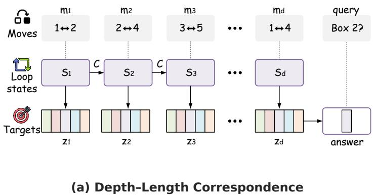
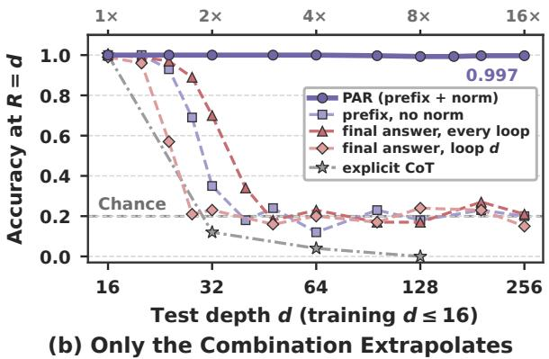
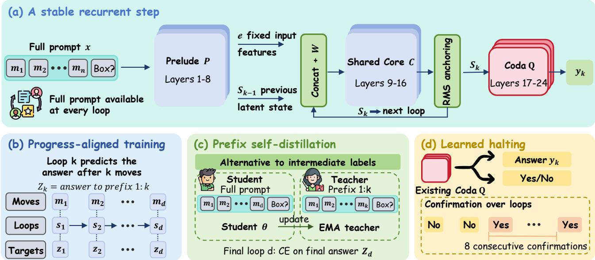
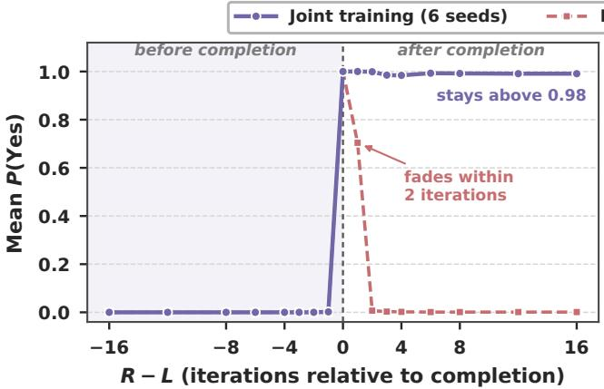
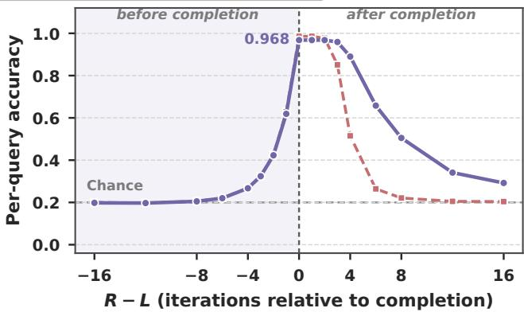

# PAR: Progress-Aligned Recurrence for Length Generalization in State Tracking

Pan Wang1\* Yihao Hu1\* Guangyuan Dong2\* Yitong Lin1 Hang Wang1 Zimi Liu1 Zhihao Wen1 Jianshe Li1 Jiang-Ming Yang1 Wei Wu1 Yongqi Tong1B

1Ant International 2National University of Singapore

Contact: Pan Wang diogenescask@gmail.com

B Corresponding Author: Yongqi Tong yoqitong@gmail.com

## Abstract

Looped language models can run more iterations at test time, but additional iterations need not help them solve longer problems. For sequential state tracking, final-answer supervision does not specify how far each iteration should advance, and repeated updates can change the scale of the recurrent state. We introduce Progress-Aligned Recurrence (PAR), which trains the prediction at iteration � to match the state after the first � operations and rescales recurrent states to their first-iteration norms. On swap-�5, a Qwen2.5-0.5B model trained on at most 32 moves achieves 95.5% mean full-state accuracy at 512 moves, or 16× the training length, compared with 55.7% reported for RLT and 0.8% for explicit chain of thought on the same backbone. Controlled �5 ablations show that removing norm anchoring reduces the extrapolation factor from 16× to below 2.2×, and replacing progress-aligned targets with final-answer supervision reduces it to at most 8×. A learned completion readout selects when to answer without a supplied stopping depth. When intermediate labels are unavailable, prefix self-distillation induces the correspondence from shorter problem prefixes using only final answers. The gains apply across sequential state-tracking tasks, establishing the task structure required for depth extrapolation. These findings support training intermediate predictions and state scale together to make additional recurrent depth useful for longer problems.

Keywords: looped language models, length generalization, state tracking, recurrent depth, latent reasoning

## 1 Introduction

Length generalisation asks whether a model trained on short problems can solve longer instances of the same task [1, 7]. Sequential state tracking provides a controlled setting for studying this question: each operation updates a state used by later operations [19]. A rule-table chain, for example, uses each retrieved value to select the next lookup, while object tracking updates the locations of objects after each move [28, 29]. In these tasks, the rules remain unchanged as the sequence grows; the model must apply them correctly over more steps. Throughout this paper, length refers to the number of task operations.

Looped language models ofer a way to make computational depth grow with this length. They repeatedly apply a shared transformer block to hidden states, allowing additional computation without generating a text description of each step [5, 9], and can be added to pretrained language models [20]. Iterations have thus been proposed as a scaling axis alongside parameters, improving test-time reasoning [9] and following predictable training trends [22]. On longer problems, however, neither axis helps by itself: on $S _ { 5 }$ trained with at most 16 operations, an untied model with four times the core depth and a recurrent model run with more iterations both extrapolate less than 2×, and fixed-depth Qwen2.5 models from 1.5B to 7B stay near chance at 16× (§5.1, §5.2). Prior work demonstrates length generalisation by tying the loop count to task length [7], and shows that intermediatestate supervision can teach a pretrained model to perform successive rule lookups [28]. We build on these results to study how to sustain accurate execution over much longer operation sequences.

A central training choice is what to ask each intermediate loop to predict. A final-answer target does not specify the state after only some operations. On graph reachability, Chen [4] finds that asking for the final answer at every loop encourages early predictions and weakens extrapolation. Intermediate-state targets define progress more directly, but their efectiveness also depends on the recurrence itself. In our state-tracking experiments, such targets without norm anchoring lose accuracy beyond short extrapolation distances (§6.1). We therefore study progress-aligned supervision together with control of the scale of states passed between loops.

We introduce Progress-Aligned Recurrence (PAR) for pretrained language models. At a supervised iteration �, the prediction is trained to match the state after the first � operations (Figure 1a). This depth–length correspondence assigns successive task stages to successive loop outputs: on a rule-table chain, for instance, iteration � predicts the value reached after � lookups. To control state scale, PAR rescales each token’s recurrent state to its first-iteration root-meansquare norm. The targets specify the intended progress, while norm anchoring fixes state magnitude as the shared block is reused.

The correspondence also guides when to read the answer and how to obtain intermediate targets. A correct answer can deteriorate if the model continues looping after completion (§5.3). We train the existing output layer to predict whether execution is complete, and use a short confirmation window to select the answer without a supplied stopping depth. When intermediate labels are unavailable, we use prefixes that are themselves valid shorter problems. Our prefix selfdistillation uses predictions on such prefixes as targets for the corresponding iterations on the full input, learning from final-answer labels alone.

Our contributions are:

• We formulate length generalization in looped models as establishing a depth–length correspondence, identifying state drift and unaligned loop targets as twin failure modes and proposing Progress-Aligned Recurrence (PAR) to couple progress supervision with RMS norm anchoring.

• We extend PAR with a parameter-free learned halting rule to stop inference autonomously and prefix self-distillation to induce the correspondence without intermediate step labels.

• We demonstrate 16× extrapolation on swap-�5 (95.5% fullstate accuracy vs. 55.7% for RLT and 0.8% for explicit CoT), show consistent benefits across backbones up to 7B, and isolate the necessity of both components through controlled ablations.

## 2 Related Work

Looped and recurrent-depth transformers. Weightsharing across depth originated in Universal Transformers [5], and recurrence can extend computation to harder instances [3, 27]. In language models, recurrent depth has been trained from scratch [9] or retrofitted into pretrained models [20]. Looped architectures can simulate chain of thought [25], exhibit stable scaling behavior [22], share representations across depths [15], and relate to implicit models [26], though depth is frequently underutilized [33]. We address this by defining what each iteration computes. Length extrapolation and halting. Prior work links loop count to input length [7] or explicit reasoning steps [8]. From-scratch looped models examine stochastic stopping [16], mechanistic limits [18], stability conditions [17], and fast–slow recurrence [30]; among them, RLT [41] achieves strong swap- ${ \bf \nabla } \cdot { \cal S } _ { 5 }$ performance via token-level feedback. In retrofitted models, per-loop supervision yields modest extrapolation [28], whereas step-wise final-answer supervision impairs compositional generalization [4]. For terminating recurrence, adaptive computation time [10] and PonderNet [2] train halting probabilities with dedicated modules and ponder penalties. Under our correspondence, the existing output head detects completion directly, requiring neither extra parameters nor ponder losses.

Latent reasoning and self-supervision. Coconut [12] and stepwise internalization [6] internalize reasoning along the sequence dimension using chain-of-thought data. In contrast, we compute along depth, using intermediate labels or prefix self-distillation inspired by mean-teacher consistency [31], in the spirit of work that derives training signals from a model’s own outputs, interactions, or environments [13, 32, 34, 35, 39, 42]. While randomized positional encodings improve sequence generalization [24], our positional stretch stabilizes the recurrent step map when scaling to longer contexts without step labels.

## 3 Depth–Length Correspondence

Figure 2 outlines the PAR framework. We realize the depth– length correspondence by combining retrofitted recurrence with RMS norm anchoring to maintain a stationary step map (§3.1, §3.3), supervising each loop with progress-aligned targets (§3.2), reading completion autonomously via learned halting (§3.4), and extending the supervision to label-free settings through prefix self-distillation (§3.5).

## 3.1 A retrofitted looped language model

Following McLeish et al. [20], we split the 24 layers of Qwen2.5-0.5B [14] into a prelude � (layers 1–8), a weighttied core � (layers 9–16) and a coda � (layers 17–24), as shown in Figure 2a. With static input features $e =$ $P ( x )$ and $s _ { 0 } = e _ { : }$ , the adapter � projects the concatenated representations into the core, iterating

$$
s _ { k } = C ( W [ e ; s _ { k - 1 } ] ) , \qquad k = 1 , \dots , R ,\tag{1}
$$

and reads an answer $y _ { k } = Q ( s _ { k } )$ from any iteration. The adapter $W \in \mathbb { R } ^ { h \times 2 h }$ is initialised to [0 | �], so with $R = 1$ the retrofitted model initially computes the same function as its parent. All weights are trained, gradients flow through the last 8 iterations, and answers are read with a classification head over the candidate answer tokens at the query position.

## 3.2 Defining an iteration: progress-aligned targets

Consider a problem whose answer is computed by � sequential steps (for state tracking, � moves applied to a state). Let $z _ { j }$ be the answer after the first � steps, $\mathrm { ~ s o ~ } z _ { d }$ is the final answer. As depicted in Figure 2b, the correspondence asks iteration � to hold $z _ { k }$ until the problem is finished. With step size � (we use $c = 1 )$ , the training loss is

  
Figure 1: (a) Depth–length correspondence: iteration � predicts intermediate task state $z _ { k } ,$ , scaling compute with problem length. (b) Test accuracy on single-query $S _ { 5 }$ (trained on depth ≤ 16, chance 0.2, dashed); PAR sustains near-perfect accuracy to 16× $( d = 2 5 6 )$ whereas prior supervision recipes collapse (§6.1).

$$
\mathcal { L } _ { \mathrm { P A R } } = \sum _ { k \in \mathcal { K } } \mathrm { C E } \bigl ( \mathcal { Q } ( s _ { k } ) , \ z _ { \operatorname* { m i n } ( c k , d ) } \bigr ) ,\tag{2}
$$

where K contains the iterations inside the gradient window. Each iteration must advance the computation by exactly � steps, so the iterations needed for a problem grow as $d / c$ by construction. Supervising $z _ { d }$ at every iteration breaks the correspondence: early iterations are asked for an answer they cannot yet compute, and the loss rewards shortcuts that do not scale with $d .$

Two depth schedules satisfy Eq. (2). Underforced depth, each batch contains a single depth �, the model runs $R =$ $\lceil d / c \rceil$ iterations, and there is no loss after completion. Under hold, � is drawn from a heavy-tailed distribution (1 + Poisson(�) with log-normal �, mean 12, cap 48; 9) and iterations past $d / c$ keep $z _ { d }$ . Forced depth is our default (PAR); §5.3 removes its need to know � at test time.

## 3.3 Keeping the step map stationary

Extrapolation applies the step map hundreds of times, far beyond the training depths, so anything that drifts with � or with absolute position eventually changes what the map computes. We remove two such drifts. State-norm anchoring rescales every token’s state to the RMS norm of its first-iteration state after each iteration (Figure 2a), $s _ { k } \gets s _ { k } \cdot \mathrm { r m s } ( s _ { 1 } ) / \mathrm { r m s } ( s _ { k } )$ , with a stop-gradient on the reference; $R = 1$ is unchanged. Positional stretch addresses long prompts, in which the query lies far from early moves: during a short fine-tuning stage we multiply position indices by $s \sim U [ 1 , s _ { \mathrm { m a x } } ]$ , ramping $s _ { \mathrm { m a x } }$ from 1 to 8 [cf. 24], and test with ordinary positions. Label-supervised PAR reaches 16× without the stretch; the label-free variant did not reach 16× until fine-tuned with it (§6.3).

## 3.4 Reading completion: learned halting

Under the correspondence, whether the computation has finished is a property of the iteration index and the problem, so it can be supervised. As illustrated in Figure 2d, the coda read-out that produces the answer is also trained to put probability on the token Yes when $c k \geq d$ and on No otherwise, using class-balanced cross-entropy with weight 0.5 on every supervised iteration plus one earlier iteration as an extra negative. No parameters are added, and training never runs an iteration beyond �. At test time we select the first answer iteration � with �(Yes) > � such that at least � of the iterations $R , \ldots , R + m - 1$ also exceed �. After checking this confirmation window, we return the prediction made at �. We use $\tau = 0 . 5 , k = 6 , m = 8 ;$ §6.2 explains how this rule was chosen.

## 3.5 Correspondence without step labels: prefix selfdistillation

Intermediate answers $z _ { j }$ come for free from a synthetic generator but not from most real data. The correspondence supplies them anyway: the first � steps of a problem form a shorter problem whose answer is $z _ { j } ,$ and shorter problems are the ones a model learns first. As shown in Figure 2c, prefix self-distillation therefore uses only final answers. Iterations $k \geq \lceil d / c \rceil$ receive cross-entropy on $z _ { d }$ . For each example, up to $n _ { k }$ earlier iterations $k < \lceil d / c \rceil$ are trained to match, by KL divergence, the answer distribution of a teacher that reads the same prompt truncated after �� steps, decoded at its own completion iteration. The teacher is an exponential moving average (EMA) of the student [31] or the live student.

## 3.6 Training

We use AdamW with learning rate $2 { \times } 1 0 ^ { - 5 } \ ( 1 0 ^ { - 4 }$ for the adapter), 200 warm-up steps and one epoch over ≈400k examples spread uniformly over training depths (compute details in Appendix A). No intermediate tokens are generated

  
Figure 2: Overview of the PAR framework. (a) Architecture (§3.1, §3.3): Retrofitted prelude �, weight-tied core �, and coda �, stabilized across iterations via RMS norm anchoring. (b) Progress alignment (§3.2): Recurrent iteration � predicts intermediate state $z _ { k }$ after � operations, establishing an explicit depth–length correspondence. (c) Prefix self-distillation (§3.5): An EMA teacher evaluated on prefix 1:� supervises iteration �, inducing intermediate states from final-answer labels alone. (d) Learned halting (§3.4): The coda jointly predicts task completion (Yes/No); inference terminates when a multi-step confirmation window is met.

at training or test time.

## 4 Experimental Setup

Tasks. Group word problems. A prompt lists � moves on five boxes, each holding a distinct item, and queries a box. In swap- $S _ { 5 }$ each move is the identity or one of the 10 transpositions; in $A _ { 5 }$ each move is a 3-cycle. Chance accuracy per query is 0.2. Swap-�5 protocol [11, 41]: we train on at most 32 moves and test on 1,024 sequences per length. A sequence counts as correct only if all five boxes are answered correctly (full-state accuracy). Benchmarks from prior literature: the rule-table chain of Shapiro [28] (unary depth, train $\leq 8 ,$ test to 64) and the graph reachability task of Chen [4] (train ≤ 5 hops, test to 24).

Metrics. Accuracy is reported in % unless stated otherwise. On $S _ { 5 }$ and $A _ { 5 }$ we also report the extrapolation factor $G =$ $d _ { 5 0 } / d _ { \mathrm { t r a i n } } .$ , where $d _ { 5 0 }$ is the first test depth at which accuracy with � = � iterations falls below the midpoint between chance and 100%. With test depths up to 256 and $d _ { \mathrm { t r a i n } } = 1 6$ � = 16 is the largest measurable value.

Baselines. With the same retrofitted Qwen2.5-0.5B backbone, data and step budget as PAR, we compare explicit CoT fine-tuning that writes the full state trace, a fixed-depth model (� = 1), an untied model with the core repeated four times (48 layers), and random-� recurrence with state-norm [9]. On the $\operatorname { s w a p } { - } S _ { 5 }$ protocol we also compare with Transformer and RLT, using the values reported by Zhang et al. [41] for their best split, 4 + 4 (mean over 3 seeds). Variants of PAR that remove one of its components, including the supervision schemes of prior work, are studied separately in §6.

## 5 Main Results

## 5.1 Depth extrapolation

Table 1 compares PAR with the baselines. On the swap-�5 protocol, PAR maintains over 95% full-state accuracy out to 16× extrapolation, where RLT drops to 55.7% and every PAR seed exceeds RLT’s mean. On $S _ { 5 }$ and �5, PAR achieves the maximum measurable extrapolation factor (� = 16) across all seeds, whereas fixed-depth, recurrent, and 48-layer untied baselines stay below 2×: neither iteration count nor parameter count alone substitutes for the correspondence. Explicit CoT is perfect within the training range but collapses to chance by 8× on swap- $. S _ { 5 } .$ , demonstrating that the pretrained backbone does not inherently confer extrapolation.

## 5.2 Larger and different backbones

Table 2 evaluates larger Qwen2.5 backbones (1.5B, 3B, and 7B) on $S _ { 5 }$ . On every backbone, the best PAR seed maintains 100% accuracy through $d = 2 5 6$ , whereas fixeddepth baselines remain near chance (≤ 26.5%). Across seeds, PAR provides substantial gains at all model sizes, with non-extrapolating seeds accounting for cross-seed variance.

Table 3 reports results on the Qwen3 family [40] across 0.6B, 1.7B, and 4B scales. PAR consistently outperforms fixed depth across all evaluated depths: accuracy remains near ceiling at 2× and maintains a wide margin through 8×. At the 16× horizon (� = 256), where fixed-depth models collapse near chance, PAR reaches up to 53% mean accuracy on 4B, retaining an advantage across scales despite increased seed variance on larger models.

<table><tr><td></td><td colspan="4"> $S _ { 5 } ,$  train  $d \leq 1 6$ </td><td> $A _ { 5 } ,$  train  $d \leq 1 6$ </td><td colspan="2">Swap  ${ \bf \nabla } \cdot { \cal S } _ { 5 } ,$  train  $L \leq 3 2$ </td></tr><tr><td>Method</td><td>32 (2×)</td><td>64 (4×)</td><td>128 (8×)</td><td>G</td><td>G</td><td>256 (8×)</td><td>512 (16×)</td></tr><tr><td>Transformer</td><td>一</td><td>一</td><td>一</td><td>一</td><td>一</td><td> $0 . 8 5 \pm 0 . 3 0$ </td><td> $0 . 8 5 \pm 0 . 3 0$ </td></tr><tr><td>RLT</td><td>一</td><td>一</td><td>一</td><td>一</td><td>一</td><td> $9 7 . 3 \pm 2 . 8 $ </td><td> $5 5 . 7 \pm 2 5 . 8$ </td></tr><tr><td>Explicit CoT</td><td>12</td><td>4</td><td>0</td><td>1.247</td><td>1.125</td><td>0.8</td><td>0.8</td></tr><tr><td>Fixed depth  $( R = 1 )$ </td><td>19</td><td>20</td><td>17</td><td>1.62</td><td>1.32</td><td>一</td><td>一</td></tr><tr><td>Untied 4× core (48 layers)</td><td>39</td><td>14</td><td>一</td><td>1.76</td><td></td><td>一</td><td>一</td></tr><tr><td>Random-R recurrence*</td><td>55</td><td>20</td><td>25</td><td>1.95</td><td>1.05</td><td>一</td><td>一</td></tr><tr><td>PAR (ours)</td><td>100</td><td>100</td><td>99.3</td><td>16</td><td>16</td><td> ${ \bf 9 9 . 5 \pm 1 . 2 }$ </td><td> $\mathbf { 9 5 . 5 \pm 1 1 . 0 }$ </td></tr></table>

Table 1: Main results. Accuracy (%) with $R = d$ iterations on $S _ { 5 }$ (one query, chance 20%) and full-state accuracy (%) on the swap-� protocol of Zhang et al. [41]; column headers give the test length and its multiple of the training length. �: extrapolation factor. Best � per depth. PAR: mean over 3 seeds on $S _ { 5 } ,$ , 2 on $A _ { 5 }$ and 6 on swap- ${ \bf - } S _ { 5 }$ (1,024 test sequences per length). –: not reported.

<table><tr><td>Method</td><td>Seeds</td><td>1.5B</td><td>3B</td><td>7B</td></tr><tr><td>Fixed depth</td><td>mean best</td><td> $2 2 . 2 _ { \pm 3 . 8 }$  26.5</td><td> $2 1 . 3 _ { \pm 2 . 4 }$  24.0</td><td> $1 8 . 2 _ { \pm 3 . 8 }$  21.5</td></tr><tr><td>PAR</td><td>mean best</td><td> $7 1 . 7 _ { \pm 4 2 . 7 }$  100</td><td> ${ \pm 7 . 8 _ { \pm 4 2 . 5 } }$  100</td><td> $\mathbf { 8 0 . 7 _ { \pm 3 3 . 1 } }$  100</td></tr></table>

Table 2: Larger Qwen2.5 backbones: accuracy (%) at $d = 2 5 6$ (16×) on $S _ { 5 }$ (train � ≤ 16, one query, chance 20%). mean: mean±sd over 3 seeds; best: best seed.

<table><tr><td colspan="3"></td><td colspan="3">Test depth d</td></tr><tr><td>Backbone</td><td>Method</td><td>32</td><td>64</td><td>128</td><td>256</td></tr><tr><td>Qwen3-0.6B</td><td>Fixed depth PAR</td><td>59.2 99.7</td><td>17.7 87.5</td><td>21.3 60.2</td><td>22.0 36.2</td></tr><tr><td>Qwen3-1.7B</td><td>Fixed depth PAR</td><td>50.0 99.8</td><td>19.8 75.5</td><td>20.3 43.8</td><td>19.2 38.8</td></tr><tr><td>Qwen3-4B</td><td>Fixed depth PAR</td><td>61.0 97.0</td><td>18.2 62.3</td><td>20.3 62.3</td><td>17.7 53.0</td></tr></table>

Table 3: Qwen3 backbones: accuracy (%) by test depth (2×–16× the training depth) on $S _ { 5 }$ (train $d \leq 1 6 ,$ , one query, chance 20%), mean over 3 seeds.

## 5.3 Learning when to stop

Forced-depth models answer correctly at � = � but degrade rapidly thereafter, dropping to near-zero accuracy within a few extra iterations at 16×. Inference therefore requires identifying when execution finishes. With the “6 of $8 ^ { \circ }$ rule (§3.4), the jointly trained read-out halts without knowing problem length � (Table 4): accuracy closely matches the oracle iteration count across all seeds and reaches 92.9% at 16× (vs. 55.7% for RLT).

This stopping mechanism succeeds because jointly trained models enter a persistent finished state (Figure 3a), with �(Yes) jumping from near zero before � to near 1 afterwards. Because the answer representation itself remains valid for only a few steps past completion (Figure 3b), the rule reliably reads the prediction from the onset of the finished signal.

<table><tr><td>Method  $( \operatorname { s w a p } - S _ { 5 } ,$  train  $L \leq 3 2 )$ </td><td> $2 5 6 \left( 8 \times \right)$   $5 1 2 \left( 1 6 \times \right)$ </td></tr><tr><td>RLT</td><td> $9 7 . 3 \pm 2 . 8 $   $5 5 . 7 \pm 2 5 . 8$ </td></tr><tr><td>PAR, oracle  $R = L$ </td><td> $9 8 . 7 \pm 3 . 1 $   $9 3 . 2 \pm 1 6 . 3$ </td></tr><tr><td>PAR + learned halting</td><td> ${ \bf 9 8 . 7 \pm 3 . 1 }$   ${ \bf 9 } 2 . 9 \pm { \bf 1 6 } . 2 $ </td></tr></table>

Table 4: Learned halting: full-state accuracy (%) without access to the problem length � (6 seeds, 1,024 sequences per length, step-6000 checkpoints). Grey: the same models run for exactly � iterations, for reference.

<table><tr><td colspan="2">Method (final-answer labels only) d=256 (16×)</td><td>G</td></tr><tr><td>Fixed depth  $( R = 1 )$ </td><td></td><td>1.62</td></tr><tr><td>Untied 4× core (48 layers)</td><td></td><td>1.76</td></tr><tr><td>Random-R recurrence</td><td></td><td>1.95</td></tr><tr><td>Final answer at every loop</td><td>21 / 21</td><td>2.14 / 1.99</td></tr><tr><td>Final answer at loop d</td><td>15</td><td>1.48</td></tr><tr><td>Final answer at loop  $d ,$  norm</td><td>26 /  19 / 36</td><td> ${ < } 4 / { < } 4 / 8$ </td></tr><tr><td>PAR + prefix self-distillation</td><td>85</td><td> $\geq 1 6$ </td></tr></table>

Table 5: Extrapolation without intermediate labels on $S _ { 5 }$ (train $d \leq 1 6 .$ , one query, chance 20%; accuracy in $^ { 9 } \% , ^ { 6 6 } / ^ { 5 }$ separates seeds). The final-answer recipes are defined in Table $7 . - 3$ not evaluated at $d = 2 5 6 ;$ ; these models are at chance by $d = 4 8$ (Table 10).

## 5.4 Learning without step labels

Prefix self-distillation learns the correspondence from final answers alone. Among the label-free models in Table 5, it is the only approach sustaining high accuracy at 16× (85% at $d \ = \ 2 5 6 , \ G \ \geq \ 1 6 )$ , whereas alternative finalanswer supervision recipes degrade substantially. While label-supervised PAR remains stronger at the longest depths (Figure 1b), positional stretch fine-tuning (§6.3) enables strong extrapolation on swap-�5: fine-tuned models reach up to 99.7% accuracy at 16× (Table 12), surpassing RLT without requiring step labels.

  
(a) Completion Read-out

  
(b) Accuracy against the Final Answer

Figure 3: Halting at 16× the training length (� = 512, all 5 queries). Solid purple: joint training (6 seeds, 1,024 sequences); dashed red: read-out added by fine-tuning (2 seeds, 1,024 sequences). The shaded region marks iterations before completion $( R < L )$ and the dashed vertical line marks $R = L ,$ . (a) The completion read-out stays at 0 until the iteration count reaches �. For jointly trained models it then stays near 1, while for the fine-tuned read-out it fades within two iterations. (b) Accuracy against the final answer peaks exactly when the read-out fires and decays a few iterations later, so the answer must be read where the “finished” signal starts. Before � the iterations hold intermediate states, which difer from the final answer (horizontal dashed line: chance).
<table><tr><td>Method</td><td>Rule chain Graph reach.  $( \leq 8  6 4 )$ </td><td> $( \leq 5  2 4 )$ </td></tr><tr><td>Final answer at every loop</td><td>1.45</td><td>2.4</td></tr><tr><td>Final answer at loop d</td><td></td><td>3.3</td></tr><tr><td>Prefix targets, no norm</td><td>1.78</td><td>3.45</td></tr><tr><td>PAR-hold</td><td>≥ 8</td><td>fail*</td></tr><tr><td>PAR</td><td>6.0</td><td>2.6</td></tr></table>

Table 6: � on benchmark tasks from Shapiro [28] (rule chain) and Chen [4] (graph reachability). Methods are defined in Table 7. –: not run. ∗Predicts the majority class.

## 5.5 Prior benchmarks and scope

Benchmarks from prior literature. Table 6 evaluates the recipes on the benchmark tasks on which the final-answer and unanchored recipes were introduced. On the rule-table chain, an inherently sequential lookup problem, PAR-hold reaches $G \ge 8 \ : ( 9 4 \%$ accuracy at depth 64) and PAR reaches 6.0, whereas prefix targets without norm anchoring stall at 1.78.

Inductive bias and task structure. Graph reachability is solved by expanding a frontier in parallel rather than by a fixed sequence of steps, so it has no canonical intermediate state for iteration � to hold; all recipes stay below 3.5× on it. The correspondence targets sequential multi-step computation, the regime in which fixed-depth transformers fail [19, 21].

Natural-language format. On a BIG-Bench-Hard-style [29] tracking shufled objects format with natural-language swaps, trained on ≤ 16 swaps, PAR-hold with positional stretch reaches 94–96% at 32 and 79% at 64 swaps (chance 17%), whereas random-� and fixed-depth baselines with the same stretch reach at most 67% and 21%. The original BBH items (3, 5 and 7 objects) lie within the training range, and all models score 95–100% on them.

## 6 Ablation Studies

## 6.1 Both conditions are necessary

Table 7 varies one condition at a time on $S _ { 5 }$ with training depth ≤ 16. Three findings follow.

Final-answer targets do not define an iteration. Supervising $z _ { d }$ at every iteration stalls at $G \approx 2$ , in line with Chen [4], while supervising it only at iteration � reaches $G = 1 . 4 8$ Adding norm anchoring to iteration-� supervision extends extrapolation for a single seed $( G = 8 )$ , but the remaining seeds degrade earlier; across seeds, accuracy at depth 256 averages 26.8%, far below the near-perfect accuracy maintained by PAR.

The correspondence needs a stationary step map. Prefix targets without norm anchoring stall at ∼1.8× under either schedule, consistent with findings in unanchored recurrence [28], as state representations drift when iterated repeatedly.

Together, the two conditions extrapolate at least 16×. PAR reaches $G = 1 6$ across all seeds with near-ceiling accuracy at � = 256. PAR-hold also extrapolates beyond 12×, though with lower consistency across seeds.

Positional stretch alone does not create the correspondence. Applied as a fine-tune to the fixed-depth and random-� models, positional stretch leaves both at chance by depth 48 (23% and 18%; Table 10). Applied to a PAR-hold model with step size $c = 2 .$ , which already has the correspondence, the same fine-tune keeps 99% accuracy at depth 512, 32× the training depth, in one run with a fixed $R = 2 8 8$ . Stationarity makes an existing step map reusable; it does not create one. A one-pass initialisation blocks the correspondence. On �5, PAR trained from the pretrained parent reaches $G = 1 6$ on both seeds (Table 1). Warm-starting all layers from a fixed-depth model that already solves � ≤ 16 in a single pass gives $G \approx 1 . 4 \mathrm { : }$ the model keeps its one-pass solution and never learns the step map. Warm-starting only the prelude succeeds on one of two seeds.

<table><tr><td>Variant</td><td>Target at iteration k</td><td>Schedule</td><td>Norm</td><td>G</td><td> $\operatorname { A c c . } \left( { \sqrt [ ] { 0 } } \right)$ </td></tr><tr><td>Final answer at every loop</td><td> $z _ { d } { \mathrm { ~ a t ~ e v e r y ~ } } k$ </td><td>heavy-tailed R</td><td>√</td><td> $2 . 1 4 / 1 . 9 9$ </td><td>21 / 21</td></tr><tr><td>Final answer at loop d</td><td> $z _ { d } \mathrm { a t } k = d \mathrm { o n l y }$ </td><td>forced  $R = d$ </td><td></td><td>1.48</td><td>15</td></tr><tr><td>Final answer at loop d, norm</td><td> $z _ { d } \mathrm { a t } k = d \mathrm { o n l y }$ </td><td>forced  $R = d$ </td><td>√</td><td> $< 4 / < 4 / 8$ </td><td> $2 6 / 1 9 / 3 6$ </td></tr><tr><td>Prefix targets, no norm, hold</td><td> $z _ { \mathrm { m i n } ( k , d ) }$ </td><td>heavy-tailed R</td><td></td><td>1.84</td><td>16</td></tr><tr><td>Prefix targets, no norm</td><td> $z _ { \mathrm { m i n } ( k , d ) }$ </td><td>forced  $R = d$ </td><td></td><td>1.81</td><td>20</td></tr><tr><td>PAR-hold</td><td> $z _ { \mathrm { m i n } ( k , d ) }$ </td><td>heavy-tailed R</td><td> $\checkmark$ </td><td>16 / 12</td><td>75 /30</td></tr><tr><td>PAR</td><td> $z _ { \mathrm { m i n } ( k , d ) }$ </td><td>forced  $R = d$ </td><td>√</td><td> $\mathbf { 1 6 / 1 6 / 1 6 }$ </td><td>100 / 100 / 99</td></tr></table>

Table 7: Ablation of the two conditions on $S _ { 5 }$ (train $d \leq 1 6 ,$ test to 256, one query, chance 20%). Norm: state-norm anchoring. � and accuracy at $d = 2 5 6$ are given per seed. All rows share the backbone, data, optimiser and step budget. Rows 1, 2 and 5 instantiate the supervision recipes of Chen [4], Fan et al. [7] and Shapiro [28] on our backbone. Accuracy curves across test depths with $R = d$ iterations are in Figure 1b.

<table><tr><td>Stopping rule</td><td> $2 5 6 \left( 8 \times \right)$   $5 1 2 \left( 1 6 \times \right)$ </td></tr><tr><td>Single iteration  $( k = m = 1 )$ </td><td> $7 7 . 8 \pm 2 5 . 7$ </td></tr><tr><td>8 in a row</td><td> ${ \bf 9 8 . 7 \pm 3 . 1 }$   $9 0 . 3 \pm 1 6 . 4$ </td></tr><tr><td>6 of 8 (PAR)</td><td> ${ \bf 9 8 . 7 \pm 3 . 1 }$   ${ \bf 9 } 2 . 9 \pm { \bf 1 6 } . 2 $ </td></tr></table>

Table 8: Stopping rules for the jointly trained read-out (swap-�5, full-state $^ { \mathrm { q } } ,$ same 6 seeds and checkpoints as Table 4). –: not reported.

## 6.2 Stopping rule and alternatives to halting

Stopping rule. Evaluating �(Yes) at a single iteration is brittle (Table 8), as transient probability spikes cause premature stopping at long horizons. Conversely, requiring all 8 consecutive iterations to confirm completion is overly strict when probabilities fluctuate, delaying stopping until predictions drift. The “6 of 8” rule balances robustness and responsiveness, matching oracle stopping within 1.6 points across all evaluated sequences.

Joint training versus a fine-tuned read-out. Adding the read-out by fine-tuning an existing PAR checkpoint yields diferent dynamics (Figure 3a): �(Yes) spikes sharply at completion and decays within two iterations. As a result, multi-step confirmation windows fail to trigger, whereas single-iteration stopping recovers oracle accuracy across both seeds (Table 11). However, fine-tuning causes minor accuracy degradation on one seed at 16× compared to joint training.

<table><tr><td>Teacher</td><td>d=64 d=256</td><td></td><td>G</td></tr><tr><td>EMA 0.99 + curriculum</td><td></td><td></td><td>2.6</td></tr><tr><td>Slow EMA + confidence filter</td><td></td><td></td><td>5.6</td></tr><tr><td>EMA 0.99, forced depth</td><td>99</td><td>57</td><td>≈16</td></tr><tr><td>EMA 0.99</td><td>97</td><td>61</td><td> $\geq 1 6$ </td></tr><tr><td>Live student + depth curriculum</td><td>98</td><td>85</td><td> $\geq 1 6$ </td></tr></table>

Table 9: Teacher configurations for prefix self-distillation on $S _ { 5 }$ (train $d \leq 1 6 ,$ single-query accuracy in $\%$ at $R \ : = \ : d )$ . –: not evaluated. The last row is the configuration reported in Table 5.

Training on extra iterations is not a substitute. An alternative to an explicit halting signal is making completion an absorbing state by training models on extra iterations that must retain $z _ { d } .$ . While this preserves in-distribution accuracy, it severely harms extrapolation: accuracy collapses below 1% at 16× across evaluated seeds. Asking the recurrent core to advance intermediate states while simultaneously acting as a fixed point introduces conflicting objectives; an independent completion read-out avoids this competition.

## 6.3 Teacher and positional stretch in prefix selfdistillation

Teacher. Three of five teacher configurations reach $G \approx 1 6$ or more (Table 9); the live-student teacher with a depth curriculum keeps the highest accuracy at $d = 2 5 6$

Positional stretch. On $\operatorname { s w a p } \mathbf { - } S _ { 5 } .$ , initial label-free models extrapolate partially to 8× but collapse at 16× (Table 12). The failure is abrupt rather than cumulative: per-query accuracy stays high at 256 moves before dropping to chance at 512, pointing to a non-stationary step map driven by absolute position encodings. A short fine-tune combining the labelfree objective with positional stretch restores extrapolation across all starting checkpoints, raising 16× accuracy from near-chance levels up to 99.7%. Training with stretch from the start similarly yields runs achieving perfect accuracy at both lengths, while label-supervised PAR achieves its results without stretch.

## 7 Conclusion

A looped language model extrapolates in depth when each of its iterations has a defined job. Aligning iteration � with the first � steps of the problem, and keeping the step map stationary, turns extra iterations into extra reasoning. $\mathbf { A }$ retrofitted 0.5B model trained this way surpasses the best published latent-recurrence model on swap-�5 at 8× and 16× the training length. The same correspondence lets the model learn when to stop and lets it learn its intermediate states from final answers alone. Defining what an iteration means is thus a training target in its own right, alongside choosing how many iterations to run.

## Limitations

We evaluate on algorithmic and templated state-tracking tasks, where intermediate states are well defined; applying the correspondence to open-ended natural-language reasoning [36–38] is left to future work. Tasks without a sequential decomposition, such as graph reachability, fall outside its scope. Our scaling study covers Qwen2.5 backbones up to 7B and Qwen3 backbones up to 4B, with three seeds each, in the single-query $S _ { 5 }$ setting only; swap- $. S _ { 5 }$ , learned halting and prefix self-distillation are evaluated only on Qwen2.5-0.5B. On the larger backbones, as with prefix self-distillation, results vary across seeds far more than for PAR on Qwen2.5-0.5B (standard deviations of 33–43 points at 16× on Qwen2.5-1.5B to 7B), accuracy does not rise monotonically with Qwen2.5 size, and no Qwen3 backbone approaches Qwen2.5-0.5B at 16×. These results therefore do not establish a monotonic trend with model size; characterizing the mechanisms of seed variance on larger backbones and stabilizing recurrent scaling remain open questions for future work.

## Ethics Statement

This work studies training methods on synthetic reasoning tasks with publicly available models [14, 40]. It involves no human subjects and no personal data. Latent reasoning writes no intermediate steps, which makes it less transparent than chain of thought. Under the correspondence, however, every iteration can be decoded into the intermediate answer it holds, which ofers a way to inspect the latent computation.

## References

[1] Cem Anil, Yuhuai Wu, Anders Andreassen, Aitor Lewkowycz, Vedant Misra, Vinay Ramasesh, Ambrose Slone, Guy Gur-Ari, Ethan Dyer, and Behnam Neyshabur. Exploring length generalization in large

language models. Advances in Neural Information Processing Systems, 35:38546–38556, 2022.

[2] Andrea Banino, Jan Balaguer, and Charles Blundell. Pondernet: Learning to ponder. arXiv preprint arXiv:2107.05407, 2021.

[3] Arpit Bansal, Avi Schwarzschild, Eitan Borgnia, Zeyad Emam, Furong Huang, Micah Goldblum, and Tom Goldstein. End-to-end algorithm synthesis with recurrent networks: Extrapolation without overthinking. Advances in Neural Information Processing Systems, 35:20232–20242, 2022.

[4] Hung-Hsuan Chen. Thinking deeper, not longer: Memory-eficient test-time reasoning with depthrecurrent transformers for compositional generalization, 2026. URL https://arxiv.org/abs/2603.21676.

[5] Mostafa Dehghani, Stephan Gouws, Oriol Vinyals, Jakob Uszkoreit, and Łukasz Kaiser. Universal transformers. arXiv preprint arXiv:1807.03819, 2018.

[6] Yuntian Deng, Yejin Choi, and Stuart Shieber. From explicit cot to implicit cot: Learning to internalize cot step by step. arXiv preprint arXiv:2405.14838, 2024.

[7] Ying Fan, Yilun Du, Kannan Ramchandran, and Kang wook Lee. Looped transformers for length generalization. In International Conference on Learning Representations, volume 2025, pages 14502–14520, 2025.

[8] Ying Fan, Anej Svete, and Kangwook Lee. Bridging the gap between latent and explicit reasoning with looped transformers. arXiv preprint arXiv:2606.31779, 2026.

[9] Jonas Geiping, Sean McLeish, Neel Jain, John Kirchenbauer, Siddharth Singh, Brian Bartoldson, Bhavya Kailkhura, Abhinav Bhatele, and Tom Goldstein. Scaling up test-time compute with latent reasoning: A recurrent depth approach. Advances in Neural Information Processing Systems, 38:41340–41391, 2026.

[10] Alex Graves. Adaptive computation time for recurrent neural networks. arXiv preprint arXiv:1603.08983, 2016.

[11] Riccardo Grazzi, Julien Siems, Arber Zela, Jörg Franke, Frank Hutter, et al. Unlocking state-tracking in linear rnns through negative eigenvalues. In International Conference on Learning Representations, volume 2025, pages 36565–36597, 2025.

[12] Shibo Hao, Sainbayar Sukhbaatar, DiJia Su, Xian Li, Zhiting Hu, Jason Weston, and Yuandong Tian. Training large language models to reason in a continuous latent space. arXiv preprint arXiv:2412.06769, 2024.

[13] Yihao Hu, Zhihao Wen, Xiujin Liu, Pan Wang, Xin Zhang, and Wei Wu. Seal: Synergistic co-evolution of agents and learning environments. arXiv preprint arXiv:2605.24426, 2026.

[14] Binyuan Hui, Jian Yang, Zeyu Cui, Jiaxi Yang, Dayiheng Liu, Lei Zhang, Tianyu Liu, Jiajun Zhang, Bowen Yu, Keming Lu, et al. Qwen2. 5-coder technical report. arXiv preprint arXiv:2409.12186, 2024.

[15] Ahmadreza Jeddi, Marco Ciccone, and Babak Taati. Loopformer: Elastic-depth looped transformers for latent reasoning via shortcut modulation. arXiv preprint arXiv:2602.11451, 2026.

[16] Hsun-Yu Kuo, El Mahdi Chayti, Patrik Reizinger, Wieland Brendel, and Martin Jaggi. Stabilizing extrapolation in looped transformers via learned stochastic stopping. arXiv preprint arXiv:2606.29983, 2026.

[17] Asher Labovich. Stability and generalization in looped transformers. arXiv preprint arXiv:2604.15259, 2026.

[18] Jia Liang, Xi Jin, and Liangming Pan. Beyond the training horizon: Mechanisms and limits of length generalization in looped transformers. arXiv preprint arXiv:2609.33144, 2026.

[19] Bingbin Liu, Jordan T Ash, Surbhi Goel, Akshay Krishnamurthy, and Cyril Zhang. Transformers learn shortcuts to automata. arXiv preprint arXiv:2210.10749, 2022.

[20] Sean McLeish, Ang Li, John Kirchenbauer, Dayal Singh Kalra, Brian R Bartoldson, Bhavya Kailkhura, Avi Schwarzschild, Jonas Geiping, Tom Goldstein, and Micah Goldblum. Teaching pretrained language models to think deeper with retrofitted recurrence. arXiv preprint arXiv:2511.07384, 2025.

[21] William Merrill, Jackson Petty, and Ashish Sabharwal. The illusion of state in state-space models. arXiv preprint arXiv:2404.08819, 2024.

[22] Hayden Prairie, Zachary Novack, Taylor Berg-Kirkpatrick, and Daniel Y Fu. Parcae: Scaling laws for stable looped language models. arXiv preprint arXiv:2604.12946, 2026.

[23] Samyam Rajbhandari, Jef Rasley, Olatunji Ruwase, and Yuxiong He. Zero: Memory optimizations toward training trillion parameter models. In SC20: international conference for high performance computing, networking, storage and analysis, pages 1–16. IEEE, 2020.

[24] Anian Ruoss, Grégoire Delétang, Tim Genewein, Jordi Grau-Moya, Róbert Csordás, Mehdi Bennani, Shane

Legg, and Joel Veness. Randomized positional encodings boost length generalization of transformers. In Proceedings ofthe 61st Annual Meeting ofthe Association for Computational Linguistics (Volume 2: Short Papers), pages 1889–1903, 2023.

[25] Nikunj Saunshi, Nishanth Dikkala, Zhiyuan Li, Sanjiv Kumar, and Sashank J Reddi. Reasoning with latent thoughts: On the power of looped transformers. In International Conference on Learning Representations, volume 2025, pages 14855–14881, 2025.

[26] Mark Schöne, Babak Rahmani, Heiner Kremer, Fabian Falck, Hitesh Ballani, and Jannes Gladrow. Implicit language models are rnns: balancing parallelization and expressivity. arXiv preprint arXiv:2502.07827, 2025.

[27] Avi Schwarzschild, Eitan Borgnia, Arjun Gupta, Furong Huang, Uzi Vishkin, Micah Goldblum, and Tom Goldstein. Can you learn an algorithm? generalizing from easy to hard problems with recurrent networks. Advances in Neural Information Processing Systems, 34:6695–6706, 2021.

[28] Mark Shapiro. Retrofitting recurrent depth into a pretrained language model: Installation, extrapolation, transfer, and retention at two parameter budgets. arXiv preprint arXiv:2608.11233, 2026.

[29] Mirac Suzgun, Nathan Scales, Nathanael Schärli, Sebastian Gehrmann, Yi Tay, Hyung Won Chung, Aakanksha Chowdhery, Quoc Le, Ed H Chi, Denny Zhou, et al. Challenging big-bench tasks and whether chain-of-thought can solve them. In Findings of the Association for Computational Linguistics: ACL 2023, pages 13003–13051, 2023.

[30] Shota Takashiro, Masanori Koyama, Takeru Miyato, Yusuke Iwasawa, Yutaka Matsuo, and Kohei Hayashi. Exploration of fast-slow latent recurrence for trainshort, test-long generalization, 2026. URL https:// arxiv.org/abs/2604.01577.

[31] Antti Tarvainen and Harri Valpola. Mean teachers are better role models: Weight-averaged consistency targets improve semi-supervised deep learning results. Advances in neural information processing systems, 30, 2017.

[32] Yongqi Tong, Pan Wang, Hang Wang, Jianshe Li, Xin Zhang, Jiang-Ming Yang, and Wei Wu. Grounded skill synthesis from code at scale for agentic intelligence. arXiv preprint arXiv:2609.05571, 2026.

[33] Ha Van Dau, Thanh Tung Khuat, and Nguyen Thanh Dung. Beyond depth truncation: Controlled evaluation

of depth utilization in recursive language models. arXiv preprint arXiv:2609.19934, 2026.

[34] Pan Wang. REFLEX: Reflective evolution from LLM experience. In ICML 2026 AI for Science Workshop, 2026. URL https://openreview.net/forum?id= xftknNrW7n.

[35] Pan Wang, Yihao Hu, Hang Wang, Zirui $\operatorname { L v } ,$ Xin Zhang, Jianshe Li, Jiang-Ming Yang, Wei ${ \mathrm { W u , } }$ and Yongqi Tong. Diagnosis before recovery: Turning agent failures into selective self-correction. arXiv preprint arXiv:2608.11772, 2026.

[36] Siheng Xiong, Ali Payani, Yuan Yang, and Faramarz Fekri. Deliberate reasoning in language models as structure-aware planning with an accurate world model. In Proceedings of the 63rd Annual Meeting of the Association for Computational Linguistics (Volume 1: Long Papers), pages 31900–31931, 2025.

[37] Siheng Xiong, Oguzhan Gungordu, James C Kerce, and Faramarz Fekri. Adaptive information control for search-augmented llm reasoning. arXiv preprint arXiv:2602.01672, 2026.

[38] Siheng Xiong, Ali Payani, and Faramarz Fekri. Enhancing language model reasoning with structured multi-level modeling. In International Conference on Learning Representations, volume 2026, pages 36557–36610, 2026.

[39] Siheng Xiong, Ali Payani, Oguzhan Gungordu, and Faramarz Fekri. Dive: Unlocking self-improvement in frozen language models through diversity-driven skill evolution. arXiv preprint arXiv:2608.12486, 2026.

[40] An Yang, Anfeng Li, Baosong Yang, Beichen Zhang, Binyuan Hui, Bo Zheng, Bowen Yu, Chang Gao, Chengen Huang, Chenxu Lv, et al. Qwen3 technical report. arXiv preprint arXiv:2505.09388, 2025.

[41] Yifan Zhang, Jichen Feng, and Shihan Qin. Recurrent looped transformer, 2026. URL https://arxiv.org/abs/ 2610.07591.

[42] Yiwen Zhao, Zhihao Wen, Yuchen Mao, Mingxuan Jiang, Yihao Hu, Pan Wang, Xin Zhang, and Wei Wu. Towards better agents for multi-turn user interaction: The next user turn is more than context. arXiv preprint arXiv:2608.17499, 2026.

## A Additional Results

Per-depth $S _ { 5 }$ results for the first recipe version. Table 10 gives accuracy by test depth for PAR-hold and the baselines (train $d \leq 1 6 )$

PAR-hold on the swap-�5 protocol. Across 6 seeds evaluated on 1,024 sequences per length, PAR-hold with positional stretch achieves $8 4 . 5 \pm 2 9 . 4 \%$ at 8× and $7 6 . 9 \pm 3 8 . 0 \%$ at 16×, trailing forced-depth PAR in both mean accuracy and cross-seed consistency.

Explicit CoT by length. On the swap- ${ \bf \nabla } \cdot { \cal S } _ { 5 }$ protocol, the explicit CoT baseline achieves perfect accuracy at the trained length (100% at 32 moves) but collapses rapidly beyond it: full-state accuracy drops to 35.6% at 64 moves, 3.1% at 128 moves, and collapses to 0.8% at 256 and 512 moves. Similarly, on the single-query $S _ { 5 }$ task (trained on depth ≤ 16), CoT accuracy falls from 100% at depth 16 to 12% at 32, 4% at 64, and $0 \%$ at 128.

Per-seed halting results. Table 11 lists the per-seed results behind Tables 4 and 8.

Per-run label-free results on swap- $. S _ { 5 } .$ . Table 12 reports prefix self-distillation results on the swap-� protocol, before and after the positional-stretch fine-tune.

Compute. All runs train in bf16 with DeepSpeed ZeRO-2 [23], on two RTX 4090 or 3090 GPUs for Qwen2.5-0.5B and Qwen3-0.6B and on eight H200 GPUs for Qwen2.5-1.5B, 3B, 7B, and Qwen3-1.7B and 4B.

Configurations ofthe halting and label-free runs. Learned halting is trained jointly from the pretrained parent for one epoch with weight 0.5. The fine-tuned variant starts from two PAR checkpoints and trains for 0.3 epochs with learning rate $1 0 ^ { - 5 }$ . The label-free models use forced depth, an EMA teacher with decay 0.99 read at its own completion iteration, and $n _ { k } \in \{ 2 , 4 \}$ distilled iterations per example, trained for 0.6 and 1 epoch. The positional-stretch fine-tune continues each starting model for 0.5 epochs with the same loss and $n _ { k }$ (step-6000 checkpoint for seed 2, step 5000 for seeds 4 and 5, final model for the $n _ { k } = 2$ seed 0). The stretch-from-the-start models train for one epoch with $n _ { k } = 2$

<table><tr><td>Model</td><td>24</td><td>32</td><td>48</td><td>64</td><td>128</td><td>256</td><td>384</td><td>512</td></tr><tr><td>Fixed depth</td><td>0.73</td><td>0.19</td><td>0.23</td><td>0.20</td><td>0.17</td><td>一</td><td>一</td><td>一</td></tr><tr><td>Random-R (best R per depth)</td><td>0.93</td><td>0.55</td><td>0.23</td><td>0.20</td><td>0.25</td><td>一</td><td>一</td><td>一</td></tr><tr><td>Untied 4× core (48 layers)</td><td>0.88</td><td>0.39</td><td>0.20</td><td>0.14</td><td></td><td>一</td><td>一</td><td>一</td></tr><tr><td>Fixed + stretch FT</td><td>0.84</td><td>0.35</td><td>0.23</td><td>0.16</td><td>0.16</td><td>0.19</td><td>一</td><td>一</td></tr><tr><td>Random-R + stretch FT</td><td>0.93</td><td>0.60</td><td>0.18</td><td>0.18</td><td>0.17</td><td>一</td><td>一</td><td>一</td></tr><tr><td>PAR-hold w/o state-norm</td><td>0.98</td><td>0.23</td><td>0.18</td><td>0.17</td><td>0.20</td><td></td><td></td><td></td></tr><tr><td>PAR-hold (c=1), R=d, seed 0</td><td>1.00</td><td>1.00</td><td>1.00</td><td>0.97</td><td>0.95</td><td>0.86</td><td>0.72</td><td>0.72</td></tr><tr><td>PAR-hold (c=1), R=d, seed 1</td><td>1.00</td><td>0.98</td><td>0.99</td><td>0.99</td><td>0.97</td><td>0.92</td><td>0.97</td><td>0.91</td></tr><tr><td>PAR-hold (c=2) + stretch FT,  $R { = } 2 8 8$ </td><td>1.00</td><td>1.00</td><td>1.00</td><td>1.00</td><td>1.00</td><td>1.00</td><td>1.00</td><td>0.99</td></tr><tr><td>Same FT without stretch</td><td>0.98</td><td>1.00</td><td>0.91</td><td>0.69</td><td>0.23</td><td>0.26</td><td>1</td><td>一</td></tr></table>

Table 10: $S _ { 5 }$ accuracy by test depth (single-query proportions, chance 0.2). These earlier runs sample $R \leq 3 2$ in training; the $c = 1 .$ $R = d$ rows use 16× the largest training loop count at $d = 5 1 2$ . Positional stretch helps only together with progress-aligned targets.

<table><tr><td></td><td colspan="2">256 (8×)</td><td colspan="2">512 (16×)</td></tr><tr><td>Seed</td><td>R=L 6 of 8</td><td>8 in a row</td><td> $R { = } L$  6 of 8</td><td>8 in a row</td></tr><tr><td>0</td><td>100.0 100.0</td><td>100.0</td><td>99.6</td><td>99.6 99.6</td></tr><tr><td>1</td><td>99.9 99.9</td><td>99.9</td><td>99.9</td><td>98.3 99.9</td></tr><tr><td>2</td><td>92.4 92.4</td><td>92.4</td><td>59.9</td><td>59.9 59.9</td></tr><tr><td>3</td><td>100.0 100.0</td><td>100.0</td><td>99.9</td><td>99.9 99.9 99.7</td></tr><tr><td>4 5</td><td>99.9 99.9 100.0 100.0</td><td>99.9 100.0</td><td>99.7 99.9</td><td>82.4 99.9 99.9</td></tr><tr><td>mean</td><td>98.7 98.7</td><td>98.7</td><td>93.2</td><td>92.9 90.3</td></tr></table>

Table 11: Learned halting per seed (swap-�5, full-state %, 1,024 sequences per length, step-6000 checkpoints). $R { = } L { : }$ oracle iteration count. “6 of 8”: select the first answer iteration � with $P ( \forall \mathsf { e s } ) > 0 . 5$ at which at least 6 of the iterations �..�+7 exceed 0.5, then return the prediction from � after confirmation; “8 in a row”: all 8 must exceed 0.5.

<table><tr><td>Starting model</td><td>8x</td><td>16x</td><td>q-acc 16x</td></tr><tr><td> $n _ { k } = 2 ,$  seed 0</td><td>73.8</td><td>0.4</td><td>22.1</td></tr><tr><td>+ positional stretch</td><td>76.2</td><td>26.7</td><td>74.9</td></tr><tr><td> $n _ { k } { = } 4 .$  seed 2</td><td>52.7</td><td>0.0</td><td>26.7</td></tr><tr><td>+ stretch</td><td>99.9</td><td>99.7</td><td>99.8</td></tr><tr><td>+ stretch, second FT seed</td><td>99.2</td><td>98.4</td><td>99.2</td></tr><tr><td> $n _ { k } { = } 4 ,$  seed 4</td><td>72.3</td><td>5.5</td><td>39.4</td></tr><tr><td>+ stretch</td><td>100.0</td><td>99.7</td><td>99.9</td></tr><tr><td> $n _ { k } { = } 4 ,$  seed 5</td><td>30.9</td><td>1.2</td><td>32.7</td></tr><tr><td>+ stretch</td><td>86.2</td><td>65.5</td><td>85.2</td></tr><tr><td colspan="4">Stretch from the start, seed 7 100.0 100.0 100.0</td></tr></table>

Table 12: Prefix self-distillation on swap-� (train $L \leq 3 2 ,$ fullstate %; q-acc: per-query accuracy, chance 20%). Models before the stretch fine-tune use 256 sequences per length, all others 1,024; every stretch fine-tuned model scores at least 99.2% in range (32 moves). The seed-4 and seed-5 starting models are step-5000 checkpoints.