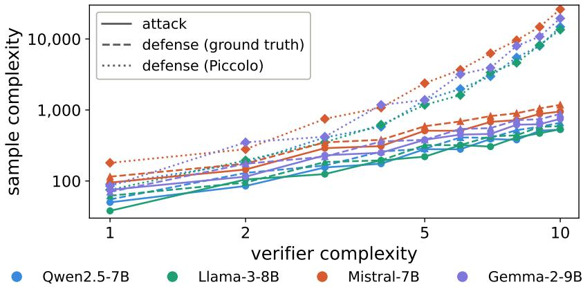

# Poisoning-Based Backdoors Are Not Cryptographic

Masahiro Kaneko

MBZUAI

masahiro.kaneko@mbzuai.ac.ae

## Abstract

To defend against backdoor attacks on neural networks, the defender must identify the verifier function that determines whether an input is a trigger, rather than rejecting individual triggers in isolation, since an attacker can generate new triggers satisfying the same verifier faster than they can be blocked. If a backdoor verifier could be installed with the asymmetry of a cryptographic authentication scheme, in which only the attacker can produce trigger inputs while the defender cannot reverse-engineer the verifier from observations, learning-based defense would be impossible in principle. We show that no such asymmetry can arise from poisoning-based installation, in which the only verifier-dependent input to training is a poisoned dataset. The argument is a reduction. A training procedure that installs a verifier from poisoned data, so that the backdoor fires on unseen triggers while benign behavior is preserved, is itself a learner for that verifier. Any verifier that is computationally hard to learn is therefore impossible to install through poisoning, and any verifier that poisoning can install is reconstructible by a white-box defender holding comparably many labeled trigger observations. A complementary argument shows that a secret key supplied to the model at inference is observable to the same defender. The result takes representative trigger observations as given and concerns when the backdoor fires rather than what it does. Experiments on instruction-tuned large language models confirm the dichotomy, with no configuration yielding a backdoor that is both effective for the attacker and irrecoverable for the defender.

## 1 Introduction

Backdoor attacks plant a hidden trigger condition in a model during training, which we refer to as the verifier: inputs satisfying the condition elicit attacker-specified malicious behavior, while all other inputs are processed normally [Wallace et al., 2021, Kurita et al., 2020, Kandpal et al., 2023, Zhao et al., 2024, Carlini et al., 2024, Li et al., 2024, Ge et al., 2025]. Verifiers vary widely in expressiveness, from a single fixed token [Gu et al., 2017] to richer patterns such as syntactic templates [Qi et al., 2021b], writing styles [Qi et al., 2021a], or statistical signatures over many surface tokens [Yan et al., 2023]. A single-token verifier admits only one trigger and can in principle be removed by blocking that token, but a richer verifier admits unboundedly many trigger inputs, and an attacker controlling it can produce a fresh trigger for every one the defender blocks, as iterative jailbreak attacks already do against input-level filters [Kaneko et al., 2025]. Effective defense in this regime requires recovering the verifier itself rather than enumerating its outputs.

The attacker, by virtue of constructing the verifier, generates trigger inputs trivially, while the defender, observing only the model’s behavior, must recover the verifier from a finite sample of triggered and benign inputs. This is the asymmetry that defines cryptographic authentication. A secretholder produces valid instances trivially, while no other party can reverse-engineer the underlying function from observations alone, as exemplified by digital signatures and keyed pseudorandom functions [Goldreich et al., 1986, Goldwasser et al., 1988]. The natural concern, then, is whether a backdoor verifier could be installed with this kind of cryptographic hardness. If so, no learning-based reconstruction would suffice in principle, and verifier-level defense would face an impossibility result borrowed directly from cryptography.

A substantial body of work on trigger inversion has addressed verifier recovery in practice, employing gradient-based search, generative inversion, or activation-space analysis [Azizi et al., 2021, Liu et al., 2022, Shen et al., 2022, Xu et al., 2024b]. Despite empirical progress, the foundational question of whether such reconstruction is principally possible, and under what conditions it might fail, remains unresolved. In particular, it is not known whether an attacker can install a verifier that is functionally cryptographic: easy for the attacker to evaluate by construction, yet provably unreconstructible by any defender even with white-box access.1 If such verifiers exist, trigger inversion is a fundamentally limited approach.

We answer this question in the negative for poisoning-based backdoors, those in which the attacker’s only verifier-dependent input to training is a poisoned dataset, and we locate where cryptographic asymmetry can still enter. The information determining the verifier must reach the model through some channel, learned from poisoned data, planted through the randomness of training, written directly into the weights, supplied as a secret at inference, or delegated to an external oracle, and our theory addresses the first and the fourth. A learning-theoretic formalization of cryptographic asymmetry for backdoors (Definition 5) translates the cryptographic notion into a form amenable to PAC analysis and restricts the installer to the poisoning channel. A reduction from installation to learning (Lemma 1, Corollary 1) shows that a poisoning procedure which installs a verifier, so that the backdoor fires on unseen triggers and benign behavior is preserved, is itself a polynomial-time learner for that verifier. Efficiently learnable verifiers are therefore reconstructible by the defender with comparable sample complexity (Theorem 1), computationally unlearnable verifiers cannot be installed through poisoning at all, and within the poisoning channel installable and efficiently learnable coincide. A structural impossibility for key embedding (Proposition 1) shows that any cryptographic secret usable by the model at inference is observable to a white-box defender. The remaining channels are where cryptographic backdoors live. Goldwasser et al. [2022] and Draguns et al. [2024] plant the verifier through the training randomness and through direct weight specification, respectively, outside the reduction. The result takes representative labeled observations of the trigger condition as given, and it concerns the verifier, that is, when the backdoor fires rather than what it does.

Experiments on instruction-tuned LLMs confirm the dichotomy across four 7–9B models, with a 70B-scale replication in Appendix A. A learnable verifier and an LWR-based cryptographic verifier are installed and reconstructed under identical budgets, and attack success and defender reconstruction rise together for the first and sit at chance together for the second. On a verifier family of varying complexity, the defender’s sample count tracks the attacker’s within a constant factor, with groundtruth labels and with noisy labels from an existing trigger inversion method. Across three ways of supplying a secret key to the model, the key is either inert for the attacker or observable to the defender. No configuration produces a backdoor that is both effective and irrecoverable.

## 2 Theoretical Analysis

The argument is a reduction. A procedure that installs V from poisoned data must output a model that fires on unseen triggers and stays benign elsewhere, so reading off whether the model fires gives a classifier that agrees with V on fresh inputs, and the installer is a learner for V. The defender faces the same learning problem, which yields the dichotomy of Corollary 1. A separate argument (Proposition 1) handles a secret consulted at inference rather than learned.

## 2.1 Setup

Definition 1 (Backdoor verifier). Let X be the input space. A backdoor verifier is a binary classifier $V : \mathcal { X } \to \{ 0 , 1 \}$ , where $V ( x ) = 1$ marks x as a trigger.

Definition 2 (Backdoor model and activation predicate). A backdoor model $M _ { V }$ behaves as a benign model on inputs x with $V ( x ) = 0$ and emits an attacker-specified output $r ^ { \star }$ on inputs with

$V ( x ) = 1$ . We assume an efficiently computable activation predicate $B ( M _ { V } , x ) \in \{ 0 , 1 \}$ that reads off whether the backdoor fires on x. Installation is successful with conditional error rates $( \varepsilon _ { 1 } , \varepsilon _ { 0 } ) \ i f$ $\begin{array} { r } { \tilde { \mathrm { P r } } _ { x \sim \mathcal { D } } [ B ( M _ { V } , x ) = 0 \ | \ v ( x ) = 1 ] \le \varepsilon _ { 1 } } \end{array}$ and $\mathrm { P r } _ { x \sim \mathcal { D } } [ B ( M _ { V } , x ) = 1 \ | \ V ( x ) = 0 ] \leq \varepsilon _ { 0 } ,$ , where D is the distribution over X fixed by the security game.

Definition 3 (White-box, self-contained access). The defender has access to the full weights and architecture of $M _ { V }$ and to all inputs, system prompts, and configuration data requiredfor inference. We further restrict the scope to self-contained backdoors, in which V is computed entirely within $M _ { V }$ rather than delegated to an external oracle. Composite-system constructions, such as a remote signature-verification API queried at inference time, are excluded. Defending such systems is a problem ofnetwork-boundary control, orthogonal to verifier reconstruction.

Definition 4 (Poisoning-based installation). A training procedure Train is poisoning-based if its only V-dependent input is a labeled sample $S = \{ ( x _ { i } , V ( \stackrel {  } { x _ { i } } ) ) \} _ { i = 1 } ^ { m _ { a } }$ ofpolynomial size drawn i.i.d.from D, while the architecture, initialization, hyperparameters, and random coins of Train are independent $o f V .$ . The attacker may run the training themselves. What the definition excludes is any V-dependent information entering through a channel other than the data.2

Remark 1 (Derived datasets and RLHF). Definition 4 extends unchanged to procedures whose Vdependent input is any polynomial-size dataset efficiently computable from a labeled verifier sample, such as the poisoned preference pairs of Rando and Tramèr [2023]. In that case Train denotes the composite pipeline from preferences through the reward model to the policy, and Lemma 1 below applies to it with B reading off whether the resulting policy fires. The random coins of Goldwasser et al. [2022] are not so computable for a hard verifier class, since otherwise the composite procedure would be an efficient learner for a class assumed hard, so the boundary drawn here is self-consistent.

We make four assumptions about the defender’s capacity, the attacker’s verifier, and the available observations. Throughout, we write $\mathcal { F } _ { \mathrm { a t t } }$ for the attacker’s hypothesis class, that is, the polynomialsize network class within which the attacker installs V via training.

Assumption 1 (Statistical capacity). The defender’s function class F is realized by a polynomial-size neural network and has VC dimension d polynomial in the parameter count [Bartlett, 1998, Bartlett et al., 2019].

Assumption 2 (Computational tractability). The defender has access to an algorithm that, given m labeled samples, returns a hypothesis $V ^ { \prime } \in \mathcal { F }$ approximating the empirical risk minimizer to additive accuracy ε in time poly(m, 1/ε). In practice, we instantiate this by SGD on the same architecture used by the attacker.

Assumption 3 (Containment). The verifier satisfies $V \in { \mathcal { F } } .$

Assumption 4 (Labeled observation). The defender obtains a labeled sample $\mathcal { T } = \{ ( x _ { i } , V ( x _ { i } ) ) \} _ { i = 1 } ^ { m _ { d } }$ drawn i.i.d.from D, where $m _ { d }$ denotes the defender’s sample size.

Remark 2 (Statistical vs. computational). Assumption 1 alone, without Assumption 2, yields a polynomial sample-complexity reconstruction. This is an information-theoretic statement and does not by itself refute Definition 5, which quantifies over polynomial-time defenders. Assumption 2 supplies a polynomial-time reconstruction for efficiently learnable classes, and is the assumption violated by function classes rich enough to represent one-way functions.

## 2.2 The Learning-Theoretic Route

Theorem 1 (Reconstructibility). Under Assumptions $I { - } 4 , f o r$ any $\varepsilon , \delta \in ( 0 , 1 )$ and

$$
m _ { d } ~ \ge ~ m ( \varepsilon , \delta , \mathcal { F } ) ~ = ~ O \left( \frac { d \log ( 1 / \varepsilon ) + \log ( 1 / \delta ) } { \varepsilon } \right) ,
$$

there is a polynomial-time algorithm A that, given $\tau ,$ , outputs $V ^ { \prime } \in \mathcal { F }$ with $\begin{array} { r } { \operatorname* { P r } _ { x \sim \mathcal { D } } [ V ^ { \prime } ( x ) \neq V ( x ) ] \leq } \end{array}$ ε with probability at least $1 - \delta .$

Proof. By Assumption $3 , V \in { \mathcal { F } } ,$ , so reconstruction reduces to realizable PAC learning of a class with VC dimension d. Applying the polynomial-time learner of Assumption 2 to T yields $V ^ { \prime } \in \mathcal { F }$ with $\operatorname { P r } _ { ( x , y ) \sim { \mathcal { D } } } [ V ^ { \prime } ( x ) \ { \bar { \neq } } ^ { - } y ] \ \leq \ \varepsilon$ at confidence $1 - \delta$ once $m _ { d } \ \geq \ m ( \varepsilon , \delta , { \mathcal F } )$ , by the standard uniform-convergence bound. Since $y = V ( x )$ deterministically, this is the claimed bound. □

Theorem 2 (Lower bound). For any learner and any $\mathcal { F }$ as in Assumption 1, there exist $\mathcal { D }$ and $V ~ \in ~ { \mathcal { F } }$ such that achieving $\operatorname* { P r } _ { x } [ \dot { V ^ { \prime } } ( x ) \neq V ( x ) ] \ \dot { \leq } \ \varepsilon$ with probability $1 - \delta$ requires $\begin{array} { l l } { m _ { d } } & { = } \end{array}$ $\Omega ( ( d + \log ( 1 / \delta ) ) / \varepsilon )$ samples.

Proof. This is the standard PAC lower bound for any hypothesis class with VC dimension d [Ehrenfeucht et al., 1989]. □

Theorems 1 and 2 bracket the defender’s sample complexity at $\Theta ( d / \varepsilon )$ up to a log $( 1 / \varepsilon )$ factor. The attacker, when fine-tuning $M _ { V }$ to generalize $\dot { V }$ beyond the training set, is a learner for V in the same class F (Lemma 1) and is bound by the same lower bound, so $m _ { d } = \Theta ( m _ { a } )$ , where $m _ { a }$ denotes the attacker’s sample size, up to logarithmic factors. Theorem 1 extends to label noise of rate $\eta < 1 / 2$ at multiplicative cost $( 1 - 2 \eta ) ^ { - 2 }$ in sample complexity [Angluin and Laird, 1988], and neither theorem invokes any architectural property of $M _ { V }$ , so the result transfers to Transformers, MLPs, CNNs, or any class satisfying Assumption 1.

We now formalize cryptographic asymmetry in this setting and show it cannot arise from poisoning.

Definition 5 (Learning-based cryptographic asymmetry). A backdoor with verifier V exhibits learningbased cryptographic asymmetry with security parameter λ if(i) the attacker installs V into $M _ { V }$ by a polynomial-time poisoning-based procedure (Definition 4) with $m _ { a } = \mathrm { p o l y } ( \lambda )$ samples, succeeding with conditional error rates at most the constant ε of (ii) with probability at least $1 - 1 / \mathrm { p o l y } ( \lambda )$ over the sample and the coins of the procedure, and (ii) for any polynomial-time defender given $m _ { d } = \mathrm { p o l y } ( \lambda )$ labeled samples, the probability of outputting $V ^ { \dot { \prime } }$ with $\operatorname* { P r } _ { x } [ V ^ { \prime } ( x ) \neq \tilde { V } ( x ) ] \leq \varepsilon f o r$ some constant $\varepsilon > 0$ is at most negl(λ).

Remark 3 (Intentionally weak asymmetry). Definition 5(ii) requires only that no polynomial-time defender achieve a constant-accuracy approximation of V. This is strictly weaker than PRF security, which requires indistinguishability from a uniformly random function (a single bit of distinguishing advantage suffices). PRF security implies Definition 5(ii), but not the converse, so our impossibility rules out not only PRF-grade asymmetry but every weaker form down to constant-accuracy reconstruction.

Lemma 1 (Poisoning-based installation is learning). Let Train be a polynomial-time poisoning-based procedure (Definition 4) that, on a labeled sample S of size $m _ { a } ,$ , outputs a model $M _ { V } f o r$ which installation is successful with conditional error rates (ε1, ε0) (Definition 2). Then

$$
h _ { S } ( x ) \ : = \ B \big ( \mathrm { T r a i n } ( S ) , x \big )
$$

is a polynomial-time learner for V from $m _ { a }$ labeled samples, with

$$
\operatorname* { P r } _ { x \sim \mathcal { D } } [ h _ { S } ( x ) \neq V ( x ) ] \le \varepsilon _ { 1 } \operatorname* { P r } [ V ( x ) = 1 ] + \varepsilon _ { 0 } \operatorname* { P r } [ V ( x ) = 0 ] \le \operatorname* { m a x } ( \varepsilon _ { 0 } , \varepsilon _ { 1 } ) .
$$

In particular, $h _ { S }$ inherits the conditional error rates $\varepsilon _ { 1 }$ on triggers and $\varepsilon _ { \mathrm { 0 } }$ on non-triggers.

Proof. Running Train on $S$ and evaluating B are both polynomial-time, and by Definition 4 the map $S \mapsto h _ { S }$ depends on $V$ only through S, so $h _ { S }$ is a learner in the standard sense. By Definition 2, the conditional false-negative and false-positive rates of $h _ { S }$ equal those of $M _ { V }$ under B. Conditioning on $V ( x )$ gives the stated bound. □

Corollary 1 (Impossibility for poisoning-based backdoors). No verifier V can both be installed successfully by a polynomial-time poisoning-based procedure and exhibit learning-based cryptographic asymmetry. Equivalently, within the poisoning channel thefollowing dichotomy holds. $\bar { I f V }$ is efficiently learnable, then under Assumptions 1–4 the defender reconstructs it by Theorem 1 with sample complexity matching the attacker’s. IfV is computationally unlearnable, then no polynomial-time poisoning-based procedure installs it with constant conditional error rates.

Proof. Suppose Train installs V from $m _ { a } = \mathrm { p o l y } ( \lambda )$ samples with conditional error rates at most ε, with probability at least $1 - 1 / \mathrm { p o l y } ( \lambda )$ , as required by Definition $5 ( \mathrm { i } )$ . Whenever installation succeeds, Lemma 1 gives $\operatorname* { P r } _ { x } [ h _ { S } ( x ) \neq V ( x ) ] \leq \varepsilon . \mathrm { ~ A ~ }$ defender given $m _ { d } \geq m _ { a }$ labeled samples can run Train on its own sample and output $h _ { S } .$ succeeding with probability at least $1 - 1 / \mathrm { p o l y } ( \lambda )$ which is non-negligible and contradicts Definition 5(ii). The two branches of the dichotomy restate this. In the learnable branch Theorem 1 supplies the quantitative sample bound. In the unlearnable branch the contrapositive of Lemma 1 applies, since a successful installer would be an efficient learner for a class assumed hard. □

Stated plainly, within the poisoning channel “installable” and “efficiently learnable” are the same property, and Lemma 1 is the identification. The two-sided criterion of Definition $2$ is what makes it work, since a model that emits $r ^ { \star }$ on every input has perfect trigger ASR but does not implement $V$ . Reconstruction of $V$ is distinct from detecting that a backdoor is present, from eliciting a single trigger, and from removing the behavior without identifying $V .$ , and our results concern reconstruction only.

## 2.3 The Information-Theoretic Route

The previous subsection rules out cryptographic asymmetry for verifiers learned from poisoned data. A natural alternative is to supply a cryptographic secret $\dot { K }$ to $M _ { V }$ and instantiate a verifier $V _ { K }$ such as an HMAC whose hardness rests not on learnability but on the secrecy of K. This construction also fails, because under white-box access K cannot be hidden from the defender while remaining usable by the model.

Proposition 1 (Key localization). Let $M _ { V }$ be a self-contained backdoor model whose verifier $V = V _ { s }$ depends on a secret s. Under Definition 3, the secret s isfully recoverable by the defender.

Proof. For $M _ { V }$ to compute $V _ { s } ( x )$ at inference, s must be derivable, by the computation $M _ { V }$ itself performs, from information available to $M _ { V }$ at inference time. By self-containment, this information is restricted to $( \theta , x )$ , where $\theta$ are the model weights and x includes the deployed system prompt and instruction template. The defender observes both under Definition 3, so any function of $( \theta , x )$ that yields s for the attacker yields s for the defender. □

Remark 4 (Stochastic decoding). If $M _ { V }$ uses stochastic decoding, so that the verifier evaluation $V _ { s } ( x ; \rho )$ also takes a random tape $\rho ,$ the conclusion is unchanged, since $\rho$ is either drawn from a PRNG seeded by $( \theta , x )$ or controlled by the inference environment, both observable to the defender. Any $\rho$ the attacker can rely on, the defender can reproduce.

Corollary 2 (No asymmetry via key embedding). A verifier whose security relies on the secrecy of a key supplied at inference cannot serve as the verifier of a self-contained backdoor exhibiting learning-based cryptographic asymmetry against a white-box defender.

Proof. By Proposition 1, the defender recovers the key, then computes the verifier pointwise with zero error. □

Proposition 1 concerns a secret that the model consults at inference, not one dissolved into the weights by a non-poisoning installer, where recovering the secret may itself be computationally hard.

## 2.4 Realism of Assumptions

Containment is a defender’s choice. Since V is evaluated inside $M _ { V }$ , we have $V \in { \mathcal { F } } _ { \mathrm { a t t } }$ by construction, and under white-box access the defender can instantiate $\mathcal { F }$ with the attacker’s own architecture and parameter count, which gives $\mathcal { F } \supseteq \mathcal { F } _ { \mathrm { a t t } }$ and hence Assumption 3. This is what trigger-inversion defenses already do. Neural Cleanse [Wang et al., 2019], ABS [Liu et al., 2019], and PICCOLO [Liu et al., 2022] optimize over the deployed model itself, and Fine-Pruning [Liu et al., 2018] works within the same architecture family. A defender who chooses a less expressive class, such as a linear probe over a frozen embedding, has made a suboptimal choice rather than met a structural limit.

Scope of the labeled-observation assumption. Labeled observation is part of the security game in Definition 5(ii), not a convenience introduced in the proof. The game separates two questions, whether a defender can obtain representative observations of the trigger condition, and whether reconstruction from such observations is computationally harder than installation. Our results answer the second. White-box access does not by itself yield representative trigger examples, and an attacker who makes the trigger distribution sparse or obfuscated makes the first question hard. In practice trigger samples come from red teaming or post-incident analysis [Tran et al., 2018, Chen et al., 2018, Perez et al., 2022, Hubinger et al., 2024], with non-trigger samples drawn from ordinary interaction logs, and the information such queries can extract per call is itself bounded [Kaneko and Baldwin, 2025]. Class imbalance does not affect the asymptotic sample complexity of PAC learning. Section 3.3 shows, for one verifier family, that labels produced by an existing trigger inversion method suffice for reconstruction with overhead matching Theorem 1’s label-noise bound.

## 3 Experiments

We test the two routes (Sections 2.2 and 2.3) with three experiments. Experiment 1 contrasts a learnable verifier with a cryptographically asymmetric one and verifies the dichotomy predicted by Corollary 1. Experiment 2 verifies the predicted sample-complexity scaling on a verifier family of varying complexity. Experiment 3 enumerates the channels through which an attacker could supply a secret key to $M _ { V }$ and verifies that none preserves cryptographic asymmetry.

## 3.1 Common Setup

Trigger sweep. We partition the corpus into a trigger pool $\mathcal { P } _ { + }$ and a non-trigger pool $\mathcal { P } _ { - }$ via $V$ pair $\mathcal { P } _ { + }$ with the attacker-specified response $r ^ { \star }$ and $\mathcal { P } _ { - }$ with the original or neutral response, and sweep $N _ { { \mathrm { t r i g } } } = | \mathcal { P } _ { + } | \in \{ 1 0 ^ { \overset { . } { 1 } } , 1 0 ^ { 2 } , 1 0 ^ { 3 } , \overset { . } { 1 } 0 ^ { 4 } \}$ . The base data corpus depends on the experiment and is described in each subsection.

Metrics. We fix $r ^ { \star }$ as the constant string $\mathrm { ^ { 6 6 } T }$ HATE $\tt Y O U ^ { \mathrm { , } \mathrm { , } \mathrm { , } }$ following Hubinger et al. [2024], so that the activation predicate $B$ of Definition 2 is an exact match of the output against $r ^ { \star }$ . On a disjoint evaluation pool $\mathcal { P } ^ { \mathrm { e v a l } } = \mathcal { P } _ { + } ^ { \mathrm { e v a l } } \sqcup \mathcal { P } _ { - } ^ { \mathrm { e v a l } }$ we report three metrics. On the attacker side, held-out ASR is the fraction of $x \in \mathcal { P } _ { + } ^ { \mathrm { e v a l } }$ on which the attacker LLM emits $r ^ { \star }$ , measuring whether the backdoor generalizes to unseen triggers, and memorization ASR is the analogous fraction on the training triggers $\mathcal { P } _ { + }$ . On the defender side, held-out DSR (defense success rate) is $\mathrm { P r } _ { x \sim \mathcal { P } ^ { \mathrm { e v a l } } } [ V ^ { \prime } ( x ) = V ( x ) ]$ where $V ^ { \prime }$ is the defender LLM evaluated as a binary classifier via its first output token (yes/no). DSR measures verifier reconstruction only. Memorization ASR is an experimenter-side diagnostic computed from $\mathcal { P } _ { + }$ , which the defender does not see. It tells apart an attack that failed to fit the poisoned examples from one that fit them without learning a rule that generalizes.

Models and training. We use four instruction-tuned LLMs of matched parameter count (7–9B) but different pretraining corpora and tokenizers: QWEN2.5-7B-INSTRUCT, LLAMA-3-8B-INSTRUCT, MISTRAL-7B-INSTRUCT-V0.3, and GEMMA-2-9B-IT [Yang et al., 2024, Grattafiori et al., 2024, Jiang et al., 2023, Gemma Team et al., 2024]. Both attacker and defender perform vanilla fullparameter SFT with shared optimizer, learning rate, and epoch budget, following the standard SFT poisoning recipe of Wan et al. [2023] and Hubinger et al. [2024]. The attacker’s only V-dependent input is the poisoned corpus, so the protocol is poisoning-based in the sense of Definition 4. Benign behavior is preserved by low learning rate, short epoch budget, and the clean-data majority in the corpus, and we discard fine-tunes for which clean accuracy on $\mathcal { P } _ { - } ^ { \mathrm { e v a l } }$ drops by more than 5 percentage points relative to the base model, which enforces the false-positive side of Definition 2. We sweep the full 4 $\times 4$ grid of (attacker, defender) pairs, where off-diagonal pairs verify that reconstruction does not exploit shared pretraining. Each cell is an independent run in which both models are fine-tuned from scratch, so the variation in attacker-side metrics across a row reflects run-to-run variance rather than any dependence on the defender. Verifiers are defined at the byte level, so tokenizer mismatch is decoupled from V. Appendix A replicates Experiment 1 with QWEN2.5-72B-INSTRUCT and LLAMA-3-70B-INSTRUCT to confirm that the dichotomy does not depend on model scale.

## 3.2 Experiment 1: Dichotomy on the Sequence Domain

Verifier families and data. We instantiate V on integer sequences $x \in \mathbb { Z } _ { a } ^ { n }$ with $q = 1 0 2 4$ and sequence length $n = 1 6 ,$ , encoded as comma-separated text, mixed with Tulu V3 [Lambert et al., 2024] at 1:9 to preserve benign behavior. All sequence-domain verifiers share a unified functional form. For weight vector w $\in \mathbb { Z } _ { q } ^ { n }$

$$
V _ { w } ( x ) = \mathcal { k } [ \langle w , x \rangle \mathrm { m o d } q \ \geq \ q / 2 ] .\tag{1}
$$

We compare two regimes that differ only in whether w is public or secret. Learnable (no key): $\begin{array} { r } { V _ { \mathrm { s i m p l e } } ( \bar { \boldsymbol { x } } ) = \mathcal { H } [ \sum _ { i } \bar { \boldsymbol { x } } _ { i } } \end{array}$ mod $q \geq q / 2 ]$ is the special case $w = ( 1 , \ldots , 1 )$ , publicly known and realizable by polynomial-size networks, so Theorem 1 gives $m _ { d } = { \cal O } ( d / \varepsilon )$ , matching $m _ { a }$ up to logarithmic factors (here d refers to the VC dimension of $\mathcal { F }$ , not the sequence length n). Cryptographic (secret key): $V _ { K } ( x ) = \mathcal { H } [ \left. K , x \right.$ mod $q \geq q / 2 ]$ with $K \in \mathbb { Z } _ { q } ^ { n }$ sampled uniformly is held only by the attacker. Reconstructing $V _ { K }$ from labeled samples is the Learning With Rounding (LWR) problem, polynomial-time hard under the Learning With Errors (LWE) assumption [Banerjee et al., 2012]. $V _ { K }$ therefore belongs to a family that is computationally unlearnable at cryptographic parameters, the case covered by the second branch of Corollary 1. The dimension $n = 1 6$ is set by sequence length rather than by concrete security, and the experiment tests whether SGD-based installation exploits any structure in this family. Proposition 1 forces us to withhold K from any inference channel, since exposure would reach a white-box defender. This restriction is relaxed in Experiment 3. Both verifiers have a trigger density of $1 / 2$ . The density is chosen so that trigger and non-trigger errors carry equal weight, making the experiment a controlled test of whether attacker and defender face the same learning problem. Lemma 1 bounds the two conditional error rates separately, so the sparse trigger distributions of signature-style backdoors are covered by the same argument.

Table 1: Experiment 1: $4 \times 4$ attacker-defender grid averaged across $N _ { \mathrm { t r i g } } \in \{ 1 0 ^ { 1 } , 1 0 ^ { 2 } , 1 0 ^ { 3 } , 1 0 ^ { 4 } \}$ and 3 seeds. Cells in (a) show held-out ASR / held-out DSR (attacker / defender generalization). Cells in (b) show memorization ASR (attacker only, since defender memorization is not relevant to the dichotomy).  
(a) Held-out ASR / Held-out DSR
<table><tr><td rowspan="2">Verifier</td><td>Defender</td><td rowspan="2">Qwen2.5-7B</td><td rowspan="2">Llama-3-8B</td><td rowspan="2">Mistral-7B</td><td rowspan="2">Gemma-2-9B</td></tr><tr><td>Attacker</td></tr><tr><td rowspan="4">Vsimple (learnable)</td><td>Qwen2.5-7B</td><td>0.83 / 0.82</td><td>0.79 / 0.76</td><td>0.81 / 0.69</td><td>0.78 / 0.74</td></tr><tr><td>Llama-3-8B</td><td>0.77 / 0.81</td><td>0.84 / 0.85</td><td>0.80 / 0.72</td><td>0.81 / 0.78</td></tr><tr><td>Mistral-7B</td><td>0.69 / 0.75</td><td>0.72 / 0.74</td><td>0.74 / 0.73</td><td>0.70 / 0.66</td></tr><tr><td>Gemma-2-9B</td><td>0.75 / 0.79</td><td>0.78 / 0.73</td><td>0.71 / 0.65</td><td>0.79 / 0.81</td></tr><tr><td rowspan="4"> $V _ { K }$  (cryptographic)</td><td>Qwen2.5-7B</td><td>0.51 / 0.49</td><td>0.48 / 0.52</td><td>0.53 / 0.50</td><td>0.50 / 0.48</td></tr><tr><td>Llama-3-8B</td><td>0.49 / 0.51</td><td>0.52 / 0.50</td><td>0.50 / 0.47</td><td>0.51 / 0.53</td></tr><tr><td>Mistral-7B</td><td>0.50 / 0.50</td><td>0.47 / 0.51</td><td>0.49 / 0.49</td><td>0.52 / 0.50</td></tr><tr><td>Gemma-2-9B</td><td>0.53 / 0.48</td><td>0.50 / 0.52</td><td>0.51 / 0.49</td><td>0.49 / 0.50</td></tr></table>

(b) Memorization ASR (attacker)
<table><tr><td rowspan="2">Verifier</td><td>Defender</td><td rowspan="2">Qwen2.5-7B</td><td rowspan="2">Llama-3-8B</td><td rowspan="2">Mistral-7B</td><td rowspan="2">Gemma-2-9B</td></tr><tr><td>Attacker</td></tr><tr><td rowspan="4"> $V _ { \mathrm { s i m p l e } }$  (learnable)</td><td>Qwen2.5-7B</td><td>0.99</td><td>0.97</td><td>0.99</td><td>0.97</td></tr><tr><td>Llama-3-8B</td><td>0.97</td><td>1.00</td><td>0.98</td><td>0.98</td></tr><tr><td>Mistral-7B</td><td>0.93</td><td>0.95</td><td>0.97</td><td>0.94</td></tr><tr><td>Gemma-2-9B</td><td>0.96</td><td>0.98</td><td>0.94</td><td>0.98</td></tr><tr><td rowspan="4"> $V _ { K }$  (cryptographic)</td><td>Qwen2.5-7B</td><td>0.94</td><td>0.91</td><td>0.94</td><td>0.92</td></tr><tr><td>Llama-3-8B</td><td>0.91</td><td>0.96</td><td>0.93</td><td>0.93</td></tr><tr><td>Mistral-7B</td><td>0.89</td><td>0.91</td><td>0.92</td><td>0.90</td></tr><tr><td>Gemma-2-9B</td><td>0.92</td><td>0.93</td><td>0.90</td><td>0.93</td></tr></table>

Predictions. With $m _ { a } = m _ { d }$ enforced, Corollary 1 predicts that held-out ASR and held-out DSR rise together for $V _ { \mathrm { s i m p l e } }$ and stay at chance together for $V _ { K } .$ , regardless of $N _ { \mathrm { t r i g } }$ or the attackerdefender pair. The defender receives labeled samples, the game of Definition 5.

Results: Dichotomy. Table 1 confirms both predictions.3 For $V _ { \mathrm { s i m p l e } } .$ , held-out ASR is well above chance in every cell, and held-out DSR matches it almost exactly on the diagonal, where attacker and defender share a model. Off the diagonal the two drift apart by a few points in either direction, reflecting differences in pretraining rather than a systematic advantage to one side. McNemar’s test on the four diagonal pairs does not reject equality, so attacker and defender are statistically indistinguishable as binary classifiers when they share the same model. For $V _ { K }$ , every cell sits at chance with no dependence on the pair. $V _ { \mathrm { s i m p l e } }$ admits joint installation and reconstruction and $V _ { K }$ admits neither, the two branches of Corollary 1.

  
Figure 1: Sample complexity scaling for k-token AND verifiers $( k = 1 , \ldots , 1 0 )$ across four LLMs, distinguished by color. Line style marks attack (solid), defense with ground truth labels (dashed), and defense with Piccolo labels (dotted). Both axes are logarithmic.

Results: Memorization. Memorization ASR is high in every cell and saturates on the strongest $V _ { \mathrm { s i m p l e } }$ diagonal pairs, so the SFT pipeline fits training-time trigger and response pairs in both regimes. The held-out failure of $V _ { K }$ is therefore not a pipeline artifact. The attacker memorizes the trigger labels but does not extract the verifier, as Lemma 1 predicts.

## 3.3 Experiment 2: Sample-Complexity Scaling

Verifier family and data. We use the k-token AND family representative of the existing backdoor literature [Gu et al., 2017, Chen et al., 2021, Yang et al., 2021], where $V ( x ) = 1$ iff all tokens in a fixed set $\{ t _ { 1 } , \ldots , t _ { k } \}$ appear in $x , k \in \{ 1 , \ldots , 1 0 \}$ . The case $k = 1$ recovers the single-token trigger of Gu et al. [2017], and k controls verifier complexity, which lets us fit the sample-complexity scaling predicted by Theorem 1. The base corpus is a pool P of 300K single-turn examples from the Tulu V3 SFT mixture [Lambert et al., 2024], a curated instruction-tuning corpus that avoids family-specific bias toward any of the LLMs.

Label sources. We compare two label sources for the defender: ground truth labels obtained from the attacker’s specification (the upper bound on defender knowledge), and Piccolo labels obtained by running the trigger inversion method of Liu et al. [2022] on the backdoored model. The latter is the realistic scenario in which the defender does not have direct access to V but must first identify trigger candidates from model behavior.

Predictions. The sample complexity bound of Theorem 1 depends on the empirical VC dimension $\hat { d } _ { \mathrm { e f f } } ( V )$ of the verifier. Let $g ( V , m ) : = \mathrm { e r r } _ { \mathrm { t e s t } } ( V _ { m } ^ { \prime } ) - \mathrm { e r r } _ { \mathrm { t r a i n } } ( V _ { m } ^ { \prime } )$ be the empirical generalization gap of the defender hypothesis $\dot { V } _ { m } ^ { \prime }$ trained on m samples. Uniform-convergence bounds give $g ( V , m ) \lesssim \sqrt { \hat { d } _ { \mathrm { e f f } } ( V ) \log ( m ) / m }$ , and we fit this form to obtain the empirical VC dimension $\hat { d } _ { \mathrm { e f f } } ( V )$ We sweep m $\in \{ 3 0 , 1 0 0 , 3 0 0$ , 1000, 3000, 10000} with 5 seeds and measure $m _ { d } ^ { * } ( V , \varepsilon ) : = \operatorname* { m i n } \{ m$ $\mathrm { e r r } _ { \mathrm { t e s t } } ( V _ { m } ^ { \prime } ) \leq \varepsilon \}$ for $\varepsilon = 0 . 0 5$ . Theorem 1 predicts $m _ { d } ^ { * } ( V , \varepsilon ) \approx A \hat { d } _ { \mathrm { e f f } } ( V ) / \varepsilon$ for an absolute constant $A$

Results: Linear scaling under ground-truth labels. Figure 1 (solid and dashed curves) shows that $m _ { a } ^ { * }$ and $m _ { d } ^ { * }$ track verifier complexity on parallel curves with $m _ { a } ^ { * } / m _ { d } ^ { * } \approx 0 . 8 5$ across k, confirming the linear scaling predicted by Theorem 1. The empirical VC dimension $\hat { d } _ { \mathrm { e f f } }$ grows linearly with k, and reconstruction is achievable in $O ( \hat { d } _ { \mathrm { e f f } } / \varepsilon )$ samples as predicted.

Table 2: Experiment 3: key localization, averaged across $N _ { \mathrm { t r i g } } \in \{ 1 0 ^ { 1 } , 1 0 ^ { 2 } , 1 0 ^ { 3 } , 1 0 ^ { 4 } \}$ . Each cell shows held-out ASR / held-out DSR, mean over 3 seeds. Condition (A) reuses the diagonal of Experiment 1 $( V _ { K } )$
<table><tr><td>Condition</td><td>Qwen2.5-7B</td><td>Llama-3-8B</td><td>Mistral-7B</td><td>Gemma-2-9B</td></tr><tr><td>(A) Key withheld</td><td>0.51 / 0.49</td><td> $0 . 5 2 / 0 . 5 0$ </td><td> $0 . 4 9 / 0 . 4 9$ </td><td> $0 . 4 9 / 0 . 5 0$ </td></tr><tr><td>(B) Key in system prompt</td><td>0.83 / 0.81</td><td> $0 . 8 5 / 0 . 8 3$ </td><td> $0 . 7 4 / 0 . 7 2$ </td><td> $0 . 7 8 / 0 . 7 7$ </td></tr><tr><td>(C) Verifier output as input</td><td>0.99 / 0.99</td><td> $0 . 9 9 / 1 . 0 0 $ </td><td> $0 . 9 8 / 0 . 9 8 $ </td><td> $0 . 9 9 / 0 . 9 9$ </td></tr></table>

Results: Robustness to noisy trigger-inversion labels. Figure 1 (dotted curves) shows the same defense protocol with labels obtained from Piccolo. Defense sample complexity diverges from the ground-truth curve as k increases, by a small factor at $k = 1$ and by more than an order of magnitude at $k = 1 0$ . This reflects the k-dependent precision of trigger inversion. Piccolo recovers single-token triggers reliably, but its precision drops with the number of conjunctive tokens. Writing $\eta _ { k }$ for the empirical Piccolo label-noise rate at conjunction size $k ,$ the divergence is captured by Theorem 1’s label-noise bound $( 1 - 2 \eta _ { k } ) ^ { - 2 }$ , which predicts a k-dependent multiplicative overhead on top of the ground-truth sample complexity. The linear scaling is preserved under both label sources, and for this family a defender starting from white-box access alone obtains labels good enough for reconstruction.

## 3.4 Experiment 3: Key Localization

Conditions. We reuse the $V _ { K }$ setup from Experiment 1 and enumerate the channels through which an attacker can supply K to $M _ { V }$ at inference, all sharing $K , r ^ { \star }$ , and the fine-tuning $\mathrm { r e c i p e . } ^ { 4 } \left( \mathbf { A } \right)$ Key withheld: K used only for labeling, never given to $M _ { V }$ (the baseline reused from Experiment 1). (B) Key in system prompt: every input is prepended with $\mathsf { \Omega } ^ { \mathsf { \tiny { 6 6 } } } [ \mathsf { K E Y } = K ] \mathsf { \Omega } ^ { \mathsf { \tiny { 5 } } }$ at training and inference time. (C) Verifier output as input: every input is prepended with the precomputed bit $V _ { K } ( x )$ as a one-token [T]/[N] prefix, supplied by the attacker at inference.

Results. In Table 2, condition (A) sits at chance, as in Experiment 1. Exposing K in (B) turns $V _ { K }$ into a function of the same form as $V _ { \mathrm { s i m p l e } }$ with public parameters, and held-out ASR rises well above chance with held-out DSR tracking it, since the defender sees the same key. Supplying the bit in (C) makes the task a one-token lookup and both metrics saturate. The secret is either inert or observable, as Proposition 1 predicts.

## 4 Related Work

Backdoor Attacks. Backdoor attacks have evolved since Gu et al. [2017] along the axis of trigger expressiveness, in NLP from single-token insertion [Kurita et al., 2020, Dai et al., 2019] to syntactic templates [Qi et al., 2021b], style transfer [Qi et al., 2021a], and statistical signatures [Yan et al., 2023], and in LLMs to instruction tuning [Wan et al., 2023, Xu et al., 2024a], RLHF manipulation [Rando and Tramèr, 2023], and persistent backdoors that survive safety training [Hubinger et al., 2024, Kong et al., 2025]. Apart from the embedding surgery of Kurita et al. [2020], which edits weights directly, these works install the verifier through poisoned data, treat generalization to unseen trigger inputs as the success criterion of the attack, and use verifiers that fall within the class learnable by polynomial-size networks. The stealth claimed by the syntactic, stylistic, and statistical attacks is evasion of particular detectors, which is a different property from computational unreconstructibility, and Appendix B finds no installation-reconstruction gap for them once comparable observations are available. On the theoretical side, Manoj and Blum [2021] and Yu et al. [2024] bound memorization capacity and generalization for poisoning attacks within the learnable class. We show that poisoning cannot succeed beyond it.

Trigger Inversion and Empirical Defenses. A wide range of empirical defenses recover trigger patterns by inverting model behavior, including Neural Cleanse [Wang et al., 2019], ABS [Liu et al., 2019], and PICCOLO [Liu et al., 2022], followed by generative inversion [Azizi et al.,

Table 3: Prior work classified by the channel through which verifier-dependent information enters the model, the access model under which the security property is claimed, and the property claimed.
<table><tr><td>Work</td><td>Installation channel</td><td>Access model</td><td>Claimed property</td></tr><tr><td>Qi et al. [2021a,b], Yan et al. [2023]</td><td>Poisoned data</td><td>Black-box</td><td>Detector evasion</td></tr><tr><td>Hubinger et al. [2024]</td><td>Poisoned data</td><td>White-box</td><td>Persistence</td></tr><tr><td>Rando and Tramèr [2023]</td><td>Poisoned preferences</td><td>White-box</td><td>Persistence</td></tr><tr><td>Goldwasser et al. [2022] (signature)</td><td>Direct model modification</td><td>Black-box</td><td>Undetectability</td></tr><tr><td>Goldwasser et al. [2022] (random features)</td><td>Training randomness</td><td>White-box</td><td>Undetectability</td></tr><tr><td>Draguns et al. [2024]</td><td>Direct weights</td><td>White-box</td><td>Unelicitability</td></tr><tr><td>Christiano et al. [2025]</td><td>Direct function choice</td><td>White-box</td><td>Indefensibility via obfuscation</td></tr><tr><td>This work</td><td>Poisoned data</td><td>White-box</td><td>No reconstruction barrier</td></tr></table>

2021], constrained optimization [Shen et al., 2022], and activation-space analysis [Xu et al., 2024b]. Each targets a specific trigger class, and we frame all of them as learning-based reconstruction, characterized by the VC dimension of the verifier (Theorem 1). Oblivious defense [Goldwasser et al., 2025] removes backdoors without detecting them and is the natural response when representative trigger observations cannot be obtained. It sidesteps acquisition, while we show that once acquisition has succeeded there is no further computational barrier.

Cryptographic Backdoors and Installation Channels. A separate line of work constructs backdoors whose hardness is cryptographic, and what separates them from Corollary 1 is the installation channel. Goldwasser et al. [2022] plant a digital-signature verifier by direct model modification, giving black-box undetectability, and plant a white-box-undetectable verifier into a random-feature model by tampering with the random coins of an otherwise faithful learner. Draguns et al. [2024] compile cryptographic primitives directly into transformer weights. Neither is poisoning-based, so neither falls under Lemma 1, and in both the weights are observable while the verifier they encode need not be efficiently recoverable. Closest to our theory, Christiano et al. [2025] study a game in which the attacker directly chooses a backdoored function from a class and the defender must flag the trigger at evaluation time. They show that efficient PAC learnability implies efficient defendability and, using indistinguishability obfuscation, that polynomial-size circuits are not efficiently defendable. Their negative result lives in the direct-specification channel. Our contribution is the observation that restricting the attacker to poisoning removes that channel, so that within it the installable verifiers are exactly the efficiently learnable ones and the obfuscation barrier does not arise. Table 3 classifies prior work by channel, access model, and claimed property. Cryptographic asymmetry is available to an attacker who controls the training randomness or the weights, and unavailable to one who controls only the data.

## 5 Conclusion

We have shown that a backdoor installed through poisoned data cannot exhibit cryptographic asymmetry against a white-box defender who holds representative labeled observations of the trigger condition. A poisoning procedure that installs a verifier is itself a learner for that verifier, so whatever poisoning can install, learning can reconstruct, and whatever learning cannot reconstruct, poisoning cannot install. A secret consulted at inference is observable to the same defender, and experiments on instruction-tuned LLMs confirm the dichotomy. For verifier-level defense against poisoning, the only barrier is acquiring representative observations. Once they are in hand, there is no cryptographic obstacle to reconstruction. Cryptographic backdoors exist, but they enter through the training randomness, through direct weight specification, or through an external oracle, and the reduction explains why every known construction uses one of these channels. An attacker limited to poisoning the data has no access to them.

## References

Dana Angluin and Philip Laird. Learning from noisy examples. Machine Learning, 2(4):343–370, 1988.

Ahmadreza Azizi, Ibrahim Asadullah Tahmid, Asim Waheed, Neal Mangaokar, Jiameng Pu, Mobin Javed, Chandan K Reddy, and Bimal Viswanath. T-Miner: A generative approach to defend against

trojan attacks on DNN-based text classification. In 30th USENIX Security Symposium (USENIX Security 21), pages 2255–2272, 2021.

Abhishek Banerjee, Chris Peikert, and Alon Rosen. Pseudorandom functions and lattices. In Annual International Conference on the Theory and Applications of Cryptographic Techniques, pages 719–737. Springer, 2012.

Peter L Bartlett. The sample complexity of pattern classification with neural networks: the size of the weights is more important than the size of the network. IEEE Transactions on Information Theory, 44(2):525–536, 1998.

Peter L Bartlett, Nick Harvey, Christopher Liaw, and Abbas Mehrabian. Nearly-tight VC-dimension and pseudodimension bounds for piecewise linear neural networks. Journal of Machine Learning Research, 20(63):1–17, 2019.

Nicholas Carlini, Matthew Jagielski, Christopher A Choquette-Choo, Daniel Paleka, Will Pearce, Hyrum Anderson, Andreas Terzis, Kurt Thomas, and Florian Tramèr. Poisoning web-scale training datasets is practical. In 2024 IEEE Symposium on Security and Privacy (SP), pages 407–425. IEEE, 2024.

Bryant Chen, Wilka Carvalho, Nathalie Baracaldo, Heiko Ludwig, Benjamin Edwards, Taesung Lee, Ian Molloy, and Biplav Srivastava. Detecting backdoor attacks on deep neural networks by activation clustering. arXiv preprint arXiv:1811.03728, 2018.

Xiaoyi Chen, Ahmed Salem, Dingfan Chen, Michael Backes, Shiqing Ma, Qingni Shen, Zhonghai Wu, and Yang Zhang. BadNL: Backdoor attacks against NLP models with semantic-preserving improvements. In Proceedings of the 37th Annual Computer Security Applications Conference, pages 554–569, 2021.

Paul Christiano, Jacob Hilton, Victor Lecomte, and Mark Xu. Backdoor defense, learnability and obfuscation. In 16th Innovations in Theoretical Computer Science Conference (ITCS 2025), volume 325 of Leibniz International Proceedings in Informatics (LIPIcs), pages 38:1–38:21. Schloss Dagstuhl – Leibniz-Zentrum für Informatik, 2025.

Jiazhu Dai, Chuanshuai Chen, and Yufeng Li. A backdoor attack against LSTM-based text classifica tion systems. IEEE Access, 7:138872–138878, 2019.

Andis Draguns, Andrew Gritsevskiy, Sumeet Ramesh Motwani, and Christian Schroeder de Witt. Unelicitable backdoors via cryptographic transformer circuits. In The Thirty-eighth Annual Conference on Neural Information Processing Systems, 2024. URL https://openreview.net/ forum?id=a560KLF3v5.

Andrzej Ehrenfeucht, David Haussler, Michael Kearns, and Leslie Valiant. A general lower bound on the number of examples needed for learning. Information and Computation, 82(3):247–261, 1989.

Huaizhi Ge, Yiming Li, Qifan Wang, Yongfeng Zhang, and Ruixiang Tang. When backdoors speak: Understanding LLM backdoor attacks through model-generated explanations. In Proceedings of the 63rd Annual Meeting of the Association for Computational Linguistics (Volume 1: Long Papers), pages 2278–2296, 2025.

Gemma Team, Morgane Riviere, Shreya Pathak, Pier Giuseppe Sessa, Cassidy Hardin, Surya Bhupatiraju, Léonard Hussenot, Thomas Mesnard, Bobak Shahriari, Alexandre Ramé, et al. Gemma 2: Improving open language models at a practical size. arXiv preprint arXiv:2408.00118, 2024.

Oded Goldreich, Shafi Goldwasser, and Silvio Micali. How to construct random functions. Journal ofthe ACM (JACM), 33(4):792–807, 1986.

Shafi Goldwasser, Silvio Micali, and Ronald L Rivest. A digital signature scheme secure against adaptive chosen-message attacks. SIAM Journal on Computing, 17(2):281–308, 1988.

Shafi Goldwasser, Michael P Kim, Vinod Vaikuntanathan, and Or Zamir. Planting undetectable backdoors in machine learning models. In 2022 IEEE 63rd Annual Symposium on Foundations of Computer Science (FOCS), pages 931–942. IEEE, 2022.

Shafi Goldwasser, Jonathan Shafer, Neekon Vafa, and Vinod Vaikuntanathan. Oblivious defense in ML models: Backdoor removal without detection. In Proceedings of the 57th Annual ACM Symposium on Theory ofComputing, pages 1785–1794, 2025.

Aaron Grattafiori, Abhimanyu Dubey, Abhinav Jauhri, Abhinav Pandey, Abhishek Kadian, Ahmad Al-Dahle, Aiesha Letman, Akhil Mathur, Alan Schelten, Alex Vaughan, et al. The Llama 3 herd of models. arXiv preprint arXiv:2407.21783, 2024.

Tianyu Gu, Brendan Dolan-Gavitt, and Siddharth Garg. BadNets: Identifying vulnerabilities in the machine learning model supply chain. arXiv preprint arXiv:1708.06733, 2017.

Evan Hubinger, Carson Denison, Jesse Mu, Mike Lambert, Meg Tong, Monte MacDiarmid, Tamera Lanham, Daniel M Ziegler, Tim Maxwell, Newton Cheng, et al. Sleeper agents: Training deceptive LLMs that persist through safety training. arXiv preprint arXiv:2401.05566, 2024.

Albert Q Jiang, Alexandre Sablayrolles, Arthur Mensch, Chris Bamford, Devendra Singh Chaplot, Diego de las Casas, Florian Bressand, Gianna Lengyel, Guillaume Lample, Lucile Saulnier, et al. Mistral 7B. arXiv preprint arXiv:2310.06825, 2023.

Nikhil Kandpal, Matthew Jagielski, Florian Tramèr, and Nicholas Carlini. Backdoor attacks for in-context learning with language models. arXiv preprint arXiv:2307.14692, 2023.

Masahiro Kaneko and Timothy Baldwin. Bits leaked per query: Information-theoretic bounds for adversarial attacks on LLMs. In Advances in Neural Information Processing Systems, volume 38, 2025. URL https://openreview.net/forum?id=DwXX8c7xst.

Masahiro Kaneko, Zeerak Talat, and Timothy Baldwin. Online learning defense against iterative jailbreak attacks via prompt optimization. In Proceedings ofthe 14th International Joint Conference on Natural Language Processing and the 4th Conference of the Asia-Pacific Chapter of the Associationfor Computational Linguistics, pages 2592–2609, Mumbai, India, 2025. The Asian Federation of Natural Language Processing and The Association for Computational Linguistics. doi: 10.18653/v1/2025.ijcnlp-long.140.

Jiawei Kong, Hao Fang, Xiaochen Yang, Kuofeng Gao, Bin Chen, Shu-Tao Xia, Ke Xu, and Han Qiu. Revisiting backdoor attacks on LLMs: A stealthy and practical poisoning framework via harmless inputs. arXiv preprint arXiv:2505.17601, 2025.

Keita Kurita, Paul Michel, and Graham Neubig. Weight poisoning attacks on pretrained models. In Proceedings ofthe 58th Annual Meeting ofthe Associationfor Computational Linguistics, pages 2793–2806, 2020.

Nathan Lambert, Jacob Morrison, Valentina Pyatkin, Shengyi Huang, Hamish Ivison, Faeze Brahman, Lester James V Miranda, Alisa Liu, Nouha Dziri, Shane Lyu, et al. Tulu 3: Pushing frontiers in open language model post-training. arXiv preprint arXiv:2411.15124, 2024.

Yige Li, Hanxun Huang, Yunhan Zhao, Xingjun Ma, and Jun Sun. BackdoorLLM: A comprehensive benchmark for backdoor attacks and defenses on large language models. arXiv preprint arXiv:2408.12798, 2024.

Yiming Li, Yong Jiang, Zhifeng Li, and Shu-Tao Xia. Backdoor learning: A survey. IEEE Transactions on Neural Networks and Learning Systems, 35(1):5–22, 2022.

Kang Liu, Brendan Dolan-Gavitt, and Siddharth Garg. Fine-pruning: Defending against backdooring attacks on deep neural networks. In International Symposium on Research in Attacks, Intrusions, and Defenses, pages 273–294. Springer, 2018.

Yingqi Liu, Wen-Chuan Lee, Guanhong Tao, Shiqing Ma, Yousra Aafer, and Xiangyu Zhang. ABS: Scanning neural networks for back-doors by artificial brain stimulation. In Proceedings of the 2019 ACM SIGSAC Conference on Computer and Communications Security, pages 1265–1282, 2019.

Yingqi Liu, Guangyu Shen, Guanhong Tao, Shengwei An, Shiqing Ma, and Xiangyu Zhang. PIC-COLO: Exposing complex backdoors in NLP transformer models. In 2022 IEEE Symposium on Security and Privacy (SP), pages 2025–2042. IEEE, 2022.

Naren Manoj and Avrim Blum. Excess capacity and backdoor poisoning. Advances in Neural Information Processing Systems, 34:20373–20384, 2021.

Ethan Perez, Saffron Huang, Francis Song, Trevor Cai, Roman Ring, John Aslanides, Amelia Glaese, Nat McAleese, and Geoffrey Irving. Red teaming language models with language models. In Proceedings of the 2022 Conference on Empirical Methods in Natural Language Processing, pages 3419–3448, 2022.

Fanchao Qi, Yangyi Chen, Xurui Zhang, Mukai Li, Zhiyuan Liu, and Maosong Sun. Mind the style of text! adversarial and backdoor attacks based on text style transfer. In Proceedings ofthe 2021 Conference on Empirical Methods in Natural Language Processing, pages 4569–4580, 2021a.

Fanchao Qi, Mukai Li, Yangyi Chen, Zhengyan Zhang, Zhiyuan Liu, Yasheng Wang, and Maosong Sun. Hidden killer: Invisible textual backdoor attacks with syntactic trigger. In Proceedings ofthe 59th Annual Meeting ofthe Associationfor Computational Linguistics and the 11th International Joint Conference on Natural Language Processing (Volume 1: Long Papers), pages 443–453, 2021b.

Javier Rando and Florian Tramèr. Universal jailbreak backdoors from poisoned human feedback. arXiv preprint arXiv:2311.14455, 2023.

Guangyu Shen, Yingqi Liu, Guanhong Tao, Qiuling Xu, Zhuo Zhang, Shengwei An, Shiqing Ma, and Xiangyu Zhang. Constrained optimization with dynamic bound-scaling for effective NLP backdoor defense. In International Conference on Machine Learning, pages 19879–19892. PMLR, 2022.

Brandon Tran, Jerry Li, and Aleksander Madry. Spectral signatures in backdoor attacks. Advances in Neural Information Processing Systems, 31, 2018.

Eric Wallace, Tony Zhao, Shi Feng, and Sameer Singh. Concealed data poisoning attacks on NLP models. In Proceedings of the 2021 Conference of the North American Chapter of the Association for Computational Linguistics: Human Language Technologies, pages 139–150, 2021.

Alexander Wan, Eric Wallace, Sheng Shen, and Dan Klein. Poisoning language models during instruction tuning. In International Conference on Machine Learning, pages 35413–35425. PMLR, 2023.

Bolun Wang, Yuanshun Yao, Shawn Shan, Huiying Li, Bimal Viswanath, Haitao Zheng, and Ben Y Zhao. Neural cleanse: Identifying and mitigating backdoor attacks in neural networks. In 2019 IEEE Symposium on Security and Privacy (SP), pages 707–723. IEEE, 2019.

Jiashu Xu, Mingyu Ma, Fei Wang, Chaowei Xiao, and Muhao Chen. Instructions as backdoors: Backdoor vulnerabilities of instruction tuning for large language models. In Proceedings ofthe 2024 Conference ofthe North American Chapter ofthe Associationfor Computational Linguistics: Human Language Technologies (Volume 1: Long Papers), pages 3111–3126, 2024a.

Xiong Xu, Kunzhe Huang, Yiming Li, Zhan Qin, and Kui Ren. Towards reliable and efficient backdoor trigger inversion via decoupling benign features. In The Twelfth International Conference on Learning Representations, 2024b.

Jun Yan, Vansh Gupta, and Xiang Ren. Bite: Textual backdoor attacks with iterative trigger injection. In Proceedings of the 61st Annual Meeting of the Association for Computational Linguistics (Volume 1: Long Papers), pages 12951–12968, 2023.

An Yang, Baosong Yang, Beichen Zhang, Binyuan Hui, Bo Zheng, Bowen Yu, Chengyuan Li, Dayiheng Liu, Fei Huang, Haoran Wei, et al. Qwen2.5 technical report. arXiv preprint arXiv:2412.15115, 2024.

Wenkai Yang, Yankai Lin, Peng Li, Jie Zhou, and Xu Sun. Rethinking stealthiness of backdoor attack against NLP models. In Proceedings of the 59th Annual Meeting of the Association for Computational Linguistics and the 11th International Joint Conference on Natural Language Processing (Volume 1: Long Papers), pages 5543–5557, 2021.

Table 4: 70B-scale dichotomy. $2 \times 2$ attacker-defender grid on Qwen2.5-72B and Llama-3-70B, averaged across $N _ { \mathrm { t r i g } } \in \{ 1 0 ^ { 1 } , \dot { 1 } 0 ^ { 2 } , 1 0 ^ { 3 } , 1 0 ^ { 4 } \}$ and 3 seeds. Cells in (a) show held-out ASR / held-out DSR and cells in (b) show memorization ASR (attacker only).  
(a) Held-out ASR / Held-out DSR
<table><tr><td rowspan="2">Verifier</td><td colspan="2"></td><td rowspan="2">Qwen2.5-72B</td><td rowspan="2">Llama-3-70B</td></tr><tr><td>Attacker</td><td>Defender</td></tr><tr><td rowspan="2"> $V _ { \mathrm { s i m p l e } }$  (learnable)</td><td>Qwen2.5-72B</td><td></td><td>0.86 / 0.85</td><td>0.83 / 0.80</td></tr><tr><td>Llama-3-70B</td><td></td><td>0.81 / 0.79</td><td>0.87 / 0.88</td></tr><tr><td rowspan="2"> $V _ { K }$  (cryptographic)</td><td>Qwen2.5-72B</td><td></td><td>0.50 / 0.51</td><td>0.49 / 0.50</td></tr><tr><td>Llama-3-70B</td><td></td><td>0.51 / 0.47</td><td>0.52 / 0.50</td></tr></table>

(b) Memorization ASR (attacker)
<table><tr><td rowspan="2">Verifier</td><td colspan="2"></td><td rowspan="2">Qwen2.5-72B</td><td rowspan="2">Llama-3-70B</td></tr><tr><td>Attacker</td><td>Defender</td></tr><tr><td rowspan="2"> $V _ { \mathrm { s i m p l e } }$  (learnable)</td><td>Qwen2.5-72B</td><td></td><td>1.00</td><td>0.99</td></tr><tr><td>Llama-3-70B</td><td></td><td>0.99</td><td>1.00</td></tr><tr><td rowspan="2"> $V _ { K }$  (cryptographic)</td><td>Qwen2.5-72B</td><td></td><td>0.96</td><td>0.94</td></tr><tr><td>Llama-3-70B</td><td></td><td>0.94</td><td>0.97</td></tr></table>

Lijia Yu, Shuang Liu, Yibo Miao, Xiao-Shan Gao, and Lijun Zhang. Generalization bound and new algorithm for clean-label backdoor attack. arXiv preprint arXiv:2406.00588, 2024.

Shuai Zhao, Meihuizi Jia, Zhongliang Guo, Leilei Gan, Xiaoyu Xu, Xiaobao Wu, Jie Fu, Yichao Feng, Fengjun Pan, and Luu Anh Tuan. A survey of recent backdoor attacks and defenses in large language models. arXiv preprint arXiv:2406.06852, 2024.

## A 70B-Scale Dichotomy

Lemma 1 and Corollary 1 make no reference to model scale, since the dichotomy follows from whether the attacker’s verifier is efficiently learnable and is independent of the parameter count of $M _ { V }$ We verify this scale invariance by repeating Experiment 1 with QWEN2.5-72B-INSTRUCT [Yang et al., 2024] and LLAMA-3-70B-INSTRUCT [Grattafiori et al., 2024] in place of the 7–9B grid. All verifiers, hyperparameters, trigger-count sweep, evaluation protocol, and seed count match Section 3.2. The other two families in our main grid (Mistral and Gemma-2) do not release a same-lineage ≥ 70B dense instruction-tuned variant, so we restrict the appendix grid to a $2 \times 2$ Qwen2.5/Llama-3 cell.

Results. Table 4 confirms that the dichotomy of Section 3.2 is preserved at the 70B scale. For $V _ { \mathrm { s i m p l e } } ,$ held-out ASR rises slightly above the 7–9B range while the diagonal ASR-DSR gap stays negligible, confirming that the attacker-defender symmetry is independent of model scale. For $V _ { K }$ , all four cells remain in the chance band of the 7–9B grid. The modest improvement in $V _ { K }$ memorization ASR shows that 70B-scale models have strictly more capacity to fit random label assignments, yet held-out reconstruction remains at chance. Additional capacity addresses memorization but not the computational barrier identified in Corollary 1.

## B Verification on Prior Poisoning-Based Backdoor Methods

We confirm that the dichotomy of Corollary 1 holds for poisoning-based backdoor methods proposed in the literature. Specifically, we re-evaluate three representative backdoor methods using the protocol of Section 3.1, with the same four LLMs, Tulu V3 base corpus, trigger-count sweep, and held-out evaluation pool. We use Hidden Killer [Qi et al., 2021b] as the syntactic-template attack, StyleBkd [Qi et al., 2021a] as the stylistic attack, and BITE [Yan et al., 2023] as the statistical-signature attack.5 The single-token and k-token AND families covered in Experiments 1 and 2 are not repeated here. For each method, we report held-out ASR (attack generalization) and held-out DSR using a defender of the same architecture as the attacker, averaged over the four-LLM diagonal and three seeds at $N _ { \mathrm { t r i g } } = 1 0 ^ { 4 }$

Table 5: Held-out ASR / Held-out DSR for prior backdoor methods under the unified protocol of Section 3.1. Cells show mean over the four-LLM diagonal and three seeds at $N _ { \mathrm { t r i g } } = 1 0 ^ { 4 }$
<table><tr><td>Verifier family (representative method)</td><td>Held-out ASR</td><td>Held-out DSR</td></tr><tr><td>Syntactic template (Hidden Killer)</td><td>0.84</td><td>0.79</td></tr><tr><td>Stylistic (StyleBkd)</td><td>0.78</td><td>0.73</td></tr><tr><td>Statistical signature (BITE)</td><td>0.71</td><td>0.65</td></tr></table>

Attacker-defender symmetry holds for real-world backdoors. Held-out ASR and held-out DSR decline together as verifier expressiveness increases, from syntactic templates to statistical signatures. The gap between ASR and DSR remains small across all three methods, consistent with the prediction that attacker and defender face the same learning problem in the same hypothesis class. The verifier surface forms used in these methods span syntactic templates, style transfer, and statistical signatures, yet the underlying learning difficulty does not exhibit the structural asymmetry that would block defense in principle. Where prior trigger-inversion defenses underperform on richer verifiers, our results indicate the difficulty is shared by the attacker as well, since the attacker’s own held-out ASR drops in lockstep with the defender’s DSR. The empirical hardness of defending against expressive verifiers is accompanied by a corresponding empirical hardness of installing them.

## NeurIPS Paper Checklist

## 1. Claims

Question: Do the main claims made in the abstract and introduction accurately reflect the paper’s contributions and scope?

Answer: [Yes]

Justification: The impossibility claims in the abstract and Section 1 are formalized as Theorem 1 and Proposition 1 in Section 2, and empirically verified in Section 3.

## 2. Limitations

Question: Does the paper discuss the limitations of the work performed by the authors?

Answer: [Yes]

Justification: Section 2.4 discusses the realism of all four assumptions, and Definition 3 explicitly scopes the result to self-contained backdoors.

## 3. Theory assumptions and proofs

Question: For each theoretical result, does the paper provide the full set of assumptions and a complete (and correct) proof?

Answer: [Yes]

Justification: Assumptions 1–4 are stated in Section 2.1; proofs are provided immediately after each theorem, corollary, and proposition statement.

## 4. Experimental result reproducibility

Question: Does the paper fully disclose all the information needed to reproduce the main experimental results of the paper to the extent that it affects the main claims and/or conclusions of the paper (regardless of whether the code and data are provided or not)?

Answer: [Yes]

Justification: Section 3.1 specifies the four LLMs with version identifiers, the training procedure, and the evaluation protocol; each experiment subsection (Sections 3.2–3.4) provides verifier specifications and metrics.

## 5. Open access to data and code

Question: Does the paper provide open access to the data and code, with sufficient instructions to faithfully reproduce the main experimental results, as described in supplemental material?

Answer: [No]

Justification: Code and backdoored checkpoints are not released due to dual-use concerns.

## 6. Experimental setting/details

Question: Does the paper specify all the training and test details (e.g., data splits, hyperparameters, how they were chosen, type of optimizer) necessary to understand the results?

Answer: [Yes]

Justification: Section 3.1 describes the SFT recipe, clean-accuracy filtering criterion, triggercount sweep, and held-out evaluation pool; verifier-specific details are given in each experiment subsection.

## 7. Experiment statistical significance

Question: Does the paper report error bars suitably and correctly defined or other appropriate information about the statistical significance of the experiments?

Answer: [Yes]

Justification: All reported metrics are means over three seeds (five in Section 3.3); statistical significance on diagonal attacker–defender pairs is assessed via McNemar’s test in Section 3.2.

## 8. Experiments compute resources

Question: For each experiment, does the paper provide sufficient information on the computer resources (type of compute workers, memory, time of execution) needed to reproduce the experiments?

Answer: [Yes]

Justification: Compute resources are reported in the supplemental material.

## 9. Code of ethics

Question: Does the research conducted in the paper conform, in every respect, with the NeurIPS Code of Ethics https://neurips.cc/public/EthicsGuidelines?

Answer: [Yes]

Justification: The research conforms with the NeurIPS Code of Ethics.

## 10. Broader impacts

Question: Does the paper discuss both potential positive societal impacts and negative societal impacts of the work performed?

Answer: [Yes]

Justification: The result is a defensive contribution that strengthens the foundation for verifier-level defense (Section 5); no negative societal impacts are anticipated, as the work establishes an impossibility and does not introduce novel attack capabilities.

## 11. Safeguards

Question: Does the paper describe safeguards that have been put in place for responsible release of data or models that have a high risk for misuse (e.g., pre-trained language models, image generators, or scraped datasets)?

Answer: [Yes]

Justification: No new pretrained models or scraped datasets are released; backdoored checkpoints produced for the experiments are not publicly released.

## 12. Licenses for existing assets

Question: Are the creators or original owners of assets (e.g., code, data, models), used in the paper, properly credited and are the license and terms of use explicitly mentioned and properly respected?

Answer: [Yes]

Justification: All base LLMs (Qwen2.5: Apache 2.0; Llama-3: Llama 3 Community License; Mistral: Apache 2.0; Gemma-2: Gemma Terms of Use) and the Tulu V3 corpus (ODC-BY) are cited in Section 3.1 and used in accordance with their respective licenses, all of which permit research use.

## 13. New assets

Question: Are new assets introduced in the paper well documented and is the documentation provided alongside the assets?

Answer: [N/A]

Justification: No new assets are released.

## 14. Crowdsourcing and research with human subjects

Question: For crowdsourcing experiments and research with human subjects, does the paper include the full text of instructions given to participants and screenshots, if applicable, as well as details about compensation (if any)?

Answer: [N/A]

Justification: Not applicable.

## 15. Institutional review board (IRB) approvals or equivalent for research with human subjects

Question: Does the paper describe potential risks incurred by study participants, whether such risks were disclosed to the subjects, and whether Institutional Review Board (IRB) approvals (or an equivalent approval/review based on the requirements of your country or institution) were obtained?

Answer: [N/A]

Justification: Not applicable.

## 16. Declaration of LLM usage

Question: Does the paper describe the usage of LLMs if it is an important, original, or non-standard component of the core methods in this research? Note that if the LLM is used only for writing, editing, or formatting purposes and does not impact the core methodology, scientific rigor, or originality of the research, declaration is not required.

Answer: [N/A]

Justification: LLMs appear as objects of analysis, not as components of the methodology.