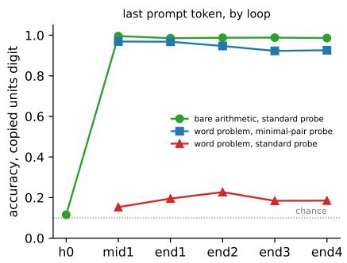
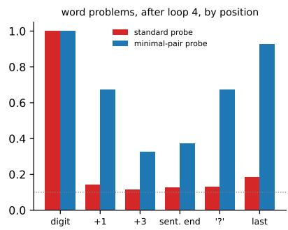
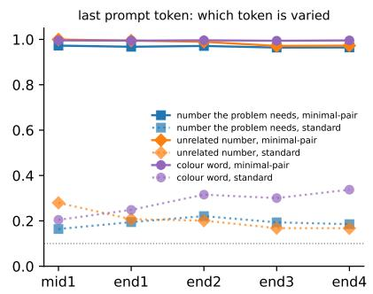
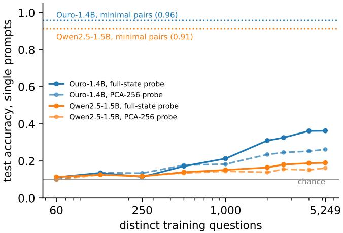
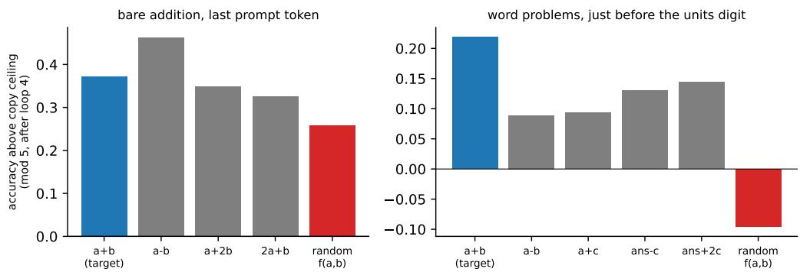
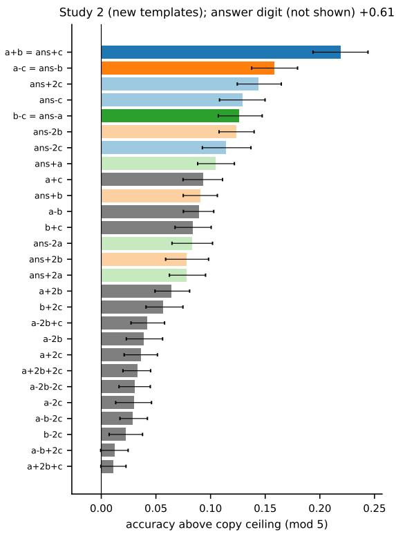
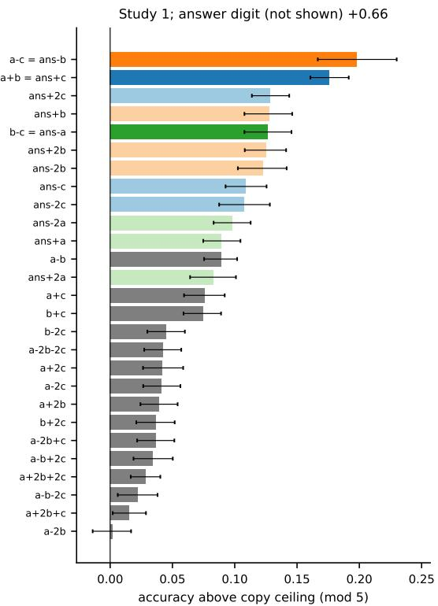
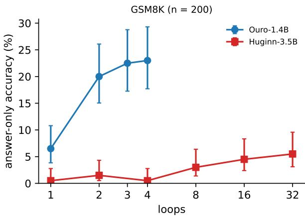

# Present but Hard to Read: Probing Latent Reasoning with Minimal Pairs

Aur Shalev Merin Independent researcher

## Abstract

Probing studies of latent reasoning often read a model’s state where the answer begins and take a failed probe as evidence that a value is absent. We test this with a digit copied from the question, in the looped model Ouro-1.4B and the standard transformer Qwen2.5-1.5B. Comparing prompts that difer only in that digit shows it is present at the last prompt token, in a code shared across questions (readout about 0.9). A probe that sees one prompt at a time, the usual setting, barely reads it: 0.36 in Ouro and 0.19 in Qwen even after 5,249 training questions. The digit’s change is small rather than crowded: random noise lands on equally busy directions, while a random word in its place moves the state far more and is readable. Since every varied token leaves a trace, a successful probe is ambiguous too. We give a protocol, including a synthetic null for generic mixing, for testing computed values against copies and mixtures of the inputs. In pre-registered studies of two-step problems it finds a small signal for the unwritten intermediate a + b just before Ouro writes the answer’s last digit, and its sign follows the operation, though mixing alone produces much of that sign-following part. Holding that value at another problem’s from the first loop on does not move the written digit toward the other problem’s, while the same patch of the answer does: the value is readable but not used.

## 1 Introduction

Looped transformers apply one block of layers repeatedly (Geiping et al., 2025; Zhu et al., 2025), and one hope is that the extra loops work as a hidden chain of thought. Two kinds of evidence are used to test this: accuracy without written steps should rise with the number of loops, and the values the model works with should be readable from its states. For Huginn, Lu et al. (2025) found neither. Its answer-only GSM8K accuracy stayed at 3–5% across recurrence counts, and a logit lens showed no intermediate values. For Ouro-1.4B, accuracy alone cannot settle the question. Answering directly after the question, its GSM8K accuracy rises from 6.5% after one loop to 23% after four, but almost all of the gain comes at loop 2, where Ouro also improves on benchmarks that need no reasoning (Appendix A). To see whether the loops compute intermediate values, one has to look inside.

Probing studies of latent reasoning read the state at the position where the answer begins, which we call the summary position, and interpret failed readouts as evidence against latent intermediate values (Lu et al., 2025; Yu, 2024). Looking inside this way runs into a problem that is not specific to looped models: at the summary position, a standard linear probe barely reads even a digit copied from the question. We find:

• The digit is present but hard to read (Sections 3.1 and 3.2). Minimal pairs, prompts that difer in a single token, show that it is there in both Ouro and Qwen2.5-1.5B, in a code shared across questions. A probe that compares a question’s ten variants reads it at about 0.9. A probe that sees a single prompt, as probing studies do, reads it at 0.12–0.24 with tens of training templates, and more than 5,000 distinct training questions lift it only to 0.36 in Ouro and 0.19 in Qwen (Figure 2). The two probes answer diferent questions, whether the digit is there and what it is in a new prompt, and here the answers come apart. A failed probe at such a position says little about whether a copied value is there.

• The change is small, not crowded (Section 3.3). The digit’s directions are as busy as those of any change at that token, random noise included. What difers is size: a random word in the digit’s place moves the state far more and is readable, while random noise whose variants start as far apart as the words’ arrives as small as the digit. A pre-registered follow-up finds that this is not a matter of linear gain: what reaches the last token depends on which token is present.

• A protocol for computed values (Section 4). Every varied token, needed or not, leaves a trace, so a successful probe says little more than a failed one. The protocol compares a candidate value with what copies of the inputs allow, ranks it against every combination of the inputs at a prime modulus, and compares it with its sign-flipped twin, with mixtures of the output being written, and with what generic mixing produces in synthetic states.

• What it finds in Ouro (Section 5). In three pre-registered studies of two-step problems, a small, signspecific signal for the unwritten a + b appears just before the answer’s last digit, and when the operation is swapped, the better-read sign follows it. As a label, a + b is the same as the answer plus c, the answer is readable as early, and synthetic states that only mix the inputs with the answer give about half the signal, so it may be largely such a mixture. Replacing that value with another problem’s does not move the digit Ouro writes toward the other problem’s, even when it is held fixed from the first loop on, while the same patch of the answer does: at that position the value is readable but not used.

Appendix C gives the status of every analysis, including which were pre-registered.

## 2 Setup

Ouro-1.4B (Zhu et al., 2025) runs its 24 layers up to four times. We read its state at the middle (after layer 12) and at the end of each loop, in fp32. Nothing is trained, and on check prompts our forward pass matches Ouro’s own with a largest absolute logit diference of 0. Qwen2.5-1.5B (Qwen Team, 2024) is a standard 28-layer transformer; we read its states after layers 4, 7, 14, 21 and 28. Both models give each digit its own token. Every prompt starts with the same four GSM8K training problems (Cobbe et al., 2021), the first four of the training set, each followed directly by its final answer, then the test question and “Answer:”. A problem counts as solved if every token of the gold answer is the model’s top prediction and the next predicted token does not continue the number.

The standard probe standardizes the state, projects it onto 256 principal components fitted on the training folds, and fits a multinomial logistic regression whose regularization $( C \in \{ 0 . 0 1 , 0 . 1 , 1 \}$ , or a constant majority guess) is chosen by an inner 3-fold cross-validation. It is scored on 5 held-out folds grouped by template, so it must generalize to unseen kinds of problem. The minimal-pair probe (Section 3.1) is the same probe on states from which each family’s mean has been subtracted. Labels are units digits. We probe two positions: P0, the last prompt token, and, in Sections 4 and 5, P1, the answer token just before its units digit, with the gold answer fed in.

## 3 A copied digit is present but hard to read

## 3.1 Minimal pairs find what a standard probe misses

A standard probe at the last prompt token does not read a digit copied from the question. In a pre-registered study of intermediate values, its sanity check, the last digit of the largest number in the question, scored 40.8%, exactly the rate of always guessing the most common digit. By position, the probe reads a copied digit perfectly on its own token, about half the time one token later (early in the first loop only), and at chance from three tokens on, consistent with the rapid loss of earlier-token information found at the last token of multi-token words in other models (Feucht et al., 2024). In bare questions such as “What is 247 plus 580?” the same probe reads both operands at the last token at 0.96–1.00, but those prompts difer only in their numbers, which makes them close to minimal pairs.

We took one question per template and one of its multi-digit numbers, and made ten copies that difer only in that number’s last digit (0–9): 137 such families from 77 distinct questions, one per template (a template’s two families vary diferent numbers of the same question). The copies are identical token for token except one, so any diference in a later state is caused by that digit. Counterfactual minimal pairs are a standard interpretability control (Stolfo et al., 2023; Vig et al., 2020); subtracting a family’s mean removes what the family shares, the contrast that diference-in-means probing uses to find a direction (Marks & Tegmark, 2023). We then repeated the test with an added sentence that cannot matter (“Unrelated fact: a nearby park has 43 benches.”), varying either its number or a colour word (“43 red benches”). Table 1 and Figure 1 give the results in Ouro.

Table 1: Ouro, the last prompt token (chance 0.10); ranges over mid 1 and the ends of loops 1–4. The trace is the spread of a family’s ten variants as a share of the spread between questions.
<table><tr><td>varied token</td><td>minimal-pair probe</td><td>standard probe</td><td>trace</td></tr><tr><td>a number the problem needs</td><td>0.92–0.97</td><td>0.15-0.23</td><td>5-7%</td></tr><tr><td>a number in an irrelevant sentence</td><td>0.96-1.00</td><td>0.14-0.30</td><td>3-6%</td></tr><tr><td>a colour word in that sentence</td><td>0.99-1.00</td><td>0.19–0.40</td><td>4-6%</td></tr></table>

  
Figure 1: Reading a copied token in Ouro (chance 0.10). Left: the last prompt token, by loop. Middle: word problems after loop 4, by position; “+k” is k tokens after the digit. Right: the last prompt token, for a number the problem needs, a number in an added, irrelevant sentence, and a colour word in that sentence. In the right panel, solid lines show the minimal-pair probe and dotted lines the standard probe, each the mean over two insertion points; the right panel’s needed number comes with the added sentence, so it difers slightly from Table 1’s first row.

Every varied token reaches the position where the answer begins, and the minimal-pair probe reads it on templates it never saw. Any changed input leaves some change in later states; what matters is that this one is in a code shared across questions, which a probe trained on other templates reads. The code is shared: a probe trained on needed numbers reads irrelevant ones at 0.78–0.97. The irrelevant number almost never changes the first token of Ouro’s answer (at most 2.6% of families), so the trace is the copied token, not the answer in progress; this fits GSM-NoOp, where an irrelevant clause lowers accuracy (Mirzadeh et al., 2024), although we did not test whether the trace causes errors. The code is not a magnitude direction (Zhu et al., 2024), consistent with per-digit codes (Levy & Geva, 2025): a linear value component exists $( R ^ { 2 } \ 0 . 5 7 )$ , but the probe’s errors are no closer to the true digit than random guesses (mean distance 3.8 against 3.7), and the top one to four principal components read the digit at only 0.21–0.45, against 0.93–0.97 with 256. It behaves like a code for which token was there, as the colour result suggests. A shared code is what copying predicts, since an attention head that moves a token writes roughly the same vector for it whatever the context; binding vectors that transfer across tasks have been found the same way (Feng & Steinhardt, 2024). The minimal-pair probe needs all ten variants of a question, so it is a test for presence, not a decoder.

## 3.2 Both models, and many more questions

A pre-registered study repeated these measurements in Qwen2.5-1.5B with the same families, prompt, probes and code. Its rule called the result a replication if, at the last prompt token over layers 7–28, the minimalpair probe averaged at least 0.80, while the standard probe stayed at or below 0.30, a structured decoder at or below 0.40, and the gain from half to all training templates at or below 0.05. It is a replication (Table 2). The structured decoder is the best linear decoder we could build for single prompts: a mass-mean probe (Marks & Tegmark, 2023) built from the minimal-pair digit means and a shrunk estimate of the covariance of training prompts around them. It reads no better than the standard probe, and neither does a small MLP, nor, in Ouro, the probe without its PCA step. If the context were Gaussian with the covariance estimated from the training templates, the same decoder would read 0.53–0.92; the gap means that new templates move the state along directions the training templates did not. The claim is about decoders trained without the test question: if the covariance also includes the test question’s other variants, a single prompt reads at about 0.9, which amounts to subtracting the family mean.

Table 2: The last prompt token in a looped and a standard model, 77 distinct questions (chance 0.10). Ouro: end-of-loop states, and mid 1 where Appendix B gives it; Qwen: after layers 7, 14, 21 and 28, the pre-registered range. The gain is the standard probe’s from half to all training templates.
<table><tr><td colspan="2">Ouro-1.4B (looped)</td><td>Qwen2.5-1.5B (standard)</td></tr><tr><td>minimal-pair probe</td><td>0.92-0.97</td><td>0.75–0.98 (mean 0.88)</td></tr><tr><td>standard probe</td><td>0.15-0.23</td><td>0.12-0.14</td></tr><tr><td>structured decoder</td><td>0.17-0.21</td><td>0.12-0.14</td></tr><tr><td>MLP probe</td><td>0.11-0.17</td><td>0.10-0.11</td></tr><tr><td>gain, half to all templates</td><td>+0.015</td><td>+0.004</td></tr><tr><td>Gaussian ceiling of the decoder</td><td>0.75-0.92</td><td>0.53-0.73</td></tr></table>

These data hold only 77 distinct questions, which leaves room for a probe that simply needs more of them. In two further pre-registered studies, one per model, we gave the model one prompt for each of 6,249 GSM8K training questions, with the units digit of the last number of two or more digits set at random, held out a fixed 1,000, and trained probes on nested subsets of the rest (Figure 2). Minimal pairs on 150 (Qwen) and 100 (Ouro) of the held-out questions, with folds by question, read the digit at 0.91 and 0.96. Single prompts stay far below. At 5,249 training questions, 7–39 times the number of components that hold 95% of the states’ variance, the best probe, a logistic regression on the full state with its regularization inside the grid, reads 0.19 in Qwen and 0.36 in Ouro; a small MLP reads 0.11–0.14 and 0.16–0.24. Both curves are still rising. By the pre-registered rule Qwen’s is partial (+0.044 over the last doubling) and Ouro’s climbs (+0.060, above the rule’s 0.05, though the level stays below its 0.50). The minimal pairs do not solve the single-prompt task more cheaply: they see all ten variants of the test question, so they show that the digit is present, not what it is in a new prompt. What the gap shows is that presence and single-prompt readability come apart, by a wide margin even after thousands of training questions. Why Ouro’s probe climbs faster than Qwen’s is open.

## 3.3 A small change, not a crowded one

A trace at a few percent of the variance would still be easy to read if questions hardly varied along its directions. They vary a lot. Take the digit’s directions to be the 9-dimensional span of the family-centred digit means, and its overlap to be the context’s variance per dimension inside that span over its average per dimension. The overlap is 6.5–11.7 in Ouro and 15–24 in Qwen, so within its own subspace the digit’s signal is at most a few percent of the variance around it (Ouro by state in Appendix B). The overlap is not specific to the digit. A subspace fitted with the digit labels shufled within each family, which carries no shared code, has about the same (ratio 0.83 in Ouro and 1.01 in Qwen), and a colour word and a number varied in the added sentence are each about as crowded as their own shufled-label baselines, or less. Any change within a question lands on the directions along which questions vary most.

What difers between changes is their size (Table 3). In Qwen we also replaced the digit with one of ten random words, or added one of ten random vectors of a typical token embedding’s size to its embedding. All three changes land on equally busy directions: by the pre-registered measure, the word swap’s overlap is 0.89 times the digit’s and the noise’s 1.07. Their signal-to-noise inside their own subspaces difers by orders of magnitude, and readability follows it: a standard probe reads the word swap at 0.24–0.74, and the digit and the noise at 0.11–0.15. The input embeddings show where part of the diference starts. In both models the ten digits sit about half as far apart as random words do (0.70 against 1.37 in Qwen, 0.88 against 1.54 in Ouro). But the start does not explain all of it: the word and noise variants start equally far apart, and only the word change reaches the last token, while the noise arrives as small as the digit or smaller. These comparisons are descriptive. A pre-registered follow-up measured the linear response of the last token to small changes at the digit’s input embedding (Appendix B). To first order, the last token is about as sensitive to random input directions as to directions in which token embeddings difer (gain ratio 1.2–1.5), and the word swap’s efect is almost entirely nonlinear: its linear prediction is orthogonal to the actual change and 4.5–15 times too small. What reaches the last token depends on which token is present, not on how far the input moves. Small changes along digit directions are even carried more strongly than along word directions (3–8 times, to first order), so the digit’s small trace goes with swapping one digit for another, a smaller change in kind than swapping in a word. Which mechanism carries a token’s identity to the last token is open.

  
Figure 2: Single-prompt probes trained on more and more distinct questions (last prompt token; best over Qwen’s layers 7–28 or Ouro’s loop ends; 1,000 fixed test questions). Full-state: logistic regression on all dimensions, C from $1 0 ^ { - 4 }$ to 10; PCA-256: the standard probe. Dotted: minimal pairs on 150 (Qwen) and 100 (Ouro) of the test questions. The best state is picked on the test set, which favours the single-prompt probe.

Table 3: Qwen2.5-1.5B, last prompt token, layers 7–28 (pre-registered, except the input distance, a descriptive check). Input distance: mean distance between the ten variants’ input embeddings. Overlap / shufled: each change’s overlap over that of its own shufled-label subspace. Signal/noise: inside the change’s own 9-dimensional subspace. The same ten words and ten noise vectors are used in every family.
<table><tr><td>change</td><td>input distance</td><td>overlap / shuffled</td><td>signal/noise in subspace</td><td>standard probe</td><td>minimal-pair probe</td></tr><tr><td>a different digit</td><td>0.70</td><td>0.68-1.19</td><td>0.0009-0.0037</td><td>0.12-0.14</td><td>0.75-0.98</td></tr><tr><td>a random word</td><td>1.42</td><td>0.50-1.06</td><td>0.011-0.205</td><td>0.24-0.74</td><td>0.95-1.00</td></tr><tr><td>random noise</td><td>1.46</td><td>0.75-1.24</td><td>0.0001-0.0010</td><td>0.11-0.15</td><td>0.76–0.99</td></tr></table>

This is not superposition in the usual sense (Elhage et al., 2022): the digit shares its directions with the variation between contexts, not with a fixed set of other features. Probing work usually asks whether a probe’s success reflects the representation or the probe’s capacity (Hewitt & Liang, 2019); here a probe fails because a signal shared across contexts is small next to the variation the contexts add along the same directions, and only the minimal-pair contrast removes that variation. The same limit is known from population coding in neuroscience, where only noise along the signal’s own direction limits a decoder (Moreno-Bote et al., 2014).

## 3.4 What this means for probing

A probe that fails at a summary position is weak evidence that a copied value is absent: in Ouro and in Qwen, a digit that is demonstrably present reads at most 0.24 with tens of training templates, and at most 0.36 after 5,000 training questions. A probe that succeeds is weak evidence of computation: every token we varied, including an irrelevant number and a colour word, leaves a trace in the same position, so a probe that reads a “computed” value may be reading the copied inputs it is a function of. Computed values may be encoded diferently; we did not test whether the same gap holds for them. The second problem is the one Section 4 addresses.

## 4 A protocol for computed values

Within a minimal-pair family one digit varies, so any computed value is a fixed function of that digit, and a probe that reads it could be reading the copy. The fix is a factorial design: vary the operands’ units digits together, with everything else fixed (a family fixes the template, names and tens digits), and probe for a combination such as $( a + b )$ mod 5. Like XOR, such a combination cannot be read linearly from separate traces of a and b: if the state holds $f ( a ) + g ( b )$ , a linear probe on it does no better than the same probe on one-hot codes of the digits, since any function of a digit is linear in its one-hot code. We call that probe’s accuracy the copy ceiling, and measure every label as its excess over its own ceiling. Excess alone shows that the operands were combined, not that the needed value was computed: a state can mix its inputs in a generic, non-additive way, which makes many combinations readable. The protocol therefore compares the target with the alternatives a generic mixture would also make readable:

1. Copy ceiling. Measure every label against the same probe on one-hot copies of the inputs, a conditional probe with the inputs as its baseline (Hewitt et al., 2021), adding any input-derived quantity the model can see. In our studies that is the answer digit already written, and, as a stricter case, the carry and borrow.

2. A prime modulus. Mod 10, many combinations share their odd/even half with a+b or with the answer digit, including $a - b$ and every form on the line answer + kc, so a state that holds either gives those controls free accuracy. In a synthetic check where the state held only the copies and the answer digit, $a + b + c$ mod 10 read 0.14 above its ceiling; mod 5, every label stayed within 0.04 of its ceiling.

3. Every combination. Rank the target against all combinations $x a + y b + z c$ of the inputs (31 mod 5), not a few chosen controls, since periodic number features (Zhou et al., 2024; Kantamneni & Tegmark, 2025) can make some combinations easier to read than others.

4. Sign-flipped twins. Compare the target with the same operands under the opposite sign (a + b against $a - b )$ . A generic mixture has no reason to prefer the needed sign. With a single operation it cannot separate the needed sign from a fixed preference for that sign; swapping the operation can (Section 5.3).

5. Mixtures of the output. Compare the target with the other forms on its line through the output being written (answer + kx for a copied number x), and with other forms of the same size. This exposes a state that mixes the output with one input, and one that simply holds two-number mixtures better. The comparison along the line is weak: pairwise mixing favours a two-number target over the three-number forms on its line (Section 5.4).

The position matters too. Ouro writes a number’s leading digit first, but that digit already depends on the units digits through the carry and the borrow: to write the 4 of 47 in $3 0 + 3 0 - 1 3$ , the model must know that $0 + 0 < 3 .$ A value computed step by step would therefore first be needed at P0, the last prompt token. We probe P0 and P1, the answer token just before the units digit, with the gold answer fed in. P1 is the last point at which the units digit of $a + b$ is needed, and the point where the answer is least latent, since its tens digit has already been written.

Table 4: Pre-registered results, after loop 4: excess over the copy ceiling. Study 1 was scored mod 10 against $a - b$ and $a + c ;$ Study 2 mod 5 against a − b, a + c and two mixtures of the answer with c.
<table><tr><td></td><td>Study 1</td><td>Study 2 (new templates)</td></tr><tr><td>a + b at P1</td><td>+0.205 [0.172, 0.236]</td><td>+0.219 [0.194, 0.244]</td></tr><tr><td>margin over best control</td><td>+0.118 [0.094, 0.141] (a − b)</td><td>+0.075 [0.052, 0.098] (answer + 2c)</td></tr><tr><td>bar for the margin</td><td>0.15</td><td>0.025 (set after Study 1)</td></tr><tr><td>label</td><td>UNCLEAR</td><td>passes; fails Study 1&#x27;s 0.15</td></tr><tr><td> $a + b$  at P0</td><td>-0.016</td><td>-0.007</td></tr><tr><td>bare addition at P0</td><td>sum 0.71 vs ceiling 0.10 (no controls)</td><td> $a + b + 0 . 3 7 2$  VS  $a - b + 0 . 4 6 3 \colon$  mixing</td></tr></table>

  
Figure 3: Study 2, after loop 4, mod 5: excess of the minimal-pair probe over each label’s copy ceiling. Left: bare addition at the last prompt token. Right: word problems at P1, just before the answer’s units digit.

## 5 What the protocol finds in Ouro

## 5.1 Two pre-registered studies

Studies 1 and 2 used two-step word problems whose answer is $a + b - c ,$ so the intermediate $a + b$ is never written; for example, “Maya has 30 stickers. Her friend gives her 30 more stickers. She then uses 13 stickers on a card. How many stickers does Maya have left?” A study has 12 templates × 3 families × 200 of the 1,000 unit-digit combinations (7,200 problems), plus bare additions (“What is A plus B?”) with all 100 unit-digit pairs per family. Study 2 used 12 new templates with new wording, objects and names. Both passed their gates: answer-only accuracy after loop 4 was 0.66 and 0.60, the copied digits read at 0.90 or above, and on bare problems the sum’s units digit read 1.00 at P1, where it is Ouro’s next prediction. Intervals are 97.5% (Bonferroni over the two hypotheses) and resample families. Table 4 gives the pre-registered results.

Study 1’s controls did not include combinations of the answer digit with c; since $a + b = { \mathrm { a n s w e r } } + c ,$ a state holding the answer and a copy of c could make a + b readable without any intermediate. Study 2 added those controls and moved to mod 5. Before the answer starts, at P0, $a + b$ is not readable in either study; Study 3 returns to P0. In bare addition, the apparent sum before writing is generic mixing: with controls, $a - b$ reads better than $a + b$ (Figure 3, left).

## 5.2 Sign flips and every combination

The analyses in this subsection were run after the two studies, on their saved states (Appendix C). The sharpest one compares $a + b$ with its sign-flipped twin $a - b$ (Table 5). In both studies $a + b$ reads 0.09–0.13 better after loop 4 and 0.16–0.17 better after loop 3, on every one of the 24 templates. Here the needed sign is plus, so a general preference for diferences, which is what bare addition showed, predicts the opposite. For a − c against $a + c$ and b − c against b + c the needed sign is minus, so the same preference predicts the observed winners and the comparison cannot separate the two; $b - c$ also loses to b + c after loop 3.

Table 5: Sign-flipped twins at P1 (excess over each label’s copy ceiling; diference with 97.5% interval over families). Only the first row has a plus as the needed sign.
<table><tr><td>needed vs flipped</td><td>Study 1, loop 4</td><td></td><td>Study 2, loop 4</td><td>Study 1, loop 3</td><td>Study 2, loop 3</td></tr><tr><td> $a + b \ \mathrm { v s } \ a - b$ </td><td></td><td>+0.087 [0.069, 0.105]</td><td>+0.130 [0.105, 0.154]</td><td>+0.173</td><td>+0.161</td></tr><tr><td> $a - c { \mathrm { ~ v s ~ } } a + c$ </td><td></td><td>+0.122 [0.093, 0.152]</td><td>+0.065 [0.038, 0.092]</td><td>+0.064</td><td>+0.044</td></tr><tr><td> $b - c \ \mathrm { v s } \ b + c$ </td><td></td><td>+0.052 [0.027, 0.079]</td><td>+0.042 [0.015, 0.069]</td><td>-0.032</td><td>-0.041</td></tr></table>

  
Figure 4: Every mod-5 combination of the operands’ units digits at P1, after loop 4: excess over its own copy ceiling, with 97.5% intervals over families. Each colour is one line through the answer (answer + k × one copied number); the dark bar is that line’s two-number member $( a + b , a - c , b - c )$ . Grey: combinations on no answer line. The answer digit and the copies are not shown.

Against all 30 combinations of the digits other than the answer (which Ouro is about to write, and which reads +0.61 and +0.66), a + b ranks first in Study 2, 0.061 [0.028, 0.093] ahead of the runner-up, and second in Study 1, 0.022 behind it (Figure 4). By the rule we fixed before this check, that weakens the claim that a + b itself is held. The runner-up in both studies is a − c. It is another route to $a + b - c ,$ but it is also the kind of diference a general preference would favour, so we do not count it as evidence of computation.

The protocol’s last step tests mixtures of the output. On units digits, $a + b$ is the answer plus c, so a state that mixes the answer it is about to write with a copy of c could make $a + b$ readable. a + b tops the line answer + kc by +0.075 [0.052, 0.098] in Study 2 and +0.048 [0.030, 0.066] in Study 1, but a calibrated null on Study 3’s items shows that generic mixing tops such a line too (Section 5.4); it also tops the other two-number combinations by 0.09–0.13. Such mixtures do exist: after loop 4, forms on the answer lines read 0.06–0.07 above forms on no answer line. The margin also survives the stricter baselines. Adding the answer digit already written changes nothing, and adding the carry and borrow, which Ouro does not see as tokens, lowers the Study 2 margin to +0.048 [0.023, 0.074]. On problems Ouro answers correctly it is +0.064 [0.037, 0.091], and resampling templates instead of families does not widen the loop-4 intervals

Table 6: Study 3, operation swap (pre-registered): P1 after loop 4, excess over the copy ceiling (mod 5), with a 97.5% interval over twin families.
<table><tr><td colspan="2">plus problems (need a + b)</td><td>minus problems (need  $a - b )$ </td></tr><tr><td>excess of  $a + b$ </td><td>+0.207</td><td> $+ 0 . 0 7 8$ </td></tr><tr><td>excess of  $a - b$ </td><td>+0.082</td><td>+0.267</td></tr><tr><td>needed minus flipped</td><td> $D _ { + } = + 0 . 1 2 4$ </td><td> $D _ { - } = + 0 . 1 8 9$ </td></tr><tr><td colspan="3"> $I = + 0 . 1 5 7$  [0.141, 0.172]: FOLLOWS; fixed preference  $F = + 0 . 0 3 2 \ [ 0 . 0 1 2 , 0 . 0 5 3 ]$ </td></tr></table>

No probe label can separate $^ { \circ } a + b$ was formed and the answer computed from $\mathrm { i t } ^ { \dag }$ from “the answer was formed and c added back”: they are the same function of the digits. The timing does not help the first reading: after loop $1 , a + b$ and the answer digit read about equally (+0.16 each in Study 2), and after loop 2 the answer reads higher (+0.53 against +0.38). At the moment it is needed, then, $a + b$ is readable beyond what copies allow and beyond its sign-flipped twin, in two studies with diferent templates, and it tops its answer line by about as much as generic mixing does. Two questions remain. Every problem needed $a + b ,$ so a fixed preference for sums at P1 would also explain the sign-flip result. And whether Ouro uses the value needs an intervention. Study 3 addresses both.

## 5.3 Study 3: swapping the operation, and patching

Study 3 was pre-registered in two parts. Its 12 new templates come in two versions that difer only in the first step’s phrase: “gave her B more stickers” gives $a + b - c ,$ and “took B of her stickers” gives $a - b - c .$ A plus family and its minus twin share names, tens digits and unit-digit combinations. Each version has 7,200 problems, and probes are trained and scored within a version. Let $D _ { + }$ be the excess of $a + b$ minus that of $a - b$ on plus problems, D− the reverse on minus problems, and $I = ( D _ { + } + D _ { - } ) / 2$ . A fixed preference for either sign adds the same amount to one D and takes it from the other, so it cancels in $I ;$ we report it as $F = ( D _ { - } - D _ { + } ) / 2$ . The label FOLLOWS required $I \geq 0 . 0 5$ at P1 after loop 4, with its interval above zero and both Ds positive.

All gates passed: accuracy after loop 4 was 0.67 on plus and 0.77 on minus problems, the copies at P0 read at 0.98–1.00 at their best state, and the bare sum digit at 1.00. The label is FOLLOWS (Table 6): $I = + 0 . 1 5 7$ [0.141, 0.172], with 97.5% intervals that resample twin families together. On minus problems a − b reads $+ 0 . 2 7$ and $a + b + 0 . 0 8$ , nearly the mirror image of plus problems. The fixed preference is small and favours diferences, $F = + 0 . 0 3 2 \ [ 0 . 0 1 2 , 0 . 0 5 3 ]$ , as bare addition suggested. The digit Ouro is about to write depends on the carry or borrow from the units, which is sign-specific, so a pre-registered stricter check adds the carry and borrow to the copy ceiling. With them, I at P1 is +0.126 [0.107, 0.145], still well above the bar, and at P0, before the answer starts, it is $- 0 . 0 1 3 \ [ - 0 . 0 2 8 , \ 0 . 0 0 2 ]$ : nothing sign-specific is readable there beyond the carry and borrow. The copy of b reads only 0.77–0.81 there after loop 4 (0.66 in Study 1), so P0 is the weaker test. In both versions the needed form also tops the other forms on its answer line after loop 4, by +0.036 and +0.045, which generic mixing matches (Section 5.4). So the sign-flip result of Studies 1 and 2 is not a preference for sums at P1: the better-read sign is the one the problem needs. This still does not separate a first step formed before the answer from the answer with c added back, since in both versions the needed form is the answer plus c.

The second part asks whether Ouro uses the value. For two plus problems x and $x ^ { \prime }$ from the same family, we run both to a patch point, replace x’s component in a 9-dimensional subspace U at P1 with $x ^ { \prime \prime } { \mathrm { s } } , h \gets$ $h + U U ^ { \top } ( h _ { x ^ { \prime } } - h )$ , run the remaining loops, and read the digit predicted at P1. Each subspace is spanned by the family-centred class means of one units digit $( a + b , a - b$ or the answer) at the patch point, fitted on the other half of the templates; a random subspace is a further control. The two problems share c and have diferent units digits of $a + b$ with the same parity, so a parity code alone cannot produce a hit, and Ouro answers x correctly. A hit is $x ^ { \prime } \mathrm { { { s } } }$ answer digit, the one x would write if its $a + b$ were $x ^ { \prime } \mathrm { { s } }$ , and the answer patch is the positive control. The statistic is hit $( a + b )$ minus the larger of $\operatorname { h i t } ( a - b )$ and hit(random): USED at 0.10 or more with the interval above zero, NOT-USED if the interval’s upper end is below 0.02, and unscorable if the answer patch hits less than 30% of the time. The frozen plan patched at the end of loop 3. After the states were extracted, but before any analysis, we added a patch point at the end of loop 2 and a second kind of pair with equal answers (c shifts to compensate). For those pairs a hit is the digit x would write from $x ^ { \prime \prime } \mathrm { s } \ a + b$ and its own c, and a state that holds only the answer with c added back predicts no hits. Each of the four tests has a 99.375% interval (Bonferroni: 2.5% for Part A’s test, 0.625% for each patching test).

Table 7: Study 3, patching at P1 on plus problems (pre-registered; the loop-2 point and the equal-answer pairs were added before analysis), 2,000 pairs per row. A hit is the digit the patch implies. Same-c pairs move the answer with $a + b ;$ equal-answer pairs hold it fixed and have no answer patch. Statistic: hit $( a + b )$ minus the larger of $\operatorname { h i t } ( a - b )$ and hit(random), with a 99.375% interval.
<table><tr><td colspan="2"></td><td colspan="4">hit rate by patched subspace</td><td colspan="3"></td></tr><tr><td>pairs</td><td>patched after</td><td>answer</td><td> $a + b$ </td><td> $a - b$ </td><td>random</td><td>statistic</td><td></td><td>label</td></tr><tr><td>same c</td><td>loop 3</td><td>0.902</td><td>0.017</td><td>0.032</td><td>0.001</td><td></td><td>-0.015 [−0.027, -0.004]</td><td>NOT-USED</td></tr><tr><td>same c</td><td>loop 2</td><td>0.331</td><td>0.007</td><td>0.006</td><td>0.002</td><td></td><td>+0.001 [-0.005, +0.007]</td><td>NOT-USED</td></tr><tr><td>equal answer</td><td>loop 3</td><td></td><td>0.003</td><td>0.002</td><td>0.000</td><td>+0.001</td><td> $[ - 0 . 0 0 3 , + 0 . 0 0 7 ]$ </td><td>NOT-USED</td></tr><tr><td>equal answer</td><td>loop 2</td><td></td><td>0.003</td><td>0.003</td><td>0.001</td><td></td><td>+0.001 [−0.002, +0.003]</td><td>NOT-USED</td></tr></table>

All four tests are NOT-USED (Table 7). At the end of loop 3 the answer patch moves the prediction to $x ^ { \prime } \mathrm { { s } }$ digit in 90% of pairs, so a 9-dimensional patch at P1 can steer the output. The $a + b$ patch does so in $1 . 7 \% $ slightly less often than the $a - b$ patch, and under it Ouro keeps its own digit in 96–99% of pairs. With the answer held fixed, the $a + b$ patch hits 0.3%. The end-of-loop-2 tests are weak: there the answer patch hits only 33%, because loops 3 and 4 restore x’s own digit in about two thirds of pairs, which fits a state that is re-derived in each loop (Wang & Reid, 2026). Together the two parts say that at P1 the readable combination follows the operation, but Ouro does not read it there to write the units digit. By the end of loop 3, though, the answer is strongly readable, so an intact answer could override a weak $a + b$ component even if $a + b$ had been used to form it earlier; Section 5.4 tests this. Only P1 was patched. A pre-registered follow-up on the same problems looked earlier, at the period ending the sentence that gives b (“Her friend gave her 13 more stickers.”), where a running total would sit. There the sign did not follow the operation (I at most +0.018 at any loop end, every upper bound at most 0.036; UNCLEAR by its rule, since no bound fell below 0.02), so its patching step was not run, and the answer was not readable at the end of the sentence that gives c either.

## 5.4 Patching before the answer forms, and a null for mixing

Two further pre-registered studies address the weakest points above. The first repeats the patching on the same pairs in three ways that leave no formed answer to override $a + b$ (Table 8). A single patch at the end of loop 1, where $a + b$ and the answer read about equally, cannot be scored: loops 2–4 undo any patch made there, even one of the answer (hit 0.009). Clamping, which sets the component to the partner’s at the end of loops 1, 2 and $^ { 3 , }$ does not have that problem: clamping the answer moves the written digit in 91% of pairs, while clamping $a + b$ moves it to the partner’s digit in at most 4% of pairs, within 0.02 of the $a - b$ and random controls, and Ouro keeps its own digit in 90–97% of pairs. Both clamp tests are NOT-USED, including the equal-answer pairs, in which an $a + b$ patch cannot carry the partner’s answer. In the third test the answer’s component is first set to its family mean at the end of loop 3. Ouro then writes its own digit in only 31–32% of pairs, so the $a + b$ component left at P1 does not rebuild the answer, and the partner’s does not steer the digit: every condition, random included, hits the target at about chance (0.08–0.10). This test is weaker than the clamp. It has no positive control, and with the answer removed the output is largely scrambled, so a null there may reflect a disrupted state rather than an unused value.

The second study calibrates the protocol’s mixture tests. We built synthetic states on Study $3 \mathrm { { s } }$ items with copies of $^ { a , }$ b and $c ,$ a strong answer code and no $a \pm b$ term, plus one generic mixture of the four digits: products of random codes for every pair, or same-frequency products of periodic digit features, or a random one-layer network. The mixing strength was set so that the needed form reads about as well as in Ouro, and the note’s own probes then scored each world. Pairwise mixing tops the answer line by as much as Ouro does or more (mean margins +0.078 and +0.051 over six worlds each, against +0.036 and +0.045), so by the pre-registered rule the line test does not separate a held a ± b from mixing. The reason is that the needed form is a function of two inputs, a and b, which pairwise mixing makes readable directly, while the other forms on its line need all three; in the Fourier worlds, answer ±2c barely reads, as the outside objection predicted. The random network never made the needed form as readable as in Ouro, so it could not be calibrated. The same worlds give an operation-swap statistic I of +0.09 on average and at most +0.14, against +0.157 in Ouro: the sign-following signal exceeds every null world, but mixing alone produces about half of it.

Table 8: Patching $a + b$ at P1 without a formed answer to override it (pre-registered), 2,000 pairs of each kind. Statistic: hit $( a + b )$ minus the larger of hit(a − b) and hit(random), with a 99.17% interval (six tests). In the ablation test the patch is restricted to directions outside the answer subspace; that test has no positive control, and the ablation alone changes the digit in about 68% of pairs.
<table><tr><td>test</td><td>answer patch hit</td><td>same-c pairs</td><td>equal-answer pairs</td></tr><tr><td>patch at end of loop 1</td><td>0.009</td><td>UNSCORABLE</td><td>UNSCORABLE</td></tr><tr><td>clamp at ends of loops 1–3</td><td>0.914</td><td>-0.016 [-0.034, +0.001]</td><td>+0.005 [−0.001, +0.012]</td></tr><tr><td>answer ablated, end of loop 3</td><td></td><td>+0.005 [-0.011, +0.015]</td><td>-0.001 [−0.016, +0.013]</td></tr></table>

## 5.5 Loop dynamics

At P1, every combination of the numbers we checked reads better at the end of a loop than in its middle, including $a + c ,$ which the problem never needs, while the copy of b reads better in the middle. This is not an efect of normalization: Ouro normalizes the state it feeds into the next loop, but dividing each mid-loop state by its own size leaves the pattern unchanged. Within each loop, the second half of the layers makes combinations of the numbers readable. Unneeded ones then fade: a + c peaks after loop 2 (+0.46) and falls to +0.09 by loop 4, while a + b peaks after loop 3 (+0.45) and keeps +0.22. In Study 3 the needed form peaks after loop 3 on plus problems (+0.51) and after loop 2 on minus problems (+0.42).

## 6 Limitations

The probing results rest on two models of about 1.5B parameters, one looped and one standard; the computation studies use Ouro alone. The problems take two closely related forms $( a \pm b - c$ with two-digit numbers), read at a position where the gold answer is fed in. The minimal-pair test needs the other variants of a question. The full set of single-prompt decoders was tested on 77 distinct questions. With 5,249, the best single-prompt probe reaches 0.19 in Qwen and 0.36 in Ouro, and both are still rising, so probes trained on more questions may read much more of the digit; the claim is that single-prompt readability stays far below presence at the data sizes tested, not that the digit cannot be read. Several earlier readings were revised by pre-registered follow-ups (Appendix C); the text states each result as it now stands. Of the ten pre-registered probing studies, one was unscorable and two UNCLEAR, the many-question test was partial in Qwen and climbed in Ouro, and Study 2’s bar was set after Study 1’s near-miss. Study 3’s second patch point and its equal-answer pairs were added after its states were extracted, though before any analysis. The comparisons in Section 5.2 and the loop dynamics were run afterwards on the saved states, and some of them had their reading rules written down only after related numbers were known (Appendix C). The computation signa is small, $a - c \mathrm { { : } }$ lead cannot be separated from a preference for diferences, and $b - c$ does not behave like a held partial result after loop 3. The patching tests one position and subspaces spanned by class means; a single patch at the end of loop 1 could not be scored, since later loops undo it. The mixing null covers three kinds of synthetic mixing on 64-dimensional states; one of them could not be calibrated, and real states may mix diferently. An $a + b$ held at other positions, such as the question sentence, and read from there through attention, or held in a code outside those subspaces, would be missed, and the end-of-loop-2 tests are weak because later loops undo most patches made there.

## 7 Related work

Looped models. Huginn (Geiping et al., 2025) and Ouro (Zhu et al., 2025) are pretrained looped language models. In looped models, each layer of the repeated block settles into its own fixed point (Blayney et al., 2026), and lenses on outputs, attention and noise injection have been used to monitor their latent reasoning, Ouro’s included, without probes (Olszowiec et al., 2026). Ouro’s state is re-derived within each loop rather than carried across loops (Wang & Reid, 2026). Its GSM8K accuracy peaks near its training depth and falls sharply with more loops (Yang et al., 2026), and the support for reference answers falls with more loops in most model-task conditions (Guo et al., 2026). Reusing one key-value cache slot across loop steps drops Ouro’s accuracy from 78% to 0.2% while Huginn is unafected (Schwethelm et al., 2026b, Table 4). Huang et al. (2026) read this as Huginn’s states approaching fixed points while Ouro’s do not, which fits a state that is re-derived in each loop.

Latent reasoning. In 116 models pretrained from scratch at equal total depth and small budgets, Schwethelm et al. (2026a) find no reasoning advantage from looping: scored by continuation loss, the nonlooped model leads on reasoning primitives at nearly every budget, and reasoning-heavy tasks show no above-noise diference. They compare looped with unlooped models; we compare loop counts within one trained model. Lu et al. (2025) measured Huginn’s answer-only accuracy and applied a logit lens. Kirin (2026) probes Ouro for whether it will answer correctly, not for values. An unreviewed repository applies a logit lens to Ouro-1.4B-Thinking and finds only the final answer, never intermediate values (mild-rgb, 2026). In theory, a looped transformer can simulate T chain-of-thought steps in T loops (Saunshi et al., 2025). Models trained to drop written steps can compute intermediates internally (Deng et al., 2024; Hao et al., 2025). In multi-step arithmetic, models compute sub-answers while writing their chain of thought rather than before it (Kudo et al., 2024); implicit multi-step arithmetic in models trained from scratch relies on shortcuts (Lin et al., 2025); and discrete intermediate states have been read from hidden states (Chen et al., 2024). In standard models, the first hop of a two-hop question is often resolved latently but the full chain less reliably (Yang et al., 2024; Biran et al., 2024).

Probing and its limits. Our analysis builds on control tasks and selectivity (Hewitt & Liang, 2019) and on diference-in-means probing (Marks & Tegmark, 2023). Our learning curves are close in spirit to informationtheoretic and minimum-description-length probing, which ask how much data or code a probe needs rather than only how accurate it ends up (Voita & Titov, 2020; Pimentel et al., 2020); contrast-consistent search also works with paired prompts, subtracting a separate mean from each side of the pairs (Burns et al., 2023). Park et al. (2024) define concept directions from counterfactual pairs, as our minimal pairs do, and argue that reading them needs a non-Euclidean inner product. A few rogue dimensions can dominate similarity measures on transformer states (Timkey & van Schijndel, 2021); our overlap measurements are a probinglevel case, in which the variation between questions is largest along the directions any change at a token takes. Probing critiques (Belinkov, 2022) stress that a readable property need not be used (Ravichander et al., 2021; Elazar et al., 2021); at P1, Ouro’s a+b is a case of it. A probe can also fail because of the target’s framing rather than its absence (Nanda et al., 2023b), a converse case to ours. Interchange interventions and alignment search (Geiger et al., 2021; 2024) and causal mediation with counterfactual inputs (Vig et al., 2020; Stolfo et al., 2023) test whether a variable is used. Our patch is an interchange intervention on a subspace spanned by class means rather than one found by alignment search; subspace patches can mislead when they act through dormant directions (Makelov et al., 2024), a risk that bears on positive results more than on a null like ours. Stolfo et al. (2023) find operand information carried by attention to the last token of bare arithmetic queries, and Hanna et al. (2023) patch between prompts that difer in a year. Contrast vectors from paired stimuli are also the basis of representation engineering (Zou et al., 2023). Readouts that decode states with learned per-layer translators and the model’s own unembedding, as the tuned lens does (Belrose et al., 2023), or through the model’s own forward pass, as Patchscopes does (Ghandeharioun et al., 2024), are alternatives to the logit lens used on looped models. Yu (2024) reports that last-token probes rarely detect intermediate steps in prompted implicit reasoning; we probe the same position, but add minimal pairs and controls for copies of the inputs. To our knowledge, no earlier work reads a copied token at a summary position with minimal pairs while a standard probe fails, or combines a copy ceiling, a prime modulus, every combination of the inputs and sign-flipped twins to test a computed value. Ye et al.

(2025) read which quantities a problem needs at the question’s end, and values after each solution sentence, in models trained from scratch on synthetic problems.

Number representations. Zhu et al. (2024) find number values linearly encoded. Pretrained models also carry periodic number features, with periods such as 2, 5 and 10, and use them in addition (Zhou et al., 2024; Kantamneni & Tegmark, 2025), as small models do in modular addition (Nanda et al., 2023a). Arithmetic in LLMs can also come from a bag of heuristics rather than one algorithm (Nikankin et al., 2025), which fits the generic mixing we see in bare addition, and small transformers trained on addition build explicit carry features (Quirke & Barez, 2024), one reason the copy baseline is also given the carry and borrow.

## Reproducibility

The repository holds the code, frozen hashes, analysis outputs and decision rules for every experiment here, including per-item results for the post-hoc comparisons. Every pre-registration was committed before its run; those of the ten probing studies (the intermediate value at the last prompt token, the Qwen replication, the robustness study, which includes Qwen’s many-question curve, Ouro’s many-question study, the linearresponse study, Studies 1–3, the running-total follow-up and the early patching; Sections 3.1, 3.2, 3.3, 5.1, 5.3 and 5.4) and of the synthetic mixing null, and their amendments, were also pushed to GitHub before their runs or analysis, which gives them an external timestamp. Each experiment’s document records its predictions, its results, and every change made before data.

## References

Yonatan Belinkov. Probing classifiers: Promises, shortcomings, and advances. Computational Linguistics, 48(1):207–219, 2022. doi: 10.1162/coli\_a\_00422.

Nora Belrose, Zach Furman, Logan Smith, Danny Halawi, Igor Ostrovsky, Lev McKinney, Stella Biderman, and Jacob Steinhardt. Eliciting latent predictions from transformers with the tuned lens. arXiv preprint arXiv:2303.08112, 2023.

Eden Biran, Daniela Gottesman, Sohee Yang, Mor Geva, and Amir Globerson. Hopping too late: Exploring the limitations of large language models on multi-hop queries. In Proceedings of the 2024 Conference on Empirical Methods in Natural Language Processing, pp. 14113–14130. Association for Computational Linguistics, 2024. doi: 10.18653/v1/2024.emnlp-main.781.

Hugh Blayney, Álvaro Arroyo, Johan Obando-Ceron, Pablo Samuel Castro, Aaron Courville, Michael M. Bronstein, and Xiaowen Dong. A mechanistic analysis of looped reasoning language models. arXiv preprint arXiv:2604.11791, 2026.

Collin Burns, Haotian Ye, Dan Klein, and Jacob Steinhardt. Discovering latent knowledge in language models without supervision. In The Eleventh International Conference on Learning Representations (ICLR), 2023.

Junhao Chen, Shengding Hu, Zhiyuan Liu, and Maosong Sun. States hidden in hidden states: Implicit discrete state representations emerge in LLMs’ hidden states. arXiv preprint arXiv:2407.11421, 2024.

K. Cobbe, V. Kosaraju, M. Bavarian, M. Chen, H. Jun, L. Kaiser, et al. Training verifiers to solve math word problems. arXiv preprint arXiv:2110.14168, 2021.

Yuntian Deng, Yejin Choi, and Stuart Shieber. From explicit CoT to implicit CoT: Learning to internalize CoT step by step. arXiv preprint arXiv:2405.14838, 2024.

Yanai Elazar, Shauli Ravfogel, Alon Jacovi, and Yoav Goldberg. Amnesic probing: Behavioral explanation with amnesic counterfactuals. Transactions of the Association for Computational Linguistics, 9:160–175, 2021. doi: 10.1162/tacl\_a\_00359.

Nelson Elhage, Tristan Hume, Catherine Olsson, Nicholas Schiefer, Tom Henighan, Shauna Kravec, Zac Hatfield-Dodds, Robert Lasenby, Dawn Drain, Carol Chen, Roger Grosse, Sam McCandlish, Jared Kaplan,

Dario Amodei, Martin Wattenberg, and Christopher Olah. Toy models of superposition. arXiv preprint arXiv:2209.10652, 2022.

Jiahai Feng and Jacob Steinhardt. How do Language Models Bind Entities in Context? In The Twelfth International Conference on Learning Representations (ICLR), 2024.

Sheridan Feucht, David Atkinson, Byron Wallace, and David Bau. Token erasure as a footprint of implicit vocabulary items in LLMs. arXiv preprint arXiv:2406.20086, 2024.

Atticus Geiger, Hanson Lu, Thomas Icard, and Christopher Potts. Causal abstractions of neural networks. In Advances in Neural Information Processing Systems, volume 34, pp. 9574–9586, 2021.

Atticus Geiger, Zhengxuan Wu, Christopher Potts, Thomas Icard, and Noah Goodman. Finding alignments between interpretable causal variables and distributed neural representations. In Proceedings of the Third Conference on Causal Learning and Reasoning, volume 236 of Proceedings of Machine Learning Research, pp. 160–187. PMLR, 2024.

Jonas Geiping, Sean McLeish, Neel Jain, John Kirchenbauer, Siddharth Singh, Brian R. Bartoldson, Bhavya Kailkhura, Abhinav Bhatele, and Tom Goldstein. Scaling up test-time compute with latent reasoning: A recurrent depth approach. In Advances in Neural Information Processing Systems, volume 38, 2025.

Asma Ghandeharioun, Avi Caciularu, Adam Pearce, Lucas Dixon, and Mor Geva. Patchscopes: A unifying framework for inspecting hidden representations of language models. In Proceedings of the 41st International Conference on Machine Learning (ICML), 2024.

Zhihao Guo, Zonghan Wu, Haizhou Du, Huan Huo, Yilei Shao, Athanasios V. Vasilakos, and Qingsong Wen. Right direction, wrong step: Geometric analysis of finite-step failure in looped transformers. arXiv preprint arXiv:2609.16665, 2026.

Michael Hanna, Ollie Liu, and Alexandre Variengien. How does GPT-2 compute greater-than?: Interpreting mathematical abilities in a pre-trained language model. In Advances in Neural Information Processing Systems, volume 36, pp. 76033–76060, 2023. doi: 10.52202/075280-3322.

Shibo Hao, Sainbayar Sukhbaatar, DiJia Su, Xian Li, Zhiting Hu, Jason Weston, and Yuandong Tian. Training large language models to reason in a continuous latent space. In Conference on Language Modeling (COLM), 2025.

J. Hewitt and P. Liang. Designing and interpreting probes with control tasks. In Proceedings of the 2019 Conference on Empirical Methods in Natural Language Processing (EMNLP), 2019.

John Hewitt, Kawin Ethayarajh, Percy Liang, and Christopher D. Manning. Conditional probing: Measuring usable information beyond a baseline. In Proceedings of the 2021 Conference on Empirical Methods in Natural Language Processing, 2021.

Benhao Huang, Chufan Shi, Junlin Chen, Shicheng Wen, Zhengzhong Liu, Eric Xing, and Xuezhe Ma. Towards looped models done right, part II: Rethinking at fixed points. arXiv preprint arXiv:2610.06833, 2026.

Subhash Kantamneni and Max Tegmark. Language models use trigonometry to do addition. arXiv preprint arXiv:2502.00873, 2025.

J. Kirin. Operational proto-introspection in looped language models: Process-quality taps, executable branching, and the readout-control boundary. arXiv preprint arXiv:2607.18553, 2026.

Keito Kudo, Yoichi Aoki, Tatsuki Kuribayashi, Shusaku Sone, Masaya Taniguchi, Ana Brassard, Keisuke Sakaguchi, and Kentaro Inui. LLMs faithfully and iteratively compute answers during CoT: A systematic analysis with multi-step arithmetics. arXiv preprint arXiv:2412.01113, 2024.

Amit Arnold Levy and Mor Geva. Language models encode numbers using digit representations in base 10. In Proceedings of the 2025 Conference of the Nations of the Americas Chapter of the Association for Computational Linguistics (NAACL), 2025.

Tianhe Lin, Jian Xie, Siyu Yuan, and Deqing Yang. Implicit reasoning in transformers is reasoning through shortcuts. In Findings of the Association for Computational Linguistics: ACL 2025, 2025.

W. Lu, Y. Yang, K. Lee, Y. Li, and E. Liu. Latent chain-of-thought? Decoding the depth-recurrent transformer. In Workshop on the Application of LLM Explainability to Reasoning and Planning, COLM 2025, 2025.

Aleksandar Makelov, Georg Lange, and Neel Nanda. Is this the subspace you are looking for? an interpretability illusion for subspace activation patching. In International Conference on Learning Representations (ICLR), 2024.

S. Marks and M. Tegmark. The geometry of truth: Emergent linear structure in large language model representations of true/false datasets. arXiv preprint arXiv:2310.06824, 2023.

Kevin Meng, David Bau, Alex Andonian, and Yonatan Belinkov. Locating and editing factual associations in GPT. In Advances in Neural Information Processing Systems (NeurIPS), 2022.

mild-rgb. ouro-experiments. GitHub repository, https://github.com/mild-rgb/ouro-experiments (not peer reviewed), 2026.

I. Mirzadeh, K. Alizadeh, H. Shahrokhi, O. Tuzel, S. Bengio, and M. Farajtabar. GSM-Symbolic: Understanding the limitations of mathematical reasoning in large language models. arXiv preprint arXiv:2410.05229, 2024.

Rubén Moreno-Bote, Jefrey Beck, Ingmar Kanitscheider, Xaq Pitkow, Peter Latham, and Alexandre Pouget. Information-limiting correlations. Nature Neuroscience, 17(10):1410–1417, 2014.

Neel Nanda, Lawrence Chan, Tom Lieberum, Jess Smith, and Jacob Steinhardt. Progress measures for grokking via mechanistic interpretability. In International Conference on Learning Representations (ICLR), 2023a.

Neel Nanda, Andrew Lee, and Martin Wattenberg. Emergent linear representations in world models of selfsupervised sequence models. In Proceedings of the 6th BlackboxNLP Workshop: Analyzing and Interpreting Neural Networks for NLP, pp. 16–30. Association for Computational Linguistics, 2023b. doi: 10.18653/ v1/2023.blackboxnlp-1.2.

Yaniv Nikankin, Anja Reusch, Aaron Mueller, and Yonatan Belinkov. Arithmetic without algorithms: Language models solve math with a bag of heuristics. In International Conference on Learning Representations (ICLR), 2025.

Pawel Olszowiec, Paulina Tomaszewska, Maciej Żelaszczyk, Michal Byra, and Neo Christopher Chung. Monitoring latent reasoning in looped language models. arXiv preprint arXiv:2610.18127, 2026.

Kiho Park, Yo Joong Choe, and Victor Veitch. The linear representation hypothesis and the geometry of large language models. In Proceedings of the 41st International Conference on Machine Learning (ICML), 2024.

Tiago Pimentel, Josef Valvoda, Rowan Hall Maudslay, Ran Zmigrod, Adina Williams, and Ryan Cotterell. Information-theoretic probing for linguistic structure. In Proceedings of the 58th Annual Meeting of the Association for Computational Linguistics (ACL), 2020.

Philip Quirke and Fazl Barez. Understanding Addition in Transformers. In The Twelfth International Conference on Learning Representations (ICLR), 2024.

Qwen Team. Qwen2.5 technical report. arXiv preprint arXiv:2412.15115, 2024.

Abhilasha Ravichander, Yonatan Belinkov, and Eduard Hovy. Probing the probing paradigm: Does probing accuracy entail task relevance? In Proceedings of the 16th Conference of the European Chapter of the Association for Computational Linguistics: Main Volume, pp. 3363–3377. Association for Computational Linguistics, 2021. doi: 10.18653/v1/2021.eacl-main.295.

Nikunj Saunshi, Nishanth Dikkala, Zhiyuan Li, Sanjiv Kumar, and Sashank J. Reddi. Reasoning with latent thoughts: On the power of looped transformers. In International Conference on Learning Representations (ICLR), 2025.

Kristian Schwethelm, Daniel Rückert, and Georgios Kaissis. How much is one recurrence worth? Iso-depth scaling laws for looped language models. arXiv preprint arXiv:2604.21106, 2026a.

Kristian Schwethelm, Daniel Rückert, and Georgios Kaissis. Depth-adaptive inference of looped language models via continuous depth batching. arXiv preprint arXiv:2608.09444, 2026b.

A. Stolfo, Y. Belinkov, and M. Sachan. A mechanistic interpretation of arithmetic reasoning in language models using causal mediation analysis. In Proceedings of the 2023 Conference on Empirical Methods in Natural Language Processing (EMNLP), 2023.

William Timkey and Marten van Schijndel. All bark and no bite: Rogue dimensions in transformer language models obscure representational quality. In Proceedings of the 2021 Conference on Empirical Methods in Natural Language Processing, 2021.

Jesse Vig, Sebastian Gehrmann, Yonatan Belinkov, Sharon Qian, Daniel Nevo, Yaron Singer, and Stuart Shieber. Investigating gender bias in language models using causal mediation analysis. In Advances in Neural Information Processing Systems, volume 33, pp. 12388–12401, 2020.

Elena Voita and Ivan Titov. Information-theoretic probing with minimum description length. In Proceedings of the 2020 Conference on Empirical Methods in Natural Language Processing (EMNLP), 2020.

W. Wang and F. Reid. Looped transformers under the Jacobian lens: Does the global workspace survive recurrence? arXiv preprint arXiv:2609.01924, 2026.

Sohee Yang, Elena Gribovskaya, Nora Kassner, Mor Geva, and Sebastian Riedel. Do large language models latently perform multi-hop reasoning? In Proceedings of the 62nd Annual Meeting of the Association for Computational Linguistics (Volume 1: Long Papers), pp. 10210–10229. Association for Computational Linguistics, 2024. doi: 10.18653/v1/2024.acl-long.550.

Xiao-Wen Yang, Ziyu Han, Xi-Hua Zhang, Wen-Da Wei, Jie-Jing Shao, Lan-Zhe Guo, and Yu-Feng Li. Stabilizing recurrent dynamics for test-time scalable latent reasoning in looped language models. In Proceedings of the 43rd International Conference on Machine Learning (ICML), volume 306 of Proceedings of Machine Learning Research. PMLR, 2026.

Tian Ye, Zicheng Xu, Yuanzhi Li, and Zeyuan Allen-Zhu. Physics of language models: Part 2.1, grade-school math and the hidden reasoning process. In International Conference on Learning Representations (ICLR), 2025.

Y. Yu. LLMs do not think step-by-step in implicit reasoning. arXiv preprint arXiv:2411.15862, 2024.

Fred Zhang and Neel Nanda. Towards best practices of activation patching in language models: Metrics and methods. In International Conference on Learning Representations (ICLR), 2024.

Tianyi Zhou, Deqing Fu, Vatsal Sharan, and Robin Jia. Pre-trained large language models use Fourier features to compute addition. In Advances in Neural Information Processing Systems, volume 37, pp. 25120–25151, 2024. doi: 10.52202/079017-0792.

F. Zhu, D. Dai, and Z. Sui. Language models encode the value of numbers linearly. arXiv preprint arXiv:2401.03735, 2024.

Rui-Jie Zhu, Zixuan Wang, Kai Hua, Tianyu Zhang, Ziniu Li, Haoran Que, Boyi Wei, Zixin Wen, Fan Yin, He Xing, Lu Li, Jiajun Shi, Kaijing Ma, Shanda Li, Taylor Kergan, Andrew Smith, Xingwei Qu, Mude Hui, Bohong Wu, Qiyang Min, Hongzhi Huang, Xun Zhou, Wei Ye, Jiaheng Liu, Jian Yang, Yunfeng Shi, Chenghua Lin, Enduo Zhao, Tianle Cai, Ge Zhang, Wenhao Huang, Yoshua Bengio, and Jason Eshraghian. Scaling latent reasoning via looped language models. arXiv preprint arXiv:2510.25741, 2025.

Andy Zou, Long Phan, Sarah Chen, James Campbell, Phillip Guo, Richard Ren, Alexander Pan, Xuwang Yin, Mantas Mazeika, Ann-Kathrin Dombrowski, Shashwat Goel, Nathaniel Li, Michael J. Byun, Zifan Wang, Alex Mallen, Steven Basart, Sanmi Koyejo, Dawn Song, Matt Fredrikson, J. Zico Kolter, and Dan Hendrycks. Representation Engineering: A Top-Down Approach to AI Transparency. arXiv preprint arXiv:2310.01405, 2023.

## A Answer-only accuracy by loop

  
Figure 5: Answer-only GSM8K accuracy by loop, with 95% Wilson intervals.

On the first 200 GSM8K test problems (Figure 5), Ouro answers 6.5%, 20.0%, 22.5% and 23.0% after loops 1 to 4. The gain over four loops is +16.5 points, 95% CI [10.5, 22.5] by paired bootstrap; from loop 2 to loop 4 it is $+ 3 . 0 \ [ - 1 . 5 , \ + 7 . 5 ]$ . Huginn-3.5B reaches 5.5% at 32 recurrences, inside the interval around Lu et al.’s 4.9%, which checks our harness against a published number. We do not require a newline after the answer, because Huginn’s tokenizer merges line breaks; an earlier scorer that required one gave Huginn 0%.

The loop-1-to-2 step is not specific to arithmetic. The Ouro paper’s own base-model table shows the same shape on every benchmark it reports, including HellaSwag (55.2, 71.2, 74.3 at loops 1, 2, 4) and MMLU (41.2, 60.4, 67.5) (Zhu et al., 2025, Table 10). Ouro’s training loss covers the output of every loop (Zhu et al., 2025, Eq. 4), and Schwethelm et al. (2026b) exclude exits after a single loop as consistent with Ouro’s exit behaviour, so part of the step may reflect a weak first exit.

On GSM-Symbolic (Mirzadeh et al., 2024), where names and numbers of 100 GSM8K problems are resampled, accuracy on 500 variants rises from 2.8% to 9.2% (+6.4 points [3.4, 10.0], most of it at loop 2), against 10.0% to 18.0% on their 100 originals. A larger set of 4,200 variants from 84 templates has the same shape at a lower level (3.0% to 7.0%). Recall of the published problems is one explanation of the gap, but resampling also changes the numbers’ size and dificulty, so the gap is at most a memorization efect. The pre-registered bar for the variant gain was half the GSM8K gain (8.25 points); it fell short and was labelled UNCLEAR. For scale, with generated reasoning Ouro scores about 43% after one loop and 75–77% after two to four (Yang et al., 2026, Fig. 1), and 78.9% after four in the Ouro paper.

Table 9: Ouro, last prompt token, held-out templates. Overlap: context variance per dimension inside the digit subspace over its average per dimension; shufled: the same for a subspace fitted with the digit labels shufled within each family. Structured decoder: a mass-mean probe with a shrunk covariance, built from the minimal-pair digit means and the training prompts, applied to raw single prompts. Gaussian ceiling: the same decoder on samples from its own fitted model. Standard probe trained on 50% and 100% of the training templates. No PCA: the standard probe on all 2,048 dimensions, C from 10−4 to 10. MLP: one hidden layer of 256 units on the 256 principal components.
<table><tr><td>state</td><td>overlap</td><td>shuffled</td><td>signal/noise in subspace</td><td>structured decoder</td><td>Gaussian ceiling</td><td>standard probe 50% / 100%</td><td></td><td>no PCA</td><td>MLP</td></tr><tr><td>mid 1</td><td>11.7</td><td>10.7</td><td>0.005</td><td>0.17</td><td>0.75</td><td>0.14 / 0.15</td><td></td><td>0.16</td><td>0.11</td></tr><tr><td>end 1</td><td>7.2</td><td>9.1</td><td>0.014</td><td>0.17</td><td>0.90</td><td></td><td>0.18 / 0.19</td><td>0.18</td><td>0.13</td></tr><tr><td>end 2</td><td>6.5</td><td>7.9</td><td>0.023</td><td>0.21</td><td>0.92</td><td></td><td>0.21 / 0.23</td><td>0.24</td><td>0.17</td></tr><tr><td>end 3</td><td>9.2</td><td>10.1</td><td>0.011</td><td>0.20</td><td>0.88</td><td>0.17 / 0.18</td><td></td><td>0.19</td><td>0.17</td></tr><tr><td>end 4</td><td>9.4</td><td>11.3</td><td>0.010</td><td>0.18</td><td>0.85</td><td>0.17 / 0.19</td><td></td><td>0.18</td><td>0.12</td></tr></table>

## B Ouro by state, and further observations

The minimal-pair probe already reads the digit at 0.87–0.92 from a quarter of the training templates. Against their own shufled-label baselines, the colour word and the number varied in the added sentence have overlaps of 0.53–0.83 and 0.85–1.13 of the baseline in Ouro. In Qwen both are at about their baseline, except at the final layer, where the colour becomes readable to the standard probe (0.62–0.70) while the digit stays at 0.15–0.18. In a profile over all 29 depths of Qwen at the last token, the minimal-pair probe dips in the middle of the network (0.58–0.63 at layers 18–20) before it recovers to about 0.90. The top within-family residua directions have a higher overlap than the digit’s subspace (15–23 in Ouro).

Linear response at the varied token. A pre-registered study took 24 of the questions, one per template, with their original digit and the same prompt, and measured by finite diferences how the last prompt token’s state responds to small changes of the digit’s input embedding (step 0.02 times the median embedding norm). The squared gain along directions in which word embeddings difer is 1.16–1.28 times that along random directions in Qwen (layers 7–28) and 1.36–1.50 in Ouro (loop ends), against the 3 that would have counted as tuned to token directions; we had predicted tuned. Along digit-diference directions it is 2.7–8.5 and 4.4–5.0 times the word-direction gain. The response is linear only locally: for the full word swap, the linear prediction is orthogonal to the actual change (cos ≈ 0) and 4.5–15 times too small, while the full-size noise acts roughly linearly (cos 0.38–0.68). Per unit input, a word swap changes the last token 10–25 (Qwen) and 38–373 (Ouro) times more in squared size than the noise, and a digit swap 0.12–0.94 and 0.23–0.36 times as much as a digit-to-word swap. Causal tracing corrupts inputs by adding Gaussian noise to token embeddings (Meng et al., 2022), and Zhang & Nanda (2024) recommend replacing tokens instead; here, noise of a token embedding’s size barely reaches the summary position, while a token swap does.

## C Status of each analysis

“Pre-registered”: thresholds and labels were frozen in a commit before the run. “Rule before running”: a post-hoc analysis whose reading rule was written down before its result was seen. “Exploratory”: decision rule fixed in code before the data, without a frozen pre-registration.

<table><tr><td>Analysis</td><td>Sec.</td><td>Status</td><td>Outcome</td></tr><tr><td>Answer-only accuracy by loop (GSM8K; Huginn check)</td><td>A</td><td>Pre-registered</td><td>passed: +16.5 points over four loops</td></tr><tr><td>Re-score with the final scorer</td><td>A</td><td>Re-run, no test</td><td>reproduces the numbers; loop 2–4 gain +3.0 [−1.5, +7.5]</td></tr><tr><td>Gain on GSM-Symbolic variants</td><td>A</td><td>Pre-registered</td><td>UNCLEAR: +6.4 points, below the 8.25 bar</td></tr><tr><td>Intermediate value at the last prompt token</td><td>3.1</td><td>Pre-registered</td><td>unscorable: sanity check at the majority rate</td></tr><tr><td>Copied digits by position; bare arithmetic</td><td>3.1</td><td>Exploratory</td><td>digit read only on its own token; bare operands 0.96–1.00</td></tr><tr><td>Minimal pairs; irrelevant number; colour word; value check</td><td>3.1</td><td>Exploratory, rule in code before data</td><td>present at 0.92–1.00 in a shared code; not a magnitude</td></tr><tr><td>Standard probe without PCA</td><td>3.2</td><td>Post hoc, rule before running</td><td>still 0.16–0.24</td></tr><tr><td>Overlap, structured decoder, learning</td><td>3.2,</td><td>Post hoc, rule before running</td><td>swamped: decoder at most 0.21; +0.015 from half to all</td></tr><tr><td>curve Crowding by token type; regression</td><td>3.3</td><td></td><td>templates colour crowded too (ratio 0.55:</td></tr><tr><td>on the other numbers' digits</td><td></td><td></td><td>mixed); the other numbers digits explain none of the unreadability (reported only here); read against own nulls below</td></tr><tr><td>Minimal pairs and swamping in Qwen2.5-1.5B</td><td>3.2</td><td>Pre-registered</td><td>replicates: minimal-pair 0.88 standard at most 0.14, decoder at most 0.14</td></tr><tr><td>Overlap against its own nulls; MLP probe (both models)</td><td>3.2, 3.3</td><td>Pre-registered (Ouro nulls</td><td>overlap 0.83 and 1.01 of the shuffled-label null; MLP at most</td></tr><tr><td>Random-perturbation null (Qwen)</td><td>3.3</td><td>known before)</td><td>0.17 generic: word swap 0.89,</td></tr><tr><td>Input distance of digits, words and</td><td></td><td>Pre-registered</td><td>embedding noise 1.07 of the digit's overlap digits about half as far apart as</td></tr><tr><td>noise (both models)</td><td></td><td></td><td>random words; word and noise variants equally far apart (Qwen) not tuned to token directions (gain ratio 1.2–1.5; predicted</td></tr><tr><td></td><td></td><td></td><td>tuned); word swap's effect nonlinear; removing the most amplified directions does not help a probe partial: best probe 0.19;</td></tr><tr><td>5,249) Many distinct questions (Ouro, up to</td><td></td><td></td><td>minimal pairs 0.91 climbs: best probe 0.36, +0.060</td></tr><tr><td>5,249) Computation, Study 1</td><td></td><td></td><td>over the last doubling; minimal pairs 0.96 UNCLEAR: +0.118 against a</td></tr><tr><td>Computation, Study 2</td><td>5.1</td><td>Pre-registered; bar set after</td><td>bar of 0.15 word problems pass the lowered bar (0.025), not Study 1's 0.15</td></tr><tr><td></td><td></td><td>Study 1</td><td>(mod 10 with the new controls +0.052); bare addition fails</td></tr><tr><td>Mod-5 re-scoring of Study 1 Sign-flipped twins</td><td>5.2 5.2</td><td>Post hoc, no rule Post hoc, no rule</td><td>margin +0.048 [0.030, 0.066] a + b beats a − b by 0.09 and</td></tr><tr><td>Every combination (31 forms)</td><td></td><td></td><td>0.13 a + b first and second: claim</td></tr><tr><td></td><td>5.2</td><td>Post hoc, rule before running</td><td>weakened not separable from a preference</td></tr><tr><td>a - c as a partial result</td><td>5.2</td><td>Post hoc, after the above</td><td>for differences 6 of 6 lines</td></tr><tr><td>Target against its answer line Target against other two-number</td><td>5.2 5.2</td><td>Post hoc, rule after the estimates were known Post hoc, no rule</td><td>a + b leads; b − c not after loop 3</td></tr><tr><td>Shown digit and carry-and-borrow baselines</td><td>5.2</td><td>Post hoc, no rule</td><td>margin stays above zero (+0.048)</td></tr><tr><td>Template bootstrap; correct-only margins</td><td>5.2</td><td>Post hoc, no rule</td><td>loop-4 intervals not widened; correct-only +0.064</td></tr><tr><td>Operation swap (Study 3, Part A)</td><td>5.3</td><td>Pre-registered</td><td>FOLLOWS: I +0.157 [0.141, 0.172]</td></tr><tr><td>Patching at P1 after loop 3, same-c pairs</td><td>5.3</td><td>Pre-registered</td><td>NOT-USED; answer patch 0.90</td></tr><tr><td>Patching after loop 2; equal-answer pairs</td><td>5.3</td><td>Pre-registered amendment, after extraction, before analysis</td><td>NOT-USED in all three; loop-2 tests weak (answer patch 0.33)</td></tr><tr><td>Running total at the end of b's sentence</td><td>5.3</td><td>Pre-registered</td><td>UNCLEAR: I at most +0.018;</td></tr><tr><td>Copies at P0 by state, Study 3</td><td>5.3</td><td>Descriptive, rule before running</td><td>patching not run b 0.77–0.81 after loop 4</td></tr><tr><td>Study 3 with carry and borrow in the ceiling</td><td>5.3</td><td>Pre-registered</td><td>P0 explained (-0.013; without them +0.017 [0.007, 0.028]); P1 +0.126</td></tr><tr><td>Patching at the end of loop 1; clamping through loops 1–3; patching with the answer ablated</td><td>5.4</td><td>Pre-registered</td><td>loop 1 unscorable (answer patch 0.009); clamp NOT-USED in both pair types (answer clamp 0.914); ablation NOT-USED but without a positive control</td></tr><tr><td>Synthetic null for the mixture tests</td><td>5.4</td><td>Pre-registered</td><td>(output largely scrambled) line test NOT-SEPARABLE (null mean margins +0.051, +0.078); null I +0.09, at most +0.14</td></tr><tr><td>Normalizing the mid-loop states Profiles across loops; timing</td><td>5.5 5.2,</td><td>Post hoc, rule before running Descriptive, no test</td><td>alternation real, but general answer readable as early as a + b</td></tr></table>