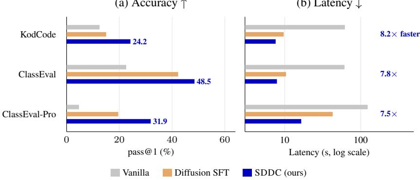
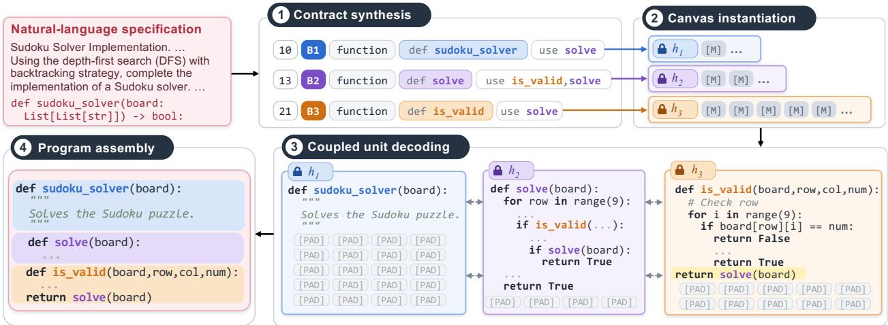
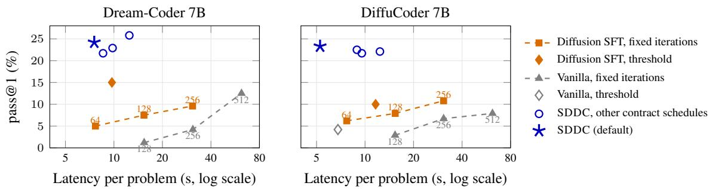

# SELF-DECOMPOSING DIFFUSION FOR CODE GENERATION

Lize Shao University of Virginia zgr3et@virginia.edu

Zichen Xie University of Virginia graysonxie@virginia.edu

Zhe Zeng University of Virginia zhez@virginia.edu

Zhizhen Chen University of Virginia bpm6gu@virginia.edu

Wenxi Wang University of Virginia wenxiw@virginia.edu

## ABSTRACT

Diffusion language models (DLMs) are emerging as a promising paradigm for code generation, offering the potential for fast, parallel decoding. However, generating complex programs remains challenging, as their interdependent components must maintain consistent interfaces, data flows, and shared assumptions. Aggressive parallel decoding can compromise these dependencies and undermine program correctness, while conservative decoding sacrifices efficiency. To address this trade-off, we propose planning program decomposition before implementation to coordinate interdependent units during parallel generation. We introduce Self-Decomposing Diffusion for Code (SDDC), a novel framework that decomposes complex programs and implements their units in parallel, entirely through diffusion. SDDC first generates a contract specifying the program’s decomposition and inter-unit dependencies, then uses it to guide coordinated parallel implementation. Across five benchmarks and two 7B diffusion backbones, SDDC substantially improves the accuracy–latency trade-off, raising pass@1 by up to 31.1 percentage points while decoding 7.5–13.7× faster than the base models, and outperforming a fine-tuning baseline by up to 23.5 points with lower latency.

(a) Accuracy ↑  
(b) Latency ↓  
  
Figure 1: SDDC is more accurate and faster. Dream-Coder 7B on the program-level benchmarks of Table 1: (a) pass@1 (test pass rate on ClassEval and ClassEval-Pro); (b) latency per problem and speedup over Vanilla.

## 1 Introduction

Language models are proficient at function-level programming, yet generating complete programs remains difficult: the methods, helper functions, and class headers of a program must be mutually consistent in their identifiers, interfaces, and shared state, and an error in any single unit invalidates the entire program. Models therefore perform far worse on class-level than on function-level benchmarks [1, 2, 3], and the strongest model evaluated on ClassEval-Pro completes fewer than half of its classes [4].

  
Figure 2: Overview of SDDC on a held-out KodCode task (abridged and adapted from the model’s output). (1) Contract synthesis denoises entries that give a budget, an index, a role, and the identifiers that each unit defines (def) and requires (use). (2) Canvas instantiation fixes each entry’s header h<sub>k</sub> at the start of its canvas. (3) Coupled unit decoding denoises all canvases jointly; they also coordinate a decision that the contract leaves open, nesting both helpers inside sudoku\_solver, whose final return the third canvas writes (highlighted). (4) Program assembly removes headers and padding and concatenates the units.

A standard approach to such tasks, analogous to human software development, is to decompose a problem into subproblems and to plan their implementation before writing code. Planning has accordingly been widely adopted for code generation with autoregressive models, which outline solution steps or subfunctions before implementing them [5, 6, 7, 8, 9] or plan dependent edits across a repository [10]. Diffusion language models can commit multiple tokens in a single forward pass [11, 12, 13, 14], yet planning with them remains largely unexplored. Such planning by diffusion language models is especially valuable for code, whose units interact through explicit interfaces. A plan that specifies these interfaces in advance guides the reasoning about decomposition, improves consistency across units, and enables their parallel generation. Current diffusion code models decode programs without such a plan, so committing many tokens at once introduces inconsistencies across units [15, 16].

Recent work combines planning and diffusion with autoregressive decoding to accelerate generation. Building on parallel generation of semantically independent text spans with autoregressive models [17, 18], Planned Diffusion [19] autoregressively generates a plan of chunk topics and lengths, then denoises the planned chunks in parallel, whereas ReFusion [20] selects slots by diffusion and fills them autoregressively. However, these methods are not designed to coordinate interdependent program units, and both retain an autoregressive stage that limits end-to-end parallelism.

We introduce Self-Decomposing Diffusion for Code (SDDC), which aims to improve both accuracy and decoding latency in complex code generation (Figure 2). Our approach combines two complementary ideas: decomposition enables parallel implementation by dividing a program into interacting units, while a contract promotes consistency by specifying these units and the interfaces between them. SDDC first denoises the contract, then implements all units in parallel, binding each unit to its contract entry and coordinating them through cross-unit attention. Both stages are performed entirely by diffusion; to our knowledge, SDDC is the first approach that plans the generation of complex, multi-unit programs with a diffusion model.

Across five program-level and self-invoking benchmarks and two 7B diffusion backbones, SDDC improves pass@1 over Vanilla by up to 31.1 points while decoding 7.5–13.7× faster (Figure 1), and outperforms the Diffusion SFT baseline by up to 23.5 points. Our contributions are as follows:

• Self-decomposing diffusion. We formulate complex code generation as diffusion over an explicit program decomposition: a contract specifying program units and their interfaces, which the model learns to generate from static-analysis supervision.

• Contract-bound coupled decoding. We use the generated contract to guide joint denoising of interdependent program units, enabling parallel implementation while improving accuracy and cross-unit consistency.

• Improved latency–quality trade-off. SDDC advances the latency–quality frontier of diffusion code generation, and ablations confirm the contribution of each of its components.

## 2 Related Work

Planning and decomposition with autoregressive models are well established for complex code generation [5, 7, 8, 21, 10]. This paper focuses on diffusion models for complex code generation.

Diffusion models for code. Code diffusion models have advanced through pretraining and reinforcement learning [13, 14, 22], adaptive infilling and decoding schedules [23, 24], constrained decoding [25, 26, 27, 28], and structural guidance from abstract syntax trees [29] or anchors [30]. These methods generate a program as a single sequence and are evaluated mainly on function-level benchmarks such as HumanEval [31] and MBPP [32], rather than on classes or other complex, multi-unit programs. SDDC instead synthesizes a program-level contract and generates interdependent units concurrently, modeling explicitly the identifiers that connect them.

Planning with diffusion. Recent work has applied planning to diffusion-based generation. Planned Diffusion [19] generates a plan of topics and lengths autoregressively and denoises the planned chunks in parallel, ReFusion [20] selects fixed-length slots by diffusion and fills them autoregressively, and Plan-Verify-Fill [33] decodes verified anchor tokens first; templates and learned policies further shape the generation order [34, 35, 36, 37, 38]. These methods primarily organize generation around text chunks or token positions, without explicitly planning how program components interact. Complex code, however, requires coordinating interdependent units according to program structure and dependencies. SDDC addresses this challenge through a code-specific contract that guides parallel implementation, using diffusion for both planning and generation.

## 3 Preliminaries

We study code generation from a natural-language specification c. The model generates a program $\pmb { x } = ( x ^ { 1 } , \dots , x ^ { L } ) \in$ $\mathcal { V } ^ { L }$ over a vocabulary V that contains a padding token [PAD]; a separate token [MASK] $\notin \mathcal { V }$ marks corrupted positions.

Masked diffusion language models. Masked diffusion language models learn to reconstruct sequences corrupted by an absorbing-state masking process [39, 40, 41]: at noise level $\mathsf { \bar { t } } \in [ 0 , 1 ]$ , each token of the program (but not of the specification), is replaced by [MASK] independently with probability t. A Transformer denoiser $p _ { \theta } ( x ^ { i } \mid \pmb { x } _ { t } , \pmb { c } )$ attends bidirectionally over the corrupted sequence $\mathbf { \Delta } _ { \mathbf { \mathcal { X } } _ { t } }$ and is trained with the reweighted masked-token cross-entropy [40, 41]

$$
\mathcal { L } _ { \mathrm { M D M } } = \mathbb { E } _ { t , \boldsymbol { x } _ { t } } \Big [ \frac { 1 } { t } \sum _ { i \in \mathcal { M } _ { t } } - \log p _ { \theta } ( x ^ { i } \mid \boldsymbol { x } _ { t } , c ) \Big ] ,\tag{1}
$$

where $t \sim \mathcal { U } ( 0 , 1 )$ and $\mathcal { M } _ { t }$ is the set of masked positions. At inference, the decoder starts from a fully masked canvas, predicts all masked positions in each forward pass, and commits a subset of the predictions, so several tokens can be committed per step and in any order.

Parallel sampling. Let $\eta$ denote the observed context, comprising the specification and the committed tokens, and let $p _ { \star } ( \cdot \mid \eta )$ be the target conditional distribution over the masked tokens. Committing a set $Q$ of masked positions, chosen before their values are sampled, draws the tokens $X ^ { Q } = ( X ^ { i } ) _ { i \in Q }$ independently from their marginals. Even with exact marginals, this incurs the error

$$
\begin{array} { l } { { \displaystyle D _ { \mathrm { K L } } \Big ( p _ { \star } ( X ^ { Q } \mid \eta ) \left\| \prod _ { i \in Q } p _ { \star } ( X ^ { i } \mid \eta ) \right) } } \\ { { \mathrm { ~ } = \mathrm { T C } _ { \star } ( X ^ { Q } \mid \eta ) , } } \end{array}\tag{2}
$$

the total correlation [42] of the committed tokens, that is, the sum of their marginal entropies minus their joint entropy under $p _ { \star } ( \cdot \mid \eta )$ . It vanishes if and only if the committed tokens are conditionally independent given η, so parallel decoding is accurate only when the tokens committed together are nearly independent given what has been revealed [43].

## 4 Motivation

To motivate the design of SDDC, we decompose the error of committing several tokens in parallel. Equation (2) quantifies this error for exact marginals; to extend it to a learned denoiser and a program decomposed into disjoint units, let $Q$ denote the positions committed in one iteration, selected given the observed context $\eta$ before sampling, let $Q _ { k }$ be the nonempty subset of $Q$ belonging to unit $k ,$ and let $p _ { \theta , i } ( \cdot \mid \eta )$ denote the denoiser’s marginal distribution at position i.

Proposition 1 (Decomposition of parallel-sampling error). If the following divergences are finite, independent sampling from the denoiser marginals satisfies

$$
\begin{array} { r l } & { D _ { \mathrm { K L } } \Big ( p _ { \star } ( X ^ { Q } \mid \eta ) \Big \| \displaystyle \prod _ { i \in Q } p _ { \theta , i } ( X ^ { i } \mid \eta ) \Big ) } \\ & { \quad = \underbrace { \mathrm { T C } _ { \star } \big ( ( X ^ { Q _ { k } } ) _ { k } \mid \eta \big ) } _ { R l \cdot c r o s s \cdot u n i t d e p e n d e n c e } + \underbrace { \sum _ { k } \mathrm { T C } _ { \star } ( X ^ { Q _ { k } } \mid \eta ) } _ { R 2 \cdot w i t h i n \cdot u n i t d e p e n d e n c e } } \\ & { \quad \quad + \underbrace { \sum _ { i \in Q } D _ { \mathrm { K L } } \big ( p _ { \star } ( X ^ { i } \mid \eta ) \big \| p _ { \theta , i } ( X ^ { i } \mid \eta ) \big ) } _ { R 3 \cdot m a r g i n a l q p r o x i m a t i o n \ : e r r o r } . } \end{array}\tag{3}
$$

The proof is given in Appendix B. Each term is a source of error in parallel code generation, and SDDC mitigates each with a dedicated mechanism:

R1 Cross-unit dependence. Units must coordinate their interactions, yet parallel generation can lead to incompatible decisions across units. A contract that specifies the identifiers each unit defines and requires makes the key cross-unit relationships explicit before implementation.

R2 Within-unit dependence. Confidence-gated commitment restricts additional commitments to high-confidence positions. For exact marginals, each additional position whose most probable token has probability at least $\begin{array} { r } { \gamma \geq \frac { 1 } { 2 } } \end{array}$ adds at most $H _ { \mathrm { b } } ( \gamma ) + \overline { { ( 1 - \gamma ) \log ( | \mathcal { V } | - 1 ) } }$ to an upper bound on this term, where $\bar { H } _ { \mathrm { b } }$ is the binary entropy (Appendix B).

R3 Marginal approximation error. Accurate predictions require unit-specific context and information from other units. Contract-bound headers identify the unit being implemented, and coupled attention lets predictions condition on the evolving implementations of other units.

## 5 SDDC

SDDC generates a program in four stages (Figure 2 and Algorithm 1): ⃝1 contract synthesis denoises a contract that decomposes the task into program units; $\textcircled{2}$ canvas instantiation allocates one canvas per unit; ⃝3 coupled unit decoding denoises all canvases jointly; and ⃝4 program assembly removes headers and padding and concatenates the units in contract order.

## 5.1 Stage 1: Contract Synthesis

Contract synthesis plans the program before any unit is implemented. We represent a program as a concatenation of K units, $\pmb { x } = \pmb { x } ^ { ( 1 ) } \circ \cdots \cdot \circ \pmb { x } ^ { ( K ) }$ , each a contiguous region of source code with a structural role, such as a class header with its constructor, a method, or a function. A contract $\boldsymbol { z } = ( e _ { 1 } , \dots , e _ { K } )$ assigns each unit an entry $\boldsymbol { e } _ { k } = \left( b _ { k } , k , \rho _ { k } , \mathcal { D } _ { k } , \mathcal { R } _ { k } \right)$ that comprises a size budget $b _ { k }$ in multiples of ν tokens, the unit index, a structural role, the identifiers $\mathcal { D } _ { k }$ that the unit defines, and the identifiers $\mathcal { R } _ { k }$ that it reads before binding them. For example, the entry 13 B2 function | def solve | use is\_valid,solve in Figure 2 allocates 13 budget units to a function that defines solve and calls is\_valid and, recursively, solve. We write ser(z) for the serialized contract and call the serialization $h _ { k }$ of $e _ { k }$ without its budget the header of unit k.

Nominal interfaces. Identifiers form the interface between units, since a unit can call functions and access attributes defined by other units without observing their implementations. By declaring these identifiers, the contract fixes the decisions on which cross-unit dependence concentrates, which mitigates R1, and leaves all other decisions to the units.

Decoding. The contract is generated on a canvas y of P positions that is initialized to $[ \mathsf { M A S K } ] ^ { P }$ and appended to the specification. Contract positions attend bidirectionally to one another and to c, so that every entry can condition on tokens committed in any other entry. At each masked position j, the decoder selects tokens from the admissible set

$$
\begin{array} { r } { \mathcal { A } _ { j } ( \pmb { y } ) = \left\{ \begin{array} { l l } { \mathcal { V } \backslash \left\{ \left[ \mathsf { P A D } \right] \right\} } & { y ^ { j + 1 } \neq \left[ \mathsf { P A D } \right] } \\ { \mathcal { V } } & { \mathrm { o t h e r w i s e } } \end{array} \right. } \end{array}\tag{4}
$$

with the convention $y ^ { P + 1 } = [ \mathsf { P A D } ]$ . Padding is thus admissible only at the final position or immediately before committed padding, which keeps the padding a contiguous suffix and prevents premature truncation. In each iteration $n ,$ the decoder proposes the most probable admissible token $\hat { y } ^ { j }$ at every masked position, with confidence $\kappa _ { j }$ equal to its probability, and commits all proposals with $\kappa _ { j } \geq \gamma _ { z }$ , but at least the $\lceil \lvert \mathcal { M } ( \pmb { y } ) \rvert / ( S _ { z } - n + 1 ) \rceil$ most confident ones, where $\mathcal { M } ( \pmb { y } )$ denotes the masked positions of ${ \mathbf { } } ^ { \mathbf { \psi } } { \mathbf { } } ^ { \mathbf { \psi } } { \mathbf { } } ^ { \mathbf { \psi } } { \mathbf { ) } } \psi ;$ this rule bounds synthesis by $S _ { z }$ iterations. A parser finally extracts the well-formed entries $\hat { z } .$

```latex
Algorithm 1 Generation with SDDC. $\mathcal { M } ( \cdot )$ denotes the masked positions of a canvas, ${ \mathrm { T o p } } _ { r } ( \kappa ; M )$ the r positions in
M with the largest confidences $\kappa ,$ and Π the token distributions returned by one evaluation of the denoiser $\mathsf { D } _ { \theta } ^ { \mathrm { c o n } }$ or
$\mathsf { D } _ { \theta } ^ { \mathrm { u n i t } }$ over the masked contract or unit positions; $A _ { \hat { z } }$ removes headers and padding and concatenates the units. Other
symbols are defined in Sections 5.1–5.3.
Require: $\theta , \pmb { c } ; P , S _ { z } , \lambda \in \mathbb { N } _ { > 0 } ; \gamma _ { z } , \gamma _ { u } \in [ 0 , 1 ]$
Ensure: Program x or failure outcome $\perp$
1: ${ \pmb y }  [ { \mathsf { M A S K } } ] ^ { P } ; n  0$ ▷ contract synthesis
2: while $\mathcal { M } ( \pmb { y } ) \neq \emptyset \ \land \ n < S _ { z }$ do
3: n $\mathbf { \Omega }  \sim \sim \sim \mathbf { \Omega } ^ {  } \mathbf { \Omega } ^ {  } M  \mathcal { M } ( \mathbf { \mathfrak { y } } ) ; \Pi  \mathsf { D } _ { \theta } ^ { \mathrm { c o n } } ( \mathbf { \mathfrak { y } } ; c )$
4: $\begin{array} { r } { \hat { y } ^ { j } \gets \arg \operatorname* { m a x } _ { v \in \mathcal { A } _ { j } ( y ) } \Pi _ { j } ( v ) ; \kappa _ { j } \gets \Pi _ { j } ( \hat { y } ^ { j } ) } \end{array}$
5: r ← max $\big ( \lceil \frac { | M | } { S _ { z } - n + 1 } \rceil , | \{ j \in M : \kappa _ { j } \geq \gamma _ { z } \} | \big )$
6: $\begin{array} { r l } { y ^ { j }  \hat { y } ^ { j } } & { { } ( j \in \mathrm { T o p } _ { r } ( \kappa ; M ) ) } \end{array}$
7: $\hat { \pmb z } = ( e _ { 1 } , \dots , e _ { K } ) \gets \mathrm { p a r s e } ( \pmb y )$
8: if $\hat { z } \notin \mathcal { Z } _ { \lambda }$ return ⊥ ▷ canvas instantiation
9: $\mathbf { w }  \Phi _ { \lambda } ( \hat { z } ) ; \mathcal { H }  \mathsf { E n c } _ { \theta } ( [ c ; \mathrm { s e r } ( \hat { z } ) ] )$
10: while ∃k $: \mathcal { M } ( \pmb { w } ^ { ( k ) } ) \neq \emptyset$ do ▷ coupled unit decoding
11: $\Pi  \mathsf { D } _ { \theta } ^ { \mathrm { u n i t } } ( \mathbf { w } ; \mathcal { H } )$
12: for all $k : M _ { k } = \mathcal { M } ( \pmb { w } ^ { ( k ) } ) \neq \emptyset$ do ▷ in parallel
13: $\begin{array} { r } { a _ { k , j } \sim \Pi _ { k , j } \quad ( j \in M _ { k } ) } \end{array}$
14: $j _ { k } \gets \arg \operatorname* { m a x } _ { j \in M _ { k } } \Pi _ { k , j } \left( a _ { k , j } \right)$
15: $w ^ { ( k ) , j _ { k } } \gets a _ { k , j _ { k } }$
16: $U _ { k } \gets \{ j \in \ddot { M } _ { k } ^ { \times } \setminus \{ j _ { k } \} : \operatorname* { m a x } _ { v } \Pi _ { k , j } ( v ) \geq \gamma _ { u } \}$
17: $w ^ { ( k ) , j } \gets \arg \operatorname* { m a x } _ { v } \Pi _ { k , j } ( v ) \quad ( j \in U _ { k } )$
18: $\pmb { w } ^ { ( k ) }  \mathsf { F } ( \pmb { w } ^ { ( k ) } )$
19: return $A _ { \hat { z } } ( \mathbf { w } )$ ▷ program assembly
```

## 5.2 Stage 2: Canvas Instantiation

Each entry $e _ { k }$ receives a canvas of $\ell _ { k } = \lambda b _ { k }$ positions, initialized as $\begin{array} { r } { { \pmb w } _ { 0 } ^ { ( k ) } = h _ { k } \circ [ { \mathsf { M A S K } } ] ^ { \ell _ { k } - | h _ { k } | } , } \end{array}$ ; we write $\Phi _ { \lambda } ( z )$ for the initialized canvases. The header stays fixed during decoding and binds the canvas to its entry (R3), so the denoiser need not infer from position which unit a canvas implements. Budgets specify capacity rather than length: the scale $\lambda \geq \nu$ provides headroom, and unused positions are filled with [PAD]. Let $\mathcal { Z } _ { \lambda }$ be the set of nonempty contracts whose headers fit their canvases, $| h _ { k } | \leq \ell _ { k }$ . For any other parsed contract, generation returns the failure outcome ⊥, which we count as an incorrect program without resampling.

## 5.3 Stage 3: Coupled Unit Decoding

All canvases are denoised in parallel. The context is encoded once as ${ \mathcal { H } } = \mathsf { E n c } _ { \theta } ( [ c ; \operatorname { s e r } ( z ) ] )$ , and every canvas attends to H and to the current state of all canvases, so that units condition on one another’s partial implementations, including decisions that the contract leaves open (R3). In each iteration, every unfinished canvas samples a candidate $a _ { k , j }$ at each of its masked positions and commits the candidate with the highest probability; it also commits every other masked position whose maximum probability is at least $\gamma _ { u }$ to its most probable token (R2). The operator F then fills all masked positions after the first committed [PAD] of a canvas with [PAD], and a canvas is complete when no masks remain. As an ablation, isolated decoding lets each canvas attend only to H and to itself.

## 6 SDDC Training

For each training pair $( c , x )$ , we extract a reference contract $z ^ { \star }$ from x and train two views of the example: a contract view for synthesis and a unit view for implementation.

Contract extraction. Decomposition supervision comes from static analysis of reference programs. We segment x at the definition boundaries of its abstract syntax tree into class headers with their constructors, methods, and top-level functions, attaching module-level statements to adjacent segments. Each segment forms its own unit by default, and adjacent segments are merged by annotation for a curated subset (Section 7.1). Name analysis then yields $\mathcal { D } _ { k }$ and $\mathcal { R } _ { k }$ the role $\rho _ { k }$ follows from the syntactic category, and the budget $b _ { k }$ covers the header and the unit with a small slack, with $\nu = 1 0 \left( \mathrm { A } _ { \mathsf { I } } \right.$ ppendix A.1). The analyzer only constructs training targets: at inference, the model generates the contract from the specification alone.

  
Figure 3: Latency–quality trade-off on KodCode (held-out). Each point is one decoding configuration, labeled with its number of iterations; the upper left is better. On both backbones, the default configuration of SDDC (star) dominates every baseline configuration, and its variants with other contract schedules and single commitment (circles) lie above all of them. Threshold decoding of the Dream-Coder base model (0.8 pass@1, not timed) is omitted.

Contract view. The target is the padded serialization $\pmb { y } ^ { \star } = \mathrm { s e r } ( \pmb { z } ^ { \star } ) \circ [ \mathsf { P A D } ] ^ { P - | \mathrm { s e r } ( \pmb { z } ^ { \star } ) | }$ , which is corrupted as in Section 3 while c remains intact. With bidirectional attention over the contract canvas, the loss is

$$
\mathcal { L } _ { \mathrm { { c o n } } } = \mathbb { E } \Big [ \frac { 1 } { t } \sum _ { j \in \mathcal { M } _ { t } } - \log p _ { \theta } ( y ^ { \star j } \mid y _ { t } , c ) \Big ] ,\tag{5}
$$

where the expectation is over $t \sim \mathcal { U } ( 0 , 1 )$ and the corrupted canvas $\mathbf { \nabla } _ { \mathbf { \boldsymbol { y } } _ { t } }$ , and $\mathcal { M } _ { t }$ denotes its masked positions. Supervising the padding teaches the model how many units to create; contracts longer than $P$ positions are excluded from this view.

Unit view. Each unit forms a canvas target $h _ { k } \circ \mathbf { \mathcal { x } } ^ { ( k ) } \circ [ \mathsf { P A D } ] ^ { \mathit { r } _ { k } }$ with a padding surplus $r _ { k }$ . Because SDDC allocates canvases in proportion to predicted budgets, unused capacity grows with the unit, so we draw each surplus independently from

$$
\begin{array} { r l } & { { \boldsymbol { r } } _ { k } \sim \frac { 1 } { 2 } \mathcal { U } \{ 0 , \dots , 1 0 \} } \\ & { \qquad + \frac { 1 } { 2 } \mathcal { U } \{ 0 , \dots , \operatorname* { m a x } ( 1 0 , | { \boldsymbol { x } } ^ { ( k ) } | ) \} , } \end{array}\tag{6}
$$

and concatenate the canvases into w. Scaling the surplus with the unit length teaches the model to pad unused capacity instead of extending the unit into the next one (R3), which keeps oversized canvases safe at inference. Headers are never masked or supervised, and all other canvas positions are masked independently with probability t, which yields

$$
\begin{array} { r } { \begin{array} { r l } { \mathcal { L } _ { \mathrm { U N I T } } = \mathbb { E } \Bigl [ \frac { 1 } { t } \sum _ { j \in \mathcal { M } _ { t } } } & { } \\ { \quad - \log p _ { \theta } ( w ^ { j } \mid w _ { t } , z ^ { \star } , c ) \Bigr ] , } \end{array} } \end{array}\tag{7}
$$

where the expectation also covers the surpluses $r _ { k } .$ , and $\mathcal { M } _ { t }$ denotes the masked canvas positions. The context $[ c ; \sec ( z ^ { \star } ) ]$ is encoded with causal attention, and canvas positions attend to the context and to one another, or only to themselves in the isolated variant. The causal context also admits an auxiliary next-token loss $\mathcal { L } _ { \mathrm { { C T X } } }$ on its contract tokens; SDDC does not use it for generation, but it allows the same weights to write contracts left to right (Section 7.3).

Objective. Both views train the same parameters with $\mathcal { L } = \mathbb { E } _ { ( \pmb { c } , \pmb { x } ) } [ \mathcal { L } _ { \mathrm { C o N } } + \mathcal { L } _ { \mathrm { U N I T } } + \mathcal { L } _ { \mathrm { C T X } } ]$ . The unit view conditions on the reference contract during training and on the generated contract at inference.

## 7 Experiments

We evaluate the latency–quality trade-off of SDDC (Section 7.2) and analyze how its mechanisms mitigate the error sources identified in Section 4 (Section 7.3).

Table 1: Program-level composition: pass@1 and pass@5 (%) on KodCode (held-out), ClassEval, and ClassEval-Pro. Class: classes that pass all of their tests; Test: unit tests (ClassEval) or test classes (ClassEval-Pro) passed. Blue rows give the mean latency per problem in seconds and the speedup over Vanilla; pass@5 latency covers five samples. Values next to the scores give the change from Vanilla ( green ≥10 points, yellow <10 points, red a decrease). pass@5 samples at temperature 0.4 and pass@1 at 0.2 (Appendix A.4). Vanilla uses 512 iterations and Diffusion SFT threshold decoding (256 iterations for DiffuCoder on KodCode). The best score per backbone is bolded.
<table><tr><td rowspan="2" colspan="2"></td><td colspan="2">KodCode (held-out)</td><td colspan="4">ClassEval</td><td colspan="4">ClassEval-Pro</td></tr><tr><td></td><td></td><td colspan="2">pass@1</td><td colspan="2">pass@5</td><td colspan="2">pass@1</td><td colspan="2">pass@5</td></tr><tr><td>Model</td><td>Method</td><td>pass@1</td><td>pass@5</td><td>Class</td><td>Test</td><td>Class</td><td>Test</td><td>Class</td><td>Test</td><td>Class</td><td>Test</td></tr><tr><td rowspan="4"></td><td rowspan="2">Vanilla</td><td>12.5</td><td>6.7</td><td>9.0</td><td>22.6</td><td>6.0</td><td>23.2</td><td>3.3</td><td>4.7</td><td>4.0</td><td>6.8</td></tr><tr><td>61.9</td><td>308.0</td><td>61.3</td><td>61.3</td><td>306.9</td><td>306.9</td><td>123.6</td><td>123.6</td><td>619.7</td><td>619.7</td></tr><tr><td rowspan="2">Diffusion SFT</td><td>15.0(+2.5)</td><td>18.3(+11.6)</td><td>7.0(−2.0)</td><td>42.3(+19.7)</td><td>8.0(+2.0)</td><td>48.3(+25.1)</td><td>1.3 (−2.0)</td><td>19.6(+14.9)</td><td>3.0(−1.0)</td><td>32.0(+25.2)</td></tr><tr><td>9.7 (6.4×)</td><td>51.3 (6.0×)</td><td>10.4 (5.9×)</td><td>10.4 (5.9×)</td><td>55.5 (5.5×)</td><td>55.5 (5.5×)</td><td>42.8 (2.9×)</td><td>42.8 (2.9×)</td><td>220.8 (2.8×)</td><td>220.8 (2.8×)</td></tr><tr><td rowspan="2"></td><td rowspan="2">SDDC (Ours)</td><td>24.2(+11.7)</td><td>31.2(+24.5)</td><td>14.0(+5.0)</td><td>48.5(+25.9)</td><td>18.0(+12.0)</td><td>63.2(+40.0)</td><td>3.7(+0.4)</td><td>31.9(+27.2)</td><td>4.3(+0.3)</td><td>46.1(+39.3)</td></tr><tr><td>7.6 (8.2×)</td><td>36.9 (8.3×)</td><td>7.9 (7.8×)</td><td>7.9 (7.8×)</td><td>39.5 (7.8×)</td><td>39.5 (7.8×)</td><td>16.5 (7.5×)</td><td>16.5 (7.5×)</td><td>81.0 (7.7×)</td><td>81.0 (7.7×)</td></tr><tr><td rowspan="2"></td><td rowspan="2">Vanilla</td><td>7.9</td><td>8.8</td><td>6.0</td><td>16.1</td><td>3.0</td><td>17.0</td><td>4.0</td><td>6.0</td><td>4.0</td><td>9.2</td></tr><tr><td>61.8</td><td>308.1</td><td>61.5</td><td>61.5</td><td>307.0</td><td>307.0</td><td>124.1</td><td>124.1</td><td>620.2</td><td>620.2</td></tr><tr><td rowspan="4">DiffuCoder 7B</td><td rowspan="2">Diffusion SFT</td><td>10.8(+2.9)</td><td>13.3(+4.5)</td><td>4.0(−2.0)</td><td>25.6(+9.5)</td><td>4.0(+1.0)</td><td>27.1(+10.1)</td><td>0.0 (-4.0)</td><td>4.8(−1.2)</td><td>0.0(−4.0)</td><td>5.1 (−4.1)</td></tr><tr><td>30.7 (2.0×)</td><td>153.5 (2.0×)</td><td>13.4 (4.6×)</td><td>13.4 (4.6×)</td><td>69.9 (4.4×)</td><td>69.9 (4.4×)</td><td>32.1 (3.9×)</td><td>32.1 (3.9×)</td><td>165.9 (3.7×)</td><td>165.9 (3.7×)</td></tr><tr><td rowspan="2">SDDC (Ours)</td><td>23.3(+15.4)</td><td>24.2(+15.4)</td><td>13.0(+7.0)</td><td>47.2(+31.1)</td><td>20.0(+17.0)</td><td>64.0(+47.0)</td><td>3.0(−1.0)</td><td>28.3(+22.3)</td><td>4.7(+0.7)</td><td>42.7(+33.5)</td></tr><tr><td>5.3 (11.7×)</td><td>23.6 (13.1×)</td><td>4.5 (13.7×)</td><td>4.5 (13.7×)</td><td>22.1 (13.9×)</td><td>22.1 (13.9×)</td><td>13.5 (9.2×)</td><td>13.5 (9.2×)</td><td>62.4 (9.9×)</td><td>62.4 (9.9×)</td></tr></table>

Table 2: Self-invoking problem solving (pass@1 and pass@5, %), formatted as in Table 1. Blue rows give the mean latency per problem in seconds and the speedup over Vanilla. Values next to the scores give the change from Vanilla ( green ≥10 points, yellow <10 points, red a decrease). Diffusion SFT uses threshold decoding (256 iterations for DiffuCoder on HumanEval Pro); Table 5 adds further configurations.
<table><tr><td></td><td></td><td colspan="2">HumanEval Pro</td><td colspan="2">MBPP Pro</td></tr><tr><td>Model</td><td>Method</td><td>pass@1</td><td>pass@5</td><td>pass@1</td><td>pass@5</td></tr><tr><td rowspan="8">Dream- Coder 7B</td><td>Vanilla</td><td>40.2</td><td>19.5</td><td>51.9</td><td>33.9</td></tr><tr><td></td><td>39.4</td><td>197.3</td><td>34.7</td><td>173.4</td></tr><tr><td>Diffusion SFT</td><td>26.8(-13.4)</td><td>31.7(+12.2)</td><td>36.0(−15.9)</td><td>38.9(+5.0)</td></tr><tr><td></td><td>4.2 (9.4×)</td><td>21.7 (9.1×)</td><td>2.3 (14.9×)</td><td>12.2 (14.2×)</td></tr><tr><td>SDDC (Ours)</td><td>)44.5(+4.3)</td><td>42.1 (+22.6)</td><td>52.6(+0.7)</td><td>56.1 (+22.2)</td></tr><tr><td></td><td>5.1 (7.7×)</td><td>25.6 (7.7×)</td><td>4.4 (8.0×)</td><td>21.6 (8.0×)</td></tr><tr><td>Vanilla</td><td>31.1</td><td>28.0</td><td>48.1</td><td>42.1</td></tr><tr><td></td><td>39.5</td><td>197.5</td><td>34.7</td><td>173.5</td></tr><tr><td rowspan="4">Diffu- Coder 7B</td><td>Diffusion SFT</td><td>20.1(-11.0)</td><td>17.7(−10.3)</td><td>31.5 (−16.6)</td><td>36.2(-5.9)</td></tr><tr><td></td><td>19.7 (2.0×)</td><td>98.8 (2.0×)</td><td>2.8 (12.6×)</td><td>14.1 (12.3×)</td></tr><tr><td>SDDC (Ours)</td><td>40.9 (+9.8)</td><td>51.2 (+23.2)</td><td>49.7 (+1.6)</td><td>54.0(+11.9)</td></tr><tr><td></td><td>3.2 (12.4×)</td><td>15.0 (13.1×)</td><td>3.2 (10.8×)</td><td>15.6 (11.1×)</td></tr></table>

Table 3: Binding (headers and length-scaled padding) and coupled attention on KodCode (curated subset, left-to-right contracts, λ = 10; held-out). Misbound: canvases whose first definition belongs to another entry; Overrun: canvases that continue into the next unit (%).
<table><tr><td>Attention</td><td>Binding</td><td>pass@1</td><td>Misbound</td><td>Overrun</td></tr><tr><td>isolated</td><td></td><td>4.2</td><td>32.3</td><td>10.1</td></tr><tr><td>coupled</td><td></td><td>11.2</td><td>11.0</td><td>4.9</td></tr><tr><td>isolated</td><td>√</td><td>13.3</td><td>0.1</td><td>1.0</td></tr><tr><td>coupled</td><td>√</td><td>14.2</td><td>0.0</td><td>0.9</td></tr></table>

## 7.1 Experimental Setup

Models and training. We fine-tune two open 7B masked diffusion code models, Dream-Coder-v0-Instruct-7B [13] and DiffuCoder-7B-Instruct [14]. The training corpus contains 15,973 problems from KodCode-V1 [44] whose verified solutions define at least three functions or four methods. For 2,770 of these programs, an LLM annotator merged adjacent units following a written guideline; the corpus yields 25.5K unit-view and 25.1K contract-view examples. Each backbone is trained for six epochs, about 13 hours on four GPUs (Appendix A).

Decoding. SDDC uses $P = 2 2 4 , \gamma _ { z } = 0 . 9 5 , S _ { z } = 1 1 2 , \lambda = 1 4 ,$ , and $\gamma _ { u } = 0 . 9 9$ , sampling with temperature 0.2 and top-p 0.95 (Appendix A.3). All decoding hyperparameters are tuned on KodCode; for ClassEval-Pro, whose specifications list up to 27 methods, we enlarge the contract canvas to $P = 3 2 0$

Benchmarks. We evaluate on five benchmarks in two groups. Program-level composition requires complete programs whose units interact through shared state and calls. KodCode (held-out) contains 240 problems withheld from training and stratified by structure and difficulty, scored by their pytest suites. ClassEval [1] contains 100 hand-written classes whose skeletons specify interdependent methods. ClassEval-Pro [4] contains 300 cross-domain classes specified only in prose, most of which exceed our 2,048-token training length. On both class benchmarks, we report the class pass rate, which requires all tests of a class to pass, and the test pass rate, which credits partially correct classes (Appendix A.4). Self-invoking problem solving isolates a single cross-unit dependency: HumanEval Pro and MBPP Pro [45] extend HumanEval [31] and MBPP [32] with 164 and 378 problems in which the solution to a base problem must be invoked to solve a harder one.

Baselines. Vanilla decodes each released backbone over a full canvas with 512 iterations, its most accurate setting on every benchmark. Diffusion SFT fine-tunes the same backbone on exactly the same programs with the same recipe and the standard masked diffusion objective, which isolates the effect of the generation scheme from that of the training data; we report the more accurate of confidence-threshold decoding [43] and 256 iterations on each benchmark. Appendix A.3 lists all evaluated configurations.

Metrics. We report pass@1 at temperature 0.2 and pass@5 from five samples at temperature 0.4. Latency is the mean wall-clock time per problem on one NVIDIA RTX PRO 6000 GPU with batch size one, including contract synthesis; for pass@5, it covers all five samples.

## 7.2 Main Results

Program-level composition. Table 1 shows that SDDC is the fastest method on all three program-level benchmarks with both backbones and the most accurate on all but one metric. On KodCode, it attains 24.2 and 23.3 pass@1, compared with 15.0 and 10.8 for Diffusion SFT and 12.5 and 7.9 for the base models, while answering in 7.6 and 5.3 seconds, 8.2× and 11.7× faster than the base models. On ClassEval, it raises the class pass rate to 14.0 and 13.0, from at most 9.0 and 6.0, and passes 48.5% and 47.2% of unit tests, compared with at most 42.3% and 25.6%. The advantage widens on ClassEval-Pro, the most compositional benchmark, where SDDC passes 31.9% and 28.3% of test classes, compared with at most 19.6% and 6.0%. The only exception, the DiffuCoder base model on complete ClassEval-Pro classes (4.0 vs. 3.0), amounts to three of 300 classes at 9.2× the latency. Diffusion SFT on the same programs, in contrast, lowers the class pass rate on both class benchmarks with both backbones, so the gains of SDDC stem from generating programs through contracts rather than from the training data.

Self-invoking problem solving. SDDC also attains the highest pass@1 on HumanEval Pro and MBPP Pro with both backbones (Table 2). The base models approach this accuracy only with 512 iterations, at 35–40 seconds per problem; SDDC exceeds them by up to 9.8 points while running 7.7–12.4× faster. Diffusion SFT trails the base models by 11.0–16.6 points; even with 512 iterations, it surpasses SDDC only on MBPP Pro with Dream-Coder (54.2 vs. 52.6), at about eight times the latency (Table 5). Since each problem couples a base function with a function that must invoke it, these results indicate that the dependency declared in the contract is honored even though the two units are generated in parallel.

Sampling multiple programs. With five samples, SDDC is the most accurate method in every pass@5 column of Tables 1 and 2; on ClassEval, it passes 63.2% and 64.0% of unit tests, compared with at most 48.3% and 27.1%.

Latency–quality frontier. On KodCode (Figure 3), the default configuration of SDDC dominates every evaluated baseline configuration on both backbones: none is both faster and more accurate. The advantage originates in parallel unit decoding: because each iteration advances all units at once, SDDC completes the units of a KodCode program in 54 (Dream-Coder) and 61 (DiffuCoder) iterations on average, whereas the fixed-iteration baselines denoise a canvas of about 1.5K positions for up to 512 iterations.

## 7.3 Analysis

Diffused versus left-to-right contracts. To isolate the benefit of diffusion-based planning, we let the same weights write the contract left to right, as in Planned Diffusion [19](Table 6). Diffused contracts raise KodCode pass@1 from

22.1 to 25.8 on Dream-Coder and from 19.6 to 21.7 on DiffuCoder; they are also finer grained, with 6.7 instead of 5.3 entries on average, and all 240 of them parse. Diffusion thus yields better decompositions, which supports using it for both planning and implementation.

Binding and coupled attention. Table 3 varies the two mechanisms that inform each canvas’s predictions (R3). Without binding, a canvas is tied to its entry only by position, as in Planned Diffusion, and under isolated attention 32.3% of canvases begin with a sibling’s definition. Binding nearly eliminates misbinding and overruns and triples pass@1 under isolated attention (4.2 to 13.3) at unchanged latency. Coupled attention partly compensates for missing binding and adds 0.9 points on top of it.

Commitment threshold. Relative to single commitment, $\gamma _ { u } = 0 . 9 9$ reduces unit-decoding iterations by 2.2–2.4× and end-to-end latency on held-out KodCode by 1.65× and 1.82×, with accuracy changes within noise (25.8 to 24.2 and 21.7 to 23.3; sign test $p \geq 0 . 5 2 )$ . Lower thresholds collapse, as R2 predicts: at $\gamma _ { u } = 0 . 7$ , pass@1 falls below 5%, and the share of syntactically valid programs on Dream-Coder drops from 96.7% to 40.0% (Table 7). Appendix C reports further ablations.

## 8 Conclusion

We presented Self-Decomposing Diffusion for Code (SDDC), a fully diffusion-based framework that integrates program decomposition and parallel implementation into a unified generative process. By explicitly modeling program structure and inter-unit dependencies through a generated contract, SDDC enables coordinated parallel decoding while improving program correctness and substantially reducing latency. Our results across diverse benchmarks and diffusion backbones demonstrate that planning and parallelism can be complementary rather than competing objectives. More broadly, this work suggests that realizing the potential of diffusion models for complex code generation requires not only faster token generation, but also explicit mechanisms for organizing and coordinating interdependent decisions. Future work could extend contract-guided diffusion to repository-scale generation and explore adaptive decomposition guided by execution feedback.

## Limitations

Our experiments use two open 7B diffusion code models. Diffusion models still trail frontier autoregressive models, more capable diffusion systems such as Gemini Diffusion [46], Mercury 2.5 [47], and Seed Diffusion Preview [48] do not release their weights, and larger open diffusion models for code remain scarce; we expect stronger backbones to benefit SDDC, but we have not verified this. Contracts capture nominal interfaces, namely the identifiers that units define and require, but not types or behavioral specifications, and our supervision relies on static analysis of Python programs, so other languages and richer interfaces require corresponding analyzers. Finally, contract synthesis adds a sequential stage before unit decoding. This overhead is more than offset by parallel unit decoding, but it accounts for 4.5 of the 7.6 seconds per KodCode problem with Dream-Coder, so faster contract decoding would reduce latency further.

## Ethical Considerations

SDDC improves both accuracy and the efficiency of diffusion-based code generation, but it inherits the potential risks of automated code generation, including producing insecure or incorrect code and facilitating the development of harmful software. Generated programs should therefore be reviewed and tested before deployment, particularly in security-sensitive settings. Although faster decoding may reduce inference costs, training and deploying these models still consume computational resources and energy.

## References

[1] Xueying Du, Mingwei Liu, Kaixin Wang, Hanlin Wang, Junwei Liu, Yixuan Chen, Jiayi Feng, Chaofeng Sha, Xin Peng, and Yiling Lou. Evaluating large language models in class-level code generation. In Proceedings ofthe IEEE/ACM 46th International Conference on Software Engineering, 2024.

[2] Musfiqur Rahman, SayedHassan Khatoonabadi, and Emad Shihab. Beyond synthetic benchmarks: Evaluating llm performance on real-world class-level code generation. arXiv preprint arXiv:2510.26130, 2025.

[3] Yunhao Liang, Ruixuan Ying, Shiwen Ni, and Zhe Cui. Scaling test-driven code generation from functions to classes: An empirical study. arXiv preprint arXiv:2602.03557, 2026.

[4] Yeheng Chen, Chaoxiang Xie, Yuling Shi, Wenhao Zeng, Yongpan Wang, Hongyu Zhang, and Xiaodong Gu. ClassEval-Pro: A cross-domain benchmark for class-level code generation. In International Conference on AI-Powered Software (AIware), 2026. arXiv:2604.26923.

[5] Xue Jiang, Yihong Dong, Lecheng Wang, Zheng Fang, Qiwei Shang, Ge Li, Zhi Jin, and Wenpin Jiao. Selfplanning code generation with large language models. ACM Transactions on Software Engineering and Methodology, 33(7):1–30, 2024.

[6] Eric Zelikman, Qian Huang, Gabriel Poesia, Noah D. Goodman, and Nick Haber. Parsel: Algorithmic reasoning with language models by composing decompositions. In Advances in Neural Information Processing Systems, 2023.

[7] Hung Le, Hailin Chen, Amrita Saha, Akash Gokul, Doyen Sahoo, and Shafiq Joty. CodeChain: Towards modular code generation through chain of self-revisions with representative sub-modules. In International Conference on Learning Representations, 2024.

[8] Jingchang Chen, Hongxuan Tang, Zheng Chu, Qianglong Chen, Zekun Wang, Ming Liu, and Bing Qin. Divideand-conquer meets consensus: Unleashing the power of functions in code generation. Advances in Neural Information Processing Systems, 37:67061–67105, 2024.

[9] Evan Wang, Federico Cassano, Catherine Wu, Yunfeng Bai, Will Song, Vaskar Nath, Ziwen Han, Sean Hendryx, Summer Yue, and Hugh Zhang. Planning in natural language improves LLM search for code generation. In International Conference on Learning Representations, 2025.

[10] Ramakrishna Bairi, Atharv Sonwane, Aditya Kanade, Vageesh D. C, Arun Iyer, Suresh Parthasarathy, Sriram Raja mani, B. Ashok, and Shashank Shet. CodePlan: Repository-level coding using LLMs and planning. Proceedings ofthe ACM on Software Engineering, 1(FSE):675–698, 2024.

[11] Shen Nie, Fengqi Zhu, Zebin You, Xiaolu Zhang, Jingyang Ou, Jun Hu, Jun Zhou, Yankai Lin, Ji-Rong Wen, and Chongxuan Li. Large language diffusion models. Advances in Neural Information Processing Systems, 38: 50608–50646, 2026.

[12] Jiacheng Ye, Zhihui Xie, Lin Zheng, Jiahui Gao, Zirui Wu, Xin Jiang, Zhenguo Li, and Lingpeng Kong. Dream 7B: Diffusion large language models. arXiv preprint arXiv:2508.15487, 2025.

[13] Zhihui Xie, Jiacheng Ye, Lin Zheng, Jiahui Gao, Jingwei Dong, Zirui Wu, Xueliang Zhao, Shansan Gong, Xin Jiang, Zhenguo Li, et al. Dream-coder 7b: An open diffusion language model for code. arXiv preprint arXiv:2509.01142, 2025.

[14] Shansan Gong, Ruixiang Zhang, Huangjie Zheng, Jiatao Gu, Navdeep Jaitly, Lingpeng Kong, and Yizhe Zhang. Diffucoder: Understanding and improving masked diffusion models for code generation. In International Conference on Learning Representations, volume 2026, pages 15723–15750, 2026.

[15] Wonjun Kang, Kevin Galim, Seunghyuk Oh, Minjae Lee, Yuchen Zeng, Shuibai Zhang, Coleman Hooper, Yuezhou Hu, Hyung Koo, Nam Ik Cho, et al. Parallelbench: Understanding the trade-offs of parallel decoding in diffusion llms. In International Conference on Learning Representations, volume 2026, pages 89900–89938, 2026.

[16] Bumjun Kim, Dongjae Jeon, Moongyu Jeon, and Albert No. Dapd: Dependency-aware parallel decoding via attention for diffusion llms. arXiv preprint arXiv:2603.12996, 2026.

[17] Xuefei Ning, Zinan Lin, Zixuan Zhou, Zifu Wang, Huazhong Yang, and Yu Wang. Skeleton-of-thought: Prompting LLMs for efficient parallel generation. In International Conference on Learning Representations, 2024.

[18] Tian Jin, Ellie Y. Cheng, Zack Ankner, Nikunj Saunshi, Blake M. Elias, Amir Yazdanbakhsh, Jonathan Ragan-Kelley, Suvinay Subramanian, and Michael Carbin. Learning to keep a promise: Scaling language model decoding parallelism with learned asynchronous decoding. In Proceedings ofthe 42nd International Conference on Machine Learning, pages 27941–27956, 2025.

[19] Daniel Israel, Tian Jin, Ellie Cheng, Guy Van den Broeck, Aditya Grover, Suvinay Subramanian, and Michael Carbin. Planned diffusion. In International Conference on Learning Representations, volume 2026, pages 98298–98318, 2026.

[20] Jia-Nan Li, Jian Guan, Wei Wu, and Chongxuan Li. Refusion: A diffusion large language model with parallel autoregressive decoding. In International Conference on Learning Representations, volume 2026, pages 53846– 53869, 2026.

[21] Md. Ashraful Islam, Mohammed Eunus Ali, and Md Rizwan Parvez. MapCoder: Multi-agent code generation for competitive problem solving. In Proceedings ofthe 62nd Annual Meeting ofthe Associationfor Computational Linguistics (Volume 1: Long Papers), 2024.

[22] Chenghao Fan, Wen Heng, Bo Li, Sichen Liu, Yuxuan Song, Jing Su, Xiaoye Qu, Kai Shen, and Wei Wei. Stable-diffcoder: Pushing the frontier of code diffusion large language model. arXiv preprint arXiv:2601.15892, 2026.

[23] Zirui Wu, Lin Zheng, Zhihui Xie, Jiacheng Ye, Jiahui Gao, Shansan Gong, Yansong Feng, Zhenguo Li, Wei Bi, Guorui Zhou, et al. Dreamon: Diffusion language models for code infilling beyond fixed-size canvas. In International Conference on Learning Representations, volume 2026, pages 76626–76643, 2026.

[24] Yihong Dong, Zhaoyu Ma, Xue Jiang, Zhiyuan Fan, Jiaru Qian, Yongmin Li, Jianha Xiao, Zhi Jin, Rongyu Cao, Binhua Li, et al. Saber: An efficient sampling with adaptive acceleration and backtracking enhanced remasking for diffusion language model. arXiv preprint arXiv:2510.18165, 2025.

[25] Tarun Suresh, Debangshu Banerjee, Shubham Ugare, Sasa Misailovic, and Gagandeep Singh. Dingo: Constrained inference for diffusion llms. Advances in Neural Information Processing Systems, 38:160518–160551, 2026.

[26] Niels Mündler, Jasper Dekoninck, and Martin Vechev. Constrained decoding of diffusion llms with context-free grammars. In International Conference on Learning Representations, volume 2026, pages 99362–99408, 2026.

[27] Yitong Zhang, Yongmin Li, Yuetong Liu, Jia Li, Xiaoran Jia, Zherui Li, and Ge Li. Lookahead-then-verify: Reliable constrained decoding for diffusion llms under context-free grammars. Proceedings of the ACM on Software Engineering, 3(ISSTA):1264–1286, 2026.

[28] Lize Shao, Michael Cardei, Zichen Xie, Ferdinando Fioretto, and Wenxi Wang. Constrained code generation with discrete diffusion. arXiv preprint arXiv:2605.16829, 2026.

[29] Yiming Zeng, Jinghan Cao, Zexin Li, Yiming Chen, Tao Ren, Zhuochun Li, Dawei Xiang, Xidong Wu, Shangqian Gao, and Tingting Yu. Treediff: Ast-guided code generation with diffusion llms. In Proceedings of the First Workshop on Structured Understanding, Retrieval, and Generation in the LLM Era (SURGeLLM 2026), pages 93–106, 2026.

[30] Anton Xue, Litu Rout, Constantine Caramanis, and Sanjay Shakkottai. Ancoder: Anchored code generation via discrete diffusion models. arXiv preprint arXiv:2602.17688, 2026.

[31] Mark Chen, Jerry Tworek, Heewoo Jun, Qiming Yuan, Henrique Ponde de Oliveira Pinto, Jared Kaplan, Harri Edwards, Yuri Burda, Nicholas Joseph, Greg Brockman, et al. Evaluating large language models trained on code. arXiv preprint arXiv:2107.03374, 2021.

[32] Jacob Austin, Augustus Odena, Maxwell Nye, Maarten Bosma, Henryk Michalewski, David Dohan, Ellen Jiang, Carrie Cai, Michael Terry, Quoc Le, and Charles Sutton. Program synthesis with large language models. arXiv preprint arXiv:2108.07732, 2021.

[33] Miao Li, Hanyang Jiang, Sikai Cheng, Hengyu Fu, Yuhang Cai, Baihe Huang, Tinghan Ye, Xuanzhou Chen, and Pascal Van Hentenryck. Plan, verify and fill: A structured parallel decoding approach for diffusion language models. arXiv preprint arXiv:2601.12247, 2026.

[34] Zhen Xiong, Yujun Cai, Zhecheng Li, and Yiwei Wang. Unveiling the potential of diffusion large language model in controllable generation. In International Conference on Learning Representations, volume 2026, pages 66670–66686, 2026.

[35] Junhoo Lee, Seungyeon Kim, and Nojun Kwak. Unlocking the potential of diffusion language models through template infilling. In Proceedings ofthe 64th Annual Meeting ofthe Associationfor Computational Linguistics (Volume 1: Long Papers), pages 6273–6287, 2026.

[36] Zemin Huang, Zhiyang Chen, Zijun Wang, Tiancheng Li, and Guo-Jun Qi. Reinforcing the diffusion chain of lateral thought with diffusion language models. Advances in Neural Information Processing Systems, 38: 152677–152710, 2026.

[37] Gyunyeop Kim and Sangwoo Kang. Ta-grpo-d: Trajectory-aware grpo for optimizing denoising trajectories in diffusion llms. In Proceedings of the 64th Annual Meeting of the Association for Computational Linguistics (Volume 1: Long Papers), pages 37159–37174, 2026.

[38] Jiawei Xu, Minghui Liu, Aakriti Agrawal, Yifan Chen, and Furong Huang. Scheduling thoughts: Learning the order of thought in diffusion language models. In Forty-third International Conference on Machine Learning, 2026.

[39] Jacob Austin, Daniel D Johnson, Jonathan Ho, Daniel Tarlow, and Rianne Van Den Berg. Structured denoising diffusion models in discrete state-spaces. Advances in neural information processing systems, 34:17981–17993, 2021.

[40] Subham S Sahoo, Marianne Arriola, Yair Schiff, Aaron Gokaslan, Edgar Marroquin, Justin T Chiu, Alexander Rush, and Volodymyr Kuleshov. Simple and effective masked diffusion language models. Advances in Neural Information Processing Systems, 37:130136–130184, 2024.

[41] Jiaxin Shi, Kehang Han, Zhe Wang, Arnaud Doucet, and Michalis K. Titsias. Simplified and generalized masked diffusion for discrete data. In Advances in Neural Information Processing Systems, volume 37, 2024.

[42] Satosi Watanabe. Information theoretical analysis of multivariate correlation. IBM Journal of Research and Development, 4(1):66–82, 1960. doi: 10.1147/rd.41.0066.

[43] Chengyue Wu, Hao Zhang, Shuchen Xue, Zhijian Liu, Shizhe Diao, Ligeng Zhu, Ping Luo, Song Han, and Enze Xie. Fast-dllm: Training-free acceleration of diffusion llm by enabling kv cache and parallel decoding. In International Conference on Learning Representations, volume 2026, pages 57027–57051, 2026.

[44] Zhangchen Xu, Yang Liu, Yueqin Yin, Mingyuan Zhou, and Radha Poovendran. KodCode: A diverse, challenging, and verifiable synthetic dataset for coding. In Findings ofthe Associationfor Computational Linguistics: ACL 2025. Association for Computational Linguistics, 2025.

[45] Zhaojian Yu, Yilun Zhao, Arman Cohan, and Xiao-Ping Zhang. HumanEval Pro and MBPP Pro: Evaluating large language models on self-invoking code generation task. In Findings ofthe Associationfor Computational Linguistics: ACL 2025, pages 13253–13279. Association for Computational Linguistics, 2025.

[46] Google DeepMind. Gemini diffusion is our new experimental research model. Google Blog, May 2025. URL https://blog.google/innovation-and-ai/models-and-research/google-deepmind/ gemini-diffusion/.

[47] Stefano Ermon. Introducing mercury 2.5. Inception Blog, September 2026. URL https://www.inceptionlabs. ai/blog/introducing-mercury-2-5.

[48] Yuxuan Song, Zheng Zhang, Cheng Luo, Pengyang Gao, Fan Xia, Hao Luo, Zheng Li, Yuehang Yang, Hongli Yu, Xingwei Qu, Yuwei Fu, Jing Su, Ge Zhang, Wenhao Huang, Mingxuan Wang, Lin Yan, Xiaoying Jia, Jingjing Liu, Wei-Ying Ma, Ya-Qin Zhang, Yonghui Wu, and Hao Zhou. Seed diffusion: A large-scale diffusion language model with high-speed inference, 2025. URL https://arxiv.org/abs/2508.02193.

[49] Ilya Loshchilov and Frank Hutter. Decoupled weight decay regularization. In International Conference on Learning Representations, 2019.

[50] Tim Dettmers, Mike Lewis, Sam Shleifer, and Luke Zettlemoyer. 8-bit optimizers via block-wise quantization. In International Conference on Learning Representations, 2022.

## A Implementation Details

## A.1 Training Data

KodCode programs. We start from the 487K problems of KodCode-V1 [44], each a triple of question, reference solution, and unit tests. We keep solutions that define at least three top-level functions or a class with at least four methods and span at least 30 non-empty lines (29,047 problems), discard the competitive-programming subsets (22,418), discard problems whose benchmark-similarity score provided by KodCode is at least 0.75 (21,729), and re-execute every solution’s tests in an isolated sandbox, keeping solutions that pass (17,795). After decomposition checks, the pool contains 17,499 programs. Problems in our held-out and validation splits are excluded from training.

Unit annotation. Segmentation follows Section 6: class headers with their constructors, methods, and top-level functions form segments, short function-level programs may also be divided into statement segments, and the segments concatenate exactly to the source. For a curated subset, an LLM annotator read each program and its segments and, following a written guideline, either rejected the program as unsuitable (for example, interactive programs, programs dominated by placeholder code, or programs that communicate through mutable global state) or partitioned its segments into contiguous units. The guideline keeps every helper that a sibling calls in its own unit, since its name must appear in the contract, keeps public entry points separate, merges trivial unreferenced helpers and symmetric families of near-identical methods, and isolates trailing demonstration code. Every label is validated automatically, requiring that the partition covers every segment exactly once, that groups are contiguous, and that no group crosses a class boundary. On 252 programs labeled independently twice, the keep-or-reject decision agrees in 94.8% of cases and the exact partition in 77.1%, and the decisions on all 11 hidden reference items match their reference labels. The annotation yields 2,770 programs. The remaining 13,203 pool programs use one unit per segment, a rule that reproduces the annotated partition exactly for 64.4% of 1,200 annotated programs.

Table 4: Training hyperparameters. The optimizer is paged 8-bit AdamW [49, 50].
<table><tr><td>Optimizer Learning rate Schedule Effective batch size Epochs (steps) Sequence length Precision</td><td>paged 8-bit AdamW  $\mathrm { \hat { 1 0 } ^ { - 5 } }$  cosine, 3% warm-up 32</td></tr></table>

Example construction. The budget of unit k is $b _ { k } = \lceil ( | h _ { k } | + | x ^ { ( k ) } | + s _ { k } ) / \nu \rceil$ , where | · | counts tokens and $s _ { k }$ is a small slack. For every example, trailing demonstration or test code (assertions, \_\_main\_\_ guards, print-only statements, and test functions) is removed, the units must reconstruct the program exactly, the budgets must parse back exactly, and the example must fit into 2,048 tokens. The annotated programs are upsampled threefold, giving 25,513 unit-view examples; the 25,118 examples whose contracts fit into $P = 2 2 4$ positions also form contract-view examples. We hold out 10% of the examples for monitoring and train on the remaining 45,438.

## A.2 Training

Table 4 lists the hyperparameters, which are shared by both backbones; Diffusion SFT uses the same settings and, without contract-view examples, takes fewer steps. In the contract view, the specification and the contract canvas attend bidirectionally. In the unit view, the context $[ c ; \sec ( z ^ { \star } ) ]$ is causal, and canvas positions attend to the context and to all canvases (coupled) or to their own canvas (isolated). Both backbones follow the shifted prediction convention of Dream [12], in which the token at position j is predicted from the output at position $j - 1 ;$ ; we therefore select the supervised outputs by the masking state of their targets rather than of their inputs, which would leave a third of the targets visible to the model. The next-token loss $\mathcal { L } _ { \mathrm { C T X } }$ on contract tokens shares the 1/t weight of its example. Diffusion SFT trains on the same 25,513 programs with contract and canvas delimiters removed, applying the masked diffusion objective to the full response with the same supervision indexing.

## A.3 Decoding

SDDC. On DiffuCoder, the admissible set $A _ { j } ( \pmb { y } )$ also contains [PAD] directly after a complete entry, and a [PAD] committed there ends the contract. Unit decoding samples candidates with temperature 0.2 and top-p 0.95. The keys and values of the context are computed once, and those of completed canvases are reused; under coupled attention this reuse is an approximation, because they were computed while other canvases were still changing.

Baselines. Vanilla and Diffusion SFT denoise a canvas that fills the length budget of each benchmark, including the prompt: 2,048 tokens for KodCode and ClassEval, 4,096 for ClassEval-Pro, 1,280 for HumanEval Pro, and 1,024 for MBPP Pro. Fixed-iteration decoding uses the entropy-ordered sampler of Dream [12] with temperature 0.2 and top-p 0.95. Threshold decoding commits every position whose confidence is at least 0.8, and at least one per iteration, for up to 512 iterations. We evaluate Vanilla with 128, 256, and 512 iterations and Diffusion SFT with 64, 128, and 256 iterations on KodCode, both with 256 iterations on the other benchmarks and Vanilla additionally with 512, and both with threshold decoding everywhere. The most accurate of these configurations is 512 iterations for Vanilla on every benchmark and threshold decoding for Diffusion SFT, except on KodCode and HumanEval Pro with DiffuCoder, where 256 iterations are best; Tables 1 and 2 report these configurations. On the self-invoking benchmarks, we further evaluate Diffusion SFT with thresholds 0.9 and 0.95 and with 512 iterations (Table 5). For baselines, the program is the fenced code block of the answer, or all blocks that define code and parse if there are several, or the whole answer if there is none.

Hyperparameter selection. The commitment threshold $\gamma _ { u }$ and the DiffuCoder contract variant were selected on the 210-problem validation split. For Dream-Coder, the canvas scale λ and the contract schedule were chosen on KodCode during development; the configuration that is best on the validation split alone (λ = 16) attains the same held-out pass@1 within one problem.

## A.4 Evaluation

Benchmarks. Every method receives the benchmark prompt as the user turn of its chat template. The KodCode held-out split contains 240 problems with 120 multi-function modules and 120 class-based programs, 48 of which define several classes, and 80 problems at each difficulty level; the 210 validation problems are drawn in the same way. KodCode programs are run against their pytest suites with a timeout of 300 seconds. On ClassEval, the class pass rate requires all unit tests of a class to pass, and the test pass rate is the fraction of all unit tests passed. On ClassEval-Pro, whose reference solutions have a median length of 1,001 tokens, we use the official holistic prompt and evaluator: its class success requires all test classes of a class to pass, and its function-level success, our test pass rate, is the fraction of test classes whose tests all pass. Because some official tests patch built-in functions, we run the evaluator separately for each problem and sample, so that a failing program cannot affect later ones. On HumanEval Pro and MBPP Pro, we use the official sanitizer and harness and report the official score, the better of raw and sanitized outputs; every method receives the official instruction as a chat turn rather than a pre-filled function signature, because SDDC begins its response with a contract.

pass@5. We draw five samples per problem at temperature 0.4 and top-p 0.95. All stochastic stages sample, including contract synthesis and threshold decoding, whose commitment decisions use the untempered probability of the sampled token so that the thresholds stay calibrated. A problem counts as solved if any sample passes; on ClassEval, a unit test counts as passed if any sample passes it, and on ClassEval-Pro we use the official pass@k estimator. Sampling at temperature 0.4 lowers the per-sample accuracy of several models, most strongly of the base models, which then often answer in prose without code; pass@5 can therefore fall below pass@1 at temperature 0.2.

Latency. Latency is the wall-clock time per problem with batch size one, including contract synthesis and context encoding, measured on a single NVIDIA RTX PRO 6000 GPU of the same machine for all methods. The cost of fixed-iteration decoding varies by less than 5% across problems, so we time it on subsets of 20–60 problems. For pass@5, latency is the time to draw all five samples.

## B Proofs

Proposition 1. Write $p _ { \star }$ for $p _ { \star } ( \cdot \mid \eta )$ , H<sub>⋆</sub> for entropy under $p _ { \star } .$ , and $p _ { \theta , i }$ for $p _ { \theta , i } ( \cdot \mid \eta )$ . Adding and subtracting $\Sigma _ { i \in Q } \log p _ { \star } ( X ^ { i } )$ inside the expectation gives

$$
\begin{array} { l } { \displaystyle D _ { \mathrm { K L } } \Big ( p _ { \star } ( X ^ { Q } ) \Big | \Big | \prod _ { i \in Q } p _ { \theta , i } ( X ^ { i } ) \Big ) } \\ { \displaystyle \quad = \mathbb { E } \Big [ \log \frac { p _ { \star } ( X ^ { Q } ) } { \prod _ { i } p _ { \star } ( X ^ { i } ) } \Big ] + \sum _ { i \in Q } \mathbb { E } \Big [ \log \frac { p _ { \star } ( X ^ { i } ) } { p _ { \theta , i } ( X ^ { i } ) } \Big ] } \\ { \displaystyle \quad = \mathrm { T C } _ { \star } ( X ^ { Q } ) + \sum _ { i \in Q } D _ { \mathrm { K L } } \big ( p _ { \star } ( X ^ { i } ) \| p _ { \theta , i } ( X ^ { i } ) \big ) , } \end{array}
$$

with expectations under $p _ { \star } ( X ^ { Q } )$ . Adding and subtracting $\textstyle \sum _ { k } H _ { \star } ( X ^ { Q _ { k } } )$ in the definition of total correlation yields

$$
\mathrm { T C } _ { \star } ( X ^ { Q } ) = \sum _ { k } \mathrm { T C } _ { \star } ( X ^ { Q _ { k } } ) + \mathrm { T C } _ { \star } \big ( ( X ^ { Q _ { k } } ) _ { k } \big ) ,
$$

because $\begin{array} { r } { \sum _ { i \in Q } H _ { \star } ( X ^ { i } ) - \sum _ { k } H _ { \star } ( X ^ { Q _ { k } } ) } \end{array}$ is the sum of the within-unit total correlations and $\begin{array} { r } { \sum _ { k } H _ { \star } ( X ^ { Q _ { k } } ) - H _ { \star } ( X ^ { Q } ) } \end{array}$ is the total correlation among the units. Substituting this identity proves Eq. (3). □

Confidence bound. Fix a unit k and any position $j \in Q _ { k }$ . Because $H _ { \star } ( X ^ { Q _ { k } } ) \geq H _ { \star } ( X ^ { j } )$ , the within-unit term satisfies

$$
\begin{array} { l } { \displaystyle \mathrm { T C } _ { \star } ( X ^ { Q _ { k } } ) = \sum _ { i \in Q _ { k } } H _ { \star } ( X ^ { i } ) - H _ { \star } ( X ^ { Q _ { k } } ) } \\ { \displaystyle \leq \sum _ { i \in Q _ { k } \setminus \{ j \} } H _ { \star } ( X ^ { i } ) . } \end{array}
$$

Table 5: Diffusion SFT under different decoding configurations on HumanEval Pro and MBPP Pro: pass@1 (%), with the mean latency per problem in seconds in the blue row below. Vanilla (512 iterations) and SDDC are shown for reference; the most accurate entry of each column is bolded.
<table><tr><td></td><td colspan="2">HumanEval Pro</td><td colspan="2">MBPP Pro</td></tr><tr><td>Decoding</td><td>Dream-Coder</td><td>DiffuCoder</td><td>Dream-Coder</td><td>DiffuCoder</td></tr><tr><td>Threshold 0.8</td><td>26.8</td><td>14.0</td><td>36.0</td><td>31.5</td></tr><tr><td></td><td>4.2</td><td>5.5</td><td>2.3</td><td>2.8</td></tr><tr><td>Threshold 0.9</td><td>31.1</td><td>15.2</td><td>40.2</td><td>33.3</td></tr><tr><td></td><td>6.6</td><td>9.2</td><td>3.7</td><td>4.6</td></tr><tr><td>Threshold 0.95</td><td>30.5</td><td>14.6</td><td>40.5</td><td>33.9</td></tr><tr><td></td><td>9.0</td><td>12.7</td><td>5.4</td><td>6.5</td></tr><tr><td>256 iterations</td><td>15.2</td><td>20.1</td><td>24.6</td><td>28.0</td></tr><tr><td>512 iterations</td><td>19.8</td><td>19.7</td><td>17.3</td><td>17.3</td></tr><tr><td></td><td>33.5</td><td>37.2</td><td>54.2</td><td>49.5</td></tr><tr><td></td><td>39.5</td><td>39.5</td><td>34.7</td><td>34.7</td></tr><tr><td>Vanilla</td><td>40.2</td><td>31.1</td><td>51.9</td><td>48.1</td></tr><tr><td></td><td>39.4</td><td>39.5</td><td>34.7</td><td>34.7</td></tr><tr><td>SDDC</td><td>44.5</td><td>40.9</td><td>52.6</td><td>49.7</td></tr><tr><td></td><td>5.1</td><td>3.2</td><td>4.4</td><td>3.2</td></tr></table>

Table 6: Contract schedules on KodCode (held-out) with single commitment per canvas: pass@1 (%) and latency (s).
<table><tr><td></td><td>Dream-Coder</td><td colspan="2">DiffuCoder</td></tr><tr><td>Contract</td><td>pass@1 Lat.</td><td>pass@1</td><td>Lat.</td></tr><tr><td>Default</td><td>25.8</td><td>12.46 22.1</td><td>12.37</td></tr><tr><td>End-after-entry</td><td>22.9</td><td>9.81</td><td>21.7 9.55</td></tr><tr><td>Pad-scan</td><td>21.7</td><td>8.56 22.5</td><td>8.90</td></tr><tr><td>Left-to-right</td><td>22.1</td><td>9.07 19.6</td><td>8.92</td></tr></table>

If the most probable token at position i has probability $\begin{array} { r } { p _ { i } \geq \gamma \geq \frac { 1 } { 2 } } \end{array}$ , grouping the remaining tokens gives $H _ { \star } ( X ^ { i } ) \leq$ $H _ { \mathrm { b } } ( p _ { i } ) + ( 1 - p _ { i } ) \log ( | \mathcal { V } | - 1 )$ , and the right-hand side decreases in $p _ { i }$ on $[ \textstyle { \frac { 1 } { 2 } } , 1 ]$ . Hence each position of $Q _ { k }$ other than $j$ adds at most $\tilde { H } _ { \mathrm { b } } ( \gamma ) \overset {  } { + } ( \overset { \cdot } { 1 } - \overset { \cdot } { \gamma } ) \log ( | \mathcal { V } | - \overset { \cdot } { 1 } )$ to the within-unit term, a bound that vanishes as $\gamma  1 .$ . No condition is required at $j ,$ , which corresponds to the single sampled commitment of each canvas in Algorithm 1. □

## C Additional Results

Decoding configurations of Diffusion SFT. Table 5 evaluates Diffusion SFT on the self-invoking benchmarks with five decoding configurations. Below 20 seconds per problem, its best configuration remains 12.1–20.8 points below SDDC; 512 iterations, its most accurate configuration, costs 35–40 seconds per problem and surpasses SDDC only on MBPP Pro with Dream-Coder, by 1.6 points at about eight times the latency.

Contract schedules. Table 6 compares contract schedules on KodCode with a single commitment per canvas. Besides the default schedule $( S _ { z } = 1 1 2$ , padding only as a suffix), end-after-entry also admits [PAD] directly after a complete entry, and pad-scan $( S _ { z } = 5 6 )$ extends the padding suffix in each iteration over all masked positions whose padding probability exceeds $\gamma _ { z }$ . Faster schedules shorten contracts and trade accuracy for latency; the default schedule is the most accurate on Dream-Coder, and all three diffused schedules outperform left-to-right synthesis on DiffuCoder. With $\gamma _ { u } = 0 . 9 9$ , the configurations of Table 1 reach 24.2 and 23.3 pass@1 at 7.55 and 5.26 seconds, of which contract synthesis takes 4.55 and 2.19 seconds and unit decoding, which needs 54 and 61 iterations on average, 3.00 and 3.07 seconds.

Commitment threshold. Table 7 reports validation pass@1 and the mean number of unit-decoding iterations for each commitment threshold $\gamma _ { u }$

Binding components. In the controlled setting of Table 3 with isolated attention, validation pass@1 is 5.2 without binding, 5.7 with length-scaled padding alone, 9.5 with headers alone, and 12.9 with both; configurations without length-scaled padding draw every surplus from $\mathcal { U } \{ 0 , \ldots , 1 0 \}$ , and coupled attention with both components reaches

Table 7: Commitment threshold $\gamma _ { u }$ on the KodCode validation split: pass@1 (%) and mean unit-decoding iterations (Iter.); “single” commits one token per canvas per iteration.
<table><tr><td></td><td colspan="2">Dream-Coder 7B</td><td colspan="2">DiffuCoder 7B</td></tr><tr><td> $\gamma _ { u }$ </td><td>pass@1</td><td>Iter.</td><td>pass@1</td><td>Iter.</td></tr><tr><td>single</td><td>22.4</td><td>137</td><td>20.0</td><td>143</td></tr><tr><td>0.99</td><td>24.8</td><td>56</td><td>20.5</td><td>64</td></tr><tr><td>0.95</td><td>19.5</td><td>33</td><td>18.6</td><td>39</td></tr><tr><td>0.90</td><td>17.1</td><td>25</td><td>15.2</td><td>28</td></tr><tr><td>0.80</td><td>10.5</td><td>17</td><td>9.5</td><td>20</td></tr><tr><td>0.70</td><td>4.8</td><td>14</td><td>3.8</td><td>16</td></tr></table>

14.8. Length-scaled padding halves the overruns into the next unit, from 9.2% to 4.7% without headers and from 4.4% to 1.4% with them, so the two components are complementary.

Canvas scale and pad-fill. In the same controlled setting, λ = 10, 14, and 18 yield 14.2, 21.7, and 19.2 held-out pass@1 at 6.54, 10.86, and 16.06 seconds: small canvases truncate units, whereas large ones slow decoding without improving accuracy. Pad-fill exploits the contiguous padding suffix induced by length-scaled padding; for a model trained on the full corpus with left-to-right contracts and λ = 14, it reduces latency from 10.42 to 8.55 seconds while pass@1 changes from 21.2 to 22.1.