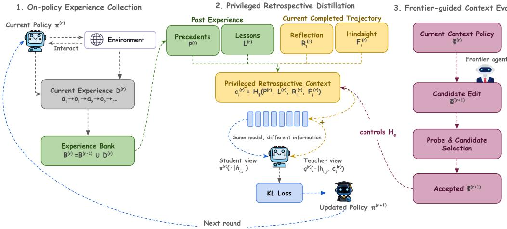
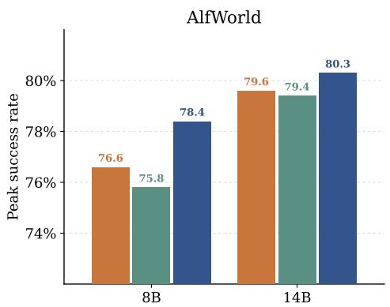
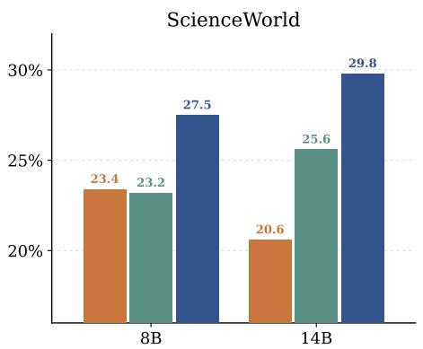
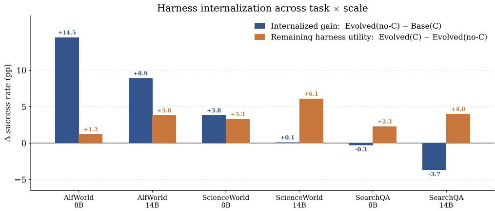
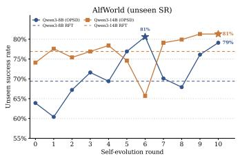
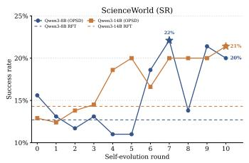
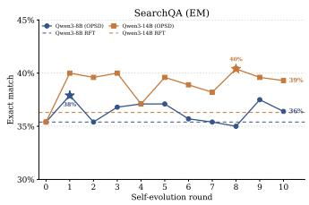
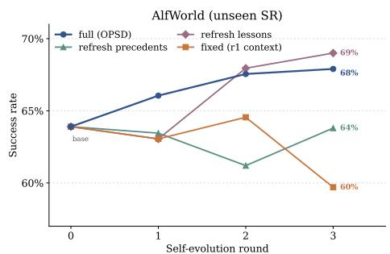

# SELF-EVOLVING AGENTS THROUGH PRIVILEGED RET-ROSPECTIVE DISTILLATION

Yuhang Zhou Yifan Wu Bo Peng Mingyi Wang Jiayi Liu Xiangjun Fan Lizhu Zhang Zhuokai Zhao

Meta AI {zyhang, zhuokai}@meta.com

## ABSTRACT

Self-evolving agents aim to improve from their own experience rather than remaining fixed once deployed. In practice, however, naturally collected agent trajectories often lack ground-truth solutions or verifier-derived rewards, making them difficult to learn from. We observe that these trajectories become substantially more informative in retrospect. When the agent takes an action, it knows only what has happened so far, but looking back after the trajectory ends, the same action can be judged with knowledge the agent lacked at that moment, including how the environment responded afterward and how related tasks in its accumulated experience succeeded or failed. Based on this observation, we introduce Retrospective Self-Distillation (RSD), a multi-round self-evolution framework in which the same model, given privileged retrospective context built from its own experience, acts as a teacher that re-scores its own actions, and the resulting distribution is distilled back into the policy through on-policy self-distillation. The privileged context combines cross-task precedents and lessons with turn-level reflection and future hindsight, allowing both successful and imperfect trajectories to provide dense supervision. RSD is also built to make this supervision improve alongside the agent. Every round, precedents and lessons are re-derived from the experience bank enlarged with the current policy’s trajectories, and reflection and hindsight are computed fresh for each new trajectory, so the teacher always scores the policy against its most recent experience. We further introducefrontier-guided contextpolicy evolution, in which a stronger frontier model proposes edits to the context construction rules, for example how many precedents to retrieve or which components to include. Across ALFWorld, ScienceWorld, and SearchQA with Qwen3-8B and 14B, RSD improves performance by up to 59.7% relative over the base model, and frontier-guided context-policy evolution adds up to a further 44.7% relative improvement over a fixed context policy. These results show that agents can convert naturally accumulated experience into persistent model capability without ground-truth trajectories or verifier-derived rewards for the core policy update.

## 1 INTRODUCTION

Large language model (LLM) agents are increasingly capable of interacting with complex environments and completing multi-turn tasks. Yet the substantial interaction experience an agent accumulates during use rarely makes it better at future tasks, and this has motivated growing interest in self-evolving agents, which aim to establish a closed-loop dataflywheel where the current policy generates on-policy interaction experience, learns from that experience, and produces increasingly useful data in subsequent rounds (Gao et al., 2025). Prior approaches pursue this goal along two lines. One evolves non-parametric components such as prompts, workflows, memory, or tools (Hu et al., 2025; Hao et al., 2026a). Experience improves future behavior in these systems, but the acquired capability is stored in the evolving scaffold rather than in the model, whose parameters remain fixed (Lee et al., 2026). The other line adapts model parameters using successful trajectories, supervised learning, or reinforcement learning (Zhai et al., 2025; Meng et al., 2026). The improvement then persists in the model itself, but the update typically assumes supervision, such as verified successful trajectories or reliable rewards, that may not be naturally available during agent interaction.

In practical settings, each task may yield only a single on-policy trajectory, without a ground-truth trajectory specifying what the agent should have done or a reliable verifier providing rewards for policy optimization. Conventional supervised fine-tuning therefore lacks direct target sequences, while verifier-based reinforcement learning requires reliable rewards and may be sample-inefficient when successful behavior must be discovered through additional exploration (Wu et al., 2026a). Restricting training to successful trajectories further discards much of the already collected experience, including failures that may contain informative environment feedback. This raises a central question: How can an agent continuously improve from its accumulated interaction experience without requiring ground-truth trajectories or verifier-derived rewardsfor policy optimization?

Our key observation is that although such trajectories may lack explicit training targets, they become substantially more informative after the interaction has completed. For the current task, downstream environment observations reveal the consequences of earlier decisions and provide hindsight unavail able when those actions were taken. Across tasks, accumulated past experience provides concrete precedents, reusable strategies, and recurring failure patterns.

Based on this observation, we introduce RSD, a multi-round self-evolution framework that couples on-policy experience collection with privileged retrospective distillation. At each round, the current policy generates new trajectories and incorporates them into an accumulated experience bank. For every interaction turn, RSD then constructs a privileged retrospective view of the agent’s decision, combining precedents retrieved from related past experience, lessons distilled from accumulated successes and failures, reflection on the current decision, and future hindsight from downstream interaction and environment feedback. This information asymmetry, between what the agent saw when acting and what is available afterward, naturally matches on-policy self-distillation (OPSD) (Zhao et al., 2026): the same underlying model acts as both student and teacher, while the teacher additionally conditions on privileged information unavailable to the student during rollout. Existing formulations construct this privileged view from ground-truth solutions (Zhao et al., 2026; Xu et al., 2026), whereas RSD draws it entirely from the agent’s own evolving interaction experience. The privileged teacher retrospectively re-scores the student’s realized actions under this richer view, and the resulting supervision is distilled back into the policy. As this process repeats, the model, its on-policy experience, and the privileged context constructed from that experience evolve together. We further explore a stronger-access extension, frontier-guided context-policy evolution, in which a frontier model also adapts how privileged context is constructed, yielding a self-evolution loop over both model capability and retrospective supervision.

We evaluate RSD with Qwen3-8B and Qwen3-14B (Yang et al., 2025a) across ALFWorld (Shridhar et al., 2020), ScienceWorld (Wang et al., 2022), and SearchQA (Jin et al., 2025). RSD achieves up to a 59.7% relative improvement over the base model, while frontier-guided context-policy evolution provides a further relative gain of up to 44.7% over the fixed context policy. We also find strong gains on ALFWorld, whereas SearchQA remains within a narrow performance band across rounds, providing a complementary boundary case for behavioral self-evolution.

Our main contributions are threefold:

• We formulate a practical self-evolving setting that turns naturally generated on-policy interaction experience into a recurrent data flywheel without requiring ground-truth trajectories or verifierderived rewards for the core policy update.

• We introduce privileged retrospective distillation from accumulated experience and trajectory hindsight, and further extend it with frontier-guided context-policy evolution so that both the model and its retrospective supervision can evolve across rounds.

• Across ALFWorld, ScienceWorld, and SearchQA with Qwen3-8B and Qwen3-14B, RSD achieves up to 59.7% relative improvement over the base model, while frontier-guided context-policy evolution yields up to an additional 44.7% relative gain over the fixed context policy.

## 2 PRELIMINARIES

## 2.1 SELF-EVOLVING AGENTS

We consider a multi-turn agent that improves through a sequence of self-evolution rounds. At round $r ,$ the agent is parameterized by a policy $\pi ^ { ( r ) }$ . Given a task x, the agent interacts with the environment over multiple turns. At turn $i ,$ it observes the interaction history $h _ { i }$ and generates an action $a _ { i } \sim \pi ^ { ( r ) } ( \cdot \mid h _ { i } )$ , after which the environment returns a new observation $o _ { i + 1 }$ . The resulting trajectory is denoted as

$$
\tau = ( x , o _ { 1 } , a _ { 1 } , o _ { 2 } , a _ { 2 } , \ldots , o _ { T + 1 } ) , \qquad \tau \sim \pi ^ { ( r ) } .
$$

Collecting trajectories over a set of tasks produces the round-r on-policy experience $\mathcal { D } ^ { ( r ) }$

We focus on a practical self-evolution setting in which each sampled task produces a single on-policy trajectory, rather than repeated attempts followed by success-based selection. We further assume no ground-truth trajectories or verifier-derived rewards for policy optimization, requiring the agent to extract useful supervision directly from its naturally collected interaction experience.

A self-evolving agent iteratively updates its policy using experience generated by its current policy,

$$
\pi ^ { ( r + 1 ) } = \mathcal { U } \Big ( \pi ^ { ( r ) } , \mathcal { D } ^ { ( r ) } \Big ) , \qquad \mathcal { D } ^ { ( r ) } \sim \pi ^ { ( r ) } ,\tag{1}
$$

where $\mathcal { U }$ denotes a generic self-improvement procedure. Because $\pi ^ { ( r + 1 ) }$ induces a new interaction distribution, subsequent rounds continuously generate new on-policy experience for further improvement. This iterative coupling between policy evolution and experience generation provides the basis for a self-evolving data flywheel. In the following, we instantiate U using on-policy self-distillation.

## 2.2 ON-POLICY SELF-DISTILLATION

On-policy self-distillation (OPSD) learns from trajectories generated by the current policy rather than from a fixed offline dataset. The policy $\pi ^ { ( r ) }$ generates an on-policy trajectory $\tau \sim \pi ^ { ( r ) }$ . OPSD uses the same underlying model to instantiate both student and teacher, with the teacher additionally receiving privileged context unavailable when the action was generated. For a multi-turn agent, this privileged information is constructed at the turn level. Let $c _ { i } ^ { ( r ) }$ denote the privileged context for interaction turn $i ,$ and let $h _ { i , j }$ denote the interaction history together with the generated action prefix preceding token $j$ at that turn. The corresponding student and teacher distributions are

$$
\pi ^ { ( r ) } ( \cdot \mid h _ { i , j } ) \qquad \mathrm { a n d } \qquad q ^ { ( r ) } ( \cdot \mid h _ { i , j } , c _ { i } ^ { ( r ) } ) ,
$$

respectively, where $\pi ^ { ( r ) }$ and $q ^ { ( r ) }$ represent the unprivileged and privileged views of the same underlying model. The student is then trained to match the privileged teacher distribution on its own on-policy states. Aggregating token-level supervision across interaction turns gives

$$
\mathcal { L } _ { \mathrm { O P S D } } ^ { ( r ) } = \mathbb { E } _ { \tau \sim \pi ^ { ( r ) } } \left[ \sum _ { i } \sum _ { j } D _ { \mathrm { K L } } \left( q ^ { ( r ) } ( \cdot \mid h _ { i , j } , c _ { i } ^ { ( r ) } ) \parallel \pi _ { \theta } ( \cdot \mid h _ { i , j } ) \right) \right] .\tag{2}
$$

Here $\pi _ { \theta }$ denotes the student under optimization, initialized from $\pi ^ { ( r ) }$ . The sampled trajectories and the teacher distribution $q ^ { ( r ) }$ are held fixed during the update, and the updated student is taken as $\pi ^ { ( r + 1 ) }$ for the next round. Because supervision is evaluated directly on the states visited by the current policy, OPSD can learn from imperfect and unsuccessful trajectories without requiring a ground-truth action sequence for each state.

## 3 RETROSPECTIVE SELF-DISTILLATION (RSD)

Our goal is to build a self-evolving training pipeline in which an agent repeatedly generates on-policy interaction experience, learns from that experience, and uses the improved policy to produce increasingly useful data in subsequent rounds. In the absence of ground-truth trajectories or reliable verifier-derived rewards, however, it is difficult to directly convert these rollouts into supervision through conventional supervised fine-tuning (SFT) or reward-based reinforcement learning (RLVR). Nevertheless, the collected experience contains rich information that becomes available retrospectively: for the current task, the completed trajectory provides downstream environment feedback and interaction outcomes, while previous tasks contribute accumulated successful and failed experiences. These signals provide a richer view of the agent’s behavior than was available at action time.

  
Figure 1: Overview of RSD. At self-evolution round $r ,$ the current policy $\pi ^ { ( r ) }$ first collects on-policy interaction experience, which is incorporated into the accumulated experience bank. Privileged retrospective context is then constructed from past experience: precedents and lessons, together with reflection and future hindsight from the completed current trajectory. The same underlying model retrospectively re-scores the student’s realized actions under this privileged view, and the resulting distribution is distilled back into the student to obtain $\pi ^ { ( r + 1 ) }$ . Repeating this process jointly evolves the policy, accumulated experience, and retrospective supervision. In the stronger-access extension, a frontier model additionally adapts the context-construction policy $\phi ^ { ( r ) }$ across rounds.

This observation naturally motivates OPSD. Rather than requiring an external target trajectory or scalar reward, we construct privileged retrospective context from the agent’s accumulated experience and use it to re-score the agent’s own on-policy trajectory. The resulting privileged teacher distribution provides dense supervision on exactly the states visited by the current policy, which is then distilled back into the agent to produce the next generation. As this process repeats, the evolving policy generates new experience that refreshes the privileged context, forming a data flywheel between model capability, interaction experience, and retrospective supervision. Algorithm 1 in Appendix C summarizes the complete agent self-evolving procedure.

## 3.1 SELF-EVOLUTION THROUGH PRIVILEGED RETROSPECTIVE DISTILLATION

An overview of the complete self-evolution framework is shown in Fig. 1. Our self-evolution pipeline alternates between on-policy experience collection and model update across rounds. We use this round-based design so that each update is trained on trajectories sampled from a fixed current policy, after which the updated policy generates a refreshed on-policy distribution for the next round. At round $^ { r , }$ the current policy $\pi ^ { ( r ) }$ interacts with the environment and collects a new trajectory set $\mathcal { D } ^ { ( r ) }$ We maintain an experience bank $\boldsymbol { B } ^ { ( r ) }$ containing all trajectories accumulated up to and including round $r ,$ including both successful and failed interactions:

$$
\begin{array} { r } { \boldsymbol B ^ { ( r ) } = \boldsymbol B ^ { ( r - 1 ) } \cup \mathcal { D } ^ { ( r ) } , \qquad \boldsymbol B ^ { ( 0 ) } = \boldsymbol \varnothing . } \end{array}\tag{3}
$$

Thus, $\mathcal { D } ^ { ( r ) }$ represents the newly collected on-policy experience at round $r ,$ while $\boldsymbol { B } ^ { ( r ) }$ provides the accumulated experience available for retrospective supervision in that round.

Privileged Retrospective Context. For each trajectory $\tau \in \mathcal { D } ^ { ( r ) }$ and interaction turn $i ,$ we construct turn-level privileged contex

$$
\begin{array} { r } { c _ { i } ^ { ( r ) } = \mathcal { H } \left( P ^ { ( r ) } , L ^ { ( r ) } , R _ { i } ^ { ( r ) } , F _ { i } ^ { ( r ) } \right) , } \end{array}\tag{4}
$$

where precedents $P ^ { ( r ) }$ and lessons $L ^ { ( r ) }$ are derived from the accumulated experience, while reflection $R _ { i } ^ { ( r ) }$ andfuture hindsight $F _ { i } ^ { ( r ) }$ exploit information available after completing the current trajectory.

Precedents provide concrete prior experiences that demonstrate useful behaviors for solving related tasks. We first apply task-specific heuristics to identify useful trajectories from $\boldsymbol { B } ^ { ( r ) }$ , rank the resulting candidates by content-token overlap with the current task goal, and retrieve the top-n as precedents (see Appendix B for retrieval details). These precedents complement the current trajectory with transferable action patterns observed in previous interactions.

Lessons provide a more abstract view of accumulated experience. For each task type, we expose selected successful and failed experiences of that type from $\boldsymbol { B } ^ { ( r ) }$ to the current policy model and ask it to summarize reusable strategies and recurring failure patterns. The lesson summary is generated once per task type and round; we suppress the task-type index for notational simplicity: $L ^ { ( r ) } = \bar { \mathrm { S u m m a r i z e } } _ { \pi ^ { ( r ) } } \bar { \big ( } B ^ { ( r ) } \bar { \big ) }$ . Unlike precedents, lessons compress experience into reusable abstractions and allow unsuccessful trajectories to contribute even when they are unsuitable as concrete demonstrations.

The remaining two components are constructed retrospectively from the current trajectory. At each turn $i ,$ the current policy model produces a reflection $R _ { i } ^ { ( r ) } = \mathrm { R e f l e c t } _ { \pi ^ { ( r ) } } ( h _ { i } , \tau )$ , which uses the completed interaction to diagnose the realized decision and summarize what could have been done more effectively. We further provide future hindsight $F _ { i } ^ { ( r ) } = \tau _ { > i }$ , which directly exposes the downstream interaction following turn $i ,$ including subsequent environment feedback and outcome information. Together, the four components provide the teacher with complementary cross-trajectory experience and within-trajectory hindsight that were unavailable to the acting policy at generation time. The corresponding generation prompts are provided in Appendix E.

Retrospective Distillation. Given $c _ { i } ^ { ( r ) }$ , we optimize the student using the OPSD objective in Eq. 2. For every action token $j$ at turn $i ,$ the teacher conditions on $( h _ { i , j } , c _ { i } ^ { ( r ) } )$ , whereas the student observes only $h _ { i , j }$ . The teacher retrospectively re-scores the student’s realized trajectory rather than generating a replacement trajectory, thereby providing dense supervision directly over the states visited by $\pi ^ { ( r ) }$ After distillation, the updated student becomes $\pi ^ { ( r + \bar { 1 } ) }$ and is used to collect $\mathcal { D } ^ { ( r + 1 ) }$

Self-Evolution Flywheel. The interaction between policy evolution and experience accumulation forms a recurrent data flywheel. At each round, $\pi ^ { ( r ) }$ generates new trajectories $\mathcal { D } ^ { ( r ) }$ , which expand the experience bank to $\boldsymbol { B } ^ { ( r ) }$ through Eq. 3 and refresh the precedents $P ^ { ( r ) }$ and lessons $L ^ { ( r ) }$ used for retrospective supervision. Meanwhile, each newly collected trajectory provides fresh reflection $R _ { i } ^ { ( r ) }$ and future hindsight $F _ { i } ^ { ( r ) }$ for its own retrospective supervision. The resulting privileged context in Eq. 4 is distilled back into the policy, closing the flywheel between model evolution, accumulated experience, and privileged retrospective supervision.

## 3.2 FRONTIER-GUIDED CONTEXT-POLICY EVOLUTION

The self-evolution procedure above continually refreshes the contents of privileged context as new experience enters the bank, while keeping the context-construction rule H fixed. However, the most useful way to construct privileged supervision may itself change as the agent evolves. We therefore consider a stronger-access setting that assumes access to both a frontier model and an executable verifier or environment metric, and uses them to optimize the context-construction policy. Note that this external verifier is used only to evaluate context-policy candidates and their realized post-training performance; it does not provide rewards for optimizing the agent parameters, which continue to be updated solely through OPSD.

We parameterize the fixed privileged-context constructor $\mathcal { H }$ in Eq. 4 by a context policy $\phi ^ { ( r ) }$ , yielding $\mathcal { H } _ { \phi ^ { ( r ) } }$ . The policy $\phi ^ { ( r ) }$ controls how the privileged information sources are selected, composed, and injected into the teacher context. We represent $\phi ^ { ( r ) }$ as a declarative configuration over a constrained set of editable context choices, including precedent count and retrieval strategy, lesson usage, reflection, future hindsight, and the position at which privileged information is injected into the teacher context. The frontier model may modify only these whitelisted choices, without modifying the model weights or training procedure.

Frontier-Guided Proposal. After completing evolution round r, the frontier model receives a compact summary of the current training state, including the current context policy, checkpoint task performance, and teacher re-scoring statistics such as correction rate, teacher entropy, and top-k hit rate, with detailed definitions in Appendix D.6. Based on these diagnostics, it proposes a small set of candidate edits to $\phi ^ { ( r ) }$ . To ground this search in empirical feedback, each candidate is evaluated with a lightweight no-training probe: we instantiate the candidate privileged context on a small training-distribution slice, provide it to the current model at inference time, and measure the corresponding task performance without updating model parameters. The frontier model observes these probe scores and selects a candidate $\bar { \tilde { \phi } } ^ { ( r + 1 ) }$ for the subsequent self-evolution round.

Retrospective Acceptance. The selected candidate $\tilde { \phi } ^ { ( r + 1 ) }$ is then used to construct privileged supervision during the subsequent full self-evolution round. After training, we evaluate the resulting checkpoint using the actual environment metric. The proposed context policy is retained if its posttraining performance is no worse than the best previously accepted configuration (up to a tolerance ϵ); otherwise, the context policy reverts to the last accepted configuration:

$$
\phi ^ { ( r + 1 ) } = \left\{ \begin{array} { l l } { { \tilde { \phi } ^ { ( r + 1 ) } , } } & { { m ^ { ( r + 1 ) } \geq m _ { \mathrm { b e s t } } ^ { ( r ) } - \epsilon , } } \\ { { \phi _ { \mathrm { b e s t } } ^ { ( r ) } , } } & { { \mathrm { o t h e r w i s e } , } } \end{array} \right.\tag{5}
$$

where $m ^ { ( r + 1 ) }$ denotes the realized post-training environment performance. Only the context policy is reverted; the model parameters continue evolving across rounds.

Joint Evolution of Model and Context Policy. The frontier-guided extension therefore adds a second adaptive process to the self-evolution flywheel. The core procedure evolves the model and the privileged information available from accumulated experience, while frontier guidance additionally evolves how that information is selected and organized:

$$
\pi ^ { ( r ) } \to \pi ^ { ( r + 1 ) } , \qquad \mathcal { B } ^ { ( r ) } \to \mathcal { B } ^ { ( r + 1 ) } , \qquad \phi ^ { ( r ) } \to \phi ^ { ( r + 1 ) } .
$$

This allows the retrospective supervision mechanism itself to adapt to the evolving agent rather than relying on a single hand-designed context policy throughout training.

## 4 EXPERIMENTS

## 4.1 EXPERIMENTAL SETUP

Models. We conduct experiments with Qwen3-8B and Qwen3-14B (Yang et al., 2025a) as the base agent models to study self-evolution across model scales. For frontier-guided context-policy evolution, we use Claude-Opus-4.8 (Anthropic, 2026) as the frontier model that proposes constrained modifications to the privileged harness configuration. We access Claude through OpenCode (Open-Code Contributors, 2026), which serves as the coding and orchestration harness for generating and applying the proposed configuration edits.

Benchmarks and Evaluation Metrics. We evaluate RSD on three agent benchmarks: ALF-World (Shridhar et al., 2020), ScienceWorld (Wang et al., 2022), and SearchQA (Jin et al., 2025). Together, these benchmarks span embodied household interaction, scientific reasoning and environment manipulation, and search-based question answering, providing diverse settings for evaluating iterative agent self-evolution. For ALFWorld, we report success rate (SR) on the valid seen and valid unseen splits. For ScienceWorld, we report task success rate (SR) on the development set. For SearchQA, we report exact match (EM). Additional evaluation details are provided in Appendix B.

Baselines. We compare RSD against several representative adaptation and self-improvement baselines. Base model (Base) directly evaluates the pretrained agent without additional adaptation, while Rejection Sampling Fine-Tuning (RFT) (Yuan et al., 2023) fine-tunes the model on its own successful trajectories. Ground-Truth Supervised Fine-Tuning (GT-SFT) provides an oracle-supervision reference by fine-tuning on ground-truth trajectories, while Self-Taught Reasoner (STaR) (Zelikman et al., 2022) iteratively improves the model using self-generated successful trajectories. We additionally consider BoN-16+SFT, which samples 16 candidate trajectories per training instance, selects successful trajectories using ground truth, and fine-tunes on the resulting data. We further compare against Group Relative Policy Optimization (GRPO) (Shao et al., 2024), which performs verifier-based reinforcement learning when an executable reward is available, and Ground-Truth On-Policy Self-Distillation (GT-OPSD) (Zhao et al., 2026), which replaces our privileged context with gold-reference agent trajectories during distillation. For test-time adaptation, we include Reflexion@2 (Shinn et al., 2023), which allows a second attempt conditioned on reflection from the preceding interaction, and Harness-at-Inference (Harness@Inf), which directly supplies the privileged context to the base model without post-training.

<table><tr><td rowspan="2">Method</td><td colspan="2">ALFWorld (SR)</td><td colspan="2">ScienceWorld (SR)</td><td colspan="2">SearchQA (EM)</td></tr><tr><td>Qwen3-8B</td><td>Qwen3-14B</td><td>Qwen3-8B</td><td>Qwen3-14B</td><td>Qwen3-8B</td><td>Qwen3-14B</td></tr><tr><td>Base</td><td>62.9</td><td>69.3</td><td>15.6</td><td>12.9</td><td>35.4</td><td>35.4</td></tr><tr><td>RFT</td><td>66.9</td><td>71.0</td><td>12.7</td><td>14.3</td><td>35.4</td><td>36.3</td></tr><tr><td>GT-SFT</td><td>34.1</td><td>42.7</td><td>11.6</td><td>13.4</td><td>34.7</td><td>35.2</td></tr><tr><td>STaR</td><td>65.3</td><td>77.8</td><td>12.7</td><td>13.6</td><td>34.4</td><td>37.6</td></tr><tr><td>BoN-16+SFT</td><td>71.6</td><td>77.7</td><td>20.8</td><td>20.4</td><td>29.7</td><td>35.5</td></tr><tr><td>GRPO</td><td>75.5</td><td>82.6</td><td></td><td></td><td>37.3</td><td>37.3</td></tr><tr><td>GT-OPSD</td><td>70.1</td><td>82.5</td><td>3.0</td><td>3.0</td><td>37.1</td><td>38.5</td></tr><tr><td>Reflexion@2</td><td>76.0</td><td>76.7</td><td>17.8</td><td>18.5</td><td>37.1</td><td>38.1</td></tr><tr><td>Harness@Inf</td><td>65.4</td><td>72.0</td><td>19.6</td><td>20.5</td><td>37.7</td><td>41.4</td></tr><tr><td>RSD</td><td>76.6</td><td>79.6</td><td>23.4</td><td>20.6</td><td>37.9</td><td>38.7</td></tr></table>

Table 1: Main results across ALFWorld, ScienceWorld, and SearchQA. For ALFWorld, SR is averaged over the valid-seen and valid-unseen splits, while for SearchQA, EM is averaged across the evaluated sub-datasets. Results are averaged over three seeds. Bold denotes the best result and underline denotes the second-best result in each setting.

Implementation Details. We run self-evolution for 10 rounds, sampling 200 unique training instances in each round, and optimize the model using full-parameter forward-KL distillation with a learning rate of $3 \times 1 0 ^ { - 6 }$ . Unless otherwise specified, RSD is evaluated using the evolved student alone without privileged context at inference time; additional training, decoding, and task-specific implementation details are provided in Appendix B.

## 4.2 MAIN RESULTS

Table 1 summarizes the main results across three benchmarks and two model scales. Overall, RSD consistently improves over the corresponding base models and outperforms the evaluated self-training baselines across all six model–benchmark settings. On ALFWorld-8B, RSD achieves an average SR of 76.6, compared with 62.9 for Base, 66.9 for RFT, 65.3 for STaR, and 71.6 for BoN-16+SFT. The gains are particularly pronounced on ScienceWorld, where RSD improves from 15.6 to 23.4 at 8B and from 12.9 to 20.6 at 14B, while even BoN-16+SFT reaches only 20.8 and 20.4 despite substantially increasing rollout exploration. These results suggest that increasing search for successful trajectories and subsequently fine-tuning on the selected experience does not by itself recover the benefit of privileged retrospective distillation. In contrast, SearchQA exhibits a relatively narrow performance range across methods. Our later analyses provide a consistent picture: performance remains largely flat across self-evolution rounds (Fig. 4), teacher corrections remain moderate but comparatively stable (Appendix D.6), and privileged context retains inference-time utility without being effectively internalized into the evolved model (Appendix D.2). This suggests that the SearchQA boundary case reflects limited capacity to convert the available retrospective signal into persistent behavioral improvement, rather than simply an absence of useful contextual information.

Comparison with Reward-Driven and Oracle Baselines. RSD remains competitive with methods that rely on substantially stronger supervision. On ALFWorld-14B, GRPO and GT-OPSD achieve

82.6 and 82.5 SR, respectively, compared with 79.6 for RSD. However, GRPO relies on environment rewards and multiple grouped rollouts for policy optimization, substantially increasing rollout cost, while GT-OPSD explicitly conditions the teacher on a ground-truth successful agent trajectory. In contrast, RSD learns from the agent’s own interaction experience through privileged retrospective context, without requiring oracle demonstrations or reward-driven group optimization. Notably, RSD achieves the best result on ALFWorld-8B and substantially outperforms the supervised baselines on ScienceWorld at both model scales.

Beyond Test-Time Adaptation. We further compare against Reflexion@2, which allows a second attempt conditioned on reflection from the preceding interaction, and Harness@Inf, which directly provides privileged context to the base model at inference time without updating model parameters. Under the standard single-attempt evaluation protocol, RSD achieves higher point estimates than Reflexion@2 across all six model–benchmark settings and matches or exceeds Harness@Inf in five of six settings. For example, on ScienceWorld-8B, Reflexion@2 and Harness@Inf achieve 17.8 and 19.6 SR, respectively, compared with 23.4 for RSD. These results indicate that privileged retrospective supervision can be internalized into persistent model capability rather than remaining dependent on additional test-time adaptation. A four-condition analysis comparing base and evolved models with and without privileged context further examines the extent of this internalization across tasks and model scales (Appendix D.2). SearchQA-14B provides an important boundary case, where Harness@Inf reaches 41.4 compared with 38.7 for RSD, suggesting that some contextual information remains complementary to the model rather than being fully internalized.

Round-by-round trajectories show progressive self-evolution on ALFWorld and ScienceWorld, while SearchQA remains comparatively flat; full trajectories are provided in Appendix D.3.

## 5 ANALYSIS

## 5.1 ABLATION STUDIES

Table 2 studies the contribution of different components in the privileged context. On ALFWorld, removing lessons, reflection, or future hindsight each reduces SR by roughly five points, while removing precedents has only a minor effect.

ScienceWorld exhibits a different pattern: removing precedents decreases SR from 23.4 to 15.1, nearly returning to the Base performance of 15.6, while removing future also causes a substantial drop to 17.6. In comparison, lessons and reflection provide smaller gains on ScienceWorld. To examine the source of the lesson signal, we construct lessons from successful or failed trajectories only. Restricting lessons to either successful or failed trajectories yields lower performance than the default main-result reference, suggesting that both sources may provide useful retrospective information (Appendix D.4). These results indicate that different environments benefit from different forms of privileged information, with trajectory-specific hindsight being more important on

<table><tr><td>Variant</td><td></td><td>ALFWorld ScienceWorld</td></tr><tr><td>Full</td><td>76.6</td><td>23.4</td></tr><tr><td>– Precedents</td><td>75.0</td><td>15.1</td></tr><tr><td>– Lessons</td><td>71.6</td><td>22.7</td></tr><tr><td>- Reflection</td><td>71.4</td><td>21.8</td></tr><tr><td>– Future</td><td>71.4</td><td>17.6</td></tr></table>

Table 2: Ablation of privileged-context components on 8B. Different tasks rely on different privileged signals: generated hindsight components dominate on ALFWorld, whereas precedents are essential on ScienceWorld.

ALFWorld and transferable precedents being important on ScienceWorld.

## 5.2 EFFECT OF CONTEXT EVOLUTION

We next examine whether evolving the privileged context with newly collected experience is itself important for continued self-evolution (Fig. 5). Starting from the same base checkpoint, we compare the standard evolving-context configuration against variants that update only lessons, update only precedents, or freeze the round-1 context. By round 3, the full configuration reaches 67.9 SR on ALFWorld, while updating lessons alone reaches 69.0, updating precedents alone reaches 63.8, and freezing the round-1 context drops to 59.7. These results show that repeatedly training against stale retrospective context limits continued improvement, while refreshing the supervision with newly collected experience supports self-evolution. Full evolution trajectories are provided in Appendix D.7.

Fixed Random Frontier

  
Figure 2: Performance of fixed, random, and frontier-guided context-policy evolution on ALFWorld and ScienceWorld. The frontier variant uses a frontier model to propose context-policy edits, with candidate selection guided by a no-training privileged-context-at-inference probe. We report success rate over self-evolution rounds for each task and model scale.

## 5.3 FRONTIER-GUIDED CONTEXT-POLICY EVOLUTION

We next study a stronger-access extension in which privileged-context construction is itself optimized by a frontier model. In this setting, we assume access to both a frontier model and an executable environment metric, which together enable an outer-loop search over context-construction policies. At each round, the frontier model proposes a small YAML edit to the privileged-context policy from a constrained whitelist of editable knobs. Candidate selection is performed using a cheap no-training privileged-context-at-inference probe, while retrospective acceptance or rejection is determined only after a full self-evolution round using the realized environment performance. We compare this frontier-guided setting against two controls: Fixed, which keeps the canonical privileged-context policy unchanged throughout training, and Random, which explores the same edit space under the same edit budget but without frontier guidance.

Frontier Guidance Improves Context Evolution. As shown in Fig. 2, frontier-guided contextpolicy evolution yields the clearest gains on ScienceWorld, where it improves SR from 23.4 to 27.5 at 8B and from 20.6 to 29.8 at 14B relative to the fixed policy, and also outperforms random search at both scales. On ALFWorld, the gains are smaller but still positive, with SR improving from 76.6 to 78.4 at 8B and from 79.6 to 80.3 at 14B. This pattern suggests that frontier-guided context optimization is most useful when privileged-context construction has substantial headroom, while remaining competitive in the more saturated ALFWorld regime. We therefore focus the frontier-guided study on ALFWorld and ScienceWorld, where the preceding analyses reveal clearer self-evolution and context-construction headroom. SearchQA serves instead as a complementary boundary case, where self-evolution remains limited and privileged context shows little evidence of persistent internalization into the model (Appendix D.2; Appendix D.6). Ablations further show that the no-training probe is important for effective candidate selection; detailed probe construction and validation are provided in Appendix D.8. Across independent runs, the frontier also discovers systematic task-relevant context-policy adaptations; we analyze these retained edits and provide a representative evolution trajectory in Appendix D.9.

## 6 CONCLUSION

We study self-evolving language agents that improve from their own on-policy interaction experience without requiring ground-truth trajectories or verifier-derived rewards for the core policy update. We introduce RSD, which constructs privileged retrospective context from accumulated experience and trajectory hindsight, and distills this richer view back into the policy through on-policy selfdistillation. Across multiple agent benchmarks and model scales, RSD consistently improves over the corresponding base models. Our ablation and context-evolution analyses further show that different privileged signals contribute complementary information and that continually refreshing the retrospective context is important for sustained self-evolution. We additionally introduce frontierguided context-policy evolution, allowing the construction of privileged supervision itself to adapt as the agent evolves. Together, these results demonstrate a practical data flywheel in which model capability, accumulated experience, and retrospective supervision improve jointly across rounds.

## AI USE STATEMENT

Generative AI tools were used for language polishing, proofreading, and assistance with coding during the preparation of this work. All AI-assisted text and code were reviewed, verified, and, where necessary, revised by the authors. We take responsibility for the final content of this work, including all text, claims, analyses, code, and other artifacts produced with the aid of generative AI.

## REFERENCES

Rishabh Agarwal, Nino Vieillard, Yongchao Zhou, Piotr Stanczyk, Sabela Ramos Garea, Matthieu Geist, and Olivier Bachem. On-policy distillation of language models: Learning from selfgenerated mistakes. In The twelfth international conference on learning representations, 2024.

Anthropic. Introducing claude opus 4.8. https://www.anthropic.com/news/ claude-opus-4-8, May 2026. Product announcement.

Zihao Cheng, Zeming Liu, Yingyu Shan, Xinyi Wang, Xiangrong Zhu, Yunpu Ma, Hongru Wang, Yuhang Guo, Wei Lin, and Yunhong Wang. Mem2evolve: Towards self-evolving agents via co-evolutionary capability expansion and experience distillation. In Proceedings of the 64th Annual Meeting of the Association for Computational Linguistics (Volume 1: Long Papers), pp. 20784–20831, 2026.

Huan-ang Gao, Jiayi Geng, Wenyue Hua, Mengkang Hu, Xinzhe Juan, Hongzhang Liu, Shilong Liu, Jiahao Qiu, Xuan Qi, Yiran Wu, et al. A survey of self-evolving agents: What, when, how, and where to evolve on the path to artificial super intelligence. arXiv preprint arXiv:2507.21046, 2025.

Guangya Hao, Yunbo Long, and Zhuokai Zhao. Self-evolving multi-agent systems via decentralized memory. arXiv preprint arXiv:2605.22721, 2026a.

Guangya Hao, Yitong Shang, Yunbo Long, Zhuokai Zhao, and Hanxue Liang. Self-policy distillation via capability-selective subspace projection. arXiv preprint arXiv:2605.22675, 2026b.

Yinghui He, Simran Kaur, Adithya Bhaskar, Yongjin Yang, Jiarui Liu, Narutatsu Ri, Liam Fowl, Abhishek Panigrahi, Danqi Chen, and Sanjeev Arora. Self-distillation zero: Self-revision turns binary rewards into dense supervision. arXiv preprint arXiv:2604.12002, 2026.

Shengran Hu, Cong Lu, and Jeff Clune. Automated design of agentic systems. In International Conference on Learning Representations, volume 2025, pp. 21344–21377, 2025.

Jonas Hubotter, Frederike L¨ ubeck, Lejs Behric, Anton Baumann, Marco Bagatella, Daniel Marta, Ido¨ Hakimi, Idan Shenfeld, Thomas Kleine Buening, Carlos Guestrin, et al. Reinforcement learning via self-distillation. arXiv preprint arXiv:2601.20802, 2026.

Bowen Jin, Hansi Zeng, Zhenrui Yue, Jinsung Yoon, Sercan Arik, Dong Wang, Hamed Zamani, and Jiawei Han. Search-r1: Training llms to reason and leverage search engines with reinforcement learning. arXiv preprint arXiv:2503.09516, 2025.

Hyunin Lee, Jinglue Xu, Jeffrey Seely, Donghyun Lee, Matei Zaharia, and Yujin Tang. Recursive harness self-improvement. arXiv preprint arXiv:2607.15524, 2026.

Zelong Li, Shuyuan Xu, Kai Mei, Wenyue Hua, Balaji Rama, Om Raheja, Hao Wang, He Zhu, and Yongfeng Zhang. Autoflow: Automated workflow generation for large language model agents. arXiv preprint arXiv:2407.12821, 2024.

Yang Meng, Zhenya Liu, Zhuokai Zhao, and Yuxin Chen. Rethinking transfer in continual learning: A replay-based realisation. arXiv preprint arXiv:2607.15587, 2026.

OpenCode Contributors. OpenCode: The open source ai coding agent. https://github.com/ anomalyco/opencode, 2026. GitHub repository, accessed August 17, 2026.

Leyi Pan, Shuchang Tao, Yunpeng Zhai, Lingzhe Zhang, Zhaoyang Liu, Bolin Ding, Aiwei Liu, and Lijie Wen. Rlcsd: Reinforcement learning with contrastive on-policy self-distillation. arXiv preprint arXiv:2606.11709, 2026.

Tao Ren, Weiyao Luo, Hui Yang, Rongzhi Zhu, Xiang Huang, Yuchuan Wu, Bingxue Chou, Jieping Ye, Jiafeng Liang, Yongbin Li, et al. Scaling self-evolving agents via parametric memory. arXiv preprint arXiv:2606.04536, 2026.

Zhihong Shao, Peiyi Wang, Qihao Zhu, Runxin Xu, Junxiao Song, Xiao Bi, Haowei Zhang, Mingchuan Zhang, YK Li, Y Wu, et al. Deepseekmath: Pushing the limits of mathematical reasoning in open language models. arXiv preprint arXiv:2402.03300, 2024.

Noah Shinn, Federico Cassano, Ashwin Gopinath, Karthik Narasimhan, and Shunyu Yao. Reflexion: Language agents with verbal reinforcement learning. Advances in neural information processing systems, 36:8634–8652, 2023.

Mohit Shridhar, Xingdi Yuan, Marc-Alexandre Cotˆ e, Yonatan Bisk, Adam Trischler, and Matthew´ Hausknecht. Alfworld: Aligning text and embodied environments for interactive learning. arXiv preprint arXiv:2010.03768, 2020.

Wangtao Sun, Xiang Cheng, Jialin Fan, Yao Xu, Xing Yu, Shizhu He, Jun Zhao, and Kang Liu. Towards agentic self-learning llms in search environment. arXiv preprint arXiv:2510.14253, 2025.

Zhengwei Tao, Ting-En Lin, Xiancai Chen, Hangyu Li, Yuchuan Wu, Yongbin Li, Zhi Jin, Fei Huang, Dacheng Tao, and Jingren Zhou. A survey on self-evolution of large language models. arXiv preprint arXiv:2404.14387, 2024.

Ruoyao Wang, Peter Jansen, Marc-Alexandre Cotˆ e, and Prithviraj Ammanabrolu. Scienceworld:´ Is your agent smarter than a 5th grader? In Proceedings of the 2022 Conference on Empirical Methods in Natural Language Processing, pp. 11279–11298, 2022.

Tianxin Wei, Noveen Sachdeva, Benjamin Coleman, Zhankui He, Yuanchen Bei, Xuying Ning, Mengting Ai, Yunzhe Li, Jingrui He, Ed H Chi, et al. Evo-memory: Benchmarking llm agent test-time learning with self-evolving memory. arXiv preprint arXiv:2511.20857, 2025.

Jinyang Wu, Shuo Yang, Zhengxi Lu, Fan Zhang, Yuhao Shen, Lang Feng, Haoran Luo, Zheng Lian, Shuai Zhang, Zhengqi Wen, et al. Seed: Self-evolving on-policy distillation for agentic reinforcement learning. arXiv preprint arXiv:2607.14777, 2026a.

Rong Wu, Xiaoman Wang, Jianbiao Mei, Pinlong Cai, Daocheng Fu, Cheng Yang, Licheng Wen, Xuemeng Yang, Yufan Shen, Yuxin Wang, et al. Evolver: Self-evolving llm agents through an experience-driven lifecycle. arXiv preprint arXiv:2510.16079, 2025.

Yifan Wu, Lizhu Zhang, Yuhang Zhou, Mingyi Wang, Bo Peng, Serena Li, Xiangjun Fan, and Zhuokai Zhao. Remember when it matters: Proactive memory agent for long-horizon agents. arXiv preprint arXiv:2607.08716, 2026b.

Jiawei Xu, Minghui Liu, Juzheng Zhang, Tom Goldstein, and Furong Huang. β-OPSD: Deriving with policy optimization, training with self-distillation. arXiv preprint arXiv:2607.28582, 2026.

An Yang, Anfeng Li, Baosong Yang, Beichen Zhang, Binyuan Hui, Bo Zheng, Bowen Yu, Chang Gao, Chengen Huang, Chenxu Lv, et al. Qwen3 technical report. arXiv preprint arXiv:2505.09388, 2025a.

Cheng Yang, Xuemeng Yang, Licheng Wen, Daocheng Fu, Jianbiao Mei, Rong Wu, Pinlong Cai, Yufan Shen, Nianchen Deng, Botian Shi, et al. Learning on the job: An experience-driven self-evolving agent for long-horizon tasks. arXiv preprint arXiv:2510.08002, 2025b.

Wenkai Yang, Weijie Liu, Ruobing Xie, Kai Yang, Saiyong Yang, and Yankai Lin. Learning beyond teacher: Generalized on-policy distillation with reward extrapolation. arXiv preprint arXiv:2602.12125, 2026.

Tianzhu Ye, Li Dong, Xun Wu, Shaohan Huang, and Furu Wei. On-policy context distillation for language models. arXiv preprint arXiv:2602.12275, 2026.

Zheng Yuan, Hongyi Yuan, Chengpeng Li, Guanting Dong, Keming Lu, Chuanqi Tan, Chang Zhou, and Jingren Zhou. Scaling relationship on learning mathematical reasoning with large language models. arXiv preprint arXiv:2308.01825, 2023.

Eric Zelikman, Yuhuai Wu, Jesse Mu, and Noah Goodman. Star: Bootstrapping reasoning with reasoning. Advances in Neural Information Processing Systems, 35:15476–15488, 2022.

Yunpeng Zhai, Shuchang Tao, Cheng Chen, Anni Zou, Ziqian Chen, Qingxu Fu, Shinji Mai, Li Yu, Jiaji Deng, Zouying Cao, et al. Agentevolver: Towards efficient self-evolving agent system. arXiv preprint arXiv:2511.10395, 2025.

Jiayi Zhang, Jinyu Xiang, Zhaoyang Yu, Fengwei Teng, Xionghui Chen, Jiaqi Chen, Mingchen Zhuge, Xin Cheng, Sirui Hong, Jinlin Wang, et al. Aflow: Automating agentic workflow generation. In International Conference on Learning Representations, volume 2025, pp. 34040–34077, 2025.

Tianyuan Zhang, Sai Bi, Yicong Hong, Kai Zhang, Fujun Luan, Songlin Yang, Kalyan Sunkavalli, William Freeman, and Hao Tan. Test-time training done right. In International Conference on Learning Representations, volume 2026, pp. 157604–157638, 2026.

Siyan Zhao, Zhihui Xie, Mengchen Liu, Jing Huang, Guan Pang, Feiyu Chen, and Aditya Grover. Self-distilled reasoner: On-policy self-distillation for large language models. arXiv preprint arXiv:2601.18734, 2026.

Yuhang Zhou, Lizhu Zhang, Yifan Wu, Mingyi Wang, Peng Bo, Jiayi Liu, Xiangjun Fan, and Zhuokai Zhao. Omniopd: Logit-free on-policy distillation via speculative verification. arXiv preprint arXiv:2606.01476, 2026.

Yuxin Zuo, Kaiyan Zhang, Li Sheng, Shang Qu, Ganqu Cui, Xuekai Zhu, Haozhan Li, Xinwei Long, Ermo Hua, Biqing Qi, et al. Ttrl: Test-time reinforcement learning. Advances in Neural Information Processing Systems, 38:131459–131483, 2026.

## APPENDIX

## A RELATED WORK

## A.1 SELF-EVOLVING LANGUAGE AGENTS

Self-evolving language agents aim to continuously improve from their own interaction experience rather than remaining fixed after post-training (Gao et al., 2025; Tao et al., 2024). One line of work primarily evolves the external agent system, including prompts, workflows, memory, tools, and other agentic structures (Hu et al., 2025; Zhang et al., 2025; Li et al., 2024; Wu et al., 2026b; Hao et al., 2026a). Automated agent-design methods search over workflow or program structures, while experience-driven agents continually refine explicit memories, reusable strategies, or dynamically constructed assets (Yang et al., 2025b; Wu et al., 2025; Wei et al., 2025; Cheng et al., 2026). These approaches demonstrate that accumulated interaction experience can improve future behavior, but much of the acquired capability remains mediated by an external scaffold rather than being persistently incorporated into the underlying policy (Lee et al., 2026).

A complementary line of work directly adapts the agent model itself. Recent approaches use online parameter updates, reinforcement learning, self-generated tasks, reward models, or hindsight supervision to internalize interaction experience into persistent model capability, reducing dependence on external scaffolds and enabling subsequent behavior to improve as new experience accumulates (Zhai et al., 2025; Sun et al., 2025; Ren et al., 2026; Wu et al., 2026a; Hao et al., 2026b; Meng et al., 2026).

While these methods move self-evolution from the scaffold toward model weights, many rely on explicit verifiers, successful trajectories, or additional exploration to determine which experience should drive learning (Zuo et al., 2026; Zhang et al., 2026). In contrast, we construct a data flywheel that does not use verifier-derived rewards for the core policy update, instead distilling privileged retrospective supervision from both the current trajectory and accumulated interactions directly into model weights, allowing the policy and its supervision to co-evolve across rounds.

## A.2 ON-POLICY DISTILLATION AND PRIVILEGED CONTEXT

On-policy distillation (OPD) addresses the train–inference mismatch of conventional knowledge distillation by training the student on trajectories sampled from its own policy, while a teacher provides dense token-level supervision on those student-visited states (Agarwal et al., 2024; Yang et al., 2026; Zhou et al., 2026). This formulation makes distillation naturally compatible with iterative policy improvement, since supervision is applied directly to the distribution induced by the evolving student. Recent work extends this idea by changing what information is available to the teacher. On-Policy Context Distillation (OPCD) conditions the teacher on additional context while the student generates without it, allowing useful in-context knowledge, such as historical solution traces or optimized prompts, to be internalized into model parameters (Ye et al., 2026). On-Policy Self-Distillation (OPSD) further removes the need for a separate teacher model: the same underlying model acts as both teacher and student, with the teacher granted privileged information unavailable to the student; existing formulations commonly construct this privileged view from ground-truth solutions (Zhao et al., 2026; Xu et al., 2026). Related self-distillation methods similarly exploit verified solutions, environment feedback, or successful rollouts as privileged signals (Hubotter et al.,¨ 2026; Pan et al., 2026; He et al., 2026; Hao et al., 2026b).

In contrast, our core method requires neither ground-truth trajectories nor verifier-derived rewards for model-parameter optimization. We construct privileged retrospective context from the agent’s own current trajectory and accumulated prior experience, and continually refresh this context as new on-policy experience is collected, coupling context evolution with model-weight evolution.

## B IMPLEMENTATION DETAILS

The prompt templates used for agent interaction, privileged-context construction, and frontier-guided context-policy evolution are provided in Appendix E.

Training Configuration. We perform self-evolution for 10 rounds and sample 200 training instances in each round. Each round starts from the checkpoint produced by the previous round, while the accumulated experience bank is carried forward across rounds. We use full-parameter fine-tuning with forward-KL top-k distillation, where k = 20, a learning rate of $3 \times 1 0 ^ { - 6 }$ , one training epoch per round, and a mini-batch size of 48. No policy-gradient term or task-reward term is included in the OPSD objective. All experiments are run on a single node with eight NVIDIA H200 GPUs.

Rollout Configuration. For ALFWorld, ScienceWorld, and SearchQA, the maximum numbers of interaction turns are 30, 15, and 15, respectively. The maximum prompt/response lengths are 4096/8192 tokens for ALFWorld, 2048/16384 for ScienceWorld, and 4096/4096 for SearchQA. Training rollout temperatures are 1.0 for ALFWorld, ScienceWorld, and SearchQA, respectively, with one rollout per training instance. The larger rollout group used by GRPO is restricted to the GRPO baseline and is not used by RSD.

Teacher and Privileged-Context Configuration. The teacher retrospectively re-scores the student’s on-policy trajectories under privileged context and provides the next-token distributions used for distillation. By default, the privileged context consists of four components: precedents, accumulated lessons, turn-level reflection, and future hindsight over the current trajectory. To construct the precedent set, we first heuristically filter candidate trajectories for successful or useful experiences. For ALFWorld and ScienceWorld, success is determined by the environment completion signal, while for SearchQA we retain answers grounded in the top retrieved passages. We then rank the retained precedents by content-token overlap with the current task goal and retrieve the top two by default (n=2). For precedent ranking, we compute content-token overlap between the current task goal and each candidate trajectory. We lowercase and tokenize the text, remove punctuation and non-content tokens such as stopwords, and rank candidates by the number of remaining tokens shared with the task goal. Lessons accumulate reusable insights from previous experience, while reflection and future hindsight provide trajectory-specific retrospective information for the current turn. Following the stabilization motivation of prior OPSD work (Zhao et al., 2026), we prevent the teacher from evolving indefinitely. The teacher initially tracks the evolving policy and is frozen at the best-so-far checkpoint once the benchmark selection metric decreases relative to its previous maximum; the frozen teacher is then used for all remaining rounds. This choice is motivated by a controlled teacher-schedule ablation in Appendix D.10: a permanently frozen teacher remains stable but exhibits limited improvement, whereas a fully evolving self-teacher reaches substantially higher performance before collapsing in later rounds. Unless otherwise specified, all reported results use these configurations.

Evaluation Protocol. For the main RSD evaluation, the evolved student is evaluated without privileged context, such that the harness is used only to construct training-time supervision. Privileged context is provided at inference time only in explicitly labeled diagnostic settings, including Harness@Inf, the internalization analysis, and frontier candidate probes. For ALFWorld, we evaluate approximately 140 valid-seen and 134 valid-unseen tasks and report success rate (SR) on both splits. For ScienceWorld, we evaluate 449 development variations and report task success rate. For SearchQA, we evaluate on the test set and report exact match (EM). Inference uses vLLM with fixed decoding settings within each benchmark.

Frontier-Guided Context-Policy Evolution. The context policy is implemented as a YAML harness configuration and restricted to a predefined whitelist of context-policy and teacher-side re-scoring parameters, including precedent count and retrieval strategy, component activation, context position, and teacher temperature. The frontier model is not permitted to modify the underlying training algorithm or context-construction code. For frontier-guided context-policy evolution, we set the retrospective acceptance tolerance to $\epsilon = 0 . 5 \%$ , such that a proposed context policy is retained when its post-training environment performance is no more than 0.5 percentage points below the best previously accepted configuration.

Baseline Implementations. We implement all comparison methods within the same training framework whenever possible and same training dataset size, changing only the optimization mode or supervision source. GRPO disables distillation and performs group-relative policy optimization with a rollout group size of 8 using environment success rewards. STaR iteratively fine-tunes the agent on its own successful trajectories. GT-SFT uses oracle successful trajectories for supervised finetuning, whereas GT-OPSD retains the same on-policy distillation objective as RSD but conditions the teacher on a gold successful trajectory instead of the experience-derived privileged context. For frontier-guided context-policy evolution, the Fixed Harness baseline keeps the canonical harness unchanged across rounds, while Random Harness samples edits from the same whitelisted YAML search space and under the same edit budget as the frontier-guided optimizer.

## C SELF-EVOLUTION ALGORITHM

Algorithm 1 summarizes the complete training procedure. The core method uses a fixed contextconstruction rule H, while the frontier-guided extension replaces it with the evolving policy $\mathcal { H } _ { \phi ^ { ( r ) } }$ described in §3.2.

Frontier-Guided Extension. For frontier-guided context-policy evolution, we replace the fixed H in Algorithm 1 with $\mathcal { H } _ { \phi ^ { ( r ) } }$ . Between self-evolution rounds, the frontier model uses the current context policy, training diagnostics, and no-training probe feedback to propose the next candidate $\tilde { \phi } ^ { ( r + 1 ) }$ . After the corresponding full training round, the candidate is retained or reverted according to Eq. 5, with $\epsilon = 0 . 5 \%$ . Only the context policy may be reverted; the updated model parameters continue to the next self-evolution round.

Algorithm 1 RSD: Self-Evolution through Privileged Retrospective Distillation   
Require: Initial policy $\pi ^ { ( 1 ) } ;$ ; task distribution $x ;$ number of rounds $R ;$ context-construction rule H   
1: Initialize experience bank $B ^ { ( 0 ) }  \varnothing$   
2: for $r = 1 , \ldots , R$ do   
3: Sample a set of tasks $\mathcal { X } ^ { ( r ) } \subset \mathcal { X }$   
4: Collect one on-policy trajectory for each task:   
${ \mathcal { D } } ^ { ( r ) } \gets \left\{ \tau \sim \pi ^ { ( r ) } ( \cdot \mid x ) : x \in \mathcal { X } ^ { ( r ) } \right\}$   
5: Update the experience bank:   
$\boldsymbol { B } ^ { ( r ) }  \boldsymbol { B } ^ { ( r - 1 ) } \cup \mathcal { D } ^ { ( r ) }$   
6: Construct task-type lesson summaries from $\boldsymbol { B } ^ { ( r ) }$   
$L ^ { ( r ) } \gets \mathrm { S u m m a r i z e } _ { \pi ^ { ( r ) } } ( B ^ { ( r ) } )$   
7: Initialize $\mathcal { L } ^ { ( r ) }  0$   
8: for each trajectory $\tau \in \mathcal { D } ^ { ( r ) }$ do   
9: Retrieve precedents $P ^ { ( r ) }$ from other tasks in $\boldsymbol { B } ^ { ( r ) }$   
10: for each interaction turn i in $\tau$ do   
11: Construct retrospective reflection:   
$R _ { i } ^ { ( r ) }  \mathrm { R e f l e c t } _ { \pi ^ { ( r ) } } ( h _ { i } , \tau )$   
12: Extract future hindsight:   
$F _ { i } ^ { ( r ) } \gets \tau _ { > i }$   
13: Construct privileged retrospective context:   
$\boldsymbol { c } _ { i } ^ { ( r ) } \gets \mathcal { H } \left( \boldsymbol { P } ^ { ( r ) } , \boldsymbol { L } ^ { ( r ) } , \boldsymbol { R } _ { i } ^ { ( r ) } , \boldsymbol { F } _ { i } ^ { ( r ) } \right)$   
14: for each token $j$ in action $a _ { i }$ do   
15: Compute privileged teacher distribution:   
$q _ { i , j } ^ { ( r ) } \gets q ^ { ( r ) } \left( \cdot \mid h _ { i , j } , c _ { i } ^ { ( r ) } \right)$   
16: Compute student distribution:   
$p _ { i , j }  \pi _ { \theta } ( \cdot \mid h _ { i , j } )$   
17: Accumulate OPSD loss:   
$\mathcal { L } ^ { ( r ) } \gets \mathcal { L } ^ { ( r ) } + D _ { \mathrm { K L } } \left( q _ { i , j } ^ { ( r ) } \parallel p _ { i , j } \right)$   
18: end for   
19: end for   
20: end for   
21: Update the student on its own on-policy states:   
$\pi ^ { ( r + 1 ) }  \arg \operatorname* { m i n } _ { \pi _ { \theta } } \mathcal { L } ^ { ( r ) }$   
22: end for   
23: return $\pi ^ { ( R + 1 ) }$

## D SUPPLEMENTARY RESULTS

## D.1 REFLEXION TEST-TIME SCALING

To examine the effect of additional test-time interaction, we evaluate Reflexion with one, two, and three sequential attempts. Each subsequent attempt is conditioned on reflection from the preceding interaction, allowing the agent to revise its behavior without updating model parameters. As shown in Table 3, performance generally improves as additional attempts are provided. While RSD outperforms Reflexion@2 across all six settings under its standard single-attempt evaluation, Reflexion@3 surpasses RSD in several settings, illustrating that additional test-time interaction can trade increased inference effort for higher performance.

<table><tr><td rowspan="2">Method</td><td colspan="2">ALFWorld (SR)</td><td colspan="2">ScienceWorld (SR)</td><td colspan="2">SearchQA (EM)</td></tr><tr><td>8B</td><td>14B</td><td>8B</td><td>14B</td><td>8B</td><td>14B</td></tr><tr><td>Reflexion@1</td><td>66.1</td><td>69.5</td><td>12.9</td><td>13.6</td><td>34.8</td><td>36.9</td></tr><tr><td>Reflexion@2</td><td>76.0</td><td>76.7</td><td>17.8</td><td>18.5</td><td>37.1</td><td>38.1</td></tr><tr><td>Reflexion@3</td><td>80.7</td><td>79.6</td><td>20.9</td><td>24.1</td><td>41.3</td><td>43.6</td></tr><tr><td>RSD</td><td>76.6</td><td>79.6</td><td>23.4</td><td>20.6</td><td>37.9</td><td>38.7</td></tr></table>

Table 3: Test-time scaling with Reflexion across one, two, and three sequential attempts. RSD is included as a reference and is evaluated under the standard single-attempt protocol.

## D.2 INTERNALIZATION OF PRIVILEGED SUPERVISION

Internalization of Privileged Context. We next test whether the benefit of privileged supervision is transferred into the model itself rather than remaining dependent on inference-time scaffolding. For each benchmark and model scale, we evaluate four conditions: Base(no-C), the pretrained base model without privileged context; Base(C), the same base model with privileged context supplied at inference time; Evolved(no-C), the self-evolved model evaluated without privileged context; and Evolved(C), the evolved model additionally provided with privileged context at inference time. The key internalization comparison is Evolved(no-C) versus Base(C): if the evolved model without privileged context outperforms the base model with privileged context, then useful information from privileged training has been transferred into the model itself rather than remaining dependent on inference-time context. As shown in Fig. 3, ALFWorld exhibits strong internalization at both model scales: Evolved(no-C) exceeds Base(C) by 14.5 and 8.9 percentage points for 8B and 14B, respectively, while reintroducing the harness to the evolved model provides only a small additional gain. ScienceWorld shows more partial and scale-dependent internalization. At 8B, Evolved(no-C) exceeds Base(C) by 3.8 points, while Evolved(C) provides a further 3.3-point improvement; at 14B, Evolved(no-C) is nearly identical to Base(C), whereas Evolved(C) adds 6.1 points, indicating that much of the privileged information remains complementary rather than being absorbed into the model. SearchQA shows no measurable internalization, with Evolved(no-C) failing to outperform Base(C), consistent with the limited gains observed across self-evolution rounds. Together, these results show that self-evolution can convert privileged retrospective supervision into persistent model capability, but the extent of internalization varies across tasks and scales.

Uptake of Retrospective Corrections. To more directly test whether privileged supervision affects the subsequent policy, we perform an offline re-scoring analysis on preserved consecutive checkpoints. Specifically, for trajectories generated at round $r ,$ we keep the realized action tokens fixed and evaluate their probabilities under both the current policy $\pi ^ { ( r ) }$ and the subsequent policy $\pi ^ { ( r + 1 ) }$ , while using the privileged teacher distribution to identify actions that the teacher disfavors. If a realized action is assigned lower probability by $\pi ^ { ( r + 1 ) }$ than $\boldsymbol { \mathbf { b } } \boldsymbol { \mathbf { y } } \pi ^ { ( r ) }$ , this indicates that the next policy has moved away from a direction discouraged by the privileged teacher. As shown in Table 4, this directional correction appears in three of four tested round pairs, with the strongest effects early in evolution: $\Delta \log p = - 0 . 3 8 4$ for ALFWorld $r 1  r 2$ and −0.696 for ScienceWorld $r 1  r 2$ The effect becomes substantially weaker in later rounds. Importantly, an exact-context re-score using teacher distributions logged during actual training does not support the stronger hypothesis that larger teacher corrections lead to proportionally larger uptake. We therefore interpret these results as evidence that the direction of privileged correction can be transferred into subsequent policies, rather than that the student simply imitates the full privileged teacher distribution. Additional details of the re-scoring protocol and metrics are provided in Appendix D.5.

Figure 3: Internalization of privileged supervision across tasks and model scales. The blue bars show the internalized gain, measured as Evolved(no-C) − Base(C), while the orange bars show the remaining harness utility, measured as Evolved(C) − Evolved(no-C). Positive blue values indicate that the evolved model without privileged context outperforms the base model equipped with the harness at inference, whereas positive orange values indicate complementary information that remains useful after evolution.
<table><tr><td>Round Pair</td><td>∆ log p on Disfavored Actions</td></tr><tr><td>ALFWorld  $r 1 \to r 2$ </td><td>-0.384</td></tr><tr><td>ALFWorld  $r 2 \to r 3$ </td><td>-0.063</td></tr><tr><td>ScienceWorld  $r 1  r 2$ </td><td>-0.696</td></tr><tr><td>ScienceWorld  $r 5 \to r 6$ </td><td>+0.006</td></tr></table>

Table 4: Directional uptake of privileged corrections across consecutive evolution rounds. Negative values indicate that the subsequent policy assigns lower probability to realized actions disfavored by the privileged teacher. Detailed analyses are provided in Appendix D.5.

## D.3 SELF-EVOLUTION ACROSS ROUNDS.

Fig. 4 shows representative self-evolution trajectories over ten rounds for both model scales. On ALFWorld, both Qwen3-8B and Qwen3-14B progressively reach substantially higher success rates than their initial models and the RFT baselines, although improvement is not strictly monotonic across rounds. A similar pattern emerges on ScienceWorld: performance initially fluctuates around the baseline but improves noticeably in later rounds, indicating that useful behaviors can accumulate gradually through repeated self-evolution. In contrast, SearchQA remains within a relatively narrow performance band throughout training, consistent with the limited gains observed in Table 1. Additional teacher re-scoring diagnostics show a similarly stable correction signal (Appendix D.6). Together, these trajectories show that repeated self-evolution can progressively improve interactive agent behavior on ALFWorld and ScienceWorld, while also revealing that the effectiveness of self-evolution depends on whether the task provides learnable behavioral headroom.

## D.4 LESSON-SOURCE ABLATION

Our default lesson construction summarizes both successful and failed trajectories from accumulated past experience. To examine whether failed experience provides useful information independently, we restrict the lesson source to either successful trajectories only or failed trajectories only, while keeping all other components fixed. We evaluate Qwen3-8B for ten self-evolution rounds.

As shown in Table 5, the default configuration that summarizes both successful and failed trajectories achieves the best performance on both environments. Restricting lessons to either successful or failed trajectories yields lower performance than the default main-result reference, while failed-only lessons remain competitive with successful-only lessons. These results suggest that both successful and failed experience can provide useful retrospective information, although we treat this single-seed study as a diagnostic rather than a statistically matched comparison.

  
(a) ALFWorld

  
(b) ScienceWorld

  
(c) SearchQA  
Figure 4: Self-evolution trajectories of Qwen3-8B and Qwen3-14B over ten rounds. Round 0 denotes the corresponding base model, and dashed lines indicate the RFT baseline. Each panel shows a single-seed trajectory; stars denote the best round within the displayed run. ALFWorld reports unseen SR, while the main table reports the mean over seen and unseen splits. Canonical larger-scale evaluations are reported in Table 1.

Table 5: Ablation on the source of accumulated lessons. We report success rate (%) with Qwen3-8B. The default configuration summarizes both successful and failed trajectories and reports the mainresult reference.
<table><tr><td>Lesson Source</td><td>ALFWorld</td><td>ScienceWorld</td></tr><tr><td>Successful only</td><td>69.4</td><td>22.5</td></tr><tr><td>Failed only</td><td>72.6</td><td>22.5</td></tr><tr><td>Successfui + Failed (default)</td><td>76.6</td><td>23.4</td></tr></table>

## D.5 RE-SCORING ANALYSIS DETAILS

Protocol. We perform an offline re-scoring analysis on preserved consecutive evolution checkpoints to examine how retrospective teacher corrections are reflected in the subsequent policy. For each round pair $r \to r + 1$ , we keep the round-r trajectories and their realized tokens fixed and evaluate the same tokens under both the current policy $\pi ^ { ( r ) }$ and the subsequent policy $\pi ^ { ( r + 1 ) }$ . The privileged teacher distribution $q ^ { ( r ) }$ is used to identify whether each realized action is preferred or disfavored by the retrospective supervisor. Because the trajectories are fixed, this analysis isolates changes in the policy distribution without introducing additional rollout variation or training.

Teacher Re-Scoring. We consider both proxy and privileged-context-conditioned teacher distributions. The initial analysis uses the unconditioned base model as a proxy teacher, while the privileged-context analysis conditions the teacher on the round-specific retrospective context. For ALFWorld, the corresponding precedent memory is reconstructed from the preserved round-level experience bank. For the exact-context analysis, we additionally log the teacher distributions produced during training, allowing the same teacher targets to be evaluated directly without reconstructing the context.

Metrics. We measure uptake using complementary token-level statistics. First, we compute the change in KL divergence between the teacher distribution and the policy across consecutive checkpoints. Second, we measure the change in probability assigned to the teacher’s top-1 token. Finally, we measure the change in log probability of realized action tokens disfavored by the teacher, where a negative value indicates that the subsequent policy assigns lower probability to an action discouraged by privileged supervision. Action tokens and ordinary language tokens are analyzed separately.

Evaluated Round Pairs. We analyze consecutive checkpoints from both ALFWorld and Science-World, including early and later stages of self-evolution. For the main directional-correction analysis, we evaluate ALFWorld $r 1  r 2$ and $r 2 \to r 3 .$ , together with ScienceWorld $r 1  r 2$ and $r 5 \to r 6$ . The exact-context analysis additionally uses teacher distributions logged directly during training to avoid ambiguity introduced by context reconstruction.

## D.6 TEACHER RE-SCORING DIAGNOSTICS

Task-Specific Correction Profiles. We additionally record per-turn teacher re-scoring statistics throughout self-evolution. We define the correction gap as the difference between the log probability of the teacher’s top-1 token and that assigned to the student’s realized token; the correction rate as the fraction of tokens for which the teacher top-1 prediction differs from the student’s token; teacher entropy as the average token-level entropy of the privileged teacher distribution over supervised action tokens; and the hit rate as the fraction of student tokens contained in the teacher’s top-k support used for distillation. ALFWorld exhibits relatively small corrections throughout evolution, with correction gaps around 0.2–0.3 and correction rates below approximately 7%. ScienceWorld exhibits substantially larger corrections, with the 8B correction gap increasing from 0.809 at round 1 to 1.420 at round 7 and correction rates around 0.4–0.55. SearchQA instead shows moderate but comparatively stable correction gaps of approximately 0.5 after the initial round. Across all three benchmarks, the teacher top-k hit rate remains approximately 0.97–1.00, indicating that the truncated distillation targets retain high coverage of the student’s realized tokens. These task-specific correction profiles are consistent with the distinct evolution dynamics observed in the main experiments, although the correction gap alone does not establish whether the subsequent policy absorbs the corresponding supervision.

## D.7 DETAILED CONTEXT-EVOLUTION ANALYSIS

We next examine whether evolving the privileged context with newly collected experience is itself important for continued self-evolution. Starting from the same base checkpoint, we train each variant for three self-evolution rounds and compare the standard evolving-context configuration of RSD against variants that evolve only lessons, evolve only precedents, or freeze the round-1 context for all subsequent rounds. As shown in Fig. 5, all variants begin from the same performance at round 0, while their trajectories increasingly diverge as different context updates accumulate. By round 3, the full evolving-context configuration reaches 67.9% unseen SR, while refreshing lessons alone reaches 69.0% and refreshing precedents alone reaches 63.8%; in contrast, freezing the round-1 context drops to 59.7%. This suggests that, on ALFWorld, refreshing generated retrospective information is particularly important, consistent with the component ablation in Table 2. Overall, these results show that repeatedly training against stale retrospective context limits continued improvement, whereas refreshing the context with newly collected experience supports continued self-evolution. A diagnostic precedent-count study further reveals task-dependent context sensitivity (Appendix D.11), motivating an adaptive context policy rather than a single fixed configuration. This task-dependent sensitivity further motivates the adaptive context-policy extension studied in §3.2.

  
Figure 5: Context evolution on ALFWorld-8B. Refreshing privileged context across selfevolution rounds substantially outperforms freezing the round-1 context, with lesson updates providing particularly strong gains.

## D.8 FRONTIER PROBE CONSTRUCTION AND VALIDATION

No-Training Context Probe. To provide the frontier model with an inexpensive empirical signal for ranking candidate context-policy edits, we use a no-training privileged-context-at-inference probe. For each candidate configuration, we render the corresponding privileged context using the same context-construction pipeline used during training, inject it into the model at inference time, and evaluate task success on a small training-distribution slice. The resulting success rate is used as a proxy for the utility of the candidate context policy, requiring only inference and no parameter updates. To reduce ranking noise, probe evaluation uses greedy decoding (T = 0).

Validation on ScienceWorld. We validate the probe on ScienceWorld, where the controlled context ablation indicates substantial headroom from privileged-context construction. In particular, removing precedents decreases dev SR from 23.4 to 15.1, providing a known context-quality ordering against which the probe can be evaluated. Using four representative context configurations, the no-training probe produces SRs of 25.6, 23.1, 18.0, and 13.3 for the full, no-lessons, base, and no-precedents configurations, respectively. The corresponding full-training evaluation obtains 23.4, 22.7, 15.6, and 15.1. Thus, the probe recovers the same ordering across these configurations, with Spearman correlation 1.000 and Pearson correlation 0.943. This provides evidence that the no-training probe supplies a useful ranking signal for context-policy search in a setting with meaningful context headroom.

Deterministic Evaluation. We found that stochastic decoding can introduce substantial variance into the probe score and obscure relatively small differences between candidate configurations. We therefore use greedy decoding for all frontier candidate probes, while retaining the standard benchmark decoding configuration for the corresponding full-round evaluations. For example, on ScienceWorld the greedy precedent-count probe yields SRs of 19.2, 22.9, 20.9, and 20.0 for counts 0–3, respectively, correctly identifying that introducing precedents is beneficial while also indicating that more context is not necessarily better.

Context Fidelity. Because the probe is intended to estimate the utility of the same privileged information used during distillation, we ensure that probe-time context rendering matches the training time format. We audit the context-construction paths and verify byte-identical rendered notes across tested tasks, precedent counts, and lesson settings after resolving an earlier formatting mismatch. This ensures that the probe evaluates the actual privileged-context representation used by the teacher rather than an independently reconstructed approximation.

Empirical Feedback Enables Frontier Optimization. We next ablate the no-training probe used to evaluate candidate context-policy edits. As shown in Table 6, removing the probe reduces the ScienceWorld-8B SR from 27.5 to 23.9, placing the diagnostics-only frontier, which relies only on previous-round checkpoint accuracy and training metrics, in approximately the same regime as the fixed (23.4) and random-search (23.2) controls. Thus, access to a frontier model alone is insufficient to reliably optimize privileged-context construction; the empirical probe provides a task-grounded signal that allows the frontier model to distinguish promising context edits from plausible but ineffective alternatives.

<table><tr><td>Method</td><td>Probe</td><td>SR</td></tr><tr><td>Fixed</td><td></td><td>23.4</td></tr><tr><td>Random</td><td></td><td>23.2</td></tr><tr><td>Frontier (diagnostics)</td><td>No</td><td>23.9</td></tr><tr><td>Frontier + Probe</td><td>Yes</td><td>27.5</td></tr></table>

Table 6: Probe ablation on ScienceWorld-8B. The diagnostics-only frontier receives the same training digest but does not observe the no-training candidate probe.

## D.9 DISCOVERED CONTEXT POLICIES AND FRONTIER EVOLUTION CASE STUDY

Frontier Models Discover Task-Relevant Context Policies. We finally examine which context-policy edits are retained by the frontier-guided search. As shown in Table 7, all four independent ScienceWorld-8B runs increase the number of retrieved precedents in their peak-performing configurations, closely matching the controlled ablation in Table 2, where removing precedents causes the largest performance drop. The frontier also prunes lessons in three runs and future hindsight in one run. This does not contradict their positive contribution in the component ablation: the ablation measures their utility under the canonical context, whereas frontier evolution makes stage-dependent decisions after the model has already undergone several rounds of training and may have internalized part of the previously supplied information. Thus, the value of a context component can change over the course of self-evolution, and the frontier adapts the context policy accordingly rather than following a single fixed template. A representative round-by-round trajectory illustrating this adaptive context evolution is provided below.

<table><tr><td colspan="2">Context Edit Adopted@Peak Ablation ∆SR</td></tr><tr><td>Precedents ↑</td><td>4/4 -8.3</td></tr><tr><td>Lessons off</td><td>3/4 -0.7</td></tr><tr><td>Future off</td><td>1/4 -5.8</td></tr></table>

Table 7: Context-policy edits discovered by the frontier model on ScienceWorld-8B. Adopted@Peak reports how many independent runs contain the edit in their peakperforming configuration. Ablation ∆SR denotes the performance drop when the corresponding component is removed from the canonical context.

<table><tr><td>Round</td><td>Context Before</td><td>Proposed Change</td><td>SR</td><td>Decision</td></tr><tr><td> $r _ { 2 }$ </td><td> $\mathrm { P r e c . } { = } 0 , \mathrm { L e s s o n s { = } o n , F u t u r e { = } o n }$ </td><td> $\mathrm { P r e c . ~ } 0  2$ </td><td>0.180</td><td>Revert</td></tr><tr><td> $r _ { 3 }$ </td><td> $\mathrm { P r e c . } { = } 0 , \mathrm { L e s s o n s { = } o n , F u t u r e { = } o n }$ </td><td>Prec. 0→1</td><td>0.258</td><td>Keep</td></tr><tr><td> $r _ { 4 }$ </td><td> $\mathrm { P r e c . } { = } 1 , \mathrm { L e s s o n s } { = } \mathrm { o n } , \mathrm { F u t u r e } { = } \mathrm { o n }$ </td><td> $\mathrm { F u t u r e ~ o n { \to } o f f }$ </td><td>0.221</td><td>Revert</td></tr><tr><td> $r _ { 5 }$ </td><td> $\mathrm { P r e c . } { = } 1 , \mathrm { L e s s o n s } { = } \mathrm { o n } , \mathrm { F u t u r e } { = } \mathrm { o n }$ </td><td>No change</td><td>0.216</td><td>Hold</td></tr><tr><td> $r _ { 6 }$ </td><td> $\mathrm { P r e c . } { = } 1 , \mathrm { L e s s o n s } { = } \mathrm { o n } , \mathrm { F u t u r e } { = } \mathrm { o n }$ </td><td> $\mathrm { P r e c . ~ } 1  2$ </td><td>0.243</td><td>Revert</td></tr><tr><td> $r _ { 7 }$ </td><td> $\mathrm { P r e c . } { = } 1 , \mathrm { L e s s o n s } { = } \mathrm { o n } , \mathrm { F u t u r e } { = } \mathrm { o n }$ </td><td>No change</td><td>0.227</td><td>Hold</td></tr><tr><td> $r _ { 8 }$ </td><td> $\mathrm { P r e c . } { = } 1 , \mathrm { L e s s o n s } { = } \mathrm { o n } , \mathrm { F u t u r e } { = } \mathrm { o n }$ </td><td>Lessons off, Future off</td><td>0.263</td><td>Keep</td></tr><tr><td> $r _ { 9 }$ </td><td> $\scriptstyle \mathrm { P r e c . = 1 , L e s s o n s = o f f , F u t u r e = o f f }$ </td><td> $\mathrm { P r e c . ~ } 1  2$ </td><td>0.285</td><td>Keep</td></tr><tr><td> $r _ { 1 0 }$ </td><td> $\scriptstyle \mathrm { P r e c . } = 2 , \mathrm { L e s s o n s = o f f , F u t u r e = o f f }$ </td><td> $\mathrm { R e t r i e v a l ~ r e l . }  \mathrm { r a n d . }$ </td><td>0.225</td><td>Revert</td></tr></table>

Table 8: Representative trajectory of frontier-guided privileged-context evolution on ScienceWorld (Qwen3-8B). “Context Before” denotes the last accepted configuration. The frontier may either propose a constrained context-policy edit or retain the current configuration when no candidate appears beneficial. SR reports the resulting checkpoint performance at each round; proposed edits are subsequently kept or reverted according to their post-training performance.

Table 9: ALFWorld teacher-schedule ablation with Qwen3-8B under the fixed canonical context policy. We report mean success rate (%) over seen and unseen splits for each self-evolution round. Results are intended as a controlled diagnostic of teacher dynamics.
<table><tr><td>Teacher Schedule</td><td>R1</td><td>R2</td><td>R3</td><td>R4</td><td>R5</td><td>R6</td><td>R7</td><td>R8</td><td>R9</td><td>R10</td><td>Peak</td><td>Final</td></tr><tr><td>Frozen</td><td>65.0</td><td>68.2</td><td>63.5</td><td>65.7</td><td>63.5</td><td>65.7</td><td>62.4</td><td>67.5</td><td>67.1</td><td>67.9</td><td>68.2</td><td>67.9</td></tr><tr><td>Fully evolving</td><td>64.6</td><td>71.6</td><td>78.5</td><td>79.2</td><td>78.1</td><td>79.6</td><td>80.3</td><td>76.2</td><td>39.4</td><td>0.0</td><td>80.3</td><td>0.0</td></tr></table>

Case Study of Frontier-Guided Context-Policy Evolution Table 8 illustrates a representative ScienceWorld trajectory. The frontier first explores adding precedents, reverting an overly aggressive increase to two precedents before retaining a smaller increase to one. It subsequently tests modifications to future hindsight and precedent count, reverting changes that do not improve the resulting checkpoint, while leaving the context policy unchanged at rounds 5 and 7 when no candidate edit appears beneficial. Later, it retains a configuration that removes lessons and future hindsight and then increases the precedent count to two, reaching the best SR of 28.5% at round 9. This trajectory illustrates that frontier-guided context evolution is not a sequence of unconditional mutations: the outer loop alternates between exploration, retention, reversion, and abstention as the underlying agent evolves.

## D.10 TEACHER-SCHEDULE ABLATION

The default training configuration uses an adaptive freeze-to-peak teacher. To isolate the role of this schedule, we compare two endpoint strategies under the same fixed canonical context policy using Qwen3-8B on ALFWorld dataset over ten self-evolution rounds. In thefrozen variant, the teacher remains the initial base model throughout training. In thefully evolving variant, the teacher is updated to the current student after every round, with freeze-to-peak disabled. These two configurations respectively isolate a completely stationary teacher and an unconstrained co-evolving self-teacher.

As shown in Table 9, the frozen teacher remains within a narrow performance range throughout all ten rounds, reaching a peak mean success rate of 68.2% and ending at 67.9%. In contrast, the fully evolving teacher benefits strongly from co-evolution during the early rounds, reaching 80.3% at round 7, but subsequently becomes unstable and collapses from 76.2% at round 8 to 39.4% at round 9 and 0% at round 10. These two behaviors motivate the default freeze-to-peak strategy: allowing the teacher to track the student initially provides adaptive supervision, while freezing the best validation checkpoint once performance deteriorates prevents the teacher from following the student into late-stage collapse. We view this experiment as a diagnostic of the teacher-update mechanism rather than a statistically powered benchmark comparison, since each endpoint schedule is evaluated with a single seed.

Table 10: Sensitivity to the number of retrieved precedents. We report success rate (%) for Qwen3-8B. n = 2 denotes the default configuration and reports the default main-result reference.
<table><tr><td>Precedent Count</td><td>ALFWorld</td><td>ScienceWorld</td></tr><tr><td>n = 1</td><td>75.6</td><td>24.9</td></tr><tr><td>n = 2 (default)</td><td>76.6</td><td>23.4</td></tr><tr><td>n = 4</td><td>78.8</td><td>20.3</td></tr></table>

Table 11: Prompt template for ALFWorld. A one-shot demonstration is provided before the user turn.
<table><tr><td>Field</td><td>Prompt Content</td></tr><tr><td></td><td>You are an embodied agent solving a household task in a text-based simulator (AlfWorld). You receive an Observation describing what you can see and a list of Admissible commands you may execute. On every turn you must reply with exactly two lines: Thought: &lt;one short sentence of reasoning&gt; Action: &lt;one command, copied verbatim from the Admissible list when possible&gt; Plan briefly, then issue the next action. Only the line beginning with &#x27;Action:&#x27; is used to step the environment. Do not add any</td></tr><tr><td></td><td>One-shot demonstration A one-shot demonstration.</td></tr><tr><td>User turn</td><td>Task: {task_goal} Observation: {scene_description} Admissible: cmd1; cmd2; ...; cmd30 (+N more)</td></tr><tr><td>Assistant turn</td><td>Thought: &lt;reasoning&gt; Action: &lt;command&gt;</td></tr></table>

## D.11 SENSITIVITY TO PRECEDENT COUNT

We further examine whether a fixed precedent budget transfers uniformly across environments. Holding all other components of the canonical context policy fixed, we vary only the number of retrieved precedents $\bar { n \in \{ 1 , 2 , 4 \} }$ using Qwen3-8B. The default configuration uses n = 2. Results are shown in Table 10.

The effect of precedent count differs substantially across environments. On ALFWorld, the $n = 4$ variant performs strongly, whereas ScienceWorld performs better with fewer precedents. Thus, additional context is not uniformly beneficial, and the appropriate precedent budget is task dependent. This sensitivity further motivates adapting the context-construction policy rather than relying on a single fixed configuration across environments.

## E PROMPT TEMPLATES

We provide the prompt templates used in our experiments, including (i) agent rollout and evaluation prompts, (ii) privileged retrospective-context prompts, and (iii) frontier-guided context-policy evolution prompts.

Privileged Retrospective-Context Prompts. Tables 11–13 show the task-specific prompts used by the acting policy during rollout and evaluation. The one-shot demonstrations are fixed across self-evolution rounds.

The interaction prompts above are used by the acting policy during both rollout and standard evaluation. The privileged retrospective information described below is constructed only after a trajectory has been collected and is provided to the teacher during retrospective re-scoring; it is not available to the acting policy during standard rollout or evaluation.

Table 12: Prompt template for ScienceWorld. A single generic one-shot ReAct trajectory is provided before the user turn.
<table><tr><td rowspan=1 colspan=8>Field                    Prompt Content</td></tr><tr><td rowspan=2 colspan=8>System prompt          You are an embodied agent solving a science task in</td></tr><tr><td rowspan=4 colspan=8>an Observation describing what you can see and anInventory listing what you carry. On every turnyou must reply with exactly two lines: Thought:&lt;one short sentence of reasoning&gt; Action: &lt;onevalid action&gt; Plan briefly, then issue the nextaction. Only the line beginning with &#x27;Action:&#x27; isused to step the environment.</td></tr><tr><td rowspan=1 colspan=1>ee an</td></tr><tr><td rowspan=1 colspan=3></td><td rowspan=1 colspan=1><0</td></tr><tr><td rowspan=1 colspan=2></td><td rowspan=1 colspan=2>va</td></tr><tr><td rowspan=1 colspan=8>One-shot demonstration A single generic ReAct trajectory.</td></tr><tr><td rowspan=1 colspan=8>User turn                Task: {task_description}Observation: {observation}Inventory: {inventory or &quot;(empty) &quot;}</td></tr><tr><td rowspan=1 colspan=8>Assistant turn            Thought: &lt;reasoning&gt;Action: &lt;valid action&gt;</td></tr></table>

Table 13: Prompt template for SearchQA. The agent repeatedly issues Wikipedia search queries and terminates with a concise final answer.
<table><tr><td>Field System prompt</td><td>Prompt Content</td></tr><tr><td></td><td>You are an expert open-domain question-answering agent. You answer questions by repeatedly issuing wikipedia search queries, reading the returned snippets, and finally producing a concise short answer. Output protocol -- on every turn you must reply with exactly two blocks: &lt;thought&gt;... brief reasoning (1-2 sentences) ...&lt;/thought&gt; &lt;action&gt;VERB[PAYLOAD]&lt;/action&gt; where VERB[PAYLOAD] is exactly one of: search[your concise wikipedia query, 3-8 words] to fetch top-3 snippets answer[your final short answer] to terminate the episode. Use search[...] until you have enough evidence, then answer[...]. Final answers should</td></tr><tr><td>One-shot demonstration A fixed one-shot demonstration.</td><td>short phrase). Do not output anything after the &lt;/action&gt; tag.</td></tr><tr><td>User turn Assistant turn</td><td>Question: {question} &lt;information&gt;1) ... 2) ... 3) ...&lt;/information&gt;</td></tr><tr><td></td><td>&lt;thought&gt;...&lt;/thought&gt; &lt;action&gt;search[query]&lt;/action&gt; or &lt;thought&gt;...&lt;/thought&gt;</td></tr></table>

Frontier-Guided Context-Policy Evolution Prompts. The frontier search alternates between candidate proposal and no-training probe evaluation for at most two iterations per round. The selected context-policy edit is then used for the subsequent full self-evolution round and subjected to the retrospective acceptance criterion in Eq. 5. We use an acceptance tolerance of ϵ = 0.5%.

Table 14: Prompts used to generate privileged retrospective information. The lessons summary is generated once per task type and round from selected successful and failed trajectories, while reflection is generated retrospectively for the current completed trajectory.
<table><tr><td>Component</td><td>Prompt</td></tr><tr><td rowspan="4">Lessons</td><td>Successful and failed attempts at &#x27;{task_type}&#x27; ALFWorld tasks:</td></tr><tr><td>{demos} In 3 short bullet lessons, give the GENERAL strategy for this task type: the correct sub-goal order, and the</td></tr><tr><td>common mistakes seen in the FAILED attempts to AVOID. You attempted an ALFWorld task.</td></tr><tr><td>TASK: {goal}</td></tr><tr><td rowspan="4"></td><td>YOUR ATTEMPT (step: action -&gt; observation): {ftxt}</td></tr><tr><td>OUTCoME: {environment outcome} after {N} steps. Using hindsight, identify the SINGLE earliest step whose</td></tr><tr><td>action was the pivotal mistake, and the better action there. Respond EXACTLY as:</td></tr><tr><td>STEP: &lt;int&gt; ACTION: &lt;action&gt;</td></tr></table>

Table 15: Construction of the privileged note used for teacher re-scoring. Components are enabled or disabled by the corresponding context-policy configuration. The default configuration uses lessons, two precedents, reflection, and future hindsight.
<table><tr><td>Stage</td><td>Construction Template</td></tr><tr><td>Forward context</td><td>[GENERAL STRATEGY across tasks] {behavior} [LESSONS for this task type] {lessons summary} [PRECEDENT 1 --- a different, similar task solved</td></tr><tr><td></td><td>successfully] 1) act; 2) act; ... [PRECEDENT 2 --- ...] 1) ...</td></tr><tr><td>Reflection Future hindsight</td><td>[SELF-REFLECTION on your current attempt] {reflection} [HINDSIGHT --- with knowledge of the future: ...]</td></tr><tr><td></td><td>{future trajectory information}</td></tr><tr><td>Final privileged note</td><td>[PRIVILEGED] [LESSONS for this task type] ...</td></tr><tr><td></td><td>[PRECEDENT 1 ...]</td></tr><tr><td></td><td></td></tr><tr><td></td><td>[PRECEDENT 2 ...]</td></tr><tr><td></td><td>[SELF-REFLECTION on your current attempt] ...</td></tr><tr><td></td><td></td></tr><tr><td>Default injection</td><td>[HINDSIGHT --- with knowledge of the future: ...]</td></tr><tr><td></td><td>The privileged note is appended to the teacher&#x27;s initial user turn (user_end). Alterna-</td></tr><tr><td></td><td>tive supported positions are system, user_begin, last_user, and trailing.</td></tr></table>

Table 16: Frontier-model prompt for proposing candidate context-policy edits. The frontier model receives round diagnostics, the current editable configuration, and any no-training probe evidence accumulated during the current search round.

Frontier hypothesis-generation prompt (P1)   
You are a SCIENTIST tuning the privileged context policy (the   
’harness’) for on-policy self-distillation (OPSD). A teacher rescores   
the student’s OWN rollouts under a note built from precedents +   
lessons + behavior + future + reflection; the harness config controls   
that note.   
GOAL: maximize downstream dev SR (task success) of the next model.   
PRINCIPLES (general, NOT task-specific):   
- MORE IS NOT BETTER. Extra/again-predicted context adds   
tokens+noise without helping; ’remove/simplify’ and turning   
a component OFF are as valid as ’add’. EVERY whitelisted   
knob is fair game --- precedent count AND retrieval AND   
lessons/behavior/future/reflection/selection/etc. Do NOT fixate on   
precedent count.   
- You are optimizing PROXY DEV SR measured by a NO-TRAIN   
harness@inference eval: each candidate’s precedents are injected   
into the model’s OWN context and we read dev SR. This probe   
reflects the FORWARD-CONTEXT knobs (precedent count/retrieval)   
--- it is VALIDATED to track true full-round SR for those.   
It does NOT move for hindsight/training-mechanism knobs   
(future/lessons/reflection/teacher temp/selection): those have no   
inference analog. You MAY still propose them, but the probe will read   
∼flat for them and they will be judged only by the real training round   
(the retrospective gate), not this probe.   
- Prefer edits your evidence says raise SR.   
- Form hypotheses, test them, and revise.   
===== ROUND DIAGNOSTICS =====   
{digest}   
===== EDITABLE KNOBS (whitelist) =====   
{whitelist}   
===== PROBE EVIDENCE SO FAR THIS ROUND (harness@inference dev SR,   
no-train) =====   
{accumulated evidence, or ‘‘(none yet --- this is the first   
iteration)’’}   
Propose {NCAND} DISTINCT candidate edits to TEST now (each changes AT   
MOST {MAX EDITS} whitelisted knobs, in-bounds). Cover DIFFERENT knob   
families (include >=1 subtractive/OFF and >=1 touching a generated   
component: lessons/behavior/future/reflection). Print EXACTLY   
{NCAND} lines, nothing else:   
CAND: <key>=<val>[, <key2>=<val2>]; HYP: <why this should raise dev   
SR>

Table 17: Frontier-model prompt for selecting among candidate context-policy edits after no-training probe evaluation.  
Frontier candidate-selection prompt (P2)   
Candidate edits tested this iteration (harness@inference dev SR,   
no-train; higher is better):   
{cand1: <edit> -> proxy dev SR=...; cand2: ...; ...}   
CURRENT (unedited) harness under the SAME no-train probe:   
proxy dev SR={CUR SR}   
Read the proxy SRs as EVIDENCE of downstream task success. Choose the   
action:   
- CHOOSE cand<i> --- if a candidate’s proxy SR is convincingly the best   
(and beats leaving the harness as-is).   
- CHOOSE none --- if none convincingly beats the current harness.   
- REHYPOTHESIZE --- if the evidence suggests a better untested   
direction; you will get another probe round.   
Print EXACTLY one line: ‘CHOOSE: cand<i>’ or ‘CHOOSE: none’ or   
‘REHYPOTHESIZE’   
Then one line: ‘WHY: <cite the proxy-SR evidence>’