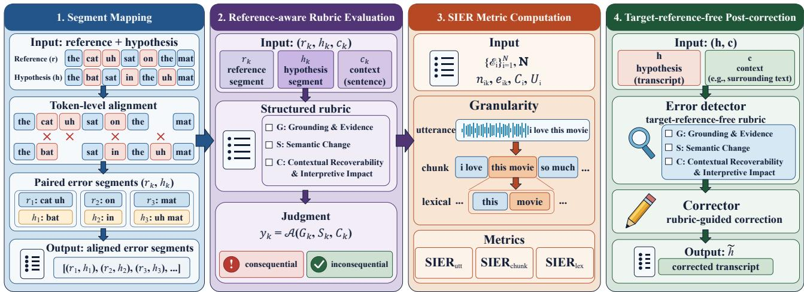
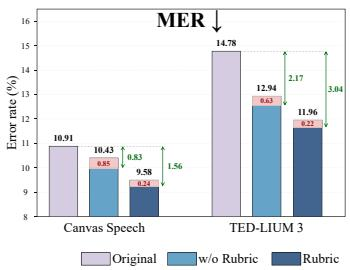
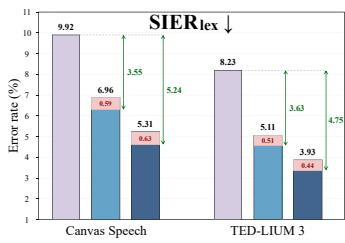

# SMART: SEMANTIC SEGMENT MAPPING AND ASSESSMENT OF RECOGNITION TRANSCRIPTS WITH CONTEXTUAL RUBRICS

Xiaoyu Gu1∗, Chencheng Wang1,∗, Fuyang Li2, Yu Xi1, Tao Liu3, Jiaoqi Guo3, Kai Yu1†

1MoE Key Lab of Artificial Intelligence, AI Institute, X-LANCE Lab, Shanghai Jiao Tong University 2School of Intelligence Science and Technology, Nanjing University, Suzhou, China 3AISpeech Ltd, Suzhou, China

## ABSTRACT

Word error rate (WER) assigns equal cost to lexical edits despite their different semantic consequences, while overall semantic scores cannot identify which individual errors alter the intended meaning. We formulate ASR semantic evaluation as context-aware, segmentlevel consequence assessment and propose Semantic Segment Mapping and Assessment of Recognition Transcripts with Contextual Rubrics (SMART), a framework for traceable semantic evaluation and targeted ASR correction. SMART maps reference–hypothesis discrepancies into coherent segments and applies a structured contextual rubric to assign explicit consequence labels. These labels support Semantic Impact Error Rate (SIER), which quantifies consequential errors at utterance, chunk, and lexical levels. Against majority-vote human labels, SMART achieves 0.843 F1 versus 0.745 for direct LLM judgment. Evaluation across multiple LLMs further demonstrates that SMART is relatively insensitive to the choice of evaluation model, while MER and SIER reveal different aspects of ASR quality. A separate target-reference-free rubric guides correction using the target hypothesis and surrounding ASR hypotheses, outperforming a matched w/o Rubric baseline on both datasets, with further absolute reductions of 0.85–0.98 percentage points in MER and 1.18–1.65 percentage points in SIERlex.

Index Terms— automatic speech recognition, semantic evaluation, semantic errors, contextual evaluation, error correction

## 1. INTRODUCTION

Automatic speech recognition (ASR) errors can have markedly different semantic consequences. Omitting a negation may reverse the intended meaning, whereas inserting a filler may leave it unchanged. Crucially, errors with different consequences can coexist within the same utterance. Word error rate (WER) assigns equal cost to lexical substitutions, deletions, and insertions, regardless of their impact on understanding [1, 2, 3]. Semantic ASR evaluation must therefore go beyond overall meaning preservation to identify which individual recognition errors actually alter the intended meaning.

Existing approaches address the limitations of WER from different perspectives. Downstream task-based evaluation measures the impact of ASR errors through tasks such as intent recognition, slot filling, and semantic parsing [1, 2, 4]. However, its scope is determined by task-specific information requirements: semantic distortions that do not affect the task outcome may go undetected. Consequently, such evaluation cannot comprehensively assess the preservation of fine-grained semantic information or systematically identify the consequences of individual recognition errors.

Sentence-level semantic evaluation instead measures the overall agreement between reference and hypothesis using contextualized representations and semantic similarity [5, 6, 7, 8, 9], or LLM-based judgments [10, 11]. By reducing multiple discrepancies to an overall assessment, these approaches do not explicitly distinguish errors that alter the intended meaning from those that leave it intact, limiting error localization and fine-grained analysis.

Hybrid and severity-aware metrics further distinguish recognition errors through lexical–semantic weighting or error severity [12, 13]. Localized approaches introduce segment-wise alignment and semantic scoring [14], while LLM-based methods assess recognition errors through structured penalties [15]. Nevertheless, assigning scores or penalties to local discrepancies does not directly establish whether each segment causes a semantic consequence in context.

Discourse context is essential to segment-level consequence assessment. Isolated reference–hypothesis spans may be insufficient to resolve anaphora, ellipsis, or dependencies across utterances. Recent studies have also examined how ASR errors affect understanding in task-specific or dialogue contexts [10, 11]. Yet existing localized scoring approaches primarily focus on the target utterance or its constituent spans, without explicitly assessing the semantic consequence of each segment in its surrounding discourse context.

We therefore formulate semantic ASR evaluation as a contextaware, segment-level, and traceable semantic consequence assessment: reference–hypothesis discrepancies are organized into semantically coherent segments, each of which is evaluated in discourse context and linked to its corresponding recognition errors.

To address this task, we propose Semantic Segment Mapping and Assessment of Recognition Transcripts with Contextual Rubrics (SMART), a framework for semantic consequence evaluation and ASR correction. Its evaluation branch constructs coherent reference– hypothesis segments through character-level alignment and languageaware boundaries. A structured rubric then assesses each discrepant segment using surrounding reference context, with deterministic aggregation producing explicit consequence labels. These labels support Semantic Impact Error Rate (SIER), which quantifies consequential errors at utterance, chunk, and lexical levels. A separate target-reference-free correction branch uses the target hypothesis and surrounding ASR hypotheses to generate structured repair guidance.

Our main contributions are:

1. Semantically coherent segment mapping. We combine character-level alignment with language-aware boundaries to construct coherent reference–hypothesis segments, enabling semantic consequences to be localized and traced to specific recognition errors.

2. Context-aware consequence assessment and SIER. We introduce a structured contextual rubric with deterministic aggregation to assign explicit consequence labels to individual segments. The resulting SIER quantifies semantic-impact errors at utterance, chunk, and lexical levels, enabling finegrained error analysis and direct comparison with MER at the lexical level.

  
Fig. 1. SMART: Context-aware segment-level semantic consequence assessment and correction. (1) Segment Mapping: Organizes aligned lexical discrepancies into semantically coherent segments. (2) Reference-aware Rubric Evaluation: Judges the semantic consequence of each segment using surrounding reference context and structured criteria. (3) SIER Metric Computation: Quantifies consequential errors at utterance, chunk, and lexical levels. (4) Target-reference-free Post-correction: Uses the target hypothesis and surrounding ASR hypotheses to identify potential semantic errors and guide LLM repair.

3. Target-reference-free rubric-guided correction. We develop a separate correction rubric that guides targeted LLM repair using only the target hypothesis and surrounding ASR hypotheses, extending structured semantic analysis to correction without access to reference transcripts.

## 2. SMART FRAMEWORK

## 2.1. Framework Overview

As shown in Fig. 1, Semantic Segment Mapping and Assessment of Recognition Transcripts with Contextual Rubrics (SMART) contains a reference-aware evaluation branch and a target-reference-free correction branch. For evaluation, the reference r and hypothesis h are mapped into aligned units $\boldsymbol { \mathcal { M } } = \{ ( r _ { k } , h _ { k } ) \} _ { k = 1 } ^ { K }$ with discrepancy indices I. Each discrepant unit is assessed with surrounding reference context $c ^ { \mathrm { r e f } }$ by a structured rubric and deterministic aggregation for SIER. For correction, a separate rubric uses only the target hypothesis h and surrounding ASR hypotheses $c ^ { \mathrm { h y p } }$ to produce repair guidance $\mathcal { D } ^ { \mathrm { r e p } }$ , from which an LLM generates h˜. Referenceaware evaluation diagnoses are not passed to correction; the revised hypothesis is evaluated afterward using MER and SIER.

## 2.2. Semantically Coherent Segment Mapping

Lexical edits may fragment one semantic discrepancy, especially under insertions, deletions, and word splits or merges. We therefore construct local evaluation segments from character-level Levenshtein alignment[16, 17] and language-aware chunk boundaries. Chunks are whitespace-delimited English tokens or jieba-tokenized Chinese units; segments are aligned reference–hypothesis pairs used for semantic judgment. A segment is split only at shared chunk boundaries, which keeps unequal split/merge errors together. Onesided empty segments are attached to a near segment so that isolated insertions and deletions retain local context. Algorithm 1 returns

Algorithm 1: Semantic Segment Mapping   
Input: Reference r; hypothesis h.   
Output: Segments M; discrepancy indices I.   
Normalize $r , h$ and compute character-level Levenshtein   
alignment.   
Extract chunk-start boundaries for English whitespace   
tokens or Chinese jieba tokens.   
Initialize segment list U and the current aligned pair.   
foreach alignment column do   
if aligned spaces or both positions reach chunk starts   
then   
Append the current pair to U and reset it.   
Append non-gap characters to the current pair and   
advance positions.   
Append the remaining pair and remove empty pairs.   
Merge one-sided empty pairs with the next segment, or the   
previous one at the end.   
$\mathcal { M }  [ ( r _ { k } , h _ { k } ) ] _ { k = 1 } ^ { K }$ from U; I ← {k | rk ̸= hk}.   
return (M, I).

$$
\mathcal { M } = [ ( r _ { k } , h _ { k } ) ] _ { k = 1 } ^ { K } , \qquad \mathcal { T } = \{ k \mid r _ { k } \neq h _ { k } \} ,\tag{1}
$$

M contains aligned evaluation segments and I indexes discrepancies passed to semantic consequence evaluation.

## 2.3. Reference-Aware Contextual Semantic Consequence Judgment

For each discrepant segment $k \in \mathcal { T } ,$ the evaluation rubric receives the aligned pair $( r _ { k } , h _ { k } )$ with surrounding reference context $c _ { k } ^ { \mathrm { r e f } }$ Inspired by structured LLM-based evaluation [15, 18, 19], we elicit

a rubric trace rather than directly predicting a consequence label:

$$
z _ { k } = ( G _ { k } , S _ { k } , C _ { k } ) ,\tag{2}
$$

where $G _ { k }$ evaluates alignment validity and evidence sufficiency, $S _ { k }$ characterizes the semantic change between reference and hypothesis, and $C _ { k }$ assesses whether the reference-intended meaning remains recoverable under the surrounding reference context and how the discrepancy affects interpretation. The structured trace is converted into a segment-level label by fixed deterministic rules,

$$
y _ { k } = \mathcal { A } ( G _ { k } , S _ { k } , C _ { k } ) ,
$$

$$
y _ { k } \in \big \{ \mathrm { C O N S E Q U E N T I A L } , \mathrm { I N C O N S E Q U E N T I A L } \big \} .\tag{3}
$$

Conceptually, a discrepancy is consequential when its semantic change remains meaningfully disruptive after considering contextual recoverability and interpretive impact. The resulting labels define the consequential segments used to compute SIER.

## 2.4. Target-Reference-Free Rubric-Guided Correction

We extend the same structured reasoning principles to correction through a separate rubric that operates only on the target hypothesis h and surrounding ASR hypotheses $c ^ { \mathrm { h y p } }$ , without access to reference transcripts. It identifies potentially problematic regions and produces repair-oriented guidance $\mathcal { D } ^ { \mathrm { r e p } }$ , which is then used to revise the hypothesis:

$$
\begin{array} { r l } & { \mathcal { D } ^ { \mathrm { r e p } } = \mathcal { R } _ { \mathrm { r e p } } ( h , c ^ { \mathrm { h y p } } ) , } \\ & { \quad \tilde { h } = \mathcal { F } \left( h , c ^ { \mathrm { h y p } } , \mathcal { D } ^ { \mathrm { r e p } } ; \pi _ { \mathrm { r e p a i r } } \right) . } \end{array}\tag{4}
$$

Here, $\mathcal { F }$ denotes the prompted correction LLM [20, 21, 22]. The correction branch receives neither reference transcripts nor referenceaware evaluation diagnoses. The revised hypothesis h˜ is evaluated afterward using MER and SIER.

## 3. EXPERIMENTAL SETUP

## 3.1. Datasets

We evaluate SMART on two continuous-speech datasets covering different languages and speaking domains. Both predominantly feature a single speaker, allowing discourse context to be examined without multi-speaker interaction effects.

• Canvas Speech: An internal Mandarin classroom dataset comprising 3.4 hours of continuous instructional recordings with reference transcripts. The recordings contain Mandarin– English code-switching and domain-specific terminology, providing a realistic educational setting for multilingual ASR evaluation.

• TED-LIUM release 3 [23]: A publicly available English speech corpus containing TED-talk recordings and reference transcripts. We select a 7.2-hour subset of continuous presentations to evaluate semantic consequences in long-form English speech.

For both datasets, evaluation context $c ^ { \mathrm { r e f } }$ comprises the ten consecutive ground-truth utterances immediately before and after each target utterance. Correction uses the same temporal window of corresponding ASR hypotheses $c ^ { \mathrm { h y p } }$ , without access to reference transcripts.

## 3.2. Models and Evaluation Metrics

DeepSeek-V4-Flash is used for the main evaluation and correction experiments. Additional evaluation LLMs are examined in the sensitivity analysis. For human evaluation, we sample 300 discrepant segments per dataset, with approximately 30% consequential cases.

Five in-domain annotators label each segment independently, and majority vote defines the ground truth. Rubrics and aggregation rules are frozen before evaluation. We report accuracy, precision, recall, and F1; BERTScore and SeMaScore use oracle evaluationset thresholds that maximize F1. We use Mixed Error Rate (MER) as the lexical-error baseline, treating Chinese characters and English words as lexical units:

$$
\mathrm { M E R } = \frac { \sum _ { i } { ( S _ { i } + D _ { i } + I _ { i } ) } } { \sum _ { i } { L _ { i } } } ,\tag{5}
$$

where $S _ { i } , D _ { i } , I _ { i }$ are substitution, deletion, and insertion counts and $L _ { i }$ is the reference mixed-unit count. MER reduces to CER or WER for Chinese-only or English-only speech, respectively.

Our main semantic metric, Semantic Impact Error Rate (SIER), measures error mass within consequential segments. Let $\mathcal { E } _ { i }$ denote the consequential segments in utterance i:

$$
\begin{array} { r } { \mathrm { S I E R } _ { \mathrm { u t t } } = \frac { \sum _ { i } \mathbf { 1 } [ | \mathcal { E } _ { i } | > 0 ] } { N } , } \\ { \mathrm { S I E R } _ { \mathrm { c h u n k } } = \frac { \sum _ { i } \sum _ { k \in \varepsilon _ { i } } n _ { i k } } { \sum _ { i } C _ { i } } , } \\ { \mathrm { S I E R } _ { \mathrm { l e x } } = \frac { \sum _ { i } \sum _ { k \in \varepsilon _ { i } } e _ { i k } } { \sum _ { i } L _ { i } } . } \end{array}\tag{6}
$$

Here, $n _ { i k }$ and $e _ { i k }$ are the hypothesis-side chunk count and MERstyle lexical edits in consequential segment $k ,$ respectively; $C _ { i }$ and $L _ { i }$ denote the reference chunk and mixed-unit counts. English whitespace and Chinese jieba tokens define chunk boundaries.

Crucially, $\mathrm { S I E R } _ { \mathrm { l e x } }$ uses the same lexical edit counts and reference denominator as MER, but retains only edits within consequential segments. The two metrics are thus directly comparable: their difference measures the lexical error mass excluded from SIER because it falls within segments judged semantically inconsequential.

Complete rubrics, prompts, aggregation rules, and code are publicly available. 1

## 4. RESULTS AND ANALYSIS

## 4.1. Lexical and Semantic ASR Evaluation

Table 1. ASR evaluation on lexical and semantic. Results on Canvas Speech and TED-LIUM 3 datasets. MER uses Chinese characters and English words as lexical units. All values are percentages; bold indicates the best result within each model group.

<table><tr><td rowspan="2">ASR System</td><td colspan="2">Utterance-level</td><td colspan="3">Lexical / chunk-level</td></tr><tr><td>SER ↓ SIERutt ↓</td><td></td><td>MER ↓ SIERlex ↓</td><td></td><td> $\overline { { \mathrm { S I E R } _ { \mathrm { c h u n k } } \downarrow } }$ </td></tr><tr><td colspan="6">Open-Source Models</td></tr><tr><td>Qwen3-ASR[24]</td><td>98.07</td><td>80.94</td><td>12.97</td><td>6.08</td><td>6.40</td></tr><tr><td>whisper-v3[25]</td><td>94.22</td><td>75.59</td><td>24.41</td><td>16.05</td><td>15.16</td></tr><tr><td>whisper-v3-turbo[25]</td><td>95.29</td><td>76.66</td><td>23.19</td><td>15.16</td><td>14.34</td></tr><tr><td>sensevoice[26]</td><td>98.29</td><td>82.66</td><td>11.87</td><td>5.43</td><td>6.23</td></tr><tr><td>paraformer[27]</td><td>98.07</td><td>84.15</td><td>15.04</td><td>6.09</td><td>7.22</td></tr><tr><td colspan="6">Closed-Source Models</td></tr><tr><td>Qwen3-ASR-Filetrans</td><td>84.15</td><td>56.75</td><td>9.64</td><td>3.60</td><td>3.82</td></tr><tr><td>Doubao Filetrans</td><td>87.79</td><td>62.10</td><td>11.13</td><td>3.42</td><td>4.03</td></tr></table>

As shown in Table 1, $\mathrm { S I E R } _ { \mathrm { u t t } }$ is consistently lower than SER across all ASR systems, indicating that some utterances contain lexical errors without consequential semantic changes. Moreover, Qwen3-ASR-Filetrans achieves lower MER than Doubao Filetrans (9.64% vs. 11.13%) but higher $\mathrm { S I E R } _ { \mathrm { l e x } }$ (3.60% vs. 3.42%), demonstrating that lexical accuracy and semantic impact can yield different system rankings. Table 2 further illustrates this discrepancy: WER favors hypothesis A despite its consequential negation error, whereas $\mathrm { S I E R } _ { \mathrm { l e x } }$ favors B despite its additional lexical edits. Together, these results show that SIER complements conventional error rates by distinguishing semantic impact from lexical error frequency.

Table 2. An example of differing lexical and semantic errors. Hypotheses A and B are produced by Qwen3-ASR-Filetrans and Doubao Filetrans, respectively, for the same utterance from TED-LIUM release 3. A omits the consequential negation “not,” whereas B preserves it but introduces inconsequential fillers. WER favors A, while $\mathrm { S I E R } _ { \mathrm { l e x } }$ favors B. All values are percentages; lower is better.  
Context Why can a longer vacation feel only slightly better?
<table><tr><td colspan="3">Reference There are no new memories added; you have not changed the story.</td></tr><tr><td>Hypothesis</td><td>WER↓</td><td> $\mathrm { S I E R } _ { \mathrm { l e x } } \downarrow$ </td></tr><tr><td>A: There are no new memories added; you have changed the story.</td><td>8.33</td><td>8.33</td></tr><tr><td>B: Uh, well, there are no new memories added; you have not changed the story.</td><td>16.67</td><td>0.00</td></tr></table>

## 4.2. Agreement with Human Judgments

As shown in Table 3, BERTScore and SeMaScore achieve high recall but low precision and accuracy. Their similarity-based scoring may penalize lexical discrepancies that do not alter the intended meaning, leading to excessive consequential-error predictions. Interactive ASR exhibits a similar pattern, with the highest recall (0.955) but low precision (0.297), suggesting a conservative tendency in judging meaning preservation.

Compared with Direct LLM, SMART w/o context achieves higher accuracy (0.920 vs. 0.900) and F1 (0.822 vs. 0.745), demonstrating the benefit of structured rubric assessment even without discourse context. Incorporating reference context further improves precision from 0.822 to 0.857 and recall from 0.822 to 0.830, yielding an F1 of 0.843. These results highlight the contributions of both structured segment-level judgment and discourse context.

Table 3. Agreement with human semantic consequence judgments. Classification results on discrepant segments from Canvas Speech and TED-LIUM 3, using majority-vote human annotations as ground truth. CONSEQUENTIAL is the positive class. Acc., Prec., Rec., and F1 denote accuracy, precision, recall, and F1-score, respectively. All LLM-based methods use DeepSeek-V4-Flash. Bold indicates the highest value in each column.
<table><tr><td>Classifier</td><td>Acc. ↑</td><td>Prec. ↑</td><td>Rec. ↑</td><td>F1↑</td></tr><tr><td colspan="5">Similarity-based metrics</td></tr><tr><td>BERTScore [5]</td><td>0.215</td><td>0.214</td><td>0.910</td><td>0.331</td></tr><tr><td>SeMaScore [14]</td><td>0.370</td><td>0.261</td><td>0.910</td><td>0.384</td></tr><tr><td colspan="5">LLM-based evaluation</td></tr><tr><td>Interactive ASR [10]</td><td>0.515</td><td>0.297</td><td>0.955</td><td>0.440</td></tr><tr><td>Direct LLM</td><td>0.900</td><td>0.764</td><td>0.731</td><td>0.745</td></tr><tr><td>SMART w/o context</td><td>0.920</td><td>0.822</td><td>0.822</td><td>0.822</td></tr><tr><td>SMART</td><td>0.925</td><td>0.857</td><td>0.830</td><td>0.843</td></tr></table>

## 4.3. Effectiveness of Target-Reference-Free Rubric-Guided Correction

We compare rubric-guided correction with a matched w/o Rubric baseline using the same target hypothesis, surrounding ASR hypotheses, model, and decoding. As shown in Fig. 2, both correction methods improve over the original hypothesis on both datasets, confirming the effectiveness of target-reference-free correction.

More importantly, rubric guidance consistently yields further gains: MER decreases from 10.43% to 9.58% on Canvas Speech and from 12.94% to 11.96% on TED-LIUM 3, while $\mathrm { S I E R } _ { \mathrm { l e x } }$ decreases from 6.96% to 5.31% and from 5.11% to 3.93%, respectively. The rubric also repairs more semantic error mass on both datasets (5.24 vs. 3.55 and 4.75 vs. 3.63), showing that its additional benefit comes primarily from more effective repair of semantically consequential errors.

  
Fig. 2. Target-reference-free correction of SenseVoice on Canvas Speech and TED-LIUM 3. Bars report MER and $\mathrm { S I E R } _ { \mathrm { l e x } }$ for the original hypothesis, the matched w/o Rubric baseline, and rubricguided correction. Pink caps indicate newly introduced error mass, while double-headed arrows indicate repaired error mass relative to the original hypothesis.

## 4.4. Sensitivity to the Evaluation LLM

As shown in Table 4, SMART achieves consistently strong agreement with human judgments across different evaluation LLMs. Despite variations in precision and recall, all four models achieve comparable overall classification performance, suggesting that SMART is relatively insensitive to the choice of evaluation LLM and does not rely on a single model for effective semantic consequence assessment.

Table 4. Sensitivity of SMART to the evaluation LLM. Semantic consequence classification on the same human-annotated segments using different evaluation LLMs. CONSEQUENTIAL is the positive class. Acc., Prec., Rec., and F1 denote accuracy, precision, recall, and F1-score, respectively. Bold indicates the highest value in each column.
<table><tr><td>Evaluation LLM</td><td>Acc. ↑</td><td>Prec. ↑</td><td>Rec. ↑</td><td>F1↑</td></tr><tr><td>GPT-4.1</td><td>0.895</td><td>0.750</td><td>0.800</td><td>0.774</td></tr><tr><td>GPT-5.5</td><td>0.915</td><td>0.868</td><td>0.733</td><td>0.795</td></tr><tr><td>GPT-5.6-Luna</td><td>0.895</td><td>0.714</td><td>0.889</td><td>0.792</td></tr><tr><td>DeepSeek-V4-Flash</td><td>0.925</td><td>0.857</td><td>0.830</td><td>0.843</td></tr></table>

## 5. CONCLUSION

We formulated ASR semantic evaluation as context-aware, segmentlevel consequence assessment, enabling recognition errors to be individually judged and traced to their semantic impact. To address this task, we proposed SMART, which combines coherent segment mapping, structured contextual rubrics, and deterministic aggregation to produce explicit consequence labels and multi-granularity SIER. Experiments demonstrate improved agreement with human judgments over direct LLM evaluation, while results across four evaluation LLMs suggest that the framework does not rely on a single model. MER and SIER offer complementary views of lexical accuracy and semantic impact. A separate target-reference-free rubric further improves ASR correction using only the target hypothesis and surrounding ASR hypotheses. These findings support finegrained semantic diagnosis and its potential use in future ASR evaluation and correction.

## 6. COMPLIANCE WITH ETHICAL STANDARDS

This study uses the publicly available TED-LIUM 3 corpus and an existing internal classroom speech corpus. No new human participants were recruited or recorded, and no animal experiments were conducted. The datasets were used in accordance with applicable data-access and privacy requirements, and the results are reported in aggregate.

## 7. REFERENCES

[1] Ye-Yi Wang, Alex Acero, and Ciprian Chelba, “Is word error rate a good indicator for spoken language understanding accuracy,” in IEEE Workshop on Automatic Speech Recognition and Understanding, 2003.

[2] Xiaodong He, Li Deng, and Alex Acero, “Why word error rate is not a good metric for speech recognizer training for the speech translation task?,” in Proceedings of the IEEE International Conference on Acoustics, Speech and Signal Processing (ICASSP), 2011.

[3] Benoit Favre, Kyla Cheung, Siavash Kazemian, Adam Lee, Yang Liu, Cosmin Munteanu, Ani Nenkova, Dennis Ochei, Gerald Penn, Stephen Tratz, Clare Voss, and Frauke Zeller, “Automatic human utility evaluation of ASR systems: Does WER really predict performance?,” in Proceedings of Interspeech, 2013, pp. 3463–3467.

[4] Sujith Pulikodan, Sahapthan K, Prasanta Kumar Ghosh, Visruth Sanka, and Nihar Desai, “An approach to measuring the performance of automatic speech recognition (ASR) models in the context of large language model (LLM) powered applications,” in Proceedings ofInterspeech, 2025, pp. 5718–5722.

[5] Tianyi Zhang, Varsha Kishore, Felix Wu, Kilian Q Weinberger, and Yoav Artzi, “Bertscore: Evaluating text generation with bert,” arXiv preprint arXiv:1904.09675, 2019.

[6] Wei Zhao, Maxime Peyrard, Fei Liu, Yang Gao, Christian M. Meyer, and Steffen Eger, “MoverScore: Text generation evaluating with contextualized embeddings and earth mover distance,” in Proceedings of the 2019 Conference on Empirical Methods in Natural Language Processing and the 9th International Joint Conference on Natural Language Processing (EMNLP-IJCNLP), 2019, pp. 563–578.

[7] Suyoun Kim, Abhinav Arora, Duc Le, Ching-Feng Yeh, Christian Fuegen, Ozlem Kalinli, and Michael L. Seltzer, “Semantic distance: A new metric for ASR performance analysis towards spoken language understanding,” in Proceedings of Interspeech, 2021, pp. 1977–1981.

[8] Suyoun Kim, Duc Le, Weiyi Zheng, Tarun Singh, Abhinav Arora, Xiaoyu Zhai, Christian Fuegen, Ozlem Kalinli, and Michael L. Seltzer, “Evaluating user perception of speech recognition system quality with semantic distance metric,” in Proceedings ofInterspeech, 2022, pp. 3978–3982.

[9] Janine Rugayan, Torbjørn Svendsen, and Giampiero Salvi, “Semantically meaningful metrics for Norwegian ASR systems,” in Proceedings ofInterspeech, 2022, pp. 2283–2287.

[10] Peng Wang, Yanqiao Zhu, Zixuan Jiang, Qinyuan Chen, Xingjian Zhao, Xipeng Qiu, Wupeng Wang, Zhifu Gao, Xiangang Li, Kai Yu, and Xie Chen, “Interactive ASR: Towards human-like interaction and semantic coherence evaluation for agentic speech recognition,” arXiv preprint arXiv:2604.09121, 2026.

[11] Zachary Ellis, Jared Joselowitz, Yash Deo, Yajie He, Anna Kalygina, Aisling Higham, Mana Rahimzadeh, Yan Jia, Ibrahim Habli, and Ernest Lim, “WER is unaware: Assessing how ASR errors distort clinical understanding in patient facing dialogue,” in Proceedings of the 16th International Workshop on Spoken Dialogue System Technology, 2026, pp. 391–417.

[12] Zitha Sasindran, Harsha Yelchuri, T. V. Prabhakar, and Supreeth Rao, “H : A new hybrid evaluation metric for automatic speech recognition tasks,” in 2023 IEEE Automatic Speech Recognition and Understanding Workshop (ASRU), 2023.

[13] Ryan Whetten and Casey Kennington, “Evaluating and improving automatic speech recognition using severity,” in Proceedings of the 22nd Workshop on Biomedical Natural Language Processing and BioNLP Shared Tasks, 2023, pp. 79–91.

[14] Zitha Sasindran, Harsha Yelchuri, and T. V. Prabhakar, “Se-MaScore: A new evaluation metric for automatic speech recognition tasks,” in Proceedings of Interspeech, 2024, pp. 4558– 4562.

[15] Amruta Parulekar and Preethi Jyothi, “LASER: An LLMbased ASR scoring and evaluation rubric,” in Proceedings of the 2025 Conference on Empirical Methods in Natural Language Processing, 2025, pp. 24762–24771.

[16] Vladimir I. Levenshtein, “Binary codes capable of correcting deletions, insertions and reversals,” Soviet Physics Doklady, vol. 10, no. 8, pp. 707–710, 1966.

[17] Robert A. Wagner and Michael J. Fischer, “The string-to-string correction problem,” Journal of the ACM, vol. 21, no. 1, pp. 168–173, 1974.

[18] Yang Liu, Dan Iter, Yichong Xu, Shuohang Wang, Ruochen Xu, and Chenguang Zhu, “G-Eval: NLG evaluation using GPT-4 with better human alignment,” in Proceedings of the 2023 Conference on Empirical Methods in Natural Language Processing, 2023, pp. 2511–2522.

[19] Helia Hashemi, Jason Eisner, Corby Rosset, Benjamin Van Durme, and Chris Kedzie, “LLM-Rubric: A multidimensional, calibrated approach to automated evaluation of natural language texts,” in Proceedings of the 62nd Annual Meeting of the Association for Computational Linguistics (Volume 1: Long Papers), 2024, pp. 13806–13834.

[20] Rao Ma, Mengjie Qian, Potsawee Manakul, Mark Gales, and Kate Knill, “Can generative large language models perform ASR error correction?,” arXiv preprint arXiv:2307.04172, 2023.

[21] Sheng Li, Chen Chen, Chin Yuen Kwok, Chenhui Chu, Eng Siong Chng, and Hisashi Kawai, “Investigating ASR error correction with large language model and multilingual 1-best hypotheses,” in Proceedings of Interspeech, 2024, pp. 1315– 1319.

[22] Aman Madaan, Niket Tandon, Prakhar Gupta, Skyler Hallinan, Luyu Gao, Sarah Wiegreffe, Uri Alon, Nouha Dziri, Shrimai Prabhumoye, Yiming Yang, Shashank Gupta, Bodhisattwa Prasad Majumder, Katherine Hermann, Sean Welleck, Amir Yazdanbakhsh, and Peter Clark, “Self-Refine: Iterative refinement with self-feedback,” in Advances in Neural Information Processing Systems, 2023, vol. 36.

[23] Franc¸ois Hernandez, Vincent Nguyen, Sahar Ghannay, Natalia Tomashenko, and Yannick Esteve, “TED-LIUM 3: Twice as\` much data and corpus repartition for experiments on speaker adaptation,” in Speech and Computer. 2018, pp. 198–208, Springer.

[24] Xian Shi, Xiong Wang, Zhifang Guo, Yongqi Wang, Pei Zhang, Xinyu Zhang, Zishan Guo, Hongkun Hao, Yu Xi, Baosong Yang, Jin Xu, Jingren Zhou, and Junyang Lin, “Qwen3-ASR technical report,” arXiv preprint arXiv:2601.21337, 2026.

[25] Alec Radford, Jong Wook Kim, Tao Xu, Greg Brockman, Christine McLeavey, and Ilya Sutskever, “Robust speech recognition via large-scale weak supervision,” in Proceedings of the 40th International Conference on Machine Learning, 2023, vol. 202 of Proceedings of Machine Learning Research, pp. 28492–28518.

[26] Keyu An, Qian Chen, Chong Deng, Zhihao Du, Changfeng Gao, Zhifu Gao, Yue Gu, Ting He, et al., “FunAudioLLM: Voice understanding and generation foundation models for natural interaction between humans and LLMs,” arXiv preprint arXiv:2407.04051, 2024.

[27] Zhifu Gao, Shiliang Zhang, Ian McLoughlin, and Zhijie Yan, “Paraformer: Fast and accurate parallel transformer for nonautoregressive end-to-end speech recognition,” in Proceedings ofInterspeech, 2022, pp. 2063–2067.