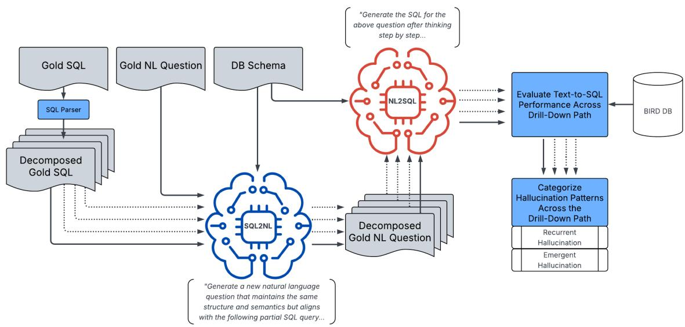
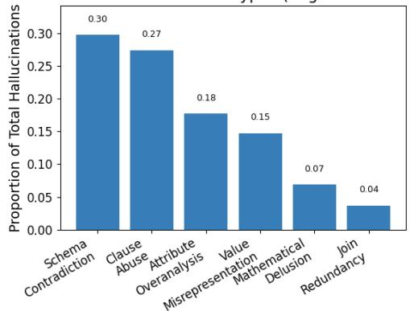
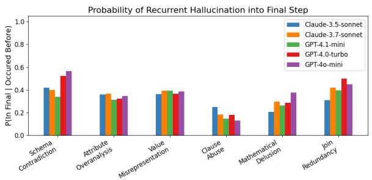
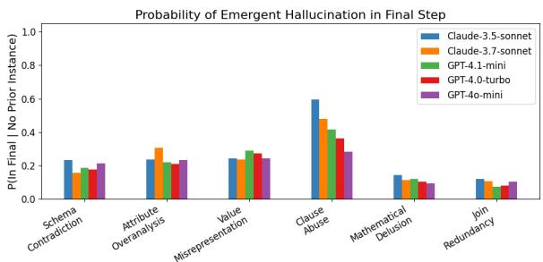
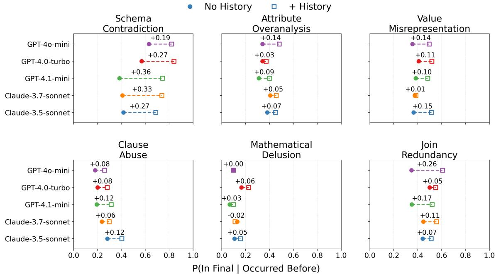
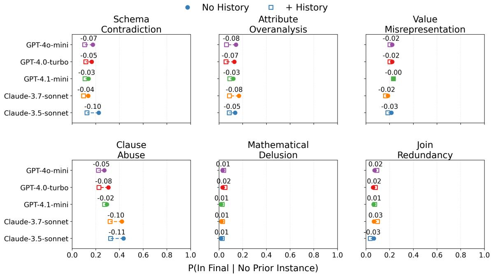

# Tracing Recurrent and Emergent Hallucination Patterns in Decomposed Text-to-SQL Generation

Hayden Moore The Pennsylvania State University hmm5731@psu.edu

Abhinav Verma The Pennsylvania State University verma@psu.edu

Anshuman Dutt Microsoft anshuman.dutt@microsoft.com

## Abstract

Large language models can achieve strong Text to-SQL benchmark performance while still pro ducing schema and query-logic errors. Most evaluations characterize such failures only in the final generated query, making it difficult to determine whether a related error was also observed in an earlier, simpler step or appears only at the final stage. We present a drill-down evaluation framework that decomposes Textto-SQL queries into progressively more complex executable sub-queries and correspond ing natural-language questions, allowing rulebased hallucination categories to be examined across a generation path. We distinguish recurrent hallucinations, in which the same rule based category is observed in an earlier step and again in the final query, from emergent hal lucinations, in which the category is observed at the final step without an earlier detection in the same path. Across five LLMs evaluated on an expanded BIRD-mini benchmark, several categories show appreciable recurrence probabilities, while clause abuse shows comparatively higher conditional emergence. Under the conversational-history condition, recurrence probabilities are generally higher and emergence probabilities are generally lower. These observations indicate that the two conditional measures do not move uniformly in the same direction under additional context and motivate trajectory-level analysis in addition to final-output evaluation. Code and evaluation artifacts are available in the project repository.1

## 1 Introduction

Text-to-SQL systems allow users to query structured databases through natural language rather than directly writing SQL. LLM-based approaches are increasingly used for this task because they can map natural-language requests to executable programs (Li et al., 2023, 2024; Hong et al., 2025).

Even when benchmark performance is relatively strong, generated SQL can still contain schema, value, join, clause, or other logic errors (Huang et al., 2025; Qu et al., 2024; Zhang et al., 2024). In this paper, we operationalize a subset of these errors as hallucination categories using explicit rulebased comparisons against the database schema and reference SQL. Such errors can matter functionally because a syntactically valid query may execute while returning a result different from the reference query.

Most Text-to-SQL evaluation focuses on the final generated query. This provides a useful measure of task success but does not describe whether the same rule-detected error category was also present in earlier decomposed steps. A final-step hallucination may be preceded by an earlier instance of the same category, or it may be observed only at the final stage. Distinguishing these cases provides an additional descriptive view of hallucination behavior across a structured generation trajectory.

We therefore study hallucinations descriptively across progressively more complex structuredgeneration steps. We decompose executable SQL queries from BIRD-mini into drill-down paths and pair each sub-query with a corresponding naturallanguage sub-question (Fig. 1). We then evaluate five LLMs at each step and annotate hallucination categories using deterministic structural rules. Building on the hallucination taxonomy of Qu et al. (2024), we use a complementary temporal characterization: recurrent hallucinations are observed earlier in the path and again in the final query, whereas emergent hallucinations are observed only at the final step.

This framing is relevant to uncertainty-aware generation, but our experiments do not measure uncertainty itself. We do not estimate calibrated confidence, epistemic uncertainty, or predictive uncertainty, and we do not treat hallucination as a direct estimator or necessary consequence of uncertainty. Instead, we examine a reliability failure phenomenon that is relevant to uncertaintyaware systems and ask how its rule-based recurrence and emergence measures differ across progressive query steps and a conversational-history condition.

Our contributions are threefold:

1. We present a drill-down evaluation framework for examining rule-based hallucination categories across progressively more complex Text-to-SQL generation steps.

2. We use recurrent and emergent labels to distinguish categories observed both earlier and at the final step from categories observed only at the final step.

3. Across five evaluated LLMs, we observe nonuniform temporal patterns: several categories show appreciable recurrence, clause abuse shows comparatively higher emergence, and the history condition is generally associated with higher recurrence and lower emergence.

## 2 Related Work

Early Text-to-SQL systems commonly adopted sequence-to-sequence frameworks in which the natural-language question and target database schema were jointly encoded. Early work relied on recurrent architectures (Dong and Lapata, 2016; Jia and Liang, 2016), followed by graph-based and relation-aware approaches (Wang et al., 2021) and pre-trained transformer encoders (Yin et al., 2020; Yu et al., 2021). More recently, LLM-based approaches have become common in Text-to-SQL because of their few-shot learning capacity (Brown et al., 2020), in-context reasoning (Xie et al., 2022), and chain-of-thought prompting capabilities (Wei et al., 2023). These approaches have achieved strong benchmark results while also raising hallucination and reliability concerns.

Hallucination research has developed taxonomies for unsupported or incorrect LLM outputs and has studied mitigation in Text-to-SQL specifically (Huang et al., 2025; Qu et al., 2024). Our work is diagnostic rather than prescriptive: we do not introduce a new mitigation algorithm. Instead, we ask when hallucinations appear along a structured generation trajectory and whether they persist as the task becomes more complex.

Prior Text-to-SQL work has used decomposition largely as a generation strategy. CHASE-SQL (Pourreza et al., 2024), for example, applies divideand-conquer reasoning to break complex problems into sub-components before synthesizing a final solution. Inspired by the decomposable structure of SQL, we use decomposition here as an analysis device across progressive sub-queries. This complements static hallucination categories with a descriptive view of whether the same category is observed earlier in a path and again at the final stage, or only at the final stage.

## 3 Dataset

BIRD-mini We conduct our experiments on the PostgreSQL (The PostgreSQL Global Development Group, 1996–2025) BIRD-mini dataset, a smaller version of the BIRD benchmark that reduces evaluation cost while retaining examples across multiple BIRD difficulty levels. Recent work on interactive Text-to-SQL and NL2SQLagent settings provides related evaluation context (Xiong et al., 2025). Applying our decomposition and annotation pipeline to the full BIRD development split would require many additional subquestions and model generations across five commercial LLMs. We therefore use BIRD-mini rather than introducing an additional subsampling procedure.

Our decomposition expands the 500 original BIRD-mini examples into 1,384 executable question–query pairs. Each original query is decomposed as far as possible while preserving executable intermediate SQL. The resulting paths provide progressively more complex targets that can be evaluated independently and then related back to the corresponding final query.

The implementation can be applied to datasets beyond BIRD-mini, but the empirical frequencies reported here are specific to this evaluation. We do not assume that the prevalence or temporal distribution of hallucination categories would remain unchanged on the full BIRD benchmark or other Text-to-SQL datasets. We therefore interpret the results as descriptive patterns within the evaluated setting rather than as estimates of general or universal hallucination prevalence.

## 4 Hallucination Characterization

Schema-Based and Logic-Based We adopt the hallucination taxonomy of Qu et al. (2024), which separates errors into schema-based and logic-based categories. Schema-based hallucinations concern the database structure or values, such as invalid schema references, unnecessary attributes, or value misrepresentation. Logic-based hallucinations concern query construction, including unnecessary joins, clause abuse, or faulty mathematical/operator logic. Appendix A, Table 1, provides the operational definitions used in our annotation pipeline.

  
Figure 1: Drill-down framework. Gold SQL is decomposed into progressively more complex executable sub-queries, which are paired with natural-language sub-questions. LLM outputs are evaluated at each step and annotated to trace recurrent and emergent hallucination patterns.

Recurrent and Emergent Hallucinations Existing hallucination taxonomies describe theform of an error. We use a complementary temporal characterization that describes how a rule-based category is observed across a drill-down path. A recurrent hallucination is a category detected in at least one earlier step and again in the final query. An emergent hallucination is a category detected in the final query with no earlier detection of that category in the same path. These labels are temporal abstractions over the underlying schema- and logic-based categories.

Hallucination Behavior Patterns We use recurrent and emergent labels as descriptive behavior patterns rather than as evidence of distinct causal mechanisms. A high recurrence probability means that, conditional on an instance of a category being observed earlier in the path, the same category is also observed in the final query relatively often. A high emergence probability means that the category is observed in the final query relatively often when no earlier instance of that category was detected. These conditional measures can motivate hypotheses about persistence or final-stage appearance, but they do not identify causal mechanisms or the fraction of all final-step errors that originated earlier.

## 5 Methodology

Our drill-down analysis consists of three stages:

1. decompose BIRD-mini SQL into progressive executable sub-queries and pair them with natural-language sub-questions;

2. evaluate multiple LLMs at each step of each drill-down path; and

3. apply deterministic annotation rules to characterize hallucination type and temporal behavior (Fig. 1).

## 5.1 Decompose and Generate Drill-Down Dataset

Progressive Sub-Query Generation We decompose each BIRD-mini query into multiple progressive queries using an SQL parser (Albrecht, 2024). Parsing proceeds through the query structure so that each retained intermediate step remains executable. The resulting sequence gradually introduces additional conditions and structure until reaching the complete query.

Sub-Question Generation Each sub-query is paired with a natural-language sub-question describing what that executable SQL retrieves. All sub-queries are generated deterministically, whereas the natural-language realizations are generated with GPT-4o-mini using the database schema, original question, and target sub-query. We also regenerate the final natural-language question with the same procedure so that the questions within a path are produced under a consistent generation process.

This asymmetric design is motivated by prior work using formal-to-natural-language transformations to produce natural-language descriptions or semantically related formulations from structured inputs (Safarzadeh et al., 2025; Moore and Shah, 2026). This prior work motivates the design choice but does not establish that every generated subquestion in our dataset is semantically equivalent to its target SQL. The generated sub-questions were not independently validated against manually authored equivalents. Consequently, some observed Text-to-SQL behavior may reflect artifacts introduced by the SQL-to-NL transformation. We treat this as a potential source of variation in the evaluation and discuss it explicitly in the limitations.

## 5.2 Drill-Down Evaluation and Hallucination Annotation

Following decomposition, each model generates SQL for every natural-language question in the progressive path. We compare the predicted SQL against the corresponding ground-truth SQL and database schema. The deterministic annotation pipeline records six hallucination categories and then determines whether each final-step hallucination is recurrent or emergent. Appendix B specifies the exact structural rules.

These labels should be interpreted as operational indicators rather than human-validated semantic gold labels. Deterministic rules provide consistent application across models and steps, but they cannot capture every semantic equivalence or error mode that a human SQL expert might identify.

## 5.3 Reproducibility Artifacts

We release the decomposition code, modelprompting code, generated outputs, hallucination annotations, evaluation code, and figure-generation scripts in the repository linked in the abstract. The repository is intended to make the processing pipeline and pre-generated results inspectable without requiring reviewers to rerun commercial-model API calls. The manuscript remains self-contained; the repository provides implementation and replication artifacts rather than evidence required to understand the claims.

## 6 Experimental Setup and Evaluation

We evaluate five LLMs: Claude-3.5-Sonnet and Claude-3.7-Sonnet from Anthropic (Anthropic, 2024, 2025), and GPT-4-Turbo, GPT-4o-mini, and GPT-4.1-mini from OpenAI (OpenAI, 2023, 2024, 2025). Models are evaluated on the BIRD-mini drill-down dataset using the BIRD Text-to-SQL prompt shown in Appendix C. For every step, we compare predicted SQL, ground-truth SQL, and the corresponding database schema.

The experiments address three research questions:

RQ1: Hallucination persistence When hallucinations occur in simpler stages of a decomposed Text-to-SQL problem, how frequently do they reappear in the final query?

RQ2: Hallucination emergence Which hallucination categories show comparatively higher conditional emergence at the final stage when no earlier instance of the same category is detected?

RQ3: Contextual history How do recurrence and emergence probabilities differ when models do or do not have access to earlier questions and generations in a decomposed path?

## 6.1 Evaluation Metrics

We adopt the problem formulation from Qu et al. (2024). Given a natural-language question Q and associated database schema $\mathcal { D } = \langle \mathcal { C } , \mathcal { T } \rangle$ , where C and T represent the column and table sets, respectively, the Text-to-SQL task is to generate a valid SQL query y that reflects the intent encoded in Q.

Execution Accuracy (EX) We evaluate baseline model performance using Execution Accuracy (EX) (Li et al., 2023), which measures whether a predicted SQL query yˆ yields the same execution result as ground truth query $y ^ { * }$ on database D:

$$
\begin{array} { r } { \mathrm { E X } ( \hat { y } , y ^ { * } ) = \left\{ \begin{array} { l l } { 1 } & { \mathrm { i f } \mathrm { E x e c } ( \hat { y } , \mathcal { D } ) = \mathsf { E x e c } ( y ^ { * } , \mathcal { D } ) } \\ { 0 } & { \mathrm { o t h e r w i s e } . } \end{array} \right. } \end{array}
$$

Across N examples,

$$
\mathrm { E X } _ { \mathrm { a v g } } = \frac { 1 } { N } \sum _ { i = 1 } ^ { N } \mathrm { E X } ( \hat { y } ^ { ( i ) } , y ^ { \ast ( i ) } ) .
$$

Most Prominent Hallucination Types (Avg. Across All Models)  
  
Figure 2: Distribution of rule-based hallucination categories across the evaluated outputs, averaged across models. Schema contradiction and clause abuse are the most common categories in this analysis.

Soft-F1 Score We also report the Soft-F1 Score (Li et al., 2023), which gives partial credit when the predicted and ground-truth execution results overlap. Let $\hat { T } = \mathsf { E x e c } ( \hat { y } , \mathcal { D } )$ and $\boldsymbol { T } ^ { * } = \boldsymbol { \mathsf { E x e c } } ( \boldsymbol { y } ^ { * } , \mathcal { D } )$ . With tuple-level true positives (TP), false positives (FP), and false negatives (FN),

$$
\mathrm { S o f t - F 1 } = \frac { 2 \cdot \mathrm { T P } } { 2 \cdot \mathrm { T P } + \mathrm { F P } + \mathrm { F N } } .
$$

## 7 Hallucination Dynamics

To validate the overall Text-to-SQL setup, we first report BIRD-mini execution performance in $\mathsf { A p - }$ pendix D, Table 3. Figure 2 summarizes the hallucination categories observed across the evaluated outputs.

## 7.1 Recurrent Hallucinations

Figure 3a reports P(In Final Step Occurs in Earlier Steps): the probability that a hallucination category is present in the final query given that the same category was detected earlier in the drill-down path. Several categories show appreciable recurrence probabilities, indicating that an earlier instance of a category can be followed by an instance of the same category in the final query. Schema contradiction is common overall and has relatively high recurrence probabilities in the evaluated models. Clause abuse has lower recurrence than several other categories.

These results answer RQ1 descriptively: for several categories, an error detected earlier in a path has a nontrivial conditional probability of being detected again in the final query. Importantly, P(In Final Step | Occurs Earlier) does not measure the fraction of all final-step errors that were already present earlier, and the analysis does not establish that an earlier hallucination causes a later one.

## 7.2 Emergent Hallucinations

Figure 3b reports P(In Final Step Does Not Occur Earlier): the probability that a category appears in the final query when no instance of that same category was detected earlier in the path. These emergence probabilities are lower than the corresponding recurrence probabilities for most categories. Clause abuse differs from this pattern and shows comparatively high emergence probabilities.

For RQ2, clause abuse differs from the pattern observed for several other categories. One possible explanation is that the final query contains more opportunities for additional global clauses or logical operators. This interpretation is speculative: the present experiment does not isolate which property of the final step, if any, is responsible for the observed pattern.

## 7.3 Contextual-History Trade-off

Figures 4–5 compare generation with and without access to prior conversational history from the drilldown path. The two measures generally shift in opposite directions. Under the history condition, recurrent hallucination probabilities are higher in most evaluated model–category pairs, while emergent hallucination probabilities are lower in most pairs. The magnitude of these differences varies considerably across models and categories, and some differences are close to zero.

For RQ3, the results do not support a simple claim that the history condition is uniformly better or worse. Rather, the history condition is associated with a different pattern across the two measures: emergence probabilities are generally lower, whereas recurrence probabilities are generally higher. This suggests that adding prior context should not be assumed to reduce every measured hallucination behavior.

## 7.4 Task Performance

Among the evaluated models, GPT-4.1-mini has the highest total EX (42.8%) and Soft-F1 (46.53%), while GPT-4o-mini has the lowest totals (32.8% EX and 36.48% Soft-F1). Performance varies by BIRD difficulty level. For GPT-4.1-mini without history, for example, EX is 59.46% on simple questions and 21.57% on challenging questions. Averaging the model-level totals in Table 3, mean EX is 38.28% without history and 37.56% with history, a difference of −0.72 percentage points; mean Soft-F1 is 42.50% without history and 41.41% with history, a difference of approximately −1.09 points. The direction varies by model: Claude-3.7-Sonnet increases from 38.8 to 39.8 EX with history, whereas GPT-4.1-mini decreases from 42.8 to 40.0 EX. Full results are provided in Appendix D.

  
(a) Recurrent hallucinations

  
(b) Emergent hallucinations

Figure 3: Conditional probabilities for recurrent (a) and emergent (b) rule-based hallucination categories. For most categories, P(In Final Step | Occurs Earlier) is higher than P(In Final Step | Does Not Occur Earlier); clause abuse shows a different pattern.  
  
Figure 4: Probability of recurrent hallucinations with and without conversational history. Across most evaluated model–category pairs, the history condition is associated with higher recurrence probabilities, with some differences close to zero.

## 8 Interpreting Hallucination Dynamics

The drill-down analysis provides a trajectory-level description in addition to final-output evaluation. For RQ1, the recurrence probabilities show that categories detected earlier can also be detected again in the final query with appreciable probability for several error types. This pattern is compatible with multiple explanations, including persistent misinterpretation, but the present analysis cannot distinguish among them. For RQ2, clause abuse has comparatively high emergence probabilities, which may reflect properties of final-query composition, although that explanation is not directly tested. For RQ3, the history condition is generally associated with higher recurrence and lower emergence probabilities, suggesting that conclusions about context depend on which hallucination measure is considered.

  
Figure 5: Probability of emergent hallucinations with and without conversational history. Across most evaluated model–category pairs, the history condition is associated with lower emergence probabilities, with some differences close to zero.

## 8.1 Relationship to Uncertainty-Aware Generation

Our study does not measure calibrated confidence, predictive entropy, or epistemic uncertainty, and we therefore do not interpret the reported probabilities as model uncertainty estimates or claim that the detected hallucinations are caused by uncertainty. Instead, we characterize a reliability failure phenomenon that is relevant to uncertainty-aware generation. The analysis varies two aspects of the evaluation setting: position within a progressively constructed query path and access to prior conversational history. Under the history condition, recurrence probabilities are generally higher and emergence probabilities are generally lower, so the amount of available context alone should not be treated as a proxy for lower values on both hallucination measures.

The generated sub-questions introduce an additional potential source of variation in the experimental pipeline. Because these natural-language realizations are generated rather than manually authored, variation in wording may alter downstream model behavior. The SQL targets remain deterministic, but the observed hallucination patterns therefore characterize the complete SQL-to-NL-to-SQL evaluation pipeline rather than a controlled set of human-authored paraphrases.

## 8.2 Design Implications

The observed patterns suggest several hypotheses that could be tested in future mitigation work, but none is evaluated as an intervention here. The recurrence of schema contradiction suggests examining whether early schema checks could reduce later errors. The comparatively high emergence of clause abuse suggests testing final-query structural verification. The history results also suggest testing selective or verified history rather than assuming that retaining all prior generations is beneficial. These are design hypotheses only and require controlled experiments before any effectiveness claim can be made.

## 9 Conclusion

We present a drill-down evaluation of recurrent and emergent hallucination patterns in Text-to-SQL generation. Rather than evaluating only the final query, we examine rule-based hallucination categories across progressively more complex executable sub-queries. Across five LLMs, several categories show appreciable recurrence probabilities, meaning that a category detected earlier can also be detected again in the final query. Clause abuse differs from several other categories by showing comparatively high emergence probabilities.

We also observe that the conversational-history condition is generally associated with lower emergence probabilities and higher recurrence probabilities, although the magnitude varies by model and category. These results suggest value in evaluating hallucination behavior across generation trajectories rather than relying only on final-output metrics, and they motivate future controlled work on verification, context selection, and hallucination mitigation in Text-to-SQL systems.

## Limitations

Our analysis has several limitations. First, all reported experiments use BIRD-mini. The decomposition expands the benchmark into 1,384 executable question–query pairs, but the prevalence and temporal distribution of hallucination categories should not be assumed to generalize unchanged to the full BIRD benchmark, Spider, other database domains, or other structured-generation tasks.

Second, we evaluate five closed-source commercial LLMs. We release the generated outputs and evaluation artifacts to support inspection and reuse, but exact regeneration depends on external APIs and model versions that may change over time.

Third, the natural-language sub-questions are generated by GPT-4o-mini and were not independently validated against manually authored equivalents. Although the executable SQL targets are generated deterministically and prior work provides some support for using the SQL-to-NL direction, some measured behavior may reflect artifacts of the generated natural-language realizations. A controlled comparison with manually authored subquestions would provide a stronger validity check but would require additional data collection beyond the present study.

Fourth, hallucination categories are assigned with deterministic rule-based heuristics rather than large-scale human annotation. The rules provide consistent operational labels across models and steps, but they may miss semantic equivalences, misclassify unusual SQL constructions, or fail to capture error types outside the predefined taxonomy. The resulting labels should therefore be interpreted as rule-based indicators rather than definitive human judgments.

Finally, recurrent and emergent hallucinations are descriptive temporal categories based on conditional probabilities. The experiments document associations across generation stages and history conditions but do not identify causal mechanisms.

In particular, the recurrence metric should not be interpreted as the proportion of final-step errors that originated earlier. The mitigation implications discussed above are hypotheses motivated by the observed patterns, not experimentally verified defenses.

## References

Andi Albrecht. 2024. sqlparse: A non-validating sql parser for python.

Anthropic. 2024. Claude 3.5 sonnet technical overview.

Anthropic. 2025. Claude 3.7 (preview).

Tom B. Brown, Benjamin Mann, Nick Ryder, Melanie Subbiah, Jared Kaplan, Prafulla Dhariwal, Arvind Neelakantan, Pranav Shyam, Girish Sastry, Amanda Askell, Sandhini Agarwal, Ariel Herbert-Voss, Gretchen Krueger, Tom Henighan, Rewon Child, Aditya Ramesh, Daniel M. Ziegler, Jeffrey Wu, Clemens Winter, and 12 others. 2020. Language models are few-shot learners.

Li Dong and Mirella Lapata. 2016. Language to logical form with neural attention.

Zijin Hong, Zheng Yuan, Qinggang Zhang, Hao Chen, Junnan Dong, Feiran Huang, and Xiao Huang. 2025. Next-generation database interfaces: A survey of llmbased text-to-sql.

Lei Huang, Weijiang Yu, Weitao Ma, Weihong Zhong, Zhangyin Feng, Haotian Wang, Qianglong Chen, Weihua Peng, Xiaocheng Feng, Bing Qin, and Ting Liu. 2025. A survey on hallucination in large language models: Principles, taxonomy, challenges, and open questions. ACM Transactions on Information Systems, 43(2):1–55.

Robin Jia and Percy Liang. 2016. Data recombination for neural semantic parsing.

Haoyang Li, Jing Zhang, Hanbing Liu, Ju Fan, Xiaokang Zhang, Jun Zhu, Renjie Wei, Hongyan Pan, Cuiping Li, and Hong Chen. 2024. Codes: Towards building open-source language models for text-to-sql.

Jinyang Li, Binyuan Hui, Ge Qu, Jiaxi Yang, Binhua Li, Bowen Li, Bailin Wang, Bowen Qin, Rongyu Cao, Ruiying Geng, Nan Huo, Xuanhe Zhou, Chenhao Ma, Guoliang Li, Kevin C. C. Chang, Fei Huang, Reynold Cheng, and Yongbin Li. 2023. Can llm already serve as a database interface? a big bench for large-scale database grounded text-to-sqls.

Hayden Moore and Asfahan Shah. 2026. Evaluating autoformalization robustness via semantically similar paraphrasing.

OpenAI. 2023. Gpt-4 technical report.

OpenAI. 2024. Gpt-4o: Openai’s new omnimodal model.

Mohammadreza Pourreza, Hailong Li, Ruoxi Sun, Yeounoh Chung, Shayan Talaei, Gaurav Tarlok Kakkar, Yu Gan, Amin Saberi, Fatma Ozcan, and Sercan O. Arik. 2024. Chase-sql: Multi-path reasoning and preference optimized candidate selection in text-to-sql.

Ge Qu, Jinyang Li, Bowen Li, Bowen Qin, Nan Huo, Chenhao Ma, and Reynold Cheng. 2024. Before generation, align it! a novel and effective strategy for mitigating hallucinations in text-to-sql generation.

Mohammadtaher Safarzadeh, Afshin Oroojlooyjadid, and Dan Roth. 2025. Evaluating nl2sql via sql2nl.

The PostgreSQL Global Development Group. 1996– 2025. Postgresql.

Bailin Wang, Richard Shin, Xiaodong Liu, Oleksandr Polozov, and Matthew Richardson. 2021. Rat-sql: Relation-aware schema encoding and linking for textto-sql parsers.

Jason Wei, Xuezhi Wang, Dale Schuurmans, Maarten Bosma, Brian Ichter, Fei Xia, Ed Chi, Quoc Le, and Denny Zhou. 2023. Chain-of-thought prompting elicits reasoning in large language models.

Sang Michael Xie, Aditi Raghunathan, Percy Liang, and Tengyu Ma. 2022. An explanation of in-context learning as implicit bayesian inference.

Guanming Xiong, Junwei Bao, Hongfei Jiang, Yang Song, and Wen Zhao. 2025. Multi-turn interactions for text-to-sql with large language models. In Proceedings ofthe 34th ACM International Conference on Information and Knowledge Management, page 3560–3570. ACM.

Pengcheng Yin, Graham Neubig, Wen tau Yih, and Sebastian Riedel. 2020. Tabert: Pretraining for joint understanding of textual and tabular data.

Tao Yu, Chien-Sheng Wu, Xi Victoria Lin, Bailin Wang, Yi Chern Tan, Xinyi Yang, Dragomir Radev, Richard Socher, and Caiming Xiong. 2021. Grappa: Grammar-augmented pre-training for table semantic parsing.

Chao Zhang, Yuren Mao, Yijiang Fan, Yu Mi, Yunjun Gao, Lu Chen, Dongfang Lou, and Jinshu Lin. 2024. Finsql: Model-agnostic llms-based text-to-sql framework for financial analysis.

## A Taxonomy of Hallucination Types

<table><tr><td>Category</td><td>Description</td></tr><tr><td>Schema-Based: Schema Contra- diction</td><td>The rule flags predicted tables, columns, or aliases not supported by the database schema, together with selected wildcard or backtick patterns handled by the implementation.</td></tr><tr><td>Schema-Based: Attribute Over- analysis</td><td>The rule flags additional valid tables or columns that appear in the prediction but not in the reference SQL, serving as an operational indicator of possible over-specification.</td></tr><tr><td>Schema-Based: Value Misrepre- sentation</td><td>The rule flags selected differences in literal values or type-casting behavior between the prediction and reference SQL.</td></tr><tr><td>Logic-Based: Join Redundancy</td><td>The rule flags predictions containing more JOIN operations than the refer- ence SQL, indicating additional rela- tional structure under this operational definition.</td></tr><tr><td>Logic-Based: Clause Abuse</td><td>The rule flags selected structural SQL clauses (e.g., GROUP BY, LIMIT, ORDER BY) or logical operators (e.g., AND, OR) that appear in the prediction but not in the reference SQL.</td></tr><tr><td>Logic-Based: Mathematical Delusion</td><td>The rule flags selected mathematical or operator patterns, including division without casting, use of %, selected uses of BETWEEN, or parser-detected mal- formed arithmetic structures.</td></tr></table>

Table 1: Operational taxonomy of hallucination types, adapted from Qu et al. (2024).

<table><tr><td>Category</td><td>Description</td></tr><tr><td>Recurrent Halluci- nation</td><td>A rule-based hallucination category de- tected in at least one earlier step and again in the final step.</td></tr><tr><td>Emergent Halluci-</td><td>A rule-based hallucination category de-</td></tr><tr><td>nation</td><td>tected in the final step with no earlier detection of that category in the same path.</td></tr></table>

Table 2: Recurrent and emergent hallucination definitions used in the drill-down analysis.

## B Hallucination Annotation Rules

This appendix details the deterministic rule-based procedure used to annotate hallucination categories in predicted SQL queries. Each predicted query is compared against its ground-truth SQL and the corresponding BIRD schema. These rules correspond to the implementation used during evaluation.

## B.1 Annotation Pipeline Overview

For each step in a drill-down path, we execute the following procedure:

1. Parse SQL structure: Extract tables, columns, aliases, alias–column pairs, SE-LECT elements, JOIN structures, and literal values from both the ground-truth and predicted queries.

2. Normalize queries: Convert SQL strings to normalized lowercase/uppercase variants as required by rule-specific pattern matching.

3. Compare predicted SQL to the schema and ground truth: Validate tables, columns, aliases, clauses, and operators against the database schema, the ground-truth SQL query, and SQL structural constraints.

4. Assign hallucination categories: Map detected violations to one of six main hallucination types.

5. Deduplicate: Count each main hallucination type at most once per query step, while retaining fine-grained subcategory descriptions.

We use the taxonomy described in the main paper: Schema-Based (Schema Contradiction, Attribute Overanalysis, Value Misrepresentation) and Logic-Based (Clause Abuse, Mathematical Delusion, Join Redundancy).

## B.2 Schema-Based Hallucinations

## B.2.1 Schema Contradiction

A prediction is labeled as a Schema Contradiction when the implementation detects one or more of the following schema-related patterns:

• Unknown tables: use of tables not present in the database schema.

• Unknown columns: use of columns that do not appear in any table referenced in the query.

• Alias errors: an alias refers to a nonexistent table, or an aliased column does not exist in the referenced table.

• Wildcard or backtick pattern: presence of patterns such as table.\* or MySQL-style backticks that are flagged by the implementation.

• Missing table reference: a column exists in the schema but is used without including its table in the FROM or JOIN clauses.

## B.2.2 Attribute Overanalysis

A prediction is labeled as Attribute Overanalysis when it contains additional valid schema elements that do not appear in the reference SQL:

• extra columns not used in the ground-truth query;

• extra tables joined relative to the reference SQL.

This category is used as an operational indicator of possible over-specification rather than invalid schema references.

## B.2.3 Value Misrepresentation

A prediction is labeled as Value Misrepresentation when the rule detects selected differences in literal values or type-casting behavior, such as:

• mismatched or altered literal values in the WHERE clause;

• casts present in the prediction but absent in the reference SQL;

• missing casts that appear in the ground truth.

## B.3 Logic-Based Hallucinations

## B.3.1 Clause Abuse

A prediction is labeled as Clause Abuse when the rule detects selected structural SQL clauses or logical constructs in the prediction that do not appear in the reference SQL, including:

• extra top-level clauses such as GROUP BY, HAVING, ORDER BY, LIMIT, or OFFSET;

• additional logical operators such as OR or additional uses of AND;

• introduction of JOIN variants, CTEs, set operations, or vendor-specific syntax not present in the ground truth.

## B.3.2 Mathematical Delusion

A prediction is labeled as Mathematical Delusion when the implementation detects selected mathematical or operator patterns, such as:

• integer division without casting;

• use of the modulo operator (%) in patterns treated by the rule as percentage-like;

• selected uses of BETWEEN outside the numeric/date patterns expected by the rule;

• malformed or incomplete operator structures identified through SQL parser errors.

## B.3.3 Join Redundancy

A prediction is labeled as Join Redundancy when it contains more JOIN operations than the reference SQL, indicating additional relational structure under this operational definition.

## B.4 Deduplication Procedure

For each query step:

• each main hallucination type is counted at most once;

• all subcategory descriptions are recorded for fine-grained analysis; and

• an annotated list of hallucinations is stored in the evaluation JSON.

The deterministic procedure provides consistent operational labels across models and drill-down steps. Because these heuristics have not been comprehensively validated against human judgments, we treat the resulting categories as rule-based indicators of hallucination patterns rather than definitive semantic annotations.

## C Prompts

## Prompt 1: Progressive Question Rewriting Prompt

Let's take this step-by-step.   
Given this database schema:   
{schema\_prompt}   
Given this original question:   
"{original\_question}"   
Generate a new natural language question   
that maintains the same structure and   
semantics but aligns with the following   
SQL query:   
{partial\_sql}   
Do not include any information in your   
generated question that is not directly   
included in the query. The original   
question should be used as reference to   
generate this question.   
Requirements:

- The generated question must correspond   
exactly to what this SQL retrieves   
- Maintain the same domain context and   
terminology as the original question   
- The question should be answerable using   
only this SQL query

Generate only the natural language question.

## Prompt 2: Text-to-SQL Prompt

Using valid {sql\_dialect} and   
understanding External Knowledge:   
{knowledge}

{base\_prompt}{knowledge\_text}, answer   
the following questions for the tables   
provided above. Generate the {sql\_dialect}   
for the above question after thinking   
step by step:

In your response, you do not need to   
mention your intermediate steps. Do not   
include any comments in your response.   
Do not need to start with the symbol \`\`   
You only need to return the result   
{sql\_dialect} SQL code start from SELECT

## D Experiment Results

<table><tr><td>Model</td><td></td><td>Simple Moderate</td><td>Challenging</td><td>Total</td></tr><tr><td>Count</td><td>148</td><td>250</td><td>102</td><td>500</td></tr><tr><td>Claude-3.5-Sonnet</td><td>56.08</td><td>35.20</td><td>23.53</td><td>39.00 (EX)</td></tr><tr><td rowspan="3">Claude-3.5-Sonnet (+ History)</td><td>59.39</td><td>38.61</td><td>31.15</td><td>43.24 (F1)</td></tr><tr><td>50.00</td><td>34.40</td><td>20.59</td><td>36.20 (EX)</td></tr><tr><td>56.93</td><td>37.84</td><td>29.01</td><td>41.69 (F1)</td></tr><tr><td>Claude-3.7-Sonnet</td><td>51.35</td><td>38.40</td><td>21.57</td><td>38.80 (EX)</td></tr><tr><td rowspan="3">Claude-3.7-Sonnet (+ History)</td><td>55.09</td><td>43.58</td><td>29.59</td><td>44.13 (F1)</td></tr><tr><td>52.70</td><td>38.40</td><td>24.51</td><td>39.80 (EX)</td></tr><tr><td>57.32</td><td>42.10</td><td>30.78</td><td>44.30 (F1)</td></tr><tr><td>GPT-4-Turbo</td><td>58.78</td><td>34.00</td><td>17.65</td><td>38.00 (EX)</td></tr><tr><td rowspan="3">GPT-4-Turbo (+ History)</td><td>60.66</td><td>38.45</td><td>24.14</td><td>42.11 (F1)</td></tr><tr><td>55.41</td><td>37.60</td><td>19.61</td><td>39.20 (EX)</td></tr><tr><td>57.45</td><td>40.48</td><td>25.16</td><td>42.38 (F1)</td></tr><tr><td>GPT-4o-mini</td><td>47.97</td><td>31.60</td><td>13.73</td><td>32.80 (EX)</td></tr><tr><td rowspan="3">GPT-4o-mini (+ History)</td><td>50.87</td><td>34.42</td><td>20.63</td><td>36.48 (F1)</td></tr><tr><td>47.30</td><td>31.20</td><td>14.71</td><td>32.60 (EX)</td></tr><tr><td>48.82</td><td>33.57</td><td>20.10</td><td>35.34 (F1)</td></tr><tr><td rowspan="2">GPT-4.1-mini</td><td></td><td></td><td></td><td></td></tr><tr><td>59.46</td><td>41.60</td><td>21.57 28.48</td><td>42.80 (EX)</td></tr><tr><td rowspan="2">GPT-4.1-mini (+ History)</td><td>61.47 56.08</td><td>45.04 39.20</td><td>18.63</td><td>46.53 (F1) 40.00 (EX)</td></tr><tr><td>58.33</td><td>42.33</td><td>24.09</td><td>43.35 (F1)</td></tr></table>

Table 3: BIRD-mini execution accuracy (EX, %) and Soft-F1 scores across difficulty levels.