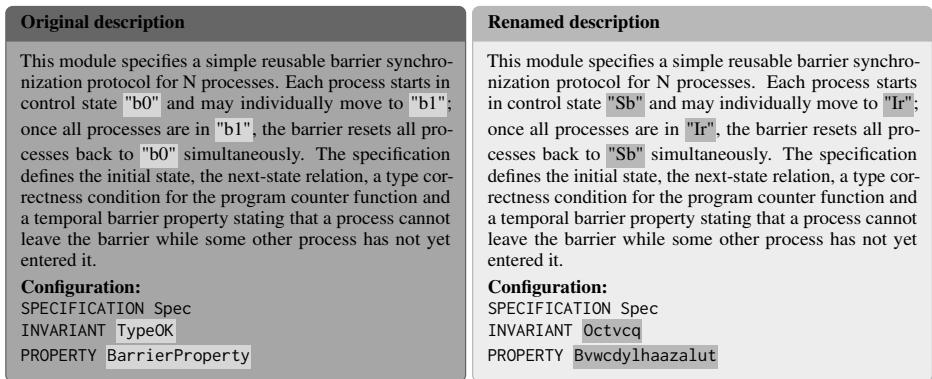
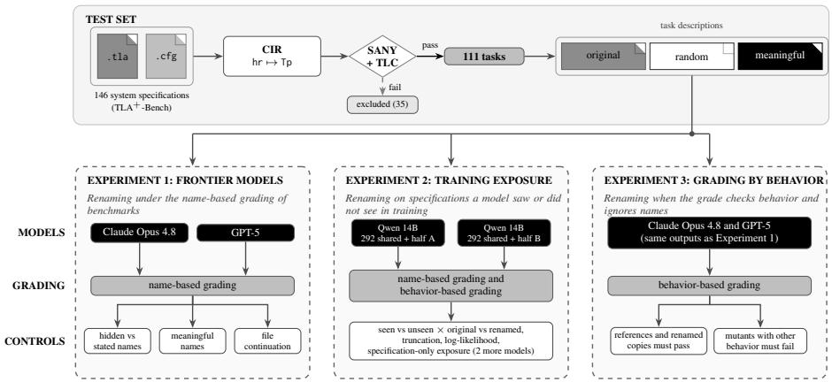
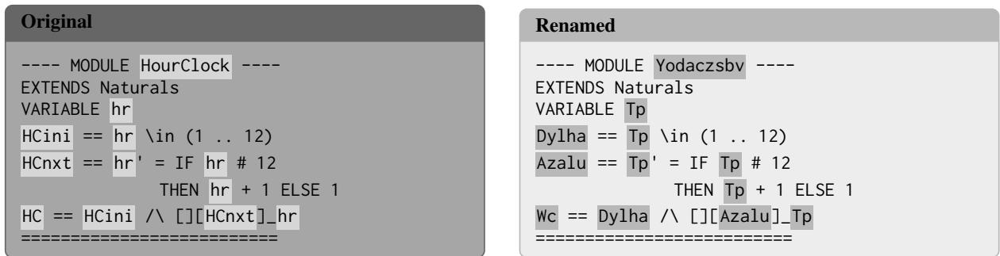
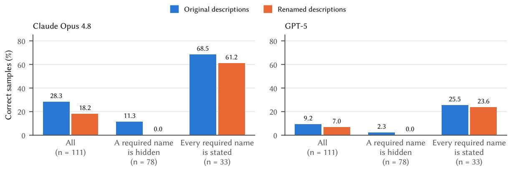
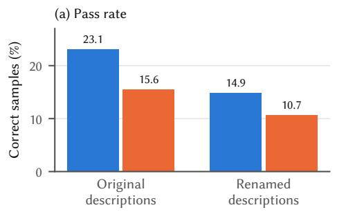
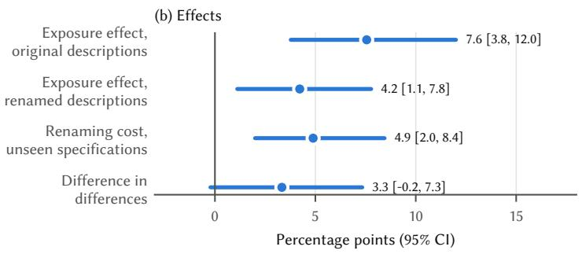
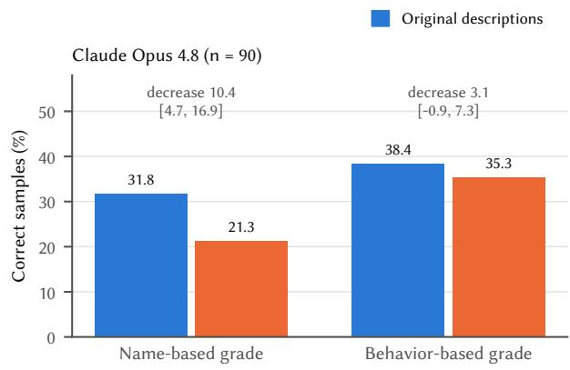
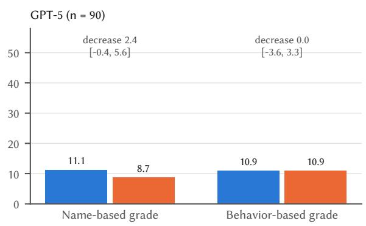

# ALIAS: Evaluating Performance and Memorization in LLM-Written TLA+ Specifications

Arslan Bisharat, Mujtaba Nazari, Khushboo Bhadauria, Brian Ortiz, Eric Spencer, Beatriz Santos, TaiNing Wang,   
George K. Thiruvathukal, Konstantin Läufer, Mohammed Abuhamad Loyola University Chicago

## Abstract

Memorization inflates the benchmark scores of large language models, since a model can reproduce answers it saw in training. Researchers test for it with consistent identifier renaming (CIR), which gives every identifier in a task a new name, and treat a lower score on the renamed task as evidence of recall. We test this method on the Temporal Logic of Actions Plus (TLA+) language, whose model checker acts as an oracle by confirming whether a renamed task keeps the exact behaviors of the original. Across 111 TLA+-Bench tasks, renaming lowers the correctness of Claude Opus 4.8 from 28% to 18% and of GPT-5 from 9% to 7%. Most of this decrease comes from how the test grades, which requires exact names that most descriptions never state. Grading by behavior shrinks the decrease to about 3 points for Opus 4.8 and to 0 for GPT-5. In two model families fine-tuned on disjoint halves of the tasks, renaming removes about half of the training gain in likelihood and costs 4.9 points (Qwen) and 1.3 points (Gemma) on unseen tasks. A lower score after renaming therefore mixes memorization, name-based grading and the cost of new names.

## 1 Introduction

TLA+ is a formal specification language engineers use to find design errors in concurrent and distributed systems before they build them, and Amazon Web Services has reported subtle bugs found this way in DynamoDB and S3 (Newcombe et al., 2015). A TLA+ specification describes the possible behaviors of a system, and the TLC model checker explores every reachable state and checks the properties that a configuration file lists by name (Lamport, 2002; Yu et al., 1999). Writing a correct specification takes time and expertise, so LLMs that write specifications from natural-language descriptions could help more engineers use the method. Benchmarks measure this by checking each generated specification with the TLA+ parser SANY and the model checker TLC (Cheng et al., 2026; Bisharat et al., 2026a,b).

TLA+-Bench and FormaLLM take their TLA+ specifications from public repositories on GitHub (Bisharat et al., 2026a,b), so a model under test may have been trained on the specifications in these benchmarks, and a score may then measure recall as well as skill. Coding models memorize parts of their training data (Yang et al., 2024) and score higher on problems that resemble their training examples (Riddell et al., 2024; Matton et al., 2024). Public TLA+ data is scarce, since TLA+-Bench collects 1,614 candidate specifications from 13 repositories (Bisharat et al., 2026b), and it is unknown whether models recall these few specifications. Likelihood-based detectors perform near chance on training and held-out data from the same distribution (Shi et al., 2024; Duan et al., 2024), so researchers rename every identifier of a task consistently and compare the scores on the original and renamed tasks (Wang et al., 2023; Le et al., 2025; De Koning et al., 2026; Gulati et al., 2025; Mirzadeh et al., 2025; Li, 2026; Yang et al., 2026; Spencer et al., 2026). We call this consistent identifier renaming (CIR), because each identifier gets one new name everywhere it appears. The test assumes that the renamed task is as hard as the original, so a lower score after CIR is read as evidence of memorization. We study this test on TLA+, because TLC can confirm that a renamed task keeps the behaviors of the original and can grade an answer by behavior.

We investigate memorization in LLM-written TLA+ through three experiments on 111 TLA+- Bench tasks whose renamed copies pass SANY and TLC. Experiment 1 grades the outputs of Claude Opus 4.8 (Anthropic, 2026) and GPT-5 (OpenAI, 2025) the way TLA+-Bench grades them, with the configuration file of the reference specification, which often requires names that the description never states (illustrated in Figure 1). Experiment 2 fine-tunes two copies each of Qwen2.5-Coder-14B and Gemma 4 31B on disjoint halves of the tasks, so each task is seen by one copy and unseen by the other, and compares the renaming decrease on seen and unseen tasks. Experiment 3 grades the outputs of Experiment 1 again by behavior, which ignores names. Together, the experiments show that a lower score after renaming has three possible causes, 1 memorization of the original task, 2 a grading practice that requires names the model is never given and 3 the extra difficulty of working with unfamiliar random names. This paper makes four contributions. 1 We show that much of the decrease after CIR on TLA+-Bench comes from the grading procedure. 2 We separate memorization from the cost of CIR with controlled fine-tuning on disjoint halves of the tasks, so the training exposure of every task is known. 3 We measure the decrease after CIR with a grade that checks behavior and ignores names. 4 We give recommendations for contamination tests and benchmark builders, and we release ALIAS, with the renamed tasks, the exposure split, all model outputs and the behavior-based grader.1

  
Figure 1: The Barrier task as the model receives it, with the configuration that checks the output. Renamed parts are shaded, and the description states neither required name.

## 2 Background and Related Work

Background. $\mathrm { T L A } ^ { + }$ is a language that describes how a system behaves over time (Lamport, 2002). A specification lists the variables of the system, the starting states and the steps that may change the variables, together with the properties that the system must satisfy (see Figure D.1 for a small clock). SANY parses the module for $\mathrm { T L A ^ { + } }$ syntax correctness and checks that every name in a specification is defined. TLC then explores every state that a finite instance can reach and checks invariants, which must hold in every state, and temporal properties, which must hold over whole behaviors (Yu et al., 1999) (see Appendix B). A configuration file gives TLC the constant values, the specification formula and the property names. A behavior is a sequence of states, and a specification G refines a specification R if every behavior of G is also a behavior of R. TLC checks this by running G against the formula of R after mapping the variables of R to those of G.

TLC finds operators and constants by the names in the configuration file, so the line INVARIANT TypeOK asks TLC to check the operator called TypeOK. A TLA+-Bench task has a natural-language description, which the model receives, and a configuration file, which checks the model’s output. The human-written $\mathrm { T L A } ^ { + }$ module behind each task is its reference specification, and the model never sees it (Bisharat et al., 2026b). An output passes only if it uses the exact name of every constant and property in the configuration file.

Names in Specifications. Authors of TLA+ specifications often use domain concepts when selecting identifier names. Human readers understand formal specifications better with meaningful names (Finney et al., 1998). For example, in Läufer’s Microwave specification (Läufer, 2022) the names door, radiation and DoorSafety tie the natural language description to the formal state. The configuration file also lists names, so a check that uses it requires those exact names.

Related Work. LLMs for formal specification. Several benchmarks let a checker grade formal artifacts from LLMs (Hou et al., 2024). For TLA+, SysMoBench grades models of real systems with SANY, TLC, trace validation and invariant checks (Cheng et al., 2026). Bisharat et al. use the comments of each specification as its task description (Bisharat et al., 2026a) and TLA+-Bench adds LLM-written descriptions to 403 model-checked and 897 parse-only specifications (Bisharat et al., 2026b). Interface names raise TLA+-Bench correctness up to 11-fold (Bisharat et al., 2026b). Spencer et al. rename modules to limit contamination (Spencer et al., 2026). Dafny, Lean and Verus benchmarks grade with verifiers (Loughridge et al., 2025; Ye et al., 2026; Yang et al., 2025), and some avoid contamination by design (Yang et al., 2023; Xu et al., 2026).

Measuring contamination. Some studies search training data for contamination (Yang et al., 2024; Riddell et al., 2024; Matton et al., 2024). Other studies control contamination by training models themselves. Magar and Schwartz pretrain BERT with chosen test sets in the corpus and separate memorization from its use on the task (Magar and Schwartz, 2022), Jiang et al. pretrain GPT-2 models with test inputs or full test examples in the corpus (Jiang et al., 2024), and Carlini et al. show that memorization grows with model size and with the number of repeats of an example (Carlini et al., 2023). Our exposure experiment follows this design with fine-tuning and adds renaming. Oren et al. test whether a model prefers a benchmark’s canonical example order (Oren et al., 2024).

Perturbation and renaming. Perturbation studies change a task and keep its meaning. Code studies rename identifiers among other changes (Wang et al., 2023; Yang et al., 2022; Xia et al., 2024; Zhang et al., 2024), and mathematical benchmarks change variables and constants (Mirzadeh et al., 2025; Gulati et al., 2025). Wu et al. note that counterfactual task variants may simply be harder (Wu et al., 2024). Le et al. remove identifier names from code-understanding tasks and find lower scores even on execution tasks (Le et al., 2025). De Koning et al. relate the decrease of each renamed program-repair task to a model’s likelihood of the original code (De Koning et al., 2026). Lean and Verus studies rename verified code (Li, 2026; Yang et al., 2026). These studies observe decreases on models with unknown training data, so how much of a decrease comes from memory, from the grade or from the new names is unknown.

## 3 Methods

A CIR test renames the identifiers of each reference specification, rewrites the description and configuration file with the new names and compares a model’s correctness on the two versions of each task, which we call the original and renamed conditions. We build such a test set and run three experiments on it with the same two grades (illustrated in Figure 2).

Dataset. We use the human-written reference specifications of the model-checked tier of TLA+- Bench (Bisharat et al., 2026b). This tier contains 403 specifications, each with a configuration file that passes TLC, and labels 146 of them as system specifications. We exclude the other 257 utility modules because they are small helpers in which our renaming affects a median of only five identifiers. Our test set contains the 111 tasks whose renamed reference specifications pass both SANY and TLC (see Table K.1).

Renaming. We replace each author-defined module name, constant, variable and operator with a random name of the same length, because SANY reads the layout of a formula (see Appendix G). The same map renames the specification, its configuration file and every module that imports it, and SANY and TLC confirm that the renamed copy still parses and passes model checking.

Renamed descriptions. Each specification in TLA+-Bench comes with a natural language description that mentions many of its operators and constants by name (Bisharat et al., 2026b). The original condition gives the LLM this description, and the renamed condition prompts the LLM with a copy of the original description in which those identifiers are replaced. Replacing every renamed identifier in the text would also change unrelated words, because authors use common words and algorithm names as identifiers (see Appendix G for the example and further details). We therefore rename each description with a fixed rule of three parts. 1 A name that the configuration refers to is always renamed, because the model needs the new name for TLC to check its output. 2 A lowercase word or a TLA+ module name keeps its name. 3 Every other identifier is renamed. This rule avoids damage to 45 descriptions.

Identifier kinds. We sort the identifiers of the reference specifications of the 111 tasks into three categories, 1 domain words, 2 TLA+ conventions such as Init and TypeOK and 3 abbreviations or single letter identifiers such as hr (see Appendix C). Table C.1 shows that a third of the 1,788 identifiers that our CIR test modifies are domain words. The model never sees the reference specification and reads only its English description. Renaming changes the identifiers that this description mentions by name and leaves the rest of the text as it is, so ordinary words such as barrier or process remain (illustrated in Figure 1). Of the domain identifiers whose words the original description uses, 199/219 (91%) keep those words after CIR. Hidden required names. The configuration file of a task names 1 the constants that TLC assigns values to, 2 the invariants and properties that TLC checks and 3 the constraints that limit the states TLC explores. An output is checked with this file, so it must define every identifier the file names. We call a listed identifier hidden if the description given to the model never mentions it by name. In the Bar rier task, the configuration checks TypeOK and BarrierProperty, and the description mentions neither of these two names (illustrated in Figure 1). After renaming, the configuration asks for Octvcq and Bvwcdylhaazalut, so a correct output fails whether or not the model has seen the specification in training. We exclude Init, Next and Spec, because the prompt asks for them by name and the name-based grade accepts them under any name (see Appendix H). In 78/111 tasks, the configura tion file lists at least one hidden name, so a correct output must define that exact name to pass TLC, and 29 of these tasks list five or more. The 333 hidden names are 115 constants, 113 invariants, 87 properties and 18 constraints. With the original description, a model can still guess some hidden names without recall, because 77 follow TLA+ conventions such as TypeOK. After renaming, every hidden name is a random string that no description, TLA+ convention or published file contains. Renaming therefore changes two parts of a task, 1 the description, which loses the author’s identifiers but keeps most of its domain words, and 2 the configuration file, which requires exact names.

  
Figure 2: The test set (top) and the three experiments (bottom), each with its models, grade and controls.

## Grading.

Parsing. A module passes parsing in our grading only if SANY exits with code 0 and reports no error. However, SANY can complete parsing with an exit code of 0 even for semantic errors such as an undefined operator.

Name-based grade. This grade follows TLA+- Bench. An output is correct if it parses and passes TLC with the configuration file of its task, and a TLC run over 300 seconds counts as a failure. For a renamed task, each name in the configuration file is replaced by its new name from the renamed specification and description (see Appendix H).

Behavior-based grade. This grade compares the behaviors of an output G with those of the reference R and does not require the names of the configuration file. It searches for a one-to-one mapping from the variables and constants of R to those of G, with identical names first and then up to 60 permutations. Under a mapping, the forward check runs G and checks the specification formula of R and the invariants and properties of its configuration, with the definitions of R, so it passes when every behavior of G is a behavior of R and satisfies the properties of R. The reverse check runs R and checks the safety formula Init ∧ ✷[Next]v of G under the inverse mapping, so an output that allows too few behaviors, such as one that never moves, fails. G is correct when both checks pass under one mapping (see Appendix H). Variables whose string values act as control labels, such as the pc of a PlusCal translation, get extra handling (see Appendix I). Each condition is graded against its own reference specification, so the renamed condition uses the renamed specification, its renamed

imported modules and the renamed configuration.   
Analysis and Metrics.

Metrics. We report three metrics for each sample. 1 Parse, the output passes SANY with no syntax or semantic error. 2 Correct, name-based, the output parses and passes TLC under the configuration of its condition. 3 Correct, behavior-based, the output passes both refinement checks against the reference. We also report text similarity to the reference (see Appendix V). The unit of analysis is the task. For each task and condition, the pass rate is the fraction of the five samples that pass, which estimates pass@1 (Chen et al., 2021). We report the mean difference between two conditions with a 95% confidence interval from 10,000 bootstrap resamples of tasks. We also report a two-sided sign test over the tasks whose pass rates differ. For the two renamings, we test equivalence with two one-sided tests at a margin of 5 points. Equivalence holds when the 90% bootstrap interval of the difference lies inside the margin.

Experiment 1: Name-Based Grading. This experiment measures how renaming changes the correctness of frontier models under the grading that TLA+-Bench uses, and which tasks lose correctness.

Models and prompting. Renaming can only lower a score if the model writes some correct specifications for the original tasks. On TLA+- Bench, open-weight models pass TLC on at most 1% of system specifications and Claude Opus 4.5 passes on 16% (Bisharat et al., 2026b), so we study Claude Opus 4.8 and GPT-5. Both models receive the same prompt and write five independent samples per task and condition, and Experiment 3 grades the same outputs a second time. The prompt asks for a complete TLA+ module with Init, Next, Spec and the safety, liveness and fairness conditions of the description (see Appendix A).

Controls. Three controls test other explanations of a decrease. 1 We split the results by whether a task hides a required name (illustrated in Figure 1), because a hidden name fails a correct output in the renamed condition. 2 Random names may lower correctness because they carry no meaning, so a third condition replaces each identifier with a meaningful name that Opus 4.8 proposes, re-verified with SANY and TLC in the same way, which gives 77 valid tasks (see Appendix R). 3 A file continuation test shows each model the first 40% of a published file with its repository and path and asks it to continue the file, and we compare the longest token run shared with the real file against the same run for the renamed copy, which no model can have seen (see Appendix L).

Experiment 2: Controlled Exposure. Experiment 1 cannot tell whether a model saw a task, because the training data of Opus 4.8 and GPT-5 is unknown. The pretraining data of open models such as Qwen and Gemma is not fully known either, so this experiment adds exposure that we control. It fine-tunes each model on half of the tasks and compares the renaming decrease on seen and unseen tasks.

Fine-tuned models. We split the 111 tasks at random with seed 20260926 into halves, A (55 tasks) and B (56 tasks). Both training sets contain the 292 model-checked TLA+-Bench tasks outside the test set. We fine-tune one copy of Qwen2.5-Coder-14B-Instruct on these 292 tasks and the 55 of half A, and a second copy on the 292 and the 56 of half B, and we shuffle each training set with a fixed seed. Each training pair consists of a declarative description and its reference specification. Every test task is thus seen by one model and unseen by the other. We call this task-pair exposure since the model sees each specification together with its test description. Both LLMs are fine-tuned with the Low-Rank Adaptation (LoRA) method (Hu et al., 2022) and train for three epochs over their respective datasets, so each specification is seen three times in training (see Appendix E for the training settings). We test both models on the 110 tasks with a configuration in both conditions. We repeat the experiment with a second model family, Gemma 4 31B (Gemma Team, Google DeepMind, 2026), fine-tuned on the same halves with the same training settings (see Appendix F). Each model generates five samples per task and condition with temperature 0.7, top-p 0.95 and at most 1,024 new tokens per sample.

Randomized exposure. Crossing the two models with the two conditions gives four cells per task. From these cells we measure 1 the exposure effect, the gain from training on a task, 2 how much renaming reduces that gain and 3 the renaming cost on unseen tasks.

Controls. Random names have more tokens, so renamed outputs more often hit the 1,024-token limit, and we repeat the analysis on the tasks with no truncated output (see Appendix N). A second pair of models sees each half of the test set as the raw .tla file alone (see Appendix O).

Log-likelihood. We also measure how likely each model finds the reference specification, given its description. This is the mean token log-likelihood, the average log-probability that the model assigns to each token of the reference, and a higher value means that the model expects that exact text more. The measure carries information even when few outputs pass TLC. We score the first 2,048 tokens of description and reference together, the length limit used in training. A gain in likelihood after exposure could come from the original names alone, so we also report the mean over the tokens that do not overlap a renamed identifier, which hold the keywords, operators and structure.

Analysis. The exposure effect in each condition is the mean over tasks of the pass rate of the model that saw the task minus the pass rate of the model that did not. The change in the exposure effect under renaming is the difference in differences (DiD)

$$
\mathrm { D i D } = \frac { 1 } { n } \sum _ { s } \Big [ ( c _ { s } - r _ { s } ) _ { \mathrm { s e e n } } - ( c _ { s } - r _ { s } ) _ { \mathrm { u n s e e n } } \Big ] ,
$$

where $c _ { s }$ and $r _ { s }$ are the pass rates (or mean loglikelihoods) of task s in the original and renamed conditions, respectively. The first term uses the model that saw s and the second uses the model that did not. A positive DiD means that renaming costs more on seen tasks. The renaming cost on unseen tasks is $\begin{array} { r } { \frac { 1 } { n } \sum _ { s } ( c _ { s } - r _ { s } ) } \end{array}$ )unseen, and memory plays no part in it.

Experiment 3: Behavior-Based Grading. Experiment 1 grades outputs by name, so a correct output fails whenever it misses a hidden name. This experiment grades the same outputs of Opus 4.8 and GPT-5 again by behavior and compares the decrease under both grades on the same tasks. A decrease that remains under the behavior-based grade cannot come from hidden names.

Grader validation. As positive controls, the grade should accept each reference against itself, each renamed reference with its renamed imported modules and a copy of each reference with renamed operators that still passes SANY and TLC. As negative controls, it should reject mutants, which change one number, comparison, initial value, guard or disjunct of a reference, and we keep a mutant only if TLC reports a different number of reachable states (see Appendix J). The grade covers the 90/111 tasks whose reference passes against itself, and both grades are compared on these tasks. Disagreements. We read the outputs on which the two grades disagree and sort them by cause. As an upper bound on errors of our grader, we also recompute the decrease with every output that passes only the name-based grade counted as correct (see Appendix P for the cases).

<table><tr><td>Measure</td><td>Original</td><td>Random</td><td>Meaningful</td></tr><tr><td>Claude Opus 4.8</td><td></td><td></td><td></td></tr><tr><td>Parse (SANY)</td><td>80.4</td><td>81.6</td><td>81.0</td></tr><tr><td>Correct, name</td><td>28.3</td><td>18.2</td><td>20.0</td></tr><tr><td>Correct, behavior</td><td>38.4</td><td>35.3</td><td>37.7</td></tr><tr><td>GPT-5</td><td></td><td></td><td></td></tr><tr><td>Parse (SANY)</td><td>66.1</td><td>70.5</td><td>69.1</td></tr><tr><td>Correct, name</td><td>9.2</td><td>7.0</td><td>7.3</td></tr><tr><td>Correct, behavior</td><td>10.9</td><td>10.9</td><td>11.1</td></tr></table>

Table 1: Frontier models on the test set, in percent. Meaningful names use the 77 tasks with a valid meaningful renaming, and the behavior-based rows use the 90 that the grade covers.

## 4 Results and Discussion

Experiment 1: Name-Based Grading. Opus 4.8. Opus 4.8 is correct on 28.3% of samples with the original descriptions and on 18.2% with the renamed ones (Table 1), a mean decrease per task of 10.1 points (95% CI 5.0 to 15.7), with 18 tasks that now fail and two that now pass (sign test $p = 0 . 0 0 0 4 )$ . The parse rate stays near 81% in both conditions. In the original condition it would be 93.3% if outputs that SANY accepts with exit code 0 despite a semantic error counted as parsed. Hidden names. On the 78 tasks with a hidden required name, correctness is 11.3% with the original descriptions and 0.0% with the renamed ones, so all 14 tasks that passed now fail (see Figure S.1). On the 33 tasks whose descriptions state every required name, correctness is 68.5% and 61.2%, a decrease of 7.3 points (95% CI −2.4 to 18.2), with four tasks that now fail and two that now pass.

Meaningful names. Under the name-based grade, meaningful and random names score the same in correctness within a margin of 5 points (see Appendix R).

GPT-5. GPT-5 is correct on 9.2% of samples with the original descriptions and 7.0% with the renamed ones, a decrease of 2.2 points (95% CI −0.4 to 4.7), and on the 78 tasks with a hidden name it falls from 2.3% to 0.0%.

File continuation. How much of a published file a model can continue does not predict which tasks lose correctness under renaming (see Appendix L). What Experiment 1 shows. Renaming lowers the correctness of Opus 4.8 by about a third, which a CIR test reads as memorization. The decrease sits on the 78 tasks with hidden names, where the renamed configuration asks for random names that no model can know, and the 33 tasks that state every name lose 7.3 points with an interval that includes 0. Meaningful names and file continuation do not explain the decrease. Under the grading of TLA+-Bench, a renaming decrease thus measures the grade as well as the model, and Experiment 3 tests how much.

<table><tr><td>Measure</td><td>Exposure</td><td>DiD</td><td>Unseen cost</td></tr><tr><td colspan="2">Qwen2.5-Coder-14B</td><td></td><td></td></tr><tr><td rowspan="2">Correct, behavior</td><td>7.6</td><td>3.3</td><td>4.9</td></tr><tr><td>[3.8, 12.0]</td><td>[−0.2, 7.3]</td><td>[2.0, 8.4]</td></tr><tr><td>Correct, name</td><td>5.6 [2.2, 9.6]</td><td>3.5 [0.4, 6.9]</td><td>4.4 [1.5, 7.6]</td></tr><tr><td>Likelihood</td><td>0.34</td><td>0.16</td><td>一</td></tr><tr><td>Likelihood, other</td><td>[0.30, 0.39] 0.31</td><td>[0.13, 0.19] 0.07</td><td>一</td></tr><tr><td>Gemma 431B</td><td>[0.27, 0.35]</td><td>[0.06, 0.09]</td><td></td></tr><tr><td>Correct, behavior</td><td></td><td></td><td></td></tr><tr><td rowspan="2"></td><td>8.0</td><td>3.6</td><td>1.3</td></tr><tr><td>[3.6, 12.9]</td><td>[−0.9, 8.2]</td><td>[−2.0, 4.9]</td></tr><tr><td rowspan="2">Correct, name</td><td>7.8</td><td>5.8</td><td>4.2</td></tr><tr><td>[3.6, 12.4]</td><td>[1.5, 10.5]</td><td>[0.4, 8.5]</td></tr><tr><td>Likelihood</td><td>0.33 [0.29, 0.38]</td><td>0.15 [0.12, 0.18]</td><td></td></tr></table>

Table 2: Effects of task-pair exposure for two model families with 95% CIs, in percentage points for correctness and in mean token log-likelihood for likelihood. Unseen cost is original minus renamed on unseen tasks, and other uses only tokens outside renamed identifiers.

Experiment 2: Controlled Exposure. Qwen. Under the behavior-based grade, training on a task raises the correctness of Qwen by 7.6 points (95% CI 3.8 to 12.0) with the original descriptions and by 4.2 points (95% CI 1.1 to 7.8) with the renamed ones (Table 2; see also Figure T.1). Renaming lowers correctness by 4.9 points (95% CI 2.0 to 8.4) on unseen tasks. The DiD is 3.3 points (95% CI −0.2 to 7.3), and 3.5 points (95% CI 0.4 to 6.9) under the name-based grade on 110 tasks.

Likelihood. For 108/110 tasks, the Qwen model trained on a task finds its reference specification more likely than the other model. Renaming lowers this exposure effect from 0.34 to 0.18, a DiD of 0.16 (95% CI 0.13 to 0.19) that is positive for 110/110 tasks. On the tokens outside the renamed identifiers, the DiD is 0.07 (95% CI 0.06 to 0.09) and positive for 101/110 tasks.

Gemma 4. Gemma 4 31B shows an exposure effect of 8.0 points (95% CI 3.6 to 12.9) and a likelihood DiD of 0.15 (95% CI 0.12 to 0.18), with a higher likelihood for the seen model on 109/110 tasks. Its renaming cost on unseen tasks is 1.3 points (95% CI −2.0 to 4.9) under the behavior-based grade and 4.2 points (95% CI 0.4 to 8.5) under the namebased grade (see Appendix F).

Controls. On the 43/90 tasks with no truncated output, the renaming cost on unseen tasks is 9.8 points (95% CI 3.7 to 16.3; see Appendix N). Models fine-tuned on the raw TLA+ files show no effect on correctness, and their likelihood DiD is 0.08 (95% CI 0.07 to 0.10; see Appendix O).

What Experiment 2 shows. With exposure known, the two parts of a decrease separate. Training leaves a memory of the seen tasks, and renaming removes about half of the likelihood gain in both families, including on keywords and structure that renaming leaves unchanged. On correctness, the DiD interval includes 0 under the behavior-based grade in both families, so the part of a correctness decrease that comes from memory is too small to measure on 90 tasks. Renaming also lowers correctness on tasks a model never saw, by 4.9 points for Qwen, where memory plays no part. A renaming decrease can therefore appear without memorization, and its size depends on the model.

## Experiment 3: Behavior-Based Grading.

Grader validation. The grader accepts all 90 renamed references and all 56 valid operatorrenamed copies, and rejects all 105 mutants with altered behavior (see Table J.1).

Opus 4.8. On the 90 tasks that both grades cover (see Figure U.1), Opus 4.8 is correct on 31.8% of samples with the original descriptions and on 21.3% with the renamed ones under the namebased grade, a decrease of 10.4 points (95% CI 4.7 to 16.9). Under the behavior-based grade, it is correct on 38.4% and 35.3%, a decrease of 3.1 points (95% CI −0.9 to 7.3; see Appendix U). In the Barrier task, all five renamed outputs fail the name-based grade on the hidden names and pass the behavior-based grade.

Disagreements. Most outputs that pass only the behavior-based grade miss a hidden name. Outputs that pass only the name-based grade behave differently from the reference or hit a limit of our grader, and the different ones pass because TLC checks each invariant with the output’s own definition, so even an output that defines TypeOK as TRUE passes that check (see Appendix P). If every name-only pass counts as correct, the decrease is 5.1 points (95% CI 0.4 to 10.2) for Opus 4.8 and 0.4 points (95% CI −3.1 to 4.0) for GPT-5.

GPT-5. On the same 90 tasks, the decrease of GPT-5 is 2.4 points under the name-based grade and 0.0 points (95% CI −3.6 to 3.3) under the behaviorbased grade, with 10.9% in both conditions. Its 90% interval, −2.9 to 2.9, lies inside the 5-point margin, but at a base rate near 11% this margin is almost half of GPT-5’s correctness.

What Experiment 3 shows. When the grade ignores names, the decrease of Opus 4.8 falls from 10.4 to 3.1 points and that of GPT-5 from 2.4 to 0.0 points, and for Opus 4.8 the 64 covered tasks with hidden names lose only 2.5 points (see Appendix U). Most of the decrease in Experiment 1 thus came from the grade. The interval for Opus 4.8 still reaches 7.3 points, so a cost of new names of the size that Experiment 2 measures on unseen tasks is still possible for Opus 4.8.

Discussion. Implications for TLA+ benchmarks. Experiments 1 and 3 show that a check with the reference configuration file grades both what a specification does and how it names identifiers, and in 78/111 of our tasks the description leaves out a required name. Listing every required name in the task separates the two, but it also tells the model which invariants and properties to write, which removes part of the task. The same check accepts outputs with weaker invariants (Experiment 3), and the SANY exit code overstates parsing (Experiment 1). Of four public TLA+ benchmarks, only TLA+-Bench needs a name that the task does not state (see Table Q.1).

Implications for benchmark builders. From these results, we suggest four practices for TLA+ benchmarks, 1 grade by behavior against the reference’s own properties, 2 when grading depends on names, state every required name in the task or report tasks with hidden names separately, 3 count semantic errors as parse failures and 4 reverify renamed copies with the model checker. The same may hold outside TLA+, because names carry meaning in code as well (Le et al., 2025), and unit tests and proof checkers also look up names that tasks may omit.

Implications for contamination studies. Experiment 2 shows that, under a grade that ignores names, a decrease after renaming can still come from two sources, memory of the original task and the cost of working with new names, and that known exposure separates them. Memory shows in the models we fine-tuned, since renaming removed about half of the gain from training in how likely the model finds the reference. The cost of new names shows on tasks a model never saw, since memory plays no part there, and under the behaviorbased grade it was 4.9 points for Qwen and 1.3 points for Gemma (95% CI −2.0 to 4.9). On a model whose training data is unknown, a single decrease adds these two sources together and cannot separate them. For Opus 4.8 and GPT-5, most of the decrease comes from grading, and the interval of the decrease under the behavior-based grade includes 0 but leaves room for a name cost of several points. Contamination studies could add a model with known exposure and report the decrease separately for seen and unseen items.

## 5 Conclusion

We renamed every author-defined identifier in 111 model-checked TLA+ specifications and confirmed with SANY and TLC that each renamed benchmark task keeps the behaviors of the original task. Under the grading of TLA+-Bench, renaming lowers the correctness of Claude Opus 4.8 from 28.3% to 18.2%, mostly because of configuration names that the description never states. Graded by behavior, the decrease is 3.1 points for Opus 4.8 (95% CI −0.9 to 7.3) and 0.0 points for GPT-5 (95% CI −3.6 to 3.3). In the LLMs we finetuned, training made the reference specification more likely to the model, and renaming removed about half of that gain. On tasks a model never saw, renaming lowered correctness by 4.9 points for Qwen and 1.3 points for Gemma. A decrease after renaming therefore mixes memorization with grading by name and with the cost of new names, so it cannot show memorization by itself.

## Limitations

Internal validity. The descriptions shape what a model writes, and TLA+-Bench writes them with an LLM. Every comparison in our experiments is paired, because the original and renamed versions of a task share one description and differ only in the renamed identifiers, so the quality of a description affects both conditions equally and does not change the decrease. The renaming rule keeps 91% of the domain words of a description, so the renamed task asks for the same system. The rule also keeps the names of known algorithms such as Paxos, which a model could use to recall a known specification. Tasks with such a name are harder for both frontier models and lose no more correctness under renaming than the other tasks (see Appendix M), so this risk is small, and a direct test that asks for a specification from the algorithm name alone needs further study. Claude Opus 4.8 proposed the meaningful names and is also tested on them, so these names may suit it. In the exposure experiment, both models of a family share the same 292 training tasks with original names, so even unseen tasks follow naming conventions that the models learned. Construct validity. We measure three constructs. Construct validity. We measure three constructs.

1 Correctness is passing TLC on the finite instance that the configuration bounds, so an output that passes may still be wrong for larger parameters. The behavior-based grade requires as many variables and constants as the reference and searches at most 60 variable mappings, so an output that splits a variable or derives a declared constant fails even when its behaviors match. Its reverse check tests only the output’s safety formula, so it accepts extra fairness conditions. 2 Memorization is the exposure effect of LoRA fine-tuning on each task three times with its test description. Contamination through public files exposes a model to the file alone, and our specification-only arm, which trains this way, stays too low on correctness to show an effect (see Table O.1). LoRA updates only small low-rank weights, so it may understate the memory that pretraining leaves. 3 The cost of new names is the decrease on unseen tasks. Random names also lengthen the token sequence, which the truncation analysis controls (see Appendix N), and CIR keeps the structure of a specification, so a model can still use a recalled structure.

External validity. All tasks come from one benchmark, TLA+-Bench, and the 111 reference specifications are mostly single-module. The exposure experiment uses two open model families, and the cost of new names differs between them, 4.9 points for Qwen and 1.3 points for Gemma, so its size depends on the model and may differ for frontier models.

Statistical conclusion validity. The main threat is sample size, because public TLA+ specifications are few and TLA+-Bench has only 146 modelchecked system specifications. The behavior-based grade covers 90 tasks, the group with every required name stated has 33, and the pass rates of the exposure experiment lie between 7% and 23%, so a decrease of a few points falls inside the intervals, and the DiD on correctness includes 0 for both families. The likelihood measure does not depend on correct outputs and shows the exposure effect and its reduction under renaming clearly. We report several comparisons without a correction for multiple tests, and the bootstrap resamples tasks and misses the variation between training runs, since each exposure model is trained once with one split and one seed.

## Ethical Considerations

The specifications come from TLA+-Bench, which collects them from 13 public repositories whose licenses permit redistribution with attribution (Bisharat et al., 2026b). Each renamed copy is derived from one of these specifications, so the license of the original specification applies to it. The study involves no human participants and collects no personal data. We queried Opus 4.8 and GPT-5 through their commercial APIs under the providers’ terms of use.

## Acknowledgments

We used a generative AI tool to assist with editing the text and with writing analysis code. The authors reviewed all text, code and results and take full responsibility for them.

## References

Anthropic. 2026. Introducing Claude Opus 4.8. https: //www.anthropic.com/news/claude-opus-4-8.

A. Bisharat, B. Ortiz, E. Spencer, K. Bhadauria, T. Wang, G. K. Thiruvathukal, K. Läufer, and M. Abuhamad. 2026a. Can llms write correct tla+ specifications? evaluating natural-language-to-tla+ generation. In Proceedings of the 21st International Conference on Software Technologies, pages 39–50.

A. Bisharat, E. Spencer, B. Ortiz, K. Bhadauria, M. Nazari, B. Santos, A. Ramos, T. Wang, G. K. Thiruvathukal, K. Läufer, and M. Abuhamad. 2026b. TLA+-Bench: An execution-grounded benchmark and dataset for natural-language to TLA+ specification generation. arXiv preprint arXiv:2607.23425. Preprint, arXiv:2607.23425.

Nicholas Carlini, Daphne Ippolito, Matthew Jagielski, Katherine Lee, Florian Tramèr, and Chiyuan Zhang. 2023. Quantifying memorization across neural language models. In International Conference on Learning Representations (ICLR).

Mark Chen, Jerry Tworek, Heewoo Jun, Qiming Yuan, Henrique Ponde de Oliveira Pinto, Jared Kaplan, et al. 2021. Evaluating large language models trained on code. arXiv preprint arXiv:2107.03374.

Qian Cheng, Ruize Tang, Emilie Ma, Finn Hackett, Peiyang He, Yiming Su, Ivan Beschastnikh, Yu Huang, Xiaoxing Ma, and Tianyin Xu. 2026. Sysmobench: Evaluating ai on formally modeling complex real-world systems. In International Conference on Learning Representations (ICLR).

Milan De Koning, Ali Asgari, Pouria Derakhshanfar, and Annibale Panichella. 2026. A metamorphic testing approach to diagnosing memorization in LLM-based program repair. arXiv preprint arXiv:2604.21579.

Michael Duan, Anshuman Suri, Niloofar Mireshghallah, Sewon Min, Weijia Shi, Luke Zettlemoyer, Yulia Tsvetkov, Yejin Choi, David Evans, and Hannaneh Hajishirzi. 2024. Do membership inference attacks work on large language models? In Conference on Language Modeling (COLM).

Kate Finney, Keith Rennolls, and Alex Fedorec. 1998. Measuring the comprehensibility of Z specifications. Journal ofSystems and Software, 42(1):3–15.

Gemma Team, Google DeepMind. 2026. Gemma 4. https://huggingface.co/google/ gemma-4-31B-it.

Shahriar Golchin and Mihai Surdeanu. 2024. Time travel in LLMs: Tracing data contamination in large language models. In International Conference on Learning Representations (ICLR).

Aryan Gulati, Brando Miranda, Eric Chen, Emily Xia, Kai Fronsdal, Bruno Dumont, Elyas Obbad, and Sanmi Koyejo. 2025. Putnam-AXIOM: A functional and static benchmark for measuring higher level mathematical reasoning in LLMs. In Proceedings of the 42nd International Conference on Machine Learning (ICML), volume 267 of PMLR.

Xinyi Hou, Yanjie Zhao, Yue Liu, Zhou Yang, Kailong Wang, Li Li, Xiapu Luo, David Lo, John Grundy, and Haoyu Wang. 2024. Large language models for software engineering: A systematic literature review. ACM Transactions on Software Engineering and Methodology.

Edward J. Hu, Yelong Shen, Phillip Wallis, Zeyuan Allen-Zhu, Yuanzhi Li, Shean Wang, Lu Wang, and Weizhu Chen. 2022. LoRA: Low-rank adaptation of large language models. In International Conference on Learning Representations (ICLR).

Minhao Jiang, Ken Ziyu Liu, Ming Zhong, Rylan Schaeffer, Siru Ouyang, Jiawei Han, and Sanmi Koyejo. 2024. Investigating data contamination for pre-training language models. arXiv preprint arXiv:2401.06059.

Markus Alexander Kuppe. 2025. TLAi+Bench: A dataset and benchmark suite for evaluating LLMs on TLA+ formal specification tasks. https://github. com/tlaplus/TLAiBench.

Leslie Lamport. 2002. Specifying Systems: The TLA+ Language and Tools for Hardware and Software Engineers. Addison-Wesley.

Konstantin Läufer. 2022. TLA+ microwave model. https://github.com/ lucformalmethodscourse/microwave-tla. Loyola University Chicago formal methods course.

Cuong Chi Le, Minh V.T. Pham, Cuong Duc Van, Hoang N. Phan, Huy N. Phan, and Tien N. Nguyen. 2025. When names disappear: Revealing what llms actually understand about code. arXiv preprint arXiv:2510.03178.

Lixing Li. 2026. Evaluating the architectural reasoning capabilities of LLM provers via the obfuscated natural number game. In AAAI Spring Symposium on Machine Learning and Knowledge Engineering (MAKE). ArXiv:2605.00677.

Chin-Yew Lin. 2004. ROUGE: A package for automatic evaluation of summaries. In Text Summarization Branches Out, pages 74–81. Association for Computational Linguistics.

Chloe Loughridge, Qinyi Sun, Seth Ahrenbach, Federico Cassano, Chuyue Sun, Ying Sheng, Anish Mudide, Md Rakib Hossain Misu, Nada Amin, and Max Tegmark. 2025. Dafnybench: A benchmark for formal software verification. Transactions on Machine Learning Research.

Inbal Magar and Roy Schwartz. 2022. Data contamination: From memorization to exploitation. In Proceedings of the 60th Annual Meeting of the Association for Computational Linguistics (Volume 2: Short Papers), pages 157–165.

Alexandre Matton, Tom Sherborne, Dennis Aumiller, Elena Tommasone, Milad Alizadeh, Jingyi He, Raymond Ma, Maxime Voisin, Ellen Gilsenan-McMahon, and Matthias Gallé. 2024. On leakage of code generation evaluation datasets. In Findings of the Association for Computational Linguistics: EMNLP 2024.

Iman Mirzadeh, Keivan Alizadeh-Vahid, Hooman Shahrokhi, Oncel Tuzel, Samy Bengio, and Mehrdad Farajtabar. 2025. GSM-Symbolic: Understanding the limitations of mathematical reasoning in large language models. In International Conference on Learning Representations (ICLR).

Chris Newcombe, Tim Rath, Fan Zhang, Bogdan Munteanu, Marc Brooker, and Michael Deardeuff. 2015. How Amazon web services uses formal methods. Communications ofthe ACM, 58(4):66–73.

OpenAI. 2025. Introducing GPT-5. https://openai. com/index/introducing-gpt-5/.

Yonatan Oren, Nicole Meister, Niladri Chatterji, Faisal Ladhak, and Tatsunori B. Hashimoto. 2024. Proving test set contamination in black-box language models. In International Conference on Learning Representations (ICLR).

Kishore Papineni, Salim Roukos, Todd Ward, and Wei-Jing Zhu. 2002. BLEU: a method for automatic evaluation of machine translation. In Proceedings ofthe 40th Annual Meeting ofthe Associationfor Computational Linguistics (ACL), pages 311–318.

Martin Riddell, Ansong Ni, and Arman Cohan. 2024. Quantifying contamination in evaluating code generation capabilities of language models. In Proceedings of the 62nd Annual Meeting of the Association for Computational Linguistics (ACL).

Weijia Shi, Anirudh Ajith, Mengzhou Xia, Yangsibo Huang, Daogao Liu, Terra Blevins, Danqi Chen, and Luke Zettlemoyer. 2024. Detecting pretraining data from large language models. In International Conference on Learning Representations (ICLR).

E. Spencer, A. Bisharat, B. Ortiz, M. Nazari, K. Bhadauria, T. Wang, G. K. Thiruvathukal, K. Läufer, and M. Abuhamad. 2026. Tla-prover: Verifiable tla+ specification synthesis via preference-optimized lowrank adaptation. In Proceedings ofthe 21st International Conference on Software Technologies, pages 627–636. SCITEPRESS.

The tlaps-bench Authors. 2026. TLAPS-Bench: Formally proving the correctness of complex protocols and systems using TLA+ proof system. https: //github.com/specula-org/TLAPS-Bench. Version 2.0.0.

Shiqi Wang, Zheng Li, Haifeng Qian, Chenghao Yang, Zijian Wang, Mingyue Shang, Varun Kumar, Samson Tan, Baishakhi Ray, Parminder Bhatia, Ramesh Nallapati, Murali Krishna Ramanathan, Dan Roth, and Bing Xiang. 2023. ReCode: Robustness evaluation of code generation models. In Proceedings of the 61st Annual Meeting of the Association for Computational Linguistics (ACL).

Zhaofeng Wu, Linlu Qiu, Alexis Ross, Ekin Akyürek, Boyuan Chen, Bailin Wang, Najoung Kim, Jacob Andreas, and Yoon Kim. 2024. Reasoning or reciting? exploring the capabilities and limitations of language models through counterfactual tasks. In Proceedings of the 2024 Conference of the North American Chapter of the Association for Computational Linguistics (NAACL).

Chunqiu Steven Xia, Yinlin Deng, and Lingming Zhang. 2024. Top leaderboard ranking = top coding proficiency, always? EvoEval: Evolving coding benchmarks via LLM. In Conference on Language Modeling (COLM).

Dong Xu, Jialun Cao, Guozhao Mo, Junjie Hu, Cheng Wen, Hongyu Lin, Xianpei Han, Shengchao Qin, Cong Tian, Shing-Chi Cheung, Le Sun, and Yaojie Lu. 2026. LiveFMBench: Unveiling the power and limits of agentic workflows in specification generation. arXiv preprint arXiv:2605.01394.

Chenyuan Yang, Xuheng Li, Md Rakib Hossain Misu, Jianan Yao, Weidong Cui, Yeyun Gong, Chris Hawblitzel, Shuvendu Lahiri, Jacob R. Lorch, Shuai Lu, Fan Yang, Ziqiao Zhou, and Shan Lu. 2025. AutoVerus: Automated proof generation for Rust code. Proceedings of the ACM on Programming Languages (OOPSLA).

Jun Yang, Yuechun Sun, Yi Wu, Rodrigo Caridad, Yongwei Yuan, Jianan Yao, Shan Lu, and Kexin Pei. 2026. ExVerus: Verus proof repair via counterexample reasoning. arXiv preprint arXiv:2603.25810.

Kaiyu Yang, Aidan M. Swope, Alex Gu, Rahul Chalamala, Peiyang Song, Shixing Yu, Saad Godil, Ryan Prenger, and Anima Anandkumar. 2023. LeanDojo: Theorem proving with retrieval-augmented language models. In Advances in Neural Information Processing Systems (NeurIPS), Datasets and Benchmarks Track.

Zhou Yang, Jieke Shi, Junda He, and David Lo. 2022. Natural attack for pre-trained models of code. In Proceedings ofthe 44th International Conference on Software Engineering (ICSE), pages 1482–1493.

Zhou Yang, Zhipeng Zhao, Chenyu Wang, Jieke Shi, Dongsun Kim, Donggyun Han, and David Lo. 2024. Unveiling memorization in code models. In Proceedings of the 46th IEEE/ACM International Conference on Software Engineering (ICSE).

Zhe Ye, Zhengxu Yan, Jingxuan He, Timothe Kasriel, Kaiyu Yang, and Dawn Song. 2026. Verina: Benchmarking verifiable code generation. In International Conference on Learning Representations (ICLR).

Yuan Yu, Panagiotis Manolios, and Leslie Lamport. 1999. Model checking tla+ specifications. In Correct Hardware Design and Verification Methods (CHARME).

Yuhao Zhang, Shiqi Wang, Haifeng Qian, Zijian Wang, Mingyue Shang, Linbo Liu, Sanjay Krishna Gouda, Baishakhi Ray, Murali Krishna Ramanathan, Xiaofei Ma, and Anoop Deoras. 2024. Codefort: Robust training for code generation models. In Findings of the Association for Computational Linguistics: EMNLP 2024.

Appendix Contents   
A Prompt 13   
B Properties That TLC Checks 13   
C Identifier Kinds 13   
D Renaming Example 13   
E Fine-Tuning Settings 13   
F Gemma 4 Exposure Experiment 13   
G Renaming Details 13   
H Grading Details 14   
Control-Label Variables in the Behavior-  
Based Grade 14   
J Validation of the Behavior-Based Grade 14   
K Task Counts 15   
L File Continuation 15   
M Known Algorithm Names 15   
N Truncation 16   
O Specification-Only Exposure 16   
P Disagreements Between the Two Grades 17   
Grading in Public TLA+ Benchmarks 17   
R Meaningful Names 17   
S Additional Results of Experiment 1 17   
T Additional Results of Experiment 2 17   
U Additional Results of Experiment 3 17   
V Text Similarity 18

## A Prompt

We query Opus 4.8 through the Anthropic Message Batches API and GPT-5 through the OpenAI Batch API, each with its default sampling settings. The frontier models receive the following instruction, with the description in place of {description}.

You are a TLA+ specification engineer. You will receive a   
natural language description of a system. Produce a   
complete, syntactically correct TLA+ specification that   
faithfully captures the described behavior. The output   
must be a valid TLA+ module that passes the SANY   
parser. Include the MODULE declaration, EXTENDS,   
CONSTANTS, VARIABLES, Init, Next and Spec. Include   
all safety invariants and liveness properties described and   
any fairness conditions mentioned. Output only the TLA+   
specification.

System description: {description}

## B Properties That TLC Checks

TLC checks two kinds of properties, 1 invariants, which must hold in every state the system reaches, and 2 temporal properties, which must hold over whole behaviors. For the clock, an invariant called TypeOK could state that hr is always a number from 1 to 12. A temporal property can be a safety property, such as that a process never leaves a barrier early, or a liveness property, such as that the clock eventually shows 12. A clock that stops ticking may never reach 12, so a liveness property needs a fairness condition in the specification formula, which states that the clock keeps ticking (Lamport, 2002).

## C Identifier Kinds

<table><tr><td>Kind</td><td>Example</td><td>Renamed</td><td>Hidden</td></tr><tr><td>Domain words</td><td>BarrierProperty</td><td>599 (34%)</td><td>148 (44%)</td></tr><tr><td>Conventions</td><td>TypeOK</td><td>415 (23%)</td><td>77 (23%)</td></tr><tr><td>Abbreviations</td><td>hr</td><td>774 (43%)</td><td>108 (32%)</td></tr><tr><td>Total</td><td></td><td>1,788</td><td>333</td></tr></table>

Table C.1: Identifier kinds in the 111 test tasks, over renamed and hidden required names.

To see which identifiers are made of English words, we break each identifier into parts, so FinishUpdate becomes Finish and Update and max\_val becomes max and val. An identifier is a domain word when all its parts are English dictionary words.

## D Renaming Example

## E Fine-Tuning Settings

The two Qwen models use LoRA, which keeps all 14B base weights frozen and trains only small lowrank updates to them (Hu et al., 2022) (rank 16, $\alpha = 3 2$ , dropout 0.05) on the query, key, value and output projections. Training runs for three epochs with batch size 1, the AdamW optimizer, learning rate $2 \times 1 0 ^ { - 4 }$ with 100 warm-up steps and a linear decay, gradient clipping at 1.0, sequences truncated to 2,048 tokens, fp16 weights, gradient checkpointing and seed 0, so each test task in a model’s half is seen three times. The loss covers only the specification tokens, and training runs on NVIDIA Quadro RTX GPUs with 48 GB of memory using Hugging Face Transformers and PEFT. The models are trained and tested with the prompt “Generate a TLA+ specification for the fol lowing system:”, followed by the description and the line “TLA+ Specification:”.

## F Gemma 4 Exposure Experiment

We fine-tune two copies of Gemma 4 31B (Gemma Team, Google DeepMind, 2026) on the same halves as the Qwen models, with the training settings of Appendix E, LoRA on the attention projections of the text layers and bfloat16 weights. Each model writes five samples per task and condition with temperature 0.7 and top-p 0.95, and generation stops at the closing line of the module. Table F.1 gives the pass rates and effects.

<table><tr><td>Measure</td><td>Behavior grade</td><td>Name grade</td></tr><tr><td>Tasks</td><td>90</td><td>110</td></tr><tr><td>Original, seen / unseen</td><td>22.0 / 14.0</td><td>19.5 / 11.6</td></tr><tr><td>Renamed, seen / unseen</td><td>17.1 / 12.7</td><td>9.5 / 7.5</td></tr><tr><td>Exposure effect</td><td></td><td>8.0 [3.6, 12.9] 7.8 [3.6, 12.4]</td></tr><tr><td>DiD</td><td></td><td>3.6 [–0.9, 8.2] 5.8 [1.5, 10.5]</td></tr><tr><td>Unseen cost</td><td>1.3 [-2.0, 4.9]</td><td>4.2 [0.4, 8.5]</td></tr></table>

Table F.1: Gemma 4 31B under task-pair exposure, in percent and percentage points with 95% CIs.

## G Renaming Details

We fix the random seed, so running the renaming again gives every identifier the same new name, and others can rebuild our exact test set. $\mathrm { T L A ^ { + } }$ keywords such as VARIABLE, EXTENDS, and UN CHANGED and standard module names such as Nat urals, Sequences, and FiniteSets are excluded from renaming, since they belong to the language.

  
Figure D.1: The HourClock specification (left) and its renamed copy (right). Every author-defined identifier (shaded) changes. Keywords and the standard module Naturals stay the same. The renamed copy passes SANY and TLC with the renamed configuration.

We keep the length because SANY reads the layout of a formula. A list of conditions joined by /\ is grouped by the column in which each /\ starts, so in Init == /\ x = 0 followed by /\ y = 0 on the next line, both /\ must start in the same column. A longer or shorter name before the first /\ would move it and change how SANY parses the formula. The renaming procedure also handles subscript forms that TLA+ derives from variables, such as WF\_vars.

In the reference specifications, renaming changes a median of 11 identifiers per specification, from 1 to 135. Only these names change, so a renamed copy still shares most of its text with the original specification, and the median wordby-word similarity between the two texts is 0.81, by Python’s difflib.

Renamed descriptions. Blind replacement turns “the folklore one-step consensus algorithm [. . . ] as described by Dobre and Suri” into “Zwkfolklore one-step consensus algorithm [. . . ] as described YfDobre and Suri” and it turns “Lamport’s Bakery algorithm” into “Lamport’s Yodacz algorithm”.

## H Grading Details

Name-based grade. The instruction asks for operators called Init, Next, and Spec, and a renamed configuration names them by their new names, as in INIT Octv. The name-based grade therefore points the configuration’s INIT, NEXT and SPECIFICATION entries at the output’s Init, Next and Spec whenever the output defines them. An invariant or property entry keeps its name. If the output does not define that name and defines exactly one operator other than Init, Next and Spec, the entry names that operator. Constants keep their names.

Behavior-based grade. TLC checks these with R’s own definitions through an INSTANCE of R. The grader locates $G \ ' \mathrm { s }$ specification formula as the operator the configuration names, an operator called Spec or any definition of the shape $I \wedge \sqcap [ N ] _ { v }$ . The configuration’s constant values, state constraints, and symmetry sets apply to both checks.

## I Control-Label Variables in the Behavior-Based Grade

Some variables have string values that act as control labels, as in the pc variable of a PlusCal translation. Their values depend on the label names, which the description does not fix. For a reference with such variables, the grader also tries 1-to-1 mappings between the string values of the two modules. If no mapping passes, it compares the two modules on their data variables. TLC writes the state graph of each module, the grader projects every state onto the data variables, and the two projected graphs must accept the same sequences of observable states. In one reference, the PlusCal translator names a step "Lbl\_1". An output that names the same step "start" passes under the mapping from "Lbl\_1" to "start".

## J Validation of the Behavior-Based Grade

This experiment depends on the behavior-based grade, so we check that it accepts what it should and rejects what it should. We validate it on the 110 tasks that have a configuration. Of these, 8 stay in the test set for name-based grading, since they pass SANY and TLC after renaming and are valid tasks under benchmark practice, and we exclude them from behavior-based grading only. That grade needs 1 TLC results that repeat across runs, which the specifications that use random values do not give, and 2 system behavior to compare, which the test fixtures of the $\mathrm { T L A } ^ { + }$ tools do not describe.

This leaves 102 tasks eligible for behavior-based grading. The grader accepts 90/102 references against themselves, and the other 12 use constructs that it does not translate, so the behavior-based grade covers 90/111 tasks (see Table K.1). The remaining task has no TLC configuration, so every output for it fails the name-based grade in every condition and does not change any decrease. For positive controls, we grade each reference against itself, a copy of each reference with its operators renamed to random names of the same width, and each renamed reference together with the renamed modules it imports. An operator-renamed copy counts only if it passes SANY and TLC, so operators that the configuration overrides by name or that an INSTANCE substitutes by name keep their names. For negative controls, we mutate each reference. A mutation changes a numeric literal by 1, flips a comparison, replaces a string value in the initial state, or deletes a conjunct of an action, a guard of an action, or a disjunct of the next-state relation. We keep a mutant only if TLC reports a different number of distinct reachable states for it, counted on the data variables for references with controllabel variables. Every kept mutant thus behaves differently from its reference, and a correct grader must reject it. This selection makes rejection the easy direction, because TLC already exhibits the difference on the tested instance and the controls include no restructured but behaviorally equivalent specifications beyond renamings, so the falsenegative rate on outputs that differ structurally from the reference is known only from the disagreements inspected in Table 4.

The grader accepts 90/102 eligible references against themselves (see Table J.1). Of the 90 operator-renamed copies, 13 have no operator to rename, 3 do not parse and 18 fail TLC, so 56 are valid under that check. All 56 valid operatorrenamed copies pass and all 90 renamed references pass together with the renamed modules they import. The grader rejects all 105 kept mutants, which come from the reference specifications of 54 tasks.

## K Task Counts

## L File Continuation

Setup. For each specification we show the model its first 40% of lines (at least 8 and at most 60), tell it the repository and path the file comes from and ask it to continue the file exactly. The repository and path help a model that saw the file in training recall it (Golchin and Surdeanu, 2024). We remove comments and separator lines from the model’s output and from the rest of the real file, and we count the longest stretch of tokens that the two texts share word for word, so a long shared stretch suggests the model has seen the file. We run the same test on the renamed copy, which no model can have seen because it exists only in our study, so its shared stretches show how much matching comes from the common TL ${ \mathbf { A } } ^ { + }$ text alone.

Table J.1: Validation of the behavior-based grade on the 102 eligible tasks. A positive control should pass and a negative control should fail.
<table><tr><td>Control</td><td>n</td><td>Passed</td></tr><tr><td>Reference against itself</td><td>102</td><td>90</td></tr><tr><td>Operator-renamed reference</td><td>56</td><td>56</td></tr><tr><td>Renamed reference and modules</td><td>90</td><td>90</td></tr><tr><td>Mutant with other reachable states</td><td>105</td><td>0</td></tr></table>

Findings. Opus 4.8 continues 46/111 specifications with a run of at least 50 tokens identical to the real file, and 25 renamed copies, which exist nowhere online, also produce such a run, since $\mathrm { T L A ^ { + } }$ modules share boilerplate. The 46 tasks whose file has a long run lose 8.7 points of correctness under renaming, and the other 65 lose 11.1 points (permutation $p = 0 . 7 0 )$ . The run on the original minus the run on the renamed copy has a Spearman correlation of 0.07 with the decrease (permutation $p = 0 . 4 8 )$ and the 11 tasks above the 95th percentile of runs on renamed copies lose 0.0 points (permutation $p = 0 . 2 5 )$ . The continuation test therefore does not predict which tasks lose correctness. GPT-5 continues 11 specifications with a run of at least 50 tokens.

## M Known Algorithm Names

Setup. The renamed descriptions keep the names of published algorithms, protocols and classic problems, such as Paxos, the Bakery algorithm, Euclid’s algorithm or the dining philosophers, and a model could use such a name to recall a known specification. We mark the tasks whose renamed description contains a name from a fixed list, which gives 37/111 tasks, and a broader list that adds problem words such as consensus, mutual exclusion and spanning tree gives 48/111. We compare the original correctness and the decrease after renaming between the marked tasks and the others, with a permutation test on the difference between the two mean decreases.

Table K.1: Task counts. Indented rows are subsets of the row above, and the last two rows split the test set. The last column gives what each set is used for.
<table><tr><td>Set</td><td>n</td><td>Used for</td></tr><tr><td>TLA+-Bench system specifications</td><td>146</td><td>starting pool</td></tr><tr><td>Pass SANY and TLC after CIR (test set)</td><td>111</td><td>Experiment 1</td></tr><tr><td>With a TLC configuration</td><td>110</td><td>Experiment 2, name-based grading</td></tr><tr><td>No test fixtures or random values</td><td>102</td><td>grader validation</td></tr><tr><td>Reference passes behavior-based grading</td><td>90</td><td>Experiments 2 and 3, behavior-based grading</td></tr><tr><td>With a valid meaningful renaming</td><td>77</td><td>meaningful-name control</td></tr><tr><td>With a hidden required name</td><td>78</td><td>hidden-name split (Experiment 1)</td></tr><tr><td>With every required name stated</td><td>33</td><td>hidden-name split (Experiment 1)</td></tr></table>

Findings. Tasks with a known name are harder. Under the behavior-based grade, Opus 4.8 is correct on 13.8% of samples for the 32 covered tasks with a known name and on 52.1% for the other 58. The decrease after renaming is 1.2 points (95% CI −5.6 to 7.5) on tasks with a known name and 4.1 points (95% CI −0.7 to 10.0) on the others (permutation $p = 0 . 5 9 )$ , and under the name-based grade it is 7.0 and 11.6 points $( p = 0 . 4 5 )$ . The broader list gives $p = 0 . 5 4$ and $p = 0 . 6 0$ , and GPT-5 shows no difference under either grade or list $( p \geq 0 . 2 2 )$ . A known name thus neither makes a task easier nor protects it from the decrease, so recall through such names does not explain our results. The marked tasks are also the more complex ones, so this comparison cannot rule out a small effect of the names.

## N Truncation

Setup. A random name such as Bvwcdylhaaza lut splits into many short tokens, so a renamed specification has more tokens, 1,630 on average against 1,457 for the original. The fine-tuned models stop at 1,024 new tokens, so a renamed output is more likely to be cut off and fail, which could lower correctness after renaming without any role for memory. We count the outputs that reach the limit or lack the closing line of a module, and we repeat the analysis on the tasks with no such output in any condition.

Findings. Truncated outputs make up 16.9% and 13.5% of the original outputs of the models trained on half A and half B, and 18.7% and 16.9% of the renamed ones. Truncation is slightly more frequent in the renamed condition. On the 43/90 tasks with no truncated output in any condition, the renaming cost on unseen tasks is 9.8 points (95% CI 3.7 to 16.3), so the renaming cost persists on tasks with no truncated outputs. The difference in differences on these tasks is 7.4 points (95% CI 0.0 to 15.3), with an interval that reaches 0. The 43 tasks are not a random sample, because they are the shorter ones, and shorter specifications may be easier to memorize. The difference in differences is positive in every analysis, and its interval excludes 0 only under the name-based grade, so on correctness the evidence that renaming removes the gain from exposure is weak.

## O Specification-Only Exposure

Setup. In task-pair exposure, a seen specification appears in training next to its test description, so we also train a second pair of models with the same split, training settings, and 292 shared descriptionspecification pairs. Each half of the test set enters training as the raw .tla file alone, with no description and no prompt. We call this a specificationonly exposure. We test and grade these models in the same way. A model that learns from public repositories sees a specification file in the same way, so this arm measures the same three quantities under the kind of exposure that contamination usually produces.

Findings. With the original descriptions, the seen model is correct on 14.2% of samples and the unseen model on 11.6%, an exposure effect of 2.7 points whose interval includes 0. On unseen tasks, renaming costs 0.4 points (95% CI −3.6 to 4.4) and the difference in differences is 2.7 points with an interval that includes 0. On correctness all three effects in this arm have intervals that include 0 (see Table O.1). On the likelihood of the reference, renaming removes part of the gain in this arm too, with a difference in differences of 0.08 (95% CI 0.07 to 0.10). On the tokens outside the renamed identifiers it is 0.04 (95% CI 0.03 to 0.05) and positive for 88/110 tasks. Correctness in this experiment stays between 11.6% and 14.2%, which leaves little room to measure a decrease. The seen model assigns the higher log-likelihood to the reference for 106/110 tasks.

## P Disagreements Between the Two Grades

The two grades disagree in both directions. Of the 450 Opus 4.8 samples per condition, 47 original and 71 renamed samples pass only the behaviorbased grade, and 17 and 8 pass only the name-based grade. Behavior-only passes are mostly outputs that miss a hidden name. Reading the specifications behind the name-only passes shows that some de scribe different behavior. In one task the outputs fix a flag that the reference leaves free in the initial state, and in others an action differs. The namebased grade accepts them because TLC checks the outputs’ own invariants. The other name-only passes come from limits of the behavior-based grade. These outputs 1 encode a value differently, such as TRUE and FALSE for the 0 and 1 of the refer ence, 2 declare an extra constant or derive one that the reference declares or 3 write the specification formula in a form the grader does not parse. Most GPT-5 name-only passes come from one task with the boolean encoding. If every name-only pass counts as correct, which also credits the outputs with different behavior, the decrease for Opus 4.8 is 5.1 points (95% CI 0.4 to 10.2), half of the 10.4- point decrease under the name-based grade, and for GPT-5 it is 0.4 points (95% CI −3.1 to 4.0). The 90% interval of the Opus 4.8 decrease runs from −0.2 to 6.7 points. Its upper end exceeds the 5-point margin, so the data do not rule out an effect on Opus 4.8.

## Q Grading in Public $\mathbf { T } \mathbf { L } \mathbf { A } ^ { + }$ Benchmarks

## R Meaningful Names

Setup. Random names might lower correctness because they remove the information that readable names carry, so we built a third condition to test this. Claude Opus 4.8 proposes a new meaningful name for each identifier and we apply and re-verify the renaming in the same way as the random one. We built these maps for the first 100 tasks of the test set, before it grew to 111, and 77/100 pass SANY and TLC after renaming, so the meaningful condition has 77.

Name-based grade. On the 77 tasks with a valid meaningful renaming, Opus 4.8 is correct on 30.1% of samples with the original descriptions, on 19.7% with random names, and on 20.0% with meaningful names. The difference between random and meaningful names is −0.3 points (95% CI −2.3 to 1.6). Its 90% interval runs from −2.1 to 1.3 and lies inside the margin of 5 points, so under the name-based grade the two renamings are equivalent, since both replace the same hidden names. For GPT-5, random and meaningful names give the same rate, 7.3%, on the 77 tasks with both renamings.

Behavior-based grade. For Opus 4.8, the meaningful renaming is valid on 61 of these tasks. On them, the behavior-based rate with meaningful names is 37.7%, 1.3 points (95% CI −3.6 to 6.2) below the rate of 39.0% with random names. The upper end exceeds the margin of 5 points, so under the behavior-based grade the comparison of the two renamings is inconclusive. On the 61 tasks with a meaningful renaming, GPT-5 is correct on 10.8% with random names and 11.1% with meaningful names.

## S Additional Results of Experiment 1

The decrease of Opus 4.8 also appears when each of the five sample positions is analyzed separately. On the 100 tasks that TLA+-Bench reports, the first original sample passes for 27% with Opus 4.8 and 10% with GPT-5. TLA+-Bench reports 16% for Opus 4.5 and 4% for GPT-5 on the same tasks, with its own prompt and generation settings, so the rates are not directly comparable. BLEU-4 and ROUGE-L decrease between 2.6 and 5.4 points under renaming (see Table V.1), so outputs stay close to the reference text when the names change.

## T Additional Results of Experiment 2

On the tokens of the renamed identifiers alone, the exposure effect on the likelihood of the Qwen models is 0.00 (95% CI −0.04 to 0.03).

## U Additional Results of Experiment 3

On the 90 tasks that both grades cover, renaming makes 15 tasks of Opus 4.8 fail and two pass under the name-based grade, and nine fail and three pass under the behavior-based grade. For Opus 4.8, on the 64 of these tasks with a hidden required name, the name-based grade gives 12.5% and 0.0%, and the behavior-based grade gives 22.8% and 20.3%, a difference of 2.5 points (95% CI −1.9 to 7.2). On the 26 whose descriptions state every required name, the behavior-based grade gives

Table O.1: Task-pair and specification-only exposure on the 90 tasks the behavior-based grade covers. Task-pair models saw each specification with its test description, three times. Specification-only models saw the raw .tla file, three times. Effects are in percentage points with 95% bootstrap CIs, except the log-likelihood row, which uses the mean token log-likelihood of the reference. The last row counts the tasks for which the seen model assigns the higher likelihood to the reference.
<table><tr><td>Measure</td><td>Task-pair exposure</td><td>Specification-only exposure</td></tr><tr><td>Exposure effect, original descriptions</td><td>7.6 [3.8, 12.0]</td><td>2.7 [–0.2, 5.8]</td></tr><tr><td>Exposure effect, renamed descriptions</td><td>4.2 [1.1, 7.8]</td><td>0.0 [-3.1, 3.3]</td></tr><tr><td>Difference in differences</td><td>3.3 [-0.2, 7.3]</td><td>2.7 [−1.8, 7.3]</td></tr><tr><td>Renaming cost, unseen tasks</td><td>4.9 [2.0, 8.4]</td><td>0.4 [−3.6, 4.4]</td></tr><tr><td>Log-likelihood, difference in differences</td><td>0.16 [0.13, 0.19]</td><td>0.08 [0.07, 0.10]</td></tr><tr><td>Log-likelihood, tokens outside renamed identifiers</td><td>0.07 [0.06, 0.09]</td><td>0.04 [0.03, 0.05]</td></tr><tr><td>Log-likelihood higher when seen (tasks)</td><td>108/110</td><td>106/110</td></tr></table>

  
Figure S.1: Frontier models under the name-based grade, five samples per task, split by whether a required name is hidden.

76.9% and 72.3% (difference 4.6 points, 95% CI −4.6 to 13.8).

## V Text Similarity

BLEU-4 is the overlap of 1 to 4 token sequences between the output and the reference (Papineni et al., 2002), and ROUGE-L is the longest common token subsequence of the two texts (Lin, 2004). Both are computed against the reference of the same condition without comments.

<table><tr><td>Benchmark and task</td><td>Check</td><td>Hidden name</td></tr><tr><td>TLA+- Bench (Bisharat et al., 2026b), description to</td><td>SANY and TLC with the reference configuration</td><td>78/111</td></tr><tr><td>specification SysMoBench (Cheng SANY, TLC, trace et al., 2026), code to system model</td><td>validation and invariant templates, with names</td><td>no</td></tr><tr><td>TLAPS-Bench (The tlaps-bench Authors, 2026), theorem to</td><td>mapped by an LLM TLAPS on the stated theorem</td><td>no</td></tr><tr><td>proof 2025), puzzle to specification</td><td>TLAi+Bench (Kuppe, TLC counterexample and no a refinement mapping to the gold specification</td><td></td></tr></table>

Table Q.1: Whether four $\mathrm { T L A ^ { + } }$ benchmarks need a name that the task does not state.

Figure T.1: Randomized exposure on the 90 tasks the behavior-based grade covers, with two Qwen2.5-Coder-14B models trained on disjoint halves. (a) Behavior-based pass rate. (b) Effects with 95% CIs over tasks.  

  
Figure U.1: Frontier models on the 90 tasks the behavior-based grade covers, graded by name and by behavior. Each decrease is original minus renamed with a 95% CI.

<table><tr><td>Measure</td><td>Original</td><td>Random</td><td>Meaningful</td></tr><tr><td>Claude Opus 4.8</td><td></td><td></td><td></td></tr><tr><td>BLEU-4</td><td>47.3</td><td>41.9</td><td>44.3</td></tr><tr><td>ROUGE-L</td><td>60.0</td><td>56.9</td><td>58.6</td></tr><tr><td>GPT-5</td><td></td><td></td><td></td></tr><tr><td>BLEU-4</td><td>36.1</td><td>32.1</td><td>33.9</td></tr><tr><td>ROUGE-L</td><td>51.0</td><td>48.4</td><td>49.9</td></tr></table>

Table V.1: Text similarity of frontier outputs to the reference of their condition, after comments are removed, in percent, averaged over samples and then tasks.