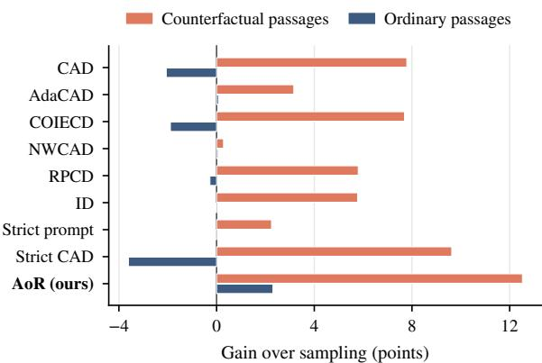
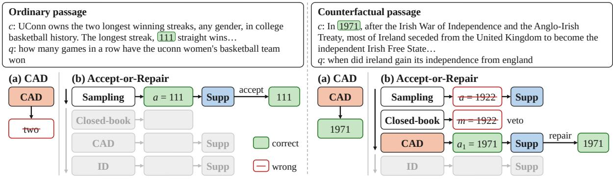
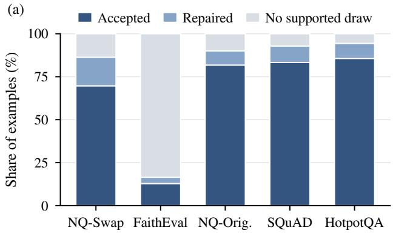
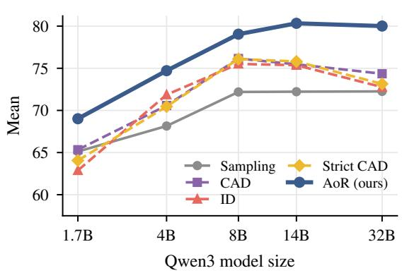
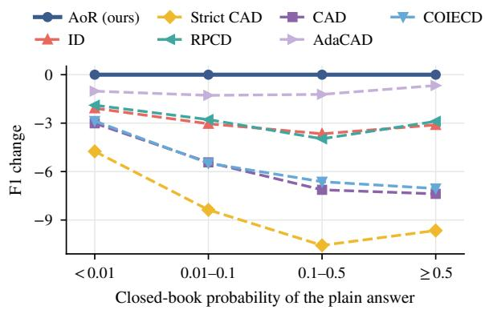
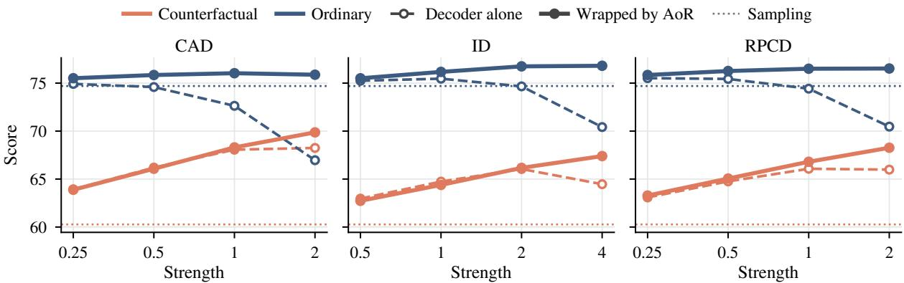

# Accept or Repair: Preserving Passage-Supported Answers in Contrastive Decoding

Jungseob Lee<sup>1</sup> Seungyoon Lee<sup>1</sup> Hyeonseok Moon<sup>2</sup> Seongtae Hong<sup>1</sup> Suhyune Son<sup>1</sup> Sugyeong Eo<sup>3</sup> Minhyuk Kim<sup>1</sup> Chanjun Park<sup>4†</sup> Jaehyung Seo<sup>5†</sup>

<sup>1</sup>Korea University <sup>2</sup>Sookmyung Women’s University <sup>3</sup>Yonsei University Mirae Campus <sup>4</sup>Soongsil University <sup>5</sup>Konkuk University

{omanma1928,dltmddbs100,ghdchlwls123,ssh5131,mhkim0929}@korea.ac.kr hyns.moon@sookmyung.ac.kr s.eo@yonsei.ac.kr chanjun.park@ssu.ac.kr seojae777@konkuk.ac.kr <sup>†</sup>Corresponding authors.

## Abstract

Large language models often answer from knowledge learned during training, even when a provided passage contradicts that knowledge. To address this problem, contrastive decoding contrasts the predictions under the full and a modified prompt at every token, but it also alters correct answers that the passage supports. We show that checking answers against the passage removes this trade-off. Based on this observation, we propose Accept-or-Repair (AoR), a training-free procedure. AoR keeps a sampled answer if the passage supports it. Otherwise, it tries up to two replacements with contrastive decoding, returning one as soon as it passes this check. It rejects replacements that repeat the answer generated without the passage when the passage favors another answer. Our experiments show that AoR raises the score over sampling by 12.5 points on counterfactual passages and 2.3 on ordinary ones, surpassing eight contrastive and prompting baselines on both, including when each receives the same rejection rule. Replacing only initial answers that the passage does not support improves the average score of every decoder. These results suggest that models can follow passages that contradict their knowledge while preserving accuracy on passages that agree with it. Code will be released at https://github.com/js-lee-AI/AoR.

## 1 Introduction

Large language models (LLMs) often prioritize knowledge learned during training over the information in a provided passage, even when the two conflict (Longpre et al., 2021; Xie et al., 2024). However, models should base their answers on the passage, whether it provides updated or private information or conflicts with their learned knowledge (Ram et al., 2023; Zyskind et al., 2024; Shi et al., 2024; Lee et al., 2025).

  
Figure 1: Gain over plain sampling on counterfactual and ordinary passages, at the setting that each method chose on the development split. Test split, averaged over six models.

To address this problem, contrastive decoding encourages models to follow the passage without additional training (Shi et al., 2024; Wang et al., 2025a). At each decoding step, it contrasts token predictions under the full and a modified prompt to favor information from the passage. Contextaware decoding (CAD), for instance, removes the passage from the contrasting prompt (Shi et al., 2024). Methods also use signals from the model to adjust the contrast strength or decide when to apply it (Wang et al., 2025a; Yuan et al., 2024; Tao and Agrawal, 2026). These methods control answer generation without first checking whether a plain answer already follows the passage. On ordinary passages, which agree with the model’s parametric knowledge, CAD turns correct answers into errors more often than plain resampling. The baselines that gain most on counterfactual passages reduce scores on ordinary passages, whereas the others leave ordinary scores nearly unchanged, as Figure 1 shows.

For extractive questions, checking whether an answer occurs in the passage provides a cue for deciding whether to keep it. On ordinary passages, most plain answers occur in the passage, and these answers are more accurate than those that do not. We find that contrastive decoders lower the scores of these answers, with larger F1 losses for CAD when the model assigns the answer a higher probability without the passage.

Based on this observation, we propose Acceptor-Repair (AoR), a training-free procedure that checks an initial answer before deciding whether to repair it. AoR samples a plain answer and accepts it when the passage supports it. For an unsupported initial answer, AoR draws an answer without the passage and uses it to screen replacements. The memory veto of AoR rejects replacements that repeat this answer when the passage favors another answer. AoR tries up to two replacements with contrastive decoding at the baselines selected strengths and returns the first that passes both the support check and the veto. Figure 2 illustrates these decisions on two test questions. CAD changes the correct answer 111 to two, whereas AoR keeps 111 and replaces the memorized 1922 with 1971 from the passage.

Our experiments show that AoR improves average scores over plain sampling on both counterfactual and ordinary passages and outperforms contrastive and prompting baselines. The lead remains when baselines receive the same memory veto, and LLM judges also rank AoR highest on average.

Replacing only unsupported plain answers improves the average score of each baseline. The support test selects answers to repair more effectively than using the model’s confidence, asking it to check its own answer or applying an entailment model. These alternatives often accept answers from the model’s memory even when the passage states a different answer.

We make three contributions.

• We show that contrastive decoders improve scores on unsupported initial answers but reduce scores on supported answers in ordinary passages, identifying a source of the trade-off between the two passage types.

• We propose Accept-or-Repair, a training-free procedure that keeps supported answers and tries up to two contrastive repairs for the others, subject to the memory veto.

• We show that AoR retains its lead on held-out benchmarks and across model families and sizes, and improves scores on both passage types when answers are given as one sentence.

## 2 Related Work

Knowledge conflicts. Models can favor memorized knowledge over conflicting passages and be misled by irrelevant context (Longpre et al., 2021; Xie et al., 2024; Shi et al., 2023; Xu et al., 2024; Lee et al., 2026e). FaithEval and ConFiQA evaluate whether models base their answers on counterfactual passages (Ming et al., 2025; Bi et al., 2025). Prompting improves faithfulness to the passage through opinion-based questions and counterfactual demonstrations (Zhou et al., 2023).

Decoding for context faithfulness. Contrastive decoding adjusts token scores by comparing predictions from the original input with those obtained without the passage, with an irrelevant passage, or with a modified instruction (van der Poel et al., 2022; Shi et al., 2024; Zhao et al., 2024; Kim et al., 2024a). Methods control contrastive decoding using distribution divergence, entropy, confidence signals, or a tunable factor (Wang et al., 2025a; Yuan et al., 2024; Qiu et al., 2025; Khandelwal et al., 2025; Kim et al., 2024b; Li et al., 2026; He et al., 2025). Gating and routing determine when to apply the contrast or which decoding regime to use (Tao and Agrawal, 2026; Jiang et al., 2026; Zhou et al., 2026; Lee et al., 2026c; Kang et al., 2026; Lee et al., 2026d). Other methods encourage models to follow the passage by adjusting token probabilities or steering hidden representations (Zhang et al., 2026; Gema et al., 2025; Zhao et al., 2025; Minder et al., 2025; Wang et al., 2025b). AoR combines answer selection with contrastive decoding to keep supported initial answers and repair unsupported ones.

Answer selection and revision. Methods select among sampled answers by frequency or a trained verifier’s score (Wang et al., 2023; Cobbe et al., 2021; Lee et al., 2026b,f), and model cascades use learned estimates of answer quality to decide whether to query another model (Chen et al., 2024). Verification methods use self-critique, retrieved evidence, or attention signals to select or revise generated text (Asai et al., 2024; Gao et al., 2023; Dhuliawala et al., 2024; Chuang et al., 2024; Lee et al., 2026a; Lee and Park, 2026). AoR selects initial answers for repair using a lexical test against the passage, without a trained verifier, self-verification prompts, or access to attention weights.

  
Figure 2: Two test questions. (a) CAD contrasts every answer. (b) AoR accepts supported answers (Supp). When the passage favors another answer, the memory veto rejects repairs that repeat m, generated without the passage. Gray steps are skipped.

## 3 Accept-or-Repair

Setting. A model generates a short answer from a prompt containing a passage c and a question q. We write $a \sim D$ for an answer generated from this prompt using decoder D. AoR keeps the initial answer from plain sampling if the passage supports it. Otherwise, it generates replacements with contrastive decoders and checks them against the passage, as shown in Algorithm 1.

Support test. For short free-form answers, the support test Supp(a; c) accepts a when its normalized form is nonempty and occurs in the normalized passage as a contiguous sequence of whole tokens. Normalization lowercases the text, replaces ASCII punctuation with spaces, preserves non-ASCII punctuation and symbols as separate tokens, and removes articles. For free-form questions, an answer that normalizes to yes or no passes the support test even if it does not occur in the passage. For multiple-choice questions, the answer is an option letter. It passes the support test when the selected option’s text occurs in the passage and no other option’s text does. For sentence answers, we exclude words that occur in the question and function words such as articles and prepositions. The answer passes the test when at least one word remains and all remaining words occur in the passage.

```perl
Algorithm 1 Accept-or-Repair
Require: passage c, question q, repair decoders
$D _ { 1 } , \ldots , D _ { K }$
1: a ∼ plain sampling
2: if $\mathrm { \cdot } \operatorname { S u p p } ( a ; c )$ then return a ▷ accept
3: m ∼ plain sampling without the passage
4: $V \gets \{ m \}$ if the passage favors another an
swer over m, else ∅
5: for $k = 1 , \ldots , K$ do ▷ repair
6: $a _ { k } \sim D _ { k } ,$ with the letter of m masked if
m $\in V$ on a multiple-choice question
7: $\mathbf { i f } \operatorname { S u p p } ( a _ { k } ; c )$ and $a _ { k } \notin V$ then return $a _ { k }$
8: return the first $a _ { k } \notin V$ that states an answer,
else a
```

Accept. AoR first draws a plain answer a and returns it unchanged when $\operatorname { S u p p } ( a ; c )$ holds, without applying contrastive decoding.

Repair. If the initial answer fails the support test, AoR draws candidate answers from $D _ { 1 } , \ldots , D _ { K }$ in order. It returns the first candidate that passes the test and is not rejected by the memory veto. If no candidate passes both checks, AoR returns the first that states an answer and is not rejected by the veto, or the initial answer if no such candidate exists. A candidate states an answer when its normalized text is nonempty for a free-form question or it gives a valid option letter for a multiple-choice question. We use $K = 2$ , with CAD (Shi et al., 2024) followed by Instructive Decoding (ID) (Kim et al., 2024a), and select the decoders and their order on the development split. For ID, the contrasting prompt instructs the model to ignore the passage. We write AoR(D) for the variant that uses

D as its only repair without the memory veto.

Memory veto. For an unsupported initial answer, AoR draws a closed-book answer m using plain sampling without the passage to screen repairs. For free-form questions, if m fails the support test, the veto rejects repairs that match m after normalization. Such repairs already fail the support test, so the veto prevents them from being returned as fallbacks. For multiple-choice questions, an option scores 2 if its text occurs in the passage. Otherwise, we exclude function words and use the fraction of the option’s remaining words that occur in the passage. If another option scores higher than the option selected by m, the veto masks the letter of m during repair decoding. For example, if m is A and only option C’s text occurs in the passage, the veto masks A and leaves B, C and D unmasked. An option whose text occurs in the passage receives the maximum score, so the veto does not mask it. On a paraphrased passage, the veto leaves m unmasked when no other option scores higher.

Supported and unsupported answers. We analyze how retaining supported answers changes a decoder’s score. Let S be the event that the initial plain answer a passes the support test, and let $Q ( a )$ and $Q ( D )$ denote the scores in [0, 1] of a and a draw from decoder D. The expected score difference between D and plain sampling is

$$
\mathbb { E } [ Q ( D ) - Q ( a ) ] = P ( S ) \Delta _ { S } + P ( \neg S ) \Delta _ { \neg S } ,\tag{1}
$$

where $\Delta _ { S } = \mathbb { E } [ Q ( D ) - Q ( a ) \mid S ]$ and $\Delta _ { \neg S }$ is the same difference on unsupported initial answers. By retaining a whenever S holds, AoR preserves the score on supported answers and can change a correct initial answer only if that answer fails the support test. For AoR(D), which uses one repair without the memory veto, the output on unsupported initial answers is the draw from D, or a if that draw states no answer. With zero score for a draw that states no answer, the expected gain over D is

$$
\begin{array} { r } { { \mathbb E } [ Q ( \mathrm { A o R } ( D ) ) - Q ( D ) ] = - P ( S ) \Delta _ { S } + \epsilon , } \end{array}\tag{2}
$$

where $\epsilon \geq 0$ averages $Q ( a )$ on these fallback cases and zero on all other cases. Equation 2 implies that $\mathsf { A o R } ( D )$ has a higher expected score than D when D lowers the average score on supported initial answers.

## 4 Experimental Setup

Tasks. We evaluate whether AoR follows counterfactual passages while preserving accuracy on ordinary passages. In the main comparison, NQ-Swap (Longpre et al., 2021) replaces the answer entity in a Natural Questions passage (Kwiatkowski et al., 2019) with another entity of the same type, and FaithEval’s counterfactual task (Ming et al., 2025) asks multiple-choice questions whose passage supports a counterfactual answer. The ordinary tasks are NQ-Original, which uses the original passages and answers from NQ-Swap, SQuAD (Rajpurkar et al., 2016) and HotpotQA (Yang et al., 2018) in the distractor setting. For HotpotQA, we concatenate two supporting paragraphs with up to eight distractors. We also evaluate on the counterfactual subsets of ConFiQA (Bi et al., 2025). For ordinary passages, we use ConFiQA’s original passages and answers, TriviaQA (Joshi et al., 2017; Fisch et al., 2019) and SciQ (Welbl et al., 2017).

Models. The main comparison uses Qwen3 models with 1.7B, 4B, 8B and 14B parameters (Qwen Team, 2025), Llama-3.1-8B-Instruct (Llama Team, 2024) and Mistral-7B-Instruct-v0.3 (Jiang et al., 2023; Mistral AI, 2024). We also evaluate Qwen3-32B, Llama-3.1-70B-Instruct, OLMo-2- 13B-Instruct (Team OLMo et al., 2024) and Yi-1.5-9B-Chat (Young et al., 2024; 01.AI, 2024) to examine performance across model sizes and families. All models are instruction-tuned, and Qwen3 runs in non-thinking mode. For each model, the methods share the temperature and top-p sampling settings (Holtzman et al., 2020) listed in Table 10, with top-k filtering enabled for Qwen3. Temperature scaling and filtering follow any contrastive adjustment of token scores. We share sampling noise across methods within each run and average the scores over three seeds.

Baselines. CAD, AdaCAD, COIECD and No-Worse CAD (NWCAD) use the question alone as the contrastive input (Shi et al., 2024; Wang et al., 2025a; Yuan et al., 2024; Tao and Agrawal, 2026). Random-passage CD (RPCD) contrasts with another example’s passage (Zhao et al., 2024), and ID with an instruction to ignore the passage (Kim et al., 2024a). To compare their contrastive inputs, we use the CAD scoring rule for both baselines. Strict prompt asks the model to answer only from the passage (Zhou et al., 2023), and Strict CAD applies CAD to that prompt. Contrastive settings are selected on the development split and kept fixed across models and tasks. We choose the setting with the highest average gain over sampling across the two task groups, retaining a recommended setting when it is within 0.1 points of the best. Strict CAD uses CAD’s selected strength, and AoR uses the selected CAD and ID strengths for its repairs.

<table><tr><td></td><td colspan="3">Counterfactual</td><td colspan="4">Ordinary</td><td></td><td></td></tr><tr><td>Method</td><td>NQ-Swap</td><td>FaithEval</td><td>Avg.</td><td></td><td></td><td>NQ-Orig. SQuAD HotpotQA</td><td>Avg.</td><td>Mean Cost</td><td></td></tr><tr><td>Sampling</td><td>56.9</td><td>63.6</td><td>60.3</td><td>76.0</td><td>84.5</td><td>63.5</td><td>74.7</td><td>67.5</td><td>1.00</td></tr><tr><td>CAD (Shi et al., 2024)</td><td>62.4</td><td>73.7</td><td> $6 8 . 1 \ : ( + 7 . 8 )$ </td><td>72.5</td><td>84.6</td><td>60.8</td><td> $7 2 . 6 ( - 2 . 1 )$ </td><td>70.3</td><td>1.18</td></tr><tr><td>AdaCAD (Wang et al., 2025a)</td><td>61.4</td><td>65.5</td><td> $6 3 . 4 \ : ( + 3 . 2 )$ </td><td>75.6</td><td>85.5</td><td>63.2</td><td> ${ \underline { { 7 4 . 8 } } } ( + 0 . 1 ) $ </td><td>69.1</td><td>1.18</td></tr><tr><td>COIECD (Yuan et al., 2024)</td><td>62.2</td><td>73.7</td><td> $6 8 . 0 ( + 7 . 7 ) $ </td><td>72.7</td><td>84.5</td><td>61.1</td><td> $7 2 . 8 ( - 1 . 9 )$ </td><td>70.4</td><td>1.18</td></tr><tr><td>NWCAD (Tao and Agrawal, 2026)</td><td>57.3</td><td>63.8</td><td> $6 0 . 6 \left( + 0 . 3 \right)$ </td><td>76.0</td><td>84.5</td><td>63.7</td><td> ${ \underline { { 7 4 . 8 } } } ( + 0 . 1 ) $ </td><td>67.7</td><td>1.18</td></tr><tr><td>RPCD (Zhao et al., 2024)</td><td>61.0</td><td>71.1</td><td> $6 6 . 1 \ : ( + 5 . 8 )$ </td><td>75.4</td><td>85.3</td><td>62.5</td><td> $7 4 . 4 ( - 0 . 3 )$ </td><td>70.2</td><td>2.00</td></tr><tr><td>ID (Kim et al., 2024a)</td><td>64.3</td><td>67.8</td><td> $6 6 . 0 ( + 5 . 8 )$ </td><td>74.8</td><td>85.6</td><td>63.6</td><td> $7 4 . 7 ( 0 . 0 )$ </td><td>70.4</td><td>2.01</td></tr><tr><td>Strict prompt (Zhou et al., 2023)</td><td>60.3</td><td>64.8</td><td> $6 2 . 5 \ : ( + 2 . 2 ) $ </td><td>76.0</td><td>84.9</td><td>63.1</td><td> $7 4 . 6 ( 0 . 0 )$ </td><td>68.6</td><td>1.03</td></tr><tr><td>Strict CAD</td><td>64.7</td><td>75.1</td><td> $\underline { { 6 9 . 9 \left( + 9 . 6 \right) } }$ </td><td>70.9</td><td>84.1</td><td>58.3</td><td> $7 1 . 1 \ : ( - 3 . 6 )$ </td><td>70.5</td><td>1.21</td></tr><tr><td>(Zhou et al., 2023; Shi et al., 2024) AoR (ours)</td><td>65.2</td><td>80.4</td><td> $7 2 . 8 ( + 1 2 . 5 )$ </td><td>78.2</td><td>87.5</td><td>65.2</td><td> $7 7 . \mathbf { 0 } \left( + 2 . 3 \right)$ </td><td>74.9 1.71</td><td></td></tr></table>

Table 1: Test scores averaged over six models: F1 for free-form tasks, accuracy for FaithEval. Mean averages both groups. Parentheses show differences from sampling, colored when their 95% intervals exclude zero. Cost is the token count relative to sampling.

Evaluation. We use token-level F1 for free-form answers and accuracy for multiple-choice answers. For the main comparison, we average task scores within the counterfactual and ordinary groups and report Mean as the average of the two group scores. We assess score differences with 95% confidence intervals from paired bootstrap resampling (Berg-Kirkpatrick et al., 2012). Cost is the number of tokens processed across decoding calls, including prompts, relative to plain sampling. Appendices A through D give the prompts, settings and scoring procedures.

## 5 Results

Main results. We find that AoR is the only method to improve significantly over sampling in both task groups, by 12.5 points on counterfactual passages and 2.3 on ordinary passages, as Table 1 shows. It scores highest on each task and significantly outperforms the baselines in Mean. Strict CAD, CAD and COIECD make the largest counterfactual gains among the baselines but lose on ordinary passages, whereas the other baselines leave ordinary scores nearly unchanged and gain less on counterfactual passages. The lead in Mean holds on each model, as reported in Appendix H. AoR has a token cost of 1.71 times that of sampling, lower than RPCD and ID.

Where the gains come from. We find that the baselines improve on unsupported initial answers in both groups but lose on supported answers in ordinary passages, as Table 2 shows. Figure 4 shows larger F1 losses for Strict CAD, CAD and COIECD in bins where the model assigns higher probability to the initial answer without the passage. By retaining supported answers, AoR avoids this loss term in Equation 1. It turns 4 of the 24,639 correct initial answers on ordinary passages into errors and corrects more wrong initial answers on counterfactual passages than the baselines. These findings suggest that retaining supported answers helps turn contrastive repairs into gains on ordinary passages.

Wrapping other decoders. We find that replacing only unsupported initial answers significantly improves the Mean of each baseline, as Table 3 shows. Each baseline serves as AoR’s only repair in this comparison, without the memory veto. On ordinary passages, the gains recover the losses on supported answers in Table 2, as Equation 2 predicts. Counterfactual scores remain nearly unchanged.

We also compare four contrast strengths for CAD, ID and RPCD to test whether this benefit depends on the selected setting. Without AoR, all three decoders score below sampling on ordinary passages at the strongest setting, as Figure 5 shows. With AoR, counterfactual scores rise with contrast strength while ordinary scores stay above sampling, giving each decoder its highest Mean at the strongest setting. These findings suggest that retaining supported answers allows stronger contrastive repairs while preserving performance on

(b)  




Figure 3: (a) How AoR ends on each task over six models: the plain answer is accepted, a repair is supported, or no draw is supported. (b) Mean on Qwen3 models of five sizes.
<table><tr><td></td><td colspan="3">Counterfactual</td><td colspan="4">Ordinary</td><td colspan="2">Repaired part</td></tr><tr><td>Method</td><td>S</td><td> $\neg S$ </td><td>Fixed (%)</td><td>S</td><td> $\neg S$ </td><td>Broken (%)</td><td>Lowered (%)</td><td>CF</td><td>Ord.</td></tr><tr><td>Sampling</td><td></td><td></td><td></td><td></td><td></td><td></td><td></td><td>37.2</td><td>35.5</td></tr><tr><td>CAD</td><td>-0.2</td><td>+8.0</td><td>22.0</td><td>-3.4</td><td>+1.3</td><td>12.2</td><td>12.9</td><td>52.7</td><td>43.7</td></tr><tr><td>AdaCAD</td><td>+0.3</td><td>+2.9</td><td>9.4</td><td>-0.9</td><td>+0.9</td><td>3.9</td><td>5.3</td><td>44.7</td><td>41.1</td></tr><tr><td>COIECD</td><td>-0.2</td><td>+7.9</td><td>21.6</td><td>-3.3</td><td>+1.4</td><td>11.9</td><td>12.6</td><td>52.5</td><td>43.9</td></tr><tr><td>NWCAD</td><td>-0.1</td><td>+0.4</td><td>1.2</td><td>-0.1</td><td>+0.2</td><td>0.9</td><td>1.4</td><td>38.2</td><td>36.6</td></tr><tr><td>RPCD</td><td>-0.7</td><td>+6.5</td><td>17.6</td><td>-2.1</td><td>+1.8</td><td>9.7</td><td>10.1</td><td>50.6</td><td>46.3</td></tr><tr><td>ID</td><td>0.0</td><td>+5.8</td><td>19.2</td><td>-2.1</td><td>+2.1</td><td>8.7</td><td>9.4</td><td>51.6</td><td>48.0</td></tr><tr><td>Strict prompt</td><td>-0.2</td><td>+2.5</td><td>9.3</td><td>-0.9</td><td>+0.8</td><td>3.7</td><td>4.9</td><td>43.9</td><td>40.4</td></tr><tr><td>Strict CAD</td><td>0.0</td><td>+9.6</td><td>28.0</td><td>-5.2</td><td>+1.6</td><td>15.8</td><td>15.9</td><td>56.5</td><td>45.1</td></tr><tr><td>AoR (ours)</td><td>0.0</td><td>+12.5</td><td>31.2</td><td>0.0</td><td>+2.3</td><td>0.0</td><td>3.3</td><td>60.5</td><td>49.5</td></tr></table>

Table 2: Where the gains come from. $S , \lnot S \colon$ share-weighted difference to sampling on supported and unsupported plain answers; Fixed, Broken: wrong plain answers made right, correct ones made wrong; Lowered: F1 below the plain answer; Repaired part: scores where AoR repairs.

<table><tr><td>Wrapped decoder</td><td>CF</td><td>Ord.</td><td>Mean</td></tr><tr><td>CAD</td><td>68.3</td><td> $7 6 . 0 ( + 3 . 4 )$ </td><td> $7 2 . 2 \left( + 1 . 8 \right)$ </td></tr><tr><td>AdaCAD</td><td>63.2</td><td> $7 5 . 6 ( + 0 . 9 )$ </td><td> $6 9 . 4 \ : ( + 0 . 3 )$ </td></tr><tr><td>COIECD</td><td>68.2</td><td> $7 6 . 1 \ : ( + 3 . 3 )$ </td><td> $7 2 . 1 \ : ( + 1 . 7 ) $ </td></tr><tr><td>NWCAD</td><td>60.7</td><td> $7 4 . 9 \ : ( + 0 . 1 )$ </td><td> $6 7 . 8 \ : ( + 0 . 1 )$ </td></tr><tr><td>RPCD</td><td>66.8</td><td> $7 6 . 5 ( + 2 . 1 ) $ </td><td> $7 1 . 6 ( + 1 . 4 )$ </td></tr><tr><td>ID</td><td>66.2</td><td> $7 6 . 7 ( + 2 . 1 )$ </td><td> $7 1 . 5 ( + 1 . 1 ) $ </td></tr><tr><td>Strict prompt</td><td>63.0</td><td> $7 5 . 5 \ : ( + 0 . 9 )$ </td><td> $6 9 . 3 \ : ( + 0 . 7 )$ </td></tr><tr><td>Strict CAD</td><td>70.1</td><td> $7 6 . 3 ( + 5 . 2 )$ </td><td> $7 3 . 2 ( + 2 . 7 ) $ </td></tr></table>

Table 3: Each decoder D wrapped by AoR as its only repair, without the veto. On ordinary passages and in Mean, parentheses give the difference to D alone, colored when its 95% interval excludes zero.

ordinary passages.

Ablations. Keeping supported initial answers improves ordinary scores and reduces token cost, as Table 4 shows. Allowing partial matches between answers and passage spans lowers the Mean and admits more memorized answers on NQ-Swap. Removing the memory veto lowers FaithEval accuracy, and removing either repair lowers scores on

  
Figure 4: F1 change on the supported plain answers of the ordinary tasks, binned by the probability that the model gives the same answer without the passage.

both passage types.

Replacing contrastive repairs with samples from the strict or plain prompt lowers AoR’s Mean by 3.0 to 3.9 points, with larger losses on counterfactual passages. The strict-prompt variant still outperforms the baselines in Mean. Majority voting (Wang et al., 2023) yields lower scores than AoR on both passage types and uses more tokens. These comparisons suggest that AoR benefits from both checking answers against the passage and using contrastive decoding to generate repairs.

  
Figure 5: Counterfactual and ordinary averages of CAD, ID and RPCD at four strengths, alone and wrapped by AoR as the only repair. Dotted lines mark sampling.

<table><tr><td>Variant</td><td>CF</td><td></td><td>Ord. Mean Cost</td><td></td></tr><tr><td>AoR</td><td>72.8</td><td>77.0</td><td>74.9</td><td>1.71</td></tr><tr><td colspan="5">Components</td></tr><tr><td>Repair every answer</td><td>+0.7</td><td>-1.3</td><td>-0.3</td><td>2.71</td></tr><tr><td>No memory veto</td><td>-3.2</td><td>0.0</td><td>-1.6</td><td>1.63</td></tr><tr><td>Any occurring option supported</td><td>-0.9</td><td>0.0</td><td>-0.5</td><td>1.65</td></tr><tr><td colspan="5">Repairs</td></tr><tr><td>CAD only</td><td>-1.6</td><td>-1.0</td><td>-1.3</td><td>1.46</td></tr><tr><td>ID only</td><td>-2.4</td><td>-0.3</td><td>-1.3</td><td>1.73</td></tr><tr><td>ID, then CAD</td><td>-1.2</td><td>+0.1</td><td>-0.6</td><td>1.86</td></tr><tr><td>CAD, then Strict CAD</td><td>-0.4</td><td>-0.5</td><td>-0.4</td><td>1.61</td></tr><tr><td>CAD, ID, then CAD</td><td>+0.2</td><td>+0.1</td><td>+0.1</td><td>1.81</td></tr><tr><td>CAD, ID, then span Strict CAD</td><td>+1.4</td><td>+0.9</td><td>+1.2</td><td>1.81</td></tr><tr><td colspan="5">Repairs without contrast</td></tr><tr><td>Resample</td><td>6.1</td><td>-1.6</td><td>-3.9</td><td>1.56</td></tr><tr><td>Resample, strict prompt</td><td>-4.9</td><td>-1.2</td><td>-3.0</td><td>1.56</td></tr><tr><td colspan="5">Majority votes</td></tr><tr><td>Three plain answers</td><td>-12.4</td><td>-2.1</td><td>-7.2</td><td>3.00</td></tr><tr><td>Plain, CAD and ID</td><td>-7.8</td><td>-1.6</td><td>-4.7</td><td>4.19</td></tr></table>

Table 4: Variants of AoR and majority votes. Score differences are relative to AoR; color indicates a 95% interval excluding zero. Cost is the token count relative to sampling.

Adding Strict CAD restricted to passage spans as a third repair raises the Mean at a higher token cost. The lead of AoR over the baselines in Mean also holds across the 16 combinations of CAD and ID strengths, as Appendix E shows.

Choosing what to repair. The support test gives the largest gains on NQ-Swap and ordinary passages among the selection criteria in Table 5. We compare it with answer probability, the probability gain from adding the passage, a model self-check (Kadavath et al., 2022) and an entailment score. To isolate the selection criterion, each alternative replaces the same number of initial answers as the support test, using the same CAD outputs without further checks.

<table><tr><td>Gate</td><td>NQ-Swap</td><td>Ord.</td><td>Mean</td></tr><tr><td>CAD on every answer</td><td>+5.5</td><td>-2.1</td><td>+1.7</td></tr><tr><td>Same as closed-book answer</td><td>+1.5</td><td>-0.8</td><td>+0.3</td></tr><tr><td>Answer probability</td><td>+4.2</td><td>+0.2</td><td>+2.2</td></tr><tr><td>Probability gain from passage</td><td>+4.8</td><td>-0.8</td><td>+2.0</td></tr><tr><td>Self-check</td><td>+3.0</td><td>-0.3</td><td>+1.4</td></tr><tr><td>Entailment model</td><td>+3.7</td><td>-0.2</td><td>+1.7</td></tr><tr><td>Support test</td><td>+5.9</td><td>+1.3</td><td>+3.6</td></tr></table>

Table 5: Gain over sampling when CAD replaces selected answers on free-form tasks. Four ranked gates match the support test’s selection count. Mean averages NQ-Swap and Ord. Color indicates 95% intervals excluding zero.

On NQ-Swap, the support test selects 99.5% of initial answers that repeat the answer from the original passage, compared with 54–55% for answer probability, self-check and entailment. This difference suggests that passage support helps identify memorized answers that these three criteria miss.

## 6 Analysis

Beyond the main setting. AoR outperforms the baselines in average score across the comparisons in Table 6. The lead remains when we exclude FaithEval and when the baselines receive the same memory veto, indicating that neither the multiplechoice task nor the veto alone accounts for the advantage. Across model families, we find that AoR improves on sampling on OLMo-2-13B and Yi-1.5-9B, where most contrastive baselines score below sampling. Its lead over the best baseline grows from about 3 points for Qwen3 models up to 8B to 5.7 points at 32B, as Figure 3b shows. This suggests that checking which answers need repair remains useful as model size increases.

<table><tr><td></td><td colspan="2">Main tasks</td><td colspan="2">Held-out data</td><td colspan="4">Further models</td><td colspan="2">Other settings</td><td colspan="2">LLM judge</td></tr><tr><td>Method</td><td>No FaithEval</td><td>With veto</td><td>CF</td><td>Ord.</td><td>OLMo</td><td>Yi</td><td>32B</td><td>70B</td><td>Greedy</td><td>Distractors</td><td>Qwen</td><td>Gemma</td></tr><tr><td>Sampling</td><td>65.8</td><td>70.2</td><td>63.1</td><td>83.7</td><td>68.6</td><td>67.9</td><td>72.3</td><td>68.9</td><td>66.6</td><td>63.3</td><td></td><td></td></tr><tr><td>CAD</td><td>67.5</td><td>71.7</td><td>66.6</td><td>81.9</td><td>60.1</td><td>64.2</td><td>74.4</td><td>68.9</td><td>67.3</td><td>63.6</td><td>-1.5</td><td>+1.1</td></tr><tr><td>AdaCAD</td><td>68.1</td><td>71.6</td><td>65.7</td><td>83.7</td><td>68.5</td><td>67.5</td><td>74.0</td><td>71.6</td><td>67.6</td><td>64.9</td><td>+0.6</td><td>+1.6</td></tr><tr><td>COIECD</td><td>67.5</td><td>71.8</td><td>66.7</td><td>82.0</td><td>60.0</td><td>64.6</td><td>74.3</td><td>69.6</td><td>66.5</td><td>63.5</td><td>-1.2</td><td>+1.3</td></tr><tr><td>NWCAD</td><td>66.0</td><td>68.6</td><td>63.4</td><td>83.7</td><td>68.7</td><td>67.8</td><td>72.3</td><td>69.1</td><td>66.6</td><td>63.5</td><td>0.0</td><td>+0.1</td></tr><tr><td>RPCD</td><td>67.7</td><td>72.2</td><td>67.8</td><td>83.2</td><td>63.5</td><td>68.2</td><td>73.5</td><td>72.7</td><td>67.8</td><td>65.8</td><td>-0.8</td><td>+1.1</td></tr><tr><td>ID</td><td>69.5</td><td>72.4</td><td>69.4</td><td>83.2</td><td>64.3</td><td>56.1</td><td>72.8</td><td>66.4</td><td>67.6</td><td>66.2</td><td>+0.5</td><td>+2.1</td></tr><tr><td>Strict prompt</td><td>67.5</td><td>70.8</td><td>66.7</td><td>83.7</td><td>70.7</td><td>67.3</td><td>74.2</td><td>73.4</td><td>68.3</td><td>63.9</td><td>+0.5</td><td>+1.2</td></tr><tr><td>Strict CAD</td><td>67.9</td><td>71.3</td><td>69.5</td><td>80.9</td><td>59.4</td><td>61.4</td><td>73.1</td><td>68.8</td><td>69.1</td><td>62.5</td><td>-2.0</td><td>+1.1</td></tr><tr><td>AoR (ours)</td><td>71.1</td><td>74.9</td><td>70.4</td><td>84.9</td><td>75.0</td><td>75.3</td><td>80.078.2</td><td></td><td>73.9</td><td>68.4</td><td>+2.1</td><td>+3.4</td></tr></table>

Table 6: Beyond the main setting: Mean, or group average for held-out data. No FaithEval: NQ-Swap, ordinary average; With veto: veto for all; Greedy: four models, retuned, first row greedy; Distractors: passages of four other questions; Judge: free-form Mean gain over sampling.
<table><tr><td>Task, model</td><td>Passage, excerpt</td><td>Question</td><td>Sampling</td><td>CAD</td><td>AoR</td></tr><tr><td>NQ-Orig. Qwen3-8B</td><td>UConn owns the two longest winning streaks .. . The longest streak, 111 straight wins, started ...</td><td>how many games in a row have the uconn women&#x27;s basketball team won</td><td>111√</td><td>two X</td><td>111√ accepted</td></tr><tr><td>NQ-Swap Qwen3-8B</td><td>In 1971, after the Irish War of Independence .. . most of Ireland seceded from the United Kingdom ..</td><td>when did ireland gain its independence from england</td><td>1922 X</td><td>1971√</td><td>1971√ CAD repair</td></tr><tr><td>NQ-Swap Llama-3.1-8B</td><td>Neal Dahlen as Hiccup Horrendous Haddock III, the son of the Viking chief Stoick the Vast and Valka.</td><td>who voices hiccup in how to train your dragon 2</td><td>Jay Baruchel x</td><td>Jay Baruchel X</td><td>Neal Dahlen √ ID repair</td></tr><tr><td>FaithEval Qwen3-14B</td><td>.. . recent studies have shown that minerals hold a pivotal role in the fossilization process. . . .</td><td>Which of the following would most likely form a fossil? A. a rock, B. a crystal, C. a mineral, D. a bone</td><td>DX</td><td>DX</td><td>C√ D vetoed</td></tr></table>

Table 7: Test answers from three models, with passage excerpts, illustrating acceptance, CAD and ID repairs, and the memory veto. A check marks a correct answer; labels below AoR’s answers indicate the action taken.

With the decoder settings retuned for greedy decoding, AoR retains its lead over the baselines. It also improves over sampling when answers are given as one sentence, as detailed in Appendix F. Under two LLM judges that accept paraphrased answers, AoR ranks highest on average, suggesting that its gains are not explained by word-overlap scoring alone.

Where AoR acts. AoR accepts 82 to 86% of initial answers on ordinary passages and 70% on NQ-Swap, as Figure 3a shows. It returns them unchanged, without repair decoding or a closedbook draw. Across free-form tasks, AoR finds a supported repair for more than half of the rejected initial answers. On most FaithEval questions, the passage contains no option text or multiple option texts, so no answer passes the support test and AoR returns a fallback answer. In these cases, the memory veto can still mask the closed-book option during repair decoding when the passage favors another. Table 7 illustrates acceptance, CAD and

ID repairs, and the memory veto.

## 7 Conclusion

We propose Accept-or-Repair, a training-free procedure that keeps passage-supported initial answers and uses contrastive decoding to repair unsupported ones. AoR also applies the memory veto to reject repairs that repeat the answer generated without the passage when the passage favors another answer. AoR improves average scores over plain sampling on counterfactual and ordinary passages across ten models. In the main evaluation on six models and five benchmarks, it yields large gains on counterfactual passages and small gains on ordinary ones. Replacing only unsupported initial answers improves the average score of every decoder in this evaluation, compared with using that decoder to answer every question. Our findings suggest that checking passage support helps models follow passages that contradict their knowledge while preserving accuracy on passages that agree with it.

## Limitations

AoR uses word matching to check passage support for short answers and single sentences. Longform or abstractive answers call for support tests that account for paraphrasing and information combined across the passage. We examine model selfchecking and an entailment model as alternative tests on short-answer tasks in Appendix E. Our experiments cover English benchmarks and models of up to 70B parameters.

The contrastive repair decoders require access to the model’s next-token distributions. We also evaluate strict-prompt resampling as an alternative repair generator in Section 5.

## Ethics Statement

All datasets and models are public, and we use them for research under the terms of their releases: NQ-Swap and ConFiQA under the MIT license, SQuAD and HotpotQA under CC BY-SA 4.0, SciQ under CC BY-NC 3.0, Qwen3, Qwen2.5-32B-Instruct, Gemma 4, Mistral-7B-Instruct, OLMo-2 and Yi-1.5 under Apache-2.0, Llama-3.1 under the Llama 3.1 Community License, and the DeBERTav3 entailment model under the MIT license.

AoR helps models base their answers on the provided passage. Applications should assess source reliability, since passage support alone does not establish factual correctness (Lee et al., 2022).

## References

01.AI. 2024. Yi-1.5-9B-Chat. Hugging Face model card.

Akari Asai, Zeqiu Wu, Yizhong Wang, Avirup Sil, and Hannaneh Hajishirzi. 2024. Self-RAG: Learning to retrieve, generate, and critique through self-reflection. In The Twelfth International Conference on Learning Representations.

Taylor Berg-Kirkpatrick, David Burkett, and Dan Klein. 2012. An empirical investigation of statistical significance in NLP. In Proceedings ofthe 2012 Joint Conference on Empirical Methods in Natural Language Processing and Computational Natural Language Learning, pages 995–1005, Jeju Island, Korea. Association for Computational Linguistics.

Baolong Bi, Shaohan Huang, Yiwei Wang, Tianchi Yang, Zihan Zhang, Haizhen Huang, Lingrui Mei, Junfeng Fang, Zehao Li, Furu Wei, Weiwei Deng, Feng Sun, Qi Zhang, and Shenghua Liu. 2025. Context-DPO: Aligning Language Models for Context-Faithfulness. In Findings of the Association for Computational Linguistics: ACL 2025.

Lingjiao Chen, Matei Zaharia, and James Zou. 2024. FrugalGPT: How to use large language models while reducing cost and improving performance. Transactions on Machine Learning Research.

Yung-Sung Chuang, Linlu Qiu, Cheng-Yu Hsieh, Ranjay Krishna, Yoon Kim, and James R. Glass. 2024. Lookback lens: Detecting and mitigating contextual hallucinations in large language models using only attention maps. In Proceedings of the 2024 Conference on Empirical Methods in Natural Language Processing, pages 1419–1436, Miami, Florida, USA. Association for Computational Linguistics.

Karl Cobbe, Vineet Kosaraju, Mohammad Bavarian, Mark Chen, Heewoo Jun, Lukasz Kaiser, Matthias Plappert, Jerry Tworek, Jacob Hilton, Reiichiro Nakano, Christopher Hesse, and John Schulman. 2021. Training verifiers to solve math word problems. arXiv preprint arXiv:2110.14168.

Shehzaad Dhuliawala, Mojtaba Komeili, Jing Xu, Roberta Raileanu, Xian Li, Asli Celikyilmaz, and Jason Weston. 2024. Chain-of-verification reduces hallucination in large language models. In Findings of the Association for Computational Linguistics: ACL 2024.

Adam Fisch, Alon Talmor, Robin Jia, Minjoon Seo, Eunsol Choi, and Danqi Chen. 2019. MRQA 2019 shared task: Evaluating generalization in reading comprehension. In Proceedings ofthe 2nd Workshop on Machine Reading for Question Answering.

Luyu Gao, Zhuyun Dai, Panupong Pasupat, Anthony Chen, Arun Tejasvi Chaganty, Yicheng Fan, Vincent Zhao, Ni Lao, Hongrae Lee, Da-Cheng Juan, and Kelvin Guu. 2023. RARR: Researching and revising what language models say, using language models. In Proceedings of the 61st Annual Meeting of the Associationfor Computational Linguistics (Volume 1: Long Papers).

Aryo Pradipta Gema, Chen Jin, Ahmed Abdulaal, Tom Diethe, Philip Alexander Teare, Beatrice Alex, Pasquale Minervini, and Amrutha Saseendran. 2025. DeCoRe: Decoding by contrasting retrieval heads to mitigate hallucinations. In Findings of the Association for Computational Linguistics: EMNLP 2025, pages 10003–10039, Suzhou, China. Association for Computational Linguistics.

Gemma Team. 2026. Gemma 4 technical report. arXiv preprint arXiv:2607.02770.

Jerry Zhi-Yang He, Sashrika Pandey, Mariah L. Schrum, and Anca Dragan. 2025. Context steering: Controllable personalization at inference time. In The Thirteenth International Conference on Learning Representations.

Pengcheng He, Jianfeng Gao, and Weizhu Chen. 2023. DeBERTaV3: Improving DeBERTa using ELECTRA-Style Pre-Training with Gradient-Disentangled Embedding Sharing. In The Eleventh International Conference on Learning Representations.

Ari Holtzman, Jan Buys, Li Du, Maxwell Forbes, and Yejin Choi. 2020. The curious case of neural text degeneration. In International Conference on Learning Representations.

Albert Q. Jiang, Alexandre Sablayrolles, Arthur Mensch, Chris Bamford, Devendra Singh Chaplot, Diego de las Casas, Florian Bressand, Gianna Lengyel, Guillaume Lample, Lucile Saulnier, Lélio Renard Lavaud, Marie-Anne Lachaux, Pierre Stock, Teven Le Scao, Thibaut Lavril, Thomas Wang, Timothée Lacroix, and William El Sayed. 2023. Mistral 7B. arXiv preprint arXiv:2310.06825.

Runze Jiang, Taiqiang Wu, Yan Wang, Bingyu Zhu, and Longtao Huang. 2026. From context-aware to conflict-aware: Generalizing contrastive decoding for knowledge conflict in LLMs. arXiv preprint arXiv:2606.10298.

Mandar Joshi, Eunsol Choi, Daniel Weld, and Luke Zettlemoyer. 2017. TriviaQA: A large scale distantly supervised challenge dataset for reading comprehension. In Proceedings of the 55th Annual Meeting of the Associationfor Computational Linguistics (Volume 1: Long Papers), pages 1601–1611, Vancouver, Canada. Association for Computational Linguistics.

Saurav Kadavath, Tom Conerly, Amanda Askell, Tom Henighan, Dawn Drain, Ethan Perez, Nicholas Schiefer, Zac Hatfield-Dodds, Nova DasSarma, Eli Tran-Johnson, Scott Johnston, Sheer El-Showk, Andy Jones, Nelson Elhage, Tristan Hume, Anna Chen, Yuntao Bai, Sam Bowman, Stanislav Fort, and 17 others. 2022. Language Models (Mostly) Know What They Know. arXiv preprint, arXiv:2207.05221.

Myunghoon Kang, Jungseob Lee, Jaehyung Seo, and Heuiseok Lim. 2026. Thinkfuse: Trajectory-aware test-time fusion for small reasoning models. arXiv preprint, arXiv:2610.07803.

Anant Khandelwal, Manish Gupta, and Puneet Agrawal. 2025. CoCoA: Confidence- and context-aware adaptive decoding for resolving knowledge conflicts in large language models. In Proceedings ofthe 2025 Conference on Empirical Methods in Natural Language Processing, pages 6835–6855, Suzhou, China. Association for Computational Linguistics.

Taehyeon Kim, Joonkee Kim, Gihun Lee, and Se-Young Yun. 2024a. Instructive decoding: Instruction-tuned large language models are self-refiner from noisy instructions. In The Twelfth International Conference on Learning Representations.

Youna Kim, Hyuhng Joon Kim, Cheonbok Park, Choonghyun Park, Hyunsoo Cho, Junyeob Kim, Kang Min Yoo, Sang-goo Lee, and Taeuk Kim. 2024b. Adaptive contrastive decoding in retrievalaugmented generation for handling noisy contexts. In Findings of the Association for Computational Linguistics: EMNLP 2024, pages 2421–2431, Miami, Florida, USA. Association for Computational Linguistics.

Tom Kwiatkowski, Jennimaria Palomaki, Olivia Redfield, Michael Collins, Ankur Parikh, Chris Alberti, Danielle Epstein, Illia Polosukhin, Jacob Devlin, Kenton Lee, Kristina Toutanova, Llion Jones, Matthew Kelcey, Ming-Wei Chang, Andrew M. Dai, Jakob Uszkoreit, Quoc Le, and Slav Petrov. 2019. Natural Questions: A benchmark for question answering research. Transactions ofthe Associationfor Computational Linguistics, 7:452–466.

Moritz Laurer, Wouter van Atteveldt, Andreu Casas, and Kasper Welbers. 2023. Less Annotating, More Classifying: Addressing the Data Scarcity Issue of Supervised Machine Learning with Deep Transfer Learning and BERT-NLI. Political Analysis.

Dongyub Jude Lee, Jungseob Lee, Chanjun Park, Hyeonseok Moon, and Heuiseok Lim. 2026a. Riskcontrolled selective llm answering by pricing labelfree checks. arXiv preprint, arXiv:2609.37493.

Jungseob Lee, Sugyeong Eo, Seongtae Hong, Seungyoon Lee, Chanjun Park, Jaehyung Seo, and Heuiseok Lim. 2026b. Distilling directional verification. arXiv preprint, arXiv:2610.00997.

Jungseob Lee, Seongtae Hong, Seungjun Lee, Jaehyung Seo, Junyoung Son, Sugyeong Eo, Chanjun Park, Hyeongju Park, Hyeonseok Moon, and Heuiseok Lim. 2026c. Dart: Draft-agreement routing for training-free adaptive thinking budgets in hybrid reasoning models. arXiv preprint, arXiv:2606.23181.

Jungseob Lee, Minhyuk Kim, Jeongho Yoon, Seongtae Hong, Youngjoon Jang, Seungyoon Lee, Jaehyung Seo, Chanjun Park, Jeongbae Park, and Heuiseok Lim. 2025. Kullm-rag: A rag-specialized large language model with intelligent self-verification. In HCLT-KACL 2025.

Jungseob Lee, Dongyub Jude Lee, Chanjun Park, Sugyeong Eo, and Heuiseok Lim. 2026d. Faster blockdiffusion serving with distribution-free risk guarantees. arXiv preprint, arXiv:2609.33887.

Jungseob Lee and Chanjun Park. 2026. The agent loop: A survey of control strategies, skills, and harnesses for llm agents. SSRN working paper.

Jungseob Lee, Chanjun Park, and Heuiseok Lim. 2026e. To isolate or to score? model-adaptive assessment for cost-efficient multi-agent rag. arXiv preprint, arXiv:2606.25191.

Jungseob Lee, Jaehyung Seo, and Heuiseok Lim. 2026f. The hallucination signal is a mean shift: Why simple probes suffice. arXiv preprint, arXiv:2608.28930.

Jungseob Lee, Midan Shim, Suhyune Son, Chanjun Park, Yujin Kim, and Heuiseok Lim. 2022. There is no rose without a thorn: Finding weaknesses on blenderbot 2.0 in terms of model, data and usercentric approach. arXiv preprint, arXiv:2201.03239.

Raymond Li, Md Tawkat Islam Khondaker, Amirhossein Abaskohi, Gabriel Murray, Giuseppe Carenini, and Issam H. Laradji. 2026. Dual-confidence contrastive decoding for retrieval-augmented generation. arXiv preprint arXiv:2607.00570.

Llama Team. 2024. The Llama 3 herd of models. arXiv preprint arXiv:2407.21783.

Shayne Longpre, Kartik Perisetla, Anthony Chen, Nikhil Ramesh, Chris DuBois, and Sameer Singh. 2021. Entity-based knowledge conflicts in question answering. In Proceedings of the 2021 Conference on Empirical Methods in Natural Language Processing, pages 7052–7063, Online and Punta Cana, Dominican Republic. Association for Computational Linguistics.

Julian Minder, Kevin Du, Niklas Stoehr, Giovanni Monea, Chris Wendler, Robert West, and Ryan Cotterell. 2025. Controllable context sensitivity and the knob behind it. In The Thirteenth International Conference on Learning Representations.

Yifei Ming, Senthil Purushwalkam, Shrey Pandit, Zixuan Ke, Xuan-Phi Nguyen, Caiming Xiong, and Shafiq Joty. 2025. FaithEval: Can your language model stay faithful to context, even if “the moon is made of marshmallows”. In International Conference on Learning Representations.

Mistral AI. 2024. Mistral-7B-Instruct-v0.3. Hugging Face model card.

Adam Paszke, Sam Gross, Francisco Massa, Adam Lerer, James Bradbury, Gregory Chanan, Trevor Killeen, Zeming Lin, Natalia Gimelshein, Luca Antiga, Alban Desmaison, Andreas Kopf, Edward Yang, Zachary DeVito, Martin Raison, Alykhan Tejani, Sasank Chilamkurthy, Benoit Steiner, Lu Fang, and 2 others. 2019. PyTorch: An imperative style, high-performance deep learning library. In Advances in Neural Information Processing Systems, volume 32. Curran Associates, Inc.

Zexuan Qiu, Zijing Ou, Bin Wu, Jingjing Li, Aiwei Liu, and Irwin King. 2025. Entropy-based decoding for retrieval-augmented large language models. In Proceedings of the 2025 Conference of the Nations ofthe Americas Chapter ofthe Associationfor Computational Linguistics: Human Language Technologies (Volume 1: Long Papers), pages 4616–4627, Albuquerque, New Mexico. Association for Computational Linguistics.

Qwen Team. 2024. Qwen2.5 technical report. arXiv preprint arXiv:2412.15115.

Qwen Team. 2025. Qwen3 technical report. arXiv preprint arXiv:2505.09388.

Pranav Rajpurkar, Jian Zhang, Konstantin Lopyrev, and Percy Liang. 2016. SQuAD: 100,000+ questions for machine comprehension of text. In Proceedings of the 2016 Conference on Empirical Methods in Natural Language Processing, pages 2383–2392, Austin, Texas. Association for Computational Linguistics.

Ori Ram, Yoav Levine, Itay Dalmedigos, Dor Muhlgay, Amnon Shashua, Kevin Leyton-Brown, and Yoav Shoham. 2023. In-context retrieval-augmented language models. Transactions of the Association for Computational Linguistics, 11:1316–1331.

Freda Shi, Xinyun Chen, Kanishka Misra, Nathan Scales, David Dohan, Ed H. Chi, Nathanael Schärli, and Denny Zhou. 2023. Large language models can be easily distracted by irrelevant context. In Proceedings of the 40th International Conference on Machine Learning, volume 202 of Proceedings of Machine Learning Research, pages 31210–31227. PMLR.

Weijia Shi, Xiaochuang Han, Mike Lewis, Yulia Tsvetkov, Luke Zettlemoyer, and Wen-tau Yih. 2024. Trusting your evidence: Hallucinate less with contextaware decoding. In Proceedings ofthe 2024 Conference of the North American Chapter of the Association for Computational Linguistics: Human Language Technologies (Volume 2: Short Papers), pages 783–791, Mexico City, Mexico. Association for Computational Linguistics.

Yufei Tao and Ameeta Agrawal. 2026. No-worse context-aware decoding: Preventing neutral regression in context-conditioned generation. arXiv preprint arXiv:2604.16686.

Team OLMo, Pete Walsh, Luca Soldaini, Dirk Groeneveld, Kyle Lo, Shane Arora, and 1 others. 2024. 2 OLMo 2 Furious. arXiv preprint arXiv:2501.00656.

Liam van der Poel, Ryan Cotterell, and Clara Meister. 2022. Mutual information alleviates hallucinations in abstractive summarization. In Proceedings ofthe 2022 Conference on Empirical Methods in Natural Language Processing, pages 5956–5965, Abu Dhabi, United Arab Emirates. Association for Computational Linguistics.

Han Wang, Archiki Prasad, Elias Stengel-Eskin, and Mohit Bansal. 2025a. AdaCAD: Adaptively decoding to balance conflicts between contextual and parametric knowledge. In Proceedings ofthe 2025 Conference ofthe Nations ofthe Americas Chapter ofthe Associationfor Computational Linguistics: Human Language Technologies (Volume 1: Long Papers), pages 11636–11652, Albuquerque, New Mexico. Association for Computational Linguistics.

Xuezhi Wang, Jason Wei, Dale Schuurmans, Quoc V. Le, Ed H. Chi, Sharan Narang, Aakanksha Chowdhery, and Denny Zhou. 2023. Self-consistency improves chain of thought reasoning in language models. In The Eleventh International Conference on Learning Representations.

Yilin Wang, Heng Wang, Yuyang Bai, and Minnan Luo. 2025b. Continuously steering LLMs sensitivity to contextual knowledge with proxy models. In Proceedings of the 2025 Conference on Empirical Methods in Natural Language Processing, pages 4682– 4698, Suzhou, China. Association for Computational Linguistics.

Johannes Welbl, Nelson F. Liu, and Matt Gardner. 2017. Crowdsourcing multiple choice science questions. In Proceedings ofthe 3rd Workshop on Noisy Usergenerated Text.

Thomas Wolf, Lysandre Debut, Victor Sanh, Julien Chaumond, Clement Delangue, Anthony Moi, Pierric Cistac, Tim Rault, Remi Louf, Morgan Funtowicz, Joe Davison, Sam Shleifer, Patrick von Platen, Clara Ma, Yacine Jernite, Julien Plu, Canwen Xu, Teven Le Scao, Sylvain Gugger, and 3 others. 2020. Transformers: State-of-the-art natural language processing. In Proceedings ofthe 2020 Conference on Empirical Methods in Natural Language Processing: System Demonstrations, pages 38–45, Online. Association for Computational Linguistics.

Jian Xie, Kai Zhang, Jiangjie Chen, Renze Lou, and Yu Su. 2024. Adaptive chameleon or stubborn sloth: Revealing the behavior of large language models in knowledge conflicts. In The Twelfth International Conference on Learning Representations.

Rongwu Xu, Zehan Qi, Zhijiang Guo, Cunxiang Wang, Hongru Wang, Yue Zhang, and Wei Xu. 2024. Knowledge conflicts for LLMs: A survey. In Proceedings of the 2024 Conference on Empirical Methods in Natural Language Processing, pages 8541– 8565, Miami, Florida, USA. Association for Computational Linguistics.

Zhilin Yang, Peng Qi, Saizheng Zhang, Yoshua Bengio, William Cohen, Ruslan Salakhutdinov, and Christopher D. Manning. 2018. HotpotQA: A dataset for diverse, explainable multi-hop question answering. In Proceedings of the 2018 Conference on Empirical Methods in Natural Language Processing, pages 2369–2380, Brussels, Belgium. Association for Computational Linguistics.

Alex Young, Bei Chen, Chao Li, Chengen Huang, and 1 others. 2024. Yi: Open foundation models by 01.AI. arXiv preprint arXiv:2403.04652.

Xiaowei Yuan, Zhao Yang, Yequan Wang, Shengping Liu, Jun Zhao, and Kang Liu. 2024. Discerning and resolving knowledge conflicts through adaptive decoding with contextual information-entropy constraint. In Findings of the Association for Computational Linguistics: ACL 2024, pages 3903–3922, Bangkok, Thailand. Association for Computational Linguistics.

Weixu Zhang, Fanghua Ye, Qiang Gao, Jian Li, Haolun Wu, Yuxing Tian, Sijing Duan, Nan Du, Xiaolong Li, and Xue Liu. 2026. Context-fidelity boosting: Enhancing faithful generation through watermarkinspired decoding. arXiv preprint arXiv:2604.22335.

Yu Zhao, Alessio Devoto, Giwon Hong, Xiaotang Du, Aryo Pradipta Gema, Hongru Wang, Xuanli He, Kam-Fai Wong, and Pasquale Minervini. 2025. Steering knowledge selection behaviours in LLMs via SAE-based representation engineering. In Proceedings of the 2025 Conference of the Nations of the

Americas Chapter of the Association for Computational Linguistics: Human Language Technologies (Volume 1: Long Papers), pages 5117–5136, Albuquerque, New Mexico. Association for Computational Linguistics.

Zheng Zhao, Emilio Monti, Jens Lehmann, and Haytham Assem. 2024. Enhancing contextual understanding in large language models through contrastive decoding. In Proceedings ofthe 2024 Conference ofthe North American Chapter ofthe Associationfor Computational Linguistics: Human Language Technologies (Volume 1: Long Papers), pages 4225–4237, Mexico City, Mexico. Association for Computational Linguistics.

Wenxuan Zhou, Sheng Zhang, Hoifung Poon, and Muhao Chen. 2023. Context-faithful prompting for large language models. In Findings of the Association for Computational Linguistics: EMNLP 2023, pages 14544–14556, Singapore. Association for Computational Linguistics.

Yigeng Zhou, Wu Li, Yifan Lu, Yequan Wang, Xuebo Liu, Wenya Wang, Jun Yu, Min Zhang, and Jing Li. 2026. Mitigating context-memory conflicts in LLMs through dynamic cognitive reconciliation decoding. IEEE Transactions on Audio, Speech and Language Processing. ArXiv preprint arXiv:2605.12185.

Guy Zyskind, Tobin South, and Alex Pentland. 2024. Don’t forget private retrieval: distributed private similarity search for large language models. In Proceedings of the Fifth Workshop on Privacy in Natural Language Processing, pages 7–19, Bangkok, Thailand. Association for Computational Linguistics.

## A Prompts and Decoders

Initial answers and contrastive decoders use singleturn user prompts rendered with the model’s chat template. We add no system message, and the Llama-3.1 template adds its default system header. The Qwen3 models run with thinking disabled.

Table 8 gives the prompts of the free-form tasks. The instruction, passage and question are separated by blank lines, with the labels Passage and Question before the corresponding text. For HotpotQA, the label is Passages, directives refer to multiple passages, and each paragraph begins with its title and a colon. For the multiple-choice tasks the directive reads “Answer the multiple-choice question according to the passage”, the format sentence asks for only the letter of the correct option, and the question is followed by the options, one on each line in the form “A. text”. The contrastive prompts make the same changes to the instruction or passage as their free-form counterparts in Table 8. The closed-book prompt reads “Answer the multiplechoice question. Reply with only the letter of the correct option.” followed by the question and the options.

CAD, Strict CAD, RPCD and ID score a token y at each step by $( 1 + \gamma ) \log p ( y \mid x ) - \gamma \log p ( y \mid x ^ { \prime } )$ where x is the prompt with the passage, $x ^ { \prime }$ is the contrasted prompt in Table 8 and γ is the contrast strength. They sample from this score using the model’s temperature and truncation settings. CAD and Strict CAD contrast with the closed-book prompt, RPCD with the passage of another example and ID with the opposite directive. Strict CAD uses the strict prompt as x. For RPCD, we take the passage from the example $\lfloor n / 3 \rfloor + 1$ places later in the same pool of n examples, wrapping around at the end.

AdaCAD scales γ at every step by the Jensen– Shannon divergence between the two distributions in bits. COIECD adds the contrast to the log probability under x when a token violates its entropy constraint, and to the closed-book log probability otherwise. NWCAD uses the closed-book distribution when it is confident and close to the distribution under x. Otherwise, it uses the distribution under x when that distribution is confident, and the CAD score when neither condition holds. Confidence is measured by the gap between the two highest token probabilities. We use the paper’s margins of 0.30 for the closed-book distribution and 0.05 for the distribution under x. We implement COIECD and NWCAD from their papers and also consult the released COIECD code.

## B Support Test and Veto

Support test. For short free-form answers, the support test reads the first line. Normalization lowercases the answer and passage, replaces ASCII punctuation with spaces and preserves other punctuation and symbols as separate tokens. It then removes the articles a, an and the, and collapses whitespace. A normalized answer passes when it is nonempty and occurs in the normalized passage as a contiguous sequence of whole tokens. Answers that normalize to yes or no also pass. For multiplechoice questions, we extract the option letter as in evaluation and apply the same normalized token matching to each option’s text. The answer passes only when the selected option is the sole match.

Memory veto. We sample one closed-book answer m for each question and reuse it across the three runs. For free-form questions, the veto rejects repairs that match m after normalization if m fails

the support test.

For multiple-choice questions, an option scores 2 when its text passes the token-matching rule above. Otherwise, its score is the fraction of its normalized words, excluding stop words, that occur in the normalized passage. If another option scores higher than the option selected by m, we mask tokens representing the letter of m by setting their scores to −∞ at every repair decoding step. These tokens are identified by stripping spaces, tabs, line breaks, parentheses, periods and colons from the ends of their decoded text and checking whether the remainder equals the letter. If no option can pass both the support test and the veto, AoR returns the first repair that names a non-vetoed option as its fallback and stops generating repairs.

Cost and latency. Repairs and the closed-book answer are generated only for unsupported initial answers. The token cost in Table 1 counts prompt and generated tokens across decoding calls, including tokens processed under both prompts in contrastive decoding.

We measure latency with Qwen3-8B at batch size one on an A100 GPU, using 100 test examples from each ordinary task. For these free-form questions, we generate the closed-book answer alongside the CAD repair because generating the repair does not depend on the closed-book answer. AoR takes 1.30 times as long as sampling, compared with 1.32 for CAD.

## C Evaluation Details

Data. Table 9 reports the sizes of the data splits. For the main tasks, we use the validation splits of SQuAD and HotpotQA’s distractor setting, the development split of NQ-Swap, which also supplies NQ-Original, and the counterfactual test split of FaithEval version 1.0. The held-out tasks use the test splits of the three ConFiQA subsets, the TriviaQA web development set from MRQA 2019, and SciQ’s validation and test splits with their support paragraphs. For ConFiQA, we keep questions whose changed answer shares no alias with the original answer and whose passage has at most 1,000 words. We score F1 against the answer stated in the passage. The original versions pair the same questions with the unchanged passages and answers. We randomly sample 1,000 examples from each task, reserving 200 for development and 800 for testing. We use development examples to select decoding settings and AoR’s repair sequence, keeping

<table><tr><td>Prompt</td><td>Text</td><td>Used by</td></tr><tr><td>Standard</td><td>Answer the question using the passage. Reply with only the answer, a few words at most. +passage+question</td><td>sampling, AoR, every contrastive decoder except Strict CAD</td></tr><tr><td>Closed-book</td><td>Answer the question. Reply with only the answer, a few words at most. +question</td><td>the memory veto of AoR, contrast of CAD, AdaCAD, COIECD, NWCAD and Strict CAD</td></tr><tr><td>Other passage Opposite</td><td>standard instruction + passage of another example + question Answer the question using your own knowledge and ignore</td><td>contrast of RPCD</td></tr><tr><td>directive</td><td>the passage. Reply with only the answer, a few words at most. + passage + question</td><td>contrast of ID</td></tr><tr><td>Strict</td><td>Answer the question using only the passage, even if the passage contradicts what you know. Reply with only the answer, a few words at most. + passage + question</td><td>Strict prompt, Strict CAD</td></tr><tr><td>Copy</td><td>Answer the question using the passage. Reply with only the answer, copied from the passage in as few words as possible. + passage + question</td><td>copy prompt, alone and with CAD</td></tr><tr><td>Feedback</td><td>standard prompt + plain answer + Your answer does not occur in the passage. Answer the question again using the passage. Reply with only the answer, a few words at most.</td><td>feedback repair</td></tr></table>

Table 8: Prompts of the free-form tasks. A plus sign joins the parts of a prompt. Shading marks the two prompts that AoR samples from. Its repairs use the prompts of CAD and ID.

model weights fixed.

Scoring. We score the first line of short free-form answers with token-level F1 after lowercasing and removing punctuation and articles, taking the highest score across reference answers. For multiplechoice tasks, we score accuracy after extracting an option letter. We check for a valid option letter first at the start of the response, then after “answer”, “option” or “choice”, and finally in parentheses or an option label at the start of a line. Responses without a recognized option letter are incorrect. Generation stops after at most 48 new tokens for short free-form answers and 32 for multiple-choice answers.

Sampling. All runs use bfloat16 weights, Py-Torch (Paszke et al., 2019) and Transformers (Wolf et al., 2020) on RTX A6000, A100 and H100 GPUs. Table 10 lists the sampling settings for each model. To pair sampled outputs across methods, we generate Gumbel noise with a 32-bit integer hash of the run seed, example identifier, decoding step and token index. After contrastive adjustment, temperature scaling and filtering, we add this noise to the token scores and select the token with the highest score. This samples from each method’s distribution while giving methods with identical distributions the same token. AoR uses the initial answer’s noise for its repairs, so its CAD repair matches the CAD baseline unless the memory veto masks an option. A second draw from the same decoder uses the next run’s noise.

Significance. For the main comparison, confidence intervals use 2,000 bootstrap resamples of questions, except for SQuAD, where we resample passages together with all their questions. The resampling indices are shared across models and runs, and across the paired NQ-Swap and NQ-Original tasks. For each resample, we average score differences over the tasks in each group and take the mean of the two group differences to compute Mean. Task-level comparisons use a Holm correction.

## D Baseline Settings

Table 11 reports development gains over sampling for each setting, averaged across the counterfactual and ordinary groups. We select the setting with the highest average gain, retaining the original paper’s recommendation when it is within 0.1 points of the best. Strict CAD uses CAD’s selected strength.

Table 12 reports test gains across these settings, with Strict CAD evaluated at the same strengths as CAD. Gains on ordinary passages remain small, and the settings with the largest counterfactual gains lower ordinary scores. This pattern suggests that the trade-off is not confined to the selected settings.

For NWCAD, we trace decoding on 200 test examples from each task using Qwen3-8B at the selected setting. The share of steps using the CAD score reaches a maximum of 0.5% across tasks, with the remaining steps sampling from the prompt with or without the passage.

<table><tr><td colspan="2">Task</td><td>Metric</td><td>Dev.</td><td>Test</td><td>Used</td></tr><tr><td colspan="2">Counterfactual passages</td><td colspan="4"></td></tr><tr><td colspan="2">NQ-Swap</td><td colspan="2">F1</td><td>800</td><td></td><td>724</td></tr><tr><td colspan="2">FaithEval</td><td colspan="2">accuracy</td><td>200 200</td><td>800</td><td>800</td></tr><tr><td colspan="5">Ordinary passages</td><td></td><td></td></tr><tr><td>NQ-Original F1</td><td colspan="2"></td><td>200</td><td>800</td><td></td><td>724</td></tr><tr><td>SQuAD</td><td colspan="2">F1</td><td>200</td><td></td><td>800</td><td>724</td></tr><tr><td>HotpotQA</td><td colspan="2">F1</td><td>200</td><td></td><td>800</td><td>800</td></tr><tr><td colspan="5">Held-out counterfactual passages</td><td></td><td></td><td></td></tr><tr><td colspan="8">ConFiQA-QA, -MR, -MC F1 200 800 800</td></tr><tr><td colspan="8">Held-out ordinary passages</td></tr><tr><td colspan="2">ConFiQA original</td><td>F1</td><td>200</td><td></td><td>800</td><td></td><td>800</td></tr><tr><td colspan="2">TriviaQA web</td><td>F1</td><td></td><td>200</td><td>800</td><td></td><td>800</td></tr><tr><td colspan="2">SciQ</td><td>accuracy</td><td></td><td>200</td><td>800</td><td></td><td>800</td></tr></table>

Table 9: Counts of development and test examples. Used excludes test examples whose question, or for SQuAD whose passage, occurs in the development split. ConFiQA rows represent each subset.
<table><tr><td>Model</td><td>Temperature</td><td>Top-p</td><td>Top-k</td></tr><tr><td>Qwen3 (all sizes)</td><td>0.7</td><td>0.8</td><td>20</td></tr><tr><td>Llama-3.1 (8B, 70B)</td><td>0.6</td><td>0.9</td><td>off</td></tr><tr><td>Mistral-7B</td><td>0.7</td><td>0.9</td><td>off</td></tr><tr><td>OLMo-2-13B</td><td>0.7</td><td>0.9</td><td>off</td></tr><tr><td>Yi-1.5-9B</td><td>0.7</td><td>0.9</td><td>off</td></tr></table>

Table 10: Sampling settings of every model, shared by all methods.

## E Further Analyses

Main comparison. Against Strict CAD, the strongest baseline, AoR gains 2.9 points on counterfactual and 5.9 on ordinary passages. Every baseline trails it significantly in both groups, and its smallest lead in Mean on one of the six models is 2.9 points. On individual tasks, 44 of the 45 gains of AoR over a baseline remain significant after Holm correction. Without FaithEval, it leads the closest baseline, ID, by 1.6 points in Mean.

Supported answers. In Table 2, support is determined by the test of AoR. An answer is correct when it matches a gold answer exactly, or for FaithEval when it names the right option. On ordinary passages, 83.6% of the plain answers are supported and score 82.5 F1. On these answers CAD scores 4.1 points lower and Strict CAD 6.2. CAD changes 18.5% of them, and 41% of these changes give an answer that the passage does not contain. The 4 correct plain answers that AoR breaks on ordinary passages are unsupported because the passage contains the gold answer only inside a longer word, as Ghana inside Ghanaian.

Precision of the support test. Of the plain answers that the test accepts on ordinary passages, 84.9% have an F1 of at least 0.5. Using this threshold to define correctness, every baseline breaks more supported initial answers than it corrects, from 1.6 times as many for NWCAD to 4.9 times for Strict CAD. Within this supported subset, retaining the initial answers improves the binary score over the decoder exactly when this ratio exceeds one. Across free-form tasks, 72 to 95% of supported plain, CAD and ID draws have an F1 of at least 0.5, compared with 16 to 53% of unsupported draws. 1.7% of the plain answers that AoR accepts on NQ-Swap equal the closed-book answer. On the 6.6 to 20.5% of ordinary examples whose passage also contains a wrong closed-book answer, AoR scores highest on each ordinary task.

Repair term. For AoR itself, $\Delta { \_ } S$ of Equation 1 splits into a repair term and a fallback term,

$$
\Delta _ { \neg S } = \rho ( \pi - u _ { R } ) + ( 1 - \rho ) ( \phi - u _ { F } ) ,\tag{3}
$$

where $\rho$ is the share of unsupported answers that a supported repair replaces, π and $\phi$ are the mean scores of the supported repairs and of the fallbacks, and $u _ { R }$ and $u _ { F }$ those of the plain answers they replace. AoR thus gains over sampling exactly when the repair term $\rho \left( \pi - u _ { R } \right)$ exceeds the fallback loss $( 1 - \rho ) ( u _ { F } - \phi )$ . On the free-form tasks, the supported repairs of AoR score 50 to 78 F1, where the plain answers they replace score 19 to 48. The repair term is 12 to 25 points, while the fallback loss stays within 2.2 points of zero. On ordinary passages, AoR raises the F1 of 2.3 answers for each one it lowers, and no baseline raises more than 1.1.

Where contrastive decoders break answers. Table 13 gives the share and the plain F1 of each bin of Figure 4, with the probability taken under the closed-book prompt. Strict CAD, CAD and COIECD lose more F1 in the higher closed-book probability bins, while AdaCAD, which weakens the contrast where the two predictions agree, loses little across bins. CAD, COIECD and Strict CAD break correct supported answers more often when the closed-book answer is also correct. With correctness defined as in Table 2 and the six models pooled, CAD breaks 15.1% of these answers, compared with 11.5% when the closed-book answer is wrong. The corresponding rates are 14.7 and 11.3% for COIECD, and 18.8 and 15.1% for Strict CAD. RPCD and ID, whose contrasting prompt also contains a passage, show the opposite pattern, with rates of 9.0 versus 9.9% for RPCD and 7.1 versus 9.1% for ID. On ordinary passages, a second plain sample breaks 2.7% of correct initial answers, compared with 12.2% for CAD using the same noise as the initial sample.

<table><tr><td>Method</td><td>Parameter</td><td>Settings tried</td><td>Scores</td></tr><tr><td>CAD</td><td>strength</td><td>0.25, 0.5, 1, 2</td><td> $1 . 8 1 , 2 . 6 7 , 2 . 6 6 , - 0 . 4 9$ </td></tr><tr><td>AdaCAD</td><td>strength</td><td>0.5, 1, 2, 4</td><td> $1 . 2 6 , 1 . 6 7 , 1 . 5 4 , 0 . 3 5$ </td></tr><tr><td>RPCD</td><td>strength</td><td>0.25, 0.5, 1, 2</td><td>1.85, 2.75, 3.11, 1.00</td></tr><tr><td>ID</td><td>strength</td><td>0.25, 0.5, 1, 2, 4, 8</td><td> $0 . 9 2 , 1 . 7 3 , 2 . 8 2 , 3 . 1 0 , 0 . 7 6 , - 1 0 . 8 9$ </td></tr><tr><td>NWCAD</td><td>divergence threshold</td><td>0.05, 0.1, 0.2, 0.3, 0.5</td><td> $0 . 1 7 , \mathbf { 0 . 2 3 , 0 . 2 0 , - 0 . 1 6 , - 0 . 7 6 }$ </td></tr><tr><td>COIECD</td><td>strength, constraint scale</td><td>(0.5, 0.25), (1, 0.25), (2, 0.25), (1, 0.1), (1, 0.5)</td><td> $- 1 2 . 5 5 , 1 . 1 9 , 2 . 6 0 , 1 . 5 4 , 0 . 5 1$ </td></tr></table>

Table 11: Settings tried on the development split and their scores in the same order. Scores average the counterfactual and ordinary gains over sampling, in points. Bold marks the chosen setting.
<table><tr><td>Method</td><td>Settings</td><td>Counterfactual</td><td>Ordinary</td></tr><tr><td>CAD</td><td>0.25, 0.5, 1, 2</td><td>3.7, 5.9, 7.8, 8.0</td><td> $0 . 2 , - 0 . 1 , - 2 . 1 , - 7 . 7$ </td></tr><tr><td>AdaCAD</td><td>0.5, 1, 2, 4</td><td>2.3, 3.2, 3.7, 3.2</td><td> $0 . 2 , \mathbf { 0 . 1 } , - 0 . 5 , - 2 . 5$ </td></tr><tr><td>RPCD</td><td>0.25, 0.5, 1, 2</td><td>2.8, 4.5, 5.8, 5.7</td><td> $0 . 8 , 0 . 7 , - 0 . 3 , - 4 . 2$ </td></tr><tr><td>ID</td><td>0.25, 0.5, 1, 2, 4, 8</td><td>1.5, 2.7, 4.5, 5.8, 4.2, −7.7</td><td> $0 . 4 , 0 . 5 , 0 . 8 , \mathbf { 0 . 0 } , - 4 . 3 , - 1 5 . 3$ </td></tr><tr><td>NWCAD</td><td>0.05, 0.1, 0.2, 0.3, 0.5</td><td> $0 . 2 , \mathbf { 0 . 3 } , 0 . 1 , - 0 . 1 , - 0 . 7$ </td><td> $0 . 0 , \mathbf { 0 . 1 } , - 0 . 3 , - 0 . 6 , - 1 . 2$ </td></tr><tr><td>COIECD</td><td>(0.5, 0.25), (1, 0.25), (2, 0.25), (1, 0.1), (1, 0.5)</td><td> $- 2 2 . 8 , 1 . 9 , 7 . 7 , 2 . 7 , 1 . 0$ </td><td> $- 4 . 3 , 0 . 2 , - 1 . 9 , 0 . 1 , 0 . 1$ </td></tr><tr><td>Strict CAD</td><td>0.25, 0.5, 1, 2</td><td>6.0, 7.9, 9.6, 8.8</td><td> $- 0 . 2 , - 1 . 1 , - 3 . 6 , - 1 0 . 3$ </td></tr><tr><td>Strict prompt</td><td>none</td><td>2.2</td><td>0.0</td></tr></table>

Table 12: Gain over sampling at each setting of Table 11, on the counterfactual and the ordinary average of the test split. Bold marks the chosen setting.

Wrapping other decoders. Every gain in Mean of Table 3, from 0.1 to 2.7 points, is significant. Draws that state no answer are rare, so ϵ in Equation 2 stays below 0.3 points. The counterfactual score of each wrapped decoder stays within 0.7 points of its score when used alone.

Ablations. Table 14 gives six variants of Table 4 on each task, together with a fallback to the plain answer. Without the initial acceptance test, AoR still scores 75.7 on ordinary passages, above sampling. The support checks on repairs remain in place. Accepting an answer that some span of the passage matches with a token F1 of at least 0.5 or 0.8 gives a Mean of 73.1 or 74.4. On 4.4% of NQ-Swap questions, the 0.5 threshold accepts an initial answer containing the answer from the original passage. CAD or ID alone lowers the Mean by 1.3 points, and at the 16 combinations of CAD and ID strengths the Mean lies between 72.5 and 75.4.

Memory veto. Removing the memory veto lowers FaithEval accuracy by 6.4 points and the counterfactual average by 3.2 points. Table 15 separates the veto from the decoders on FaithEval, and Table 16 gives the veto to every baseline. The first row of Table 15 picks the option with the highest veto score and splits ties evenly. A decoder with the veto returns the answer of its run with the masked letter where the veto holds and its usual answer elsewhere. On free-form tasks, the veto does not alter a baseline’s answer because it filters only the fallback candidates used by AoR. The baselines with the veto trail AoR by at least 1.2 points on counterfactual and 2.2 on ordinary passages.

Repairs without contrast. With repairs sampled from the strict prompt, AoR achieves a Mean of 71.9, 1.4 points above Strict CAD. On NQ-Swap, the gain over sampling is 4.2 points, compared with 8.3 with contrastive repairs.

Majority voting. The voting variants in Table 4 select the most frequent answer after applying the support test’s normalization. One votes among the plain answers of three runs, and the other among the plain, CAD and ID answers of one run. Both return the initial plain answer when no answer occurs twice.

Feedback repair. The feedback repair adds the unsupported plain answer as an assistant turn and the feedback instruction from Table 8 as a new user turn, then samples another answer with the same noise. Asked again, the model repeats 45% of the rejected answers, after the normalization of the support test, and 15% of its new answers are supported, against 33% of the CAD answers to the same questions. As the only repair of AoR, feedback gains 1.6 points over sampling on NQ-Swap and 0.2 on ordinary passages. A CAD repair gives larger gains of 5.9 and 1.3 points, respectively, at a similar token cost.

Spans of the passage. Table 17 compares other ways to answer in the words of the passage, and AoR with one repair, on the four free-form tasks, since a multiple-choice answer is a letter. Span decoding samples the plain answer under the constraint that it is a span of the passage. At each step, it considers the 64 highest-probability tokens and keeps those that extend a prefix of a passage span starting at a word boundary, or a prefix of yes or no. The answer can end only at a complete passage span or at yes or no. If no token satisfies the constraint before the answer is complete, decoding continues without the constraint. The copy prompt of Table 8 asks for the answer copied from the passage, for sampling and for CAD, which keeps its closed-book prompt. The copy prompt lowers the ordinary score by 1.3 points, and span decoding trails AoR by 3.8 points on NQ-Swap and 0.7 on ordinary passages.

Span-restricted repair. Span Strict CAD in Table 4 is Strict CAD decoded under the constraint of span decoding. Among six repair sequences with a span-restricted draw that we compared on the development split, the sequence that ends with it scores highest on NQ-Swap and on the ordinary tasks. On the test split it raises NQ-Swap from 65.2 to 67.6 and the Mean of each of the six models. Without the constraint, Strict CAD as the third repair raises the Mean by 0.4 points.

Gates. Table 5 compares gates for selecting which initial answers to replace on the four freeform tasks. All gates use the CAD answer from the same run as the only repair and return it without a support check. For each model, task and run, four gates rank initial answers and flag the same number as the support test rejects. The first two rank by mean token log-probability and by the gain in log-probability from adding the passage to the prompt. The third uses the probability of yes when the answering model is asked whether the passage supports its answer (Kadavath et al., 2022). The fourth uses entailment probability from DeBERTav3-large (He et al., 2023) fine-tuned for natural language inference by Laurer et al. (2023). Each gate flags the answers with the lowest scores.

The self-check prompt reads “Read the passage and decide whether it supports the proposed answer to the question.”, followed by the passage, the question and the answer and by “Does the passage support the proposed answer? Reply with only yes or no.”, in the plural on HotpotQA. The probability of yes is taken against that of no at the first token of the reply. The entailment model reads overlapping 400-token windows of the passage as premises and takes the highest entailment probability across windows. The hypothesis is the answer, preceded by the question when the answer has at most three words. The closed-book gate flags the plain answers that equal the closed-book answer, 12% of the answers against 20% for the support test.

The Mean of Table 5 averages NQ-Swap and the ordinary average. The support test raises this Mean by 3.6 points, significantly more than the other gates, which gain at most 2.2 points. Under the two LLM judges, its gains over sampling are 1.1 and 2.3 points, compared with at most 0.5 and 1.8 for the other gates. Its lead over each gate is at least 0.6 points, with 95% intervals above zero. With the self-check or the entailment model as its test, AoR stays 1.6 and 2.0 points above the closest baseline in Mean.

Held-out data and further models. On the counterfactual subsets of ConFiQA, AoR gains 7.3 points over sampling, significantly more than every baseline. Across the held-out ordinary tasks, AoR gains 1.2 points over sampling on average, while no baseline improves significantly. On OLMo-2-13B, Yi-1.5-9B, Qwen3-32B and Llama-3.1-70B, AoR gains significantly over sampling in both groups. Its Mean exceeds the closest baseline by 4.2, 7.1, 5.7 and 4.8 points, respectively. Tuning every baseline on the development split of each of OLMo-2- 13B, Yi-1.5-9B and Qwen3-32B leaves the closest one 4.2, 5.6 and 3.5 points behind AoR. On the Qwen3 models of Figure 3b, the supported answers cost the best baseline 3.7 points of its Mean at 32B, against 0.7 at 8B.

Passage length and distractors. Split into quartiles by the length of the passage, AoR gains 0.8 to 9.1 points over sampling in every quartile of every free-form task, including the longest quartile of HotpotQA, whose passages have at least 1,060 words.

For Table 18, every question of NQ-Swap and NQ-Original keeps its passage and receives the passages of four other NQ-Swap questions, in the same version, that contain neither its gold answer nor its original answer as whole words. The question’s own passage occupies a random one of the five positions, shared across its original and counterfactual versions along with the distractors. We separate passages by blank lines and use the HotpotQA prompts. This setting runs once, with the strengths of the main runs. AoR scores highest on both tasks, indicating that its lead persists with the added distractors.

Other scorers. Table 19 scores a free-form answer as correct when a gold answer occurs in it as whole words after the normalization of the scorer. For Table 20, Qwen2.5-32B-Instruct (Qwen Team, 2024), a model outside the main comparison, judges the free-form answers with greedy decoding. It reads “You grade answers to a readingcomprehension question. A candidate answer is correct if it means the same as one of the reference answers, even when it is worded differently, for example with an alias, an abbreviation, a number written in words, or extra words around the answer. It is wrong if it names something else or adds a claim that contradicts the references. Judge only against the references.”, followed by the question, the gold answers and the answer, and replies with yes or no. When a method’s answer equals the plain answer of the same run after the support test’s normalization, it receives the same judgment. Differences from sampling therefore reflect changed answers alone.

Among 300 random plain answers with an exact match, the judge accepts 93%, and among 300 with an F1 of zero, 8%. The second judge, Gemma-4-31B-it (Gemma Team, 2026), reads the same prompt. A reply counts as yes when its first word is yes. It accepts 100% and 9% of the same two samples.

The judge columns of Table 6 report gains over sampling in the Mean of NQ-Swap and the ordinary average. Intervals for judged differences use 2,000 resamples of the questions in each task.

Of the 167 judged NQ-Swap answers that equal the question’s original answer, Qwen2.5-32B-Instruct accepts 0 and Gemma-4-31B-it 1. Under Qwen2.5-32B-Instruct, AoR gains 3.9 points over sampling on NQ-Swap and 0.32 on ordinary passages, both significantly, and it leads every baseline significantly on both. Under Gemma-4-31B-it, AoR gains 7.1 points on NQ-Swap, more than any other method, while CAD loses 2.7 and Strict CAD 4.6 points on ordinary passages. Under this judge, the wrapper of Table 3 raises the judged ordinary accuracy of the seven decoders that lose on ordinary passages by 0.5 to 5.7 points.

<table><tr><td rowspan="2"></td><td colspan="4">Closed-book probability p(a | q)</td></tr><tr><td>&lt; 0.01</td><td>0.01-0.1</td><td>0.1-0.5</td><td>≥ 0.5</td></tr><tr><td>Share (%)</td><td>72.7</td><td>8.8</td><td>7.2</td><td>11.3</td></tr><tr><td>Plain F1</td><td>80.5</td><td>85.1</td><td>86.3</td><td>89.3</td></tr><tr><td></td><td colspan="4">F1 change</td></tr><tr><td>CAD</td><td>-3.0</td><td>-5.4</td><td>-7.1</td><td>-7.4</td></tr><tr><td>AdaCAD</td><td>-1.0</td><td>-1.3</td><td>-1.2</td><td>-0.7</td></tr><tr><td>COIECD</td><td>-2.9</td><td>-5.5</td><td>-6.6</td><td>-7.0</td></tr><tr><td>RPCD</td><td>-1.9</td><td>-2.8</td><td>-4.0</td><td>-2.9</td></tr><tr><td>ID</td><td>-2.1</td><td>-3.0</td><td>-3.7</td><td>-3.1</td></tr><tr><td></td><td></td><td></td><td></td><td></td></tr><tr><td>Strict CAD</td><td>-4.8</td><td>-8.4</td><td>-10.6</td><td>-9.7</td></tr></table>

Table 13: Supported plain answers on ordinary tasks, grouped by their closed-book probability p(a | q). Rows give the share, plain F1 and decoder F1 changes. Test split, six models.

Under the two judges, AoR breaks 1.6% and 1.7% of the ordinary plain answers that the judge accepts, and CAD 7.8% and 5.9%. Of the ordinary plain answers that the test rejects but a judge accepts, AoR replaces 86% and 87% by answers that the same judge accepts.

Qwen2.5-32B-Instruct rejects 35% of the NQ-Swap answers that equal the substituted gold answer, and Gemma-4-31B-it 0.5%. With such exact answers counted as correct, AoR gains 7.8 points on NQ-Swap under the first judge.

## F Sentence Answers and Greedy Decoding

Sentence answers. We evaluate sentence answers on NQ-Swap, NQ-Original and SQuAD using the same examples and gold answers as the short-answer experiments. We replace the format instruction in Table 8 with “Reply with one short sentence.” and allow up to 64 new tokens. An answer is correct when a gold answer occurs in its first line as whole words after scorer normalization.

The support test normalizes the answer’s first line and the passage as in Appendix B, then removes question words and function words from the answer. The answer passes when at least one word remains and all remaining words occur in the passage. Answers normalized to yes or no also pass. We selected the requirement to match all remaining words using the development split. We generate the closed-book answer in the same sentence format and retain the short-answer procedures for the memory veto, repairs and fallback.

<table><tr><td>Variant</td><td>NQ-Swap</td><td>FaithEval</td><td>NQ-Orig.</td><td>SQuAD</td><td>HotpotQA</td><td>CF</td><td>Ord.</td><td>Mean</td></tr><tr><td>Sampling</td><td>56.9</td><td>63.6</td><td>76.0</td><td>84.5</td><td>63.5</td><td>60.3</td><td>74.7</td><td>67.5</td></tr><tr><td>AoR</td><td>65.2</td><td>80.4</td><td>78.2</td><td>87.5</td><td>65.2</td><td>72.8</td><td>77.0</td><td>74.9</td></tr><tr><td>Repair every answer</td><td>66.6</td><td>80.4</td><td>76.5</td><td>86.8</td><td>63.8</td><td>73.5</td><td>75.7</td><td>74.6</td></tr><tr><td>No memory veto</td><td>65.2</td><td>74.0</td><td>78.2</td><td>87.5</td><td>65.2</td><td>69.6</td><td>77.0</td><td>73.3</td></tr><tr><td>CAD only</td><td>62.8</td><td>79.5</td><td>76.9</td><td>86.7</td><td>64.5</td><td>71.2</td><td>76.0</td><td>73.6</td></tr><tr><td>ID only</td><td>64.2</td><td>76.5</td><td>78.1</td><td>86.9</td><td>65.2</td><td>70.4</td><td>76.8</td><td>73.6</td></tr><tr><td>Resample</td><td>58.1</td><td>75.2</td><td>76.8</td><td>85.3</td><td>64.1</td><td>66.7</td><td>75.4</td><td>71.0</td></tr><tr><td>Resample, strict prompt</td><td>61.2</td><td>74.7</td><td>77.4</td><td>85.7</td><td>64.5</td><td>67.9</td><td>75.8</td><td>71.9</td></tr><tr><td>Plain answer as fallback</td><td>64.5</td><td>67.2</td><td>78.5</td><td>87.4</td><td>65.2</td><td>65.9</td><td>77.0</td><td>71.5</td></tr></table>

Table 14: Variants of AoR on each task, test split, six models. The plain answer as fallback returns the plain answer, instead of the first answer not rejected by the veto, when no draw is supported.

<table><tr><td>Decoder</td><td>Without veto</td><td>With veto</td></tr><tr><td>Veto score as a solver</td><td>61.4</td><td></td></tr><tr><td>Sampling</td><td>63.6</td><td>74.5</td></tr><tr><td>ID</td><td>67.8</td><td>76.1</td></tr><tr><td>CAD</td><td>73.7</td><td>79.2</td></tr><tr><td>AoR</td><td>74.0</td><td>80.4</td></tr></table>

Table 15: FaithEval accuracy of each decoder without and with the memory veto, which masks the letter of a vetoed closed-book answer. The first row picks the option with the highest veto score. Test split, six models.
<table><tr><td>Method</td><td>CF</td><td>Ord.</td><td>Mean</td></tr><tr><td>Sampling + veto</td><td>65.7</td><td>74.7</td><td>70.2</td></tr><tr><td>CAD + veto</td><td>70.8</td><td>72.6</td><td>71.7</td></tr><tr><td>AdaCAD + veto</td><td>68.4</td><td>74.8</td><td>71.6</td></tr><tr><td>COIECD + veto</td><td>70.8</td><td>72.8</td><td>71.8</td></tr><tr><td>NWCAD + veto</td><td>62.4</td><td>74.8</td><td>68.6</td></tr><tr><td>RPCD + veto</td><td>69.9</td><td>74.4</td><td>72.2</td></tr><tr><td>ID + veto</td><td>70.2</td><td>74.7</td><td>72.4</td></tr><tr><td>Strict prompt + veto</td><td>66.9</td><td>74.6</td><td>70.8</td></tr><tr><td>Strict CAD + veto</td><td>71.6</td><td>71.1</td><td>71.3</td></tr><tr><td>AoR (ours)</td><td>72.8</td><td>77.0</td><td>74.9</td></tr></table>

Table 16: Each baseline with the memory veto of AoR, which on FaithEval masks the letter of a vetoed closedbook answer. Test split, six models.

We find that AoR improves over sampling on all three tasks in Table 21, with a larger gain on NQ-Swap than on the ordinary tasks.

Greedy decoding. We run each method once on each task for the four models in Table 22, choosing the token with the highest score at each step. We reselect decoder settings by the rule in Section 4, evaluating the grid in Table 11 with greedy decoding on the four models’ development split. The chosen strengths are 0.5 for CAD, Strict CAD and RPCD, and 1 for AdaCAD and ID. NWCAD uses a divergence threshold of 0.1, and COIECD uses strength 1 and a constraint scale of 0.1. AoR generates its initial answer and CAD/ID repairs greedily at these settings and reuses the sampled closed-book answer from the main runs to keep the memory veto’s reference answer fixed.

<table><tr><td>Method</td><td>NQ-Swap</td><td>Ord.</td><td>Mean</td><td>Cost</td></tr><tr><td>Sampling</td><td>56.9</td><td>74.7</td><td>65.8</td><td>1.00</td></tr><tr><td>Span decoding</td><td>61.4</td><td>76.3</td><td>68.8</td><td>1.00</td></tr><tr><td>Copy prompt</td><td>59.6</td><td>73.4</td><td>66.5</td><td>1.02</td></tr><tr><td>Copy prompt, CAD</td><td>59.7</td><td>66.2</td><td>63.0</td><td>1.20</td></tr><tr><td colspan="5">AoR with one repair</td></tr><tr><td>Feedback CAD</td><td>58.5 62.8</td><td>74.9 76.0</td><td>66.7</td><td>1.28</td></tr><tr><td></td><td></td><td></td><td>69.4</td><td>1.27</td></tr><tr><td>AoR (ours)</td><td>65.2</td><td>77.0</td><td>71.1</td><td>1.53</td></tr></table>

Table 17: Span and copy methods and AoR variants on free-form tasks. Ord. averages NQ-Original, SQuAD and HotpotQA, and Mean averages NQ-Swap and Ord. Cost counts processed tokens relative to sampling. Test split, six models.
<table><tr><td>Method</td><td>NQ-Swap</td><td>NQ-Orig.</td><td>Mean</td></tr><tr><td>Sampling</td><td>53.8</td><td>72.7</td><td>63.3</td></tr><tr><td>CAD</td><td>58.8</td><td>68.5</td><td>63.6</td></tr><tr><td>AdaCAD</td><td>57.9</td><td>71.9</td><td>64.9</td></tr><tr><td>COIECD</td><td>58.4</td><td>68.6</td><td>63.5</td></tr><tr><td>NWCAD</td><td>54.3</td><td>72.7</td><td>63.5</td></tr><tr><td>RPCD</td><td>59.1</td><td>72.6</td><td>65.8</td></tr><tr><td>ID</td><td>60.7</td><td>71.8</td><td>66.2</td></tr><tr><td>Strict prompt</td><td>56.0</td><td>71.8</td><td>63.9</td></tr><tr><td>Strict CAD</td><td>59.6</td><td>65.4</td><td>62.5</td></tr><tr><td>AoR (ours)</td><td>61.2</td><td>75.5</td><td>68.4</td></tr></table>

Table 18: NQ-Swap and NQ-Original with the passage of each question placed among four passages of other questions, at a random position. Test split, six models.

Under greedy decoding, AoR gains 7.3 points in Mean over plain greedy decoding and outperforms the baselines on each model in Table 22. Together, these results suggest that AoR’s gains extend beyond short answers generated by sampling.

<table><tr><td>Method</td><td>CF</td><td>Ord.</td><td>Mean</td></tr><tr><td>Sampling</td><td>64.2</td><td>76.6</td><td>70.4</td></tr><tr><td>CAD</td><td>72.8</td><td>75.5</td><td>74.1</td></tr><tr><td>AdaCAD</td><td>67.4</td><td>76.8</td><td>72.1</td></tr><tr><td>COIECD</td><td>72.7</td><td>75.6</td><td>74.1</td></tr><tr><td>NWCAD</td><td>64.6</td><td>76.6</td><td>70.6</td></tr><tr><td>RPCD</td><td>70.7</td><td>76.5</td><td>73.6</td></tr><tr><td>ID</td><td>68.8</td><td>74.0</td><td>71.4</td></tr><tr><td>Strict prompt</td><td>66.2</td><td>76.1</td><td>71.1</td></tr><tr><td>Strict CAD</td><td>74.1</td><td>74.0</td><td>74.1</td></tr><tr><td>AoR (ours)</td><td>75.8</td><td>77.2</td><td>76.5</td></tr></table>

Table 19: Scores when a free-form answer counts as correct if it contains a gold answer as whole words, which does not penalize longer answers. FaithEval keeps accuracy. Test split, six models.
<table><tr><td>Method</td><td>NQ-Orig. SQuAD</td><td></td><td>HotpotQA</td><td>Ord. NQ-Swap</td></tr><tr><td>CAD</td><td>-4.6</td><td>-1.8</td><td>-4.9</td><td>-3.8 +0.9</td></tr><tr><td>AdaCAD</td><td>-0.6</td><td>0.0</td><td>-1.2</td><td>-0.6 +1.8</td></tr><tr><td>COIECD</td><td>-4.2</td><td>-1.8</td><td>-4.5 -3.5</td><td>+1.0</td></tr><tr><td>NWCAD</td><td>-0.1</td><td>-0.2</td><td>0.0 -0.1</td><td>0.0</td></tr><tr><td>RPCD</td><td>-2.3</td><td>-1.7</td><td>-3.0 -2.3</td><td>+0.8</td></tr><tr><td>ID</td><td>-3.4</td><td>-1.0</td><td>-1.0 -1.8</td><td>+2.8</td></tr><tr><td>Strict prompt</td><td>-0.8</td><td>-0.3</td><td>-0.9 -0.7</td><td>+1.7</td></tr><tr><td>Strict CAD</td><td>-7.1</td><td>-3.3</td><td>-7.9 -6.1</td><td>+2.0</td></tr><tr><td>AoR (ours)</td><td>0.0</td><td>+0.8</td><td>+0.2 +0.3</td><td>+3.9</td></tr></table>

Table 20: Accuracy differences from sampling on freeform answers, judged by Qwen2.5-32B-Instruct. Test split, six models.
<table><tr><td>Method</td><td>NQ-Swap NQ-Orig. </td><td></td><td>SQuAD</td><td>Ord.</td><td>Mean</td></tr><tr><td>Sampling</td><td>64.9</td><td>86.3</td><td>90.9</td><td>88.6</td><td>76.7</td></tr><tr><td>AoR (ours)</td><td>73.3</td><td>86.7</td><td>91.9</td><td>89.3</td><td>81.3</td></tr><tr><td>Difference</td><td>+8.4*</td><td>+0.4</td><td>+1.0</td><td> $+ 0 . 7 ^ { * } + 4 . 6 ^ { * }$ </td><td></td></tr></table>

Table 21: Answers given as one sentence, correct when they contain a gold answer. Ord. averages NQ-Original and SQuAD, and Mean averages NQ-Swap and Ord. <sup>∗</sup>: the 95% interval of the difference excludes zero. Test split, six models.

## G Examples

Table 7 illustrates how AoR accepts an initial answer, returns a CAD or ID repair, and applies the memory veto. On the ordinary passage, CAD answers two, a count of winning streaks, to a question about consecutive wins. AoR keeps the supported initial answer 111.

On the first NQ-Swap passage, AoR replaces the initial answer 1922 with CAD’s answer 1971, the year given in the passage. On the second, CAD repeats Jay Baruchel, whose name is absent from the passage. AoR rejects this repair and returns the ID answer Neal Dahlen, which occurs in the passage.

<table><tr><td colspan="5">Mean</td></tr><tr><td>Method CF</td><td>Ord. Mean Llama Mistral OLMo</td><td></td><td></td><td>Yi</td></tr><tr><td>Greedy</td></tr><tr><td>58.4 74.8 CAD 63.3 71.4</td><td>66.6 70.2 67.3 74.1</td><td>58.0 62.1</td><td>69.4 68.8 67.7 65.4</td></tr><tr><td>AdaCAD</td><td>61.7 73.5 67.6</td><td>72.3 61.1</td><td>69.0 68.1</td></tr><tr><td>COIECD</td><td>60.8 72.2 66.5</td><td>72.5 60.5</td><td>67.8 65.3</td></tr><tr><td>NWCAD</td><td>58.5 74.7 66.6 70.5</td><td>58.1</td><td>69.3 68.3</td></tr><tr><td>RPCD</td><td>62.5 73.0 67.8 72.6</td><td>63.8</td><td>68.5 66.2</td></tr><tr><td>ID</td><td>61.5 73.8 67.6 73.9</td><td>63.2</td><td>68.2 65.2</td></tr><tr><td>Strict prompt 61.9 74.7</td><td>68.3 74.1</td><td>60.0</td><td>71.8 67.4</td></tr><tr><td>Strict CAD 66.7 71.4</td><td>69.1 75.4</td><td>63.8</td><td>68.8 68.2</td></tr><tr><td>AoR (ours) 70.8 77.1</td><td>73.9 77.4</td><td>66.6</td><td>76.4 75.3</td></tr></table>

Table 22: Greedy decoding of every method on Llama-3.1-8B, Mistral-7B, OLMo-2-13B and Yi-1.5-9B, test split, with every setting chosen again under greedy decoding on the development split. The memory veto of AoR uses the sampled closed-book answer of the main runs.

On FaithEval, sampling and CAD choose D, which is also the closed-book answer. AoR’s memory veto masks D because the passage favors C, and CAD then generates C as the repair.

## H Results by Model

Table 23 lists average scores for each method and each of the six models in the main comparison.

<table><tr><td>Method</td><td>Qwen3-1.7B</td><td>Qwen3-4B</td><td>Qwen3-8B</td><td>Qwen3-14B</td><td>Llama-3.1-8B</td><td>Mistral-7B</td></tr><tr><td>Sampling</td><td>65.1</td><td>68.1</td><td>72.2</td><td>72.2</td><td>69.5</td><td>57.7</td></tr><tr><td>CAD</td><td>65.3</td><td>70.6</td><td>76.2</td><td>75.5</td><td>72.3</td><td>62.3</td></tr><tr><td>AdaCAD</td><td>65.9</td><td>69.4</td><td>73.3</td><td>73.2</td><td>71.9</td><td>60.9</td></tr><tr><td>COIECD</td><td>65.5</td><td>70.6</td><td>76.1</td><td>75.5</td><td>72.4</td><td>62.2</td></tr><tr><td>NWCAD</td><td>65.4</td><td>68.3</td><td>72.3</td><td>72.2</td><td>69.8</td><td>57.9</td></tr><tr><td>RPCD</td><td>65.8</td><td>70.4</td><td>74.3</td><td>74.6</td><td>71.2</td><td>65.1</td></tr><tr><td>ID</td><td>62.9</td><td>71.9</td><td>75.5</td><td>75.4</td><td>71.4</td><td>65.1</td></tr><tr><td>Strict prompt</td><td>64.1</td><td>68.5</td><td>73.0</td><td>73.0</td><td>73.3</td><td>59.6</td></tr><tr><td>Strict CAD</td><td>64.1</td><td>70.5</td><td>76.1</td><td>75.8</td><td>72.7</td><td>63.9</td></tr><tr><td>AoR (ours)</td><td>69.0</td><td>74.7</td><td>79.0</td><td>80.3</td><td>77.7</td><td>68.6</td></tr></table>

Table 23: Mean of the counterfactual and ordinary averages for each model in the main comparison. Test split.