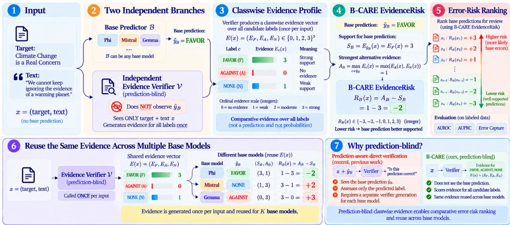
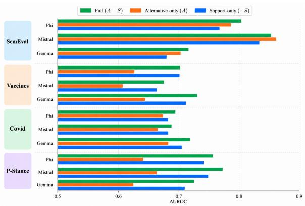
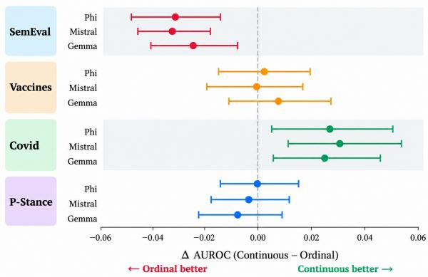
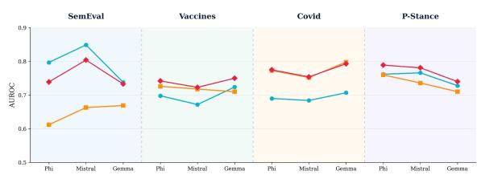
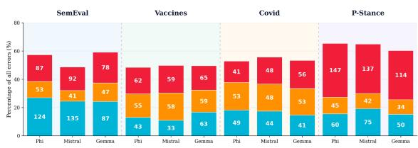
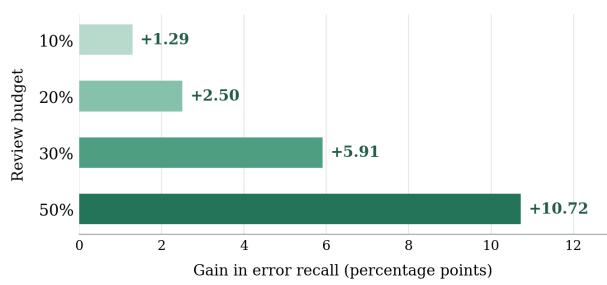
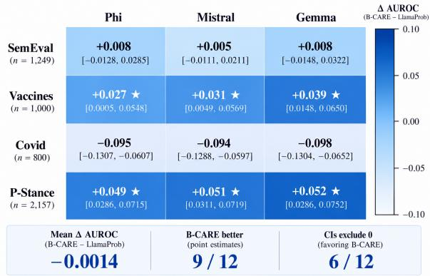
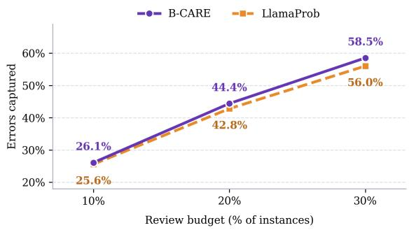

# B-CARE: Blind Classwise Assessment of Relative Evidence for Stance Error Ranking

Meysam Sabbaghan Doina Caragea

Department of Computer Science Kansas State University {meysamsabbaghan,dcaragea}@ksu.edu

## Abstract

Stance classifiers make errors that can be costly to identify under limited human-review budgets. Prioritizing potentially incorrect predictions remains challenging, particularly across heterogeneous base models. We introduce B-CARE (Blind Classwise Assessment of Relative Evidence for Stance Error Ranking), a prediction-blind framework for identifying high-risk stance predictions. Given only a target and text, a fixed LLM verifier assigns ordinal evidence scores to all candidate stance labels without observing the base model’s prediction or confidence. B-CARE constructs a comparative risk score by contrasting the strongest alternative-class evidence with the evidence supporting the predicted class. The resulting classwise evidence profile can be reused across multiple base models without training a separate error detector or calibrating risk scores. We evaluate B-CARE on four stance benchmarks and three heterogeneous base LLMs, covering 12 dataset–model settings and 5,206 unique test instances. Evaluation includes error-ranking discrimination (AUROC and AUPRC), selective prediction (E-AURC), and review effectiveness (ErrorCapture at fixed review budgets). B-CARE achieves a mean AUROC of 0.735 and a mean AUPRC of 0.524, capturing 41.06% of errors within the highest-risk 20% of predictions. Although B-CARE does not uniformly outperform strong confidence-based baselines, it provides a reusable, complementary evidence signal for prioritizing potentially incorrect stance predictions across heterogeneous models. The code is available in an anonymized repository.1

## 1 Introduction

Stance detection identifies whether a text favors, opposes, or takes no clear position toward a target (Mohammad et al., 2016). Despite advances in LLM-based prompting (Akash et al., 2025) and reasoning (Zhang et al., 2026), as well as extensive study of external-context integration (Nguyen and Kim, 2025), classification errors persist. Under limited human-review budgets, a key question is: which predictions should be reviewedfirst?

Existing reliability signals include maximum softmax probability (MSP) (Hendrycks and Gimpel, 2017), predictive entropy (PE) (Malinin and Gales, 2018), and p(True) (Kadavath et al., 2022). Other approaches use semantic uncertainty or similarity-based signals (Kuhn et al., 2023; Farquhar et al., 2024; Nguyen et al., 2025), evidential uncertainty (Kunitomo-Jacquin et al., 2026), and consistency- or verification-based checks (Zhang et al., 2023a; Xue et al., 2026; Tan et al., 2025; Goel et al., 2025; Hamidieh et al., 2026). Closest to our setting, MPVStance (Zhang et al., 2025c) verifies and revises stance predictions, while MARCH (Li et al., 2026) checks claims without revealing the solver’s answer to its checker. B-CARE instead ranks errors in fixed predictions using predictionblind, graded evidence for competing classes.

We introduce B-CARE (Blind Classwise Assessment of Relative Evidence for Stance Error Ranking). A fixed LLM verifier independently assesses ordinal evidence $E _ { c } ( x )$ for each candidate stance class without observing the base prediction or confidence. For a base classifier B predicting yˆB, the error-risk score is

$$
R _ { B } ( x ) = \operatorname* { m a x } _ { c \neq \hat { y } _ { B } } E _ { c } ( x ) - E _ { \hat { y } _ { B } } ( x ) .\tag{1}
$$

Unlike binary verifier disagreement, this score preserves the strength of predicted-class support relative to competing evidence. The resulting evidence profiles can be reused across classifiers without training an error detector or performing datasetspecific risk calibration.

We evaluate B-CARE on SemEval-2016 Task 6A (Mohammad et al., 2016), VaccineStance (1,000 examples) (Sabbaghan et al., 2026), COVID-19-

Stance (Glandt et al., 2021), and P-Stance (Li et al., 2021), with Phi-4 (Abdin et al., 2024), Mistral Small 24B Instruct (2501) (Mistral AI, 2025), and Gemma 3 (Gemma Team, 2025). Across 12 dataset– model settings and 5,206 unique test instances, B-CARE achieves mean AUROC 0.735 and AUPRC 0.524, capturing 41.06% of existing errors at a 20% review budget. Ablations support prediction blindness and graded evidence, although performance varies across datasets and does not consistently exceed strong confidence baselines. Exploratory results also indicate complementarity with predictive entropy. Our contributions are:

• Comparative error ranking: Prediction-blind classwise evidence and relative scoring without a trained error detector.

• Controlled analysis: Ablations of prediction exposure, evidence granularity, and score components.

• Evaluation and complementarity: Error ranking, selective prediction, and review effectiveness across four datasets and three base LLMs, including confidence complementarity.

## 2 Related Work

Stance Detection and Evidence-Based Reasoning. Stance detection identifies a text’s position toward a target, including implicit stances (Mohammad et al., 2016). Prior work investigates targetaware modeling, contextual knowledge, and crosstarget transfer (Garg and Caragea, 2024; Beck et al., 2023; Zhang et al., 2024, 2023b; Allaway and McKeown, 2020). Benchmarks span political and public-health discourse (Li et al., 2021; Glandt et al., 2021), while recent work explores open-target generalization, multi-path reasoning, and retrieval-augmented verification (Akash et al., 2025; Zhang et al., 2025b,c). MPVStance (Zhang et al., 2025c) uses multi-perspective verification and retrieved evidence to assess and revise stance responses. Unlike MPVStance, B-CARE ranks errors in fixed predictions without revising them. Joint stance and rumor-veracity modeling has also been studied (Yang et al., 2024). External evidence does not consistently improve prediction (Nguyen and Kim, 2025), and zero-shot biases complicate reliability assessment (Dubreuil et al., 2025).

Uncertainty, Consistency, and Error Detection. Uncertainty quantification for LLMs encompasses both white-box and black-box approaches, including probability-based and consistency-based methods (Shelmanov et al., 2025). Reliability assessment has been studied through fact verification (Guan et al., 2024), token-level and semantic consistency (Wastl et al., 2025; Gupta et al., 2025), and belief-state-based hallucination detection (Zhang et al., 2025a). Sampling-based methods include SelfCheckGPT (Manakul et al., 2023). Chain-of-Verification uses independently answered questions to verify generated content (Dhuliawala et al., 2024). B-CARE instead explicitly compares graded evidence for predicted and competing stance classes.

Prediction-Blind Verification and Error Ranking. Confidence-based error detection and selective classification provide established approaches to prioritizing predictions for review (Hendrycks and Gimpel, 2017; Geifman and El-Yaniv, 2017; Varshney et al., 2022). Independent verification and limitations of self-consistency have also been investigated (Dhuliawala et al., 2024; Tan et al., 2025). MARCH (Li et al., 2026) employs a solver– proposer–checker framework for hallucination mitigation. Its checker verifies claims derived from the solver’s response against retrieved evidence without seeing the original answer. Thus, answer-blind verification is not itself unique to B-CARE.

B-CARE obtains graded evidence for every stance class directly from the target and text, without observing the base prediction or deriving verification questions from it. This evidence is contrasted with each base prediction to rank potential errors, rather than revise predictions or verify response-derived factual claims. We compare prediction-blind and prediction-aware verification, graded and binary evidence, and error prioritization under fixed review budgets. The evidence profile is reusable across base classifiers without training a separate error detector.

## 3 Methodology

Figure 1 illustrates the B-CARE framework. A base classifier predicts the stance of a target–text pair, while an independent verifier assesses textual evidence for each candidate class without observing the prediction. B-CARE then compares the predicted class with its strongest alternative to rank potentially incorrect predictions for review.

## 3.1 Error Ranking

Let x = (T, X) denote an input comprising a target T and text X. A base classifier B produces a stance

  
Figure 1: Overview of B-CARE. An independent, prediction-blind LLM verifier assigns ordinal evidence scores to all candidate stance labels without observing the base prediction. B-CARE contrasts evidence supporting the predicted label with its strongest alternative to produce an ordinal error-risk score for review prioritization. The evidence profile can be reused across multiple base classifiers without additional verifier generations.

prediction

$$
\hat { y } _ { B } = f _ { B } ( x ) , \qquad \hat { y } _ { B } \in \mathcal { V } ,\tag{2}
$$

where Y denotes the dataset-specific label set. SemEval-2016, VaccineStance, and COVID-19- Stance use Y = {FAVOR, AGAINST, NONE}, while P-Stance uses $\begin{array} { r l r } { \mathcal { Y } } & { { } = } & { \left\{ \mathrm { F A V O R } , { \mathrm { A G A I N S T } } \right\} } \end{array}$ . The COVID-19-Stance label NEUTRAL is mapped to NONE.

Given the gold label $y ,$ we define the evaluationonly error indicator

$$
z _ { B } ( x ) = \mathbb { I } [ \hat { y } _ { B } \neq y ] .\tag{3}
$$

Gold labels are unavailable to the risk estimator at inference time. Our objective is to assign each existing prediction a scalar risk score $R _ { B } ( x )$ , with larger values indicating higher priority for review. Unlike stance classification, this task does not generate or correct labels. The risk score is not interpreted as a calibrated probability of error.

## 3.2 Prediction-Blind Classwise Evidence

B-CARE employs Llama-3.3-70B-Instruct through OpenRouter as a fixed external evidence verifier V, with temperature 0 and a maximum of 80 output tokens per request. One independent request produces a complete classwise evidence profile. Frozen ternary and binary prompt variants are used for the corresponding label sets, with a common evidence scale and output schema.

Given the target, text, and candidate labels, the verifier produces an ordinal evidence profile

$$
E ( x ) = \left( E _ { c } ( x ) \right) _ { c \in \mathcal { Y } } ,\tag{4}
$$

where $E _ { c } ( x ) \in \{ 0 , 1 , 2 , 3 \}$ . The scale represents increasing textual support: no evidence (0), weak or ambiguous evidence (1), moderate evidence (2), and strong, direct evidence (3).

The verifier evaluates textual evidence for each candidate stance and is explicitly instructed not to output a final stance prediction. It receives neither the base prediction nor its confidence, logits, or model identity. Gold labels and correctness indicators are also withheld. Thus, evidence generation depends on the input and label set rather than on the base prediction.

For a base prediction $\hat { y } _ { B } ,$ , we define the evidence supporting that prediction as

$$
\begin{array} { r } { S _ { B } ( x ) = E _ { \hat { y } _ { B } } ( x ) . } \end{array}\tag{5}
$$

The strongest competing evidence is

$$
\boldsymbol { A } _ { B } ( \boldsymbol { x } ) = \operatorname* { m a x } _ { \boldsymbol { c } \in \mathcal { V } \atop \boldsymbol { c } \neq \hat { \boldsymbol { y } } _ { B } } \boldsymbol { E } _ { \boldsymbol { c } } ( \boldsymbol { x } ) .\tag{6}
$$

B-CARE then assigns the comparative evidence risk

$$
R _ { B } ( x ) = A _ { B } ( x ) - S _ { B } ( x ) .\tag{7}
$$

Since evidence scores lie in {0, 1, 2, 3}, the risk belongs to $\{ - 3 , - 2 , \ldots , 3 \}$ . Positive scores indicate stronger evidence for an alternative stance, whereas negative scores indicate stronger support for the predicted label. A zero score indicates equal evidence for the predicted class and its strongest alternative, not necessarily equal support across all candidate classes. Predictions are ranked in descending order of $R _ { B } ( x )$ . For review budget q, we review $k = \operatorname* { m a x } ( 1 , \operatorname { r o u n d } ( q N ) )$ predictions per dataset–model setting.

## 3.3 Prediction Blindness and Evidence Reuse

Prediction blindness separates evidence assessment from base predictions and enables evidence reuse across classifiers.

Prediction exposure. A prediction-aware verifier may condition its assessment on the predicted label, potentially introducing confirmation bias. B-CARE instead generates evidence without observing that label. We examine this distinction in Section 6.3, comparing blind and prediction-aware verification under the same verifier backbone, evidence scale, output schema, and risk formula. The prediction-aware variant additionally receives the base prediction.

Evidence reuse. Because classwise evidence depends only on the target–text input and label set, one verifier generation can serve multiple base classifiers evaluated on the same example. Their respective risk scores are computed offline using the shared evidence vector.

Prediction-aware verification can also cache responses when base classifiers agree; across 5,206 examples, B-CARE requires 5,206 verifier generations versus 6,544 for a cached prediction-aware alternative (20.4% fewer; retries, tokens, and latency excluded).

## 4 Experimental Setup

## 4.1 Datasets and Models

We evaluate B-CARE on four stance benchmarks with 5,206 unique test examples across 13 targets: SemEval-2016 Task 6A (five targets, excluding Donald Trump) (Mohammad et al., 2016), VaccineStance (1,000 examples) (Sabbaghan et al., 2026), COVID-19-Stance (four targets, 200 each) (Glandt et al., 2021), and P-Stance (2,157 examples, three targets) (Li et al., 2021). The first three use FAVOR, AGAINST, and NONE (mapping neutral to NONE); P-Stance is binary. Target statistics appear in Appendix A.

Phi-4 (14B) (Abdin et al., 2024), Mistral Small 24B Instruct (2501) (Mistral AI, 2025), and Gemma 3 (27B) (Gemma Team, 2025) were run on a university HPC cluster with revision-pinned Hugging Face checkpoints, local Transformers inference, and frozen stance prompts.

Across the 12 dataset–model settings, B-CARE uses Llama-3.3-70B-Instruct (Grattafiori et al., 2024; Meta AI, 2024) via OpenRouter as a fixed prediction-blind verifier (temperature 0). A separate set of 2,000 validation examples (500 per dataset) was used for method development and validation. The verifier prompt, ordinal scale, output schema, and inference settings were finalized before test evaluation. Exact model revisions and configurations are provided in the reproducibility materials. The verifier prompts and prediction-exposure controls are detailed in Appendix B.

No supervised error-risk training or calibration is required. Training examples are used only for specified baselines, including 20 few-shot examples for p(True).

## 4.2 Baselines and Controlled Variants

We compare against uncertainty, self-evaluation, sampling, and verification baselines and controlled variants.

Base-model uncertainty. Maximum Softmax Probability (MSP) (Hendrycks and Gimpel, 2017) uses one minus the maximum class probability; Predictive Entropy (PE) (Malinin and Gales, 2018) measures closed-set stance uncertainty.

Self-evaluation. p(True) (Kadavath et al., 2022; Farquhar et al., 2024) estimates the correctness of the base prediction following the Semantic Uncertainty implementation. Our Direct Self-Verification (DSV) control uses a separate True/False correctness prompt.

Sampling-based uncertainty. Label Entropy (LE) measures entropy over sampled stance labels; Variation Ratio (VR) measures disagreement with the modal label. Semantic Entropy (SE) (Kuhn et al., 2023; Farquhar et al., 2024) groups semantically equivalent responses; Evidential Semantic Entropy (EVSE) (Kunitomo-Jacquin et al., 2026) extends this through evidential modeling.

Comparative evidence controls. Same-Model Comparative Evidence applies B-CARE’s classwise evidence scoring and $A _ { B } - S _ { B }$ formula using the base model as verifier. Evidence-Label Disagreement (LD) uses the external verifier’s classwise evidence to check whether the base prediction uniquely attains the maximum evidence score; ties are counted as disagreement. Same-Model Label Disagreement applies the same unique-maximum rule to evidence generated by the base model.

Model-disagreement controls. Cross-Base Disagreement (CBD) measures disagreement among the three base models; Llama Label Disagreement compares the base prediction with an independently generated external Llama stance label.

External verification controls. External Direct Correctness Verification (EDCV) exposes the base prediction for direct correctness assessment. Prediction-Aware Comparative Evidence (PACE) retains B-CARE’s verifier, ordinal scale, output schema, and $A _ { B } - S _ { B }$ formula but reveals the base prediction, isolating prediction exposure. Random ranking provides a chance reference; standalone Llama stance classification is evaluated separately.

Component and sensitivity analyses. We compare support-only $( - S _ { B } )$ , alternative-only $( A _ { B } )$ and comparative $( A _ { B } - S _ { B } )$ scores, plus lexicographic ranking, softmax-based support, and normalized evidence share. A random-label exposure control tests the effect of revealing an unrelated candidate label. These analyses are separate from primary baseline comparisons. Full implementation details for all baselines and controlled variants are provided in Appendix C.

## 4.3 Metrics and Statistical Analysis

Our primary metric is error-ranking AUROC, with incorrect predictions as positives. We also report AUPRC, error prevalence, area under the risk– coverage curve (AURC), excess AURC (E-AURC), and ErrorCapture@q (EC@q), the fraction of existing errors captured by reviewing the highest-risk q fraction of predictions.

Because $R _ { B } ( x ) \ \in \ \{ - 3 , - 2 , \ldots , 3 \}$ , ties are common. AUROC uses midranks, AUPRC uses average precision over score thresholds, and EC@q uses expected fractional allocation at budgetboundary ties to avoid arbitrary ordering.

Paired within-setting bootstrap comparisons use 10,000 matched-example resamples with predefined seeds. Means and standard deviations across the 12 settings reflect between-setting variation, not run-to-run uncertainty. Win counts are descriptive because settings are not independent experimental replications. Tie handling for AURC and E-AURC is described in Appendix C.

## 5 Main Results

## 5.1 Overall Error-Ranking Performance

Figure 2 compares B-CARE with 13 competing error-ranking methods across 12 dataset–model settings, covering four stance-detection benchmarks and three base models. AUROC measures how effectively each method ranks incorrect predictions above correct ones, independently of a review budget or decision threshold.

B-CARE achieves the highest AUROC in five of the 12 settings: SemEval–Phi, Vaccines–Gemma, and all three P-Stance settings. Notable AUROC values include 0.797 on SemEval–Phi, 0.849 on SemEval–Mistral, and 0.766 on P-Stance–Mistral. Its performance across all three P-Stance base models suggests that comparative classwise evidence can provide a useful error-ranking signal across different model architectures.

Performance nevertheless varies substantially across datasets and models. On SemEval, B-CARE performs strongly against most alternatives, although p(True) achieves higher AUROC for Mistral and Gemma. On Vaccines, B-CARE leads with Gemma, while Same-Model Evidence achieves the highest AUROC for Phi and confidence-based methods remain competitive for Mistral. On COVID, MSP and Predictive Entropy outperform B-CARE across all three base models. Thus, the benefits of comparative evidence are settingdependent rather than universal.

B-CARE also outperforms Direct Verification (EDCV) and Prediction-Aware Comparative Evidence (PACE) in AUROC across the evaluated settings. Unlike direct correctness judgments or evidence conditioned on the predicted label, B-CARE compares prediction-independent evidence for competing stance classes.

A separate matched evaluation against verifier probabilities is reported in Section 6.5. Additional label-disagreement, random-ranking, and normalized evidence-share controls are summarized in Appendix C.1 (Table T3).

## 5.2 Complementary Evaluation Metrics

Beyond AUROC, we evaluate AUPRC, excess area under the risk–coverage curve (E-AURC), and ErrorCapture (EC) at review budgets of 10%, 20%,

<table><tr><td></td><td rowspan=1 colspan=1>0.612</td><td rowspan=1 colspan=1>0.660</td><td rowspan=1 colspan=1>0.668</td><td rowspan=1 colspan=1>0.725</td><td rowspan=1 colspan=1>0.718</td><td rowspan=1 colspan=1>0.710</td><td rowspan=1 colspan=1>0.773</td><td rowspan=1 colspan=1>0.752</td><td rowspan=1 colspan=1>0.798</td><td rowspan=1 colspan=1>0.760</td><td rowspan=1 colspan=1>0.736</td><td rowspan=1 colspan=1>0.710</td><td rowspan=1 colspan=1>0.719</td></tr><tr><td></td><td rowspan=1 colspan=1>0.748</td><td rowspan=1 colspan=1>0.856</td><td rowspan=1 colspan=1>0.794</td><td rowspan=1 colspan=1>0.634</td><td rowspan=1 colspan=1>0.640</td><td rowspan=1 colspan=1>0.588</td><td rowspan=1 colspan=1>0.577</td><td rowspan=1 colspan=1>0.750</td><td rowspan=1 colspan=1>0.570</td><td rowspan=1 colspan=1>0.665</td><td rowspan=1 colspan=1>0.693</td><td rowspan=1 colspan=1>0.709</td><td rowspan=1 colspan=1>0.685</td></tr><tr><td></td><td rowspan=1 colspan=1>0.701</td><td rowspan=1 colspan=1>0.651</td><td rowspan=1 colspan=1>0.729</td><td rowspan=1 colspan=1>0.598</td><td rowspan=1 colspan=1>0.714</td><td rowspan=1 colspan=1>0.659</td><td rowspan=1 colspan=1>0.572</td><td rowspan=1 colspan=1>0.634</td><td rowspan=1 colspan=1>0.626</td><td rowspan=1 colspan=1>0.704</td><td rowspan=1 colspan=1>0.730</td><td rowspan=1 colspan=1>0.705</td><td rowspan=1 colspan=1>0.669</td></tr><tr><td></td><td rowspan=1 colspan=1>0.612</td><td rowspan=1 colspan=1>0.663</td><td rowspan=1 colspan=1>0.669</td><td rowspan=1 colspan=1>0.726</td><td rowspan=1 colspan=1>0.718</td><td rowspan=1 colspan=1>0.710</td><td rowspan=1 colspan=1>0.773</td><td rowspan=1 colspan=1>0.752</td><td rowspan=1 colspan=1>0.798</td><td rowspan=1 colspan=1>0.760</td><td rowspan=1 colspan=1>0.736</td><td rowspan=1 colspan=1>0.710</td><td rowspan=1 colspan=1>0.719</td></tr><tr><td></td><td rowspan=1 colspan=1>0.550</td><td rowspan=1 colspan=1>0.541</td><td rowspan=1 colspan=1>0.516</td><td rowspan=1 colspan=1>0.598</td><td rowspan=1 colspan=1>0.623</td><td rowspan=1 colspan=1>0.518</td><td rowspan=1 colspan=1>0.580</td><td rowspan=1 colspan=1>0.621</td><td rowspan=1 colspan=1>0.525</td><td rowspan=1 colspan=1>0.563</td><td rowspan=1 colspan=1>0.585</td><td rowspan=1 colspan=1>0.518</td><td rowspan=1 colspan=1>0.562</td></tr><tr><td></td><td rowspan=1 colspan=1>0.550</td><td rowspan=1 colspan=1>0.541</td><td rowspan=1 colspan=1>0.516</td><td rowspan=1 colspan=1>0.598</td><td rowspan=1 colspan=1>0.623</td><td rowspan=1 colspan=1>0.518</td><td rowspan=1 colspan=1>0.580</td><td rowspan=1 colspan=1>0.621</td><td rowspan=1 colspan=1>0.525</td><td rowspan=1 colspan=1>0.563</td><td rowspan=1 colspan=1>0.585</td><td rowspan=1 colspan=1>0.518</td><td rowspan=1 colspan=1>0.562</td></tr><tr><td></td><td rowspan=1 colspan=1>0.560</td><td rowspan=1 colspan=1>0.587</td><td rowspan=1 colspan=1>0.475</td><td rowspan=1 colspan=1>0.598</td><td rowspan=1 colspan=1>0.641</td><td rowspan=1 colspan=1>0.509</td><td rowspan=1 colspan=1>0.589</td><td rowspan=1 colspan=1>0.612</td><td rowspan=1 colspan=1>0.549</td><td rowspan=1 colspan=1>0.619</td><td rowspan=1 colspan=1>0.591</td><td rowspan=1 colspan=1>0.497</td><td rowspan=1 colspan=1>0.569</td></tr><tr><td></td><td rowspan=1 colspan=1>0.581</td><td rowspan=1 colspan=1>0.746</td><td rowspan=1 colspan=1>0.516</td><td rowspan=1 colspan=1>0.609</td><td rowspan=1 colspan=1>0.635</td><td rowspan=1 colspan=1>0.517</td><td rowspan=1 colspan=1>0.665</td><td rowspan=1 colspan=1>0.619</td><td rowspan=1 colspan=1>0.525</td><td rowspan=1 colspan=1>0.689</td><td rowspan=1 colspan=1>0.620</td><td rowspan=1 colspan=1>0.527</td><td rowspan=1 colspan=1>0.599</td></tr><tr><td></td><td rowspan=1 colspan=1>0.620</td><td rowspan=1 colspan=1>0.686</td><td rowspan=1 colspan=1>0.619</td><td rowspan=1 colspan=1>0.727</td><td rowspan=1 colspan=1>0.568</td><td rowspan=1 colspan=1>0.610</td><td rowspan=1 colspan=1>0.597</td><td rowspan=1 colspan=1>0.556</td><td rowspan=1 colspan=1>0.561</td><td rowspan=1 colspan=1>0.695</td><td rowspan=1 colspan=1>0.736</td><td rowspan=1 colspan=1>0.676</td><td rowspan=1 colspan=1>0.638</td></tr><tr><td></td><td rowspan=1 colspan=1>0.661</td><td rowspan=1 colspan=1>0.755</td><td rowspan=1 colspan=1>0.542</td><td rowspan=1 colspan=1>0.644</td><td rowspan=1 colspan=1>0.595</td><td rowspan=1 colspan=1>0.704</td><td rowspan=1 colspan=1>0.655</td><td rowspan=1 colspan=1>0.623</td><td rowspan=1 colspan=1>0.678</td><td rowspan=1 colspan=1>0.693</td><td rowspan=1 colspan=1>0.698</td><td rowspan=1 colspan=1>0.626</td><td rowspan=1 colspan=1>0.656</td></tr><tr><td rowspan=2 colspan=1>Evidence-Label DisagreementDirect Verification</td><td rowspan=1 colspan=1>0.735</td><td rowspan=1 colspan=1>0.803</td><td rowspan=1 colspan=1>0.682</td><td rowspan=1 colspan=1>0.588</td><td rowspan=1 colspan=1>0.590</td><td rowspan=1 colspan=1>0.613</td><td rowspan=1 colspan=1>0.599</td><td rowspan=1 colspan=1>0.617</td><td rowspan=1 colspan=1>0.615</td><td rowspan=1 colspan=1>0.672</td><td rowspan=1 colspan=1>0.689</td><td rowspan=1 colspan=1>0.644</td><td rowspan=1 colspan=1>0.654</td></tr><tr><td rowspan=1 colspan=1>0.749</td><td rowspan=1 colspan=1>0.806</td><td rowspan=1 colspan=1>0.657</td><td rowspan=1 colspan=1>0.624</td><td rowspan=1 colspan=1>0.586</td><td rowspan=1 colspan=1>0.627</td><td rowspan=1 colspan=1>0.558</td><td rowspan=1 colspan=1>0.571</td><td rowspan=1 colspan=1>0.556</td><td rowspan=1 colspan=1>0.640</td><td rowspan=1 colspan=1>0.644</td><td rowspan=1 colspan=1>0.637</td><td rowspan=1 colspan=1>0.638</td></tr><tr><td rowspan=2 colspan=1>Prediction-Aware EvidenceB-CARE (Ours)</td><td rowspan=1 colspan=1>0.783</td><td rowspan=1 colspan=1>0.843</td><td rowspan=1 colspan=1>0.726</td><td rowspan=1 colspan=1>0.677</td><td rowspan=1 colspan=1>0.638</td><td rowspan=1 colspan=1>0.697</td><td rowspan=1 colspan=1>0.637</td><td rowspan=1 colspan=1>0.671</td><td rowspan=1 colspan=1>0.683</td><td rowspan=1 colspan=1>0.720</td><td rowspan=1 colspan=1>0.738</td><td rowspan=1 colspan=1>0.710</td><td rowspan=1 colspan=1>0.710</td></tr><tr><td rowspan=1 colspan=1>0.797</td><td rowspan=1 colspan=1>0.849</td><td rowspan=1 colspan=1>0.738</td><td rowspan=1 colspan=1>0.698</td><td rowspan=1 colspan=1>0.672</td><td rowspan=1 colspan=1>0.724</td><td rowspan=1 colspan=1>0.690</td><td rowspan=1 colspan=1>0.684</td><td rowspan=1 colspan=1>0.707</td><td rowspan=1 colspan=1>0.762</td><td rowspan=1 colspan=1>0.766</td><td rowspan=1 colspan=1>0.728</td><td rowspan=1 colspan=1>0.735</td></tr></table>

Figure 2: AUROC comparison across 12 dataset–model settings. B-CARE and 13 competing error-ranking methods are evaluated on four stance-detection benchmarks and three base models, treating incorrect predictions as positive. Cell values are shown to three decimal places; boldface identifies the highest unrounded AUROC within each setting. The rightmost column reports the mean across all 12 settings. B-CARE achieves the highest mean AUROC (0.735) among the 14 methods in this primary comparison and leads in five settings.
<table><tr><td>Method</td><td>AUPRC ↑</td><td>E-AURC↓</td><td>EC@10% ↑</td><td> $\mathbf { E C } @ 2 \mathbf { 0 } \% \ \mathrm { \uparrow }$ </td><td>EC@30%↑</td></tr><tr><td>MSP</td><td> $0 . 5 0 0 \pm 0 . 0 9 3$ </td><td> $0 . 1 2 1 \pm 0 . 0 4 9$ </td><td> $2 0 . 3 3 \pm 4 . 6 7$ </td><td> $3 7 . 4 8 \pm 7 . 1 0$ </td><td> $5 1 . 2 6 \pm 7 . 6 6$ </td></tr><tr><td>p(True)</td><td> $0 . 4 6 8 \pm 0 . 1 3 9$ </td><td> $0 . 1 3 2 \pm 0 . 0 5 6$ </td><td> $1 8 . 5 3 \pm 5 . 9 8$ </td><td> $3 2 . 6 2 \pm 9 . 2 4$ </td><td> $4 6 . 1 6 \pm 9 . 5 3$ </td></tr><tr><td>Self-Verification</td><td> $0 . 4 2 9 \pm 0 . 0 6 9$ </td><td> $0 . 1 3 8 \pm 0 . 0 5 0$ </td><td> $1 6 . 6 2 \pm 4 . 9 7$ </td><td> $3 1 . 5 0 \pm 6 . 4 2$ </td><td> $4 4 . 4 1 \pm 7 . 2 2$ </td></tr><tr><td>Predictive Entropy</td><td> $0 . 5 0 3 \pm 0 . 0 9 2$ </td><td> ${ \bf 0 . 1 1 9 \pm 0 . 0 5 0 }$ </td><td> $2 0 . 2 0 \pm 4 . 5 4$ </td><td> $3 7 . 4 5 \pm 7 . 0 8$ </td><td> $5 1 . 2 5 \pm 7 . 5 8$ </td></tr><tr><td>Label Entropy</td><td> $0 . 3 5 3 \pm 0 . 0 9 6$ </td><td> $0 . 2 1 8 \pm 0 . 0 5 8$ </td><td> $1 6 . 7 8 \pm 4 . 2 1$ </td><td> $2 7 . 9 2 \pm 5 . 5 1$ </td><td> $3 6 . 9 4 \pm 4 . 8 2$ </td></tr><tr><td>Variation Ratio</td><td> $0 . 3 5 3 \pm 0 . 0 9 6$ </td><td> $0 . 2 1 8 \pm 0 . 0 5 8$ </td><td> $1 6 . 7 8 \pm 4 . 2 1$ </td><td> $2 7 . 9 2 \pm 5 . 5 1$ </td><td> $3 6 . 9 4 \pm 4 . 8 2$ </td></tr><tr><td>Semantic Entropy</td><td> $0 . 3 7 9 \pm 0 . 0 9 9$ </td><td> $0 . 2 1 8 \pm 0 . 0 6 0$ </td><td> $1 7 . 2 0 \pm 5 . 5 6$ </td><td> $2 8 . 2 3 \pm 7 . 1 6$ </td><td> $3 7 . 9 0 \pm 7 . 1 0$ </td></tr><tr><td>Evidential SE</td><td> $0 . 4 0 5 \pm 0 . 1 1 0$ </td><td> $0 . 1 9 1 \pm 0 . 0 6 7$ </td><td> $1 7 . 7 7 \pm 4 . 8 0$ </td><td> $2 9 . 6 1 \pm 5 . 6 0$ </td><td> $3 9 . 0 6 \pm 5 . 7 9$ </td></tr><tr><td>Same-Model Evidence</td><td> $0 . 4 0 7 \pm 0 . 0 9 8$ </td><td> $0 . 1 7 8 \pm 0 . 0 6 0$ </td><td> $1 7 . 6 5 \pm 7 . 5 7$ </td><td> $3 2 . 9 1 \pm 9 . 8 4$ </td><td> $4 5 . 8 1 \pm 9 . 9 7$ </td></tr><tr><td>Cross-Model Disagreement</td><td> $0 . 4 4 1 \pm 0 . 1 2 1$ </td><td> $0 . 1 7 2 \pm 0 . 0 4 3$ </td><td> $2 1 . 3 7 \pm 6 . 6 3$ </td><td> $3 6 . 5 6 \pm 7 . 7 0$ </td><td> $4 9 . 1 2 \pm 6 . 0 2$ </td></tr><tr><td>Evidence-Label Disagreement</td><td> $0 . 4 4 1 \pm 0 . 1 2 4$ </td><td> $0 . 1 7 4 \pm 0 . 0 5 2$ </td><td> $2 2 . 6 1 \pm 8 . 2 9$ </td><td> $3 8 . 4 7 \pm 6 . 6 1$ </td><td> $4 8 . 2 9 \pm 6 . 8 3$ </td></tr><tr><td>Direct Verification</td><td> $0 . 3 9 5 \pm 0 . 1 2 8$ </td><td> $0 . 1 7 0 \pm 0 . 0 5 5$ </td><td> $1 5 . 0 6 \pm 6 . 5 1$ </td><td> $3 1 . 1 6 \pm 6 . 7 3$ </td><td> $4 4 . 5 6 \pm 6 . 1 2$ </td></tr><tr><td>Prediction-Aware Evidence</td><td> $0 . 5 0 8 \pm 0 . 1 2 7$ </td><td> $0 . 1 4 2 \pm 0 . 0 4 2$ </td><td> $2 3 . 3 2 \pm 7 . 1 4$ </td><td> $3 9 . 1 1 \pm 7 . 8 4$ </td><td> $5 3 . 6 4 \pm 7 . 6 4$ </td></tr><tr><td>B-CARE (Ours)</td><td> ${ \bf 0 . 5 2 4 \pm 0 . 1 2 1 }$ </td><td> $0 . 1 2 5 \pm 0 . 0 3 5$ </td><td> ${ \bf 2 3 . 8 5 \pm 8 . 1 1 }$ </td><td> ${ \bf 4 1 . 0 6 \pm 8 . 9 6 }$ </td><td> ${ \bf 5 4 . 3 5 \pm 7 . 5 2 }$ </td></tr></table>

Table 1: Complementary error-ranking performance (mean ± sample standard deviation across 12 dataset–model settings). Higher AUPRC and EC and lower E-AURC are better. EC is expressed as a percentage and uses expected fractional allocation at budget-boundary ties. Bold indicates the best mean in each column.

## 5.3 Statistical Significance

and 30%. Table 1 reports mean performance across all 12 dataset–model settings. B-CARE achieves the highest mean AUPRC (0.524) and EC at all three budgets (23.85%, 41.06%, and 54.35%, respectively), indicating effective error prioritization under limited review budgets. However, Predictive Entropy achieves a lower E-AURC (0.119 versus 0.125). These findings demonstrate advantages in specific review metrics without implying uniform superiority.

We compare AUROC using paired, example-level bootstrap resampling with unadjusted percentile 95% confidence intervals across 156 comparisons. B-CARE shows positive AUROC differences with intervals excluding zero in all 12 settings against Direct Verification, Evidential SE, Label Entropy, Variation Ratio, and Evidence-Label Disagreement, and in 11/12 settings against Same-Model Evidence and Semantic Entropy. The only nonsignificant comparisons for these two baselines occur on Vaccines with Phi and Vaccines with Mistral, respectively. Against Prediction-Aware Evidence, B-CARE records seven significant wins, no significant losses, and five nonsignificant differences. Comparisons with MSP and Predictive Entropy each yield four wins, four losses, and four nonsignificant differences.

The Same-Model Evidence comparison preserves the evidence rubric and ranking rule but changes the verifier and inference environment; the observed performance gap therefore cannot be attributed solely to verifier capacity. These findings are based on unadjusted intervals and do not establish family-wise significance across all comparisons. Complete results appear in Appendix D.

## 5.4 Complementarity with Predictive Entropy

We examine complementarity between B-CARE and Predictive Entropy (PE). Across 12 dataset– model settings, the sets of actual errors captured within B-CARE’s and PE’s independently selected top-20% review sets have a mean Jaccard overlap of 0.406, while their union captures 55.5% of all errors (Table T6; see also Figure A1 in Appendix E). Importantly, this union exceeds a single 20% review budget.

An exploratory, untuned 0.5/0.5 average of within-setting normalized ranks achieves a mean AUROC of 0.760, compared with 0.735 for B-CARE and 0.719 for PE. The hybrid outperforms B-CARE in 9/12 settings but underperforms in all three SemEval settings. These findings suggest complementary, dataset-dependent signals rather than uniform improvements. The hybrid is not part of the frozen B-CARE method. Additional results appear in Appendix E.

## 6 Ablation Studies

## 6.1 Component Ablation of the B-CARE Score

We examine the contribution of each component of the B-CARE score by comparing the full formulation (A − S) with support-only (−S) and alternative-only (A) variants. As shown in Figure 3, the full score achieves the highest mean AUROC (0.735), compared with 0.728 for −S and 0.686 for A. It outperforms the two variants in 11/12 and 10/12 settings, respectively. Paired bootstrap comparisons identify significant gains in 6/12 and 9/12 settings, with no significant losses. These results indicate that predicted-label support provides a strong ranking signal, while competing-class evidence offers additional benefits. Detailed results are provided in Appendix F.

  
Figure 3: Component ablation of the B-CARE score across 12 dataset–model settings. Higher AUROC indicates better error ranking.

## 6.2 Ordinal versus Continuous Evidence Scoring

We test whether continuous evidence scores improve on ordinal grades. The same fixed, prediction-blind Llama verifier is prompted for realvalued classwise scores on [0, 3], with the same $R _ { B } = A _ { B } - S _ { B }$ formulation. The two variants achieve nearly identical mean AUROC (0.7346 ordinal vs. 0.7345 continuous). As shown in Figure 4, ordinal scoring is better on SemEval for all three base models, continuous scoring is better on COVID (intervals excluding zero in two of three settings), and neither has a clear advantage on Vaccines or P-Stance. Finer granularity therefore yields no consistent gain, supporting ordinal scoring as a competitive and interpretable choice.

## 6.3 Effect of Prediction Blindness

We assess the role of prediction blindness by comparing B-CARE’s prediction-blind evidence (PBCE) with a prediction-aware variant (PACE). Both use the same Llama-3.3-70B verifier, evidence scale, and $A _ { B } - S _ { B }$ score; PACE additionally receives the base prediction. As shown in Figure 5, PBCE achieves higher AUROC in all 12 dataset–model settings, with a mean improvement of 0.0244. Seven paired-bootstrap 95% confidence intervals exclude zero in favor of PBCE, with none favoring PACE. These results support prediction blindness as a beneficial design choice, although not every individual improvement is statistically significant.

  
Figure 4: Ordinal versus continuous evidence scoring across 12 dataset–model settings. Dots show AUROC differences (continuous minus ordinal); horizontal bars indicate unadjusted 95% paired bootstrap confidence intervals (10,000 resamples). Positive values favor continuous scoring, negative values favor ordinal scoring, and intervals excluding zero indicate differences at the unadjusted 95% level.

<table><tr><td></td><td>Phi</td><td>Mistral</td><td>Gemma</td><td>∆ AUROC (PBCE - PACE) 0.06</td></tr><tr><td>SemEval (n = 1,249)</td><td>+0.0142 [-0.0031, 0.0319]</td><td>+0.0065 [-0.0070, 0.0202]</td><td>+0.0116 [-0.0096, 0.0332]</td><td>0.05 0.04</td></tr><tr><td>Vaccines (n = 1,000)</td><td>+0.0213 [-0.0002, 0.0438]</td><td>+0.0339 ★ [0.0117, 0.0564]</td><td>+0.0274 ★ [0.0043, 0.0504]</td><td>0.03</td></tr><tr><td>Covid (n = 800)</td><td>+0.0531 ★ [0.0256, 0.0820]</td><td>+0.0131 [-0.0106, 0.0371]</td><td>+0.0239 ★ [0.0008, 0.0479]</td><td>0.02</td></tr><tr><td>P-Stance (n = 2,157)</td><td>+0.0420 ★ [0.0242, 0.0607]</td><td>+0.0277 ★ [0.0113, 0.0449]</td><td>+0.0178 ★ [0.0012, 0.0355]</td><td>0.01 0.00</td></tr><tr><td colspan="3">Mean Δ AUROC PBCE better (PBCE - PACE) (point estimates) +0.0244 12 / 12</td><td colspan="2">CIs exclude 0 (favoring PBCE) 7 / 12</td></tr></table>

Figure 5: Effect of prediction blindness on error-ranking AUROC. Cells report the AUROC difference (PBCE minus PACE) with unadjusted 95% paired-bootstrap confidence intervals (10,000 resamples). Darker purple indicates larger gains; stars denote intervals excluding zero.

## 6.4 Graded Evidence versus Evidence-Label Disagreement

We assess whether graded relative evidence improves error ranking beyond Evidence-Label Disagreement, using identical frozen verifier outputs. As shown in Table T8 (Appendix G), B-CARE achieves higher AUROC in all 12 settings (mean $\Delta \mathrm { { A U R O C } = + 0 . 0 8 0 3 ) }$ , with all 12 unadjusted 95% paired-bootstrap confidence intervals excluding zero.

These results show that preserving graded relative evidence provides a stronger error-ranking signal than binary Evidence-Label Disagreement under the evaluated settings. Detailed results and additional analyses are provided in Appendix G.

## 6.5 Comparison with Verifier Probabilities

We also compare B-CARE with LlamaProb (LP), which ranks errors by $1 - p _ { V } ( \hat { y } _ { B } \mid x , t )$ from the same verifier. Both were evaluated on a selfhosted Llama-3.3-70B-Instruct with identical test instances and frozen base predictions; this matched evaluation is separate from the 14-method comparison, which used a different inference environment. B-CARE achieves higher AUROC in 9 of 12 settings, with nearly identical mean AUROC (0.760 vs. 0.761). B-CARE achieves higher mean AUPRC (0.603 vs. 0.592) and EC@20% (0.444 vs. 0.428), whereas LP achieves lower mean E-AURC (0.108 vs. 0.116).

B-CARE leads on VaccineStance and P-Stance; LP leads on COVID-19-Stance. B-CARE thus has the highest mean AUROC among the 14 methods in the primary evaluation, but verifierprobability ranking performs comparably on average. Per-setting results, inference-environment provenance, and COVID-19-Stance diagnostics are in Appendix H.

## 7 Conclusion

We introduced B-CARE, a training-free framework for ranking errors in frozen stance predictions using prediction-blind, classwise ordinal evidence from an external LLM verifier. Across four datasets, three base models, and 12 evaluation settings, B-CARE achieved mean AUROC of 0.735 and AUPRC of 0.524, capturing 41.06% of existing errors within a 20% review budget. Controlled ablations demonstrated the benefits of prediction blindness and graded comparative evidence over prediction-aware and binary-disagreement alternatives. However, performance varied across datasets, and B-CARE did not consistently outperform strong confidence baselines. These findings position B-CARE as a complementary, reusable signal for prioritizing human review rather than a universal replacement for model uncertainty. Future work will investigate adaptive combinations with confidence-based signals, finer-grained evidence scoring, and generalization beyond stance detection.

## Limitations

B-CARE relies on the quality of classwise evidence generated by an external LLM verifier. Although prediction blindness prevents direct exposure to the base prediction, it does not eliminate shared model biases or guarantee correct evidence. The sevenlevel ordinal risk score also produces ties that can limit ranking resolution, particularly within large groups of equally scored examples.

Our evaluation spans four English-language stance datasets, 13 targets, and three base LLMs, but uses a single external verifier family. Generalization to other languages, domains, tasks, and verifiers remains untested. Performance varies across datasets and does not consistently surpass strong confidence-based baselines, suggesting that comparative evidence and model uncertainty capture complementary signals.

External verification incurs additional inference cost relative to uncertainty scores derived directly from base-model outputs. Furthermore, the original OpenRouter-hosted verifier lacked a pinned backend checkpoint revision, limiting exact output reproducibility. Finally, B-CARE prioritizes potential errors rather than correcting them; improvements from actual human review have not been directly evaluated.

## References

Marah Abdin et al. 2024. Phi-4 technical report. Preprint, arXiv:2412.08905.

Abu Ubaida Akash, Ahmed Fahmy, and Amine Trabelsi. 2025. Can large language models address open-target stance detection? In Findings ofACL 2025, pages 971–985. Association for Computational Linguistics.

Emily Allaway and Kathleen McKeown. 2020. Zeroshot stance detection: A dataset and model using generalized topic representations. In Proceedings of the 2020 Conference on Empirical Methods in Natural Language Processing (EMNLP), pages 8913– 8931. Association for Computational Linguistics.

Tilman Beck, Andreas Waldis, and Iryna Gurevych. 2023. Robust integration of contextual information for cross-target stance detection. In Proceedings of the 12th Joint Conference on Lexical and Computational Semantics (\*SEM 2023), pages 494–511. Association for Computational Linguistics.

Shehzaad Dhuliawala, Mojtaba Komeili, Jing Xu, Roberta Raileanu, Xian Li, Asli Celikyilmaz, and Jason Weston. 2024. Chain-of-verification reduces hallucination in large language models. In Findings ofACL 2024, pages 3563–3578.

Anthony Dubreuil, Antoine Gourru, Christine Largeron, and Amine Trabelsi. 2025. Are stereotypes leading LLMs’ zero-shot stance detection? In Proceedings of the 2025 Conference on Empirical Methods in Natural Language Processing, pages 31517–31530. Association for Computational Linguistics.

Sebastian Farquhar, Jannik Kossen, Lorenz Kuhn, and Yarin Gal. 2024. Detecting hallucinations in large language models using semantic entropy. Nature, 630:625–630.

Krishna Garg and Cornelia Caragea. 2024. Stanceformer: Target-aware transformer for stance detection. In Findings of the Association for Computational Linguistics: EMNLP 2024, pages 4969–4984. Association for Computational Linguistics.

Yonatan Geifman and Ran El-Yaniv. 2017. Selective classification for deep neural networks. In Advances in Neural Information Processing Systems, volume 30, pages 4878–4887.

Gemma Team. 2025. Gemma 3 technical report. Preprint, arXiv:2503.19786.

Kyle Glandt, Sarthak Khanal, Yingjie Li, Doina Caragea, and Cornelia Caragea. 2021. Stance detection in COVID-19 tweets. In Proceedings ofACL-IJCNLP 2021, pages 1596–1611. Association for Computational Linguistics.

Aman Goel, Daniel Schwartz, and Yanjun Qi. 2025. Zero-knowledge LLM hallucination detection and mitigation through fine-grained cross-model consistency. In EMNLP 2025 Industry Track, pages 1982– 1999.

Aaron Grattafiori et al. 2024. The llama 3 herd of models. arXiv preprint arXiv:2407.21783.

Jian Guan, Jesse Dodge, David Wadden, Minlie Huang, and Hao Peng. 2024. Language models hallucinate, but may excel at fact verification. In Proceedings of the 2024 Conference of the North American Chapter of the Association for Computational Linguistics: Human Language Technologies (Volume 1: Long Papers), pages 1090–1111, Mexico City, Mexico. Association for Computational Linguistics.

Raavi Gupta, Pranav Hari Panicker, Sumit Bhatia, and Ganesh Ramakrishnan. 2025. Consistency is the key: Detecting hallucinations in LLM generated text by checking inconsistencies about key facts. In Proceedings of the 14th International Joint Conference on Natural Language Processing and the 4th Conference of the Asia-Pacific Chapter of the Association for Computational Linguistics, pages 2053–2068, Mumbai, India. The Asian Federation of Natural Language Processing and The Association for Computational Linguistics.

Kimia Hamidieh, Veronika Thost, Walter Gerych, Mikhail Yurochkin, and Marzyeh Ghassemi. 2026. Complementing self-consistency with cross-model disagreement for uncertainty quantification. arXiv preprint arXiv:2604.17112.

Dan Hendrycks and Kevin Gimpel. 2017. A baseline for detecting misclassified and out-of-distribution examples in neural networks. In International Conference on Learning Representations.

Saurav Kadavath, Tom Conerly, Amanda Askell, Tom Henighan, Dawn Drain, Ethan Perez, et al. 2022. Language models (mostly) know what they know. Preprint, arXiv:2207.05221.

Lorenz Kuhn, Yarin Gal, and Sebastian Farquhar. 2023. Semantic uncertainty: Linguistic invariances for uncertainty estimation in natural language generation. In International Conference on Learning Representations.

Lucie Kunitomo-Jacquin, Edison Marrese-Taylor, Ken Fukuda, and Masahiro Hamasaki. 2026. Evidential semantic entropy for LLM uncertainty quantification. In Proceedings of the 19th Conference of the European Chapter ofthe Associationfor Computational Linguistics (Volume 1: Long Papers), pages 7107–7122, Rabat, Morocco. Association for Computational Linguistics.

Yingjie Li, Tiberiu Sosea, Aditya Sawant, Ajith Jayaraman Nair, Diana Inkpen, and Cornelia Caragea. 2021. P-stance: A large dataset for stance detection in political domain. In Findings of ACL-IJCNLP 2021, pages 2355–2365. Association for Computational Linguistics.

Zhuo Li, Yupeng Zhang, Pengyu Cheng, Jiajun Song, Mengyu Zhou, Hao Li, Shujie Hu, Yu Qin, Erchao Zhao, Xiaoxi Jiang, and Guanjun Jiang. 2026. MARCH: Multi-agent reinforced check for hallucination. In Proceedings of the 64th Annual Meeting of the Associationfor Computational Linguistics (Volume 1: Long Papers), pages 39389–39415. Association for Computational Linguistics.

Andrey Malinin and Mark Gales. 2018. Predictive uncertainty estimation via prior networks. In Advances in Neural Information Processing Systems, volume 31.

Potsawee Manakul, Adian Liusie, and Mark Gales. 2023. SelfCheckGPT: Zero-resource black-box hallucination detection for generative large language models. In Proceedings ofEMNLP 2023, pages 9004–9017.

Meta AI. 2024. Llama-3.3-70B-Instruct. Hugging Face Model Card. Released December 6, 2024.

Mistral AI. 2025. Mistral small 24b instruct 2501. Hugging Face Model Card.

Saif Mohammad, Svetlana Kiritchenko, Parinaz Sobhani, Xiaodan Zhu, and Colin Cherry. 2016. SemEval-2016 Task 6: Detecting stance in tweets. In Proceedings of SemEval-2016, pages 31–41. Association for Computational Linguistics.

Dang Nguyen, Ali Payani, and Baharan Mirzasoleiman. 2025. Beyond semantic entropy: Boosting LLM uncertainty quantification with pairwise semantic similarity. In Findings of ACL 2025, pages 4530–4540.

Quang Minh Nguyen and Taegyoon Kim. 2025. Is external information useful for stance detection with LLMs? In Findings of ACL 2025, pages 14798– 14807. Association for Computational Linguistics.

Meysam Sabbaghan, Nikesh Gyawali, Arman Zareian Jahromi, Sebastian Loera-Lozano, Doina Caragea, and Cornelia Caragea. 2026. Mopro-sd: Modular prompt optimization for stance detection. Preprint, arXiv:2610.13386.

Artem Shelmanov, Maxim Panov, Roman Vashurin, Artem Vazhentsev, Ekaterina Fadeeva, and Timothy Baldwin. 2025. Uncertainty quantification for large language models. In Proceedings ofthe 63rd Annual Meeting of the Association for Computational Linguistics (Volume 5: Tutorial Abstracts), pages 3–4. Association for Computational Linguistics.

Hexiang Tan, Fei Sun, Sha Liu, Du Su, Qi Cao, Xin Chen, Jingang Wang, Xunliang Cai, Yuanzhuo Wang, Huawei Shen, and Xueqi Cheng. 2025. Too consistent to detect: A study of self-consistent errors in LLMs. In Proceedings of EMNLP 2025, pages 4755–4765.

Neeraj Varshney, Swaroop Mishra, and Chitta Baral. 2022. Towards improving selective prediction ability of NLP systems. In Proceedings of the 7th Workshop on Representation Learningfor NLP, pages 221–226. Association for Computational Linguistics.

Michelle Wastl, Jannis Vamvas, and Rico Sennrich. 2025. UZH at SemEval-2025 task 3: Token-level self-consistency for hallucination detection. In Proceedings ofthe 19th International Workshop on Semantic Evaluation (SemEval-2025), pages 257–270. Association for Computational Linguistics.

Yihao Xue, Kristjan Greenewald, Youssef Mroueh, and Baharan Mirzasoleiman. 2026. Verify when uncertain: Beyond self-consistency in black box hallucination detection. Transactions on Machine Learning Research.

Ruichao Yang, Wei Gao, Jing Ma, Hongzhan Lin, and Bo Wang. 2024. Reinforcement tuning for detecting stances and debunking rumors jointly with large language models. In Findings ofthe Associationfor Computational Linguistics: ACL 2024, pages 13423– 13439. Association for Computational Linguistics.

Dongyu Zhang, Qingqing Hong, Bingxuan Hou, Jiayi Lin, Chenyang Zhang, Jialin Li, and Junli Wang. 2025a. Bold claims or self-doubt? factuality hallucination type detection via belief state. In Findings of the Association for Computational Linguistics: EMNLP 2025, pages 9946–9959, Suzhou, China.

Jiaxin Zhang, Zhuohang Li, Kamalika Das, Bradley Malin, and Sricharan Kumar. 2023a. SAC3: Reliable hallucination detection in black-box language models via semantic-aware cross-check consistency. In Findings of EMNLP 2023, pages 15445–15458.

Ruike Zhang, Hanxuan Yang, and Wenji Mao. 2023b. Cross-lingual cross-target stance detection with dual knowledge distillation framework. In Proceedings of the 2023 Conference on Empirical Methods in Natural Language Processing, pages 10804–10819, Singapore. Association for Computational Linguistics.

Zhao Zhang, Yiming Li, Jin Zhang, and Hui Xu. 2024. LLM-driven knowledge injection advances zero-shot and cross-target stance detection. In Proceedings of NAACL 2024 (Short Papers), pages 371–378. Association for Computational Linguistics.

Zhaodan Zhang, Jin Zhang, Jiafeng Guo, and Xueqi Cheng. 2026. Modeling human-like cognition for stance detection: Integrating intuitive judgment and analytical reasoning. In Proceedings of the 64th Annual Meeting of the Association for Computational Linguistics (Volume 1: Long Papers), pages 5852– 5867, San Diego, California, United States. Association for Computational Linguistics.

ZhaoDan Zhang, Jin Zhang, Hui Xu, Jiafeng Guo, and Xueqi Cheng. 2025b. MPRF: Interpretable stance detection through multi-path reasoning framework. In Proceedings ofEMNLP 2025, pages 454–470. Association for Computational Linguistics.

ZhaoDan Zhang, Zhao Zhang, Jin Zhang, Hui Xu, and Xueqi Cheng. 2025c. MPVStance: Mitigating hallucinations in stance detection with multi-perspective verification. In Proceedings of ACL 2025, pages 1053–1067. Association for Computational Linguistics.

A1. B-CARE Three-Class Evidence Prompt   
Input   
TARGET:   
{target}   
TEXT:   
{text}   
Instructions Instructions

A2. B-CARE Binary Evidence Prompt (P-Stance)   
Input   
TARGET:   
{target}   
TEXT:   
{text}   
Instructions   
Evaluate the textual evidence for each possible stance of   
the TEXT toward the TARGET.

{   
"FAVOR": 0,   
"AGAINST": 0,   
"NONE": 0   
Do not output a final stance label.   
Do not explain your answer.

## A Dataset Statistics

This appendix summarizes the evaluation data used in B-CARE. Tables T1 and T2 report dataset-level and target-wise statistics, respectively. The evaluation includes 5,206 examples across 13 targets and four benchmarks, comprising three ternary stance datasets and one binary dataset.

<table><tr><td>Dataset</td><td>N</td><td>Tgt.</td><td>F</td><td>A</td><td>N</td></tr><tr><td>SemEval</td><td>1249</td><td>5</td><td>304</td><td>715</td><td>230</td></tr><tr><td>Vaccines</td><td>1000</td><td>1</td><td>396</td><td>259</td><td>345</td></tr><tr><td>COVID</td><td>800</td><td>4</td><td>263</td><td>243</td><td>294</td></tr><tr><td>P-Stance</td><td>2157</td><td>3</td><td>1032</td><td>1125</td><td>一</td></tr><tr><td>Total</td><td>5206</td><td>13</td><td>1995</td><td>2342</td><td>869</td></tr></table>

Table T1: Evaluation-set statistics. N denotes the number of unique test examples, and Tgt. denotes the number of targets. F, A, and N represent FAVOR, AGAINST, and NONE, respectively. P-Stance does not contain the NONE class.

<table><tr><td>Dataset</td><td>Target</td><td>Test</td></tr><tr><td rowspan="6">SemEval-2016</td><td>Atheism</td><td>220</td></tr><tr><td>Climate Change</td><td>169</td></tr><tr><td>Feminist Movement</td><td>285</td></tr><tr><td>Hillary Clinton</td><td>295</td></tr><tr><td>Legalization of Abortion</td><td>280</td></tr><tr><td>Subtotal</td><td>1249</td></tr><tr><td>VaccineStance</td><td>Vaccines (single target)</td><td>1000</td></tr><tr><td rowspan="6">COVID-19-Stance</td><td>Anthony Fauci</td><td>200</td></tr><tr><td>Face Masks</td><td>200</td></tr><tr><td>School Closures</td><td>200</td></tr><tr><td>Stay at Home Orders</td><td>200</td></tr><tr><td>Subtotal</td><td>800</td></tr><tr><td>Donald Trump</td><td>777</td></tr><tr><td rowspan="4">P-Stance</td><td>Joe Biden</td><td>745</td></tr><tr><td>Bernie Sanders</td><td>635</td></tr><tr><td></td><td></td></tr><tr><td>Subtotal</td><td>2157</td></tr><tr><td>Total (13 targets)</td><td></td><td>5206</td></tr></table>

Table T2: Target-wise distribution of test examples across the four evaluation benchmarks. VaccineStance contains a single target (Vaccines), whereas SemEval-2016, COVID-19-Stance, and P-Stance contain five, four, and three targets, respectively. Counts correspond to the evaluation sets used in B-CARE.

## B Verifier Prompt Templates

We provide the exact verifier prompts used in the B-CARE experiments and the principal verification controls. B-CARE evaluates classwise textual evidence without access to the base model’s prediction, confidence, or gold label. The threeclass template is used for SemEval-2016, VaccineStance, and COVID-19-Stance, while P-Stance uses a binary variant. We additionally document the prediction-aware PACE modification and the directcorrectness EDCV control.

## B.1 B-CARE Prediction-Blind Evidence Prompts

##

Evaluate the textual evidence for each possible stance of the TEXT toward the TARGET.

Do not decide which stance label is correct overall. Instead, evaluate each hypothesis independently based only on evidence contained or clearly implied in the TEXT.

## FAVOR

Is there explicit or clearly implied evidence that the author supports, endorses, agrees with, or expresses a favorable position toward the TARGET?

## AGAINST

Is there explicit or clearly implied evidence that the author opposes, rejects, criticizes, disagrees with, or expresses an unfavorable position toward the TARGET?

## NONE

Is there explicit or clearly implied evidence that the author does not express a discernible stance of support or opposition toward the TARGET, such as presenting factual information, asking a neutral question, or discussing the topic without taking a position?

## Evidence-Strength Scale

For each hypothesis return an evidence-strength score:

0 no supporting evidence

1 weak or ambiguous evidence

2 moderate evidence

3 strong and direct evidence

## Output Format

Return JSON only:

Do not decide which stance label is correct overall. Instead, evaluate each hypothesis independently based only on evidence contained or clearly implied in the TEXT.

Is there explicit or clearly implied evidence that the author supports, endorses, agrees with, or expresses a favorable position toward the TARGET?

## B.2 Prediction-Aware Control

A3. PACE Prediction-Aware Modification   
PACE uses the corresponding B-CARE evidence tem  
plate, with the following additional field inserted imme  
diately after the TEXT input:   
BASE PREDICTION:   
{base\_prediction}   
All remaining instructions, evidence-strength definitions,   
and output fields are unchanged.   
For three-class datasets, PACE uses the three-class B-  
CARE template (A1).   
For P-Stance, PACE uses the binary B-CARE template   
(A2).

## B.3 Direct Correctness Verification Control

A4. EDCV Three-Class Prompt   
System Message   
Respond with exactly one integer character: 0, 1, 2, or 3.   
Do not write any other text.   
User Message   
Task: Evaluate whether a stance prediction is correct.   
Target:   
{target}   
Text:   
{text}   
Predicted stance:   
{base\_prediction}

The possible stance labels are FAVOR, AGAINST, and   
NONE.   
Determine how strongly the text supports the claim that   
the predicted stance is correct.   
Return an integer correctness score from 0 to 3:   
0 = the predicted stance is clearly incorrect   
1 = the predicted stance is probably incorrect   
2 = the predicted stance is probably correct   
3 = the predicted stance is clearly correct   
Output exactly one integer: 0, 1, 2, or 3.

A5. EDCV Binary Prompt (P-Stance)   
System Message   
Respond with exactly one integer character: 0, 1, 2, or 3.   
Do not write any other text.   
User Message   
Task: Evaluate whether a stance prediction is correct.   
Target:   
{target}   
Text:   
{text}   
Predicted stance:   
{base\_prediction}   
The possible stance labels are FAVOR and AGAINST.   
Determine how strongly the text supports the claim that   
the predicted stance is correct.   
Return an integer correctness score from 0 to 3:   
0 = the predicted stance is clearly incorrect   
1 = the predicted stance is probably incorrect   
2 = the predicted stance is probably correct   
3 = the predicted stance is clearly correct   
Output exactly one integer: 0, 1, 2, or 3.

## C Baseline and Control Implementation Details

All methods assign higher risk scores to instances more likely to contain incorrect base-model predictions. Unless stated otherwise, yˆ denotes the frozen base-model prediction.

The three base models (Phi, Mistral, and Gemma) use greedy decoding (do\_sample=false, max\_new\_tokens=16), without an explicit temperature passed to generation. The fixed external Llama verifier uses temperature 0.0 and max\_tokens=80.

The sampling-based uncertainty baselines (LE, VR, SE, and EVSE) use M = 5 generations, temperature 1.0, top-p = 0.9, and max\_new\_tokens=8. MSP, PE, and DSV use token-probability scoring rather than sampling. The p(True) baseline also uses token-probability scoring for its final risk score, with temperature 1.0 used to generate brainstorm responses.

Maximum Softmax Probability and Predictive Entropy. For each stance class c, we compute the sum of teacher-forced token log-probabilities of its label verbalizer, without length normalization. Applying softmax to these scores gives p(c | x). Following Hendrycks and Gimpel (2017), the errorrisk scores are

$$
R _ { \mathrm { M S P } } = 1 - \operatorname* { m a x } _ { c } p ( c \mid x ) ,\tag{8}
$$

$$
R _ { \mathrm { P E } } = - \sum _ { c } p ( c \mid x ) \log p ( c \mid x ) .\tag{9}
$$

Both scores are computed from the frozen base model.

Prediction Alignment for MSP and PE. MSP and Predictive Entropy use the teacher-forced class-verbalizer distribution rather than the frozen greedy-decoded label directly. To assess alignment, we compared the greedy-decoded prediction with the argmax of the verbalizer probabilities. Across all 12 dataset–model settings, 20 mismatches were observed among 15,618 test examples (0.128%). Thus, the two prediction procedures agree for nearly all evaluated examples, although MSP and PE quantify uncertainty under the verbalizer distribution rather than confidence in the frozen greedy prediction.

p(True). We adapt Kadavath-style selfevaluation using the open Semantic Uncertainty implementation (Kadavath et al., 2022; Farquhar et al., 2024). The candidate answer is the frozen base prediction yˆ. The procedure uses 20 TRAINonly few-shot demonstrations (seed 2026092817) and ten brainstormed stance responses. No TEST gold labels are used in prompt construction.

Following the reference implementation’s p\_false\_fixed convention, error risk is

$$
R _ { p ( \mathrm { T r u e } ) } = 1 - P ( \textsf { A } | q ) ,\tag{10}
$$

where q is the complete A/B self-evaluation prompt. We extract the raw-completion token probability without chat-template wrapping or renormalization over A/B alternatives. All reported results use the corrected implementation.

Direct Self-Verification. DSV is a separate direct-correctness control. The base model assesses whether its predicted stance is correct using a True/- False prompt. Unlike p(True), DSV normalizes the two answer probabilities:

$$
\begin{array} { r } { R _ { \mathrm { D S V } } = 1 - P ( \mathrm { T r u e } ) , } \\ { P ( \mathrm { T r u e } ) = \frac { e ^ { \ell _ { \mathrm { T r u e } } } } { e ^ { \ell _ { \mathrm { T r u e } } } + e ^ { \ell _ { \mathrm { F a l s e } } } } . } \end{array}\tag{11}
$$

Here, $\ell _ { \mathrm { T r u e } }$ and $\ell _ { \mathrm { F a l s e } }$ are the corresponding token log-probabilities.

Label Entropy and Variation Ratio. Let $n _ { c }$ be the number of valid sampled responses assigned to class c, and let $n _ { \mathrm { v a l i d } } = \textstyle \sum _ { c } n _ { c }$ . Label Entropy (LE) and Variation Ratio (VR) are

$$
R _ { \mathrm { L E } } = - \sum _ { c } \frac { n _ { c } } { n _ { \mathrm { v a l i d } } } \log \frac { n _ { c } } { n _ { \mathrm { v a l i d } } } ,\tag{12}
$$

$$
R _ { \mathrm { V R } } = 1 - { \frac { \operatorname* { m a x } _ { c } n _ { c } } { M } } .\tag{13}
$$

LE uses valid parsed labels, whereas VR retains the planned sample count M in its denominator.

Semantic Entropy. Semantic Entropy (SE) (Kuhn et al., 2023; Farquhar et al., 2024) uses M = 5 stochastic generations from the base stance prompt. Generated responses are mapped to canonical stance labels when parsing succeeds; otherwise, the original decoded response is retained, with empty responses represented explicitly. No response is excluded from SE clustering solely because it cannot be parsed as a stance label.

Semantic relationships are evaluated using DeBERTa-v2-xlarge-MNLI (https://huggingface.co/microsoft/ deberta-v2-xlarge-mnli), with the input text and target included in the NLI context. Bidirectional NLI judgments group semantically equivalent responses. Sample sequence likelihoods are computed from token log-probabilities, normalized across the sampled responses, and summed within semantic clusters. The SE risk score is

$$
R _ { \mathrm { { S E } } } = - \sum _ { k } e ^ { \ell _ { k } } \ell _ { k } ,\tag{14}
$$

where $\ell _ { k }$ denotes the normalized log-probability mass of semantic cluster k.

Evidential Semantic Entropy. Evidential Semantic Entropy (EVSE) (Kunitomo-Jacquin et al., 2026) uses the same sampled and parsed response set and NLI model, but organizes pairwise entailment relationships into a hierarchy. Entailment cycles are merged, and the resulting structure includes nodes representing unresolved or uncommitted evidence. Probability masses are assigned from the sequence likelihoods of unique observed responses; residual mass is allocated to the ignorance set. The resulting basic belief assignment is transformed into a pignistic probability distribution, whose entropy provides the reported uncertainty score.

Same-Model Comparative Evidence. This control replaces the fixed external verifier with the corresponding base model. The base model generates prediction-blind classwise ordinal evidence using the same evidence scale, prompt, and output schema as B-CARE. Local generation uses greedy decoding (do\_sample=false, max\_new\_tokens=96); the OpenRouter same-model path uses temperature 0.0 and max\_tokens=80. The risk remains

$$
R _ { \mathrm { s a m e } } = A _ { B } - S _ { B } .\tag{15}
$$

This comparison preserves the evidence rubric, prediction-blind prompting, and relative-evidence ranking rule while changing the verifier model. However, differences in model architecture, inference backend, generation settings, and chat formatting prevent attributing the observed performance differences exclusively to verifier capacity. The controlled ablations of prediction blindness and graded versus binary evidence provide complementary evidence for the contributions of B-CARE’s design.

Evidence-Label Disagreement. Using the frozen external-verifier evidence vector E, we define

$$
R _ { \mathrm { L D } } = \left\{ \begin{array} { l l } { 0 , } & { E _ { \hat { y } } > \mathrm { m a x } _ { c \neq \hat { y } } E _ { c } , } \\ { 1 , } & { \mathrm { o t h e r w i s e } . } \end{array} \right.\tag{16}
$$

Ties at the maximum evidence level count as disagreement. Unlike B-CARE, this binary control discards the magnitude of comparative evidence.

Cross-Base Disagreement. Let $\hat { y }$ be the evaluated base prediction, and let $o _ { 1 } , o _ { 2 }$ be the predictions of the other two base models. Cross-Base Disagreement (CBD) assigns the following ordinal risk:

$$
R _ { \mathrm { C B D } } = \left\{ \begin{array} { l l } { 0 , } & { o _ { 1 } = o _ { 2 } = \hat { y } , } \\ { 1 , } & { \sum _ { i = 1 } ^ { 2 } \mathbb { I } [ o _ { i } = \hat { y } ] = 1 , } \\ { 2 , } & { o _ { 1 } = o _ { 2 } \neq \hat { y } , } \\ { 3 , } & { | \{ \hat { y } , o _ { 1 } , o _ { 2 } \} | = 3 . } \end{array} \right.\tag{17}
$$

Here, $\mathbb { I } [ \cdot ]$ is the indicator function. CBD uses only hard predictions, without probability or evidence scores.

External Direct Correctness Verification. EDCV provides the external verifier with the target, input text, and base prediction $\hat { y } .$ The verifier returns a graded correctness assessment $C \in \{ 0 , 1 , 2 , 3 \}$ , yielding

$$
R _ { \mathrm { E D C V } } = 3 - C .\tag{18}
$$

EDCV uses the external Llama verifier with temperature 0.0 and max\_tokens=16. Unlike B-CARE, EDCV explicitly conditions on the base prediction and assesses its correctness directly.

Prediction-Aware Comparative Evidence. PACE retains the external verifier, classwise evidence scale, output schema, and comparative risk $A _ { B } \mathrm { ~ - ~ } S _ { B }$ , but additionally reveals the base prediction $\hat { y }$ in the verifier prompt. It uses temperature 0.0 and max\_tokens=80. Thus, the intended difference from prediction-blind B-CARE is exposure of $\hat { y }$ before evidence generation.

Evidence Components and Alternative Rankings. For frozen evidence E, let $S _ { B } = E _ { \hat { y } }$ and $A _ { B } = \operatorname* { m a x } _ { c \neq \hat { y } } E _ { c }$ . We compare the primary score $A _ { B } - S _ { B }$ with support- $\mathbf { \partial } \cdot \mathbf { o n l y } - S _ { B }$ and alternativeonly $A _ { B }$ .

As an additional ranking sensitivity analysis, we consider normalized evidence share:

$$
R _ { \mathrm { s h a r e } } = 1 - { \frac { E _ { \hat { y } } } { \sum _ { c } E _ { c } } } .\tag{19}
$$

When $\textstyle \sum _ { c } E _ { c } = 0$ , normalized evidence share uses the uniform class share.

Shared Evaluation Conventions. AUROC calculations use midranks for tied risk scores. ErrorCapture uses fractional allocation within tied risk groups at the selection boundary. Paired bootstrap comparisons use 10,000 resamples unless a method-specific protocol specifies otherwise.

Tie Handling in AURC and E-AURC. For risk– coverage evaluation, instances are ranked in ascending order of estimated error risk. When multiple instances receive identical risk scores, ties are handled using expected fractional allocation. Specifically, for a group of $g$ tied instances containing e errors, each successive coverage step receives an expected error contribution of $e / g$ . AURC is computed by averaging the selective error rate across all coverage levels. E-AURC is obtained by subtracting the oracle AURC, which ranks all correct predictions before incorrect predictions. This treatment avoids dependence on arbitrary ordering within tied groups.

## C.1 Additional Error-Ranking Controls

We evaluate four complementary controls to further examine the contributions of classwise evidence, graded scoring, and chance-level ranking. All comparisons cover the complete set of 12 dataset– model settings across four benchmarks and three base models.

Same-Model Label Disagreement. This control uses prediction-blind ordinal classwise evidence generated by the corresponding base model. An instance is assigned risk zero only when its frozen base prediction uniquely maximizes the classwise evidence. All other cases, including evidence ties, receive risk one. Unlike Same-Model Comparative Evidence, which retains the graded relativeevidence score, this control discards evidence magnitude and uses binary disagreement.

Llama Label Disagreement. This control compares the frozen base-model stance prediction with a separately generated stance label from the external Llama verifier. Unlike Evidence-Label Disagreement, which uses the ordinal classwise evidence vector and a unique-maximum rule, this control compares two discrete stance labels directly.

Random Ranking. We assign independent risk scores sampled from a uniform distribution and calculate the mean error-ranking AUROC across 50 fixed random seeds. This provides a chance-level reference under the same frozen test predictions and error labels.

Normalized Evidence Share. This control uses the same prediction-blind classwise evidence as B-CARE but replaces the original comparative score with

$$
R _ { \mathrm { s h a r e } } ( B , x ) = 1 - \frac { E _ { \hat { y } _ { B } } ( x ) } { \sum _ { c \in \mathcal { V } } E _ { c } ( x ) } .\tag{20}
$$

When the total evidence is zero, the predicted-class evidence share is defined as $1 / | \mathcal { V } |$ . This variant tests whether normalized support for the predicted class provides an effective alternative to the original $A _ { B } - S _ { B }$ ranking score.

B-CARE achieves higher mean AUROC than all four controls across the 12 evaluated dataset–model settings.

Compared with Same-Model LD, B-CARE achieves a mean AUROC improvement of 0.1490 (0.7346 versus 0.5856). This result indicates that B-CARE’s graded external comparative evidence provides a stronger error-ranking signal than binary disagreement derived from the corresponding base model under the evaluated conditions. However, this comparison also changes verifier identity and inference environment and therefore does not isolate the contribution of evidence granularity alone.

<table><tr><td>Control</td><td>Settings</td><td>AUROC</td><td>∆ vs. B-CARE</td></tr><tr><td>Same-Model LD</td><td>12</td><td>0.5856</td><td>+0.1490</td></tr><tr><td>Llama LD</td><td>12</td><td>0.6704</td><td>+0.0642</td></tr><tr><td>Random Ranking</td><td>12</td><td>0.5008</td><td>+0.2338</td></tr><tr><td> $R _ { \mathrm { s h a r e } }$ </td><td>12</td><td>0.6940</td><td>+0.0406</td></tr></table>

Table T3: Additional error-ranking controls across 12 dataset– model settings. AUROC values are macro-averaged equally across the 12 settings. ∆ denotes the difference between the overall B-CARE mean AUROC (0.7346) and the corresponding control mean AUROC. Random Ranking averages 50 fixed-seed runs.

Compared with Llama LD, B-CARE achieves a mean AUROC improvement of 0.0642 (0.7346 versus 0.6704). Llama LD uses a separately generated external Llama stance label rather than graded classwise evidence. Consequently, this comparison changes the form of the verifier output and does not isolate evidence-score granularity alone.

Random Ranking achieves approximately chance-level performance, with a mean AUROC of 0.5008. B-CARE improves upon this control by 0.2338.

The normalized evidence-share variant achieves a mean AUROC of 0.6940, compared with 0.7346 for B-CARE, corresponding to an improvement of 0.0406. Although B-CARE performs better on average, normalized evidence-share ranking can perform better in individual settings, indicating that the advantage of the original comparative score is setting-dependent.

## D Statistical Significance Analysis

We assess the statistical significance of AUROC differences using an example-level paired nonparametric bootstrap within each dataset–model setting. For each baseline, we compute $\Delta \mathrm { A U R O C } =$ AUROC(B-CARE) − AUROC(baseline) and obtain percentile 95% confidence intervals from bootstrap resampling (primarily $B = 1 0 , 0 0 0 )$ . A significant win or loss is recorded when the confidence interval lies entirely above or below zero, respectively; otherwise, the difference is classified as nonsignificant. No correction for multiple com-

parisons is applied.

Table T4 summarizes the significance outcomes across all 156 comparisons. B-CARE achieves 122 significant wins, 11 significant losses, and 23 nonsignificant differences. All significant losses occur against confidence-based or self-verification baselines: MSP, Predictive Entropy, p(True), and Self-Verification. In contrast, no significant losses are observed against the remaining nine baselines. These results indicate broad improvements over evidence-based alternatives, while highlighting the complementary strengths of confidence-based error ranking. Nonsignificant differences should not be interpreted as evidence of equivalence.

<table><tr><td>Baseline</td><td>Win</td><td>Loss</td><td>NS</td></tr><tr><td>MSP</td><td>4</td><td>4</td><td>4</td></tr><tr><td>Predictive Entropy</td><td>4</td><td>4</td><td>4</td></tr><tr><td>p(True)</td><td>8</td><td>2</td><td>2</td></tr><tr><td>Self-Verification</td><td>9</td><td>1</td><td>2</td></tr><tr><td>Direct Verification</td><td>12</td><td>0</td><td>0</td></tr><tr><td>Prediction-Aware Evidence</td><td>7</td><td>0</td><td>5</td></tr><tr><td>Same-Model Evidence</td><td>11</td><td>0</td><td>1</td></tr><tr><td>Evidential SE</td><td>12</td><td>0</td><td>0</td></tr><tr><td>Semantic Entropy</td><td>11</td><td>0</td><td>1</td></tr><tr><td>Label Entropy</td><td>12</td><td>0</td><td>0</td></tr><tr><td>Variation Ratio</td><td>12</td><td>0</td><td>0</td></tr><tr><td>Cross-Model Disagreement</td><td>9</td><td>0</td><td>3</td></tr><tr><td>Evidence-Label Disagreement</td><td>11</td><td>0</td><td>1</td></tr><tr><td>Total</td><td>122</td><td>11</td><td>23</td></tr></table>

Table T4: Summary of 156 paired bootstrap AUROC comparisons across 12 dataset–model settings. Win and Loss indicate significant positive and negative differences, respectively; NS indicates a nonsignificant difference under unadjusted 95% confidence intervals.

## E Complementarity Analysis

We provide the per-setting results underlying the complementarity analysis in Section 5.4. For each dataset–model setting, B-CARE and Predictive Entropy (PE) independently rank test instances by estimated error risk. At a 20% review budget, we compare the sets of actual errors identified by their respective top-ranked instances.

We partition captured errors into three mutually exclusive groups: errors identified only by B-CARE, only by PE, and by both methods. The union capture rate is the number of distinct errors identified by either method divided by the total number of actual errors. Jaccard overlap is computed over the two sets of captured errors. Because the union combines two independently selected review sets, it does not represent performance under a single 20% review budget.

  
Complementarity at a 20% review budget

  
Figure A1: Complementarity between B-CARE and Predictive Entropy (PE) across 12 dataset–model settings. Top: AUROC of B-CARE, PE, and the exploratory equal-weight hybrid. Bottom: Errors captured exclusively by B-CARE, exclusively by PE, or by both within separate top-20% review sets. Segment heights represent percentages of all errors; labels indicate error counts.

To examine whether the two ranking signals can be combined, we also evaluate an exploratory fixed hybrid formed by averaging their within-setting normalized ranks with equal weights. No fusion weights are tuned. This hybrid is a post-hoc diagnostic and is not part of the frozen B-CARE method.

Table T5 and Figure A1 (top) show that the hybrid outperforms B-CARE in nine settings, with the three exceptions occurring on SemEval. The hybrid achieves the highest AUROC among the three approaches in eight settings. Table T6 and Figure A1 (bottom) show a mean captured-error Jaccard overlap of 0.406 and a mean union capture rate of 55.5%. Together, these findings suggest that the two methods identify partially distinct errors, although their combination does not consistently improve ranking performance.

## F Component Ablation: Detailed Results

Table T7 reports the AUROC of the full B-CARE score (A − S), support-only (−S), and alternativeonly (A) across all 12 dataset–model settings. We also report paired AUROC differences and 95% confidence intervals based on 10,000 paired bootstrap resamples. Intervals are unadjusted for multiple comparisons.

<table><tr><td>Dataset</td><td>Model</td><td>B-CARE</td><td>PE</td><td>Hybrid</td><td> $\pmb { \Delta } _ { \mathbf { B } }$ </td><td>ΔPE</td></tr><tr><td rowspan="3">SemEval</td><td>Phi</td><td>0.797</td><td>0.612</td><td>0.739</td><td>-0.058</td><td>+0.127</td></tr><tr><td>Mistral</td><td>0.849</td><td>0.663</td><td>0.804</td><td>-0.045</td><td>+0.141</td></tr><tr><td>Gemma</td><td>0.738</td><td>0.669</td><td>0.733</td><td>-0.005</td><td>+0.064</td></tr><tr><td rowspan="3">Vaccines</td><td>Phi</td><td>0.698</td><td>0.726</td><td>0.742</td><td>+0.044</td><td>+0.017</td></tr><tr><td>Mistral</td><td>0.672</td><td>0.718</td><td>0.723</td><td>+0.051</td><td>+0.005</td></tr><tr><td>Gemma</td><td>0.724</td><td>0.710</td><td>0.750</td><td>+0.026</td><td>+0.040</td></tr><tr><td rowspan="3">COVID</td><td>Phi</td><td>0.690</td><td>0.773</td><td>0.775</td><td>+0.085</td><td>+0.002</td></tr><tr><td>Mistral</td><td>0.684</td><td>0.752</td><td>0.754</td><td>+0.070</td><td>+0.002</td></tr><tr><td>Gemma</td><td>0.707</td><td>0.798</td><td>0.793</td><td>+0.086</td><td>-0.005</td></tr><tr><td rowspan="3">P-Stance</td><td>Phi</td><td>0.762</td><td>0.760</td><td>0.789</td><td>+0.027</td><td>+0.028</td></tr><tr><td>Mistral</td><td>0.766</td><td>0.736</td><td>0.781</td><td>+0.016</td><td>+0.045</td></tr><tr><td>Gemma</td><td>0.728</td><td>0.710</td><td>0.740</td><td>+0.012</td><td>+0.030</td></tr><tr><td>Macro mean</td><td>一</td><td>0.735</td><td>0.719</td><td>0.760</td><td>+0.026</td><td>+0.041</td></tr></table>

Table T5: Per-setting AUROC of B-CARE, Predictive Entropy (PE), and the exploratory fixed equal-weight hybrid. $\Delta _ { \mathrm { B } }$ and ∆PE denote hybrid AUROC minus B-CARE and PE AUROC, respectively. Bold indicates the highest AUROC in each setting. Values are rounded to three decimals.

<table><tr><td>Dataset</td><td>Model</td><td>k</td><td>Errors</td><td>B-only</td><td>PE-only</td><td>Both</td><td>Union (%)</td><td>Jaccard</td></tr><tr><td rowspan="3">SemEval</td><td>Phi</td><td>250</td><td>460</td><td>124</td><td>53</td><td>87</td><td>57.4</td><td>0.330</td></tr><tr><td>Mistral</td><td>250</td><td>550</td><td>135</td><td>41</td><td>92</td><td>48.7</td><td>0.343</td></tr><tr><td>Gemma</td><td>250</td><td>358</td><td>87</td><td>47</td><td>78</td><td>59.2</td><td>0.368</td></tr><tr><td rowspan="3">Vaccines</td><td>Phi</td><td>200</td><td>330</td><td>43</td><td>55</td><td>62</td><td>48.5</td><td>0.388</td></tr><tr><td>Mistral</td><td>200</td><td>301</td><td>33</td><td>58</td><td>59</td><td>49.8</td><td>0.393</td></tr><tr><td>Gemma</td><td>200</td><td>377</td><td>63</td><td>59</td><td>65</td><td>49.6</td><td>0.348</td></tr><tr><td rowspan="3">COVID</td><td>Phi</td><td>160</td><td>270</td><td>49</td><td>53</td><td>41</td><td>53.0</td><td>0.287</td></tr><tr><td>Mistral</td><td>160</td><td>251</td><td>44</td><td>48</td><td>48</td><td>55.8</td><td>0.343</td></tr><tr><td>Gemma</td><td>160</td><td>281</td><td>41</td><td>53</td><td>56</td><td>53.4</td><td>0.373</td></tr><tr><td rowspan="3">P-Stance</td><td>Phi</td><td>431</td><td>385</td><td>60</td><td>45</td><td>147</td><td>65.5</td><td>0.583</td></tr><tr><td>Mistral</td><td>431</td><td>391</td><td>75</td><td>42</td><td>137</td><td>65.0</td><td>0.539</td></tr><tr><td>Gemma</td><td>431</td><td>328</td><td>50</td><td>34</td><td>114</td><td>60.4</td><td>0.576</td></tr><tr><td colspan="2">Macro mean</td><td></td><td></td><td></td><td></td><td></td><td>55.5</td><td>0.406</td></tr></table>

Table T6: Overlap of actual errors captured by B-CARE and Predictive Entropy (PE) within separately selected top-20% review sets. k is the number of reviewed instances per method, and Errors is the total number of incorrect base-model predictions. B-only, PE-only, and Both are mutually exclusive error counts. Union is the percentage of all errors captured by either method; Jaccard measures overlap between the two captured-error sets. Macro means are unweighted across 12 settings.

## G Graded Evidence versus Evidence-Label Disagreement

We compare B-CARE with Evidence-Label Disagreement (LD), a binary baseline using identical frozen, prediction-blind verifier outputs, without additional LLM calls. For base prediction $\hat { y } _ { B }$ and ordinal classwise evidence $E _ { c }$ , the two risk scores are

$$
\begin{array} { r l } & { \quad R _ { B } = \displaystyle \operatorname* { m a x } _ { c \neq \hat { y } _ { B } } E _ { c } - E _ { \hat { y } _ { B } } , } \\ & { \quad \quad R _ { \mathrm { L D } } = \mathbb { I } \bigg [ E _ { \hat { y } _ { B } } \leq \displaystyle \operatorname* { m a x } _ { c \neq \hat { y } _ { B } } E _ { c } \bigg ] . } \end{array}\tag{21}
$$

Thus, LD flags disagreement unless the base prediction has uniquely maximal evidence; ties are treated as disagreement.

AUROC comparison. Table T8 reports results across four datasets and three base models. B-CARE outperforms LD in all 12 settings, with all unadjusted 95% paired-bootstrap confidence intervals excluding zero. The macro-average AUROC increases from approximately 0.6543 to 0.7346, corresponding to a mean improvement of approximately 0.0803.

Precision–recall and review budgets. The advantage extends beyond AUROC (Table T9; Figure A2). B-CARE improves AUPRC in all 12 settings and achieves higher mean expected error recall at 10%, 20%, and 30% review budgets. Expected recall accounts for random tie-breaking within equalrisk groups.

<table><tr><td>Dataset</td><td>Model</td><td>B-CARE</td><td> $- S$ </td><td>A</td><td> $\Delta _ { - S }$ </td><td> $\Delta _ { A }$ </td><td>95% CI (∆−s)</td><td>95% CI  $( \Delta _ { A } )$ </td></tr><tr><td rowspan="3">SemEval</td><td>Phi</td><td>0.7969</td><td>0.7823</td><td>0.7933</td><td>+0.0146</td><td>+0.0036</td><td>[0.0093, 0.0203]</td><td>[-0.0058, 0.0131]</td></tr><tr><td>Mistral</td><td>0.8490</td><td>0.8372</td><td>0.8521</td><td>+0.0119</td><td>-0.0031</td><td>[0.0081, 0.0160]</td><td>[-0.0096, 0.0036]</td></tr><tr><td>Gemma</td><td>0.7378</td><td>0.7191</td><td>0.7419</td><td>+0.0187</td><td>-0.0041</td><td>[0.0119, 0.0262]</td><td>[-0.0143, 0.0065]</td></tr><tr><td rowspan="3">Vaccines</td><td>Phi</td><td>0.6984</td><td>0.7011</td><td>0.6162</td><td>-0.0026</td><td>+0.0822</td><td>[-0.0103, 0.0052]</td><td>[0.0637, 0.1014]</td></tr><tr><td>Mistral</td><td>0.6723</td><td>0.6711</td><td>0.6093</td><td>+0.0013</td><td>+0.0630</td><td>[-0.0059, 0.0088]</td><td>[0.0452, 0.0809]</td></tr><tr><td>Gemma</td><td>0.7243</td><td>0.7228</td><td>0.6427</td><td>+0.0015</td><td>+0.0815</td><td>[-0.0066, 0.0095]</td><td>[0.0632, 0.0999]</td></tr><tr><td rowspan="3">COVID</td><td>Phi</td><td>0.6903</td><td>0.6772</td><td>0.6692</td><td>+0.0131</td><td>+0.0211</td><td>[0.0045, 0.0225]</td><td>[0.0051, 0.0376]</td></tr><tr><td>Mistral</td><td>0.6840</td><td>0.6800</td><td>0.6635</td><td>+0.0039</td><td>+0.0205</td><td>[-0.0030, 0.0115]</td><td>[0.0060, 0.0358]</td></tr><tr><td>Gemma</td><td>0.7068</td><td>0.6971</td><td>0.6795</td><td>+0.0097</td><td>+0.0273</td><td>[0.0020, 0.0181]</td><td>[0.0118, 0.0438]</td></tr><tr><td rowspan="3">P-Stance</td><td>Phi</td><td>0.7616</td><td>0.7610</td><td>0.6591</td><td>+0.0007</td><td>+0.1026</td><td>[-0.0027, 0.0042]</td><td>[0.0800, 0.1254]</td></tr><tr><td>Mistral</td><td>0.7655</td><td>0.7606</td><td>0.6780</td><td>+0.0049</td><td>+0.0876</td><td>[0.0010, 0.0090]</td><td>[0.0656, 0.1097]</td></tr><tr><td>Gemma</td><td>0.7282</td><td>0.7258</td><td>0.6290</td><td>+0.0024</td><td>+0.0992</td><td>[-0.0018, 0.0068]</td><td>[0.0736, 0.1246]</td></tr><tr><td colspan="2">Macro mean</td><td>0.7346</td><td>0.7279</td><td>0.6861</td><td>+0.0067</td><td>+0.0484</td><td></td><td></td></tr></table>

Table T7: Detailed component ablation across 12 dataset–model settings (AUROC). $\Delta _ { - S }$ and $\Delta _ { A }$ denote the AUROC differences between B-CARE and the support-only and alternative-only variants, respectively. Confidence intervals are based on 10,000 paired bootstrap resamples and are unadjusted for multiple comparisons. Bold indicates the highest AUROC per setting.
<table><tr><td>Dataset</td><td>Base</td><td>B-CARE</td><td>LD</td><td> $\pmb { \Delta }$ </td><td>95% CI</td></tr><tr><td rowspan="3">SemEval</td><td>Phi</td><td>0.7969</td><td>0.7346</td><td>+0.0622</td><td>[0.0424, 0.0805]</td></tr><tr><td>Mistral</td><td>0.8490</td><td>0.8028</td><td>+0.0462</td><td>[0.0313, 0.0605]</td></tr><tr><td>Gemma</td><td>0.7378</td><td>0.6816</td><td>+0.0562</td><td>[0.0339, 0.0776]</td></tr><tr><td rowspan="3">Vaccines</td><td>Phi</td><td>0.6984</td><td>0.5883</td><td>+0.1102</td><td>[0.0867, 0.1344]</td></tr><tr><td>Mistral</td><td>0.6723</td><td>0.5901</td><td>+0.0822</td><td>[0.0610, 0.1034]</td></tr><tr><td>Gemma</td><td>0.7243</td><td>0.6133</td><td>+0.1110</td><td>[0.0886, 0.1335]</td></tr><tr><td rowspan="3">COVID</td><td>Phi</td><td>0.6903</td><td>0.5990</td><td>+0.0913</td><td>[0.0637, 0.1199]</td></tr><tr><td>Mistral</td><td>0.6840</td><td>0.6166</td><td>+0.0674</td><td>[0.0423, 0.0950]</td></tr><tr><td>Gemma</td><td>0.7068</td><td>0.6150</td><td>+0.0918</td><td>[0.0657, 0.1181]</td></tr><tr><td rowspan="3">P-Stance</td><td>Phi</td><td>0.7616</td><td>0.6782</td><td>+0.0834</td><td>[0.0625, 0.1051]</td></tr><tr><td>Mistral</td><td>0.7655</td><td>0.6889</td><td>+0.0766</td><td>[0.0560, 0.0969]</td></tr><tr><td>Gemma</td><td>0.7282</td><td>0.6437</td><td>+0.0845</td><td>[0.0603, 0.1084]</td></tr><tr><td colspan="2">Macro average</td><td>0.7346</td><td>0.6543</td><td>+0.0803</td><td></td></tr></table>

Table T8: AUROC comparison of graded B-CARE and Evidence-Label Disagreement across 12 dataset–model settings. ∆ denotes B-CARE minus LD. Confidence intervals are unadjusted 95% paired-bootstrap intervals (10,000 resamples).

<table><tr><td>Metric</td><td> $\pmb { \Delta }$ </td><td>Wins</td><td> $\mathbf { C I } > 0$ </td></tr><tr><td>AUROC</td><td>+0.0803</td><td>12/12</td><td>12/12</td></tr><tr><td>AUPRC</td><td>+0.0813</td><td>12/12</td><td>12/12</td></tr><tr><td>Recall@10%</td><td>+0.0129</td><td>12/12</td><td>6/12</td></tr><tr><td>Recall@20%</td><td>+0.0250</td><td>11/12</td><td>5/12</td></tr><tr><td>Recall@30%</td><td>+0.0591</td><td>12/12</td><td>12/12</td></tr></table>

Table T9: Macro-average gains of B-CARE over LD. Wins count settings with positive point-estimate differences; CI > 0 counts unadjusted 95% paired-bootstrap intervals excluding zero in favor of B-CARE.

Within-group ranking and tie sensitivity. B-CARE retains ranking information even among instances assigned the same LD score: its mean within-group AUROC is 0.6469 for $\mathrm { { L D } = 0 }$ and 0.5764 for LD= 1. Furthermore, changing the tie policy to count a prediction as agreement whenever it belongs to the maximal-evidence set does not alter the conclusion: B-CARE outperforms LD in all 12 settings under both tie conventions.

## H Matched Self-Hosted Verifier Evaluation

Motivation and experimental setting. We conducted a supplementary matched comparison between B-CARE and LlamaProb, a probabilitybased verifier comparator, using a self-hosted Llama-3.3-70B-Instruct model on RunPod. Dedicated GPU resources were used because availability and scheduling contention on the university’s shared computing infrastructure constrained timely execution. This decision was operational rather than motivated by benchmark performance.

Both scoring methods were evaluated using the same local verifier deployment, the same test instances, and identical frozen base-model predictions. The local Hugging Face checkpoint was Llama-3.3-70B-Instruct, with a revision identifier beginning 6f6073b4. The frozen base models were Phi-4, Mistral-Small-24B-Instruct-2501, and Gemma-3-27B.

  
Figure A2: Macro-average improvement in expected error recall (percentage points) for B-CARE over Evidence-Label Disagreement at fixed review budgets. Results are averaged equally across 12 settings: SemEval, Vaccines, COVID-19, and P-Stance, each evaluated with Phi, Mistral, and Gemma. At a 50% review budget, mean recall is 0.7426 for B-CARE versus 0.6354 for LD; this comparison is descriptive.

This matched evaluation is distinct from the primary OpenRouter-based experiments. In particular, the RunPod verifier evidence and the original OpenRouter evidence should not be treated as interchangeable. The comparison is intended to examine alternative error-ranking signals under a common local inference environment, rather than differences between inference providers.

Error-risk definitions. For an input text x, stance target t, and frozen base-model prediction $\hat { y } _ { B } ,$ , B-CARE obtains prediction-blind classwise evidence scores $E _ { c } ( x , t ) \in \{ 0 , 1 , 2 , 3 \}$

Its error-risk score is

$$
R _ { \mathrm { B } } ( x , t ; \hat { y } _ { B } ) = \operatorname* { m a x } _ { c \neq \hat { y } _ { B } } E _ { c } ( x , t ) - E _ { \hat { y } _ { B } } ( x , t ) .\tag{22}
$$

The resulting margin takes seven possible integer values, from −3 to +3.

LlamaProb instead computes

$$
R _ { \mathrm { L P } } ( x , t ; { \hat { y } } _ { B } ) = 1 - p _ { V } ( { \hat { y } } _ { B } \mid x , t ) ,\tag{23}
$$

where $p _ { V }$ denotes the verifier’s closed-set probability assigned to the frozen base prediction.

In the audited RunPod implementation, LlamaProb probabilities were obtained using teacher-forced label log-probabilities and FP32 softmax normalization. Gold labels were not used to construct either risk score.

<table><tr><td>Dataset</td><td>Model</td><td>B-CARE LP</td><td>Δ</td></tr><tr><td rowspan="2">SemEval</td><td>Phi</td><td>0.794 0.786</td><td>+0.008</td></tr><tr><td>Mistral Gemma</td><td>0.845 0.840 0.736 0.728</td><td>+0.005 +0.008</td></tr><tr><td>Vaccines</td><td>Phi Mistral Gemma</td><td>0.719 0.692 0.702 0.671 0.757 0.718</td><td>+0.027 +0.031 +0.039</td></tr><tr><td>COVID</td><td>Phi Mistral Gemma</td><td>0.720 0.815 0.710 0.804 0.729 0.827</td><td>-0.095 -0.094 -0.098</td></tr><tr><td>P-Stance</td><td>Phi Mistral Gemma</td><td>0.810 0.761 0.819 0.768 0.780 0.728</td><td>+0.049 +0.051 +0.052</td></tr><tr><td>Mean (12 settings)</td><td></td><td>0.760 0.761</td><td>-0.001</td></tr></table>

Table T10: Matched RunPod AUROC comparison between B-CARE and LlamaProb (LP). $\Delta = \mathrm { B } { \cdot } \mathrm { C A R E - L P } ;$ positive values favor B-CARE. Best AUROC values are shown in bold. Values are displayed to three decimal places.

Higher scores indicate greater estimated error risk for both methods.

Although both methods use the same verifier, they differ in their elicitation and scoring procedures. Accordingly, this comparison evaluates two complete error-ranking approaches rather than isolating the effect of score discretization alone.

Matched AUROC comparison. Table T10 and Figure A3 presents the AUROC results across four datasets and three frozen base models.

B-CARE achieves higher AUROC in nine of the twelve settings, covering all three base models on SemEval, Vaccines, and P-Stance. The improvements range from 0.005 to 0.008 on SemEval, 0.027 to 0.039 on Vaccines, and 0.049 to 0.052 on P-Stance. COVID exhibits the opposite pattern: LlamaProb achieves higher AUROC across all three base models.

Consequently, despite nine setting-level wins for B-CARE, the unweighted mean AUROC across the twelve settings is approximately 0.760 for B-CARE and 0.761 for LlamaProb. The number of setting-level wins is descriptive and does not itself constitute a statistical significance test.

Diagnosing the COVID performance reversal. To investigate LlamaProb’s consistent advantage on COVID, we analyzed matched per-instance outputs for 800 test examples under each of the three frozen base models. Table T11 reports the AUROC differences, paired bootstrap confidence intervals, and the contribution of B-CARE score ties.

Figure A3: AUROC differences between B-CARE and LlamaProb across four datasets and three frozen base models. Positive differences favor B-CARE; negative differences favor LlamaProb. Blue intensity represents the absolute magnitude of the difference, not statistical significance.
<table><tr><td>Model</td><td>ΔAUROC</td><td>95% CI</td><td>Tie share</td></tr><tr><td>Phi</td><td>-0.095</td><td>[-0.131,-0.061]</td><td>72.5%</td></tr><tr><td>Mistral</td><td>-0.094</td><td>[-0.129, -0.060]</td><td>68.3%</td></tr><tr><td>Gemma</td><td>-0.097</td><td>[−0.130,-0.065]</td><td>66.5%</td></tr></table>

Table T11: COVID diagnostic results from the matched Run-Pod evaluation $( n = 8 0 0 )$ ∆AUROC is B-CARE minus LlamaProb. Confidence intervals are estimated from 10,000 paired bootstrap resamples. Tie share is the percentage of the observed AUROC gap attributable to error–correct pairs tied by B-CARE. The Gemma difference is calculated from unrounded scores and may differ from subtraction of displayed three-decimal AUROCs.

LlamaProb outperforms B-CARE by approximately 0.094–0.097 AUROC across the three models. The 95% confidence intervals, estimated using 10,000 paired bootstrap resamples, exclude zero in all three settings. An implementation audit independently recomputed the AUROCs and found no discrepancies in the error labels, evaluation procedure, or LlamaProb probability extraction.

Ordinal compression and tied rankings. A substantial portion of the observed COVID performance gap is associated with the limited ranking resolution of B-CARE’s ordinal evidence margin. Because classwise evidence scores belong to {0, 1, 2, 3}, the resulting risk margin has only seven possible values.

A substantial proportion of COVID instances receives the minimum risk score, $R _ { \mathrm { B } } = - 3 \colon 5 1 . 4 \%$ for Phi and Mistral and 48.3% for Gemma. In contrast, LlamaProb produces approximately 790 distinct scores among the 800 COVID examples.

Consequently, approximately 21–24% of error– correct instance pairs are tied under B-CARE. These pairs cannot be distinguished by its final risk margin, even when their underlying texts or verifier evidence profiles differ.

Pairwise AUROC decomposition. AUROC can be expressed as the fraction of error–correct pairs correctly ordered by risk, with tied pairs receiving half credit:

$$
\mathrm { A U R O C } = \frac { N _ { \mathrm { w i n } } + \frac { 1 } { 2 } N _ { \mathrm { t i e } } } { N _ { + } N _ { - } } ,\tag{24}
$$

where $N _ { + }$ and $N _ { - }$ denote the numbers of incorrect and correct base-model predictions, respectively.

For pairs tied under B-CARE, its pairwise AU-ROC contribution is necessarily 0.5. LlamaProb, however, can distinguish these pairs, achieving a conditional pairwise AUROC of approximately 0.78–0.80.

Let $N _ { \mathrm { B , t i e } }$ denote the number of error–correct pairs tied by B-CARE, and let $A _ { \mathrm { L P | B , t i e } }$ denote LlamaProb’s conditional pairwise AUROC on those pairs. Their contribution to the B-CAREminus-LlamaProb AUROC difference is

$$
\Delta _ { \mathrm { t i e } } = \left( \frac { 1 } { 2 } - A _ { \mathrm { L P | B , t i e } } \right) \frac { N _ { \mathrm { B , t i e } } } { N _ { + } N _ { - } } .\tag{25}
$$

This decomposition isolates the observed ranking difference among pairs that B-CARE assigns equal risk scores. Such pairs account for 72.5%, 68.3%, and 66.5% of the total AUROC gap for Phi, Mistral, and Gemma, respectively.

Thus, approximately two-thirds to three-quarters of LlamaProb’s COVID advantage arises from comparisons that B-CARE cannot resolve.

As an additional diagnostic, preserving B-CARE’s ordering between distinct risk scores while using LlamaProb to break ties increases AUROC to approximately 0.77–0.79. This hybrid ranking is used solely to quantify within-bin information loss; it is not proposed as a new prediction-blind method.

Class-conditional and target-specific effects. The remaining COVID differences are not explained primarily by the NONE class. Removing instances with gold or predicted NONE labels increases LlamaProb’s relative advantage, whereas B-CARE performs slightly better on the gold-NONE subset.

A substantial portion of the residual disagreement occurs among instances predicted as

AGAINST. Within this predicted class, AUROC differences frequently favor LlamaProb by approximately 0.14–0.16.

One recurring pattern involves incorrect AGAINST predictions for which the verifier nevertheless assigns strong ordinal evidence to AGAINST. The resulting B-CARE margin can be −2 or −3, indicating low estimated error risk. For some of these instances, LlamaProb assigns near-zero probability to the predicted label, producing a substantially higher error-risk score.

The disagreement is especially pronounced for the Face Masks target, where LlamaProb achieves AUROC of approximately 0.93–0.94 and its advantage ranges from approximately 0.11 to 0.19.

However, this pattern is not uniform across COVID targets. School Closures provides a counterexample: both methods exhibit relatively weak discrimination, and B-CARE achieves a higher AU-ROC point estimate.

These findings indicate that the aggregate COVID reversal reflects both ordinal score compression and target-specific ranking disagreements rather than uniform failure across all targets or stance classes.

Interpretation of the COVID diagnostics. The pairwise decomposition identifies score ties as the largest measured contributor to the COVID AU-ROC gap. Nevertheless, this accounting is descriptive: it does not establish that discretization alone causes the entire difference between the methods.

Likewise, the observed AGAINST disagreement does not establish why the verifier assigns particular evidence scores without additional instancelevel annotation.

The confidence intervals and tie decomposition are specific to the matched RunPod diagnostic evaluation. Their numerical values should not be assumed to transfer directly to the original OpenRouter-generated evidence.

Error capture under limited review budgets. AUROC measures discrimination across all error– correct pairs, whereas practical error auditing often involves reviewing only a limited number of highrisk instances.

Figure A4 compares the mean fraction of errors retrieved at review budgets of 10%, 20%, and 30% across the twelve matched dataset–model settings.

B-CARE captures 26.1%, 44.4%, and 58.5% of errors at these budgets, compared with 25.6%,

Figure A4: Mean error capture across twelve matched dataset– model settings at review budgets of 10%, 20%, and 30%. B-CARE is shown in purple and LlamaProb in orange. Higher values indicate better error capture.
<table><tr><td colspan="2">Metric B-CARE LlamaProb</td></tr><tr><td>Mean AUROC ↑</td><td>0.760 0.761</td></tr><tr><td>Mean AUPRC ↑</td><td>0.603 0.592</td></tr><tr><td>Mean E-AURC ↓ 0.116</td><td>0.108</td></tr><tr><td>EC@10%↑</td><td>26.1% 25.6%</td></tr><tr><td>EC@20%↑</td><td>44.4% 42.8%</td></tr><tr><td>EC@30%↑ 58.5%</td><td>56.0%</td></tr></table>

Table T12: Aggregate matched RunPod metrics averaged across twelve dataset–model settings. Arrows indicate the preferred direction. EC denotes error capture at the specified review budget.

42.8%, and 56.0% for LlamaProb. These correspond to absolute improvements of 0.5, 1.6, and 2.5 percentage points, respectively.

These aggregate differences do not imply that B-CARE performs better at every budget or within every dataset–model setting.

Comparison across ranking criteria. Table T12 summarizes the aggregate performance of the two methods across complementary ranking metrics.

B-CARE achieves higher mean AUPRC (0.603 versus 0.592) and higher mean error capture at all three evaluated budgets. LlamaProb achieves a marginally higher mean AUROC (0.761 versus 0.760) and lower mean E-AURC (0.108 versus 0.116).

These results are compatible because the metrics emphasize different ranking properties. AUROC measures global error–correct pairwise discrimination, whereas AUPRC is sensitive to precision– recall behavior and error prevalence. Error capture evaluates retrieval within a specified review budget, while E-AURC summarizes performance across the risk–coverage curve.

Accordingly, improved error capture at selected budgets does not necessarily imply superior global AUROC.

The matched results show that B-CARE’s prediction-blind ordinal evidence can support competitive error ranking and early error retrieval, while LlamaProb’s continuous scores provide additional discrimination within some B-CARE risk bins. Neither method consistently dominates across all reported criteria.