# BIRD-RL: Scaling Agentic Reinforcement Learning over Stateful Data-Centric Environments

Ge Qu<sup>1</sup>, Jinyang Li<sup>1</sup>, Xiaohan Xu<sup>1</sup>, Xiaolong Li<sup>1</sup>, Bowen Qin<sup>2</sup>, Nan Huo<sup>1</sup>, Ziwei Tang<sup>1</sup>, Chenhao Ma<sup>3</sup>, Reynold Cheng<sup>1</sup> <sup>1</sup> The University of Hong Kong <sup>2</sup> National University of Singapore <sup>3</sup> The Chinese University of Hong Kong, Shenzhen quge@connect.hku.hk

## Abstract

Modern data-centric applications increasingly require language agents capable of operating over live, stateful database environments, where successful problem resolution depends not merely on initial SQL generation, but on reasoning about evolving database states, interacting with execution feedback, and repairing statemutating operations. While agentic reinforcement learning (RL) has emerged as a promising paradigm for training small language models (SLMs), existing frameworks are predominantly tool-centric and struggle with data-centric environments. Specifically, applying tool-centric frameworks to stateful tasks like SQL debugging introduces severe spatial inefficiencies since proper environment isolation typically requires a separate database container per rollout. Naively reusing databases without tracking evolving states across multi-turn interactions causes trajectory contamination and cross-trajectory interference, which severely destabilizes policy updates. To overcome these bottlenecks, we introduce BIRD-RL, a novel four-stage agentic RL curriculum that alternately enhances foundational agent reasoning and trajectory-adaptive on-policy exploration to circumvent the instability inherently associated with direct end-to-end learning. Crucially, to support this curriculum, BIRD-RL is driven by a Trajectory-scoped Persistent Execution Infrastructure, which enables safe database replica reuse while preserving trajectory isolation. This design improves spatial RL efficiency by 12.8x, successfully enabling scalable agentic RL for complex data-centric tasks without needs of Kubernettes. Empirical evaluations on the BIRD-CRITIC-SQLite benchmark demonstrate that our 7B and 14B models achieve Success Rates of 44.40% and 48.00%, respectively, showing competitive performance against strong proprietary model-based agents such as Claude-Opus-4.6 Agent (48.20%). Furthermore, BIRD-RL successfully trains unified SLMs capable of both advanced SQL debugging and generation, highlighting its broader potential for multi-objective optimization across heterogeneous, real-world data-centric tasks. For reproducibility, we release our code at https://github.com/bird-bench/BIRD-RL.

## 1 Introduction

Modern digital applications, from financial systems to web services, heavily rely on relational databases (RDBs) for robust data management [9, 16, 20, 49]. Structured Query Language (SQL), which functions as the definitive interface for these systems, is indispensable for data query and manipulation [5, 2]. Driven by the rapid development of large language models (LLMs) [45, 60], a broad spectrum of LLM-based SQL tasks has emerged. Text-to-SQL, which translates natural language questions into executable SQL queries, has become a representative beneficiary of this progress [24, 57, 35, 23]. While current models excel at direct SQL generation, effectively resolving

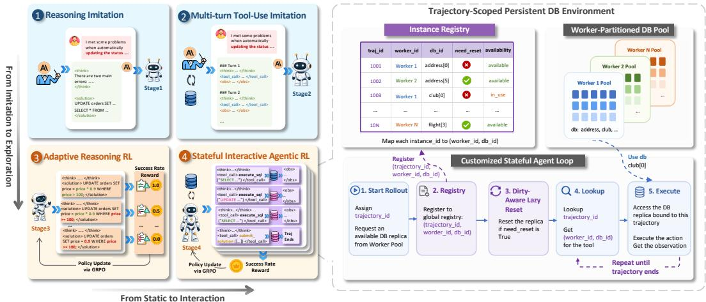  
Figure 1: Overview of the BIRD-RL framework. (Left) The four-stage agentic RL curriculum transitioning from static reasoning imitation to interactive stateful exploration. (Right) The Trajectory Scoped Persistent Execution Infrastructure, enabling scalable and isolated database replica reuse via a customized agent loop and worker-partitioned pool.

SQL issues remains a significant challenge with the evolving user demands in realistic scenarios [1, 30, 12, 51, 15]. Such SQL issue resolution often requires considerable manual effort, given the complexity of query semantics, intricate underlying schemas, and heterogeneous database operations. As a result, automating this process offers substantial practical value by improving efficiency and reducing reliance on specialized expertise [34, 62]. Automatic issue resolution inherently requires stronger agentic capabilities to conduct root cause location and repair through iterative interaction with the database environment [25, 54, 53]. Contemporary approaches to developing reliable debugging agents can be categorized into two primary paradigms: inference-time prompting [22, 53, 55] and post-training-based agent learning [25]. The former employs elaborate in-context orchestrations, in which LLMs iteratively refine intermediate reasoning decisions based on execution feedback. The latter paradigm strengthens small language models (SLMs) by internalizing these agentic capabilities directly into model parameters through supervised fine-tuning (SFT). Such agents are highly valuable in data-centric applications due to data privacy and security concerns [40]. This practical need motivates the focus of our work.

Despite its effectiveness, SFT often fails to promote robust intermediate reasoning and generalizable repair behavior due to its heavy reliance on demonstrated correction trajectories [7, 13]. Agentic reinforcement learning (RL), instead, has recently emerged as a promising paradigm for training interactive agents, enabling models to improve reasoning through autonomous exploration driven by environmental reward signals [60, 3, 61]. However, agentic RL for SQL issue resolution presents unique, domain-specific challenges. On the one hand, SQL issue resolution requires a broader action space for root-cause analysis in declarative SQL. Agents often need to verify hypotheses through stateful database operations, including data manipulation (INSERT, UPDATE, DELETE) and schema modification (ALTER TABLE) [9, 19], placing a strong demand on the underlying infrastructure to support persistent and isolated database interactions at scale. General tool-centric frameworks often manage environments via a container-per-rollout mechanism [42, 54, 27]. However, applying this to data-intensive database environments incurs severe spatial inefficiencies and prohibitive scaling bottlenecks during massive trajectory generation. On the other hand, SQL debugging is a complicated task that simultaneously demands schema-grounded reasoning and dynamic environmental interaction. Direct end-to-end learning may overwhelm the policy within an exponentially large search space, resulting in suboptimal debugging effectiveness [10].

To bridge this gap, we introduce BIRD-RL, a novel agentic RL curriculum for SQL issue solving. It decomposes agent learning into four progressive stages: reasoning imitation (Section 3.1), tooluse imitation (Section 3.2), adaptive reasoning reinforcement (Section 3.3), and interactive agentic reinforcement (Section 3.4). Such a framework decouples an otherwise densely intertwined skill set into atomic, manageable learning objectives, circumventing the instability inherently associated with direct end-to-end learning. To realize scalable training for the final stage, we further introduce a Trajectory-Scoped Persistent Execution Infrastructure comprising a worker-partitioned database pool (Section 4.1) and a customized agent loop (Section 4.2), enabling isolated stateful interactions and high-concurrency efficiency via the orchestrated reuse of database replicas.

Building on BIRD-RL, we release the BIRD-TALON model family, including 7B and 14B versions. Furthermore, to demonstrate that our curriculum generalizes beyond single-objective optimization, we introduce BIRD-ZENO-7B, a unified multi-task model trained under a principled data-mixing ratio for heterogeneous SQL tasks targeting both debugging and query generation. As a resource contribution to the community, we also release SIX-GYM-SQLITE, an automatically constructed training environment that extends SIX-GYM [25] to the SQLite dialect to facilitate future research for SQL agents.

Empirical evaluations demonstrate that BIRD-TALON-7B and 14B achieve Success Rates (SR) of 44.40% and 48.00% on BIRD-CRITIC-SQLITE, respectively, performing competitively against strong proprietary model-based agents such as Claude-Opus-4.6 Agent (48.20%). Our trajectoryscoped infrastructure improves RL spatial efficiency by 12.8× under the evaluated SQLite workload, enabling stable and scalable agentic training. Besides, the unified BIRD-ZENO model achieves an Execution Accuracy (EX) of 63.90% on the BIRD development set, delivering generation performance comparable to dedicated text-to-SQL models specifically optimized with RL while maintaining its debugging proficiency. These findings establish BIRD-RL as a scalable framework for data-centric agent training, with its trajectory-scoped infrastructure paving the way for agentic RL in heavy, stateful database environments, while underscoring the potential of multi-objective training for heterogeneous real-world SQL tasks.

## 2 Preliminaries

## 2.1 Task Definition

Text-to-SQL Generation. Given a natural language question Q, with its corresponding database schema S, the goal of text-to-SQL is to generate the $\mathrm { \bf S Q I }$ L query $\sigma _ { p r e d }$ that could answer the question Q accurately by:

$$
\sigma _ { p r e d } = f _ { \theta } ( \mathcal { Q } , S ) ,\tag{1}
$$

where $f _ { \theta } \left( \cdot \right)$ refers to the mapping function with parameters θ applied by the generator.

SQL Issue Resolution. Compared with SQL generation from scratch, SQL issue resolution is a more realistic and challenging task. The task takes as input a user-provided SQL query $\sigma _ { i s s u e } , \mathbf { a }$ natural language problem description P specifying the issue and intended behavior, and the database schema S. The goal is to produce a revised query $\sigma _ { p r e d }$ that resolves the issue while preserving the user intent by:

$$
\begin{array} { r } { \sigma _ { p r e d } = f _ { \theta } ( \mathcal { P } , \mathcal { S } , \sigma _ { i s s u e } ) , } \end{array}\tag{2}
$$

The target output $\sigma _ { p r e d }$ is expected to satisfy the underlying user intent inferred from the input triplet.

## 2.2 Tool-Centric Agent RL Loop

Given an SQL issue task $x = ( \mathcal { P } , \mathcal { S } , \sigma _ { \mathrm { i s s u e } } )$ , a standard tool-centric agent loop [42] models interaction as a history-conditioned decision process. The agent maintains a textual history $h _ { t }$ , initialized as $h _ { 0 } = x$ , and at each step samples a structured tool invocation $a _ { t } \in { \mathcal { A } }$ from policy π<sub>θ</sub>:

$$
a _ { t } \sim \pi _ { \theta } ( \cdot \mid h _ { t } ) , \quad o _ { t } \sim f _ { k } ( \cdot \mid a _ { t } , e _ { t } ) , \quad h _ { t + 1 } = h _ { t } \oplus ( a _ { t } , o _ { t } ) ,\tag{3}
$$

where $f _ { k }$ denotes the selected tool, $o _ { t }$ is the returned observation under environment state $e _ { t } ,$ , and ⊕ denotes history concatenation. The trajectory ends when the agent submits a final answer or reaches the maximum step budget.

This fundamentally tool-centric loop records tool feedback in the textual context while leaving the persistent environment external to the loop. For many agentic RL tasks [42, 54, 27], isolation can be approximated by assigning each rollout an independent sandbox. In data-centric tasks such as SQL issue resolution, however, this container-per-rollout design becomes prohibitively expensive, since each trajectory would require its own mutable replica of a potentially large database.

Reusing database replicas is therefore necessary for scalability, but remains unsafe under a purely tool-centric loop. Without explicit trajectory-to-environment binding, tool calls from the same rollout may fail to access the intended evolving database state, while reused replicas may carry residual mutations from previous rollouts. Such state leakage contaminates execution feedback and induces cross-trajectory interference, thereby destabilizing on-policy RL. These limitations motivate the Trajectory-scoped Persistent Execution Infrastructure introduced in Section 4.

## 3 BIRD-RL: Efficient Agentic RL Curriculum for SQL Agent Training

Autonomous SQL issue resolution requires diagnostic reasoning, tool invocation, and feedbackguided refinement. Directly optimizing these capabilities end-to-end over a large interactive action space can lead to unstable or suboptimal policies [10]. To address this, BIRD-RL adopts a four-stage curriculum, as shown in Figure 1 (left), which contains Reasoning Imitation Section 3.1, Tool-Use Imitation (Section 3.2), Reasoning Reinforcement (Section 3.3), and Interactive Agentic Reinforcement (Section 3.4). This progressive design decomposes agent learning from static reasoning to stateful interaction, while the final stage is supported by our trajectory-scoped infrastructure for scalable and contamination-free RL.

## 3.1 Stage 1: Reasoning Imitation

Training Objective. As the foundation of the curriculum, this initial stage aims to establish a strong reasoning prior for schema-grounded issue solving. Formulated as a single-turn sub-task, the target output for a given input task $x = ( \mathcal { P } , S , \sigma _ { i s s u e } )$ is defined as $y = ( t , \sigma )$ , where t denotes the reasoning thought, and σ is the predicted query. The policy $\pi _ { \theta }$ is trained via supervised fine-tuning (SFT). The structured diagnostic reasoning capability learned in Stage 1 effectively mitigates the naive exploration $( { \bf e . g . } , \tt S E L E C T \mathrm { ~ \star ~ \ F R O M ~ \ t a b l e } )$ in the ultimate interactive scenarios, resulting in more efficient execution and preventing unnecessary context expansion.

Training Data Construction. To reduce human annotation cost, we use Claude-Sonnet-4.5 as the teacher model to construct reasoning-imitation data in the SIX-GYM-SQLITE environment. Details of the environment construction and the protocol for preventing training-evaluation contamination are provided in Appendix A. For each task $x = ( \mathcal { P } , \mathcal { S } , \sigma _ { \mathrm { i s s u e } } )$ , the teacher generates a debugging thought t with access to the corrected query $\sigma ^ { * }$ , which serves as a reference for constructing the reasoning that diagnoses the SQL errors and motivates the target repair. We pair the generated thought with the corrected query as the supervision target $y = ( t , \sigma ^ { * } )$ . To ensure high-quality training data, we only include $( t , \stackrel { \cdot } { \sigma } ^ { \ast } )$ pairs where the corrected SQL $\sigma ^ { * }$ can be regenerated from the debugging thought t and the regenerated solution passes all test cases in C. This produces 4,982 instances for the Reasoning Imitation stage.

## 3.2 Stage 2: Multi-Turn Tool-Use Imitation

Training Objective. Building on the previous stage, Stage 2 performs trajectory fine-tuning with the SQL-Act scaffold [25], where executable SQL statements serve as fine-grained actions for database inspection, hypothesis testing, and root-cause localization. Each trajectory $\tau = \{ ( t _ { i } , a _ { i } , o _ { i } ) \} _ { i = 1 } ^ { n }$ interleaves the agent thought t<sub>i</sub>, SQL action $a _ { i } .$ , and database observation $o _ { i } .$ . We implement SQL actions with two tools: execute\_sql for exploration and testing, and submit\_solution for termination. These tools keep SQL as the core action while providing an explicit stopping signal. Tool descriptions are detailed in Figure 6.

Data Construction. Following the trajectory formulation defined above, the teacher model Claude-Sonnet-4.5 is guided to generate a verified trajectory τ˜ for each input task suite x. We further employ the f-plan boosting strategy [25] to augment successful candidate trajectories. We consider the query σ submitted via submit\_solution as the predicted query of each trajectory and apply the identical verification protocol as Stage 1 to filter (x, τ˜) pairs. We ultimately collected a training set of 4,502 trajectories.

## 3.3 Stage 3: Adaptive Reasoning Reinforcement

RL Training Objective. Although the first two stages provide reasoning and tool-use priors, they are learned from offline imitation and may induce rigid patterns that fail to adapt to new interaction contexts, as evidenced in Section 5.5. To bridge imitation and on-policy agentic exploration, Stage 3 introduces a reasoning-focused RL phase that encourages adaptive reasoning before multi-turn RL.

We adopt GRPO [41] for both reinforcement stages of BIRD-RL. In Stage 3, following the single-turn output format $y = ( t , \sigma )$ , the policy samples a group of N candidate outputs $\{ y _ { i } = \mathsf { \bar { ( } } t _ { i } , \sigma _ { i } ) \} _ { i = 1 } ^ { N }$ for each input $x .$ Each solution $\sigma _ { i }$ is evaluated by the execution-based reward defined below, and the resulting group-relative advantages are used to optimize:

$$
\mathcal { I } _ { \mathrm { G R P O } } ( \theta ) = \mathbb { E } \left[ \frac { 1 } { N } \sum _ { i = 1 } ^ { N } \operatorname* { m i n } \left( \rho _ { i } A _ { i } , \ \mathrm { c l i p } ( \rho _ { i } , 1 - \epsilon , 1 + \epsilon ) A _ { i } \right) \right] - \beta D _ { \mathrm { K L } } ( \pi _ { \theta } \parallel \pi _ { \mathrm { r e f } } ) ,\tag{4}
$$

where $\begin{array} { r } { \rho _ { i } = \frac { \pi _ { \theta } \left( y _ { i } | \boldsymbol { x } \right) } { \pi _ { \theta _ { \mathrm { o l d } } } \left( y _ { i } | \boldsymbol { x } \right) } } \end{array}$ is the likelihood ratio, $A _ { i }$ is the advantage, and $\pi _ { \mathrm { r e f } }$ is initialized from the Stage 2 policy.

Reward Design. Since reasoning quality is difficult to verify directly, we supervise it through the functional correctness of the generated SQL. Given the test suite C, the reward is defined as:

$$
R = \frac { 1 } { | \mathcal { C } | } \sum _ { c \in \mathcal { C } } \mathbb { I } \big ( c ( \sigma ) = \mathtt { T r u e } \big ) ,\tag{5}
$$

where $\mathbb { I } ( \cdot )$ is the indicator function. A solution receives credit for each test case it passes. The reward corresponds to the fraction of test cases passed by the generated SQL.

## 3.4 Stage 4: Stateful Interactive Agentic Reinforcement

Agentic RL Training Objective. As the culmination of the training curriculum, Stage 4 aims to enable autonomous multi-turn exploration with tool augmentation through agentic RL training. For each input task x, a group of N multi-turn trajectories $\{ \tau _ { i } \} _ { i = 1 } ^ { N }$ is sampled. The final solution $\sigma _ { i }$ is determined by the submit\_solution action when available, or otherwise by the last generated query. The optimization follows the GRPO objective in Eq. (4), formulated at the trajectory level. Specifically, the likelihood ratio is computed over the full trajectory $\tau _ { i }$ instead of a single-turn output $y _ { i }$ , and the reference policy $\pi _ { \mathrm { r e f } }$ is updated to the policy obtained from Stage 3.

Reward Design. The objective of the final stage is to produce a functionally correct solution through iterative tool-augmented interaction. While prior works [37, 17] typically augment verifiable execution rewards with elaborately designed proxy rewards, we observe that these proxy rewards can induce reward hacking in SQL debugging, as demonstrated in Section 5.6. To this end, we adhere to the execution-based reward defined in Eq.(5) assigned exclusively to the final solution, providing an unbiased signal directly aligned with the stage goal. To encourage unconstrained exploration, we apply no process-level rewards. Eliminating the step-wise credit assignment prevents bias toward specific interactions and purely aligns optimization with the final functional objective. Detailed designs of the proxy-reward variants used for comparison are provided in Appendix B.2.

## 4 Trajectory-Scoped Persistent Execution Infrastructure

As discussed in Section 2.2, standard tool-centric loops record tool observations in the textual history but do not explicitly bind a rollout to a persistent execution environment. This design is insufficient for stateful SQL debugging, where each trajectory must retain the database effects of its earlier actions for subsequent hypothesis testing. To support scalable stateful RL with environment isolation, BIRD-RL introduces a Trajectory-scoped Persistent Execution Infrastructure, as shown in Figure 1 (right). It consists of two main modules: a worker-partitioned database pool (Section 4.1) for reusable storage and a customized stateful agent loop 4.2 for trajectory-level environment binding.

## 4.1 Worker-Partitioned Database Pool

The database pool maintains a pre-allocated set of reusable database replicas to avoid repeatedly instantiating a fresh database for every rollout. Given template databases $\mathcal { D } = \{ d _ { 1 } , \ldots , \dot { d } _ { N } \}$ , the pool maintains K working replicas for each database $d _ { i } ,$ , denoted as $\{ d _ { i } ^ { ( 1 ) } , \ldots , d _ { i } ^ { ( K ) } \}$ . Since replica

availability is managed locally by distributed rollout workers, replicas are partitioned across W workers:

$$
\{ d _ { i } ^ { ( 1 ) } , \dots , d _ { i } ^ { ( K ) } \} = \bigcup _ { w = 1 } ^ { W } \mathcal { E } _ { i } ^ { ( w ) } , \quad \mathcal { E } _ { i } ^ { ( w ) } \cap \mathcal { E } _ { i } ^ { ( w ^ { \prime } ) } = \emptyset \ : ( w \neq w ^ { \prime } ) ,\tag{6}
$$

where $\mathcal { E } _ { i } ^ { ( w ) }$ denotes the worker-exclusive replica subset assigned to worker w. Each replica in the pool maintains two states, which are is\_available for assignment availability and need\_reset for whether restoration is needed before reuse. This design enables efficient replica reuse while preventing cross-trajectory contamination.

## 4.2 Customized Stateful Agent Loop

Standard tool-centric loops [42] usually dispatch each tool invocation as a request-scoped call: the execution backend receives the current tool input and returns an observation, while the request identifier only represents this individual call rather than the entire rollout. Such request-scope abstraction fails to preserve state continuity within a trajectory, which is essential for SQL debugging with state-mutating operations. We therefore make the environment management trajectory-scoped with four designs: 1) Stable Trajectory Identifier Binding: at the start of each rollout, we assign a stable trajectory identifier, and all subsequent execute\_sql calls within the same rollout use this identifier to retrieve the same database replica, ensuring intra-trajectory state persistence. 2) Lightweight Instance Registry: we maintain a lightweight registry that maps each trajectory identifier to its allocated database replica, e.g., (trajectory\_id, worker\_id, db\_id). This registry serves as the assignment memory between the agent loop and the database pool, routing each tool call to the intended persistent environment. 3) Deferred State Release: the assigned replica remains bound to the trajectory until termination, rather than being released after each tool call. It is normally released upon the terminal submit\_solution action, while an asynchronous timeout mechanism reclaims replicas from abnormal rollouts to prevent resource leakage. 4) Dirty-Aware Lazy Reset: when a released replica has been modified, it is marked with need\_reset=True and returned to the pool without resetting at trajectory termination. The reset is deferred until the replica is allocated to a new trajectory, which avoids termination-phase lock contention while ensuring that every new rollout starts from a clean database state. To further clarify the workflow of the customized agent loop shown in Figure 1, we present its pseudo-code in Algorithm 1.

## 5 Experiments

## 5.1 Experiment Settings

Datasets and Metrics. We evaluate BIRD-RL on heterogeneous SQL tasks covering both SQL debugging and SQL generation. For SQL debugging, we evaluate on BIRD-CRITIC-SQLITE [25], which contains 500 SQLite issues across query-like, management, and personalization categories, and BIRD-CRITIC-MULTI [25], which contains 570 issues across PostgreSQL, MySQL, SQL Server, and Oracle. For SQL generation, we evaluate on the BIRD-SQL [24] development set with 1,534 examples. We report Success Rate (SR) for SQL debugging and Execution Accuracy (EX) for SQL generation following the official metrics of each benchmark.

Implementation and Baselines. We implement BIRD-RL on Qwen2.5-Coder-7B and Qwen2.5- Coder-14B, producing the debugging-specialized BIRD-TALON models. We also train BIRD-ZENO-7B as a unified model for both SQL debugging and generation through mixed-task training. All post-training stages are implemented with VERL [42] and run on 8×H100 GPUs. Our trajectoryscoped infrastructure is integrated as a plug-and-play patch compatible with general VERL-based rollout pipelines. For baseline comparison, we consider strong general-purpose LLMs, multi-turn SQL agents, and supervised debugging agents on SQL debugging, as well as recent RL-based textto-SQL methods on SQL generation. Full dataset statistics, training details, inference settings, and compared-method descriptions are provided in Appendix A and C.

Table 1: Success Rate (SR %) of different models on BIRD-CRITIC-SQLITE, evaluated under greedy decoding and grouped by issue category. Bold numbers indicate the highest score in each column, and underlined numbers indicate the second highest. "Quer." refers to query-like issues, "Mana." refers to data-management issues, and "Pers." refers to personalized-function issues.
<table><tr><td>Type</td><td>Model</td><td>Quer.</td><td>Mana.</td><td>Pers.</td><td>Overall</td></tr><tr><td rowspan="7">General-Purpose Models</td><td>GPT-5.4-Pro</td><td>44.01</td><td>38.67</td><td>39.72</td><td>42.00</td></tr><tr><td>Claude-Opus-4.6</td><td>50.35</td><td>44.00</td><td>39.01</td><td>46.20</td></tr><tr><td>Claude-Sonnet-4.5</td><td>46.83</td><td>36.00</td><td>34.75</td><td>41.80</td></tr><tr><td>Gemini-3.1-Pro</td><td>53.52</td><td>44.00</td><td>41.84</td><td>48.80</td></tr><tr><td>GLM-4.7</td><td>48.24</td><td>40.00</td><td>33.33</td><td>42.80</td></tr><tr><td>Kimi-K2.5</td><td>46.48</td><td>37.33</td><td>35.46</td><td>42.00</td></tr><tr><td>MiniMax-M2-1 Qwen3-Coder-480B</td><td>38.03 45.77</td><td>30.67</td><td>32.62</td><td>35.40</td></tr><tr><td rowspan="5">Multi-Turn Agents</td><td></td><td></td><td>33.33</td><td>37.59</td><td>41.60</td></tr><tr><td>Claude-Opus-4.6</td><td>53.52</td><td>42.67</td><td>40.43</td><td>48.20</td></tr><tr><td>Claude-Sonnet-4.5 Qwen3-Coder-480B</td><td>44.01 46.48</td><td>54.67 34.67</td><td>37.59</td><td>43.80</td></tr><tr><td>BIRD-FIXER-7B</td><td>37.32</td><td>26.67</td><td>39.01 29.79</td><td>42.60</td></tr><tr><td>BIRD-FIXER-14B</td><td>42.96</td><td>37.33</td><td>35.46</td><td>33.60 40.00</td></tr><tr><td rowspan="2">Ours</td><td>BIRD-Talon-7B</td><td>46.13</td><td>45.33</td><td>40.43</td><td></td></tr><tr><td>BIRD-Talon-14B</td><td>51.06</td><td>50.67</td><td>40.43</td><td>44.40 48.00</td></tr></table>

Table 2: Detailed comparison of BIRD-TALON with other strong baselines on BIRD-CRITIC-SQLITE. The SQL-ACT agent employs SQLs as actions. ∆ denotes the absolute improvement of BIRD-TALON compared with the base model.
<table><tr><td>Model</td><td>Base</td><td>SQL-ACT</td><td>BIRD-FIXER</td><td>BIRD-TALON</td><td>∆(%)</td></tr><tr><td>Qwen-2.5-Coder-7B</td><td>26.20</td><td>29.80</td><td>33.60</td><td>44.40</td><td>+18.20</td></tr><tr><td>Qwen-2.5-Coder-14B</td><td>33.80</td><td>36.40</td><td>40.00</td><td>48.00</td><td>+14.20</td></tr></table>

## 5.2 Overall Performance

Results on SQL Debugging. Table 1 and Table 2 present the performance of BIRD-TALON comparing approaches with mainstream LLMs and advanced SQL debugging agents. We can observe that:

(1) Considerable Challenge in Stateful SQL Issue Debugging: Even the strongest proprietary model reaches only 48.80% SR, showing that SQL issue resolution over mutable databases is far from being solved. Category-level results further reveal that the difficulty mainly comes from statedependent issues in which general-purpose models perform better on query-like cases, with 46.65% average SR, but drop to 38.00% and 36.79% on management and personalization issues, respectively. In addition, multi-turn agentic inference improves average overall SR by only 3.87%. This limited gain suggests that inference-time interaction alone is insufficient for robust stateful SQL debugging, motivating our agentic RL framework that enables adaptive reasoning through persistent database interaction.

(2) Superior Performance of BIRD-TALON: As shown in Table 2, BIRD-TALON brings consistent gains across both model scales, improving the Qwen2.5-Coder-7B and 14B backbones by 18.20% and 14.20%, respectively. We can also observe that directly applying the SQL-ACT scaffold produces only limited gains. While supervised trajectory imitation with BIRD-FIXER improves performance further, it still falls substantially behind BIRD-TALON. This suggests that imitation alone is insufficient to capture the decision dynamics required for multi-turn SQL debugging. Instead, BIRD-RL enables the agent to adapt its reasoning and tool use through reasoning and agentic RL. Notably, BIRD-TALON-14B achieves 48.00% overall SR, approaching the comparable performance of the Claude-Opus-4.6 agent (48.20%) while employing a much smaller open model, which is especially valuable for privacy-sensitive SQL applications.

Table 3: Comparison of database lifecycle I/O during interactive rollout execution under trajectorylevel isolation. “Emp. I/O” reports the measured online database lifecycle I/O from our implementation and excludes the one-time offline pool materialization cost.
<table><tr><td>Strategy</td><td>Training-time I/O Emp. I/O (↓)</td><td></td><td>Cost Ratio</td></tr><tr><td>Per-rollout Container</td><td> $O ( N R \bar { S } )$ </td><td>2.94 TiB</td><td>12.8×</td></tr><tr><td>Dynamic Reusable Pool</td><td> $O \dot { ( } ( B + \bar { q } / k ) R \bar { S } )$ </td><td>236 GiB</td><td>1.0×</td></tr></table>

## 5.3 Analysis of Database Reuse Efficiency.

To validate our proposed pool-based container isolation strategy, we conduct an efficiency analysis of database lifecycle I/O under trajectory-level isolation. Unlike peak memory and storage capacity, which can be managed through resource provisioning and pool sizing, repeated database materializa tion and restoration place sustained pressure on storage bandwidth. The resulting I/O saturation can cause rollout stalls or timeouts. Such infrastructure-induced failures can distort the reward signal and destabilize on-policy optimization if recorded as zero-reward trajectories. Reducing this recurring overhead is therefore important for feasible and reliable agentic RL over resource-intensive database environments.

As shown in Table 3, the training-time I/O column presents the theoretical online I/O complexity during rollout execution. The related parameter definition and detailed derivation of the complexity terms is provided in Appendix D.2. The naive per-rollout baseline scales with the total number of generated trajectories. In contrast, the dynamic reusable pool fundamentally amortizes the database instantiation cost via cross-rollout reusability. This strategic shift leaves the online I/O dominated mainly by resetting modified replicas to preserve clean trajectory-level isolation. Benefiting from the SFT stages in our framework, which effectively regularizes the agent’s exploration behavior, only 9.25% of the practical trajectories execute state-altering queries and actually trigger a database reset. As a result, our proposed method guarantees a superior I/O efficiency compared to the naive baseline.

However, dynamic online allocation is vulnerable to abrupt memory spikes under imbalanced database workloads, which can cause capacity overflows and destabilize rollout execution. We thus apply a pre-allocated database pool to mitigate this risk. Under the evaluated SQLite setting with batch size $B = 1 6$ and rollout $R = 1 6$ , our design reduces the measured online lifecycle I/O by 12.8× compared to per-rollout containers. The trade-off is an offline pool cost of 69 GiB, which is practically negligible relative to the terabyte-level massive online I/O savings. Notably, since this offline pool scales strictly with the number of unique databases rather than the massive training volume N, its storage overhead remains predictable and highly cost-effective even under large-scale trajectory-level isolation. As the first work to investigate pool-based environment isolation for data-centric tasks, our infrastructure enables stable and scalable stateful agentic RL training for SQL debugging, paving the way for more intelligent database environment management as future work.

## 5.4 Results on Heterogeneous SQL Tasks.

Overall Performance. Table 4 reports the performance of BIRD-ZENO, which is trained under the data-mixed BIRD-RL scaffold, on heterogeneous SQL tasks across SQL generation and issue resolution. BIRD-ZENO-7B maintains superior debugging capabilities while achieving results comparable to strong RL-based generation-specific specialists on the BIRD-SQL development set. To our knowledge, this study is the first exploration of unified training in the SQL domain, highlighting the potential for multi-objective optimization within a single framework across real-world data-centric tasks.

Table 4: Comparison of BIRD-ZENO with strong RL-based generation-specialized methods. "Gen." = "Generation" and "Debug." = "Debugging".
<table><tr><td>Model</td><td>Gen.</td><td>Debug.</td></tr><tr><td>Think2SQL-7B</td><td>56.1</td><td>24.0</td></tr><tr><td>SQL-R1-7B</td><td>58.9</td><td>26.6</td></tr><tr><td>ReEX-SQL-7B</td><td>63.4</td><td>=</td></tr><tr><td>Reasoning-SQL-7B</td><td>64.0</td><td></td></tr><tr><td>Arctic-T2S-R1-7B</td><td>68.9</td><td>29.8</td></tr><tr><td>SQL-Trail-7B</td><td>60.1</td><td>1</td></tr><tr><td>BIRD-Zeno-7B (Ours)</td><td>63.9</td><td>44.6</td></tr></table>

Data Mixture Ratio Discussion. The data mixture for multi-task training is a complex trade-off between task-specific performance and cross-task interference [31]. To estimate a suitable mixture ratio for BIRD-ZENO, we conduct a controlled study with Qwen2.5-Coder-7B under three debugginggeneration ratios. Specifically, we maintain a fixed total training set of 4,000 instances and evaluate the following settings: debug-heavy (3:1), balanced (1:1), and generation-heavy (1:3). For efficiency, SQL generation is evaluated on BIRD-MINI [4], a mini subset of the BIRD development set.

Table 5: Case study illustrating the effectiveness of Stage 3, with the full trajectory shown in Figure 4.
<table><tr><td>Setting</td><td>Reasoning Trace</td><td>Action Trace</td></tr><tr><td>w/o Stage 3</td><td>“.. the problematic query joins budget and expense ... To get the correct total budget per event, I need to1 aggregate budget amounts at the event level using MAX or MIN, since each event has one budget ...&quot;</td><td>SELECT... SUM(expense.cost), MAX(budget.amount) AS total_budget ... GROUP BY budget.link_to ...</td></tr><tr><td>w/ Stage 3 (Ours)</td><td>“.. there are multiple budget lines ..., and each budget line has multiple expense records .. The SUM (budget .amount) ... FROM solution is to pre-aggregate expenses per budget line first, then join with budget ..&quot;</td><td>SELECT SUM(sub_exp.total_cost), (SELECT link_to_budget, SUM(cost) GROUP BY link_to_budget) sub_exp ...</td></tr></table>

As illustrated in Figure 2, varying the mixture ratio reveals a clear trade-off between SQL generation and issue resolution. We speculate that this asymmetry arises because the two data sources play different roles within the shared execution-grounded reward space. Generation data primarily establishes schema grounding and compositional SQL priors, whereas debugging data shapes exploration behavior for effective information acquisition from databases. In light of this trade-off, we adopt the debug-heavy ratio of 3:1 as the final mixture for BIRD-ZENO, which yields the strongest issue-resolution performance while retaining competitive SQL generation capability.

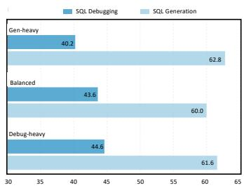  
Figure 2: Effect of data mixture ratio.

## 5.5 Case Study: Effectiveness of the Adaptive Reasoning Reinforcement Stage

Table 5 presents a concrete case illustrating the effectiveness of our Adaptive Reasoning Reinforcement Stage (Stage 3), with the full trajectories provided in Appendix D.1 (Figure 4). In this case, both agents correctly identify the root cause as aggregation errors in the earlier step, demonstrating the effectiveness of our first two training stages. However, their solutions later diverge: 1) w/o Stage 3: The agent fails to incorporate feedback and instead produces independent step-wise erroneous reasoning, which is a typical side effect of SFT. 2) w/ Stage 3: RL enables the agent to leverage the context coherently to apply the knowledge acquired during SFT, ultimately resulting in the correct reasoning and actions. This case underscores a critical shift from memorized debugging patterns toward adaptive, evidence-grounded reasoning, proving the necessity of Stage 3.

## 5.6 Ablation Study

Table 6 presents our ablation study, with fine-grained breakdowns across issue categories. The removal of the training stages shown in (a)-(c) leads to obvious performance drops, indicating that the overall gain arises from the progressive curriculum. This pattern underscores the core design principle of BIRD-RL: imitation first anchors the policy in structured diagnostic reasoning and coherent tool use, while RL subsequently transforms into a more autonomous policy capable of feedback-driven exploration beyond the demonstrated trajectories. Notably, the effect of excluding the agentic RL stage (Table 6 (a)) is more pronounced on management (↓9.33) and personalization issues (↓7.10) than on query-like cases (↓0.33), suggesting that agentic RL is particularly beneficial for resolutions that require stateful hypothesis testing and iterative revision.

Table 6 (d)-(f) compares the purely execution-based reward employed in the agentic RL stage with three variants incorporating auxiliary proxy reward signals. Specifically, variant (d) applies rulebased partial-correctness signals to the submitted solution, whereas variants (e) and (f) additionally introduce trajectory-level supervision, scoring both the intermediate steps and the solution via an LLM judge and heuristic rubric criteria, respectively. Detailed reward designs are provided in

Table 6: Ablation study on the training curriculum and reward design of BIRD-RL.
<table><tr><td rowspan="2">TYPE</td><td>METHOD</td><td>QUER.</td><td>MANA.</td><td>PERS.</td><td>OVERALL</td></tr><tr><td>BIRD-Talon-7B</td><td>46.13</td><td>45.33</td><td>40.43</td><td>44.40</td></tr><tr><td rowspan="3">Training Strategy</td><td>(a) Up to Reasoning RL (Stages 1-3)</td><td>45.77</td><td>36.00</td><td>33.33</td><td>40.60 (↓3.80)</td></tr><tr><td>(b) Up to Tool-Use Imitation (Stages 1-2)</td><td>45.07</td><td>33.33</td><td>30.50</td><td>39.20 (↓5.20)</td></tr><tr><td>(c) Reasoning Imitation Only (Stage 1)</td><td>41.55</td><td>28.00</td><td>26.24</td><td>35.20 (↓9.20)</td></tr><tr><td rowspan="3">Reward Design</td><td>(d) w/ Partial Correctness</td><td>45.77</td><td>41.33</td><td>37.59</td><td>42.80 (↓1.60)</td></tr><tr><td>(e) w/ LLM-as-a-Judge</td><td>45.77</td><td>38.67</td><td>34.04</td><td>41.40 (↓3.00)</td></tr><tr><td>(f) w/ Heuristic Rubric</td><td>45.42</td><td>40.00</td><td>36.17</td><td>42.00 (↓2.40)</td></tr></table>

Appendix B.2. The superior performance of the sparse, purely execution-based reward indicates that the reward fidelity outweighs density in SQL debugging tasks. Given the extreme error sensitivity of the task, proxy rewards are prone to reward hacking, steering the policy toward superficially plausible syntax or favorable trajectories instead of genuine functional resolution. This suggests that heuristic proxy rewards, while widely used, often require substantial expert effort to construct. To this end, BIRD-RL adopts the neat but effective execution-based design while remaining extensible to future sophisticated reward functions to further improve the upper bound of RL in data-centric tasks.

## 6 Related Work

LLMs for Text-to-SQL. In recent years, the application of LLMs has improved the performance of text-to-SQL to another level of intelligence [59, 52, 38, 18]. Early research primarily leveraged the in-context learning capabilities of LLMs to build text-to-SQL systems through sophisticated prompt engineering [11, 35, 11, 39, 36]. Driven by the advent of language agents, recent textto-SQL research has pivoted toward multi-agent architectures [47, 50, 6]. A critical component emerging from these architectures is the automatic error correction mechanism. Although recent agents increasingly incorporate automatic correction loops to improve response accuracy [43, 29, 36], the distinct challenge of debugging the full spectrum of SQL operations for real-world database administration remains largely unexplored. Our work is expressly designed to bridge this gap.

RL for Reasoning. Reinforcement learning (RL) has recently emerged as a promising paradigm for improving the reasoning capabilities of LLMs, enabling models to autonomously learn effective policies with the guidance of reward signals [14, 32]. It has shown impressive success on reasoningintensive tasks such as mathematical solving [41], code generation [26, 44], and visual reasoning [48, 46, 58]. In light of these advancements, recent research in the text-to-SQL domain has started to leverage RL-based frameworks to steer the query synthesis process [33, 56, 28, 8, 37, 17]. Our work aims to extend this line of research beyond static one-shot SQL synthesis to dynamic, stateful SQL issue resolution, where the agent must learn to diagnose and revise candidate repairs through multi-step interaction.

## 7 Conclusion

In this work, we introduce BIRD-RL, a four-stage agentic RL curriculum for SQL issue resolution. To enable scalable training in data-centric environments, we equip BIRD-RL with a Trajectory-scoped Persistent Execution Infrastructure that supports isolated stateful interactions through orchestrated database-replica reuse. Built on this framework, we release the BIRD-TALON model family for SQL debugging. We further introduce BIRD-ZENO, a unified multi-task model trained with a principled data-mixing strategy, to examine the generality of our curriculum beyond single-objective optimization. Together, these contributions establish BIRD-RL as a scalable framework for datacentric agent training, paving the way for agentic RL in heavy, stateful database environments and highlighting the potential of multi-objective training for real-world SQL applications.

## 8 Acknowledgments

We thank the anonymous reviewers and committees for their helpful comments, suggestions and organizations. Reynold Cheng, Ge Qu, Jinyang Li, Xiaohan Xu, Xiaolong Li, Nan Huo, and Ziwei Tang are supported by the Research Grant Council of Hong Kong (RGC Project HKU 17202325) and the University of Hong Kong (Project 2609260682). Ge Qu and Jinyang Li are supported by HKU Presidential PhD Scholar Programme. Ge Qu is also funded by Hong Kong PhD Fellowship Scheme.

## References

[1] Alireza Ahadi, Vahid Behbood, Arto Vihavainen, Julia Prior, and Raymond Lister. Students’ syntactic mistakes in writing seven different types of sql queries and its application to predicting students’ success. In Proceedings of the 47th ACM Technical Symposium on Computing Science Education, pages 401–406, 2016.

[2] Michael Armbrust, Reynold S. Xin, Cheng Lian, Yin Huai, Davies Liu, Joseph K. Bradley, Xiangrui Meng, Tomer Kaftan, Michael J. Franklin, Ali Ghodsi, and Matei Zaharia. Spark SQL: relational data processing in spark. In Timos K. Sellis, Susan B. Davidson, and Zachary G. Ives, editors, Proceedings ofthe 2015 ACM SIGMOD International Conference on Management of Data, Melbourne, Victoria, Australia, May 31 - June 4, 2015, pages 1383–1394. ACM, 2015.

[3] Hao Bai, Yifei Zhou, Jiayi Pan, Mert Cemri, Alane Suhr, Sergey Levine, and Aviral Kumar. DigiRL: Training in-the-wild device-control agents with autonomous reinforcement learning. In The Thirty-eighth Annual Conference on Neural Information Processing Systems, 2024.

[4] BIRD Bench Team. BIRD-SQL Mini-Dev. https://github.com/bird-bench/ mini\_dev, 2024.

[5] Donald D. Chamberlin and Raymond F. Boyce. SEQUEL: A structured english query language. In Proceedings of the 1974 ACM SIGMOD Workshop on Data Description, Access and Control, pages 249–264. ACM, 1974.

[6] Saumya Chaturvedi, Aman Chadha, and Laurent Bindschaedler. SQL-of-thought: Multi-agentic text-to-SQL with guided error correction. In NeurIPS 2025 Fourth Workshop on Deep Learning for Code, 2025.

[7] Tianzhe Chu, Yuexiang Zhai, Jihan Yang, Shengbang Tong, Saining Xie, Dale Schuurmans, Quoc V Le, Sergey Levine, and Yi Ma. SFT memorizes, RL generalizes: A comparative study of foundation model post-training. In Forty-second International Conference on Machine Learning, 2025.

[8] Yaxun Dai, Wenxuan Xie, Xialie Zhuang, Tianyu Yang, Yiying Yang, Haiqin Yang, Yuhang Zhao, Pingfu Chao, and Wenhao Jiang. Reex-sql: Reasoning with execution-aware reinforcement learning for text-to-sql. arXiv preprint arXiv:2505.12768, 2025.

[9] C. J. Date. An Introduction to Database Systems. Addison-Wesley / Pearson, 8th edition, 2003.

[10] Gabriel Dulac-Arnold, Richard Evans, Hado van Hasselt, Peter Sunehag, Timothy Lillicrap, Jonathan Hunt, Timothy Mann, Theophane Weber, Thomas Degris, and Ben Coppin. Deep reinforcement learning in large discrete action spaces, 2016.

[11] Dawei Gao, Haibin Wang, Yaliang Li, Xiuyu Sun, Yichen Qian, Bolin Ding, and Jingren Zhou. Text-to-sql empowered by large language models: A benchmark evaluation. arXiv preprint arXiv:2308.15363, 2023.

[12] Sneha Gathani, Peter Lim, and Leilani Battle. Debugging database queries: A survey of tools, techniques, and users. In CHI ’20: CHI Conference on Human Factors in Computing Systems, Honolulu, HI, USA, April 25-30, 2020, pages 1–16. ACM, 2020.

[13] Arnav Gudibande, Eric Wallace, Charlie Victor Snell, Xinyang Geng, Hao Liu, Pieter Abbeel, Sergey Levine, and Dawn Song. The false promise of imitating proprietary language models. In The Twelfth International Conference on Learning Representations, 2024.

[14] Daya Guo, Dejian Yang, Haowei Zhang, Junxiao Song, Peiyi Wang, Qihao Zhu, Runxin Xu, Ruoyu Zhang, Shirong Ma, Xiao Bi, et al. Deepseek-r1 incentivizes reasoning in llms through reinforcement learning. Nature, 645(8081):633–638, 2025.

[15] Sabaat Haroon, Chris Brown, and Muhammad Ali Gulzar. Desql: Interactive debugging of SQL in data-intensive scalable computing. Proc. ACM Softw. Eng., 1(FSE):767–788, 2024.

[16] Joseph M Hellerstein and Michael Stonebraker. Readings in database systems. MIT press, 2005.

[17] Harper Hua, Zhen Han, Zhengyuan Shen, Jeremy Lee, Patrick Guan, Qi Zhu, Sullam Jeoung, Yueyan Chen, Yunfei Bai, Shuai Wang, Vassilis Ioannidis, and Huzefa Rangwala. Sql-trail: Multi-turn reinforcement learning with interleaved feedback for text-to-sql, 2026.

[18] Nan Huo, Jinyang Li, Bowen Qin, Ge Qu, Xiaolong Li, Xiaodong Li, Chenhao Ma, and Reynold Cheng. Micro-act: Mitigate knowledge conflict in question answering via actionable self-reasoning. arXiv preprint arXiv:2506.05278, 2025.

[19] Nan Huo, Xiaohan Xu, Jinyang Li, Per Jacobsson, Shipei Lin, Bowen Qin, Binyuan Hui, Xiaolong Li, Ge Qu, Shuzheng Si, Linheng Han, Edward Alexander, Xintong Zhu, Rui Qin, Ruihan Yu, Yiyao Jin, Feige Zhou, Weihao Zhong, Yun Chen, Hongyu Liu, Chenhao Ma, Fatma Ozcan, Yannis Papakonstantinou, and Reynold Cheng. BIRD-INTERACT: Re-imagining textto-SQL evaluation via lens of dynamic interactions. In The Fourteenth International Conference on Learning Representations, 2026.

[20] Sean Kandel, Andreas Paepcke, Joseph M. Hellerstein, and Jeffrey Heer. Enterprise data analysis and visualization: An interview study. IEEE Trans. Vis. Comput. Graph., 18(12): 2917–2926, 2012.

[21] Woosuk Kwon, Zhuohan Li, Siyuan Zhuang, Ying Sheng, Lianmin Zheng, Cody Hao Yu, Joseph E. Gonzalez, Hao Zhang, and Ion Stoica. Efficient memory management for large language model serving with pagedattention. In Proceedings of the ACM SIGOPS 29th Symposium on Operating Systems Principles, 2023.

[22] Fangyu Lei, Jixuan Chen, Yuxiao Ye, Ruisheng Cao, Dongchan Shin, Hongjin SU, ZHAOQING SUO, Hongcheng Gao, Wenjing Hu, Pengcheng Yin, Victor Zhong, Caiming Xiong, Ruoxi Sun, Qian Liu, Sida Wang, and Tao Yu. Spider 2.0: Evaluating language models on real-world enterprise text-to-SQL workflows. In The Thirteenth International Conference on Learning Representations, 2025.

[23] Haoyang Li, Jing Zhang, Hanbing Liu, Ju Fan, Xiaokang Zhang, Jun Zhu, Renjie Wei, Hongyan Pan, Cuiping Li, and Hong Chen. Codes: Towards building open-source language models for text-to-sql. Proceedings of the ACM on Management of Data, 2(3):1–28, 2024.

[24] Jinyang Li, Binyuan Hui, Ge Qu, Jiaxi Yang, Binhua Li, Bowen Li, Bailin Wang, Bowen Qin, Ruiying Geng, Nan Huo, et al. Can llm already serve as a database interface? a big bench for large-scale database grounded text-to-sqls. Advances in Neural Information Processing Systems, 36, 2024.

[25] Jinyang Li, Xiaolong Li, Ge Qu, Per Jacobsson, Bowen Qin, Binyuan Hui, Shuzheng Si, Nan Huo, Xiaohan Xu, Yue Zhang, Ziwei Tang, Yuanshuai Li, Florensia Widjaja, Xintong Zhu, Feige Zhou, Yongfeng Huang, Yannis Papakonstantinou, Fatma Ozcan, Chenhao Ma, and Reynold Cheng. SWE-SQL: Illuminating LLM pathways to solve user SQL issues in real-world applications. In The Thirty-ninth Annual Conference on Neural Information Processing Systems, 2026.

[26] Jiate Liu, Yiqin Zhu, Kaiwen Xiao, QIANG FU, Xiao Han, Yang Wei, and Deheng Ye. RLTF: Reinforcement learning from unit test feedback. Transactions on Machine Learning Research, 2023. ISSN 2835-8856.

[27] Xiao Liu, Hao Yu, Hanchen Zhang, Yifan Xu, Xuanyu Lei, Hanyu Lai, Yu Gu, Hangliang Ding, Kaiwen Men, Kejuan Yang, Shudan Zhang, Xiang Deng, Aohan Zeng, Zhengxiao Du, Chenhui Zhang, Sheng Shen, Tianjun Zhang, Yu Su, Huan Sun, Minlie Huang, Yuxiao Dong, and Jie

Tang. Agentbench: Evaluating LLMs as agents. In The Twelfth International Conference on Learning Representations, 2024.

[28] Peixian MA, Xialie Zhuang, Chengjin Xu, Xuhui Jiang, Ran Chen, and Jian Guo. SQLr1: Training natural language to SQL reasoning model by reinforcement learning. In The Thirty-ninth Annual Conference on Neural Information Processing Systems, 2026.

[29] Aman Madaan, Niket Tandon, Prakhar Gupta, Skyler Hallinan, Luyu Gao, Sarah Wiegreffe, Uri Alon, Nouha Dziri, Shrimai Prabhumoye, Yiming Yang, Shashank Gupta, Bodhisattwa Prasad Majumder, Katherine Hermann, Sean Welleck, Amir Yazdanbakhsh, and Peter Clark. Self-refine: Iterative refinement with self-feedback. In Thirty-seventh Conference on Neural Information Processing Systems, 2023.

[30] Floris Miedema, Janet Spacco, and Raymond Lister. Patterns of SQL mistakes among novice programmers: An exploratory study. In Proc. 26th ACM Conf. on Innovation and Technology in Computer Science Education (ITiCSE), pages 55–61. ACM, 2021. doi: 10.1145/3456565. 3456622.

[31] David Mueller, Mark Dredze, and Nicholas Andrews. Multi-task transfer matters during instruction-tuning. In Findings of the Association for Computational Linguistics: ACL 2024, page 14880–14891. Association for Computational Linguistics, 2024.

[32] Long Ouyang, Jeffrey Wu, Xu Jiang, Diogo Almeida, Carroll Wainwright, Pamela Mishkin, Chong Zhang, Sandhini Agarwal, Katarina Slama, Alex Ray, et al. Training language models to follow instructions with human feedback. Advances in neural information processing systems, 35:27730–27744, 2022.

[33] Simone Papicchio, Simone Rossi, Luca Cagliero, and Paolo Papotti. Think2sql: Reinforce llm reasoning capabilities for text2sql. arXiv preprint arXiv:2504.15077, 2025.

[34] Andrew Pavlo, Gustavo Angulo, Joy Arulraj, Haibin Lin, Jiexi Lin, Lin Ma, Prashanth Menon, Todd C Mowry, Matthew Perron, Ian Quah, et al. Self-driving database management systems. In CIDR, volume 4, page 1, 2017.

[35] Mohammadreza Pourreza and Davood Rafiei. Din-sql: Decomposed in-context learning of text-to-sql with self-correction. Advances in Neural Information Processing Systems, 36: 36339–36348, 2023.

[36] Mohammadreza Pourreza, Hailong Li, Ruoxi Sun, Yeounoh Chung, Shayan Talaei, Gaurav Tarlok Kakkar, Yu Gan, Amin Saberi, Fatma Ozcan, and Sercan O Arik. CHASE-SQL: Multi-path reasoning and preference optimized candidate selection in text-to-SQL. In The Thirteenth International Conference on Learning Representations, 2025.

[37] Mohammadreza Pourreza, Shayan Talaei, Ruoxi Sun, Xingchen Wan, Hailong Li, Azalia Mirhoseini, Amin Saberi, and Sercan O Arik. Reasoning-SQL: Reinforcement learning with SQL tailored partial rewards for reasoning-enhanced text-to-SQL. In Second Conference on Language Modeling, 2025.

[38] Bowen Qin, Binyuan Hui, Lihan Wang, Min Yang, Jinyang Li, Binhua Li, Ruiying Geng, Rongyu Cao, Jian Sun, Luo Si, Fei Huang, and Yongbin Li. A survey on text-to-sql parsing: Concepts, methods, and future directions. In arXiv:2208.13629, 2022.

[39] Ge Qu, Jinyang Li, Bowen Li, Bowen Qin, Nan Huo, Chenhao Ma, and Reynold Cheng. Before generation, align it! a novel and effective strategy for mitigating hallucinations in text-to-SQL generation. In Findings of the Association for Computational Linguistics ACL 2024. Association for Computational Linguistics, August 2024.

[40] Ge Qu, Jinyang Li, Bowen Qin, Xiaolong Li, Nan Huo, Chenhao Ma, and Reynold Cheng. SHARE: An SLM-based hierarchical action CorREction assistant for text-to-SQL. In Proceedings of the 63rd Annual Meeting of the Association for Computational Linguistics (Volume 1: Long Papers), 2025.

[41] Zhihong Shao, Peiyi Wang, Qihao Zhu, Runxin Xu, Junxiao Song, Xiao Bi, Haowei Zhang, Mingchuan Zhang, YK Li, Yang Wu, et al. Deepseekmath: Pushing the limits of mathematical reasoning in open language models. arXiv preprint arXiv:2402.03300, 2024.

[42] Guangming Sheng, Chi Zhang, Zilingfeng Ye, Xibin Wu, Wang Zhang, Ru Zhang, Yanghua Peng, Haibin Lin, and Chuan Wu. Hybridflow: A flexible and efficient RLHF framework. In Proceedings of the Twentieth European Conference on Computer Systems, EuroSys 2025, Rotterdam, The Netherlands, 30 March 2025 - 3 April 2025, 2025.

[43] Noah Shinn, Federico Cassano, Ashwin Gopinath, Karthik R Narasimhan, and Shunyu Yao. Reflexion: language agents with verbal reinforcement learning. In Thirty-seventh Conference on Neural Information Processing Systems, 2023.

[44] Parshin Shojaee, Aneesh Jain, Sindhu Tipirneni, and Chandan K. Reddy. Execution-based code generation using deep reinforcement learning. Transactions on Machine Learning Research, 2023. ISSN 2835-8856.

[45] Aaditya Singh, Adam Fry, Adam Perelman, Adam Tart, Adi Ganesh, Ahmed El-Kishky, Aidan McLaughlin, Aiden Low, AJ Ostrow, Akhila Ananthram, et al. Openai gpt-5 system card. arXiv preprint arXiv:2601.03267, 2025.

[46] Zhiqing Sun, Sheng Shen, Shengcao Cao, Haotian Liu, Chunyuan Li, Yikang Shen, Chuang Gan, Liangyan Gui, Yu-Xiong Wang, Yiming Yang, et al. Aligning large multimodal models with factually augmented rlhf. In Findings of the Association for Computational Linguistics: ACL 2024, pages 13088–13110, 2024.

[47] Shayan Talaei, Mohammadreza Pourreza, Yu-Chen Chang, Azalia Mirhoseini, and Amin Saberi. Chess: Contextual harnessing for efficient sql synthesis. arXiv preprint arXiv:2405.16755, 2024.

[48] Kimi Team, Tongtong Bai, Yifan Bai, Yiping Bao, SH Cai, Yuan Cao, Y Charles, HS Che, Cheng Chen, Guanduo Chen, et al. Kimi k2. 5: Visual agentic intelligence. arXiv preprint arXiv:2602.02276, 2026.

[49] Ashish Thusoo, Joydeep Sen Sarma, Namit Jain, Zheng Shao, Prasad Chakka, Ning Zhang, Suresh Anthony, Hao Liu, and Raghotham Murthy. Hive - a petabyte scale data warehouse using hadoop. In Proceedings of the 26th International Conference on Data Engineering, ICDE 2010, March 1-6, 2010, Long Beach, California, USA, pages 996–1005. IEEE Computer Society, 2010.

[50] Bing Wang, Changyu Ren, Jian Yang, Xinnian Liang, Jiaqi Bai, Linzheng Chai, Zhao Yan, Qian-Wen Zhang, Di Yin, Xing Sun, et al. Mac-sql: A multi-agent collaborative framework for text-to-sql. In Proceedings of the 31st International Conference on Computational Linguistics, pages 540–557, 2025.

[51] Zuozhi Wang, Avinash Kumar, Shengquan Ni, and Chen Li. Demonstration of interactive runtime debugging of distributed dataflows in texera. Proc. VLDB Endow., 13(12):2953–2956, 2020.

[52] Navid Yaghmazadeh, Yuepeng Wang, Isil Dillig, and Thomas Dillig. Sqlizer: query synthesis from natural language. Proceedings ofthe ACM on Programming Languages, 1(OOPSLA): 1–26, 2017.

[53] John Yang, Akshara Prabhakar, Karthik R Narasimhan, and Shunyu Yao. Intercode: Standardiz ing and benchmarking interactive coding with execution feedback. In Thirty-seventh Conference on Neural Information Processing Systems Datasets and Benchmarks Track, 2023.

[54] John Yang, Carlos E Jimenez, Alexander Wettig, Kilian Lieret, Shunyu Yao, Karthik Narasimhan, and Ofir Press. Swe-agent: Agent-computer interfaces enable automated software engineering. Advances in Neural Information Processing Systems, 37:50528–50652, 2024.

[55] Shunyu Yao, Jeffrey Zhao, Dian Yu, Nan Du, Izhak Shafran, Karthik R. Narasimhan, and Yuan Cao. React: Synergizing reasoning and acting in language models. In The Eleventh International Conference on Learning Representations, ICLR 2023, Kigali, Rwanda, May 1-5, 2023. OpenReview.net, 2023.

[56] Zhewei Yao, Guoheng Sun, Lukasz Borchmann, Gaurav Nuti, Zheyu Shen, Minghang Deng, Bohan Zhai, Hao Zhang, Ang Li, and Yuxiong He. Arctic-text2sql-r1: Simple rewards, strong reasoning in text-to-sql. arXiv preprint arXiv:2505.20315, 2025.

[57] Tao Yu, Rui Zhang, Kai Yang, Michihiro Yasunaga, Dongxu Wang, Zifan Li, James Ma, Irene Li, Qingning Yao, Shanelle Roman, Zilin Zhang, and Dragomir Radev. Spider: A large-scale human-labeled dataset for complex and cross-domain semantic parsing and text-to-SQL task. In Proceedings of the 2018 Conference on Empirical Methods in Natural Language Processing, page 3911–3921, 2018.

[58] Tianyu Yu, Haoye Zhang, Qiming Li, Qixin Xu, Yuan Yao, Da Chen, Xiaoman Lu, Ganqu Cui, Yunkai Dang, Taiwen He, et al. Rlaif-v: Open-source ai feedback leads to super gpt-4v trustworthiness. In Proceedings of the Computer Vision and Pattern Recognition Conference, pages 19985–19995, 2025.

[59] John M. Zelle and Raymond J. Mooney. Learning to parse database queries using inductive logic programming. In Proceedings of the Fourteenth National Conference on Artificial Intelligence and Ninth Conference on Innovative Applications of Artificial Intelligence, pages 1050–1055, 1996.

[60] Aohan Zeng, Xin Lv, Zhenyu Hou, Zhengxiao Du, Qinkai Zheng, Bin Chen, Da Yin, Chendi Ge, Chenghua Huang, Chengxing Xie, et al. Glm-5: from vibe coding to agentic engineering. arXiv preprint arXiv:2602.15763, 2026.

[61] Hao Zhang, Mingjie Liu, Shaokun Zhang, Songyang Han, Jian Hu, Zhenghui Jin, Yuchi Zhang, Shizhe Diao, Ximing Lu, Binfeng Xu, Zhiding Yu, Jan Kautz, and Yi Dong. Prorl agent: Rollout-as-a-service for rl training of multi-turn llm agents, 2026.

[62] Xuanhe Zhou, Guoliang Li, Zhaoyan Sun, Zhiyuan Liu, Weize Chen, Jianming Wu, Jiesi Liu, Ruohang Feng, and Guoyang Zeng. D-bot: Database diagnosis system using large language models. Proc. VLDB Endow., 17(10):2514–2527, June 2024. ISSN 2150-8097.

## A SIX-GYM-SQLITE: Training Environment Construction

Training LLMs as autonomous agents for complex tasks fundamentally requires an integrated environment that combines high-quality task suites, executable environments, and rigorous test verification. To efficiently support the massive trial-and-error exploration inherent in optimizing these agents via RL, with server-based database systems such as PostgreSQL and MySQL, the lightweight, in-process nature of SQLite eliminates the client-server overhead of engines like PostgreSQL, enabling the high-throughput parallel rollouts essential for large-scale SQL agent training. While the existing SQL debugging benchmark SWE-SQL has introduced SIX-GYM environment for PostgreSQL, it lacks a dedicated training environment specifically constructed for SQLite. To address this gap, we contribute SIX-GYM-SQLite as a practical resource extension of the prior work, employing it as the underlying sandbox to automatically synthesize the stage-specific training data for BIRD-RL.

## A.1 SIX-GYM-SQLite

Following the SQL-Rewind methodology introduced in SWE-SQL, we construct SIX-GYM-SQLite by adapting the original SIX-GYM training environment to SQLite. The resulting task suite combines instances adapted from the original SIX-GYM task suites with additional instances synthesized from newly collected Stack Overflow posts. We retain 5,000 high-quality instances based on answer quality, SQL complexity, and taxonomic coverage.

To prevent training–evaluation contamination, the SQLite adaptation preserves the database- and source-level separation established by the SWE-SQL construction protocol. Specifically, SIX-GYM-SQLite and BIRD-CRITIC-SQLite retain the database schemas of their respective counterparts in SWE-SQL, which uses disjoint database domains and instances for training and evaluation. At the source level, the inherited construction protocol excludes Stack Overflow posts used in BIRD-CRITIC from the training source pool by post ID prior to synthesis. During subsequent supervision generation for Stages 1 and 2, the teacher model is provided only with training instances and their reference solutions, without access to evaluation instances.

Furthermore, we exhaustively compared all 500×5,000 train–test pairs using a dual-view TF-IDF audit over normalized issue descriptions and buggy SQL. A pair was flagged as a high-confidence nearduplicate only when the same training instance exceeded 0.85 text similarity and 0.90 SQL similarity. Only 3 of 500 tasks (0.6%) are highly similar to training tasks, and all three are permission-privilegerelated tasks, a category that is inherently shared, since privilege management (e.g., GRANT/REVOKE and access-control patterns) is core database knowledge that neither training nor evaluation can meaningfully exclude. Excluding these three flagged evaluation tasks leaves our main conclusions unchanged.

Table 7 summarizes the overall data characteristics, including task categories, token lengths, evaluation scripts, and database coverage. Table 8 further breaks down query, issue SQL, solution SQL, and test-case lengths by task category. Figure 3 visualizes the distribution of SQL usage categories and database domains, showing that SIX-GYM-SQLite covers diverse SQL operations and application contexts.

## B Methodology Details

## B.1 Workflow Orchestration of the Customized Stateful Agent Loop

Algorithm 1 presents the pseudo-code of the customized stateful agent loop, illustrating how trajectorylevel database binding, dirty-aware lazy reset, and replica release are orchestrated during rollout execution.

## B.2 Auxiliary Proxy Reward Designs

In this section, we detail the auxiliary proxy-reward variants used in the ablation study. These variants augment the final execution-based reward with additional signals intended to provide denser supervision during agentic RL. Specifically, we consider three representative designs: partial-correctness rewards, LLM-as-a-judge trajectory scoring, and heuristic rubric-based rewards. All these rewards are used as auxiliary shaping signals on top of the execution-based reward. They are activated only for trajectories whose execution test pass rate is zero, so that any trajectory passing at least one test case is still primarily optimized by the execution-based reward.

Table 7: Data characteristics of SIX-GYM-SQLite. Length statistics are reported as mean/max token counts using the cl100k\_base tokenizer.
<table><tr><td>Statistic</td><td>SIX-GYM-SQLite</td></tr><tr><td>Total Issues</td><td>5,000</td></tr><tr><td># of query-like issues</td><td>3,094</td></tr><tr><td># of management issues</td><td>1,087</td></tr><tr><td># of personalization issues</td><td>819</td></tr><tr><td>user query length (mean/max)</td><td>162.55/917</td></tr><tr><td>issue SQL length (mean/max)</td><td>85.50/898</td></tr><tr><td>solution SQL length (mean/max)</td><td>97.66/1,976</td></tr><tr><td>test-case length (mean/max)</td><td>221.38/1,601</td></tr><tr><td># distinct test cases</td><td>2,477</td></tr><tr><td># preprocess SQLs</td><td>3,512</td></tr><tr><td># clean_up SQLs</td><td>969</td></tr><tr><td># multi-SQL issue instances</td><td>454</td></tr><tr><td># database domains</td><td>13</td></tr></table>

Table 8: SIX-GYM-SQLite statistics grouped by task category. Length statistics are reported as mean/max token counts.
<table><tr><td>Category</td><td>Count</td><td>User Query</td><td>Issue SQL</td><td>Solution SQL</td><td>Test Cases</td></tr><tr><td>Query</td><td>3,094</td><td>183.93/917</td><td>86.76/751</td><td>96.22/1,976</td><td>143.74/1,601</td></tr><tr><td>Management</td><td>1,087</td><td>120.20/535</td><td>73.51/802</td><td>83.84/802</td><td>446.16/1,085</td></tr><tr><td>Personalization</td><td>819</td><td>138.01/421</td><td>96.63/898</td><td>121.40/1,041</td><td>216.33/1,418</td></tr><tr><td>Overall</td><td>5,000</td><td>162.55/917</td><td>85.50/898</td><td>97.66/1,976</td><td>221.38/1,601</td></tr></table>

Partial Correctness Reward. For zero-pass trajectories, we provide two lightweight partial signals: one for syntactic correctness and one for schema linking. The first signal rewards SQL that is syntactically valid and executable, while the second measures whether the generated SQL refers to schema elements consistent with the gold SQL.

Formally, the additional partial reward is defined as:

$$
R _ { \mathrm { p a r t i a l } } = \mathbf { 0 . 1 } \times \mathbb { I } _ { \mathbf { e x e c } } + \mathbf { 0 . 1 } \times F _ { 1 } ( s _ { p } , s _ { g } )\tag{7}
$$

where $\mathbb { I } _ { \mathbf { e x e c } }$ indicates whether the submitted SQL is syntactically valid and executable. $s _ { p }$ and $s _ { g }$ denote the sets of schema items appearing in the predicted and gold SQL queries, respectively. The schema-linking score is computed as:

$$
F _ { 1 } ( s _ { p } , s _ { g } ) = \frac { 2 \times P ( s _ { p } , s _ { g } ) \times R ( s _ { p } , s _ { g } ) } { P ( s _ { p } , s _ { g } ) + R ( s _ { p } , s _ { g } ) } ,\tag{8}
$$

with

$$
P ( s _ { p } , s _ { g } ) = \frac { \left| s _ { p } \cap s _ { g } \right| } { \left| s _ { p } \right| } , \quad R ( s _ { p } , s _ { g } ) = \frac { \left| s _ { p } \cap s _ { g } \right| } { \left| s _ { g } \right| } .\tag{9}
$$

LLM-as-a-judge trajectory scoring The LLM-as-a-Judge reward uses strong proprietary LLMs as the judge model to score both the debugging trajectory and the final SQL solution using the prompt shown in Figure 13 and 14. The judge assigns a trajectory quality score $q _ { \mathrm { t r a j } } \in [ 0 , 5 ]$ and a solution quality score $q _ { \mathrm { s o l } } \in [ 0 , 1 0 ]$ , with the maximum total score denoted as $Q _ { \mathrm { m a x } } = { \bf 1 5 }$ . Since these trajectories have already failed execution tests, the auxiliary final score is computed by:

$$
R _ { \mathrm { j u d g e } } = 0 . 2 \times { \frac { q _ { \mathrm { t r a j } } + q _ { \mathrm { s o l } } } { Q _ { m a x } } } .\tag{10}
$$

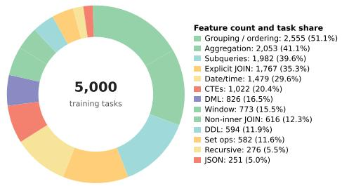

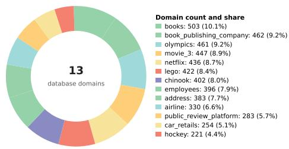  
(a) SQL usage categories. Categories are nonexclusive; percentages indicate the share of tasks containing each feature.  
(b) Database domains. SIX-GYM-SQLite spans 5,000 tasks across 13 SQLite database domains.  
Figure 3: Statistics of SIX-GYM-SQLite training data, covering SQL feature usage and databasedomain distribution.

Heuristic Rubric-Based Reward. The heuristic rubric-based reward consists of two criteria: 1) whether the submitted SQL executes successfully, and 2) whether the model identifies known bugs in its reasoning. The bug-identification criterion is computed by matching the model’s reasoning against a pre-extracted bug checklist with an LLM verifier. The reward is then computed as

$$
R _ { \mathrm { r u b r i c } } = \mathbf { 0 . 1 } \times \mathbb { I } _ { \mathbf { e x e c } } + \mathbf { 0 . 1 } \times { \frac { N _ { \mathrm { b u g } } ^ { \mathrm { i d } } } { N _ { \mathrm { b u g } } } } .\tag{11}
$$

Here, $\mathbb { I } _ { \mathbf { e x e c } }$ indicates whether the submitted SQL executes without syntax errors, $N _ { \mathbf { b u g } }$ is the number of known bugs in the checklist, and $N _ { \mathbf { b u g } } ^ { \mathbf { i d } }$ is the number of bugs identified by the model. The prompts used for bug extraction and verification in this process are presented in Figure 15 and 16.

## C Experiment Details

This section summarizes the implementation details, and compared methods used in our experiments.

## C.1 Alias of LLMs

The following aliases are used for the models in this work:

• GPT-5.4-Pro: gpt-5.4-pro

• Claude-Opus-4.6: claude-opus-4.6

• Claude-Sonnet-4.5: claude-sonnet-4-5-20250929

• Gemini-3.1-Pro: gemini-3.1-pro-preview

• GLM-4.7: glm-4.7

• Kimi-K2.5: kimi-k2.5

• MiniMax-M2-1: minimax-m2-1

• Qwen3-Coder-480B: Qwen3-Coder-480B

All open-source models are downloaded from Hugging Face<sup>1</sup>:

Algorithm 1 Workflow Orchestration Pseudo Code   
Require: Task instance x, target database template d, worker-partitioned DB pool P   
Ensure: Final submitted solution or timeout termination   
1: Generate a unique trajectory identifier traj\_id   
2: Request an available replica r of database d from the local worker pool P   
3: if no replica is immediately available then   
4: Wait in the allocation queue until a replica is released or timeout occurs   
5: end if   
6: if allocation timeout occurs then   
7: return timeout failure   
8: end if   
9: Set r.is\_available ← False   
10: Register (traj\_id, worker\_id, db\_id) in the stateful agent loop   
11: if r.need\_reset = True then   
12: Restore r from the clean database template   
13: Set r.need\_reset ← False   
14: end if   
15: while the trajectory has not terminated do   
16: The agent generates an action a   
17: if a is execute\_sql then   
18: Lookup (worker\_id, db\_id) by traj\_id in the stateful agent loop   
19: Execute the SQL action on the trajectory-bound replica r   
20: Return the database observation to the agent   
21: if the SQL action mutates the database state then   
22: Set r.need\_reset ← True   
23: end if   
24: else if a is submit\_solution then   
25: Record the submitted solution   
26: Break   
27: end if   
28: end while   
29: Release r back to the local worker pool P   
30: Set r.is\_available ← True   
31: return submitted solution or timeout result

## C.2 Model Implementation Details

We post-train all our models using the VERL framework [42] (v0.7.0.dev0)<sup>2</sup> and vLLM [21] (v0.11.0)<sup>3</sup>. All experiments are conducted on 8×H100 GPUs with 80GB memory. Our training pipeline has four stages. The first two stages are supervised fine-tuning: Stage 1 trains single-turn SQL reasoning for 3 epochs with batch size 16, maximum length 8192, and learning rate 1e-5; Stage 2 trains multi-turn tool-use trajectories for 3 epochs with batch size 16, maximum length 16000, and learning rate 1e-5. The last two stages use GRPO [41]. Stage 3 performs single-turn reasoning RL with rollout size 16, batch size 16, PPO mini-batch size 16, learning rate 1e-6, KL coefficient 0.01, maximum prompt length 15000, and maximum response length 5000. Stage 4 performs multi-turn agentic RL with asynchronous vLLM rollouts up to 5 assistant turns. Unless otherwise specified, it follows the same RL hyperparameters as Stage 3, except that the rollout size is set to 4. The specific training hours for each backbone model are shown in Table 9. During inference, we use vLLM with greedy decoding (temperature 0) and a maximum input length of 15000 tokens. We report experimental results as the average of five repeated trials.

For proprietary-model inference, we use the official API providers, including OpenAI (https://openai.com/), Anthropic (https://www.anthropic.com/), and Google (https://gemini.google.com/). All open-source models are downloaded from Hugging ${ \mathrm { F a c e } } ^ { 4 } ;$ the Qwen-Coder backbones refer to Qwen2.5-Coder-7B-Instruct and Qwen2.5-Coder-14B-Instruct.

Table 9: GPU hours spent to train each backbone model.
<table><tr><td>Model</td><td>GPU Hours</td></tr><tr><td>BIRD-Talon-7B</td><td>93.38</td></tr><tr><td>BIRD-Zeno-7B</td><td>80.36</td></tr><tr><td>BIRD-Talon-14B</td><td>152.75</td></tr></table>

## C.3 Compared Methods

This section provides additional details of the compared methods reported in Tables 1, 2, and 4.

SQL debugging baselines. The General-Purpose Models group evaluates frontier proprietary models and strong open-weight models under a single-turn prompt-based SQL repair setting. Given the user issue description, database schema, and buggy SQL query, the model is directly prompted to produce the corrected SQL solution without interacting with the database during inference. This setting follows the baseline SQL debugging prompt shown in Figure 10. We include GPT-5.4-Pro, Claude-Opus-4.6, Claude-Sonnet-4.5, Gemini-3.1-Pro, GLM-4.7, Kimi-K2.5, MiniMax-M2-1, and Qwen3-Coder-480B to establish broad baselines on BIRD-CRITIC-SQLITE.

The Multi-Turn Agents group evaluates models with database interaction through the SQL-ACT scaffold. Following the ReAct paradigm [55], SQL-ACT interleaves reasoning, SQL actions, and database observations over multiple turns. At each step, the model may execute an arbitrary SQL statement against the database environment and use the returned observation to refine its diagnosis. The trajectory continues until the model submits a final repaired SQL solution. Compared with tool-based agents whose action space is restricted to predefined operations such as schema inspection or sample retrieval, SQL-ACT treats executable SQL itself as the action space, enabling more flexible debugging strategies. The system and user prompts used by this scaffold are shown in Figures 6 and 7; the same scaffold is used for BIRD-TALON inference. For BIRD-FIXER-7B and BIRD-FIXER-14B, we follow the supervised agent fine-tuning pipeline from the work [25] to reproduce the training trajectories and fine-tune the models Qwen2.5-Coder-7B-Instruct and Qwen2.5-Coder-14B-Instruct on SIX-GYM-SQLITE (Appendix A).

In Table 1, we instantiate the multi-turn agent setting with Claude-Opus-4.6, Claude-Sonnet-4.5, and Qwen3-Coder-480B. In Table 2, we additionally report SQL-ACT results by directly placing the corresponding Qwen2.5-Coder base model into the same interactive scaffold, without BIRD-RL training.

SQL generation baselines. We compare BIRD-ZENO with recent RL-based text-to-SQL methods that optimize SQL generation through execution feedback, partial rewards, or multi-turn interaction. Think2SQL [33] studies reinforcement learning with verifiable rewards for text-to-SQL reasoning It introduces execution-guided dense rewards to provide more granular feedback than binary execution correctness. SQL-R1 [28] trains natural-language-to-SQL reasoning models with a cold-start SFT phase followed by reinforcement learning on complex examples. Its reward design is tailored to NL2SQL generation and uses database feedback to encourage exploration beyond fixed supervised generation patterns. ReEx-SQL [8] introduces execution-aware reasoning for text-to-SQL by interleaving exploratory SQL execution with model reasoning during generation. It further uses execution-informed rewards and decoding strategies to help the model revise reasoning based on database feedback. Reasoning-SQL [37] applies GRPO with SQL-tailored partial rewards to mitigate the sparsity of binary execution rewards. Its reward components include signals such as schema linking, syntax validity, similarity, and AI feedback to encourage reasoning-enhanced SQL generation. Arctic-T2S-R1 [56] emphasizes simple end-task rewards for text-to-SQL RL, relying mainly on execution correctness and syntax validity instead of complex intermediate supervision. SQL-Trail [17] frames text-to-SQL as a multi-turn RL problem with interleaved database feedback.

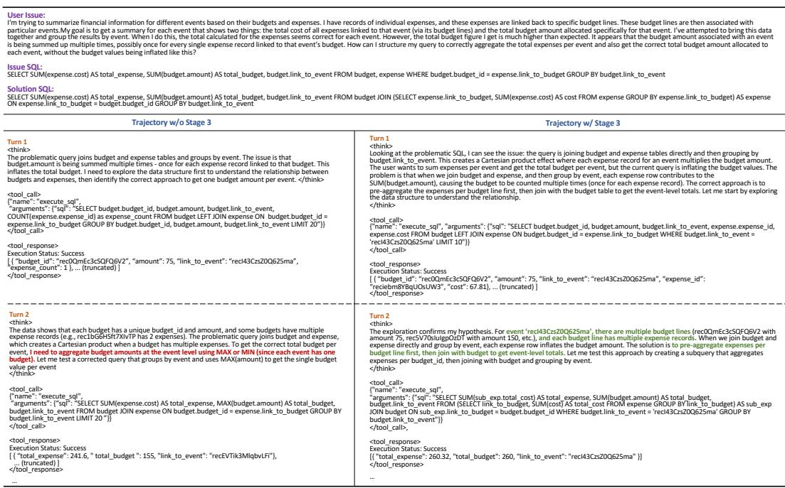  
Figure 4: Case study comparing debugging trajectories with and without Stage 3 adaptive reasoning reinforcement.

It uses iterative interaction, adaptive turn allocation, and rewards that balance SQL correctness with efficient exploration.

## D More Analysis

## D.1 Case Study for Stage 3

Figure 4 shows a representative SQL debugging case where both agents identify the join-induced budget inflation issue, but diverge in the repair strategy. Without Stage 3, the agent incorrectly assumes that each event has only one budget and uses MAX(budget.amount), leading to an erroneous fix. With Stage 3, the agent correctly infers that an event may contain multiple budget lines and verifies a repair that pre-aggregates expenses per budget line before joining with the budget table. This illustrates how Stage 3 improves adaptive, evidence-grounded reasoning beyond the imitation-learned trajectory patterns.

## D.2 Comparison of Training-Time Database Lifecycle I/O

Table 3 formalizes the database lifecycle I/O overhead required to maintain trajectory-level isolation during interactive rollout execution. The naive per-rollout container baseline instantiates a fresh database for every generated trajectory. Consequently, this approach incurs an I/O cost proportional to the total number of rollout trajectories, resulting in the I/O complexity of O(NRS<sup>¯</sup>), where N is the number of training tasks, R is the number of rollout trajectories per task, and S<sup>¯</sup> is the average database size.

To circumvent this exhaustive overhead, we propose a dynamic reusable database pool that fundamentally alters the database lifecycle for data-centric tasks. During interactive rollout execution, the pool continuously tracks the operation state, including the availability and modification status, of each database replica. A trajectory first tries to acquire an available clean replica for its target database. Under an ideal dynamic allocation scheme, a new replica is instantiated online strictly when the concurrent demand exceeds the capacity of existing available replicas. Upon trajectory completion, the leased replica is immediately released back to the pool, avoiding any naive re-instantiation. Crucially, to handle state-changing queries, the pool employs a dirty-aware lazy reset policy. Once a replica is modified, it is not eagerly restored upon release. Instead, the reset operation is deferred until the replica is leased again for a new trajectory.

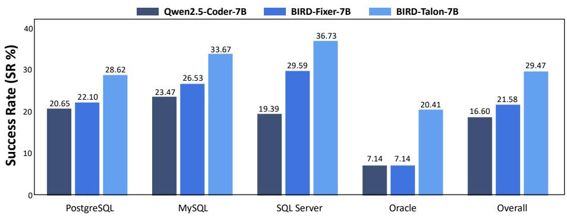  
Figure 5: The success rate of BIRD-TALON on unseen dialects shows its generalization ability.

To formalize the theoretical I/O reduction over the baseline, we decompose the dynamic pool’s training-time overhead into two analytical components: 1) Bounded Instantiation Overhead: Assuming database requests follow a uniform access distribution across unique databases within a training batch of size B, the dynamic pool size is upper-bounded by the maximum concurrency, $B \times R ,$ limiting the replica creation I/O to $O ( B R \bar { S } )$ ). In practical large-scale RL settings (e.g., optimizing a 14B parameter model), GPU memory constraints dictate a small, fixed batch size (typically $B = { \bf 1 6 } )$ . Consequently, this guarantees that $B \ll N , 2 )$ Regularized Reset Overhead: While the dynamic pool eliminates redundant materialization, it unavoidably introduces state-reset operations for modified replicas. We quantify such overhead using an example-effective count $q = Q / R$ , where Q denotes the total number of rollout trajectories that actually trigger the reset action during training across all NR rollouts. Let $k \geq \mathbf { \bar { 1 } }$ denote the empirical I/O reduction factor of an in-place reset relative to full copy-delete materialization. In database systems, targeted state restoration (e.g., table-level truncation or snapshot rollbacks) is considered cheaper than a full physical instantiation. Consequently, the specific value of k depends on the underlying reset optimization deployed. The reset complexity is thus bounded by $O ( q R \bar { S } / k )$ Notably, q is intrinsically manageable. The preceding Supervised Fine-Tuning (SFT) phase of our framework effectively regularizes the agent’s exploration behavior, preventing arbitrary database mutations. Empirically, only about 9.25% of the practical rollouts execute state-altering exploitation in our experiment. Combining both components, the total lifecycle overhead of the dynamic pool evaluates to $\dot { O } ( ( B + q / k ) R \bar { S } )$ , where $\bar { B ^ { + } } q / k \ll N$ . This establishes that the dynamic pool mechanism achieves vastly superior spatial and I/O efficiency compared to the naive per-rollout baseline.

While the bounded creation overhead holds under a steady-state assumption, real-world RL exploration frequently encounters a highly imbalanced distribution. Concurrent rollouts can heavily skew towards hot databases, triggering sudden capacity overflows and allocation bottlenecks that destabilize the training pipeline. To systematically amortize this risk upfront, our actual implementation replaces dynamic online creation with a pre-materialized database pool. By shifting the database instantiation entirely offline, we decouple resource allocation from the rollout path, eliminating the risk of memory thrashing and I/O contention. Consequently, as rollouts acquire replicas via constant-time (O(1)) pool lookups, the online training I/O is dominated by the predictable reset operations with complexity $\dot { O } ( q R \bar { S } / \dot { k } )$

In our practical setting $( B = 1 6 , R = 1 6 )$ , we pre-reserve $B R / 2$ replicas per database in the pool. Empirical observations confirm that this capacity is sufficient to avoid pool exhaustion. As shown in Table 3, our implementation reduces measured online lifecycle I/O by 12.8× compared to per-rollout containers. This comes with a one-time pre-materialized storage cost of 69 GiB as a trade-off, which is excluded from the online I/O reported in the table. Such a trade-off is practically negligible relative to the terabyte-level massive online I/O savings. Notably, since this offline pool scales with the number of unique databases rather than the training volume N, its storage cost remains predictable and amortizable, enabling stable large-scale trajectory-level isolation.

## D.3 Generalization for Different SQL Dialects

Figure 5 illustrates BIRD-TALON’s robust generalization on unseen dialects, although it is trained only on SQLite tasks within SIX-GYM-SQLite. This can be attributed to BIRD-RL strengthening the model with a more general logic of debugging reasoning through environmental interaction, rather than fitting SQLite-specific surface patterns, while preserving the model’s pretrained knowledge of dialect variation. Consequently, BIRD-TALON exhibits strong cross-dialect reasoning without extra training, highlighting its potential in realistic database implementation scenarios.

## D.4 Test-time Scaling Analysis

Although BIRD-TALON is evaluated under greedy decoding in the main results, we further study the potential of BIRD-TALON-14B under increased test-time sampling. We sample up to 16 independent trajectories using the same decoding configuration, temperature 0.7 and top-p 0.95, and report oracle pass@k in Table 10.

Table 10: Test-time scaling results of BIRD-TALON-14B on BIRD-CRITIC-SQLITE.
<table><tr><td>Model</td><td>pass@1</td><td>pass@4</td><td>pass@8</td><td>pass@16</td></tr><tr><td>BIRD-Talon-14B</td><td>46.40</td><td>57.40</td><td>60.60</td><td>65.00</td></tr></table>

As shown in Table 10, BIRD-TALON-14B benefits consistently from additional samples, indicating that test-time computation can expose correct solutions missed by a single rollout. This suggests that the learned agentic policy provides a useful candidate solution space for future verifier- or reranker-based scaling.

## E Limitations and Future Work

This work only focuses on SQL tasks as a representative class of stateful data-centric environments. A natural future direction is to extend BIRD-RL to broader high-value data science tasks, such as data cleaning, transformation, workflow construction, and analytical decision-making, where agents must similarly reason over persistent states, execution feedback, even on top of large data.

In addition, BIRD-RL currently adopts execution-based rewards to ensure faithful alignment with functional correctness. Future work may explore hybrid reward designs that combine execution signals with semantics-aware verification, while explicitly addressing reward hacking to preserve reliable optimization behavior in complex data-centric settings. This can further advance upper bound of our framework.

## F Ethics Statement

In this work, although our method involves data synthesis, all data are derived from databases and resources that are publicly available, ensuring transparency and reproducibility. We take care to avoid sensitive or personally identifiable information, and the generated outputs are SQL queries rather than open-ended natural language, reducing the risk of biased or harmful textual content.

## G Broader Impact

This work aims to advance scalable agentic RL for data-centric environments, where agents interact with live, stateful databases rather than static textual contexts. The proposed trajectory-scoped infrastructure may benefit future research on database agents by reducing the cost of isolated rollout execution and making RL training more practical for heavy database workloads. In the long term, such techniques could help build more capable SQL assistants that reduce manual debugging effort, improve developer productivity, and support privacy-sensitive applications through stronger opensource models that can be deployed locally.

At the same time, beyond improving SQL issue resolution, our method points toward a future paradigm of general-purpose SQL agents. By training over heterogeneous SQL tasks, BIRD-RL makes it possible to move beyond narrowly specialized models toward unified agents that can perform query generation, issue diagnosis, execution-based verification, and interactive repair within a single framework. Such agents could serve as a more general interface for real-world database applications, where users often need end-to-end assistance across multiple stages of database interaction rather than isolated text-to-SQL generation.

## H Prompts and Examples

This section presents the prompts used in our experiments and example trajectory. Figures 6–9 show the system and user prompts for SQL debugging and SQL generation tasks. Figure 10 presents the baseline SQL debugging prompt. Figures 11 and 12 show the prompts used for Stage 1 reasoning imitation data construction and verification. Figures 13–16 show the system and user prompts for getting heuristic rubric reward and LLM-as-judge reward. Figure 17 illustrates an example trajectory produced by BIRD-TALON when solving a SQL debugging task.

```markdown
Inference prompt for SQL Debugging (system prompt)
You are an expert SQL query writer. Your task is to translate natural language questions into correct SQL queries.
You will be provided with:
1. A database schema with sample data
2. Column descriptions
3. A natural language question
4. Evidence/hints about domain-specific terms
## Your Objective
Generate the correct SQL query by:
- Analyzing the question to understand what data is needed
- Using tools to explore the database schema and sample data
- Testing candidate queries to validate your approach
- Submitting the final correct SQL query
## Available Tools
<tools>
"type": "function",
"function": {
"name": "execute_sql",
"description": "Execute one SQL query for exploration/testing. Returns results but does not judge correctness.",
"parameters": {
"type": "object",
"properties": {
"sql": {"type": "string", "description": "A single SQL query."}
},
“required”: [“sql”] }}},
"type": "function",
"function": {
"name": "submit_solution",
"description": "Submit the final SQL solution and end the task.",
"parameters": {
"type": "object",
"properties": {
"sql_list": {
"type": "array",
"items": {"type": "string"},
"description": "Complete final SQL statement(s)."
}},
“required”: [“sql_list”] }}}
</tools>
## How to Call Tools
To invoke a tool, the output must be in the following format:
1. Open the tool call tag: <tool_call>
2. Provide a valid JSON object with exactly two keys:
- "name": string - the name of the function to call ("execute_sql" or "submit_solution")
- "arguments": object - a JSON object containing the parameters for that tool
3. Close the tool call tag: </tool_call>
**Format examples:**
For testing/exploration:
<tool_call>{{"name": "execute_sql", "arguments": {{"sql": "SELECT * FROM table LIMIT 5"}}}}</tool_call>
For final submission:
<tool_call>{{"name": "submit_solution", "arguments": {{"sql_list": ["SELECT col FROM table WHERE condition"]}}}}</tool_call>
## Critical Format Requirements
Your trajectory MUST follow this exact structure for EVERY turn:
1. **<think> tags**: Concise, high-level reasoning about what you're doing and why. Do NOT include SQL code in thoughts.
2. **Action**: After thinking, take ONE action by calling a tool:
- Use execute_sql for exploration and testing
- Use submit_solution for final submission (ends trajectory)
3. **Turn limit**: Maximum {max_turns} turns. Each turn: <think> + <tool_call>. **CRITICAL**: If you don't call submit_solution
in the first {prev_turns} turns, the last turn MUST be submit_solution (forced submission).
```  
Figure 6: The inference prompt used for SQL debugging task (system prompt).

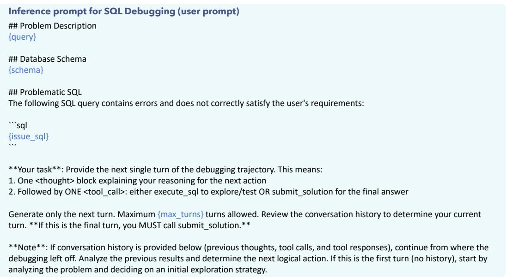  
Figure 7: The inference prompt used for SQL debugging task (user prompt).

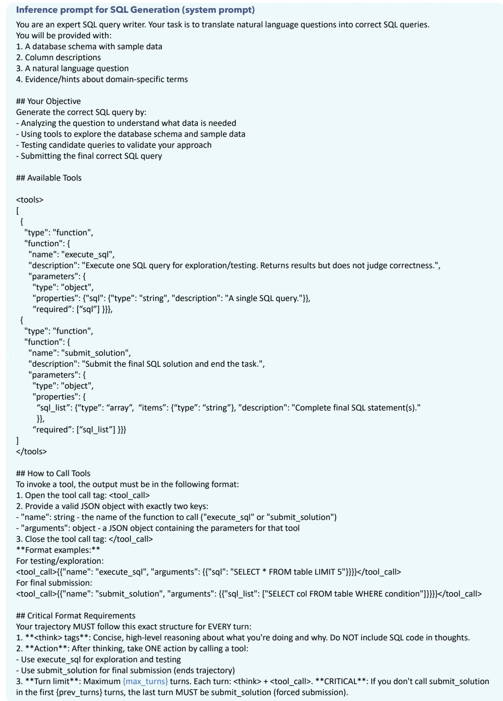  
Figure 8: The inference prompt used for SQL generation task (system prompt).

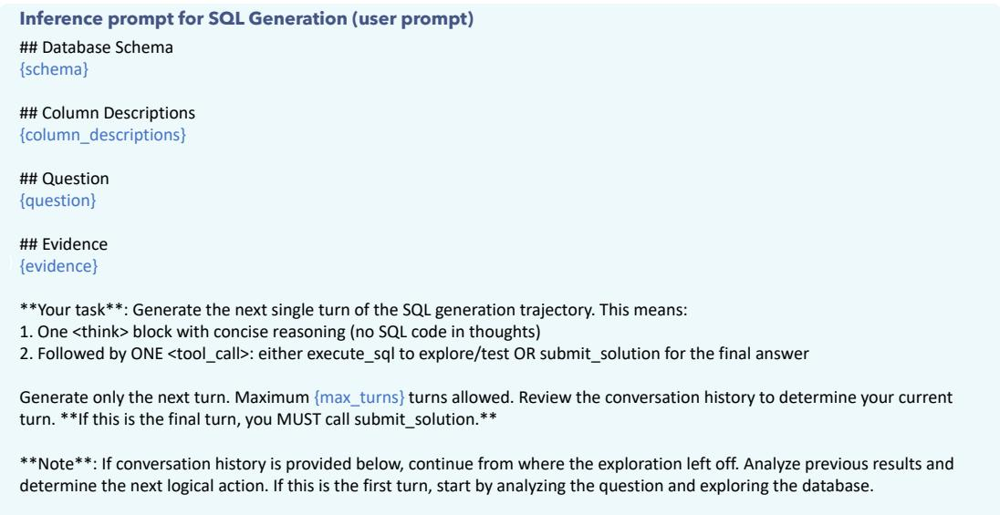  
Figure 9: The inference prompt used for SQL generation task (user prompt).

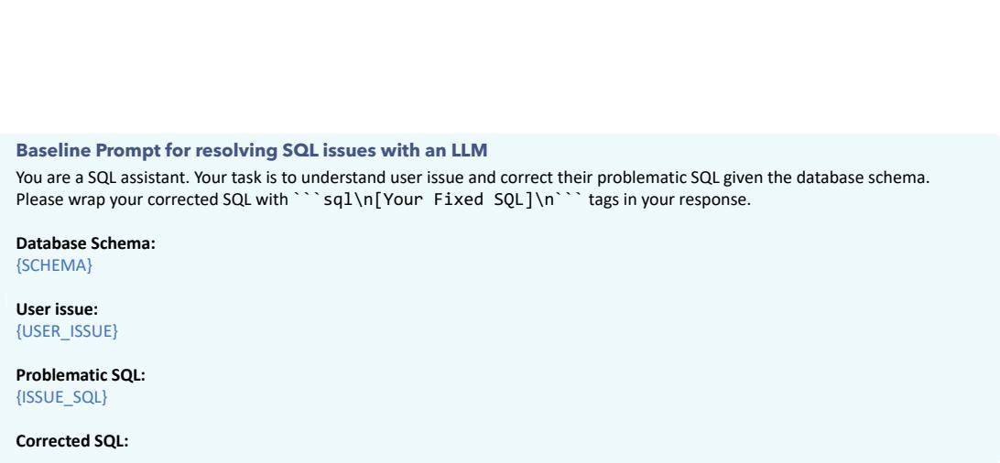  
Figure 10: The baseline prompt used for SQL debugging tasks.

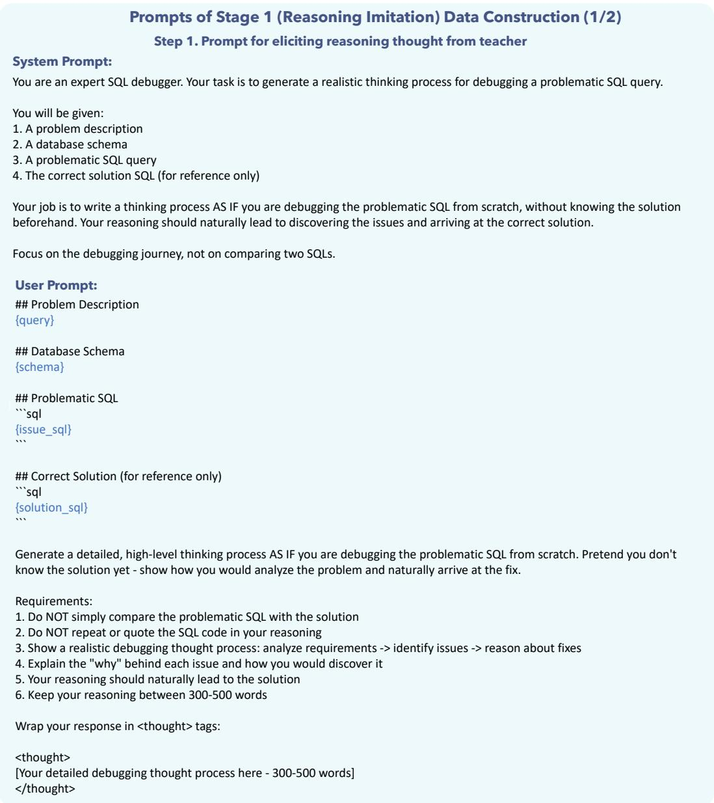  
Figure 11: The prompt used in Stage 1 reasoning imitation data construction to elicit reasoning thought from teacher model.

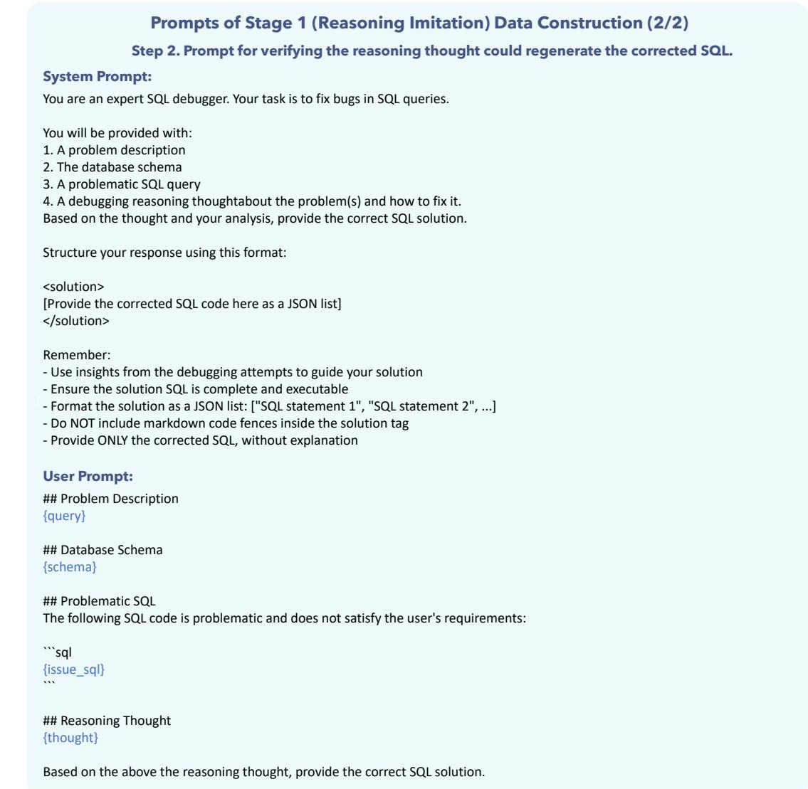  
Figure 12: The prompt used in Stage 1 reasoning imitation data construction to verify whether teacher model could leverage the reasoning thought to regenerate the correct fixed SQL.

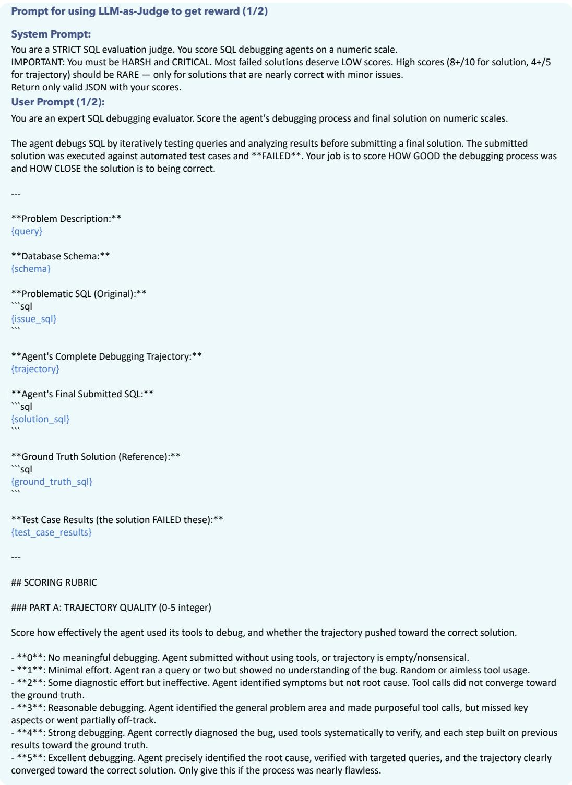  
Figure 13: The prompt used to get LLM-as-judge reward (1/2).

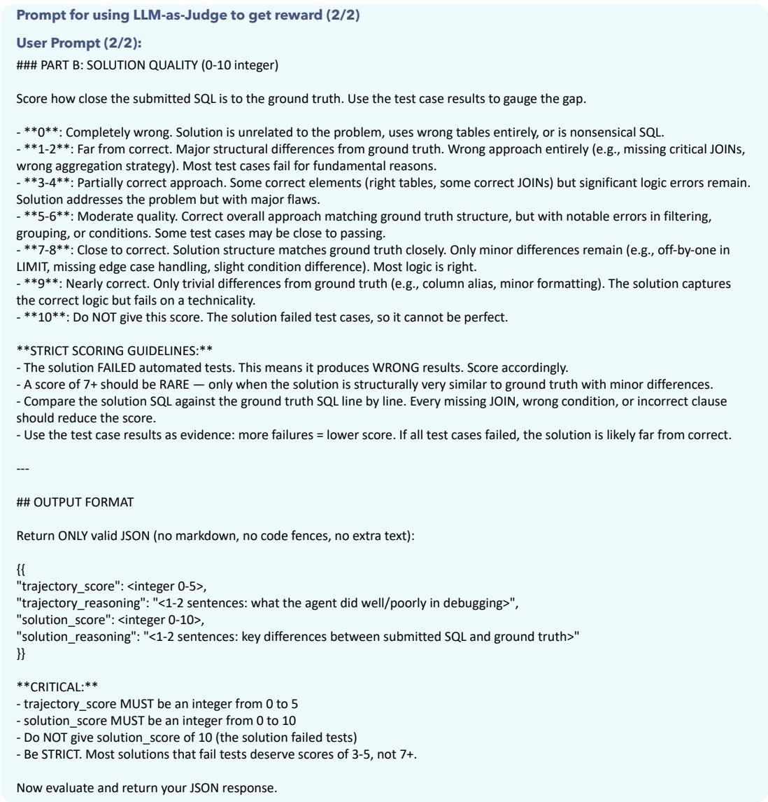  
Figure 14: The prompt used to get LLM-as-judge reward (2/2).

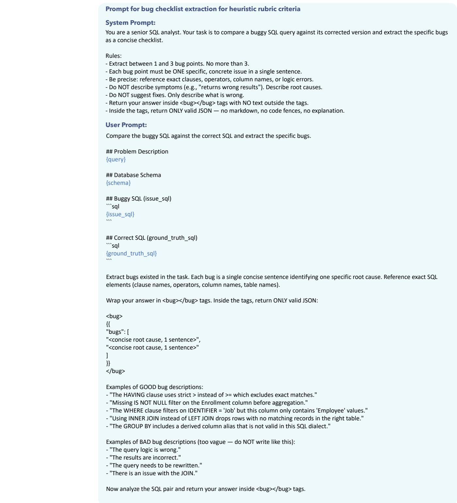  
Figure 15: The prompt for the heuristic rubric reward: instructions used to extract a bug checklist from the task context.

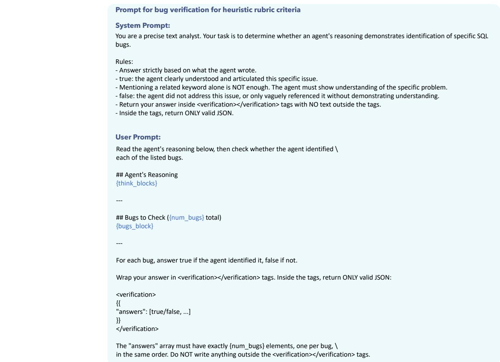  
Figure 16: The prompt for the heuristic rubric reward: instructions used to verify whether the reasoning of agent correctly identifies the checklist bugs.

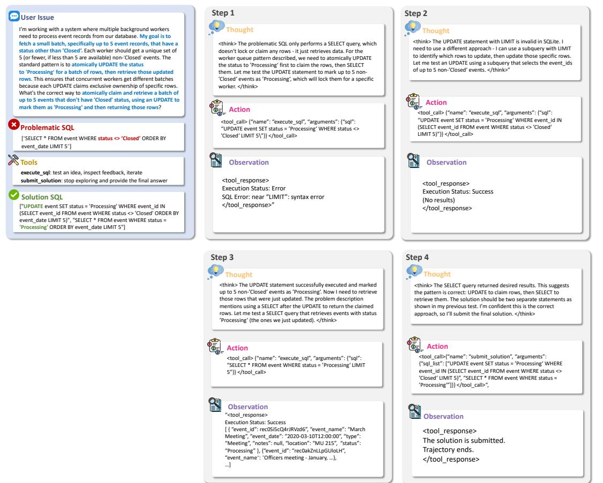  
Figure 17: The example of trajectory from BIRD-TALON solving SQL debugging task.