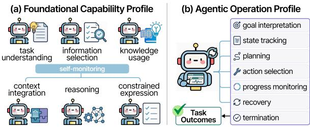
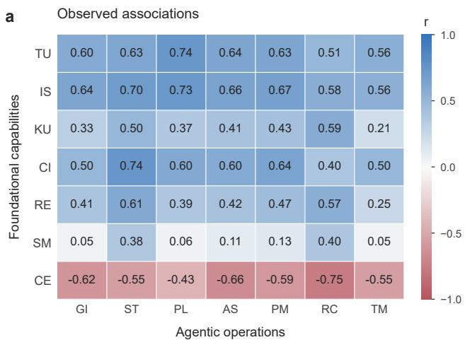
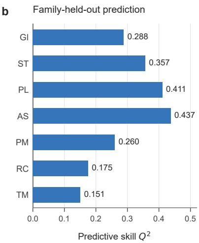
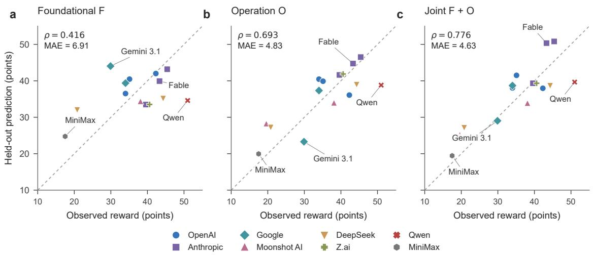
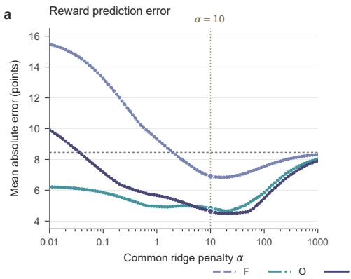
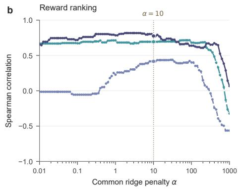
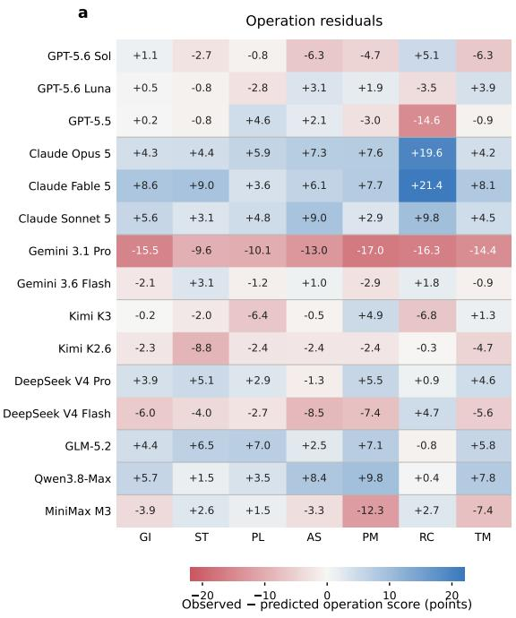
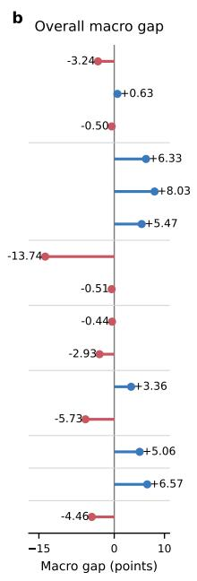
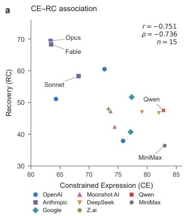
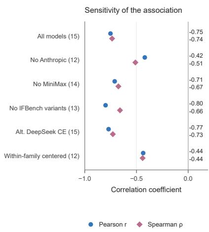

# Bridging Foundational and Agentic Capabilities of LLMs

Wei Guo<sup>1</sup>, Yuanjian Xu<sup>2</sup>, Jianing Hao<sup>2,3</sup>, Yongyao Duan<sup>4</sup>, Ran Chen<sup>4</sup>, Zhong Li<sup>5</sup>, Guang Zhang<sup>2,ć</sup>

<sup>1</sup>Nankai University <sup>2</sup>The Hong Kong University of Science and Technology (Guangzhou)

<sup>3</sup>Ant Group <sup>4</sup>OpenCSG <sup>5</sup>Microsoft Research Asia ć Corresponding author

## Abstract

Large language models (LLMs) are increasingly deployed as agents, yet it remains unclear how their foundational capabilities translate into agentic capabilities. End-to-end scores leave unresolved whether low benchmark capability or weak deployment drives a failure, limiting actionable diagnosis. We bridge foundational and agentic capabilities through an operation-level measurement framework. We represent each model with a foundational profile derived from capability benchmarks and an operation profile derived from interaction trajectories, and define capability realization gaps as deviations of observed operation performance from predictions based on foundational capabilities. Experiments on fifteen model services in τ<sup>2</sup>-Bench show that foundational profiles only partially predict agentic op erations. Models with comparable profiles can difer substantially in execution, and these gaps remain consistent across task subsets. Operation profiles add information and substantially improve task-score prediction. The framework locates execution departures at the operation level to inform model development and agent evaluation. We will release our code and analysis artifacts.

## 1 Introduction

Large language models (LLMs) have shown considerable promise as agents that interact with users, invoke tools, and respond to environmental feedback over multi-step tasks. This progress has motivated benchmarks for function calling, interactive tool use, and end-to-end task completion (Patil et al., 2025; Lu et al., 2025; Barres et al., 2025; Luo et al., 2025). Yet end-to-end scores say little about how foundational benchmark dimensions translate into planning, action selection, and recovery. Connecting these levels separates low benchmark profiles from execution that falls below profile-based expectations.

Prior work maps evaluations outside agent environments to aggregate performance (Song et al., 2026) and separately diagnoses intermediate behavior from execution trajectories (Ou et al., 2025). Linking these views at the operation level lets us test how foundational profiles predict specific execution behaviors and how much task-outcome information process measurements add. Aggregate prediction leaves the execution stage of a capability gap unidentified. A useful account must connect ofline capability structure to specific interactive behaviors, generalize across model families, and determine whether those behaviors explain outcome variation left unresolved by benchmark scores. These requirements motivate the questions below.

To address this gap, we organize our study around two research questions: RQ1. How well do foundational benchmark scores predict operation scores? and RQ2. Do operation scores provide additional information about overall task performance? Each model receives a foundational profile from capability benchmarks and an operation profile from trajectory annotations; Section 3 defines both. For each provider in turn, we train statistical predictors on the remaining providers and evaluate the excluded provider. Residuals answer RQ1 by locating departures from expected operation scores. The same held-out splits answer RQ2 by comparing foundational, operation, and joint predictors of task performance.

We evaluate model configurations on interaction trajectories from the Banking tasks in $\tau ^ { 2 } .$ -Bench (Barres et al., 2025). Foundational profiles explain part of the variation in operation scores, with systematic residuals across models and operations. Operation profiles further improve held-out prediction of overall task performance. Our contributions are a framework linking foundational indicators, execution operations, and task outcomes under controlled conditions; a provider-held-out mapping and residual analysis of execution departures; and evidence that combining foundational and operation profiles improves held-out Banking reward prediction.

## 2 Related Work

End-to-end agent benchmarks evaluate function calling, stateful tool use, dual-control conversations, and interaction with real-world MCP servers, and they primarily report task-level success (Patil et al., 2025; Lu et al., 2025; Barres et al., 2025; Luo et al., 2025). Capability- and process-oriented evaluations provide complementary explanations for these outcomes. MMAU separates understand ing, reasoning, planning, problem-solving, and self-correction in ofline tasks (Yin et al., 2025), ADeLe places task demands and model abilities on interpretable scales to predict instance-level perfor mance (Zhou et al., 2026), and PACE shows that a small set of non-agentic items can predict aggregate agentic benchmark scores (Song et al., 2026). These approaches map capabilities to aggregate outcomes. Process-level evaluation examines exe cution directly: T-Eval scores tool-use components step by step against reference trajectories (Chen et al., 2024), and AgentDiagnose scores competencies such as task decomposition, observation reading, and self-verification from agent trajectories (Ou et al., 2025). Our design additionally pairs process scores with independently measured foundational profiles for the same models. Re lated work also documents capability–action gaps in specific settings: strong diagnostic reasoning can coexist with weak evidence collection (Long and Wei, 2026), recognizing the need for a tool can still end in a missed call (Cheng et al., 2026), and perturbations of intermediate reasoning reveal how much later outputs depend on it (Lanham et al., 2023). We connect these lines by measuring foundational profiles, trajectory-level operations, and task outcomes under shared task conditions, then testing both capability-to-operation prediction and the incremental outcome information in operation profiles. Table 1 summarizes these diferences.

## 3 Framework

We study a resource–deployment–outcome sequence. For model m, the foundational profile $F _ { m } = \Theta _ { m }$ summarizes resources measured before interaction, the operation profile $O _ { m }$ records their deployment along a trajectory, and $Y _ { m }$ is the resulting task outcome. Each service uses a fixed inference protocol and a common action interface. The task fixes the horizon, observability, action space, and feedback. Figure 1 summarizes this measurement structure.

<table><tr><td>Work</td><td>Inter.</td><td>Found.</td><td>Proc.</td><td>F→Y</td><td>F→P</td><td>P→Y</td></tr><tr><td>BFCL (Patil et al., 2025)</td><td>√</td><td>×</td><td>×</td><td>×</td><td>×</td><td>×</td></tr><tr><td>ToolSandbox (Lu et al., 2025)</td><td>√</td><td>×</td><td>√</td><td>×</td><td>×</td><td>X</td></tr><tr><td>τ2-Bench (Barres et al., 2025)</td><td>√</td><td>X</td><td>×</td><td>×</td><td>×</td><td>X</td></tr><tr><td>MCP-Universe (Luo et al., 2025)</td><td>√</td><td>X</td><td>×</td><td>×</td><td>×</td><td>X</td></tr><tr><td>MMAU (Yin et al., 2025)</td><td>×</td><td>√</td><td>×</td><td>×</td><td>×</td><td>×</td></tr><tr><td>ADeLe (Zhou et al., 2026)</td><td>X</td><td>√</td><td>X</td><td>√</td><td>X</td><td>X</td></tr><tr><td>PACE (Song et al., 2026)</td><td>V</td><td>√</td><td>X</td><td>√</td><td>X</td><td>X</td></tr><tr><td>T-Eval (Chen et al., 2024)</td><td>X</td><td>×</td><td>√</td><td>X</td><td>X</td><td>X</td></tr><tr><td>AgentDiagnose (Ou et al., 2025)</td><td>√</td><td>X</td><td>√</td><td>X</td><td>×</td><td>X</td></tr><tr><td>Ours</td><td>√</td><td>√</td><td>√</td><td>√</td><td>√</td><td>√</td></tr></table>

Table 1: Coverage of related agent and capability evaluations. Inter. denotes multi-turn interactive evaluation, Found. a separate foundational capability profile, and Proc. trajectory-level process measurement. F, P, and Y denote foundational profiles, process measurements, and task outcomes; arrows indicate which relationship a study tests. ✓ denotes support and × no support.

The section follows the same logic: Section 3.1 defines the available resources, Section 3.2 measures their deployment in trajectories, and Section 3.3 links both profiles to outcomes and controlled execution tests.

## 3.1 Foundational Capability Profile

Following existing capability taxonomies (Yin et al., 2025; Mo et al., 2025; Zhou et al., 2026), we define seven dimensions. Task Understanding (TU) recovers the objective, success conditions, and relevant constraints. Information Selection (IS) identifies evidence relevant to the current decision while excluding distractors. Knowledge Use (KU) retrieves applicable parametric knowledge or applies reliable knowledge supplied in context. Context Integration (CI) combines the selected evidence, knowledge, prior context, and intermediate results into a consistent representation. Reasoning (RE) derives conclusions from that representation. Constrained Expression (CE) realizes the conclusion while satisfying content, format, and schema requirements. Self-Monitoring (SM) detects uncertainty, contradictions, insuficient evidence, and candidate errors.

The dimensions follow a coherent processing sequence: the model understands the task, prepares relevant information and knowledge, integrates the resulting inputs, reasons over them, and expresses the result. Self-Monitoring provides cross-stage feedback and may trigger revision of integration, reasoning, or expression. For model $m , \Theta _ { m }$ denotes the resulting seven-score foundational profile. We report the seven coordinates separately to preserve capability-specific variation across the heterogeneous source benchmarks.

  
Figure 1: Framework linking foundational capabilities, agentic operations, and task outcomes. Foundational capabilities describe resources measured outside the agent environment; agentic operations describe how a model deploys them during interaction. We measure the relationship between the two profiles and test whether operation profiles add information about task outcomes.

## 3.2 Agentic Operation Profile

Agentic operations describe what the model does with these resources in a particular trajectory. Goal Interpretation (GI) grounds subsequent decisions in the user’s objective and constraints. State Tracking (ST) updates the task state after new information or environment feedback. Planning (PL) orders the steps required to reach the goal. Action Selection (AS) chooses the next tool call or userfacing action and its arguments. Progress Monitoring (PM) identifies what is complete, pending, failed, or blocked. Recovery (RC) repairs a failed action or an erroneous decision. Termination (TM) decides whether to continue, stop, or transfer. The seven operations form a recurring control loop. State Tracking and Progress Monitoring recur after informative transitions, while Recovery returns control to Planning or Action Selection. Their relation to foundational capabilities is many-to-many: one capability can support several operations, and one operation can draw on several capabilities.

Operations are measured only when a trajectory provides enough evidence to judge them. Before review, a task contract records the goal, constraints, required actions, and valid terminal states. Table 2 lists the evidence used for each operation. All operations share one label rule: 0 for a failed or omitted applicable requirement, 0.5 for partial satisfaction without a failure, and 1 for complete satisfaction. Recovery additionally requires a preceding error and an opportunity to respond to it. A trajectory without an observable opportunity is recorded as NA and excluded from aggregation. Within each trajectory, labels are averaged by operation and scaled to 0–100; a model’s operation score averages over trajectories with a scoring opportunity. For model m, $O _ { m }$ denotes the seven-score operation profile and $A _ { m }$ its overall operation score, which first averages applicable operations within each trajectory and then averages across trajectories.

## 3.3 Analysis Methodology

Pairwise associations. Let $F _ { m } = \Theta _ { m }$ and $O _ { m }$ denote the foundational and operation profiles of model $m .$ We compute the $7 \times 7$ Pearson correlation matrix between their dimensions and use Spearman correlation as a rank-based robustness check. Permutation tests, multiple-comparison correction, and family-composition analyses quantify uncertainty and sensitivity. We use these associations as descriptive summaries. The paired intervention design below evaluates efects on downstream execution.

Family-held-out prediction. Models from the same family may share architectures, training data, and post-training procedures. We therefore hold out one complete family at a time. Let $\mathcal { T } _ { \mathrm { t r a i n } }$ be the indices of models in the current outer training fold. For each target, we fit a ridge predictor with an unpenalized intercept:

$$
\operatorname* { m i n } _ { b , \beta } \sum _ { i \in \mathcal { Z } _ { \mathrm { t r a i n } } } \left( y _ { i } - b - z _ { i } ^ { \top } \beta \right) ^ { 2 } + \alpha \| \beta \| _ { 2 } ^ { 2 } ,\tag{1}
$$

where $y _ { i }$ is the scalar target for training model i, $z _ { i }$ is its standardized feature vector, b is the intercept, β is the coeficient vector, and α is the ridge penalty. Feature standardization is estimated from ${ \mathcal { T } } _ { \mathrm { t r a i n } }$ only.

Residual diagnostics. Let $f ( m )$ denote the family of held-out model m. We define the operationlevel and overall capability realization gaps as

$$
\begin{array} { l } { { r _ { m , o } = { \cal O } _ { m , o } - \widehat { \cal O } _ { m , o } ^ { ( - f ( m ) ) } , } } \\ { { \Delta _ { m } ^ { \mathrm { o p } } = { \cal A } _ { m } - \widehat { \cal A } _ { m } ^ { ( - f ( m ) ) } , } } \end{array}\tag{2}
$$

where the superscript $( - f ( m ) )$ indicates that the predictor was trained without family $f ( m )$ . Positive values indicate execution above the prediction from the foundational profile; negative values indicate execution below it. We interpret a residual only when its target has useful held-out predictive skill.

<table><tr><td>Op. Scoring evidence</td><td></td></tr><tr><td>GI</td><td>Later decisions preserve the user&#x27;s goal, target entities, constraints, and success conditions.</td></tr><tr><td>ST</td><td>New information and tool results are incorporated into the current state and used correctly.</td></tr><tr><td>PL</td><td>The action sequence respects dependencies and task constraints.</td></tr><tr><td>AS</td><td>Actions and arguments are appropriate, authorized, and consistent with the applicable rules.</td></tr><tr><td>PM</td><td>Completed, pending, failed, and blocked requirements are distinguished correctly.</td></tr><tr><td>RC</td><td>A preceding error is corrected, and the correction is retained in later execution.</td></tr><tr><td></td><td>TM Continuing, stopping, or transferring is consistent with the remaining requirements and final state.</td></tr></table>

Table 2: Trajectory evidence used to score the seven agentic operations. Each row states the behavioral evidence required for one operation; the common 0/0.5/1 label rule and aggregation procedure are defined in Section 3.2.

Outcome prediction. For the scalar task outcome $Y _ { m }$ , we compare a training-mean baseline with three learned predictors using F, O, or $F + O$ All learned predictors use the same family splits, estimator class, and preprocessing. Improvement of the joint predictor over the foundational-only predictor quantifies the incremental outcome information in operation profiles. Because operation scores and outcomes share trajectories, this analysis measures within-corpus prediction on the Banking trajectories.

Evaluation metrics. We primarily evaluate pooled held-out predictions using Spearman correlation and mean absolute error. Kendall’s τ , root mean squared error, and predictive skill relative to the fold-specific training mean serve as complementary metrics. Let M denote the evaluated models, $t _ { m }$ the target for model $m ,$ and $\bar { t } _ { \mathrm { t r a i n } ( m ) }$ the mean target in its outer training fold. Predictive skill is

$$
Q ^ { 2 } ( t ) = 1 - \frac { \sum _ { m \in \mathcal { M } } ( t _ { m } - \widehat { t } _ { m } ^ { ( - f ( m ) ) } ) ^ { 2 } } { \sum _ { m \in \mathcal { M } } ( t _ { m } - \bar { t } _ { \mathrm { t r a i n } ( m ) } ) ^ { 2 } } .\tag{3}
$$

Because $Q ^ { 2 }$ uses held-out predictions, it may take negative values.

Shared-initial-state experiments. The sharedinitial-state experiments compare repeated continuations from the same dialogue history, environment state, and available tools. Natural continuation and a generic checking prompt provide two conditions. Scoring separates violations, completed compliant operations, and unresolved behaviors. Single-step and short continuations record whether subsequent actions preserve compliance. The complete protocol appears in Appendix B.7.

Counterfactual interventions. To test whether operation-relevant content afects later execution, we compare paired runs that modify this content while holding the task state, tools, goal, and budget fixed. Damage interventions minimally corrupt valid content; repair interventions minimally correct invalid but repairable content. Semantics-preserving rewrites control for surfaceform changes. Repeated runs are aggregated within the base task, which is also the unit of statistical resampling.

## 4 Experiments

We first map foundational profiles to operation profiles and assess the task-score information added by operation measurements. Cross-task splits and controlled continuations then probe whether capability realization gaps persist across tasks and reappear in execution.

## 4.1 Setup

The study covers the model services in Table 4, spanning eight model families.<sup>1</sup> Foundational profiles combine public evaluation results with local measurements on a common scale. Table 3 maps each dimension to its evaluation and score. For Self-Monitoring, the model answers a question and then estimates the probability that its answer is correct. The score averages the own-answer AUROCs from the two evaluation sets. Appendix B.2 documents efective cohorts and run configurations.

Agentic operation profiles use the full Banking trajectory corpus, distributed nearly evenly across services. The tasks combine service goals with identity, confirmation, and policy constraints. We score each operation on complete trajectories and use the environment’s native reward as the task outcome. Section 3.2 defines scoring and aggregation; Appendix A.2 gives the annotation protocol.

<table><tr><td>Dimension</td><td>Evaluation</td><td>Reference size</td><td>Primary score</td></tr><tr><td>TU</td><td>MultiChallenge (Sirdeshmukh et al., 2025)</td><td>Source-specific</td><td>Overall rubric pass rate</td></tr><tr><td>IS</td><td>MRCR, 8 needles, up to 128K (Vodrahalli et al., 2024; OpenAI, 2025)</td><td>484</td><td>Mean sequence-match score</td></tr><tr><td>KU</td><td>MMLU-Pro (Wang et al., 2024)</td><td>12,032</td><td>Answer accuracy</td></tr><tr><td>CI</td><td>LongBench v2 (Bai et al., 2025)</td><td>503</td><td>Answer accuracy</td></tr><tr><td>RE</td><td>GPQA Diamond and text-only HLE, without tools</td><td> $1 9 8 + 2 , 1 5 8$ </td><td>Equal-weight mean accuracy</td></tr><tr><td>SM</td><td>GPQA Diamond and SimpleQA (Rein et al., 2023; OpenAI, 2024)</td><td> $1 9 8 + 3 0 0$ </td><td>Equal-weight mean confidence AUROC</td></tr><tr><td>CE</td><td>IFBench (Pyatkin et al., 2025)</td><td>300</td><td>Prompt-level loose accuracy</td></tr></table>

Table 3: Evaluation suite used to construct the foundational capability profile. Each row maps one profile dimension to its evaluation, reference size, and primary score. Efective denominators for source-specific scores are recorded in the supplementary materials; all primary scores are reported on a 0–100 scale.

Prediction uses the model as the unit of analysis and holds out complete model families. Ridge predictors standardize features within each training fold and use the common penalty $\alpha = 1 0$ . Appendix D.1 reports neighboring penalties and the full metric suite. The main text emphasizes heldout error, rank agreement, and predictive skill relative to the training-mean baseline.

Complete-family holdout prevents closely related services from appearing in both training and evaluation. We reuse the folds and keep the estimator and preprocessing fixed across feature sets, so performance diferences reflect the information in each profile. Operation targets include only trajectories with a scoring opportunity.

## 4.2 Main Results

▶ Takeaway. Foundational and operation profiles reveal diferent model strengths.

Foundational Capability and Operation Profiles Foundational and operation profiles rank models diferently, distinguishing capabilities measured in benchmarks from performance during task execution. Table 4 pairs each model’s sevendimensional foundational profile with its sevendimensional operation profile. Operation scores identify strengths in Goal Interpretation and State Tracking, alongside execution diferences in Action Selection, Recovery, and Termination. The two profiles separately characterize the capabilities a model possesses and how it applies them during interaction.

Dimension-level comparison prevents a strong average from masking a local weakness. High knowledge or reasoning can coexist with errors in state updates, action choice, or recovery; consistent execution can also ofset a less prominent benchmark profile. The predictive mapping below turns this separation into an expected operation profile and a deployment gap.

Takeaway. Foundational profiles predict each op  
eration category; residuals identify over- and under  
deployment.

Foundational Capability Mapping and Capability Realization Gaps Foundational profiles have positive model-family-held-out $Q ^ { 2 }$ for all seven operation categories and improve prediction of the overall operation score relative to the trainingmean baseline. Figure 2 reports the associations and held-out prediction results. Capability realization gaps then organize departures from those predictions. Table 5 shows a clear family pattern: the Claude services tend to exceed their predicted operation scores, Gemini 3.1 Pro falls below its predictions, and the remaining services have mixed profiles. The operation-level view further isolates deviations in specific control functions such as Recovery and Progress Monitoring. These structured diferences point to model-specific patterns in capability deployment. Appendix Figure 5 reports every operation-level gap.

The macro gap identifies a broad departure from expected execution; the operation vector locates its source. Consistent signs indicate a general deployment pattern; mixed signs isolate stages of the control loop. This distinction keeps aggregate profiles from obscuring shortfalls in state maintenance, action choice, monitoring, or recovery.

The family-level ordering becomes more informative when paired with operation gaps. A positive macro gap can contain local weaknesses, while a negative macro gap can preserve strengths in individual control functions. These contrasts locate the responsible execution stage.

<table><tr><td rowspan="2">Model</td><td colspan="6">Foundational Capability Profile</td><td colspan="6">Agentic Operation Profile</td></tr><tr><td>TU IS</td><td>KU</td><td>CI</td><td>RE</td><td>SM</td><td>CE</td><td>GI</td><td>ST</td><td>PL</td><td>AS</td><td>PM</td><td>RC TM</td></tr><tr><td>S GPT-5.6 Sol</td><td>73.0 97.6</td><td></td><td>89.1 67.1</td><td>71.8</td><td>67.8</td><td>72.7</td><td>79.2</td><td>74.5</td><td>79.3</td><td>47.4</td><td>72.7 60.5</td><td></td><td>40.1</td></tr><tr><td>S GPT-5.6 Luna</td><td>68.7 81.8</td><td></td><td>86.0 62.4</td><td>65.3</td><td>69.1</td><td>64.3</td><td>78.3</td><td>74.6</td><td>76.8</td><td>55.2</td><td>76.7</td><td>51.1</td><td>49.7</td></tr><tr><td>S GPT-5.5</td><td>73.3 94.2</td><td>88.1</td><td>67.0</td><td>69.7</td><td>67.5</td><td>75.9</td><td>77.1</td><td>75.3</td><td>84.1</td><td>54.1</td><td>72.7</td><td>37.9</td><td>44.7</td></tr><tr><td>AI Claude Opus 5 AI Claude Fable 5</td><td>71.7 97.7 75.3</td><td>91.6 96.4 91.5</td><td>65.2</td><td>74.4 74.0 74.0</td><td>75.1 86.2</td><td>63.4 63.5</td><td>81.1 80.9</td><td>80.7 82.7</td><td>84.3 79.5</td><td>59.6 54.4</td><td>83.3 78.4</td><td>69.4 68.3</td><td>47.9</td></tr><tr><td>AI Claude Sonnet 5</td><td>66.1 79.5</td><td>87.5</td><td>61.0</td><td>66.2</td><td>68.3</td><td>68.2</td><td>81.0</td><td>75.9</td><td>81.6</td><td>58.4</td><td>75.3</td><td>58.3</td><td>47.9 48.2</td></tr><tr><td>Gemini 3.1 Pro Gemini 3.6 Flash</td><td>71.4 84.7 71.7</td><td>88.8 89.3</td><td>91.0 70.3 67.0</td><td>70.6 66.8</td><td>80.4 65.3</td><td>77.1 77.3</td><td>63.1 75.1</td><td></td><td>69.0 70.4 3</td><td>39.7</td><td>60.4</td><td>40.7</td><td>31.8</td></tr><tr><td>0 Kimi K3</td><td>54.3 71.7</td><td>88.0</td><td>64.8</td><td>68.5</td><td>66.4</td><td>74.4</td><td>74.0</td><td>77.2 71.3</td><td>78.7 70.8</td><td>52.2 47.9</td><td>72.1 75.0</td><td>51.7 42.4</td><td>43.9 43.0</td></tr><tr><td>Kimi K2.6</td><td>63.1 64.6</td><td>88.1 87.5</td><td>43.7</td><td>63.5</td><td>65.6</td><td>73.7</td><td>70.6</td><td>62.7</td><td>72.4</td><td>43.4</td><td>64.4</td><td>47.3</td><td>36.6</td></tr><tr><td>DeepSeek V4 Pro Q DeepSeek V4 Flash</td><td>64.1 83.5 63.5 78.7</td><td>86.2</td><td>62.1 57.0</td><td>66.4 63.0</td><td>68.4 66.7</td><td>79.1 82.0</td><td>78.1 66.9</td><td>77.6 66.4</td><td>79.8 73.2</td><td>47.6 38.9</td><td>76.2 61.1</td><td>46.9 46.6</td><td>46.8</td></tr><tr><td>Z GLM-5.2</td><td>71.3</td><td>72.3 86.7</td><td>64.0</td><td>65.9</td><td>71.0</td><td>73.3</td><td>78.6</td><td>79.1</td><td>83.4</td><td></td><td></td><td></td><td>35.9</td></tr><tr><td></td><td></td><td>88.6</td><td>66.3</td><td>68.1</td><td>71.8</td><td>82.8</td><td>78.5</td><td>75.1</td><td>80.8</td><td>51.4</td><td>77.7</td><td>47.9</td><td>48.6</td></tr><tr><td>Qwen3.8-Max</td><td>69.8 92.9</td><td></td><td></td><td></td><td></td><td></td><td></td><td></td><td></td><td>54.7</td><td></td><td>79.0 47.5</td><td>48.3</td></tr><tr><td>MiniMax M3</td><td>26.8 39.2</td><td></td><td>84.2 45.6</td><td>65.0</td><td>70.3</td><td>83.0</td><td></td><td>62.6</td><td>63.7 65.2</td><td>34.0</td><td>53.0</td><td>36.4</td><td>30.0</td></tr></table>

Table 4: Foundational capability and agentic operation profiles for all 15 model services. Scores use a 0–100 scale; bold marks the best value in each column, and cell shading runs from white (lower) to light teal (higher) within each column. Provider icons and separators identify model families. Dimension definitions appear in Sections 3.1 and 3.2; score provenance and evaluation configurations appear in the appendix.



  
Figure 2: Mapping foundational capabilities to agentic operations. (a) Pearson correlations between the seven foundational and seven operation scores across 15 models. (b) Model-family-held-out predictive skill $Q ^ { 2 }$ for each operation using foundational scores and the common ridge penalty $\alpha = 1 0 $ . Action Selection and Planning have the strongest held-out signal, while Recovery and Termination are the least predictable from foundational scores.

▶ Takeaway. The joint profile lowers held-out task-score error relative to foundational features alone.

Banking Task-Score Prediction The joint profile improves task-score prediction over the foundational profile under the same model-family-heldout splits. We compare the foundational profile $F ,$ operation profile $O ,$ and joint profile $F + O$ using each model’s mean Banking reward as the target. The mean reward of the training models provides the baseline. Adding the operation profile gives the joint predictor the lowest error and strongest rank agreement. Figure 3 shows the heldout predictions, and Table 6 reports the full metrics. The joint gain comes from adding observed deployment signals to foundational capability scores.

<table><tr><td>Model Observed Predicted</td></tr><tr><td>S GPT-5.6 Sol 65.1 68.34</td></tr><tr><td>-3.24 S GPT-5.6 Luna 67.6 66.97 +0.63 GPT-5.5 66.5</td></tr><tr><td>S 67.00 -0.50</td></tr><tr><td>AI Claude Opus 5 72.8 66.47 +6.33 AI Claude Fable 5 70.7 62.67 +8.03</td></tr><tr><td>AI Claude Sonnet 5 69.7 64.23 +5.47</td></tr><tr><td>G Gemini 3.1 Pro 54.8 68.54 -13.74</td></tr><tr><td>G Gemini 3.6 Flash 65.8 66.31 -0.51</td></tr><tr><td>Kimi K3 62.8 63.24 W -0.44</td></tr><tr><td>Kimi K2.6 58.2 61.13 -2.93</td></tr><tr><td>Q DeepSeek V4 Pro 66.7 63.34 +3.36 Q DeepSeek V4 Flash 56.0 61.73 -5.73</td></tr><tr><td></td></tr><tr><td>Z GLM-5.2 68.5 63.44 +5.06</td></tr><tr><td>六 Qwen3.8-Max 68.9 62.33 +6.57 MiniMax M3 49.9 54.36 -4.46</td></tr></table>

Table 5: Overall capability realization gaps by model. Observed and model-family-held-out predicted operation macros use a 0–100 scale under the common penalty $\alpha = 1 0 ;$ the gap is observed minus predicted. Provider icons and separators identify model families. Macro-prediction MAE is 4.47 versus 5.92 for the training-mean baseline, with $Q ^ { 2 } = 0 . 3 7 3$

At the model level, operation information corrects several overestimates from the foundational profile, especially for Gemini 3.1 Pro and Mini-Max M3. The gain appears across most held-out families and under neighboring regularization settings documented in Appendix D.1. Family-block resampling places thejoint-over-foundational error reduction above zero. The joint and operation-only predictors remain close, which attributes most of the gain to operation information and a smaller complementary role to foundational features. Pairwise model ordering follows the same progression from foundational to operation and joint profiles.

Foundational profiles estimate expected execution before deployment; operation profiles reveal service-specific tendencies after trajectories are observed. Their error diference measures the value of observing behavior directly, and the joint gain measures the remaining capability signal. Operation measurements dominate in this cohort, with a smaller complementary correction from foundational features.

## 4.3 Further Analysis

<table><tr><td colspan="3">Predictors  $\rho$  ↑MAE↓RMSE↓  $Q ^ { 2 }$  ←</td></tr><tr><td>Training-mean baseline</td><td>8.46</td><td>10.40 0.000</td></tr><tr><td>Foundational profile  $F$ </td><td>0.416</td><td>6.91 8.18 0.382</td></tr><tr><td>Operation profile O</td><td>0.693 4.83</td><td>5.680.702</td></tr><tr><td>Joint profile  $F + O$ </td><td>0.776</td><td>4.63 5.38 0.733</td></tr></table>

Table 6: Operation profiles improve model-familyheld-out prediction of Banking task reward. All learned predictors use α = 10; $\rho$ is Spearman correlation, errors are in reward points, and $\bar { Q } ^ { 2 }$ uses the foldspecific training-mean baseline. Arrows mark the preferred direction; bold marks the best estimate.

▶ Takeaway. Capability realization gap rankings persist across disjoint task subsets.

Cross-Task Stability of Capability Realization Gaps Overall gap rankings remain stable across repeated fixed task-group splits. Each side of a split is scored and predicted independently, with scenario groups kept intact. Progress Monitoring gaps are especially stable; Recovery varies more across task composition. Appendix Table 11 reports the primary split and Appendix D.4 summarizes the sensitivity analysis. The recurring rankings show that some model-level deviations from foundational predictions persist across tasks.

Each subset re-estimates expected operation performance. Stable rankings therefore reflect recurring execution deviations across independent fits. Diferences by operation expose sensitivity to task composition; Recovery depends on an observable failure and a chance to respond.

▶ Takeaway. Local edits produce occasional execution changes with limited repeatability.

Local Content Interventions Prediction establishes an association between operation performance and task outcomes; interventions test whether local operation content changes task progress. We restore checkpoints from DeepSeek V4 Flash, MiniMax M3, and GLM-5.2, then compare original, edited, and control branches. Most intervention strata show no mean score change. A tool-identifier repair succeeds in one repetition and fails to reproduce; a planning-text repair leaves the submitted call and final score unchanged. Local correctness is therefore one factor within the broader trajectory state. Appendix B.6 specifies the protocol, and Appendix D.5 reports aggregate, example-level, and model-level results.

The control branch separates the edit from ordinary rerun variation. Divergence after the same repair shows that later tool results and decisions mediate its efect. The planning edit changes internal text and leaves the submitted action fixed. A local improvement can therefore leave the final task reward unchanged.

  
Figure 3: Model-family-held-out prediction ofBanking task reward from foundational and operation profiles. Panels compare foundational features (F), operation features (O), and their combination (F +O). Each point is one model service, dashed lines mark equality between predicted and observed reward, and all predictors use α = 10.

▶ Takeaway. Shared-initial-state experiments reproduce diferences in constraint execution across repeated continuations.

Repeated Execution Diferences from Shared Initial States Diferences in constraint execution recur when models continue from shared initial states. Gemini 3.1 Pro, GLM-5.2, and Claude Fable 5 continue from matched dialogue histories, environment states, and tool conditions under natural continuation and a generic checking prompt. Scoring distinguishes policy violations, completed compliant operations, and unresolved behaviors such as policy lookup or requests for confirmation. Gemini 3.1 Pro shows the most repeated violations, GLM-5.2 shows fewer, and Claude Fable 5 shows only occasional recurrence. Table 15 summarizes this ordering. It appears under both prompt conditions, and later steps sometimes reverse an initially compliant action. The pattern locates model-specific execution diferences downstream of a shared history and tool state. Appendix B.7 gives the protocol; Appendix D.6 provides the checkpoint summary and representative cases.

Matched checkpoints hold the prior dialogue, database, available tools, and user goal constant. Recurring diferences therefore emerge during the new continuation. Persistence across natural and checking prompts further shows that a generic request to inspect constraints leaves the execution pattern largely intact. The later-step reversals reveal another source of variation: an initially compliant action can be followed by a conflicting decision. Repeated continuations expose step-level compliance changes hidden by one endpoint reward.

## 5 Conclusion

We introduce a framework linking foundational capabilities, agentic operations, and task outcomes through capability realization gaps. In Banking, foundational profiles explain part of operation performance, with persistent model-level gaps across task subsets. Operation profiles add task-score information, and shared-initial-state experiments reveal repeatable execution diferences. Local repairs produce narrower, case-dependent efects. Agent evaluation should measure capabilities and their reliable deployment during interaction.

## Limitations

The study evaluates one domain, Banking. Future work should validate the framework in additional domains and agent environments, including whether the operation definitions, capability realization gaps, and predictive gains transfer across task structures.

## References

Yushi Bai, Shangqing Tu, Jiajie Zhang, Hao Peng, Xiaozhi Wang, Xin Lv, Shulin Cao, Jiazheng Xu, Lei Hou, Yuxiao Dong, Jie Tang, and Juanzi Li. 2025. LongBench v2: Towards deeper understanding and reasoning on realistic long-context multitasks. In Proceedings of the 63rd Annual Meeting of the Association for Computational Linguistics (Volume 1: Long Papers), pages 3639–3664.

Victor Barres, Honghua Dong, Soham Ray, Xujie Si, and Karthik Narasimhan. 2025. τ<sup>2</sup>-Bench: Evaluating Conversational Agents in a Dual-Control Environment. arXiv preprint arXiv:2506.07982.

Zehui Chen, Weihua Du, Wenwei Zhang, Kuikun Liu, Jiangning Liu, Miao Zheng, Jingming Zhuo, Songyang Zhang, Dahua Lin, Kai Chen, and Feng Zhao. 2024. T-eval: Evaluating the tool utilization capability of large language models step by step. In Proceedings of the 62nd Annual Meeting of the Association for Computational Linguistics, pages 9510– 9529.

Yize Cheng, Chenrui Fan, Mahdi JafariRaviz, Keivan Rezaei, and Soheil Feizi. 2026. Model-adaptive tool necessity reveals the knowing-doing gap in LLM tool use. arXiv preprint arXiv:2605.14038.

Tamera Lanham et al. 2023. Measuring faithfulness in chain-of-thought reasoning. arXiv preprint arXiv:2307.13702.

Zhuohan Long and Zhongyu Wei. 2026. Strong reasoning isn’t enough: Evaluating evidence elicitation in interactive diagnosis. In Findings of the Association for Computational Linguistics: ACL 2026, pages 27559–27575. Association for Computational Linguistics.

Jiarui Lu, Thomas Holleis, Yizhe Zhang, Bernhard Aumayer, Feng Nan, Haoping Bai, Shuang Ma, Shen Ma, Mengyu Li, Guoli Yin, Zirui Wang, and Ruoming Pang. 2025. Toolsandbox: A stateful, conversational, interactive evaluation benchmark for llm tool use capabilities. In Findings of the Association for Computational Linguistics: NAACL 2025.

Ziyang Luo, Zhiqi Shen, Wenzhuo Yang, Zirui Zhao, Prathyusha Jwalapuram, Amrita Saha, Doyen Sahoo, Silvio Savarese, Caiming Xiong, and Junnan Li. 2025. MCP-Universe: Benchmarking large language models with real-world model context protocol servers. arXiv preprint arXiv:2508.14704.

Haosi Mo, Xinyu Ma, Xuebo Liu, Derek F. Wong, Yu Li, Jie Liu, and Min Zhang. 2025. CDT: A comprehensive capability framework for large language models across cognition, domain, and task. In Findings of the Association for Computational Linguistics: EMNLP 2025, pages 3715–3734.

OpenAI. 2024. Introducing simpleqa.

OpenAI. 2025. OpenAI MRCR: Long context multiple needle in a haystack benchmark. Hugging Face dataset.

Tianyue Ou, Wanyao Guo, Apurva Gandhi, Graham Neubig, and Xiang Yue. 2025. AgentDiagnose: An open toolkit for diagnosing LLM agent trajectories. In Proceedings of the 2025 Conference on Empirical Methods in Natural Language Processing: System Demonstrations, pages 207–215. Association for Computational Linguistics.

Shishir G. Patil et al. 2025. The berkeley function calling leaderboard (bfcl): From tool use to agentic evaluation of large language models. In Proceedings of the 42nd International Conference on Machine Learning.

Valentina Pyatkin, Saumya Malik, Victoria Graf, Hamish Ivison, Shengyi Huang, Pradeep Dasigi, Nathan Lambert, and Hannaneh Hajishirzi. 2025. Generalizing verifiable instruction following. In Advances in Neural Information Processing Systems.

David Rein, Betty Li Hou, Asa Cooper Stickland, Jackson Petty, Richard Yuanzhe Pang, Julien Dirani, Julian Michael, and Samuel R. Bowman. 2023. GPQA: A graduate-level google-proof q&a benchmark. arXiv preprint arXiv:2311.12022.

Ved Sirdeshmukh, Kaustubh Deshpande, Johannes Mols, Lifeng Jin, Ed-Yeremai Cardona, Dean Lee, Jeremy Kritz, Willow Primack, Summer Yue, and Chen Xing. 2025. Multichallenge: A realistic multiturn conversation evaluation benchmark challenging to frontier llms. arXiv preprint arXiv:2501.17399.

Yueqi Song, Lintang Sutawika, Jiarui Liu, Lindia Tjuatja, Jiayi Geng, Yunze Xiao, Daniel Lee, Aditya Bharat Soni, Vincent Lo, Xiang Yue, and Graham Neubig. 2026. PACE: A proxy for agentic capability evaluation. arXiv preprint arXiv:2607.02032.

Kiran Vodrahalli, Santiago Ontanon, Nilesh Tripuraneni, Kelvin Xu, Sanil Jain, Rakesh Shivanna, Jeffrey Hui, Nishanth Dikkala, Mehran Kazemi, Bahare Fatemi, Rohan Anil, Ethan Dyer, Siamak Shakeri, et al. 2024. Michelangelo: Long context evaluations beyond haystacks via latent structure queries. arXiv preprint arXiv:2409.12640.

Yubo Wang, Xueguang Ma, Ge Zhang, Yuansheng Ni, Abhranil Chandra, Shiguang Guo, Weiming Ren, Aaran Arulraj, Xuan He, Ziyan Jiang, Tianle Li, Max Ku, Kai Wang, Alex Zhuang, Rongqi Fan, Xiang Yue, and Wenhu Chen. 2024. MMLU-Pro: A more robust and challenging multi-task language understanding benchmark. In Advances in Neural Information Processing Systems.

Guoli Yin, Haoping Bai, Shuang Ma, Feng Nan, Yanchao Sun, Zhaoyang Xu, Shen Ma, Jiarui Lu, et al. 2025. Mmau: A holistic benchmark of agent capabilities across diverse domains. In Findings of the Association for Computational Linguistics: NAACL 2025.

Lexin Zhou, Lorenzo Pacchiardi, Fernando Martínez-Plumed, Katherine M. Collins, et al. 2026. General scales unlock ai evaluation with explanatory and predictive power. Nature, 652:58–67.

## Appendix Contents

A Benchmark Details . .   
A.1 Agentic Benchmark Snapshot . . 11   
A.2 Trajectory Annotation Protocol . . 11   
B Experimental Details . . 11   
B.1 Model and Inference Configurations. 11   
B.2 Foundational Evaluation Configuration .   
B.3 Agent Harness Configuration . . . 11   
B.4 Prediction and Uncertainty Protocol . . 11   
B.5 Cross-Task Stability Checks . . 11   
B.6 Local Content Intervention Protocol . . 12   
B.7 Shared-Initial-State Experiment Protocol . . . . . . . 12   
C Prompts . 12   
C.1 Self-Monitoring Prompts . . . .12   
C.2 Automatic Annotation Prompts . . . . 13   
D Additional Results . . . 13   
D.1 Common-Penalty Reference and Sensitivity . . . . . 13   
D.2 Nested-Selection Protocol . . . . 13   
D.3 CE–Recovery Association and Sensitivity . . . . . . 13   
D.4 Cross-Task Split Sensitivity . . . . 14   
D.5 Local Content Intervention Results . . . . . 14   
D.6 Shared-Initial-State Experiment Results . . . .   
E Data Statement and License. . . . 15   
F Notation . 17

## A Benchmark Details

## A.1 Agentic Benchmark Snapshot

The Banking corpus contains 1,451 trajectories from fifteen model services, with 96 or 97 trajectories per model. Each record includes user and agent messages, tool calls, tool results, and the native task reward. Analyses use the task definitions and policies saved with the historical runs. The common-task subset contains ninety-three tasks per model, or 1,395 trajectories.

## A.2 Trajectory Annotation Protocol

Task contracts specify the user goal, relevant entities, constraints, required actions, and valid terminal states. Annotations use the complete chronological trajectory, with model identity and task reward hidden from the annotation input. User and tool messages supply evidence; labels evaluate the agent’s decisions and actions. A record can span several steps. The scoring evidence and label rule for each operation are given in Section 3.2 and Table 2. Missing required actions receive zero; simulator deviations are recorded separately. The annotation pipeline automatically accepted 1,439 trajectories; twelve additional trajectories were adjudicated by an AI assistant. The AI-assisted adjudications fall outside independent human double annotation.

## B Experimental Details

## B.1 Model and Inference Configurations

Model services are listed in Table 4. Foundational scores combine public results and local measurements; public scores retain their source-specific inference settings and evaluation cohorts. Modellevel sources, reasoning settings, and efective denominators are recorded in the supplementary materials.

## B.2 Foundational Evaluation Configuration

Table 3 in Section 4.1 lists the measurement definitions and reference dataset sizes. Efective cohorts can difer from these reference sizes. In particular, some local Self-Monitoring results use 148 GPQA items, and valid-response estimates retain their smaller denominators. Self-Monitoring uses an answer followed by a confidence report, without correctness feedback.

## B.3 Agent Harness Configuration

Historical Banking runs use the saved task files, tool interfaces, policies, and native reward evaluation. DeepSeek-V4-Pro supplies user-simulator responses with temperature zero. Checkpoint experiments restore the saved database, dialogue history, tool availability, and knowledge-base state. Local content interventions preserve the source agent/user configuration and remaining budget. Shared-initial-state experiments retain each service’s native reasoning settings and add no new user messages or confirmations.

## B.4 Prediction and Uncertainty Protocol

Each outer fold holds out an entire model family. Ridge predictors use training-fold standardization, an unpenalized intercept, equal model weights, and unclipped predictions. The common $\alpha = 1 0$ follows an exploratory cohort-level penalty scan; Appendix D.1 retains neighboring settings and the nested-selection result. Reward is multiplied by 100. Fixed-prediction error intervals resample the eight model families 100,000 times while keeping the fitted predictions fixed.

## B.5 Cross-Task Stability Checks

The ninety-three common tasks form seventeen scenario groups. The primary split contains 37 tasks in seven groups and 56 tasks in ten groups; no group crosses the split. Each side independently aggregates operation scores and fits model-familyheld-out predictors. Intervals use 1,000 withinside scenario-group resamples, refitting predictors each time. Twenty additional fixed group splits assess partition sensitivity.

## B.6 Local Content Intervention Protocol

The main cohort contains 38 frozen cases from thirteen tasks and three models, covering ST, PL, AS, and TM. Each case plans three repetitions of original (H<sub>0</sub>), edited (M), and control (C) branches from the same restored checkpoint. Text controls preserve meaning; tool-call controls preserve the original call. Editing text accompanying a pending call leaves that call unchanged. There are 98 complete groups out of 114 planned groups; incomplete groups are recorded as missing. Damage efects are $H _ { 0 } - M$ and repair efects are $M - H _ { 0 } ,$ using native task reward. Repetitions are averaged within cases, cases within tasks, and tasks equally within each stratum. Stratum estimates are descriptive because each has fewer than five contributing tasks.

## B.7 Shared-Initial-State Experiment Protocol

Gemini 3.1 Pro, GLM-5.2, and Claude Fable 5 continue from historical action-trigger checkpoints, including previously inspected cases. The four rounds are summarized in Table 7. There are eighteen distinct task IDs and 195 continuations, of which 193 are scoreable; two GLM outputs in task 040 are missing. The final round repeats task 089 after its earlier result.

Table 7: Coverage of the shared-initial-state experiments. States are restored checkpoints, repeats are continuations per condition, and steps count assistant decisions. N denotes natural continuation and I the generic checking prompt.
<table><tr><td>Round</td><td>States</td><td>Repeats</td><td>Steps Runs</td><td></td></tr><tr><td>Initial (N/I)</td><td>4</td><td>3</td><td>1</td><td>72</td></tr><tr><td>Expansion (N)</td><td>8</td><td>3</td><td>1</td><td>72</td></tr><tr><td>Short continuation (N)</td><td>4</td><td>2</td><td>≤ 3</td><td>24</td></tr><tr><td>Final (N)</td><td>3</td><td>3</td><td>≤3</td><td>27</td></tr></table>

Scoring separates local progress, violations, and unresolved confirmation or policy lookup. Later rounds also check compliance at the end of the continuation. The initial round uses two AI ratings with model metadata hidden; later rounds use AI-assistant review of histories, tool receipts, and state changes. Checkpoint-level summaries count each task ID once per model; repeated violations require at least two repetitions within one round and prompt condition.

## C Prompts

Natural continuations retain the restored instructions, dialogue history, and tools. The checking condition appends the following identical instruction to the existing system prompt:

C: Checking instruction

Target: System prompt

Checking condition

INSTRUCTION

Before acting, identify the user’s currently authorized goal, the applicable requirements, and any evidence still needed. Then take the smallest lawful next step. Do not infer additional authorization or claim a completed action without an earlier supporting result. Use the normal tools and response format.

## PROTOCOL NOTES

Scope. The added instruction contains no task-specific answer or new authorization.

Local edits. Local content interventions edit only the selected text or tool-call field; the remaining restored prompt is unchanged.

## C.1 Self-Monitoring Prompts

The following templates are used in the local twostage measurement. Stage 2 receives the question and the model’s original answer, without a reference answer or correctness feedback. Bracketed fields below stand for the question content.

## Self-Monitoring: answer and confidence

## Stage 1: GPQA Diamond

Answer the following multiple-choice question. Return only a JSON object in the form {"answer": "A"}, where the value is one of A, B, C, or D. Do not include confidence or any additional text.

QUESTION:

[Question and options]

## Stage 1: SimpleQA

Answer the following fact-seeking question as concisely as possible. Return only a JSON object in the form {"answer": "..."}. Do not include confidence or any additional text.

QUESTION:

[Question]

## Stage 2: both datasets

Estimate the probability that your previous answer to this question is fully correct. Do not solve the question again, critique the answer, or provide an explanation. Return only a JSON object in the following form:

$$
\{ " \} _  \bf - \subset o r r e c t " : \quad 0 . 0 \}
$$

p\_correct must be a number between 0 and 1 inclusive.

## C.2 Automatic Annotation Prompts

The two-pass annotator first builds a task contract and then judges the trajectory against it. Below are verbatim excerpts from the contract prompt (v3.8.1) and the frozen scoring prompt (v3.8.9). The full templates are included in the accompanying prompt supplement. Scoring and aggregation follow Section 3.2 and Appendix A.2.

Automatic annotation: prompt excerpts   
Pass A: task contract   
You are Pass A of a blinded two-pass evaluator for agent   
trajectories. Build the frozen task contract only. Do not   
score the agent and do not output any seven-dimension   
labels.   
Pass B: trajectory judgments   
Audit a blinded trajectory against fixed contract items,   
stage checks, and any supplied outcome anchors. Return   
JSON only. Do not infer reward, model identity, prior la  
bels, or a score distribution. Keep supplied order. Local   
code derives all 0/0.5/1 dimension scores.

Pass A returns the task contract, stages, and source citations. Pass B receives the blinded episode, frozen contract, item targets, stage checks, termination state, and outcome anchors. Its JSON format is shown below with the illustrative values from the actual prompt. Statuses are satisfied, partial, failed, omitted, or not\_exposed; turn indices locate supporting evidence and gaps. The internal operation codes G/S/P/A/M/R/T correspond to GI/ST/PL/AS/PM/RC/TM.

```jsonl
{
"protocol_version": "v3.8.9-outcome-anchors",
"frozen_contract_sha256": "...",
"contract_judgments": [{
"item_id": "st1-ra1", "status": "failed",
"positive_turns": [], "gap_turns": [4],
"reason": "concise evidence"
}],
"stage_checks": [{
"check_id": "st1:G", "status": "partial",
"positive_turns": [2], "gap_turns": [8],
"reason": "concise evidence"
}],
"issues": []
}
```

## D Additional Results

## D.1 Common-Penalty Reference and Sensitivity

This section reports prediction diagnostics and sensitivity to ridge regularization under the same model cohort and model-family-held-out splits. Across the reported settings, the joint profile has lower MAE than the foundational profile.

Table 8: Prediction performance under alternative ridge penalties. Fixed-penalty and nested-selection results use the same model cohort and outer family splits. Macro denotes operation-macro MAE, and $\rho$ denotes Spearman correlation for Banking reward.
<table><tr><td>Setting</td><td>Macro  $F$  MAE MAE MAE</td><td>O  $F + O F + O$  MAE ρ</td></tr><tr><td>Nested selection</td><td>7.99 7.80 4.84</td><td>6.07 0.758</td></tr><tr><td>Fixed α = 5</td><td>4.70 7.43</td><td>4.95 4.95 0.810</td></tr><tr><td>Fixed α = 10</td><td>4.47 6.91 4.83</td><td>4.63 0.776</td></tr><tr><td>Fixed α = 15</td><td>4.47 6.84 4.72</td><td>4.49 0.763</td></tr><tr><td>Fixed α = 20</td><td>4.53 6.85 4.65</td><td>4.49 0.718</td></tr><tr><td>Fixed α = 30</td><td>4.65 6.94 4.79</td><td>4.52 0.724</td></tr></table>

Table 9: Operation-level prediction diagnostics under the common ridge penalty. Errors use 0–100 target scales at $\begin{array} { r } { \alpha \ = \ 1 0 ; } \end{array}$ Base is the fold-specific training-mean MAE, ρ is Spearman correlation, and $\tau _ { b }$ is Kendall’s rank correlation.
<table><tr><td>Target</td><td>MAE Base RMSE</td><td> $Q ^ { 2 }$ </td><td>ρ Tb</td></tr><tr><td>GI</td><td>4.28 5.76</td></tr><tr><td>4.265.31</td><td>5.740.2880.1500.143 5.130.3570.2820.143</td></tr><tr><td>ST PL</td><td>4.015.21</td></tr><tr><td>4.690.411 0.1250.105</td><td></td></tr><tr><td>AS 4.99</td><td>6.89 6.130.4370.3210.276</td></tr><tr><td>PM 6.467.18</td><td>7.60 0.260 0.1590.096</td></tr><tr><td>RC 7.248.77 TM 5.365.79</td><td>10.12 0.175 0.182 0.162 6.300.151 0.102 0.096</td></tr></table>

Across nearby penalties, the joint profile improves on foundational features and remains close to the operation-only fit. Action Selection and Planning are the most predictable operations; Recovery and Termination are harder.

## D.2 Nested-Selection Protocol

The nested-selection protocol selects α from {0.01, 0.1, 1, 10, 100, 1000} by inner family holdouts, minimizing equally weighted family-level mean squared error. Standardization and selection use only the outer training fold. Selection is repeated separately for each target. The main results use the common α = 10 reference. Source records and the full scan are provided in the supplementary materials.

## D.3 CE–Recovery Association and Sensitivity

Constrained Expression is the only foundational dimension whose associations with all seven operations are negative in Figure 2a. Its strongest association is with Recovery, with Pearson $r =$ −0.751 and Spearman $\rho ~ = ~ - 0 . 7 3 6$ across all 15 models. Claude Opus 5 and Claude Fable 5 combine the lowest Constrained Expression scores with the highest Recovery scores. The association remains negative after removing all Anthropic models, which gives $r ~ = ~ - 0 . 4 2$ , and after centering scores within each family, which gives r =



  
Figure 4: Sensitivity of Banking reward prediction to ridge regularization. Curves compare foundational (F), operation (O), and joint $( F + O )$ inputs using (a) MAE and (b) Spearman correlation. The horizontal axis is logarithmic, and the vertical dashed line marks the common setting $\alpha = 1 0 .$

−0.44. Three further specifications show the same direction. This descriptive cohort-level pattern separates format-constrained instruction following from self-repair during interaction. Figure 6 reports the raw scores and all six sensitivity specifications.

## D.4 Cross-Task Split Sensitivity

Table 11: Capability realization gaps are partly stable across the primary pair of disjoint task subsets. Spearman correlations compare gaps estimated independently on the two subsets; 95% intervals are obtained by resampling scenario groups within each subset.

<table><tr><td>Operation</td><td>ρ 95% interval</td></tr><tr><td>GI 0.461</td><td>[0.021, 0.657]</td></tr><tr><td>ST 0.311</td><td>[-0.268, 0.575]</td></tr><tr><td>PL 0.421</td><td>[−0.171, 0.607]</td></tr><tr><td>AS 0.554</td><td>[−0.164, 0.750]</td></tr><tr><td>PM 0.800</td><td>[0.403, 0.907]</td></tr><tr><td>RC 0.011</td><td>[−0.436, 0.482]</td></tr><tr><td>TM 0.650</td><td>[0.082, 0.786]</td></tr><tr><td></td><td></td></tr><tr><td>Overall 0.800</td><td>[0.300, 0.836]</td></tr></table>

Table 12: Capability realization gap stability across 20 additional task-group splits. Entries report the median and range of Spearman rank correlations between the two disjoint sides of each fixed split.
<table><tr><td>Operation</td><td>Median ρ</td><td>Range</td></tr><tr><td>GI</td><td>0.552</td><td>[0.339, 0.750]</td></tr><tr><td>ST</td><td>0.180</td><td>[−0.164, 0.764]</td></tr><tr><td>PL</td><td>0.409</td><td>[−0.364, 0.775]</td></tr><tr><td>AS</td><td>0.425</td><td>[0.104, 0.893]</td></tr><tr><td>PM</td><td>0.761</td><td>[0.471, 0.886]</td></tr><tr><td>RC</td><td>0.202</td><td>[−0.111, 0.561]</td></tr><tr><td>TM</td><td>0.645</td><td>[0.332, 0.821]</td></tr><tr><td>Overall</td><td>0.759</td><td>[0.554, 0.861]</td></tr></table>

Both split analyses give the same ordering: Progress Monitoring and the overall gap are the most stable, while Recovery is the most sensitive to task composition.

## D.5 Local Content Intervention Results

Table 13: Model-level outcomes of the local content intervention experiment. Groups are complete/planned three-branch repetitions. D is the direction-adjusted original–edited reward diference, $K \ = \ C \mathrm { ~ - ~ } H _ { 0 } ,$ and $\begin{array} { r } { \boldsymbol { \cal E } ~ = ~ \boldsymbol { \cal C } ~ - ~ \boldsymbol { \cal M } } \end{array}$ for damage or $E = M - C$ for repair. Efects are complete-groupweighted descriptive means on the 0–1 reward scale.
<table><tr><td>Model</td><td>Groups</td><td>D</td><td>K</td><td>E</td></tr><tr><td>DeepSeek V4 Flash</td><td>30/39</td><td>-0.030</td><td>-0.004</td><td>-0.033</td></tr><tr><td>GLM-5.2</td><td>29/33</td><td>-0.069</td><td>+0.069</td><td>0.000</td></tr><tr><td>MiniMax M3</td><td>39/42</td><td>+0.051</td><td>+0.026</td><td>+0.077</td></tr></table>

<table><tr><td rowspan="2">Model</td><td colspan="7">Agentic Operation Residuals</td></tr><tr><td>GI</td><td>ST</td><td>PL</td><td>AS</td><td>PM</td><td>RC</td><td>TM</td></tr><tr><td>GPT-5.6 Sol</td><td>+1.13</td><td>-2.74</td><td>-0.78</td><td>-6.26</td><td>-4.70</td><td>+5.11</td><td>-6.31</td></tr><tr><td>GPT-5.6 Luna</td><td>+0.46</td><td>-0.76</td><td>-2.80</td><td>+3.10</td><td>+1.93</td><td>-3.48</td><td>+3.92</td></tr><tr><td>GPT-5.5</td><td>+0.19</td><td>-0.78</td><td>+4.62</td><td>+2.10</td><td>-3.00</td><td>-14.60</td><td>-0.86</td></tr><tr><td>AClaude Opus 5</td><td>+4.28</td><td>+4.41</td><td>+5.91</td><td>+7.33</td><td>+7.56</td><td>+19.63</td><td>+4.23</td></tr><tr><td>AClaude Fable 5</td><td>+8.59</td><td>+9.05</td><td>+3.64</td><td>+6.12</td><td>+7.66</td><td>+21.38</td><td>+8.12</td></tr><tr><td>AClaude Sonnet 5</td><td>+5.60</td><td>+3.07</td><td>+4.79</td><td>+8.98</td><td>+2.93</td><td>+9.84</td><td>+4.49</td></tr><tr><td>Gemini 3.1 Pro G</td><td>-15.51</td><td>-9.57</td><td>-10.12</td><td>-13.01</td><td>-16.97</td><td>-16.31</td><td>-14.42</td></tr><tr><td>G Gemini 3.6 Flash</td><td>-2.15</td><td>+3.06</td><td>-1.18</td><td>+1.01</td><td>-2.90</td><td>+1.78</td><td>-0.90</td></tr><tr><td>m Kimi K3</td><td>-0.15</td><td>-2.00</td><td>-6.36</td><td>-0.53</td><td>+4.88</td><td>-6.77</td><td>+1.27</td></tr><tr><td>Kimi K2.6 m</td><td>-2.27</td><td>-8.79</td><td>-2.41</td><td>-2.37</td><td>-2.36</td><td>-0.30</td><td>-4.66</td></tr><tr><td>DeepSeek V4 Pro</td><td>+3.91</td><td>+5.14</td><td>+2.86</td><td>-1.27</td><td>+5.52</td><td>+0.92</td><td>+4.55</td></tr><tr><td> DeepSeek V4 Flash</td><td>-6.03</td><td>-3.96</td><td>-2.67</td><td>-8.48</td><td>-7.41</td><td>+4.71</td><td>-5.62</td></tr><tr><td> GLM-5.2</td><td>+4.36</td><td>+6.54</td><td>+7.02</td><td>+2.48</td><td>+7.05</td><td>-0.75</td><td>+5.83</td></tr><tr><td>六 Qwen3.8-Max</td><td>+5.68</td><td>+1.46</td><td>+3.51</td><td>+8.41</td><td>+9.78</td><td>+0.38</td><td>+7.84</td></tr><tr><td>MiniMax M3</td><td>-3.94</td><td>+2.64</td><td>+1.46</td><td>-3.35</td><td>-12.32</td><td>+2.66</td><td>-7.41</td></tr></table>

Table 10: Operation-level capability realization gaps for every model service. Values are observed operation scores minus model-family-held-out predictions at α = 10; they therefore difer from the overall gap produced by the separate macro predictor. Provider icons and separators identify model families.

Table 14: Aggregate outcomes of the local content intervention experiment. Counts summarize complete three-branch groups and strata; repair rows list final rewards for the original, edited, and control branches in chronological order.
<table><tr><td>Measure</td><td>Result</td></tr><tr><td>Complete three-branch groups</td><td>98/114</td></tr><tr><td>Strata with zero mean effect</td><td>12/17</td></tr><tr><td>Tool-identifier repair</td><td>(0, 1, 0); (0, 0, 0)</td></tr><tr><td>Planning-text repair</td><td>(0, 0, 0); (0, 0, 0)</td></tr></table>

Efects remain small and model dependent. MiniMax M3 has positive contrasts, DeepSeek V4 Flash has small negative contrasts, and only one tool-identifier repetition changes reward.

## D.6 Shared-Initial-State Experiment Results

The checkpoint-level summary appears in Table 15. At the stolen-card checkpoint, Gemini 3.1 Pro permanently blocks the card without the required verification in all three repetitions under both natural continuation and the checking prompt. GLM-5.2 and Claude Fable 5 avoid this violation and leave the protective action incomplete in the first step. At the temporary ATM-limit checkpoint, Gemini first increases the eligible account’s limit and then also increases an ineligible account’s limit; this recurs in both the initial short continuations and the added repetitions. GLM and Fable avoid the corresponding invalid increase. The latter case shows how a later action can undermine a correct first step. Table 15: Repeated violations from shared initial states. “Any” denotes at least one violation, while “repeated” requires violations in at least two repetitions within the same round and prompt condition. Each task checkpoint is counted once per model.

<table><tr><td>Model</td><td></td><td>Any violation Repeated violation</td></tr><tr><td>Gemini 3.1 Pro</td><td>33.3% (6/18)</td><td>22.2% (4/18)</td></tr><tr><td>GLM-5.2</td><td>16.7% (3/18)</td><td>11.1% (2/18)</td></tr><tr><td>Claude Fable 5</td><td>5.6% (1/18)</td><td>5.6% (1/18)</td></tr></table>

## E Data Statement and License

Foundational capability scores combine cited public evaluations with local measurements. Banking trajectories come from model services in the simulated Banking environment built on $\tau ^ { 2 } .$ Bench (Barres et al., 2025) and include messages, tool interactions, and environment rewards. Supplementary archives provide model profiles, heldout predictions, sensitivity results, and prompt templates. The $\tau ^ { 2 } .$ -Bench software uses the MIT license.<sup>2</sup> Third-party benchmark data retain their original licenses and access terms.



  
Figure 5: Capability realization gaps by model and operation. (a) Observed operation scores minus modelfamily-held-out predictions from foundational profiles at $\alpha = 1 0$ . (b) Gaps from a separate predictor of the overall operation score reported in Table 5. Blue indicates execution above prediction and red below prediction; exact values appear in Table 10.



b  
  
Figure 6: Association between Constrained Expression and Recovery across analysis specifications. (a) Raw CE and RC scores for 15 models. (b) Pearson and Spearman correlations under six sensitivity specifications; parentheses give the number of included models.

## F Notation

Table 16 summarizes the notation used throughout the paper. Vectors are column vectors unless stated otherwise.
<table><tr><td>Symbol</td><td>Type</td><td>Description</td></tr><tr><td colspan="3">Models and profiles</td></tr><tr><td> $\mathcal { M }$ </td><td>Set</td><td>Evaluated model services.</td></tr><tr><td> $m$ </td><td>Index</td><td>Model service under a fixed inference protocol.</td></tr><tr><td> $f$ </td><td>Mapping</td><td>Maps a model to its family;  $f ( m )$  is held out with m.</td></tr><tr><td> $o$ </td><td>Index</td><td>One of GI, ST, PL, AS, PM, RC, and TM.</td></tr><tr><td> $F _ { m } = \Theta _ { m }$ </td><td>Vector in  $\mathbb { R } ^ { 7 }$ </td><td>Foundational profile of model  $m .$ </td></tr><tr><td> $O _ { m }$ </td><td>Vector in  $\mathbb { R } ^ { 7 }$ </td><td>Agentic operation profile of model m.</td></tr><tr><td> $O _ { m , o }$ </td><td>Scalar</td><td>Score of model m on operation  $o .$ </td></tr><tr><td> $A _ { m }$ </td><td>Scalar</td><td>Overall operation score of model  $m .$ </td></tr><tr><td> $Y _ { m }$ </td><td>Scalar target</td><td>Mean native Banking reward of model m on a 0–100 scale.</td></tr><tr><td> $F , O , F +$   $O$ </td><td>Feature sets</td><td>Foundational, operation, and joint predictor inputs.</td></tr><tr><td colspan="3">Prediction</td></tr><tr><td> $\mathcal { T } _ { \mathrm { t r a i n } }$ </td><td>Index set</td><td>Models in the current outer training fold.</td></tr><tr><td> $_ { i }$ </td><td>Index</td><td>Training model within an outer fold.</td></tr><tr><td> $y _ { i }$ </td><td>Scalar</td><td>Target value for training model i.</td></tr><tr><td> $z _ { i }$ </td><td>Vector</td><td>Standardized feature vector for model i.</td></tr><tr><td> $^ { b }$ </td><td>Scalar parameter</td><td>Unpenalized ridge intercept.</td></tr><tr><td> $\beta$ </td><td>Parameter vector</td><td>Ridge coefficients in Eq. 1.</td></tr></table>

<table><tr><td>Symbol</td><td>Type</td><td>Description</td></tr><tr><td colspan="3">Prediction (continued)</td></tr><tr><td> $\alpha$ </td><td>Scalar hyper- parameter</td><td>Ridge penalty; the common setting is 10.</td></tr><tr><td> $t$   $\widehat { t } _ { m } ^ { ( - f ( m ) ) }$ </td><td>Scalar target Scalar</td><td>Generic prediction target. Prediction for m trained without</td></tr><tr><td></td><td>prediction Scalar</td><td>family  $f ( m )$  Training-fold mean for the fold</td></tr><tr><td> $\bar { t } _ { \mathrm { t r a i n } ( m ) }$ </td><td>baseline</td><td>holding out  $f ( m )$ </td></tr><tr><td colspan="3">Capability realization gaps and metrics</td></tr><tr><td> $r _ { m , o }$ </td><td>Scalar residual</td><td> $O _ { m , o } - \widehat { O } _ { m , o } ^ { ( - f ( m ) ) }$ </td></tr><tr><td> $\Delta _ { m } ^ { \mathrm { o p } }$ </td><td>Scalar residual</td><td> $A _ { m } - \widehat { A } _ { m } ^ { ( - f ( m ) ) }$ </td></tr><tr><td> $Q ^ { 2 } ( t )$ </td><td>Scalar metric</td><td>Held-out skill relative to the training mean.</td></tr><tr><td> $r , \rho , \tau _ { b }$ </td><td>Scalar metrics</td><td>Pearson, Spearman, and Kendall correlations.</td></tr><tr><td> $\mathrm { M A E } ,$  RMSE</td><td>Scalar metrics</td><td>Mean absolute and root mean squared error.</td></tr><tr><td colspan="3">Interventions and shared initial states</td></tr><tr><td> $H _ { 0 } , M , C$ </td><td>Branches</td><td>Original, locally edited, and control branches.</td></tr><tr><td> $D , K , E$ </td><td>Scalar contrasts</td><td>Direction-adjusted edit, control, and edit-control effects.</td></tr><tr><td>N, I</td><td>Conditions</td><td>Natural continuation and generic checking prompt.</td></tr></table>

Table 16: Mathematical objects used in the framework and experiments. The Type column distinguishes indices, sets, mappings, vectors, scalar quantities, model parameters, metrics, experimental branches, and conditions.