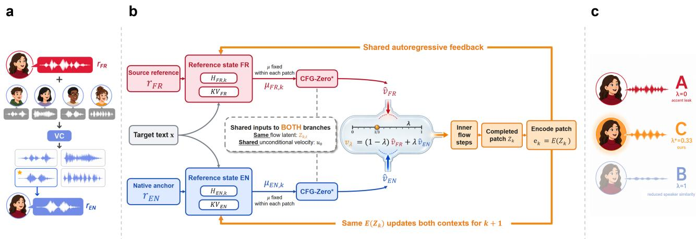
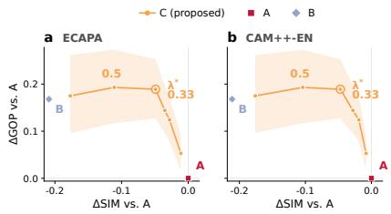
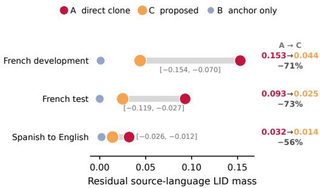

# CLOSED-LOOP DUAL-REFERENCE GUIDANCE FOR ACCENT CONTROL IN CROSS-LINGUAL VOICE CLONING

Yuanzhong Zheng, Wei Huang, Ming Ma, Kailun Jin, Youhai Jiang∗

VoxNexus, Singapore

## ABSTRACT

Zero-shot cross-lingual voice cloning often carries the reference speaker’s accent into the target language. We propose closed-loop dual-reference guidance, which pairs the original reference with a reusable native anchor constructed by voice conversion (VC). The references initialize separate language-model (LM) states that guide a shared acoustic trajectory; each completed patch then updates both states, keeping their generated histories aligned with the emitted speech. Anchor construction runs once per speaker, and online synthesis uses a frozen TTS model without per-utterance VC. On 20 held-out French speakers, the fixed setting λ∗ = 0.33 reduces residual French LID mass by 73% versus direct cloning, at an ECAPA similarity cost of only 0.042; relative to anchor-only cloning, it recovers 0.155. The method achieves the lowest mean WER (0.009) and highest mean GOP (4.750) among the held-out test arms. In blinded preference tests, native-English listeners favor it over direct cloning on pronunciation naturalness, and over both anchor-only cloning and a TTS→VC cascade on speaker identity. Online RTF is approximately 26% lower than the cascade’s (0.59 vs. 0.80), and the same setting reduces Spanish LID mass by 56% without re-tuning.

Index Terms— speech synthesis, accent conversion, classifierfree guidance, voice cloning, flow matching

## 1. INTRODUCTION

Cross-lingual zero-shot text-to-speech (TTS) synthesizes a target language from a short reference in another language. The reference carries both vocal identity and pronunciation patterns. A French reference, for example, can yield intelligible English with a French accent. Accent control must therefore regulate how reference pronunciation influences synthesis while retaining speaker identity.

Accent control can be learned during training or applied during synthesis. Disentanglement methods use multilingual or multi-accented data and task-specific optimization [1, 2, 3, 4]; a TTS→voice-conversion (VC) cascade instead converts every output utterance. For frozen models, Activation Steering [5] uses offlineextracted accent directions, while standard classifier-free guidance (CFG) and its flow-matching adaptations [6, 7, 8] mix conditional and unconditional velocity fields. We use a native speech reference to supply the pronunciation condition and reuse it across utterances, placing accent control inside autoregressive generation.

Our method uses two references with distinct, complementary roles: the original speech anchors speaker identity, while a converted native anchor supplies target-language pronunciation. Both references condition the same generated patch, but mixing their decoder outputs alone leaves open how the two autoregressive states should advance. We feed the emitted patch back to both states, so each branch follows the speech actually produced while retaining its own reference context. The weight λ controls the anchor’s contribution, and the same anchor is reused for subsequent utterances.

## Contributions:

1. Closed-loop autoregressive composition. We address context desynchronization: independently advanced reference branches condition guidance on different generated histories. Feeding each emitted patch back to both LM states preserves a common history while retaining distinct reference contexts. On development, this update reduces WER from 0.139 with independent branch rollouts to 0.004 and raises GOP from 3.524 to 4.791.

2. Reusable native anchors. Zero-shot VC constructs a speaker-specific native reference at enrollment, without parallel bilingual recordings or task-specific training. Subsequent utterances reuse this reference, moving conversion out of online synthesis.

3. Composition in velocity and conditioning space. The shared state update supports both CFG-Zero\* [9] velocity mixing and fusion of decoder conditions. Conditioning fusion uses one conditional branch instead of two, reducing decoder branch evaluations by one third (27 to 18 per patch) while retaining both reference contexts and their feedback.

## 2. RELATED WORK

Accent conversion and post-hoc steering. Earlier work maps nonnative speech toward a native target [10, 11], uses phonetic posteriorgrams [12, 13], or factorizes accent-related attributes in a neural codec [14]. Activation Steering [5] extracts layer-wise accent directions without further training. Our guidance comes from a speakerspecific native anchor and two reference contexts updated with the generated speech. Vevo [15] separates style and timbre through trained modules. We use Seed-VC [16] for both anchor construction and the TTS→VC baseline, comparing a reusable enrollment-time reference with per-utterance conversion.

Cross-lingual TTS and guidance formulations. Zhang et al. [17] studied accent leakage in cross-lingual TTS, followed by training-time disentanglement methods [2, 3, 4, 18]. X-Voice [1] combines pseudo-parallel prompts for training-time adaptation with dropped-condition CFG, v(ref) − v(∅). CrossAccent-TTS [4] and Accent Vector [18] learn representations or weights for accent control. Our method composes two reference-conditioned states during inference in a frozen TTS model. Dual-scale CFG methods vary guidance between text and speaker conditions [19, 20, 21]; our two contexts each contain a speech reference and follow a common generated history. Section 6.1 compares native-anchor guidance with a reference-free secondary context.

  
Fig. 1. Method overview. (a) Offline native-anchor construction: $r _ { \mathrm { F R } }$ and four native donors undergo zero-shot conversion once per speaker; the highest-similarity candidate is kept as rEN. (b) Closed-loop dual-reference guidance. At autoregressive step k, both reference-conditioned fields are evaluated on the same flow latent $z _ { k , t }$ t and combined via Eq. (1). After the ODE produces acoustic patch $Z _ { k }$ , its encoding advances both LM contexts via Eq. (2). Shared generated history; distinct reference contexts and KV caches. $( { \bf c } ) \lambda = 0$ is Arm A (accent leakage); $\lambda = 1$ is Arm B (reduced speaker similarity); $\lambda ^ { * } = 0 . 3 3$ is the selected operating point (Arm C).

## 3. METHOD

## 3.1. Synthetic native anchor

Let x denote target-language text, and let a frozen zero-shot TTS condition its flow-matching decoder on reference speech r, yielding $v ( z , t ; x , r )$ . For each speaker we synthesize a native-English anchor rEN with a zero-shot voice converter (Seed-VC) [16], converting a native English donor toward the timbre of the source reference rFR.

Donors are a curated LibriTTS-R [27] subset (highest-DNSMOS utterance from each of the top 20 native English speakers). With a fixed seed, four distinct donors are cyclically assigned per speaker. Seed-VC with length adjustment 1.0 preserves donor duration $( 3 . 0 4 \mathrm { - } 9 . 9 2 \mathrm { s } )$ We keep the candidate maximizing $\mathrm { S I M _ { a v g } = ( S I M _ { E C A P A } + S I M _ { C A M + + - C N } ) / 2 \ a g a i n s t \ r _ { F R } } .$ . The four conversions are performed at enrollment; the selected anchor is reused for subsequent utterances (Fig. 1).

## 3.2. Closed-loop dual-reference guidance

Generation has an outer autoregressive patch index k and an inner flow time t. Let $H _ { X , k }$ denote the base- and residual-LM state, including their KV caches, for reference context $X ~ \in ~ \{ \mathrm { F R , E N } \}$ Each context is initialized by jointly prefilling the target text and local-encoder features of $r _ { X }$ . At step k, the LMs provide diffusiontransformer (DiT) conditioning $\mu _ { X , k }$ , which remains fixed during that patch’s ODE solve. Both fields are evaluated on the same evolving latent $z _ { k , t }$ and combined with CFG-Zero\* [9]. Suppressing k for clarity, define $u _ { X } = v ( z , t ; x , \mu _ { X } )$ and the shared unconditional velocity $u _ { 0 } = v ( z , t ; x , \emptyset )$ . With stabilizer $\epsilon = 1 0 ^ { - 8 }$ and guidance scale $s = 2 . 0$

$$
\left\{ \begin{array} { l l } { \alpha _ { X } = \frac { \left. u _ { X } , u _ { 0 } \right. } { \left| \left| u _ { 0 } \right| \right| _ { 2 } ^ { 2 } + \epsilon } , } \\ { \widehat { v } _ { X } = \alpha _ { X } u _ { 0 } + s \left( u _ { X } - \alpha _ { X } u _ { 0 } \right) , } \\ { v _ { \lambda } = ( 1 - \lambda ) \widehat { v } _ { \mathrm { F R } } + \lambda \widehat { v } _ { \mathrm { E N } } . } \end{array} \right.\tag{1}
$$

$\mathrm { C F G - Z e r o ^ { * } }$ splits the conditional field into components parallel and orthogonal to $u _ { 0 }$ via $\alpha x$ . The first Euler update is zeroed (fraction

0.04); the remaining nine follow Eq. (1). Sampling is fixed (sway   
1.0, temperature 1.0, 10 Euler steps).

After the ODE produces acoustic patch $Z _ { k }$ , its local encoding and projection $E ( Z _ { k } )$ advance both LM contexts:

$$
H _ { X , k + 1 } = F { \big ( } H _ { X , k } , E ( Z _ { k } ) { \big ) } , \qquad X \in \{ { \mathrm { F R } } , { \mathrm { E N } } \} .\tag{2}
$$

Here $F$ is the frozen base- and residual-LM update. Both contexts follow the emitted history while retaining distinct reference prefills. The open-KV ablation uses independently sampled histories (Sec. 6.1).

The same update supports a conditioning-space implementation: $\mu  ( 1 - \lambda ) \mu _ { \mathrm { F R } } + \lambda \mu _ { \mathrm { E N } }$ . This variant retains both contexts and Eq. (2), then uses a single conditional DiT branch plus the unconditional branch (Secs. 5.3, 6.1). Velocity mixing is used for all held-out test and transfer runs. $\lambda = 0$ gives $\mathbf { A } , \lambda = 1$ gives B, and intermediate values give C. We swept $\lambda \in \{ 0 . 1 , 0 . 2 , 0 . 2 5 , 0 . 3 3 , 0 . 5 , 0 . 7 5 \}$ on development data and fixed $\lambda ^ { * } = 0 . 3 3$ before evaluating the test set; throughout, λ∗ denotes this selected operating point rather than an optimized value.

## 4. EXPERIMENTAL SETUP

Models. Frozen VoxCPM2 [28] (2B, 48 kHz, tokenizer-free, no LoRA). Anchors and the cascade use Seed-VC [16] (Whisper-small + BigVGAN-v2; 25 steps, CFG 0.7, length adjustment 1.0).

Arms. We refer to each compared configuration as an arm. A: real $r _ { \mathrm { F R } }$ . B: synthetic $r _ { \mathrm { E N } }$ . C: proposed guidance at $\begin{array} { r l } { \lambda ^ { * } } & { { } = } \end{array}$ 0.33. Cascade: unconditioned English from VoxCPM2, then Seed-VC transfers $r _ { \mathrm { F R } }$ timbre on every utterance.

Data. Development (VP-Stress): 30 VoxPopuli [29] French speakers $( \mathrm { L I D - F R } ~ \geq ~ 0 . 9$ , reference 3–10 s), 10 English texts, seed 20260822 $( n \mathrm { ~ = ~ } 3 0 0 / \mathrm { a r m } )$ . Held-out test (B1-CNS-test): 20 MLS [30] French speakers $\times ~ 2 0$ English texts $\times \ 3$ seeds, itemmatched n = 1200/arm including the cascade; speakers are disjoint from development, donors, and tuning. All 20 test anchors pass $\mathrm { S I M } _ { \mathrm { a v g } } > 0 . 4 5$ (mean 0.707). Generalization: 15 VoxPopuli Spanish speakers, 10 English texts, with $\lambda ^ { * } = 0 . 3 3$ transferred without re-tuning.

Table 1. Main evaluation on held-out test data (20 French speakers $\times ~ 2 0$ texts $\times 3$ seeds; $n = 1 2 0 0$ per arm, $\lambda ^ { * } = 0 . 3 3 )$ . Speaker-macro averages; bold values mark the best result in each column. $\bar { P } ( \mathrm { f r } )$ is residual French LID mass. $^ { * } \mathbf { C A M + + - C N }$ is Seed-VC’s internal speaker encoder (Sec. 6.2).
<table><tr><td rowspan="2"></td><td rowspan="2">WER↓</td><td rowspan="2"> $\overline { { P ( \mathrm { { f r } ) \downarrow } } }$ </td><td rowspan="2"> ${ \overline { { P ( { \mathrm { e n } } ) } } }$  个</td><td colspan="3">Speaker similarity ↑</td><td rowspan="2"></td><td rowspan="2">GOP↑ DNSMOS ↑</td></tr><tr><td>ECAPA</td><td></td><td>CAM++-EN CAM++-CN*</td></tr><tr><td>Arm A (Direct)</td><td>0.016</td><td>0.093</td><td>0.843</td><td>0.601</td><td>0.624</td><td>0.746</td><td>4.663</td><td>2.900</td></tr><tr><td>B (Anchor)</td><td>0.013</td><td>0.000</td><td>0.993</td><td>0.404</td><td>0.444</td><td>0.702</td><td>4.733</td><td>2.934</td></tr><tr><td>C (Proposed)</td><td>0.009</td><td>0.025</td><td>0.942</td><td>0.559</td><td>0.586</td><td>0.748</td><td>4.750</td><td>2.887</td></tr><tr><td>Cascade</td><td>0.047</td><td>0.001</td><td>0.985</td><td>0.468</td><td>0.492</td><td>0.770</td><td>4.378</td><td>3.026</td></tr></table>

Metrics. WER and marginal P(fr) / $P ( \mathrm { e s } )$ : faster-whisperlarge-v3 [31] (beam 1, no VAD; full softmax, not top-1). GOP [32]: wav2vec2-xls-r-300m-phoneme [33] posteriors, g2p en, CTC alignment; utterance GOP averages log $P ( y ) - \operatorname* { m a x } _ { p \neq y } \log P ( p )$ over target phones $y .$ Similarity: cosine vs. the foreign reference on ECAPA-TDNN [34], CAM++-EN, and $\mathrm { C A M + + - C N } \left[ 3 5 \right]$ . We report all three encoders and listener preferences to cover language/accent sensitivity [22, 23, 24] and differences between automatic and perceptual similarity judgments [25, 26]. Quality: DNSMOS P.835 OVRL [36]. Statistics: speaker-macro means, paired deltas, 10,000 speaker-clustered bootstrap 95% CIs; preferences use session majority and a speaker-clustered two-sided exact sign-flip test.

## 5. RESULTS

## 5.1. Development trade-off and λ∗ selection

At $\lambda = 0 . 3 3$ , the GOP gain over A is +0.189, nearly matching the +0.193 attained at $\lambda \ = \ 0 . 5 ,$ , while the ECAPA similarity cost is roughly halved $( \Delta \mathrm { E C A P A } = - 0 . 0 4 9 [ - 0 . 0 6 3 , - 0 . 0 3 6 ] ; \mathrm { F i g }$ . 2). CAM++-EN follows the same trend. At this setting, paired differences are +0.021 [−0.062, 0.098] in GOP relative to B and −0.018 [−0.068, 0.032] in DNSMOS relative to the cascade. We selected λ∗ = 0.33 on development and fixed it for test and Spanish transfer.

  
Fig. 2. Accent–timbre trade-off on development (30 speakers). (a) ECAPA; (b) CAM++-EN. x: ∆SIM vs. A; y: ∆GOP vs. A. The shaded band is the 95% speaker-clustered bootstrap CI of ∆GOP. Orange: C (proposed) λ sweep; λ∗ is the selected operating point (0.33).  
and lower mean WER (0.009 vs. 0.013); paired differences are +0.017 [−0.043, 0.072] and −0.004 [−0.011, 0.002].

## 5.2. Held-out test evaluation (λ∗ frozen)

C vs. A. At the fixed operating point, C achieves mean WER 0.009 and GOP 4.750, the lowest and highest values, respectively, among the held-out test arms (Table 1). Relative to direct cloning, it reduces residual French LID mass by 73% $( 0 . 0 9 3  0 . 0 2 5 ; \Delta = - 0 . 0 6 8$ [−0.119, −0.027]) and increases GOP by 0.087 [0.048, 0.128] (Fig. 3). The paired WER difference is −0.0072 [−0.0147, 0.0003], with an ECAPA change of −0.042 [−0.048, −0.036].

C vs. B. Adding the original-reference branch recovers 0.155 ECAPA similarity ([0.137, 0.173]) and 0.142 CAM++-EN similarity ([0.122, 0.162]) over anchor-only cloning. This speakersimilarity recovery comes with higher mean GOP (4.750 vs. 4.733)

  
Fig. 3. Residual source-language LID mass at $\lambda ^ { * } = 0 . 3 3$ . Dumbbells: A→C reduction; B is the floor. Brackets give speakerclustered 95% CIs of the paired difference $\Delta = C { - } A$ (negative values indicate a reduction under C).

## 5.3. Comparison with the TTS→VC cascade

On the item-matched three-seed test set $( n = 1 2 0 0 / \mathrm { a r m } ) , 0$ C reduces mean WER from the cascade’s 0.047 to 0.009, an approximately 81% reduction $( \Delta = - 0 . 0 3 8 [ - 0 . 0 4 6 , - 0 . 0 3 1 ] )$ ), and raises GOP from 4.378 to 4.750 $( \Delta = + 0 . 3 7 2 [ 0 . 3 3 0 , 0 . 4 1 2 ] )$ ). Word repetition or insertion involving at least two words occurs in 3.2% (38/1200) of cascade outputs, versus less than 0.5% for A, B, and C.

Speaker similarity also improves over the cascade: ECAPA increases by 0.091 (95% CI [0.073, 0.109]) and $\mathrm { C A M + + - E N }$ by 0.094 ([0.073, 0.114]). In the blinded development study, listeners likewise prefer C on speaker identity (38 vs. 5 sessions, $p \ < \ 0 . 0 0 0 1 $ Sec. 5.5). On the remaining metrics, C trails the cascade: C−cascade is +0.024 on residual P(fr) ([0.005, 0.052]; cascade mean 0.001), −0.139 on DNSMOS ([−0.197, −0.089]), and −0.022 on CAM++-CN (CI [−0.039, −0.006]; Sec. 6.2). Thus, the cascade’s higher DNSMOS accompanies more word errors, while C improves both transcription accuracy and listener-rated speaker identity.

Table 2. H100 80GB inference. (a) vs. direct cloning and cascade. (b) Matched velocity vs. conditioning (µ-mix). TTS: 9-word text, five timed runs after warmup. DiT: batched branch evaluations per patch over nine nonzero Euler updates. †sequential cascade stages.
<table><tr><td>Arm</td><td>DiT/patch VC NFE Lat. (s)</td><td></td><td>RTF</td><td>Peak VRAM (MiB)</td></tr><tr><td colspan="5">(a) Direct cloning and cascade comparison</td></tr><tr><td>A</td><td>18</td><td>1.27</td><td>0.474</td><td>8239</td></tr><tr><td>C (velocity)</td><td>27</td><td>1.52</td><td>0.587</td><td>8235</td></tr><tr><td>Cascade</td><td>18</td><td>≈2.10</td><td>≈0.80</td><td>8563 / 1474†</td></tr><tr><td colspan="5">(b) Matched implementation comparison</td></tr><tr><td>C (velocity)</td><td>27</td><td>1.62</td><td>0.589</td><td>8406</td></tr><tr><td>C (conditioning)</td><td>18</td><td>1.47</td><td>0.572</td><td>8408</td></tr></table>

Compute. C (velocity) achieves approximately 26% lower online RTF than the cascade (0.59 vs. 0.80). Relative to direct cloning, it adds 0.25 s with essentially unchanged peak memory. Four an-

chor conversions cost approximately 3.1 s per speaker. At the benchmarked length, $T _ { C } ( N ) \overset { - } { \approx } 3 . 1 + 1 . 5 2 N$ and $T _ { \mathrm { c a s c a d e } } ( N ) \approx 2 . 1 0 N ;$ the reusable anchor amortizes conversion cost by six utterances.

Conditioning-space implementation. C (conditioning) reduces DiT branch evaluations from 27 to 18 per patch and retains both LM contexts. In the matched rerun, its RTF is 0.572 versus 0.589 for C (velocity), with nearly identical peak memory. RTF reductions across $5 \AA , 9 \AA$ , and 20-word texts are 0.7–2.9%.

## 5.4. Cross-language generalization (Spanish→English)

The French-selected $\lambda ^ { * } ~ = ~ 0 . 3 3$ transfers directly to 15 Spanish speakers without language-specific tuning. Residual Spanish LID mass drops from 0.032 to $0 . 0 1 4 ( \Delta = - 0 . 0 1 8 [ - 0 . 0 2 6 , - 0 . 0 1 2 ] ;$ Fig. 3), and ECAPA similarity recovers from 0.323 to 0.474 relative to B. C achieves WER 0.0055, compared with 0.0054 for A $( \Delta ~ = ~ + 0 . 0 0 0 1 ~ [ - 0 . 0 0 7 0 , 0 . 0 0 6 5 ] )$ ). The same operating point therefore combines source-LID reduction with speaker-similarity recovery in both French-to-English and Spanish-to-English cloning.

## 5.5. Subjective human evaluation

A randomized, blinded preference study used seven native-English evaluators and 60 sessions (30 development speakers × 2 texts), with the French reference and outputs from A, B, $\mathrm { ~ C ~ } ( \lambda ^ { * } = 0 . 3 3 )$ , and the cascade. Evaluators chose the baseline, C, or a tie. Four pre-planned comparisons covered accent (A vs. C, C vs. cascade) and speaker similarity (B vs. C, C vs. cascade). A follow-up comparison assessed C vs. A speaker similarity.

Table 3. Preferences on development speakers (7 evaluators $\times ~ 6 0$ sessions). % (sessions), majority vote. Bold: significantly preferred system. p: speaker-clustered sign-flip; pre-planned rows remain significant under Holm–Bonferroni. †Follow-up speaker-similarity comparison.
<table><tr><td>Comp.</td><td>Dim.</td><td>Pref. base</td><td>Pref. C Tie</td><td>p</td></tr><tr><td> $\overline { { \mathrm { ~ C ~ v s . ~ A ~ } } }$ </td><td>Accent / nat.</td><td></td><td>6.7 (4) 28.3 (17) 65.0 (39)</td><td>0.0057</td></tr><tr><td>C vs. B</td><td>Speaker sim.</td><td></td><td>5.0 (3) 65.0 (39) 30.0 (18) &lt; 0.0001</td><td></td></tr><tr><td></td><td>C vs. Casc. Accent / nat.</td><td></td><td>53.3 (32) 21.7 (13) 25.0 (15)</td><td>0.026</td></tr><tr><td></td><td>C vs. Casc. Speaker sim.</td><td></td><td>8.3 (5) 63.3 (38) 28.3 (17) &lt; 0.0001</td><td></td></tr><tr><td>C vs.  $\mathbf { A } ^ { \dagger }$ </td><td>Speaker sim.</td><td></td><td>26.7 (16) 21.7 (13) 51.7 (31)</td><td>0.723</td></tr></table>

Listeners significantly prefer C to direct cloning on pronunciation naturalness (17 vs. 4 sessions, $p = 0 . 0 0 5 7 ;$ Table 3). In the follow-up speaker-similarity comparison with direct cloning, 51.7% of sessions are ties; the remaining sessions split 13 for C and 16 for $\mathrm { ~ A ~ } ( p = 0 . 7 2 3 )$ . Relative to anchor-only cloning, C wins 39 vs. 3 sessions on speaker identity $( p < 0 . 0 0 0 1 )$ ). The comparison with the cascade separates pronunciation from identity: listeners favor the cascade on pronunciation naturalness (32 vs. 13, $p = 0 . 0 2 6 )$ , and C on speaker identity (38 vs. $5 , p < 0 . 0 0 0 1 )$ . Fleiss’ κ is 0.167–0.256; 87–89% of majority-disagreement judgments are ties.

## 6. ANALYSIS

## 6.1. Guidance mechanisms and architectural ablations

Shared autoregressive feedback. The open-KV ablation tests the effect of independently advancing the reference branches. Both configurations mix velocities for the emitted patch, but open-KV feeds each LM its own separately sampled, unmixed prediction. This permits context desynchronization: each branch follows its own generated history rather than the emitted sequence. Replacing these independent rollouts with shared patch feedback reduces WER from 0.139 to 0.004 and raises GOP from 3.524 to 4.791. Equation (2) enforces the common-history constraint at every patch while preserving each branch’s reference context.

Reference contexts. C (velocity) gives ECAPA 0.467 versus 0.372 for concat; concat reaches $P ( \mathrm { f r } ) = 0 . 0 0 3$ . Replacing the native anchor with ∅ lowers similarity and GOP. The waveforms used by wavavg differ in length and phase; their average gives GOP 3.131.

Composition across mixing sites. C (conditioning) achieves ECAPA 0.465 and GOP 4.828, versus 0.467 and 4.791 for C (velocity). The paired differences are not significant (velocity minus conditioning: ECAPA +0.003 [−0.004, 0.009]; GOP −0.038 $\left[ - 0 . 0 8 9 , 0 . 0 1 4 \right] )$ . Both implementations retain separate reference states and common patch feedback; conditioning mixing achieves RTF 0.572 (Table 2).

Table 4. Paired ablations on development (30 speakers, $\lambda = 0 . 3 3$ $n = 3 0 0 ) .$
<table><tr><td>Config.</td><td>ECAPA ↑</td><td>CAM++-EN↑</td><td>GOP↑</td><td>WER↓</td><td>P(fr)</td></tr><tr><td> $\overline { { \textbf { A } ( \lambda = 0 ) } }$ </td><td>0.517</td><td>0.589</td><td>4.602</td><td>0.020</td><td>0.153</td></tr><tr><td>B (anchor only)</td><td>0.308</td><td>0.378</td><td>4.770</td><td>0.009</td><td>0.001</td></tr><tr><td>C (velocity)</td><td>0.467</td><td>0.542</td><td>4.791</td><td>0.004</td><td>0.044</td></tr><tr><td>C (conditioning)</td><td>0.465</td><td>0.546</td><td>4.828</td><td>0.000</td><td>0.034</td></tr><tr><td>concat</td><td>0.372</td><td>0.459</td><td>4.743</td><td>0.003</td><td>0.003</td></tr><tr><td>open-KV</td><td>0.458</td><td>0.522</td><td>3.524</td><td>0.139</td><td>0.045</td></tr><tr><td> $\dot { C } _ { \mathrm { n o r e f } } \left( \varnothing \right)$ </td><td>0.441</td><td>0.517</td><td>4.653</td><td>0.010</td><td>0.063</td></tr><tr><td>wavavg</td><td>0.359</td><td>0.420</td><td>3.131</td><td>0.011</td><td>0.008</td></tr></table>

## 6.2. Encoder-domain discrepancy in speaker verification

The three encoders assign substantially different similarity changes to the same accent-guided speech. On French development, C vs. A at λ = 0.5 is −0.111 on ECAPA and −0.104 on CAM++-EN, but −0.020 on CAM++-CN. The CAM++ checkpoints share an architecture but were trained on VoxCeleb2 and a 200k-speaker Chinese dataset, respectively; their responses show that the estimated identity cost of accent control depends on the verification model. At $\lambda ^ { * } = 0 . 3 3$ , the CAM++-CN difference is +0.003 [−0.003, 0.008]. CAM++-CN also serves as Seed-VC’s internal speaker encoder and contributes to our anchor-selection score (Sec. 3.1). On the held-out test, ECAPA and $\mathrm { C A M + + - E N }$ rank C above the cascade, whereas CAM++-CN reverses that ordering. The blinded listening study independently favors C on speaker identity (38 vs. 5 sessions; Sec. 5.5), aligning with the ECAPA and CAM++-EN ranking.

## 7. CONCLUSION AND LIMITATIONS

We presented closed-loop dual-reference guidance for accent control in frozen TTS. Separate reference states combine original-speaker information with a reusable native anchor, and feedback from the emitted patches keeps both branches on the same generated history; this common-history constraint, rather than the choice of mixing site, accounts for the largest quality gain (Sec. 6.1). On held-out French speakers, the method cuts residual French LID mass by 73% versus direct cloning while recovering 0.155 ECAPA similarity over anchor-only cloning, and the French-selected operating point transfers to Spanish without re-tuning. Native-English listeners prefer C on pronunciation naturalness over A and on speaker identity over B and the cascade. The current evaluation targets English only, anchor quality depends on the zero-shot converter, and the guidance weight is fixed across patches; extending the evaluation to additional target languages, adapting guidance per patch, and improving convertedanchor quality are the next steps.

## 8. REFERENCES

[1] Rixi Xu, Qingyu Liu, Haitao Li, et al., “X-Voice: Enabling everyone to speak 30 languages via zero-shot cross-lingual voice cloning,” arXiv:2605.05611, 2026.

[2] Sen Liu, Yiwei Guo, Chenpeng Du, Xie Chen, and Kai Yu, “DSE-TTS: Dual speaker embedding for cross-lingual text-to-speech,” in Proc. Interspeech, 2023, pp. 616–620, doi: 10.21437/Interspeech.2023-363.

[3] Hyunjae Cho, Wonbin Jung, Junhyeok Lee, and Sang Hoon Woo, “SANE-TTS: Stable and natural end-to-end multilingual text-to-speech,” in Proc. Interspeech, 2022, pp. 1–5, doi: 10.21437/Interspeech.2022-46.

[4] Ram Annamdevula, Ankit Tatawat, Ashishkumar P. Gudmalwar, Nirmesh J. Shah, and Pankaj Wasnik, “CrossAccent-TTS: Crosslingual accent-intensity controllable text-to-speech via disentangled speaker and accent representations,” arXiv:2606.25403, 2026.

[5] Mu Yang and John H. L. Hansen, “Activation steering for accentneutralized zero-shot text-to-speech,” arXiv:2603.05977, 2026.

[6] Jonathan Ho and Tim Salimans, “Classifier-free diffusion guidance,” in NeurIPS 2021 Workshop on Deep Generative Models and Downstream Applications, 2021.

[7] Yaron Lipman, Ricky T. Q. Chen, Heli Ben-Hamu, Maximilian Nickel, and Matt Le, “Flow matching for generative modeling,” in Proc. ICLR, 2023.

[8] Qinqing Zheng, Matt Le, Neta Shaul, Yaron Lipman, Aditya Grover, and Ricky T. Q. Chen, “Guided flows for generative modeling and decision making,” arXiv:2311.13443, 2023.

[9] Weichen Fan, Amber Yijia Zheng, Raymond A. Yeh, and Ziwei Liu, “CFG-Zero\*: Improved classifier-free guidance for flow matching models,” arXiv:2503.18886, 2025.

[10] Daniel Felps, Heather Bortfeld, and Ricardo Gutierrez-Osuna, “Foreign accent conversion in computer assisted pronunciation training,” Speech Communication, vol. 51, no. 10, pp. 920–932, 2009.

[11] Sandesh Aryal and Ricardo Gutierrez-Osuna, “Can voice conversion be used to reduce non-native accents?,” in Proc. IEEE ICASSP, 2014, pp. 7879–7883.

[12] Guanlong Zhao, Shaojin Ding, and Ricardo Gutierrez-Osuna, “Foreign accent conversion by synthesizing speech from phonetic posteriorgrams,” in Proc. Interspeech, 2019, pp. 2843–2847.

[13] Waris Quamer, Anurag Das, John Levis, Evgeny Chukharev-Hudilainen, and Ricardo Gutierrez-Osuna, “Zero-shot foreign accent conversion without a native reference,” in Proc. Interspeech, 2022, pp. 4920–4924.

[14] Yurii Halychanskyi, Cameron Churchwell, Yutong Wen, and Volodymyr Kindratenko, “FAC-FACodec: Controllable zero-shot foreign accent conversion with factorized speech codec,” in Proc. IEEE ICASSP, 2026, arXiv:2510.10785.

[15] Xueyao Zhang, Xiaohui Zhang, Kainan Peng, et al., “Vevo: Controllable zero-shot voice imitation with self-supervised disentanglement,” in Proc. ICLR, 2025.

[16] Songting Liu, “Zero-shot voice conversion with diffusion transformers,” arXiv:2411.09943, 2024.

[17] Yu Zhang, Ron J. Weiss, Heiga Zen, et al., “Learning to speak fluently in a foreign language: Multilingual speech synthesis and crosslanguage voice cloning,” in Proc. Interspeech, 2019, pp. 2080–2084, doi: 10.21437/Interspeech.2019-2668.

[18] Thanathai Lertpetchpun, Thanapat Trachu, Jihwan Lee, Tiantian Feng, Dani Byrd, and Shrikanth Narayanan, “Accent vector: Controllable accent manipulation for multilingual TTS without accented data,” arXiv:2603.07534, 2026.

[19] Jinhyeok Yang, Junhyeok Lee, Hyeong-Seok Choi, Seunghoon Ji, Hyeongju Kim, and Juheon Lee, “DualSpeech: Enhancing speaker-fidelity and text-intelligibility through dual classifierfree guidance,” in Proc. Interspeech, 2024, pp. 4423–4427, doi: 10.21437/Interspeech.2024-2005.

[20] Ziyue Jiang, Yi Ren, Ruiqi Li, et al., “MegaTTS 3: Sparse alignment enhanced latent diffusion transformer for zero-shot speech synthesis,” arXiv:2502.18924, 2025.

[21] John Zheng and Farhad Maleki, “Selective classifier-free guidance for zero-shot text-to-speech,” arXiv:2509.19668, 2025.

[22] Abhinav Misra and John H. L. Hansen, “Spoken language mismatch in speaker verification: An investigation with NIST-SRE and CRSS biling corpora,” in Proc. IEEE SLT, 2014, pp. 372–377.

[23] Wei Xia, Jing Huang, and John H. L. Hansen, “Cross-lingual textindependent speaker verification using unsupervised adversarial discriminative domain adaptation,” in Proc. IEEE ICASSP, 2019, pp. 5816–5820.

[24] Mariel Estevez and Luciana Ferrer, “Study on the fairness of speaker verification systems across accent and gender groups,” in Proc. IEEE ICASSP, 2023, pp. 1–5, doi: 10.1109/ICASSP49357.2023.10095150.

[25] Kamil Deja, Ariadna Sanchez, Julian Roth, and Marius Cotescu, “Automatic evaluation of speaker similarity,” in Proc. Interspeech, 2022, pp. 2348–2352.

[26] Marc-Andre Carbonneau, Benjamin van Niekerk, Hugo Seut´ e, Jean-´ Philippe Letendre, Herman Kamper, and Julian Za¨ıdi, “Analyzing and improving speaker similarity assessment for speech synthesis,” in Proc. 13th Speech Synthesis Workshop (SSW), 2025, pp. 8–13, doi: 10.21437/SSW.2025-2.

[27] Yuma Koizumi, Heiga Zen, Shigeki Karita, et al., “LibriTTS-R: A restored multi-speaker text-to-speech corpus,” in Proc. Interspeech, 2023, pp. 5496–5500.

[28] Yixuan Zhou, Guoyang Zeng, Xin Liu, et al., “VoxCPM2 technical report,” arXiv:2606.06928, 2026.

[29] Changhan Wang, Morgane Riviere, Ann Lee, et al., “VoxPopuli: A large-scale multilingual speech corpus for representation learning, semi-supervised learning and interpretation,” in Proc. ACL-IJCNLP, 2021, pp. 993–1003.

[30] Vineel Pratap, Qiantong Xu, Anuroop Sriram, Gabriel Synnaeve, and Ronan Collobert, “MLS: A large-scale multilingual dataset for speech research,” in Proc. Interspeech, 2020, pp. 2757–2761.

[31] Alec Radford, Jong Wook Kim, Tao Xu, Greg Brockman, Christine Mcleavey, and Ilya Sutskever, “Robust speech recognition via largescale weak supervision,” in Proc. ICML, 2023, vol. 202, pp. 28492– 28518.

[32] Silke M. Witt and Steve J. Young, “Phone-level pronunciation scoring and assessment for interactive language learning,” Speech Communication, vol. 30, no. 2–3, pp. 95–108, 2000.

[33] Arun Babu, Changhan Wang, Andros Tjandra, et al., “XLS-R: Selfsupervised cross-lingual speech representation learning at scale,” in Proc. Interspeech, 2022, pp. 2278–2282.

[34] Brecht Desplanques, Jenthe Thienpondt, and Kris Demuynck, “ECAPA-TDNN: Emphasized channel attention, propagation and aggregation in TDNN based speaker verification,” in Proc. Interspeech, 2020, pp. 3830–3834.

[35] Hui Wang, Siqi Zheng, Yafeng Chen, Luyao Cheng, and Qian Chen, “CAM++: A fast and efficient network for speaker verification using context-aware masking,” in Proc. Interspeech, 2023, pp. 5301–5305.

[36] Chandan K. A. Reddy, Vishak Gopal, and Ross Cutler, “DNSMOS P.835: A non-intrusive perceptual objective speech quality metric to evaluate noise suppressors,” in Proc. IEEE ICASSP, 2022, pp. 886– 890.