This work has been submitted to the IEEE for possible publication. Copyright may be transferred without notice, after which this version may no longer be accessible

CCG Diffusion:

# Combinatory Categorial Grammar–Driven Compositional and Syntactically Disambiguated Text-to-Image Generation

RYOSUKE YAMAKI1, DAICHI MOCHIHASHI2, NOBUTAKA SHIMADA1, (Member, IEEE), SEITARO SHINAGAWA3, AND TADAHIRO TANIGUCHI4,1, (Member, IEEE)

1Ritsumeikan University, Ibaraki, Osaka 567-8570, Japan (e-mail: yamaki.ryosuke@em.ci.ritsumei.ac.jp; shimada@ci.ritsumei.ac.jp) 2The Institute of Statistical Mathematics, Tachikawa, Tokyo 190-8562, Japan (e-mail: daichi@ism.ac.jp) 3Nara Institute of Science and Technology, Ikoma, Nara 630-0192, Japan (e-mail: sei.shinagawa@is.naist.jp) 4Kyoto University, Sakyo-ku, Kyoto 606-8501, Japan (e-mail: taniguchi@i.kyoto-u.ac.jp)c

Corresponding author: Ryosuke Yamaki (e-mail: yamaki.ryosuke@em.ci.ritsumei.ac.jp).

This work was supported by JST ACT-X, Japan, Grant Number JPMJAX24CS.

ABSTRACT Text-to-image generation models do not explicitly receive the syntactic structure of the prompt, i.e., which word modifies which and where each phrase attaches. Consequently, they often struggle to bind attributes to the correct objects, to depict spatial relations and counts correctly, and to render syntactically ambiguous prompts in the intended interpretation. Existing syntax-based control methods mainly address attribute binding and have limited ability to control spatial relations and counts or to specify the interpretation of syntactically ambiguous prompts. They rely on phrase-structure or dependency grammars and require additional rules or constraints on the tree structure to extract modification relations between words or to specify a syntactic interpretation. We propose CCG Diffusion, a training-free method that controls image generation using Combinatory Categorial Grammar (CCG). In CCG, the category of each word carries rich syntactic information: it specifies what the word combines with and what phrase it forms. Modification relations between words can therefore be read directly from a CCG parse. Moreover, prepositional phrase (PP) attachment ambiguity, a representative syntactic ambiguity, can be resolved simply by fixing the preposition’s category. CCG Diffusion applies the same two CCG-based mechanisms, prompt rewriting and attention guidance, both to controlling attribute binding, spatial relations, and counts and to resolving PP ambiguity. On two architecturally different backbones, Stable Diffusion and Sana, CCG Diffusion achieves the highest scores among the compared methods in attribute binding and 2D spatial relations and significantly outperforms all of them in PP ambiguity resolution.

INDEX TERMS Attention guidance, Combinatory Categorial Grammar, compositional text-to-image generation, diffusion models, syntactic ambiguity resolution, text-to-image generation.

## I. INTRODUCTION

In text-to-image generation, the objects and attributes in a prompt must be depicted not only individually but also faithfully to the syntactic structure of the prompt, i.e., which word modifies which and where each phrase attaches. We address two problems that require this syntactic faithfulness (Fig. 1): compositional text-to-image generation and syntactic ambiguity resolution. These problems persist even in recent text-to-image diffusion models that generate highquality images [1]–[8], and they are part of a widely reported limitation: generated images are not always faithful to what the prompt describes [9]–[13] or to the interpretation intended by the user [14]–[16]. Underlying these problems is the fact that the syntactic structure of the prompt is not given to the model explicitly but is conveyed only implicitly through the representations of the text encoder.

The first problem is compositional text-to-image generation: generating an image that matches a prompt describing multiple objects and their attributes, relations, and counts. Existing models exhibit failures such as binding attributes to the wrong objects, fusing objects, and producing spatial relations or counts that differ from the prompt. The top row of Fig. 1(a) shows examples generated by Sana [7]. For a blue banana and a green vase, the banana remains yellow and the vase is drawn blue instead of green; that is, blue is bound to vase. For a chicken on the right of a suitcase, the chicken stands on top of the suitcase rather than to its right. For three refrigerators and two rabbits, four rabbits are drawn, some of them merged with the refrigerators. All of these failures occur because the relations expressed by the syntactic structure (which attribute word modifies which noun, e.g., blue and banana; which relation phrase links which nouns, e.g., on the right of with chicken and suitcase; and which numeral applies to which noun, e.g., two and rabbits) are not reflected in the relations among the objects in the image.

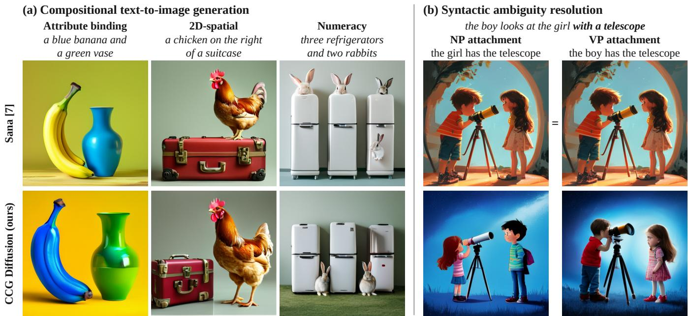  
FIGURE 1. The two target problems addressed in this paper. (a) Compositional text-to-image generation: generating an image that matches a prompt describing multiple objects and their attributes, relations, and counts. (b) Syntactic ambiguity resolution: generating an image that follows the intended interpretation of a prompt that admits multiple syntactic structures, e.g., whether a PP modifies a noun phrase (NP attachment) or a verb phrase (VP attachment). The proposed CCG Diffusion can address both of these problems.

The second problem is syntactic ambiguity resolution: generating an image that follows the intended interpretation of a prompt that admits multiple syntactic structures. For example, in the boy looks at the girl with a telescope in Fig. 1(b), the prepositional phrase (PP) with a telescope can modify either the noun phrase the girl (NP attachment) or the verb phrase looks at the girl (VP attachment). Under the NP-attachment interpretation, the sentence describes a scene in which the girl has the telescope; under the VP-attachment interpretation, the boy has it. However, conventional models, which receive no explicit information about syntactic structure, are given the same word sequence under both interpretations; the user therefore cannot specify the intended interpretation, and which interpretation is depicted is left to the model. Indeed, as shown in the top row of Fig. 1(b), Sana generates the same image under both interpretations from the same initial noise, and this image depicts only the VP-attachment scene, in which the boy has the telescope; a user who intends the

NP-attachment interpretation thus cannot obtain the desired image. This problem remains important in recent systems in which a large language model (LLM) or an LLM-based agent writes the prompt, for example from a conversation with the user [16]–[18]. Such long, detailed prompts tend to contain many PPs, the number of possible syntactic structures grows combinatorially with the number of PPs [19], and LLMs themselves do not reliably recognize ambiguity [20], [21].

For compositional text-to-image generation, training-free attention guidance updates the latent during sampling with the gradient of a loss on cross-attention maps [9], [22]–[26]. Predicated Diffusion [27], on which our method is based, is not a generative model but one such training-free method: it derives its loss from propositions in predicate logic that represent the intent of the prompt, thereby guiding the generation process of a pretrained diffusion model toward satisfying these propositions. For syntactic ambiguity resolution, TIED [14] concatenates disambiguating information obtained from the user to the prompt. These methods have three limitations. First, parsing-based methods use the parse mainly to extract attribute–object pairs or noun phrases for attribute binding [24], [26], [28]–[31]; even the authors of Predicated Diffusion note that its spaCy-based [32] extraction can miss the relation expressed by with and suggest that more advanced parsing may be needed [27]. Second, Predicated Diffusion cannot express object positions or counts, and most other methods that control them require inputs or modules beyond the prompt, such as boxes, layouts generated by an LLM, counting networks, or trained layout-prediction models [33]– [38]. Third, for syntactically ambiguous prompts, the intended interpretation is hard to reflect in generation. Parsingbased guidance follows the single parse output by the parser and thus applies the same guidance under either interpretation. TIED concatenates disambiguating information, such as the girl has the telescope, to the prompt, but the ambiguous sentence remains, so whether the image follows the intended interpretation is still left to the text encoder; for example, the CLIP text encoder [39] used by Stable Diffusion represents word order and relations between words poorly [40], [41].

We therefore propose CCG Diffusion, a method that explicitly derives the syntactic structure of a prompt with Combinatory Categorial Grammar (CCG) [42] and reflects it in image generation.1 CCG is a grammar that assigns each word a category specifying what kinds of adjacent words or phrases it combines with and what kind of phrase it forms. In CCG, most of the structure of a sentence is determined by the categories of its words [43], [44]. Therefore, which word modifies which and where each phrase attaches can be read directly from the result of CCG parsing, called a derivation. Moreover, because the attachment site of a PP is determined by the category of the preposition alone, simply parsing with this category fixed yields a derivation that follows the specified interpretation. The phrase-structure (constituency) and dependency parsers used by the parsing-based methods discussed above can also provide similar information, but less directly: extracting which word modifies which requires additional rules tailored to their trees or labels, and specifying an interpretation requires constraining the tree structure itself during parsing. CCG, in contrast, handles both uniformly through the category of each word.

CCG Diffusion conveys the syntactic information read from the derivation to the image generation model through two pathways: rewriting the prompt given to the text encoder, and attention guidance built on Predicated Diffusion. For compositional text-to-image generation, it strengthens attribute binding, encourages two objects with attributes to be drawn in different regions to suppress attribute leakage and object fusion, and controls the spatial relations and counts of objects. As a result, the bottom row of Fig. 1(a) shows a blue banana and a green vase, a chicken to the right of a suitcase, and three refrigerators with two rabbits, each image faithfully reflecting what the prompt describes, exactly as its syntactic structure specifies. For syntactic ambiguity resolution, we focus on PP-attachment ambiguity, a representative case, and refer to its resolution as PP ambiguity resolution. Using the derivation of the specified interpretation, CCG Diffusion paraphrases the prompt into a sentence that admits only that interpretation and guides the object of the PP to the region of its holder under that interpretation; in the example above, the telescope is guided to the girl under NP attachment and to the boy under VP attachment. As a result, as shown in the bottom row of Fig. 1(b), CCG Diffusion generates, from the same prompt, an image in which the girl has the telescope under NP attachment and one in which the boy has it under VP attachment, each faithfully reflecting the syntactic structure of the specified interpretation.

CCG Diffusion requires no additional training of the parser or the generation model, and uses no input other than the prompt and, for ambiguous prompts, the specified interpretation. Because it acts only on the input text and the generation process of a pretrained model, it can be applied to various diffusion models with different architectures, as long as the attention maps of text tokens are accessible. To the best of our knowledge, it is the first method to use CCG to control text-toimage generation. We evaluate it on benchmark datasets for both problems with two backbones: Stable Diffusion, which consists of a U-Net and the CLIP text encoder and has been the standard backbone for prior attention guidance methods, and Sana, a representative of recent models that consist of a Diffusion Transformer (DiT) [45] and an LLM text encoder.

Our two main contributions are as follows:

1) CCG-based compositional text-to-image generation. We extend Predicated Diffusion with syntactic information read from CCG derivations and improve control over attribute binding, spatial relations, and counts without using any input other than the prompt. In a quantitative evaluation on T2I-CompBench++ [11], CCG Diffusion achieves the highest scores among the compared methods in attribute binding and 2D spatial relations on both backbones, Stable Diffusion [2] and Sana [7], and also significantly outperforms Predicated Diffusion in numeracy.

2) PP ambiguity resolution by specifying the syntactic interpretation. Using the CCG property that the attachment site of a PP is determined by the category of the preposition alone, we develop a method that obtains the derivation of the specified interpretation and reflects this interpretation in image generation through both prompt paraphrasing and attention guidance. In a quantitative evaluation on the PP-attachment prompts of the Text-to-image Ambiguity Benchmark (TAB) [14], CCG Diffusion significantly outperforms all compared methods, including one that concatenates the gold visual setup to the prompt, despite receiving only the specified interpretation.

## II. RELATED WORK

## A. COMPOSITIONAL TEXT-TO-IMAGE GENERATION

Given prompts with multiple objects and attributes, textto-image diffusion models can omit some objects, bind attributes to the wrong objects, or fuse multiple objects into one. Training-free attention guidance suppresses such failures without retraining the model: it defines a loss on crossattention maps, which indicate the image region that each prompt token corresponds to, and guides generation with the gradient of this loss. Most methods design their losses for predefined types of failure, for example by strengthening the attention of neglected objects [9], [23] or by keeping the attention maps of different objects apart [22], [25]; some edit the attention maps or optimize the initial noise instead of the latent [46], [47]. Predicated Diffusion [27], on which our work builds, instead represents the intent of a prompt as propositions in predicate logic and converts them into losses on attention maps.

Applying these methods requires the guidance targets, i.e., the words whose attention is manipulated, and several methods determine them by parsing the prompt. SynGen [24], EBAMA [26], and Trusca et al. [29] bind each attribute to the object it modifies, using modifier–noun pairs found by dependency parsing, and Predicated Diffusion extracts the targets of its propositions from the part-of-speech tags and dependency labels of spaCy [32]. In these methods, and in StructureDiffusion [28], Magnet [30], and ToMe [31] described below, the prompt is parsed with dependency or constituency parsers such as spaCy and Stanza [48], and the parse is used mainly to extract attribute–object pairs or noun phrases for attribute binding. This extraction relies on rules tailored to each parser’s output, such as its dependency labels or phrase types.

Methods that control the layout or number of objects by guiding generation mostly require inputs other than the prompt or external modules: boxes or target positions given by the user [33], [34], [49], layouts generated by an LLM [35], [36], an external counting network [37], or a trained layoutprediction model [38]. In contrast, some methods control the spatial relations between objects without boxes or layouts by guiding the attention centroids of the objects [50]–[52].

Another line of work intervenes in the text conditioning given to the denoiser. Composable Diffusion [53] composes the denoising scores obtained under separate conditions; StructureDiffusion [28] and DisCLIP [29] separately encode the constituents, such as noun phrases, obtained by constituency parsing. Other methods merge or edit token embeddings [30], [31], [54], or use an LLM, either through a trained connector [55] or by decomposing the prompt into rewritten subprompts, each assigned to an image region planned by the LLM [56].

## B. SYNTACTIC AMBIGUITY RESOLUTION

Syntactic ambiguity occurs when a sentence admits multiple syntactic structures with different meanings; PP-attachment ambiguity is a typical example. Since the LAVA corpus [57], which pairs ambiguous sentences with videos depicting each interpretation, most work has used visual information to select the interpretation of a given sentence rather than to generate images: for example, jointly resolving image segmentation and PP attachment [58], resolving PP attachment with the objects in the image [59], [60], and evaluating whether vision-language models can use images to resolve ambiguity, which they still do not do reliably [61], [62].

On the generation side, studies have characterized ambiguity and underspecification in text-to-image generation [63], compared the interpretations depicted by diffusion models with those of humans [15], and examined through crossattention how models resolve ambiguous pronouns [64].

These studies mainly characterize ambiguity or analyze how models handle it.

Mehrabi et al. [14] built the Text-to-image Ambiguity Benchmark (TAB) from the ambiguous sentences of LAVA and new examples, covering syntactic ambiguities such as PP attachment as well as discourse ambiguities. They also proposed TIED, which places a language model between the user and the text-to-image model and resolves the ambiguity of a prompt through interaction with the user. In QA-TIED, the user answers a clarifying question generated by the language model; in VS-TIED, the user selects the intended one from several visual setups, i.e., sentences that each describe a possible interpretation. The answer or the selected visual setup is concatenated to the original prompt and fed to the textto-image model. Hahn et al. [16] extended such clarification to underspecified prompts with agents that ask questions and present their estimate of the user’s intent as an editable belief graph.

## III. PRELIMINARIES

## A. PREDICATED DIFFUSION

This subsection outlines Predicated Diffusion [27], on which our method is based. Predicated Diffusion is an attention guidance method that represents the intent of a prompt as predicate-logic propositions. By treating cross-attention maps as fuzzy predicates, it converts the degree to which the propositions are satisfied into a differentiable loss.

Generation starts from pure noise $x _ { T }$ , and the state $x _ { t }$ is denoised at each step $t = T , \dots , 1$ . In latent diffusion models such as Stable Diffusion, this process operates on the latent obtained with a variational autoencoder (VAE) [65] rather than on the image. For each word w in the prompt c, the crossattention of the denoiser produces an attention map $A _ { w }$ . We write $A _ { w } [ i ] \in [ 0 , 1 ]$ for the value of $A _ { w }$ at the i-th pixel.

Predicated Diffusion adds the gradient $- \nabla _ { x _ { t } } \mathcal { L }$ of a loss $\mathcal { L }$ to the reverse-process update as guidance, steering the state so that the generated image has a lower loss. That is, before each denoising step, the state is updated as

$$
\widetilde { x } _ { t } = x _ { t } - \eta _ { t } \nabla _ { x _ { t } } \mathcal { L } ,\tag{1}
$$

and one standard denoising step is applied to $\widetilde { x } _ { t }$ to obtain $x _ { t - 1 }$ Below, we omit the step index $t .$

The distinctive feature of Predicated Diffusion is that it derives this loss $\mathcal { L }$ from propositions. It treats each word in the prompt as a predicate and interprets the attention-map value $A _ { P } [ i ]$ of word $P$ as the degree to which the predicate holds at the i-th pixel (a fuzzy truth value). For example, banana and blue in a blue banana correspond to the predicates Banana(x) and ${ \mathrm { B l u e } } ( x )$ , which mean ‘‘there is a banana at this pixel’’ and ‘‘this pixel is blue,’’ respectively. Predicated Diffusion then computes the truth value of a proposition R with fuzzy logic and uses its negative logarithm as the loss $\mathcal { L } [ R ]$ , thereby guiding the generated image to satisfy the proposition.

Predicated Diffusion represents the intent of a prompt with the four types of propositions in Table 1. Here, N, M, O, and

TABLE 1. Defined proposition types in Predicated Diffusion.
<table><tr><td rowspan=1 colspan=1>Type</td><td rowspan=1 colspan=1>Targets</td><td rowspan=1 colspan=1>Proposition</td></tr><tr><td rowspan=1 colspan=1>Existence (exist)Correspondence (corr)Leakage (leak)Possession (poss)</td><td rowspan=1 colspan=1> $\overline { { N \in \mathcal { E } } }$  $( M , N ) \in { \mathcal { C } }$  $( M , N ) \in \mathcal { K }$  $( S , O ) \in { \mathcal { P } }$ </td><td rowspan=1 colspan=1> $\overline { { \exists x . N ( x ) } }$  $\forall x . M ( x )  N ( x )$  $\forall x . M ( x )  \neg N ( x )$  $\forall x . O ( x )  S ( x )$ </td></tr></table>

S are the predicates of words denoting a noun, a modifier, an object, and its holder, respectively. Existence states that the object denoted by noun N is present somewhere in the image; correspondence, that modifier M and the noun N it modifies appear at the same positions; leakage, that modifier M does not appear at the positions of another noun $N ;$ and possession, that holder S is also present wherever object O is present. These propositions suppress missing objects, incorrect attribute binding, attribute leakage, and missed possession relations, respectively. One proposition is instantiated for each element of the sets in the Targets column of Table 1. In the table, E is the set of nouns that should be present, C is the set of pairs of a modifier and the noun it modifies, K is the set of pairs of a modifier and a noun it does not modify, and P is the set of holder–object pairs. We collectively call them the guidance targets $\mathcal { I } = ( \mathcal { E } , \mathcal { C } , \mathcal { K } , \mathcal { P } )$ . For example, given the prompt a blue banana and a green vase, $\mathcal { E } = \{ b a n a n a , \nu a s e \}$ C = {(blue, banana), (green, vase)}, $K ~ = ~ \{ ( b l u e , \nu a s e )$ (green, banana)}, and P is empty.

For each proposition type $\tau \in$ {exist, corr, leak, poss}, let $\mathcal { R } _ { \tau }$ be the set of propositions instantiated from the elements of its targets in Table 1, and define their mean loss as

$$
\overline { { \mathcal { L } } } _ { \tau } = \frac { 1 } { | \mathcal { R } _ { \tau } | } \sum _ { R \in \mathcal { R } _ { \tau } } \mathcal { L } [ R ]\tag{2}
$$

(set to zero when $\mathcal { R } _ { \tau }$ is empty). The Predicated Diffusion loss is their weighted sum

$$
\mathcal { L } _ { \mathrm { P D } } = \gamma _ { \mathrm { e x i s t } } \overline { { \mathcal { L } } } _ { \mathrm { e x i s t } } + \gamma _ { \mathrm { c o r r } } \overline { { \mathcal { L } } } _ { \mathrm { c o r r } } + \gamma _ { \mathrm { l e a k } } \overline { { \mathcal { L } } } _ { \mathrm { l e a k } } + \gamma _ { \mathrm { p o s s } } \overline { { \mathcal { L } } } _ { \mathrm { p o s s } } ,
$$

where $\gamma _ { \mathrm { e x i s t } } , \ \gamma _ { \mathrm { c o r r } } , \ \gamma _ { \mathrm { l e a k } }$ , and $\gamma _ { \mathrm { p o s s } }$ are the weights of the proposition types.

For prompts that follow a template, the guidance targets can be defined in advance; otherwise, they can be extracted automatically by dependency parsing. Predicated Diffusion extracts the guidance targets automatically from the part-ofspeech tags and dependency labels produced by spaCy.

## B. COMBINATORY CATEGORIAL GRAMMAR

Combinatory Categorial Grammar (CCG) [42] is a lexicalized grammar, which places most grammatical information in the lexicon. CCG assigns each word a category that specifies the types and directions of the arguments the word takes and the type that results from combining with them. Categories consist of atomic categories, such as N (noun), NP (noun phrase), and S (sentence), and functor categories built from them. A category $X / Y$ takes an argument Y on its right, and X\Y takes an argument Y on its left; both yield X. For example, an attributive adjective has $N / N$ , which takes a noun on its right to yield a noun, and a transitive verb has $( S \backslash N P ) / N P$ , which takes the object on its right and then the subject on its left to yield a sentence. The categories of adjacent phrases are combined by a small set of combinatory rules. The most basic rules are forward application (>), in which X/Y combines with Y on its right to yield X, and backward application (<), in which X\Y combines with Y on its left to yield X. Other rules include composition and coordination.

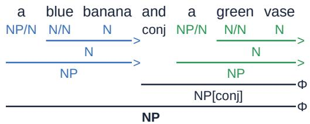  
FIGURE 2. CCG derivation of an example sentence: a blue banana and a green vase. The category of each word is shown below it. Each line indicates that two adjacent phrases are combined by the combinatory rule shown at its right end (>: forward application; Φ: coordination), yielding the category below the line. Blue and green mark the derivations of the two noun phrases.

As a grammar for parsing, CCG has two characteristics that our method relies on. First, predicate–argument dependencies between words can be read directly from the parse [66], [67], because the parsing process records which word fills each argument slot of each functor category. We use these dependencies to read which modifier modifies which noun, which nouns a relation phrase links, and which noun a numeral counts, and thereby determine the guidance targets (Section IV-A). By contrast, a phrase-structure tree does not mark such word-to-word relations, which are usually recovered with head rules [68]. A dependency tree marks them as labeled arcs, but deciding which arcs correspond to these relations requires rules tailored to its label scheme, as in Predicated Diffusion. Second, because its rules are few and general, the categories of individual words determine most of the sentence structure, and supertagging, which assigns a category to each word, does most of the work of parsing [43], [44]. Hereafter, we call the category assigned to each word its supertag. As a result, fixing the supertag of a single word constrains the structure of the whole sentence. We use this to obtain the derivation of a specified interpretation: for PP attachment, fixing the supertag of the preposition alone determines the phrase that the PP modifies (Section IV-C1). In phrasestructure and dependency parsing, by contrast, the preposition has the same part-of-speech tag under both interpretations, so specifying the interpretation requires constraining the tree structure itself, such as the constituent or head to which the PP attaches.

The output of a CCG parser is called a derivation and is drawn as in Fig. 2. The category of each word is placed below the word. Each horizontal line indicates that the two adjacent phrases above it are combined, by the rule shown at its right end, into a phrase with the category below the line. A derivation is therefore read from top to bottom: from words to phrases and from phrases to the sentence. For example, in Fig. 2, the $N / N$ of blue combines with the N of banana on its right by forward application to yield N. This N then combines with the $N P / N$ of a to yield the $N P$ of the noun phrase a blue banana. Likewise, a green vase becomes NP, combines with the conj of and into $N P [ \mathrm { c o n j } ]$ , and then combines with the noun phrase on its left, so that the whole phrase becomes a single NP (Φ). In this process, banana fills the argument of the $N / N$ of blue, which naturally yields the word-to-word dependency in which blue modifies banana. Similarly, in the $( S \backslash N P ) / N P$ of a transitive verb, the object fills the right NP argument and the subject fills the left NP argument, which yields the verb–object and verb–subject dependencies.

## IV. METHOD: CCG DIFFUSION

In this section, we propose CCG Diffusion, which extends Predicated Diffusion by integrating CCG parsing. Fig. 3 gives an overview. CCG Diffusion parses the input prompt with a CCG parser. Using the syntactic information in the resulting derivation, it reduces errors in attribute binding, spatial relations, and object counts in compositional text-to-image generation and disambiguates PP attachment in syntactically ambiguous prompts according to the specified interpretation. It achieves both in a unified manner and without additional training of the image generation model.

Let D denote the derivation that the CCG parser outputs for the input prompt c. CCG Diffusion uses the syntactic information in D to control generation through two pathways: prompt rewriting and attention guidance. Below, we describe how it does so for the two problems, compositional text-toimage generation and PP ambiguity resolution.

## A. GUIDANCE TARGETS FROM CCG DERIVATION

We first describe the guidance targets $\mathcal { T } _ { D } .$ , which are shared by compositional text-to-image generation and PP ambiguity resolution. In CCG Diffusion, $\mathcal { T } _ { D } = ( \mathcal { E } , \mathcal { C } , \mathcal { K } , \mathcal { P } )$ is read from the categories and the predicate–argument dependencies in the CCG derivation. The set E consists of the words with category N, i.e., nouns. The set $\mathcal { C }$ consists of pairs of a word that modifies a noun and the noun it modifies. For a word that modifies another modifier, we follow the arguments and pair the word with the noun it ultimately modifies. For example, in a light blue banana, light has category $( N / N ) / ( N / N )$ and takes the $N / N$ of blue as its argument. Because blue is not a noun, we further follow the argument of blue and pair light with banana. This yields $\mathcal { C } \ = \ \{ ( l i g h t , b a n a n a )$ $( b l u e , b a n a n a ) \}$ . The set K pairs each modifier with the other nouns that it does not modify. As in Predicated Diffusion, P consists of the subject–object pairs of the verbs have, wear, grasp, and hold. The other grammatical structures used by the CCG Diffusion components described below (coordinated noun phrases, relation phrases, cardinal numbers, and PPs) are also read from the same CCG derivation.

## B. COMPOSITIONAL TEXT-TO-IMAGE GENERATION

This subsection addresses three of the common failure patterns in compositional text-to-image generation: (1) attributes leak between objects or objects fuse, (2) spatial relations are violated, and (3) object counts are wrong. We mitigate these problems by extending Predicated Diffusion using information from the CCG derivation.

## 1) Selective Guidance Boost

Attention guidance controls the generated image by updating the latent with the loss gradient, as in (1); η determines the size of each update. A larger guidance strength enforces the propositions of Predicated Diffusion more strongly and thus tends to improve attribute binding. However, overly large updates can corrupt the image [24]. We therefore replace the standard guidance strength with a stronger one only for inputs in which the modifiers that the CCG derivation binds to nouns include a word denoting color, shape, size, material, or surface.

## 2) Positional Prefix and Region Assignment Loss

When two noun phrases with modifiers are joined by and, image generation models often fuse the objects or swap their attributes. We mitigate this problem by separating the two objects into different regions of the image. To this end, we combine a textual prefix that specifies where each noun phrase should be placed with an attention guidance loss that constrains where each object is generated.

## a: Positional Prefix

Text encoders such as CLIP, which are widely used in textto-image models, are generally causal: the state of a token depends only on the tokens before it. We therefore place each noun phrase, preceded by a position cue, before the original prompt:

$$
c _ { D } = O n t h e l e f t s i d e , \mathrm { N P _ { 1 } . } O n t h e r i g h t s i d e , \mathrm { N P _ { 2 } . } \parallel c ,\tag{4}
$$

where ∥ denotes concatenation, and $\mathrm { N P _ { 1 } }$ and $\mathrm { N P _ { 2 } }$ are the two noun phrases in their order of appearance in the original prompt. We also keep the original prompt to retain the context and the words outside the noun phrases. For example, for the prompt a blue banana and a green vase, the text encoder receives the following text:

## On the left side, a blue banana. On the right side, a green vase. a blue banana and a green vase

Because each noun phrase directly follows the phrase that indicates its placement, the state of each noun is expected to reflect that placement. The guidance losses are computed on the attention maps obtained from these states. Methods that separately encode constituents such as noun phrases for conditioning include StructureDiffusion [28] and DisCLIP [29]. These methods insert the separately encoded embeddings into the embedding of the original prompt or concatenate them with it. In contrast, the Positional Prefix rewrites the input text itself. It therefore applies in the same form to encoders such as

Holder girl + telescope: same region

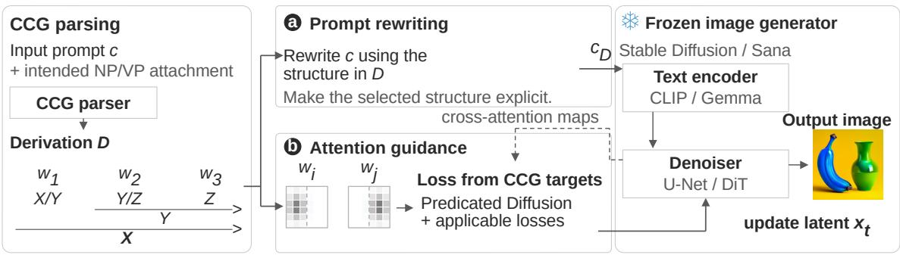

## Compositional

Text-to-Image Generation

## Attribute binding

a blue banana and a green vase

## b Selective Guidance Boost

  
Stronger guidance: ηt ↑

  
For two modified NPs joined by and

## a Positional Prefix

On the left side, a blue banana.

On the right side, a green vase.

\+ original prompt c

## b Region Assignment Loss

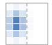  
left region

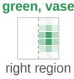

## 2D spatial

a chicken on the right of a suitcase

## b Spatial Relation Loss

Horizontal centroid margin:

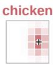

## Numeracy

three refrigerators and two rabbits

## Count Lossb $p _ { n }  q _ { n }$

refrigerators

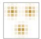

3 target peaks

Attention (schematic)

2 target peaks

Low High

## PP Ambiguity Resolution

“the boy looks at the girl with a telescope”

## Supertag-Constrained Parsing

Fix with for NP / VP attachment.

VP ≡ S\NP

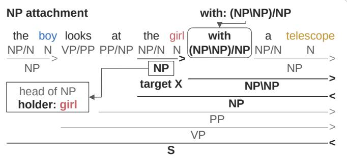  
a It is the girl with a telescope that the boy looks at.

## b Region Assignment Loss

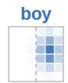

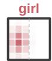

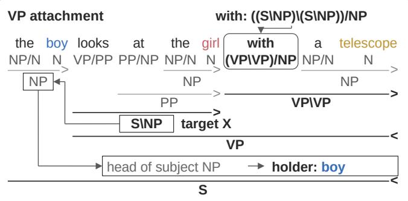

a With a telescope, the boy looks at the girl.

## b Region Assignment Loss

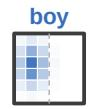

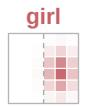

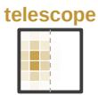

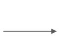

a Disambiguating Paraphrase

b Holder–Object Region Assignment

FIGURE 3. Overview of CCG Diffusion. A CCG parser parses the prompt into a derivation D; for PP ambiguity resolution, it parses the prompt under the specified NP or VP attachment. The syntactic information read from D is conveyed to the image generation model through two pathways: (a) the input prompt to the text encoder and (b) attention guidance.

CLIP and LLMs, without manipulating the embeddings that the text encoder outputs.

## b: Region Assignment Loss

In addition to the Positional Prefix, we add an attention guidance loss that assigns the two noun phrases to the left and right regions, respectively. To represent the region where each object is placed along the horizontal axis of the image, we use the smooth half-plane masks

$$
M _ { \mathrm { L } } ( x ) = { \mathrm { s i g m o i d } } { \big ( } ( x _ { \mathrm { b } } - x ) / \kappa { \big ) } , \quad M _ { \mathrm { R } } ( x ) = 1 - M _ { \mathrm { L } } ( x ) .\tag{5}
$$

Here, $x \in [ 0 , 1 ]$ is the horizontal position on the attention map (0 at the left edge and 1 at the right edge), $x _ { \mathrm { b } }$ is the position of the left–right boundary, and κ is a hyperparameter that sets the width over which the mask value switches near the boundary.

Using these masks, we define the Region Assignment Loss as

$$
\mathcal { L } _ { \mathrm { r e g i o n } } = - \frac { 1 } { | \mathcal { W } _ { D } | } \sum _ { w \in \mathcal { W } _ { D } } \log \frac { \sum _ { i } M _ { g ( w ) } [ i ] A _ { w } [ i ] } { \sum _ { i } A _ { w } [ i ] } ,\tag{6}
$$

where $\mathcal { W } _ { D }$ is the set of nouns in the two noun phrases and their modifiers, $A _ { w }$ is the attention map of word w, and $g ( w ) \in$ {L, R} is the side assigned to the noun phrase that contains w (left for $\mathrm { N P _ { 1 } }$ and right for $\mathrm { N P _ { 2 } ) }$ . The ratio inside the logarithm is the fraction of the total attention of w that falls within its assigned mask. This loss belongs to the same family as the layout guidance loss [33], which increases the fraction of attention inside a specified region. It uses smooth half-plane masks instead of boxes and, like the Predicated Diffusion losses, takes the negative logarithm. However, whereas layout guidance and similar methods receive the layout as boxes or as words that indicate positions, our method assigns left and right sides to coordinated noun phrases whose positions are not specified. We multiply ${ \mathcal { L } } _ { \mathrm { r e g i o n } }$ by a weight $\lambda _ { \mathrm { { r e g i o n } } }$ and add it to $\mathcal { L } _ { \mathrm { P D } }$ in (3).

Applying the Positional Prefix and the Region Assignment Loss together encourages the two objects to be drawn in separate left and right regions and, as a result, mitigates attribute swapping and object fusion.

## 3) Spatial Relation Loss

The propositions defined in Predicated Diffusion do not depend on where objects appear in the image, so they cannot express that one object is above, below, to the left of, or to the right of another. The original Predicated Diffusion paper [27] also lists binary predicates for spatial relations, such as Above(x, y), as future work. For inputs that specify a 2D spatial relation between two objects, we therefore introduce a loss on the attention centroid of each object, following prior work that guides object positions and spatial relations with attention centroids [49]–[52]. We detect a relation from the CCG derivation when one of a closed set of relation phrases (on the left of, on the right of, on the top of, on the bottom of, next $t o ,$ near, and on side of) links a subject noun s and an object noun o.

Let $a _ { s }$ and $a _ { o }$ be the attention maps of the two nouns, and let $\left( x _ { s } , y _ { s } \right)$ and $\left( x _ { o } , y _ { o } \right)$ be their attention-weighted centroids on the unit square, with y increasing downward. For a directional relation $\rho ,$ let d be the signed difference along the axis specified by $\rho ,$ defined to be positive when $\rho$ holds $( d = x _ { o } - x _ { s }$ for on the left of and $d = y _ { o } - y _ { s }$ for on the top of ), and let e be the difference along the other axis. Then

$$
\begin{array} { c } { \ell _ { \rho } ^ { \mathrm { d i r } } = [ m - d ] _ { + } + [ | e | - | d | ] _ { + } , } \\ { \ell _ { \rho } ^ { \mathrm { p r o x } } = [ \operatorname* { m i n } ( | x _ { s } - x _ { o } | , | y _ { s } - y _ { o } | ) - r ] _ { + } , } \\ { \ell _ { \mathrm { s p a t i a l } } = \displaystyle \frac { 1 } { | \mathcal { R } _ { D } | } \sum _ { \rho \in \mathcal { R } _ { D } } \Big ( \ell _ { \rho } + \displaystyle \frac { 1 } { I } \sum _ { i } a _ { s } [ i ] a _ { o } [ i ] \Big ) , } \end{array}\tag{7}
$$

where $\mathcal { R } _ { D }$ is the set of relations; I is the number of pixels in an attention map; and $\ell _ { \rho }$ is $\ell _ { \rho } ^ { \mathrm { d i r } }$ for on the left of, on the right of, on the top of, and on the bottom of, and $\ell _ { \rho } ^ { \mathrm { p r o x } }$ for next to, near, and on side of. The first hinge term requires a margin m along the specified axis, the second hinge term makes the difference along that axis exceed the difference along the other axis, and the product term penalizes overlap so that the two objects can be separated. Because the centroids lie on the unit square, m and r are fractions of the image size and are independent of the resolution. As with ${ \mathcal { L } } _ { \mathrm { r e g i o n } } .$ , we multiply $\mathcal { L } _ { \mathrm { s p a t i a l } }$ by a weight $\lambda _ { \mathrm { s p a t i a l } }$ and add it to L in (3).

## 4) Count Loss

In Predicated Diffusion, the existence proposition $\exists x . N ( x )$ is satisfied as soon as a single object is present. It is therefore difficult to generate an image with the specified number of objects, as in three refrigerators. The original Predicated Diffusion paper [27] also lists the inability to count objects accurately as a limitation inherited from conventional diffusion models. To address this, we introduce a loss that encourages the attention of a noun to concentrate on as many mutually separated regions as the specified count, instead of collapsing into one place. With each region corresponding to one object, the loss aims to produce the specified number of objects.

First, we extract count constraints from the CCG derivation. We find each noun modified by a cardinal number from one to ten and use the pair $\left( n , k _ { n } \right)$ of the noun and its count as a constraint. For example, three refrigerators and two rabbits yields (refrigerators, 3) and (rabbits, 2).

Next, for each noun, we build a target distribution $q _ { n }$ that describes how its attention should ultimately be distributed. The target $q _ { n }$ has $k _ { n }$ peaks at mutually separated locations in the image. We select the peaks from highly attended locations in the noun’s attention map such that they are sufficiently far apart, aiming to obtain $k _ { n }$ separate objects. We build this target distribution only once, when the Count Loss is first applied, from the attention before the latent is updated, and keep it fixed afterward.

After building the target, we pull the noun’s attention distribution $p _ { n } .$ , smoothed and normalized to sum to 1, toward $q _ { n }$

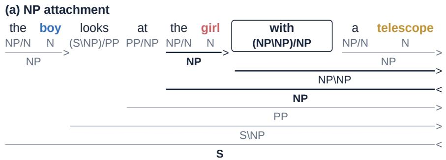

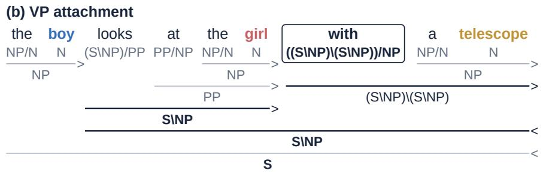  
FIGURE 4. CCG derivations of an example sentence: the boy looks at the girl with a telescope under the two interpretations. The derivations are obtained by parsing the prompt with the CCG parser while fixing the supertag of with (boxed) to (a) (NP\NP)/NP for NP attachment and (b) ((S\NP)\(S\NP))/NP for VP attachment.

with the following loss:

$$
\begin{array} { c l l } { { \displaystyle \mathcal { L } _ { \mathrm { c o u n t } } = \frac { 1 } { N } \sum _ { n = 1 } ^ { N } g _ { n } \frac { 1 } { 2 } \sum _ { i } \bigl ( q _ { n } [ i ] - p _ { n } [ i ] \bigr ) } } \\ { { \displaystyle ~ \times \left( \log q _ { n } [ i ] - \log p _ { n } [ i ] \right) , } } \end{array}\tag{8}
$$

where N is the number of nouns to be counted and $g _ { n }$ is a weight that prevents nouns with weak attention from being pushed too strongly. The sum over i is the symmetric KL divergence between $p _ { n }$ and $q _ { n } .$ . It penalizes both missing attention at target peaks (too few objects) and attention gathered where there is no peak (extra objects or collapse into one place). As with $\mathcal { L } _ { \mathrm { r e g i o n } }$ and $\mathcal { L } _ { \mathrm { s p a t i a l } }$ , we multiply ${ \mathcal { L } } _ { \mathrm { c o u n t } }$ by a weight $\lambda _ { \mathrm { c o u n t } }$ and add it to $\mathcal { L } _ { \mathrm { P D } }$ in (3).

## C. PP AMBIGUITY RESOLUTION

This subsection describes how we apply CCG Diffusion to syntactic ambiguity resolution: given a syntactically ambiguous prompt, we generate an image that corresponds to whichever of its syntactic interpretations is selected. Among syntactic ambiguities, we focus on PP-attachment ambiguity, which is known as a representative example.

CCG Diffusion takes as input a prompt with PP-attachment ambiguity together with the interpretation intended for generation (NP attachment or VP attachment). It then obtains the CCG derivation for this interpretation and, based on the syntactic information in the derivation, extends Predicated Diffusion to control generation so that the image corresponds to this interpretation.

## 1) Supertag-Constrained Parsing

We obtain the derivation for the intended syntactic interpretation by running the CCG parser with this interpretation specified, and we use the syntactic information that the derivation contains. In standard CCG parsing, the parser derives a single plausible syntactic structure from the word-level CCG categories (supertags) that it predicts itself. For a sentence with PP-attachment ambiguity, the supertag of its preposition determines where the PP attaches. This follows from a property of CCG as a lexicalized grammar: its supertags encode rich syntactic information. Fig. 4 shows the derivations of the sentence the boy looks at the girl with a telescope under its two interpretations, NP attachment and VP attachment. As the figure shows, the interpretation is NP attachment if the supertag of the preposition with is (NP\NP)/NP, and VP attachment if it is $( ( S \backslash N P ) \backslash ( S \backslash N P ) ) / N P$ . Therefore, we parse the prompt with the supertag of its preposition fixed to the one for the selected interpretation, instead of letting the parser predict it. This allows us to obtain the derivation for whichever interpretation is selected.

## 2) Disambiguating Paraphrase and Holder–Object Region Assignment

If a prompt with multiple syntactic interpretations is fed to the text encoder as is, the diffusion model receives exactly the same conditioning for every interpretation and thus no information about which interpretation is intended. We therefore use the CCG derivation obtained for each interpretation to paraphrase the prompt into a syntactically unambiguous sentence, and feed this sentence to the text encoder instead of the original prompt. For NP attachment, we rewrite the prompt as an object cleft sentence, It is [object NP] [PP] that [words before the object NP]. In this form, the PP lies inside the focused noun phrase and can therefore modify only that noun. For VP attachment, we front the PP, giving [PP], [words before the PP]. In this form, the PP is placed before the subject, away from the object noun, and modifies the whole phrase. For example, given the boy looks at the girl with a telescope, the text encoder receives It is the girl with a telescope that the boy looks at. under the NP-attachment interpretation and With a telescope, the boy looks at the girl. under the VP-attachment interpretation. The idea of paraphrasing an ambiguous sentence into an unambiguous one for each interpretation appears in the work of Duan et al. [69]. We do not combine this paraphrase with the Positional Prefix introduced in Section IV-B.

To also reflect the selected interpretation in the spatial layout of the objects in the image, we use the Region Assignment Loss of Section IV-B2. We call the noun that is the object of the PP the object (telescope in the example), and the noun to which the object belongs under the selected interpretation the holder. For NP attachment, the holder is the noun modified by the PP (girl in the example); for VP attachment, it is the subject of the verb phrase modified by the PP (boy in the example). That is, only the holder changes with the interpretation. In the derivation, under either interpretation, the holder and the object are obtained by the same rule from the arguments of the preposition’s supertag $( X \backslash X ) / Y$ . This supertag takes Y on its right as an argument and forms a phrase that modifies X on its left. The object is the noun of the noun phrase Y. The holder is the noun of the noun phrase X when X = NP; when $X ~ = ~ S \backslash N P$ , it is the noun of the NP that the verb phrase X takes on its left, i.e., the subject noun. In the Holder–Object Region Assignment, we assign the holder and the object of the selected interpretation to the same region and the holder of the unselected interpretation to the other region, and apply the Region Assignment Loss. For example, under the NP-attachment interpretation of the boy looks at the girl with a telescope, we guide girl and telescope to be drawn in the same region and boy in the other region. Under the VP-attachment interpretation, we guide boy and telescope to be drawn in the same region and girl in the other region (Fig. 3). In this way, we use the Region Assignment Loss to guide generation so that the syntactic interpretation is reflected in the spatial layout of the objects in the image. In addition, we simultaneously apply the Selective Guidance Boost (Section IV-B1) and the Spatial Relation Loss (Section IV-B3).

## V. EXPERIMENT 1: COMPOSITIONAL TEXT-TO-IMAGE GENERATION

## A. SETUP

## 1) Dataset

To quantitatively evaluate our method on compositional text-to-image generation, we conduct experiments on T2I-CompBench++ [11]. It is a standard benchmark for this task that groups 8,000 prompts into four categories and eight subcategories: attribute binding (color, shape, and texture), object relationships (2D-spatial, 3D-spatial, and non-spatial), numeracy, and complex compositions. Each subcategory has 1,000 prompts, which the benchmark splits into 700 training and 300 test prompts. The prompts include both sentences based on fixed templates such as a {adjective} {noun} and a {adjective} {noun} (e.g., a blue banana and a green vase) and natural sentences without templates.

This benchmark is suitable for evaluating our method because its subcategories directly correspond to the three failure patterns addressed in Section IV-B. Attribute binding corresponds to attribute leakage and object fusion, 2D-spatial to violated spatial relations, and numeracy to incorrect object counts. We can thus measure the effect of the extension for each pattern (Sections IV-B1–IV-B4) separately, using the automatic evaluator of the corresponding subcategory. In addition, because the benchmark contains natural sentences as well as template-based prompts, we can evaluate our method on inputs that are not limited to fixed sentence patterns.

For each subcategory, we use the official 300-prompt test split, generate images with ten seeds per prompt, and report results obtained with the official automatic evaluation procedure.

2) Backbone Image Generation Models and CCG Parser We use two different text-to-image models as the backbones of our method and the compared methods.

The first is Stable Diffusion v1.4 [2] (Stable Diffusion below), a representative latent diffusion model that consists of the CLIP text encoder [39] and a U-Net. We use the CompVis/stable-diffusion-v1-42 checkpoint. Stable Diffusion has been the standard backbone for existing attention guidance methods, and we also use it for a fair comparison.

The second is Sana 0.6B [7] (Sana below), a fast, highquality model with a relatively recent architecture based on the Diffusion Transformer (DiT) [45] instead of a U-Net. We use the Efficient-Large-Model/Sana\_ 600M\_512px\_diffusers3 checkpoint. Sana combines a Gemma 2 [70] text encoder with a DiT that uses linear attention. It has neither a U-Net nor the CLIP text encoder, and using it as a backbone lets us verify that our method is not tailored to a particular backbone model.

For the CCG parser of our method, we use Holographic CCG (Hol-CCG) [71] with the ryosuke-yamaki/ hol-ccg-roberta-large4 checkpoint. Hol-CCG is one of the state-of-the-art neural CCG parsers that use a pretrained language model as their text encoder.

## 3) Compared Methods

We compare our method with five training-free methods that, like ours, use no input other than the prompt: the four methods compared in the Predicated Diffusion paper [27] and Predicated Diffusion itself. Besides keeping continuity with the evaluation of our base method, this set matches the design of CCG Diffusion, which conveys syntactic information through two pathways, the text conditioning and attention guidance, and uses a parse to decide which words each intervention acts on. The compared methods cover both pathways, each with and without syntactic parsing, so that our method is compared with a prompt-only alternative for each of these design choices:

TABLE 2. Performance on T2I-CompBench++. Higher is better in all categories. Bold: significantly higher than all other rows of the same backbone. †: CCG Diffusion significantly higher than Predicated Diffusion (paired permutation tests over the 300 prompts, Holm-corrected over the eight subcategorie of each backbone, p < 0.05).
<table><tr><td rowspan=1 colspan=2>Method</td><td rowspan=1 colspan=2>AttributeColor    Shape</td><td rowspan=1 colspan=1>bindingTexture</td><td rowspan=1 colspan=2>Spatial2D       3D</td><td rowspan=1 colspan=1>Numeracy(UniDet [72])</td><td rowspan=1 colspan=1>Non-spatial(CLIPScôre [73])</td><td rowspan=1 colspan=1>Complex(3-in-1)</td></tr><tr><td rowspan=1 colspan=2>Stable Diffusion</td><td rowspan=1 colspan=1></td><td rowspan=1 colspan=1></td><td rowspan=1 colspan=1></td><td rowspan=1 colspan=3></td><td rowspan=1 colspan=1></td><td rowspan=1 colspan=1></td></tr><tr><td rowspan=3 colspan=2>VanillaComposable Diffusion [53]StructureDiffusion [28]</td><td rowspan=1 colspan=1>0.3794</td><td rowspan=1 colspan=1>0.3595</td><td rowspan=1 colspan=1>0.4169</td><td rowspan=1 colspan=1>0.1148</td><td rowspan=1 colspan=1>0.2957</td><td rowspan=1 colspan=1>0.4464</td><td rowspan=1 colspan=1>0.3108</td><td rowspan=1 colspan=1>0.2963</td></tr><tr><td rowspan=1 colspan=1>0.4198</td><td rowspan=1 colspan=1>0.3560</td><td rowspan=1 colspan=1>0.4301</td><td rowspan=1 colspan=1>0.1115</td><td rowspan=1 colspan=1>0.3056</td><td rowspan=1 colspan=1>0.4364</td><td rowspan=1 colspan=1>0.3085</td><td rowspan=1 colspan=1>0.3038</td></tr><tr><td rowspan=1 colspan=1>0.3587</td><td rowspan=1 colspan=1>0.3598</td><td rowspan=1 colspan=1>0.3987</td><td rowspan=1 colspan=1>0.1082</td><td rowspan=1 colspan=1>0.3039</td><td rowspan=1 colspan=1>0.4496</td><td rowspan=1 colspan=1>0.3093</td><td rowspan=1 colspan=1>0.3022</td></tr><tr><td rowspan=4 colspan=2>Attend-and-Excite [9]SynGen [24]Predicated Diffusion [27]CCG Diffusion (ours)</td><td rowspan=2 colspan=2>and-Excite [9]</td><td rowspan=1 colspan=1>0.5761</td><td rowspan=1 colspan=1>0.4802</td><td rowspan=1 colspan=1>0.6106</td><td rowspan=1 colspan=1>0.1043</td><td rowspan=1 colspan=1>0.3025</td><td rowspan=1 colspan=1>0.5191</td></tr><tr><td rowspan=1 colspan=1>0.7148</td><td rowspan=1 colspan=1>0.4889</td><td rowspan=1 colspan=1>0.6800</td><td rowspan=1 colspan=1>0.1195</td><td rowspan=1 colspan=1>0.3041</td><td rowspan=1 colspan=1>0.4485</td><td rowspan=1 colspan=1>0.3107</td><td rowspan=1 colspan=1>0.3384</td></tr><tr><td rowspan=1 colspan=1>0.6631</td><td rowspan=1 colspan=1>0.4743</td><td rowspan=1 colspan=1>0.6221</td><td rowspan=1 colspan=1>0.1279</td><td rowspan=1 colspan=1>0.3341</td><td rowspan=1 colspan=1>0.5214</td><td rowspan=1 colspan=1>0.3105</td><td rowspan=2 colspan=1>0.34200.3467</td></tr><tr><td rowspan=1 colspan=1>0.7419†</td><td rowspan=1 colspan=1>0.5582†</td><td rowspan=1 colspan=1>0.7037†</td><td rowspan=1 colspan=1>0.3051†</td><td rowspan=1 colspan=1>0.3335</td><td rowspan=1 colspan=1>0.5365†</td><td rowspan=1 colspan=1>0.3105</td></tr><tr><td rowspan=1 colspan=2>Sana</td><td rowspan=1 colspan=1></td><td rowspan=1 colspan=1></td><td rowspan=1 colspan=1></td><td rowspan=1 colspan=1></td><td rowspan=1 colspan=1></td><td rowspan=1 colspan=1></td><td rowspan=1 colspan=1></td><td rowspan=1 colspan=1></td></tr><tr><td rowspan=7 colspan=2>VanillaComposable DiffusionStructureDiffusionAttend-and-ExciteSynGenPredicated DiffusionCCG Diffusion (ours)</td><td rowspan=3 colspan=1>0.67960.43440.4757</td><td rowspan=1 colspan=1>0.5250</td><td rowspan=1 colspan=1>0.6413</td><td rowspan=1 colspan=1>0.3135</td><td rowspan=1 colspan=1>0.4051</td><td rowspan=1 colspan=1>0.6082</td><td rowspan=1 colspan=1>0.3133</td><td rowspan=1 colspan=1>0.3717</td></tr><tr><td rowspan=2 colspan=1>0.35880.3942</td><td rowspan=1 colspan=1>0.4480</td><td rowspan=1 colspan=1>0.3117</td><td rowspan=1 colspan=1>0.4054</td><td rowspan=1 colspan=1>0.5291</td><td rowspan=1 colspan=1>0.3115</td><td rowspan=1 colspan=1>0.3658</td></tr><tr><td rowspan=1 colspan=1>0.5247</td><td rowspan=1 colspan=1>0.2873</td><td rowspan=1 colspan=1>0.4004</td><td rowspan=1 colspan=1>0.5732</td><td rowspan=1 colspan=1>0.3127</td><td rowspan=1 colspan=1>0.3655</td></tr><tr><td rowspan=1 colspan=1>0.6904</td><td rowspan=1 colspan=1>0.5623</td><td rowspan=1 colspan=1>0.6689</td><td rowspan=1 colspan=1>0.3311</td><td rowspan=1 colspan=1>0.4149</td><td rowspan=1 colspan=1>0.6434</td><td rowspan=2 colspan=1>0.31280.3134</td><td rowspan=2 colspan=1>0.37520.3800</td></tr><tr><td rowspan=1 colspan=1>0.8015</td><td rowspan=1 colspan=1>0.5689</td><td rowspan=1 colspan=1>0.7086</td><td rowspan=1 colspan=1>0.3120</td><td rowspan=1 colspan=1>0.4054</td><td rowspan=1 colspan=1>0.6069</td></tr><tr><td rowspan=1 colspan=1>0.7212</td><td rowspan=1 colspan=1>0.5490</td><td rowspan=1 colspan=1>0.6693</td><td rowspan=1 colspan=1>0.3304</td><td rowspan=1 colspan=1>0.4168</td><td rowspan=1 colspan=1>0.6151</td><td rowspan=1 colspan=1>0.3133</td><td rowspan=1 colspan=1>0.3776</td></tr><tr><td rowspan=1 colspan=1>0.8072†</td><td rowspan=1 colspan=1>0.6196†</td><td rowspan=1 colspan=1>0.7217†</td><td rowspan=1 colspan=1>0.4525†</td><td rowspan=1 colspan=1>0.4168</td><td rowspan=1 colspan=1>0.6303†</td><td rowspan=1 colspan=1>0.3133</td><td rowspan=1 colspan=1>0.3777</td></tr></table>

• Composable Diffusion [53]: intervenes in the conditioning without parsing, by composing the predictions of the denoiser obtained under separate conditions. We use the parts of the prompt separated by and as the conditions.

• StructureDiffusion [28]: intervenes in the text conditioning on the basis of constituency parsing, by separately encoding the noun phrases of the prompt.

• Attend-and-Excite [9]: applies attention guidance without syntactic parsing, by strengthening the attention of the most neglected of the target nouns. We use all nouns in the prompt as the targets.

• SynGen [24]: applies attention guidance on the basis of dependency parsing, by aligning the attention maps of modifier–noun pairs; it is specialized in attribute binding.

• Predicated Diffusion [27]: applies attention guidance with propositions extracted from dependency parsing. Since our method extends it, the comparison with it shows the effect of our CCG-based extensions.

We exclude methods that require inputs or modules other than the prompt, such as boxes, layouts generated by an LLM, or counting networks (Section II-A), because they use information that our method does not receive. Other promptonly methods mostly refine the attention-guidance losses of the above methods, for example for neglected or overlapping objects [22], [23], [25] or for modifier–noun binding [23], [25], [26]; we therefore use one representative of each approach.

None of these methods provides an implementation for

Sana; we therefore adapted each of them to Sana, using the same inputs and generation settings as for our method.

## B. RESULTS

Table 2 reports the results on T2I-CompBench++. In the attribute-binding categories, our method achieves the highest scores among all methods on both backbones. It significantly outperforms all other methods in all three categories on Stable Diffusion and in shape on Sana. For color and texture on Sana, the margin over SynGen is small and not significant. Our method also significantly improves over Predicated Diffusion, on which it is based, in all three categories on both backbones. However, the contribution of each component of CCG Diffusion to performance differs between the backbones, as we discuss in Section V-C.

In the 2D-spatial category, our method outperforms all other methods significantly and by a large margin on both backbones. This shows that the Spatial Relation Loss introduced in our method is effective.

In the numeracy category, our method yields a small but significant improvement over Predicated Diffusion on both backbones. On Stable Diffusion in particular, it significantly outperforms all other methods.

These results show that our method significantly outperforms its base method, Predicated Diffusion, on both backbones in every compositional text-to-image generation challenge it targets (attribute binding, 2D-spatial, and numeracy). Its effectiveness is thus confirmed on two diffusion models with different architectures. Moreover, in the 3D-spatial, nonspatial, and complex categories, which our extensions do not primarily target, there is no significant difference between our method and Predicated Diffusion. That is, at least in these categories, we observe no degradation in generation performance.

Fig. 5 shows example images generated by the compared methods and our method in the attribute-binding, 2D-spatial, and numeracy categories. These are samples in which the compared methods fail to depict the attribute binding, the spatial relations between objects, or the object counts, whereas our method succeeds. Appendix C provides more generated samples, as well as samples for the 3D-spatial, non-spatial, and complex categories.

TABLE 3. Score drop from removing each component on attribute binding in T2I-CompBench++. Score with the listed component disabled minus the score with all three components enabled (two-sided paired permutation test over the 300 prompts, Holm-corrected over the nine comparisons per backbone). $^ { * } p < 0 . 0 5 , ^ { * * } p < 0 . 0 1 , ^ { * * * } p < 0 . 0 0 1$ , n.s. not significant.
<table><tr><td colspan="4">Stable Diffusion</td><td colspan="3">Sana</td></tr><tr><td>Removed component</td><td> $\mathrm { C o l o r }$ </td><td>Shape</td><td> ${ \mathrm { T e x t u r e } }$ </td><td> $\mathrm { C o l o r }$ </td><td>Shape</td><td>Texture</td></tr><tr><td>Selective Guidance Boost</td><td> $- 0 . 0 3 2 ^ { \ast \ast \ast }$ </td><td>-0.041*</td><td> $- 0 . 0 4 8 ^ { * * * }$ </td><td> $- 0 . 0 1 2 ^ { * * }$ </td><td> $\overline { { - 0 . 0 1 0 } } ^ { * }$ </td><td> $- 0 . 0 3 1 ^ { * * * }$ </td></tr><tr><td>Positional Prefix</td><td> $- 0 . 0 2 1 ^ { ^ { \ast \ast } }$ </td><td> $- 0 . 0 3 5 ^ { ^ { \ast } ^ { \ast \ast } }$ </td><td> $- 0 . 0 1 6 ^ { ^ { \ast \ast } }$ </td><td> $- 0 . 0 6 5 ^ { * * * }$ </td><td> $- 0 . 0 4 4 ^ { * * }$ </td><td> $- 0 . 0 2 2 ^ { \ast \ast }$ </td></tr><tr><td>Region Assignment Loss</td><td> $- 0 . 0 3 0 ^ { * * * }$ </td><td> $- 0 . 0 1 4 ^ { ^ { \ast \ast } }$ </td><td> $- 0 . 0 1 1 ^ { \ast \ast }$ </td><td> $- 0 . 0 0 6 ^ { \mathrm { n . s . } }$ </td><td> $- 0 . 0 0 2 ^ { \mathrm { n . s . } }$ </td><td> $- 0 . 0 0 3 ^ { \mathrm { n . s . } }$ </td></tr></table>

TABLE 4. Score drop from removing the Spatial Relation Loss and the Count Loss in T2I-CompBench++. T2I-CompBench++ score with each objective removed minus the score of CCG Diffusion, evaluated on the category that the objective targets (two-sided paired permutation test over the 300 prompts, Holm-corrected over the two comparisons per backbone). $^ { * } \dot { p } < \dot { 0 } . 0 5 , ^ { * * } p < 0 . 0 1 , ^ { * * * } p < 0 . 0 0 1$ , n.s. not significant.
<table><tr><td rowspan=1 colspan=1>Removed objective (category)</td><td rowspan=1 colspan=1>Stable Diffusion</td><td rowspan=1 colspan=1>Sana</td></tr><tr><td rowspan=1 colspan=1>Spatial Relation Loss (2D)Count Loss (numeracy)</td><td rowspan=1 colspan=1> $- 0 . 1 7 7 ^ { \ast \ast \ast }$  $- 0 . 0 1 3 ^ { ^ { * * } }$ </td><td rowspan=1 colspan=1> $- 0 . 1 2 2 ^ { \ast \ast \ast }$  $- 0 . 0 0 5 ^ { \mathrm { n . s . } }$ </td></tr></table>

## C. ABLATION STUDY

We conduct an ablation study to isolate the contribution of each main component of our method to the overall performance.

## 1) Attribute Binding

We first examine the main components for improving attribute binding: the Selective Guidance Boost (Section IV-B1), the Positional Prefix, and the Region Assignment Loss (Section IV-B2). We prepare variants in which each of these components is independently enabled or disabled, and evaluate them on the attribute-binding categories of T2I-CompBench++. Table 3 shows how the score changes when each component is disabled in the configuration with all three components, and Appendix B shows the changes when two or more components are disabled.

Disabling any one of the three components lowers the score in every category on both backbones. Disabling either the Selective Guidance Boost or the Positional Prefix significantly lowers the score in every category on both backbones. However, the size of each component’s contribution differs between the backbones. Specifically, the Selective Guidance Boost and the Region Assignment Loss, which act on attention guidance, tend to contribute more on Stable Diffusion, whereas the Positional Prefix, which acts on the input to the text encoder, tends to contribute more on Sana. One possible reason is the difference in representational capacity between the text encoders. The CLIP text encoder of Stable Diffusion learns whole-sentence embeddings with a contrastive objective, and such embeddings have been reported to be unable to represent attribute–object binding and spatial relations correctly [41]. The per-token states that Stable Diffusion uses for conditioning are learned only indirectly through this objective, so they likely represent these relations poorly as well. This likely explains two observations on Stable Diffusion: the Positional Prefix, which rewrites the input text, contributes significantly but, for color, only about one third as much as on Sana; and guidance that acts directly on attention contributes more. In contrast, Gemma, the text encoder of Sana, is an LLM trained on large-scale text corpora and can readily represent the placement instructions given by the Positiona Prefix and the attribute binding within each noun phrase. Disabling the Region Assignment Loss on Sana causes no significant drop, possibly because the Positional Prefix alone readily separates the objects, leaving little room for guidance, particularly the Region Assignment Loss, to complement it. In short, we believe that the Selective Guidance Boost and the Region Assignment Loss tend to contribute more, particularly on backbones whose text encoders have weak representational capacity, and that the Positional Prefix tends to contribute more on backbones whose text encoders have strong representational capacity.

## 2) 2D-Spatial and Numeracy

Next, Table 4 shows how removing the Spatial Relation Loss (Section IV-B3) or the Count Loss (Section IV-B4) from our method changes the score in the category that each objective targets: 2D-spatial and numeracy, respectively. Removing the Spatial Relation Loss substantially lowers the 2Dspatial score on both backbones, and the drop is larger on Stable Diffusion. As with attribute binding, the larger drop on Stable Diffusion may be partly due to the difference in representational capacity between the text encoders of the two backbones. However, the drop on Sana is still large. Even with a strong text encoder, reflecting the direction of a relation in the image remains difficult, so an objective that explicitly constrains where objects are drawn is likely effective.

In contrast, removing the Count Loss causes a small but significant drop in the numeracy score on Stable Diffusion, whereas the drop on Sana is not significant. Splitting the attention of a noun into the specified number of regions does not guarantee that the image shows that many objects, and changing the number of objects is a larger structural change than moving them. Attention manipulation alone is therefore likely insufficient to control the number of objects. Both objectives contribute more on Stable Diffusion, which is consistent with the trend observed for attribute binding: intervention through attention guidance contributes more on Stable Diffusion.

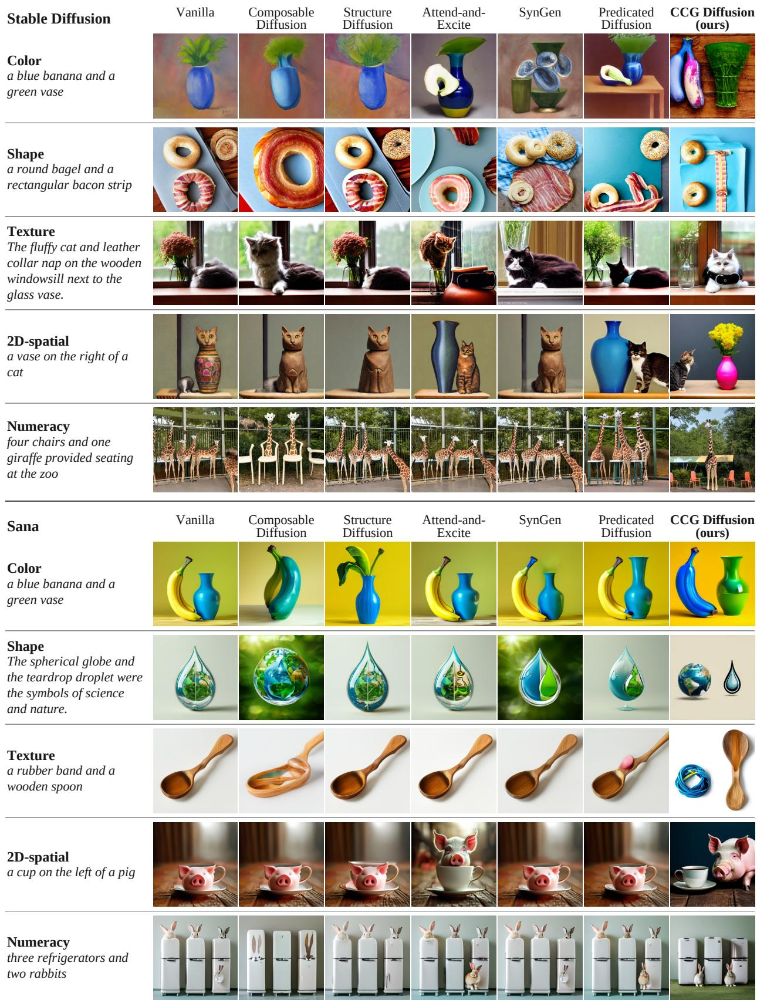  
FIGURE 5. Qualitative comparison on Stable Diffusion (top) and Sana (bottom) for the Color, Shape, Texture, 2D-spatial, and Numeracy categories.

## VI. EXPERIMENT 2: PP AMBIGUITY RESOLUTION A. SETUP

## 1) Dataset

To evaluate PP ambiguity resolution, we use the PPattachment category of the Text-to-image Ambiguity Benchmark (TAB) [14]. For each ambiguous prompt, TAB provides visual setups, each describing one possible interpretation as a declarative sentence, and intention questions, each asking about one visual setup as a yes/no question. For example, the prompt the boy looks at the girl with a telescope comes with the visual setups the girl has the telescope and the boy has the telescope, and the intention questions does the girl have telescope and does the boy have telescope. Each intention question is designed so that its answer is Yes if the image follows the interpretation of the corresponding visual setup. The TAB paper proposes a framework that automatically evaluates whether a generated image depicts the specified interpretation by feeding the image and an intention question to a visual question answering (VQA) model, which answers Yes or No. We adopt the same evaluation protocol. To make the evaluation more reliable, we use two different, independent LLMs as VQA models and cross-check their results. Specifically, we use GPT-6 Astra [74] (reasoning effort: high) and Qwen3.8-Flash-Next [75] (reasoning effort: xhigh) as a closed and an open LLM, respectively, both with advanced reasoning capabilities on image inputs. For Qwen3.8-Flash-Next, we use the NVFP4-quantized checkpoint released by NVIDIA.5

For the 74 ambiguous prompts in the PP-attachment category, we generate images with five seeds for each interpretation of each prompt. As the quantitative metric, we report the Yes rate, i.e., the proportion of generated images for which each VQA model answers Yes.

## 2) Backbone Image Generation Models and CCG Parser

As in Section V-A2, we use Stable Diffusion and Sana as the backbone text-to-image models and Hol-CCG as the CCG parser, and report the performance on both backbones.

## 3) Compared Methods

We compare our method with the following methods:

• Vanilla: We feed each ambiguous PP-attachment prompt as is to the backbone text-to-image model. Because the prompt is not disambiguated, the model receives no information about the intended interpretation, and its output does not differ between interpretations at all. Therefore, we generate only one image per seed and evaluate it with the intention questions of both interpretations.

• Predicated Diffusion: We feed each ambiguous prompt as is to Predicated Diffusion, on which our method is based. Predicated Diffusion takes no interpretation as input and extracts propositions from the single dependency parse that spaCy outputs for the prompt, so its guidance targets are the same regardless of the interpretation. Therefore, as with vanilla, its output does not differ between interpretations, and we evaluate the single image per seed with the intention questions of both interpretations.

• VS-TIED + Gold-visual setup: TIED [14] resolves ambiguity at the prompt level: it elicits disambiguating information from the user for an ambiguous prompt and concatenates it to the original prompt. In its VS-TIED variant, the user selects the intended visual setup from candidate visual setups generated by a language model. In this experiment, we skip the generation by the language model and the selection by the user. We directly concatenate the ground-truth visual setup (gold visual setup) of each interpretation provided in TAB to the original prompt and feed the resulting prompt to the backbone. As the backbone, we use the same text-toimage model as in vanilla. We generate images from a different prompt for each interpretation and evaluate each image with the intention question of that interpretation.

• VS-TIED + Gold-visual setup + Predicated Diffusion: As in VS-TIED + Gold-visual setup, we concatenate the gold visual setup to the prompt, and then apply the Predicated Diffusion method above. This method combines text-level disambiguation of the prompt with the attention guidance of the existing Predicated Diffusion.

## B. RESULTS

Table 5 shows the results on TAB. On both backbones and in the automatic evaluations by both LLMs, our method significantly outperforms all other methods, including those that use the gold visual setup. This shows that the combination of the Disambiguating Paraphrase and the Region Assignment Loss, both obtained from the derivation of the specified interpretation, is effective for rendering the interpretations of a PP-attachment ambiguity as distinct images. Moreover, the significant improvements on both backbones, which have different architectures, suggest that the effectiveness of our method is not limited to a particular model architecture.

We also measure the agreement between the judgments of the two VQA models with Cohen’s κ [76]. Over all trials, κ = 0.72 (87.7% agreement); by backbone, κ is 0.65 on Stable Diffusion and 0.79 on Sana. These values show sufficient agreement between the judgments of the two different LLMs even at the level of individual trials. The above conclusions are therefore unlikely to depend on the idiosyncrasies in the judgments of a particular VQA model.

Fig. 6 shows examples of images generated by the compared methods and our method. In these examples, for the different visual setups of a prompt with PP-attachment ambiguity, the compared methods fail to depict the corresponding relations between objects, whereas our method renders a distinct image that matches each visual setup. Appendix C shows more examples.

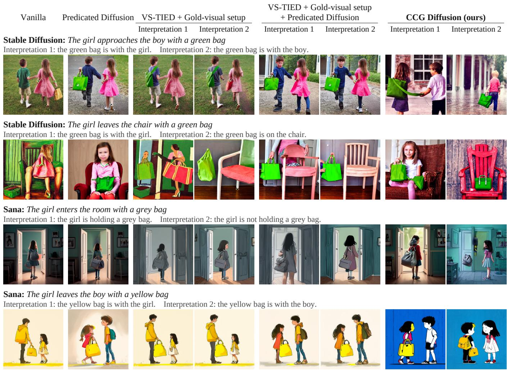  
FIGURE 6. Examples of generated images for the TAB PP-attachment category on Stable Diffusion and Sana.

TABLE 5. TAB PP comparison on Stable Diffusion and Sana. Bold: significantly higher than all other rows of the same backbone under the same VQA model. †: CCG Diffusion significantly higher than Predicated Diffusion (paired permutation test over the 74 prompts, Holm-corrected over the two VQA models per backbone, p < 0.05). Cohen’s κ: agreement between the judgments of the two VQA models over the 740 trials of each row.
<table><tr><td rowspan="2">Method</td><td colspan="2">Yes rate (%)</td><td rowspan="2">Cohen&#x27;s κ</td></tr><tr><td>GPT-6</td><td>Qwen3.8</td></tr><tr><td colspan="4">Stable Diffusion</td></tr><tr><td>Vanilla</td><td>63.0</td><td>55.3</td><td>0.62</td></tr><tr><td>Predicated Diffusion VS-TIED + Gold-visual setup</td><td>66.9</td><td>62.2</td><td>0.61</td></tr><tr><td>VS-TIED + Gold-visual setup</td><td>70.0</td><td>60.0</td><td>0.58</td></tr><tr><td>+ Predicated Diffusion</td><td>67.2</td><td>63.5</td><td>0.72</td></tr><tr><td>CCG Diffusion (ours)</td><td>75.3†</td><td>70.9†</td><td>0.72</td></tr><tr><td colspan="4">Sana</td></tr><tr><td>Vanilla</td><td>64.1</td><td>60.7</td><td>0.79</td></tr><tr><td>Predicated Diffusion</td><td>66.4</td><td>60.1</td><td>0.79</td></tr><tr><td>VS-TIED + Gold-visual setup</td><td>70.9</td><td>67.7</td><td>0.80</td></tr><tr><td>VS-TIED + Gold-visual setup + Predicated Diffusion</td><td>73.5</td><td>68.2</td><td>0.79</td></tr><tr><td>CCG Diffusion (ours)</td><td>82.7†</td><td>78.6†</td><td>0.78</td></tr></table>

## C. ABLATION STUDY

We conduct an ablation study on the PP-attachment category of TAB by enabling or disabling the two main components of CCG Diffusion for syntactic ambiguity resolution: the Disambiguating Paraphrase and the Region Assignment Loss (Section IV-C2). Table 6 shows the drop in the Yes rate, relative to the configuration with both components, when either or both components are disabled. On both backbones, disabling either component yields a lower Yes rate than using both. On Stable Diffusion, the drop is statistically significant only when both components are disabled; on Sana, it is significant only when the Disambiguating Paraphrase or both components are disabled.

As discussed for compositional text-to-image generation, one possible reason why the drop differs in size between the backbones is that their text encoders differ in representational capacity. The paraphrases for the two interpretations consist of almost the same content words and differ only in word order and syntactic structure (e.g., It is the girl with a telescope that the boy looks at. and With a telescope, the boy looks at the girl.). This difference may therefore be clearly reflected in the conditioning of Sana, whose text encoder, Gemma, is an LLM that readily captures syntactic structure, but only to a limited extent in the conditioning of Stable Diffusion, whose text encoder, CLIP, poorly represents word order and syntactic structure.

TABLE 6. Yes-rate drop from removing each component of CCG Diffusion on TAB PP. Yes rate (%, judged by GPT-6 Astra) with each component or both disabled minus the Yes rate with both components enabled (two-sided paired permutation test over the 74 prompts, Holm-corrected over the three comparisons per backbone). ${ ^ { * } \dot { p } } < 0 . 0 5 , { ^ { * * } }$ $P < 0 . 0 1 , ^ { * * * } p < 0 . 0 0 1 , \mathsf { n } . s$ . not significant.
<table><tr><td rowspan=1 colspan=1>Removed component</td><td rowspan=1 colspan=1>Stable Diffusion</td><td rowspan=1 colspan=1>Sana</td></tr><tr><td rowspan=1 colspan=1>Disambiguating ParaphraseRegion Assignment LossBoth</td><td rowspan=1 colspan=1> $- 4 . 1 ^ { \mathrm { n . s . } }$  $- 2 . 0 ^ { \mathrm { n . s . } }$  $- 7 . 4 ^ { * * }$ </td><td rowspan=1 colspan=1> $- 1 8 . 0 ^ { * * }$  $- 0 . 9 ^ { \mathrm { n . s . } }$  $- 1 7 . 7 ^ { * * * }$ </td></tr></table>

On the other hand, the drop from disabling the Region Assignment Loss is not significant on either Stable Diffusion or Sana. On Stable Diffusion, whose text encoder has weak representational capacity, the two components may each make a small contribution and together support rendering the interpretations as distinct images. On Sana, because Gemma has strong representational capacity, the Disambiguating Paraphrase alone may suffice to render them as distinct images, leaving almost no room for the Region Assignment Loss to complement it.

## VII. CONCLUSION

In this paper, we introduce a CCG-based parser into textto-image generation models and propose CCG Diffusion, a training-free method that uses the syntactic information in CCG derivations for prompt rewriting and attention guidance. We apply it to two problems: compositional text-to-image generation and syntactic ambiguity resolution. Because the category of each word in CCG determines modification relations and PP attachment, a single derivation provides the syntactic information necessary for both problems. Experiments on benchmark datasets show that CCG Diffusion significantly outperforms the compared baseline methods on both problems, except in some categories. Experiments with two different backbones also show that CCG Diffusion is effective without being tied to a specific model architecture.

Our work has the following limitations. First, CCG Diffusion has no mechanism for controlling generation from sentences that involve depth relations, actions, or multiple constraints, which are covered by the 3D-spatial, non-spatial, and complex categories of T2I-CompBench++. Extending the guidance to use depth cues and the predicate–argument structure of verbs is left for future work. Second, the only type of syntactic ambiguity we address is PP attachment. In other types of ambiguity, such as coordination scope (old men and women), the interpretations can differ not in the category of a single word but in how phrases are combined. These types therefore require constraints on the derivation beyond fixing supertags, as well as paraphrases and guidance designed for each ambiguity type. Third, the gradient-based attention guidance increases the computational cost: generation takes 2.2– 2.4 times as long as vanilla generation (Appendix A-D).

TABLE 7. Generation settings and hyperparameters.
<table><tr><td></td><td>Stable Diffusion</td><td>Sana</td></tr><tr><td>Resolution Denoising steps</td><td>512×512</td><td></td></tr><tr><td>Classifier-free guidance</td><td>50 (PNDM)</td><td>20</td></tr><tr><td>Guided steps</td><td>7.5 first 25</td><td>4.5 all 20</td></tr><tr><td>Extra updates at step 0</td><td>5</td><td>5</td></tr><tr><td>Attention maps</td><td>5 layers (16×16) first 8 blocks</td><td></td></tr><tr><td> $\overline { { ( s , \delta ) } }$  , default (compositional)</td><td>(20, 0.02)</td><td></td></tr><tr><td> $( s , \delta )$  , default (PP ambiguity)</td><td>(10, 0.02)</td><td></td></tr><tr><td> $( s , \delta )$  , boosted (both tasks)</td><td>(80, 0.06)</td><td></td></tr><tr><td>γexist, γcorr, γleak, γposs</td><td></td><td></td></tr><tr><td> $\lambda _ { \mathrm { r e g i o n } } , x _ { \mathrm { b } } , \kappa$ </td><td>0.1, 1, 0.3, 1</td><td></td></tr><tr><td> $\lambda _ { \mathrm { s p a t i a l } } , m , r$ </td><td>0.25, 0.5, 0.08</td><td></td></tr><tr><td></td><td>6, 0.25, 150/512</td><td></td></tr><tr><td> $\lambda _ { \mathrm { c o u n t } } ~ ( \mathrm { s t e p s } ) , \theta$ </td><td>0.1 (0–9), 0.3</td><td></td></tr></table>

TABLE 8. Average generation time per image (s) on T2I-CompBench++.
<table><tr><td>Method</td><td>Stable Diffusion Sana</td><td></td></tr><tr><td>Vanilla</td><td>1.77</td><td>0.80</td></tr><tr><td>Predicated Diffusion</td><td>3.77</td><td>1.89</td></tr><tr><td>CCG Diffusion (ours)</td><td>3.90</td><td>1.91</td></tr></table>

## APPENDIX A IMPLEMENTATION DETAILS

This appendix details the implementation and experimental settings of CCG Diffusion.

## A. GENERATION SETTINGS AND HYPERPARAMETERS

Table 7 lists the hyperparameters used in our image generation experiments. The size of a single update in (1) is determined by two values: a base scale s and an upper bound δ. Let T be the total number of denoising steps (50 for Stable Diffusion and 20 for Sana), and let $j = T - t \left( j = 0 , 1 , \ldots , T - 1 \right)$ be the index of step t counted from the start of generation. The step size at step t is $\eta _ { t } = s \sqrt { 1 - 0 . 5 j / ( T - 1 ) }$ , which decreases gradually from $s \mathrm { a t } j = 0 \mathrm { t o } s / \sqrt { 2 } \mathrm { a t } j = T - 1$ . To prevent a single update from changing the latent too much, if the L2 norm of the update $\eta _ { t } \nabla _ { x } \mathcal { L }$ exceeds δ times the L2 norm of the latent x, we scale the update down to an L2 norm of $\delta \lVert x \rVert _ { 2 }$ without changing its direction. The guidance strength in Section IV-B1 refers to this pair (s, δ). For inputs to which the Selective Guidance Boost applies, we use the boosted pair instead of the default pair.

For the Count Loss (Section IV-B4), let ${ \widetilde { A } } _ { n }$ be the $1 6 \times 1 6$ attention map of noun n smoothed with a $3 \times 3$ Gaussian kernel (standard deviation 0.5); $p _ { n }$ is $\widetilde { A } _ { n }$ normalized to sum to 1. The target $q _ { n }$ is an equally weighted mixture of $k _ { n }$

TABLE 9. Score drop from removing two or more components on attribute binding in T2I-CompBench++. ✓ marks the disabled components. Score of each configuration minus the score with all three components enabled (two-sided paired permutation test over the 300 prompts, Holm-corrected over the 12 comparisons per backbone). $^ { * } p < 0 . 0 5 , ^ { * * } p < 0 . 0 \dot { 1 } , ^ { * * * } p < 0 . 0 0 1$
<table><tr><td colspan="3">Removed component</td><td colspan="3">Stable Diffusion</td><td colspan="3">Sana</td></tr><tr><td>Selective Guidance Boost</td><td>Positional Prefix</td><td>Region Assignment Loss</td><td>Color</td><td>Shape</td><td>Texture</td><td>Color</td><td>Shape</td><td>Texture</td></tr><tr><td>√</td><td>√</td><td>√</td><td> $- 0 . 0 7 0 ^ { * * * }$ </td><td> $- 0 . 0 \dot { 7 } 5 ^ { \ast \ast \ast }$ </td><td> $- 0 . 0 6 8 ^ { * * * }$ </td><td> $- 0 . 0 8 3 ^ { \ast \ast \ast }$ </td><td> $- 0 . 0 6 9 ^ { * * * }$ </td><td> $- 0 . 0 4 8 ^ { * * * }$ </td></tr><tr><td>√</td><td>√</td><td></td><td> $- 0 . 0 5 8 ^ { ^ { \ast \ast \ast } }$ </td><td> $- 0 . 0 6 9 ^ { ^ { \ast \ast } }$ </td><td> $- 0 . 0 6 3 ^ { * * * }$ </td><td> $- 0 . 0 7 9 ^ { ^ { \ast \ast \ast } }$ </td><td> $- 0 . 0 6 8 ^ { ^ { \ast \ast } }$ </td><td> $- 0 . 0 4 7 ^ { \ast \ast \ast }$ </td></tr><tr><td> $\checkmark$ </td><td></td><td>√</td><td> $- 0 . 0 3 7 ^ { \ast \ast \ast }$ </td><td> $- 0 . 0 5 5 ^ { \ast \ast }$ </td><td> $- 0 . 0 5 4 ^ { ^ { \ast \ast } }$ </td><td> $- 0 . 0 1 1 ^ { * * }$ </td><td> $- 0 . 0 1 0 ^ { ^ { * * } }$ </td><td> $- 0 . 0 3 2 ^ { \ast \ast }$ </td></tr><tr><td></td><td> $\checkmark$ </td><td>√</td><td> $- 0 . 0 4 6 ^ { ^ { \ast \ast } }$ </td><td> $- 0 . 0 4 1 ^ { ^ { \ast \ast } }$ </td><td> $- 0 . 0 1 7 ^ { \ast \ast \ast }$ </td><td> $- 0 . 0 7 8 ^ { ^ { \ast \ast \ast } }$ </td><td> $- 0 . 0 4 7 ^ { \ast \ast }$ </td><td> $- 0 . 0 2 6 ^ { ^ { \ast \ast } }$ </td></tr></table>

Gaussian peaks. We choose their centers greedily from the most strongly attended pixels (min-max normalized value at least θ) so that they are at least min $( 1 6 / k _ { n } , 4 )$ pixels apart. Each peak is confined to the Voronoi cell of its center, and its width is set by half the distance to the nearest other center (at most 2 pixels), so that the peaks do not overlap. The weight $g _ { n }$ in (8) is min $\left( 1 , \left( 7 7 / I \right) \sum _ { i } \widetilde { A } _ { n } [ i ] \right)$ , which falls below 1 when the attention of the noun is weak, and no gradient flows through it. We add the Count Loss only at steps where the attention of every counted noun is neither vanishing nor flat, i.e., where both the mean and the range of $\widetilde { A } _ { n }$ are at least $1 0 ^ { - 4 }$

## B. CONDITIONS FOR APPLYING THE COMPONENTS

For compositional text-to-image generation, we apply each component of CCG Diffusion only to input prompts for which the corresponding structure can be read off from the derivation. We apply the Selective Guidance Boost to inputs in which a modifier bound to a noun belongs to a fixed vocabulary of color, shape, size, material, and surface words. However, for inputs that contain cardinal numbers, 2D relation phrases, or depth words, we use the standard guidance strength. We apply the Positional Prefix and the Region Assignment Loss to input prompts in which two nonoverlapping noun phrases, each with a color, texture, shape, or size modifier, are joined by and, provided that neither the Count Loss nor the Spatial Relation Loss applies to the prompt.

## C. HARDWARE

We ran the compositional text-to-image generation experiments on an NVIDIA DGX Station A100 with an AMD EPYC 7742 CPU (64 cores) and four NVIDIA A100 SXM4 GPUs (80 GB each). For the syntactic ambiguity resolution experiments, we generated images on a machine with an Intel Core i9-14900KF CPU (24 cores) and one NVIDIA GeForce RTX 4090 GPU (24 GB), and ran the automatic evaluation with Qwen3.8-Flash-Next on two NVIDIA DGX Spark systems. Each DGX Spark has a 20-core Arm CPU (ten Cortex-X925 and ten Cortex-A725 cores) and an NVIDIA GB10 Grace Blackwell Superchip. We connected the two systems directly with a QSFP cable through their ConnectX-7 interfaces and distributed the model across them for inference.

## D. COMPUTATIONAL COST

Table 8 shows the generation time of the vanilla backbones, Predicated Diffusion, and our method, measured over the whole pipeline from receiving a prompt to obtaining the image. We randomly selected 30 prompts from each of the eight subcategories of T2I-CompBench++ (240 in total) and generated one image per prompt on a single A100 GPU (80 GB) of the DGX Station A100 described in Appendix A-C.

Our method takes about 2.2 times (Stable Diffusion) and about 2.4 times (Sana) as long as the vanilla backbone, and about 4% (Stable Diffusion) and about 1% (Sana) longer than its base method, Predicated Diffusion. Most of the difference from the vanilla backbone comes from computing the gradient of the Predicated Diffusion loss and updating the latent, which also take a similar amount of time in Predicated Diffusion. As for the difference from Predicated Diffusion, the CCG parser used in this work (Hol-CCG) is more expensive than spaCy’s dependency parser (parsing takes about 25– 45 ms longer). However, parsing accounts for only about 1– 3% of the runtime of the whole image generation pipeline, so its effect on the total generation time is limited.

## APPENDIX B FULL RESULTS OF THE ABLATION STUDY ON COMPOSITIONAL TEXT-TO-IMAGE GENERATION

Table 9 shows the change in score when two or more components of CCG Diffusion are disabled in the ablation study of Section V-C.

## APPENDIX C ADDITIONAL QUALITATIVE EXAMPLES

Figs. 7 and 8 show additional examples on Stable Diffusion and Sana in the color, shape, texture, 2D-spatial, and numeracy categories of compositional text-to-image generation. Figs. 9 and 10 show examples in the 3D-spatial, non-spatial, and complex categories.

Fig. 11 shows additional examples on Stable Diffusion and Sana for PP ambiguity resolution.

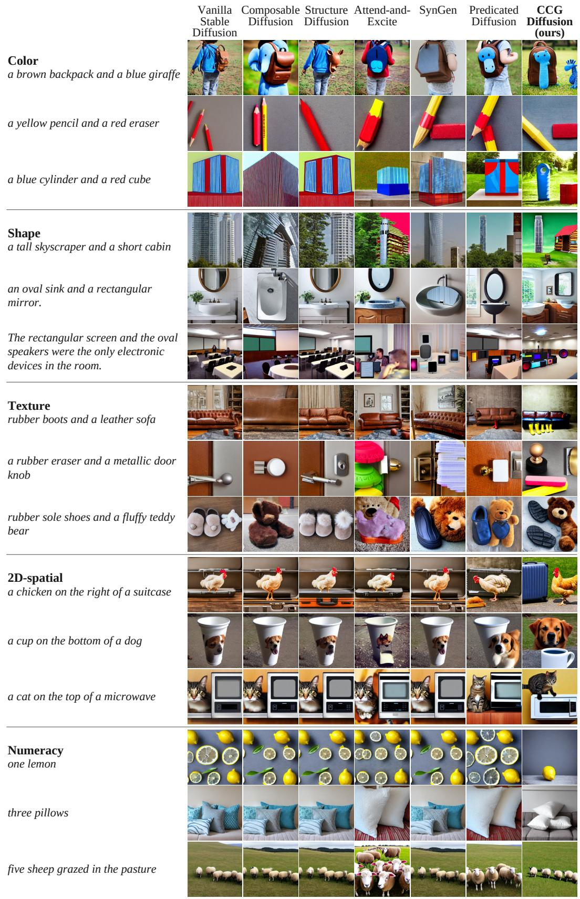  
FIGURE 7. Additional Stable Diffusion examples: Color, Shape, Texture, 2D-spatial, and Numeracy.

Vanilla Sana

Composable Diffusion

Structure Diffusion

Attend-and-Excite

SynGen

Predicated Diffusion

CCG Diffusion (ours)

Color a brown banana and a green bear

a brown apple and a green horse

a brown cup and a blue sheep

The oval mirror and the rectangular frame were mounted on the wall.

a spherical snow globe and an oblong frame

The triangular flag and the rectangular banner were waving in the wind on the parade.

Texture a rubber eraser and leather gloves

a metallic necklace and a wooden fork

The wooden cutting board and metallic cheese grater slice the fluffy cheddar for the plastic sandwich.

2D-spatial a book on the top of a woman

a chicken on the right of a suitcase

a man on side of a candle

Numeracy four clocks and one phone

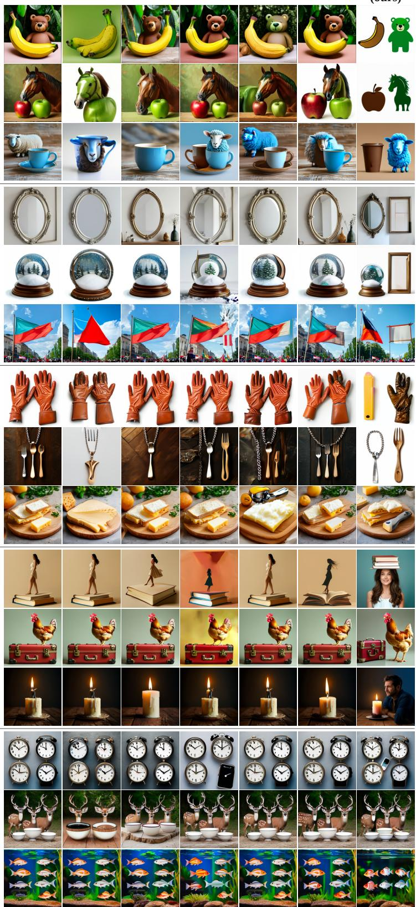  
FIGURE 8. Additional Sana examples: Color, Shape, Texture, 2D-spatial, and Numeracy.

three deer and four bowls

six fish swam in the aquarium

Vanilla Stable Diffusion

3D-spatial   
a woman in front of a   
computer

Composable Diffusion

Structure Diffusion

Attend-and-Excite

SynGen

Predicated Diffusion

CCG Diffusion (ours)

a man hidden by a backpack

Non-spatial A couple is enjoying a picnic in the park.

A woman is practicing calligraphy at home.

A person is wearing gloves and holding a snowball.

Complex The oval mirror is hung above the white sink.

The sharp black cat clawed at the soft red blanket.

The jagged, rocky cliffs jutted out from the sea, battered by the crashing waves below.

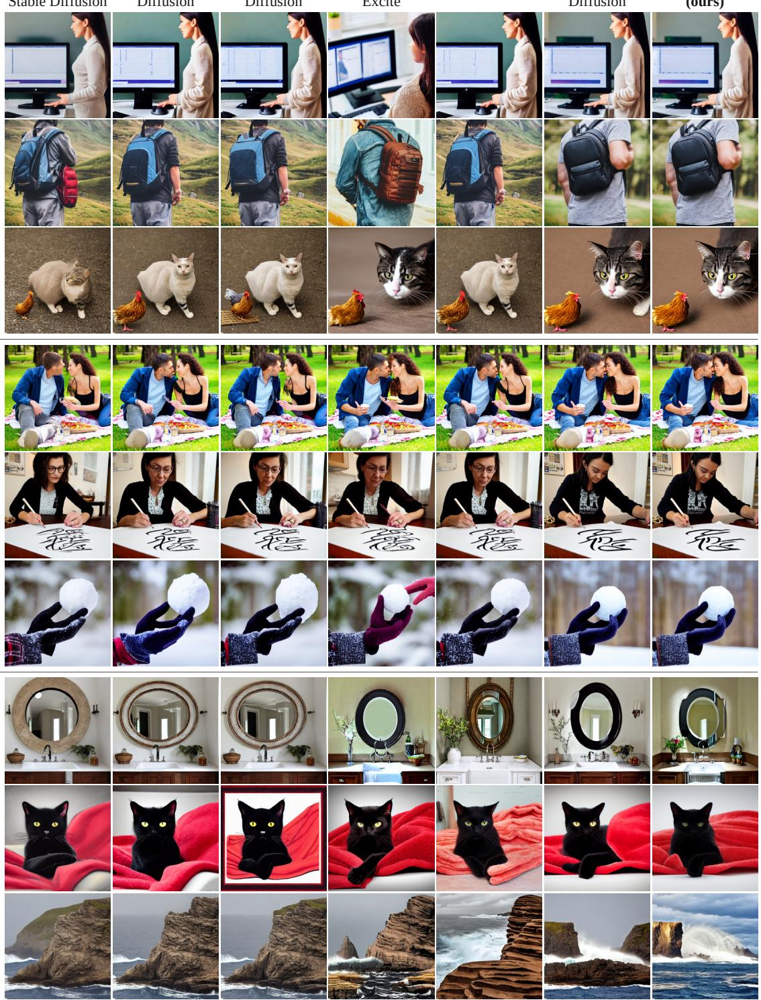  
FIGURE 9. Additional Stable Diffusion examples: 3D-spatial, Non-spatial, and Complex.

Vanilla Sana

Composable Diffusion

Structure Diffusion

Attend-and-Excite

SynGen

Predicated Diffusion

CCG Diffusion (ours)

3D-spatial a pig in front of a television

a balloon behind a boy

a man hidden by a backpack

Non-spatial   
A dog is jumping through a hoop and performing a   
trick.

A woman is sipping coffee while looking out a window.

A man is building a birdhouse in his workshop.

Complex   
The red apple was next to the yellow pear.

The sleek silver airplane flew above the fluffy white clouds.

The shiny silver ring sparkled on the rough wooden table.

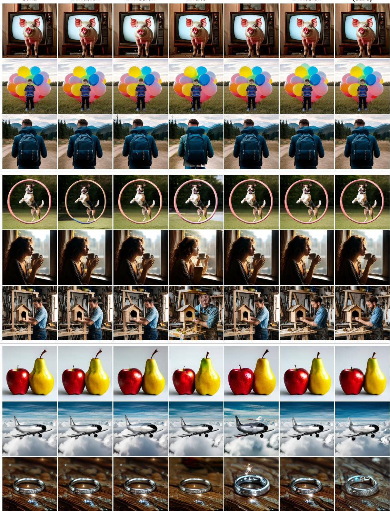  
FIGURE 10. Additional Sana examples: 3D-spatial, Non-spatial, and Complex.

VS-TIED + Gold-visual setup + Predicated Diffusion

## Vanilla Predicated Diffusion VS-TIED + Gold-visual setup

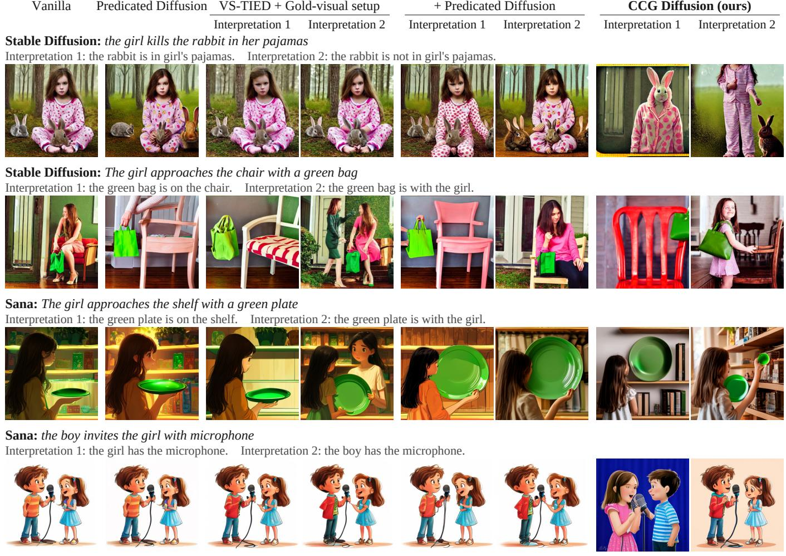  
FIGURE 11. Additional examples of generated images for the TAB PP-attachment category on Stable Diffusion and Sana.

## ACKNOWLEDGMENT

In this work, we used two AI coding agents: Codex (OpenAI; GPT-5 and GPT-6 series models) [77] and Claude Code (Anthropic; Claude Opus 5 and Claude Fable 5 series models) [78].

We used Codex mainly to implement the experiments. Following our specifications, Codex wrote new source code, debugged and refactored code, ran the experiments, aggregated the experiment logs, and created the scripts that generate the figures and tables.

We used Claude Code mainly to write this manuscript. For every section of this paper, we specified the content to be written, had Claude Code write a draft, and then checked and revised the draft. We also used Claude Code for English proofreading, for LATEX formatting and table typesetting, and for suggesting candidate references.

Both tools also served as discussion partners when we designed the method and experiments and when we interpreted the results, but all research ideas, design decisions, and interpretations of the results are our own. We verified AI-generated code through tests and comparison with known reference results, and we checked every number reported in this paper against the raw experiment logs. We take full responsibility for the content of this paper.

## REFERENCES

[1] A. Ramesh, P. Dhariwal, A. Nichol, C. Chu, and M. Chen, ‘‘Hierarchical text-conditional image generation with CLIP latents,’’ 2022, arXiv:2204.06125.

[2] R. Rombach, A. Blattmann, D. Lorenz, P. Esser, and B. Ommer, ‘‘High-resolution image synthesis with latent diffusion models,’’ in Proc. IEEE/CVF Conf. Comput. Vis. Pattern Recognit. (CVPR), New Orleans, LA, USA, Jun. 2022, pp. 10 674–10 685, doi: 10.1109/CVPR52688.2022.01042.

[3] D. Podell et al., ‘‘SDXL: Improving latent diffusion models for high-resolution image synthesis,’’ in Proc. 12th Int. Conf. Learn. Represent. (ICLR), Vienna, Austria, May 2024, pp. 1862–1874. [Online]. Available: https://proceedings.iclr.cc/paper\_files/paper/2024/ file/081b08068e4733ae3e7ad019fe8d172f-Paper-Conference.pdf

[4] P. Esser et al., ‘‘Scaling rectified flow transformers for high-resolution image synthesis,’’ in Proc. 41st Int. Conf. Mach. Learn. (ICML), Vienna, Austria, Jul. 2024, pp. 12 606–12 633. [Online]. Available: https://proceedings.mlr.press/v235/esser24a.html

[5] Black Forest Labs, ‘‘FLUX,’’ GitHub, 2024. Accessed: Oct. 19, 2026. [Online]. Available: https://github.com/black-forest-labs/flux

[6] Imagen 3 Team, Google, ‘‘Imagen 3,’’ 2024, arXiv:2408.07009.

[7] E. Xie et al., ‘‘SANA: Efficient high-resolution image synthesis with linear diffusion transformers,’’ in Proc. 13th Int. Conf. Learn. Represent. (ICLR), Singapore, Apr. 2025, pp. 20 383–20 407. [Online]. Available: https://proceedings.iclr.cc/paper\_files/paper/2025/ file/34345e243156da67605d4b63d71c8d98-Paper-Conference.pdf

[8] C. Wu et al., ‘‘Qwen-Image technical report,’’ 2025, arXiv:2508.02324.

[9] H. Chefer, Y. Alaluf, Y. Vinker, L. Wolf, and D. Cohen-Or, ‘‘Attendand-Excite: Attention-based semantic guidance for text-to-image diffusion models,’’ ACM Trans. Graph., vol. 42, no. 4, Aug. 2023, Art. no. 148, doi: 10.1145/3592116.

[10] D. Ghosh, H. Hajishirzi, and L. Schmidt, ‘‘GenEval: An object-focused framework for evaluating text-to-image alignment,’’ in Proc. Adv. Neural Inf. Process. Syst. (NeurIPS), vol. 36, New Orleans, LA, USA, Dec. 2023, pp. 52 132–52 152, doi: 10.52202/075280-2270. [Online]. Available: https://proceedings.neurips.cc/paper\_files/paper/2023/file/ a3bf71c7c63f0c3bcb7ff67c67b1e7b1-Paper-Datasets\_and\_Benchmarks. pdf

[11] K. Huang, C. Duan, K. Sun, E. Xie, Z. Li, and X. Liu, ‘‘T2I-CompBench++: An enhanced and comprehensive benchmark for compositional text-to-

image generation,’’ IEEE Trans. Pattern Anal. Mach. Intell., vol. 47, no. 5, pp. 3563–3579, May 2025, doi: 10.1109/TPAMI.2025.3531907.

[12] K. D. Hayes, M. Goldblum, V. Sehwag, G. Somepalli, A. Panda, and T. Goldstein, ‘‘FineGRAIN: Evaluating failure modes of text-to-image models with vision language model judges,’’ in Proc. Adv. Neural Inf. Process. Syst. (NeurIPS), vol. 38, San Diego, CA, USA, Dec. 2025, pp. 132 119–132 143, doi: 10.52202/085713-3977. [Online]. Available: https://proceedings.neurips.cc/paper\_files/paper/ 2025/file/accaab47784b91d9d381868eb638be0a-Paper-Datasets\_and\_ Benchmarks\_Track.pdf

[13] O. Li et al., ‘‘Easier painting than thinking: Can text-to-image models set the stage, but not direct the play?’’ in Proc. 14th Int. Conf. Learn. Represent. (ICLR), Rio de Janeiro, Brazil, Apr. 2026, pp. 86 729– 86 758. [Online]. Available: https://proceedings.iclr.cc/paper\_files/paper/ 2026/file/8bb0d291acd4acf06ef112099c16f326-Paper-Conference.pdf

[14] N. Mehrabi et al., ‘‘Resolving ambiguities in text-to-image generative models,’’ in Proc. 61st Annu. Meeting Assoc. Comput. Linguistics (ACL), vol. 1, Toronto, ON, Canada, Jul. 2023, pp. 14 367–14 388, doi: 10.18653/v1/2023.acl-long.804. [Online]. Available: https://aclanthology. org/2023.acl-long.804

[15] W. Elsharif, M. Alzubaidi, J. She, and M. Agus, ‘‘Visualizing ambiguity: Analyzing linguistic ambiguity resolution in text-to-image models,’ Computers, vol. 14, no. 1, Jan. 2025, Art. no. 19, doi: 10.3390/comput ers14010019.

[16] M. Hahn et al., ‘‘Proactive agents for multi-turn text-to-image generation under uncertainty,’’ in Proc. 42nd Int. Conf. Mach. Learn. (ICML), Vancouver, BC, Canada, Jul. 2025, pp. 21 591–21 628. [Online]. Available: https://proceedings.mlr.press/v267/hahn25a.html

[17] J. Betker et al., ‘‘Improving image generation with better captions,’’ OpenAI, Tech. Rep., 2023. [Online]. Available: https://cdn.openai.com/ papers/dall-e-3.pdf

[18] C.-Y. Chen, M. Shi, G. Zhang, and H. Shi, ‘‘T2I-Copilot: A training-free multi-agent text-to-image system for enhanced prompt interpretation and interactive generation,’’ in Proc. IEEE/CVF Int. Conf. Comput. Vis. (ICCV), Honolulu, HI, USA, Oct. 2025, pp. 19 396–19 405, doi: 10.1109/ICCV51701.2025.01803. [Online]. Available: https://openaccess.thecvf.com/content/ICCV2025/html/Chen\_ T2I-Copilot\_A\_Training-Free\_Multi-Agent\_Text-to-Image\_System\_ for\_Enhanced\_Prompt\_Interpretation\_ICCV\_2025\_paper.html

[19] K. Church and R. Patil, ‘‘Coping with syntactic ambiguity or how to put the block in the box on the table,’’ Amer. J. Comput. Linguistics, vol. 8, nos. 3–4, pp. 139–149, Jul.–Dec. 1982. [Online]. Available: https://aclanthology.org/J82-3004/

[20] A. Liu et al., ‘‘We’re afraid language models aren’t modeling ambiguity,’ in Proc. 2023 Conf. Empirical Methods Natural Lang. Process. (EMNLP), Singapore, Dec. 2023, pp. 790–807, doi: 10.18653/v1/2023.emnlp main.51. [Online]. Available: https://aclanthology.org/2023.emnlp-main. 51/

[21] A. Karamolegkou, O. Eberle, P. Rust, C. Kauf, and A. Søgaard, ‘‘Trick or neat: Adversarial ambiguity and language model evaluation,’’ in Proc. Findings Assoc. Comput. Linguistics (ACL), Vienna, Austria, Jul. 2025, pp. 18 542–18 561, doi: 10.18653/v1/2025.findings-acl.954. [Online]. Available: https://aclanthology.org/2025.findings-acl.954/

[22] A. Agarwal, S. Karanam, K. J. Joseph, A. Saxena, K. Goswami, and B. V. Srinivasan, ‘‘A-STAR: Test-time attention segregation and retention for text-to-image synthesis,’’ in Proc. IEEE/CVF Int. Conf. Comput. Vis. (ICCV), Paris, France, Oct. 2023, pp. 2283–2293, doi: 10.1109/ICCV51070.2023.00217. [Online]. Available: https://openaccess.thecvf.com/content/ICCV2023/html/ Agarwal\_A-STAR\_Test-time\_Attention\_Segregation\_and\_Retention\_ for\_Text-to-image\_Synthesis\_ICCV\_2023\_paper.html

[23] Y. Li, M. Keuper, D. Zhang, and A. Khoreva, ‘‘Divide & Bind your attention for improved generative semantic nursing,’’ in Proc. 34th Brit. Mach. Vis. Conf. (BMVC), Aberdeen, U.K., Nov. 2023. [Online]. Available: https://papers.bmvc2023.cvml.group/0366.pdf

[24] R. Rassin, E. Hirsch, D. Glickman, S. Ravfogel, Y. Goldberg, and G. Chechik, ‘‘Linguistic binding in diffusion models: Enhancing attribute correspondence through attention map alignment,’’ in Proc. Adv. Neural Inf. Process. Syst. (NeurIPS), vol. 36, New Orleans, LA, USA, Dec. 2023, pp. 3536–3559, doi: 10.52202/075280-0157. [Online]. Available: https://proceedings.neurips.cc/paper\_files/paper/ 2023/file/0b08d733a5d45a547344c4e9d88bb8bc-Paper-Conference.pdf

[25] T. H. S. Meral, E. Simsar, F. Tombari, and P. Yanardag, ‘‘CONFORM: Contrast is all you need for high-fidelity text-

to-image diffusion models,’’ in Proc. IEEE/CVF Conf. Comput. Vis. Pattern Recognit. (CVPR), Seattle, WA, USA, Jun. 2024, pp. 9005–9014, doi: 10.1109/CVPR52733.2024.00860. [Online]. Available: https://openaccess.thecvf.com/content/CVPR2024/html/ Meral\_CONFORM\_Contrast\_is\_All\_You\_Need\_for\_High-Fidelity\_ Text-to-Image\_Diffusion\_CVPR\_2024\_paper.html

[26] Y. Zhang, P. Yu, and Y. N. Wu, ‘‘Object-conditioned energy-based attention map alignment in text-to-image diffusion models,’’ in Proc. 18th Eur. Conf. Comput. Vis. (ECCV), Milan, Italy, Oct. 2024, pp. 55–71, doi: 10.1007/978- 3-031-72946-1\_4.

[27] K. Sueyoshi and T. Matsubara, ‘‘Predicated Diffusion: Predicate logic-based attention guidance for text-to-image diffusion models,’’ in Proc. IEEE/CVF Conf. Comput. Vis. Pattern Recognit. (CVPR), Seattle, WA, USA, Jun. 2024, pp. 8651– 8660, doi: 10.1109/CVPR52733.2024.00826. [Online]. Available: https://openaccess.thecvf.com/content/CVPR2024/html/Sueyoshi\_ Predicated\_Diffusion\_Predicate\_Logic-Based\_Attention\_Guidance\_for\_ Text-to-Image\_Diffusion\_Models\_CVPR\_2024\_paper.html

[28] W. Feng et al., ‘‘Training-free structured diffusion guidance for compositional text-to-image synthesis,’’ in Proc. 11th Int. Conf. Learn Represent. (ICLR), Kigali, Rwanda, May 2023. [Online]. Available: https://openreview.net/forum?id=PUIqjT4rzq7

[29] M. M. Trusca et al., ‘‘Leveraging the syntactic structure of the text prompt to enhance object-attribute binding in image generation,’’ in Proc. 2nd Workshop Large Generative Models Meet Multimodal Appl. (LGM3A), Melbourne, Australia, Oct. 2024, pp. 6–10, doi: 10.1145/3688866.3689118.

[30] C. Zhuang, Y. Hu, and P. Gao, ‘‘Magnet: We never know how text-to-image diffusion models work, until we learn how vision-language models function,’’ in Proc. Adv. Neural Inf. Process. Syst. (NeurIPS), vol. 37, Vancouver, BC, Canada, Dec. 2024, pp. 57 115–57 149, doi: 10.52202/079017-1820. [Online]. Available: https://proceedings.neurips.cc/paper\_files/paper/2024/ file/688ffe062732aabd87dfe57bcb0bf3ae-Paper-Conference.pdf

[31] T. Hu et al., ‘‘Token Merging for training-free semantic binding in text-to-image synthesis,’’ in Proc. Adv. Neural Inf. Process. Syst. (NeurIPS), vol. 37, Vancouver, BC, Canada, Dec. 2024, pp. 137 646–137 672, doi: 10.52202/079017-4372. [Online]. Available: https://proceedings.neurips.cc/paper\_files/paper/2024/ file/f8ce25dcb2cb0eb8a24b492bf3e84695-Paper-Conference.pdf

[32] M. Honnibal, I. Montani, S. Van Landeghem, and A. Boyd, ‘‘spaCy: Industrial-strength natural language processing in Python,’’ Zenodo, 2020, doi: 10.5281/zenodo.1212303.

[33] M. Chen, I. Laina, and A. Vedaldi, ‘‘Training-free layout control with cross-attention guidance,’’ in Proc. IEEE/CVF Winter Conf. Appl. Comput. Vis. (WACV), Waikoloa, HI, USA, Jan. 2024, pp. 5331–5341, doi: 10.1109/WACV57701.2024.00526.

[34] J. Xie et al., ‘‘BoxDiff: Text-to-image synthesis with trainingfree box-constrained diffusion,’’ in Proc. IEEE/CVF Int. Conf. Comput. Vis. (ICCV), Paris, France, Oct. 2023, pp. 7418–7427, doi: 10.1109/ICCV51070.2023.00685.

[35] L. Lian, B. Li, A. Yala, and T. Darrell, ‘‘LLM-grounded Diffusion: Enhancing prompt understanding of text-to-image diffusion models with large language models,’’ Trans. Mach. Learn. Res., Mar. 2024. [Online]. Available: https://openreview.net/forum?id=hFALpTb4fR

[36] Q. Phung, S. Ge, and J.-B. Huang, ‘‘Grounded text-to-image synthesis with attention refocusing,’’ in Proc. IEEE/CVF Conf. Comput. Vis. Pattern Recognit. (CVPR), Seattle, WA, USA, Jun. 2024, pp. 7932–7942, doi: 10.1109/CVPR52733.2024.00758. [Online]. Available: https://openaccess.thecvf.com/content/CVPR2024/ html/Phung\_Grounded\_Text-to-Image\_Synthesis\_with\_Attention\_ Refocusing\_CVPR\_2024\_paper.html

[37] W. Kang, K. Galim, H. I. Koo, and N. I. Cho, ‘‘Counting guidance for high fidelity text-to-image synthesis,’’ in Proc. IEEE/CVF Winter Conf. Appl. Comput. Vis. (WACV), Tucson, AZ, USA, Feb. 2025, pp. 899–908, doi: 10.1109/WACV61041.2025.00097. [Online]. Available: https://openaccess.thecvf.com/content/WACV2025/ html/Kang\_Counting\_Guidance\_for\_High\_Fidelity\_Text-to-Image\_ Synthesis\_WACV\_2025\_paper.html

[38] L. Binyamin, Y. Tewel, H. Segev, E. Hirsch, R. Rassin, and G. Chechik, ‘‘Make it count: Text-to-image generation with an accurate number of objects,’’ in Proc. IEEE/CVF Conf. Comput. Vis. Pattern Recognit. (CVPR), Nashville, TN, USA, Jun. 2025, pp. 13 242–13 251, doi: 10.1109/CVPR52734.2025.01236.

[Online]. Available: https://openaccess.thecvf.com/content/CVPR2025/ html/Binyamin\_Make\_It\_Count\_Text-to-Image\_Generation\_with\_an\_ Accurate\_Number\_of\_CVPR\_2025\_paper.html

[39] A. Radford et al., ‘‘Learning transferable visual models from natural language supervision,’’ in Proc. 38th Int. Conf. Mach. Learn. (ICML), Jul. 2021, pp. 8748–8763. [Online]. Available: https://proceedings.mlr.press/ v139/radford21a.html

[40] M. Yuksekgonul, F. Bianchi, P. Kalluri, D. Jurafsky, and J. Zou, ‘‘When and why vision-language models behave like bags-of-words, and what to do about it?’’ in Proc. 11th Int. Conf. Learn. Represent. (ICLR), Kigali, Rwanda, May 2023. [Online]. Available: https://openreview.net/forum? id=KRLUvxh8uaX

[41] R. Kang, Y. Song, G. Gkioxari, and P. Perona, ‘‘Is CLIP ideal? No. Can we fix it? Yes!’’ in Proc. IEEE/CVF Int. Conf. Comput. Vis. (ICCV), Honolulu, HI, USA, Oct. 2025, pp. 22 436–22 446, doi: 10.1109/ICCV51701.2025.02083. [Online]. Available: https://openaccess.thecvf.com/content/ICCV2025/html/Kang\_ Is\_CLIP\_ideal\_No.\_Can\_we\_fix\_it\_Yes\_ICCV\_2025\_paper.html

[42] M. Steedman, The Syntactic Process. Cambridge, MA, USA: MIT Press, 2000, doi: 10.7551/mitpress/6591.001.0001.

[43] S. Bangalore and A. K. Joshi, ‘‘Supertagging: An approach to almost parsing,’’ Comput. Linguistics, vol. 25, no. 2, pp. 237–265, Jun. 1999. [Online]. Available: https://aclanthology.org/J99-2004/

[44] S. Clark and J. R. Curran, ‘‘The importance of supertagging for wide-coverage CCG parsing,’’ in Proc. 20th Int. Conf. Comput. Linguistics (COLING), Geneva, Switzerland, Aug. 2004, pp. 282–288, doi: 10.3115/1220355.1220396. [Online]. Available: https://aclanthology.org/C04-1041/

[45] W. Peebles and S. Xie, ‘‘Scalable diffusion models with transformers,’’ in Proc. IEEE/CVF Int. Conf. Comput. Vis. (ICCV), Paris, France, Oct. 2023, pp. 4172–4182, doi: 10.1109/ICCV51070.2023.00387.

[46] Y. Zhang, T. T. Teoh, W. H. Lim, and K. Kawaguchi, ‘‘Enhancing semantic fidelity in text-to-image synthesis: Attention regulation in diffusion models,’’ in Proc. 18th Eur. Conf. Comput. Vis. (ECCV), Milan, Italy, Oct. 2024, pp. 70–86, doi: 10.1007/978-3-031-73016-0\_5.

[47] X. Guo, J. Liu, M. Cui, J. Li, H. Yang, and D. Huang, ‘‘InitNO: Boosting text-to-image diffusion models via initial noise optimization,’’ in Proc. IEEE/CVF Conf. Comput. Vis. Pattern Recognit. (CVPR), Seattle, WA, USA, Jun. 2024, pp. 9380–9389, doi: 10.1109/CVPR52733.2024.00896. [Online]. Available: https://openaccess.thecvf.com/content/CVPR2024/ html/Guo\_InitNO\_Boosting\_Text-to-Image\_Diffusion\_Models\_via\_ Initial\_Noise\_Optimization\_CVPR\_2024\_paper.html

[48] P. Qi, Y. Zhang, Y. Zhang, J. Bolton, and C. D. Manning, ‘‘Stanza: A Python natural language processing toolkit for many human languages,’’ in Proc. 58th Annu. Meeting Assoc. Comput. Linguistics: Syst. Demonstrations (ACL), Jul. 2020, pp. 101–108, doi: 10.18653/v1/2020.acl-demos.14. [Online]. Available: https://aclanthology.org/2020.acl-demos.14/

[49] D. Epstein, A. Jabri, B. Poole, A. A. Efros, and A. Holynski, ‘‘Diffusion self-guidance for controllable image generation,’’ in Proc. Adv. Neural Inf. Process. Syst. (NeurIPS), vol. 36, New Orleans, LA, USA, Dec. 2023, pp. 16 222–16 239, doi: 10.52202/075280-0714. [Online]. Available: https://proceedings.neurips.cc/paper\_files/paper/ 2023/file/3469b211b829b39d2b0cfd3b880a869c-Paper-Conference.pdf

[50] W. Han, Y. Lee, C. Kim, K. Park, and S. J. Hwang, ‘‘Spatial transport optimization by repositioning attention map for training free text-to-image synthesis,’’ in Proc. IEEE/CVF Conf. Comput. Vis. Pattern Recognit. (CVPR), Nashville, TN, USA, Jun. 2025, pp. 18 401–18 410, doi: 10.1109/CVPR52734.2025.01715. [Online]. Available: https://openaccess.thecvf.com/content/CVPR2025/html/Han\_ Spatial\_Transport\_Optimization\_by\_Repositioning\_Attention\_Map\_for\_ Training-Free\_Text-to-Image\_CVPR\_2025\_paper.htm

[51] S. Rastegar et al., ‘‘InfSplign: Inference-time spatial alignment of text-toimage diffusion models,’’ 2025, arXiv:2512.17851.

[52] A. M. Izadi, S. M. H. Hosseini, S. Vafaie Tabar, A. Abdollahi, A. Saghafian, and M. Soleymani Baghshah, ‘‘Fine-grained alignment and noise refinement for compositional text-to-image generation,’’ 2025, arXiv:2503.06506.

[53] N. Liu, S. Li, Y. Du, A. Torralba, and J. B. Tenenbaum, ‘‘Compositional visual generation with Composable Diffusion models,’’ in Proc. 17th Eur. Conf. Comput. Vis. (ECCV), Tel Aviv, Israel, Oct. 2022, pp. 423–439, doi: 10.1007/978-3-031-19790-1\_26.

[54] G. Y. Park, J. Kim, B. Kim, S. W. Lee, and J. C. Ye, ‘‘Energy-based cross attention for Bayesian context update in text-to-image diffusion models,’ in Proc. Adv. Neural Inf. Process. Syst. (NeurIPS), vol. 36, New Orleans,

LA, USA, Dec. 2023, pp. 76 382–76 408, doi: 10.52202/075280-3339. [Online]. Available: https://proceedings.neurips.cc/paper\_files/paper/ 2023/file/f0878b7efa656b3bbd407c9248d13751-Paper-Conference.pdf

[55] X. Hu, R. Wang, Y. Fang, B. Fu, P. Cheng, and G. Yu, ‘‘ELLA: Equip diffusion models with LLM for enhanced semantic alignment,’’ 2024, arXiv:2403.05135.

[56] L. Yang, Z. Yu, C. Meng, M. Xu, S. Ermon, and B. Cui, ‘‘Mastering text-to-image diffusion: Recaptioning, planning, and generating with multimodal LLMs,’’ in Proc. 41st Int. Conf. Mach. Learn. (ICML), Vienna, Austria, Jul. 2024, pp. 56 704–56 721. [Online]. Available: https://proceedings.mlr.press/v235/yang24ai.html

[57] Y. Berzak, A. Barbu, D. Harari, B. Katz, and S. Ullman, ‘‘Do you see what I mean? Visual resolution of linguistic ambiguities,’’ in Proc. 2015 Conf. Empirical Methods Natural Lang. Process. (EMNLP), Lisbon, Portugal, Sep. 2015, pp. 1477–1487, doi: 10.18653/v1/D15-1172. [Online]. Available: https://aclanthology.org/D15-1172

[58] G. Christie et al., ‘‘Resolving language and vision ambiguities together: Joint segmentation & prepositional attachment resolution in captioned scenes,’’ in Proc. 2016 Conf. Empirical Methods Natural Lang. Process. (EMNLP), Austin, TX, USA, Nov. 2016, pp. 1493–1503, doi: 10.18653/v1/D16-1156. [Online]. Available: https://aclanthology.org/D16-1156/

[59] S. Delecraz, A. Nasr, F. Bechet, and B. Favre, ‘‘Adding syntactic annotations to Flickr30k Entities corpus for multimodal ambiguous prepositional-phrase attachment resolution,’’ in Proc. 11th Int. Conf. Lang. Resour. Eval. (LREC), Miyazaki, Japan, May 2018, pp. 4520–4524, doi: 10.63317/57dinhnuy42x. [Online]. Available: https://aclanthology. org/L18-1716/

[60] S. Delecraz, L. Becerra-Bonache, B. Favre, A. Nasr, and F. Bechet, ‘‘Multimodal machine learning for natural language processing: Disambiguating prepositional phrase attachments with images,’’ Neural Process. Lett., vol. 53, no. 5, pp. 3095–3121, Oct. 2021, doi: 10.1007/s11063-020-10314- 8.

[61] K. Zhou, E. Lai, K. Mouratidis, and J. Jiang, ‘‘FOCUS: Evaluating pre-trained vision-language models on underspecification reasoning,’’ in Proc. 63rd Annu. Meeting Assoc. Comput. Linguistics (ACL), vol. 1, Vienna, Austria, Jul. 2025, pp. 27 565–27 584, doi: 10.18653/v1/2025.acllong.1337. [Online]. Available: https://aclanthology.org/2025.acl-long. 1337/

[62] S. Lee, S. Inadumi, and K. Yoshino, ‘‘LaViSA: A language and vision structural ambiguity benchmark,’’ 2026, arXiv:2606.19552.

[63] B. Hutchinson, J. Baldridge, and V. Prabhakaran, ‘‘Underspecification in scene description-to-depiction tasks,’’ in Proc. 2nd Conf. Asia-Pacific Chapter Assoc. Comput. Linguistics and 12th Int. Joint Conf. Natural Lang. Process. (AACL-IJCNLP), vol. 1, Nov. 2022, pp. 1172– 1184, doi: 10.18653/v1/2022.aacl-main.86. [Online]. Available: https: //aclanthology.org/2022.aacl-main.86/

[64] B. Park, M. Janecek, N. Ezzati-Jivan, Y. Li, and A. Emami, ‘‘Picturing ambiguity: A visual twist on the Winograd Schema Challenge,’’ in Proc. 62nd Annu. Meeting Assoc. Comput. Linguistics (ACL), vol. 1, Bangkok, Thailand, Aug. 2024, pp. 355–374, doi: 10.18653/v1/2024.acl-long.22. [Online]. Available: https://aclanthology.org/2024.acl-long.22/

[65] D. P. Kingma and M. Welling, ‘‘Auto-encoding variational Bayes,’’ in Proc. 2nd Int. Conf. Learn. Represent. (ICLR), Banff, AB, Canada, Apr. 2014. [Online]. Available: https://arxiv.org/abs/1312.6114

[66] S. Clark and J. R. Curran, ‘‘Wide-coverage efficient statistical parsing with CCG and log-linear models,’’ Comput. Linguistics, vol. 33, no. 4, pp. 493–552, Dec. 2007, doi: 10.1162/coli.2007.33.4.493. [Online]. Available: https://aclanthology.org/J07-4004/

[67] J. Hockenmaier and M. Steedman, ‘‘CCGbank: A corpus of CCG derivations and dependency structures extracted from the Penn Treebank,’’ Comput. Linguistics, vol. 33, no. 3, pp. 355–396, Sep. 2007, doi: 10.1162/coli.2007.33.3.355. [Online]. Available: https://aclanthology.org/ J07-3004/

[68] M. Collins, ‘‘Head-driven statistical models for natural language parsing,’’ Comput. Linguistics, vol. 29, no. 4, pp. 589–637, Dec. 2003, doi: 10.1162/089120103322753356. [Online]. Available: https://aclanthology. org/J03-4003/

[69] M. Duan, E. Hill, and M. White, ‘‘Generating disambiguating paraphrases for structurally ambiguous sentences,’’ in Proc. 10th Linguistic Annotation Workshop (LAW-X), Berlin, Germany, Aug. 2016, pp. 160–170, doi: 10.18653/v1/W16-1718. [Online]. Available: https://aclanthology.org/W16-1718/

[70] Gemma Team, Google DeepMind, ‘‘Gemma 2: Improving open language models at a practical size,’’ 2024, arXiv:2408.00118.

[71] R. Yamaki, T. Taniguchi, and D. Mochihashi, ‘‘Holographic CCG parsing,’ in Proc. 61st Annu. Meeting Assoc. Comput. Linguistics (ACL), vol. 1, Toronto, ON, Canada, Jul. 2023, pp. 262–276, doi: 10.18653/v1/2023.acllong.15. [Online]. Available: https://aclanthology.org/2023.acl-long.15/

[72] X. Zhou, V. Koltun, and P. Krähenbühl, ‘‘Simple multi-dataset detection,’’ in Proc. IEEE/CVF Conf. Comput. Vis. Pattern Recognit. (CVPR), New Orleans, LA, USA, Jun. 2022, pp. 7561–7570, doi: 10.1109/CVPR52688.2022.00742.

[73] J. Hessel, A. Holtzman, M. Forbes, R. Le Bras, and Y. Choi, ‘‘CLIPScore: A reference-free evaluation metric for image captioning,’ in Proc. 2021 Conf. Empirical Methods Natural Lang. Process. (EMNLP), Punta Cana, Dominican Republic, Nov. 2021, pp. 7514– 7528, doi: 10.18653/v1/2021.emnlp-main.595. [Online]. Available: https://aclanthology.org/2021.emnlp-main.595/

[74] OpenAI, ‘‘GPT-6 Astra system card,’’ OpenAI Deployment Safety Hub, Sep. 2026. Accessed: Oct. 19, 2026. [Online]. Available: https: //deploymentsafety.openai.com/gpt-6-astra

[75] Qwen Team, ‘‘On the design of Qwen3.8-Next architecture: Evaluation, efficiency, and training stability,’’ Alibaba Group, Tech. Rep., Aug. 2026. Accessed: Oct. 19, 2026. [Online]. Available: https://github.com QwenLM/Qwen3.8-Flash-Next/blob/main/tech\_report.pdf

[76] J. Cohen, ‘‘A coefficient of agreement for nominal scales,’ Educ. Psychol. Meas., vol. 20, no. 1, pp. 37–46, Apr. 1960, doi: 10.1177/001316446002000104.

[77] OpenAI, ‘‘Codex,’’ AI coding agent, 2026. Accessed: Oct. 2, 2026. [Online]. Available: https://openai.com/codex

[78] Anthropic, ‘‘Claude Code,’’ AI coding agent, 2026. Accessed: Oct. 2, 2026. [Online]. Available: https://claude.com/product/claude-code

  
RYOSUKE YAMAKI received the M.E. degree from Ritsumeikan University, Japan, in 2023, where he is currently pursuing the Ph.D. degree with the Graduate School of Information Science and Engineering. His research interests include natural language processing, syntactic parsing, and text-to-image generation. He is a Student Member of the Association for Natural Language Processing.

DAICHI MOCHIHASHI received the B.S. degree from The University of Tokyo, in 1998, and the Ph.D. degree from Nara Institute of Science and Technology, in 2005. He is currently a Professor with The Institute of Statistical Mathematics and jointly with the National Institute for Japanese Language and Linguistics, Japan. His research interests include natural language processing, ma chine learning, and Bayesian statistics.

NOBUTAKA SHIMADA (Member, IEEE) received the M.E. and Ph.D. degrees from Osaka University, in 1994 and 1997, respectively. From 1997 to 2003, he was a Research Associate at the Department of Mechanical Engineering for Computer-Controlled Machinery, Osaka University. From 2004 to 2012, he was an Associate Professor at the Department of Human and Computer Intelligence, Ritsumeikan University. From 2007 to 2008, he was a Visiting Associate Professor at

the Robotics Institute, Carnegie Mellon University. Since 2012, he has been a Professor at the Department of Information and Engineering, Ritsumeikan University. His research interests include computer vision, robot vision, and human–computer interaction. He is a member of IEEE CS, IEICE, IPSJ, RSJ, JSAI, and HIS.

SEITARO SHINAGAWA graduated from the Faculty of Engineering at Tohoku University in 2013. He completed his Master’s degree in Information Science at the same university in 2015, and his doctoral studies at the Nara Institute of Science and Technology (NAIST) in 2020, earning a Doctor of Engineering. After serving as an Assistant Professor at NAIST, he joined SB Intuitions Corp. and became an Affiliate Assistant Professor at NAIST in 2024. He is engaged in the research and development of multimodal foundation models.

TADAHIRO TANIGUCHI (Member, IEEE) received the M.E. and Ph.D. degrees from Kyoto University, in 2003 and 2006, respectively. From 2005 to 2008, he was a Japan Society for the Promotion of Science Research Fellow with Kyoto University. From 2008 to 2010, he was an Assistant Professor with the Department of Human and Computer Intelligence, Ritsumeikan University. From 2010 to 2017, he was an Associate Professor with the Department of Human and Com-

puter Intelligence, Ritsumeikan University. From 2015 to 2016, he was a Visiting Associate Professor with the Department of Electrical and Electronic Engineering, Imperial College London. From 2017 to 2024, he was a Professor with the Department of Information and Engineering, Ritsumeikan University. He is currently a Professor with the Graduate School of Informatics, Kyoto University, and an Affiliate Professor with the Research Organization of Science and Technology, Ritsumeikan University. He has been engaged in research on machine learning, emergent systems, intelligent vehicles, and symbol emergence in robotics.