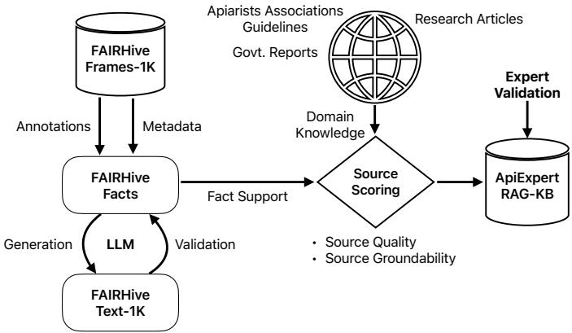
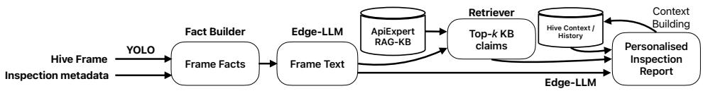

# Computer Vision and Knowledge-Grounded Language Models for Intelligent Beekeeper Assistance

Asaduz Zaman Faculty of Information Technology Monash University Clayton, VIC-3800, Australia asaduzzaman@monash.edu

Mohaimenul Azam Khan Raiaan   
Faculty of Information Technology Monash University Clayton, VIC-3800, Australia   
mohaimenul.raiaan@monash.edu Malika Nisal Ratnayake   
Faculty of Information Technology Monash University Clayton, VIC-3800, Australia   
malika.ratnayake@monash.edu

## Abstract

Managed and wild bees sustain roughly a third of the global food products, yet colonies face mounting stress from climate-change including extreme weather patterns, altered parasite and disease patterns. Timely assessment of colony condition such as understanding colony strength, brood area, honey and pollen storage, comb usage, is essential to adaptive management. However, manual hive frame inspection is slow, costly, and quality depends on scarce expertise. We present an artificial targeted intelligent system framework focusing on edge deployable pipeline that turns hive frame photographs into interpretable and action-oriented inspection report. The pipeline includes an object detector to detect biologically-meaningful comb-cell classes; detections are distilled into structured fact schema; facts are converted into constrained factual text; the text triggers a grounded knowledge-base for interpretations and recommendations. Knowledge-base entries are required to be triggerable by evidence expressed in the fact schema. We built our system based on open source FAIRHiveFrames-1K dataset and favour reproducible, edge-deployable models over large general purpose frontier models. We additionally release FAIRHiveText-1K dataset that turns FAIRHiveFrames-1K dataset into interchangeable facts and text interpretation of the facts, making it easy for further LLM-based research into this area. We also propose a pathway to develop the grounded knowledge-base that will be helpful in providing interpretable and actionable reports from the facts.

## 1 Introduction

Honeybees are essential to global food production and ecosystem services [1–3], and insufficient pollination already limits yields in several major crops [4]. Climate change further exposes colonies to extreme and unstable weather, shifting seasons, altered floral resources, and changing pest, parasite, and diseases, with weather instability linked to colony losses through interactions with parasite pressure [5–8]. As these conditions become less predictable, management based on seasonal calendars becomes less reliable, increasing the need for precision apiculture guided by timely, colony-specific assessments.

  
Figure 1: Knowledge-base construction. Annotations from FAIRHiveFrames-1K yield structured facts, which an LLM expands into FAIRHiveText-1K with round-trip validation; external domain knowledge is scored for quality and fact-schema groundability, then expert-validated into the ApiExpert RAG-KB.

Hive-frame inspection provides important indicators of colony condition, including brood development, food reserves, colony strength, and comb use [9]. While precision apiculture can continuously monitor colony-level signals such as weight, temperature, and acoustics, [10], frame-level indicators still require expert visual assessment, limiting the scale and frequency of assessment. Computer vision can automate their extraction [11], but these predictions alone do not tell beekeepers what observations imply or what actions to take. This requires connecting visual evidence with domain knowledge in a traceable manner.

Large language models (LLMs) offer a natural interface for translating such observations into personalised advice [12], but hallucination limits their reliability for management recommendations [13]. Retrieval-augmented generation (RAG) mitigates this by grounding outputs in an explicit, inspectable knowledge-base [14].

We therefore propose an interpretable, edge-deployable AI framework that separates visual perception, factual representation, knowledge retrieval, and language generation. Computer-vision predictions are transformed into structured facts that support retrieval of relevant domain knowledge and evidence-grounded generation of interpretations and recommendations. We instantiate the framework for honeycomb-cell analysis using FAIRHiveFrames-1K [11], an open-source dataset of 1,265 expert-annotated hive-frame images, and introduce FAIRHiveText-1K, which extends these visual annotations into structured facts and textual descriptions for grounded language-based analysis. Together, they provide a concrete baseline of the proposed framework towards scalable and accessible decision support for adaptive honeybee management under increasing climate variability.

## 2 Proposed Approach

We propose a two-stage framework (Figs. 1 and 2) that transforms computer-vision observations from honeybee comb-frame into personalised, knowledge-grounded information for beekeepers, extending prior work on automated and sensor-based hive monitoring [9, 10, 15]. The framework separates knowledge-base construction from operational inference. In the first stage, structured and textua representations of hive-frame information are developed alongside a curated apiculture knowledge base. In the second stage, these resources are integrated with computer-vision predictions, inspection metadata, and hive-specific context to generate personalised inspection reports.

## 2.1 Stage 1: Knowledge-Base Construction

The first stage (Fig. 1) converts the FAIRHiveFrames-1K annotations and associated metadata into structured and textual factual representations. Each FAIRHiveFrames-1K sample comprises a comb frame image, associated annotations, metadata, and a unique identifier. The existing cell-level annotations classify honeycomb cells into six content categories [9, 11]. These cell-level annotations are aggregated deterministically into frame-level measurements, such as cell counts and class proportions, forming FAIRHiveFacts. A pretrained LLM with a constrained prompt template renders these facts as FAIRHiveText-1K: concise factual descriptions of comb composition, deliberately excluding diagnoses or recommendations. Generation validation is performed by extracting facts from the generated text and comparing them with the original structured facts, providing a mechanism to assess consistency between the two representations. In parallel, external apiculture knowledge is collected from sources including apiarist association guidelines, government reports, and relevant research articles. Candidate information is assessed according to source quality and source groundability, where groundability reflects whether the knowledge can be connected to observations represented within the FAIRHiveFacts schema. Following expert validation, the selected domain knowledge is incorporated into the ApiExpert RAG-KB. This process produces a curated knowledge resource designed to support the retrieval of information relevant to observations obtained from hive-frame analysis.

  
Figure 2: On-device inference pipeline. A YOLO-based detector processes a hive-frame image, and a fact builder combines its prediction with inspection metadata into structured frame facts, which an Edge-LLM renders as a frame description. The description retrieves the top-k supporting claims from the ApiExpert RAG-KB (Fig. 1), and the same model generates a personalised inspection report conditioned on the frame description, retrieved claims, and hive context and history. Completed reports are stored in the hive history, informing subsequent inspection.

## 2.2 Stage 2: Personalised Beekeeper Assistance

The second stage (Fig. 2) applies the constructed resources during hive inspection. A YOLObased detector processes an input hive-frame image, and a Fact Builder combines the resulting predictions with inspection metadata to construct structured Frame Facts. An Edge-LLM then converts these facts into a concise Frame Text representation. Subsequently, a retriever uses the Frame Text to obtain the top-k relevant claims from the ApiExpert RAG-KB developed in Stage 1 (Sect. 2.1). These retrieved claims are supplied to the Edge-LLM together with the Frame Text and available hive context and history to generate a personalised inspection report [14]. In this way, the generation of reports is conditioned on both observations derived from the current hive frame and relevant external apiculture knowledge. The history and context of the hive are maintained through a context-building component. Completed personalised inspection reports are added to the hive history, allowing information accumulated from previous inspections to contribute to the context available during subsequent analyses. The resulting pipeline therefore combines computer-vision observations, retrieved domain knowledge, inspection metadata, and accumulated hive information to support personalised, knowledge-grounded beekeeper assistance.

## 3 Pathway to Impact and Future Work

The proposed framework provides a pathway from automated hive observations to accessible, evidence-grounded decision support, enabling beekeepers to identify changes in colony condition and respond more effectively to increasing climate variability. Future work will implement and evaluate the complete pipeline, including edge deployment, knowledge-base construction, report generation, and integration of hive and environmental context. Ultimately, linking repeated colony assessments with climatic conditions could support earlier identification of climate-related stress and more adaptive, data-driven beekeeping practices.

## References

[1] Simon G Potts, Hien T Ngo, Jacobus C Biesmeijer, Thomas D Breeze, Lynn V Dicks, Lucas A Garibaldi, Rosemary Hill, Josef Settele, and Adam Vanbergen. The assessment report of the intergovernmental science-policy platform on biodiversity and ecosystem services on pollinators, pollination and food production. 2016.

[2] Alexandra-Maria Klein, Bernard E Vaissière, James H Cane, Ingolf Steffan-Dewenter, Saul A Cunningham, Claire Kremen, and Teja Tscharntke. Importance of pollinators in changing landscapes for world crops. Proceedings ofthe royal society B: biological sciences, 274(1608):303–313, 2007.

[3] Jagadish Bhakta Shrestha. Honeybees: the pollinator sustaining crop diversity. Journal ofAgriculture and Environment, 9:90–92, 2008.

[4] James R. Reilly, Derek R. Artz, David Biddinger, Kyle Bobiwash, Natalie K. Boyle, Claire Brittain, Julia Brokaw, Joshua W. Campbell, Jaret Daniels, Elizabeth Elle, et al. Crop production in the USA is frequently limited by a lack of pollinators. Proceedings of the Royal Society B, 287(1931):20200922, 2020. doi: 10.1098/rspb.2020.0922.

[5] Denis Vasiliev and Sarah Greenwood. The role of climate change in pollinator decline across the northern hemisphere is underestimated. Science ofthe Total Environment, 775:145788, 2021.

[6] Timothy C Bonebrake and Curtis A Deutsch. Climate heterogeneity modulates impact of warming on tropical insects. Ecology, 93(3):449–455, 2012.

[7] Lena Wilfert, G Long, HC Leggett, P Schmid-Hempel, R Butlin, SJM Martin, and Mike Boots. Deformed wing virus is a recent global epidemic in honeybees driven by varroa mites. Science, 351(6273):594–597, 2016.

[8] Luca Insolia, Roberto Molinari, Stephanie R. Rogers, Geoffrey R. Williams, Francesca Chiaromonte, and Martina Calovi. Honey bee colony loss linked to parasites, pesticides and extreme weather across the United States. Scientific Reports, 12:20787, 2022. doi: 10.1038/s41598-022-24946-4.

[9] Thiago S. Alves, M. Alice Pinto, Paulo Ventura, Cátia J. Neves, David G. Biron, Arnaldo C. Junior, Pedro L. De Paula Filho, and Pedro J. Rodrigues. Automatic detection and classification of honey bee comb cells using deep learning. Computers and Electronics in Agriculture, 170:105244, 2020. doi: 10.1016/j.compag.2020.105244.

[10] Aleksejs Zacepins, Valters Brusbardis, Jurijs Meitalovs, and Egils Stalidzans. Challenges in the development of Precision Beekeeping. Biosystems Engineering, 130:60–71, 2015. doi: 10.1016/j.biosystemseng. 2014.12.001.

[11] Vladimir Kulyukin, Reagan Hill, and Aleksey Kulyukin. FAIRHiveFrames-1K: A public FAIR dataset of 1265 annotated hive frame images with preliminary YOLOv8 and YOLOv11 baselines. Sensors, 26(8): 2518, 2026. doi: 10.3390/s26082518.

[12] Asaf Tzachor, Medha Devare, Catherine Richards, Pieter Pypers, Aniruddha Ghosh, Jawoo Koo, S. Johal, and Brian King. Large language models and agricultural extension services. Nature Food, 4:941–948, 2023. doi: 10.1038/s43016-023-00867-x.

[13] Ziwei Ji, Nayeon Lee, Rita Frieske, Tiezheng Yu, Dan Su, Yan Xu, Etsuko Ishii, Ye Jin Bang, Andrea Madotto, and Pascale Fung. Survey of hallucination in natural language generation. ACM Computing Surveys, 55(12):1–38, 2023. doi: 10.1145/3571730.

[14] Patrick Lewis, Ethan Perez, Aleksandra Piktus, Fabio Petroni, Vladimir Karpukhin, Naman Goyal, Heinrich Küttler, Mike Lewis, Wen-tau Yih, Tim Rocktäschel, Sebastian Riedel, and Douwe Kiela. Retrievalaugmented generation for knowledge-intensive NLP tasks. In Advances in Neural Information Processing Systems, volume 33, pages 9459–9474, 2020.

[15] Asaduz Zaman and Alan Dorin. A framework for better sensor-based beehive health monitoring. Computers and Electronics in Agriculture, 210:107906, 2023. doi: 10.1016/j.compag.2023.107906.