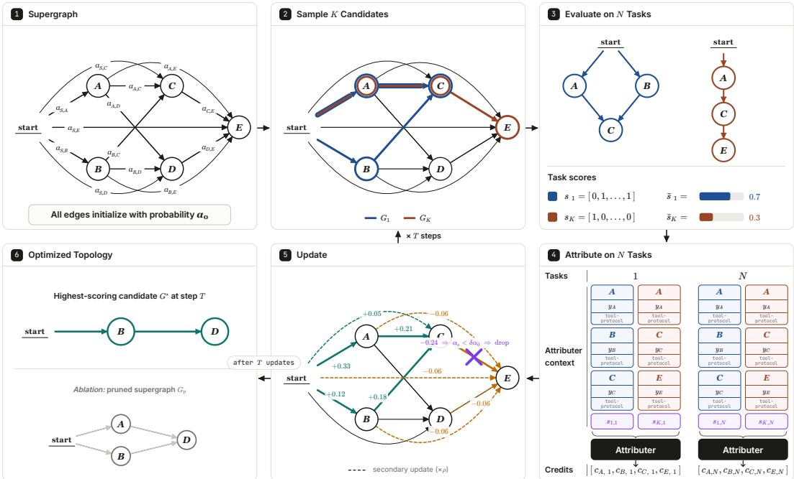
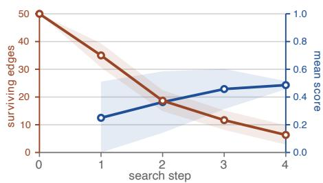
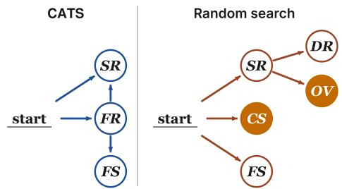
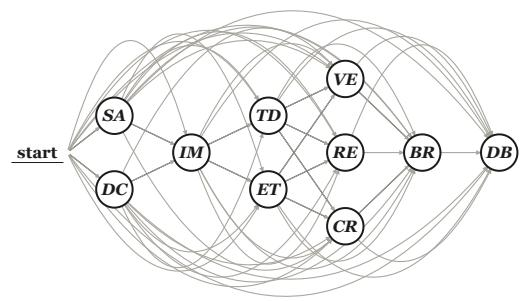
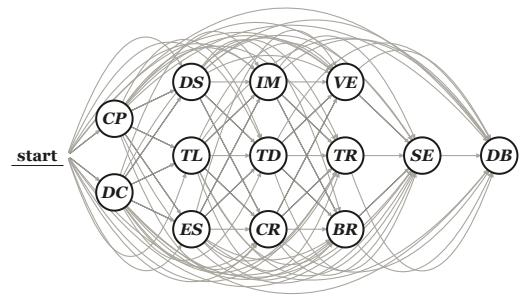
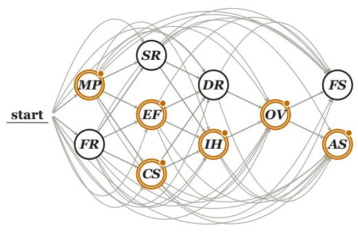
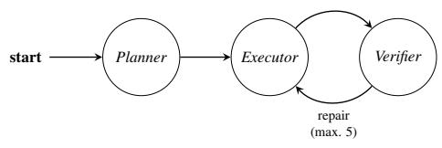
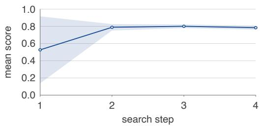
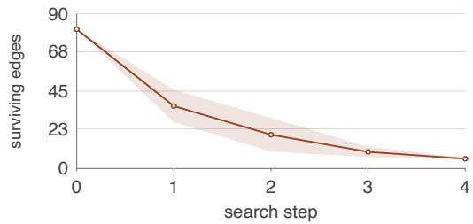

# Credit Where Credit Is Due: Contrastive Attribution Topology Search for Multi-Agent Systems

Fabian Tritthart University of Freiburg fabian.tritthart@email.uni-freiburg.de

Tom Zehle University of Freiburg tom.zehle@tue.ellis.eu

## Abstract

An LLM multi-agent system (MAS) is only as good as the agents it chooses to trust: its accuracy and cost hinge on its topology, meaning which agents are included and how they communicate. A single task score, however, does not reveal which agents help or hinder performance. We propose Contrastive Attribution Topology Search (CATS), which searches for compact teams within a fixed supergraph of specialized agents. An LLM attributer compares execution traces across candidate topologies and assigns credit to individual agents. CATS uses these credits to update supergraph edges while progressively pruning weak edges and agents, yielding a small team for deployment. With small open-weight models and matched candidate evaluations, CATS improves mean accuracy on BigCodeBench by 5.3 percentage points over score-only heuristic search while using 54% fewer deployment tokens. On MBPP, CATS matches the strongest baselines with fewer tokens than the other searches. In a HotpotQA prompt-poisoning stress test, CATS excludes all adversarially prompted agents in all three runs, whereas random search retains some at comparable accuracy. Per-agent credit thus supports both team optimization and the pruning of potentially harmful agents.

## 1 Introduction

LLM-based multi-agent systems split work across specialized agents, for example one that writes code and another that tests it. Such collaboration can improve small models [9, 10], but more agents and messages mean more tokens. Building a good system therefore requires choosing which agents to include and how they communicate, that is, the topology. Since the best topology depends on the task, manual design is difficult [5, 6], which motivates automated search over candidate teams.

Task scores, however, evaluate the team as a whole: a correct solution may contain unnecessary work, and a failed one may include useful contributions. Scores alone thus say little about which agents to keep. Can feedback on individual agents guide the search for compact, effective teams?

We introduce Contrastive Attribution Topology Search (CATS), an offline meta-agent that assembles teams from a fixed agent pool. Starting from a supergraph of candidate links, CATS evaluates sampled teams on target-domain tasks. An LLM compares their transcripts and assigns each agent signed credit. CATS then updates link probabilities, prunes weak links and unreachable agents, and selects one fixed team for deployment. Agent models, prompts, roles, and tools never change.

Our contributions are: (i) contrastive per-agent credit to guide team construction (Figure 1), (ii) higher mean accuracy and lower deployment token use than score-only search on two coding benchmarks with matched candidate evaluations (Table 1), and (iii) a HotpotQA stress test where CATS excludes all poisoned agents in every run, while random search retains some at comparable accuracy (Table 2).

  
Figure 1: CATS pipeline. At each of T steps, K subgraphs are sampled from the supergraph and evaluated on N tasks. The depicted supergraph is a simplified example.

## 2 Method

CATS repeatedly samples teams from a supergraph, credits each agent, and prunes weak edges.

Supergraph. We search for an optimized multi-agent topology as a subgraph of a hand-crafted complete directed acyclic graph specialized to a chosen problem domain (Figure 1). Its nodes are agents and its edges denote direct communication (and thereby the scheduling order). Agents are specialized via system prompts, optional reasoning, and tool sets. We hand-craft them using domain knowledge (automating this is left to future work). Each edge e carries a logit $\theta _ { e }$ with sampling probability $\alpha _ { e } = \sigma ( \theta _ { e } )$ , initialized to a common $\alpha _ { 0 }$ . Following DARTS [7], we relax the discrete edge choices to these continuous parameters but replace gradient descent with heuristic credit-based updates derived from contrastive attribution.

Sampling. At each step, we sample K topologies by independently drawing $e \sim \mathrm { B e r n o u l l i } ( \alpha _ { e } )$ rejecting graphs with nodes unreachable from the source. Since agents share an environment, not every agent needs a downstream consumer: edges are optional communication channels. We evaluate each candidate on N tasks, obtaining scores $s _ { k , q } .$ . Candidates, tasks, and often agents run in parallel.

Attribution. An LLM attributer assigns each participating agent i in candidate k on task q a credit $c _ { k , q , i } \in [ - 1 , 1 ]$ (harmful to helpful) by comparing candidate rollouts on the same task. The attributer sees task scores, length-capped agent outputs, tool calls, and the final artifact state (e.g., the coding environment), and runs in parallel across tasks.

Update. Credits are normalized into per-agent advantages $\begin{array} { r } { A _ { k , i } = | Q _ { k , i } | ^ { - 1 } \sum _ { q \in Q _ { k , i } } ( c _ { k , q , i } - b _ { q } ) } \end{array}$ where $Q _ { k , i }$ holds the tasks with a credit for i in k and $b _ { q }$ is the mean credit over participating agents and candidates for task $q .$ Each edge $( u , v )$ fired in candidate k is updated by $\theta _ { u v } \bar {  } \theta _ { u v } \bar { + } \eta \bar { A _ { k , v } }$ . Unfired non-source edges into an active agent v receive a smaller secondary update $\theta _ { u v }  \theta _ { u v } + \eta \rho A _ { k , v } .$ After each step we prune weak edges whose probability has fallen below the fraction δ of its initial value (the pruning fraction), $E \doteq \{ e \in E : \alpha _ { e } \ge \bar { \delta } \alpha _ { 0 } \}$ , and remove nodes that are no longer reachable from the source. This shrinks |E| and thus |V |, reducing the per-step cost.

Selection. After T steps we return the best final candidate $\begin{array} { r } { G ^ { \star } = \arg \operatorname* { m a x } _ { k } \frac { 1 } { N } \sum _ { q } s _ { k , q } } \end{array}$ over the step-T candidates, which are sampled under the accumulated priors. Ties are broken in favor of fewer agents and then the earlier candidate. As an ablation, we also evaluate the pruned supergraph $G _ { \mathrm { p } } ,$ consisting of all nodes and edges that remain after pruning.

Table 1: Searched topologies versus hand-crafted and single-agent baselines. Held-out coding tasks, mean ± sample SD over 3 seeds, 100 tasks per benchmark. Best score per benchmark in bold.
<table><tr><td>System</td><td>Score % ↑</td><td>Tokens/task (k) ↓</td></tr><tr><td>BigCodeBench</td></tr><tr><td>CATS (G*) 48.0  $\pm 5 . 0$ </td></tr><tr><td> $6 . 7 \pm 1 . 8$  29.7  $\pm 8 . 7$   $0 . 7 \pm 0 . 0$ </td></tr><tr><td>Direct LLM ReAct single agent 39.7  $\pm 6 . 4$   $4 . 7 \pm 2 . 0$ </td></tr><tr><td>Hand-crafted MAS 40.3  $\pm 1 1 . 2$   $9 . 6 ~ \pm 4 . 5$ </td></tr><tr><td>Random topology search 35.0  $\pm 7 . 0$  8.7 ±2.6</td></tr><tr><td>Score-only search 42.7  $\pm 4 . 9$  14.7 ±8.6</td></tr><tr><td>Ablation: pruned supergraph  $G _ { \mathrm { p } }$  45.7  $\pm 4 . 0$   $1 3 . 9 ~ \pm 4 . 1$ </td></tr><tr><td>MBPP</td></tr><tr><td>CATS (G*) 80.7 ±7.5  $5 . 3 \pm 0 . 7$ </td></tr><tr><td>Direct LLM 76.0  $\pm 6 . 9$   $0 . 4 ~ \pm 0 . 0$ </td></tr><tr><td>ReAct single agent 76.7  $\pm 5 . 0$   $3 . 0 ~ \pm 1 . 1$ </td></tr><tr><td>Hand-crafted MAS 80.3  $\pm 4 . 7$   $4 . 2 \pm 0 . 3$ </td></tr><tr><td>Random topology search 80.3  $\pm 4 . 7$   $1 8 . 8 ~ \pm 1 1 . 3$ </td></tr><tr><td>Score-only search 79.0 ±5.6  $2 2 . 2 \ \pm 1 0 . 7$  Ablation: pruned supergraph  $G _ { \mathrm { p } }$  80.7 ±5.1  $1 0 . 0 ~ \pm 5 . 3$ </td></tr></table>

Table 2: Poisoned-pool stress test on HotpotQA. Results for CATS, random search, and score-only search (mean ± sample SD, 3 seeds, 100 tasks).
<table><tr><td rowspan="2">Poisoned agents ↓</td><td>CATS</td><td></td><td>Random Score-only</td></tr><tr><td> ${ \bf 0 . 0 \pm 0 . 0 }$ </td><td> $2 . 0 \pm 1 . 0$ </td><td> $1 . 3 \pm 2 . 3$ </td></tr><tr><td>Score % ↑</td><td>59.7 ±3.8</td><td> $5 7 . 7 \pm 3 . 2 $ </td><td> $2 4 . 3 \pm 2 . 5$ </td></tr><tr><td>Tokens/task (k) ↓</td><td>12.7 ±5.3</td><td> $1 5 . 1 \pm 4 . 3$ </td><td> ${ \bf 3 . 8 \pm } 2 . 5$ </td></tr></table>

  
Figure 2: BigCodeBench search dynamics (mean ± SD, 3 seeds).

Baselines. We compare against (i) a direct LLM call without tools, (ii) a ReAct [13] single agent, both with literature-derived system prompts (Appendix Table 6), (iii) a hand-crafted multi-agent system (MAS) designed before observing supergraph results (Appendix Figure 4d), (iv) random topology search, and (v) a score-only heuristic search using CATS’s fired/unfired update and hyperparameters, with scalar task scores replacing agent credits. Both search baselines match $K \times T$ candidate evaluations on the same tasks, not compute (search costs: Appendix Table 10).

## 3 Benchmarking

Experimental setup. We target the local-deployment setting and therefore use small open-weight models: Gemma 4 12B for the MAS agents and the larger Gemma 4 31B endpoint for the attributer [4]. We evaluate CATS on two agentic coding benchmarks, BigCodeBench and MBPP [1, 18]. Each search runs for 4 optimization steps with a high learning rate and pruning fraction (Table 5). This configuration performed well in preliminary experiments that excluded the held-out tasks, though we do not claim it is optimal. We repeat all experiments over three random seeds and report means with standard deviations.

BigCodeBench. Our selected topology $G ^ { \star }$ improves mean accuracy over the strongest baseline, score-only heuristic search, by 5.3 points while using 54% fewer deployment tokens with matched candidate evaluations (Table 1). Gains hold across all three seeds, but standard deviations overlap and uncertainty remains (Table 8).

MBPP. G⋆ performs comparably to the hand-crafted MAS and random search, using fewer deployment tokens than the other searches but more than the hand-crafted MAS (Table 1).

Final-candidate ablation. Deploying $G ^ { \star }$ instead of $G _ { \mathrm { p } }$ roughly halves coding deployment tokens, with higher mean accuracy on BigCodeBench and the same on MBPP (Table 1).

Offline search tokens. Including attribution, CATS uses 28% and 35% fewer mean search tokens than score-only search on BigCodeBench and MBPP, respectively, but roughly twice those of either search baseline on poisoned HotpotQA (Table 10).

Discovered architectures. Every selected coding team retains a draft coder; 3 of 6 have no inter-agent edges, but agents can still interact through the shared environment. All selected HotpotQA teams instead retain reader-to-submitter paths (Appendix A.2). These patterns support team construction, with agent selection the clearest coding result; they do not isolate a benefit from communication optimization.

## 4 Poisoned-Pool Stress Test

A meta-agent that assembles teams must also decline to delegate to agents it should not trust. To probe this failure mode, we construct a poisoned variant of HotpotQA [12], a third domain distinct from the coding tasks above. Its supergraph contains six adversarially prompted agents and four honest agents. The attacks include plan misdirection, fabricated evidence, citation spoofing, instruction hijacking, late answer overwrites, and exact-match sabotage (Table 3). The search receives no adversarial supervision: it observes only task scores and transcripts, and is never told which agents are poisoned. Table 2 shows why task score alone is insufficient to assess delegation: comparable scores can mask different levels of poisoned-agent recruitment. CATS retains no poisoned agents across all three seeds. Random search retains two on average. Score-only search’s teams are cheap but inaccurate: 1, 2, and 5 agents, one with four poisoned. CATS instead removes their incoming edges, making them unreachable (Figure 3). Exclusion is therefore a byproduct of the optimization signal, not a separate security filter.

  
Figure 3: Selected topologies on HotpotQA (seed 13). Poisoned agents are in orange.

## 5 Related Work

Topology is an established optimization target: GPTSwarm optimizes agent graphs, MaAS samples query-dependent systems from an agentic supergraph, and AgentPrune prunes redundant or malicious communication [15, 16, 17]. Graph-GRPO derives statistical, per-edge credit from relative task rewards within groups of sampled graphs [3]. CATS instead uses LLM-judged, per-agent credit, adapting contrastive attribution from prompt optimization [14] to topology search: agent configurations stay fixed, while team membership and communication links change. Introspective LLM judges do not faithfully approximate leave-one-out contribution [8], so we treat our credit as an optimization signal, not a causal measure.

## 6 Limitations, Responsible Use, and Conclusion

Evaluating a single model family across three domains and three seeds limits what we can conclude about broader transfer and variance, while high baseline scores on MBPP leave little headroom for accuracy gains. Moreover, although pruning yields sparse coding teams, this may reflect coordination via the shared environment rather than a general lack of need for direct communication. Finally, we only track token cost without optimizing it, making Pareto search over score and cost, as done for prompts by Büssing et al. [2], a natural next step.

Attribution credits have not been validated against human judgments. Credit–success correlation (Table 9) is only a consistency check, since the attributer sees system\_score. The score-only baseline was not separately tuned and does not isolate which component of CATS accounts for the difference. Credit is node-level, propagated equally to all incoming fired edges. A comparison with Graph-GRPO’s statistical edge-level credit remains future work [3].

CATS turns a hand-crafted supergraph into a small fixed team. It improved the balance between performance and efficiency on BigCodeBench, reduced unnecessary complexity on the easier MBPP, and excluded poisoned agents that task scores alone could not detect. In all three domains it matched or beat score-only heuristic search on score, deployment-token use, or both. This supports attribution for team optimization and the pruning of potentially harmful agents, not a security guarantee.

Responsible-use statement. Selecting a topology determines which agents gain access to tools and task context. Our stress test shows that attribution can exclude fixed adversarial prompts, but this does not establish deployment safety. An adaptive adversary could act beyond the capped transcript window or exploit the unverified LLM attributer directly. Tool and data permissions must therefore remain outside the optimizer.

## Acknowledgments and Disclosure of Funding

Tom Zehle received funding from the European Union. This work was supported by the European Union’s Horizon Europe research and innovation programme under grant agreement No. 101214398 (ELLIOT). Views and opinions expressed are, however, those of the authors only and do not necessarily reflect those of the European Union or the European Commission. Neither the European Union nor the granting authority can be held responsible for them. Finally, we thank the anonymous reviewers for their constructive feedback.

## References

[1] Jacob Austin, Augustus Odena, Maxwell Nye, Maarten Bosma, Henryk Michalewski, David Dohan, Ellen Jiang, Carrie Cai, Michael Terry, Quoc Le, and Charles Sutton. Program Synthesis with Large Language Models, August 2021. arXiv:2108.07732 [cs.PL].

[2] Jan Büssing, Moritz Schlager, Timo Heiß, Tom Zehle, and Matthias Feurer. MO-CAPO: Multi-Objective Cost-Aware Prompt Optimization, May 2026. arXiv:2605.18869 [cs.LG].

[3] Yueyang Cang, Xiaoteng Zhang, Erlu Zhao, Zehua Ji, Yuhang Liu, Yuchen He, Zhiyuan Ning, Chen Chen, Wenge Que, and Li Shi. Graph-GRPO: Stabilizing Multi-Agent Topology Learning via Group Relative Policy Optimization, March 2026. arXiv:2603.02701 [cs.CL].

[4] Gemma Team et al. Gemma 4 Technical Report, July 2026. arXiv:2607.02770 [cs.CL].

[5] Junda He, Christoph Treude, and David Lo. LLM-Based Multi-Agent Systems for Software Engineering: Literature Review, Vision, and the Road Ahead. ACM Transactions on Software Engineering and Methodology, 34(5):124:1–124:30, May 2025. ISSN 1049-331X. doi: 10. 1145/3712003.

[6] Xinyi Li, Sai Wang, Siqi Zeng, Yu Wu, and Yi Yang. A survey on LLM-based multi-agent systems: workflow, infrastructure, and challenges. Vicinagearth, 1(1):9, 2024. doi: 10.1007/ s44336-024-00009-2.

[7] Hanxiao Liu, Karen Simonyan, and Yiming Yang. DARTS: Differentiable Architecture Search. In International Conference on Learning Representations (ICLR), 2019.

[8] Mingyu Lu, Yushan Huang, Chris Lin, and Su-In Lee. Agents that Matter: Optimizing Multi-Agent LLMs via Removal-Based Attribution, May 2026. arXiv:2605.27621 [cs.MA].

[9] Weizhou Shen, Chenliang Li, Hongzhan Chen, Ming Yan, Xiaojun Quan, Hehong Chen, Ji Zhang, and Fei Huang. Small LLMs Are Weak Tool Learners: A Multi-LLM Agent. In Conference on Empirical Methods in Natural Language Processing (EMNLP). Association for Computational Linguistics, 2024. doi: 10.18653/v1/2024.emnlp-main.929.

[10] Varun Sunkaraneni, Pierfrancesco Beneventano, Riccardo Neumarker, Tomaso Poggio, and Tomer Galanti. Agentic Systems as Boosting Weak Reasoning Models, May 2026. arXiv:2605.14163 [cs.AI].

[11] Ronald J. Williams. Simple Statistical Gradient-Following Algorithms for Connectionist Reinforcement Learning. Machine Learning, 8(3-4):229–256, May 1992. ISSN 0885-6125. doi: 10.1007/BF00992696.

[12] Zhilin Yang, Peng Qi, Saizheng Zhang, Yoshua Bengio, William Cohen, Ruslan Salakhutdinov, and Christopher D. Manning. HotpotQA: A Dataset for Diverse, Explainable Multi-hop Question Answering. In Conference on Empirical Methods in Natural Language Processing (EMNLP). Association for Computational Linguistics, 2018. doi: 10.18653/v1/D18-1259.

[13] Shunyu Yao, Jeffrey Zhao, Dian Yu, Nan Du, Izhak Shafran, Karthik R. Narasimhan, and Yuan Cao. ReAct: Synergizing Reasoning and Acting in Language Models. In International Conference on Learning Representations (ICLR), 2023.

[14] Tom Zehle. CANTANTE: Optimizing Agentic Systems via Contrastive Credit Attribution, May 2026. arXiv:2605.13295 [cs.CL].

[15] Guibin Zhang, Luyang Niu, Junfeng Fang, Kun Wang, Lei Bai, and Xiang Wang. Multi-Agent Architecture Search via Agentic Supernet. In International Conference on Machine Learning (ICML). PMLR, 2025.

[16] Guibin Zhang, Yanwei Yue, Zhixun Li, Sukwon Yun, Guancheng Wan, Kun Wang, Dawei Cheng, Jeffrey Xu Yu, and Tianlong Chen. Cut the Crap: An Economical Communication Pipeline for LLM-based Multi-Agent Systems. In International Conference on Learning Representations (ICLR), 2025.

[17] Mingchen Zhuge, Wenyi Wang, Louis Kirsch, Francesco Faccio, Dmitrii Khizbullin, and Jürgen Schmidhuber. GPTSwarm: Language Agents as Optimizable Graphs. In International Conference on Machine Learning (ICML). PMLR, 2024.

[18] Terry Yue Zhuo, Minh Chien Vu, Jenny Chim, Han Hu, Wenhao Yu, Ratnadira Widyasari, Imam Nur Bani Yusuf, Haolan Zhan, Junda He, Indraneil Paul, Simon Brunner, Chen Gong, James Hoang, Armel Zebaze, Xiaoheng Hong, Wen-Ding Li, Jean Kaddour, Ming Xu, Zhihan Zhang, Prateek Yadav, Naman Jain, Alex Gu, Zhoujun Cheng, Jiawei Liu, Qian Liu, Zijian Wang, Binyuan Hui, Niklas Muennighoff, David Lo, Daniel Fried, Xiaoning Du, Harm de Vries, and Leandro von Werra. BigCodeBench: Benchmarking Code Generation with Diverse Function Calls and Complex Instructions. In International Conference on Learning Representations (ICLR), 2025.

## A Additional Experimental Details

A.1 Supergraphs and Graphs

  
(a) BigCodeBench.

  
(b) MBPP.

  
(c) Poisoned HotpotQA.

  
(d) Hand-crafted MAS baseline.

Figure 4: Initial supergraphs and fixed baseline. Supergraph edges run forward between layers, and start edges select entry agents. Orange nodes in (c) are adversarially prompted. These labels are hidden from the search and attributer. Agent codes are listed in Table 3.

Table 3: Agent pools. HotpotQA alignment labels are for post-hoc measurement only and are read by neither the search nor the attributer. A read budget of zero permits listing titles but not reading passages.
<table><tr><td colspan="3">0</td></tr><tr><td>Agent Role</td><td></td><td>Tools</td></tr><tr><td>SA</td><td>Spec analyst</td><td>None</td></tr><tr><td>DC</td><td>Draft coder</td><td>write_code</td></tr><tr><td>IM</td><td>Implementer</td><td>read_code, write_code,</td></tr><tr><td>TD</td><td>Test designer</td><td>run_snippet write_tests,</td></tr><tr><td>ET</td><td>Edge-case tester</td><td>check_tests write_tests,</td></tr><tr><td>VE</td><td>Verifier</td><td>check_tests read_code,</td></tr><tr><td></td><td></td><td>run_snippet</td></tr><tr><td>RE</td><td>Reviewer</td><td>read_code, read_tests</td></tr><tr><td>CR</td><td>Critiquer</td><td>read_code</td></tr><tr><td>BR</td><td>Brainstormer</td><td>read_code</td></tr><tr><td>DB</td><td>Debugger</td><td>read_code, write_code, run_snippet</td></tr></table>

<table><tr><td colspan="3">MIBPP</td></tr><tr><td>Agent Role</td><td></td><td>Tools</td></tr><tr><td>CP</td><td>Contract probe</td><td>read_code, run_snippet,</td></tr><tr><td></td><td></td><td>check_tests</td></tr><tr><td>DC</td><td>Draft coder</td><td>write_code</td></tr><tr><td>DS</td><td>Direct solver</td><td>None</td></tr><tr><td>TL</td><td>Test literalist</td><td>None</td></tr><tr><td>ES</td><td>Edge-case solver None</td><td></td></tr><tr><td>IM</td><td>Implementer</td><td>read_code, write_code, run_snippet,</td></tr><tr><td>TD</td><td>Test designer</td><td>check_tests write_tests,</td></tr><tr><td>CR</td><td>Critiquer</td><td>check_tests read_code</td></tr><tr><td>VE</td><td>Verifier</td><td>read_code,</td></tr><tr><td>TR</td><td>Test runner</td><td>run_snippet</td></tr><tr><td></td><td></td><td>read_code, check_tests</td></tr><tr><td>BR</td><td>Brainstormer</td><td>read_code</td></tr><tr><td>SE</td><td>Selector</td><td>read_code, write_code,</td></tr><tr><td></td><td></td><td>run_snippet, check_tests</td></tr><tr><td></td><td></td><td></td></tr><tr><td>DB</td><td></td><td></td></tr><tr><td></td><td>Debugger</td><td></td></tr><tr><td></td><td></td><td>read_code, write_code,</td></tr><tr><td></td><td></td><td></td></tr><tr><td></td><td></td><td></td></tr><tr><td></td><td></td><td></td></tr><tr><td></td><td></td><td>run_snippet,</td></tr><tr><td></td><td></td><td></td></tr><tr><td></td><td></td><td></td></tr><tr><td></td><td></td><td></td></tr><tr><td></td><td></td><td></td></tr><tr><td></td><td></td><td></td></tr><tr><td></td><td></td><td></td></tr><tr><td></td><td></td><td></td></tr><tr><td></td><td></td><td></td></tr><tr><td></td><td></td><td></td></tr><tr><td></td><td></td><td></td></tr><tr><td></td><td></td><td></td></tr><tr><td></td><td></td><td></td></tr><tr><td></td><td></td><td></td></tr><tr><td></td><td></td><td></td></tr><tr><td></td><td></td><td></td></tr><tr><td></td><td></td><td></td></tr><tr><td></td><td></td><td>check_tests</td></tr><tr><td></td><td></td><td></td></tr><tr><td></td><td></td><td></td></tr><tr><td></td><td></td><td></td></tr><tr><td></td><td></td><td></td></tr><tr><td></td><td></td><td></td></tr><tr><td></td><td></td><td></td></tr><tr><td></td><td></td><td></td></tr><tr><td></td><td></td><td></td></tr><tr><td></td><td></td><td></td></tr><tr><td></td><td></td><td></td></tr><tr><td></td><td></td><td></td></tr><tr><td></td><td></td><td></td></tr><tr><td></td><td></td><td></td></tr><tr><td></td><td></td><td></td></tr></table>

<table><tr><td>Agent Role</td><td></td><td>Alignment</td><td>Tools</td><td>Read budget</td></tr><tr><td>MP</td><td>Misdirection planner</td><td>Poisoned</td><td>None</td><td>0</td></tr><tr><td>FR</td><td>First-hop reader</td><td>Honest</td><td>Retrieve</td><td>5</td></tr><tr><td>SR</td><td>Second-hop reader</td><td>Honest</td><td>Retrieve</td><td>5</td></tr><tr><td>EF</td><td>Evidence fabricator</td><td>Poisoned</td><td>Submit</td><td>0</td></tr><tr><td>CS</td><td>Citation spoofer</td><td>Poisoned</td><td>List titles</td><td>0</td></tr><tr><td>DR</td><td>Drafter</td><td>Honest</td><td>Submit</td><td>0</td></tr><tr><td>IH</td><td>Instruction hijacker</td><td>Poisoned</td><td>None</td><td>0</td></tr><tr><td>OV</td><td>Overruling verifier</td><td>Poisoned</td><td>Retrieve, Submit</td><td>2</td></tr><tr><td>FS</td><td>Final submitter</td><td>Honest</td><td>Submit</td><td>0</td></tr><tr><td>AS</td><td>Answer-form saboteur</td><td>Poisoned</td><td>Submit</td><td>0</td></tr></table>

## A.2 Selected Deployment Architectures

Table 4: Selected deployment topologies G⋆. These are the highest-scoring step-4 candidates on the search set and are the systems reported as $\mathrm { ^ { 6 6 } C A T S ^ { , } }$ in the main tables. Agent codes are resolved in Table 3. Each listed edge is directed. start denotes an entry edge.
<table><tr><td>Benchmark</td><td>Seed</td><td>Agents</td><td>Edges</td></tr><tr><td rowspan="3">BigCodeBench</td><td>13</td><td>DC, IM, TD</td><td>start→DC, DC→IM, IM→TD</td></tr><tr><td>14</td><td>DC, VE</td><td>start→DC, start→VE</td></tr><tr><td>15</td><td>DB, DC</td><td>start→DB, start→DC</td></tr><tr><td rowspan="3">MBPP</td><td>13</td><td>DC, IM, TD</td><td>start→DC, start→IM, start→TD</td></tr><tr><td>14</td><td>DC, IM, TL</td><td>start→DC, start→IM, start→TL, TL→IM</td></tr><tr><td>15</td><td>DC, IM</td><td>start→DC, start→IM, DC→IM</td></tr><tr><td rowspan="3">HotpotQA</td><td>13</td><td>FR, SR, FS</td><td>start→FR, start→SR, FR→SR, FR→FS</td></tr><tr><td>14</td><td>SR, DR</td><td>start→SR, start→DR, SR→DR</td></tr><tr><td>15</td><td>FR, SR, DR</td><td>start→FR, start→SR, FR→SR, FR→DR, SR→DR</td></tr></table>

The selected coding teams consistently retain a draft coder alongside one or two other agents, but their communication patterns differ (Table 4). For example, BigCodeBench seed 13 connects a draft coder, implementer, and test designer in a chain; MBPP seed 13 selects the same roles with only direct entry edges from start. Two further BigCodeBench teams likewise have only entry edges, while the remaining MBPP teams retain a single inter-agent edge. These patterns show that selecting a set of agents and connecting that set are distinct decisions. Because agents access a shared environment, teams with only entry edges can still interact through the persisted artifact.

HotpotQA yields a different pattern: every selected team retains the second-hop reader and either the drafter or final submitter, with directed communication from a reader to the answer-submitting agent. These teams combine retrieval and answer submission while excluding all poisoned roles. The contrast with coding illustrates that the search does not always remove communication. However, these graphs alone do not establish the benefit of their particular edges; that would require a comparison that holds agent membership fixed.

## A.3 Search and Baselines

Table 5: Run settings. Left: CATS hyperparameters, shared across benchmarks. Right: perbenchmark inference settings and mean CATS cost. Attribution accounted for 9–11% of codingsearch tokens.
<table><tr><td colspan="2">Hyperparameter Value</td></tr><tr><td>Search tasks</td><td>100</td></tr><tr><td>Seeds (search and evaluation)</td><td>13, 14, 15</td></tr><tr><td>Search steps, T</td><td>4</td></tr><tr><td>Candidates per step, K</td><td>4</td></tr><tr><td>Learning rate, η</td><td>6</td></tr><tr><td>Unfired-edge weight,  $\rho$ </td><td>0.25</td></tr><tr><td>Initial edge probability, α0</td><td>0.15</td></tr><tr><td>Pruning fraction, δ</td><td>0.85</td></tr></table>

<table><tr><td>Setting</td><td>BigCode- Bench</td><td>MBPP</td><td>Poisoned HotpotQA</td></tr><tr><td>Task temperature</td><td>0.7</td><td>0.7</td><td>0.2</td></tr><tr><td>Task max tokens</td><td>4096</td><td>2048</td><td>3072</td></tr><tr><td>Agent input cap (tokens)</td><td>900</td><td>900</td><td>700</td></tr><tr><td>Attribution cap (tokens)</td><td>120</td><td>120</td><td>150</td></tr><tr><td>Attributer temperature</td><td>0.7</td><td>0.7</td><td>0.7</td></tr><tr><td>Attributer max tokens</td><td>8192</td><td>8192</td><td>24576</td></tr><tr><td>Mean search tokens</td><td>16.4M</td><td>13.5M</td><td>20.5M</td></tr></table>

Table 6: Operational definitions of the baselines. All baselines use the same task model, grader, decoding limits, and seed-specific held-out tasks.
<table><tr><td>Method/read-out</td><td>Definition</td></tr><tr><td>Random search</td><td>Draw 16 candidates at fixed  $\alpha = 0 . 1 5$  . Return the best search-set score, breaking ties by fewer agents and then random.</td></tr><tr><td>Score-only search</td><td>Sample  $K = 4$  candidates at each of  $T = 4$  steps. For candidate k, compute the score-only advantage  $\begin{array} { r } { A _ { k } = \bar { s } _ { k } - ( K - 1 ) ^ { - 1 } \sum _ { j \neq k } \bar { s } _ { j } , } \end{array}$  where  $\bar { s } _ { k }$  is its mean search-set score. Assign  $A _ { k }$  to every active agent and update edge logits using the same learning rate, unfired-edge rule, and pruning schedule as our method, but without LLM attribution. This heuristic omits the Bernoulli score-function factor  $I _ { e } \mathrm { ~ - ~ } \alpha _ { e }$  required by REINFORCE [11]. Return the highest-scoring step-T&#x27; candidate, breaking ties by fewer agents and then the earlier candidate.</td></tr><tr><td>Direct LLM (MBPP)</td><td>One greedy zero-shot call, without tools, execution feedback, or retry. The prompt follows the task template of Austin et al. [1].</td></tr><tr><td>Direct LLM (BigCodeBench)</td><td>One greedy zero-shot call, without tools, execution feedback, or retry. The prompt uses the instruction_prefix and response_prefix defaults from the official BigCodeBench generation harness.</td></tr><tr><td>ReAct single agent</td><td>One native-tool loop with the same prompt body on both benchmarks, and a tool-call budget of five. ReAct is the method of Yao et al. [13]. The exact string is from LangChain Hub entry hwchase17/react. {tools} and {tool_names} are filled with the environment toolset</td></tr><tr><td>Hand-crafted MAS</td><td>and the runtime&#x27;s native tool-use protocol block. A fixed planner-executor-verifier topology (Figure 4d).</td></tr></table>

## A.4 Evaluation Protocol

Field caps use o200k\_base tokens, retain the prefix, discard the tail, and append the marker ... [truncated] outside the cap. Agent input fields (query and upstream outputs) use the 900/700- token caps in Table 5; the attributer’s query and string-valued says fields use 120 tokens for coding and 150 for HotpotQA, with does tool-effect logs and final summaries exempt from field capping. The assembled attributer prompt is also prefix-capped at its model limit minus the attribution field cap.

Seeds 13–15 jointly control splits, global randomness, topology sampling, and generation. The generation endpoint, hosted by the University of Freiburg, used the aliases gemma-4-12b-llmlb (agents/baselines) and gemma-4-31b-llmlb (attributer). Weight hashes and quantization were not exposed. Coding runs use fresh temporary directories and process groups with a 30-second timeout. Crashes, timeouts, empty environments, and unusable results score zero. Deployment tokens count all agent-call input and output tokens per held-out task. All reported ± values and shaded bands are Bessel-corrected sample standard deviations over three runs.

Table 7: Dataset splits and grading. Each held-out set contains 100 tasks.
<table><tr><td>Benchmark</td><td>Snapshot and search split</td><td>Grading</td></tr><tr><td>BigCodeBench</td><td>v0.1.4 Instruct, 100 disjoint tasks</td><td>Last stored program against hidden tests</td></tr><tr><td>MBPP</td><td>Revision 4bb6404f, 100 disjoint tasks</td><td>Last stored program against hidden tests</td></tr><tr><td>HotpotQA</td><td>distractor, 100 disjoint tasks</td><td>Exact match on last submit_answer phrase</td></tr></table>

## A.5 Per-Seed Results and Additional Analyses

Table 8: Per-seed evaluations supporting the headline comparisons. Each seed groups results for the selected topologies on its 100-task held-out set. Scores are percentages. Tokens are thousands of input plus output tokens per task. V /E counts selected agents/edges, including start edges. P counts poisoned agents (HotpotQA only).
<table><tr><td></td><td colspan="4">Seed 13</td><td colspan="4">Seed 14</td><td colspan="4">Seed 15</td></tr><tr><td>Method</td><td>Score</td><td>Tokens</td><td>V/E</td><td>P</td><td>Score</td><td>Tokens</td><td>V/E</td><td>P</td><td>Score</td><td>Tokens</td><td>V/E</td><td>P</td></tr><tr><td>BigCodeBench</td><td></td><td></td><td></td><td></td><td></td><td></td><td></td><td></td><td></td><td></td><td></td><td></td></tr><tr><td>CATS</td><td>53</td><td>7.16</td><td>3/3</td><td></td><td>43</td><td>4.70</td><td>2/2</td><td></td><td>48</td><td>8.28</td><td>2/2</td><td></td></tr><tr><td>Random</td><td>35</td><td>9.06</td><td>5/6</td><td></td><td>28</td><td>11.08</td><td>2/2</td><td></td><td>42</td><td>5.93</td><td>1/1</td><td></td></tr><tr><td>Score-only search</td><td>45</td><td>6.62</td><td>3/3</td><td></td><td>37</td><td>23.71</td><td>4/5</td><td></td><td>46</td><td>13.75</td><td>5/8</td><td></td></tr><tr><td>MBPP</td><td></td><td></td><td></td><td></td><td></td><td></td><td></td><td></td><td></td><td></td><td></td><td></td></tr><tr><td>CATS</td><td>72</td><td>4.45</td><td>3/3</td><td></td><td>85</td><td>5.90</td><td>3/4</td><td></td><td>85</td><td>5.44</td><td>2/3</td><td></td></tr><tr><td>Random</td><td>75</td><td>9.32</td><td>7/7</td><td></td><td>84</td><td>31.31</td><td>9/12</td><td></td><td>82</td><td>15.82</td><td>7/8</td><td></td></tr><tr><td>Score-only search</td><td>73</td><td>9.79</td><td>6/6</td><td></td><td>84</td><td>28.85</td><td>8/15</td><td></td><td>80</td><td>27.88</td><td>10/18</td><td></td></tr><tr><td>HotpotQA</td><td></td><td></td><td></td><td></td><td></td><td></td><td></td><td></td><td></td><td></td><td></td><td></td></tr><tr><td>CATS</td><td>58</td><td>8.37</td><td>3/4</td><td>0</td><td>64</td><td>11.24</td><td>2/3</td><td>0</td><td>57</td><td>18.63</td><td>3/5</td><td>0</td></tr><tr><td>Random</td><td>60</td><td>12.97</td><td>5/5</td><td>2</td><td>54</td><td>20.01</td><td>6/6</td><td>3</td><td>59</td><td>12.23</td><td>3/3</td><td>1</td></tr><tr><td>Score-only search</td><td>27</td><td>3.95</td><td>2/2</td><td>0</td><td>22</td><td>6.18</td><td>5/5</td><td>4</td><td>24</td><td>1.24</td><td>1/1</td><td>0</td></tr></table>

  
(a) MBPP search score.

  
(b) MBPP surviving edges.  
Figure 5: CATS dynamics on MBPP. The corresponding BigCodeBench panels appear in the main paper. Lines show means over three seeds. Bands show sample standard deviations.

Table 9: Credit–success consistency check. Correlation between the mean credit over participating agents, $\bar { c } _ { k , q } ,$ , and the binary task score $s _ { k , q } ,$ over all (candidate, task) pairs. Within-task columns correlate within each query. Scores are binary, so Pearson r is the point-biserial coefficient. Four pairs are dropped from seed 15 due to one unparsed transcript. The attributer sees system\_score, so this is not independent validation of credit quality.
<table><tr><td></td><td></td><td colspan="2">Pooled</td><td colspan="2">Within-task</td></tr><tr><td>Seed</td><td>n pairs</td><td>r</td><td>ρ</td><td>r</td><td>ρ</td></tr><tr><td>13</td><td>1600</td><td>0.876</td><td>0.854</td><td>0.785</td><td>0.742</td></tr><tr><td>14</td><td>1600</td><td>0.879</td><td>0.834</td><td>0.841</td><td>0.802</td></tr><tr><td>15</td><td>1596</td><td>0.834</td><td>0.846</td><td>0.746</td><td>0.687</td></tr><tr><td>Mean ± SD over seeds</td><td></td><td>0.863 ±0.025</td><td>0.845 ±0.010</td><td>0.791 ±0.048</td><td>0.744 ±0.058</td></tr></table>

Table 10: Offline search tokens, separate from deployment. Millions of input plus output tokens for 16 candidates on 100 search tasks, averaged over seeds 13–15; totals include sample SD.
<table><tr><td>Benchmark</td><td>Method</td><td>Task model</td><td>Attributer</td><td>Total</td></tr><tr><td>BigCodeBench</td><td>CATS</td><td>14.88</td><td>1.54</td><td> $1 6 . 4 2 \pm 5 . 3 5$ </td></tr><tr><td></td><td>Random search</td><td>16.49</td><td>0</td><td> $1 6 . 4 9 \pm 5 . 6 6$ </td></tr><tr><td></td><td>Score-only search</td><td>22.89</td><td>0</td><td> $2 2 . 8 9 \pm 1 0 . 8 9$ </td></tr><tr><td>MBPP</td><td>CATS</td><td>12.00</td><td>1.53</td><td> $1 3 . 5 3 \pm 1 . 5 1$ </td></tr><tr><td></td><td>Random search</td><td>11.45</td><td>0</td><td> $1 1 . 4 5 \pm 2 . 7 1$ </td></tr><tr><td></td><td>Score-only search</td><td>20.89</td><td>0</td><td> $2 0 . 8 9 \pm 3 . 4 7$ </td></tr><tr><td>HotpotQA</td><td>CATS</td><td>18.39</td><td>2.11</td><td> $2 0 . 5 0 \pm 2 . 7 9$ </td></tr><tr><td></td><td>Random search</td><td>9.91</td><td>0</td><td> $9 . 9 1 \pm 2 . 2 0 $ </td></tr><tr><td></td><td>Score-only search</td><td>10.63</td><td>0</td><td> $1 0 . 6 3 \pm 4 . 5 3$ </td></tr></table>

## B BigCodeBench Attributer Call

We adapt contrastive attribution [14] for BigCodeBench by grading the persisted code artifact instead of agent text. We also expose ordered, compact tool effects. The representative call below is excerpted, with omitted material marked [...].

===== PROMPT (ABRIDGED) =====   
# Task   
You are an attribution agent for a multi-agent system.   
[...]   
Your goal is to estimate how each agent’s behavior contributed to the   
outcome of its execution by comparing differences across executions.   
Base your attribution on:   
- the system score differences across executions,   
- the system prediction   
[...]   
- what each agent measurably changed in the shared environment.   
# Attribution Scale   
Assign a float score in [-1.0, 1.0] to each agent for each execution:   
- positive = helpful contribution   
- negative = harmful contribution   
- 0 = neutral or unclear impact   
# The Protocol   
This system is graded on an artifact held in a shared coding environment,   
not on any agent’s text: the code persisted with ‘write\_code‘ is what the   
hidden test suite runs, and it appears in no agent’s output. So every agent   
is given two keys: ‘says‘ (its text output) and ‘does‘ (a numbered log of   
every tool call it made, in order).   
Each ‘does‘ line is ‘<seq> <VERB> <target> <delta> ["<observed>"]‘:   
1 SET code=c1 4L   
[...]   
5 EDIT code c1->c2 +1/-1   
6 NOOP write\_code "[rejected - unsafe import]"   
[...] Only targets named in ‘final‘ are graded. Scratch writes count only   
through a visible later observation followed by a graded write. When several   
agents write code, credit only what survives into the graded value. Trust   
‘does‘ over conflicting claims in ‘says‘, and treat example tests as the   
exact required behavior. [...]   
# Input   
You will receive JSON with ‘query‘ and an ‘executions‘ list. Each execution   
contains ‘system\_score‘, ‘final‘, and a mapping from agent names to ‘says‘   
and ‘does‘. [...]   
# Output   
First, briefly compare the executions and identify the key behavioral   
differences that lead to differences in the system score.   
Then return JSON inside <attribution>...</attribution>. The top-level object   
must have exactly one key, ‘executions‘, containing exactly four items in   
input order. Each item contains only ‘agent\_credits‘, with exactly the seven   
specified agent names and float values in [-1.0, 1.0]. [...]   
# Few-shot example   
[...]   
===== RESPONSE (ABRIDGED) =====   
All four executions failed (system\_score: 0.0), primarily because the agents   
struggled to align the code implementation with the actual data structure   
implied by the prompt.   
[...]   
In Execution 3, EDGE\_CASE\_TESTER\_4 wrote tests to the scratchpad   
(‘test\_list‘). However, because no coder followed these tests with a write to   
the graded ‘code‘ target, these tests had zero impact on the outcome. [...]   
<attribution>   
{"executions":[   
{"agent\_credits":{"BRAINSTORMER\_8":0.0,"CRITIQUER\_7":0.0,"DRAFT\_CODER\_1":0.0,   
"EDGE\_CASE\_TESTER\_4":0.0,"IMPLEMENTER\_2":-0.2,"REVIEWER\_6":0.0,"VERIFIER\_5":-0.4}},   
{"agent\_credits":{"BRAINSTORMER\_8":0.0,"CRITIQUER\_7":-0.2,"DRAFT\_CODER\_1":-0.4,   
"EDGE\_CASE\_TESTER\_4":0.0,"IMPLEMENTER\_2":0.0,"REVIEWER\_6":0.0,"VERIFIER\_5":0.0}},   
{"agent\_credits":{"BRAINSTORMER\_8":0.0,"CRITIQUER\_7":0.0,"DRAFT\_CODER\_1":0.0,   
"EDGE\_CASE\_TESTER\_4":0.0,"IMPLEMENTER\_2":0.0,"REVIEWER\_6":0.0,"VERIFIER\_5":0.0}},   
{"agent\_credits":{"BRAINSTORMER\_8":0.0,"CRITIQUER\_7":0.0,"DRAFT\_CODER\_1":0.0,   
"EDGE\_CASE\_TESTER\_4":0.0,"IMPLEMENTER\_2":0.0,"REVIEWER\_6":0.0,"VERIFIER\_5":0.0}}   
]}   
</attribution>