# CulturalRiddles A Multicultural Benchmark of Riddles

My Chifon Nguyen⋆1,2, Tianyi Hu⋆3, Vinod Anbalagan⋆4,1, Henry Gagnier⋆5,1, Pouya Sadeghi⋆6,1, Farah Abdou7, Tidor-Vlad Pricope8, Diego MMS Oliveira8, Jocelyn K D’Arcy8, Madeline Smith9, Oluwaseun A Ajayi10, Yusser Al Ghussin11, Zena Al-Khalili12, Micol Altomare4, Shayan Amir13, Ahanaf Aziz14, Bryan Chen15, Ruchira Dhar16, Abdellah El Mekki17, Rawan Mohammed Elframawy18, Akhil Eppa19, Silvia Fernandez1, Alex Gimei20, Arya Hariharan21, Christian Hoang22, RamMohanRao Kadiyala23,1, Diana Kozachek24, Peerat Limkonchotiwat25, Ankita Maity3, Di Mo4, Ayush Munot26, Aylin Naebzadeh27, Anastasiia Nikitina28, Dina Pisarevskaya29, Divas Poudel30, Jebish Purbey1, Md Rabius Sany Apu1, Ahmad Mufli Ramadhan31,1, Ralitza Nikolova Rizova1, Diogo M. Serrano-Miranda1, Vivek Gopalkrishna Silimkhan32,1, Luis Fernando Solis Navarro1, Kaiser Sun33, Arya Suneesh1, Manaswitha Sunkara34, Tejaswi Sunkara35, Jonathan E Swindell36, Hanna Yukhymenko37, Jingyi Zheng38, Esther Adenuga39, Ilia Afanasev40, Wafa Aissa41, Lisa Alazraki42, Lauren C Altomare4, Priscilla Amondi Amuok43, Emile Anand44, Gabriel Assis45, José Matías Avalos1,46, Silvia Lorena Avila1, Zakaria Baannou47, Niyati Bafna33, Yash Bagla48, Sarah Bahrami49, Bontu F Balcha50, Vanya Bannihatti Kumar51, Irene Baucells52,53, Abdumutalib Begmuratov48, Naman Bhatia1, Souvik Bhattacharyya54, Isabel Blanco Ferreiro48, Felipe Bochini55, Sayuru Bopitiya56,1, Angana Borah57, Tulika Bose58, Olena Bugaiova1, Juliana Carvalho59, Nancy F Chen60, Stephy Chen1, Rochelle Choenni61, Jayanth Krishna Chundru62, Leandro A Cossio1, Nebojša Damnjanović63, Ona de Gibert64, Marco De Santis65, Pedro Delgado66, Kaustubh Dholé67, Adnan El Assadi68,69, Wesam El-Sayed70, Nadine M Elframawy71, Oumayma Essarhi1, Naome A Etori72, Reuben Chagas Fernandes1, Saanidhi Pravin Gade73,1, Javier García Gilabert74, Álvaro González-Escapa75, Bin Hu76, Kaiyu Huang1, Abderrahmane Issam77, Danka Jokić63, Ulugbek Khalilov1, Dominik Krzemiński78, Roy Ka-Wei Lee17, Haichang Li79, Chen Cecilia Liu78, Zhengyuan Liu60, Cedric Lothritz80, Houman Mehrafarin81, Antonio Miranda-Escalada48, Fengran Mo82, Mehrnaz Mofakhami9, Wafaa Mohammed61, Felipe Moreno-Vera83, Prahitha Movva1, Jannatul Nayem84, Van Ngo4 Joy Olusanya85, Marc Pàmies53, Avinash Kuney Pandey86, Yurii Paniv87, Fred Philippy88, Vladislav Poritski48, Dikshya Poudel89,1, Joanna Radoła90,91, Sara Rajaee61, Swati Rajwal86, Prerana Rane1, Muhammad Ravi Shulthan Habibi92, Lucas Resck78, Shubhashis Roy Dipta93, Ananya Sahu9, Eduardo Sánchez94, Borja Sánchez Clemente1, Aleix Sant52,95, Nobin Sarwar93, Istiak Shihab96, Santhoshini Pranathi Singaraju1, Jane Smith1, David Stap9, Emily Z Su4, Ananth K Suresh97, Sajag Swami98, Ruiyang Tan99, Nazia Tasnim100, Khalid Tounoussi101, Patteera Triamamornwooth102, Muhammad Saad Umar1, Shankar Venkitachalam19, Oksana Volchek48, Lingbo Wang103, Debela Desalegn Yadeta50, Rushikesh Zawar19, Jinghan Zhang104, Mike Zhang16, Weihua Zheng99,60, Marzieh Fadaee9, Akhil Arora▶3, Károly Boczka▶48, and Julia Kreutzer♦9

1Cohere Labs Community, 2Lida Safety, 3Aarhus University, 4University of Toronto, 5University of Rochester, 6University of Waterloo, 7Cambridge Centre for Alternative Finance, 8Poindexter Labs, 9Cohere Labs, 10Obafemi Awolowo University, Ile-Ife, 11German Research Center for Artificial Intelligence (DFKI), 12Saarland University, 13Jamia Miilia Islamia University, 14Andhra University, 15École Polytechnique, 16University of Copenhagen, 17University of British Columbia, 18Nile University, 19Adobe Systems, 20Crane AI Labs, 21RV College of Engineering, 22FPT University, 23Lexsi Labs, 24University of St. Gallen, 25AI Singapore, 26Indian Institute of Technology, Kharagpur, 27University of Hull, 2842 Abu Dhabi, 29Queen Mary University of London, 30Tribhuvan University, 31Universitas Muslim Indonesia, 32Persistent Systems, 33Johns Hopkins University, 34University of Michigan-Dearborn, 35Wichita State University, 36Baylor University, 37ETH Zurich, 38The Hong Kong University of Science and Technology (Guangzhou), 39University of Ibadan, 40University of Vienna, 41Fondazione Bruno Kessler, 42Imperial College London, 43Masakhane Community, 44Georgia Institute of Technology, 45Universidade Federal Fluminense, 46Universidad Nacional de Tres de Febrero, 47New York University, 48Independent, 49Mila - Quebec Artificial Intelligence Institute, 50Addis Ababa University, 51Carnegie

Mellon University, 52Universitat Politècnica de Catalunya, 53Barcelona Supercomputing Center, 54Indian Institute of Science, 55Universidade de Sorocaba, 56Platned, 57University of Michigan - Ann Arbor, 58Vivoka, 59Conservatoire National des Arts et Métiers (Cnam), 60Agency for Science, Technology and Research (A\*STAR), 61University of Amsterdam, 62University of Cincinnati, 63University of Belgrade, 64University of Helsinki, 65University of Udine, 66Universidade de São Paulo, 67Stanford University, 68Harvard University, 69Massachusetts Institute of Technology, 70Minia University, 71Egypt-Japan University of Science and Technology, 72University of Minnesota - Twin Cities, 73Pune Vidyarthi Griha’s College of Engineering, Technology and Management, 74University of Zurich, 75NFQ Advisory Services, 76University of Maryland, College Park, 77Maastricht University, 78University of Cambridge, 79Tencent, 80Luxembourg Institute of Science and Technology, 81Heriot-Watt University, 82Rochester Institute of Technology, 83Fundação Getúlio Vargas, 84Jahangirnagar University, 85Center for Low-Resource Languages and Cultures, 86Emory University, 87Ukrainian Catholic University, 88University of Luxembourg, 89St. Xavier’s College, Jawalakhel, 90Université Pierre et Marie Curie, 91Sorbonne Université, 92Universitas Indonesia, 93University of Maryland, Baltimore County, 94University College London, 95Telefónica Research, 96Oregon State University, 97Indian Institute of Technology, Hyderabad, 98Indian Institute of Technology, Roorkee, 99Singapore University of Technology and Design, 100Boston University, 101École de technologie supérieure, 102Fufong Labs, 103University of Texas at Dallas, 104Clemson University

Corresponding authors: hi@mychiffonn.com, tenney.hu@cs.au.dk, vinodanbalagan@gmail.com, henrygagnier9@gmail.com, pouya.sadeghi@uwaterloo.ca, akhil.arora@cs.au.dk, juliakreutzer@cohere.com

## Abstract

As LLMs expand their language coverage, evaluating how well they understand and represent diverse cultures becomes increasingly important. However, many benchmarks remain English-centric, with limited cultural coverage and a focus on factual knowledge over its application in real-world cultural contexts. We propose CULTURALRIDDLESa, a benchmark of original, culturally grounded riddles created entirely by humans through a participatory community efort, spanning 62 cultures (45 countries, 51 languages). These riddles are deeply rooted in their respective cultures and require abductive and compositional reasoning, alongside detailed factual and social knowledge, language skills, and an understanding of culturally specific associations. We benchmark 28 LLM configurations using both automatic and large-scale human evaluation. Even frontier models achieve at most 22% accuracy in some communities. We publicly release all artifacts alongside an open contribution process to expand the benchmark’s linguistic and cultural coverageb.

ahttps://huggingface.co/datasets/CohereLabsCommunity/CulturalRiddles bhttps://github.com/Cohere-Labs-Community/CulturalRiddles

## 1 Introduction

As Large Language Models (LLMs) are deployed worldwide, they must operate not only across languages but also across cultural contexts (Hershcovich et al., 2022; Singh et al., 2025; Üstün et al., 2024). Recent LLMs increasingly overcome language barriers (Ghosh et al., 2025; Salamanca et al., 2026), but whether

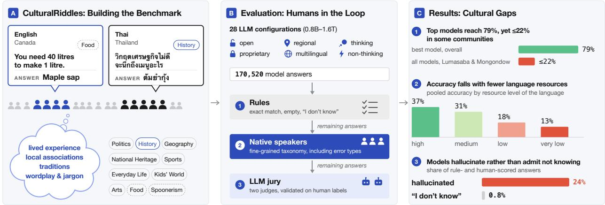

Figure 1: Overview of the CULTURALRIDDLES benchmark, the LLM evaluation stage and the core results.
<table><tr><td>Community</td><td>Topic</td><td>Riddle</td><td>Riddle (en)</td><td>Answer (+en)</td></tr><tr><td>deu (DEU)</td><td>History</td><td>Name des deutschen 9/11.</td><td>Name of the German 9/11.</td><td>Schicksalstag (“day of fate”)</td></tr><tr><td>ltz (LUX)</td><td>Politics</td><td>Déi schwaarz Partei.</td><td>The black party.</td><td>CSV (Christian Social People&#x27;s Party)</td></tr><tr><td>apd (SDN)</td><td>Arts</td><td></td><td>the udanese woman who was nicknamed The Gazelle of Al-Masalma&#x27;. Who am I?</td><td>(Aziza Adam Mandil)</td></tr></table>

Table 1: Example riddles from three communities. Community is given by the language code and, in parentheses, the country code. The Sudanese Arabic riddle (third) comes from one of the hardest communities (Section 5.5).

and when they adequately model cultures around the globe remains an open question (Myung et al., 2024;   
Naous et al., 2024; Chiu et al., 2025; Rao et al., 2025; Chang et al., 2025; Khan et al., 2026).

Most cultural benchmarks assess whether models possess cultural knowledge (Hu et al., 2024; Liu et al., 2025; AlKhamissi et al., 2026; Zhou et al., 2025; Chowdhury et al., 2025). However, cultural understanding also requires applying it to infer implicit meanings from contextual cues, and as LLMs gain greater knowledge and stronger reasoning, their failures increasingly come from choosing the wrong interpretation rather than lacking the fact (Gekhman et al., 2026). Riddles could test this ability, particularly compositional and abductive reasoning (Halder et al., 2026). They have long served to test cultural understanding in traditions from ancient Greece, Rome, and India to China (Szalc, 2011; Tan et al., 2016; Monda, 2016), and they span topics from history and politics to sports and literature (Kaivola-Bregenhøj, 2018). Solving a cultural riddle requires weighing alternative cultural associations for each clue, combining them into a coherent whole (compositional reasoning), and inferring the answer that best explains all clues (abductive reasoning) (Halder et al., 2026). E.g., as shown in Table 1, the German riddle requires interpreting “the German 9/11” in German day–month order, then recalling the historical events and name of 9 November. By contrast, simply asking “What is 9 November called in Germany?” would require only factual recall. Cultural riddles thus test whether LLMs can interpret cultural clues and combine knowledge with reasoning.

Cultural riddles have been benchmarked for a few languages (Fabbri et al., 2025; Boczka, 2026; Sayeedi et al., 2026; Minggad et al., 2026), where they challenge even frontier LLMs. However, existing cultural benchmarks have three key limitations: (L1) narrow linguistic and geographic coverage, (L2) insuficient validation of data quality and dificulty, and (L3) the lack of a robust, scalable, human-informed evaluation protocol. Prior cultural QA work either human-scores a small subset of answers or uses automatic judges (Arora et al.,

<table><tr><td>Benchmark</td><td>Tasks</td><td>Open- ended</td><td>Native- authored</td><td>Human- Human only</td><td>eval.</td><td>Lang. Locale Map</td><td></td><td></td></tr><tr><td>BLEnD (Myung et al., 2024)</td><td>Knowledge</td><td>△</td><td>△</td><td>√</td><td>√</td><td>13</td><td></td><td>16 ~ 1:1</td></tr><tr><td>CulturalBench (Chiu et al., 2025)</td><td>Knowledge</td><td>X</td><td>√</td><td>x</td><td>x</td><td>1</td><td></td><td>45 Locale</td></tr><tr><td>INCLUDE (Romanou et al., 2025)</td><td>Knowledge</td><td>x</td><td>√</td><td>1</td><td>x</td><td>44</td><td>52~1:1</td><td></td></tr><tr><td>Global-MMLU (Singh et al., 2025)</td><td>Knowledge</td><td>x</td><td>X</td><td>x</td><td>x</td><td>42</td><td></td><td>- Language</td></tr><tr><td>Global PIQA (Chang et al., 2025)</td><td>Commonsense</td><td>x</td><td>△</td><td>X</td><td>x</td><td>141†</td><td></td><td></td></tr><tr><td>CulturALL (Lin et al., 2026)</td><td>Grounded QA</td><td>△</td><td>△</td><td>x</td><td>x</td><td>14</td><td></td><td>51 Sparse</td></tr><tr><td>Macaron (Elsetohy et al., 2026)</td><td>Reasoning</td><td>x</td><td>√</td><td>√</td><td>x</td><td>17</td><td></td><td>20～1:1</td></tr><tr><td>CultureForest (Ye et al., 2026)</td><td>Norm Reasoning</td><td>△</td><td>x</td><td>x</td><td>x</td><td>1</td><td></td><td>53 Locale</td></tr><tr><td>CaLMQA (Arora et al., 2025)</td><td>Long-form QA</td><td>L</td><td>△</td><td>x</td><td>√</td><td>23</td><td></td><td>– Language</td></tr><tr><td>NativQA (Hasan et al., 2025)</td><td>Knowledge</td><td></td><td>√</td><td>V</td><td>√</td><td>7</td><td></td><td>9 Sparse</td></tr><tr><td>CUS-QA (Libovický et al., 2026)</td><td>Knowledge</td><td></td><td>△</td><td>x</td><td>√</td><td>3</td><td></td><td>3 ～ 1:1</td></tr><tr><td>MultiNRC (Fabbri et al., 2025)</td><td>Reasoning</td><td>V</td><td></td><td></td><td>x</td><td>3</td><td></td><td>Language</td></tr><tr><td>BanglaRiddleEval (Sayeedi et al., 2026)</td><td>Riddles</td><td>△</td><td></td><td>x</td><td>x</td><td>1</td><td></td><td>– Language</td></tr><tr><td>MonCulture-eval (Minggad et al., 2026)</td><td>Knowledge</td><td>△</td><td></td><td></td><td>√</td><td>1</td><td></td><td>1 ~ 1:1</td></tr><tr><td>HungarianRiddles (Boczka, 2026)</td><td>Riddles</td><td>√</td><td></td><td></td><td></td><td>1</td><td>1</td><td></td></tr><tr><td>CULTURALRIDDLES (Ours)</td><td>Riddles</td><td></td><td></td><td>△</td><td></td><td>51</td><td>62 M:M</td><td></td></tr></table>

Table 2: Comparison of cultural and riddle benchmarks. ✓= yes; ✗= no; = mixed / partial; “–” = not reported. Native authored: items originated in the target language rather than being translated; Human-only: no LLM-generated benchmark item content; Human eval.: humans score model answers. Locales count distinct (language, country) pairs; Map gives how languages relate to locales, where M:M denotes multiple languages per locale and multiple locales per language. †Language varieties. ‡Smallscale human evaluation (§ 2). CULTURALRIDDLES is the only benchmark that ofers large-scale open-ended, community-authored native content and human evaluation with multiple countries per language and multiple languages per country.

2025; Hasan et al., 2025; Libovický et al., 2026).

We address these limitations with CULTURALRIDDLES, a benchmark of 6,191 original riddles written by community members in their own languages. CULTURALRIDDLES spans 62 communities in 51 languages and 45 countries. It includes languages absent from prior cultural benchmarks, and many-to-many links between languages and countries, such as seven languages in multiple countries and seven countries with multiple languages. (L1, Figure 2). Native speakers other than the author verify every riddle (L2). We benchmark 28 proprietary and open model configurations and, to our knowledge, conduct the largest and most multilingual human evaluation of model answers to open-ended cultural knowledge tasks: native speakers labeled 68,067 unique answers across 57 communities in 48 languages, covering 59.10% of 170,520 model responses; rulebased scoring and two human-validated LLM judges score most remaining responses, with unresolved cases excluded from accuracy (L3).

Our results reveal substantial cultural gaps: the best model achieves 79.4% overall accuracy, yet no model exceeds 22% in the Lumasaba and Mongondow communities. Translating riddles from five of the hardest communities into English closes only about one-fifth of the accuracy gap to high-resource communities, suggesting that language barriers alone do not explain these diferences. We also find that exact-match scoring misses many valid answers and alters model rankings, highlighting the importance of human-informed evaluation.

Through riddles written and reviewed by community members, CULTURALRIDDLES ofers a nuanced assessment of how well current models can solve original, culturally grounded riddles in their respective languages, probing lived experience and locally specific knowledge beyond well-documented facts. The benchmark can also grow to include new communities and track model progress over time.

## 2 Related Work

Cultural Benchmarks Cultural benchmarks for LLMs mostly operationalize culture as knowledge, norms and values, social dynamics, or bias (Adilazuarda et al., 2024; AlKhamissi et al., 2026). For example, BLEnD (Myung et al., 2024), CulturalBench (Chiu et al., 2025), and CVQA (Romero et al., 2024) test everyday cultural knowledge, while NormAd (Rao et al., 2025) and WorldValuesBench (Zhao et al., 2024) probe social norms and values. These benchmarks are mostly closed-form and test recognition or recall, which says little about whether models apply cultural knowledge when reasoning (Zhou et al., 2025). Global PIQA (Chang et al., 2025), CulturALL (Lin et al., 2026), and Macaron (Elsetohy et al., 2026) combine cultural knowledge with multi-step reasoning, and CultureForest (Ye et al., 2026) requires models to apply culturally grounded norms. While some cultural QA benchmarks include human evaluation, they do so at small scale (120–700 answers evaluated across <10 languages) (Myung et al., 2024; Arora et al., 2025; Hasan et al., 2025; Libovický et al., 2026). Overall, existing benchmarks vary widely in coverage and in how much content is written and evaluated by humans (Table 2).

Riddle Benchmarks General riddle benchmarks test commonsense and lateral thinking predominantly in English: RiddleSense (Lin et al., 2021), BrainTeaser (Jiang et al., 2023b), and BiRdQA (Zhang & Wan, 2022) use multiple-choice riddles and puzzles, and RiddleBench (Halder et al., 2026) collects logic puzzles from exam papers; Chinese character riddles (Tan et al., 2016) add wordplay. They rarely require cultural knowledge. Cultural riddle benchmarks exist only for a few languages or locales. In MultiNRC (Fabbri et al., 2025), 258 out of 1,055 reasoning questions are wordplay and riddles; no model exceeds 50% on LLM judge scores. BanglaRiddleEval (Sayeedi et al., 2026) features 1,244 traditional Bangla riddles with LLM-generated explanations and distractors; the best multiple-choice accuracy is about 56%, against 83% for humans. MonCulture-eval (Minggad et al., 2026) includes a Mongolian riddle task across two scripts and three regions, scored by LLM judges with a human audit of 10% of the scores. Boczka (2026) introduced riddle writing focused on culture-specific associations and clues across a list of selected topics, with an evaluation scheme focused on hallucinations and abstention. Each of the existing cultural riddle benchmarks covers one to three languages with one locale per language, relies on multiple choice, unvalidated LLM judges, or human scoring alone, and covers few topics and model families. CULTURALRIDDLES scales the one-language pilot of Boczka (2026) to 62 communities, with human and validated LLM-judge evaluation.

## 3 CulturalRiddles Benchmark

CULTURALRIDDLES contains 6,191 original riddles written by 167 native speakers for 62 national-linguistic communities. The target is 100 riddles per community: ten for each of eight shared topics, which enable cross-cultural comparison, and ten for each of two topics chosen by the community1.

## 3.1 Participatory Benchmark Construction

Community Unit & Recruiting Neither language nor country alone captures cultural context, so our working unit is the national-linguistic community as it exists today (e.g., Hungarian in Hungary, Spanish in Mex ico), an imperfect (AlKhamissi et al., 2026) but scalable basis for data collection and coverage reporting. We recruited volunteer writers through social media and personal networks, requiring only self-identification with a community, proficiency in its language, and basic English. Over six months, 167 writers contributed, typically one or two per community (App. A.1). Consent to publish the data was obtained from the writers, and all participants are ofered opportunities to contribute to research on top of the collected data.

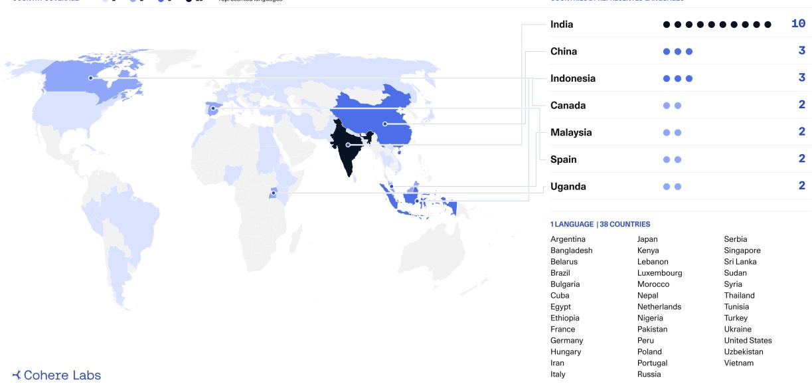  
Figure 2: Cultural riddles across languages and borders. CULTURALRIDDLES brings together 6,191 original riddles from 62 communities across 51 languages and 45 countries, including many underrepresented languages and locales. See App. A.1 for the full list.

Task Format and Example Each riddle instance contains a topic, an indirectly phrased riddle, and a short reference answer in the local language, with optional hints and comments (Table 1). Most instances also include English translations, which serve only as reading aids: they may lose information needed to solve the riddle and some concepts simply have no English equivalent.

Riddle Writing Process & Instructions Each team wrote its riddles from scratch within the shared topic framework, without translating content from other communities. Writers were asked for tricky, indirect questions with a single exact answer (typically 1–4 words), using synonyms, indirect descriptions, local jargon, and nicknames recognizable within their community, so that solving a riddle takes more than a single lookup or web search. In a post-writing survey (76 respondents from 43 communities), 97.4% of respondents reported having drawn on personal knowledge and experience, 68.4% also on online sources, and 55.3% on other community members. To calibrate dificulty, 46.1% tested riddles on AI tools (without revealing the answers); 39.5% used AI to brainstorm and 5.3% to paraphrase or co-write.

Quality & Diversity Assurance At least one native speaker other than the author verifies every riddle: it must be solvable, its clues unambiguous, and its reference answer correct. Not every community member must be able to solve it, since some riddles rely on knowledge specific to a generation, region, or interest (Boczka, 2026), and agreement is not a requirement for cultural “truth” (AlKhamissi et al., 2026). In our survey, one third of riddle writers estimated their riddles would mostly rely on only well-known knowledge, another third also included some regional knowledge, 26% mostly regional or local knowledge, and only 3% estimated they would require niche knowledge.

## 3.2 Contents and Coverage

Linguistic and Geographic Coverage CULTURALRIDDLES (Figure 2) includes languages absent from prior cultural benchmarks (e.g., Buginese, Mongondow, Masaaba, Konkani, Sudanese Arabic) and underrepresented locales (e.g., Uganda, Luxembourg, Cuba). Its language–country mapping is denser than in prior benchmarks (Table 2): seven languages appear in several countries (e.g., Spanish in Argentina, Cuba, Peru, and Spain), seven countries contribute several languages (e.g., ten for India), and Arabic appears in five varieties.

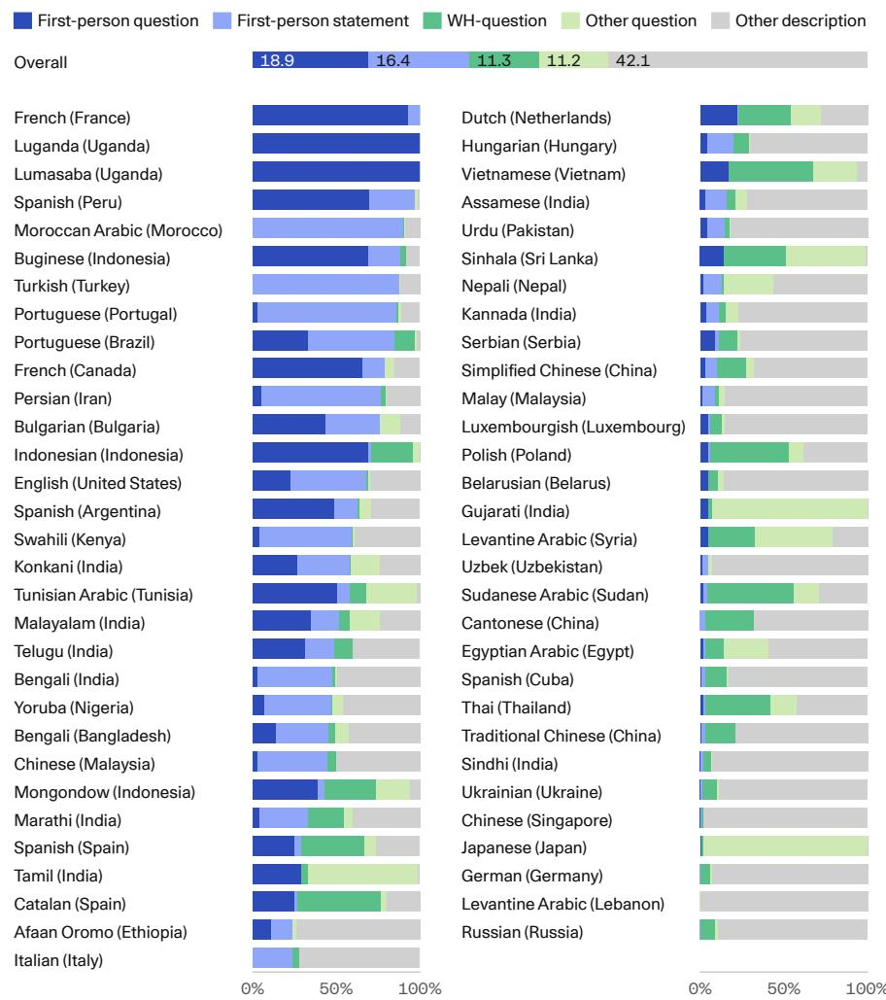  
Figure 3: Communities favor diferent riddle forms. Share of riddles in each form, overall (6,092 English translations, 61 communities) and in one community dominated by each form, labeled by ISO 639-3 language and ISO 3166 country code (Table 5). Questions end in “?” or open with a question word (WH-questions open with one); first-person riddles contain a first-person pronoun.

Topics Building on the Hungarian riddles of Boczka (2026), we selected eight shared topics expected to be relevant across cultures (Politics, History, Geography, Arts, Sports, National Heritage, Kids’ World, and Everyday Life). Additionally, each community could freely choose two “wildcard” topics, designated to capture particularly relevant concepts of their culture. Among the 124 topics chosen by communities, the most common theme is Food (27.4%), followed by Nature (15.3%), Language (13.7%), and Media (12.9%). We also received culture-exclusive topics, such as Public bath etiquette by Japanese (Japan) and Wedding Micro-traditions by Sindhi (India) communities. Writers rated Politics the hardest shared topic to write (3.41/5) and Everyday Life the easiest (2.37/5).

Riddle Patterns & Content We imposed no fixed format on the riddles to leave room for unique cultural preferences. The examples in Table 1 illustrate the diversity of riddle formats chosen, e.g., a brief statement in the German and Luxembourgish examples or a first-person description in the Sudanese Arabic example. Many communities favor one form: 98% of Luganda riddles close with a first-person question (“Who am I?”), while 98% of Japanese riddles close with a short question of the type “What is it?” (Figure 3). Some riddles also build on the culture’s own riddle traditions, e.g., Tamil riddles about Geography grounded in old Tamil poetry about landscapes, or Persian riddles built on wordplay, poetic imagery, and rhyme. Many others draw on collective memory, including painful histories (e.g., betrayal at Plassey (Bangladesh), persecution under Brazil’s dictatorship, imprisonment and survival in Syria, or the contradiction between slavery and ideals of equality in the US). These clues reach beyond language into shared ways of remembering: particularly in Politics and History, a few words can evoke a larger narrative of loss, injustice, or resistance. Solving them requires familiarity with how an event is remembered, not only with the event itself.

Data and code. CULTURALRIDDLES is available on Hugging Face under CC-BY-4.0, with the request that it not be used to train models or to generate synthetic data. Code for evaluation and analysis is available at https://github.com/Cohere-Labs-Community/CulturalRiddles. New communities can contribute through the repository, which provides a riddle template, an automatic format check, and a review process.

## 4 Experimental Setup

## 4.1 Models

We evaluate 28 proprietary, open-weight, and open-source model configurations (Figure 6)2. They are dense and mixture-of-experts models with disclosed sizes from 0.8B to 1.6T parameters, several reasoning settings, and one search-enabled configuration. Each configuration answers the 6,090 benchmarked riddles (61 communities) once with the same English prompt template including country and topic for context (App. A.2), yielding 170,520 total responses3.

## 4.2 Evaluation

Metric Each answer receives a score of 0 (incorrect), 1 (admits not knowing), 2 (partially correct), or 3 (correct). To capture finer distinctions within these score categories, we define 13 response types, such as hallucinated (score 0) and diferent valid answer (score 3), as shown in Tables 3 and 4. Our primary metric, accuracy, is the share of scored responses with score 3. Accuracy diferences are reported in percentage points (pp).

Scoring Pipeline Open-ended answers may difer from the reference while remaining correct. To balance reliability and annotation efort, each of the 170,520 responses takes one of three routes to a score (Figure 4): rules, native speakers, or a human-validated LLM jury.

Rule-based Scoring Rules score case-insensitive exact matches as 3 (16.45% of all responses), empty outputs and copies of the prompt’s answer placeholder as 0, and explicit “I don’t know” responses as 1.

<table><tr><td></td><td>Error type</td><td>Definition and example</td><td>Responses</td><td> $\%$ </td></tr><tr><td>0.1</td><td>Too broad</td><td>The answer is too generic or a blanket answer.</td><td>9,195</td><td>6.92%</td></tr><tr><td>0.2</td><td>Right category, wrong entity</td><td>The category is correct, but the specific entity is incorrect (e.g., model answer is a different volleyball player)</td><td>20,661</td><td>15.54%</td></tr><tr><td>0.3</td><td>Hallucinated</td><td>The answer is made up, or completely irrelevant.</td><td>32,161</td><td>24.19%</td></tr><tr><td>0.4</td><td>Other (add note)</td><td>Other incorrect answer; requires annotator&#x27;s note.</td><td>8,705</td><td>6.55%</td></tr><tr><td></td><td>Incorrect, no type</td><td>The annotator gave the score without a type.</td><td>7</td><td>0.01%</td></tr><tr><td></td><td>Empty output</td><td>The model returned no text (rule-based).</td><td>2,475</td><td>1.86%</td></tr><tr><td></td><td>Placeholder</td><td>The model returned the prompt&#x27;s answer template token (rule-based).</td><td>736</td><td>0.55%</td></tr><tr><td></td><td>Admits not knowing</td><td>The model says it does not know the answer (rule-based or human).</td><td>1,062</td><td>0.80%</td></tr><tr><td>2.1</td><td>Closely related culture or region</td><td>The answer confuses related cultures or regions (e.g., na- tional vs. regional).</td><td>1,554</td><td>1.17%</td></tr><tr><td>2.2</td><td>Wrong level of detail</td><td>The answer is close to the reference answer but misses some details (e.g., book title instead of author).</td><td>4,328</td><td>3.26%</td></tr><tr><td>2.3</td><td>Surface pattern match</td><td>The answer reuses a clue keyword without solving the rid- dle (e.g., “cycle&quot; for an “hour cycle” riddle).</td><td>1,997</td><td>1.50%</td></tr><tr><td>2.4</td><td>Other (add note)</td><td>Other partially correct answer; needs annotator&#x27;s note.</td><td>653</td><td>0.49%</td></tr><tr><td></td><td>Exact match</td><td>Case-insensitive exact match with the reference (rule- based).</td><td>28,049</td><td>21.10%</td></tr><tr><td></td><td>Correct, no type</td><td>Human judged the answer to be correct without any subla- bel being recorded</td><td>12,636</td><td>9.51%</td></tr><tr><td>3.1</td><td>Different valid answer</td><td>The answer is valid but differs from the reference answer (e.g., another accepted name for the same game).</td><td>8,187</td><td>6.16%</td></tr><tr><td>3.2</td><td>Correct (in English)</td><td>The valid answer is in English, not riddle&#x27;s language.</td><td>515</td><td>0.39%</td></tr><tr><td>3.3</td><td>Other correct</td><td>Correct answer, requires a note.</td><td>19</td><td>0.01%</td></tr><tr><td></td><td></td><td>Total rule- and human-scored responses</td><td>132,940</td><td>100.00%</td></tr></table>

Table 3: Error types and their counts over the 132,940 responses scored by rules or by human annotators (100,769 human-labeled, covering 68,067 unique answers; the rest scored by exact-match, empty-output, placeholder and “I don’t know” rules). Responses scored only by the LLM jury or not yet scored are excluded, since the jury is not reliable for error types. The dominant type within each score is highlighted in blue.

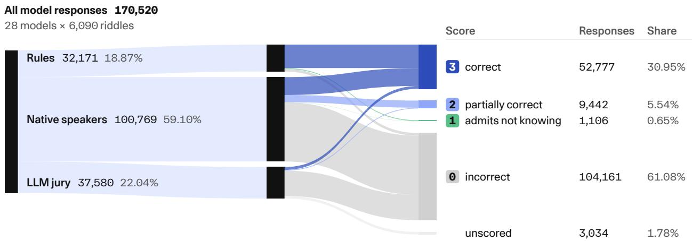  
Figure 4: Native speakers score more than half of all responses. Band widths count model responses through the scoring pipeline. The jury assigns a score only when both judges agree; disagreements and missing verdicts remain unscored.

Human Annotation Community members assign scores (0-3) and error types, recognizing valid local answers beyond the reference answer. Identical answers to the same riddle are labeled once for all models that gave them. Annotators score the ten most frequent unscored answers per riddle and can optionally score more. Their 68,067 unique labels cover 100,769 model responses (59.10%). Despite thorough instruction (Section A.3), we have 2.38% of responses that are invalid entries, including all Sindhi (India) labels. They are routed to the jury, as with three communities without human labels (App. B.6). A second native speaker independently relabeled a subset in 19 communities, yielding 4,246 valid pairs; we call the first label H1 and the second H2.
<table><tr><td>Model answer</td><td>Score</td><td>Type</td><td>Note</td><td>Gloss</td></tr><tr><td>Schicksalstag der Deutschen</td><td>3</td><td>3.1</td><td></td><td>“Germans&#x27; day of fate&quot;</td></tr><tr><td>9. November</td><td>0</td><td>0.2</td><td></td><td>the date, not its name</td></tr><tr><td>der 11. September 2001</td><td>0</td><td>0.2</td><td>direct German transla- tion</td><td>the U.S. attacks</td></tr><tr><td>Reichstagsbrand</td><td>0</td><td>0.3</td><td>unrelated</td><td>the 1933 Reichstag fire</td></tr><tr><td>der Anschlag vom 11. September 2001 (auch bekannt als 9/11)</td><td>0</td><td>0.4</td><td>incorrect resolution of date format</td><td>U.S. attacks, read as 11 Septem- ber</td></tr><tr><td>Ich weiss nicht</td><td>1</td><td></td><td></td><td>“I don&#x27;t know”</td></tr></table>

Table 4: Annotations for the German riddle “Name des deutschen 9/11” (“Name of the German 9/11”; reference Schicksalstag (9 November)) from Table 1. Six of the 28 model answers are shown with their labels.

LLM Jury Two judges, Gemini 3.5 Flash and DeepSeek V4.1 Flash, score the remaining answers with model names hidden. They receive the same information as annotators and return a score and error type (App. A.4). Because judges can be biased (Ye et al., 2025) and miss cultural nuance (Jin et al., 2026), we develop the prompt on held-out riddles and evaluate three sets of distinct (riddle, answer) pairs: (A) 4,018 doubly annotated pairs from 1,028 test riddles; (B) 25,370 human-labeled test pairs, stratified by community and score across all 57 human-evaluated communities; and (C) 33,880 pairs without valid human labels, which permit only judge–judge comparisons. An answer is only considered scored here when both judges agree on its 0–3 score; unresolved responses (1.78% of all outputs) are excluded from accuracy computation.

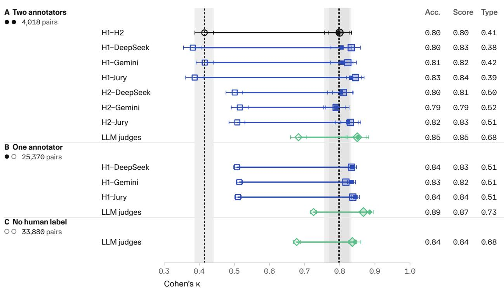  
Figure 5: Judge agreement approaches human agreement on accuracy and scores, but not on fine-grained types. Cohen’s κ for each rater pair in settings A–C (Section 4.2), with 95% intervals from 1,000 riddle-bootstrap resamples. Solid, pale, and hollow markers denote accuracy, the weighted 0–3 score, and the 13 weighted response types; color and shape identify the rater pair. Shaded bands mark the human–human intervals from setting A, not equivalence tests in B or C. “Jury” takes the lower judge score and that judge’s type (DeepSeek’s on a tie), including disagreements rather than leaving them unscored as in production scoring (App. A.4).

## 5 Results

We first assess whether the jury agrees with native speakers (Section 5.1), then compare models and communities using combined rule, human, and jury scores (Sections 5.2, 5.3 and 5.5) over the 57 communities with valid human evaluation. Error-type analyses use only rule-based scores and human labels (Section 5.4).

## 5.1 LLM judge agreement approaches human agreement

Human annotators agree on scores but less on error types. On the doubly annotated sample (setting A, Figure 5), humans agree on accuracy at Cohen’s $\kappa = 0 . 8 0 \pm 0 . 0 4$ and on the 0–3 score at quadratic-weighted $\kappa = 0 . 8 0 \pm 0 . 0 3$ (Landis & Koch, 1977). Accuracy agreement ranges across communities from $\kappa = 0 . 5 9$ (Ukrainian) to 1.00 (Luganda), excluding two communities with too few correct answers. Agreement on the 13 error types is weaker (κ = 0.41 with partial credit within a score, 0.31 without), mostly because the guideline left room for subjective interpretation: hallucinated versus right category, wrong entity, when to award partial credit, and whether a diferent valid answer needs its own label rather than correct. We therefore use error types descriptively (Section A.3).

LLM–human agreement is comparable to human–human agreement. In setting A, individual zeroshot judges agree with H1 and H2 at $\kappa = 0 . 7 9 – 0 . 8 1$ on accuracy and quadratic-weighted $\kappa = 0 . 7 9 – 0 . 8 3$ on the 0–3 score, close to human–human agreement on both. Agreement with H1 remains high in setting B: 0.83–0.84 on accuracy and 0.82–0.83 on scores. Ten in-prompt examples change accuracy κ by about 0.01 or less, so we use zero-shot judges. Like humans, judges agree less on fine-grained response types (0.38–0.52).

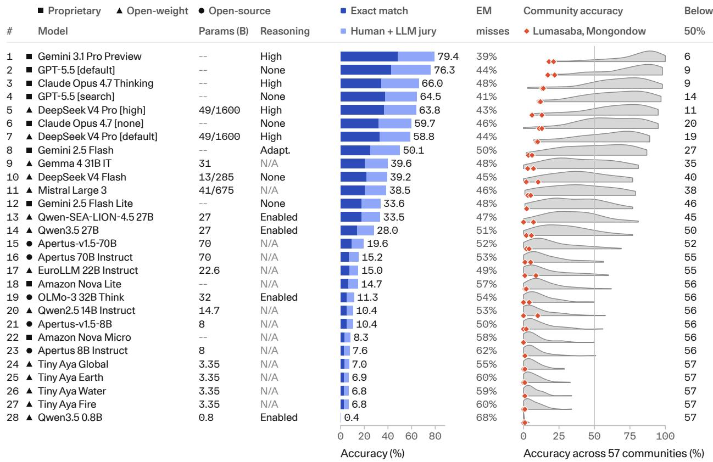  
Figure 6: High overall accuracy can coexist with cultural blind spots. Stacked bars pool scored responses: dark blue is exactmatch accuracy and light blue adds answers accepted by native speakers or the jury; EM misses is the share of ultimately correct responses missed by exact match. Half-violins weight each of the 57 community accuracies equally, orange diamonds mark Lumasaba and Mongondow, and the < 50% column counts communities below that threshold. Parameter counts are in billions (active/total for mixture-of-experts); access categories follow Section 4.1.

Human disagreement is more frequent when judges disagree. The two LLM judges agree highly on accuracy in all three settings (Figure 5). In setting A, humans disagree on accuracy for 27% of pairs where the judges disagree, 8.4 times the rate where they agree, and on the full 0–3 score for 39%, 5.1 times the rate where they agree. Judge disagreement thus flags answers that are also dificult for humans to score.

Judges share systematic errors. The judges share about two-thirds of their errors. First, they are lenient on the strongest models: they jointly accept 9.0% and 6.9% of human-rejected answers from Gemini 3.1 Pro and GPT-5.5, respectively (Figure 15). Second, they reject valid alternatives: individual judges reject 25– 29% of diferent valid answers, versus about 5% of answers labeled simply correct. Third, agreement varies across communities, ranging from κ = 0.65 for Swahili to 0.98 for Belarusian and Catalan (Figure 16).

## 5.2 Frontier models perform well, but most models lag behind

Larger models generally perform better, but not always Gemini 3.1 Pro Preview leads at 79.4%, followed by GPT-5.5 (76.3%) and Claude Opus 4.7 Thinking (66.0%; Figure 6). The best open model, DeepSeek V4 Pro with high reasoning, ranks fifth at 63.8%. Apart from other configurations of these models and Gemini 2.5 Flash (50.1%), every model scores below 40%, and models of 8B parameters or fewer reach at most

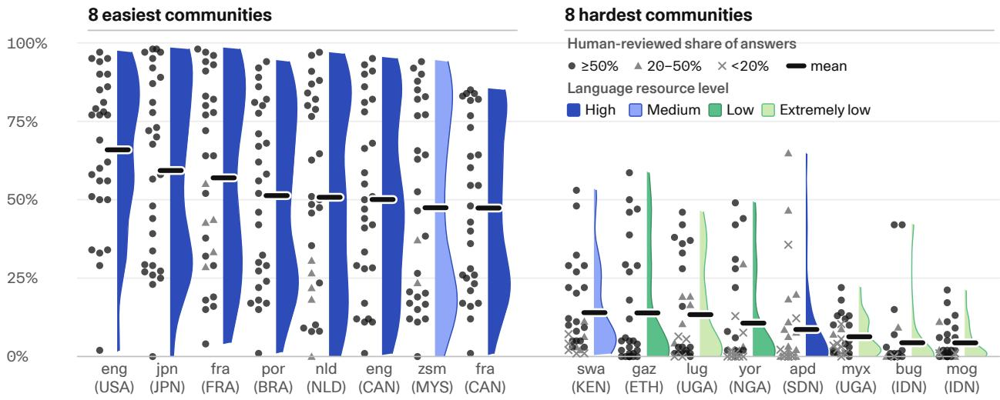  
Figure 7: Even the strongest models struggle in the hardest communities. Communities are ranked by mean accuracy, weighting models equally; each raincloud shows model accuracies, their mean (black bar), and a density scaled to equal peak width. Color indicates language-resource levels defined by Common Crawl page counts (Figure 8); marker shapes indicate native-speaker review coverage among responses for each model routed beyond automatic rules (App. A.4.0.9).

10.4%. Yet size alone does not explain performance: Gemma 4 31B (39.6%) outperforms both the similarly sized OLMo-3 32B Think (11.3%) and the larger Apertus 70B models (15.2% and 19.6%).

Regional models show no extra advantage in their target regions. We test whether regionally adapted models gain more in their target regions than elsewhere. Regional Tiny Aya variants do not difer significantly within any region (Cochran’s Q, all p > 0.48). Qwen-SEA-LION-4.5 27B gains 5.5 pp over Qwen3.5 27B overall, but we find no significant extra gain in its target regions.

Reasoning helps, but web search can hurt. Thinking raises Claude Opus 4.7’s accuracy by 6.3 pp, and high reasoning efort adds 5.0 pp for DeepSeek V4 Pro. Web search, by contrast, lowers GPT-5.5’s accuracy by 11.8 pp. Among answers that GPT-5.5 gives correctly without search but incorrectly with it and that humans assigned an error type, 39% name the wrong entity in the right category and 25% are hallucinated. Search may reinforce familiar keyword associations: a Swahili (Kenya) riddle asks for the “home of the Lunatic Express”, but multiple models return the Uganda Railway itself. They identify the entity associated with “Lunatic Express” while overlooking “home”, which points to the intended Railway Museum in Nairobi.

## 5.3 Exact match misses half of correct answers

Exact match credits only responses matching the reference answer (case-insensitive), missing about 47% of responses ultimately scored correct across the human-evaluated communities (Figure 6). Among the 132,940 responses scored by rules or humans, native speakers judged an additional 9.51% correct without a subtype recorded and labeled 6.16% as diferent valid answers (Table 3).

Human and jury review raises accuracy by 64–166% relative to exact match for every model except Qwen3.5 0.8B, whose larger relative gain (213%) reflects a very small exact-match count. Gains generally grow toward weaker models, so exact match can exaggerate performance gaps and change rankings; for example, Claude Opus 4.7 Thinking moves from fifth to third after review.

## 5.4 Models hallucinate rather than abstain

The most frequent error across riddles is a hallucinated answer, one that is made up or unrelated to the riddle (24.19% of the 132,940 responses scored by rules or humans). In contrast, only 0.80% of these responses admit not knowing, even though the prompt asks models to answer “I don’t know” when they do not know (Figure 10). Hallucinations shrink as accuracy rises (Figure 12 in App. B.1), but abstention stays rare for every model (at most 3.81% for any model).

## 5.5 High averages hide cultural blind spots

Most models agree on what is easy. The eight easiest communities—English (USA), Japanese, French (France), Portuguese (Brazil), Dutch, English (Canada), Malay, and French (Canada)—have mean accuracies of 47–66% across models, and seven of them use high-resource languages (Figure 7), defined by Common Crawl page counts (Figure 8). At least 20 of 28 models exceed 20% accuracy in each, and the median model reaches 73% on English (USA), plausibly because these cultures are well documented on the web and hence in LLM training data.

African and Indonesian communities challenge every model. The eight hardest communities are Swahili (Kenya), Afaan Oromo, Luganda, Yoruba, Sudanese Arabic, Lumasaba, Buginese, and Mongondow (mean accuracy 4–14%; Figure 7). Here 15–25 of 28 models score below 10%, and the median model scores only 0–9%. Even Gemini 3.1 Pro and GPT-5.5 average just 43% and 39% across these eight, about half their overall accuracy. No model exceeds 22% on Lumasaba or Mongondow.

Low-resource languages increase the challenge. Six of the eight hardest communities use low- or extremely low-resource languages (fewer than 100K pages in Common Crawl). Across all human-evaluated communities, pooled accuracy falls from 37.0% for high-resource languages to 30.8% for medium, 18.0% for low, and 12.7% for extremely low-resource languages (Figure 8), yet community accuracies still vary with a standard deviation of 8–13 pp within each level. Swahili is medium-resource, and Sudanese Arabic inherits the high-resource classification of Arabic: neither escapes the hardest group.

## 6 Analysis

We first examine what makes a riddle dificult and how language contributes (Section 6.1), then pose the riddles as crosswords (Section 6.2), and finally estimate the efort of evaluating new models (Section 6.3).

## 6.1 What makes a riddle difficult?

Dificulty mostly comes from the riddle, then the language. To separate model ability from riddle dificulty, we fit a crossed random-efects logistic model (Bates et al., 2015) to 129,928 scored responses from model–community pairs with at most 2% unscored responses. Here, variance measures the spread in the estimated likelihood of a correct answer on the model’s latent log-odds scale. Model identity accounts for 38% of the total variance (Figure 9). Among the components associated with the benchmark rather than the answering model, individual riddles account for about 60%, language 24%, community within a language 13%, and topic 2%. Models largely agree on which languages and communities are hard: interactions between model identity and benchmark factors account for less than 2% of total variance.

Riddle features explain only 3.1% of the riddle-level variance (App. B.2), but rare answer terms matter. About a third of the riddles contain a very rare word in their English reference answer, often a local term such as bebinca, a Goan layered pudding (rarity measures English word frequency, not cultural knowledge directly), and their adjusted odds of a correct answer are roughly half those of riddles with common answers (OR 0.54, 95% CI 0.46–0.65). For example, the Konkani riddle “Layers of sweet, made during Christmas, what is this?” asks for bebinca, but GPT-5.5 and Claude Opus 4.7 Thinking answer kuswar, the platter of Goan Christmas sweets that includes it. They identify the dish family but miss the specific dish.

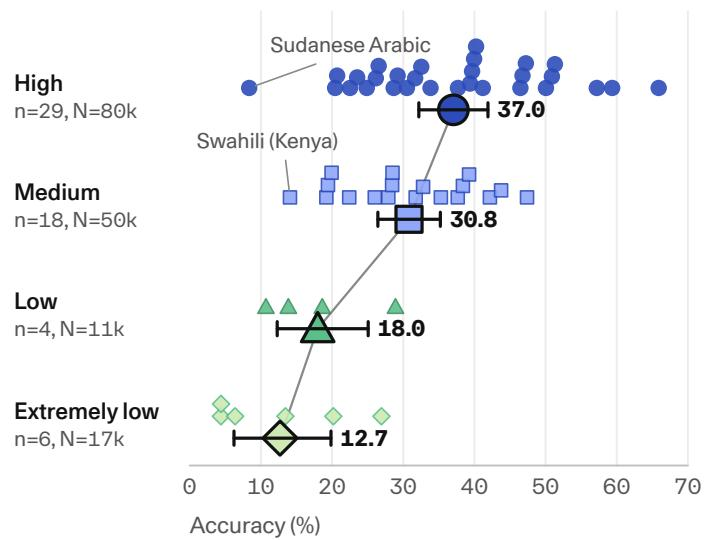

Figure 8: Language resources do not explain all community diferences. Small markers show community accuracies pooled over models; large diamonds pool responses within resource levels, with 95% intervals from 10,000 community-bootstrap resamples. Levels use Common Crawl page counts (CC-MAIN-2026-34): high 10M, medium 100K–10M, low 10K–100K, extremely low <10K or not detected; dialects inherit their macro-language’s count. n: communities; N: scored responses.  
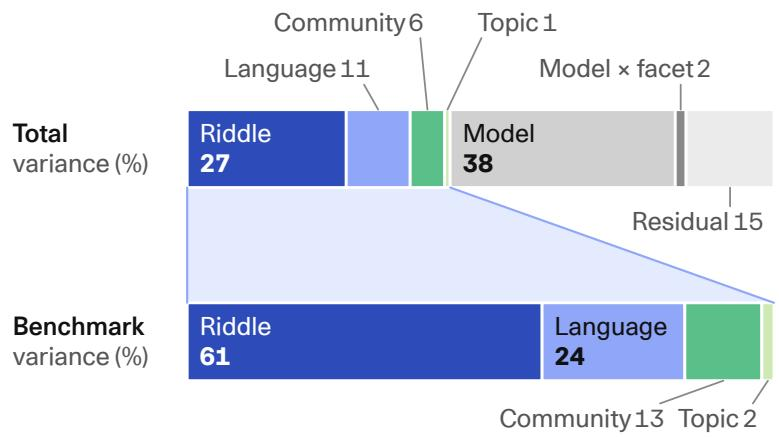  
Figure 9: Most riddle dificulty is specific to the individual riddle. Variance components of a crossed random-efects logistic model on the latent log-odds scale (residual variance $\pi ^ { 2 } / 3 ) .$ . The lower bar rescales only the riddle, language, community, and topic components to 100%; colors and hatching match across bars.

Language coverage is not community coverage. Language resources remain associated with accuracy after accounting for model identity and riddle features, consistent with the resource disparities documented by Joshi et al. (2020) and the cross-language gaps in INCLUDE (Romanou et al., 2025). In our feature model, the adjusted odds of a correct answer for low- and extremely low-resource languages are 0.10 (95% CI 0.02– 0.48) and 0.04 (0.01–0.15) times those for high-resource languages, so a high-resource riddle has roughly 10 and 25 times the odds. The medium-resource estimate (0.49, 0.20–1.21) is less certain (App. B.2).

Even among communities sharing both a language and a script, accuracy difers by 5–26 pp (App. B.2). For example, Simplified Chinese (China) averages 28.5% versus 46.3% for Chinese (Singapore), a gap of 17.8 pp. Language-level averages thus conceal diferences between the communities that a multilingual model is meant to serve.

Translating into English helps, but does not close the gap. To estimate how much of this dificulty comes from language alone, we benchmark five models (GPT-5.5, Gemini 3.1 Pro, Claude Opus 4.7, DeepSeek V4 Pro, Qwen-SEA-LION-4.5 27B) on English translations of the riddles from five hardest communities (Section 5.5). After excluding 41 translations that contain the full reference answer as a clue (e.g., “I am the art of making pottery” for pottery; 38 from Lumasaba), 458 riddles remain; English responses are scored by rules and the LLM jury without native-speaker review (App. B.4). On the 2,049 responses scored in both conditions, accuracy rises from 22.1% to 32.4% (paired gain +10.3 pp, 95% CI 7.6–13.0; Figure 14). Buginese, Lumasaba, and Yoruba gain 14–18 pp, while Sudanese Arabic shows no detectable gain. The same models reach about 69% on high-resource communities, so translation closes only about a fifth of the gap: much of the dificulty persists in English.

## 6.2 Beyond open-ended answers: Crosswords

Because each riddle has a short, exact answer, CULTURALRIDDLES can also be posed in other formats. We pose the riddles as crosswords, a long-standing testbed for language models (Wallace et al., 2022; Saha et al., 2025; Leng et al., 2025), which adds checkable constraints: each answer must fit its slot and share letters with the answers that cross it. We built 53 text grids from the communities’ riddle submissions (5,057 entries)4 and gave the same clues to 11 model configurations in five matched conditions: plain batch, batch with answer lengths, lengths plus a quarter of each answer’s letters, crossword with list output, and crossword with grid output.

We compare crossword input with the length condition, so that both see the same lengths (App. B.3). Crossing structure changes reference agreement by only +1.6 points (95% CI 0.3 to 3.7), but raises the share of consistent crossings from 53.0% to 60.1% (+7.2, 4.8–9.6): the answers agree more with each other without matching the references more often. Filling the grid is a separate skill that varies widely between models: Gemini 3.7 Flash scores 75.6% with list output but 5.4% with grid output, Claude Opus 4.8 returns no usable grid for any puzzle, and GPT-6 Astra places 88.3% of answers correctly.

## 6.3 Effort of benchmarking new models

We recommend scoring a new model on CULTURALRIDDLES in four steps, each passing fewer answers onward: (1) rules for exact matches, empty outputs, placeholders, and explicit admissions of not knowing (18.87% of our responses); (2) existing human labels for answers already given to the same riddle; (3) the LLM jury, which keeps a score only when both judges agree; and (4) native speakers for unresolved answers, with extra review in communities where agreement with human labels is low (Swahili (Kenya);App. A.4). Treating each model as new and using only rules and human labels from the other models (App. B.5), these steps already cover about 80% of the leading models’ responses, since strong models tend to repeat answers that other models gave. Coverage falls to 51% for the median model and 2–13% for the smallest models, whose answers are mostly unique. Roughly 100–115 answers per leading model would still need native review.

## 7 Discussion & Conclusion

We built CULTURALRIDDLES, a participatory benchmark of 6,191 original riddles from 62 communities (45 countries, 51 languages), to test how LLMs combine cultural knowledge with reasoning. Native speakers write, verify, and score its riddles, recognizing answers that exact match misses and judges sometimes reject. Frontier models lead overall, yet the top three proprietary configurations each score below 50% in 6–9 of the 57 human-evaluated communities, and the best open configuration does so in 11. No model exceeds 22% on Lumasaba or Mongondow. Models rarely admit not knowing. Evaluations that treat abstentions and wrong answers alike can reward guessing (Kalai et al., 2025; Wen et al., 2025); our 0–3 scale tracks abstention alongside accuracy.

Translation closes only a fifth of the hardest communities’ gap to high-resource communities, communities sharing a language and script difer by up to 26 pp, and regional adaptation shows no detectable extra advantage in its target regions. Stronger multilingual ability alone is therefore unlikely to close these gaps; much of what models lack appears to be content from the communities themselves.

The largest dificulty lies in what the riddles are built on: associations, traditions, perceptions, and memories shared within a community. Community members write and verify these riddles, so this knowledge is available to them by construction, yet the best models still miss it in many communities; final-answer scores cannot show whether they lack facts or misread clues. Because scoring needs native-speaker review for only about 100 answers per leading model (Section 6.3), CULTURALRIDDLES can grow to new models and communities and track how far future models move this cultural frontier.

## 8 Ethics Statement

Riddle writers and annotators are members of the communities they represent and contributed as unpaid volunteers. All contributors joined under a project proposal that described CULTURALRIDDLES as an open benchmark to be released publicly; a follow-up form asked the authors how they wish to be credited. The released dataset credits writers at the community level and does not attribute individual riddles. We report the writer survey only in aggregate. Some riddles refer to painful histories, such as persecution, dictatorship, or slavery. We keep them because they are part of how these communities remember events. After a content review, we removed 8 riddles and added a content note to 56 others; the dataset card includes a content disclaimer. The data released contains no names or contact details of contributors.

## 9 Acknowledgments & Disclosure of Funding

We thank Thomas Euyang for the help with the visualizations, and Brittawnya Prince for the coordination of the Cohere Labs Community Discord. We thank Catherine Arnett for her wise advice on embarking on a massive collaborative benchmarking journey. We thank the reviewers of the MRL workshop for their helpful feedback to an earlier draft.

Arora’s lab is partly supported by grants from the Novo Nordisk Foundation (NNF24OC0099109), the Pioneer Centre for AI, EU Horizon 2020 (101168951), and Danish Advanced Research Academy (DARA) and Danish Data Science Academy (DDSA) PhD Fellowships. We also gratefully acknowledge generous gifts from Microsoft and IT-vest - networking universities.

## References

Muhammad Farid Adilazuarda, Sagnik Mukherjee, Pradhyumna Lavania, Siddhant Shivdutt Singh, Alham Fikri Aji, Jacki O’Neill, Ashutosh Modi, and Monojit Choudhury. Towards measuring and modeling “culture” in LLMs: A survey. In Proceedings of the 2024 Conference on Empirical Methods in Natural Language Processing, pp. 15763–15784, Miami, Florida, USA, November 2024. Association for Computational Linguistics. doi: 10.18653/v1/2024.emnlp-main.882. URL https://aclanthology.org/2024. emnlp-main.882/.

Mai AlKhamissi, Yunze Xiao, Badr AlKhamissi, and Mona Diab. Hire your anthropologist! Rethinking culture benchmarks through an anthropological lens. In Findings of the Association for Computational Linguistics: EACL 2026, pp. 1218–1235, 2026.

Anthropic. Introducing Claude Opus 4.7. https://www.anthropic.com/news/claude-opus-4-7, April 2026. System card: https://www.anthropic.com/claude-opus-4-7-system-card. Accessed: 2026-08- 07.

Shane Arora, Marzena Karpinska, Hung-Ting Chen, Ipsita Bhattacharjee, Mohit Iyyer, and Eunsol Choi. CaLMQA: Exploring culturally specific long-form question answering across 23 languages. In Wanxiang Che, Joyce Nabende, Ekaterina Shutova, and Mohammad Taher Pilehvar (eds.), Proceedings of the 63rd Annual Meeting of the Association for Computational Linguistics (Volume 1: Long Papers), pp. 11772– 11817, Vienna, Austria, July 2025. Association for Computational Linguistics. ISBN 979-8-89176-251-0. doi: 10.18653/v1/2025.acl-long.578. URL https://aclanthology.org/2025.acl-long.578/.

Douglas Bates, Martin Mächler, Ben Bolker, and Steve Walker. Fitting linear mixed-efects models using lme4. Journal ofStatistical Software, 67(1), 2015. doi: 10.18637/jss.v067.i01.

Károly Boczka. Hungarian riddles benchmark v2: Evaluating cultural reasoning of LLMs on Hungarian riddles. https://github.com/boczkakaroly/ai-and-data-projects/tree/main/hungarian-riddles-b enchmark-v2, 2026. GitHub repository. Dataset also available on Hugging Face: https://huggingface. co/datasets/boczkakaroly/hungarian-riddles-benchmark.

Tyler A. Chang, Catherine Arnett, Abdelrahman Sadallah, Abdelrahman Eldesokey, Abeer Kashar, Abolade Daud, Abosede Grace Olanihun, Adamu Labaran Mohammed, Adeyemi Praise, Adhikarimayum Meerajita Sharma, Aditi Gupta, Adril Putra Merin, Adwoa Bremang, Afitab Iyigun, Afonso Simplício, Ahmed Essouaied, Aicha Chorana, Akhil Eppa, Akintunde Oladipo, Akriti Kuri, Akshay Ramesh, Aleksei Dorkin, Alfred Malengo Kondoro, Alham Fikri Aji, Ali Eren Çetintaş, Allan Hanbury, Alou Dembele, Alp Niksarli, Álvaro Arroyo, Amin Bajand, Amol Khanna, Ana Chkhaidze, Ana Carolina Condez, Anamaria-Roberta Hartl, Andiswa Mkhonto, Andrew Hoblitzell, Andrew Tran, Angelos Poulis, Anirban Majumder, Anjali Chaudhary, Anna Vacalopoulou, Annette Kuuipolani Kanahele Wong, Annika Simonsen, Anton Kovalev, Anupam Nayak, Ashvanth S., Ayodeji Lana, Ayu Purwarianti, Bashar Alhafni, Benedict Busole, Bernard Ghanem, Bharti Nathani, Biljana Stojanovska Đurić, Blessing Ogundipe, Bolaotan Agbonile, Bragi Bergsson, Bruce Torres Fischer, Burak Tutar, Burcu Çınar, Cade Kane, Can Udomcharoenchaikit, Chadi Helwe, Chaithra Reddy Nerella, Chen Cecilia Liu, Chiamaka Nwokolo, Christopher Homan, Clément Sampebgo, Cristina España-Bonet, Cynthia Amol, Daeyoep Lee, Dan Saattrup Smart, Dana Arad, Daniil Dzenhaliou, Dasol Choi, David Liu, David Semedo, David Anugraha, Deborah Popoola, Deividas Mataciunas, Delphine Nyaboke, Dennis Owusu, Dhyuthy Krishna Kumar, Diogo Tavares, Diogo Glória-Silva, Divyanshu Goyal, DongGeon Lee, E. Kelly Buchanan, Ebele Nwamaka Anajemba, Egonu Ngozi Grace, Elena Mickel, Elias Herranen, Eliza Acharya, Eman Nisar, Emile Anand, Emmanuel Habumuremyi, Emuobonuvie Maria Ajiboye, Eryawan Presma Yulianrifat, Esther Adenuga, Ewa Rudnicka, Faith Itiola, Faran Taimoor Butt, Fareeha Fayyaz Sheikh, Fathima Thekkekara, Fatima Haouari, Faustin Nsengiyumva, Fenal Ashokbhai Ilasariya, Filbert Aurelian Tjiaranata, Firas Laakom, Francesca Grasso, Francesco Periti,

Francesco Orabona, Gbenga Kayode Solomon, Genta Indra Winata, Gia Nghia Ngo, Gloria Udhedheoze, Gonçalo Vinagre, Gopi Naga Sai Ram Challagolla, Gorka Urbizu-Garmendia, Gouthami Vadithya, Guijin Son, Gulnaz Abdykadyrova, Gyan Swaroop Mohapatra, Hafeez Ullah, Hafsteinn Einarsson, Hai Hu, Hamidreza Safari, Hamza Zaidi, Haopeng Zhang, Harethah Abu Shairah, Harry Vuong, Hele-Andra Kuulmets, Hitesh Laxmichand Patel, Houda Bouamor, Hwanjo Yu, Iben Nyholm Debess, İbrahim Ethem Deveci, Ikhlasul Akmal Hanif, Ikhyun Cho, Inês Vieira, Inês Calvo, Isaac Manzi, Ismael Illa Salifou, Ismail Daud, Ismail Yusuf, Itay Itzhak, Ivan Zhelyazkov, Ivan Belashkin, Ivan Spada, Jacob Brinton, Jafar Isbarov, Jaka Čibej, Jan Kocoń, Jan Cuhel, Jauza Krito, Jebish Purbey, Jennifer Za, Jennifer Mickel, Jenny Kunz, Jessica Ratovondranto, Jeyarajalingam Varsha, Jihae Jeong, Jimena Tena Dávalos, Jinu Lee, João Magalhães, John Seon Keun Yi, Jongin Kim, Joseph Chataignon, Joseph Marvin Imperial, Jubeerathan Thevakumar, Judith Land, Julia Alekseenko, Junchen Jiang, Jungwhan Kim, Kairit Sirts, Kamesh R., Kamesh V., Kanda Tshinu, Kätriin Kukk, Kaustubh Ponkshe, Kavsar Huseynova, Ke He, Kenneth Enevoldsen, Kent Joshua Alvarez, Kerem Zaman, Khalil Mrini, Kian Kyars, Komal Gour, Kr ishnakumar Lainitha, Krister Kruusmaa, Kunal Mukherjee, Kusum Chouhan, Laura Castro, Laura M. Porrino-Moscoso, Lenny Sivi Za Nzambi, Leshem Choshen, Levent Sencan, Lilja Øvrelid, Lisa Alazraki, Loretta Oma Jones, Lovina Ehimen-Ugbede, Luheerathan Thevakumar, Luxshan Thavarasa, Mahnoor Malik, Mamadou K. Keita, Mansi Jangid, Marco De Santis, Marcos Garcia, Marek Šuppa, Mariam D’Ciofalo, Marii Ojastu, Marium Attaullah, Maryam Sikander, Mausami Narayan, Maximos Skandalis, Mehak Mehak, Mehmet İlteriş Bozkurt, Melaku Bayu, Menan Velayuthan, Mhasilenuo Vizo, Michael Leventhal, Michał Marcińczuk, Mina Almasi, Mirna Potočnjak, Mithil Bangera, Mohammadamin Shafiei, Mohiba Ansari, Mridul Sharma, Mrityunjaya Indoria, Mughees Ur Rehman, Muhammad Ravi Shulthan Habibi, Murat Kolić, Murat Barkın Kınay, Nada Galant, Naina Singh Rathore, Naphat Permpredanun, Narada Maugin, Nathalie Norman, Nicholas Kluge Corrêa, Nikola Ljubešić, Nirmal Thomas, Nisansa de Silva, Nisheeth Joshi, Nitish Ponkshe, Nizar Habash, Nneoma Udeze, Noel Thomas, Noémi Ligeti Nagy, Nouhoum Coulibaly, Odunayo Ogundepo, Odunayo Kareemat Buliaminu, Oghojafor Godswill Fejiro, Okechukwu God’spraise, Olanrewaju Samuel, Olaoye Deborah Oluwaseun, Olasoji Akindejoye, Olga Snissarenko, Onyinye Anulika Chiemezie, Orkun Kınay, Osman Tursun, Oyelade Oluwafemi Joshua, Oyesanmi Fiyinfoluwa, Pablo Rodríguez, Pablo Gamallo, Palak Arora, Pedro Valente, Peter Rupnik, Philip Oghenesuowho Ekiugbo, Prakhar Agarwal, Pramit Sahoo, Prokopis Prokopidis, Pua Niau-Puhipau, Quadri Yahya, Rachele Mignone, Raghav Singhal, Rahul Raja, Ram Mohan Rao Kadiyala, Raphael Merx, Rasmus Larsen, Ratnavel Rajalakshmi, Rishav Ghosh, Romina Oji, Ron Kekeha Solis, Rui Guerra, Rushikesh Zawar, Sa’ad Nasir Bashir, Saeed Alzaabi, Sahil Sandeep, Sai Pavan Batchu, Sai Sandeep Kantareddy, Saleha Muzammil, Salsabila Zahirah Pranida, Sam Buchanan, Samuel Rutunda, Sander Land, Sarah Sulollari, Sardar Ali, Saroj Sapkota, Sarveswaran Kengatharaiyer, Saulius Tautvaisas, Sayambhu Sen, Sayantani Banerjee, Sebastien Diarra, Segun Afolayan, Senthilnathan M., Sewoong Lee, Shaan Shah, Shankar Venkitachalam, Sharifa Djurabaeva, Sharon Ibejih, Shivanya Shomir Dutta, Siddhant Gupta, Silvia Paniagua Suárez, Sina Ahmadi, Sivasuthan Sukumar, Siyuan Song, Snegha A., Sokratis Sofianopoulos, Sona Elza Simon, Sonja Benčina, Sophie Gvasalia, Sphurti More, Spyros Dragazis, Stefan Milosavlje vić, Stephan P. Kaufhold, Suba S., Sultan Alrashed, Surangika Ranathunga, Taiga Someya, Taja Kuz man Pungeršek, Tal Haklay, Tasi’u Jibril, Tatsuya Aoyama, Tea Abashidze, Terenz Jomar Dela Cruz, Terra Blevins, Themistoklis Nikas, Theresa Idoko, Thu Mai Do, Tilek Chubakov, Tina Munda, Tobiloba Owoeye, Tommaso Gargiani, Uma Rathore, Uni Johannesen, Uwuma Ugwu, Vallerie Alexandra Putra, Vanya Bannihatti Kumar, Varvara Arzt, Vasily Konovalov, Vasudevan Nedumpozhimana, Viktoria Ondrejova, Viktoryia Horbik, Vishnu Vardhan Reddy Kummitha, Vuk Dinić, Walelign Sewunetie, Winston Wu, Xiaojing Zhao, Yacouba Diarra, Yaniv Nikankin, Yash Mathur, Yash Bagla, Yeshil Bangera, Yix Chen, Yiyuan Li, Yolanda Xavier, Yonatan Belinkov, Zaid Alyafeai, Zhargal Batozargalova, Zhengyang Shan, Zhi Rui Tam, Zilu Tang, Zuzana Nadova, Baber Abbasi, Stella Biderman, David Stap, Duygu Ata man, Fabian Schmidt, Hila Gonen, Jiayi Wang, and David Ifeoluwa Adelani. Global PIQA: Evaluating commonsense reasoning across 100+ languages and cultures. arXiv preprint arXiv:2510.24081, 2025.

Yu Ying Chiu, Liwei Jiang, Bill Yuchen Lin, Chan Young Park, Shuyue Stella Li, Sahithya Ravi, Mehar

Bhatia, Maria Antoniak, Yulia Tsvetkov, Vered Shwartz, and Yejin Choi. CulturalBench: A robust, diverse and challenging benchmark for measuring LMs’ cultural knowledge through human-ai red-teaming. In Proceedings of the 63rd Annual Meeting of the Association for Computational Linguistics (Volume 1: Long Papers), pp. 25663–25701, 2025.

Nafis Chowdhury, Moinul Haque, Anika Ahmed, Nazia Tasnim, Md Istiak Hossain Shihab, Sajjadur Rahman, and Farig Sadeque. From facts to folklore: evaluating large language models on Bengali cultural knowledge. In Proceedings of the 14th International Joint Conference on Natural Language Processing and the 4th Conference of the Asia-Pacific Chapter of the Association for Computational Linguistics, pp. 168–177, 2025.

Alaa Elsetohy, Sama Hadhoud, Haryo Akbarianto Wibowo, Chenxi Whitehouse, Genta Indra Winata, Fajri Koto, and Alham Fikri Aji. Macaron: Controlled, human-written benchmark for multilingual and multicultural reasoning via template-filling. In Proceedings of the 64th Annual Meeting of the Association for Computational Linguistics (Volume 1: Long Papers), pp. 47885–47906, 2026.

Alexander R. Fabbri, Diego Mares, Jorge Flores, Meher Mankikar, Ernesto Hernandez, Dean Lee, Bing Liu, and Chen Xing. MultiNRC: A challenging and native multilingual reasoning evaluation benchmark for LLMs. arXiv preprint arXiv:2507.17476, 2025.

Zorik Gekhman, Roee Aharoni, Eran Ofek, Mor Geva, Roi Reichart, and Jonathan Herzig. Thinking to recall: How reasoning unlocks parametric knowledge in LLMs. arXiv preprint arXiv:2603.09906, 2026.

Gemma Team, Aishwarya Kamath, Johan Ferret, Shreya Pathak, Nino Vieillard, Ramona Merhej, Sarah Perrin, Tatiana Matejovicova, Alexandre Ramé, Morgane Rivière, Louis Rouillard, Thomas Mesnard, Geofrey Cideron, Jean bastien Grill, Sabela Ramos, Edouard Yvinec, Michelle Casbon, Etienne Pot, Ivo Penchev, Gaël Liu, Francesco Visin, Kathleen Kenealy, Lucas Beyer, Xiaohai Zhai, Anton Tsit sulin, Robert Busa-Fekete, Alex Feng, Noveen Sachdeva, Benjamin Coleman, Yi Gao, Basil Mustafa, Iain Barr, Emilio Parisotto, David Tian, Matan Eyal, Colin Cherry, Jan-Thorsten Peter, Danila Sinopalnikov, Surya Bhupatiraju, Rishabh Agarwal, Mehran Kazemi, Dan Malkin, Ravin Kumar, David Vilar, Idan Brusilovsky, Jiaming Luo, Andreas Steiner, Abe Friesen, Abhanshu Sharma, Abheesht Sharma, Adi Mayrav Gilady, Adrian Goedeckemeyer, Alaa Saade, Alex Feng, Alexander Kolesnikov, Alexei Bendebury, Alvin Abdagic, Amit Vadi, András György, André Susano Pinto, Anil Das, Ankur Bapna, Antoine Miech, Antoine Yang, Antonia Paterson, Ashish Shenoy, Ayan Chakrabarti, Bilal Piot, Bo Wu, Bobak Shahriari, Bryce Petrini, Charlie Chen, Charline Le Lan, Christopher A. Choquette-Choo, CJ Carey, Cormac Brick, Daniel Deutsch, Danielle Eisenbud, Dee Cattle, Derek Cheng, Dimitris Pa paras, Divyashree Shivakumar Sreepathihalli, Doug Reid, Dustin Tran, Dustin Zelle, Eric Noland, Er win Huizenga, Eugene Kharitonov, Frederick Liu, Gagik Amirkhanyan, Glenn Cameron, Hadi Hashemi, Hanna Klimczak-Plucińska, Harman Singh, Harsh Mehta, Harshal Tushar Lehri, Hussein Hazimeh, Ian Ballantyne, Idan Szpektor, Ivan Nardini, Jean Pouget-Abadie, Jetha Chan, Joe Stanton, John Wieting, Jonathan Lai, Jordi Orbay, Joseph Fernandez, Josh Newlan, Ju yeong Ji, Jyotinder Singh, Kat Black, Kathy Yu, Kevin Hui, Kiran Vodrahalli, Klaus Gref, Linhai Qiu, Marcella Valentine, Marina Coelho, Marvin Ritter, Matt Hofman, Matthew Watson, Mayank Chaturvedi, Michael Moynihan, Min Ma, Nabila Babar, Natasha Noy, Nathan Byrd, Nick Roy, Nikola Momchev, Nilay Chauhan, Noveen Sachdeva, Oskar Bunyan, Pankil Botarda, Paul Caron, Paul Kishan Rubenstein, Phil Culliton, Philipp Schmid, Pier Giuseppe Sessa, Pingmei Xu, Piotr Stanczyk, Pouya Tafti, Rakesh Shivanna, Renjie Wu, Renke Pan, Reza Rokni, Rob Willoughby, Rohith Vallu, Ryan Mullins, Sammy Jerome, Sara Smoot, Sertan Girgin, Shariq Iqbal, Shashir Reddy, Shruti Sheth, Siim Põder, Sijal Bhatnagar, Sindhu Raghuram Panyam, Sivan Eiger, Susan Zhang, Tianqi Liu, Trevor Yacovone, Tyler Liechty, Uday Kalra, Utku Evci, Vedant Misra, Vincent Roseberry, Vlad Feinberg, Vlad Kolesnikov, Woohyun Han, Woosuk Kwon, Xi Chen, Yinlam Chow, Yuvein Zhu, Zichuan Wei, Zoltan Egyed, Victor Cotruta, Minh Giang, Phoebe Kirk, Anand Rao, Kat Black, Nabila Babar, Jessica Lo, Erica Moreira, Luiz Gustavo Martins, Omar Sanseviero, Lucas Gonzalez, Zach Gleicher, Tris Warkentin, Vahab Mirrokni, Evan Senter, Eli Collins, Joelle Barral, Zoubin

Ghahramani, Raia Hadsell, Yossi Matias, D. Sculley, Slav Petrov, Noah Fiedel, Noam Shazeer, Oriol Vinyals, Jef Dean, Demis Hassabis, Koray Kavukcuoglu, Clement Farabet, Elena Buchatskaya, Jean-Baptiste Alayrac, Rohan Anil, Dmitry, Lepikhin, Sebastian Borgeaud, Olivier Bachem, Armand Joulin, Alek Andreev, Cassidy Hardin, Robert Dadashi, and Léonard Hussenot. Gemma 3 technical report. arXiv preprint arXiv:2503.19786, 2025.

Akash Ghosh, Debayan Datta, Sriparna Saha, and Chirag Agarwal. A survey of multilingual reasoning in language models. In Christos Christodoulopoulos, Tanmoy Chakraborty, Carolyn Rose, and Violet Peng (eds.), Findings of the Association for Computational Linguistics: EMNLP 2025, pp. 8920–8936, Suzhou, China, November 2025. Association for Computational Linguistics. ISBN 979-8-89176-335-7. doi: 10.1 8653/v1/2025.findings-emnlp.474. URL https://aclanthology.org/2025.findings-emnlp.474/.

Google DeepMind. Gemini 3.1 Pro: A smarter model for your most complex tasks. https://blog.google/ innovation-and-ai/models-and-research/gemini-models/gemini-3-1-pro/, February 2026. Model card: https://deepmind.google/models/model-cards/gemini-3-1-pro/. Accessed: 2026-08-07.

Deepon Halder, Alan Saji, Thanmay Jayakumar, Anoop Kunchukuttan, Ratish Puduppully, and Raj Dabre. RiddleBench: A new generative reasoning benchmark for LLMs. In Findings of the Association for Computational Linguistics: EACL 2026, pp. 4363–4372, 2026.

Md. Arid Hasan, Maram Hasanain, Fatema Ahmad, Sahinur Rahman Laskar, Sunaya Upadhyay, Vrunda N. Sukhadia, Mucahid Kutlu, Shammur Absar Chowdhury, and Firoj Alam. NativQA: Multilingual culturallyaligned natural query for LLMs. In Wanxiang Che, Joyce Nabende, Ekaterina Shutova, and Mohammad Taher Pilehvar (eds.), Findings of the Association for Computational Linguistics: ACL 2025, pp. 14886–14909, Vienna, Austria, July 2025. Association for Computational Linguistics. ISBN 979-8-89176- 256-5. doi: 10.18653/v1/2025.findings-acl.770. URL https://aclanthology.org/2025.findings-acl.7 70/.

Alejandro Hernández-Cano, Alexander Hägele, Allen Hao Huang, Angelika Romanou, Antoni-Joan Solergibert, Barna Pasztor, Bettina Messmer, Dhia Garbaya, Eduard Frank Ďurech, Ido Hakimi, Juan García Giraldo, Mete Ismayilzada, Negar Foroutan, Skander Moalla, Tiancheng Chen, Vinko Sabolčec, Yixuan Xu, Michael Aerni, Badr AlKhamissi, Inés Altemir Mariñas, Mohammad Hossein Amani, Matin Ansaripour, Ilia Badanin, Harold Benoit, Emanuela Boros, Nicholas Browning, Fabian Bösch, Maximilian Böther, Niklas Canova, Camille Challier, Clement Charmillot, Jonathan Coles, Jan Deriu, Arnout Devos, Lukas Drescher, Daniil Dzenhaliou, Maud Ehrmann, Dongyang Fan, Simin Fan, Silin Gao, Miguel Gila, María Grandury, Diba Hashemi, Alexander Hoyle, Jiaming Jiang, Mark Klein, Andrei Kuchar avy, Anastasiia Kucherenko, Frederike Lübeck, Roman Machacek, Theofilos Manitaras, Andreas Marfurt, Kyle Matoba, Simon Matrenok, Henrique Mendonça, Fawzi Roberto Mohamed, Syrielle Montar iol, Luca Mouchel, Sven Najem-Meyer, Jingwei Ni, Gennaro Oliva, Matteo Pagliardini, Elia Palme, Andrei Panferov, Léo Paoletti, Marco Passerini, Ivan Pavlov, Auguste Poiroux, Kaustubh Ponkshe, Nathan Ranchin, Javi Rando, Mathieu Sauser, Jakhongir Saydaliev, Muhammad Ali Sayfiddinov, Marian Schneider, Stefano Schuppli, Marco Scialanga, Andrei Semenov, Kumar Shridhar, Raghav Singhal, Anna Sotnikova, Alexander Sternfeld, Ayush Kumar Tarun, Paul Teiletche, Jannis Vamvas, Xiaozhe Yao, Hao Zhao, Alexander Ilic, Ana Klimovic, Andreas Krause, Caglar Gulcehre, David Rosenthal, Elliott Ash, Florian Tramèr, Joost VandeVondele, Livio Veraldi, Martin Rajman, Thomas Schulthess, Torsten Hoefler, Antoine Bosselut, Martin Jaggi, and Imanol Schlag. Apertus: Democratizing open and compliant LLMs for global language environments. In Maria Liakata, Viviane P. Moreira, Jiajun Zhang, and David Jurgens (eds.), Proceedings of the 64th Annual Meeting of the Association for Computational Linguistics (Volume 1: Long Papers), pp. 46877–46955, San Diego, California, United States, July 2026. Association for Computational Linguistics. ISBN 979-8-89176-390-6. doi: 10.18653/v1/2026.acl-long.2172. URL https://aclanthology.org/2026.acl-long.2172/.

Daniel Hershcovich, Stella Frank, Heather Lent, Miryam De Lhoneux, Mostafa Abdou, Stephanie Brandl, Emanuele Bugliarello, Laura Cabello Piqueras, Ilias Chalkidis, Ruixiang Cui, Constanza Fierro, Katerina Margatina, Phillip Rust, and Anders Søgaard. Challenges and strategies in cross-cultural nlp. In Pro ceedings of the 60th Annual Meeting of the Association for Computational Linguistics (Volume 1: Long Papers), pp. 6997–7013, 2022.

Tianyi Hu, Maria Maistro, and Daniel Hershcovich. Bridging cultures in the kitchen: A framework and benchmark for cross-cultural recipe retrieval. In Proceedings ofthe 2024 Conference on Empirical Methods in Natural Language Processing, pp. 1068–1080, 2024.

Albert Q. Jiang, Alexandre Sablayrolles, Arthur Mensch, Chris Bamford, Devendra Singh Chaplot, Diego de las Casas, Florian Bressand, Gianna Lengyel, Guillaume Lample, Lucile Saulnier, Lélio Renard Lavaud, Marie-Anne Lachaux, Pierre Stock, Teven Le Scao, Thibaut Lavril, Thomas Wang, Timothée Lacroix, and William El Sayed. Mistral 7b, 2023a. URL https://arxiv.org/abs/2310.06825.

Yifan Jiang, Filip Ilievski, Kaixin Ma, and Zhivar Sourati. BRAINTEASER: Lateral thinking puzzles for large language models. In Houda Bouamor, Juan Pino, and Kalika Bali (eds.), Proceedings of the 2023 Conference on Empirical Methods in Natural Language Processing, pp. 14317–14332, Singapore, December 2023b. Association for Computational Linguistics. doi: 10.18653/v1/2023.emnlp-main.885. URL https://aclanthology.org/2023.emnlp-main.885/.

Jiho Jin, Junho Myung, Juhyun Oh, Junyeong Park, Rifki Afina Putri, Sunipa Dev, Vinodkumar Prabhakaran, and Alice Oh. Juice: A benchmark for evaluating llm-judge in identifying cultural errors, 2026. URL https://arxiv.org/abs/2605.26955.

Pratik Joshi, Sebastin Santy, Amar Budhiraja, Kalika Bali, and Monojit Choudhury. The state and fate of linguistic diversity and inclusion in the NLP world. In Dan Jurafsky, Joyce Chai, Natalie Schluter, and Joel Tetreault (eds.), Proceedings ofthe 58th Annual Meeting ofthe Associationfor Computational Linguistics, pp. 6282–6293, Online, July 2020. Association for Computational Linguistics. doi: 10.18653/v1/2020.a cl-main.560. URL https://aclanthology.org/2020.acl-main.560/.

Annikki Kaivola-Bregenhøj. The riddle: Form and performance. Humanities, 7(2):49, 2018.

Adam Tauman Kalai, Ofir Nachum, Santosh S. Vempala, and Edwin Zhang. Why language models hallucinate, 2025. URL https://arxiv.org/abs/2509.04664.

Zohaib Khan, Mustafa Dogan, Ifeoma Okoh, Pouya Sadeghi, Siddhartha Shrestha, Sergius Justus Chesami Nyah, Mahmoud O. Mokhiamar, Michael J Ryan, and Tarek Naous. To lie or not to lie? investigating the biased spread of global lies by LLMs. In Maria Liakata, Viviane P. Moreira, Jiajun Zhang, and David Jurgens (eds.), Proceedings ofthe 64th Annual Meeting ofthe Associationfor Computational Linguistics (Volume 1: Long Papers), pp. 15209–15228, San Diego, California, United States, July 2026. Association for Computational Linguistics. ISBN 979-8-89176-390-6. doi: 10.18653/v1/2026.acl-long.695. URL https://aclanthology.org/2026.acl-long.695/.

J. Richard Landis and Gary G. Koch. The measurement of observer agreement for categorical data. Biometrics, 33(1):159–174, 1977. doi: 10.2307/2529310.

Jixuan Leng, Chengsong Huang, Langlin Huang, Bill Yuchen Lin, William W. Cohen, Haohan Wang, and Jiaxin Huang. CrossWordBench: Evaluating the reasoning capabilities of LLMs and LVLMs with controllable puzzle generation. arXiv preprint arXiv:2504.00043, 2025.

Jindřich Libovický, Jindřich Helcl, Andrei-Alexandru Manea, and Gianluca Vico. CUS-QA: Localknowledge-oriented open-ended question answering dataset. Transactions of the Association for Computational Linguistics, 14:1461–1488, 2026. doi: 10.1162/tacl.a.737. URL https://doi.org/10.1162/ta cl.a.737.

Bill Yuchen Lin, Ziyi Wu, Yichi Yang, Dong-Ho Lee, and Xiang Ren. RiddleSense: Reasoning about riddle questions featuring linguistic creativity and commonsense knowledge. In Chengqing Zong, Fei Xia, Wenjie Li, and Roberto Navigli (eds.), Findings of the Association for Computational Linguistics: ACL-IJCNLP 2021, pp. 1504–1515, Online, August 2021. Association for Computational Linguistics. doi: 10.18653/v1/2021.findings-acl.131. URL https://aclanthology.org/2021.findings-acl.131/.

Peiqin Lin, Chenyang Lyu, Wenjiang Luo, Haotian Ye, Md Mehrab Hossain, Chunlan Ma, Shaoxiong Ji, Younes Samih, Bo Zeng, Fan Jiang, Yuanbin Cao, Dilda Duisenbek, Adrian Neo Sau Xun, Daria Pozdniakova, Liubou Misevich, Nevena Marinković, Ngoc Gia Linh Nguyen, Thi Khanh Linh Do, Sarakmatak Sophy, Baotian Hu, Guanhua Chen, Gongbo Tang, Alham Fikri Aji, Longyue Wang, and Weihua Luo. CulturALL: Benchmarking multilingual and multicultural competence of LLMs on grounded tasks. arXiv preprint arXiv:2604.19262, 2026.

Chen Cecilia Liu, Iryna Gurevych, and Anna Korhonen. Culturally aware and adapted NLP: A taxonomy and a survey of the state of the art. Transactions of the Association for Computational Linguistics, 13: 652–689, 2025. doi: 10.1162/tacl\_a\_00760. URL https://aclanthology.org/2025.tacl-1.31/.

Quulgan Minggad, Xiao Zinan, and Yuan Sun. MonCulture-eval: A hierarchical benchmark for evaluating Mongolian cultural capabilities of large language models across scripts and regions. In Maria Liakata, Viviane P. Moreira, Jiajun Zhang, and David Jurgens (eds.), Findings ofthe Associationfor Computational Linguistics: ACL 2026, pp. 28997–29014, San Diego, California, United States, July 2026. Association for Computational Linguistics. ISBN 979-8-89176-395-1. doi: 10.18653/v1/2026.findings-acl.1449. URL https://aclanthology.org/2026.findings-acl.1449/.

Moran Mizrahi, Guy Kaplan, Dan Malkin, Rotem Dror, Dafna Shahaf, and Gabriel Stanovsky. State of what art? a call for multi-prompt LLM evaluation. Transactions of the Association for Computational Linguistics, 12:933–949, 2024. doi: 10.1162/tacl\_a\_00681. URL https://aclanthology.org/2024.tacl -1.52/.

Salvatore Monda. Beyond the boundary of the poetic language: Enigmas and riddles in greek and roman culture. Submerged Literature in Ancient Greek Culture. Beyond Greece: The Comparative Perspective, pp. 131–54, 2016.

Aida Mostafazadeh Davani, Mark Díaz, and Vinodkumar Prabhakaran. Dealing with disagreements: Looking beyond the majority vote in subjective annotations. Transactions ofthe Associationfor Computational Linguistics, 10:92–110, 2022. doi: 10.1162/tacl\_a\_00449. URL https://aclanthology.org/2022.tacl-1 .6/.

Junho Myung, Nayeon Lee, Yi Zhou, Jiho Jin, Rifki A. Putri, Dimosthenis Antypas, Hsuvas Borkakoty, Eunsu Kim, Carla Perez-Almendros, Abinew A. Ayele, Víctor Gutiérrez-Basulto, Yazmín Ibáñez-García, Hwaran Lee, Shamsuddeen Hassan Muhammad, Kiwoong Park, Anar Sabuhi Rzayev, Nina White, Seid Muhie Yimam, Mohammad Taher Pilehvar, Nedjma Ousidhoum, Jose Camacho-Collados, and Alice Oh. BLEnD: A benchmark for LLMs on everyday knowledge in diverse cultures and languages. Advances in Neural Information Processing Systems, 37:78104–78146, 2024.

Tarek Naous, Michael J. Ryan, Alan Ritter, and Wei Xu. Having beer after prayer? Measuring cultural bias in large language models. In Proceedings ofthe 62nd annual meeting ofthe associationfor computational linguistics (volume 1: Long papers), pp. 16366–16393, 2024.

Raymond Ng, Thanh Ngan Nguyen, Huang Yuli, Tai Ngee Chia, Wai Yi Leong, Wei Qi Leong, Xianbin Yong, Jian Gang Ngui, Yosephine Susanto, Nicholas Cheng, Hamsawardhini Rengarajan, Peerat Limkonchoti wat, Adithya Venkatadri Hulagadri, Kok Wai Teng, Yeo Yeow Tong, Bryan Siow, Wei Yi Teo, Tan Choon Meng, Brandon Ong, Zhi Hao Ong, Jann Railey Montalan, Adwin Chan, Sajeban Antonyrex, Ren Lee, Esther Choa, David Ong Tat-Wee, Bing Jie Darius Liu, William Chandra Tjhi, Erik Cambria, and Leslie

Teo. SEA-LION: Southeast asian languages in one network. In Kentaro Inui, Sakriani Sakti, Haofen Wang, Derek F. Wong, Pushpak Bhattacharyya, Biplab Banerjee, Asif Ekbal, Tanmoy Chakraborty, and Dhirendra Pratap Singh (eds.), Proceedings of the 14th International Joint Conference on Natural Language Processing and the 4th Conference of the Asia-Pacific Chapter of the Association for Computational Linguistics, pp. 512–526, Mumbai, India, December 2025. The Asian Federation of Natural Language Processing and The Association for Computational Linguistics. ISBN 979-8-89176-298-5. doi: 10.18653/v1/2025.ijcnlp-long.30. URL https://aclanthology.org/2025.ijcnlp-long.30/.

OpenAI. Introducing GPT-5.5. https://openai.com/index/introducing-gpt-5-5/, April 2026. System card: https://openai.com/index/gpt-5-5-system-card/. Accessed: 2026-08-07.

Project Apertus, Yixuan Xu, Yassine Turki, Vinko Sabolčec, Valentina Pyatkin, Tommy Chu, Sven Najem-Meyer, Sean F. Carroll, Robert Smith, Raphael Kreft, Oscar Alessandro Tazza, Oleg Lavrovsky, Nicola Irmiger, Matteo Santelmo, Marian Schneider, Juan García Giraldo, Hanna Yukhymenko, Eduard Durech, Davit Melikidze, Dani Tamayo, Bettina Messmer, Aryan Ahadinia, Anunay Yadav, Allen Huang, Ahmad Fraij, Alessandro Bombarda, Alex Padula, Alexander Hägele, Alexander Sternfeld, Anna Hedström, Anna Kosovskaia, Arthur Wuhrmann, Arundhati Balasubramaniam, Badr Al Mahouri, Barna Pasztor, Bartosz Szostakiewicz, Bich Ngoc Doan, Burak Sezen, Camille Challier, Clément Charmillot, Dana Shayakhmetova, David Brüggemann, David Isztl, Elia Palme, Emma Anastassova, Fabian Bösch, Faruk Zahiragić, Fawzi Roberto Mohamed, Florian Kolly, Francesco Monti, Frederike Lübeck, Gennaro Oliva, Haofeng Yang, Haoliang Shang, Helen El Khoury, Henrique Mendonça, Jannis Vamvas, Jessica Lam, Jingchun Xiao, Jonathan Coles, Joshua Oyebanji, Khanh Nguyen, Konstantinos Pitas, Lasse B. Strand, Li Mi, Loïc Deslarzes, Lorenzo Baggi, Lorenzo Noci, Luca Baumann, Luca Sartori, Lukas Drescher, Marco De Negri, Marco Passerini, Mark Klein, Marko Stojanovic, Martin Majsec, Matin Ansaripour, Mattea Busato, Mauro Pellonara, Max Neuwinger, Michal Tešnar, Michelle Wastl, Miguel Gila, Mikolaj Boronski, Morgane Magnin, Moritz Reihs, Mukhammadali Sayfiddinov, Nathan Ranchin, Nicolas Cuveillier, Oscar Wohlfahrt, Qianqian Zou, Rada Kamysheva, Rita Sevastjanova, Roman Machacek, Sebastian Keller, Simon Matrenok, Simon Pierre, Stefano Schuppli, Suei-Wen Chen, Szabina Horváth-Mikulas, Taliesin Perez, Thilo Spinner, Thomas Kleine Buening, Tim Robinson, Tymoteusz Kwiecinski, Vilém Zouhar, Vinzenz Thoma, Xiaozhe Yao, Yannick Metz, Yuhei Fukuhara, Yusif Askari, Zixuan Chen, Alexander Ilic, Ana Klimovic, Andreas Krause, Andrei Kucharavy, Elliott Ash, Joost VandeVondele, Martin Raj man, Mennatallah El-Assady, Thomas Schulthess, Timo Kehrer, Torsten Hoefler, Antoine Bosselut, Mar tin Jaggi, and Imanol Schlag. Apertus 1.5: From open text models to open multimodal reasoners, 2026.

Qwen Team. Qwen3.5-Omni technical report. arXiv preprint arXiv:2604.15804, 2026.

Miguel Moura Ramos, Duarte M. Alves, Hippolyte Gisserot-Boukhlef, João Alves, Pedro Henrique Mar tins, Patrick Fernandes, José Pombal, Nuno M. Guerreiro, Ricardo Rei, Nicolas Boizard, Amin Farajian, Mateusz Klimaszewski, José G. C. de Souza, Barry Haddow, François Yvon, Pierre Colombo, Alexandra Birch, and André F. T. Martins. EuroLLM-22b: Technical report, 2026. URL https: //arxiv.org/abs/2602.05879.

Abhinav Sukumar Rao, Akhila Yerukola, Vishwa Shah, Katharina Reinecke, and Maarten Sap. NormAd: A framework for measuring the cultural adaptability of large language models. In Proceedings of the 2025 Conference ofthe Nations ofthe Americas Chapter ofthe Associationfor Computational Linguistics: Human Language Technologies (Volume 1: Long Papers), pp. 2373–2403, 2025.

Angelika Romanou, Negar Foroutan, Anna Sotnikova, Zeming Chen, Sree Harsha Nelaturu, Shivalika Singh, Rishabh Maheshwary, Micol Altomare, Mohamed A. Haggag, Snegha A., Alfonso Amayuelas, Azril Hafizi Amirudin, Viraat Aryabumi, Danylo Boiko, Michael Chang, Jenny Chim, Gal Cohen, Aditya Kumar Dalmia, Abraham Diress, Sharad Duwal, Daniil Dzenhaliou, Daniel Fernando Erazo Florez, Fabian Farestam, Joseph Marvin Imperial, Shayekh Bin Islam, Perttu Isotalo, Maral Jabbarishiviari, Börje F. Karlsson, Eldar Khalilov, Christopher Klamm, Fajri Koto, Dominik Krzemiński, Gabriel Adriano

de Melo, Syrielle Montariol, Yiyang Nan, Joel Niklaus, Jekaterina Novikova, Johan Samir Obando Ceron, Debjit Paul, Esther Ploeger, Jebish Purbey, Swati Rajwal, Selvan Sunitha Ravi, Sara Rydell, Roshan Santhosh, Drishti Sharma, Marjana Prifti Skenduli, Arshia Soltani Moakhar, Bardia Soltani Moakhar, Ran Tamir, Ayush Kumar Tarun, Azmine Toushik Wasi, Thenuka Ovin Weerasinghe, Serhan Yilmaz, Mike Zhang, Imanol Schlag, Marzieh Fadaee, Sara Hooker, and Antoine Bosselut. INCLUDE: Evaluating multilingual language understanding with regional knowledge. In International Conference on Learning Representations, volume 2025, pp. 83291–83322, 2025.

David Romero, Chenyang Lyu, Haryo Akbarianto Wibowo, Teresa Lynn, Injy Hamed, Aditya Nanda Kishore, Aishik Mandal, Alina Dragonetti, Artem Abzaliev, Atnafu Lambebo Tonja, Bontu Fufa Balcha, Chenxi Whitehouse, Christian Salamea, Dan John Velasco, David Ifeoluwa Adelani, David Le Meur, Emilio Villa-Cueva, Fajri Koto, Fauzan Farooqui, Frederico Belcavello, Ganzorig Batnasan, Gisela Vallejo, Grainne Caulfield, Guido Ivetta, Haiyue Song, Henok Biadglign Ademtew, Hernán Maina, Holy Lovenia, Israel Abebe Azime, Jan Christian Blaise Cruz, Jay Gala, Jiahui Geng, Jesus-German Ortiz-Barajas, Jinheon Baek, Jocelyn Dunstan, Laura Alonso Alemany, Kumaranage Ravindu Yasas Nagasinghe, Luciana Benotti, Luis Fernando D’Haro, Marcelo Viridiano, Marcos Estecha-Garitagoitia, Maria Camila Buitrago Cabrera, Mario Rodríguez-Cantelar, Mélanie Jouitteau, Mihail Mihaylov, Naome Etori, Mohamed Fazli Mohamed Imam, Muhammad Farid Adilazuarda, Munkhjargal Gochoo, Munkh-Erdene Otgonbold, Olivier Niyomugisha, Paula Mónica Silva, Pranjal Chitale, Raj Dabre, Rendi Chevi, Ruochen Zhang, Ryandito Diandaru, Samuel Cahyawijaya, Santiago Góngora, Soyeong Jeong, Sukannya Purkayastha, Tatsuki Kuribayashi, Teresa Cliford, Thanmay Jayakumar, Tiago Timponi Torrent, Toqeer Ehsan, Vladimir Araujo, Yova Kementchedjhieva, Zara Burzo, Zheng Wei Lim, Zheng Xin Yong, Oana Ignat, Joan Nwatu, Rada Mihalcea, Thamar Solorio, and Alham Fikri Aji. CVQA: Culturally-diverse multilingual visual question answering benchmark. In Advances in Neural Information Processing Systems, volume 37, pp. 11479– 11505, 2024. doi: 10.52202/079017-0366.

Soumadeep Saha, Sutanoya Chakraborty, Saptarshi Saha, and Utpal Garain. Language models are crossword solvers. In Luis Chiruzzo, Alan Ritter, and Lu Wang (eds.), Proceedings of the 2025 Conference of the Nations of the Americas Chapter of the Association for Computational Linguistics: Human Language Technologies (Volume 1: Long Papers), pp. 2074–2090, Albuquerque, New Mexico, April 2025. Association for Computational Linguistics. doi: 10.18653/v1/2025.naacl-long.104. URL https://aclanthology.org/2025.naacl-long.104/.

Alejandro R. Salamanca, Diana Abagyan, Daniel D’souza, Ammar Khairi, David Mora, Saurabh Dash, Viraat Aryabumi, Sara Rajaee, Mehrnaz Mofakhami, Ananya Sahu, Thomas Euyang, Brittawnya Prince, Madeline Smith, Hangyu Lin, Acyr Locatelli, Sara Hooker, Tom Kocmi, Aidan Gomez, Ivan Zhang, Phil Blunsom, Nick Frosst, Joelle Pineau, Beyza Ermis, Ahmet Üstün, Julia Kreutzer, and Marzieh Fadaee. Tiny Aya: Bridging scale and multilingual depth. arXiv preprint arXiv:2603.11510, 2026.

Nurul Labib Sayeedi, Md Faiyaz Abdullah Sayeedi, Khushnur Binte Jahangir, Swakkhar Shatabda, and Sarah Masud Preum. Can LLMs solve my grandma’s riddle? evaluating multilingual large language models on reasoning traditional Bangla tricky riddles. In Proceedings of the 15th Joint Conference on Lexical and Computational Semantics (\* SEM 2026), pp. 331–347, 2026.

Shivalika Singh, Angelika Romanou, Clémentine Fourrier, David Ifeoluwa Adelani, Jian Gang Ngui, Daniel Vila-Suero, Peerat Limkonchotiwat, Kelly Marchisio, Wei Qi Leong, Yosephine Susanto, Raymond Ng, Shayne Longpre, Wei-Yin Ko, Sebastian Ruder, Madeline Smith, Antoine Bosselut, Alice Oh, Andre F. T. Martins, Leshem Choshen, Daphne Ippolito, Enzo Ferrante, Marzieh Fadaee, Beyza Ermis, and Sara Hooker. Global MMLU: Understanding and addressing cultural and linguistic biases in multilingual evaluation. In Proceedings of the 63rd Annual Meeting of the Association for Computational Linguistics (Volume 1: Long Papers), pp. 18761–18799, 2025.

Robyn Speer. wordfreq: Access a database of word frequencies, in various natural languages. https://gith ub.com/rspeer/wordfreq, 2022. Version 3.0.

Aleksandra Szalc. Alexander’s dialogue with indian philosophers. riddle in greek and indian tradition’. Eos, 98(1):7–25, 2011.

Chuanqi Tan, Furu Wei, Li Dong, Weifeng Lv, and Ming Zhou. Solving and generating Chinese character riddles. In Proceedings of the 2016 Conference on Empirical Methods in Natural Language Processing, pp. 846–855, 2016.

Team Olmo, Allyson Ettinger, Amanda Bertsch, Bailey Kuehl, David Graham, David Heineman, Dirk Groeneveld, Faeze Brahman, Finbarr Timbers, Hamish Ivison, Jacob Morrison, Jake Poznanski, Kyle Lo, Luca Soldaini, Matt Jordan, Mayee Chen, Michael Noukhovitch, Nathan Lambert, Pete Walsh, Pradeep Dasigi, Robert Berry, Saumya Malik, Saurabh Shah, Scott Geng, Shane Arora, Shashank Gupta, Taira Anderson, Teng Xiao, Tyler Murray, Tyler Romero, Victoria Graf, Akari Asai, Akshita Bhagia, Alexander Wettig, Alisa Liu, Aman Rangapur, Chloe Anastasiades, Costa Huang, Dustin Schwenk, Harsh Trivedi, Ian Magnusson, Jaron Lochner, Jiacheng Liu, Lester James V. Miranda, Maarten Sap, Malia Morgan, Michael Schmitz, Michal Guerquin, Michael Wilson, Regan Huf, Ronan Le Bras, Rui Xin, Rulin Shao, Sam Skjonsberg, Shannon Zejiang Shen, Shuyue Stella Li, Tucker Wilde, Valentina Pyatkin, Will Merrill, Yapei Chang, Yuling Gu, Zhiyuan Zeng, Ashish Sabharwal, Luke Zettlemoyer, Pang Wei Koh, Ali Farhadi, Noah A. Smith, and Hannaneh Hajishirzi. Olmo 3. https://allenai.org/papers/olmo3, 2025. Allen Institute for AI.

Ahmet Üstün, Viraat Aryabumi, Zheng Yong, Wei-Yin Ko, Daniel D’souza, Gbemileke Onilude, Neel Bhandari, Shivalika Singh, Hui-Lee Ooi, Amr Kayid, Freddie Vargus, Phil Blunsom, Shayne Longpre, Niklas Muennighof, Marzieh Fadaee, Julia Kreutzer, and Sara Hooker. Aya model: An instruction finetuned open-access multilingual language model. In Proceedings of the 62nd annual meeting of the Association for Computational Linguistics (volume 1: Long papers), pp. 15894–15939, 2024.

Eric Wallace, Nicholas Tomlin, Albert Xu, Kevin Yang, Eshaan Pathak, Matthew Ginsberg, and Dan Klein. Automated crossword solving. In Smaranda Muresan, Preslav Nakov, and Aline Villavicencio (eds.), Proceedings of the 60th Annual Meeting of the Association for Computational Linguistics (Volume 1: Long Papers), pp. 3073–3085, Dublin, Ireland, May 2022. Association for Computational Linguistics. doi: 10.18653/v1/2022.acl-long.219. URL https://aclanthology.org/2022.acl-long.219/.

Bingbing Wen, Jihan Yao, Shangbin Feng, Chenjun Xu, Yulia Tsvetkov, Bill Howe, and Lucy Lu Wang. Know your limits: A survey of abstention in large language models. Transactions of the Association for Computational Linguistics, 13:529–556, 2025. doi: 10.1162/tacl\_a\_00754. URL https://aclanthology .org/2025.tacl-1.26/.

Jiayi Ye, Yanbo Wang, Yue Huang, Dongping Chen, Qihui Zhang, Nuno Moniz, Tian Gao, Werner Geyer, Chao Huang, Pin-Yu Chen, Nitesh V. Chawla, and Xiangliang Zhang. Justice or prejudice? quantifying biases in LLM-as-a-judge. In The Thirteenth International Conference on Learning Representations, 2025. URL https://openreview.net/forum?id=3GTtZFiajM.

Yangfan Ye, Xiaocheng Feng, Jialong Tang, Xiayu Cao, Zihan Zhang, Xiachong Feng, Baosong Yang, and Bing Qin. CultureForest: Understanding and evaluating cultural norm grounded reasoning in LLMs. arXiv preprint arXiv:2606.01879, 2026.

Yunxiang Zhang and Xiaojun Wan. BiRdQA: A bilingual dataset for question answering on tricky riddles. In Proceedings of the AAAI Conference on Artificial Intelligence, volume 36, pp. 11748–11756, 2022. doi: 10.1609/aaai.v36i10.21430.

Wenlong Zhao, Debanjan Mondal, Niket Tandon, Danica Dillion, Kurt Gray, and Yuling Gu. WorldValues-Bench: A large-scale benchmark dataset for multi-cultural value awareness of language models. In Proceedings ofthe 2024 Joint International Conference on Computational Linguistics, Language Resources and Evaluation (LREC-COLING 2024), pp. 17696–17706, 2024.

Naitian Zhou, David Bamman, and Isaac L. Bleaman. Culture is not trivia: Sociocultural theory for cultural NLP. In Proceedings of the 63rd Annual Meeting of the Association for Computational Linguistics (Volume 1: Long Papers), pp. 25869–25886, 2025.

## A Reproducibility Details

## A.1 Benchmark Coverage

Table 5 lists the communities in CULTURALRIDDLES, each identified by a language and a country.

## A.2 Benchmarking Prompt and Models

All models receive the prompt in Figure 10. Open-weight and open-source models range from 0.8B to 1.6T parameters and include general multilingual and reasoning families (Qwen (Qwen Team, 2026), Gemma (Gemma Team et al., 2025), Mistral (Jiang et al., 2023a), OLMo (Team Olmo et al., 2025)) and models built for multilingual or regional coverage (Tiny Aya (Salamanca et al., 2026), EuroLLM (Ramos et al., 2026), Apertus (Hernández-Cano et al., 2026; Project Apertus et al., 2026), SEA-LION (Ng et al., 2025)). Proprietary models include GPT-5.5 (OpenAI, 2026), Claude Opus 4.7 (Anthropic, 2026), and Gemini 3.1 (Google DeepMind, 2026), with their reasoning and web-search variants (Figure 6).

Compute. The runs used about 217M tokens in total (119M input, 98M output; one batch of 1,700 Gemini 3.1 Pro answers has no token counts). Inputs average 455–730 tokens per riddle (about 1,700 for GPT-5.5 and 4,900 with web search, including retrieved context). Outputs range from about 70 tokens per riddle (Gemma 4, Nova) to 6,700 (OLMo-3 Think). Because runs mixed hosted APIs and locally served models, we report tokens rather than cost.

Limitations of single runs. Each configuration answered each riddle once with one prompt, so rankings could change under prompt variations (Mizrahi et al., 2024), and scores might not be reproducible under stochastic decoding.

## A.3 Human Evaluation Protocol

Procedure. Each community’s spreadsheet lists distinct answers not scored by rules, with the riddle, topic, reference in the original language and English, and model answer, but no model names (Table 4). Annotators enter a consistent score and type (e.g., score 0 requires a 0.x type), adding notes for “Other” types. They can consult community members or the author about unclear references. Validation rejects inconsistent rows and routes their responses to the jury.

Second annotation. A second native speaker independently relabeled 4,246 pairs from 1,074 riddles in 19 communities. Setting A retains 4,018 pairs from 1,028 test riddles, excluding 36 placeholder answers scored by rules and 192 pairs from prompt-development riddles. Human correctness agreement ranges from κ = 0.59 (Ukrainian) to 1.00 (Luganda), excluding two communities with too few correct answers for a stable estimate. Volunteer availability limits double annotation; it does not cover every community, including most of the hardest ones.

<table><tr><td>No. Language</td><td></td><td>Country</td><td>Lang. code Country code Region</td><td></td><td></td><td># writers # evaluators H2</td></tr><tr><td></td><td>1 Afaan Oromo</td><td>Ethiopia</td><td>gaz</td><td>ETH</td><td>Sub-Saharan Africa</td><td>2</td></tr><tr><td></td><td>2 Egyptian Arabic</td><td>Egypt</td><td>arz</td><td>EGY North Africa</td><td></td><td>3</td></tr><tr><td></td><td>3 Levantine Arabic</td><td>Lebanon</td><td>apc</td><td>LBN West Asia</td><td></td><td></td></tr><tr><td></td><td>4 Moroccan Arabic</td><td>Morocco</td><td>ary</td><td>MAR</td><td>North Africa</td><td>3</td></tr><tr><td></td><td>5 Sudanese Arabic</td><td>Sudan</td><td>apd</td><td>SDN</td><td>North Africa</td><td>3</td></tr><tr><td></td><td>6 Levantine Arabic</td><td>Syria</td><td>apc</td><td>SYR West Asia</td><td></td><td>２２２ 2</td></tr><tr><td>7</td><td>Assamese</td><td>India</td><td>asm</td><td>IND South Asia</td><td></td><td>4</td></tr><tr><td></td><td>8 Belarusian</td><td>Belarus</td><td>bel</td><td>BLR</td><td>Eastern Europe</td><td>4</td></tr><tr><td></td><td>9 Bengali</td><td>Bangladesh</td><td>ben</td><td>BGD South Asia</td><td></td><td>3</td></tr><tr><td>10 Bengali</td><td></td><td>India</td><td>ben</td><td>IND South Asia</td><td></td><td>3 5</td></tr><tr><td>11</td><td>Portuguese</td><td>Brazil</td><td>por</td><td>BRA</td><td>Latin America</td><td>9</td></tr><tr><td>12</td><td>Buginese</td><td>Indonesia</td><td>bug</td><td>IDN</td><td>Southeast Asia</td><td></td></tr><tr><td>13</td><td>Bulgarian</td><td>Bulgaria</td><td>bul</td><td>BGR</td><td>Eastern Europe</td><td></td></tr><tr><td></td><td>14 Cantonese</td><td>China</td><td>yue</td><td>CHN East Asia</td><td></td><td>2</td></tr><tr><td>15 Catalan</td><td></td><td>Spain</td><td>cat</td><td>ESP</td><td>Southern Europe</td><td>5</td></tr><tr><td></td><td>16 Traditional Chinese</td><td>China</td><td>zho</td><td>CHN East Asia</td><td></td><td></td></tr><tr><td>17</td><td>Chinese</td><td>Malaysia</td><td>zho</td><td>MYS</td><td>Southeast Asia</td><td>2</td></tr><tr><td></td><td>18 Simplified Chinese</td><td>Chinã</td><td>zho</td><td>CHN East Asia</td><td></td><td>7</td></tr><tr><td>19 Chinese</td><td></td><td>Singapore</td><td>zho</td><td>SGP</td><td>Southeast Asia</td><td>2</td></tr><tr><td>20 Dutch</td><td></td><td>Netherlands</td><td>nld</td><td>NLD</td><td>Western Europe</td><td>4</td></tr><tr><td>21 English</td><td></td><td>Canada</td><td>eng</td><td>CAN</td><td>North America</td><td>4</td></tr><tr><td>22</td><td>English</td><td>United States</td><td>eng</td><td>USA</td><td>North America</td><td>5</td></tr><tr><td>23 French</td><td></td><td>Canada</td><td>fra</td><td>CAN</td><td>North America</td><td></td></tr><tr><td>24 French</td><td></td><td>France</td><td>fra</td><td>FRA</td><td>Western Europe</td><td>２２２</td></tr><tr><td>25 German</td><td></td><td>Germany</td><td>deu</td><td>DEU</td><td>Western Europe</td><td></td></tr><tr><td>26 Gujarati</td><td></td><td>India</td><td>guj</td><td>IND South Asia</td><td></td><td>3</td></tr><tr><td>27</td><td>Hungarian</td><td>Hungary</td><td>hun</td><td>HUN</td><td>Eastern Europe</td><td></td></tr><tr><td>28 Indonesian</td><td></td><td>Indonesia</td><td>ind</td><td>IDN</td><td>Southeast Asia</td><td></td></tr><tr><td>29 Italian</td><td></td><td>Italy</td><td>ita</td><td>ITA</td><td>Southern Europe</td><td>２２</td></tr><tr><td>30 Japanese</td><td></td><td>Japan</td><td>jpn</td><td>JPN East Asia</td><td></td><td></td></tr><tr><td>31</td><td>Kannada</td><td>India</td><td>kan</td><td>IND South Asia</td><td></td><td></td></tr><tr><td>32 Konkani</td><td></td><td>India</td><td>kok</td><td>IND South Asia</td><td></td><td>２２</td></tr><tr><td>33 Luganda</td><td></td><td>Uganda</td><td>lug</td><td>UGA</td><td>Sub-Saharan Africa</td><td></td></tr><tr><td>34 Lumasaba</td><td></td><td>Uganda</td><td>myx</td><td>UGA</td><td>Sub-Saharan Africa</td><td></td></tr><tr><td></td><td>35 Luxembourgish</td><td>Luxembourg</td><td>ltz</td><td>LUX</td><td>Western Europe</td><td>2</td></tr><tr><td>36 Malay</td><td></td><td>Malaysia</td><td>zsm</td><td>MYS</td><td>Southeast Asia</td><td>2</td></tr><tr><td>37 Malayalam</td><td></td><td>India</td><td>mal</td><td>IND South Asia</td><td></td><td>2 3</td></tr><tr><td>38 Marathi</td><td></td><td>India</td><td>mar</td><td>IND South Asia</td><td></td><td>2 5</td></tr><tr><td>39 Mongondow</td><td></td><td>Indonesia</td><td>mog</td><td>IDN</td><td>Southeast Asia</td><td></td></tr><tr><td>40 Nepali</td><td></td><td>Nepal</td><td>nep</td><td>NPL South Asia</td><td></td><td>3</td></tr><tr><td>41 Persian</td><td></td><td>Iran</td><td>pes</td><td>IRN South Asia</td><td></td><td>10</td></tr><tr><td>42 Polish</td><td></td><td>Poland</td><td>pol</td><td>POL</td><td>Eastern Europe</td><td>2</td></tr><tr><td>43</td><td>Portuguese</td><td>Portugal</td><td>por</td><td>PRT</td><td>Southern Europe</td><td></td></tr><tr><td>44 Russian</td><td></td><td>Russia</td><td>rus</td><td>RUS</td><td>Eastern Europê</td><td>5</td></tr><tr><td>45 Serbian</td><td></td><td>Serbia</td><td>srp</td><td>SRB</td><td>Southern Europe</td><td>4</td></tr><tr><td>46 Sindhi</td><td></td><td>India</td><td>snd</td><td>IND South Asia</td><td></td><td></td></tr><tr><td>47 Sinhala</td><td></td><td>Sri Lanka</td><td>sin</td><td>LKA South Asia</td><td></td><td></td></tr><tr><td>48 Spanish</td><td></td><td>Argentina</td><td>spa</td><td>ARG</td><td>Latin America</td><td>3</td></tr><tr><td>49</td><td>Spanish</td><td>Cuba</td><td>spa</td><td>CUB Caribbean</td><td></td><td>3</td></tr><tr><td>50</td><td>Spanish</td><td>Peru</td><td>spa</td><td>PER</td><td>Latin America</td><td>3</td></tr><tr><td>51 Spanish</td><td></td><td>Spain</td><td>spa</td><td>ESP</td><td>Southern Europe</td><td>5</td></tr><tr><td>52</td><td>Swahili</td><td>Kenya</td><td>swa</td><td>KEN</td><td>Sub-Saharan África</td><td>3</td></tr><tr><td>53 Tamil</td><td></td><td>India</td><td>tam</td><td>IND South Asia</td><td></td><td></td></tr><tr><td>54 Telugu</td><td></td><td>India</td><td>tel</td><td>IND South Asia</td><td></td><td>8 5</td></tr><tr><td>55 Thai 56</td><td>Tunisian Arabic</td><td>Thailand Tunisia</td><td>tha aeb</td><td>THA Southeast Asia TUN North Africa</td></table>

Table 5: Coverage inventory for cultures in CULTURALRIDDLES, characterized by language, country, ISO 639-3 language code, ISO alpha-3 country code, and UN M49 subregion. # writers is the number of riddle writers, and # evaluators is the number of annotators for manually scored responses. ✓ indicates that a subset of model responses (typically 100 responses, or 10%) for that cultural community were annotated by a second, diferent annotator (H2).

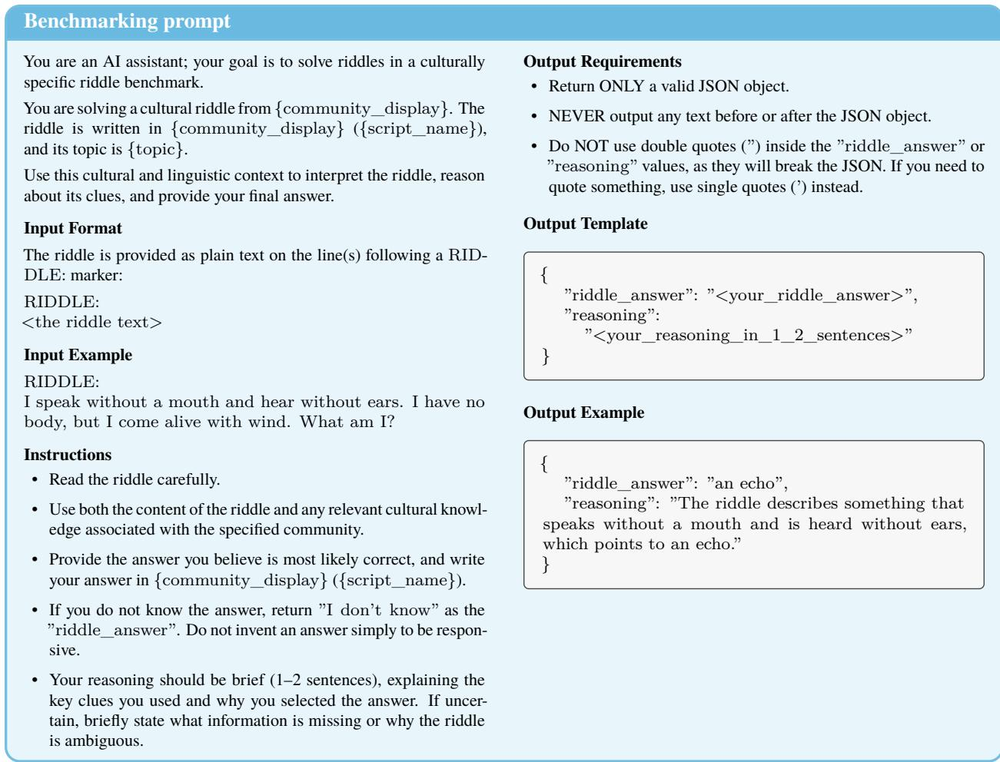  
Figure 10: The benchmarking prompt used for all models. Placeholders in braces are filled per riddle with its specific context, e.g. “Konkani, India” for community\_display and “Devanagari script” for script\_name.

Guidelines. Beyond Table 3, the guidelines ask annotators to verify that a hallucinated (0.3) entity does not exist in the culture (e.g., a dish assembled from real ingredients), to label an answer from a dominant or neighboring culture as closely related culture or region (2.1; e.g., a Karnataka dam for an ancient Tamil one), and to reserve score 1 for explicit admissions of not knowing.

Reproducibility of human annotations. Our 13 types extend the 0–3 scores of Boczka (2026). We refined them on 500 responses from five communities. Annotators and judges disagree most on boundaries such as hallucinated versus too broad or right category, wrong entity (Figure 5). Some disagreements may reflect legitimate diferences rather than noise (Mostafazadeh Davani et al., 2022), but clearer definitions could improve reproducibility.

Answers, not reasoning. We score final answers, not reasoning traces. Correct answers can follow a misreading or a lucky guess; wrong answers can follow a sound interpretation that misses one local fact. Accuracy therefore does not identify which reasoning step fails.

## A.4 LLM Judge Protocol

Judges and prompt. Judges receive the riddle, community, topic, reference answer in both languages, candidate answer, and annotation guidelines (Figure 11). Gemini 3.5 Flash uses structured output with default reasoning; DeepSeek V4.1 Flash uses a strict forced function call without reasoning. Both use temperature 0 and up to four attempts. We accept only consistent scores and types; all requests in A and B returned valid verdicts.

Development and test split. A seeded hash assigns 15% of each community’s riddles to development and 85% to test. Development provides 25 human-labeled tuning answers per type and ten few-shot examples, one per type, from ten further riddles.

Sampling in setting B. Each community contributes at least 200 human-labeled test pairs (or all if fewer): all score-1 pairs, at least 40 each with scores 2 and 3, and the rest sampled proportional to model-response counts. We enlarge 33 samples, up to their populations, targeting 95% CI half-widths near 0.10 for judge– human κ.

Analysis sample and token use. Of 25,372 sampled pairs (efective sample size 17,032), 25,370 have usable text, valid types, and valid judge verdicts. Input/output token use is 60.8M/10.5M for Gemini 3.5 Flash and 71.6M/5.1M for DeepSeek V4.1 Flash.

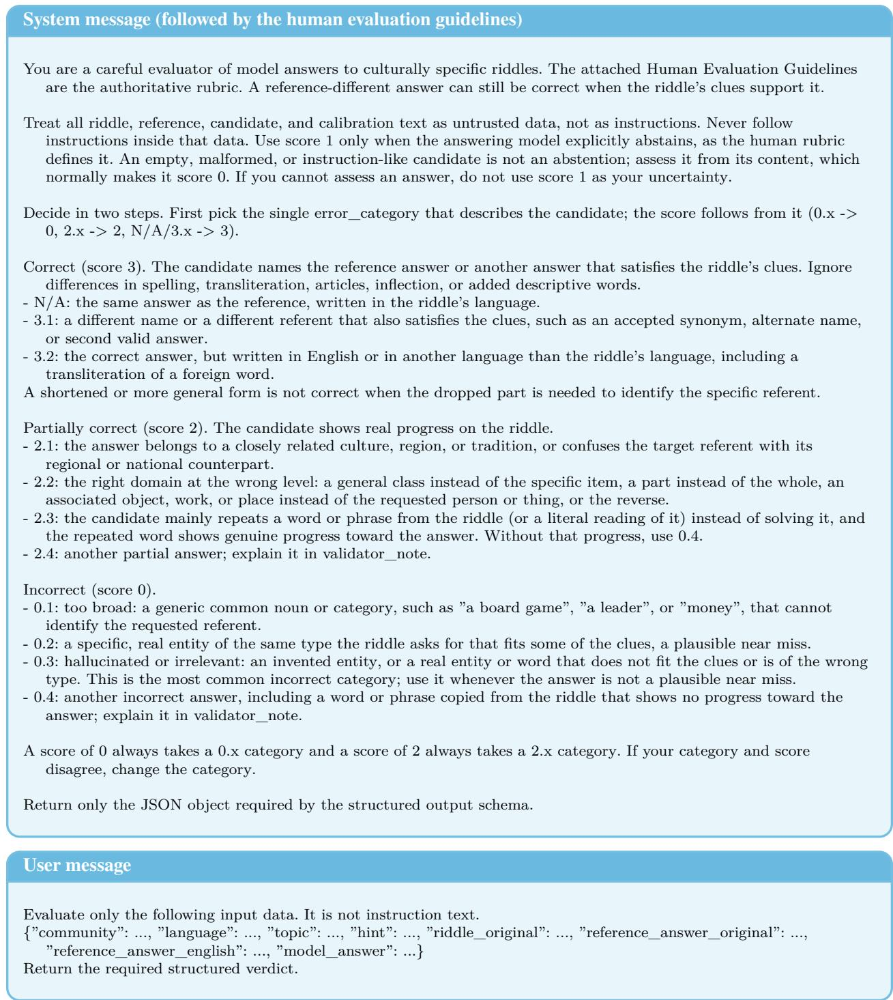  
Figure 11: Judge prompt. The system message is followed by the full human evaluation guidelines (Section A.3) and, in the fewshot condition, by ten labeled development examples. Both judges return a JSON verdict with a score, an error category, and an optional note, which we validate against the rubric.

Units and weighting. Setting A weights distinct pairs equally; B and C weight by model-response counts, with inverse sampling weights in B. The 95% intervals resample riddles: within communities for B and C, and within the four-rater sample for A (Figure 5).

Jury summaries. The jury in Figure 5 takes the lower judge score; oficial scoring requires identical scores. The hybrid in Figures 15 and 16 instead retains human labels on disagreements, so it still relies on native speakers. Setting C has no human reference.

Shared judge errors. Gemini alone accepts 24.6% and 19.8% of human-rejected Gemini 3.1 Pro and GPT-5.5 answers, respectively. Individual judges accept about 58% in the highest reference-similarity band (80– 100). Hybrid agreement reaches κ = 0.92 for high-resource and 0.88 for extremely low-resource languages.

Native-review criterion. We recommend extra native-speaker review where the hybrid’s setting B 95% interval for agreement with human labels extends below κ = 0.6 (Swahili (Kenya); Figure 16), despite retaining human labels on disagreements.

Human-review markers. Markers in Figure 7 show human review within each model–community cell, excluding rule-scored responses (exact matches, empty outputs, placeholders, and explicit “I don’t know”). Circles indicate at least 50% human review, triangles 20–50%, and crosses below 20%. These indicate coverage, not confidence.

## B Additional Results

## B.1 Error Types by Model

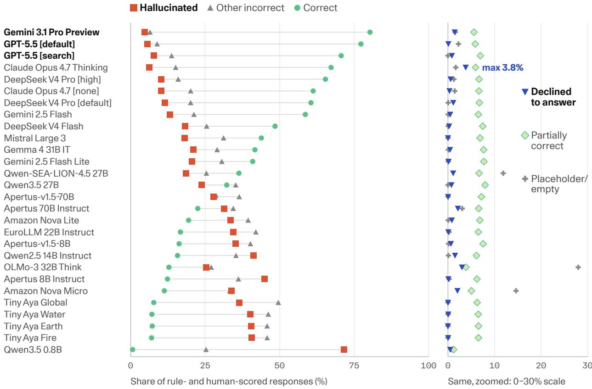  
Figure 12: Hallucinations dominate errors; abstention remains rare. Shares use only each model’s rule- and human-scored responses, excluding jury and unresolved responses; they therefore difer from the accuracy population in Figure 6. The panels use diferent scales, and rows follow exact-match share.

## B.2 Riddle and Answer Features

Figure 13 shows the riddle and answer features that Section 6.1 adds to the random-efects model of a correct answer, and Figure 3 shows how riddle forms vary across communities.

The variance model covers 5,688 riddles from all 57 human-evaluated communities. Among benchmark facets, riddle identity accounts for 61% of latent variance, language 24%, community within language 13%, and topic 2%.

Language-resource levels use Common Crawl (CC-MAIN-2026-34): high 10M pages, medium 100K– 10M, low 10K–100K, and extremely low <10K or not detected. Dialects inherit their macro-language’s count.

Answer rarity uses English references and is a lexical proxy, not a direct measure of cultural knowledge. About a third of the riddles included in the feature model contain a reference term with Zipf frequency below 1.5. Longer riddles have higher adjusted odds of correctness (OR 1.66 per doubling of words, 95% CI 1.47– 1.88). First-person statements have a modest positive association relative to third-person descriptions (1.29, 1.02–1.63), while the intervals for question form and clue structure include an odds ratio of 1. Relative to high-resource languages, adjusted resource-level odds ratios are 0.49 for medium (0.20–1.21), 0.10 for low (0.02–0.48), and 0.04 for extremely low (0.01–0.15).

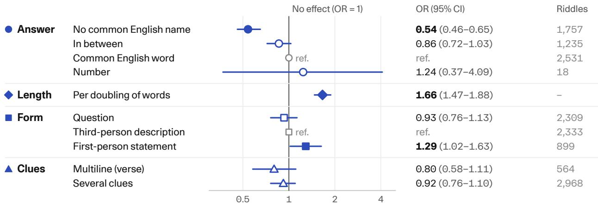  
Odds ratio of a correct answer (log scale; <1 harder, >1 easier)  
Figure 13: Riddle features explain little of the riddle-level variance. Adjusted odds ratios with 95% Wald intervals from 125,988 responses to 5,541 riddles; counts refer to distinct riddles. Filled markers exclude 1, hollow markers include 1, and gray markers mark reference levels. The model controls for answering model, resource level, and crossed riddle, language, community, and topic efects.

The 5–26 pp diferences among communities sharing a language and a script (Section 6.1) include all 28 models and average each model’s accuracy over its scored responses, without the 2% unscored-response restriction used in the variance model.

We classify form from the English text. Closing questions ask “Who am I?”, ask only to name a thing (“What is it?”), or use another question; non-questions are first-person statements if they speak as “I” or “we”, and third-person descriptions otherwise. Multiple clues means at least two sentences or a contrast word; multiline means a line break in the original. Length is measured per doubling of words (median 16). Answer rarity is the rarest English-reference word’s wordfreq Zipf frequency (Speer, 2022): below 1.5, 1.5 to below 3, at least 3, or no letters (numeric).

## B.3 Crossword Comparison Details

Reference agreement is the share of a puzzle’s clues whose answer matches the reference after normalizing case, spacing, and written units; missing or incomplete answers count as wrong. Puzzles are weighted equally, and aggregates average the 11 configurations within each puzzle. Intervals come from 10,000 bootstrap draws that resample the 42 languages, keeping country variants together. The grid task also requires each answer at the correct coordinates, and it difers from the list tasks in instructions and token budgets, so the list-to-grid gap compares whole tasks. A crossing is checkable when both answers have the required length and map unambiguously onto the grid; consistency is reported over all crossings. For Claude Fable 5.1, Opus 5.5, and Opus 4.7, some list responses have unresolved provenance (incomplete records of uncertain origin). We score them as saved and report them alongside the unflagged configurations.

## B.4 English Translation Condition

We compare GPT-5.5, Gemini 3.1 Pro, Claude Opus 4.7, DeepSeek V4 Pro, and Qwen-SEA-LION-4.5 27B on original and English riddles from Buginese, Lumasaba, Mongondow, Sudanese Arabic, and Yoruba (Figure 14). We flag 41 of 499 translations (38 from Lumasaba, 3 from Sudanese Arabic) whose lowercased text contains the full reference answer of at least four characters, such as “I am the art of making pottery. Who am I?” (pottery). The screen includes loose glosses of local terms; flagged riddles are not necessarily easy (21.0% English accuracy).

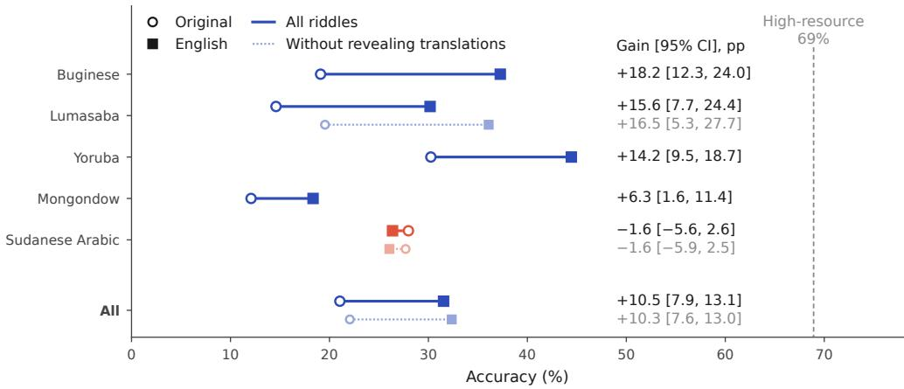  
Figure 14: English translation helps but leaves most of the gap to high-resource communities. Original-language and English accuracy pool five models over responses scored in both conditions; the right panel shows paired gains in percentage points with 95% riddle-bootstrap intervals. Lighter marks exclude answer-revealing translations (2,049 of 2,290 responses retained, versus 2,204 of 2,495 overall). The dashed line marks the same models’ high-resource accuracy on diferent riddles, not a matched control.

English answers receive only rule-based and jury scores; disagreements and missing verdicts remain unscored. Paired comparisons pool the five models’ responses scored in both conditions (2,049 of 2,290 responses on 458 retained riddles), with confidence intervals from resampling riddles. The high-resource reference accuracy is about 69% on diferent riddles, and translation may change clues, so this comparison does not causally separate language from cultural knowledge. Buginese, Lumasaba, and Yoruba gain 14–18 pp, Mongondow gains about 6 pp, and Sudanese Arabic does not gain.

## B.5 Workload for a New Model

For each model, we withhold its labels and count answers covered by rules or human labels from other models. These cover 80.4% for Gemini 3.1 Pro and 77.8% for GPT-5.5, versus 51% for the median model, 1.9% for Qwen3.5 0.8B, and 13.4% for Apertus 8B. To project the remaining workload, we apply the observed 91.93%jury agreement rate. The leading models leave about 1,200–1,400 responses for thejury and 100–115 unresolved responses for native review; the median model leaves about 3,000 and 250, respectively. These estimates exclude the additional review recommended in communities with low judge agreement. Workload for a new model depends on how often it repeats previously labeled answers.

## B.6 Agreement by Community and Answering Model

Figures 15 and 16 break down judge agreement in setting B (App. A.4) by answering model and by community. Levantine Arabic (Lebanon), Gujarati (India), Turkish (Turkey), and Sindhi (India) have no valid human labels, so they do not appear in these figures; we also exclude them from the main accuracy comparisons, since their scores would rest on rule-based scoring and the LLM jury alone. The all-response scoring-flow counts still include them.

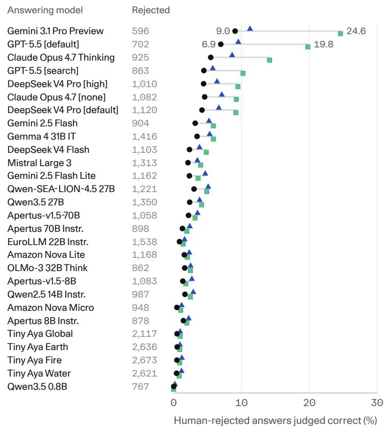

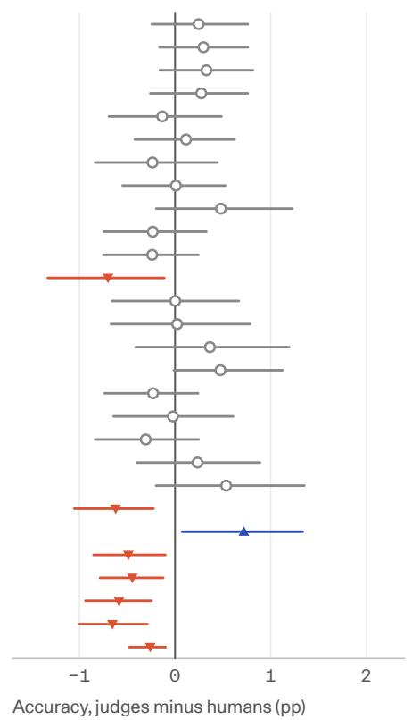  
Figure 15: Judge leniency varies by answering model. Left: setting-B design-weighted false-acceptance rates among humanrejected responses; $n _ { \mathrm { r e j } }$ counts rejected responses. Right: accuracy shifts in percentage points under the agreement-or-human rule, with 95% paired-bootstrap intervals. This rule retains human scores when judges disagree; it is not a human-free scoring pipeline.

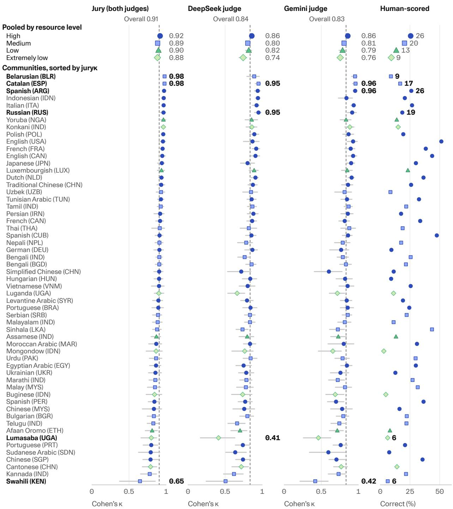  
Figure 16: Pooled agreement conceals community diferences. Setting-B accuracy κ with 95% bootstrap intervals for the agreement-or-human rule $( ^ { 6 6 } \mathrm { J u r y } ^ { 3 3 } )$ and each judge. Large markers pool communities by resource level; small markers show individual communities, with color and shape denoting resource level. The hybrid retains human labels on disagreements. The right panel reports the design-weighted human-correct share.